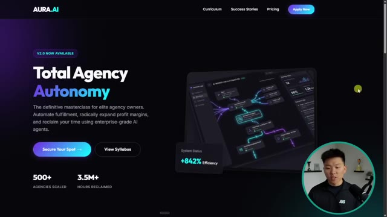

# 🎬 100 Hours Testing Claude Code vs Antigravity (honest results)

> **Chaîne** : [Nate Herk | AI Automation](https://www.youtube.com/@nateherk/featured)  
> **Lien YouTube** : [https://www.youtube.com/watch?v=99VHENEKA9o](https://www.youtube.com/watch?v=99VHENEKA9o)  
> **Date de publication** : 20260413  
> **Durée** : 00:23:32  
> **Identifiant vidéo** : `99VHENEKA9o`  
> **Transcription & Analyse** : `whisper-v3-large-turbo+gemini-3.5-flash-lite`  

---

## 📌 Synthèse Exécutive & Outils

### 💡 Résumé

La vidéo de la chaîne *Nate Herk | AI Automation* plonge au cœur du débat actuel sur l'ingénierie logicielle assistée par l'intelligence artificielle en confrontant deux mastodontes du développement agentique : **Claude Code** d'Anthropic et **Google Antigravity**. Après une centaine d'heures de tests rigoureux à travers divers flux de travail, l'analyse démontre que si ces outils affichent des performances de pointe sur le papier — comme en témoignent leurs scores respectifs sur le *SWE Bench Verified* (80,9 % pour Claude Code et 76,2 % pour Antigravity) —, ils répondent à des philosophies et des cas d'usage fondamentalement distincts. 

D'un côté, Claude Code se positionne comme un outil de ligne de commande et une extension axée sur le terminal qui s'intègre de manière transparente dans l'écosystème de l'éditeur du développeur (notamment VS Code). Il brille par sa rigueur architecturale, son mode de planification ultra-poussé en lecture seule et sa capacité à s'imbriquer naturellement dans des bases de code existantes sans trahir leurs conventions. De l'autre, Google Antigravity propose un environnement de développement intégré (IDE) totalement indépendant, doté d'une vue gestionnaire multi-agents et d'un agent de navigation web. Ses points forts résident dans la conception d'applications from scratch et la génération d'interfaces graphiques (UI/UX) d'un esthétisme remarquable, bien qu'il souffre parfois d'une dérive comportementale sur les projets au long cours où il oublie les directives initiales.

Enfin, l'analyse aborde la question cruciale de la monétisation et de l'optimisation des ressources : les outils étant gratuits, l'utilisateur investit directement dans la consommation de jetons des modèles sous-jacents. Les tests soulignent l'importance capitale d'une gestion rigineuse du contexte et des quotas, les deux plateformes ayant connu des épisodes de surconsommation ou de blocage (bogues de mise en cache chez Anthropic, quotas chaotiques chez Google). Le verdict final oriente l'apprenant vers la maîtrise prioritaire de Claude Code pour sa précision structurelle, tout en reconnaissant à Antigravity une supériorité visuelle indéniable pour le prototypage rapide d'interfaces.

---

### 🛠️ Outils, Modèles & Logiciels Présentés

* **Claude Code** : Plateforme de codage agentique axée sur le terminal et développée par Anthropic, offrant une orchestration puissante de sous-agents en parallèle directement intégrée au flux de travail existant du développeur.
* **Google Antigravity** : IDE indépendant propulsé par les modèles Google, conçu spécifiquement pour le développement agentique avec une vue de gestionnaire multi-espaces et un agent de navigation web natif.
* **Claude (Modèles Anthropic, incluant Opus 5.5)** : Moteur de réflexion haut de gamme d'Anthropic alimentant Claude Code, réputé pour sa planification minutieuse et son raisonnement de pointe sur des architectures complexes.
* **Gemini (Modèles Google, incluant Gemini 3 Pro et Flash)** : Famille de modèles de Google par défaut dans Antigravity, excellant dans la génération rapide d'interfaces utilisateur et d'applications globales *from scratch*.
* **VS Code (Visual Studio Code)** : Éditeur de code de référence largement utilisé comme hôte pour l'extension et les terminaux de Claude Code.
* **SWE Bench Verified** : Le benchmark standard de l'industrie mesurant la capacité des agents de codage à résoudre de vrais problèmes de dépôts open source sur GitHub.

---

### 🔑 Points Clés & Enseignements Stratégiques

* **Modèle économique par les jetons** : Les outils de codage agentique (Claude Code et Antigravity) sont mis à disposition gratuitement ; le coût réel réside exclusivement dans la consommation de jetons des modèles d'IA sous-jacents, ce qui rend l'optimisation du contexte financièrement critique.
* **Paradigme d'intégration vs Environnement dédié** : Claude Code s'intègre de manière non intrusive dans l'environnement de travail habituel du développeur (terminal, VS Code, raccourcis existants), tandis qu'Antigravity impose l'adoption d'un nouvel IDE indépendant conçu sur mesure pour les flux multi-agents.
* **Supériorité de la phase de planification** : La force principale de Claude Code réside dans son mode de planification dédié en lecture seule, qui cartographie minutieusement les modifications sur plusieurs fichiers et formule des questions de clarification avant d'écrire la moindre ligne de code.
* **Puissance esthétique et UI/UX d'Antigravity** : Antigravity surpasse son concurrent lorsqu'il s'agit de concevoir des interfaces graphiques, des sites web et des applications complètes à partir de zéro, offrant un sens esthétique et un rendu visuel remarquables.
* **Le piège de la dérive contextuelle** : Les tests au long cours révèlent qu'Antigravity a tendance à ignorer progressivement les règles et conventions initiales du projet fixées au premier jour, un phénomène documenté de perte de consistance contextuelle sur les projets longs.
* **Respect de la structure existante** : Claude Code excelle dans l'analyse contextuelle d'une base de code préexistante, détectant les conventions de nommage et les patrons de conception pour que le code généré s'intègre naturellement sans donner l'impression d'une pièce rapportée.
* **Performances quantifiables comparables** : Sur le plan académique, les scores au SWE Bench Verified placent les deux écosystèmes au coude à coude (80,9 % pour Claude Opus dans Claude Code contre 76,2 % pour Gemini Pro dans Antigravity).
* **Gains de productivité réels** : Les données empiriques partagées (gain de productivité de 50 % et +67 % de pull requests fusionnées chez Anthropic ; développement 60 à 70 % plus rapide sur 21 jours avec Antigravity) confirment que l'impact sur l'accélération du développement est massif.
* **Gestion des quotas et des bugs de cache** : La manipulation intensive d'agents autonomes expose les utilisateurs à des risques d'explosion des coûts (comme le bogue de cache de mars 2026 chez Anthropic) ou à des blocages stricts de comptes (gestion opaque des crédits chez Google), nécessitant une maîtrise accrue de la taille du contexte.
* **Hiérarchie des priorités d'apprentissage** : Pour un développeur ou un ingénieur en automatisation cherchant à optimiser son efficacité cette année, l'apprentissage de Claude Code est recommandé en priorité absolue en raison de sa rigueur architecturale et de sa flexibilité d'intégration.

---

## ⏱️ Chronologie & Transcription Complète Audio & Visuelle (Mot pour Mot)

### ⏱️ `[00:00:00 - 00:00:30]` | Segment #01

**🔊 Audio (Transcription Intégrale Mot pour Mot en Français) :**
> En ce moment, il y a deux outils qui dominent le marché en matière de développement avec l'IA. Nous avons Cloud Code et Google Antigravity. Et ces derniers mois, il y a eu un débat sur lequel de ces outils est réellement le meilleur. Donc, si vous essayez de déterminer quel outil d'IA apprendre et utiliser dès maintenant, cette vidéo va vous faire gagner énormément de temps. Après des centaines d'heures à tester ces deux outils, la vérité est que chacun est meilleur pour des tâches différentes. Et même si la réponse n'est pas ultra évidente, je pense tout de même qu'il y a un outil que vous devriez apprendre en priorité par rapport à l'autre. Donc, dans cette vidéo, nous allons aborder leurs principales différences et je vais les tester devant vous en direct avec différents flux de travail pour que vous puissiez voir où ils brillent et où ils pèchent.

**👁️ Analyse Visuelle d'Écran (gemini-3.5-flash-lite) :**
**Interface & Outils** : Visual Studio Code / Éditeur de code

**Contenu textuel & Code** : Commandes d'agent IA dans le terminal et structure de fichiers du projet dans l'explorateur

**Action / Démonstration** : Exécution de commandes et initialisation de dépôt Git via un assistant IA

*⏱️ 00:00:15 — Interface de VS Code montrant un terminal interactif avec des commandes d'agent IA et une incrustation vidéo du présentateur.*

---

### ⏱️ `[00:00:30 - 00:00:50]` | Segment #02

**🔊 Audio (Transcription Intégrale Mot pour Mot en Français) :**
> Ensuite, je vous donnerai mon avis sur lequel est le meilleur dans l'ensemble. Donc, d'ici la fin de cette vidéo, vous aurez une idée claire de l'outil que vous devriez apprendre et utiliser cette année. Alors, entrons dans le vif du sujet. Très bien. Donc, avant d'aborder les tests proprement dits, vous devez comprendre ce que sont ces outils et en quoi ils diffèrent réellement. CloudCode et Antigravity sont tous deux des plateformes de codage agentiques. Ils peuvent prendre une grande mission, la diviser en un plan, et lancer des sous-agents pour travailler en parallèle.

**👁️ Analyse Visuelle d'Écran (gemini-3.5-flash-lite) :**
**Interface & Outils** : Claude Code, interface Antigravity Open Agent Manager.

**Contenu textuel & Code** : Prompt utilisateur : "Build me a full-stack habit tracker app with a dashboard that shows streaks..."

**Action / Démonstration** : Affichage des interfaces de développement IA et présentation des environnements de test.

*⏱️ 00:00:35 — Animation graphique affichant le logo et le titre "Claude Code" sur fond sombre.*

*⏱️ 00:00:45 — Capture d'écran double divisée montrant l'interface de Claude Code à gauche et le gestionnaire d'agent Antigravity à droite avec un prompt de création d'application.*

---

### ⏱️ `[00:00:51 - 00:01:09]` | Segment #03

**🔊 Audio (Transcription Intégrale Mot pour Mot en Français) :**
> Ils peuvent gérer vos fichiers et vos dossiers, exécuter des commandes de terminal et s'exécuter sur l'ensemble de votre base de code. CloudCode est alimenté par les modèles Cloud d'Anthropic. Anti-Gravity utilise par défaut les modèles Gemini de Google. Vous pouvez changer de modèle pour ces deux outils différents, mais cela demande parfois juste un peu de configuration supplémentaire. Mais le plafond de puissance de ces deux outils est extrêmement élevé.

**👁️ Analyse Visuelle d'Écran (gemini-3.5-flash-lite) :**
**Interface & Outils** : Interface de configuration web et schéma graphique animé.

**Contenu textuel & Code** : Noms de modèles Gemini, options de routeur (Default, Background, Think, Long Context, Web Search) et seuil de contexte (60000).

**Action / Démonstration** : Navigation et configuration des différents modèles d'IA sous-jacents pour le routeur.

*⏱️ 00:00:55 — Schéma animé illustrant les fonctionnalités d'un sous-agent (gestion des fichiers, commandes de terminal, exécution sur la base de code).*

*⏱️ 00:01:04 — Interface de configuration montrant les options de routage des modèles d'IA (Gemini par défaut, contextes, recherche web).*

---

### ⏱️ `[00:01:09 - 00:01:29]` | Segment #04

**🔊 Audio (Transcription Intégrale Mot pour Mot en Français) :**
> Et à cause de cela, les deux outils sont gratuits. Vous ne payez pas pour Cloud Code ou vous ne payez pas pour Anti-Gravity. Ce que vous finissez par payer, c'est l'utilisation du modèle, la véritable IA en arrière-plan qui fait le travail de réflexion. Vous payez pour les jetons. La différence ne réside donc pas dans les capacités, mais dans l'endroit où ces capacités résident et dans la manière dont vous y accédez. Cloud Code est d'abord axé sur le terminal. C'est un outil de ligne de commande qui s'intègre dans l'environnement dans lequel vous travaillez déjà.

**👁️ Analyse Visuelle d'Écran (gemini-3.5-flash-lite) :**
**Interface & Outils** : Aucune interface logicielle ou de programmation affichée.

**Contenu textuel & Code** : Aucun code source, commande ou prompt visible.

**Action / Démonstration** : Présentation orale par le présentateur sans manipulation technique à l'écran.

---

### ⏱️ `[00:01:29 - 00:01:48]` | Segment #05

**🔊 Audio (Transcription Intégrale Mot pour Mot en Français) :**
> Donc vous pouvez garder votre éditeur, vos raccourcis clavier, vos extensions. Tout reste identique. La puissance agentique, les sous-agents, l'exécution parallèle, l'orchestration, tout y est. Mais c'est accessible via votre terminal et configuré par vous. Vous construisez le flux de travail par-dessus l'outil. Maintenant, anti-gravity est son propre IDE indépendant. Certains pensent que c'est une version dérivée de VS Code. Vos extensions et vos raccourcis peuvent donc être conservés.

**👁️ Analyse Visuelle d'Écran (gemini-3.5-flash-lite) :**
**Interface & Outils** : Interface de démonstration et panneau de contrôle d'agent IA.

**Contenu textuel & Code** : Texte flou lié à des requêtes et actions d'agents IA ('Agent is searching the web').

**Action / Démonstration** : Exécution d'une recherche web et traitement par un sous-agent IA.

*⏱️ 00:01:43 — Capture d'écran montrant une interface divisée en deux panneaux avec l'activité d'un agent IA en cours sur le web.*

---

### ⏱️ `[00:01:48 - 00:02:20]` | Segment #06

**🔊 Audio (Transcription Intégrale Mot pour Mot en Français) :**
> Mais vous ouvrez une application complètement différente. Elle dispose d'une vue gestionnaire où vous pouvez voir plusieurs agents travailler en parallèle sur différents espaces de travail et d'un agent de navigation intégré capable de parcourir de vraies pages web. La façon la plus simple de le voir, c'est que CloudCode vous donne les éléments de base et vous permet de travailler de la manière dont vous avez déjà l'habitude de le faire. Antigravity regroupe tout le concept de flux de travail des agents dans un environnement conçu spécifiquement dans lequel vous emménagez en quelque sorte. Très bien, parlons maintenant de ce que l'on ressent réellement en les utilisant, en commençant par la configuration. CloudCode vous offre donc plusieurs points d'entrée. L'interface en ligne de commande du terminal est le mode d'origine et le plus puissant. Vous l'installez avec npm et vous tapez Cloud dans n'importe quel terminal.

**👁️ Analyse Visuelle d'Écran (gemini-3.5-flash-lite) :**
**Interface & Outils** : Agent Manager Preview (interface logicielle d'agents IA)

**Contenu textuel & Code** : Menus "Inbox", "Workspaces", "Project 01", "Sub agent #1", "Opening URL in browser"

**Action / Démonstration** : Navigation et affichage de l'interface de gestionnaire d'agents IA multi-tâches

*⏱️ 00:01:56 — Interface de l'Agent Manager montrant les espaces de travail, les sous-agents et la section pour démarrer une nouvelle conversation.*

---

### ⏱️ `[00:02:20 - 00:02:46]` | Segment #07

**🔊 Audio (Transcription Intégrale Mot pour Mot en Français) :**
> et CloudCode apparaît. Il y a aussi une extension VS Code avec des diffs en ligne, une révision de plan, la visibilité des fichiers, des mentions at, et tout cela peut se trouver directement dans votre éditeur. Cloud nous propose également une application de bureau si vous ne voulez pas du tout utiliser la version VS Code, et c'est beaucoup plus, je dirais, convivial, ainsi qu'une version web que vous pouvez exécuter directement depuis votre navigateur sans aucune installation. Donc dans presque toutes les vidéos de ma chaîne où vous m'avez peut-être vu utiliser CloudCode, je l'ai utilisé à l'intérieur de VS Code, soit via l'extension, soit simplement en l'exécutant dans mon terminal VS Code.

**👁️ Analyse Visuelle d'Écran (gemini-3.5-flash-lite) :**
**Interface & Outils** : Visual Studio Code (VS Code) avec l'extension Claude Code.

**Contenu textuel & Code** : Page de documentation et description de l'extension d'IA Claude Code dans le marketplace de VS Code.

**Action / Démonstration** : Navigation et présentation de l'extension VS Code pour intégrer Claude Code directement dans l'éditeur.

*⏱️ 00:02:26 — Interface VS Code affichant des documentations et des fonctionnalités d'IA avec des listes numérotées des options (Inline diffs, Plan review, File visibility, @ mentions) et une vidéo de chien jouant de la guitare.*

*⏱️ 00:02:33 — Extension VS Code "Claude Code for For VS Code" développée par Anthropic dans le panneau des extensions avec des détails sur l'installation et l'interface latérale.*

---

### ⏱️ `[00:02:46 - 00:03:19]` | Segment #08

**🔊 Audio (Transcription Intégrale Mot pour Mot en Français) :**
> Maintenant, je fais ça parce que j'aime pouvoir voir tous mes fichiers sur ce côté gauche pendant que je travaille avec CloudCode plutôt que de simplement fixer une fenêtre de terminal. Une chose qui vaut la peine d'être notée cependant, c'est que l'interface de ligne de commande du terminal est techniquement le mode le plus complet en termes de fonctionnalités. L'extension VS Code couvre à peu près tout, mais il y a quelques fonctionnalités avancées qui sont réservées à la ligne de commande. Donc pour la plupart des gens qui débutent, l'extension est vraiment largement suffisante. Maintenant, Antigravity n'a qu'une seule porte d'entrée. Vous téléchargez l'application et vous devez l'exécuter par ce biais. Il y a une commande de ligne de commande pour la lancer depuis votre terminal, mais cela ouvre fondamentalement juste l'IDE Antigravity. Il n'y a donc pas d'option pour exécuter Antigravity à l'intérieur de VS Code. Alors maintenant, passons réellement

**👁️ Analyse Visuelle d'Écran (gemini-3.5-flash-lite) :**
**Interface & Outils** : Navigateur web, interface Gemini CLI (terminal).

**Contenu textuel & Code** : Commande d'installation `npm install -g @google/gemini-cli` et interface de terminal avec le logo pixelisé > GEMINI.

**Action / Démonstration** : Affichage de la page de présentation et de documentation pour installer et utiliser l'outil Gemini CLI.

*⏱️ 00:03:11 — Capture d'écran d'une page web présentant l'interface en ligne de commande de Gemini CLI avec un terminal interactif.*

---

### ⏱️ `[00:03:19 - 00:03:52]` | Segment #09

**🔊 Audio (Transcription Intégrale Mot pour Mot en Français) :**
> passons à ce qui importe le plus, c'est-à-dire la qualité de ce que les outils produisent. Le modèle que vous utilisez à l'intérieur de l'outil compte énormément. Si vous utilisez CloudCode avec Haiku, ce sera une expérience complètement différente que d'utiliser CloudCode avec Opus. Utiliser Anti-Gravity avec Gemini Flash ne sera pas la même chose que d'utiliser Anti-Gravity avec Gemini Pro. L'environnement façonne la manière dont le modèle fonctionne, mais c'est le modèle qui détermine la limite maximale. Donc, lorsque nous parlons de la qualité des résultats, cela dépend en grande partie du modèle que vous faites tourner sous le capot. Maintenant, la plus grande force de CloudCode est sa façon de réfléchir avant d'agir. Il possède un mode de planification dédié, ce qu'Anti-Gravity fait également, mais dans ce mode de planification, il cartographie le travail sur plusieurs fichiers avant de toucher à quoi que ce soit. Il va

**👁️ Analyse Visuelle d'Écran (gemini-3.5-flash-lite) :**
**Interface & Outils** : Interface web de sélection de modèles d'IA (menu déroulant avec Opus, Sonnet, Haiku).

**Contenu textuel & Code** : Menus déroulants affichant les différents modèles (Opus 4.6, Sonnet 4.6, Haiku 4.5) et options associées.

**Action / Démonstration** : Sélection ou survol d'un modèle d'IA dans l'interface utilisateur.

*⏱️ 00:03:27 — Interface d'une application montrant un menu de sélection de modèle d'IA (Opus 4.6, Sonnet 4.6, Haiku 4.5) avec une option de réflexion prolongée.*

---

### ⏱️ `[00:03:52 - 00:04:18]` | Segment #10

**🔊 Audio (Transcription Intégrale Mot pour Mot en Français) :**
> être en lecture seule, pas de modification de code, juste de la stratégie et des questions de clarification. Vous pouvez contrôler la profondeur de son raisonnement, jusqu'à ce qu'Anthropic appelle leur super-réflexion pour les problèmes vraiment complexes. Comme je l'ai dit, anti-gravity a aussi un mode plan, mais je pense que cloud code le fait tout simplement mieux. Vous verrez exactement ce que je veux dire quand nous passerons à tous les tests en direct plus tard. Les deux outils vous permettent également de définir des règles au niveau du projet, des conventions et des instructions personnalisées qui persistent d'une session à l'autre. Les deux prennent en charge les plugins, les commandes personnalisées et les intégrations avec des outils externes.

**👁️ Analyse Visuelle d'Écran (gemini-3.5-flash-lite) :**
**Interface & Outils** : Éléments graphiques incrustés (icônes logicielles et boutons d'interface utilisateur animés).

**Contenu textuel & Code** : Boutons affichant "SET RULES" et "CONVENTIONS", accompagnés de deux icônes symbolisant des outils ou applications d'IA.

**Action / Démonstration** : Incrustation graphique à l'écran pour illustrer les concepts abordés par le présentateur (règles et conventions pour les agents IA).

*⏱️ 00:04:12 — Apparition de deux icônes d'applications et de boutons de texte superposés ("SET RULES" et "CONVENTIONS") pendant que le présentateur parle.*

---

### ⏱️ `[00:04:19 - 00:04:54]` | Segment #11

**🔊 Audio (Transcription Intégrale Mot pour Mot en Français) :**
> L'extensibilité est présente des deux côtés, mais CloudCode me semble extrêmement modifiable parce que j'ai l'impression d'avoir tellement plus de contrôle sur la façon dont je veux que ce projet individuel se comporte. Là où CloudCode se démarque également, c'est par sa capacité à comprendre votre projet existant et votre structure de fichiers. Il lit tout, il détecte vos modèles et vos conventions de nommage, et il s'appuie sur ce que vous avez déjà. Ainsi, le code généré s'intègre à votre base de code au lieu d'avoir l'air simplement greffé. La force majeure d'Antigravity est de créer des applications complètes et des interfaces graphiques à partir de zéro. Lors d'un test indépendant de 21 jours sur 12 projets réels, 94 % du code généré était propre, fonctionnel, limitant, sans erreurs ni problèmes de style. Il a complété environ 73 %

**👁️ Analyse Visuelle d'Écran (gemini-3.5-flash-lite) :**
**Interface & Outils** : AUCUNE

**Contenu textuel & Code** : AUCUNE

**Action / Démonstration** : AUCUNE

---

### ⏱️ `[00:04:54 - 00:05:13]` | Segment #12

**🔊 Audio (Transcription Intégrale Mot pour Mot en Français) :**
> de tâches sans aucune intervention humaine et a permis une réduction de 60 à 70 % du temps de développement. Maintenant, lorsque j'ai utilisé Antigravity, je l'ai principalement utilisé pour concevoir des choses, des éléments d'interface, d'expérience utilisateur, des sites Web, des applications Web, des choses de ce genre. Je trouve simplement qu'il fait un bien meilleur travail par rapport à CloudCode et Opus pour avoir un véritable sens esthétique et faire en sorte que les choses aient l'air et se sentent plus réelles.

**👁️ Analyse Visuelle d'Écran (gemini-3.5-flash-lite) :**
**Interface & Outils** : Site web (Booststash)

**Contenu textuel & Code** : Texte d'évaluation et statistiques sur la réduction du temps de développement et la stabilité des outils d'IA.

**Action / Démonstration** : Affichage d'un article textuel illustrant les performances des outils d'IA.

*⏱️ 00:04:59 — Capture d'écran montrant un article du site Booststash avec des métriques de performance et de réduction du temps de développement.*

---

### ⏱️ `[00:05:13 - 00:05:33]` | Segment #13

**🔊 Audio (Transcription Intégrale Mot pour Mot en Français) :**
> Mais il y a un inconvénient car, sur les projets plus longs, l'anti-gravité peut commencer à s'éloigner des règles que vous avez fixées au début. Maintenant, c'est un schéma documenté. Le propre forum de développeurs de Google a un fil de discussion à ce sujet. Il peut construire quelque chose parfaitement selon les spécifications le premier jour, puis commencer à ignorer progressivement vos directives initiales d'ici le troisième jour. Maintenant, pour être juste, c'est généralement vrai pour n'importe quel agent de codage avec n'importe quel modèle de codage, mais je tenais tout de même à le souligner ici.

**👁️ Analyse Visuelle d'Écran (gemini-3.5-flash-lite) :**
**Interface & Outils** : Interface de chat d'assistant IA minimaliste sur fond sombre.

**Contenu textuel & Code** : Texte de prompt « Build me a... », étapes du projet (« Day 1 », « Day 3 »), composants validés (« Typography », « Hero Section », « Pricing ») et message « Searching context... ».

**Action / Démonstration** : Saisie et affichage de l'historique d'un prompt de développement de projet et de sa recherche de contexte par l'IA.

*⏱️ 00:05:23 — Interface de chat sombre montrant un message débutant par « Build me a... » dans une bulle bleue.*

*⏱️ 00:05:28 — Interface de chat montrant la progression d'un projet avec « Day 1 », des éléments validés (Typography, Hero Section, Pricing) et le statut « Searching context... ».*

---

### ⏱️ `[00:05:33 - 00:06:01]` | Segment #14

**🔊 Audio (Transcription Intégrale Mot pour Mot en Français) :**
> Maintenant, regardons quelques benchmarks. Le SWE Bench Verified est le test standard de l'industrie pour les outils de codage par IA. Il prend de vrais problèmes GitHub provenant de vrais projets open source, et il mesure combien sont entièrement résolus par le modèle d'IA. Claude Opus 4.6 à l'intérieur de Claude Code a obtenu un score de 80,9 %. Gemini 3 Pro à l'intérieur d'Antigravity a atteint environ 76,2 %. Ces deux scores impliquent l'ensemble complet, c'est-à-dire l'outil et le modèle, ensemble. Mais Google n'a pas publié la méthodologie de test exacte de la même manière qu'Anthropic l'a fait, ce n'est donc pas une comparaison parfaite à 100 %.

**👁️ Analyse Visuelle d'Écran (gemini-3.5-flash-lite) :**
**Interface & Outils** : Graphique statistique animé sur fond noir.

**Contenu textuel & Code** : Score de performance de "80.9%" attribué à "Opus 4.6" sur le SWE Benchmark.

**Action / Démonstration** : Présentation des résultats de performance du modèle d'IA Claude Opus 4.6.

*⏱️ 00:05:47 — Graphique à barres montrant le score de 80,9% pour Claude Opus 4.6 au benchmark SWE.*

---

### ⏱️ `[00:06:01 - 00:06:20]` | Segment #15

**🔊 Audio (Transcription Intégrale Mot pour Mot en Français) :**
> Mais au niveau des modèles haut de gamme, ces outils sont remarquablement proches sur le papier. Maintenant, les résultats dans le monde réel. L'équipe d'ingénierie d'Anthropic a rapporté que Claude Code leur a donné un gain de productivité de 50 % et 67 % de demandes de tirage fusionnées en plus par ingénieur et par jour. Du côté d'Anti-Gravity, le test indépendant de 21 jours a montré un développement 60 à 70 % plus rapide. Les deux chiffres sont extrêmement impressionnants.

**👁️ Analyse Visuelle d'Écran (gemini-3.5-flash-lite) :**
**Interface & Outils** : Document texte / Article web de rapport d'ingénierie.

**Contenu textuel & Code** : Texte du rapport mentionnant l'utilisation de Claude Code, les gains de productivité de 50%, l'augmentation de 67% des pull requests fusionnées, et les métriques de performance.

**Action / Démonstration** : Affichage à l'écran d'un article ou d'un rapport officiel pour appuyer les propos du présentateur sur les performances réelles de l'outil.

*⏱️ 00:06:11 — Capture d'écran d'un rapport textuel montrant des statistiques de productivité (+50 % et +67 % de demandes de tirage fusionnées) avec une surbrillance jaune sur le chiffre 67%.*

*⏱️ 00:06:15 — Capture d'écran d'un rapport textuel détaillant les performances et l'expérience utilisateur, avec une surbrillance jaune sur les résultats de tests intensifs.*

---

### ⏱️ `[00:06:21 - 00:06:39]` | Segment #16

**🔊 Audio (Transcription Intégrale Mot pour Mot en Français) :**
> Ce n'est pas une étude scientifique contrôlée, mais de manière indicative, les deux outils vous indiquent qu'ils rendent les développeurs nettement plus rapides. Mais parlons maintenant de vitesse et de fiabilité. Rappelez-vous, ce pour quoi vous payez lorsque vous utilisez ces outils, ce n'est pas l'outil, vous payez pour le modèle. Et ces modèles vont épuiser votre consommation ou vos limites plus vite que vous ne le pensez, surtout si vous ne faites pas attention.

**👁️ Analyse Visuelle d'Écran (gemini-3.5-flash-lite) :**
**Interface & Outils** : Aucune interface logicielle ou de programmation affichée.

**Contenu textuel & Code** : Aucun code source, terminal ou prompt visible, uniquement des textes de sous-titre et de titre.

**Action / Démonstration** : Aucune action technique ou manipulation logicielle montrée.

---

### ⏱️ `[00:06:39 - 00:06:58]` | Segment #17

**🔊 Audio (Transcription Intégrale Mot pour Mot en Français) :**
> Cloud Code récemment, en mars 26, a eu un bogue de mise en cache qui a fait exploser les coûts des jetons de peut-être 10 à 20 fois. Pour les utilisateurs de MaxPlan, ils épuisaient toute leur session en moins de deux heures. Anthropic a reconnu cela et semble travailler constamment sur l'optimisation des jetons, ce qui va évidemment être un genre de projet continu. Anti-gravity a ses propres problèmes également.

**👁️ Analyse Visuelle d'Écran (gemini-3.5-flash-lite) :**
**Interface & Outils** : Navigateur web (articles de presse et forum Reddit)

**Contenu textuel & Code** : Texte d'un article de The Register et message d'un utilisateur sur Reddit concernant la surconsommation de jetons de Claude Code.

**Action / Démonstration** : Présentation d'articles et de témoignages d'utilisateurs illustrant le problème des coûts des jetons.

*⏱️ 00:06:44 — Capture d'écran d'un article de The Register expliquant que Claude Code présente des bogues de mise en cache augmentant les coûts des jetons de 10 à 20 fois.*

*⏱️ 00:06:49 — Capture d'écran d'un post Reddit sur r/ClaudeAI abordant la consommation excessive et rapide des limites d'utilisation de Claude.*

---

### ⏱️ `[00:06:58 - 00:07:22]` | Segment #18

**🔊 Audio (Transcription Intégrale Mot pour Mot en Français) :**
> Le système de quotas de Google a été complètement chaotique, les utilisateurs pro se retrouvant bloqués pendant toute une semaine après avoir atteint les limites, avec en plus un système de tarification basé sur des crédits qui n'explique toujours pas clairement ce qu'un crédit vous permet réellement d'acheter. Donc, en général, apprendre à gérer son contexte et ses jetons est l'une des compétences les plus importantes que vous puissiez développer en ce moment, car elle s'applique à n'importe quel agent de codage que vous finirez par utiliser. J'ai fait une vidéo complète sur 18 astuces de gestion des jetons que j'ai découvertes en expérimentant avec ces outils, et je mettrai le lien vers celle-ci juste ici.

**👁️ Analyse Visuelle d'Écran (gemini-3.5-flash-lite) :**
**Interface & Outils** : Navigateur web (Reddit)

**Contenu textuel & Code** : Publication Reddit intitulée 'Can someone please explain the Gemini pricing model?' détaillant la confusion autour des coûts et quotas de Gemini 2.5 Pro.

**Action / Démonstration** : Affichage d'un témoignage utilisateur illustrant la complexité et les problèmes du système de tarification de Google.

*⏱️ 00:07:04 — Capture d'écran d'une discussion sur Reddit posant des questions sur le modèle de tarification de Gemini 2.5 Pro.*

---

### ⏱️ `[00:07:22 - 00:07:43]` | Segment #19

**🔊 Audio (Transcription Intégrale Mot pour Mot en Français) :**
> Maintenant, en termes de vitesse d'exécution, un test indépendant a montré que CloudCode a accompli une tâche représentative en environ 4 minutes contre 8 minutes pour Antigravity. Ce que j'ai trouvé intéressant, car lors de mes tests, Antigravity a toujours semblé plus rapide. Et vous le verrez plus tard dans la vidéo lorsque nous ferons ces tests réels. Maintenant, la vraie différence en matière de fiabilité pour l'instant concerne la maturité. CloudCode est sorti en version de production avec plusieurs mises à jour déployées chaque semaine.

**👁️ Analyse Visuelle d'Écran (gemini-3.5-flash-lite) :**
**Interface & Outils** : Interface graphique de présentation vidéo / incrustation de cartes de score.

**Contenu textuel & Code** : Texte 'REPRESENTATIVE TASK' et 'CLAUDE CODE' avec le chiffre 4.

**Action / Démonstration** : Affichage d'un graphique comparatif de performance d'exécution.

*⏱️ 00:07:27 — Graphique montrant le titre 'REPRESENTATIVE TASK' avec une carte pour 'CLAUDE CODE' et un score de 4.*

---

### ⏱️ `[00:07:43 - 00:08:08]` | Segment #20

**🔊 Audio (Transcription Intégrale Mot pour Mot en Français) :**
> Antigravity est toujours en version d'évaluation publique à ce jour, en avril 2026, mais il s'améliore très rapidement. Il présente toutefois encore l'instabilité inhérente à ce stade d'évaluation publique. Certaines personnes signalent des problèmes de connexion, il y a des bugs occasionnels sur Windows, et des agents restent bloqués dans des boucles. Maintenant, la perte de contexte est bien réelle pour ces deux outils. Même avec la fenêtre de contexte d'un million de tokens de CloudCode avec Opus, il peut y avoir des problèmes lorsque vous chargez de véritables bases de code, que vous exécutez de nombreux appels d'outils et que vous faites des va-et-vient pendant plus de quarante requêtes.

**👁️ Analyse Visuelle d'Écran (gemini-3.5-flash-lite) :**
**Interface & Outils** : Éditeur de code (type VS Code ou Cursor) et interface web de benchmark de modèles d'IA.

**Contenu textuel & Code** : Code source partiellement visible et graphique de comparaison de performance de modèles (Opus 4.6, Sonnet 4.5, etc.).

**Action / Démonstration** : Affichage des limites des agents IA en cours de développement et présentation de graphiques de performance comparative.

*⏱️ 00:07:56 — Un éditeur de code sombre affichant du texte flou avec le texte incrusté "AGENTS ARE GETTING STUCK".*

*⏱️ 00:08:02 — Un graphique de performance sur fond clair montrant les scores de raisonnement contextuel de différents modèles d'IA, avec Opus 4.6 en tête.*

---

### ⏱️ `[00:08:08 - 00:08:30]` | Segment #21

**🔊 Audio (Transcription Intégrale Mot pour Mot en Français) :**
> À ce moment-là, l'intelligence artificielle commence tout simplement à perdre le fil des instructions précédentes. Les documents de dépannage d'Antigravity recommandent de démarrer une nouvelle discussion dès que l'agent met plus de 10 secondes à répondre. CloudCode dispose d'une commande compacte qui compresse l'historique de votre conversation. Mais la meilleure pratique pour ces deux outils est la même. Gardez vos sessions ciblées, une seule tâche par session, et recommencez à neuf souvent. Maintenant, une dernière chose que je voulais mentionner, c'est que le rythme du développement est tout simplement fou.

**👁️ Analyse Visuelle d'Écran (gemini-3.5-flash-lite) :**
**Interface & Outils** : Présentation vidéo avec infographies et diagrammes animés.

**Contenu textuel & Code** : Texte affichant "ANTI-DRIFT PROTOCOL", "Focused sessions", et "1 task per session".

**Action / Démonstration** : Explication du protocole anti-dérive pour maintenir l'agent IA concentré sur ses tâches.

*⏱️ 00:08:25 — Un graphique animé en plein écran présente l'"ANTI-DRIFT PROTOCOL" avec deux étapes numérotées : "1. Focused sessions" et "2. 1 task per session".*

---

### ⏱️ `[00:08:31 - 00:09:04]` | Segment #22

**🔊 Audio (Transcription Intégrale Mot pour Mot en Français) :**
> CloudCode a progressé à un rythme effréné. Rien qu'au premier trimestre 2026, ils ont lancé six fonctionnalités majeures au niveau de la plateforme avec plusieurs versions par semaine. Et à un moment donné, il y a eu trois versions différentes en l'espace de cinq jours. Antigravity s'est également amélioré et mis à jour, mais la cadence est nettement différente. Du lancement en novembre jusqu'en mars 2026, soit, vous savez, environ quatre ou cinq mois, les numéros de version sont passés de 1,11 à 1,21, la plupart des mises à jour consistant en une poignée d'améliorations, de corrections de bugs mineurs et d'optimisations. Les deux sont donc activement développés, mais CloudCode avance beaucoup plus rapidement. Et lorsque vous choisissez un outil dans lequel investir votre temps, je pense que cela

**👁️ Analyse Visuelle d'Écran (gemini-3.5-flash-lite) :**
**Interface & Outils** : Interface graphique de présentation (tableau de versions).

**Contenu textuel & Code** : Tableau avec colonnes 'Date' et 'Releases' montrant les versions v0.2.x, v0.2.x (patch) et v0.3.0.

**Action / Démonstration** : Affichage visuel du rythme des mises à jour logicielles.

*⏱️ 00:08:39 — Un tableau affichant le calendrier des versions (Rapid Release) avec les dates du 24 février, 27 février et 1er mars 2026.*

---

### ⏱️ `[00:09:04 - 00:09:36]` | Segment #23

**🔊 Audio (Transcription Intégrale Mot pour Mot en Français) :**
> compte énormément. Très bien, alors parlons des intégrations, car un outil de codage n'est vraiment utile que par rapport à ce à quoi il peut réellement se connecter. Ces deux outils de codage prennent en charge le MCP, le Model Context Protocol, le standard ouvert qui permet aux outils d'IA de se connecter à des services externes. GitHub, des bases de données, Supabase, Playwright, Firecrawl, des outils de design, des plateformes de surveillance. Plus de 1 500 serveurs MCP existent à l'heure actuelle, et ce nombre ne cesse de croître. La différence réside dans la configuration. L'intégration MCP de CloudCode est pilotée par la ligne de commande. Vous ajoutez des serveurs avec une seule commande, ou en demandant à CloudCode de le faire, ou en modifiant un fichier de configuration JSON défini globalement, par projet, ou peut-être par utilisateur.

**👁️ Analyse Visuelle d'Écran (gemini-3.5-flash-lite) :**
**Interface & Outils** : Schéma explicatif animé sur fond sombre illustrant le Model Context Protocol (MCP).

**Contenu textuel & Code** : Schéma montrant la connexion entre une IA, le module MCP et plusieurs intégrations : GitHub, Databases, Supabase, Playwright, Firecrawl et Monitoring.
[DESC_IMAGE_3] Visualisation des capacités d'intégration du MCP (Model Context Protocol) avec différents services tiers.

**Action / Démonstration** : Explications face caméra et démonstration conceptuelle.

*⏱️ 00:09:20 — Un schéma animé illustrant le fonctionnement du Model Context Protocol (MCP), montrant une IA connectée à divers services comme GitHub, Supabase, Playwright et Firecrawl via MCP.*

---

### ⏱️ `[00:09:37 - 00:10:12]` | Segment #24

**🔊 Audio (Transcription Intégrale Mot pour Mot en Français) :**
> Alors qu'Antigravity intègre plutôt un panneau MCP visuel, où l'on peut en quelque sorte parcourir un catalogue et cliquer pour installer des MCP et des choses de ce genre. C'est un peu plus simple pour débuter, mais pour les configurations avancées, vous finirez quand même par devoir modifier ce fichier de configuration, ce qui n'est d'ailleurs pas très difficile du tout. Car avec ces deux outils, vous pouvez dire, hé, voici l'URL du serveur MCP que je veux télécharger. Aide-moi à comprendre comment faire concrètement. Les deux outils disposent également d'un accès direct au terminal, ce qui signifie qu'ils peuvent utiliser n'importe quelle autre interface en ligne de commande, ce qui est énorme. Git, NPM, Docker, Playwright, Google Workspace. Si cela possède une interface en ligne de commande et s'exécute dans un terminal, alors l'un ou l'autre outil peut réellement l'utiliser. Vous pouvez même exécuter Cloud Code CLI à l'intérieur

**👁️ Analyse Visuelle d'Écran (gemini-3.5-flash-lite) :**
**Interface & Outils** : Interface de chat textuel / application Antigravity

**Contenu textuel & Code** : Message utilisateur : "Hey, here's the MCP server URL [ https::firecrawl ] that I want to download."

**Action / Démonstration** : Saisie d'une URL de serveur MCP pour téléchargement dans l'interface

*⏱️ 00:09:54 — Interface de chat sombre affichant un message demandant de télécharger un serveur MCP via l'URL Firecrawl.*

---

### ⏱️ `[00:10:12 - 00:10:45]` | Segment #25

**🔊 Audio (Transcription Intégrale Mot pour Mot en Français) :**
> anti-gravités terminal si vous voulez les deux outils dans un seul environnement. Très bien, alors maintenant parlons de tarification. D'abord, laissez-moi recadrer très rapidement la façon dont vous y pensez. Parce que même si vous payez pour le plan le plus cher de Claude en ce moment, 200 $ par mois, pour le niveau de production que vous pouvez obtenir de l'un ou l'autre de ces outils, vous ne pourriez jamais embaucher un humain pour faire ce même volume de travail pour ce même prix. C'est-à-dire quel humain vous donnerait toute cette productivité et cette production pour seulement 200 $ par mois. Donc peu importe l'outil que vous choisissez ou combien d'argent vous investissez dans ces abonnements, vous obtenez un effet de levier fou pour votre argent. C'est une vraie aubaine en ce moment. Maintenant, CloudCode nécessite un plan Cloud payant. Donc si vous commencez avec le plus bas de CloudCode

**👁️ Analyse Visuelle d'Écran (gemini-3.5-flash-lite) :**
**Interface & Outils** : Page web de tarification Claude Code (Anthropic).

**Contenu textuel & Code** : Plans tarifaires affichés : Pro (17$), Max 5x (100$) et Max 20x (200$).

**Action / Démonstration** : Présentation des différents niveaux de prix et forfaits d'abonnements de Claude Code.

*⏱️ 00:10:20 — Capture d'écran de la page de tarification de Claude Code montrant les plans Pro ($17), Max 5x ($100) et Max 20x ($200).*

---

### ⏱️ `[00:10:45 - 00:11:21]` | Segment #26

**🔊 Audio (Transcription Intégrale Mot pour Mot en Français) :**
> abonnement, c'est-à-dire Pro, et ça coûte 20 dollars par mois, ce qui vous donne accès à la plateforme. Vous pouvez aussi utiliser votre clé API, mais cela pourrait finir par vous coûter plus cher qu'un simple abonnement. Mais la plupart des gros utilisateurs finissent par opter pour le forfait max, qui coûte soit 100 dollars par mois pour cinq fois plus d'utilisation que le Pro, soit 200 dollars par mois pour 20 fois plus d'utilisation que le Pro. Lorsque vous êtes en train de développer activement, vous épuisez la limite du Pro assez rapidement. Vous pouvez toujours commencer par le Pro, et ensuite passer à un forfait supérieur si nécessaire. Et vous pouvez payer pour de l'utilisation supplémentaire au-delà de votre forfait aux tarifs standard de l'API. Ou bien sûr, vous pourriez brancher une sorte de modèle open source ou un modèle beaucoup moins cher si vous le souhaitiez. Mais vous allez perdre une grande partie de la valeur d'Opus, bien sûr, parce que c'est l'un des modèles les plus intelligents en ce moment. Anti-gravity est lié à l'IA de Google

**👁️ Analyse Visuelle d'Écran (gemini-3.5-flash-lite) :**
**Interface & Outils** : Navigateur web affichant la plateforme Ollama.

**Contenu textuel & Code** : Page du modèle CodeLlama avec la commande CLI "ollama run codellama" et un encadré de sous-titre "Plug cheaper model".

**Action / Démonstration** : Présentation visuelle d'un modèle alternatif open source pour illustrer l'utilisation d'une clé API ou d'un modèle économique.

*⏱️ 00:11:12 — Capture d'écran du site web d'Ollama montrant la page du modèle CodeLlama avec des options de téléchargement et une commande CLI.*

---

### ⏱️ `[00:11:21 - 00:11:56]` | Segment #27

**🔊 Audio (Transcription Intégrale Mot pour Mot en Français) :**
> plans d'abonnement. Il y a donc une version gratuite avec un accès de base et des limites de taux hebdomadaires. Tout le monde obtient Gemini 3 Pro, des complétions de code illimitées et toutes les fonctionnalités, quel que soit le niveau. Mais la limite gratuite s'épuise rapidement si vous faites du vrai travail. Google AI Pro coûte 20 balles par mois avec des limites de taux plus élevées qui se réinitialisent toutes les cinq heures, plus deux téraoctets de stockage Google et 10 dollars de crédits Google Cloud mensuels. Google AI Ultra coûte 250 dollars par mois, et il vous donne les limites de taux les plus élevées. Maintenant, une remarque importante, certains utilisateurs signalent que même sur Pro, les limites de taux pour les modèles premium comme Cloud Opus à l'intérieur d'Antigravity sont très restrictives, comme se faire bloquer après une seule session. Donc, si vous prévoyez d'utiliser massivement des modèles autres que Gemini à l'intérieur d'Antigravity,

**👁️ Analyse Visuelle d'Écran (gemini-3.5-flash-lite) :**
**Interface & Outils** : Interface graphique de présentation des avantages d'un abonnement.

**Contenu textuel & Code** : Texte listant les avantages : limites de taux rafraîchies toutes les 5 heures, 2 téraoctets de stockage Google, 10 dollars de crédits Google Cloud mensuels.

**Action / Démonstration** : Présentation visuelle des caractéristiques et avantages d'un plan d'abonnement payant.

*⏱️ 00:11:39 — Graphique affichant les avantages du plan supérieur incluant de meilleures limites de taux, 2 To de stockage Google et des crédits Google Cloud mensuels.*

---

### ⏱️ `[00:11:56 - 00:12:31]` | Segment #28

**🔊 Audio (Transcription Intégrale Mot pour Mot en Français) :**
> Gardez cela à l'esprit. Mais l'essentiel ici en matière de coût, c'est que si vous ne faites que débuter et que vous voulez faire des expériences, la formule gratuite d'Antigravity vous permet d'essayer pour 0 dollar. Donc, si vous voulez une utilisation quotidienne fiable de niveau production, vous allez probablement vouloir payer pour quelque chose, que ce soit CloudCode sur Mac, qui offre l'expérience la plus cohérente à l'heure actuelle. Aux tarifs les plus élevés, 200 balles pour CloudCode et 250 balles pour Antigravity. Ils se situent dans une fourchette similaire. Maintenant, vous pensez peut-être que ce n'est pas un abonnement très bon marché, mais avec une utilisation intensive, vous obtenez toujours beaucoup plus de résultats que si vous engagiez un développeur, et c'est tellement moins cher. Très bien, nous avons donc couvert toutes les différences clés. Faisons une comparaison de construction côte à côte. Maintenant, très vite, avant d'entrer dans les tests, je vais mettre toutes ces informations que nous avons

**👁️ Analyse Visuelle d'Écran (gemini-3.5-flash-lite) :**
**Interface & Outils** : Interface de tarification comparative (Claude Code vs Antigravity)

**Contenu textuel & Code** : Tarifs affichés : Claude Code Max 20x à 200 $ / mois et Antigravity Google AI Ultra à 124,99 $ / mois (réduit de 249,99 $).

**Action / Démonstration** : Comparaison des coûts des différentes solutions d'IA à l'écran.

*⏱️ 00:12:14 — Capture comparant les tarifs de Claude Code (200 $ par mois) et Antigravity (Google AI Ultra à 124,99 $ par mois au lieu de 249,99 $).*

---

### ⏱️ `[00:12:31 - 00:13:07]` | Segment #29

**🔊 Audio (Transcription Intégrale Mot pour Mot en Français) :**
> dont nous avons parlé aujourd'hui, y compris en quelque sorte les résultats et les tests, dans un guide de ressources gratuit, auquel vous pouvez accéder tout à fait gratuitement dans ma communauté School gratuite. Le lien pour cela se trouve dans la description. Mais bref, passons aux créations en direct. Très bien. Nous avons donc quelques tests à effectuer ici. Et la façon dont je vais m'y prendre, c'est que j'ai Anti-Gravity d'ouvert à gauche et j'ai Cloud Code d'ouvert ici à droite. Nous allons donc faire trois tests différents. Le premier consistera pour moi à lancer simplement ce prompt en un seul coup, sans utiliser le mode plan. Je vais donc passer en mode rapide et m'assurer que les autorisations sont contournées. Et l'idée est de voir à quel point chacune de ces deux plateformes de codage d'agents fonctionne pour nous lorsque nous leur faisons une demande assez vague, et nous verrons ce qui se passe. Le deuxième test consistera à faire quelque chose

**👁️ Analyse Visuelle d'Écran (gemini-3.5-flash-lite) :**
**Interface & Outils** : Antigravity (Open Agent Manager) et Claude Code dans des fenêtres côte à côte.

**Contenu textuel & Code** : Prompt utilisateur : "Build me a full-stack habit tracker app with a dashboard that shows streaks, a calendar heatmap..."

**Action / Démonstration** : Saisie et affichage de requêtes pour la génération de code par agent IA.

*⏱️ 00:12:49 — Interface divisée en deux montrant Antigravity et Claude Code avec une invite de test d'application de suivi des habitudes.*

---

### ⏱️ `[00:13:07 - 00:13:42]` | Segment #30

**🔊 Audio (Transcription Intégrale Mot pour Mot en Français) :**
> similaire mais on utilise le mode plan pour voir comment leur planification fonctionne et ensuite le troisième va être en quelque sorte comme une conception de site web et on se base un peu purement sur le rendu de conception à ce moment-là ainsi que sur le genre de planification et tout le reste. Donc allons-y simplement pour lancer les deux. Comme je l'ai dit, celui-ci tourne ici dans anti-gravity avec Gemini 3.1 Pro et celui-ci tourne ici dans CloudCode avec Opus 4.6. Donc ce que j'ai dit, c'était de construire une application de suivi d'habitudes full-stack avec un tableau de bord qui montre les séries, une carte thermique de calendrier, et la possibilité d'ajouter, modifier et supprimer des habitudes. J'ai dit de ne pas utiliser la compétence super-pouvoir parce que c'est quelque chose que j'ai dans CloudCode qui rend ses résultats bien meilleurs. Et si vous voulez regarder cette vidéo que j'ai faite sur le

**👁️ Analyse Visuelle d'Écran (gemini-3.5-flash-lite) :**
**Interface & Outils** : VS Code avec Antigravity et Claude Code

**Contenu textuel & Code** : Prompt utilisateur pour créer une application de suivi d'habitudes full-stack (habit tracker app) avec tableau de bord et calendrier thermique.

**Action / Démonstration** : Comparaison et test de l'agent Antigravity face à Claude Code pour la génération d'une application à partir d'un prompt textuel.

*⏱️ 00:13:16 — Capture d'écran montrant une interface divisée en deux fenêtres côte à côte avec un panneau de gestion d'agents d'un côté et un éditeur Claude Code de l'autre, avec le présentateur incrusté en bas à droite.*

---

### ⏱️ `[00:13:42 - 00:14:17]` | Segment #31

**🔊 Audio (Transcription Intégrale Mot pour Mot en Français) :**
> compétence extraordinaire, je vais le mettre en lien juste ici. Mais je lui ai dit de ne pas l'utiliser parce que je veux que ce soit aussi équitable que possible. Je vais donc laisser tourner ces deux choses et je vous ferai savoir quand nous aurons nos résultats. Très bien, en ce qui concerne la vitesse, vous pouvez voir ici qu'Anti-Gravity a terminé et que CloudCode est toujours en train de tourner. Donc avant de cliquer dessus, voyons ce qu'ils ont fait du point de vue des fichiers. Si j'ouvre les fichiers ici pour les deux, vous pouvez voir que CloudCode a créé un dossier appelé .superpowers avec content et state. Ensuite, nous avons docs avec plans et specs. Et puis nous avons habit tracker avec tous les vrais dossiers pour ce qui se passe à l'intérieur du site réel. Et ici, nous pouvons voir qu'Anti-Gravity a fait quelque chose de très différent.

**👁️ Analyse Visuelle d'Écran (gemini-3.5-flash-lite) :**
**Interface & Outils** : Antigravity, interface de chat d'agent IA, VS Code.

**Contenu textuel & Code** : Invite de commande demandant de créer une application de suivi des habitudes full-stack avec un tableau de bord, des graphiques et une base de données SQLite.

**Action / Démonstration** : Exécution d'agents IA en parallèle pour comparer leurs performances sur la même tâche.

*⏱️ 00:13:51 — Capture d'écran montrant une vue en écran partagé avec l'interface d'Antigravity à gauche et un éditeur/agent IA à droite, avec la vidéo incrustée du présentateur dans le coin inférieur droit.*

---

### ⏱️ `[00:14:17 - 00:14:42]` | Segment #32

**🔊 Audio (Transcription Intégrale Mot pour Mot en Français) :**
> Nous avons des modules de nœuds avec une tonne de dossiers ici. Et tout cela, j'en suis sûr, est très rempli d'autres dossiers et d'autres fichiers. Nous pouvons voir que nous avons un dossier public. On dirait que ce sont des images. Et ensuite, nous avons le SRC avec d'autres ressources et composants à l'intérieur. Vous avez peut-être regardé ce que je viens de vous montrer avec les dossiers et vous vous êtes dit, c'est complètement du chinois. Et pour moi, je ne sais pas vraiment ce qui s'y passe non plus, n'est-ce pas ? Mais la raison pour laquelle je voulais vous montrer cela, c'est parce que les structures, les modèles, ils sont simplement conçus pour, oui, atteindre l'objectif final que nous recherchons, mais ils le font d'une manière différente.

**👁️ Analyse Visuelle d'Écran (gemini-3.5-flash-lite) :**
**Interface & Outils** : Éditeur de code VS Code.

**Contenu textuel & Code** : Arborescence de fichiers avec 'node_modules', 'public', 'src', et des fichiers de configuration comme 'package.json' et 'vite.config.ts'.

**Action / Démonstration** : Exploration de la structure des dossiers et fichiers du projet généré.

*⏱️ 00:14:23 — Capture d'écran montrant l'éditeur de code VS Code avec l'arborescence du projet Antigravity test dans l'explorateur de fichiers.*

---

### ⏱️ `[00:14:42 - 00:15:03]` | Segment #33

**🔊 Audio (Transcription Intégrale Mot pour Mot en Français) :**
> Ceci étant réglé, ouvrons d'abord la version d'Anti-Gravity. D'accord, alors voici Anti-Gravity. Il n'y a rien ici. Laissez-moi juste dire que le serveur local est ouvert, mais je ne vois rien. La page est juste complètement blanche. Donc, nous allons fermer ça. Et pendant que ça travaille là-dessus, laissez-moi ouvrir Cloud Code et nous allons aller sur cette version juste ici sur le serveur local. D'accord, super. Nous avons un suivi d'habitudes. Nous avons un calendrier. Nous avons nos séries de réussites, des trucs comme ça en haut, le total des enregistrements.

**👁️ Analyse Visuelle d'Écran (gemini-3.5-flash-lite) :**
**Interface & Outils** : VS Code, Navigateur web (application "Habit Tracker").

**Contenu textuel & Code** : Fichier `vite.config.ts`, messages de l'agent IA, tableau de bord d'une application de suivi d'habitudes (Habit Tracker).

**Action / Démonstration** : Le présentateur examine le code et l'interface de l'application, constatant d'abord un écran vide puis affichant le tableau de bord fonctionnel de l'application.

*⏱️ 00:14:53 — Interface de l'éditeur VS Code montrant un fichier de configuration TypeScript (vite.config.ts) et un panneau latéral avec une discussion d'assistant IA concernant une application de suivi d'habitudes.*

*⏱️ 00:14:58 — Interface web complète de l'application "Habit Tracker" avec un tableau de bord sombre, des statistiques et un calendrier d'activité.*

---

### ⏱️ `[00:15:03 - 00:15:23]` | Segment #34

**🔊 Audio (Transcription Intégrale Mot pour Mot en Français) :**
> Nous avons la date d'aujourd'hui. Je peux ajouter une habitude. Disons donc que nous faisons une marche et je peux ajouter le jour. Je pourrais l'éditer. Je pourrais changer la couleur. On dirait, d'accord, c'est plutôt sympa. Je pourrais la supprimer. Et nous pouvons changer la couleur ici aussi. Si je voulais faire une habitude verte pour YouTube et vous pouvez changer le jour. Donc voilà, vous pouvez voir, cela nous donne notre série et tout le reste. Donc pour une V1 sans planification, c'est plutôt solide.

**👁️ Analyse Visuelle d'Écran (gemini-3.5-flash-lite) :**
**Interface & Outils** : Interface web d'une application de suivi d'habitudes (Habit Tracker) sur navigateur.

**Contenu textuel & Code** : Tableau de bord 'Habit Tracker' avec statistiques (TODAY, BEST ACTIVE STREAK, LONGEST STREAK EVER, TOTAL CHECK-INS), calendrier d'activité annuelle et formulaire d'ajout/édition d'habitude avec sélecteur de couleur RVB.

**Action / Démonstration** : Démonstration des fonctionnalités de l'application web, incluant l'édition d'une habitude existante ('Walk') et la sélection de couleur via un sélecteur graphique.

*⏱️ 00:15:08 — Interface d'un tableau de bord de suivi d'habitudes avec une fenêtre modale d'édition ouverte affichant le champ du nom de l'habitude 'Walk' et un sélecteur de couleur.*

*⏱️ 00:15:13 — Interface du tableau de bord de suivi d'habitudes montrant le panneau d'ajout d'habitude avec un sélecteur de couleur (palette RVB) ouvert.*

---

### ⏱️ `[00:15:23 - 00:15:42]` | Segment #35

**🔊 Audio (Transcription Intégrale Mot pour Mot en Français) :**
> C'est ce qu'on a demandé. Ça a l'air assez stylé, mais bon, c'est pas grave. Retournons dans anti-gravity, voyons ce qui s'est passé ici. Donc apparemment, ça a corrigé ces modifications. Rouvrons l'appli maintenant. Waouh. OK. Donc ça, c'est anti-gravities. D'un point de vue design, j'aime déjà mieux celui-là. On a nos habitudes actives. On a, on a complété aujourd'hui, notre score quotidien. Nouvelle habitude. On peut dire, ouais, on est allés faire une, j'allais dire course, mais j'ai tapé lecture.

**👁️ Analyse Visuelle d'Écran (gemini-3.5-flash-lite) :**
**Interface & Outils** : IDE Antigravity (basé sur VS Code), navigateur web affichant l'application React générée ("HabitForge").

**Contenu textuel & Code** : Explications de l'agent IA sur la correction d'une erreur de compilation TypeScript ("import type"), configuration Vite (`vite.config.ts`), tableau de bord de suivi d'habitudes.

**Action / Démonstration** : L'agent IA corrige automatiquement les erreurs de code et l'utilisateur rouvre l'application pour en observer le design et le fonctionnement.

*⏱️ 00:15:28 — Interface d'Antigravity affichant le panneau latéral d'un agent IA expliquant la correction d'une erreur TypeScript, avec le code de configuration Vite visible en arrière-plan à gauche.*

*⏱️ 00:15:32 — Interface de l'application "HabitForge" en cours d'exécution dans le navigateur, affichant un tableau de bord sombre avec le suivi d'une habitude ("Drink Water") et des statistiques.*

---

### ⏱️ `[00:15:42 - 00:16:00]` | Segment #36

**🔊 Audio (Transcription Intégrale Mot pour Mot en Français) :**
> Donc nous lisons, je lis des modèles d'argent pendant 10 minutes. Nous allons aller de l'avant et créer les habitudes. Nous pouvons voir cela juste là. Et c'est là que nous sommes capables de cocher cela par jour. Donc c'est une façon un peu différente dont cela fonctionne réellement, mais quand même supprimer des choses et des trucs comme ça. Donc les deux font ce que nous avons demandé, mais ils le font de manières différentes. Très bien, test numéro deux. Nous faisons fondamentalement exactement la même chose, n'est-ce pas ?

**👁️ Analyse Visuelle d'Écran (gemini-3.5-flash-lite) :**
**Interface & Outils** : Application web (HabitForge)

**Contenu textuel & Code** : Tableaux de bord des habitudes 'Drink Water' et 'Read' avec indicateurs de suivi journalier et score global.

**Action / Démonstration** : Présentation et explication du fonctionnement du suivi des habitudes de l'application web.

*⏱️ 00:15:47 — Capture d'écran montrant l'interface utilisateur de l'application 'HabitForge' affichant les habitudes en cours et les statistiques quotidiennes.*

---

### ⏱️ `[00:16:00 - 00:16:20]` | Segment #37

**🔊 Audio (Transcription Intégrale Mot pour Mot en Français) :**
> Je vais lancer ça en mode plan des deux côtés. Et cette fois, je dis : j'ai besoin que tu fasses des recherches sur les tendances de l'IA sur le marché des petites et moyennes entreprises. Et j'ai besoin que tu crées un rapport au format PDF qui ne doit pas faire plus de trois pages et qui me donne une vue d'ensemble. Ils vont donc adopter des approches différentes ici afin de créer un plan de mise en œuvre et de développer cela pour nous. Ils pourraient nous poser des questions, ou pas.

**👁️ Analyse Visuelle d'Écran (gemini-3.5-flash-lite) :**
**Interface & Outils** : Antigravity Open Agent Manager (éditeur/interface d'agent IA)

**Contenu textuel & Code** : Prompt utilisateur : "I need you to do research on AI trends in the small and medium-sized business market and create a PDF report..." / Statuts de réflexion des agents ("Thinking", "Prioritizing Tool Selection", "Meandering").

**Action / Démonstration** : Les agents IA analysent le prompt en parallèle pour planifier la recherche et la création du rapport PDF.

*⏱️ 00:16:05 — Vue en écran partagé de deux interfaces d'agents IA (Antigravity Open Agent Manager), montrant l'exécution d'un prompt demandant un rapport de recherche sur les tendances de l'IA pour les PME.*

---

### ⏱️ `[00:16:20 - 00:16:38]` | Segment #38

**🔊 Audio (Transcription Intégrale Mot pour Mot en Français) :**
> Et nous allons fondamentalement comparer. Nous ne leur avons rien dit sur notre pile technologique, absolument rien. Nous ne leur avons même pas dit pour qui était ce rapport. Voyons donc lequel est capable de nous poser les meilleures questions et de nous donner le meilleur résultat. Très bien, du point de vue de la vitesse cette fois-ci, nous avons obtenu notre plan en premier avec Cloud Code. Voyons donc ce que nous avons. Un rapport de trois pages, générer un fichier HTML stylisé pour des sorties PDF.

**👁️ Analyse Visuelle d'Écran (gemini-3.5-flash-lite) :**
**Interface & Outils** : Interface web d'agents IA (Antigravity), écran partagé en deux fenêtres de chat.

**Contenu textuel & Code** : Prompt utilisateur : 'I need you to do research on AI trends in the small and medium-sized business market and create a PDF report...', affichage des étapes de réflexion (Thought) et de recherche web (Web Search).

**Action / Démonstration** : Exécution parallèle de requêtes de recherche web et planification par les deux agents IA basés sur le même prompt.

*⏱️ 00:16:24 — Comparatif côte à côte de deux interfaces d'agents IA (Antigravity) effectuant des recherches et la génération d'un rapport PDF sur les tendances de l'IA pour les PME.*

---

### ⏱️ `[00:16:38 - 00:17:01]` | Segment #39

**🔊 Audio (Transcription Intégrale Mot pour Mot en Français) :**
> Nous aurons un résumé exécutif, un paysage d'adoption. Nous aurons des cas d'utilisation et un impact commercial. Nous aurons des défis, un impact sur la main-d'œuvre et des perspectives. et voici fondamentalement le plan pour transformer cela en PDF. Donc le but de ceci est juste de voir à quel point ils planifient bien. Je vais donc simplement dire oui, acceptation automatique. Maintenant ici, du côté de l'anti-gravité, il est dit que j'ai terminé la recherche sur les tendances de l'IA sur le marché des petites et moyennes entreprises et que je les ai converties en un rapport PDF concis et lisible.

**👁️ Analyse Visuelle d'Écran (gemini-3.5-flash-lite) :**
**Interface & Outils** : Éditeur de code (VS Code / Antigravity) et panneau de prévisualisation web/Markdown

**Contenu textuel & Code** : Texte Markdown et plan de rapport structuré en trois pages : "Executive Summary", "Use Cases + Business Impact", et "Challenges, Workforce Impact + Outlook".

**Action / Démonstration** : Rédaction et structuration d'un rapport de recherche sur les tendances de l'IA pour la transformation en format PDF.

*⏱️ 00:16:44 — Vue partagée montrant à gauche un éditeur de code avec un fichier Markdown (# AI Trends in the SMB Market) et un panneau de discussion IA, et à droite la prévisualisation d'un document structuré en pages avec des sections sur l'impact commercial, les cas d'utilisation et les défis.*

---

### ⏱️ `[00:17:01 - 00:17:28]` | Segment #40

**🔊 Audio (Transcription Intégrale Mot pour Mot en Français) :**
> Donc je me suis en fait trompé sur toute cette histoire de vitesse. Il semble que ce anti-gravity soit revenu et ait déjà fini ceci. Donc dans les fichiers ici, vous pouvez voir qu'il a effectivement déjà créé un PDF. Donc laissez-moi ouvrir ça rapidement. Très bien, alors voici à quoi ressemble le résultat de anti-gravity. Ce n'est vraiment pas stylisé du tout, mais il y a des choses comme les tendances de l'IA sur le marché pour 2026, un résumé exécutif, des tendances d'options clés, des outils autonomes aux systèmes intégrés, la prise de décision guidée par les données, la mise en œuvre stratégique plutôt que les essais et erreurs, le ROI et l'impact commercial.

**👁️ Analyse Visuelle d'Écran (gemini-3.5-flash-lite) :**
**Interface & Outils** : Visual Studio Code et lecteur de PDF intégré.

**Contenu textuel & Code** : Fichier Markdown et rapport PDF généré sur les tendances de l'IA pour les PME.

**Action / Démonstration** : Navigation dans l'explorateur de fichiers et ouverture du rapport PDF finalisé par l'agent.

*⏱️ 00:17:08 — Interface de VS Code montrant le dossier du projet avec les fichiers générés par l'agent IA.*

*⏱️ 00:17:14 — Affichage du rapport PDF généré et structuré intitulé "AI Trends in the SMB Market (2026)".*

*⏱️ 00:17:21 — Zoom sur le document PDF final montrant les sections détaillées du rapport généré.*

---

### ⏱️ `[00:17:28 - 00:18:02]` | Segment #41

**🔊 Audio (Transcription Intégrale Mot pour Mot en Français) :**
> Donc nous avons d'autres outils et tout ça. Et ce qui est intéressant, c'est que ça n'a cité aucune de ses sources. Je ne lui avais pas demandé, mais c'est quelque que chose que j'aurais probablement souhaité qu'il fasse. Donc ça n'a pas cité de sources. Nous devons simplement faire confiance au fait que tout cela est crédible. Et cela nous a également donné des conseils de mise en œuvre stratégique. des conseils. Donc ce que je n'aime pas, c'est que ça ne nous a pas vraiment posé de questions sur ce que nous recherchions spécifiquement. Et ça nous a fondamentalement juste donné un résultat. Maintenant, nous pourrions évidemment faire des aller-retours avec lui et lui demander de nous aider, vous savez, à approfondir d'autres recherches ou à lui donner un peu plus d'informations. Mais c'est quelque chose que j'ai remarqué. Maintenant, ici du côté de Claude Code, nous n'utilisons pas les compétences de brainstorming, donc ça ne planifie pas aussi bien. Et je pense quand même que,

**👁️ Analyse Visuelle d'Écran (gemini-3.5-flash-lite) :**
**Interface & Outils** : VS Code / Éditeur de code avec assistant IA intégré (Gemini / Agent Manager).

**Contenu textuel & Code** : Prompt utilisateur demandant un rapport PDF sur les tendances de l'IA pour les PME, et exécution de commandes Bash pour vérifier les bibliothèques Python (reportlab).

**Action / Démonstration** : L'agent IA analyse la requête, vérifie la disponibilité des outils et génère le rapport demandé.

*⏱️ 00:17:53 — Interface d'un éditeur de code et d'un agent IA en plein écran divisé, montrant des commandes Bash et la génération d'un rapport.*

---

### ⏱️ `[00:18:02 - 00:18:20]` | Segment #42

**🔊 Audio (Transcription Intégrale Mot pour Mot en Français) :**
> J'aimerais que ce côté-là ait aussi demandé du genre, hé, comment est-ce que tu veux que ça soit créé ? Le public à qui tu essaies de donner ça ? Ce genre de questions sont vraiment utiles. Très bien. Donc Cloud Code vient juste de revenir. Il a dit que c'est fait. Vous pouvez voir que c'est juste ici dans nos fichiers. Donc laissez-moi aller ouvrir ça depuis mon dossier. Boum, voici le rapport de Cloud Code. Vous pouvez déjà dire qu'il est un peu mieux stylisé. Il a de meilleurs en-têtes et quelques couleurs.

**👁️ Analyse Visuelle d'Écran (gemini-3.5-flash-lite) :**
**Interface & Outils** : Visual Studio Code et lecteur de PDF / navigateur.

**Contenu textuel & Code** : Prompts d'IA pour des rapports sur les tendances IA, code Python et commandes Bash pour vérifier les bibliothèques PDF.

**Action / Démonstration** : Génération et affichage d'un rapport PDF complet basé sur l'IA.

*⏱️ 00:18:07 — Vue d'un éditeur de code (VS Code) divisé en deux panneaux affichant des interactions avec un agent IA et du code Python en cours d'exécution.*

*⏱️ 00:18:16 — Visualisation d'un rapport PDF généré automatiquement intitulé "AI Trends in the Small & Medium Business Market" avec des graphiques et des tableaux.*

---

### ⏱️ `[00:18:20 - 00:18:53]` | Segment #43

**🔊 Audio (Transcription Intégrale Mot pour Mot en Français) :**
> Il y a quelques tableaux. Ça disait que les statistiques pourraient être fausses, comme vous pouvez le voir juste ici. Une chose à noter, les boîtes de mise en valeur des statistiques sur les pages un et deux ont un léger problème de mise en page, bla, bla, bla. Mais je dirais que d'un point de vue de la planification et de l'exécution ici, je donnerais définitivement ce test à Cloud Code comme gagnant. Oh non, il l'a fait. Il a donné des sources ici, rapport ICIC, business.com, graphique économique LinkedIn. Il a donc cité les sources, ce qui, je pense, est aussi bien meilleur que le rapport d'Anti-Gravity. D'accord. Donc avant de lancer le prochain, ou en fait je vais juste aller de l'avant et le lancer. Et puis je, ce dont je veux parler, la façon d'obtenir de bons résultats avec ces outils, c'est de comprendre comment ils fonctionnent et de les utiliser mieux. Donc

**👁️ Analyse Visuelle d'Écran (gemini-3.5-flash-lite) :**
**Interface & Outils** : Lecteur PDF, VS Code / Interface d'agent IA (Antigravity et Claude Code).

**Contenu textuel & Code** : Texte du rapport de marché PDF (« AI Trends in the Small & Medium Business Market ») et prompt de conception de landing page pour un cours d'automatisation IA.

**Action / Démonstration** : Le présentateur analyse un document de rapport généré par l'IA et montre des interfaces de développement d'agents.

*⏱️ 00:18:29 — Capture montrant un rapport de marché PDF affichant des statistiques et tendances sur l'IA dans les petites et moyennes entreprises, avec le présentateur en médaillon.*

*⏱️ 00:18:45 — Capture montrant une interface divisée en deux avec un assistant d'IA (Antigravity) à gauche et un terminal de code (Claude Code) à droite, affichant un prompt de création de page de destination.*

---

### ⏱️ `[00:18:53 - 00:19:26]` | Segment #44

**🔊 Audio (Transcription Intégrale Mot pour Mot en Français) :**
> Finalement, si vous maîtrisez vraiment bien Claude Code, je suis plutôt convaincu que vous pourriez passer sur Anti-Gravity et réussir à l'utiliser assez bien, parce que vous comprenez beaucoup de choses sur la façon dont les agents collaborent, sur la planification et sur les résultats spécifiques, bla, bla, bla. Donc, pour ce dernier point, ce que je voulais faire, c'est en faire un autre où nous ne faisons pas de planification et où nous ne le guidons pas autant. Nous voulons voir à quel point ces assistants de codage sont capables, avec les bons modèles, d'obtenir réellement ce que nous voulons. Ici, ce que je lui ai demandé de faire, c'est de concevoir une page de destination pour un cours d'automatisation par IA de premier plan, destiné aux propriétaires d'agences. Incluez une section principale, de la preuve sociale, un tableau des tarifs et un appel à l'action. N'utilisez pas la compétence de remue-méninges ni la compétence de conception front-end, car c'est quelque chose

**👁️ Analyse Visuelle d'Écran (gemini-3.5-flash-lite) :**
**Interface & Outils** : Antigravity, Open Agent Manager.

**Contenu textuel & Code** : Prompt de conception de page de destination pour un cours d'automatisation IA, processus de réflexion et statuts des agents.

**Action / Démonstration** : Génération et planification de code en cours par les agents IA.

*⏱️ 00:19:02 — Interface d'Antigravity avec deux panneaux divisés affichant des interactions d'agents de code IA.*

---

### ⏱️ `[00:19:26 - 00:19:59]` | Segment #45

**🔊 Audio (Transcription Intégrale Mot pour Mot en Français) :**
> que j'ai donné à Claude Code qui l'aide essentiellement à concevoir l'UI, l'UX. Et ne me pose aucune question, donne-moi juste un résultat. Maintenant, je soupçonne ici qu'Anti-Gravity va revenir avec une page plus belle. On pouvait déjà s'en apercevoir un peu dans l'application de suivi des habitudes. Mais généralement, chaque fois que j'ai testé ces deux outils, j'ai eu l'impression que Claude Code est meilleur pour créer des automatisations, des compétences et des produits. Mais Anti-Gravity a été meilleur pour la conception d'applications web, les sites web et des choses comme ça. Je vais donc laisser tourner ceci et je vous montrerai quand nous aurons nos deux résultats finaux. Bon, encore une fois, Anti-Gravity du point de vue de la vitesse a déjà terminé. Je ne vais pas encore vous montrer le résultat. Attendons de voir quand Claude Code

**👁️ Analyse Visuelle d'Écran (gemini-3.5-flash-lite) :**
**Interface & Outils** : VS Code et Interface Antigravity

**Contenu textuel & Code** : Prompt utilisateur demandant de concevoir une landing page pour un cours d'automatisation par IA avec des instructions spécifiques sur le design et l'absence de questions.

**Action / Démonstration** : Exécution du prompt par l'agent IA et génération en cours (statut "Finagling...").

*⏱️ 00:19:35 — Capture d'écran montrant une interface divisée en deux avec l'agent Antigravity à gauche et un éditeur VS Code avec un prompt d'IA à droite, ainsi que la webcam du présentateur en bas à droite.*

---

### ⏱️ `[00:19:59 - 00:20:32]` | Segment #46

**🔊 Audio (Transcription Intégrale Mot pour Mot en Français) :**
> se termine. Très bien, voilà. Les deux sont terminés. Alors, ouvrons d'abord CloudCodes. Bien que le problème soit qu'il s'agit du même hôte local que le suivi d'habitudes. Donc, ça a simplement affiché ça. Ce que je dois donc faire rapidement, c'est lui dire de remplacer le suivi d'habitudes par ce nouveau site. Cet hôte local affiche toujours le suivi d'habitudes. Peux-tu s'il te plaît le mettre à jour pour afficher le nouveau site web que tu viens de construire ? Bon, il semble que ça devrait avoir réglé ce problème. Ouvrons le site de Cloud Code. Et voilà. Nous avons Agency AI Mastery, arrêtez d'échanger du temps contre de l'argent, automatisez votre agence, rejoignez la cohorte sept. Vous pouvez voir que nous avons quelques statistiques ici. Nous avons quelques marques qui pourraient nous faire confiance. Huit semaines, zéro blabla, pure mise en œuvre. Nous avons un peu

**👁️ Analyse Visuelle d'Écran (gemini-3.5-flash-lite) :**
**Interface & Outils** : Navigateur web affichant deux applications web différentes.

**Contenu textuel & Code** : Tableau de bord d'habitudes avec des métriques (Today, Best Active Streak, Total Check-ins) et la page d'accueil d'une formation en automatisation IA.

**Action / Démonstration** : Le présentateur navigue entre les différentes applications web pour montrer le résultat généré.

*⏱️ 00:20:08 — Interface web du tableau de bord d'une application de suivi d'habitudes (Habit Tracker) en mode sombre avec des statistiques et un calendrier d'activité.*

*⏱️ 00:20:24 — Page d'accueil du site web "AgencyAI Mastery" avec le titre "Stop Trading Time for Money. Automate Your Agency.".*

---

### ⏱️ `[00:20:32 - 00:21:05]` | Segment #47

**🔊 Audio (Transcription Intégrale Mot pour Mot en Français) :**
> d'un programme ici avec quelques éléments d'arrière-plan lorsque vous mettez en surbrillance ces cases. Ne nous croyez pas sur parole. Nous avons nos témoignages ici en bas et quelques statistiques flottantes créées par quelqu'un qui a été à votre place. Vous avez un tarif. D'accord. Donc ça n'a pas l'air horrible, n'est-ce pas ? Pour une seule instruction, ce n'est pas mal. On voit clairement que ça a été codé au feeling, mais ce n'est pas horrible. Allons voir la version d'Anti-Gravity, qui à première vue, je pense, va déjà être meilleure. Ça a toujours l'air un tout petit peu codé au feeling, mais on a vraiment un très beau, je veux dire, regardez cette animation là. Ce panneau est sympa. Cette chose flotte. On a de jolies couleurs. On a des éléments dynamiques en arrière-plan ici. On a l'impression qu'il y a plus de profondeur.

**👁️ Analyse Visuelle d'Écran (gemini-3.5-flash-lite) :**
**Interface & Outils** : VS Code / Navigateur web

**Contenu textuel & Code** : Code source HTML (index.html), prompt pour l'IA demandant de concevoir une landing page, et éléments graphiques de statistiques marketing.

**Action / Démonstration** : Développement et prévisualisation d'une page de capture ou d'une application web à l'aide d'un assistant de code IA.

*⏱️ 00:20:48 — Interface de développement (éditeur de code VS Code / Antigravity) affichant le code HTML d'une page de cours et un panneau de chat IA avec des instructions de design de landing page.*

*⏱️ 00:20:56 — Page web de présentation de la masterclass AURA.AI avec un design moderne aux tons sombres et violets, mettant en avant des statistiques d'agences et un aperçu graphique de workflows.*

---

### ⏱️ `[00:21:05 - 00:21:37]` | Segment #48

**🔊 Audio (Transcription Intégrale Mot pour Mot en Français) :**
> Même ceux-ci remontent à la surface également. Continuons. Nous avons les deux prix ici en bas. Nous avons de belles couleurs. Alors attendez, en fait, voyons si nous cliquons dans l'histoire à succès. D'accord. Donc tout ceci n'est toujours qu'une seule page de destination. Très bien. D'accord. Donc, quand nous pensons à ces deux-là, je dirais probablement que je préfère l'Aura.ai. Pensez au fait que nous venons juste de dire tout cela. Nous avons dit, Hé, donnez-nous une page de destination pour un cours d'automatisation de l'IA haut de gamme. Et c'était fondamentalement tout. Donc à ce stade, vous les avez vu faire des va-et-vient et nous les avons vus comparés à travers trois tests différents. C'est donc l'heure du verdict final. Je suis sûr que vous pouvez déjà voir un peu de quel côté je penche, mais plongeons-dedans. Donc après cela, parlons de

**👁️ Analyse Visuelle d'Écran (gemini-3.5-flash-lite) :**
**Interface & Outils** : VS Code, assistant IA (Claude dans VS Code), interface web de la page de destination

**Contenu textuel & Code** : Code HTML brut, commandes Bash pour lancer le serveur local, prompt de génération de page de destination, et affichage de la page Web.

**Action / Démonstration** : Navigation et présentation de la page de destination générée par l'IA, avec affichage simultané du code source et des commandes de déploiement local.

*⏱️ 00:21:13 — Image #1 : Vue rapprochée de la section des prix ("Investment Plans") sur la page de destination générée par l'IA, affichant les offres Operator ($2,497) et Architect ($4,997).*

*⏱️ 00:21:21 — Image #2 : Affichage double écran montrant à gauche la page Web générée ("Total Agency Autonomy") et à droite l'interface de l'agent IA (VS Code / extension Claude) avec des logs de commandes Bash.*

*⏱️ 00:21:29 — Image #3 : Affichage double écran détaillé montrant à gauche le code source HTML (index.html) de la page de destination, et à droite le panneau de discussion de l'agent IA.*

---

### ⏱️ `[00:21:37 - 00:22:10]` | Segment #49

**🔊 Audio (Transcription Intégrale Mot pour Mot en Français) :**
> les résultats. Dans le test un, j'ai préféré la logique de Claude Code, mais j'ai préféré le design d'anti-gravity. Je pense que Claude Code a fait un meilleur travail en réfléchissant à ce que nous voulions et en réfléchissant en quelque sorte au parcours et à l'expérience utilisateur, et en nous donnant ensuite cet outil qui semblait un peu meilleur par rapport à celui d'anti-gravity qui semblait un peu plus limité. Mais comme je l'ai dit, j'ai beaucoup plus aimé l'apparence du design d'anti-gravity. Dans le test deux, Claude Code a clairement gagné. C'était beaucoup plus réfléchi. Il y avait des sources. Je pensais que la recherche avait même l'air meilleure. Donc le test deux, je vais l'attribuer à Claude Code. Et puis dans le dernier test, Claude Code avait de meilleurs textes et une meilleure structure. Mais encore une fois, le design et l'ambiance générale d'anti-gravity étaient beaucoup plus solides. Donc ce qui est intéressant ici, c'est qu'il y a un

**👁️ Analyse Visuelle d'Écran (gemini-3.5-flash-lite) :**
**Interface & Outils** : Interface graphique de présentation des résultats comparative (graphiques et encarts).

**Contenu textuel & Code** : Texte comparatif : Claude Code (Test 1: Logic, Test 2: Source Links, Better Research) vs Antigravity (Test 1: Good design, Test 2: Limited research).

**Action / Démonstration** : Présentation visuelle et récapitulative des résultats comparatifs entre les deux outils testés.

*⏱️ 00:22:02 — Un tableau comparatif entre « CLAUDE CODE » et « ANTIGRAVITY » détaillant les résultats des tests 1 et 2 (modes sans plan et avec plan).*

---

### ⏱️ `[00:22:10 - 00:22:35]` | Segment #50

**🔊 Audio (Transcription Intégrale Mot pour Mot en Français) :**
> motif, n'est-ce pas ? Je pense que Cloud Code réfléchit mieux, mais je pense qu'anti-gravity rend les choses plus esthétiques. Et Gemini est aussi sensiblement plus tu sais, je ne travaille généralement pas sur des projets où je suis extrêmement, tu sais, pressé par le temps. Donc ça ne me dérange pas si Opus est un peu plus lent, surtout si cela signifie que le résultat est de meilleure qualité. Et surtout avec les compétences de la communauté et les instructions personnalisées que vous pouvez donner et intégrer dans la conception de Claude Code, tout le reste de ce que vous faites avec Claude Code peut en quelque sorte combler ces lacunes que Gemini pourrait vous offrir.

**👁️ Analyse Visuelle d'Écran (gemini-3.5-flash-lite) :**
**Interface & Outils** : Environnement de développement (IDE) et interface graphique de configuration Claude Code Design.

**Contenu textuel & Code** : Code source sur l'écran principal et options de design et instructions personnalisées pour Claude Code.
[DESC_IMAGE_1] Le présentateur s'exprime face caméra.
[DESC_IMAGE_2] Vue de dos face à deux écrans affichant du code et une vidéo YouTube.
[DESC_IMAGE_3] Interface utilisateur de Claude Code Design avec des options de configuration.

**Action / Démonstration** : Explications face caméra et démonstration conceptuelle.

*⏱️ 00:22:23 — Vue de dos du présentateur devant deux grands écrans montrant YouTube à gauche et un environnement de développement à droite.*

*⏱️ 00:22:29 — Interface graphique sombre présentant un bloc lumineux "Claude Code Design" et un module "Custom Instructions".*

---

### ⏱️ `[00:22:35 - 00:23:08]` | Segment #51

**🔊 Audio (Transcription Intégrale Mot pour Mot en Français) :**
> Donc, pour résumer, ma règle générale serait d'utiliser anti-gravity si le design et la vitesse sont votre priorité, ou si vous voulez tester quelque chose gratuitement avant de vous engager, et d'utiliser Claude Code si vous vous souciez de la vraie qualité du code, de la configurabilité et de la fiabilité en production. Personnellement, j'utilise Claude Code. La qualité du résultat et le rythme auquel ils sortent des nouveautés en ce moment sont vraiment difficiles à battre. Ce que je trouve intéressant, c'est qu'il ne s'agit pas toujours de savoir quel outil est le meilleur. Vous savez, ceci contre cela, ceci tue cela. Je pense que la vraie question que nous devrions nous poser et à laquelle nous devrions répondre est : pour cette tâche, quel outil fait le mieux ce travail ou quelle combinaison de différents outils puis-je utiliser pour différentes parties de ce travail ? Donc de toute façon, j'espère que vous avez apprécié celui-ci

**👁️ Analyse Visuelle d'Écran (gemini-3.5-flash-lite) :**
**Interface & Outils** : AUCUNE

**Contenu textuel & Code** : AUCUNE

**Action / Démonstration** : AUCUNE

---

### ⏱️ `[00:23:08 - 00:23:32]` | Segment #52

**🔊 Audio (Transcription Intégrale Mot pour Mot en Français) :**
> utile. J'ai rassemblé tout ce dont nous avons parlé aujourd'hui dans un guide de ressources complet que vous pouvez obtenir tout à fait gratuitement au sein de ma communauté School gratuite. Le lien pour cela se trouve dans la description. Et si vous cherchez à aller plus loin et à vous connecter avec des milliers d'autres personnes qui construisent des entreprises d'IA, allez jeter un œil à ma communauté Plus, également liée dans la description. Mais de toute façon, c'est tout pour celui-ci, si vous avez apprécié, si vous avez appris quelque chose de nouveau, n'hésitez pas à mettre un pouce bleu, ça m'aide vraiment énormément, et comme toujours, je vous remercie d'être arrivés jusqu'à la fin de la vidéo, je vous vois dans la prochaine, merci à tous.

**👁️ Analyse Visuelle d'Écran (gemini-3.5-flash-lite) :**
**Interface & Outils** : Navigateur web affichant la plateforme Skool.

**Contenu textuel & Code** : Interface de la communauté "AI Automation Society" (AIS) avec des publications et des liens de ressources.

**Action / Démonstration** : Navigation et présentation de la communauté Skool gratuite.

*⏱️ 00:23:14 — Capture d'écran montrant la page web de la communauté Skool mentionnée par le présentateur.*

---

