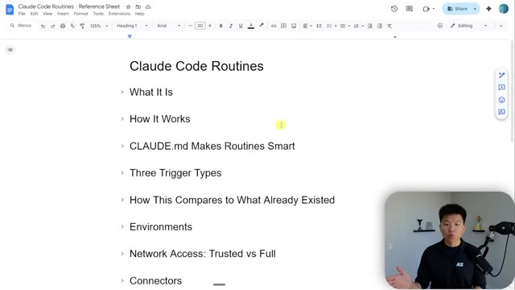
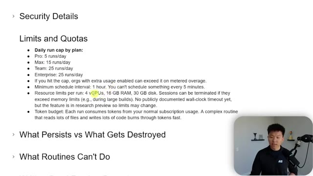
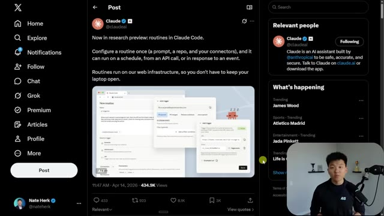

# 🎬 How to Build 24/7 Claude Agents. Easy.

> **Chaîne** : [Nate Herk | AI Automation](https://www.youtube.com/@nateherk/featured)  
> **Lien YouTube** : [https://www.youtube.com/watch?v=ehg4fhydTgs](https://www.youtube.com/watch?v=ehg4fhydTgs)  
> **Date de publication** : 20260414  
> **Durée** : 00:16:27  
> **Identifiant vidéo** : `ehg4fhydTgs`  
> **Transcription & Analyse** : `whisper-v3-large-turbo+gemini-3.5-flash-lite`  

---

## 📌 Synthèse Exécutive & Outils

### 💡 Résumé

Anthropic franchit une étape majeure dans l'ingénierie des agents IA avec l'introduction des **Routines dans Claude Code** (annoncées en version préliminaire de recherche le 14 avril). Cette fonctionnalité transforme le terminal local en un orchestrateur d'agents autonomes exécutés 24h/24 et 7j/7 directement sur l'infrastructure Web d'Anthropic. L'utilisateur n'a plus besoin de garder son ordinateur portable ouvert : un prompt configuré une seule fois peut s'exécuter selon une planification horaire/quotidienne, via un appel d'API ou déclenché par un événement GitHub.

Le fonctionnement repose sur la synchronisation avec un dépôt GitHub source. À chaque déclenchement, l'infrastructure d'Anthropic instancie un environnement cloud temporaire, clone le projet (incluant le fichier de contexte `CLAUDE.md`, les scripts et les compétences customisées), exécute l'instruction de manière autonome, puis détruit le conteneur. Nate Herk illustre l'implémentation pratique de ce système depuis l'application de bureau Claude AI et le terminal, en détaillant la migration des tâches planifiées locales vers des agents distants.

L'analyse technique met en lumière plusieurs subtilités de configuration critiques pour réussir cette transition : la gestion des secrets hors du fichier `.env` (non poussé sur GitHub) grâce aux variables d'environnement cloud, le choix des politiques d'accès réseau (mode *Trusted* vs mode *Full*), et l'obligation de formaliser un prompt sans ambiguïté ("single-turn prompt") interdisant toute interruption interactive. Enfin, la vidéo confronte la théorie aux contraintes réelles à travers des bancs d'essai : réussite sur l'intégration ClickUp et l'API YouTube Data, mais limites identifiées sur l'automatisation Web sans état (Playwright CLI / Skool) en raison de l'absence de cookies de session locaux persistants.

### 🛠️ Outils, Modèles & Logiciels Présentés

*   **Claude Code (Routines)** : Fonctionnalité d'Anthropic permettant de déployer et de planifier des agents IA autonomes sur le cloud, exécutables via cron, webhook GitHub ou endpoints API.
*   **Infrastructure Cloud Anthropic** : Environnement d'exécution distant, sécurisé et éphémère hébergeant les conteneurs d'agents et gérant la destruction automatique des ressources après tâche.
*   **GitHub** : Référentiel de code central servant de source de vérité pour le clone cloud (lecture des scripts, architectures et fichiers de consignes `CLAUDE.md`).
*   **Variables d'Environnement Cloud Anthropic** : Module de configuration distant permettant d'injecter des clés API chiffrées sans compromettre la sécurité des dépôts Git.
*   **ClickUp API** : API de gestion de projet utilisée comme cas d'usage d'envoi de notifications automatisées et de validation du niveau d'accès réseau.
*   **YouTube Data API** : Service web externe intégré pour démontrer la capacité de l'agent cloud à récupérer et synthétiser 50 commentaires récents en autonomie.
*   **Playwright CLI** : Framework d'automatisation de navigateur headless mis en avant pour expliciter les limites des agents cloud face aux flux nécessitant des cookies de session locaux.

### 🔑 Points Clés & Enseignements Stratégiques

*   **Découplage matériel complet** : Les Routines Claude Code déplacent l'exécution des prompts du processeur local vers les serveurs d'Anthropic, garantissant une automatisation continue 24/7 sans dépendance à la machine de l'utilisateur.
*   **Contrainte du « Mono-Prompt » Unidirectionnel** : L'agent s'exécute sans présence humaine. Le prompt doit être exhaustif, précis et auto-suffisant pour éliminer toute boucle de clarification interactive qui bloquerait le processus.
*   **Architecture temporaire et « Stateless »** : Chaque exécution distante clone le dépôt GitHub, exécute la tâche puis détruit le conteneur. La seule persistance autorisée réside dans la création de nouvelles branches Git ou l'envoi de données vers des API externes.
*   **Gestion stricte des secrets (Contournement `.env`)** : Le fichier `.env` étant ignoré par Git (`.gitignore`), les clés API doivent impérativement être injectées dans la section *Cloud Environment Variables* des paramètres de la routine pour être accessibles lors de l'exécution distant.
*   **Ajustement de la résolution des Variables d'Environnement** : L'agent cloud peut tenter par réflexe de lire un fichier `.env` inexistant sur le clone. Il est fondamental de préciser dans le prompt : *"Utilise la variable d'environnement système directement, ne cherche pas de fichier .env"*.
*   **Gouvernance et Sécurité Réseau (*Trusted* vs *Full*)** : Par défaut, l'environnement cloud restreint les connexions aux packages vérifiés d'Anthropic (*Trusted*). Pour communiquer avec des services tiers (ex: ClickUp, API personnalisées), le mode d'accès réseau doit être basculé sur *Full* ou via une whitelist de domaines.
*   **Fréquence d'exécution restreinte** : Le cadencement chronologique des tâches planifiées distantes impose un intervalle minimum d'une heure (exécution horaire, quotidienne, jours ouvrés), excluant les déclenchements à très haute fréquence (ex: toutes les 10 minutes).
*   **Limitation critique des automatisations Web (Playwright/Puppeteer)** : Les agents distants ne conservent aucun cookie ni état de session local. Les automatisations nécessitant une authentification Web par navigateur échouent à moins d'utiliser des jetons API, des en-têtes d'authentification ou des mécanismes de session exportables.
*   **Exploitation du fichier `CLAUDE.md` à distance** : Lors du clonage par le conteneur cloud, Claude Code lit automatiquement le fichier `CLAUDE.md` présent à la racine du dépôt GitHub, préservant ainsi le contexte d'ingénierie et les compétences définies localement.
*   **Déclenchements Événementiels et API** : Outre le planning temporel, une Routine peut être invoquée dynamiquement via un webhook GitHub (ex: pull request, issue) ou un appel d'API HTTP REST, ouvrant la voie à des architectures d'agents réactifs.

---

## ⏱️ Chronologie & Transcription Complète Audio & Visuelle (Mot pour Mot)

### ⏱️ `[00:00:00 - 00:00:34]` | Segment #01

**🔊 Audio (Transcription Intégrale Mot pour Mot en Français) :**
> Cloud Code nous a enfin apporté des routines, ce qui signifie fondamentalement que vous pouvez injecter un prompt dans Cloud Code, mais il peut s'exécuter sur le web, donc votre ordinateur portable n'a pas besoin de rester ouvert. Et je suis tellement enthousiaste à ce sujet. J'ai déjà commencé à l'utiliser, j'ai migré mes automatisations là-bas, mais il y a pas mal de petits pièges, alors je suis là pour vous expliquer exactement comment vous pouvez réellement configurer ces automatisations pour qu'elles fonctionnent. Donc aujourd'hui, le 14 avril, Cloud a tweeté, désormais en version préliminaire de recherche, les routines dans Cloud Code. Vous configurez une routine une seule fois, ce qui ressemble fondamentalement à un prompt, et elle peut s'exécuter selon un calendrier, à partir d'un appel API ou en réponse à un événement, et elle s'exécute sur l'infrastructure web d'Anthropic. Donc c'est génial. Vous pouvez donc appeler une routine à partir d'une API. Vous pouvez

**👁️ Analyse Visuelle d'Écran (gemini-3.5-flash-lite) :**
**Interface & Outils** : X (Twitter), interface web de Claude Code

**Contenu textuel & Code** : Publication de @claudeai annonçant les routines : 'Now in research preview: routines in Claude Code. Configure a routine once (a prompt, a repo, and your connectors), and it can run on a schedule, from an API call, or in response to an event.'

**Action / Démonstration** : Présentation visuelle d'une annonce officielle sur les réseaux sociaux concernant la nouvelle fonctionnalité de routines.

*⏱️ 00:00:09 — Capture d'écran montrant un tweet officiel de @claudeai sur X (Twitter) présentant la nouvelle fonctionnalité 'routines in Claude Code' avec une image d'interface de configuration, et le présentateur visible en incrustation vidéo en bas à droite.*

---

### ⏱️ `[00:00:34 - 00:01:07]` | Segment #02

**🔊 Audio (Transcription Intégrale Mot pour Mot en Français) :**
> que des événements GitHub les déclenchent, ou elles peuvent être planifiées, ce qui ressemble aux automatisations planifiées que nous avons déjà, mais maintenant elles s'exécutent sur le Web. Vous pouvez donc vraiment les créer depuis n'importe où. Vous pouvez le faire ici même sous forme de déclencheur planifié pour exécuter des agents distants planifiés, ce qui se trouve dans le terminal. Vous pourriez aussi aller sur Claude AI slash code. Vous pourriez donc le faire sur le Web. Et ici même, vous voyez, j'ai trois routines basées sur le Web juste ici. Ou ce que je vais vous montrer les gars aujourd'hui, c'est simplement de le faire dans l'application de bureau. Parce qu'ici même, si je vais dans mes tâches planifiées, vous pouvez voir que j'en ai quelques-unes comme ces quatre qui sont locales. Et ensuite j'ai ces quatre qui s'exécutent à l'intérieur d'un dépôt GitHub. Ce sont donc les distantes. Si je vais ici en haut et que je clique sur

**👁️ Analyse Visuelle d'Écran (gemini-3.5-flash-lite) :**
**Interface & Outils** : Visual Studio Code, terminal intégré avec l'outil Claude Code v2.1.107 (Opus 4.6).

**Contenu textuel & Code** : Commande `/sche` entrée dans le terminal, affichant les suggestions de commandes disponibles incluant `/schedule` (pour créer, mettre à jour, lister ou exécuter des agents distants planifiés), `/claude-api`, `/pulse-check`, `/n8n-workflow-patterns`, etc.

**Action / Démonstration** : Saisie d'une commande dans le terminal de Claude Code pour configurer une planification d'agent.

*⏱️ 00:00:42 — Interface de Visual Studio Code affichant un terminal intégré avec l'outil Claude Code en cours d'utilisation, montrant la commande de planification (/schedule).*

---

### ⏱️ `[00:01:07 - 00:01:39]` | Segment #03

**🔊 Audio (Transcription Intégrale Mot pour Mot en Français) :**
> nouvelle tâche, c'est ici que nous pourrions configurer une nouvelle tâche locale ou une nouvelle tâche distante. C'est très similaire. Vous définissez le nom, vous définissez ce que Cloud doit faire, et voici le prompt réel. Donc je parlerai plus en détail de ça dans une seconde, mais ensuite vous configureriez votre modèle, votre dépôt et votre environnement cloud. Vous définissez la cadence, horaire, quotidienne, les jours de semaine. Je pense que le minimum est d'une fois par heure. Genre, vous ne pourriez pas faire toutes les 10 minutes ou quelque chose comme ça, mais ce n'est quand même pas mal du tout. C'est ici que vous pourriez configurer tous vos connecteurs. Donc si vous avez besoin de connecter Slack ou Gmail ou, vous savez, peu importe ce que c'est, vous pouvez les connecter juste ici, mais vous pouvez aussi simplement utiliser votre API classique

**👁️ Analyse Visuelle d'Écran (gemini-3.5-flash-lite) :**
**Interface & Outils** : Application web de gestion d'agents IA (Claude Cloud)

**Contenu textuel & Code** : Formulaire de création de tâche : champ "Name" (ex: Daily code review), champ de description "Describe what Claude should do in each session", options de planification (Hourly, Daily, Weekdays, Weekly, Custom), et sélecteur de dépôt GitHub.

**Action / Démonstration** : Configuration et paramétrage d'une tâche récurrente automatisée pour l'assistant IA.

*⏱️ 00:01:15 — Interface de configuration d'une nouvelle tâche distante (New remote task) avec des champs pour le nom, la description du prompt, la sélection du dépôt et la planification temporelle.*

---

### ⏱️ `[00:01:39 - 00:02:12]` | Segment #04

**🔊 Audio (Transcription Intégrale Mot pour Mot en Français) :**
> points de terminaison avec vos clés API. Et puis bien sûr, vous avez vos permissions. Vous pouvez donc choisir la manière dont Claude doit se comporter. Maintenant, le seul truc avec ceux-ci, c'est qu'ils sont conçus pour être un prompt unique. Vous n'êtes pas là. Vous voulez donc probablement vous assurer qu'il n'a jamais à s'arrêter et à vous poser des questions. Sinon, quel est l'intérêt de l'automatisation ? Donc, comme je l'ai dit, il y a des tonnes de choses à explorer ici et je ne vais pas essayer de vous ennuyer, mais certaines d'entre elles sont vraiment importantes car lorsque j'ai fait la configuration pour la première fois, mes automatisations ne se sont pas simplement migrées pour fonctionner. Je vais donc vous dire les problèmes que j'ai rencontrés et, espérons-le, répondre à tout ce que vous avez besoin de savoir pour ne pas avoir à aller dans les commentaires et poser ces questions courantes.

**👁️ Analyse Visuelle d'Écran (gemini-3.5-flash-lite) :**
**Interface & Outils** : Application web de gestion de tâches et Google Docs.

**Contenu textuel & Code** : Formulaire de création de tâche distante ("New remote task") et liste de rubriques sur les routines Claude Code.

**Action / Démonstration** : Le présentateur explique la configuration des tâches planifiées, des permissions et des connecteurs pour Claude.

*⏱️ 00:01:47 — Interface d'une application de gestion de tâches distantes montrant la configuration d'une nouvelle tâche planifiée avec des options de fréquence, de sélection de dépôt et de permissions.*

*⏱️ 00:02:04 — Document Google Docs intitulé "Claude Code Routines - Reference Sheet" affichant un sommaire avec des sections comme "What It Is", "How It Works" et "Connectors".*

---

### ⏱️ `[00:02:12 - 00:02:32]` | Segment #05

**🔊 Audio (Transcription Intégrale Mot pour Mot en Français) :**
> questions. Je peux simplement y répondre ici même pour vous. Laissez-moi donc d'abord, très rapidement, vous montrer ce que j'ai testé. La première chose que je voulais tester, c'est si je venais ici et que je créais une nouvelle routine pour simplement envoyer un message à mon ClickUp. Évidemment, cela n'a aucune valeur, mais je voulais juste voir comment cela fonctionnait. Parce que ce que je voulais faire, c'était voir si je pouvais faire cela sans ajouter mon connecteur ClickUp.

**👁️ Analyse Visuelle d'Écran (gemini-3.5-flash-lite) :**
**Interface & Outils** : Interface web d'automatisation / agent IA avec panneau latéral de navigation (Scheduled, Dispatch, Customize).

**Contenu textuel & Code** : Liste de routines planifiées : 'Skool wins engagement', 'AI news roundup', 'Notification responses', 'Youtube comment replies', 'Testing Skool Wins', 'Testing YT Comments', 'Testing ClickUp API'.

**Action / Démonstration** : Le présentateur montre et explique ses routines planifiées et de test configurées dans l'interface, notamment la routine pour l'API ClickUp.

*⏱️ 00:02:17 — Capture d'écran montrant l'interface d'une application d'automatisation avec un panneau de tâches planifiées (routines) affichant différentes automatisations comme 'Testing ClickUp API', et la webcam du présentateur en bas à droite.*

---

### ⏱️ `[00:02:32 - 00:02:54]` | Segment #06

**🔊 Audio (Transcription Intégrale Mot pour Mot en Français) :**
> Et j'ai réellement réussi à lancer ça, mais ça n'a pas fonctionné tout de suite. Laissez-moi donc vous montrer ce sur quoi je suis tombé. Donc la façon dont cela fonctionne, c'est que vous avez besoin d'un dépôt GitHub pour y synchroniser le tout afin que cela puisse réellement s'exécuter. Ça va donc cloner mon projet Herc2 juste ici sur le web. Ça va être capable de lire mon fichier cloud.md. Ça va être capable de lire mes scripts et mes compétences. Et puis après avoir terminé la tâche, ça détruit pratiquement juste ce petit clone GitHub dans le cloud.

**👁️ Analyse Visuelle d'Écran (gemini-3.5-flash-lite) :**
**Interface & Outils** : Interface web d'automatisation ou tableau de bord de tâches planifiées (avec un encadré vidéo du présentateur en bas à droite).

**Contenu textuel & Code** : Détails de la tâche : dépôt 'nateherkai/Herk-2.0', instructions textuelles pour l'API ClickUp, fréquence d'exécution quotidienne et historique des exécutions (Runs).

**Action / Démonstration** : Visualisation du tableau de bord de la tâche et du dépôt GitHub associé pour l'exécution automatisée.

*⏱️ 00:02:38 — Capture d'écran montrant l'interface d'une application de gestion de tâches automatisées avec une tâche planifiée nommée 'Testing ClickUp API' liée à un dépôt GitHub.*

---

### ⏱️ `[00:02:54 - 00:03:13]` | Segment #07

**🔊 Audio (Transcription Intégrale Mot pour Mot en Français) :**
> Mais comme vous le savez, vous ne poussez pas vos secrets sur GitHub. Parce que si vous regardez ici, mon projet Herc2, c'est mon fichier .env avec toutes mes clés d'API. Et il est répertorié dans le gitignore, ce qui signifie fondamentalement, hé, lorsque vous poussez sur GitHub, vous n'incluez pas ces fichiers. Donc ce que cela signifie, c'est qu'ici, si cela regarde seulement votre dépôt GitHub, il n'y a pas de .env.

**👁️ Analyse Visuelle d'Écran (gemini-3.5-flash-lite) :**
**Interface & Outils** : Visual Studio Code, Terminal intégré, Claude Code CLI

**Contenu textuel & Code** : Explorateur de fichiers montrant les dossiers du projet et le fichier .gitignore, ainsi qu'une invite de commande dans Claude Code avec des suggestions de commandes commençant par /sche.

**Action / Démonstration** : Le présentateur navigue dans l'arborescence des fichiers du projet dans l'éditeur de code VS Code tout en utilisant l'outil Claude Code dans le terminal intégré.

*⏱️ 00:02:59 — L'interface de Visual Studio Code affichant l'explorateur de fichiers du projet Herk-2 à gauche et un terminal intégré exécutant l'interface Claude Code à droite.*

---

### ⏱️ `[00:03:14 - 00:03:33]` | Segment #08

**🔊 Audio (Transcription Intégrale Mot pour Mot en Français) :**
> Alors, comment intégrez-vous vos clés API dans cette routine qui s'exécute sur le web ? Eh bien, ce que vous faites, c'est qu'à l'intérieur de cette tâche planifiée, vous disposez d'un environnement cloud. Donc si je clique sur celui-ci, vous pouvez voir que celui-ci s'appelle NateHurt Cloud. Donc si j'ouvre les paramètres, qu'est-ce que vous voyez ? Vous avez le nom de cet environnement cloud, vous avez l'accès réseau et vous avez des variables d'environnement.

**👁️ Analyse Visuelle d'Écran (gemini-3.5-flash-lite) :**
**Interface & Outils** : Interface web de gestion de tâches automatisées (type application Claude/agent cloud)

**Contenu textuel & Code** : Configuration de tâche planifiée : 'Testing ClickUp API', instructions pour envoyer un message ClickUp, et sélection de l'environnement cloud.

**Action / Démonstration** : Navigation et configuration des paramètres d'une tâche planifiée s'exécutant dans un environnement cloud distant.

*⏱️ 00:03:18 — Vue d'ensemble d'une tâche planifiée nommée 'Testing ClickUp API' avec ses instructions et l'historique des exécutions.*

*⏱️ 00:03:23 — Fenêtre modale d'édition de la tâche planifiée montrant la configuration avec l'environnement 'Nate Herk Cloud'.*

---

### ⏱️ `[00:03:33 - 00:03:54]` | Segment #09

**🔊 Audio (Transcription Intégrale Mot pour Mot en Français) :**
> Donc ici c'est là que je mets ma clé API YouTube, ma clé API ClickUp, toutes les autres clés API auxquelles je dois donner accès à cet environnement cloud. Et puis l'autre chose que vous devez faire, c'est de regarder les niveaux d'accès parce qu'ici vous pouvez voir que celui-ci est sur complet, mais par défaut, celui-ci sera sur de confiance, je crois. Et cela signifie que vous ne pouvez télécharger des paquets qu'à partir de sources vérifiées d'Anthropic.

**👁️ Analyse Visuelle d'Écran (gemini-3.5-flash-lite) :**
**Interface & Outils** : Interface web de configuration d'environnement cloud (type Claude Code ou outil cloud similaire).

**Contenu textuel & Code** : Champs de configuration : Nom ("Nate Herk Cloud"), Network access ("Full"), Environment variables (zone de texte masquée floutée), et Setup script (script bash).

**Action / Démonstration** : Le présentateur explique la configuration des clés API et des niveaux d'accès dans l'environnement cloud.

*⏱️ 00:03:38 — Fenêtre modale de configuration 'Update cloud environment' montrant les paramètres de l'environnement cloud, y compris le nom, les niveaux d'accès réseau et les variables d'environnement masquées.*

---

### ⏱️ `[00:03:55 - 00:04:15]` | Segment #10

**🔊 Audio (Transcription Intégrale Mot pour Mot en Français) :**
> Et quand nous en reparlerons plus tard, j'aurai un lien où vous pourrez aller tous les voir. Vous pouvez même en faire un personnalisé si vous vouliez autoriser des domaines spécifiques qui ne sont pas sur cette liste. Mais pour que ClickUp fonctionne dans ce cas, j'ai dû passer en mode complet parce que quand je suis passé en mode de confiance, il a dit, hé, nous ne pouvons pas vraiment faire ça. Mais quand j'ai changé cela pour complet, cela m'a laissé envoyer un message à mon ClickUp. Et c'est comme ça que j'ai eu ce message ici même qui dit simplement que je teste que les tâches à distance fonctionnent et que les identifiants fonctionnent.

**👁️ Analyse Visuelle d'Écran (gemini-3.5-flash-lite) :**
**Interface & Outils** : Interface web de configuration de l'environnement cloud avec le présentateur en médaillon vidéo en bas à droite.

**Contenu textuel & Code** : Paramètres de l'environnement cloud nommés 'Nate Herk Cloud' avec le niveau d'accès réseau réglé sur 'Full' (Unrestricted internet access for maximum flexibility) et les options de script de configuration Bash visibles en bas.

**Action / Démonstration** : Le curseur survole l'option 'Custom' dans le menu déroulant des accès réseau pour modifier les paramètres de sécurité.

*⏱️ 00:04:00 — Fenêtre modale de configuration 'Update cloud environment' affichant les options de contrôle d'accès réseau avec le menu déroulant ouvert listant None, Trusted, Full et Custom.*

---

### ⏱️ `[00:04:15 - 00:04:40]` | Segment #11

**🔊 Audio (Transcription Intégrale Mot pour Mot en Français) :**
> Donc en gros, quand ceux-ci s'exécutent, tout ce que vous avez ici comme instructions est ce qui sert de prompt. Et c'est exactement de la même manière que fonctionnent les tâches planifiées en local. Donc juste ici, vous pouvez voir que je dis, envoyer un message dans le canal ClickUp interne. Et juste ici, la chose exacte qu'il est dit était d'envoyer un message dans le canal ClickUp interne. Donc pensez à une tâche planifiée ou à une routine comme si vous tapiez essentiellement un prompt et que quelqu'un venait ensuite sur votre ordinateur portable et le tapait pour vous.

**👁️ Analyse Visuelle d'Écran (gemini-3.5-flash-lite) :**
**Interface & Outils** : Application web de gestion de tâches et d'automatisation par IA, avec une webcam incrustée du présentateur en bas à droite.

**Contenu textuel & Code** : Instructions de la tâche : "Send a message in the Internal automations channel in my ClickUp that says 'just testing that these remote tasks work and the credentials work'".

**Action / Démonstration** : Le curseur survole l'historique des exécutions ("Runs") d'une tâche planifiée.

*⏱️ 00:04:21 — Interface de gestion de tâches planifiées montrant les détails d'une tâche de test de l'API ClickUp avec ses instructions textuelles et son historique d'exécutions.*

---

### ⏱️ `[00:04:40 - 00:05:00]` | Segment #12

**🔊 Audio (Transcription Intégrale Mot pour Mot en Français) :**
> C'est donc exactement le même type d'interaction que lorsque vous parlez à Claude Code. Mais c'est pourquoi, encore une fois, vous voulez vous assurer qu'il est suffisamment précis pour qu'il puisse essentiellement le faire du premier coup. Bon, alors allons un peu plus en profondeur maintenant. Ce que j'ai essayé de faire, c'est que j'en ai fait un autre, avec lequel je voulais qu'il soit capable d'utiliser l'API de données YouTube afin de récupérer des commentaires YouTube pour moi et de me donner une petite analyse dans, vous savez, ClickUp ou autre.

**👁️ Analyse Visuelle d'Écran (gemini-3.5-flash-lite) :**
**Interface & Outils** : Interface web de l'application (mode Code), avec panneau latéral de navigation et encart vidéo du présentateur en bas à droite.

**Contenu textuel & Code** : Prompt utilisateur : « Send a message in the internal automations channel in my ClickUp that says "just testing that these remote tasks work and the credentials work" » et les logs de l'agent indiquant la recherche d'outils et l'envoi réussi du message.

**Action / Démonstration** : L'agent IA analyse la requête, recherche le canal ClickUp adéquat, trouve l'ID correspondant et envoie le message test avec succès.

*⏱️ 00:04:45 — Capture d'écran montrant une interface de type agent IA (Code / Cowork) avec un historique d'interaction textuelle, incluant une instruction en anglais pour envoyer un message sur ClickUp et les étapes d'exécution de l'agent.*

---

### ⏱️ `[00:05:01 - 00:05:22]` | Segment #13

**🔊 Audio (Transcription Intégrale Mot pour Mot en Français) :**
> Donc c'est ça le prompt que j'ai dit, n'est-ce pas ? Analyse 50 de mes commentaires les plus récents sur YouTube et donne-moi un rapide résumé sous forme de puces. Ma clé API YouTube est disponible en tant que variable d'environnement. Utilise-la directement depuis l'environnement. Ne cherche pas de fichier .env. Parce que ce qui se passe dans ton dépôt, n'est-ce pas ? Donc dans ce projet Herc2, quand je lance ça normalement, ça récupère toutes mes clés API à partir du .env.

**👁️ Analyse Visuelle d'Écran (gemini-3.5-flash-lite) :**
**Interface & Outils** : Application web de gestion d'agents / tâches planifiées (avec incrustation vidéo du présentateur en bas à droite).

**Contenu textuel & Code** : Titre 'Testing YT Comments', dépôt 'nateherkai/Herk-2.0', instructions du prompt demandant d'analyser 50 commentaires YouTube récents via la variable d'environnement de la clé API.

**Action / Démonstration** : Visualisation du prompt configuré pour la tâche planifiée quotidienne.

*⏱️ 00:05:06 — Interface d'une application de gestion de tâches ou d'agent IA montrant le détail d'une tâche planifiée nommée 'Testing YT Comments' avec le prompt d'analyse des commentaires YouTube et le bouton 'Run now'.*

---

### ⏱️ `[00:05:22 - 00:05:40]` | Segment #14

**🔊 Audio (Transcription Intégrale Mot pour Mot en Français) :**
> Et peut-être qu'il lit le cloud.md et réalise que c'est là que beaucoup d'entre eux résident. Donc par défaut, il va peut-être essayer de regarder dans le .env et il ne sera pas assez intelligent pour le deviner. Et donc pour ClickUp, c'était bon, il l'a deviné. Mais pour une raison quelconque avec celui de YouTube, il ne l'a pas fait. J'ai donc dû lui dire explicitement, hé, regarde dans la variable d'environnement plutôt que dans le .env.

**👁️ Analyse Visuelle d'Écran (gemini-3.5-flash-lite) :**
**Interface & Outils** : Visual Studio Code / Terminal Claude Code

**Contenu textuel & Code** : Commandes affichées dans le terminal (Claude Code v2.1.107, Opus 4.6), avec la liste des commandes disponibles commençant par `/sche` (`/schedule`, `/claude-api`, `/pulse-check`, etc.). Dans l'explorateur de fichiers à gauche, on distingue des fichiers comme `.env`, `CLAUDE.md`, ainsi que divers scripts JSON et Python.

**Action / Démonstration** : Saisie d'une commande dans l'interface en ligne de commande de l'assistant IA Claude Code au sein de VS Code.

*⏱️ 00:05:27 — Capture d'écran de l'éditeur Visual Studio Code montrant un terminal intégré exécutant l'interface en ligne de commande Claude Code, avec un panneau latéral affichant l'explorateur de fichiers du projet.*

---

### ⏱️ `[00:05:40 - 00:06:00]` | Segment #15

**🔊 Audio (Transcription Intégrale Mot pour Mot en Français) :**
> Donc vous pouvez voir que la première fois que je l'ai exécuté, à 12 h 41, je n'ai pas dit cela et il n'a pas pu le faire. Il a dit du genre, hé, je ne trouve pas ça, j'obtiens une erreur. Et j'ai même essayé de le lui dire ici et cela n'a toujours pas fonctionné. Mais ensuite, lors de cette toute dernière exécution, quand j'ai mis un peu à jour le prompt, il a pu le récupérer tout de suite en utilisant la clé API. Et maintenant, j'ai une routine à distance qui fonctionnerait.

**👁️ Analyse Visuelle d'Écran (gemini-3.5-flash-lite) :**
**Interface & Outils** : Interface web d'un agent de code IA (mode Code / Chat / Cowork).

**Contenu textuel & Code** : Historique des messages montrant des tentatives d'exécution, des erreurs de clé API YouTube, la recherche de données en cache et un prompt utilisateur : 'I put my keys that you need to get YouTube data in the Claude environment variables. Look there.'

**Action / Démonstration** : Exécution d'un script d'analyse de commentaires YouTube et résolution d'erreurs d'API.

*⏱️ 00:05:45 — Capture d'écran montrant une interface de chat d'agent IA avec l'historique des exécutions et le présentateur en médaillon en bas à droite.*

---

### ⏱️ `[00:06:00 - 00:06:34]` | Segment #16

**🔊 Audio (Transcription Intégrale Mot pour Mot en Français) :**
> Évidemment, je dois mettre ça à jour. Je vais migrer mes autres automatisations, mais c'était juste à des fins de test. Et une autre que je fais, c'est que j'ai quelques automatisations ici, qui ouvrent essentiellement un navigateur en utilisant Playwright CLI, et ça fait des trucs dans ma communauté School parce qu'il n'y a pas d'API accessible publiquement. On a trouvé en quelque sorte une façon de l'automatiser sans utiliser de navigateur. Je ne vais pas vraiment plonger là-dedans pour l'instant. Mais ce que je voulais vous dire à ce sujet, c'est que j'ai essayé de transférer essentiellement ce post d'engagement de victoires sur School, ou désolé, cette automatisation dans une session distante. J'ai donc copié exactement les mêmes instructions qui étaient dans ma tâche planifiée habituelle.

**👁️ Analyse Visuelle d'Écran (gemini-3.5-flash-lite) :**
**Interface & Outils** : Interface web d'automatisation / tableau de bord d'agent IA

**Contenu textuel & Code** : Liste de tâches planifiées (« Skool wins engagement », « AI news roundup », « Notification responses », « Youtube comment replies », « Testing Skool Wins », « Testing YT Comments », « Testing ClickUp API ») avec des fréquences d'exécution et des indicateurs locaux.

**Action / Démonstration** : Présentation du tableau de bord des automatisations et des différentes tâches planifiées exécutées par l'outil.

*⏱️ 00:06:08 — Interface d'une application de gestion de tâches automatisées ou d'agent IA montrant des automatisations planifiées (Skool wins engagement, AI news roundup, Notification responses, Youtube comment replies) avec le présentateur incrusté en bas à droite.*

---

### ⏱️ `[00:06:34 - 00:07:06]` | Segment #17

**🔊 Audio (Transcription Intégrale Mot pour Mot en Français) :**
> Et ensuite, j'ai juste ajouté ce petit extrait à la fin. Mais ce qui s'est passé, c'est que ça ne fonctionnait pas parce que ça disait en gros : "Hé, tu sais, comme quand tu fais ça, ça lance un navigateur, mais il n'y a pas de cookies parce que tout cela s'exécute à distance." Et tout ce que j'ai à regarder, c'est le dépôt GitHub. Je ne peux pas regarder les cookies locaux, tu sais, que nous avons utilisés lors des dernières sessions de cette automatisation. Et donc, il ne semble pas que cela fonctionnerait parce qu'encore une fois, cela n'a accès à rien de tout cela. Donc, si je voulais faire une automatisation comme celle-ci, je devrais utiliser un point de terminaison qui accepte l'authentification sous la forme de vrais cookies ou d'un en-tête ou, tu sais, comme d'une clé API.

**👁️ Analyse Visuelle d'Écran (gemini-3.5-flash-lite) :**
**Interface & Outils** : Interface web d'agent IA (type Cloud IDE/Agent platform) avec un panneau latéral de projets et un flux de discussion textuel.

**Contenu textuel & Code** : Texte de l'agent : "I'll run the wins engagement workflow. Let me start by scraping the most recent wins posts... The scraper returned a session error — no auth/skool_state.json found."

**Action / Démonstration** : L'agent IA tente d'exécuter un script de scraping (« Skool wins engagement ») mais rencontre une erreur d'authentification due à un fichier de cookies/session manquant.

*⏱️ 00:06:42 — Interface d'une application d'agent IA montrant l'exécution d'un workflow avec un message d'erreur concernant l'absence d'un fichier de session d'authentification.*

---

### ⏱️ `[00:07:06 - 00:07:42]` | Segment #18

**🔊 Audio (Transcription Intégrale Mot pour Mot en Français) :**
> parce que chacune de ces exécutions va être sans état. Et après l'exécution, le clone GitHub est tout simplement supprimé. Maintenant, l'exception à cela, c'est si l'automatisation modifie quelque chose dans votre base de code ou effectue une révision. Si elle fait cela, elle créera une nouvelle branche pour vous, ou elle vous donnera une sorte de résultat et ne se contentera pas de supprimer tout ce qu'elle vient de faire. Mais pour une automatisation comme celle-ci, elle le supprimerait tout simplement. Mais j'espère qu'après avoir vu ces exemples, vous avez maintenant la capacité de venir et, vous savez, d'apporter quelques modifications si nécessaire afin de vous assurer que vos automatisations s'exécutent. Et ce que je veux dire par là, c'est que vous comprenez que ce devrait être une instruction très spécifique. C'est ainsi que vous changez le modèle. Vous devez avoir un dépôt GitHub. Vous pouvez changer le

**👁️ Analyse Visuelle d'Écran (gemini-3.5-flash-lite) :**
**Interface & Outils** : Interface web d'agent IA / application de développement

**Contenu textuel & Code** : Instructions d'exécution de la compétence "/wins-engagement skill" avec des étapes de navigation de répertoire et de script Python, ainsi que l'historique des sessions planifiées.

**Action / Démonstration** : Initialisation d'une session et exécution de commandes par l'agent d'automatisation.

*⏱️ 00:07:15 — Interface web d'un outil d'IA montrant un workflow de test, avec les instructions détaillées de l'agent et sa zone de chat en bas à droite, tandis que le présentateur apparaît en médaillon.*

---

### ⏱️ `[00:07:42 - 00:08:11]` | Segment #19

**🔊 Audio (Transcription Intégrale Mot pour Mot en Français) :**
> paramètres pour vos environnements cloud juste ici. Vous définissez le calendrier, vous ajoutez tous les connecteurs dont vous pourriez avoir besoin, ce qui serait honnêtement un peu plus facile si vous ajoutiez juste un connecteur Slack, et ensuite vous pouvez définir vos permissions ici. Maintenant, l'autre chose à garder à l'esprit est que vous avez des limites. Donc si je viens ici dans mes paramètres, vous pouvez voir que si je vais dans mon utilisation, nous avons nos limites de session régulières, nos limites de modèles, mais pour des fonctionnalités supplémentaires, nous avons des exécutions de routines quotidiennes incluses. Et je n'en ai encore exécuté aucune sur le calendrier réel. Je les ai juste testées, mais nous sommes à zéro sur 15.

**👁️ Analyse Visuelle d'Écran (gemini-3.5-flash-lite) :**
**Interface & Outils** : Interface web de Claude Code (Research preview)

**Contenu textuel & Code** : Menus de planification (Daily, Hourly, etc.), configuration de l'heure (09:00 AM) et gestion des connecteurs.

**Action / Démonstration** : Navigation et configuration des paramètres de planification et des connecteurs pour les environnements cloud.

*⏱️ 00:07:49 — Interface de configuration d'une tâche planifiée dans l'application Claude Code, affichant les options de calendrier et la section pour ajouter des connecteurs.*

*⏱️ 00:07:56 — Tableau de bord principal de l'application Claude Code affichant l'onglet 'Routines' avec plusieurs tâches automatisées configurées.*

---

### ⏱️ `[00:08:11 - 00:08:29]` | Segment #20

**🔊 Audio (Transcription Intégrale Mot pour Mot en Français) :**
> Donc je ne pourrais avoir que 15 automatisations en cours d'exécution avec des routines par jour parce que je suis sur le forfait maximum à 200 dollars par mois. Vos limites seraient moindres si vous êtes sur le forfait pro, je pense peut-être trois ou peut-être cinq. J'ai, j'ai cette information un peu plus tard, mais c'est juste quelque chose à garder à l'esprit. Très bien, alors plongeons-nous un peu plus dans les détails ici qui pourraient répondre à certaines questions que vous avez.

**👁️ Analyse Visuelle d'Écran (gemini-3.5-flash-lite) :**
**Interface & Outils** : Interface web des paramètres de compte Claude (Anthropic).

**Contenu textuel & Code** : Barres de progression pour 'All models' (24%), 'Sonnet only' (3%), et 'Daily included routine runs' (0/15), avec le présentateur visible en incrustation vidéo en bas à droite.

**Action / Démonstration** : Présentation des quotas d'utilisation et des limites de routines quotidiennes de l'abonnement.

*⏱️ 00:08:16 — Capture d'écran montrant le panneau des paramètres d'utilisation de Claude, affichant les limites hebdomadaires et l'utilisation quotidienne des routines (0/15).*

---

### ⏱️ `[00:08:30 - 00:09:02]` | Segment #21

**🔊 Audio (Transcription Intégrale Mot pour Mot en Français) :**
> Je pense que c'est assez clair à ce stade de quoi il s'agit. Je vais vous donner ce document entier ainsi que tout le reste dont j'ai parlé dans ma communauté School gratuite. Le lien pour cela se trouve dans la description. Donc, certaines choses que je ne couvrirai peut-être pas, si vous voulez en lire davantage à ce sujet, alors allez simplement récupérer cette ressource gratuite. Donc, nous savons ce que c'est. Je pense que nous savons comment ça fonctionne, n'est-ce pas ? Genre, vous définissez une routine qui est un prompt, vous connectez un dépôt GitHub, vous pouvez aussi le déclencher par des API ou par une action GitHub, et ensuite vous pouvez connecter vos connecteurs, et fondamentalement, cela agit comme si vous parliez à votre propre code cloud en raison du fait que cela fonctionne à partir d'un dépôt cloné.

**👁️ Analyse Visuelle d'Écran (gemini-3.5-flash-lite) :**
**Interface & Outils** : Document de notes ou de spécifications textuelles, potentiellement Notion ou Google Docs.

**Contenu textuel & Code** : Titres de sections : 'Claude Code Routines', 'What It Is', 'Status', 'How It Works', 'CLAUDE.md Makes Routines Smart', 'Three Trigger Types', 'How This Compares to What Already Existed'.

**Action / Démonstration** : Le présentateur partage un document récapitulatif qu'il s'apprête à mettre à disposition dans sa communauté.

*⏱️ 00:08:38 — Un document texte structuré expliquant le fonctionnement de 'Claude Code Routines', avec une webcam du présentateur en incrustation dans le coin inférieur droit.*

---

### ⏱️ `[00:09:02 - 00:09:23]` | Segment #22

**🔊 Audio (Transcription Intégrale Mot pour Mot en Français) :**
> Il va lire le fichier cloud.md automatiquement à chaque fois. Donc, si vous avez un projet massif, comme un projet Herc2 par exemple, avec énormément de contexte et énormément de choses, peut-être que vous ne voulez pas mettre ce dépôt dans le cloud pour qu'il soit exécuté en routine, parce qu'il y a beaucoup de contexte dans ce fichier Cloud.md et dans tout ce dépôt GitHub qui n'a peut-être pas d'importance pour cette automatisation.

**👁️ Analyse Visuelle d'Écran (gemini-3.5-flash-lite) :**
**Interface & Outils** : Navigateur web affichant une documentation ou un fichier Markdown.

**Contenu textuel & Code** : Texte sur l'utilisation du fichier CLAUDE.md pour automatiser et contextualiser les routines IA.

**Action / Démonstration** : Le présentateur explique la lecture automatique du fichier CLAUDE.md à chaque exécution de routine.

*⏱️ 00:09:07 — Page de documentation avec le titre 'CLAUDE.md Makes Routines Smart' et du texte explicatif sur la configuration.*

---

### ⏱️ `[00:09:23 - 00:09:42]` | Segment #23

**🔊 Audio (Transcription Intégrale Mot pour Mot en Français) :**
> Donc peut-être qu'il vaut mieux configurer un dépôt GitHub spécifique par routine planifiée. Mais bien sûr, les bonnes pratiques de Cloud.md, en y mettant les informations importantes, parce que tout cela va épuiser vos limites de session Cloud Code exactement de la même manière que si vous l'ouvriez dans Cloud Code, en discutant simplement avec lui.

**👁️ Analyse Visuelle d'Écran (gemini-3.5-flash-lite) :**
**Interface & Outils** : Document texte ou site web de documentation avec une vidéo intégrée du présentateur en bas à droite.

**Contenu textuel & Code** : Titres de sections : What It Is, How It Works, CLAUDE.md Makes Routines Smart, Three Trigger Types, How This Compares to What Already Existed. Texte explicatif sur les bonnes pratiques du fichier CLAUDE.md.

**Action / Démonstration** : Le présentateur explique les bonnes pratiques concernant le fichier CLAUDE.md et la configuration des dépôts GitHub.

*⏱️ 00:09:28 — Page de documentation montrant le fonctionnement du fichier CLAUDE.md pour les routines avec le présentateur en médaillon.*

---

### ⏱️ `[00:09:42 - 00:10:01]` | Segment #24

**🔊 Audio (Transcription Intégrale Mot pour Mot en Français) :**
> Donc encore une fois, trois types de déclencheurs : programmation, API, ce qui, je trouve, est vraiment génial. Vous pouvez avoir une autre automatisation qui fait une requête POST vers une sorte de routine. Et puis bien sûr, GitHub. Vous pouvez donc faire en sorte que cela se déclenche automatiquement, en quelque sorte via un webhook basé sur les nouvelles PR, les nouveaux pushs, les nouveaux tickets, les nouvelles versions, des choses comme ça. Alors, comment cela se compare-t-il à ce qui existe déjà ?

**👁️ Analyse Visuelle d'Écran (gemini-3.5-flash-lite) :**
**Interface & Outils** : Page web de documentation / présentation textuelle

**Contenu textuel & Code** : Texte détaillé : "Three Trigger Types", "Schedule - Cron-based...", "API - POST to a dedicated endpoint", "GitHub - Reacts to repo events", ainsi que des puces explicatives sur les combinaisons et filtres.

**Action / Démonstration** : Le présentateur explique et commente les différents types de déclencheurs présentés à l'écran.

*⏱️ 00:09:47 — Une page de documentation listant les trois types de déclencheurs (Schedule, API, GitHub) avec leurs descriptions et exemples respectifs, tandis que le présentateur apparaît en médaillon dans le coin inférieur droit.*

---

### ⏱️ `[00:10:01 - 00:10:21]` | Segment #25

**🔊 Audio (Transcription Intégrale Mot pour Mot en Français) :**
> Nous avons les routines, qui constituent la nouvelle fonctionnalité. Nous avons des tâches planifiées sur le bureau, et ensuite nous avons quelque chose comme simplement une commande slash loop. Donc les routines s'exécutent sur le cloud d'Anthropic et ces deux autres s'exécutent sur votre machine. Avez-vous besoin que la machine soit allumée ? Non pour les routines, c'est énorme. Mais pour les tâches planifiées sur le bureau et pour loop, vous avez besoin que votre machine soit allumée. Avez-vous besoin d'une session ouverte ? Non, c'est la même chose pour les trois.

**👁️ Analyse Visuelle d'Écran (gemini-3.5-flash-lite) :**
**Interface & Outils** : Document de présentation ou page web comparative avec un tableau de données et le présentateur en médaillon en bas à droite.

**Contenu textuel & Code** : Tableau comparatif intitulé "How This Compared to What Already Existed" avec des colonnes pour "Routines (NEW)", "Desktop Scheduled Tasks", et "/loop", listant des critères comme "Runs on", "Needs machine on", "Local file access", etc.

**Action / Démonstration** : Le présentateur explique et compare les différentes méthodes d'exécution des tâches entre le cloud Anthropic et la machine locale.

*⏱️ 00:10:06 — Tableau comparatif détaillant les trois types de déclencheurs : Routines (NEW), Desktop Scheduled Tasks et la commande /loop, avec leurs caractéristiques respectives (cloud vs local, accès aux fichiers, etc.).*

---

### ⏱️ `[00:10:22 - 00:10:41]` | Segment #26

**🔊 Audio (Transcription Intégrale Mot pour Mot en Français) :**
> Survivent-ils aux redémarrages ? Les deux premiers oui, mais pas la boucle. Celle-ci doit vivre au sein d'une session spécifique. L'accès aux fichiers locaux, non pour les routines car cela fonctionne à partir du dépôt GitHub. Et pour les deux suivants, oui, vous avez un accès aux fichiers locaux. Les invites de permission avec les routines, c'est entièrement autonome. Et pour ces deux-là, ils sont configurables. Et enfin, l'intervalle minimum des routines est d'une heure.

**👁️ Analyse Visuelle d'Écran (gemini-3.5-flash-lite) :**
**Interface & Outils** : Présentation sous forme de tableau comparatif (probablement Notion ou présentation web).

**Contenu textuel & Code** : Tableau présentant les colonnes : "Runs on", "Needs machine on", "Needs open session", "Survives restarts", "Local file access", "Permission prompts", "Min interval". La cellule "Survives restarts" pour la colonne "/loop" est surlignée en bleu et indique "No".

**Action / Démonstration** : Le présentateur utilise ce tableau pour expliquer techniquement pourquoi les "Routines" diffèrent des processus locaux traditionnels en termes d'autonomie.

*⏱️ 00:10:26 — Tableau comparatif illustrant les différences entre "Routines (NEW)", "Desktop Scheduled Tasks" et "/loop" concernant l'exécution, les besoins matériels, la persistance après redémarrage et l'accès aux fichiers locaux.*

---

### ⏱️ `[00:10:41 - 00:11:02]` | Segment #27

**🔊 Audio (Transcription Intégrale Mot pour Mot en Français) :**
> Et ces deux-là peuvent tous les deux, pourraient tourner à chaque minute si vous voulez. D'accord, alors parlons des environnements. Évidemment, votre fichier .env est ignoré par git, à moins que vous ne le poussiez dans le dépôt GitHub. Vous savez, en fin de compte, si vous le poussez dans un dépôt privé, ça va probablement, mais vous voulez faire très, très attention parce qu'ensuite, vous savez, il y a l'historique. Et si d'autres personnes, vous savez, finissent par collaborer dessus, vous ne voulez vraiment pas faire ça.

**👁️ Analyse Visuelle d'Écran (gemini-3.5-flash-lite) :**
**Interface & Outils** : Éditeur de documents/Prise de notes (type Notion ou Obsidian).

**Contenu textuel & Code** : Texte explicatif sur la gestion des variables d'environnement (.env), le rôle des scripts de configuration (setup script), et une recommandation technique pour utiliser `os.environ["KEY_NAME"]` plutôt que de compter sur un fichier .env.

**Action / Démonstration** : Le présentateur explique les concepts théoriques liés aux environnements d'exécution pour les agents IA.

*⏱️ 00:10:46 — Une page de documentation technique détaillée sur le fonctionnement des « Environments » dans le contexte des routines Claude.*

---

### ⏱️ `[00:11:02 - 00:11:21]` | Segment #28

**🔊 Audio (Transcription Intégrale Mot pour Mot en Français) :**
> Donc vous voulez mettre vos clés d'API dans la variable d'environnement, comme je vous l'ai montré tout à l'heure. Vous voulez regarder l'accès au réseau, qu'il soit complet ou de confiance ou aucun ou personnalisé, et potentiellement des scripts de configuration. Ce n'est donc pas quelque chose que je vous ai montré encore. Si vous créez une nouvelle tâche distante, vous pouvez faire un script de configuration, qui est fondamentalement juste un script qui s'exécutera lorsque cette nouvelle session se lancera avant que Cloud Code ne démarre.

**👁️ Analyse Visuelle d'Écran (gemini-3.5-flash-lite) :**
**Interface & Outils** : Interface web de configuration de Claude.ai / Claude Code.

**Contenu textuel & Code** : - Image #1 : Texte explicatif sur les variables d'environnement, l'accès réseau et l'utilisation de `os.environ["KEY_NAME"]`.
- Image #2 : Éditeur de script Bash avec la commande : `#!/bin/bash` suivie de `npm install`.

**Action / Démonstration** : Présentation des paramètres techniques nécessaires à la mise en place d'un environnement de travail sécurisé et automatisé pour Claude Code.

*⏱️ 00:11:07 — Une page de documentation technique détaillée sur l'interface de "Claude.ai" expliquant la gestion des environnements, des variables d'API et des scripts de configuration.*

*⏱️ 00:11:17 — Une interface de configuration sous forme de fenêtre modale nommée "Setup script" permettant d'insérer un script Bash pour initialiser une session Claude Code.*

---

### ⏱️ `[00:11:21 - 00:11:40]` | Segment #29

**🔊 Audio (Transcription Intégrale Mot pour Mot en Français) :**
> Donc si vous avez besoin d'installer des paquets ou quoi que ce soit dans ce genre. D'accord, alors quelle est la différence entre « trusted » et « full » ? Donc « trusted » n'atteint que les services connus et vérifiés d'Anthropic, que je pensais avoir mis en lien juste ici, mais je viens de le mettre en lien là. Cela vous montre en gros tous les différents domaines qui sont autorisés. Donc juste ici, vous pouvez voir que nous avons les services d'Anthropic, nous avons le contrôle de version.

**👁️ Analyse Visuelle d'Écran (gemini-3.5-flash-lite) :**
**Interface & Outils** : Navigateur web affichant une documentation technique.

**Contenu textuel & Code** : Texte explicatif sur la sécurité réseau (Trusted vs Full) et le fonctionnement du proxy HTTP/HTTPS.

**Action / Démonstration** : Le présentateur explique les différences de sécurité et de filtrage réseau entre les modes d'accès.

*⏱️ 00:11:26 — Page de documentation présentant la comparaison entre les accès réseau "Trusted" et "Full" pour les environnements.*

*⏱️ 00:11:36 — Page de documentation sur le proxy de sécurité, expliquant le filtrage du trafic sortant et les domaines autorisés par défaut.*

---

### ⏱️ `[00:11:41 - 00:11:59]` | Segment #30

**🔊 Audio (Transcription Intégrale Mot pour Mot en Français) :**
> Nous avons aussi des plateformes cloud comme Google, des trucs comme ça juste ici. Ce sont celles qui sont en quelque sorte déjà vérifiées. Quel est donc le risque d'y aller à fond ? Eh bien, si Claude lit du contenu malveillant pendant une exécution, il pourrait théoriquement être piégé pour envoyer des données vers un serveur externe. Et avec Trusted, cette requête sortante serait bloquée.

**👁️ Analyse Visuelle d'Écran (gemini-3.5-flash-lite) :**
**Interface & Outils** : Documentation technique web affichée à l'écran.

**Contenu textuel & Code** : Textes de documentation sur les niveaux d'accès réseau ('Trusted' vs 'Full') et les risques associés à Claude.

**Action / Démonstration** : Le présentateur fait défiler la documentation et surligne le texte décrivant les risques de sécurité liés aux accès réseau complets.

*⏱️ 00:11:45 — Capture montrant la navigation dans la documentation de configuration avec des options comme 'Cloud services and monitoring' et 'Schema and configuration'.*

*⏱️ 00:11:50 — Capture montrant la section de documentation sur l'accès réseau ('Network Access: Trusted vs Full') détaillant les risques de sécurité.*

---

### ⏱️ `[00:11:59 - 00:12:18]` | Segment #31

**🔊 Audio (Transcription Intégrale Mot pour Mot en Français) :**
> Maintenant, le risque pratique pour les dépôts privés où vous contrôlez les entrées est très faible, mais je voulais absolument au moins le reconnaître. Donc, les connecteurs, c'est différent du simple fait d'ajouter votre clé API. C'est plutôt du genre des connecteurs que vous ajouteriez à votre chat Claude actuel ou à Claude Cowork, où vous vous connectez via OAuth à des services comme Slack, ClickUp ou des choses comme ça. Voici quelques détails de sécurité.

**👁️ Analyse Visuelle d'Écran (gemini-3.5-flash-lite) :**
**Interface & Outils** : Page web ou document de notes (type Notion ou Markdown) avec incrustation vidéo du présentateur.

**Contenu textuel & Code** : Texte explicatif sur les niveaux d'accès réseau 'Trusted' et 'Full', détaillant les restrictions, les risques potentiels (comme les requêtes sortantes malveillantes) et une mention sur les dépôts privés.

**Action / Démonstration** : Le présentateur commente le texte affiché à l'écran concernant la sécurité des accès réseau et les risques pratiques.

*⏱️ 00:12:04 — Capture d'écran montrant une page de documentation textuelle avec des sections sur les environnements, l'accès réseau (Trusted vs Full) et les connecteurs, avec le présentateur en médaillon dans le coin inférieur droit.*

---

### ⏱️ `[00:12:18 - 00:12:40]` | Segment #32

**🔊 Audio (Transcription Intégrale Mot pour Mot en Français) :**
> Je ne vais pas entrer trop en profondeur là-dedans. Vous pourriez aussi faire un peu plus de recherches et télécharger ce document. Mais bien sûr, il y a certaines choses auxquelles il faut penser, comme vos déclencheurs d'API ou ce qui se passe avec vos dépôts GitHub et les branches. Parce qu'encore une fois, tout va s'exécuter en tant que vous. Donc si vous ne testez pas ces routines avant de simplement les lancer toutes les heures ou quelque chose comme ça, vous devez juste penser à ce qui pourrait se passer sans les autorisations et ce genre de choses.

**👁️ Analyse Visuelle d'Écran (gemini-3.5-flash-lite) :**
**Interface & Outils** : Document texte / Navigateur web

**Contenu textuel & Code** : Puces listant les détails de sécurité (Branch safety, API trigger protection, etc.), les limites et quotas, ainsi que les éléments persistants versus détruits.

**Action / Démonstration** : Le présentateur explique les considérations de sécurité liées aux branches GitHub et aux déclencheurs d'API.

*⏱️ 00:12:23 — Document text affichant les détails de sécurité, les limites et les quotas, avec la webcam du présentateur en bas à droite.*

---

### ⏱️ `[00:12:40 - 00:13:15]` | Segment #33

**🔊 Audio (Transcription Intégrale Mot pour Mot en Français) :**
> Limites et quotas. Donc il semble que sur Pro, vous pouvez avoir cinq exécutions par jour, sur Max vous pouvez avoir 15 exécutions par jour et sur Team et Enterprise vous pouvez avoir 25 routines par jour. Si vous atteignez la limite, les organisations avec l'utilisation supplémentaire activée peuvent la dépasser moyennant un dépassement facturé à l'usage, et ensuite nous avons l'intervalle minimum planifié qui est d'une heure, et il y a aussi des limites de ressources, donc chacune de ces routines dans le cloud s'exécute sur 4 vCPU, 16 gigaoctets de RAM et 30 gigaoctets d'espace disque. Donc encore une fois, demandez-vous si vous envoyez un dépôt GitHub absolument gigantesque dans le cloud en ce moment pour l'exécuter. Cela pourrait simplement gaspiller des ressources sans aucune raison. Alors, qu'est-ce qui persiste par rapport à

**👁️ Analyse Visuelle d'Écran (gemini-3.5-flash-lite) :**
**Interface & Outils** : Page de documentation / traitement de texte web ou présentation.

**Contenu textuel & Code** : Texte listant les limites par plan : Pro (5 runs/day), Max (15 runs/day), Team et Enterprise (25 runs/day), ainsi que les détails sur les ressources (4 vCPUs, 16 GB RAM, 30 GB disk) et le budget de tokens.

**Action / Démonstration** : Le présentateur commente les détails de sécurité, les limites d'exécution et les quotas associés aux différents abonnements.

*⏱️ 00:12:49 — Une page de documentation ou de notes résumant les limites et quotas (Daily run cap, plans Pro, Max, Team, Enterprise, ressources, token budget) avec le présentateur en médaillon en bas à droite.*

---

### ⏱️ `[00:13:15 - 00:13:41]` | Segment #34

**🔊 Audio (Transcription Intégrale Mot pour Mot en Français) :**
> Qu'est-ce qui est détruit ? Les branches cloud sont poussées vers votre dépôt GitHub et la session reste également. Donc comme vous l'avez vu, si je venais ici et que je regardais toutes ces tâches, je pourrais voir toutes les exécutions passées et je pourrais aller les consulter pour voir si quelque chose ne va pas. Mais l'environnement cloud réel qui est cloné sera détruit. En gros, la règle générale ici est que si quelque chose est local ou si le code cloud ne peut pas l'atteindre dans votre dépôt GitHub ou via une API, alors cela ne fonctionnera pas.

**👁️ Analyse Visuelle d'Écran (gemini-3.5-flash-lite) :**
**Interface & Outils** : Application web de gestion d'automatisations (type interface d'agent ou plateforme cloud de workflows) et logiciel de présentation.

**Contenu textuel & Code** : Paramètres de tâches, instructions textuelles pour l'agent, historique des exécutions avec horodatages et statuts de réussite, et points de documentation sur les limites du système.

**Action / Démonstration** : Consultation de l'historique des exécutions passées d'une tâche automatisée et explication de la persistance des données.

*⏱️ 00:13:28 — Interface de gestion de tâches automatisées affichant le projet 'Testing Skool Wins', les instructions, les paramètres de répétition quotidienne et l'historique des exécutions ('Runs').*

---

### ⏱️ `[00:13:41 - 00:14:00]` | Segment #35

**🔊 Audio (Transcription Intégrale Mot pour Mot en Français) :**
> Nous avons déjà parlé un peu de la rédaction de bons prompts, mais vous voulez vraiment qu'ils soient plus spécifiques. Par exemple, avec mon automatisation programmée ici, c'est beaucoup plus spécifique, n'est-ce pas ? J'ai une compétence que je veux qu'il exécute. Je lui donne l'ordre des opérations, mais quelque chose comme celui des commentaires YouTube, ce n'est pas ce que vous voudriez y mettre à moins que vous ne définissiez une compétence pour simplement le laisser s'exécuter.

**👁️ Analyse Visuelle d'Écran (gemini-3.5-flash-lite) :**
**Interface & Outils** : Interface web d'automatisation et de gestion de workflows.

**Contenu textuel & Code** : Instructions détaillées avec des commandes de scripts Python (ex: post_comment.py, notify_clickup.py) et configuration de planification ("Runs daily at 9:00 AM CDT").

**Action / Démonstration** : Présentation et explication des instructions spécifiques et de l'ordre des opérations dans une automatisation programmée.

*⏱️ 00:13:46 — Interface d'une automatisation programmée montrant les instructions et l'ordre des opérations pour exécuter des scripts Python.*

---

### ⏱️ `[00:14:00 - 00:14:24]` | Segment #36

**🔊 Audio (Transcription Intégrale Mot pour Mot en Français) :**
> Parce qu'encore une fois, c'est censé être un prompt unique. Vous voulez donc vous assurer qu'il réussit du premier coup. D'accord, alors pourquoi est-ce si excitant ? Et pourquoi est-ce que cela surpasse l'automatisation normale ? Parce que nous conservons en fait le cadre agentique. Vous savez, quand je parle du cadre WAT où nous avons des flux de travail, des agents et des outils, lorsque nous poussons réellement ces automatisations vers le cloud et que ce n'est en quelque sorte qu'un script Python, nous perdons la partie agentique.

**👁️ Analyse Visuelle d'Écran (gemini-3.5-flash-lite) :**
**Interface & Outils** : Logiciel de présentation (type Notion ou slides web).

**Contenu textuel & Code** : Texte comparatif expliquant le fonctionnement agentique (auto-correction, résolution de problèmes contextuelle) et une liste de 4 points pour tester les prompts avant exécution (« The catch: test everything first »).

**Action / Démonstration** : Présentation théorique illustrant le concept de « cadre agentique » mentionné dans l'audio.

*⏱️ 00:14:06 — Une diapositive de présentation énumérant les avantages des « Routines » basées sur des agents (Claude Code) par rapport à l'automatisation traditionnelle, avec une section sur les bonnes pratiques de test.*

---

### ⏱️ `[00:14:24 - 00:14:45]` | Segment #37

**🔊 Audio (Transcription Intégrale Mot pour Mot en Français) :**
> Nous envoyons vraiment uniquement les outils et le flux de travail. Mais dans ce cas, nous gardons le WA et le T tous les deux en cours d'exécution ensemble parce que l'agent regarde le CloudMD, il regarde ses scripts et il détermine quoi faire. Et s'il rencontre des erreurs en cours d'exécution, il s'autocorrigera. Et si vous le configurez de la bonne manière, il sera capable pour ainsi dire de laisser une trace mnésique et il peut laisser, vous savez, des mises à jour.

**👁️ Analyse Visuelle d'Écran (gemini-3.5-flash-lite) :**
**Interface & Outils** : Éditeur de document ou logiciel de présentation (probablement Notion ou un éditeur Markdown).

**Contenu textuel & Code** : Texte explicatif comparant les automatisations classiques (n8n, Zapier) aux "Routines" utilisant Claude Code, soulignant la capacité d'auto-correction et la résolution de problèmes basée sur le contexte. Une liste de contrôle ("The catch: test everything first") est affichée en bas.

**Action / Démonstration** : Présentation théorique des capacités d'auto-correction et de raisonnement agentique de l'IA lors de l'exécution de flux de travail.

*⏱️ 00:14:29 — Une présentation sous forme de document texte expliquant les avantages des "Routines" basées sur Claude Code par rapport aux automatisations classiques.*

---

### ⏱️ `[00:14:46 - 00:15:05]` | Segment #38

**🔊 Audio (Transcription Intégrale Mot pour Mot en Français) :**
> Même si chaque exécution est sans état, vous pouvez tout de même les faire s'améliorer continuellement en quelque sorte. Et très rapidement, passons en revue ces questions fréquentes à toute vitesse. Dois-je connaître la syntaxe cron ? Non. Vous pouvez simplement planifier en langage naturel, c'est super facile. Peut-il accéder à mes fichiers locaux ? Non. Il n'obtient que ce qui se trouve dans votre dépôt GitHub ou vos API. Quel modèle utilise-t-il ? Vous pouvez choisir n'importe lequel des modèles, comme vous l'avez vu.

**👁️ Analyse Visuelle d'Écran (gemini-3.5-flash-lite) :**
**Interface & Outils** : Document texte / éditeur de notes ou page web

**Contenu textuel & Code** : Titres et texte explicatif sur l'automatisation (« Why This Beats Normal Automation ») listant la correction automatique et la résolution de problèmes par Claude Code, ainsi que les bonnes pratiques de test.

**Action / Démonstration** : Le présentateur commente le texte affiché à l'écran concernant les avantages des routines par rapport à l'automatisation traditionnelle (n8n, Zapier).

*⏱️ 00:14:50 — Une page de documentation ou de notes expliquant pourquoi les routines surpassent l'automatisation classique, avec le présentateur en médaillon vidéo en bas à droite.*

---

### ⏱️ `[00:15:06 - 00:15:24]` | Segment #39

**🔊 Audio (Transcription Intégrale Mot pour Mot en Français) :**
> Pouvez-vous le voir fonctionner en temps réel ? Oui, vous pouvez cliquer sur « exécuter maintenant », puis vous pouvez évidemment le regarder fonctionner juste là. De la même façon que vous le feriez dans Claude. Vous pouvez même lui parler une fois que c'est terminé ou l'interrompre, puis continuer. Est-ce qu'il peut utiliser mon service MCP ? Oui, c'est à cela que servent les connecteurs. Est-ce que des coéquipiers peuvent utiliser mes routines ? Non, celles-ci appartiennent à votre compte individuel.

**👁️ Analyse Visuelle d'Écran (gemini-3.5-flash-lite) :**
**Interface & Outils** : Page web ou document de FAQ textuel.

**Contenu textuel & Code** : Questions et réponses sur les fonctionnalités (cron, accès aux fichiers locaux, modèles, exécution en temps réel, serveurs MCP, coût, échec des exécutions).

**Action / Démonstration** : Le présentateur explique les points de la FAQ tout en gesticulant face caméra.

*⏱️ 00:15:10 — Une page de FAQ textuelle présentant des questions et réponses sur l'utilisation des routines d'IA, avec le présentateur en médaillon dans le coin inférieur droit.*

---

### ⏱️ `[00:15:24 - 00:15:57]` | Segment #40

**🔊 Audio (Transcription Intégrale Mot pour Mot en Français) :**
> Vous pourrez peut-être les partager si vous êtes sur un forfait d'équipe, mais je n'ai pas encore testé cela moi-même. Quel est le coût ? C'est simplement l'utilisation normale de votre abonnement. Gardez donc cela à l'esprit. Que se passe-t-il lorsqu'une exécution échoue ? Chacune d'elles sera stockée dans votre historique. Vous pouvez donc aller voir pourquoi elles ont échoué. Vous pourriez peut-être même faire en sorte qu'à la fin de chaque routine, le système dise : « Hé, si cela échoue, envoie-moi simplement un message sur Slack pour m'en informer », des choses comme ça. Et puis-je tester une exécution avant de la mettre en ligne ? Oui. En fait, vous devriez la tester plusieurs fois avant qu'elle ne soit en ligne. Il vous suffit d'aller dans la routine, de cliquer sur « Exécuter maintenant », et elle apparaîtra comme étant en cours d'exécution. Ensuite, vous la regardez simplement, vous savez, vous la regardez suivre son ordre d'opérations et vous pouvez intervenir et vous pouvez

**👁️ Analyse Visuelle d'Écran (gemini-3.5-flash-lite) :**
**Interface & Outils** : Navigateur web affichant une page de documentation ou de notes techniques.

**Contenu textuel & Code** : Texte explicatif concernant le fonctionnement des routines : coût de l'abonnement, gestion des MCP, partage en équipe (non disponible) et comportement en cas d'échec d'une exécution (création d'une session sur claude.ai sans nouvelle tentative automatique).

**Action / Démonstration** : Le présentateur commente le contenu textuel affiché à l'écran concernant la gestion des erreurs lors de l'exécution des routines.

*⏱️ 00:15:32 — Une page de FAQ sous forme de liste de questions-réponses sur les "routines" Claude, avec la section sur les échecs d'exécution mise en surbrillance.*

---

### ⏱️ `[00:15:57 - 00:16:18]` | Segment #41

**🔊 Audio (Transcription Intégrale Mot pour Mot en Français) :**
> l'aider à se corriger pour que vous ayez l'assurance que, lorsqu'il lancera le prompt la prochaine fois, vous n'aurez plus du tout à intervenir. Mais bref, c'est tout pour celui-ci. J'espère que ces conseils et certains des exemples que je vous ai montrés ont été utiles. Et maintenant, vous pouvez aller essayer de migrer vos tâches planifiées ou tout autre automatisme que vous aviez l'intention de construire vers ces routines basées sur le web et ne plus avoir besoin de garder votre matériel allumé.

**👁️ Analyse Visuelle d'Écran (gemini-3.5-flash-lite) :**
**Interface & Outils** : Interface web d'agent IA et X (Twitter)

**Contenu textuel & Code** : Prompt utilisateur demandant d'analyser les commentaires YouTube récents avec utilisation de clé API en variable d'environnement, et post Twitter sur les routines Claude Code.

**Action / Démonstration** : Navigation et présentation des résultats d'un test d'agent IA puis consultation d'une annonce sur X.

*⏱️ 00:16:02 — Interface d'un outil d'automatisation IA affichant les résultats d'analyse de commentaires YouTube et la webcam du présentateur.*

*⏱️ 00:16:08 — Fil d'actualité X (Twitter) montrant un post de @claudeai concernant les routines dans Claude Code, avec la webcam du présentateur en bas à droite.*

---

### ⏱️ `[00:16:19 - 00:16:27]` | Segment #42

**🔊 Audio (Transcription Intégrale Mot pour Mot en Français) :**
> Donc si vous avez aimé la vidéo ou que vous avez appris quelque chose de nouveau, s'il vous plaît laissez un j'aime. Ça m'aide énormément. Et comme toujours, j'apprécie que vous soyez allés jusqu'à la fin de la vidéo. On se voit dans la prochaine. Merci à tous.

**👁️ Analyse Visuelle d'Écran (gemini-3.5-flash-lite) :**
**Interface & Outils** : Navigateur web affichant la plateforme X (Twitter)

**Contenu textuel & Code** : Publication du compte officiel Claude (@claudeai) présentant une nouvelle fonctionnalité "routines in Claude Code" avec une image d'illustration.

**Action / Démonstration** : Affichage d'un article ou post sur les réseaux sociaux en fin de vidéo.

*⏱️ 00:16:21 — Capture d'écran montrant un tweet de Claude sur X (Twitter) concernant les routines dans Claude Code, avec le présentateur en médaillon dans le coin inférieur droit.*

---

