# 🎬 How to Build 24/7 Claude Agents. Easy.

> **Chaîne** : [Nate Herk | AI Automation](https://www.youtube.com/@nateherk/featured)  
> **Lien YouTube** : [https://www.youtube.com/watch?v=ehg4fhydTgs](https://www.youtube.com/watch?v=ehg4fhydTgs)  
> **Date de publication** : 20260414  
> **Durée** : 00:16:27  
> **Identifiant vidéo** : `ehg4fhydTgs`  
> **Transcription & Analyse** : `whisper-v3-large-turbo+gemini-3.5-flash-lite`  

---

## 📌 Synthèse Exécutive & Outils

### 💡 Résumé
Dans cette vidéo intitulée **How to Build 24/7 Claude Agents. Easy.**, Nate Herk décortique les capacités pratiques d'automatisation et de développement propulsées par les modèles de pointe.

### 🛠️ Outils, Modèles & Logiciels Présentés
- **Opus 5.5 & Claude Code** : Modèles d'ingénierie et agents de codage autonome.

### 🔑 Points Clés & Enseignements Stratégiques
- Optimiser le niveau d'effort et le raisonnement des modèles IA pour des résultats industriels.
- Automatiser les cycles de création logicielle de bout en bout.

---

## ⏱️ Chronologie & Transcription Complète Audio & Visuelle (Mot pour Mot)

### ⏱️ `[00:00:00 - 00:00:34]` | Segment #01

**🔊 Audio (Transcription Intégrale Mot pour Mot en Français) :**
> Cloud Code has finally brought us routines, which basically means you can inject a prompt into Cloud Code, but it can be running on the web, so your laptop does not have to stay open. And I'm so excited about it. I've already been playing around with it. I've been migrating my automations over there, but there are a lot of little gotchas, so I'm here to explain exactly how you can actually set up these automations so that they work. So today, April 14th, Cloud tweeted, now in research preview, routines in Cloud Code. You configure a routine once, which is basically like a prompt, and it can run on a schedule from an API call or in response to an event, and it runs on Anthropix web infrastructure. So that's awesome. So you can call a routine from an API. You can

**👁️ Analyse Visuelle d'Écran (gemini-3.5-flash-lite) :**
**Interface & Outils** : Réseau social X (Twitter) affichant une interface web de Claude Code.

**Contenu textuel & Code** : Texte annonçant les "routines" dans Claude Code, avec des options pour configurer des déclencheurs basés sur les requêtes pull (PR opened/merged), des événements ou des appels API.

**Action / Démonstration** : Visualisation de la documentation officielle de la nouvelle fonctionnalité de routines de Claude Code via un post social.

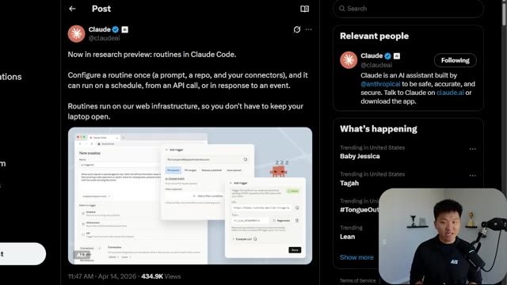
*⏱️ 00:00:09 — Une publication sur le réseau social X par le compte officiel de Claude, présentant une capture d'écran de l'interface "New routine" de Claude Code avec des options de configuration de déclencheurs (triggers).*

---

### ⏱️ `[00:00:34 - 00:01:07]` | Segment #02

**🔊 Audio (Transcription Intégrale Mot pour Mot en Français) :**
> have GitHub events trigger it, or they can be scheduled, which are like the scheduled automations that we already have, but now they run on the web. So you really can create these from anywhere. You can do it right here as a scheduled trigger to run scheduled remote agents, which is in the terminal. You could also go to clawed AI slash code. So you could do it on the web. And right here, you see, I have three web-based routines right here. Or what I'm going to be showing you guys today is just doing it in the desktop app. Because right here, if I go to my scheduled tasks, you can see that I've got some like these four that are local. And then I've got these four that are running inside of a GitHub repository. So these are the remote ones. If I go up here and click on

**👁️ Analyse Visuelle d'Écran (gemini-3.5-flash-lite) :**
**Interface & Outils** : Visual Studio Code (Terminal intégré), Claude Code (CLI).

**Contenu textuel & Code** : Commande `/schedule` saisie dans le terminal Claude Code (v2.1.107), affichant une liste de commandes disponibles dont `/schedule`, `/claude-api`, `/pulse-check`, `/n8n-workflow-patterns`, `/codex:rescue` et `/rewind`.

**Action / Démonstration** : L'utilisateur est en train d'explorer ou de sélectionner la commande `/schedule` pour configurer des agents distants planifiés.

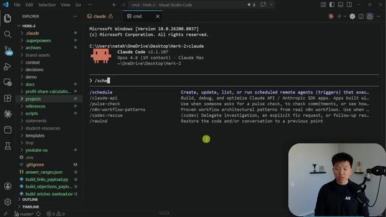
*⏱️ 00:00:42 — Une capture d'écran de l'interface VS Code montrant un terminal intégré où l'outil Claude Code est en cours d'utilisation avec l'autocomplétion de commandes.*

---

### ⏱️ `[00:01:07 - 00:01:39]` | Segment #03

**🔊 Audio (Transcription Intégrale Mot pour Mot en Français) :**
> new task, this is where we could set up a new local task or a new remote task. It's very similar. You set up the name, you set up what Cloud should do, and this is the actual prompt. So I'll talk more about that in a sec, but then you would configure your model, your repository, and your cloud environment. You set the cadence, hourly, daily, weekdays. I think the minimum is once an hour. Like you couldn't go like every 10 minutes or something, but still not bad at all. This is where you could configure all of your connectors. So if you need to connect Slack or Gmail or, you know, whatever it is, you can connect them right here, but you can also just do your regular API

**👁️ Analyse Visuelle d'Écran (gemini-3.5-flash-lite) :**
**Interface & Outils** : Interface web d'automatisation d'agents IA (plateforme type "Nate Herk Cloud").

**Contenu textuel & Code** : Formulaire de configuration : champ "Name", zone de texte "Describe what Claude should do...", sélection de modèle "Opus 4.6", sélecteur de repository GitHub, options de planification (Hourly, Daily, Weekdays, Weekly, Custom), réglage horaire "09:00 AM", section "Connectors".

**Action / Démonstration** : Présentation des étapes de paramétrage d'une tâche automatisée (nommage, définition de l'instruction, sélection du modèle, choix du dépôt et planification).

*⏱️ 00:01:15 — Interface de configuration pour la création d'une nouvelle tâche distante (New remote task) incluant des champs pour le nom, le prompt système pour Claude, le choix du modèle (Opus 4.6), le dépôt GitHub et la fréquence d'exécution.*

---

### ⏱️ `[00:01:39 - 00:02:12]` | Segment #04

**🔊 Audio (Transcription Intégrale Mot pour Mot en Français) :**
> endpoints with your API keys. And then of course you've got your permissions. So you can choose how Claude should be acting. Now, the one thing about these are, these are meant to be a one shot prompt. You're not around. So you probably want to make sure that it doesn't ever have to stop and ask you questions. Otherwise, what's the point of the automation? So like I said, there's tons of things to dive into here and I'm not going to try to bore you guys, but some of this is really important because when I first got the setup, my automations weren't just migrating over and working. So I'm going to tell you guys the issues that I ran into and hopefully answer everything that you need to know so that you won't have to go into the comments and ask these common

**👁️ Analyse Visuelle d'Écran (gemini-3.5-flash-lite) :**
**Interface & Outils** : Application web de gestion d'agents IA (probablement une plateforme d'automatisation type Windsurf ou outil propriétaire).

**Contenu textuel & Code** : Champs de formulaire : "Name", "Describe what Claude should do", sélection de modèle (Opus 4.6), choix de fréquence (Hourly, Daily, Weekly), réglages de "Permissions".

**Action / Démonstration** : Configuration d'une tâche récurrente pour Claude, incluant la gestion des accès et du calendrier d'exécution.

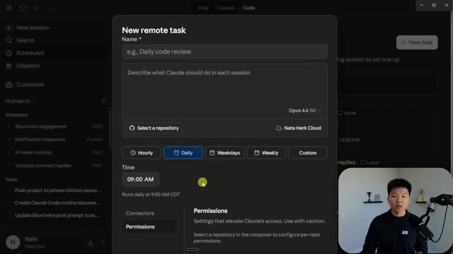
*⏱️ 00:01:47 — Interface de configuration d'une "New remote task" pour Claude, montrant les paramètres de planification (Daily, Time) et les permissions.*

---

### ⏱️ `[00:02:12 - 00:02:32]` | Segment #05

**🔊 Audio (Transcription Intégrale Mot pour Mot en Français) :**
> questions. I can just answer them right here for you. So let me just, first of all, real quick, show you guys what I tested out. The first thing I wanted to test out is if I came in here and I created a new routine for just shooting a message to my ClickUp. Obviously that's not any value, but I just wanted to see how it worked. Because what I wanted to do is see if I could do this without adding my connector of ClickUp.

**👁️ Analyse Visuelle d'Écran (gemini-3.5-flash-lite) :**
**Interface & Outils** : Interface web/application de Claude Code.

**Contenu textuel & Code** : Liste des tâches planifiées : "Skool wins engagement", "AI news roundup", "Notification responses", "Youtube comment replies", "Testing Skool Wins", "Testing YT Comments", "Testing ClickUp API".

**Action / Démonstration** : Le présentateur montre l'écran de gestion des tâches automatisées pour illustrer ses tests de routines, notamment celle liée à l'API ClickUp.

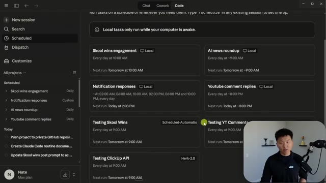
*⏱️ 00:02:17 — Une vue de l'interface de Claude Code affichant le tableau de bord des sessions planifiées (Scheduled), avec plusieurs routines automatisées listées sous forme de cartes.*

---

### ⏱️ `[00:02:32 - 00:02:54]` | Segment #06

**🔊 Audio (Transcription Intégrale Mot pour Mot en Français) :**
> And I was able to actually get this to fire off, but it didn't work right away. So let me show you guys what I ran into. So the way that this works is you need a GitHub repository to sync it to in order for this to actually run. So it's gonna clone my Herc2 project right here in the web. It's gonna be able to read my cloud.md. It's gonna be able to read my scripts and my skills. And then after it finishes the job, it basically just destroys that little cloud GitHub clone.

**👁️ Analyse Visuelle d'Écran (gemini-3.5-flash-lite) :**
**Interface & Outils** : Plateforme d'automatisation IA (interface web).

**Contenu textuel & Code** : Nom du projet "Testing ClickUp API", dépôt GitHub "nateherkai/Herk-2.0", instructions d'automatisation, fréquence d'exécution quotidienne (9:00 AM CDT) et historique des exécutions manuelles récentes.

**Action / Démonstration** : L'utilisateur visualise la configuration d'une tâche automatisée liée à un dépôt GitHub avant de déclencher l'exécution via le bouton "Run now".

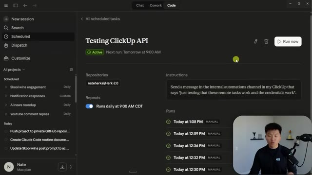
*⏱️ 00:02:38 — Interface de gestion de tâches automatisées affichant les détails du projet "Testing ClickUp API" avec une configuration de dépôt GitHub associée.*

---

### ⏱️ `[00:02:54 - 00:03:13]` | Segment #07

**🔊 Audio (Transcription Intégrale Mot pour Mot en Français) :**
> But as you guys know, you don't push your secrets into GitHub. Because if you see here, my Herc2 project, this is my .env file with all of my API keys. And this is listed in the gitignore, which basically says, hey, when you push to GitHub, you don't include these files. So what that means is in here, if this is only looking at your GitHub repo, there's no .env.

**👁️ Analyse Visuelle d'Écran (gemini-3.5-flash-lite) :**
**Interface & Outils** : Visual Studio Code, terminal intégré (Claude Code v2.1.107).

**Contenu textuel & Code** : Arborescence de fichiers incluant .env et .gitignore ; invite de commande Claude Code avec la saisie "/sche" et la liste des commandes disponibles (schedule, claude-api, pulse-check, etc.).

**Action / Démonstration** : Navigation dans l'explorateur de fichiers VS Code et interaction avec l'outil en ligne de commande Claude Code au sein du terminal.

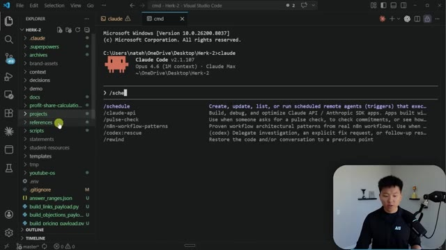
*⏱️ 00:02:59 — L'éditeur Visual Studio Code affiche l'arborescence du projet "Herk-2" dans la barre latérale, avec le fichier .env et .gitignore mis en évidence, tandis qu'un terminal intégré affiche l'interface de Claude Code.*

---

### ⏱️ `[00:03:14 - 00:03:33]` | Segment #08

**🔊 Audio (Transcription Intégrale Mot pour Mot en Français) :**
> So how do you get your API keys into this routine that runs on the web? Well, what you do is inside of this scheduled task, you have a cloud environment. So if I click on this one, You can see this one is called NateHurt Cloud. So if I open up the settings, what do you see? You have the name of this cloud environment, you have the network access, and you have environment variables.

**👁️ Analyse Visuelle d'Écran (gemini-3.5-flash-lite) :**
**Interface & Outils** : Interface web de l'application (probablement une plateforme d'automatisation IA basée sur Claude).

**Contenu textuel & Code** : Détails de la tâche : "Testing ClickUp API", instructions pour envoyer un message ClickUp, sélection de l'environnement "Nate Herk Cloud", configuration de planification quotidienne à 09:00 AM.

**Action / Démonstration** : Navigation dans l'interface de planification pour éditer les paramètres d'exécution et les identifiants (API keys) d'une tâche automatisée.

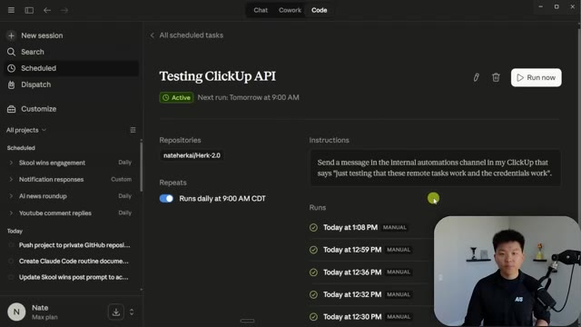
*⏱️ 00:03:18 — Interface de gestion de tâches planifiées montrant le détail de la tâche "Testing ClickUp API" et son historique d'exécution.*

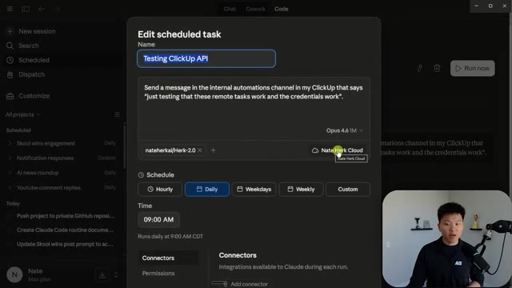
*⏱️ 00:03:23 — Fenêtre modale "Edit scheduled task" ouverte, permettant de configurer le nom, les instructions, l'environnement cloud ("Nate Herk Cloud") et la planification.*

---

### ⏱️ `[00:03:33 - 00:03:54]` | Segment #09

**🔊 Audio (Transcription Intégrale Mot pour Mot en Français) :**
> So right here is where I put in my YouTube API key, my ClickUp API key, any of the other API keys that I need to give this cloud environment access to. And then the other thing you have to do is you have to look at the access levels because right here you can see that this one is on full, but by default, this will be on trusted, I believe. And that means you can only download packages from verified sources from Anthropic.

**👁️ Analyse Visuelle d'Écran (gemini-3.5-flash-lite) :**
**Interface & Outils** : Interface web de Claude (Anthropic).

**Contenu textuel & Code** : Configuration d'un environnement cloud avec un champ pour les variables d'environnement (.env) et un script Bash de démarrage.

**Action / Démonstration** : Configuration et mise à jour des paramètres de l'environnement cloud par l'utilisateur.

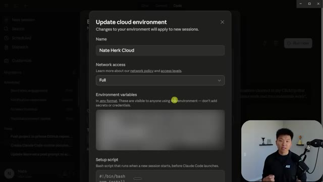
*⏱️ 00:03:38 — Une fenêtre modale intitulée "Update cloud environment" affichée dans l'interface de Claude, permettant de configurer le nom, le niveau d'accès réseau ("Full"), les variables d'environnement (floutées) et un script de configuration Bash.*

---

### ⏱️ `[00:03:55 - 00:04:15]` | Segment #10

**🔊 Audio (Transcription Intégrale Mot pour Mot en Français) :**
> And when we talk about this later, I'll have a link which you can go see all of them. You can even do custom if you wanted to allow specific domains that aren't on that list. But in order for ClickUp to work in this case, I had to go on full because when I went on trusted, it said, hey, we can't actually do that. But when I changed this to full, it let me send a message to my ClickUp. And that is how I got this message right here that says just testing that the remote tasks work and the credentials work.

**👁️ Analyse Visuelle d'Écran (gemini-3.5-flash-lite) :**
**Interface & Outils** : Interface de configuration cloud (environnement Claude Code/Anthropic).

**Contenu textuel & Code** : Options de sécurité réseau : "None" (blocage), "Trusted" (sources vérifiées), "Full" (accès illimité), "Custom" (liste de domaines autorisés).

**Action / Démonstration** : L'utilisateur a sélectionné l'option "Full" dans le menu déroulant pour permettre les interactions avec ClickUp.

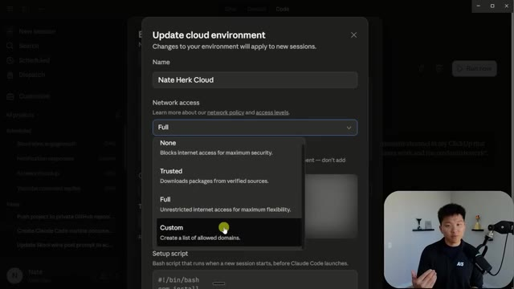
*⏱️ 00:04:00 — Une fenêtre contextuelle "Update cloud environment" affichant les paramètres de configuration réseau, avec un menu déroulant pour les niveaux d'accès (None, Trusted, Full, Custom).*

---

### ⏱️ `[00:04:15 - 00:04:40]` | Segment #11

**🔊 Audio (Transcription Intégrale Mot pour Mot en Français) :**
> So basically when these run, whatever you have here as your instructions is what gets prompted. And that's exactly the same way that the scheduled tasks locally work. So right here you can see I say, send a message in the internal ClickUp channel. And right here, the actual thing that it says was send a message in the internal ClickUp channel. So think of a scheduled task or a routine as you basically typing in a prompt and then someone coming in to your laptop and typing it in for you.

**👁️ Analyse Visuelle d'Écran (gemini-3.5-flash-lite) :**
**Interface & Outils** : Application web de gestion d'agents IA (interface de workflow d'automatisation).

**Contenu textuel & Code** : Instructions : "Send a message in the Internal automations channel in my ClickUp that says 'just testing that these remote tasks work and the credentials work'". Historique : liste des exécutions ("Runs") effectuées aujourd'hui à différentes heures.

**Action / Démonstration** : Consultation de la configuration d'une tâche planifiée ("Scheduled tasks") et vérification des logs d'exécution passés.

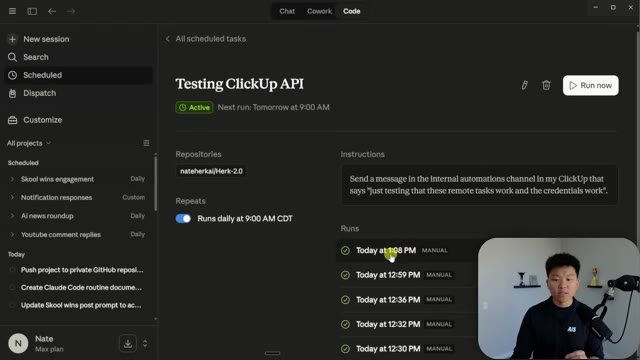
*⏱️ 00:04:21 — Interface de gestion de tâches automatisées affichant les détails d'une tâche nommée "Testing ClickUp API" avec ses instructions et son historique d'exécution.*

---

### ⏱️ `[00:04:40 - 00:05:00]` | Segment #12

**🔊 Audio (Transcription Intégrale Mot pour Mot en Français) :**
> So it's the exact same type of interaction as you talking to Cloud Code. But that's why once again, you wanna make sure it's specific enough so that it can basically one shot it. Okay, so let's take a little deeper now. What I tried to do is I did another one, which I wanted it to be able to use the YouTube data API in order to grab some YouTube comments for me and give me a little analysis in, you know, ClickUp or whatever.

**👁️ Analyse Visuelle d'Écran (gemini-3.5-flash-lite) :**
**Interface & Outils** : Interface web d'un agent de type "Claude Code" (ou outil d'IA intégrée au workflow).

**Contenu textuel & Code** : Le prompt : "Send a message in the internal automations channel in my ClickUp that says 'Just testing that these remote tasks work and the credentials work'". Le log montre la recherche de outils, l'identification de l'ID du canal ClickUp, et la confirmation de l'envoi du message.

**Action / Démonstration** : L'agent IA exécute une séquence de tâches (recherche de canal, identification d'ID, envoi de message) pour valider la connectivité API de ClickUp.

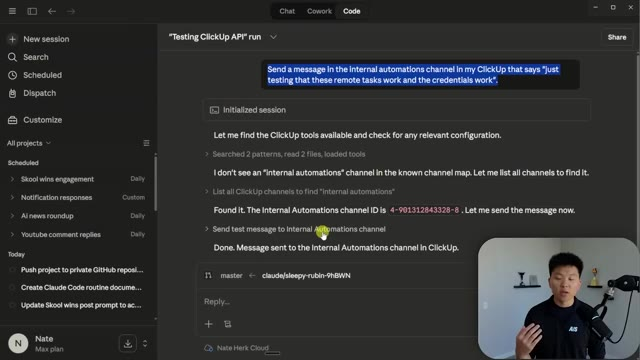
*⏱️ 00:04:45 — Interface d'un outil d'automatisation IA (Claude Code) affichant le journal d'exécution d'une requête spécifique pour interagir avec l'API ClickUp.*

---

### ⏱️ `[00:05:01 - 00:05:22]` | Segment #13

**🔊 Audio (Transcription Intégrale Mot pour Mot en Français) :**
> So this is the prompt I said, right? Analyze 50 of my most recent comments from YouTube and give me a quick bullet rundown. My YouTube API key is available as an environment variable. Use it directly from the environment. Don't look for a .env. Because what happens is in your repo, right? So in this Herc2 project, when I normally run this, it grabs all my API keys from the .env.

**👁️ Analyse Visuelle d'Écran (gemini-3.5-flash-lite) :**
**Interface & Outils** : Interface web d'un outil d'automatisation (potentiellement une plateforme de développement d'agents IA).

**Contenu textuel & Code** : Le prompt configuré : "Analyze 50 of my most recent comments from YouTube and give me a quick three to five bullet point rundown. My YouTube API key is available as the environment variable YOUTUBE_API_KEY (use it directly from the environment, do not look for a .env file)."

**Action / Démonstration** : Le présentateur explique la configuration d'une tâche planifiée (scheduled task) et la manière dont l'agent doit accéder à la clé API via les variables d'environnement.

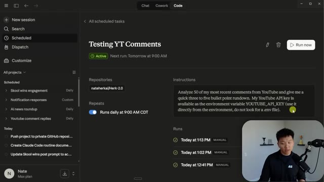
*⏱️ 00:05:06 — Une interface de plateforme d'automatisation IA affichant une tâche planifiée nommée "Testing YT Comments" avec ses instructions et historique d'exécution.*

---

### ⏱️ `[00:05:22 - 00:05:40]` | Segment #14

**🔊 Audio (Transcription Intégrale Mot pour Mot en Français) :**
> And maybe it reads the cloud.md and realizes that's where a lot of those live. So by default, it's maybe going to try to look in the .env and it's not gonna be smart enough to figure out. And so for ClickUp, it was fine, it figured it out. But for some reason with this YouTube one, it didn't. So I had to explicitly tell it, hey, look in the environment variable rather than in the .env.

**👁️ Analyse Visuelle d'Écran (gemini-3.5-flash-lite) :**
**Interface & Outils** : Visual Studio Code, Claude Code CLI (v2.1.107).

**Contenu textuel & Code** : Liste des commandes : /schedule, /claude-api, /pulse-check, /n8n-workflow-patterns, /codex:rescue, /rewind. On voit également l'arborescence du projet avec des fichiers comme .env, CLAUDE.md et divers scripts Python.

**Action / Démonstration** : L'utilisateur a ouvert le terminal Claude Code et commence à taper une commande commençant par "/sche" (pour /schedule).

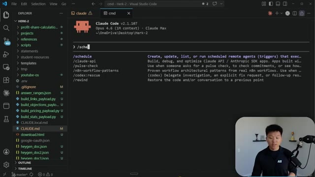
*⏱️ 00:05:27 — Interface VS Code affichant un terminal Claude Code actif avec une liste de commandes disponibles en surimpression.*

---

### ⏱️ `[00:05:40 - 00:06:00]` | Segment #15

**🔊 Audio (Transcription Intégrale Mot pour Mot en Français) :**
> So you can see this first time I ran it, 1241, I didn't say that and it couldn't do it. It said like, hey, I can't find that, I'm getting an error. And I even tried to tell it here and it still didn't work. But then on this most recent run, when I updated the prompt a little bit, it was able to fetch it right away using the API key. And now I have a remote routine that would work.

**👁️ Analyse Visuelle d'Écran (gemini-3.5-flash-lite) :**
**Interface & Outils** : Claude Code / Interface web d'automatisation IA

**Contenu textuel & Code** : Logs système : "API is returning 403 errors", "No YouTube API key in .env", "Good - I have cached comments from 4 recent videos". Prompt utilisateur : "I put my keys that you need to get YouTube data in the Claude environment variables. Look there."

**Action / Démonstration** : L'agent traite des erreurs 403, vérifie le fichier .env, accède au cache de données et reçoit des instructions de configuration de clés API.

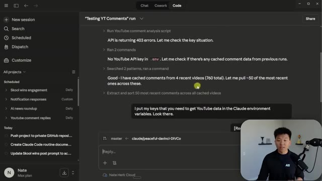
*⏱️ 00:05:45 — Interface de travail de l'agent IA affichant un historique de chat avec des logs d'erreurs API YouTube, la résolution via des données mises en cache et une instruction utilisateur pour configurer les variables d'environnement.*

---

### ⏱️ `[00:06:00 - 00:06:34]` | Segment #16

**🔊 Audio (Transcription Intégrale Mot pour Mot en Français) :**
> Obviously I need to update this. I'm gonna migrate over my other automations, but this was just for testing purposes. And then another one that I do is I have some automations here, which basically opens up a browser using Playwright CLI, and it does some stuff in my school community because there's no publicly accessible API. We've kind of figured out a way to automate it without using browser. I'm not really going to dive into that right now. But what I wanted to tell you guys about that is I tried to basically move over this school wins engagement post or sorry, automation into a remote session. So I copied the exact same prompts that was in my regular schedule task.

**👁️ Analyse Visuelle d'Écran (gemini-3.5-flash-lite) :**
**Interface & Outils** : Interface Claude Code (onglet "Code")

**Contenu textuel & Code** : Liste des automations : "Skool wins engagement", "AI news roundup", "Notification responses", "Youtube comment replies", "Testing Skool Wins", "Testing YT Comments", "Testing ClickUp API".

**Action / Démonstration** : Le présentateur illustre ses automations programmées, notamment celles liées à la plateforme Skool et aux interactions sur YouTube.

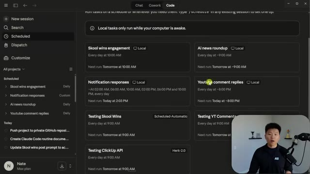
*⏱️ 00:06:08 — Une capture d'écran montrant une interface de gestion de tâches automatisées (Claude Code) avec une liste de projets programmés et leurs horaires d'exécution.*

---

### ⏱️ `[00:06:34 - 00:07:06]` | Segment #17

**🔊 Audio (Transcription Intégrale Mot pour Mot en Français) :**
> And then I just added this little snippet at the end. But what happened is this wasn't working because it basically said, Hey, you know, like when you do this, it spins up a browser, but there's no cookies because all of this is running remotely. And all I have to look at is the GitHub repo. I can't look at the local, you know, cookies that we've used in the last couple sessions of this automation. And so it doesn't seem like this would work because once again, it has no access to that stuff. So if I wanted to do an automation like this, I would have to use an endpoint that takes authentication in the form of like actual cookies or a header or, you know, like an API key,

**👁️ Analyse Visuelle d'Écran (gemini-3.5-flash-lite) :**
**Interface & Outils** : Interface de type "Claude Code" ou environnement de développement assisté par IA.

**Contenu textuel & Code** : Historique d'exécution : "Need to install dependencies first", "Scrape 10 most recent wins posts from Skool", message d'erreur "no auth/skool_state.json found".

**Action / Démonstration** : L'agent IA tente d'exécuter un workflow d'automatisation (Skool wins engagement) mais rencontre une erreur de lecture de cookies/état de session car le fichier requis est introuvable.

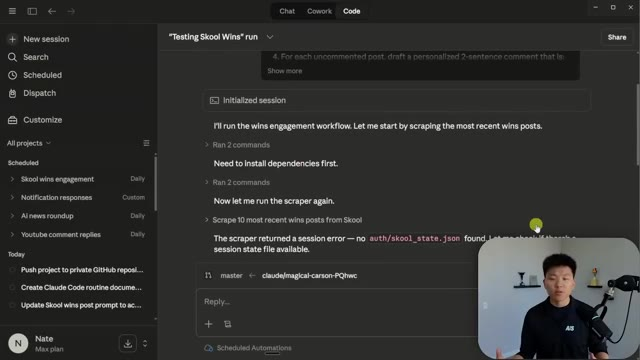
*⏱️ 00:06:42 — Interface de travail d'un agent IA (Claude Code) affichant l'exécution d'un workflow de scraping échoué à cause d'un fichier de session manquant.*

---

### ⏱️ `[00:07:06 - 00:07:42]` | Segment #18

**🔊 Audio (Transcription Intégrale Mot pour Mot en Français) :**
> because every single one of these runs is going to be stateless. And after the run, the GitHub clone just gets deleted. Now, the exception of that is if the automation is changing something in your code base or doing a review. If it does do that, it will create a new branch for you, or it will give you some sort of output and not just delete everything that it just did. But for an automation like this, it would just delete it. But hopefully after you guys have seen those examples, you now have the ability to come in and, you know, make some changes if you need in order to make sure that your automations are running. And what I mean by that is you understand this should be a very specific prompt. This is how you change the model. You have to have a GitHub repo. You can change the

**👁️ Analyse Visuelle d'Écran (gemini-3.5-flash-lite) :**
**Interface & Outils** : Application web d'automatisation (interface de type agent IA)

**Contenu textuel & Code** : Instructions du workflow : changement de répertoire, exécution du script "scrape_wins.py", parsing JSON, et filtrage des commentaires. Zone de chat affichant "I'll run the wins engagement workflow".

**Action / Démonstration** : Initialisation d'une session et exécution automatisée de commandes pour le scraping de données.

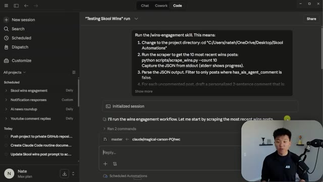
*⏱️ 00:07:15 — Interface d'une application d'automatisation IA affichant le déroulement d'un workflow nommé "Testing Skool Wins", incluant les étapes techniques de scraping et une zone de chat/interaction.*

---

### ⏱️ `[00:07:42 - 00:08:11]` | Segment #19

**🔊 Audio (Transcription Intégrale Mot pour Mot en Français) :**
> settings for your cloud environments right here. You set the schedule, you add any connectors you might need, which would honestly be a little easier if you added just like a Slack connector, and then you can set your permissions here. Now, the other thing to be aware of is you do have limits. So if I come over here to my settings, you can see if I go to my usage, we have our regular session limits, our model limits, but for additional features, we have daily included routine runs. And I haven't run any yet on the actual schedule. I've just been testing them, but we are at zero for 15.

**👁️ Analyse Visuelle d'Écran (gemini-3.5-flash-lite) :**
**Interface & Outils** : Interface web de Claude Code (Research Preview).

**Contenu textuel & Code** : Paramètres de planification, sélection de fréquences (Hourly, Daily, Weekdays, Weekly), bouton "Add connector", et liste des routines programmées.

**Action / Démonstration** : Navigation et configuration des paramètres d'automatisation d'une routine, incluant la planification temporelle et la gestion des intégrations.

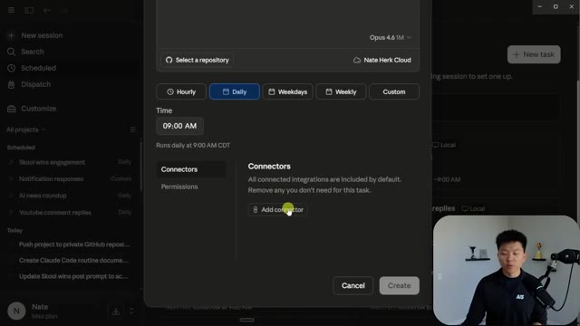
*⏱️ 00:07:49 — Fenêtre modale de configuration d'une routine dans Claude Code, permettant de définir la fréquence (quotidienne), l'heure d'exécution (09h00) et de gérer les connecteurs et permissions.*

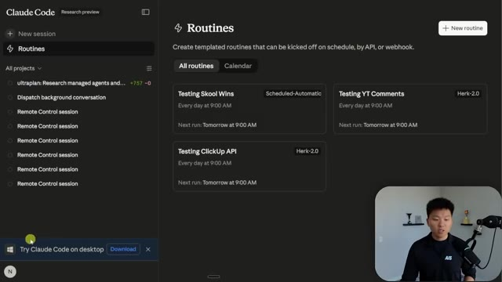
*⏱️ 00:07:56 — Vue principale du tableau de bord "Routines" dans l'interface web de Claude Code, listant les routines actives comme "Testing Skool Wins", "Testing YT Comments" et "Testing ClickUp API".*

---

### ⏱️ `[00:08:11 - 00:08:29]` | Segment #20

**🔊 Audio (Transcription Intégrale Mot pour Mot en Français) :**
> So I could only have 15 automations running with routines per day because I'm on the max $200 a month plan. Your limits would be less if you're on pro, I think maybe three or maybe five. I'll, I have that information later on, but just something to keep in mind. All right, so let's just dive into a little bit more of the details here that may answer some questions you guys have.

**👁️ Analyse Visuelle d'Écran (gemini-3.5-flash-lite) :**
**Interface & Outils** : Interface web de Claude.ai (menu paramètres > Usage).

**Contenu textuel & Code** : Statistiques d'utilisation : barres de progression pour "All models" (24%), "Sonnet only" (3%), et "Daily included routine runs" (0/15). Section "Extra usage" indiquant 149,96 $ dépensés.

**Action / Démonstration** : Visualisation des limites d'utilisation du compte et du suivi des coûts liés aux automatisations (routines).

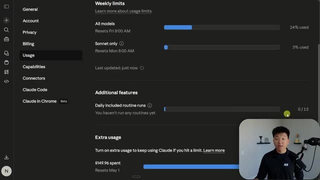
*⏱️ 00:08:16 — Capture d'écran de l'interface des paramètres de compte de Claude, affichant l'onglet "Usage" avec les compteurs de limites de modèles et de routines quotidiennes.*

---

### ⏱️ `[00:08:30 - 00:09:02]` | Segment #21

**🔊 Audio (Transcription Intégrale Mot pour Mot en Français) :**
> I think it's pretty clear at this point what it is. I'm going to give you guys this entire doc as well as anything else I've talked about in my free school community. The link for that is down in the description. So some of the stuff I might not cover if you want to read more about it Then just go ahead and grab that free resource. So we know what it is. I think we know how it works, right? Like you define a routine which is a prompt you connect a github repo You could also trigger it by apis or by a github action and then you can connect your connectors And basically it acts as you talking to your own cloud code Because of the fact that this is working off of a cloned repo

**👁️ Analyse Visuelle d'Écran (gemini-3.5-flash-lite) :**
**Interface & Outils** : Document textuel (probablement Google Docs ou un fichier Markdown affiché dans un navigateur).

**Contenu textuel & Code** : Titre "Claude Code Routines", explication du fonctionnement (tâches automatisées sur les serveurs d'Anthropic), statut "Research preview" et liste des sections : "How It Works", "CLAUDE.md Makes Routines Smart", "Three Trigger Types", "How This Compares to What Already Existed".

**Action / Démonstration** : Le présentateur affiche et parcourt une feuille de route documentaire pour expliquer les concepts fondamentaux de Claude Code Routines.

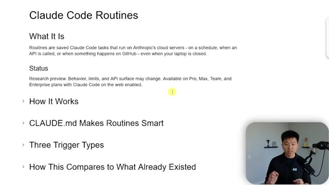
*⏱️ 00:08:38 — Une page de documentation présentant le concept de "Claude Code Routines", incluant une définition, le statut de la fonctionnalité et un plan de présentation des sections suivantes.*

---

### ⏱️ `[00:09:02 - 00:09:23]` | Segment #22

**🔊 Audio (Transcription Intégrale Mot pour Mot en Français) :**
> It's going to read the cloud.md file automatically every time So if you have a massive project, like a Herc2 project, for example, with tons of context and tons of stuff, maybe you don't want to put that repo into the cloud to be a routine run because there's a lot of context in that Cloud.md and in that whole GitHub repo that might not matter for this automation.

**👁️ Analyse Visuelle d'Écran (gemini-3.5-flash-lite) :**
**Interface & Outils** : Éditeur de document ou visionneuse de documentation (style Markdown).

**Contenu textuel & Code** : Titres de section : "What It Is", "How It Works", "CLAUDE.md Makes Routines Smart", "Three Trigger Types". Texte explicatif sur l'utilisation du fichier CLAUDE.md pour fournir des standards de codage, des notes d'architecture et des instructions spécifiques à l'IA avant chaque exécution.

**Action / Démonstration** : Présentation théorique sur le rôle stratégique du fichier CLAUDE.md pour rendre les agents autonomes plus performants et contextuels.

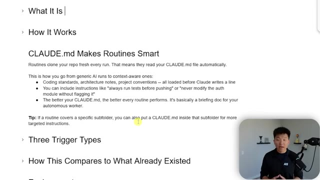
*⏱️ 00:09:07 — Document de présentation expliquant le fonctionnement du fichier CLAUDE.md pour améliorer la pertinence contextuelle des routines d'IA.*

---

### ⏱️ `[00:09:23 - 00:09:42]` | Segment #23

**🔊 Audio (Transcription Intégrale Mot pour Mot en Français) :**
> So maybe you're better off setting up a specific GitHub repo per scheduled routine. But of course, Cloud.md best practices, putting in the information that's important, because this stuff is going to drain your Cloud Code session limits the exact same way as it would if you were open up in Cloud Code, just talking to it.

**👁️ Analyse Visuelle d'Écran (gemini-3.5-flash-lite) :**
**Interface & Outils** : Éditeur de texte ou visualiseur de documentation Markdown (type Obsidian ou GitHub Preview).

**Contenu textuel & Code** : Titres : "What It Is", "How It Works", "CLAUDE.md Makes Routines Smart", "Three Trigger Types", "How This Compares to What Already Existed". Texte explicatif soulignant que CLAUDE.md permet de rendre les routines contextuelles (normes de codage, instructions spécifiques, tests automatiques).

**Action / Démonstration** : Présentation conceptuelle des bonnes pratiques pour structurer les instructions de l'agent IA via un fichier de configuration.

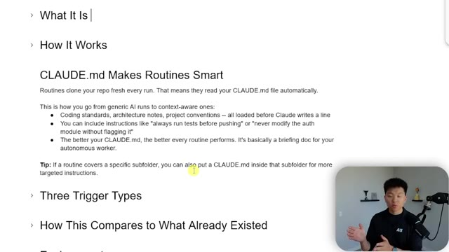
*⏱️ 00:09:28 — Une page de documentation Markdown affichant des explications sur le fonctionnement et l'utilité du fichier "CLAUDE.md" pour les routines d'automatisation.*

---

### ⏱️ `[00:09:42 - 00:10:01]` | Segment #24

**🔊 Audio (Transcription Intégrale Mot pour Mot en Français) :**
> So once again, three trigger types, schedule, API, which I think is really cool. You can have a different automation, make a post request to some sort of routine. And then of course, GitHub. So you can have it automatically fire off kind of on a web hook based on new PRs, new pushes, new issues, new releases, things like that. So how does this compare to what already exists?

**👁️ Analyse Visuelle d'Écran (gemini-3.5-flash-lite) :**
**Interface & Outils** : Documentation technique sur navigateur web.

**Contenu textuel & Code** : Texte détaillé expliquant le fonctionnement des déclencheurs : Schedule (Cron-based), API (POST requests), et GitHub (réactions aux événements comme PRs, pushes, issues).

**Action / Démonstration** : Présentation théorique des capacités d'automatisation de l'outil, sans manipulation de code en temps réel.

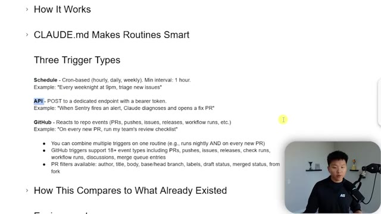
*⏱️ 00:09:47 — Une capture d'écran montrant une page de documentation textuelle listant les "Three Trigger Types" (Schedule, API, GitHub) pour le projet "CLAUDE.md".*

---

### ⏱️ `[00:10:01 - 00:10:21]` | Segment #25

**🔊 Audio (Transcription Intégrale Mot pour Mot en Français) :**
> We have routines, which is the new feature. We have desktop scheduled tasks, and then we have something like just a slash loop command. So routines run on Anthropics cloud and these other two run on your machine. Do you need the machine on? No for routines, that's huge. But for desktop scheduled tasks and for loop, you need your machine on. Do you need a session open? No, That's the same across all three.

**👁️ Analyse Visuelle d'Écran (gemini-3.5-flash-lite) :**
**Interface & Outils** : Présentation de type "Slide" ou document Notion.

**Contenu textuel & Code** : Tableau avec les lignes : Runs on, Needs machine on, Needs open session, Survives restarts, Local file access, Permission prompts, Min interval. Texte explicatif sous le tableau soulignant l'autonomie des routines cloud.

**Action / Démonstration** : Analyse comparative des modes d'exécution d'agents IA par l'intervenant.

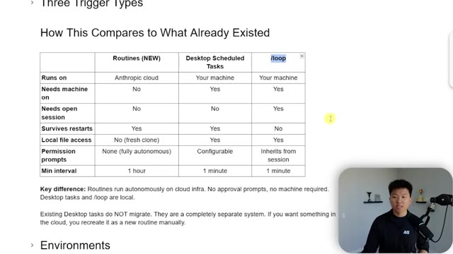
*⏱️ 00:10:06 — Tableau comparatif présentant trois modes d'exécution : "Routines (NEW)", "Desktop Scheduled Tasks" et "/loop", détaillant les contraintes techniques (besoin de la machine, accès fichiers, persistance).*

---

### ⏱️ `[00:10:22 - 00:10:41]` | Segment #26

**🔊 Audio (Transcription Intégrale Mot pour Mot en Français) :**
> Do they survive across restarts? The first two do, but loop does not. That has to live within a specific session. Local file access, no for the routines because it works off of the GitHub repo. And for the next two, yes, you have local file access. Permission prompts with routines, it's fully autonomous. And for these two, they are configurable. And then the minimum interval routines is one hour.

**👁️ Analyse Visuelle d'Écran (gemini-3.5-flash-lite) :**
**Interface & Outils** : Logiciel de présentation ou éditeur de documents (type Notion ou Google Docs).

**Contenu textuel & Code** : Tableau comparatif avec des critères tels que : "Runs on", "Needs machine on", "Needs open session", "Survives restarts", "Local file access", "Permission prompts", et "Min interval". La cellule "/loop" -> "Survives restarts" est mise en évidence en bleu.

**Action / Démonstration** : Présentation visuelle et comparaison théorique des capacités d'exécution des différents types de déclencheurs d'agents.

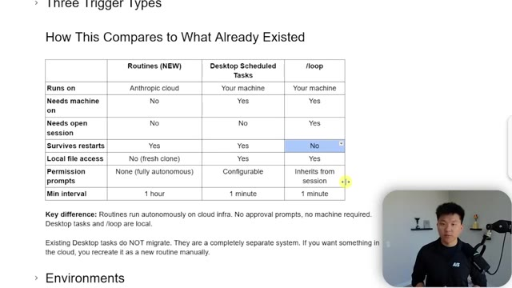
*⏱️ 00:10:26 — Un tableau comparatif intitulé "How This Compares to What Already Existed" présentant les différences techniques entre les méthodes "Routines", "Desktop Scheduled Tasks" et "/loop".*

---

### ⏱️ `[00:10:41 - 00:11:02]` | Segment #27

**🔊 Audio (Transcription Intégrale Mot pour Mot en Français) :**
> And these two are both, could go every minute if you want. Okay, so let's talk about the environments. Obviously your .env is git ignored unless you push it into the GitHub repo. You know, ultimately, if you push it into a private repo, you're probably okay, but you wanna be really, really careful because then, you know, there's history there. And if other people, you know, end up collaborating on it, you just don't wanna do that.

**👁️ Analyse Visuelle d'Écran (gemini-3.5-flash-lite) :**
**Interface & Outils** : Logiciel de présentation (type Notion ou Google Slides) affichant du contenu textuel technique.

**Contenu textuel & Code** : Texte explicatif sur les "Environments" : mention du .env gitignore, utilisation des variables d'environnement pour les clés API (ClickUp, YouTube), configuration via claude.ai, et une recommandation de code Python : "os.environ['KEY_NAME']".

**Action / Démonstration** : Présentation conceptuelle et recommandations de bonnes pratiques pour éviter les échecs de scripts liés à l'absence de fichiers .env dans les routines d'automatisation.

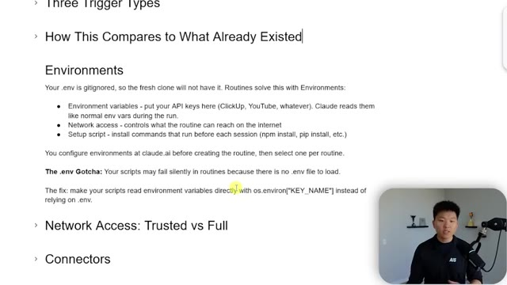
*⏱️ 00:10:46 — Une diapositive de présentation technique expliquant la gestion des variables d'environnement (.env) pour les routines d'agents IA, avec des recommandations sur l'utilisation de os.environ.*

---

### ⏱️ `[00:11:02 - 00:11:21]` | Segment #28

**🔊 Audio (Transcription Intégrale Mot pour Mot en Français) :**
> So you wanna put your API keys in the environment variable, like I showed you guys earlier. You want to look at the network access, whether that is full or trusted or none or custom, and potentially some setup scripts. So that's not something I showed you guys yet. If you're creating a new remote task, you can do a setup script, which is basically just a script that will run when this new session fires up before Cloud Code launches.

**👁️ Analyse Visuelle d'Écran (gemini-3.5-flash-lite) :**
**Interface & Outils** : Navigateur web (documentation) et interface de configuration de routines (Claude Code/AI).

**Contenu textuel & Code** : Image #1 : Texte explicatif sur les variables d'environnement, `os.environ["KEY_NAME"]` et le ".env". Image #2 : Bloc de code Bash `#!/bin/bash` suivi de `npm install`.

**Action / Démonstration** : Présentation théorique des environnements de routine suivie de la démonstration pratique de l'ajout d'un script d'initialisation (`npm install`) dans l'interface de gestion.

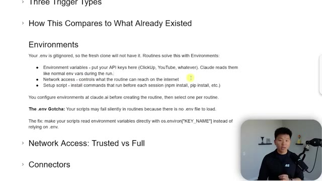
*⏱️ 00:11:07 — Une page de documentation ou de présentation expliquant le fonctionnement des "Environnements" pour les routines, détaillant l'utilisation des variables d'environnement, l'accès au réseau et les scripts de configuration.*

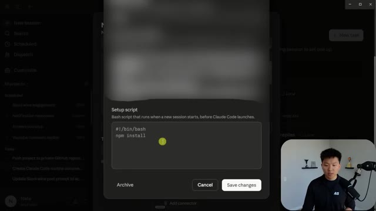
*⏱️ 00:11:17 — Une fenêtre modale d'interface logicielle montrant la configuration d'un "Setup script" (script de configuration) avec une zone de saisie de code Bash.*

---

### ⏱️ `[00:11:21 - 00:11:40]` | Segment #29

**🔊 Audio (Transcription Intégrale Mot pour Mot en Français) :**
> So if you need to install any packages or anything like that. Okay, so what's the difference between trusted and full? So trusted only reaches the known vetted services from Anthropic, which I thought I linked right here, but I just linked it there. This basically shows you all of the different domains that are allowed. So right here, you can see we've got Anthropic services, we've got version control.

**👁️ Analyse Visuelle d'Écran (gemini-3.5-flash-lite) :**
**Interface & Outils** : Documentation web (probablement la documentation officielle d'Anthropic pour les environnements de développement Claude).

**Contenu textuel & Code** : Texte explicatif définissant le mode 'Trusted' (accès restreint aux domaines approuvés) par rapport au mode 'Full' (accès illimité), et description des fonctionnalités du proxy de sécurité (protection contre les requêtes malveillantes, limitation de débit, filtrage de contenu).

**Action / Démonstration** : Affichage informatif statique supportant l'explication orale du présentateur sur les mesures de sécurité et les privilèges réseau des outils d'automatisation.

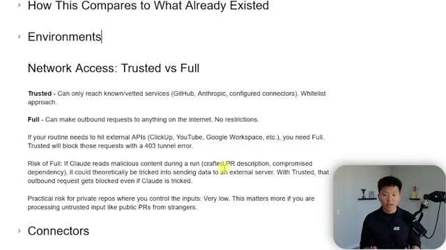
*⏱️ 00:11:26 — Une page de documentation technique expliquant la différence entre les modes d'accès réseau 'Trusted' et 'Full' pour les environnements d'agents IA.*

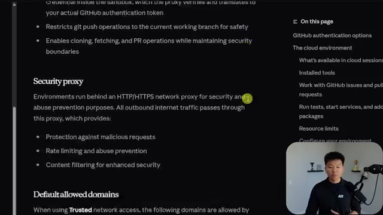
*⏱️ 00:11:36 — Une page de documentation technique détaillée sur le 'Security proxy' et les mécanismes de filtrage réseau des environnements de développement.*

---

### ⏱️ `[00:11:41 - 00:11:59]` | Segment #30

**🔊 Audio (Transcription Intégrale Mot pour Mot en Français) :**
> We've also got some cloud platforms like Google, stuff like this right here. These are the ones that are kind of already verified. So what is the risk of going on full? Well, if Claude reads malicious content during a run, then it theoretically could be tricked into sending data to an external server. And with Trusted, that outbound request would get blocked.

**👁️ Analyse Visuelle d'Écran (gemini-3.5-flash-lite) :**
**Interface & Outils** : Documentation technique/Site de référence sur les protocoles d'agents (probablement lié à Anthropic/Claude).

**Contenu textuel & Code** : - Image #1 : Liste de menus : "Cloud services and monitoring", "Schema and configuration", "Model Context Protocol".
- Image #2 : Texte explicatif : "Network Access: Trusted vs Full", définition du risque si l'IA lit du contenu malveillant ("If Claude reads malicious content... it could theoretically be tricked into sending data").

**Action / Démonstration** : Navigation et présentation pédagogique des risques de sécurité liés aux permissions réseau des agents IA lors de l'exécution de tâches.

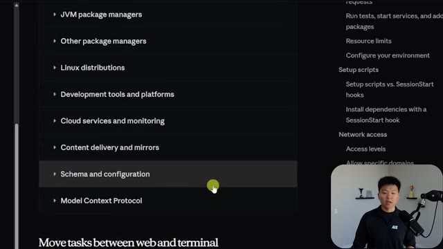
*⏱️ 00:11:45 — Interface de documentation technique listant les catégories de configuration (JVM, Linux, Cloud, etc.) avec une section "Model Context Protocol".*

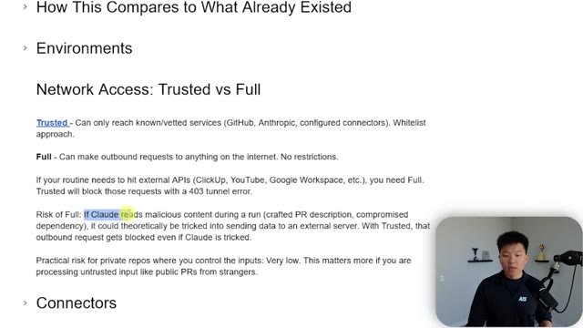
*⏱️ 00:11:50 — Documentation textuelle expliquant les niveaux d'accès réseau ("Trusted" vs "Full") pour les agents IA, avec une mise en évidence du risque de sécurité lié au mode "Full".*

---

### ⏱️ `[00:11:59 - 00:12:18]` | Segment #31

**🔊 Audio (Transcription Intégrale Mot pour Mot en Français) :**
> Now, practical risk for private repos where you control the inputs is very low, but I definitely just wanted to at least acknowledge that. So connectors, this is different than just adding your API key. This is more of like the connectors you would add to your actual Claude chat or like Claude Cowork, where you would OAuth into like Slack or ClickUp or stuff like that. Here are some security details.

**👁️ Analyse Visuelle d'Écran (gemini-3.5-flash-lite) :**
**Interface & Outils** : Navigateur web ou éditeur de document (format de présentation).

**Contenu textuel & Code** : Texte explicatif définissant les différences entre "Trusted" (accès limité aux services approuvés comme GitHub/Anthropic) et "Full" (accès internet total), incluant des notes sur les risques de sécurité et la gestion des erreurs 403.

**Action / Démonstration** : Présentation théorique illustrant les concepts de sécurité réseau pour les connecteurs et les environnements d'exécution IA.

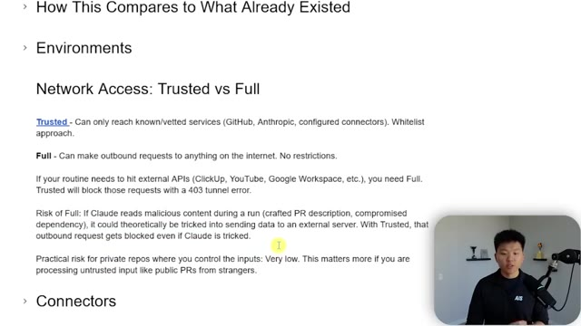
*⏱️ 00:12:04 — Une présentation de document texte comparant les modes d'accès réseau "Trusted" (restreint) et "Full" (illimité) pour l'automatisation IA, avec le présentateur en médaillon.*

---

### ⏱️ `[00:12:18 - 00:12:40]` | Segment #32

**🔊 Audio (Transcription Intégrale Mot pour Mot en Français) :**
> I'm not going to go super deep into this. You could also do some more research and download this doc. But of course, there are some things to be thinking about like your API triggers or what's going on with your GitHub repos and the branches. Because once again, everything is going to be running as you. So if you're not testing out these routines before you just kind of send them off every hour or something, you just have to be thinking about what could happen without permissions and stuff like that.

**👁️ Analyse Visuelle d'Écran (gemini-3.5-flash-lite) :**
**Interface & Outils** : Navigateur web affichant une page de documentation technique (probablement la documentation de Claude/Anthropic).

**Contenu textuel & Code** : Liste à puces détaillant les protocoles de sécurité : "Branch safety" (préfixes de branches), "API trigger protection" (tokens bearer), gestion des fuites de tokens, "Daily run cap" et l'avertissement critique "Everything runs as you" concernant l'identité liée aux commits, messages Slack et tickets Linear.

**Action / Démonstration** : Présentation informative des risques de sécurité et des bonnes pratiques de configuration pour les automatisations par IA.

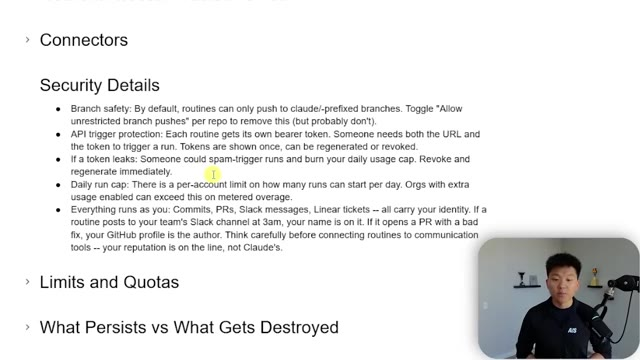
*⏱️ 00:12:23 — Capture d'écran montrant la section "Security Details" d'une documentation technique concernant les routines et les permissions d'un agent IA.*

---

### ⏱️ `[00:12:40 - 00:13:15]` | Segment #33

**🔊 Audio (Transcription Intégrale Mot pour Mot en Français) :**
> Limits and quotas. So it looks like on Pro, you can have five runs a day. on max you can have 15 runs a day and on team and enterprise you can have 25 routines a day if you hit the cap the orgs with extra usage enabled can exceed it on metered overage and then we have the minimum scheduled interval which is one hour and there are also resource limits so every one of these routines in the cloud runs on four vcpus 16 gigs of ram and 30 gigs of disk space so once again just be thinking about are you putting an absolutely massive github repo up into the cloud right now to run. That could just be wasting resources for no reason. So what persists versus

**👁️ Analyse Visuelle d'Écran (gemini-3.5-flash-lite) :**
**Interface & Outils** : Diapositive de présentation (type Notion ou document de documentation).

**Contenu textuel & Code** : Texte explicatif : "Daily run cap by plan", "Pro: 5 runs/day", "Max: 15 runs/day", "Team: 25 runs/day", "Enterprise: 25 runs/day", "Minimum schedule interval: 1 hour", "Resource limits per run: 4 vCPUs, 16 GB RAM, 30 GB disk", "Token budget".

**Action / Démonstration** : Présentation informative des contraintes techniques et commerciales du service pour l'utilisateur.

*⏱️ 00:12:49 — Une présentation sous forme de liste à puces détaillant les "Limits and Quotas" (limites et quotas) d'un service, incluant les plafonds d'exécutions quotidiennes par plan, les limites de ressources (vCPU, RAM, disque) et la gestion des dépassements de budget de jetons.*

---

### ⏱️ `[00:13:15 - 00:13:41]` | Segment #34

**🔊 Audio (Transcription Intégrale Mot pour Mot en Français) :**
> what gets destroyed? The cloud branches gets pushed to your GitHub repo and the session also stays. So as you saw, if I came into here and I looked at all of these tasks, I could see all of the past runs and I could go look at them to see if something's going wrong. But the actual cloud environment that gets cloned will be destroyed. Basically the rule of thumb here is if something's local or if cloud code can't reach it in your GitHub repo or via an API, then it won't work.

**👁️ Analyse Visuelle d'Écran (gemini-3.5-flash-lite) :**
**Interface & Outils** : Interface de plateforme d'automatisation IA (type tableau de bord de gestion d'agents).

**Contenu textuel & Code** : Détails de la configuration "Testing Skool Wins", incluant les instructions textuelles pour le scraping et l'historique des exécutions ("Today at 12:53 PM", etc.).

**Action / Démonstration** : Visualisation de l'historique des exécutions (runs) et des paramètres d'instruction d'un agent automatisé dans son environnement de gestion.

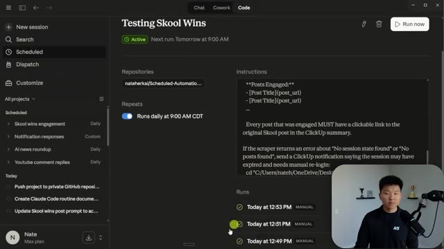
*⏱️ 00:13:28 — Interface de gestion de projet montrant les détails d'une automatisation ("Testing Skool Wins"), incluant les instructions, le calendrier d'exécution et l'historique des runs.*

---

### ⏱️ `[00:13:41 - 00:14:00]` | Segment #35

**🔊 Audio (Transcription Intégrale Mot pour Mot en Français) :**
> We already talked a little bit about writing good prompts, but you definitely want them to be more specific. For example, with my scheduled automation here, this is much more specific, right? I have a skill that I want it to run. I give it the order of operations, but something more like this YouTube comments one, this is not what you'd want to put in there unless you were defining a skill to just let it run.

**👁️ Analyse Visuelle d'Écran (gemini-3.5-flash-lite) :**
**Interface & Outils** : Interface de gestion d'automatisation (probablement une plateforme d'IA pour développeurs).

**Contenu textuel & Code** : Le champ "Instructions" détaille une séquence d'opérations incluant l'exécution de scripts Python locaux (`post_comment.py` et `notify_clickup.py`) via la ligne de commande, avec des placeholders comme `<post_url>` et `
`. On voit également un paramètre de répétition "Runs daily at 9:00 AM CDT".

**Action / Démonstration** : Le présentateur illustre la spécificité requise dans les prompts en montrant une séquence d'automatisation où des ordres précis sont donnés à un agent pour exécuter des tâches en cascade.

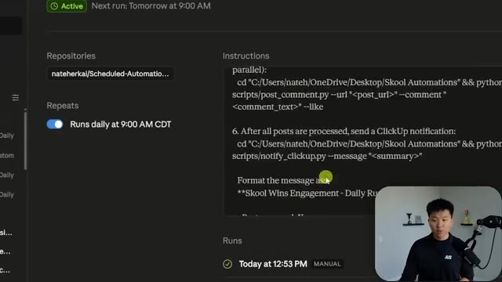
*⏱️ 00:13:46 — Une capture d'écran de l'interface d'une plateforme d'automatisation montrant une configuration de tâche planifiée avec des instructions spécifiques pour exécuter des scripts Python.*

---

### ⏱️ `[00:14:00 - 00:14:24]` | Segment #36

**🔊 Audio (Transcription Intégrale Mot pour Mot en Français) :**
> Because once again, this is supposed to be a one-shot prompt. So you want to make sure it gets it right on the first try. Okay, so why is this so exciting? And why does this beat normal automation? because we are actually keeping the agentic framework. If you know when I talk about the WAT framework where we have workflows and agents and tools, when we actually push those automations to the cloud and it's just sort of a Python script, we're losing the agentic piece.

**👁️ Analyse Visuelle d'Écran (gemini-3.5-flash-lite) :**
**Interface & Outils** : Logiciel de prise de notes ou éditeur de documents de type Notion.

**Contenu textuel & Code** : Texte détaillé comparant "n8n, Zapier, a cron script" avec les "Routines" basées sur Claude Code. Liste des avantages (auto-correction, contexte) et des recommandations pour la mise en place (tester, vérifier les clés API).

**Action / Démonstration** : Le présentateur affiche une diapositive éducative pour structurer l'explication théorique sur le fonctionnement des agents par rapport aux workflows rigides.

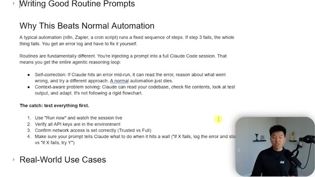
*⏱️ 00:14:06 — Une présentation sous forme de document texte expliquant les avantages des routines par rapport à l'automatisation classique, mettant en avant les capacités d'auto-correction et de résolution de problèmes contextuelle de l'agent Claude.*

---

### ⏱️ `[00:14:24 - 00:14:45]` | Segment #37

**🔊 Audio (Transcription Intégrale Mot pour Mot en Français) :**
> We're only sending off really the tools and the workflow. But in this case, we're keeping the WA and the T all running together because the agent is looking at the CloudMD, it's looking at its scripts and it's figuring out what to do. And if it runs into errors mid-run, it will self-correct. And if you configure it the right way, it will be able to sort of like leave a memory trail and it can leave like, you know, updates.

**👁️ Analyse Visuelle d'Écran (gemini-3.5-flash-lite) :**
**Interface & Outils** : Application de prise de notes ou éditeur de document textuel (probablement Notion).

**Contenu textuel & Code** : Texte explicatif comparant les automatisations classiques (n8n, Zapier) aux "Routines" utilisant Claude Code, mettant en avant la "Self-correction" et le "Context-aware problem solving", ainsi qu'une liste de bonnes pratiques pour tester ces agents.

**Action / Démonstration** : Présentation théorique des concepts permettant de comprendre pourquoi les agents IA (Claude) sont plus robustes que les workflows d'automatisation rigides en cas d'erreurs d'exécution.

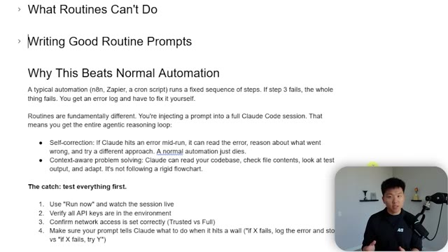
*⏱️ 00:14:29 — Une page de présentation (type Notion ou document éditeur) détaillant les avantages des "Routines" (agents autonomes) par rapport à l'automatisation classique, avec une section sur la capacité d'auto-correction de Claude.*

---

### ⏱️ `[00:14:46 - 00:15:05]` | Segment #38

**🔊 Audio (Transcription Intégrale Mot pour Mot en Français) :**
> Even though each run is stateless, you can still have them kind of continuously get better. And real quick, let's speed run through these common questions. Do I need to know cron syntax? Nope. You just can schedule a natural language super easy. Can it access my local files? Nope. It only gets what's in your GitHub repo or your APIs. What model does it use? You can choose any of the models as you guys saw.

**👁️ Analyse Visuelle d'Écran (gemini-3.5-flash-lite) :**
**Interface & Outils** : Logiciel de prise de notes ou documentation (style Markdown).

**Contenu textuel & Code** : Texte explicatif structuré : « Why This Beats Normal Automation », comparaison entre les automatisations classiques (n8n, Zapier) et Claude Code, concepts de « Self-correction » et « Context-aware problem solving », et conseils pour tester les routines.

**Action / Démonstration** : Affichage informatif statique supportant le discours du présentateur sur les avantages de l'automatisation par agents IA.

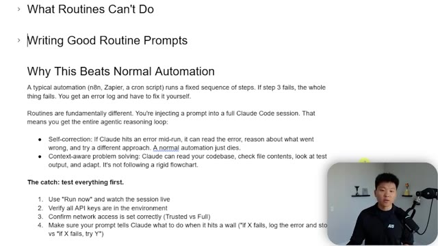
*⏱️ 00:14:50 — Une page de documentation technique (type Notion ou Obsidian) expliquant les avantages des « Routines » sur l'automatisation traditionnelle, avec une liste à puces comparant la gestion des erreurs de Claude Code par rapport aux outils classiques.*

---

### ⏱️ `[00:15:06 - 00:15:24]` | Segment #39

**🔊 Audio (Transcription Intégrale Mot pour Mot en Français) :**
> Can you watch it work in real time? Yes, you can hit run now and then you can obviously watch it go right there. Same way you would in Claude. You can even talk to it after it's done or interrupt it and then continue going. Can it use my MCP service? Yes, that is what the connectors are. Can teammates use my routines? Nope, these belong to your individual account.

**👁️ Analyse Visuelle d'Écran (gemini-3.5-flash-lite) :**
**Interface & Outils** : Navigateur web affichant une liste de questions et réponses (FAQ).

**Contenu textuel & Code** : Texte technique concernant les capacités d'exécution en temps réel ("Can I watch it work in real time?"), l'utilisation des serveurs MCP ("Can it use my MCP servers?"), la collaboration en équipe et la gestion des échecs d'exécution.

**Action / Démonstration** : Le présentateur explique les capacités du système en s'appuyant sur les points affichés à l'écran, notamment la confirmation que l'on peut visualiser l'exécution via une session sur claude.ai.

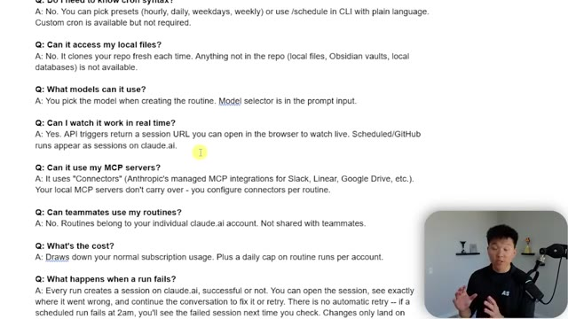
*⏱️ 00:15:10 — Une page de FAQ présentant des questions-réponses sur les fonctionnalités d'automatisation d'IA, avec le présentateur visible en incrustation dans le coin inférieur droit.*

---

### ⏱️ `[00:15:24 - 00:15:57]` | Segment #40

**🔊 Audio (Transcription Intégrale Mot pour Mot en Français) :**
> You might be able to share those if you're on a team plan, but I haven't actually yet tested that myself. What's the cost? It's just your normal subscription usage. So keep that in mind. What happens when a run fails? Every one of them will be stored in your history. So you can go see why they failed. You could maybe even have it at the end of every single routine say, Hey, if this does fail, just shoot me a Slack message to let me know things like that. And can I test a run before going live? Yes. In fact, you should test it multiple times before it goes live. You just go into the routine, you hit run now, and then it will pop up as running. And then you just watch it, you know, watch it go through its order of operations and you can inject and you can

**👁️ Analyse Visuelle d'Écran (gemini-3.5-flash-lite) :**
**Interface & Outils** : Navigateur web affichant une documentation textuelle (format FAQ/Doc).

**Contenu textuel & Code** : Questions et réponses détaillées concernant les serveurs MCP, le partage d'équipe, la facturation (coût d'abonnement), la gestion des échecs d'exécution et les tests manuels.

**Action / Démonstration** : Lecture et présentation visuelle d'une FAQ pour expliquer le comportement du système en cas d'erreur lors d'une exécution de routine.

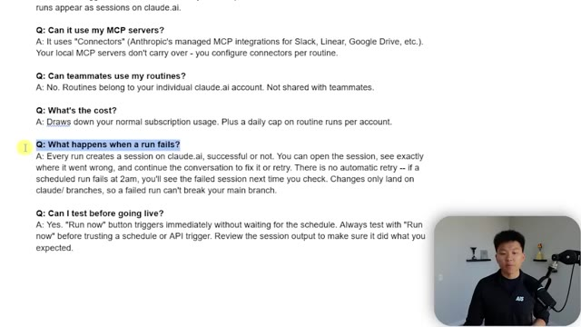
*⏱️ 00:15:32 — Une page de type FAQ présentant une liste de questions et réponses techniques sur le fonctionnement des « routines » dans l'interface Claude.ai, avec la question « What happens when a run fails? » mise en surbrillance.*

---

### ⏱️ `[00:15:57 - 00:16:18]` | Segment #41

**🔊 Audio (Transcription Intégrale Mot pour Mot en Français) :**
> help it correct itself so that you have confidence that once it shoots off the prompt next time, you won't have to get in the way at all. But anyways, that's going to do it for this one. I hope that those tips and some of the examples that I showed you were helpful. And now you can go off and try to migrate your scheduled tasks or any other automations that you've been meaning to build into these web-based routines and not have to keep your hardware on.

**👁️ Analyse Visuelle d'Écran (gemini-3.5-flash-lite) :**
**Interface & Outils** : Interface de plateforme d'automatisation IA (Image 1) ; Interface web de X/Twitter (Image 2).

**Contenu textuel & Code** : Prompt d'analyse de commentaires YouTube utilisant une API (Image 1) ; Annonce officielle de "routines in Claude Code" avec configuration de déclencheurs/connecteurs (Image 2).

**Action / Démonstration** : Consultation et démonstration des résultats d'un agent IA (Image 1) ; Présentation d'une mise à jour logicielle via une annonce sur les réseaux sociaux (Image 2).

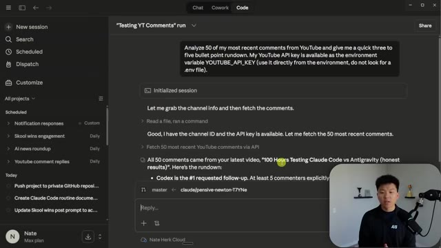
*⏱️ 00:16:02 — Interface de gestion d'agents IA montrant une session active "Testing YT Comments" avec l'analyse de 50 commentaires YouTube et un résumé généré.*

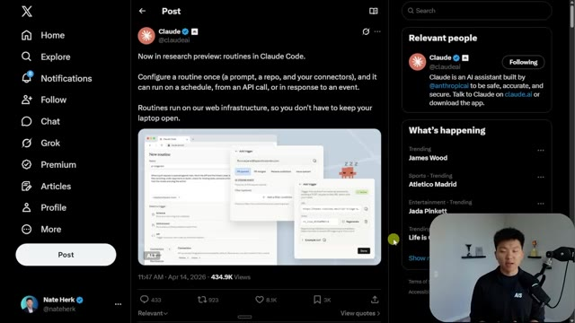
*⏱️ 00:16:08 — Interface de la plateforme X (Twitter) affichant une publication officielle du compte @ClaudeAI concernant la nouvelle fonctionnalité "routines in Claude Code".*

---

### ⏱️ `[00:16:19 - 00:16:27]` | Segment #42

**🔊 Audio (Transcription Intégrale Mot pour Mot en Français) :**
> So if you enjoyed the video or you learned something new, please give it a like. It helps me out a ton. And as always, I appreciate you guys making it to the end of the video. I'll see you on the next one. Thanks everyone.

**👁️ Analyse Visuelle d'Écran (gemini-3.5-flash-lite) :**
**Interface & Outils** : X (Twitter) affichant une interface web de gestion de "routines" pour Claude Code.

**Contenu textuel & Code** : Le tweet mentionne : "Now in research preview: routines in Claude Code. Configure a routine once (a prompt, a repo, and your connectors)...". L'image intégrée au tweet montre des menus contextuels "Add trigger" et des options de configuration de planning et d'API.

**Action / Démonstration** : Affichage informatif d'une annonce de mise à jour produit sur les réseaux sociaux par le présentateur.

*⏱️ 00:16:21 — Une capture d'écran de l'interface du réseau social X (Twitter) affichant un tweet officiel du compte Claude (@claudeai) concernant la fonctionnalité "routines" dans Claude Code. On y voit une image intégrée montrant l'interface utilisateur de configuration des routines et des déclencheurs (triggers).*

---

