# 🎬 Claude + HeyGen Just Changed Content Creation Forever

> **Chaîne** : [Nate Herk | AI Automation](https://www.youtube.com/@nateherk/featured)  
> **Lien YouTube** : [https://www.youtube.com/watch?v=EbJu9T30nfI](https://www.youtube.com/watch?v=EbJu9T30nfI)  
> **Date de publication** : 20260415  
> **Durée** : 00:20:17  
> **Identifiant vidéo** : `EbJu9T30nfI`  
> **Transcription & Analyse** : `whisper-v3-large-turbo+gemini-3.5-flash-lite`  

---

## 📌 Synthèse Exécutive & Outils

### 💡 Résumé
Dans cette vidéo intitulée **Claude + HeyGen Just Changed Content Creation Forever**, Nate Herk décortique les capacités pratiques d'automatisation et de développement propulsées par les modèles de pointe.

### 🛠️ Outils, Modèles & Logiciels Présentés
- **Opus 5.5 & Claude Code** : Modèles d'ingénierie et agents de codage autonome.

### 🔑 Points Clés & Enseignements Stratégiques
- Optimiser le niveau d'effort et le raisonnement des modèles IA pour des résultats industriels.
- Automatiser les cycles de création logicielle de bout en bout.

---

## ⏱️ Chronologie & Transcription Complète Audio & Visuelle (Mot pour Mot)

### ⏱️ `[00:00:00 - 00:00:22]` | Segment #01

**🔊 Audio (Transcription Intégrale Mot pour Mot en Français) :**
> Today, I'm going to show you how I was able to automate hours of recording content using Cloud Code and HeyGen. And some of you may have already guessed this, but yeah, I'm an AI clone of Nate. A lot of comments lately have been saying that he uses an AI avatar, but that's actually not true. This is my first ever time appearing on this YouTube channel. So yeah, that was actually an AI clone of me that I made in like 10 minutes. And I have been testing a ton of different methods.

**👁️ Analyse Visuelle d'Écran (gemini-3.5-flash-lite) :**
**Interface & Outils** : Visual Studio Code (avec extension terminal Claude Code), Plateforme Web HeyGen (Tableau de bord 'Projects').

**Contenu textuel & Code** : Fichiers Python : 'generate_videos.py', 'heygen_update.py', 'requirements.txt', 'state.json'. Terminal : 'Claude Code v2.1.105', 'Opus 4.6 (1M context)'.

**Action / Démonstration** : Navigation dans le système de fichiers pour préparer l'automatisation via Claude Code, et visualisation des résultats de génération de contenu dans HeyGen.

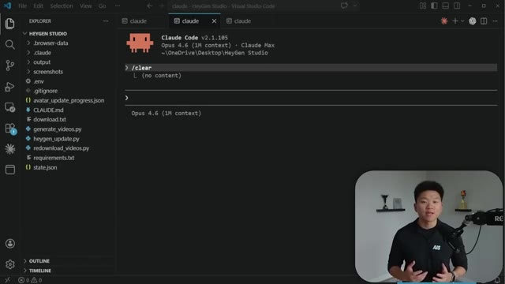
*⏱️ 00:00:06 — Interface de Visual Studio Code affichant le terminal 'Claude Code' avec la commande '/clear' prête à l'emploi dans un répertoire nommé 'HeyGen Studio'.*

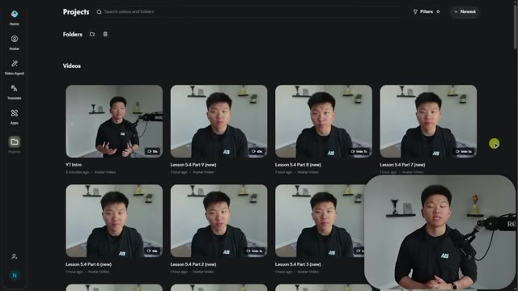
*⏱️ 00:00:11 — Interface de la plateforme HeyGen montrant la bibliothèque de projets avec une grille de multiples vidéos générées par IA (leçons 5.4).*

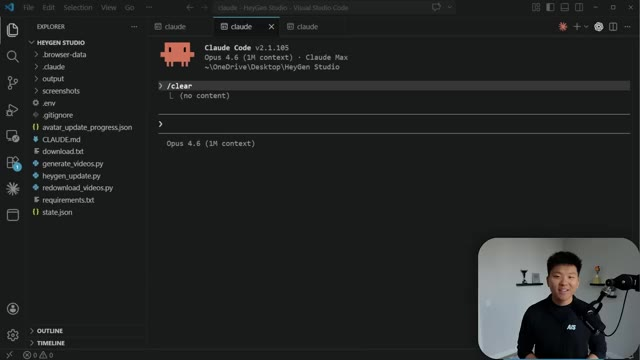
*⏱️ 00:00:17 — Identique à l'image 1 : Interface de Visual Studio Code avec le terminal 'Claude Code' ouvert, montrant les fichiers de script Python associés.*

---

### ⏱️ `[00:00:22 - 00:00:41]` | Segment #02

**🔊 Audio (Transcription Intégrale Mot pour Mot en Français) :**
> If you go through my HeyGen here, you will see literally hundreds of different avatars and scripts that I've ran through here and different methods too. So in today's video, I'm gonna show you how I'm able to use Cloud Code as a complete orchestration layer around three different tools that help me basically go from raw script to finished edited video in minutes. And it's so, so cool.

**👁️ Analyse Visuelle d'Écran (gemini-3.5-flash-lite) :**
**Interface & Outils** : HeyGen (interface web), diagramme de flux personnalisé.

**Contenu textuel & Code** : Noms de projets ("Lesson 5.2", "YT Intro", "Business Audit"), logos des outils (HeyGen, ElevenLabs).

**Action / Démonstration** : Navigation dans l'historique des projets HeyGen et présentation visuelle de l'architecture d'orchestration entre outils.

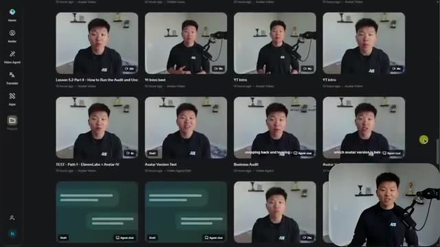
*⏱️ 00:00:27 — Interface HeyGen affichant une bibliothèque de projets et d'avatars générés.*

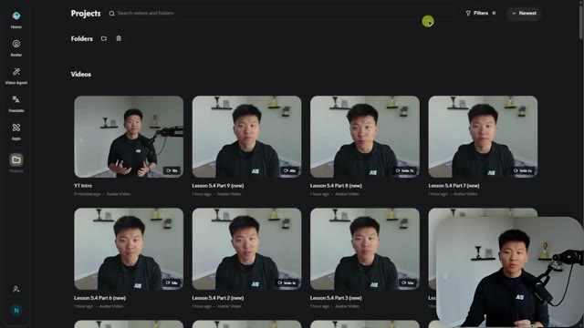
*⏱️ 00:00:31 — Interface HeyGen affichant la liste des dossiers de projets et des fichiers vidéo récents.*

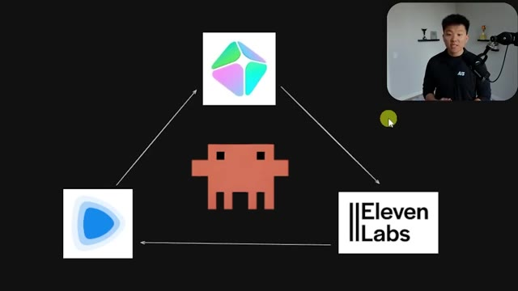
*⏱️ 00:00:36 — Schéma conceptuel représentant un workflow orchestré reliant trois logos d'outils (HeyGen, ElevenLabs et un service non identifié via une icône de pixel art) sur fond noir.*

---

### ⏱️ `[00:00:41 - 00:01:00]` | Segment #03

**🔊 Audio (Transcription Intégrale Mot pour Mot en Français) :**
> So basically what we're doing here is there's three main pieces. We have HeyGen, which is what we use for the actual clone, the actual avatar. We have 11 Labs, which is what we're using for that voice cloning. And then we have Remotion, which is what we're using to edit everything together and give us professional looking motion graphics. So I'm going to show you guys exactly how I set the system up, but first let me show you an output.

**👁️ Analyse Visuelle d'Écran (gemini-3.5-flash-lite) :**
**Interface & Outils** : Outil de tableau blanc numérique / diagramme (type Excalidraw).

**Contenu textuel & Code** : Logos de HeyGen, ElevenLabs et une icône de Remotion (triangle bleu stylisé), reliés par des flèches en triangle. Texte manuscrit "HeyGen" et liste textuelle "ElevenLabs Remotion" sur la droite.

**Action / Démonstration** : Présentation visuelle de l'architecture du système utilisée pour automatiser la création de contenu vidéo.

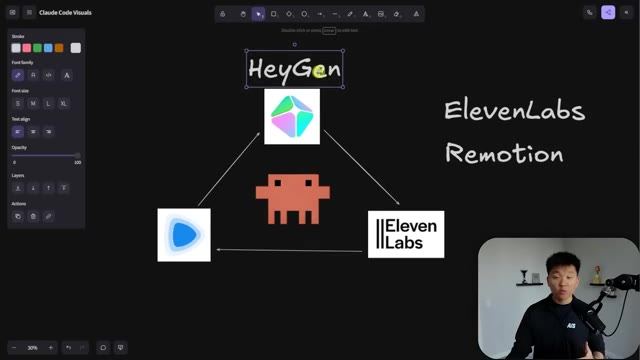
*⏱️ 00:00:46 — Un schéma illustrant le workflow technique composé de trois outils (HeyGen, ElevenLabs, Remotion) représentés par leurs logos et des flèches directionnelles, réalisé dans une application de tableau blanc numérique.*

---

### ⏱️ `[00:01:01 - 00:01:19]` | Segment #04

**🔊 Audio (Transcription Intégrale Mot pour Mot en Français) :**
> So I'm going to play some clips right up here and just let me know what you think. Lesson 5.0, the audit is how you become a partner. Up to this point in the course, everything you've learned has been about getting in the door. Finding clients, starting conversations, running discovery calls that surface real problems, delivering a project that proves you can do the work.

**👁️ Analyse Visuelle d'Écran (gemini-3.5-flash-lite) :**
**Interface & Outils** : Aucune interface logicielle ou technique.

**Contenu textuel & Code** : Aucun contenu informationnel ou technique.

**Action / Démonstration** : Aucune action technique montrée.

---

### ⏱️ `[00:01:20 - 00:01:39]` | Segment #05

**🔊 Audio (Transcription Intégrale Mot pour Mot en Français) :**
> And if you've been following along, you may have already done some of this. Maybe you've landed a client through Upwork and delivered your first automation. Maybe you've reached out to your warm network, had a few conversations, and booked a discovery call. You send the invoice, the work wraps up, and you're back to looking for the next one, or the discovery call surfaces a real problem.

**👁️ Analyse Visuelle d'Écran (gemini-3.5-flash-lite) :**
**Interface & Outils** : Diapositive de présentation graphique (style présentation de cours).

**Contenu textuel & Code** : Texte affiché : "The One-Off Project Cycle", "1 Project", "2 Invoice", et logo "AIS" en haut à droite.

**Action / Démonstration** : Illustration conceptuelle du cycle de vie d'un projet ponctuel (One-Off Project) pour les freelances/agences d'automatisation.

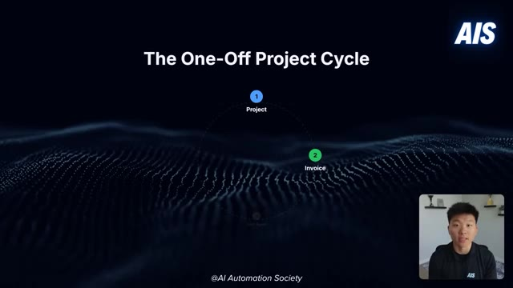
*⏱️ 00:01:24 — Une diapositive de présentation sombre présentant un schéma circulaire intitulé "The One-Off Project Cycle", illustrant les deux étapes principales : 1. Project et 2. Invoice.*

---

### ⏱️ `[00:01:39 - 00:02:00]` | Segment #06

**🔊 Audio (Transcription Intégrale Mot pour Mot en Français) :**
> And you can see that the business has issues in five different places, but you're only talking about one of them. That gap between, I did a good job on one thing, and I'm helping this business get better over time, is where most freelancers get stuck. You've been building those skills through discovery calls, through learning to diagnose workflows, through mapping processes and identifying bottlenecks.

**👁️ Analyse Visuelle d'Écran (gemini-3.5-flash-lite) :**
**Interface & Outils** : Logiciel de présentation (type diaporama).

**Contenu textuel & Code** : Le texte affiche trois étapes : "Send the invoice", "Work wraps up", "Back to looking for the next one".

**Action / Démonstration** : Illustration conceptuelle du piège de la recherche constante de nouveaux clients plutôt que de la rétention, dans le contexte de la discussion sur les problèmes business.

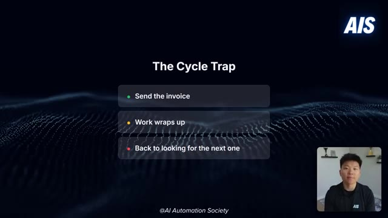
*⏱️ 00:01:45 — Une diapositive de présentation titrée "The Cycle Trap" illustrant les étapes répétitives du travail en freelance avec une liste à puces.*

---

### ⏱️ `[00:02:00 - 00:02:18]` | Segment #07

**🔊 Audio (Transcription Intégrale Mot pour Mot en Français) :**
> The audit applies those same skills at a broader scale. So yeah, there might be a few minor imperfections, but the fact that we have the face cam in the lower right and the fact that the script was still written by me, so that's still my raw and real thoughts on the actual tutorial, I don't really see a problem with it. I'm never going to AI avatar this YouTube channel.

**👁️ Analyse Visuelle d'Écran (gemini-3.5-flash-lite) :**
**Interface & Outils** : Application de tableau blanc virtuel (Excalidraw).

**Contenu textuel & Code** : Logotypes et noms : "HeyGen", "Remotion", "ElevenLabs" avec des flèches directionnelles reliant les services et une icône centrale en forme de créature pixélisée.

**Action / Démonstration** : Présentation visuelle d'une architecture système ou d'un flux de travail automatisé entre les outils mentionnés.

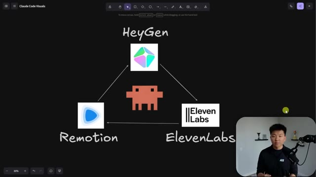
*⏱️ 00:02:05 — Schéma de workflow montrant l'interaction entre trois outils technologiques (HeyGen, Remotion, ElevenLabs) disposés en triangle, avec le présentateur en incrustation vidéo dans le coin inférieur droit.*

---

### ⏱️ `[00:02:18 - 00:02:42]` | Segment #08

**🔊 Audio (Transcription Intégrale Mot pour Mot en Français) :**
> I like making the videos and I'm always gonna keep doing this. But think about what this means for short form content or for course material or for advertisements, where really in the grand scheme of things, the best content wins. So why is this such a big deal now? It's because Heijen has created a new model called Avatar 5. Previously, we had Avatar 3 and Avatar 4, which were decent, but they still had, you know, really bad lip movements or really robotic, you know, just gestures.

**👁️ Analyse Visuelle d'Écran (gemini-3.5-flash-lite) :**
**Interface & Outils** : Tableau blanc numérique (ex: Excalidraw) pour l'image 1 ; interface web de HeyGen pour l'image 2.

**Contenu textuel & Code** : Logos et noms des outils (HeyGen, ElevenLabs, Remotion) ; titres de projets vidéo dans HeyGen.

**Action / Démonstration** : Visualisation d'une architecture de workflow pour la création de contenu IA dans l'image 1 ; navigation dans le tableau de bord des projets vidéo dans l'image 2.

*⏱️ 00:02:24 — Un schéma conceptuel montrant un écosystème technologique triangulaire reliant HeyGen, ElevenLabs et Remotion.*

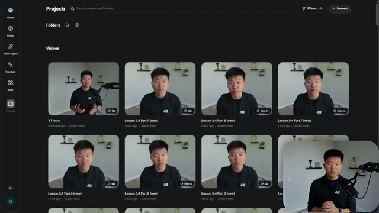
*⏱️ 00:02:30 — L'interface utilisateur de la plateforme HeyGen affichant une bibliothèque de projets vidéo, incluant plusieurs segments de cours ("Lesson 5.4").*

---

### ⏱️ `[00:02:42 - 00:03:16]` | Segment #09

**🔊 Audio (Transcription Intégrale Mot pour Mot en Français) :**
> So for example, if I click into one of these newer ones that I generated, which was using the new Avatar 5, this is what we get. Your audit engagement kit is now fully fleshed out with four sections. Pitch scripts, interview guide, report template, and retainer transition script. All of those movements there actually look natural and it learned from me about you know Like how my head moves or how my lips move things like that But if I go back to an older one that we did without using avatar 5, you know, maybe this one used avatar 3 Lesson 5.0 the audit is how you become a partner Up to this point in the course everything you've learned has been about getting in the door

**👁️ Analyse Visuelle d'Écran (gemini-3.5-flash-lite) :**
**Interface & Outils** : Plateforme de création de contenu vidéo par IA (interface web de type studio d'édition).

**Contenu textuel & Code** : Textes de l'interface : "Lesson 5.4 Part 9", "New revision in AI Studio", "Translate", "Summary: Transform your audit process with our comprehensive kit".

**Action / Démonstration** : Navigation et consultation de leçons générées par un avatar IA au sein d'une interface de gestion de projet/contenu.

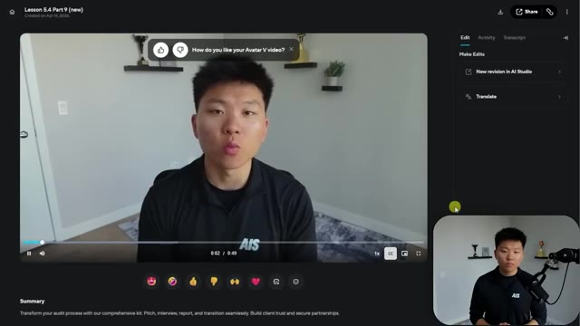
*⏱️ 00:02:51 — Interface de lecture vidéo montrant un avatar IA en plein discours, avec un panneau latéral droit proposant des options d'édition ("New revision in AI Studio", "Translate") et une section "Summary" en bas décrivant le kit d'audit.*

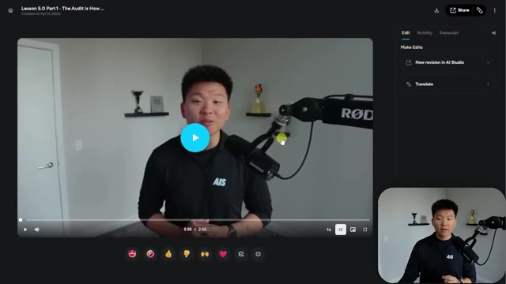
*⏱️ 00:03:07 — Interface de lecture vidéo similaire sur une autre leçon ("Lesson 5.0 Part 1"), avec le lecteur vidéo en pause et le panneau latéral d'édition visible.*

---

### ⏱️ `[00:03:16 - 00:03:36]` | Segment #10

**🔊 Audio (Transcription Intégrale Mot pour Mot en Français) :**
> Finding clients starting conversation. It's really not horrible But if someone knows me and they look at that They're going to see that my lips are moving weird and that I just feel more like a robot So the first step here is setting up your avatar clone. And I know that we have a few different things going on in this tech stack. So at the end, I'm gonna cover like the pricing and the usage, but let's just continue on with like how you actually start to do this stuff.

**👁️ Analyse Visuelle d'Écran (gemini-3.5-flash-lite) :**
**Interface & Outils** : HeyGen (plateforme de génération vidéo), tableau blanc numérique (type Excalidraw ou Miro).

**Contenu textuel & Code** : Logos et noms des outils : HeyGen, Remotion, ElevenLabs disposés en triangle avec des flèches directionnelles. Liste de fichiers vidéo nommés "Avatar Video" et "Lesson 5.0 Part 1".

**Action / Démonstration** : Navigation dans la bibliothèque de projets de l'interface de création d'avatar, suivie de la présentation d'un diagramme de flux technologique entre les outils IA utilisés.

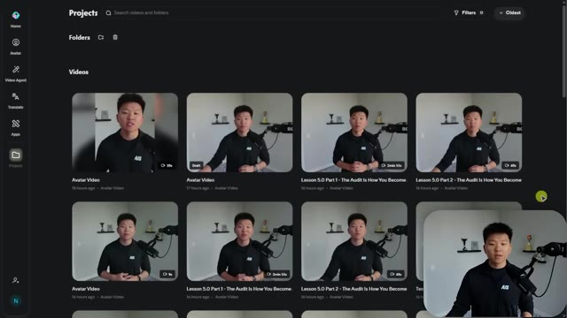
*⏱️ 00:03:26 — Tableau de bord d'une plateforme SaaS (probablement HeyGen) affichant une bibliothèque de projets de vidéos d'avatars.*

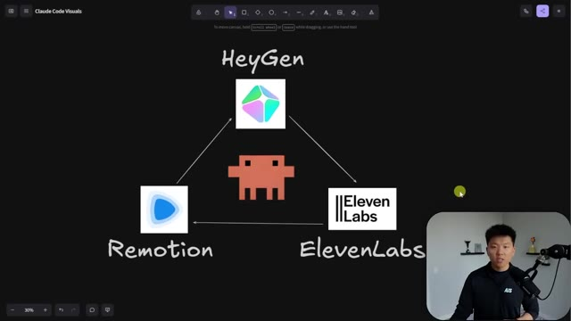
*⏱️ 00:03:31 — Schéma conceptuel sur un tableau blanc numérique montrant un workflow reliant les outils HeyGen, Remotion et ElevenLabs.*

---

### ⏱️ `[00:03:36 - 00:03:58]` | Segment #11

**🔊 Audio (Transcription Intégrale Mot pour Mot en Français) :**
> So if I click on avatar up here, you can see that we're able to do a really quick create and I can choose some of these other looks over here. But if you go to avatar, this is where you can actually generate one. So you can see that I have a few different ones. I've tried different ones, like I said, and ultimately I liked this one the most because I ended up using this to train it on way more data. But if I come up here and click on create avatar, you can clone yourself, right?

**👁️ Analyse Visuelle d'Écran (gemini-3.5-flash-lite) :**
**Interface & Outils** : Application web de génération de vidéos par IA (type HeyGen ou plateforme similaire).

**Contenu textuel & Code** : Zone de saisie "Script", sélecteurs de style d'avatar ("Nate Herk (new)"), et vignettes de portraits vidéo.

**Action / Démonstration** : Navigation dans l'interface de création d'avatars et présentation des différentes options de personnalisation d'apparence.

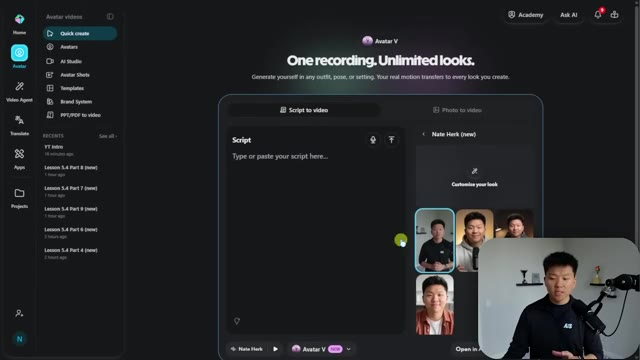
*⏱️ 00:03:42 — Interface de création de vidéo par IA montrant l'espace de travail avec un éditeur de script et une sélection de prévisualisations d'avatars personnalisés du présentateur.*

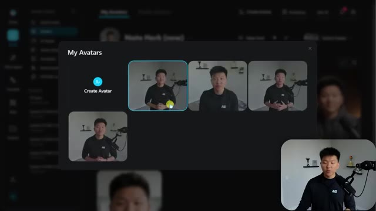
*⏱️ 00:03:47 — Fenêtre modale "My Avatars" affichant une galerie de différents modèles d'avatars générés pour le présentateur, avec une option pour en créer de nouveaux.*

---

### ⏱️ `[00:03:58 - 00:04:31]` | Segment #12

**🔊 Audio (Transcription Intégrale Mot pour Mot en Français) :**
> And so this is where you could record and my camera's occupied because i'm filming But it literally gives you a script and you read it off and it takes 15 seconds And then you get an avatar 5 clone that is really really good That's the one that you saw in like the youtube intro or what you could do is you could upload footage So what I did is I uploaded footage. I uploaded about 10 gigabytes of footage So it had a lot more data to train on me And then I created the one where i'm like sitting down in my chair So anyways, once you do that in a matter of minutes, you have an avatar Now it'll automatically clone your voice, but it's just not very good. And even though you can import voices from 11labs

**👁️ Analyse Visuelle d'Écran (gemini-3.5-flash-lite) :**
**Interface & Outils** : HeyGen (interface web de création d'avatar).

**Contenu textuel & Code** : Message système "Create your Avatar in 15 seconds", notification d'erreur "Camera is occupied" (Error: DeviceInUseError), et options de sélection de langue pour le script.

**Action / Démonstration** : Tentative infructueuse d'accès à la webcam pour l'enregistrement des données de mouvement nécessaires à la création de l'avatar.

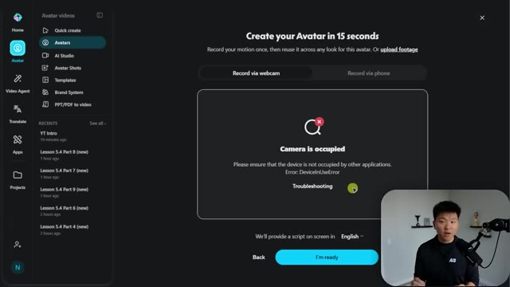
*⏱️ 00:04:06 — Interface de la plateforme HeyGen affichant un message d'erreur "Camera is occupied" lors de la tentative de création d'un avatar IA, avec le présentateur en médaillon.*

---

### ⏱️ `[00:04:31 - 00:05:07]` | Segment #13

**🔊 Audio (Transcription Intégrale Mot pour Mot en Français) :**
> I've imported the voice that i'm going to show you guys today from 11labs into HeyGen, but it still doesn't sound the same So like right here, I was able to import my voice from 11labs. So I went to switch and I went to import from third party And I imported it from 11labs right here as you can see And this is my professional voice clone that I got from 11labs, but just take a listen to this hi i'm excited you're here this is your voice clone preview take a quick listen like that does not sound very good but it's weird because in 11 labs it sounds phenomenal so that's why we're kind of doing this multi-stage step so let me pull up 11 labs now and by the way the links to all

**👁️ Analyse Visuelle d'Écran (gemini-3.5-flash-lite) :**
**Interface & Outils** : HeyGen (plateforme de génération de vidéos IA).

**Contenu textuel & Code** : Paramètres de voix : "Voice engine: ElevenLabs", curseurs de vitesse et volume, et options de feedback ("Sounds too flat", "Poor audio quality", etc.).

**Action / Démonstration** : Le présentateur démontre l'utilisation d'une voix importée depuis ElevenLabs au sein de l'éditeur HeyGen.

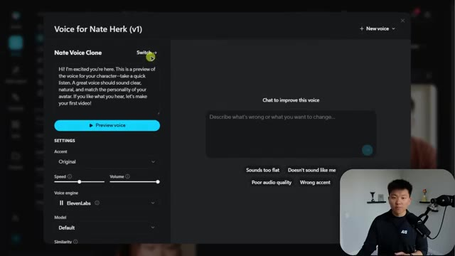
*⏱️ 00:04:40 — Interface de configuration vocale dans HeyGen affichant les détails de "Nate Voice Clone" avec l'option "ElevenLabs" sélectionnée comme moteur vocal.*

---

### ⏱️ `[00:05:07 - 00:05:43]` | Segment #14

**🔊 Audio (Transcription Intégrale Mot pour Mot en Français) :**
> these tools will be down in the description but in 11 labs what you're going to do is you're going to go to voices and you're going to create a new voice so right here in my voice as you can see that i've got this one the nate voice clone so when you go to create a voice you can do a few different options. You can have an instant voice clone, which is really quick, super simple, but it's not going to be as good as the professional voice clone. Like I ended up putting in two hours worth of my voice and that's how I got this thing really, really good. You probably don't need two hours, but it says that you need at least 30 minutes. So you literally will just either speak into it for two minutes or upload, you know, a clip of you talking for two minutes or however long you need

**👁️ Analyse Visuelle d'Écran (gemini-3.5-flash-lite) :**
**Interface & Outils** : ElevenLabs (plateforme web de synthèse vocale).

**Contenu textuel & Code** : Liste des voix enregistrées, incluant "Nate Voice Clone", "Young Jamal", "Mark", "Aisha", "Archer", "Jerry B.", et "Ryan Kurk", avec leurs drapeaux de langue et tags de catégorie.

**Action / Démonstration** : Navigation dans le panneau "My Voices" pour consulter les clones vocaux existants sur le compte utilisateur.

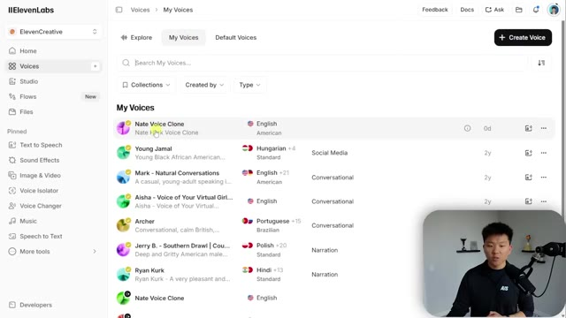
*⏱️ 00:05:16 — Interface utilisateur de la plateforme ElevenLabs affichant la section "My Voices" avec une liste de clones vocaux.*

---

### ⏱️ `[00:05:43 - 00:06:18]` | Segment #15

**🔊 Audio (Transcription Intégrale Mot pour Mot en Français) :**
> to do it. And then you'll get a voice clone really quick. And then when you want to use that voice clone, you basically just click on this button over here and you can enter in the script. And this is the one that you guys saw in the intro of this video. And then you can basically just generate it and you can play with the speed, the stability, the similarity, the style exaggeration, all this kind of stuff. So let me just show you guys real quick. If I hit generate today, I'm going to show you how I was able to automate hours of recording content using Claude code and Hey Jen. Okay, cool. So you guys can tell that that sounds like me. Obviously you might want to play with these things a little bit and keep testing. I went through tons and tons of

**👁️ Analyse Visuelle d'Écran (gemini-3.5-flash-lite) :**
**Interface & Outils** : Plateforme web ElevenLabs (mode Text to Speech).

**Contenu textuel & Code** : Texte saisi : "Today, I'm going to show you how I was able to automate hours of recording content using Claude Code and HeyGen..." ; Paramètres : "Nate Voice Clone", "Eleven Multilingual v2", réglages de vitesse, stabilité et similarité.

**Action / Démonstration** : Préparation à la génération audio via le bouton "Generate speech" en bas de page.

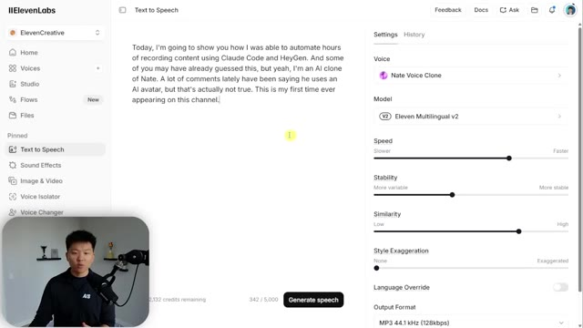
*⏱️ 00:05:52 — Interface utilisateur de ElevenLabs montrant le module 'Text to Speech' avec un script saisi dans l'éditeur central et les paramètres de configuration de voix sur le panneau latéral droit.*

---

### ⏱️ `[00:06:18 - 00:06:52]` | Segment #16

**🔊 Audio (Transcription Intégrale Mot pour Mot en Français) :**
> different iterations of the best settings. And I got to a place that I feel like sounds the most like me with my inflection and things like that. So then basically what we're doing is we're downloading that file. This is the, you know, 16 second clip of this audio. So if I download this, I have that 11 labs audio file right here. And then I'm going to go back into Hey Jen. I'm going to go ahead and go to AI studio. And this is going to let us basically drop in an audio and it gets synced up to our avatar. So I'll click on upload audio. I will drag in that 11 labs file that we just got right here. And then when I add that, it's going to transcribe it. And then we can generate

**👁️ Analyse Visuelle d'Écran (gemini-3.5-flash-lite) :**
**Interface & Outils** : ElevenLabs (Image 1), HeyGen (Images 2 et 3).

**Contenu textuel & Code** : Paramètres de synthèse vocale (Vitesse, Stabilité, Similarité, Exagération de style) et script textuel dans ElevenLabs ; sélecteur d'avatar et configuration de scène dans HeyGen.

**Action / Démonstration** : Ajustement des paramètres de clonage vocal pour obtenir une intonation naturelle, sélection d'une variante d'avatar, et préparation de l'environnement de génération vidéo.

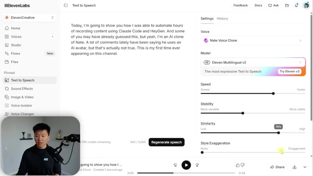
*⏱️ 00:06:27 — Interface de ElevenLabs montrant le panneau de configuration "Text to Speech" avec les paramètres de la voix "Nate Voice Clone".*

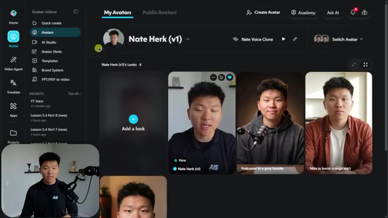
*⏱️ 00:06:35 — Interface de HeyGen affichant la bibliothèque d'avatars personnalisés et les différentes variantes visuelles du présentateur (Nate Herk v1).*

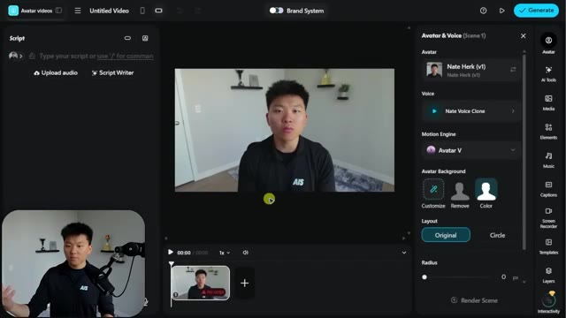
*⏱️ 00:06:43 — Éditeur vidéo HeyGen en mode projet, permettant la configuration de l'avatar, de la voix et des éléments de mise en page pour la génération de vidéo.*

---

### ⏱️ `[00:06:52 - 00:07:12]` | Segment #17

**🔊 Audio (Transcription Intégrale Mot pour Mot en Français) :**
> this video using, like I said, that audio file and then our avatar. And this is where you see that we have avatar five. We have three, we have four, but five is the new one. And five is the one that is obviously the absolute best. So I'm going to go ahead and generate this scene. And we're just going to call this a demo. Now this is going to take, um, I don't know, maybe 30 seconds to a minute.

**👁️ Analyse Visuelle d'Écran (gemini-3.5-flash-lite) :**
**Interface & Outils** : HeyGen (Plateforme de création de vidéos par IA).

**Contenu textuel & Code** : Paramètres de projet : sélection "Avatar V", titre "Demo", résolution "1080p", format "MP4", et indication de coût (6 crédits premium).

**Action / Démonstration** : Sélection de la version de l'avatar dans le panneau de droite (Image 1) puis déclenchement de la fenêtre de génération vidéo pour finaliser le projet (Image 2).

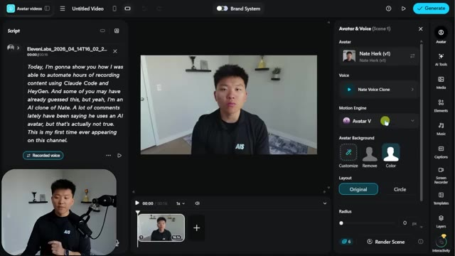
*⏱️ 00:06:57 — Interface d'édition vidéo HeyGen montrant la configuration de l'avatar (sélection "Avatar V"), de la voix et du script associé.*

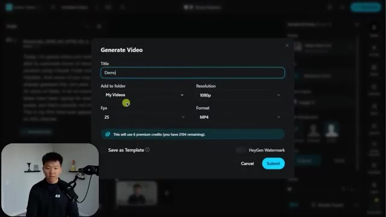
*⏱️ 00:07:07 — Fenêtre modale de finalisation "Generate Video" permettant de configurer le titre, la résolution, le format et le crédit utilisé avant l'exportation.*

---

### ⏱️ `[00:07:12 - 00:07:36]` | Segment #18

**🔊 Audio (Transcription Intégrale Mot pour Mot en Français) :**
> Obviously it depends on how long the video is. So I'll check back in with you guys when this is done. All right, so that just finished up. And one thing you'll notice real quick is this one was 16 seconds and this one was 19, even though they were the same. So that just kind of shows that the 11 Labs model still is going to output something a little bit different each time. But anyways, let's click into this and give it a quick watch. Today, I'm going to show you how I was able to automate hours of recording content using Cloud Code and Heyjen.

**👁️ Analyse Visuelle d'Écran (gemini-3.5-flash-lite) :**
**Interface & Outils** : Plateforme HeyGen (gestion de vidéos) et interface web ElevenLabs (générateur de synthèse vocale).

**Contenu textuel & Code** : Panneaux de contrôle pour la synthèse vocale, paramètres de modèle "Eleven Multilingual v2", et galerie de vidéos générées par IA avec durées (16s, 19s).

**Action / Démonstration** : Navigation dans l'interface de projets HeyGen et démonstration du processus de génération/lecture de contenu vidéo par IA.

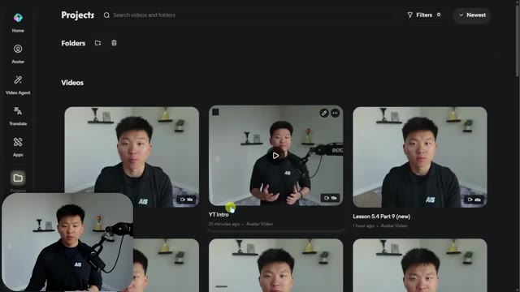
*⏱️ 00:07:18 — Interface de gestion de projets HeyGen affichant une grille de miniatures de vidéos d'avatar avec leur durée respective.*

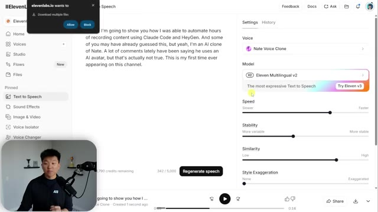
*⏱️ 00:07:24 — Interface de génération vocale ElevenLabs avec le panneau de réglages des paramètres (modèle, vitesse, stabilité, similarité) et un texte généré.*

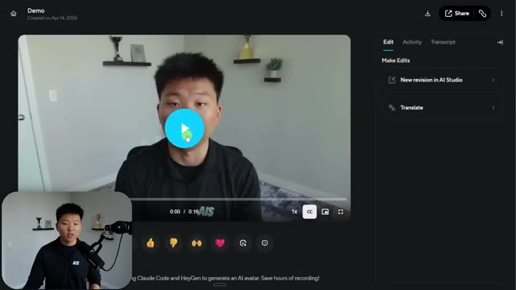
*⏱️ 00:07:30 — Lecteur vidéo intégré de HeyGen permettant de visionner une "Demo" avec des options d'édition et de traduction sur le panneau latéral.*

---

### ⏱️ `[00:07:36 - 00:07:58]` | Segment #19

**🔊 Audio (Transcription Intégrale Mot pour Mot en Français) :**
> And some of you may have already guessed this, but yeah, I'm an AI clone of Nate. A lot of, I mean, like you can see my eyes dart around a little bit. I like swallowed in the clip. I just think it looks so much more real. There's obviously a few things, like I said, that aren't perfect. Sometimes it's like extra exaggeration. And sometimes I've noticed if I lift up my arm, there will be like a little red triangle down there because it doesn't actually know what's behind me.

**👁️ Analyse Visuelle d'Écran (gemini-3.5-flash-lite) :**
**Interface & Outils** : HeyGen (interface web de studio vidéo IA)

**Contenu textuel & Code** : Options "New revision in AI Studio" et "Translate" dans le panneau latéral ; barre de progression de lecture vidéo (0:09 / 0:16).

**Action / Démonstration** : Visualisation et démonstration de l'interface de montage d'un avatar IA.

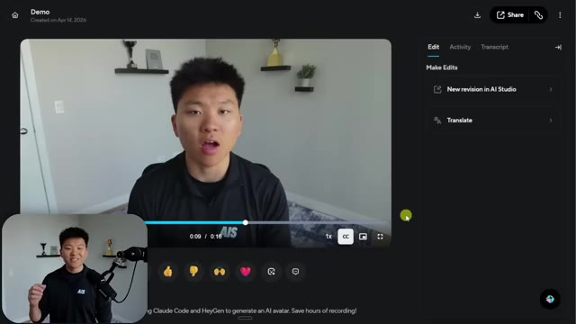
*⏱️ 00:07:42 — Interface de la plateforme HeyGen affichant une vidéo d'avatar IA en cours de lecture, avec un panneau latéral de contrôle pour les éditions et une vignette incrustée du présentateur en bas à gauche.*

---

### ⏱️ `[00:07:58 - 00:08:17]` | Segment #20

**🔊 Audio (Transcription Intégrale Mot pour Mot en Français) :**
> So little things like that, but those can be worked out. And especially when this gets zoomed down to a face cam, rather than being full screen, it's very hard to tell. But the voice is like the most important thing. And that is why you have to go over to 11 Labs to get that voice clone. So you guys may have also noticed if I keep scrolling through my dashboard here, that all of these clips are just about a minute.

**👁️ Analyse Visuelle d'Écran (gemini-3.5-flash-lite) :**
**Interface & Outils** : Plateforme de gestion de contenu vidéo (type Loom).

**Contenu textuel & Code** : Options de menu : « New revision in AI Studio », « Translate », « Edit », « Activity », « Transcript ».

**Action / Démonstration** : Navigation dans l'interface de révision ou d'édition de la vidéo.

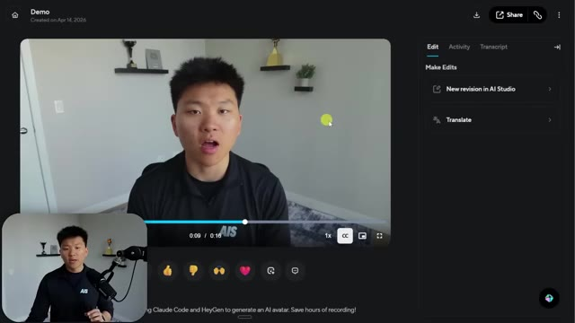
*⏱️ 00:08:12 — Interface de lecture vidéo et d'édition (probablement une plateforme de gestion de contenu vidéo comme Loom ou un outil similaire) montrant les options « New revision in AI Studio » et « Translate ».*

---

### ⏱️ `[00:08:18 - 00:08:53]` | Segment #21

**🔊 Audio (Transcription Intégrale Mot pour Mot en Français) :**
> And the reason I did this is because there's a few limitations. The first one being, HeyGen doesn't let you, oh my gosh, look at this guy. He is intense. But HeyGen makes your avatar five generations capped at three minutes. So if you have a script that's six minutes long, you'd have to chunk that up. But the other reason is in 11 labs, if you let these run too long, I mean, obviously you've got a character limit here, 5,000, but once you push past about a minute of audio, It starts to degrade and it starts to sound less and less like you as that audio file gets longer So I basically found that 45 seconds to a minute is the sweet spot where it still sounds like me throughout

**👁️ Analyse Visuelle d'Écran (gemini-3.5-flash-lite) :**
**Interface & Outils** : HeyGen (gestion de bibliothèque vidéo) et ElevenLabs (plateforme de synthèse vocale).

**Contenu textuel & Code** : Noms des fichiers vidéo dans HeyGen (ex: "Lesson 5.4 Part 2") et texte du script dans ElevenLabs mentionnant l'automatisation avec Claude Code et HeyGen.

**Action / Démonstration** : Démonstration de la nécessité de découper les scripts longs en segments (HeyGen) et configuration des paramètres de voix clonée (ElevenLabs).

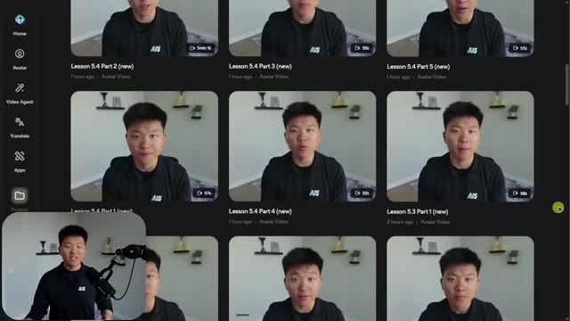
*⏱️ 00:08:27 — Interface HeyGen affichant une bibliothèque de projets vidéo (avatars) en grille, illustrant la fragmentation des leçons en plusieurs parties.*

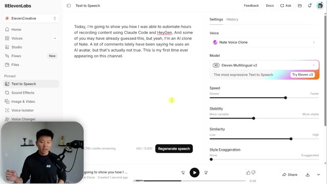
*⏱️ 00:08:44 — Interface ElevenLabs ouverte sur la fonctionnalité "Text to Speech" avec un script en cours de génération et les réglages de voix "Nate Voice Clone".*

---

### ⏱️ `[00:08:53 - 00:09:15]` | Segment #22

**🔊 Audio (Transcription Intégrale Mot pour Mot en Français) :**
> So then I started to realize okay So i've got like all of these scripts that I need to record that are about 10 minutes long And how do I actually do this? This is going to be super super manual for me to paste in Chunks of my script get the audio bring it over to hey jen and just do this all manually then stitch it together So I just started talking to Cloud Code. And I was like, hey, I've kind of got this idea of using HeyGen and using 11labs.

**👁️ Analyse Visuelle d'Écran (gemini-3.5-flash-lite) :**
**Interface & Outils** : ElevenLabs (plateforme de synthèse vocale).

**Contenu textuel & Code** : Texte affiché dans la zone d'édition : "Today, I'm going to show you how I was able to automate hours of recording content using Claude Code and HeyGen..." ; réglages de voix "Nate Voice Clone" et modèle "Eleven Multilingual v2".

**Action / Démonstration** : Saisie et configuration du texte pour la génération audio (TTS), le curseur montre le réglage des paramètres de voix (vitesse, stabilité, similarité).

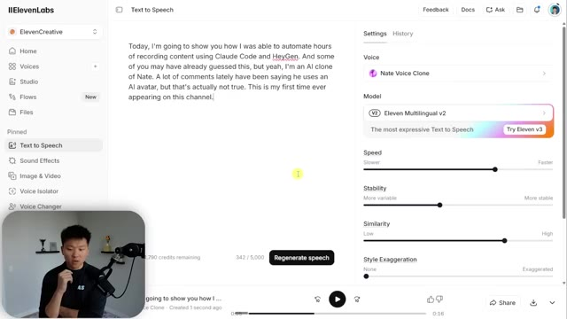
*⏱️ 00:08:59 — Interface web d'ElevenLabs affichant l'éditeur "Text to Speech" avec le script de la vidéo en cours de traitement.*

---

### ⏱️ `[00:09:16 - 00:09:37]` | Segment #23

**🔊 Audio (Transcription Intégrale Mot pour Mot en Français) :**
> Can you help me do this? And so it did research on the API documentation. And it found that it could do all of this automated. So now what happens is I come into Cloud Code. And I say, hey, go look through my Google Drive. Go find these scripts. And then just start processing them for me. And so now it will take a script. And if you come over here and you see the output, you can see we have the scripts.

**👁️ Analyse Visuelle d'Écran (gemini-3.5-flash-lite) :**
**Interface & Outils** : - Image #1 : Documentation API HeyGen (Web).
- Image #2 : Visual Studio Code avec terminal Claude Code (CLI).

**Contenu textuel & Code** : - Image #1 : Documentation technique, structure de requête API (cURL) pour générer des vidéos, paramètres JSON (resolution, aspect_ratio, voice_settings).
- Image #2 : Liste de fichiers Python (`generate_videos.py`, `heygen_update.py`), interface de commande `/clear`, version de l'agent (Opus 4.6).

**Action / Démonstration** : - Image #1 : Recherche et analyse de la documentation API pour comprendre l'automatisation.
- Image #2 : Utilisation de l'environnement de développement pour exécuter les scripts via l'agent Claude Code.

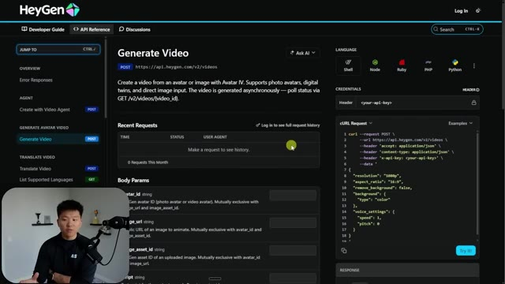
*⏱️ 00:09:21 — Interface de documentation de l'API HeyGen montrant le point de terminaison "Generate Video" avec des exemples de requêtes cURL et les paramètres du corps de la requête.*

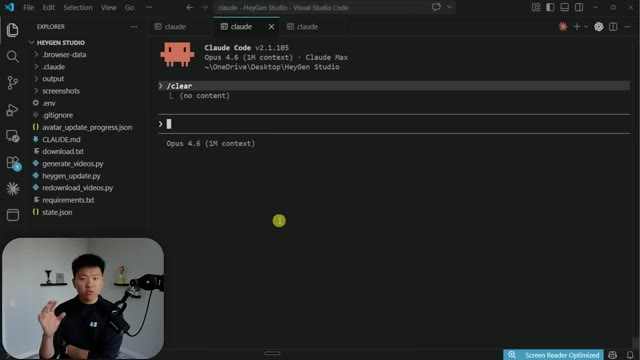
*⏱️ 00:09:26 — Éditeur VS Code affichant le terminal "Claude Code v2.1.105" (Opus 4.6) avec une arborescence de fichiers de projet Python sur la gauche.*

---

### ⏱️ `[00:09:37 - 00:09:56]` | Segment #24

**🔊 Audio (Transcription Intégrale Mot pour Mot en Français) :**
> And it's chunking them up. So for lesson five, it had to chunk up part one, part two, part three, part four, and it chunks them up to basically equal about 45 to 60 seconds of me speaking. And then it takes those chunked up scripts, shoots those over to Hey Jen, and then we get back all these part one, part two, part three, part four videos.

**👁️ Analyse Visuelle d'Écran (gemini-3.5-flash-lite) :**
**Interface & Outils** : Visual Studio Code (VS Code).

**Contenu textuel & Code** : Arborescence de fichiers contenant des scripts textuels découpés (lesson-5.0-part-1 à part-11) ; le fichier "lesson-5.0-part-3.txt" est ouvert, montrant des lignes de texte sur l'audit et l'identification des goulots d'étranglement.

**Action / Démonstration** : Navigation dans l'arborescence du projet pour démontrer le découpage automatisé des scripts en plusieurs segments avant leur envoi vers HeyGen.

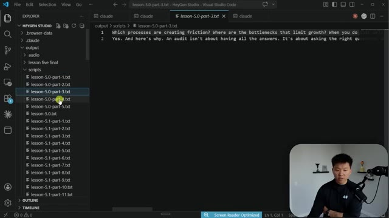
*⏱️ 00:09:42 — L'éditeur Visual Studio Code affiche une arborescence de fichiers organisée par parties de scripts (lesson-5.0-part-1.txt à 11.txt) dans un dossier nommé "scripts".*

---

### ⏱️ `[00:09:56 - 00:10:21]` | Segment #25

**🔊 Audio (Transcription Intégrale Mot pour Mot en Français) :**
> And then these are what we feed into the next step of FFmpeg and Remotion to edit everything together and add those motion graphics. So like I know that sounds complicated, right? But we're taking a super, super manual process of me copying and pasting things and moving things around and we're just orchestrating all of that together in cloud code. So like literally last night, I said, hey, go process lessons 5.0 through 5.4 and I went to bed and I woke up and they were all just done.

**👁️ Analyse Visuelle d'Écran (gemini-3.5-flash-lite) :**
**Interface & Outils** : Visual Studio Code, Claude Code CLI.

**Contenu textuel & Code** : Arborescence de fichiers de projet (dossier 'output' avec des fichiers .mp4), prompt de commande Claude Code avec indicateur de modèle 'Opus 4.6 (1M context)'.

**Action / Démonstration** : Navigation dans les fichiers source du projet vidéo dans l'image 1, et initialisation de l'outil Claude Code dans l'image 2.

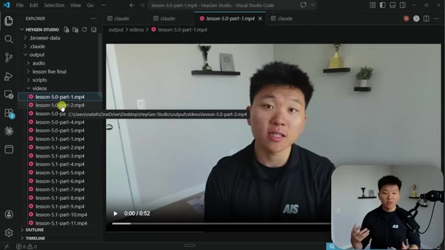
*⏱️ 00:10:03 — L'interface de Visual Studio Code affichant l'explorateur de fichiers montrant une liste de clips vidéo générés (lesson-5.0-part-1.mp4, etc.) avec un aperçu du lecteur vidéo intégré.*

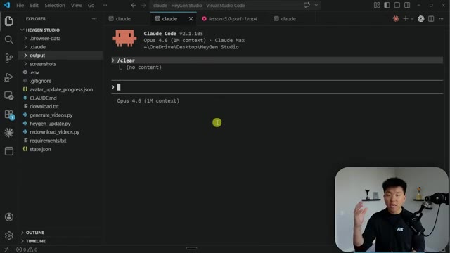
*⏱️ 00:10:09 — L'interface de VS Code ouverte sur un terminal "Claude Code v2.1.105" utilisant le modèle Opus 4.6, prêt à recevoir des commandes.*

---

### ⏱️ `[00:10:21 - 00:10:55]` | Segment #26

**🔊 Audio (Transcription Intégrale Mot pour Mot en Français) :**
> Now there is something interesting that I wanna show you guys. And that is the fact that right now you can't actually generate a video with avatar five via API. You have to do it with avatar three or avatar four. So we have to get a little creative here, right? Because I obviously want to use avatar 5 So what I did is I have the script generating all of these videos in avatar 4 And then I have a playwright script that opens up my hey gen dashboard and just changes it So let's say this one was just generated by the automation with avatar 4 Then playwright would click into it It would click into new revision in ai studio

**👁️ Analyse Visuelle d'Écran (gemini-3.5-flash-lite) :**
**Interface & Outils** : Plateforme SaaS de génération de vidéo par IA (probablement HeyGen), accessible via un navigateur web.

**Contenu textuel & Code** : Liste de projets vidéo ("Demo", "YT Intro", "Lesson 5.4 Part 9 (new)"), barre latérale de navigation (Home, Avatar, Video Agent, Translate, Apps, Projects), indicateurs de durée des vidéos.

**Action / Démonstration** : Le présentateur navigue dans son tableau de bord de projets vidéo pour illustrer les limitations de l'API concernant l'utilisation des avatars (notamment la restriction sur l'Avatar 5).

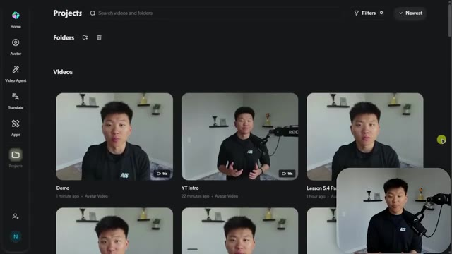
*⏱️ 00:10:30 — Interface principale d'une plateforme de création de vidéos par IA (HeyGen), affichant la bibliothèque de projets avec une liste de vignettes de vidéos générées.*

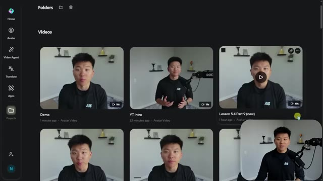
*⏱️ 00:10:46 — Même interface de bibliothèque vidéo, montrant une mise à jour sur la vignette "Lesson 5.4 Part 9 (new)" avec une icône de lecture active.*

---

### ⏱️ `[00:10:55 - 00:11:28]` | Segment #27

**🔊 Audio (Transcription Intégrale Mot pour Mot en Français) :**
> It would change this avatar over here. Once this loads up it would change this from avatar four to avatar five and then just generate it. And then it would download the finished version. So that's probably not a solution I'm always going to need, but it works right now because once they have avatar five come out via API, I will just update the script to do that and get rid of the playwright step. But like, I just think that that is so cool. And then I have a different project right here, which is called remotion. This is where I gave it like this background image. This is where it was able to figure out the styling for me of the different motion graphics. And what that does is it transcribes the video, it stitches everything

**👁️ Analyse Visuelle d'Écran (gemini-3.5-flash-lite) :**
**Interface & Outils** : HeyGen (outil de génération vidéo par IA), Visual Studio Code.

**Contenu textuel & Code** : Scripts vidéo, paramètres d'avatar (Nate Herk v1), moteur "Avatar V", structure de fichiers d'un projet de développement (Remotion).

**Action / Démonstration** : Navigation dans l'interface de création vidéo pour modifier l'avatar, puis basculement vers l'IDE pour la gestion des ressources graphiques du projet.

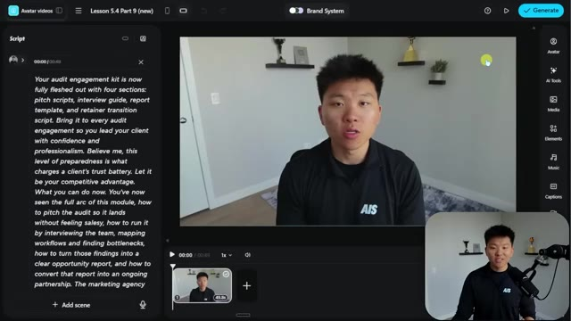
*⏱️ 00:11:03 — Interface de l'outil de création vidéo (type HeyGen) affichant un éditeur de script sur la gauche et un aperçu vidéo central avec l'avatar.*

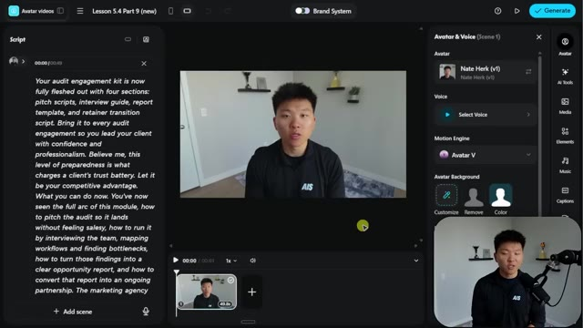
*⏱️ 00:11:11 — Même interface de création vidéo, mais avec le panneau latéral droit "Avatar & Voice" ouvert, montrant les paramètres de sélection d'avatar et le moteur de mouvement.*

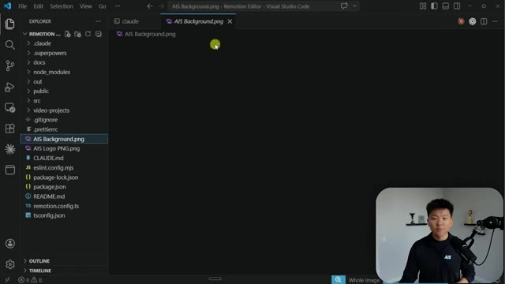
*⏱️ 00:11:20 — Éditeur de code Visual Studio Code ouvert, affichant la structure de fichiers d'un projet nommé "REMOTION" et un fichier image "AIS Background.png".*

---

### ⏱️ `[00:11:28 - 00:11:51]` | Segment #28

**🔊 Audio (Transcription Intégrale Mot pour Mot en Français) :**
> together, and then it puts it into this local host browser of Remotion. And it starts to just add on the text at the right time, because when it transcribes everything, it's able to look at what time did he say this? Okay. He said this at, you know, 44 seconds. So at 44 seconds, I'm going to start this animation where we have, you know, these little elements pop in, and that's how it's able to sync up the audio with my, you know, motion graphics that it's making.

**👁️ Analyse Visuelle d'Écran (gemini-3.5-flash-lite) :**
**Interface & Outils** : Remotion Editor (localhost).

**Contenu textuel & Code** : Diagramme graphique intitulé "The One-Off Project Cycle" avec les étapes : Project (1), Invoice (2), Hunt Again (3), Repeat (4). Timeline vidéo avec curseur de lecture positionné à 00:23.40.

**Action / Démonstration** : Navigation sur la ligne de temps (timeline) du projet vidéo pour synchroniser les éléments visuels avec l'audio.

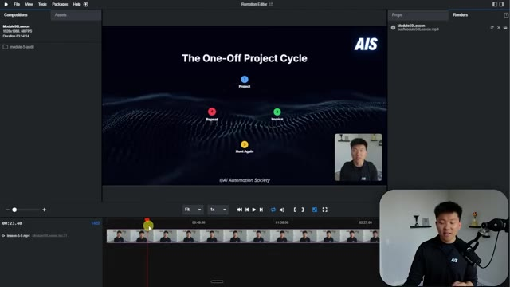
*⏱️ 00:11:34 — Interface du logiciel Remotion affichant une ligne de temps (timeline) vidéo, une fenêtre de prévisualisation avec un diagramme "The One-Off Project Cycle" et une incrustation vidéo du présentateur.*

---

### ⏱️ `[00:11:51 - 00:12:23]` | Segment #29

**🔊 Audio (Transcription Intégrale Mot pour Mot en Français) :**
> And the other key thing there is when you are back in this step over here of in the hey gen studio And you're creating those scripts You have to make sure that it's only cutting the script or sorry It's only chunking each section at the end of a sentence because obviously you don't want it to stop in the middle of a sentence Because now I get to this place where I basically Rendered this entire thing and in between each clip you can't even tell that it was a new clip So it's very awesome Now once again, I did have to play with this stuff for quite a bit to get it to work as you guys can see I have generated over 100, maybe even 200 of these clips. And I've tweaked things and I've went back and forth.

**👁️ Analyse Visuelle d'Écran (gemini-3.5-flash-lite) :**
**Interface & Outils** : Visual Studio Code, Remotion Editor, HeyGen (plateforme de création vidéo IA).

**Contenu textuel & Code** : Noms de fichiers de scripts ("lesson-5.0-part-x.txt"), contenu textuel du script de leçon, titres de diapositives vidéo ("How Do You Get There?").

**Action / Démonstration** : Navigation dans des fichiers de scripts, manipulation sur une timeline de montage vidéo et sélection d'outils de génération vidéo sur l'interface HeyGen.

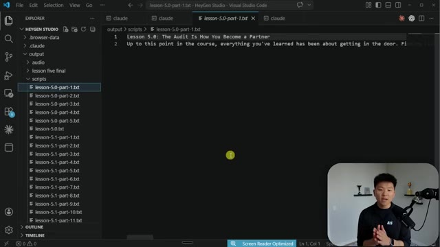
*⏱️ 00:11:59 — Visual Studio Code affichant des fichiers textes de scripts nommés "lesson-5.0-part-1.txt" dans une arborescence de dossiers organisée.*

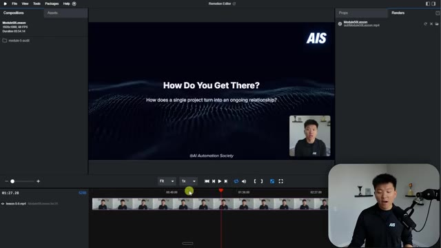
*⏱️ 00:12:07 — Interface de montage vidéo "Remotion Editor" montrant une présentation avec un avatar et une timeline temporelle.*

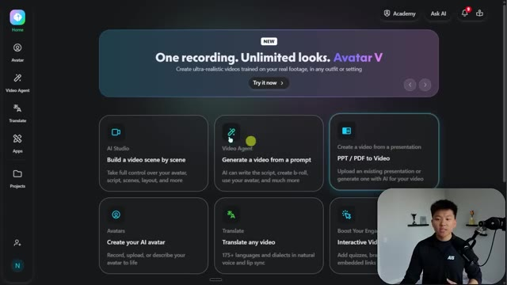
*⏱️ 00:12:15 — Tableau de bord de l'application HeyGen présentant divers outils de création de vidéos par IA comme "AI Studio" et "Video Agent".*

---

### ⏱️ `[00:12:24 - 00:12:56]` | Segment #30

**🔊 Audio (Transcription Intégrale Mot pour Mot en Français) :**
> And that is why I have one separate project for the Haygen Studio. And I have one separate project for the Remotion editor. But now that I've proved the concept, I'm basically going to come into Remotion and I'm going to copy all of these folders over to my Haygen Studio project. And I'm going to turn it into a skill where I genuinely just drop in a script and I say, give me a full video. And it just does it all in one clean shot. All right. So now let's talk about some of the other stuff. This document will be attached for completely free in my FreeSchool community. The link for that is down in the description. And I'm also going to attach this

**👁️ Analyse Visuelle d'Écran (gemini-3.5-flash-lite) :**
**Interface & Outils** : Visual Studio Code (VS Code) avec l'extension Claude Code (Opus 4.6).

**Contenu textuel & Code** : Terminal affichant : "Claude Code v2.1.107", "Opus 4.6 (1M context)", commande "/clear" et état "bypass permissions on 2 shells".

**Action / Démonstration** : Initialisation ou nettoyage de la session de travail de l'agent IA dans l'environnement de développement pour préparer la migration des fichiers.

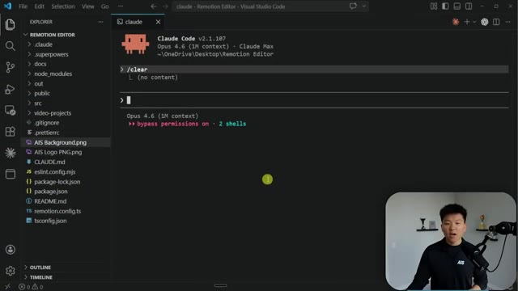
*⏱️ 00:12:32 — Interface VS Code affichant l'outil Claude Code dans un terminal intégré au sein d'un projet de développement.*

---

### ⏱️ `[00:12:56 - 00:13:28]` | Segment #31

**🔊 Audio (Transcription Intégrale Mot pour Mot en Français) :**
> Heijen Studio project in my FreeSchool community as well. So you can download this, look through it, basically be able to replicate it based on what I've done here. So both of those will be in my FreeSchool community. Link is in the description. So let's first talk about the three different shifts. So the first one is that the avatar has crossed the uncanny valley. Heijen Avatar 5 is trained on 10 million plus data points for facial expressions. And it creates you a digital twin from just 15 seconds of a webcam clip. So why this is awesome is because now you can put yourself in different settings and you don't have to worry about if the sun is good or if your lighting's

**👁️ Analyse Visuelle d'Écran (gemini-3.5-flash-lite) :**
**Interface & Outils** : VS Code (terminal Claude Code) et logiciel de présentation (type diaporama).

**Contenu textuel & Code** : Arborescence de fichiers du projet HeyGen Studio (scripts, fichiers .py, .env) et texte explicatif sur les avancées des avatars HeyGen et l'automatisation de la production.

**Action / Démonstration** : Exécution d'une commande `/clear` dans le terminal Claude Code (Image 1) et présentation théorique des changements technologiques (Image 2).

*⏱️ 00:13:04 — Interface de VS Code montrant le terminal Claude Code (v2.1.105) avec le dossier "HeyGen Studio" ouvert dans l'explorateur de fichiers.*

*⏱️ 00:13:12 — Diapositive de présentation listant "3 Shifts" concernant l'évolution de la création de contenu par IA (avatar, orchestration, changement de goulot d'étranglement).*

---

### ⏱️ `[00:13:28 - 00:14:02]` | Segment #32

**🔊 Audio (Transcription Intégrale Mot pour Mot en Français) :**
> good or if the neighbors upstairs are being loud, or if you're in my case, the fire trucks that go down the street every single two seconds. Seriously, when I'm recording, I have to stop and just wait like multiple times during my sessions because there's a fire truck. But anyways, like I don't have to wait for the environment to be perfect now because I could do something like this. Because it's not just lip syncing, it's actually learning how you gesture and how you move, and it feels way more like you. The next one is that AI can orchestrate the entire production pipeline, like I showed you. Cloud code doesn't just generate one thing and then you have to do the rest. I said, hey, I want you to connect all of these different tools together so I don't have

**👁️ Analyse Visuelle d'Écran (gemini-3.5-flash-lite) :**
**Interface & Outils** : Présentation textuelle (diapositive éducative).

**Contenu textuel & Code** : Points clés sur HeyGen Avatar 5, le workflow d'automatisation incluant ElevenLabs, et l'analyse du changement de paradigme dans la création de contenu.

**Action / Démonstration** : Le présentateur illustre les concepts théoriques expliquant comment l'IA transforme la production vidéo et le rôle de l'humain.

*⏱️ 00:13:37 — Une présentation sous forme de liste à puces intitulée "3 Shifts" détaillant l'évolution des avatars IA, l'orchestration des pipelines de production par des agents comme Claude Code, et le déplacement du goulot d'étranglement vers la stratégie créative.*

---

### ⏱️ `[00:14:02 - 00:14:22]` | Segment #33

**🔊 Audio (Transcription Intégrale Mot pour Mot en Français) :**
> to click on anything. I just tell you what I want and you do it. So it's getting the voice clone, it's chunking the audio, it's feeding it to HeyGen, it's stitching it together, and it's creating those motion graphics for me. It's an AI agent coordinating a full production workflow that used to require three to four different types of roles. Maybe a camera guy, maybe an AV guy, a video editor, a person to actually read the script off.

**👁️ Analyse Visuelle d'Écran (gemini-3.5-flash-lite) :**
**Interface & Outils** : Logiciel de présentation ou éditeur de texte type Google Docs/Notion.

**Contenu textuel & Code** : Texte structuré en trois sections : "The avatar crossed the uncanny valley", "AI can orchestrate the entire production pipeline" (détaillant le flux ElevenLabs -> HeyGen), et "The bottleneck moved".

**Action / Démonstration** : Présentation conceptuelle et théorique des capacités d'un agent IA dans un workflow de production vidéo.

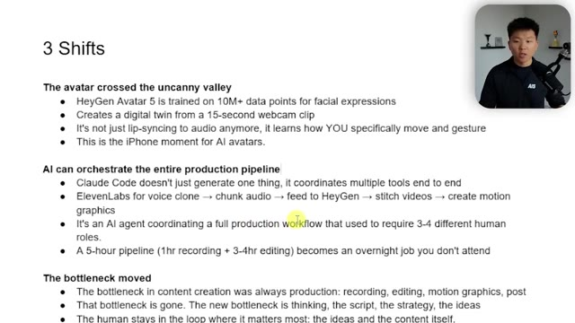
*⏱️ 00:14:07 — Une présentation sous forme de liste à puces décrivant trois changements majeurs ("3 Shifts") dans l'automatisation par l'IA, incluant les capacités de HeyGen et l'orchestration par Claude Code.*

---

### ⏱️ `[00:14:22 - 00:14:41]` | Segment #34

**🔊 Audio (Transcription Intégrale Mot pour Mot en Français) :**
> And every single time you run this thing, it gets smarter and smarter, which is why I did so much testing. But it basically turns a five-hour pipeline into an overnight job that I didn't even need to be awake for. And what else is cool is that the bottleneck has moved because the bottleneck in content creation was basically always production and post-production. So recording, editing, motion graphics.

**👁️ Analyse Visuelle d'Écran (gemini-3.5-flash-lite) :**
**Interface & Outils** : Logiciel de présentation de type document/diaporama (probablement Google Slides ou Notion).

**Contenu textuel & Code** : Texte structuré sous forme de points clés : "The avatar crossed the uncanny valley", "AI can orchestrate the entire production pipeline", et "The bottleneck moved". Mentions spécifiques de HeyGen, Claude Code et ElevenLabs.

**Action / Démonstration** : Le présentateur utilise le document comme support visuel pour illustrer son argumentaire sur l'évolution technologique de la création de contenu.

*⏱️ 00:14:27 — Présentation textuelle (diapositive) intitulée "3 Shifts" détaillant les avancées des avatars IA et l'automatisation des pipelines de production. Le curseur souligne la ligne concernant le gain de temps (pipeline de 5 heures).*

*⏱️ 00:14:36 — Suite de la présentation textuelle centrée sur le déplacement du "goulot d'étranglement" (bottleneck) dans la création de contenu, passant de la production technique à la stratégie et à l'idéation. Le texte est partiellement surligné.*

---

### ⏱️ `[00:14:41 - 00:15:02]` | Segment #35

**🔊 Audio (Transcription Intégrale Mot pour Mot en Français) :**
> But now that bottleneck is essentially solved. The new bottleneck is what we should be doing, which is thinking, scripting, the strategy, and the ideas. The human stays in the loop where it matters most, which is, once again, the ideas and the content itself. So I'm not gonna read all these off, but I've got some stats here. Like 91% of businesses use video as a marketing tool. That's huge. 67% of non-video marketers plan to start this year.

**👁️ Analyse Visuelle d'Écran (gemini-3.5-flash-lite) :**
**Interface & Outils** : Logiciel de présentation (type Notion ou slides web).

**Contenu textuel & Code** : - Image 1 : Texte sur "The avatar crossed the uncanny valley", "AI can orchestrate the entire production pipeline" (mention de Claude Code et ElevenLabs), et "The bottleneck moved" (avec surbrillance sur "thinking, the script, the strategy").
- Image 2 : Liste de statistiques incluant : "91% of businesses use video", "49% of founders say AI saves them 6+ hours/week", "HeyGen hit $100M ARR", etc.

**Action / Démonstration** : Présentation de concepts théoriques et de données factuelles à l'appui du discours sur l'évolution du travail à l'ère de l'automatisation par l'IA.

*⏱️ 00:14:47 — Une diapositive de présentation listant les avantages des avatars IA (HeyGen) et comment ils transforment le workflow de production vidéo, avec une mise en évidence textuelle sur le nouveau rôle de l'humain.*

*⏱️ 00:14:57 — Une diapositive de présentation intitulée "Key Stats" affichant des données chiffrées sur l'adoption de la vidéo par les entreprises et les performances financières de HeyGen.*

---

### ⏱️ `[00:15:03 - 00:15:37]` | Segment #36

**🔊 Audio (Transcription Intégrale Mot pour Mot en Français) :**
> And another one, the barriers to videos. 24% say that it's too expensive. Because like I said, you need equipment, you need a nice studio, you need editing, you need all this stuff. But now we're going to cover the cost in a little bit. It's so, so much cheaper and not only cheaper, but think about the time you're getting back. All right. So the fun stuff, these are three objections that I just knew I was going to get in the comments and I'm sure I'm going to get more, but I wanted to address these three. The first one is that that's fake. That's not authentic. And to an extent, I definitely agree. Like I said, I never planned to have my YouTube channel be an AI avatar. Maybe on certain plays, if I wanted to have like a TikTok channel, that was just news and it was just me reading off

**👁️ Analyse Visuelle d'Écran (gemini-3.5-flash-lite) :**
**Interface & Outils** : Application de prise de notes ou éditeur de documents (type Notion ou Obsidian).

**Contenu textuel & Code** : Texte argumentaire structuré : "Barriers to video: 24% say too expensive", "Objections", "That's fake / not authentic", "Won't this flood the internet with garbage content?".

**Action / Démonstration** : Défilement vertical du document pour accompagner le discours oral du présentateur sur les coûts et les freins à la production vidéo.

---

### ⏱️ `[00:15:37 - 00:15:57]` | Segment #37

**🔊 Audio (Transcription Intégrale Mot pour Mot en Français) :**
> news. I think that's fine. I think most of the times people don't care if I'm actually saying it. They just want to know if it's my real thoughts and they want to know that I'm not just feeding them a chat GBT script. And I do enjoy making YouTube videos and I want to keep them feeling personal. The script is yours. The voice is yours. The face is yours. The only thing missing is that you don't have to sit in a chair or you don't have to wait for the stars to align, right?

**👁️ Analyse Visuelle d'Écran (gemini-3.5-flash-lite) :**
**Interface & Outils** : Logiciel de traitement de texte ou de prise de notes (type Notion ou Google Docs).

**Contenu textuel & Code** : Texte structuré sous forme de liste à puces traitant des objections : "That's fake / not authentic", "Won't this flood the internet with garbage content?" et "Isn't this going to kill video editor jobs?".

**Action / Démonstration** : Présentation orale des arguments de l'auteur pour répondre aux objections soulevées.

---

### ⏱️ `[00:15:58 - 00:16:33]` | Segment #38

**🔊 Audio (Transcription Intégrale Mot pour Mot en Français) :**
> If you're on vacation and you realize you need to get something out, you already have your avatar of you in your home office. The next one is won't this flood the internet with garbage content? AI slop. I mean, I don't really tend to think so. And I think that people that think that way are just very negative because AI writing tools already exist. If you think that there's not already millions and millions every single day of AI slop being put out on LinkedIn or X or wherever, then you're wrong. But what happens is the best content is still going to win in a world where everything is written or enhanced by AI in some form. So removing the production bottleneck means there's going to be more content, but the quality filter is still the idea. And that even makes it

**👁️ Analyse Visuelle d'Écran (gemini-3.5-flash-lite) :**
**Interface & Outils** : Logiciel de présentation (type Google Slides ou Notion).

**Contenu textuel & Code** : Texte structuré sous forme de questions-réponses traitant de l'impact de l'IA sur la création de contenu et le marché du travail.

**Action / Démonstration** : Présentation de points de réflexion théoriques pour soutenir le discours sur l'automatisation.

*⏱️ 00:16:07 — Une diapositive de présentation listant des objections courantes sur l'IA (authenticité, contenu indésirable, emplois des monteurs vidéo) avec une fenêtre incrustée du présentateur.*

---

### ⏱️ `[00:16:33 - 00:17:07]` | Segment #39

**🔊 Audio (Transcription Intégrale Mot pour Mot en Français) :**
> more competitive where only the best will actually make it to your feed or make it, you know, to the top. Bad content with a good avatar is still bad content. And then the last one, isn't this going to kill video editor jobs? It changes the job. I mean, like all of these things that we're doing with video editing or automation, it's not just going to kill these jobs. I mean, there will be some jobs that are fundamentally changed and eliminated, but those people just need to be the ones that apply their subject matter expertise to it. I couldn't go make the world's best AI automation for SEO because I have basically no subject matter expertise about SEO. But the people

**👁️ Analyse Visuelle d'Écran (gemini-3.5-flash-lite) :**
**Interface & Outils** : Aucune interface logicielle ou outil technique n'est affiché ; il s'agit d'une présentation de type diaporama textuel.

**Contenu textuel & Code** : Texte affichant des objections : "That's fake / not authentic", "Won't this flood the internet with garbage content?", "Isn't this going to kill video editor jobs?" et "What This Actually Costs".

**Action / Démonstration** : Aucune action technique ou manipulation logicielle ; le présentateur fait simplement défiler le texte de sa présentation.

---

### ⏱️ `[00:17:07 - 00:17:40]` | Segment #40

**🔊 Audio (Transcription Intégrale Mot pour Mot en Français) :**
> that do, they'll be the ones that are able to make some killer SEO AI systems. So anyways, now let's talk about what this actually costs. And before I get into this, you guys might be thinking this is expensive and it's definitely not cheap to make these videos. But think about it when you actually think about the investment. Same way I like to think about Cloud Code. I pay 200 bucks a month for it. And that's probably my most expensive subscription, one of them. But it's the most valuable one I have right now. So the production stack on a creator plan of HeyGen, it's going to cost you about 30 bucks a month. And that is going to give you only a limited amount

**👁️ Analyse Visuelle d'Écran (gemini-3.5-flash-lite) :**
**Interface & Outils** : Logiciel de prise de notes (type Notion).

**Contenu textuel & Code** : Liste avec les éléments suivants : "Key Stats", "Objections", et "What This Actually Costs".

**Action / Démonstration** : Le curseur de la souris survole la flèche d'expansion (expand heading) devant le texte "What This Actually Costs".

*⏱️ 00:17:15 — Une capture d'écran d'une application de prise de notes ou de gestion de tâches (probablement Notion) montrant une liste structurée avec des en-têtes rétractables.*

---

### ⏱️ `[00:17:40 - 00:18:00]` | Segment #41

**🔊 Audio (Transcription Intégrale Mot pour Mot en Français) :**
> of Avatar 5 generations, but it's more than enough to start on. Then you also got the 11 Labs creator plan. The 22 bucks a month plan is going to give you roughly 100 minutes of audio, which is a lot of audio. And then for Claude Code, you know, 20 to 200 bucks a month, which orchestrates the entire pipeline. You could also do this in something like Cowork and maybe even Claude if you put the right connectors in.

**👁️ Analyse Visuelle d'Écran (gemini-3.5-flash-lite) :**
**Interface & Outils** : Présentation textuelle (type Google Slides/PowerPoint) avec le présentateur en médaillon dans le coin supérieur droit.

**Contenu textuel & Code** : Liste détaillée des tarifs : "The AI Production Stack" (HeyGen à 29$/mois, ElevenLabs à 22$/mois, Claude Code à 20-200$/mois, HeyGen API à ~4$/min) et "What the Human Alternative Costs" (Freelance, Voix off, studio).

**Action / Démonstration** : Le curseur de la souris souligne la ligne "ElevenLabs Creator plan" pendant que le présentateur en discute.

*⏱️ 00:17:45 — Une diapositive de présentation listant les coûts mensuels d'une pile technologique d'IA (HeyGen, ElevenLabs, Claude Code) comparée aux coûts de production humaine traditionnelle.*

---

### ⏱️ `[00:18:01 - 00:18:22]` | Segment #42

**🔊 Audio (Transcription Intégrale Mot pour Mot en Français) :**
> And then we do have a different cost for the HeyGen API. It's going to treat it differently than just your dashboard. So let me show you a quick example. If I go into HeyGen and I go into my settings and I go to my usage and history, you can see that I have premium credits right here, right? So I've used up about 502 out of my 2000 credits. And then if I go to my API though, here you can see I've spent a lot of money, right?

**👁️ Analyse Visuelle d'Écran (gemini-3.5-flash-lite) :**
**Interface & Outils** : Présentation (Slide) et interface Web de HeyGen.

**Contenu textuel & Code** : Détails financiers : coûts mensuels des outils (HeyGen, ElevenLabs, Claude Code) versus coûts de freelances/studio.

**Action / Démonstration** : Comparaison des coûts de production et navigation dans les menus de configuration d'un compte utilisateur.

*⏱️ 00:18:06 — Une page de présentation listant les coûts comparatifs entre le "AI Production Stack" et les alternatives humaines.*

*⏱️ 00:18:11 — L'interface des paramètres du compte HeyGen, montrant le menu latéral avec la section "Usage & History" sélectionnée.*

---

### ⏱️ `[00:18:22 - 00:18:43]` | Segment #43

**🔊 Audio (Transcription Intégrale Mot pour Mot en Français) :**
> Like I said, I've tested a lot. And if I go to my usage, you can see my spend, my error rate, my total requests. and you can see that each of these one minute clips are taking about four bucks. So if you do a 10 minute video, that's probably gonna run you almost $50. Yes, a little bit expensive, right? But if you just think about it as far as like, okay, so how much am I actually paying to get back a couple hours of my time?

**👁️ Analyse Visuelle d'Écran (gemini-3.5-flash-lite) :**
**Interface & Outils** : Dashboard de gestion de plateforme d'IA (secteur "Usage & History").

**Contenu textuel & Code** : Statistiques : "Total Requests: 137", "Error Rate: 10.95%", "Total Spend: $262.89". Détail par catégorie : "Video Agent: $0.62", "Video Generation: $262.27".

**Action / Démonstration** : Le présentateur illustre ses coûts d'utilisation des API et de génération vidéo en naviguant dans la section historique d'utilisation de son compte.

*⏱️ 00:18:27 — Une capture d'écran montrant le tableau de bord de facturation et d'utilisation d'une plateforme d'IA, avec des graphiques de dépenses, un taux d'erreur de 10,95% et une répartition des coûts par catégorie (Video Generation représentant la majeure partie des 262,89 $).*

---

### ⏱️ `[00:18:43 - 00:19:16]` | Segment #44

**🔊 Audio (Transcription Intégrale Mot pour Mot en Français) :**
> Is that worth it? For some people, the answer is yes. For some people, the answer is no. For most businesses and for how much you're going to be able to scale your content, which is top of funnel, it basically funnels everything downstream and affects your bottom line in a great way. I think that that investment is a thousand percent worth it If this is the unlock that a business needs to start consistently creating content, then yeah, it's worth it And that's why I talk about right here. What is the human alternative, right? A freelance video editor could be 35 to 75 bucks an hour So a 10-minute youtube video could take up to 300 bucks And then if you want to get a professional voiceover or if you want to have a studio to record in

**👁️ Analyse Visuelle d'Écran (gemini-3.5-flash-lite) :**
**Interface & Outils** : Application web de création vidéo par IA (interface de type HeyGen) ; Document texte / Notes (type Notion ou Google Docs).

**Contenu textuel & Code** : Image 1 : Liste de projets ("Lesson 5.4", "Demo", "YT Intro"). Image 2 : Analyse financière comparative incluant des tarifs pour ElevenLabs, Claude Code, HeyGen API vs éditeurs vidéo freelance et voix off.

**Action / Démonstration** : Image 1 : Navigation dans la bibliothèque de projets vidéo. Image 2 : Présentation pédagogique détaillant le retour sur investissement et la comparaison des coûts de production entre l'automatisation par IA et le travail humain.

*⏱️ 00:18:51 — Interface utilisateur de gestion de projets vidéo présentant une bibliothèque de miniatures de vidéos générées par IA (avatars).*

*⏱️ 00:19:08 — Document textuel comparant les coûts mensuels d'une pile technologique basée sur l'IA face aux coûts de production humaine (freelance, voix off, studio).*

---

### ⏱️ `[00:19:16 - 00:19:39]` | Segment #45

**🔊 Audio (Transcription Intégrale Mot pour Mot en Français) :**
> All of this stuff could add up to a few thousand dollars potentially Just to get out a few course material videos or a few advertisements So the right way to think about it is that it's not cheap in absolute terms, but if you think about the investment, it is worth the investment. So if the pipeline gives you back 10 hours a week, that's 40 hours a month. And at 251 bucks a month, you're paying about six bucks an hour to buy your own time back.

**👁️ Analyse Visuelle d'Écran (gemini-3.5-flash-lite) :**
**Interface & Outils** : Éditeur de documents/notes textuelles (probablement Notion).

**Contenu textuel & Code** : Texte détaillé incluant : "What the Human Alternative Costs", liste des tarifs (freelance éditeur, voix off, studio), calcul du coût de l'automatisation par rapport au temps gagné (6,28$/heure), et réflexions sur la productivité avec Claude Code.

**Action / Démonstration** : Le présentateur affiche et parcourt une démonstration structurée sous forme de liste pour expliquer la logique financière et le gain de temps lié à l'automatisation par l'IA.

*⏱️ 00:19:22 — Une page de notes (type Notion ou Google Docs) comparant les coûts mensuels d'une pile technologique IA aux coûts de production vidéo humaine.*

*⏱️ 00:19:27 — La suite des notes détaillant le calcul du retour sur investissement (ROI) basé sur le temps gagné par rapport au coût mensuel de l'abonnement.*

---

### ⏱️ `[00:19:39 - 00:20:03]` | Segment #46

**🔊 Audio (Transcription Intégrale Mot pour Mot en Français) :**
> And according to the buyback matrix, that's probably a good deal. So anyways, I am gonna do a full breakdown on Remotion. I know that you guys have noticed some of my other videos have been edited by it, but I've just been playing around with it a lot and I'm trying to figure out the best way to package up a video. so that will be coming soon. I will let you guys know when that is out, but that is going to do it for this one. Just remember that you can download this HeyGen Studio and this Word document that we were looking at if you are interested in kind of diving in.

**👁️ Analyse Visuelle d'Écran (gemini-3.5-flash-lite) :**
**Interface & Outils** : Visual Studio Code (VS Code), Claude Code (v2.1.105), Opus 4.6 (1M context).

**Contenu textuel & Code** : Commande `/clear` saisie dans le terminal Claude Code au sein du dossier `~\OneDrive\Desktop\HeyGen Studio`.

**Action / Démonstration** : Nettoyage de l'historique du terminal Claude Code par l'utilisateur.

*⏱️ 00:19:45 — Interface de Visual Studio Code affichant le terminal "Claude Code" en cours d'exécution dans un projet nommé "HeyGen Studio".*

---

### ⏱️ `[00:20:03 - 00:20:17]` | Segment #47

**🔊 Audio (Transcription Intégrale Mot pour Mot en Français) :**
> But yeah, otherwise I would go ahead and say, go to HeyGen, create your avatar, go to 11 Labs, create your clone, and just start playing around with this stuff. So if you guys enjoyed the video or you learned something new, please give it a like, it helps me out a ton. And as always, I appreciate you guys making it to the end of the video and I'll see you in the next one. Thanks everyone.

**👁️ Analyse Visuelle d'Écran (gemini-3.5-flash-lite) :**
**Interface & Outils** : Visual Studio Code, Claude Code (v2.1.105)

**Contenu textuel & Code** : Arborescence de fichiers du projet "HeyGen Studio", commande `/clear` active dans le terminal, et indication du modèle "Opus 4.6 (1M context)".

**Action / Démonstration** : Nettoyage de l'historique du terminal dans l'environnement de développement Claude Code.

*⏱️ 00:20:07 — Interface de Visual Studio Code affichant l'exécution de l'outil en ligne de commande "Claude Code" dans un terminal intégré.*

---

