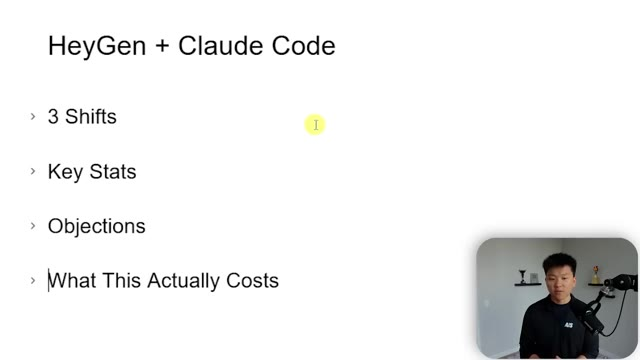
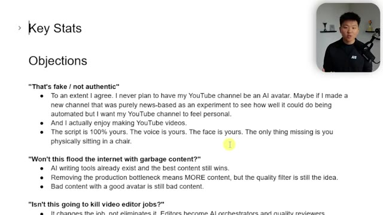

# 🎬 Claude + HeyGen Just Changed Content Creation Forever

> **Chaîne** : [Nate Herk | AI Automation](https://www.youtube.com/@nateherk/featured)  
> **Lien YouTube** : [https://www.youtube.com/watch?v=EbJu9T30nfI](https://www.youtube.com/watch?v=EbJu9T30nfI)  
> **Date de publication** : 20260415  
> **Durée** : 00:20:17  
> **Identifiant vidéo** : `EbJu9T30nfI`  
> **Transcription & Analyse** : `whisper-v3-large-turbo+gemini-3.5-flash-lite`  

---

## 📌 Synthèse Exécutive & Outils

### 💡 Résumé

Dans cette vidéo présentée sur la chaîne *Nate Herk | AI Automation*, l'auteur démontre l'utilisation de **Claude Code** comme couche d'orchestration logicielle centrale pour automatiser la production de vidéos de bout en bout. Dès l'introduction, Nate frappe les esprits en révélant que les premières minutes de la vidéo étaient entièrement générées par un clone d'intelligence artificielle conçu en seulement dix minutes, illustrant de manière saisissante l'état actuel de l'art technologique. L'objectif de ce pipeline d'automatisation est de s'affranchir des heures d'enregistrement manuel fastidieuses en convertissant un script brut en une vidéo finale éditée en quelques minutes seulement.

Le système repose sur une pile technologique hybride hautement spécialisée : **HeyGen** pour l'avatar visuel photoréaliste (via le nouveau modèle de pointe *Avatar 5*), **ElevenLabs** pour le clonage vocal professionnel haute fidélité, et **Remotion** pour l'assemblage programmatique et l'intégration de graphismes animés professionnels. Bien que l'auteur écarte l'idée d'utiliser des avatars IA pour ses vidéos principales en raison de son attachement au format humain, il met en évidence la puissance redoutable de cette approche pour le contenu court (*shorts*), les modules de formation en ligne ou les publicités, où l'efficacité et la vitesse de production dictent l'impact stratégique.

Au fil des démonstrations pratiques, Nate détaille le processus d'entraînement itératif de son avatar à partir de gigaoctets d'images et de plusieurs heures de données vocales. Il met en lumière une subtilité technique cruciale : l'intégration directe de la voix dans HeyGen s'avère inférieure au rendu d'ElevenLabs, justifiant l'utilisation d'une phase intermédiaire consistant à générer l'audio sur ElevenLabs puis à l'importer dans HeyGen pour une synchronisation labiale parfaite. Malgré de légères imperfections visuelles inhérentes aux technologies actuelles, le résultat final démontre un niveau de réalisme saisissant, redéfinissant durablement les standards de la création de contenu automatisée.

---

### 🛠️ Outils, Modèles & Logiciels Présentés

* **Claude Code (Anthropic)** : Agent IA et outil d'ingénierie logicielle agissant comme couche d'orchestration centrale pour piloter l'ensemble du pipeline d'automatisation vidéo.
* **HeyGen** : Plateforme de génération d'avatars vidéo par IA, utilisée ici à travers son nouveau modèle *Avatar 5* pour un réalisme accru des expressions faciales et des mouvements labiaux.
* **ElevenLabs** : Solution de synthèse vocale et de clonage vocal professionnel, exploitée pour générer les intonations fidèles et naturelles de l'auteur à partir d'un entraînement prolongé.
* **Remotion** : Framework de rendu vidéo programmatique utilisé pour assembler les éléments, éditer les séquences et intégrer des graphismes animés de qualité professionnelle.

---

### 🔑 Points Clés & Enseignements Stratégiques

* **Orchestration par agent IA** : L'utilisation de Claude Code comme chef d'orchestre permet de lier des briques logicielles hétérogènes pour transformer un script brut en vidéo finalisée sans intervention humaine répétitive.
* **Saut qualitatif avec *Avatar 5*** : Les versions précédentes (Avatar 3 et 4) souffraient de mouvements labiaux rigides et d'une gestuelle robotique, tandis que le modèle *Avatar 5* analyse et reproduit fidèlement la micro-mimique et la cinétique de la tête.
* **Stratégie d'entraînement des avatars** : Pour obtenir un clone de haute qualité, il est préférable d'importer une volumétrie importante de données (environ 10 gigaoctets d'images dans le cas de Nate) plutôt que de s'en tenir à une simple capture webcam de 15 secondes.
* **Dissociation audio/vidéo pour un rendu optimal** : Le clonage vocal intégré nativement dans HeyGen s'avère décevant ; il est donc stratégiquement supérieur de générer la voix haute fidélité dans ElevenLabs puis de l'importer pour la synchroniser dans HeyGen.
* **Exigence de la voix professionnelle** : Un clone vocal instantané est rapide mais de qualité médiocre ; un clone professionnel nécessitant au moins 30 minutes (idéalement deux heures) d'enregistrements audio garantit la préservation des intonations authentiques.
* **Cas d'usage ciblés** : Si les avatars IA ne conviennent pas aux vidéos longues de type tutoriel personnel par attachement relationnel avec l'audience, ils se révèlent redoutables de productivité pour le contenu court (*shorts*), la formation et le marketing publicitaire.
* **Gestion des artefacts visuels** : Les avatars générés par IA comportent encore des imperfections mineures (micro-mouvements oculaires, clignements inhabituels ou artefacts sur les bords lors de mouvements de bras), qui s'atténuent fortement en réduisant l'avatar au format *facecam*.
* **Variabilité des modèles génératifs** : La génération audio via ElevenLabs produit de légères variations temporelles d'une exécution à l'autre (par exemple, un même script oscillant entre 16 et 19 secondes), nécessitant une phase de test et de validation.
* **Paramétrage fin de la voix** : L'ajustement minutieux des paramètres de vitesse, de stabilité, de similarité et d'exagération du style dans ElevenLabs est indispensable pour s'approcher au plus près de la voix réelle.
* **Limites de durée du pipeline** : La production par lots est contrainte par des limitations techniques inhérentes aux plateformes, obligeant généralement à découper la création de contenu en segments d'environ une minute.

---

## ⏱️ Chronologie & Transcription Complète Audio & Visuelle (Mot pour Mot)

### ⏱️ `[00:00:00 - 00:00:22]` | Segment #01

**🔊 Audio (Transcription Intégrale Mot pour Mot en Français) :**
> Today, I'm going to show you how I was able to automate hours of recording content using Cloud Code and HeyGen. And some of you may have already guessed this, but yeah, I'm an AI clone of Nate. A lot of comments lately have been saying that he uses an AI avatar, but that's actually not true. This is my first ever time appearing on this YouTube channel. So yeah, that was actually an AI clone of me that I made in like 10 minutes. And I have been testing a ton of different methods.

**👁️ Analyse Visuelle d'Écran (gemini-3.5-flash-lite) :**
**Interface & Outils** : Visual Studio Code, terminal Claude Code v2.1.105, HeyGen Studio (interface web).

**Contenu textuel & Code** : Commandes terminal (/clear), fichiers de projet Python (generate_videos.py, heygen_update.py) et structure de dossiers HeyGen Studio.

**Action / Démonstration** : Navigation dans l'arborescence des fichiers du projet et utilisation du terminal Claude Code.

*⏱️ 00:00:06 — Interface de VS Code affichant le terminal Claude Code v2.1.105 avec le projet HeyGen Studio, et le présentateur en incrustation vidéo en bas à droite.*

*⏱️ 00:00:11 — Interface Web de HeyGen Studio montrant une bibliothèque de projets vidéo et de leçons générées par avatar, avec le présentateur incrusté en bas à droite.*

*⏱️ 00:00:17 — Vue identique à l'image #1 montrant l'éditeur VS Code avec le terminal Claude Code actif et l'incrustation vidéo du présentateur.*

---

### ⏱️ `[00:00:22 - 00:00:41]` | Segment #02

**🔊 Audio (Transcription Intégrale Mot pour Mot en Français) :**
> If you go through my HeyGen here, you will see literally hundreds of different avatars and scripts that I've ran through here and different methods too. So in today's video, I'm gonna show you how I'm able to use Cloud Code as a complete orchestration layer around three different tools that help me basically go from raw script to finished edited video in minutes. And it's so, so cool.

**👁️ Analyse Visuelle d'Écran (gemini-3.5-flash-lite) :**
**Interface & Outils** : Interface web HeyGen et schéma de workflow personnalisé.

**Contenu textuel & Code** : Logos et icônes d'outils d'IA (HeyGen, ElevenLabs, Claude) reliés par des flèches de flux de données.
[DESC_IMAGE_3] Présentation visuelle de l'architecture d'orchestration entre différents outils d'IA.

**Action / Démonstration** : Explications face caméra et démonstration conceptuelle.

*⏱️ 00:00:36 — Schéma explicatif montrant un workflow en triangle entre HeyGen, ElevenLabs et un orchestrateur central (Claude Code / IA), avec le présentateur en incrustation.*

---

### ⏱️ `[00:00:41 - 00:01:00]` | Segment #03

**🔊 Audio (Transcription Intégrale Mot pour Mot en Français) :**
> So basically what we're doing here is there's three main pieces. We have HeyGen, which is what we use for the actual clone, the actual avatar. We have 11 Labs, which is what we're using for that voice cloning. And then we have Remotion, which is what we're using to edit everything together and give us professional looking motion graphics. So I'm going to show you guys exactly how I set the system up, but first let me show you an output.

**👁️ Analyse Visuelle d'Écran (gemini-3.5-flash-lite) :**
**Interface & Outils** : Application de tableau blanc virtuel / outil de design (type Excalidraw ou équivalent).

**Contenu textuel & Code** : Schéma textuel et graphique présentant les logos de "HeyGen", "ElevenLabs" et un logo générique (probablement Remotion/Remotion-related), avec le texte "ElevenLabs" et "Remotion" écrit sur la droite.

**Action / Démonstration** : Présentation visuelle de l'architecture logicielle expliquée par l'orateur pour montrer l'intégration des trois technologies.

*⏱️ 00:00:46 — Un schéma illustrant le workflow technique composé de trois outils principaux : HeyGen (avatar), ElevenLabs (voix) et Remotion (montage), représentés par leurs logos respectifs disposés en triangle sur un canevas de création.*

---

### ⏱️ `[00:01:01 - 00:01:19]` | Segment #04

**🔊 Audio (Transcription Intégrale Mot pour Mot en Français) :**
> So I'm going to play some clips right up here and just let me know what you think. Lesson 5.0, the audit is how you become a partner. Up to this point in the course, everything you've learned has been about getting in the door. Finding clients, starting conversations, running discovery calls that surface real problems, delivering a project that proves you can do the work.

**👁️ Analyse Visuelle d'Écran (gemini-3.5-flash-lite) :**
**Interface & Outils** : Aucune interface logicielle ou technique.

**Contenu textuel & Code** : Aucun contenu informationnel ou technique affiché.

**Action / Démonstration** : Aucune manipulation ou démonstration effectuée.

---

### ⏱️ `[00:01:20 - 00:01:39]` | Segment #05

**🔊 Audio (Transcription Intégrale Mot pour Mot en Français) :**
> And if you've been following along, you may have already done some of this. Maybe you've landed a client through Upwork and delivered your first automation. Maybe you've reached out to your warm network, had a few conversations, and booked a discovery call. You send the invoice, the work wraps up, and you're back to looking for the next one, or the discovery call surfaces a real problem.

**👁️ Analyse Visuelle d'Écran (gemini-3.5-flash-lite) :**
**Interface & Outils** : Logiciel de présentation graphique.

**Contenu textuel & Code** : Texte : "The One-Off Project Cycle", étape 1 "Project" (bleu), étape 2 "Invoice" (vert). Logo "AIS" en haut à droite.

**Action / Démonstration** : Illustration conceptuelle du cycle de vie d'un projet ponctuel dans le secteur de l'automatisation.

*⏱️ 00:01:24 — Une diapositive montrant un schéma circulaire simplifié intitulé "The One-Off Project Cycle" avec deux étapes : "Project" et "Invoice".*

---

### ⏱️ `[00:01:39 - 00:02:00]` | Segment #06

**🔊 Audio (Transcription Intégrale Mot pour Mot en Français) :**
> Et vous pouvez voir que l'entreprise a des problèmes à cinq endroits différents, mais vous ne parlez que d'un seul d'entre eux. Cet écart entre, j'ai fait du bon travail sur une chose, et j'aide cette entreprise à s'améliorer au fil du temps, c'est là que la plupart des indépendants restent bloqués. Vous avez développé ces compétences grâce à des appels de découverte, en apprenant à diagnostiquer des flux de travail, en cartographiant des processus et en identifiant des goulots d'étranglement.

**👁️ Analyse Visuelle d'Écran (gemini-3.5-flash-lite) :**
**Interface & Outils** : Présentation vidéo avec diapositive graphique et vignette incrustée du présentateur.

**Contenu textuel & Code** : Texte de la diapositive : 'The Cycle Trap', listant trois étapes avec des puces colorées.

**Action / Démonstration** : Le présentateur explique les pièges du cycle de travail des indépendants illustrés sur la diapositive.

*⏱️ 00:01:45 — Une diapositive sombre intitulée 'The Cycle Trap' illustrant les étapes 'Send the invoice', 'Work wraps up' et 'Back to looking for the next one', avec le présentateur incrusté en bas à droite.*

---

### ⏱️ `[00:02:00 - 00:02:18]` | Segment #07

**🔊 Audio (Transcription Intégrale Mot pour Mot en Français) :**
> L'audit applique ces mêmes compétences à plus grande échelle. Donc oui, il y a peut-être quelques imperfections mineures, mais le fait que nous ayons la caméra faciale en bas à droite et le fait que le script ait quand même été écrit par moi, donc ce sont toujours mes pensées brutes et réelles sur le tutoriel en question, je ne vois pas vraiment de problème avec ça. Je ne vais jamais utiliser d'avatar IA pour cette chaîne YouTube.

**👁️ Analyse Visuelle d'Écran (gemini-3.5-flash-lite) :**
**Interface & Outils** : Tableau blanc numérique / outil de diagramme interactif (type Excalidraw ou Miro)

**Contenu textuel & Code** : Schéma triangulaire reliant HeyGen, ElevenLabs et Remotion avec un avatar/logo rouge au centre et des flèches de flux.

**Action / Démonstration** : Présentation visuelle de l'architecture du système d'automatisation vidéo par le présentateur.

*⏱️ 00:02:05 — Schéma de workflow montrant l'intégration entre les outils HeyGen, Remotion et ElevenLabs, avec la caméra faciale du présentateur en bas à droite.*

---

### ⏱️ `[00:02:18 - 00:02:42]` | Segment #08

**🔊 Audio (Transcription Intégrale Mot pour Mot en Français) :**
> J'aime faire des vidéos et je vais toujours continuer à faire ça. Mais pensez à ce que cela signifie pour le contenu court ou pour le matériel de cours ou pour les publicités, où vraiment, dans l'ensemble des choses, le meilleur contenu gagne. Alors pourquoi est-ce une si grande affaire maintenant ? C'est parce que HeyGen a créé un nouveau modèle appelé Avatar 5. Auparavant, nous avions Avatar 3 et Avatar 4, qui étaient corrects, mais ils avaient quand même, vous savez, de très mauvais mouvements de lèvres ou des gestes vraiment robotiques, vous savez, tout simplement.

**👁️ Analyse Visuelle d'Écran (gemini-3.5-flash-lite) :**
**Interface & Outils** : HeyGen, Remotion, ElevenLabs

**Contenu textuel & Code** : Noms des plateformes logicielles et miniatures de vidéos générées par IA (projets de leçons).
[DESC_IMAGE_2] Présentation d'une architecture d'automatisation vidéo et navigation dans l'interface de gestion de projets HeyGen.

**Action / Démonstration** : Explications face caméra et démonstration conceptuelle.

*⏱️ 00:02:24 — Schéma conceptuel sur fond noir montrant un diagramme triangulaire connectant les outils HeyGen, Remotion et ElevenLabs avec une petite icône rouge au centre.*

*⏱️ 00:02:30 — Capture de l'interface web de HeyGen affichant la bibliothèque de projets avec plusieurs miniatures de vidéos de cours.*

---

### ⏱️ `[00:02:42 - 00:03:16]` | Segment #09

**🔊 Audio (Transcription Intégrale Mot pour Mot en Français) :**
> Donc par exemple, si je clique sur l'un de ces plus récents que j'ai générés, qui utilisait le nouvel Avatar 5, c'est ce qu'on obtient. Votre kit de mission d'audit est maintenant entièrement élaboré avec quatre sections : scripts de présentation, guide d'entretien, modèle de rapport et script de transition vers un contrat de services. Tous ces mouvements-là ont l'air vraiment naturels et il a appris de moi, vous savez, comme la façon dont ma tête bouge ou la façon dont mes lèvres bougent, des choses comme ça. Mais si je retourne à un plus ancien qu'on a fait sans utiliser l'avatar 5, vous savez, peut-être que celui-ci utilisait l'avatar 3. Leçon 5.0, l'audit est la façon dont vous devenez associé. Jusqu'à présent dans le cours, tout ce que vous avez appris a servi à franchir la porte.

**👁️ Analyse Visuelle d'Écran (gemini-3.5-flash-lite) :**
**Interface & Outils** : Interface web de génération de vidéo par IA (type Studio Avatar).

**Contenu textuel & Code** : Lecteur vidéo en ligne avec contrôles de lecture, options d'édition et résumé textuel.

**Action / Démonstration** : Le présentateur montre des exemples de vidéos générées avec l'Avatar 5.

---

### ⏱️ `[00:03:16 - 00:03:36]` | Segment #10

**🔊 Audio (Transcription Intégrale Mot pour Mot en Français) :**
> Trouver des clients en entamant la conversation. Ce n' vraiment pas horrible. Mais si quelqu'un me connaît et qu'il regarde ça, il va voir que mes lèvres bougent d'une façon bizarre et que j'ai juste l'air un peu plus comme un robot. Donc la première étape ici est de configurer votre clone d'avatar. Et je sais que nous avons plusieurs choses différentes qui se passent dans cette pile technologique. Donc à la fin, je vais aborder les tarifs et l'utilisation, mais continuons simplement sur la façon dont vous commencez réellement à faire tout ça.

**👁️ Analyse Visuelle d'Écran (gemini-3.5-flash-lite) :**
**Interface & Outils** : HeyGen Dashboard et interface de schématisation (ex: Excalidraw)

**Contenu textuel & Code** : Miniatures de vidéos d'avatars IA, noms de projets (Lesson 5.0 Part 1, Avatar Video) et logos des outils (HeyGen, ElevenLabs, Remotion)

**Action / Démonstration** : Présentation du tableau de bord de l'outil d'avatar IA et explication du workflow technique entre les différents logiciels utilisés.

*⏱️ 00:03:26 — Capture d'écran d'un tableau de bord de gestion de projets d'avatars vidéo, montrant une grille de miniatures de vidéos générées avec le présentateur.*

*⏱️ 00:03:31 — Schéma conceptuel sur fond noir illustrant un workflow entre HeyGen, ElevenLabs et Remotion, reliés par des flèches avec une icône centrale en forme de personnage pixelisé.*

---

### ⏱️ `[00:03:36 - 00:03:58]` | Segment #11

**🔊 Audio (Transcription Intégrale Mot pour Mot en Français) :**
> Donc si je clique sur l'avatar ici en haut, vous pouvez voir que nous sommes capables de faire une création vraiment rapide et je peux choisir certains de ces autres looks ici. Mais si vous allez sur avatar, c'est là que vous pouvez réellement en générer un. Donc vous pouvez voir que j'en ai quelques différents. J'ai essayé différents, comme je l'ai dit, et finalement j'ai aimé celui-ci le plus parce que j'ai fini par l'utiliser pour l'entraîner sur bien plus de données. Mais si je viens ici en haut et que je clique sur créer un avatar, vous pouvez vous cloner, n'est-ce pas ?

**👁️ Analyse Visuelle d'Écran (gemini-3.5-flash-lite) :**
**Interface & Outils** : Application web de génération de vidéos par avatar (type HeyGen ou similaire)

**Contenu textuel & Code** : Interface utilisateur avec menus de navigation, zones de texte pour script et vignettes d'avatars vidéo.

**Action / Démonstration** : Navigation dans l'interface de l'application pour sélectionner ou générer de nouveaux looks d'avatar.

*⏱️ 00:03:42 — Interface web montrant les options de création rapide d'avatars avec une zone de script et différentes sélections de looks.*

*⏱️ 00:03:47 — Fenêtre modale "My Avatars" affichant la liste des avatars générés et une option pour en créer un nouveau.*

---

### ⏱️ `[00:03:58 - 00:04:31]` | Segment #12

**🔊 Audio (Transcription Intégrale Mot pour Mot en Français) :**
> Et donc c'est là que vous pourriez enregistrer, et ma caméra est occupée parce que je suis en train de filmer, mais ça vous donne littéralement un script et vous le lisez et ça prend 15 secondes, et ensuite vous obtenez un clone d'avatar 5 qui est vraiment, vraiment bien. C'est celui que vous avez vu dans l'intro YouTube par exemple, ou ce que vous pourriez faire, c'est que vous pourriez importer des images. Donc ce que j'ai fait, c'est que j'ai importé des images. J'ai importé environ 10 gigaoctets d'images, donc il avait beaucoup plus de données pour s'entraîner sur moi, et ensuite j'ai créé celui où je suis assis dans ma chaise. Donc bref, une fois que vous faites ça, en quelques minutes, vous avez un avatar. Maintenant, il va automatiquement cloner votre voix, mais elle n'est tout simplement pas très bonne, et même si vous pouvez importer des voix depuis ElevenLabs.

**👁️ Analyse Visuelle d'Écran (gemini-3.5-flash-lite) :**
**Interface & Outils** : Interface web de création d'avatar (application de clonage vidéo)

**Contenu textuel & Code** : Message d'erreur : "Camera is occupied - Please ensure that the device is not occupied by other applications. Error: DeviceInUseError"

**Action / Démonstration** : Tentative d'enregistrement de l'avatar via webcam, échouant car la caméra est utilisée par un autre logiciel d'enregistrement.

*⏱️ 00:04:06 — Interface web d'un outil de création d'avatar affichant un message d'erreur indiquant que la caméra est occupée.*

---

### ⏱️ `[00:04:31 - 00:05:07]` | Segment #13

**🔊 Audio (Transcription Intégrale Mot pour Mot en Français) :**
> J'ai importé la voix que je vais vous montrer aujourd'hui depuis ElevenLabs dans HeyGen, mais elle ne sonne toujours pas pareil. Donc, par exemple, ici, j'ai pu importer ma voix depuis ElevenLabs. Donc je suis allé dans "changer" et je suis allé dans "importer depuis un tiers", et je l'ai importée depuis ElevenLabs juste ici, comme vous pouvez le voir. Et c'est mon clone vocal professionnel que j'ai obtenu d'ElevenLabs, mais écoutez juste ceci : "salut, je suis ravi que tu sois là, voici un aperçu de ton clone vocal, écoute rapidement". Genre, ça ne sonne vraiment pas très bien, mais c'est bizarre parce qu'sur ElevenLabs, elle sonne phénoménalement bien. C'est donc pour cela qu'on fait en quelque sorte cette étape en plusieurs phases. Laissez-moi donc ouvrir ElevenLabs maintenant, et au fait, les liens vers tous

**👁️ Analyse Visuelle d'Écran (gemini-3.5-flash-lite) :**
**Interface & Outils** : HeyGen (Interface web de clonage et de synthèse vocale)

**Contenu textuel & Code** : Paramètres vocaux affichant le titre 'Voice for Nate Herk (v1)', le moteur vocal ElevenLabs, un lecteur de prévisualisation et des options d'ajustement.

**Action / Démonstration** : Le présentateur montre l'interface de HeyGen où la voix clonée importée depuis ElevenLabs est configurée et testée.

*⏱️ 00:04:40 — Interface de configuration vocale de HeyGen montrant les paramètres du clone vocal 'Nate Voice Clone' avec ElevenLabs sélectionné comme moteur vocal.*

---

### ⏱️ `[00:05:07 - 00:05:43]` | Segment #14

**🔊 Audio (Transcription Intégrale Mot pour Mot en Français) :**
> Ces outils seront dans la description, mais dans Eleven Labs, ce que vous allez faire, c'est que vous allez aller dans « Voices » et vous allez créer une nouvelle voix. Donc juste ici, dans mes voix, comme vous pouvez le voir, j'ai celle-ci, le clone de voix de Nate. Donc quand vous allez pour créer une voix, vous pouvez choisir parmi plusieurs options différentes. Vous pouvez faire un clone de voix instantané, ce qui est vraiment rapide, super simple, mais ça ne sera pas aussi bien qu'un clone de voix professionnel. Genre, j'ai fini par mettre deux heures de ma voix, et c'est comme ça que j'ai obtenu ce truc vraiment, vraiment bien. Vous n'avez probablement pas besoin de deux heures, mais ils disent qu'il faut au moins 30 minutes. Donc littéralement, vous allez soit parler dedans pendant deux minutes, soit télécharger, vous savez, un extrait de vous en train de parler pendant deux minutes ou le temps dont vous avez besoin.

**👁️ Analyse Visuelle d'Écran (gemini-3.5-flash-lite) :**
**Interface & Outils** : Interface web d'ElevenLabs

**Contenu textuel & Code** : Liste des voix enregistrées (« Nate Voice Clone », « Young Jamal », « Mark », « Aisha », etc.), ainsi que le bouton « Create Voice » en haut à droite.

**Action / Démonstration** : Navigation dans l'interface d'ElevenLabs pour présenter la liste des voix existantes et la création d'une nouvelle voix.

*⏱️ 00:05:16 — Capture d'écran montrant l'interface d'ElevenLabs, plus précisément l'onglet « Voices » et la section « My Voices », avec la liste des voix clonées ou créées par l'utilisateur.*

---

### ⏱️ `[00:05:43 - 00:06:18]` | Segment #15

**🔊 Audio (Transcription Intégrale Mot pour Mot en Français) :**
> pour le faire. Et ensuite, vous obtiendrez un clone vocal très rapidement. Et puis, quand vous voulez utiliser ce clone vocal, vous avez essentiellement juste à cliquer sur ce bouton ici et vous pouvez saisir le script. Et c'est celui que vous avez vu dans l'intro de cette vidéo. Et ensuite, vous pouvez pratiquement juste le générer et vous pouvez jouer avec la vitesse, la stabilité, la similarité, l'exagération du style, tout ce genre de choses. Donc, laissez-moi juste vous montrer très rapidement. Si je clique sur générer, aujourd'hui, je vais vous montrer comment j'ai réussi à automatiser des heures d'enregistrement de contenu en utilisant Claude code et Hey Gen. D'accord, super. Donc vous pouvez remarquer que ça me ressemble. Évidemment, vous voudrez peut-être jouer un peu avec ces paramètres et continuer à tester. J'ai fait énormément de

**👁️ Analyse Visuelle d'Écran (gemini-3.5-flash-lite) :**
**Interface & Outils** : Interface web ElevenLabs (Text to Speech)

**Contenu textuel & Code** : Texte du script saisi : "Today, I'm going to show you how I was able to automate hours of recording content using Claude Code and HeyGen..." et paramètres de voix (modèle Eleven Multilingual v2, curseurs de vitesse, stabilité, similarité).

**Action / Démonstration** : Saisie du script textuel et configuration des paramètres de la voix clonée « Nate Voice Clone » avant la génération audio.

*⏱️ 00:05:52 — Interface web d'ElevenLabs montrant l'outil Text to Speech avec le script de l'introduction de la vidéo et le panneau de configuration de la voix clonée.*

---

### ⏱️ `[00:06:18 - 00:06:52]` | Segment #16

**🔊 Audio (Transcription Intégrale Mot pour Mot en Français) :**
> différentes itérations des meilleurs paramètres. Et je suis arrivé à un résultat qui, selon moi, me ressemble le plus, avec mes intonations et tout ça. Donc, en gros, ce qu'on fait, c'est qu'on télécharge ce fichier. C'est, vous savez, le clip audio de 16 secondes. Donc, si je télécharge ceci, j'ai ce fichier audio ElevenLabs juste ici. Et ensuite, je vais retourner dans HeyGen. Je vais aller dans AI Studio. Et cela va nous permettre, en gros, de déposer un audio qui sera synchronisé avec notre avatar. Donc, je vais cliquer sur « Importer l'audio ». Je vais glisser ce fichier ElevenLabs qu'on vient d'obtenir juste ici. Et ensuite, une fois que j'aurai ajouté cela, ça va le transcrire. Et après, nous pourrons générer

**👁️ Analyse Visuelle d'Écran (gemini-3.5-flash-lite) :**
**Interface & Outils** : ElevenLabs, HeyGen (Interface de génération d'avatars et de synthèse vocale)

**Contenu textuel & Code** : Texte de démonstration sur le clonage vocal et l'automatisation par IA, curseurs de réglage (vitesse, stabilité, similarité, style), options de voix et d'avatar.
[DESC_IMAGE_3_BIS] Configuration d'un avatar et de sa voix dans une interface de génération vidéo, avec options de fond et de disposition.

**Action / Démonstration** : Ajustement des paramètres de voix dans ElevenLabs et configuration d'une vidéo avec l'avatar généré.

*⏱️ 00:06:27 — Interface d'ElevenLabs affichant les paramètres de synthèse vocale (Text to Speech) avec le clone vocal de Nate.*

*⏱️ 00:06:43 — Interface de création de vidéo avec avatar affichant l'éditeur de script, l'aperçu vidéo central et les options de configuration à droite.*

---

### ⏱️ `[00:06:52 - 00:07:12]` | Segment #17

**🔊 Audio (Transcription Intégrale Mot pour Mot en Français) :**
> cette vidéo en utilisant, comme je l'ai dit, ce fichier audio et ensuite notre avatar. Et c'est là que vous voyez que nous avons l'avatar cinq. Nous avons le trois, nous avons le quatre, mais le cinq est le nouveau. Et le cinq est celui qui est manifestement le tout meilleur. Je vais donc procéder à la génération de cette scène. Et nous allons tout simplement appeler ça une démo. Maintenant, cela va prendre, euh, je ne sais pas, peut-être trente secondes à une minute.

**👁️ Analyse Visuelle d'Écran (gemini-3.5-flash-lite) :**
**Interface & Outils** : HeyGen (interface web de génération de vidéos par IA)

**Contenu textuel & Code** : Paramètres de génération vidéo, script textuel d'introduction de l'avatar, options de moteur de mouvement (Avatar V) et paramètres d'export (résolution 1080p, MP4, 25 fps).

**Action / Démonstration** : Configuration des paramètres de l'avatar et de la voix, puis ouverture de la fenêtre de génération pour lancer le rendu final de la vidéo.

*⏱️ 00:06:57 — Interface complète de l'application de création vidéo avec panneau de script à gauche, prévisualisation centrale et options de configuration de l'avatar et de la voix (Avatar V, Nate Voice Clone) à droite.*

*⏱️ 00:07:07 — Fenêtre modale "Generate Video" par-dessus l'interface, permettant de configurer le titre ("Demo"), le dossier de destination, la résolution (1080p), les FPS et le format avant soumission.*

---

### ⏱️ `[00:07:12 - 00:07:36]` | Segment #18

**🔊 Audio (Transcription Intégrale Mot pour Mot en Français) :**
> Évidemment, cela dépend de la longueur de la vidéo. Donc, je reviendrai vers vous les gars quand ce sera terminé. Très bien, donc ça vient juste de se terminer. Et une chose que vous remarquerez très vite, c'est que celui-ci faisait 16 secondes et celui-là 19, même s'ils étaient identiques. Donc, cela montre simplement que le modèle d'ElevenLabs va quand même produire quelque chose de légèrement différent à chaque fois. Mais bref, cliquons là-dessus et regardons-le rapidement. Aujourd'hui, je vais vous montrer comment j'ai pu automatiser des heures d'enregistrement de contenu en utilisant Cloud Code et HeyGen.

**👁️ Analyse Visuelle d'Écran (gemini-3.5-flash-lite) :**
**Interface & Outils** : HeyGen (gestion de vidéos), ElevenLabs (Text-to-Speech)

**Contenu textuel & Code** : Réglages de voix (Nate Voice Clone), paramètres de modèle (Eleven Multilingual v2), curseurs de vitesse, stabilité et similarité. Texte affiché : "I'm going to show you how I was able to automate hours of recording content using Claude Code and HeyGen".

**Action / Démonstration** : Navigation dans la bibliothèque de projets, configuration des paramètres de génération vocale (ElevenLabs) et aperçu de lecture d'une vidéo générée (HeyGen).

*⏱️ 00:07:18 — Interface de gestion de projets HeyGen affichant une bibliothèque de vidéos générées par IA avec leurs durées respectives.*

*⏱️ 00:07:24 — Interface de la plateforme ElevenLabs configurée pour la synthèse vocale avec les réglages du modèle "Nate Voice Clone".*

*⏱️ 00:07:30 — Lecteur vidéo intégré sur la plateforme HeyGen affichant une vidéo d'avatar IA intitulée "Demo" avec des options d'édition.*

---

### ⏱️ `[00:07:36 - 00:07:58]` | Segment #19

**🔊 Audio (Transcription Intégrale Mot pour Mot en Français) :**
> Et certains d'entre vous l'ont peut-être déjà deviné, mais ouais, je suis un clone IA de Nate. Beaucoup de, enfin, genre vous pouvez voir mes yeux bouger un peu dans tous les sens. J'ai genre dégluti dans la vidéo. Je trouve juste que ça a l'air tellement plus réel. Il y a évidemment quelques trucs, comme je l'ai dit, qui ne sont pas parfaits. Parfois, c'est genre une exagération supplémentaire. Et parfois, j'ai remarqué que si je lève le bras, il y aura genre un petit triangle rouge là en bas parce qu'il ne sait pas vraiment ce qu'il y a derrière moi.

**👁️ Analyse Visuelle d'Écran (gemini-3.5-flash-lite) :**
**Interface & Outils** : Plateforme de montage vidéo/AI Studio (probablement HeyGen ou une interface similaire intégrée).

**Contenu textuel & Code** : Interface d'édition vidéo avec options "New revision in AI Studio" et "Translate", ainsi qu'une barre de lecture temporelle (0:09 / 0:16).

**Action / Démonstration** : Démonstration de l'interface d'édition pour la personnalisation et la révision de vidéos générées par IA.

*⏱️ 00:07:42 — Une interface de plateforme d'édition vidéo IA affichant un avatar parlant, avec un panneau latéral d'outils d'édition ("New revision in AI Studio", "Translate") et une vignette incrustée du présentateur en bas à gauche.*

---

### ⏱️ `[00:07:58 - 00:08:17]` | Segment #20

**🔊 Audio (Transcription Intégrale Mot pour Mot en Français) :**
> Donc de petites choses comme ça, mais ça peut se régler. Et surtout quand c'est réduit à une facecam, plutôt que d'être en plein écran, c'est très difficile à dire. Mais la voix est genre la chose la plus importante. Et c'est pour ça que vous devez aller sur 11 Labs pour obtenir ce clone vocal. Donc vous avez peut-être aussi remarqué, si je continue à faire défiler mon tableau de bord ici, que tous ces clips font juste environ une minute.

**👁️ Analyse Visuelle d'Écran (gemini-3.5-flash-lite) :**
**Interface & Outils** : Interface de plateforme d'édition vidéo (type éditeur cloud ou plateforme de gestion de contenu média).

**Contenu textuel & Code** : Texte de l'interface : "Edit", "Activity", "Transcript", "New revision in AI Studio", "Translate", horodatage de la vidéo "0:09 / 0:16".

**Action / Démonstration** : Navigation dans les options d'édition d'une vidéo sur une plateforme cloud, potentiellement pour une révision ou une traduction.

*⏱️ 00:08:12 — Interface d'édition vidéo en ligne montrant un lecteur vidéo central avec des options d'édition latérale ("New revision in AI Studio", "Translate").*

---

### ⏱️ `[00:08:18 - 00:08:53]` | Segment #21

**🔊 Audio (Transcription Intégrale Mot pour Mot en Français) :**
> Et la raison pour laquelle j'ai fait ça, c'est parce qu'il y a quelques limites. La première étant que HeyGen ne vous laisse pas... oh mon Dieu, regardez ce gars. Il est intense. Mais HeyGen limite les générations de votre avatar à trois minutes. Donc si vous avez un script qui fait six minutes de long, vous devriez le découper. Mais l'autre raison, c'est que dans ElevenLabs, si vous laissez tourner ça trop longtemps, je veux dire, évidemment vous avez une limite de caractères ici, 5 000, mais une fois que vous dépassez environ une minute d'audio, ça commence à se dégrader et ça commence à ressembler de moins en moins à votre voix à mesure que ce fichier audio rallonge. Donc j'ai en gros trouvé que 45 secondes à une minute, c'est le juste milieu où ça ressemble toujours à ma voix du début à la fin.

**👁️ Analyse Visuelle d'Écran (gemini-3.5-flash-lite) :**
**Interface & Outils** : - HeyGen (plateforme de création d'avatars IA)
- ElevenLabs (plateforme de synthèse vocale)

**Contenu textuel & Code** : - Image 1 : Noms de fichiers "Lesson 5.4 Part 2", "Lesson 5.4 Part 3", etc.
- Image 2 : Texte généré : "Today, I'm going to show you how I was able to automate hours of recording content using Claude Code and HeyGen..." ; Paramètres de voix : "Nate Voice Clone", "Eleven Multilingual v2".

**Action / Démonstration** : - Image 1 : Navigation dans le tableau de bord des projets vidéo pour illustrer la segmentation des clips.
- Image 2 : Configuration des paramètres de génération audio (modèle, vitesse, stabilité) pour le clone vocal de Nate.

*⏱️ 00:08:27 — Interface HeyGen affichant une bibliothèque de projets contenant plusieurs clips vidéo courts générés par IA, nommés selon une structure de leçons.*

*⏱️ 00:08:44 — Interface ElevenLabs "Text to Speech" avec un champ de saisie de texte et des paramètres de voix personnalisés ("Nate Voice Clone").*

---

### ⏱️ `[00:08:53 - 00:09:15]` | Segment #22

**🔊 Audio (Transcription Intégrale Mot pour Mot en Français) :**
> Donc j'ai commencé à me rendre compte, d'accord, donc j'ai genre tous ces scripts que je dois enregistrer et qui font environ 10 minutes. Et comment est-ce que je fais ça concrètement ? Ça va être hyper hyper manuel pour moi de coller des morceaux de mon script, récupérer l'audio, l'amener sur HeyGen et juste faire tout ça manuellement, puis tout assembler. Alors j'ai juste commencé à parler à Claude Code. Et j'étais là : hé, j'ai un peu cette idée d'utiliser HeyGen et d'utiliser ElevenLabs.

**👁️ Analyse Visuelle d'Écran (gemini-3.5-flash-lite) :**
**Interface & Outils** : ElevenLabs (plateforme web).

**Contenu textuel & Code** : Script affiché : "Today, I'm going to show you how I was able to automate hours of recording content using Claude Code and HeyGen...". Panneau de contrôle des réglages : "Nate Voice Clone", modèle "Eleven Multilingual v2", réglages de vitesse (Speed), stabilité (Stability), similarité (Similarity) et style (Style Exaggeration).

**Action / Démonstration** : Préparation du script pour la génération de synthèse vocale (Text-to-Speech) avant le transfert vers HeyGen pour l'avatar.

*⏱️ 00:08:59 — L'interface web de la plateforme ElevenLabs avec un script textuel en cours de préparation dans l'éditeur "Text to Speech" et les paramètres de voix configurés sur la droite.*

---

### ⏱️ `[00:09:16 - 00:09:37]` | Segment #23

**🔊 Audio (Transcription Intégrale Mot pour Mot en Français) :**
> « Peux-tu m'aider à faire ça ? » Et donc il a fait des recherches sur la documentation de l'API. Et il a trouvé qu'il pouvait faire tout cela de manière automatisée. Alors maintenant, ce qui se passe, c'est que je vais dans Cloud Code. Et je dis, hé, va parcourir mon Google Drive. Va trouver ces scripts. Et ensuite commence juste à les traiter pour moi. Et donc maintenant, il va prendre un script. Et si vous venez par ici et que vous voyez le résultat, vous pouvez voir que nous avons les scripts.

**👁️ Analyse Visuelle d'Écran (gemini-3.5-flash-lite) :**
**Interface & Outils** : Documentation API HeyGen (navigateur web) et VS Code avec terminal intégré (Claude Code).

**Contenu textuel & Code** : Code cURL pour l'API HeyGen (Image 1) ; Invite de commande `/clear` et état d'exécution d'Opus 4.6 (Image 2).

**Action / Démonstration** : Consultation de la documentation technique pour l'automatisation, puis initialisation de l'outil Claude Code dans l'environnement de développement pour exécuter les tâches.

*⏱️ 00:09:21 — Interface de la documentation de l'API HeyGen montrant le point de terminaison "Generate Video" avec des exemples de requêtes cURL et les paramètres de corps.*

*⏱️ 00:09:26 — Éditeur VS Code ouvert avec l'interface terminal de Claude Code (v2.1.105) initialisée dans un projet local intitulé "HeyGen Studio".*

---

### ⏱️ `[00:09:37 - 00:09:56]` | Segment #24

**🔊 Audio (Transcription Intégrale Mot pour Mot en Français) :**
> Et ça les découpe en morceaux. Donc pour la leçon cinq, il a dû découper la partie un, la partie deux, la partie trois, la partie quatre, et il les découpe pour que ça équivale en gros à environ 45 à 60 secondes où je parle. Et ensuite, il prend ces scripts découpés, les envoie à HeyGen, et puis on récupère toutes ces vidéos de partie un, partie deux, partie trois, partie quatre.

**👁️ Analyse Visuelle d'Écran (gemini-3.5-flash-lite) :**
**Interface & Outils** : Visual Studio Code

**Contenu textuel & Code** : Fichiers texte de scripts découpés dans un dossier 'scripts' (lesson-5.0-part-1.txt à part-5.txt, lesson-5.1-part-1.txt, etc.) avec le texte correspondant ouvert dans l'éditeur.

**Action / Démonstration** : Navigation dans l'explorateur de fichiers de VS Code pour montrer les différentes parties de scripts générées.

*⏱️ 00:09:42 — Un éditeur de code montrant l'arborescence des fichiers avec les scripts découpés (lesson-5.0-part-1.txt, part-2.txt, etc.) et le contenu d'un fichier ouvert.*

---

### ⏱️ `[00:09:56 - 00:10:21]` | Segment #25

**🔊 Audio (Transcription Intégrale Mot pour Mot en Français) :**
> Et ensuite, c'est ce qu'on injecte dans l'étape suivante de FFmpeg et Remotion pour tout monter ensemble et ajouter ces animations graphiques. Donc, genre, je sais que ça a l'air compliqué, n'est-ce pas ? Mais on prend un processus hyper, hyper manuel où je copiais et collais des choses et déplaçais des éléments, et on orchestre juste tout ça ensemble dans du code cloud. Donc, genre, littéralement hier soir, j'ai dit : « Hé, va traiter les leçons 5.0 à 5.4 », et je suis allé me coucher, et je me suis réveillé et tout était déjà fait.

**👁️ Analyse Visuelle d'Écran (gemini-3.5-flash-lite) :**
**Interface & Outils** : Visual Studio Code, Claude Code CLI

**Contenu textuel & Code** : Fichiers vidéo de sortie (`lesson-5.0-part-1.mp4`, etc.) et interface de terminal Claude Code v2.1.105 (Opus 4.6).

**Action / Démonstration** : Navigation dans les fichiers du projet et utilisation du terminal Claude Code pour réinitialiser ou exécuter des commandes.

*⏱️ 00:10:03 — Vue de VS Code montrant l'explorateur de fichiers avec les vidéos générées et un aperçu vidéo en cours de lecture.*

*⏱️ 00:10:09 — Vue de VS Code avec l'interface de terminal Claude Code ouverte montrant la commande `/clear`.*

---

### ⏱️ `[00:10:21 - 00:10:55]` | Segment #26

**🔊 Audio (Transcription Intégrale Mot pour Mot en Français) :**
> Maintenant, il y a quelque chose d'intéressant que je veux vous montrer, les gars. Et c'est le fait qu'actuellement, vous ne pouvez pas vraiment générer de vidéo avec l'avatar 5 via l'API. Vous devez le faire avec l'avatar 3 ou l'avatar 4. Donc, on doit se montrer un peu créatifs ici, n'est-ce pas ? Parce que je veux évidemment utiliser l'avatar 5. Donc, ce que j'ai fait, c'est que j'ai le script qui génère toutes ces vidéos avec l'avatar 4. Et ensuite, j'ai un script Playwright qui ouvre mon tableau de bord HeyGen et le modifie tout simplement. Donc, disons que celle-ci vient d'être générée par l'automatisation avec l'avatar 4. Ensuite, Playwright cliquerait dessus. Il cliquerait sur nouvelle révision dans AI Studio.

**👁️ Analyse Visuelle d'Écran (gemini-3.5-flash-lite) :**
**Interface & Outils** : Interface web de gestion de projets vidéo (type HeyGen ou similaire) avec une webcam incrustée.

**Contenu textuel & Code** : Liste de vignettes vidéo nommées "Demo", "YT Intro", "Lesson 5.4 Part 9", etc.

**Action / Démonstration** : Navigation et présentation des différents projets de vidéos générées par avatar.

*⏱️ 00:10:30 — Interface web montrant une liste de projets vidéo avec une incrustation vidéo du présentateur en bas à droite.*

*⏱️ 00:10:46 — Interface web similaire affichant les différents projets vidéo générés avec l'avatar.*

---

### ⏱️ `[00:10:55 - 00:11:28]` | Segment #27

**🔊 Audio (Transcription Intégrale Mot pour Mot en Français) :**
> Ça changerait cet avatar ici. Une fois que ça a chargé, ça changerait ceci de l'avatar quatre à l'avatar cinq et ensuite ça le générerait tout simplement. Et puis ça télécharger ce serait la version terminée. Donc ce n'est probablement pas une solution dont j'aurai toujours besoin, mais ça fonctionne pour l'instant parce qu'une fois qu'ils auront sorti l'avatar cinq via l'API, je mettrai simplement à jour le script pour faire ça et je me débarrasserai de l'étape Playwright. Mais genre, je trouve juste que c'est tellement cool. Et ensuite j'ai un projet différent juste ici, qui s'appelle Remotion. C'est là que je lui ai donné cette image d'arrière-plan. C'est là qu'il a été capable de trouver pour moi le style des différents motion graphics. Et ce que ça fait, c'est que ça retranscrit la vidéo, ça assemble le tout

**👁️ Analyse Visuelle d'Écran (gemini-3.5-flash-lite) :**
**Interface & Outils** : Interface web de génération de vidéos d'avatar, Visual Studio Code

**Contenu textuel & Code** : Script textuel de formation sur l'audit, options de configuration d'avatar, arborescence de projet de code Remotion

**Action / Démonstration** : Navigation dans l'interface de création de vidéo par avatar IA et transition vers l'éditeur de code source

*⏱️ 00:11:03 — Interface web d'un générateur de vidéo par avatar IA montrant un panneau de script à gauche, un aperçu vidéo au centre et un menu d'outils à droite.*

*⏱️ 00:11:11 — Interface web du générateur de vidéo par avatar IA avec le panneau latéral ouvert affichant les options de configuration pour l'Avatar & Voice.*

*⏱️ 00:11:20 — Éditeur de code Visual Studio Code montrant un projet Remotion avec l'arborescence des fichiers et l'affichage d'un fichier image 'AIS Background.png'.*

---

### ⏱️ `[00:11:28 - 00:11:51]` | Segment #28

**🔊 Audio (Transcription Intégrale Mot pour Mot en Français) :**
> ensemble, et ensuite il l'intègre dans ce navigateur local de Remotion. Et il commence tout simplement à ajouter le texte au bon moment, parce qu'quand il transcrit tout, il est capable de voir à quel moment il a dit ceci ? D'accord. Il a dit cela à, vous savez, 44 secondes. Donc à 44 secondes, je vais lancer cette animation où nous avons, vous savez, ces petits éléments qui apparaissent, et c'est ainsi qu'il parvient à synchroniser l'audio avec mes, vous savez, animations graphiques qu'il est en train de créer.

**👁️ Analyse Visuelle d'Écran (gemini-3.5-flash-lite) :**
**Interface & Outils** : Remotion Editor (interface web locale)

**Contenu textuel & Code** : Composition vidéo 'Module50Lesson' montrant un diagramme avec les étapes 'Project', 'Invoice', 'Hunt Again', et 'Repeat', ainsi qu'une ligne de temps et une timeline de découpage vidéo.

**Action / Démonstration** : Le présentateur explique l'intégration et l'alignement temporel des éléments textuels sur la timeline de Remotion à partir des transcriptions.

*⏱️ 00:11:34 — Interface de l'éditeur vidéo Remotion affichant un aperçu de composition intitulée 'The One-Off Project Cycle', avec la timeline en bas et la webcam du présentateur en bas à droite.*

---

### ⏱️ `[00:11:51 - 00:12:23]` | Segment #29

**🔊 Audio (Transcription Intégrale Mot pour Mot en Français) :**
> Et l'autre élément clé là-dedans, c'est que lorsque vous êtes de retour à cette étape-ci, dans le studio HeyGen, et que vous créez ces scripts, vous devez vous assurer que cela découpe uniquement le script, ou désolé, que cela fragmente chaque section uniquement à la fin d'une phrase, parce qu'évidemment, vous ne voulez pas que ça s'arrête au milieu d'une phrase. Parce que maintenant, j'arrive à ce stade où j'ai pratiquement rendu tout ceci, et entre chaque clip, vous ne pouvez même pas deviner que c'était un nouveau clip. C'est donc vraiment génial. Maintenant, encore une fois, j'ai dû pas mal tâtonner avec tout ça pour que ça fonctionne, comme vous pouvez le voir, j'ai généré plus de 100, peut-être même 200 de ces clips. Et j'ai fait des ajustements, et j'ai fait des allers-retours.

**👁️ Analyse Visuelle d'Écran (gemini-3.5-flash-lite) :**
**Interface & Outils** : VS Code, Remotion Editor, HeyGen Studio

**Contenu textuel & Code** : Fichiers de scripts textuels dans VS Code, interface de montage vidéo avec timeline, tableau de bord d'outils vidéo IA

**Action / Démonstration** : Navigation dans l'arborescence des scripts, prévisualisation de vidéo et présentation des fonctionnalités de la plateforme HeyGen

*⏱️ 00:11:59 — Visualisation de l'éditeur de code VS Code affichant un fichier script texte 'lesson-5.0-part-1.txt' avec l'arborescence du projet sur la gauche.*

*⏱️ 00:12:07 — Interface de l'éditeur vidéo Remotion affichant un aperçu de présentation avec le présentateur en médaillon et une timeline de montage en bas.*

*⏱️ 00:12:15 — Interface web de l'application HeyGen affichant le tableau de bord principal avec les différentes options de création vidéo et d'avatars IA.*

---

### ⏱️ `[00:12:24 - 00:12:56]` | Segment #30

**🔊 Audio (Transcription Intégrale Mot pour Mot en Français) :**
> Et c'est pourquoi j'ai un projet séparé pour le studio HeyGen. Et j'ai un projet séparé pour l'éditeur Remotion. Mais maintenant que j'ai fait mes preuves, je vais essentiellement venir dans Remotion et je vais copier tous ces dossiers dans mon projet du studio HeyGen. Et je vais transformer ça en une compétence où je dépose simplement un script et je dis, donne-moi une vidéo complète. Et ça fait tout en une seule prise propre. Très bien. Alors maintenant, parlons d'autre chose. Ce document sera joint de manière entièrement gratuite dans ma communauté FreeSchool. Le lien pour cela se trouve dans la description. Et je vais également joindre ceci

**👁️ Analyse Visuelle d'Écran (gemini-3.5-flash-lite) :**
**Interface & Outils** : Visual Studio Code, Claude Code CLI, Logiciel de présentation / diapositives

**Contenu textuel & Code** : Commandes terminal Claude Code (v2.1.107, Opus 4.6, /clear, bypass permissions), structure de fichiers Remotion et plan de présentation sur HeyGen.
[DESC_IMAGE_1 et DESC_IMAGE_2] Transition entre l'environnement de développement sous VS Code avec l'outil Claude Code et une diapositive de résumé abordant l'intégration HeyGen.

**Action / Démonstration** : Explications face caméra et démonstration conceptuelle.

*⏱️ 00:12:32 — Interface de Visual Studio Code affichant le terminal Claude Code (v2.1.107) dans un projet Remotion Editor, avec une incrustation vidéo du présentateur en bas à droite.*

*⏱️ 00:12:48 — Diapositive de présentation au design épuré titrée « HeyGen + Claude Code » listant plusieurs rubriques (3 Shifts, Key Stats, Objections, What This Costs), avec la caméra du présentateur.*

---

### ⏱️ `[00:12:56 - 00:13:28]` | Segment #31

**🔊 Audio (Transcription Intégrale Mot pour Mot en Français) :**
> projet Heijen Studio dans ma communauté FreeSchool également. Vous pouvez donc le télécharger, l'examiner, et fondamentalement être capable de le reproduire en vous basant sur ce que j'ai fait ici. Les deux seront donc dans ma communauté FreeSchool. Le lien est dans la description. Parlons donc d'abord des trois changements différents. Le premier est donc que l'avatar a franchi la vallée dérangeante. L'avatar 5 de Heijen est entraîné sur plus de 10 millions de points de données pour les expressions faciales. Et il vous crée un jumeau numérique à partir de seulement 15 secondes d'un clip webcam. La raison pour laquelle c'est génial, c'est qu'maintenant vous pouvez vous mettre dans différents décors et vous n'avez pas à vous soucier de savoir si le soleil est beau ou si votre éclairage est

**👁️ Analyse Visuelle d'Écran (gemini-3.5-flash-lite) :**
**Interface & Outils** : Visual Studio Code, Claude Code CLI, document texte / page de notes.

**Contenu textuel & Code** : Explorateur VS Code avec dossiers (output, scripts) et fichiers Python (`generate_videos.py`, `heygen_update.py`), interface Claude Code avec mention Opus 4.6 (1M context), et texte explicatif sur HeyGen Avatar 5.

**Action / Démonstration** : Navigation dans l'arborescence du projet dans l'éditeur de code et affichage d'un récapitulatif textuel des points clés de l'automatisation.

*⏱️ 00:13:04 — Interface de VS Code montrant l'explorateur de fichiers du projet HeyGen Studio et le terminal Claude Code (v2.1.105) avec l'invite `/clear`.*

*⏱️ 00:13:12 — Page de présentation listant les "3 Shifts" (Évolutions) sur la vallée de l'étrange, l'orchestration de la production par l'IA et le déplacement des goulots d'étranglement.*

---

### ⏱️ `[00:13:28 - 00:14:02]` | Segment #32

**🔊 Audio (Transcription Intégrale Mot pour Mot en Français) :**
> bon ou si les voisins du dessus font du bruit, ou si vous êtes dans mon cas, les camions de pompiers qui passent dans la rue toutes les deux secondes. Sérieusement, quand j'enregistre, je dois m'arrêter et attendre plusieurs fois pendant mes sessions à cause d'un camion de pompiers. Mais bref, je n'ai plus besoin d'attendre que l'environnement soit parfait maintenant parce que je peux faire quelque chose comme ça. Parce que ce n'est pas seulement de la synchronisation labiale, ça apprend réellement comment vous faites des gestes et comment vous bougez, et ça ressemble beaucoup plus à vous. La suivante, c'est que l'IA peut orchestrer toute la chaîne de production, comme je vous l'ai montré. Cloud Code ne génère pas seulement une chose pour ensuite vous laisser faire le reste. J'ai dit, hé, je veux que tu connectes tous ces différents outils ensemble pour que je n'aie pas

**👁️ Analyse Visuelle d'Écran (gemini-3.5-flash-lite) :**
**Interface & Outils** : Logiciel de présentation de diapositives.

**Contenu textuel & Code** : Texte à puces sur les trois changements majeurs : l'avatar a franchi la vallée dérangeante (HeyGen Avatar 5), l'IA orchestre toute la chaîne de production (Claude Code combiné à ElevenLabs et HeyGen), et le déplacement du goulot d'étranglement vers la stratégie et les idées.

**Action / Démonstration** : Le présentateur commente les points clés de la diapositive concernant les transitions technologiques dans la création de contenu par l'IA.

*⏱️ 00:13:37 — Une diapositive de présentation titrée "3 Shifts" détaillant l'évolution des avatars IA (HeyGen Avatar 5) et l'orchestration de la production par Claude Code, avec le présentateur en médaillon vidéo en haut à droite.*

---

### ⏱️ `[00:14:02 - 00:14:22]` | Segment #33

**🔊 Audio (Transcription Intégrale Mot pour Mot en Français) :**
> de cliquer sur quoi que ce soit. Je te dis juste ce que je veux et tu le fais. Donc, c'est obtenir le clone vocal, c'est découper l'audio en segments, c'est l'injecter dans HeyGen, c'est l'assembler, et c'est créer ces motion graphics pour moi. C'est un agent IA qui coordonne un flux de travail de production complet qui nécessitait auparavant trois à quatre types de rôles différents. Peut-être un caméraman, peut-être un technicien audiovisuel, un monteur vidéo, une personne pour lire réellement le script.

**👁️ Analyse Visuelle d'Écran (gemini-3.5-flash-lite) :**
**Interface & Outils** : Présentation de diapositives / logiciel de traitement de texte.

**Contenu textuel & Code** : Texte à l'écran : '3 Shifts', 'The avatar crossed the uncanny valley', 'AI can orchestrate the entire production pipeline' avec les étapes (ElevenLabs for voice clone -> chunk audio -> feed to HeyGen -> stitch videos -> create motion graphics), et 'The bottleneck moved'.

**Action / Démonstration** : Le présentateur commente la diapositive listant les différentes étapes automatisées par l'agent IA pour le pipeline de production vidéo.

*⏱️ 00:14:07 — Une diapositive de présentation titrée '3 Shifts' listant les points clés sur l'évolution des avatars IA et l'orchestration de la production, avec le présentateur en médaillon vidéo.*

---

### ⏱️ `[00:14:22 - 00:14:41]` | Segment #34

**🔊 Audio (Transcription Intégrale Mot pour Mot en Français) :**
> Et à chaque fois que vous exécutez ce truc, il devient de plus en plus intelligent, ce qui explique pourquoi j'ai fait autant de tests. Mais cela transforme fondamentalement un pipeline de cinq heures en un travail de nuit pour lequel je n'avais même pas besoin d'être réveillé. Et ce qui est également génial, c'est que le goulot d'étranglement s'est déplacé, car le goulot d'étranglement dans la création de contenu a pratiquement toujours été la production et la post-production. Donc l'enregistrement, le montage, les motion graphics.

**👁️ Analyse Visuelle d'Écran (gemini-3.5-flash-lite) :**
**Interface & Outils** : Document de notes textuelles ou traitement de texte partagé à l'écran.

**Contenu textuel & Code** : Puces listant des points clés sur les avatars IA, les pipelines de production orchestrés et le déplacement des goulots d'étranglement ("The bottleneck moved").

**Action / Démonstration** : Le présentateur ou le curseur met en surbrillance des portions de texte du document pour illustrer son propos sur l'automatisation de la production vidéo.

---

### ⏱️ `[00:14:41 - 00:15:02]` | Segment #35

**🔊 Audio (Transcription Intégrale Mot pour Mot en Français) :**
> Mais maintenant, ce goulot d'étranglement est essentiellement résolu. Le nouveau goulot d'étranglement, c'est ce que nous devrions faire, c'est-à-dire la réflexion, l'écriture des scripts, la stratégie et les idées. L'humain reste dans la boucle là où ça compte le plus, c'est-à-dire, encore une fois, les idées et le contenu lui-même. Donc je ne vais pas tous les énumérer, mais j'ai quelques statistiques ici. Comme 91 % des entreprises utilisent la vidéo comme outil marketing. C'est énorme. 67 % des spécialistes du marketing qui n'utilisent pas la vidéo prévoient de s'y mettre cette année.

**👁️ Analyse Visuelle d'Écran (gemini-3.5-flash-lite) :**
**Interface & Outils** : Document texte / notes partagées à l'écran avec incrustation vidéo du présentateur.

**Contenu textuel & Code** : Texte à puces résumant l'évolution des goulots d'étranglement en création de contenu et le rôle de l'humain dans la stratégie.

**Action / Démonstration** : Le curseur de la souris survole et sélectionne une phrase clé du document texte à l'écran.

*⏱️ 00:14:47 — Document text montrant les sections 'The avatar crossed the uncanny valley', 'AI can orchestrate the entire production pipeline' et 'The bottleneck moved', avec une ligne surlignée concernant le déplacement du goulot d'étranglement vers la stratégie et les idées, et la webcam du présentateur en médaillon.*

---

### ⏱️ `[00:15:03 - 00:15:37]` | Segment #36

**🔊 Audio (Transcription Intégrale Mot pour Mot en Français) :**
> Et une autre, les barrières aux vidéos. 24 % disent que c'est trop cher. Parce que comme je l'ai dit, vous avez besoin d'équipement, vous avez besoin d'un beau studio, vous avez besoin de montage, vous avez besoin de tout ça. Mais maintenant, nous allons aborder le coût dans un instant. C'est tellement, tellement moins cher et non seulement moins cher, mais pensez au temps que vous récupérez. Très bien. Alors, les choses amusantes, ce sont trois objections que je savais que j'allais recevoir dans les commentaires et je suis sûr que j'en aurai d'autres, mais je voulais aborder ces trois-là. La première, c'est que c'est faux. Ce n'est pas authentique. Et dans une certaine mesure, je suis tout à fait d'accord. Comme je l'ai dit, je n'ai jamais prévu que ma chaîne YouTube soit un avatar IA. Peut-être pour certaines stratégies, si je voulais avoir une chaîne TikTok, par exemple, qui ne diffusait que des actualités et où c'était juste moi qui lisais à partir de

**👁️ Analyse Visuelle d'Écran (gemini-3.5-flash-lite) :**
**Interface & Outils** : Application de prise de notes de type Notion.

**Contenu textuel & Code** : Texte structuré avec des points clés : données de marché, statistiques sur les coûts de production vidéo, et arguments sur l'authenticité et l'avenir des monteurs vidéo face à l'IA.

**Action / Démonstration** : Défilement à travers une liste de réflexions stratégiques et de données factuelles pour argumenter contre les objections courantes sur l'automatisation vidéo.

*⏱️ 00:15:11 — Capture d'écran montrant des statistiques de marché sur les avatars IA (HeyGen, croissance du marché) et le point spécifique sur les barrières à l'entrée liées au coût.*

*⏱️ 00:15:29 — Capture d'écran montrant une section de notes sur les objections courantes liées à l'utilisation des avatars IA (authenticité, saturation de contenu, impact sur l'emploi).*

---

### ⏱️ `[00:15:37 - 00:15:57]` | Segment #37

**🔊 Audio (Transcription Intégrale Mot pour Mot en Français) :**
> news. Je pense que c'est très bien. Je pense que la plupart du temps, les gens se fichent de savoir si c'est vraiment moi qui le dis. Ils veulent juste savoir si ce sont mes vraies pensées et ils veulent savoir que je ne leur sers pas simplement un script de ChatGPT. Et j'aime faire des vidéos YouTube et je veux qu'elles gardent un côté personnel. Le script est à vous. La voix est à vous. Le visage est à vous. La seule chose qui manque, c'est que vous n'avez pas besoin de vous asseoir sur une chaise ou vous n'avez pas besoin d'attendre que les planètes s'alignent, n'est-ce pas ?

**👁️ Analyse Visuelle d'Écran (gemini-3.5-flash-lite) :**
**Interface & Outils** : Logiciel de présentation (type Google Slides ou Notion).

**Contenu textuel & Code** : Texte structuré sous forme de liste à puces traitant des objections : "That's fake / not authentic", "Won't this flood the internet with garbage content?" et "Isn't this going to kill video editor jobs?".

**Action / Démonstration** : Le présentateur illustre ses propos en affichant les points clés de sa réflexion sur le caractère authentique du contenu généré par IA.

*⏱️ 00:15:42 — Une diapositive de présentation listant des objections courantes sur l'utilisation de l'IA, avec le présentateur en médaillon dans le coin supérieur droit.*

---

### ⏱️ `[00:15:58 - 00:16:33]` | Segment #38

**🔊 Audio (Transcription Intégrale Mot pour Mot en Français) :**
> Si vous êtes en vacances et que vous réalisez que vous devez publier quelque chose, vous avez déjà votre avatar de vous dans votre bureau à la maison. Le suivant est : est-ce que cela ne va pas inonder Internet de contenu de pacotille ? De la bouillie d'IA. Je veux dire, je ne le pense pas vraiment. Et je pense que les gens qui pensent ainsi sont simplement très négatifs parce que les outils de rédaction par IA existent déjà. Si vous pensez qu'il n'y a pas déjà des millions et des millions chaque jour de bouillie d'IA publiée sur LinkedIn ou X ou ailleurs, alors vous avez tort. Mais ce qui se passe, c'est que le meilleur contenu va quand même l'emporter dans un monde où tout est rédigé ou amélioré par l'IA sous une forme ou une autre. Supprimer le goulot d'étranglement de la production signifie donc qu'il y aura plus de contenu, mais le filtre de qualité reste l'idée. Et cela rend même

**👁️ Analyse Visuelle d'Écran (gemini-3.5-flash-lite) :**
**Interface & Outils** : Logiciel de présentation (type Google Slides ou PowerPoint).

**Contenu textuel & Code** : Texte structuré en trois objections : "That's fake / not authentic", "Won't this flood the internet with garbage content?", et "Isn't this going to kill video editor jobs?", suivies de points de réponse détaillés pour chaque argument.

**Action / Démonstration** : Le présentateur affiche et parcourt les points de réflexion critiques sur l'éthique et l'avenir de l'automatisation par IA dans le domaine de la création de contenu.

*⏱️ 00:16:07 — Une diapositive de présentation listant des objections courantes concernant l'utilisation des avatars IA dans la création de contenu, incluant des points sur l'authenticité, la saturation de contenu de faible qualité et l'impact sur les métiers du montage vidéo.*

---

### ⏱️ `[00:16:33 - 00:17:07]` | Segment #39

**🔊 Audio (Transcription Intégrale Mot pour Mot en Français) :**
> plus compétitif où seuls les meilleurs réussiront réellement à arriver sur votre fil d'actualité ou à arriver, vous savez, au sommet. Du mauvais contenu avec un bon avatar reste du mauvais contenu. Et puis le dernier, est-ce que ça ne va pas tuer les emplois de monteur vidéo ? Ça change le travail. Je veux dire, comme toutes ces choses que nous faisons avec le montage vidéo ou l'automation, ça ne va pas juste tuer ces emplois. Je veux dire, il y aura certains emplois qui seront fondamentalement modifiés et éliminés, mais ces personnes ont juste besoin d'être celles qui y appliquent leur expertise métier. Je ne pourrais pas créer la meilleure automatisation IA au monde pour le référencement car je n'ai fondamentalement aucune expertise métier en matière de référencement. Mais les gens

**👁️ Analyse Visuelle d'Écran (gemini-3.5-flash-lite) :**
**Interface & Outils** : Document texte ou présentation de type Google Docs/Notion avec incrustation vidéo.

**Contenu textuel & Code** : Texte abordant les objections sur l'authenticité, la surcharge de contenu et l'impact sur les monteurs vidéo.

**Action / Démonstration** : Défilement de la page de texte lors de la présentation audio.

---

### ⏱️ `[00:17:07 - 00:17:40]` | Segment #40

**🔊 Audio (Transcription Intégrale Mot pour Mot en Français) :**
> qui le font, ce seront ceux qui pourront créer des systèmes d'IA pour le référencement vraiment géniaux. Donc bref, parlons maintenant de ce que cela coûte réellement. Et avant d'aborder ce sujet, vous pensez peut-être que c'est cher et ce n'est vraiment pas bon marché de faire ces vidéos. Mais réfléchissez-y quand vous pensez réellement à l'investissement. De la même manière que j'aime penser à Cloud Code. Je paye 200 balles par mois pour ça. Et c'est probablement mon abonnemlent le plus cher, ou l'un d'eux. Mais c'est le plus précieux que j'ai en ce moment. Donc la pile de production sur un forfait créateur de HeyGen, ça va vous coûter environ 30 balles par mois. Et ça ne va vous donner qu'une quantité limitée

**👁️ Analyse Visuelle d'Écran (gemini-3.5-flash-lite) :**
**Interface & Outils** : Logiciel de prise de notes ou gestion de contenu type Notion.

**Contenu textuel & Code** : Liste structurée : "Key Stats", "Objections", "What This Actually Costs".

**Action / Démonstration** : Le pointeur de la souris survole l'icône d'expansion de la section "What This Actually Costs".

---

### ⏱️ `[00:17:40 - 00:18:00]` | Segment #41

**🔊 Audio (Transcription Intégrale Mot pour Mot en Français) :**
> de générations d'Avatar 5, mais c'est amplement suffisant pour commencer. Ensuite, vous avez aussi le forfait créateur d'ElevenLabs. Le forfait à 22 dollars par mois va vous donner environ 100 minutes d'audio, ce qui fait beaucoup d'audio. Et puis pour Claude Code, vous savez, de 20 à 200 dollars par mois, qui orchestre l'ensemble du pipeline. Vous pourriez aussi faire cela dans quelque chose comme Cowork et peut-être même Claude si vous y mettez les bons connecteurs.

**👁️ Analyse Visuelle d'Écran (gemini-3.5-flash-lite) :**
**Interface & Outils** : Logiciel de présentation (type Google Slides ou PowerPoint) affichant une liste de coûts.

**Contenu textuel & Code** : Détail des coûts : HeyGen (29$/mois), ElevenLabs (22$/mois), Claude Code (20-200$/mois), HeyGen API (~4$/min). Comparaison avec les tarifs freelance (montage vidéo, voix off) allant de 400$ à 1000$+ par vidéo.

**Action / Démonstration** : Présentation comparative illustrant la rentabilité de l'automatisation IA par rapport aux services humains.

*⏱️ 00:17:45 — Une diapositive de présentation comparant les coûts mensuels d'une pile de production basée sur l'IA par rapport aux coûts d'une alternative humaine traditionnelle.*

---

### ⏱️ `[00:18:01 - 00:18:22]` | Segment #42

**🔊 Audio (Transcription Intégrale Mot pour Mot en Français) :**
> Et puis, nous avons un coût différent pour l'API HeyGen. Ça va le traiter différemment que simplement votre tableau de bord. Alors, laissez-moi vous montrer un exemple rapide. Si je vais dans HeyGen, que je vais dans mes paramètres et que je vais dans mon utilisation et historique, vous pouvez voir que j'ai des crédits premium juste ici, n'est-ce pas ? Donc, j'ai utilisé environ 502 sur mes 2 000 crédits. Et puis, si je vais sur mon API par contre, ici vous pouvez voir que j'ai dépensé beaucoup d'argent, n'est-ce pas ?

**👁️ Analyse Visuelle d'Écran (gemini-3.5-flash-lite) :**
**Interface & Outils** : Interface web HeyGen (page des paramètres du compte).

**Contenu textuel & Code** : Menu de navigation : Account, Preferences, Personalization, General, Plan & Billing, Usage & History, Security, API, Connections.

**Action / Démonstration** : Navigation dans les paramètres de l'espace de travail HeyGen pour accéder à l'historique d'utilisation.

*⏱️ 00:18:11 — Interface des paramètres de compte HeyGen affichant le menu latéral "Workspace Settings" où l'option "Usage & History" est surlignée.*

---

### ⏱️ `[00:18:22 - 00:18:43]` | Segment #43

**🔊 Audio (Transcription Intégrale Mot pour Mot en Français) :**
> Comme je l'ai dit, j'ai beaucoup testé. Et si je vais dans mes données d'utilisation, vous pouvez voir mes dépenses, mon taux d'erreur, mon nombre total de requêtes. Et vous pouvez voir que chacun de ces clips d'une minute coûte environ quatre dollars. Donc, si vous faites une vidéo de 10 minutes, ça va probablement vous revenir à près de 50 $. Oui, c'est un peu cher, n'est-ce pas ? Mais si vous y réfléchissez simplement en vous disant : « D'accord, combien est-ce que je paie réellement pour récupérer quelques heures de mon temps ? »

**👁️ Analyse Visuelle d'Écran (gemini-3.5-flash-lite) :**
**Interface & Outils** : Dashboard de monitoring API / Console de plateforme SaaS (probablement l'interface d'administration d'un service d'API type OpenAI ou plateforme d'automatisation).

**Contenu textuel & Code** : - Statistiques globales : "Total Requests: 137", "Error Rate: 10.95%".
- Dépenses totales : "$262.89".
- Graphique à barres montrant l'évolution des dépenses par date (pic le 14 avril).
- Détail des dépenses par catégorie : "Video Agent ($0.62)", "Video Generation ($262.27)", "Video Translation ($0.00)", "Avatar Creation ($0.00)".

**Action / Démonstration** : Le présentateur illustre ses coûts d'utilisation réels en naviguant dans ses données de consommation API pour justifier le coût par vidéo générée.

*⏱️ 00:18:27 — Un tableau de bord analytique montrant les statistiques d'utilisation d'une plateforme d'IA, incluant le nombre total de requêtes, le taux d'erreur et les dépenses totales.*

---

### ⏱️ `[00:18:43 - 00:19:16]` | Segment #44

**🔊 Audio (Transcription Intégrale Mot pour Mot en Français) :**
> Est-ce que ça vaut le coup ? Pour certaines personnes, la réponse est oui. Pour d'autres personnes, la réponse est non. Pour la plupart des entreprises et vu à quel point vous allez pouvoir faire passer votre contenu à l'échelle, qui se situe en haut de l'entonnoir, cela alimente essentiellement tout le reste en aval et a un impact formidable sur votre résultat net. Je pense que cet investissement en vaut la peine à mille pour cent. Si c'est le déclic dont une entreprise a besoin pour commencer à créer régulièrement du contenu, alors oui, ça vaut le coup. Et c'est ce dont je parle juste ici. Quelle est l'alternative humaine, n'est-ce pas ? Un monteur vidéo freelance peut coûter entre 35 et 75 dollars de l'heure. Donc une vidéo YouTube de 10 minutes pourrait coûter jusqu'à 300 dollars. Et puis, si vous voulez faire appel à une voix off professionnelle ou si vous voulez disposer d'un studio pour y enregistrer

**👁️ Analyse Visuelle d'Écran (gemini-3.5-flash-lite) :**
**Interface & Outils** : Application web de gestion vidéo (type HeyGen) et document texte (Google Docs ou Notion).

**Contenu textuel & Code** : Texte affichant "What the Human Alternative Costs", "Freelance video editor: $35-$75/hour", et le calcul du coût d'une vidéo YouTube.

**Action / Démonstration** : Le présentateur explique et commente le tableau comparatif des coûts affiché à l'écran.

*⏱️ 00:19:08 — Document texte détaillant l'analyse comparative des coûts humains par rapport à la solution automatisée, avec une webcam du présentateur en haut à droite.*

---

### ⏱️ `[00:19:16 - 00:19:39]` | Segment #45

**🔊 Audio (Transcription Intégrale Mot pour Mot en Français) :**
> Tout cela pourrait potentiellement représenter quelques milliers de dollars, juste pour sortir quelques vidéos de matériel de cours ou quelques publicités. Donc la bonne façon d'y penser, c'est que ce n'est pas bon marché dans l'absolu, mais si vous pensez à l'investissement, cela vaut l'investissement. Donc si le pipeline vous fait gagner 10 heures par semaine, cela fait 40 heures par mois. Et à 251 dollars par mois, vous payez environ six dollars de l'heure pour racheter votre propre temps.

**👁️ Analyse Visuelle d'Écran (gemini-3.5-flash-lite) :**
**Interface & Outils** : Éditeur de documents/traitement de texte (type Google Docs ou Notion).

**Contenu textuel & Code** : Texte détaillé comparant les tarifs horaires de freelances (monteurs, voix-off) versus les coûts d'abonnement aux outils IA et calcul du retour sur investissement horaire.

**Action / Démonstration** : Présentation statique de données financières pour justifier le coût d'acquisition d'un pipeline d'automatisation IA.

*⏱️ 00:19:22 — Tableau comparatif des coûts entre une production vidéo humaine traditionnelle et une stack technologique basée sur l'IA, avec le présentateur en médaillon.*

*⏱️ 00:19:27 — Analyse textuelle argumentant sur la valeur du temps économisé grâce à l'automatisation, avec le présentateur en médaillon.*

---

### ⏱️ `[00:19:39 - 00:20:03]` | Segment #46

**🔊 Audio (Transcription Intégrale Mot pour Mot en Français) :**
> Et d'après la matrice de rachat, c'est probablement une bonne affaire. Quoi qu'il en soit, je vais faire une analyse complète de Remotion. Je sais que vous avez remarqué que certaines de mes autres vidéos ont été montées avec, mais j'ai simplement beaucoup expérimenté avec et j'essaie de trouver la meilleure façon de structurer une vidéo, donc ça arrive bientôt. Je vous tiendrai au courant dès que ce sera sorti, mais ce sera tout pour cette vidéo. Rappelez-vous simplement que vous pouvez télécharger ce HeyGen Studio et ce document Word que nous regardions si vous souhaitez vous plonger dedans.

**👁️ Analyse Visuelle d'Écran (gemini-3.5-flash-lite) :**
**Interface & Outils** : Visual Studio Code, Claude Code CLI (v2.1.105)

**Contenu textuel & Code** : Commande `/clear`, affichage "Opus 4.6 (1M context)" et structure de fichiers du projet dans l'explorateur latéral.

**Action / Démonstration** : Nettoyage de l'écran du terminal avec la commande `/clear`.

*⏱️ 00:19:45 — Interface de Visual Studio Code affichant un terminal Claude Code (v2.1.105) avec la commande `/clear` exécutée et la caméra du présentateur en bas à droite.*

---

### ⏱️ `[00:20:03 - 00:20:17]` | Segment #47

**🔊 Audio (Transcription Intégrale Mot pour Mot en Français) :**
> Mais oui, sinon je vous dirais d'aller sur HeyGen, créez votre avatar, allez sur ElevenLabs, créez votre clone, et commencez simplement à vous amuser avec tout ça. Donc si vous avez aimé la vidéo ou si vous avez appris quelque chose de nouveau, s'il vous plaît laissez un j'aime, ça m'aide énormément. Et comme toujours, j'apprécie que vous soyez allés jusqu'à la fin de la vidéo et on se voit dans la prochaine. Merci à tous.

**👁️ Analyse Visuelle d'Écran (gemini-3.5-flash-lite) :**
**Interface & Outils** : Visual Studio Code, Claude Code v2.1.105 (CLI)

**Contenu textuel & Code** : Commande '/clear' tapée dans le terminal Claude Code (Opus 4.6), avec l'explorateur de fichiers du projet HeyGen Studio visible à gauche.

**Action / Démonstration** : Exécution d'une commande de nettoyage de l'affichage dans le terminal Claude Code.

*⏱️ 00:20:07 — Interface de Visual Studio Code affichant le terminal intégré Claude Code avec la commande '/clear' exécutée.*

---

