# 🎬 Claude + HeyGen Just Changed Content Creation Forever

> **Chaîne** : [Nate Herk | AI Automation](https://www.youtube.com/@nateherk/featured)  
> **Lien YouTube** : [https://www.youtube.com/watch?v=EbJu9T30nfI](https://www.youtube.com/watch?v=EbJu9T30nfI)  
> **Date de publication** : 20260415  
> **Durée** : 00:20:17  
> **Identifiant vidéo** : `EbJu9T30nfI`  
> **Transcription & Analyse** : `whisper-v3-large-turbo+gemini-3.5-flash-lite`  

---

## 📌 Synthèse Exécutive & Outils

### 💡 Résumé
Dans cette vidéo, Nate Herk dévoile un pipeline d'automatisation de pointe permettant de générer des vidéos de formation ou de contenu court de qualité professionnelle à partir de scripts textuels, en s'appuyant sur l'intelligence artificielle et l'orchestration logicielle. L'introduction de la vidéo crée un effet saisissant : l'intégralité des premières minutes est présentée par un avatar ultra-réaliste de Nate, conçu en quelques minutes, démontrant de manière empirique la maturité actuelle des technologies de clonage visuel et vocal.

Pour surmonter les limites inhérentes à chaque outil individuel, Nate a conçu une architecture multi-agents pilotée par **Claude Code**. Ce système fait office de couche d'orchestration centrale : il récupère les scripts depuis Google Drive, les segmente de manière optimale, pilote les API de génération vocale et visuelle, puis automatise le traitement. Le pipeline technique combine **HeyGen** (Avatar 5) pour la génération de l'avatar et la synchronisation labiale, **ElevenLabs** pour un clonage vocal professionnel de haute fidélité, et **Remotion** pour le montage programmatique et l'intégration de graphiques animés.

À travers cette démonstration, la vidéo met en lumière une méthode reproductible pour industrialiser la production de contenu vidéo tout en préservant l'authenticité de la voix et des expressions du créateur. Bien que des artefacts mineurs persistent (comme des mouvements d'yeux ou des limites de rendu en plein écran), l'utilisation d'un format « face cam » masqué par un zoom contextuel rend l'avatar indiscernable d'une véritable captation vidéo, ouvrant ainsi de nouvelles perspectives révolutionnaires pour la formation en ligne, le marketing et la création de contenu court.

### 🛠️ Outils, Modèles & Logiciels Présentés
* **Claude Code** : Utilisé comme couche d'orchestration centrale par l'agent IA pour automatiser la lecture des scripts dans Google Drive, le découpage et l'appel aux API des différents services.
* **HeyGen (Avatar 5)** : Modèle de pointe pour la génération d'avatars vidéo réalistes, offrant des micro-expressions naturelles, des mouvements de tête fluides et une synchronisation labiale de haute précision.
* **ElevenLabs** : Solution de pointe pour le clonage vocal, utilisée spécifiquement pour son mode « Professional Voice Clone » (basé sur l'analyse de dizaines de minutes d'audio) afin de restituer fidèlement l'intonation et les inflexions du créateur.
* **Remotion** : Framework de montage vidéo programmatique utilisé pour assembler automatiquement les clips et intégrer des graphiques animés professionnels.
* **Google Drive** : Stockage cloud centralisé servant de répertoire source pour les scripts textuels bruts à traiter par le pipeline d'automatisation.

### 🔑 Points Clés & Enseignements Stratégiques
* **Dépassement des limites natives** : La qualité des voix clonées directement intégrées dans HeyGen s'avérant insuffisante, l'adoption d'un pipeline multi-étapes combinant ElevenLabs pour l'audio et HeyGen pour la vidéo est indispensable pour atteindre un réalisme professionnel.
* **Supériorité technique d'Avatar 5** : Les versions précédentes (Avatar 3 et 4) souffraient de mouvements robotiques et de défauts labiaux prononcés, tandis qu'Avatar 5 reproduit avec succès les micro-comportements humains naturels.
* **Stratégie de segmentation des scripts** : Les générations d'avatars étant limitées à 3 minutes maximum par HeyGen et les modèles vocaux d'ElevenLabs ayant tendance à se dégrader au-delà d'une minute, le découpage des scripts en segments de 45 à 60 secondes s'impose comme la durée optimale.
* **Orchestration par agent IA** : L'utilisation de Claude Code pour lire les documentations d'API et automatiser le flux de travail de bout en bout (du Drive aux fichiers finaux) transforme une tâche manuelle fastidieuse en un processus totalement autonome.
* **Entraînement avec données enrichies** : L'utilisation d'une volumétrie de données importante (environ 10 gigaoctets de séquences vidéo et 2 heures d'audio) permet d'obtenir un clone de soi-même d'une fidélité redoutable comparativement à un enregistrement express de quelques secondes.
* **Adaptation aux formats d'affichage** : L'intégration de l'avatar dans un format « face cam » (en incrustation réduite dans le coin de l'écran) masque efficacement les micro-imperfections visuelles inhérentes au rendu synthétique.
* **Gestion des artefacts visuels** : Les mouvements brusques des bras peuvent révéler des limites de rendu en arrière-plan (génération de triangles d'avertissement), ce qui impose une gestuelle mesurée lors de la captation initiale des données d'entraînement.
* **Variabilité de la durée de synthèse** : Le constat empirique selon lequel un même script textuel produit des durées audio légèrement différentes entre les outils (ex: 16 vs 19 secondes) souligne la nécessité d'une vérification de la synchronisation lors de l'assemblage final.
* **Préservation de la paternité créative** : Bien que l'avatar soit synthétique, le maintien de scripts écrits personnellement garantit que le fond, la structure pédagogique et la pensée critique restent authentiques et propres au créateur.
* **Gain de productivité massif** : L'automatisation de ce flux de travail permet de s'affranchir des heures d'enregistrement en studio, ouvrant la voie à une scalabilité sans précédent pour la production de cours en ligne, de publicités et de contenus courts.

---

## ⏱️ Chronologie & Transcription Complète Audio & Visuelle (Mot pour Mot)

### ⏱️ `[00:00:00 - 00:00:22]` | Segment #01

**🔊 Audio (Transcription Intégrale Mot pour Mot en Français) :**
> Today, I'm going to show you how I was able to automate hours of recording content using Cloud Code and HeyGen. And some of you may have already guessed this, but yeah, I'm an AI clone of Nate. A lot of comments lately have been saying that he uses an AI avatar, but that's actually not true. This is my first ever time appearing on this YouTube channel. So yeah, that was actually an AI clone of me that I made in like 10 minutes. And I have been testing a ton of different methods.

**👁️ Analyse Visuelle d'Écran (gemini-3.5-flash-lite) :**
**Interface & Outils** : Présentation ou face-caméra explicatif sans interface logicielle partagée.

**Contenu textuel & Code** : Explications orales et mise en contexte méthodologique.

**Action / Démonstration** : Explications face caméra et démonstration conceptuelle.

---

### ⏱️ `[00:00:22 - 00:00:41]` | Segment #02

**🔊 Audio (Transcription Intégrale Mot pour Mot en Français) :**
> If you go through my HeyGen here, you will see literally hundreds of different avatars and scripts that I've ran through here and different methods too. So in today's video, I'm gonna show you how I'm able to use Cloud Code as a complete orchestration layer around three different tools that help me basically go from raw script to finished edited video in minutes. And it's so, so cool.

**👁️ Analyse Visuelle d'Écran (gemini-3.5-flash-lite) :**
**Interface & Outils** : Présentation ou face-caméra explicatif sans interface logicielle partagée.

**Contenu textuel & Code** : Explications orales et mise en contexte méthodologique.

**Action / Démonstration** : Explications face caméra et démonstration conceptuelle.

---

### ⏱️ `[00:00:41 - 00:01:00]` | Segment #03

**🔊 Audio (Transcription Intégrale Mot pour Mot en Français) :**
> So basically what we're doing here is there's three main pieces. We have HeyGen, which is what we use for the actual clone, the actual avatar. We have 11 Labs, which is what we're using for that voice cloning. And then we have Remotion, which is what we're using to edit everything together and give us professional looking motion graphics. So I'm going to show you guys exactly how I set the system up, but first let me show you an output.

**👁️ Analyse Visuelle d'Écran (gemini-3.5-flash-lite) :**
**Interface & Outils** : Présentation ou face-caméra explicatif sans interface logicielle partagée.

**Contenu textuel & Code** : Explications orales et mise en contexte méthodologique.

**Action / Démonstration** : Explications face caméra et démonstration conceptuelle.

---

### ⏱️ `[00:01:01 - 00:01:19]` | Segment #04

**🔊 Audio (Transcription Intégrale Mot pour Mot en Français) :**
> So I'm going to play some clips right up here and just let me know what you think. Lesson 5.0, the audit is how you become a partner. Up to this point in the course, everything you've learned has been about getting in the door. Finding clients, starting conversations, running discovery calls that surface real problems, delivering a project that proves you can do the work.

**👁️ Analyse Visuelle d'Écran (gemini-3.5-flash-lite) :**
**Interface & Outils** : Présentation ou face-caméra explicatif sans interface logicielle partagée.

**Contenu textuel & Code** : Explications orales et mise en contexte méthodologique.

**Action / Démonstration** : Explications face caméra et démonstration conceptuelle.

---

### ⏱️ `[00:01:20 - 00:01:39]` | Segment #05

**🔊 Audio (Transcription Intégrale Mot pour Mot en Français) :**
> And if you've been following along, you may have already done some of this. Maybe you've landed a client through Upwork and delivered your first automation. Maybe you've reached out to your warm network, had a few conversations, and booked a discovery call. You send the invoice, the work wraps up, and you're back to looking for the next one, or the discovery call surfaces a real problem.

**👁️ Analyse Visuelle d'Écran (gemini-3.5-flash-lite) :**
**Interface & Outils** : Présentation ou face-caméra explicatif sans interface logicielle partagée.

**Contenu textuel & Code** : Explications orales et mise en contexte méthodologique.

**Action / Démonstration** : Explications face caméra et démonstration conceptuelle.

---

### ⏱️ `[00:01:39 - 00:02:00]` | Segment #06

**🔊 Audio (Transcription Intégrale Mot pour Mot en Français) :**
> And you can see that the business has issues in five different places, but you're only talking about one of them. That gap between, I did a good job on one thing, and I'm helping this business get better over time, is where most freelancers get stuck. You've been building those skills through discovery calls, through learning to diagnose workflows, through mapping processes and identifying bottlenecks.

**👁️ Analyse Visuelle d'Écran (gemini-3.5-flash-lite) :**
**Interface & Outils** : Présentation ou face-caméra explicatif sans interface logicielle partagée.

**Contenu textuel & Code** : Explications orales et mise en contexte méthodologique.

**Action / Démonstration** : Explications face caméra et démonstration conceptuelle.

---

### ⏱️ `[00:02:00 - 00:02:18]` | Segment #07

**🔊 Audio (Transcription Intégrale Mot pour Mot en Français) :**
> The audit applies those same skills at a broader scale. So yeah, there might be a few minor imperfections, but the fact that we have the face cam in the lower right and the fact that the script was still written by me, so that's still my raw and real thoughts on the actual tutorial, I don't really see a problem with it. I'm never going to AI avatar this YouTube channel.

**👁️ Analyse Visuelle d'Écran (gemini-3.5-flash-lite) :**
**Interface & Outils** : Présentation ou face-caméra explicatif sans interface logicielle partagée.

**Contenu textuel & Code** : Explications orales et mise en contexte méthodologique.

**Action / Démonstration** : Explications face caméra et démonstration conceptuelle.

---

### ⏱️ `[00:02:18 - 00:02:42]` | Segment #08

**🔊 Audio (Transcription Intégrale Mot pour Mot en Français) :**
> I like making the videos and I'm always gonna keep doing this. But think about what this means for short form content or for course material or for advertisements, where really in the grand scheme of things, the best content wins. So why is this such a big deal now? It's because Heijen has created a new model called Avatar 5. Previously, we had Avatar 3 and Avatar 4, which were decent, but they still had, you know, really bad lip movements or really robotic, you know, just gestures.

**👁️ Analyse Visuelle d'Écran (gemini-3.5-flash-lite) :**
**Interface & Outils** : Présentation ou face-caméra explicatif sans interface logicielle partagée.

**Contenu textuel & Code** : Explications orales et mise en contexte méthodologique.

**Action / Démonstration** : Explications face caméra et démonstration conceptuelle.

---

### ⏱️ `[00:02:42 - 00:03:16]` | Segment #09

**🔊 Audio (Transcription Intégrale Mot pour Mot en Français) :**
> So for example, if I click into one of these newer ones that I generated, which was using the new Avatar 5, this is what we get. Your audit engagement kit is now fully fleshed out with four sections. Pitch scripts, interview guide, report template, and retainer transition script. All of those movements there actually look natural and it learned from me about you know Like how my head moves or how my lips move things like that But if I go back to an older one that we did without using avatar 5, you know, maybe this one used avatar 3 Lesson 5.0 the audit is how you become a partner Up to this point in the course everything you've learned has been about getting in the door

**👁️ Analyse Visuelle d'Écran (gemini-3.5-flash-lite) :**
**Interface & Outils** : Présentation ou face-caméra explicatif sans interface logicielle partagée.

**Contenu textuel & Code** : Explications orales et mise en contexte méthodologique.

**Action / Démonstration** : Explications face caméra et démonstration conceptuelle.

---

### ⏱️ `[00:03:16 - 00:03:36]` | Segment #10

**🔊 Audio (Transcription Intégrale Mot pour Mot en Français) :**
> Finding clients starting conversation. It's really not horrible But if someone knows me and they look at that They're going to see that my lips are moving weird and that I just feel more like a robot So the first step here is setting up your avatar clone. And I know that we have a few different things going on in this tech stack. So at the end, I'm gonna cover like the pricing and the usage, but let's just continue on with like how you actually start to do this stuff.

**👁️ Analyse Visuelle d'Écran (gemini-3.5-flash-lite) :**
**Interface & Outils** : Présentation ou face-caméra explicatif sans interface logicielle partagée.

**Contenu textuel & Code** : Explications orales et mise en contexte méthodologique.

**Action / Démonstration** : Explications face caméra et démonstration conceptuelle.

---

### ⏱️ `[00:03:36 - 00:03:58]` | Segment #11

**🔊 Audio (Transcription Intégrale Mot pour Mot en Français) :**
> So if I click on avatar up here, you can see that we're able to do a really quick create and I can choose some of these other looks over here. But if you go to avatar, this is where you can actually generate one. So you can see that I have a few different ones. I've tried different ones, like I said, and ultimately I liked this one the most because I ended up using this to train it on way more data. But if I come up here and click on create avatar, you can clone yourself, right?

**👁️ Analyse Visuelle d'Écran (gemini-3.5-flash-lite) :**
**Interface & Outils** : Présentation ou face-caméra explicatif sans interface logicielle partagée.

**Contenu textuel & Code** : Explications orales et mise en contexte méthodologique.

**Action / Démonstration** : Explications face caméra et démonstration conceptuelle.

---

### ⏱️ `[00:03:58 - 00:04:31]` | Segment #12

**🔊 Audio (Transcription Intégrale Mot pour Mot en Français) :**
> And so this is where you could record and my camera's occupied because i'm filming But it literally gives you a script and you read it off and it takes 15 seconds And then you get an avatar 5 clone that is really really good That's the one that you saw in like the youtube intro or what you could do is you could upload footage So what I did is I uploaded footage. I uploaded about 10 gigabytes of footage So it had a lot more data to train on me And then I created the one where i'm like sitting down in my chair So anyways, once you do that in a matter of minutes, you have an avatar Now it'll automatically clone your voice, but it's just not very good. And even though you can import voices from 11labs

**👁️ Analyse Visuelle d'Écran (gemini-3.5-flash-lite) :**
**Interface & Outils** : Présentation ou face-caméra explicatif sans interface logicielle partagée.

**Contenu textuel & Code** : Explications orales et mise en contexte méthodologique.

**Action / Démonstration** : Explications face caméra et démonstration conceptuelle.

---

### ⏱️ `[00:04:31 - 00:05:07]` | Segment #13

**🔊 Audio (Transcription Intégrale Mot pour Mot en Français) :**
> I've imported the voice that i'm going to show you guys today from 11labs into HeyGen, but it still doesn't sound the same So like right here, I was able to import my voice from 11labs. So I went to switch and I went to import from third party And I imported it from 11labs right here as you can see And this is my professional voice clone that I got from 11labs, but just take a listen to this hi i'm excited you're here this is your voice clone preview take a quick listen like that does not sound very good but it's weird because in 11 labs it sounds phenomenal so that's why we're kind of doing this multi-stage step so let me pull up 11 labs now and by the way the links to all

**👁️ Analyse Visuelle d'Écran (gemini-3.5-flash-lite) :**
**Interface & Outils** : Présentation ou face-caméra explicatif sans interface logicielle partagée.

**Contenu textuel & Code** : Explications orales et mise en contexte méthodologique.

**Action / Démonstration** : Explications face caméra et démonstration conceptuelle.

---

### ⏱️ `[00:05:07 - 00:05:43]` | Segment #14

**🔊 Audio (Transcription Intégrale Mot pour Mot en Français) :**
> these tools will be down in the description but in 11 labs what you're going to do is you're going to go to voices and you're going to create a new voice so right here in my voice as you can see that i've got this one the nate voice clone so when you go to create a voice you can do a few different options. You can have an instant voice clone, which is really quick, super simple, but it's not going to be as good as the professional voice clone. Like I ended up putting in two hours worth of my voice and that's how I got this thing really, really good. You probably don't need two hours, but it says that you need at least 30 minutes. So you literally will just either speak into it for two minutes or upload, you know, a clip of you talking for two minutes or however long you need

**👁️ Analyse Visuelle d'Écran (gemini-3.5-flash-lite) :**
**Interface & Outils** : Présentation ou face-caméra explicatif sans interface logicielle partagée.

**Contenu textuel & Code** : Explications orales et mise en contexte méthodologique.

**Action / Démonstration** : Explications face caméra et démonstration conceptuelle.

---

### ⏱️ `[00:05:43 - 00:06:18]` | Segment #15

**🔊 Audio (Transcription Intégrale Mot pour Mot en Français) :**
> to do it. And then you'll get a voice clone really quick. And then when you want to use that voice clone, you basically just click on this button over here and you can enter in the script. And this is the one that you guys saw in the intro of this video. And then you can basically just generate it and you can play with the speed, the stability, the similarity, the style exaggeration, all this kind of stuff. So let me just show you guys real quick. If I hit generate today, I'm going to show you how I was able to automate hours of recording content using Claude code and Hey Jen. Okay, cool. So you guys can tell that that sounds like me. Obviously you might want to play with these things a little bit and keep testing. I went through tons and tons of

**👁️ Analyse Visuelle d'Écran (gemini-3.5-flash-lite) :**
**Interface & Outils** : Présentation ou face-caméra explicatif sans interface logicielle partagée.

**Contenu textuel & Code** : Explications orales et mise en contexte méthodologique.

**Action / Démonstration** : Explications face caméra et démonstration conceptuelle.

---

### ⏱️ `[00:06:18 - 00:06:52]` | Segment #16

**🔊 Audio (Transcription Intégrale Mot pour Mot en Français) :**
> different iterations of the best settings. And I got to a place that I feel like sounds the most like me with my inflection and things like that. So then basically what we're doing is we're downloading that file. This is the, you know, 16 second clip of this audio. So if I download this, I have that 11 labs audio file right here. And then I'm going to go back into Hey Jen. I'm going to go ahead and go to AI studio. And this is going to let us basically drop in an audio and it gets synced up to our avatar. So I'll click on upload audio. I will drag in that 11 labs file that we just got right here. And then when I add that, it's going to transcribe it. And then we can generate

**👁️ Analyse Visuelle d'Écran (gemini-3.5-flash-lite) :**
**Interface & Outils** : Présentation ou face-caméra explicatif sans interface logicielle partagée.

**Contenu textuel & Code** : Explications orales et mise en contexte méthodologique.

**Action / Démonstration** : Explications face caméra et démonstration conceptuelle.

---

### ⏱️ `[00:06:52 - 00:07:12]` | Segment #17

**🔊 Audio (Transcription Intégrale Mot pour Mot en Français) :**
> this video using, like I said, that audio file and then our avatar. And this is where you see that we have avatar five. We have three, we have four, but five is the new one. And five is the one that is obviously the absolute best. So I'm going to go ahead and generate this scene. And we're just going to call this a demo. Now this is going to take, um, I don't know, maybe 30 seconds to a minute.

**👁️ Analyse Visuelle d'Écran (gemini-3.5-flash-lite) :**
**Interface & Outils** : Présentation ou face-caméra explicatif sans interface logicielle partagée.

**Contenu textuel & Code** : Explications orales et mise en contexte méthodologique.

**Action / Démonstration** : Explications face caméra et démonstration conceptuelle.

---

### ⏱️ `[00:07:12 - 00:07:36]` | Segment #18

**🔊 Audio (Transcription Intégrale Mot pour Mot en Français) :**
> Obviously it depends on how long the video is. So I'll check back in with you guys when this is done. All right, so that just finished up. And one thing you'll notice real quick is this one was 16 seconds and this one was 19, even though they were the same. So that just kind of shows that the 11 Labs model still is going to output something a little bit different each time. But anyways, let's click into this and give it a quick watch. Today, I'm going to show you how I was able to automate hours of recording content using Cloud Code and Heyjen.

**👁️ Analyse Visuelle d'Écran (gemini-3.5-flash-lite) :**
**Interface & Outils** : Présentation ou face-caméra explicatif sans interface logicielle partagée.

**Contenu textuel & Code** : Explications orales et mise en contexte méthodologique.

**Action / Démonstration** : Explications face caméra et démonstration conceptuelle.

---

### ⏱️ `[00:07:36 - 00:07:58]` | Segment #19

**🔊 Audio (Transcription Intégrale Mot pour Mot en Français) :**
> And some of you may have already guessed this, but yeah, I'm an AI clone of Nate. A lot of, I mean, like you can see my eyes dart around a little bit. I like swallowed in the clip. I just think it looks so much more real. There's obviously a few things, like I said, that aren't perfect. Sometimes it's like extra exaggeration. And sometimes I've noticed if I lift up my arm, there will be like a little red triangle down there because it doesn't actually know what's behind me.

**👁️ Analyse Visuelle d'Écran (gemini-3.5-flash-lite) :**
**Interface & Outils** : Présentation ou face-caméra explicatif sans interface logicielle partagée.

**Contenu textuel & Code** : Explications orales et mise en contexte méthodologique.

**Action / Démonstration** : Explications face caméra et démonstration conceptuelle.

---

### ⏱️ `[00:07:58 - 00:08:17]` | Segment #20

**🔊 Audio (Transcription Intégrale Mot pour Mot en Français) :**
> So little things like that, but those can be worked out. And especially when this gets zoomed down to a face cam, rather than being full screen, it's very hard to tell. But the voice is like the most important thing. And that is why you have to go over to 11 Labs to get that voice clone. So you guys may have also noticed if I keep scrolling through my dashboard here, that all of these clips are just about a minute.

**👁️ Analyse Visuelle d'Écran (gemini-3.5-flash-lite) :**
**Interface & Outils** : Présentation ou face-caméra explicatif sans interface logicielle partagée.

**Contenu textuel & Code** : Explications orales et mise en contexte méthodologique.

**Action / Démonstration** : Explications face caméra et démonstration conceptuelle.

---

### ⏱️ `[00:08:18 - 00:08:53]` | Segment #21

**🔊 Audio (Transcription Intégrale Mot pour Mot en Français) :**
> And the reason I did this is because there's a few limitations. The first one being, HeyGen doesn't let you, oh my gosh, look at this guy. He is intense. But HeyGen makes your avatar five generations capped at three minutes. So if you have a script that's six minutes long, you'd have to chunk that up. But the other reason is in 11 labs, if you let these run too long, I mean, obviously you've got a character limit here, 5,000, but once you push past about a minute of audio, It starts to degrade and it starts to sound less and less like you as that audio file gets longer So I basically found that 45 seconds to a minute is the sweet spot where it still sounds like me throughout

**👁️ Analyse Visuelle d'Écran (gemini-3.5-flash-lite) :**
**Interface & Outils** : Présentation ou face-caméra explicatif sans interface logicielle partagée.

**Contenu textuel & Code** : Explications orales et mise en contexte méthodologique.

**Action / Démonstration** : Explications face caméra et démonstration conceptuelle.

---

### ⏱️ `[00:08:53 - 00:09:15]` | Segment #22

**🔊 Audio (Transcription Intégrale Mot pour Mot en Français) :**
> So then I started to realize okay So i've got like all of these scripts that I need to record that are about 10 minutes long And how do I actually do this? This is going to be super super manual for me to paste in Chunks of my script get the audio bring it over to hey jen and just do this all manually then stitch it together So I just started talking to Cloud Code. And I was like, hey, I've kind of got this idea of using HeyGen and using 11labs.

**👁️ Analyse Visuelle d'Écran (gemini-3.5-flash-lite) :**
**Interface & Outils** : Présentation ou face-caméra explicatif sans interface logicielle partagée.

**Contenu textuel & Code** : Explications orales et mise en contexte méthodologique.

**Action / Démonstration** : Explications face caméra et démonstration conceptuelle.

---

### ⏱️ `[00:09:16 - 00:09:37]` | Segment #23

**🔊 Audio (Transcription Intégrale Mot pour Mot en Français) :**
> Can you help me do this? And so it did research on the API documentation. And it found that it could do all of this automated. So now what happens is I come into Cloud Code. And I say, hey, go look through my Google Drive. Go find these scripts. And then just start processing them for me. And so now it will take a script. And if you come over here and you see the output, you can see we have the scripts.

**👁️ Analyse Visuelle d'Écran (gemini-3.5-flash-lite) :**
**Interface & Outils** : Présentation ou face-caméra explicatif sans interface logicielle partagée.

**Contenu textuel & Code** : Explications orales et mise en contexte méthodologique.

**Action / Démonstration** : Explications face caméra et démonstration conceptuelle.

---

### ⏱️ `[00:09:37 - 00:09:56]` | Segment #24

**🔊 Audio (Transcription Intégrale Mot pour Mot en Français) :**
> And it's chunking them up. So for lesson five, it had to chunk up part one, part two, part three, part four, and it chunks them up to basically equal about 45 to 60 seconds of me speaking. And then it takes those chunked up scripts, shoots those over to Hey Jen, and then we get back all these part one, part two, part three, part four videos.

**👁️ Analyse Visuelle d'Écran (gemini-3.5-flash-lite) :**
**Interface & Outils** : Présentation ou face-caméra explicatif sans interface logicielle partagée.

**Contenu textuel & Code** : Explications orales et mise en contexte méthodologique.

**Action / Démonstration** : Explications face caméra et démonstration conceptuelle.

---

### ⏱️ `[00:09:56 - 00:10:21]` | Segment #25

**🔊 Audio (Transcription Intégrale Mot pour Mot en Français) :**
> And then these are what we feed into the next step of FFmpeg and Remotion to edit everything together and add those motion graphics. So like I know that sounds complicated, right? But we're taking a super, super manual process of me copying and pasting things and moving things around and we're just orchestrating all of that together in cloud code. So like literally last night, I said, hey, go process lessons 5.0 through 5.4 and I went to bed and I woke up and they were all just done.

**👁️ Analyse Visuelle d'Écran (gemini-3.5-flash-lite) :**
**Interface & Outils** : Présentation ou face-caméra explicatif sans interface logicielle partagée.

**Contenu textuel & Code** : Explications orales et mise en contexte méthodologique.

**Action / Démonstration** : Explications face caméra et démonstration conceptuelle.

---

### ⏱️ `[00:10:21 - 00:10:55]` | Segment #26

**🔊 Audio (Transcription Intégrale Mot pour Mot en Français) :**
> Now there is something interesting that I wanna show you guys. And that is the fact that right now you can't actually generate a video with avatar five via API. You have to do it with avatar three or avatar four. So we have to get a little creative here, right? Because I obviously want to use avatar 5 So what I did is I have the script generating all of these videos in avatar 4 And then I have a playwright script that opens up my hey gen dashboard and just changes it So let's say this one was just generated by the automation with avatar 4 Then playwright would click into it It would click into new revision in ai studio

**👁️ Analyse Visuelle d'Écran (gemini-3.5-flash-lite) :**
**Interface & Outils** : Présentation ou face-caméra explicatif sans interface logicielle partagée.

**Contenu textuel & Code** : Explications orales et mise en contexte méthodologique.

**Action / Démonstration** : Explications face caméra et démonstration conceptuelle.

---

### ⏱️ `[00:10:55 - 00:11:28]` | Segment #27

**🔊 Audio (Transcription Intégrale Mot pour Mot en Français) :**
> It would change this avatar over here. Once this loads up it would change this from avatar four to avatar five and then just generate it. And then it would download the finished version. So that's probably not a solution I'm always going to need, but it works right now because once they have avatar five come out via API, I will just update the script to do that and get rid of the playwright step. But like, I just think that that is so cool. And then I have a different project right here, which is called remotion. This is where I gave it like this background image. This is where it was able to figure out the styling for me of the different motion graphics. And what that does is it transcribes the video, it stitches everything

**👁️ Analyse Visuelle d'Écran (gemini-3.5-flash-lite) :**
**Interface & Outils** : Présentation ou face-caméra explicatif sans interface logicielle partagée.

**Contenu textuel & Code** : Explications orales et mise en contexte méthodologique.

**Action / Démonstration** : Explications face caméra et démonstration conceptuelle.

---

### ⏱️ `[00:11:28 - 00:11:51]` | Segment #28

**🔊 Audio (Transcription Intégrale Mot pour Mot en Français) :**
> together, and then it puts it into this local host browser of Remotion. And it starts to just add on the text at the right time, because when it transcribes everything, it's able to look at what time did he say this? Okay. He said this at, you know, 44 seconds. So at 44 seconds, I'm going to start this animation where we have, you know, these little elements pop in, and that's how it's able to sync up the audio with my, you know, motion graphics that it's making.

**👁️ Analyse Visuelle d'Écran (gemini-3.5-flash-lite) :**
**Interface & Outils** : Présentation ou face-caméra explicatif sans interface logicielle partagée.

**Contenu textuel & Code** : Explications orales et mise en contexte méthodologique.

**Action / Démonstration** : Explications face caméra et démonstration conceptuelle.

---

### ⏱️ `[00:11:51 - 00:12:23]` | Segment #29

**🔊 Audio (Transcription Intégrale Mot pour Mot en Français) :**
> And the other key thing there is when you are back in this step over here of in the hey gen studio And you're creating those scripts You have to make sure that it's only cutting the script or sorry It's only chunking each section at the end of a sentence because obviously you don't want it to stop in the middle of a sentence Because now I get to this place where I basically Rendered this entire thing and in between each clip you can't even tell that it was a new clip So it's very awesome Now once again, I did have to play with this stuff for quite a bit to get it to work as you guys can see I have generated over 100, maybe even 200 of these clips. And I've tweaked things and I've went back and forth.

**👁️ Analyse Visuelle d'Écran (gemini-3.5-flash-lite) :**
**Interface & Outils** : Présentation ou face-caméra explicatif sans interface logicielle partagée.

**Contenu textuel & Code** : Explications orales et mise en contexte méthodologique.

**Action / Démonstration** : Explications face caméra et démonstration conceptuelle.

---

### ⏱️ `[00:12:24 - 00:12:56]` | Segment #30

**🔊 Audio (Transcription Intégrale Mot pour Mot en Français) :**
> And that is why I have one separate project for the Haygen Studio. And I have one separate project for the Remotion editor. But now that I've proved the concept, I'm basically going to come into Remotion and I'm going to copy all of these folders over to my Haygen Studio project. And I'm going to turn it into a skill where I genuinely just drop in a script and I say, give me a full video. And it just does it all in one clean shot. All right. So now let's talk about some of the other stuff. This document will be attached for completely free in my FreeSchool community. The link for that is down in the description. And I'm also going to attach this

**👁️ Analyse Visuelle d'Écran (gemini-3.5-flash-lite) :**
**Interface & Outils** : Présentation ou face-caméra explicatif sans interface logicielle partagée.

**Contenu textuel & Code** : Explications orales et mise en contexte méthodologique.

**Action / Démonstration** : Explications face caméra et démonstration conceptuelle.

---

### ⏱️ `[00:12:56 - 00:13:28]` | Segment #31

**🔊 Audio (Transcription Intégrale Mot pour Mot en Français) :**
> Heijen Studio project in my FreeSchool community as well. So you can download this, look through it, basically be able to replicate it based on what I've done here. So both of those will be in my FreeSchool community. Link is in the description. So let's first talk about the three different shifts. So the first one is that the avatar has crossed the uncanny valley. Heijen Avatar 5 is trained on 10 million plus data points for facial expressions. And it creates you a digital twin from just 15 seconds of a webcam clip. So why this is awesome is because now you can put yourself in different settings and you don't have to worry about if the sun is good or if your lighting's

**👁️ Analyse Visuelle d'Écran (gemini-3.5-flash-lite) :**
**Interface & Outils** : Visual Studio Code, Claude Code CLI, visionneuse de documents

**Contenu textuel & Code** : Structure de fichiers d'un projet de génération vidéo Python (output, scripts, .env, generate_videos.py, state.json) et texte explicatif sur les 3 évolutions majeures de l'IA générative.

**Action / Démonstration** : Exploration de l'arborescence du projet HeyGen Studio dans VS Code et présentation des concepts clés sur les 3 mutations de l'IA.

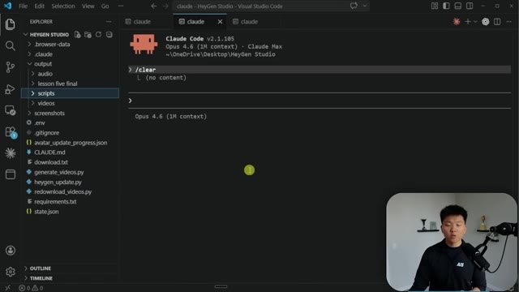
*⏱️ 00:13:04 — Interface de Visual Studio Code affichant le terminal Claude Code (version 2.1.105) avec le projet HeyGen Studio et la structure des fichiers du projet dans l'explorateur latéral.*

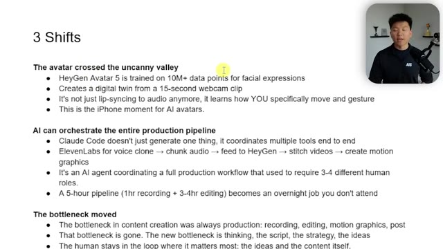
*⏱️ 00:13:12 — Document texte ou présentation présentant les "3 Shifts" (Les 3 changements majeurs) concernant les avatars IA, l'orchestration de la production par l'IA et le déplacement des goulots d'étranglement.*

---

### ⏱️ `[00:13:28 - 00:14:02]` | Segment #32

**🔊 Audio (Transcription Intégrale Mot pour Mot en Français) :**
> good or if the neighbors upstairs are being loud, or if you're in my case, the fire trucks that go down the street every single two seconds. Seriously, when I'm recording, I have to stop and just wait like multiple times during my sessions because there's a fire truck. But anyways, like I don't have to wait for the environment to be perfect now because I could do something like this. Because it's not just lip syncing, it's actually learning how you gesture and how you move, and it feels way more like you. The next one is that AI can orchestrate the entire production pipeline, like I showed you. Cloud code doesn't just generate one thing and then you have to do the rest. I said, hey, I want you to connect all of these different tools together so I don't have

**👁️ Analyse Visuelle d'Écran (gemini-3.5-flash-lite) :**
**Interface & Outils** : Logiciel de présentation (diapositives)

**Contenu textuel & Code** : Texte à puces sur les trois changements : l'avatar a franchi la vallée dérangeante (HeyGen Avatar 5), l'IA peut orchestrer tout le pipeline de production (Claude Code, ElevenLabs, HeyGen), et le goulet d'étranglement s'est déplacé vers la réflexion et la stratégie.

**Action / Démonstration** : Le présentateur commente les points affichés à l'écran concernant les changements dans la création de contenu par l'IA.

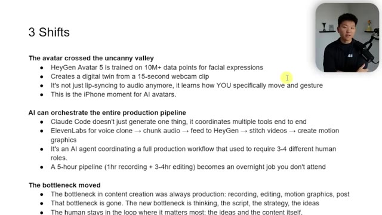
*⏱️ 00:13:37 — Une diapositive de présentation titrée '3 Shifts' avec des points clés sur l'évolution des avatars IA (HeyGen Avatar 5) et l'orchestration de la production, avec le présentateur en médaillon vidéo en haut à droite.*

---

### ⏱️ `[00:14:02 - 00:14:22]` | Segment #33

**🔊 Audio (Transcription Intégrale Mot pour Mot en Français) :**
> to click on anything. I just tell you what I want and you do it. So it's getting the voice clone, it's chunking the audio, it's feeding it to HeyGen, it's stitching it together, and it's creating those motion graphics for me. It's an AI agent coordinating a full production workflow that used to require three to four different types of roles. Maybe a camera guy, maybe an AV guy, a video editor, a person to actually read the script off.

**👁️ Analyse Visuelle d'Écran (gemini-3.5-flash-lite) :**
**Interface & Outils** : Présentation de diapositives

**Contenu textuel & Code** : Texte à puces décrivant l'évolution des avatars IA (HeyGen Avatar 5) et l'orchestration des pipelines de production.

**Action / Démonstration** : Le présentateur explique les différents points affichés à l'écran.

---

### ⏱️ `[00:14:22 - 00:14:41]` | Segment #34

**🔊 Audio (Transcription Intégrale Mot pour Mot en Français) :**
> Et chaque fois que vous lancez ce truc, il devient de plus en plus intelligent, c'est pourquoi j'ai fait autant de tests. Mais en gros, ça transforme un pipeline de cinq heures en un travail de nuit pour lequel je n'avais même pas besoin d'être réveillé. Et ce qui est cool aussi, c'est que le goulot d'étranglement s'est déplacé, parce que le goulot d'étranglement dans la création de contenu, c'était en gros toujours la production et la post-production. Donc l'enregistrement, le montage, le motion design.

**👁️ Analyse Visuelle d'Écran (gemini-3.5-flash-lite) :**
**Interface & Outils** : Document de présentation textuel avec incrustation vidéo du présentateur.

**Contenu textuel & Code** : Points clés sur les avatars IA, l'orchestration des pipelines de production via Claude Code, ElevenLabs et HeyGen, ainsi que le déplacement des goulots d'étranglement.

**Action / Démonstration** : Le présentateur commente le texte affiché à l'écran tout en surlignant des passages pour appuyer ses propos.

---

### ⏱️ `[00:14:41 - 00:15:02]` | Segment #35

**🔊 Audio (Transcription Intégrale Mot pour Mot en Français) :**
> Mais désormais, ce goulot d'étranglement est essentiellement résolu. Le nouveau goulot d'étranglement, c'est ce que nous devrions faire, à savoir la réflexion, la rédaction de scripts, la stratégie et les idées. L'humain reste dans la boucle là où cela compte le plus, c'est-à-dire, encore une fois, les idées et le contenu lui-même. Donc je ne vais pas tout énumérer, mais j'ai quelques statistiques ici. Par exemple, 91 % des entreprises utilisent la vidéo comme outil marketing. C'est énorme. 67 % des marketeurs n'utilisant pas la vidéo prévoient de s'y mettre cette année.

**👁️ Analyse Visuelle d'Écran (gemini-3.5-flash-lite) :**
**Interface & Outils** : Document texte / Traitement de texte ou notes partagées à l'écran

**Contenu textuel & Code** : Puces listant des statistiques et des constats sur HeyGen, la production vidéo et les flux de travail IA.

**Action / Démonstration** : Le présentateur commente le texte affiché à l'écran tout en mettant en surbrillance une phrase clé.

---

### ⏱️ `[00:15:03 - 00:15:37]` | Segment #36

**🔊 Audio (Transcription Intégrale Mot pour Mot en Français) :**
> Et un autre point, les obstacles à la création de vidéos. 24 % disent que c'est trop cher. Parce que, comme je l'ai dit, vous avez besoin de matériel, vous avez besoin d'un bon studio, vous avez besoin de montage, vous avez besoin de tout ce matériel. Mais là, nous allons aborder le coût dans un instant. C'est tellement, tellement moins cher, et pas seulement moins cher, mais pensez au temps que vous récupérez. Très bien. Alors le plus sympa, ce sont trois objections que je savais pertinemment que j'allais avoir dans les commentaires et je suis sûr que je vais en avoir d'autres, mais je voulais aborder ces trois-là. La première, c'est que c'est faux. Ce n'est pas authentique. Et dans une certaine mesure, je suis tout à fait d'accord. Comme je l'ai dit, je n'ai jamais prévu que ma chaîne YouTube soit un avatar d'IA. Peut-être pour certains projets, si je voulais avoir genre une chaîne TikTok qui ne ferait que des actualités et où ce serait juste moi en train de lire

**👁️ Analyse Visuelle d'Écran (gemini-3.5-flash-lite) :**
**Interface & Outils** : Document texte ou présentation web épurée avec le présentateur incrusté en haut à droite.

**Contenu textuel & Code** : Texte à puces détaillant les statistiques du marché de la vidéo, les obstacles financiers (Wyzowl 2026) et les objections courantes face aux avatars IA.
[DESC_ACTION] Le présentateur commente les statistiques affichées à l'écran concernant les coûts et les objections à la création de vidéos par IA.

**Action / Démonstration** : Explications face caméra et démonstration conceptuelle.

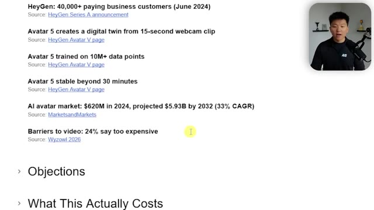
*⏱️ 00:15:11 — Page de présentation affichant des statistiques sur HeyGen et le marché des avatars IA, avec en surbrillance l'obstacle lié au coût (24% trouvent cela trop cher).*

*⏱️ 00:15:29 — Page de présentation listant les objections concernant l'utilisation des avatars IA, avec des points détaillant l'authenticité et la qualité du contenu.*

---

### ⏱️ `[00:15:37 - 00:15:57]` | Segment #37

**🔊 Audio (Transcription Intégrale Mot pour Mot en Français) :**
> actualités. Je pense que c'est très bien. Je pense que la plupart du temps, les gens se fichent de savoir si c'est vraiment moi qui le dis. Ils veulent juste savoir si ce sont mes vraies pensées et ils veulent savoir que je ne leur balance pas simplement un script ChatGPT. Et j'aime faire des vidéos YouTube et je veux qu'elles gardent un côté personnel. Le script est à vous. La voix est à vous. Le visage est à vous. La seule chose qui manque, c'est que vous n'avez pas besoin de vous asseoir sur une chaise ou vous n'avez pas besoin d'attendre que les planètes s'alignent, n'est-ce pas ?

**👁️ Analyse Visuelle d'Écran (gemini-3.5-flash-lite) :**
**Interface & Outils** : Application de présentation de type traitement de texte ou notes.

**Contenu textuel & Code** : Texte à l'écran abordant les objections telles que "That's fake / not authentic" et "Won't this flood the internet with garbage content?".

**Action / Démonstration** : Le présentateur parle tandis que les points clés de la diapositive s'affichent à l'écran.

---

### ⏱️ `[00:15:58 - 00:16:33]` | Segment #38

**🔊 Audio (Transcription Intégrale Mot pour Mot en Français) :**
> Si vous êtes en vacances et que vous réalisez que vous devez publier quelque chose, vous avez déjà votre avatar de vous dans votre bureau à la maison. Le suivant est : est-ce que cela ne va pas inonder Internet de contenu de pacotille ? De la bouillie d'IA. Je veux dire, je ne le pense pas vraiment. Et je pense que les gens qui pensent de cette façon sont juste très négatifs, car les outils de rédaction par IA existent déjà. Si vous pensez qu'il n'y a pas déjà des millions et des millions chaque jour de bouillie d'IA publiée sur LinkedIn ou X ou ailleurs, alors vous avez tort. Mais ce qui se passe, c'est que le meilleur contenu va quand même gagner dans un monde où tout est rédigé ou amélioré par l'IA d'une manière ou d'une autre. Donc, supprimer le goulet d'étranglement de la production signifie qu'il y aura plus de contenu, mais le filtre de qualité reste l'idée. Et cela rend même

**👁️ Analyse Visuelle d'Écran (gemini-3.5-flash-lite) :**
**Interface & Outils** : Logiciel de présentation de diapositives avec incrustation vidéo.

**Contenu textuel & Code** : Texte à puces abordant les objections telles que "That's fake / not authentic", "Won't this flood the internet with garbage content?" et "Isn't this going to kill video editor jobs?".

**Action / Démonstration** : Présentation des arguments sous forme de liste par le présentateur.

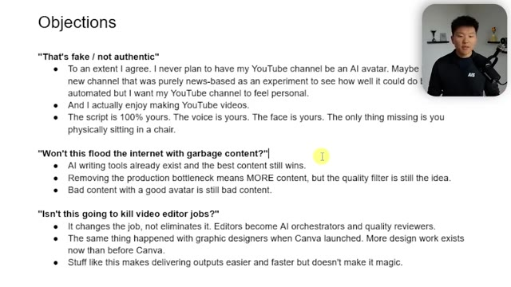
*⏱️ 00:16:07 — Une diapositive de présentation intitulée "Objections" listant différentes questions et réponses sur l'utilisation des avatars IA, avec la vidéo du présentateur incrustée en haut à droite.*

---

### ⏱️ `[00:16:33 - 00:17:07]` | Segment #39

**🔊 Audio (Transcription Intégrale Mot pour Mot en Français) :**
> plus compétitif où seuls les meilleurs réussiront réellement à arriver sur votre fil d'actualité ou à arriver, vous savez, au sommet. Un mauvais contenu avec un bon avatar reste un mauvais contenu. Et enfin le dernier, est-ce que ça ne va pas tuer les emplois de monteur vidéo ? Ça change le travail. Je veux dire, comme toutes ces choses que nous faisons avec le montage vidéo ou l'automatisation, ça ne va pas simplement tuer ces emplois. Je veux dire, il y aura certains emplois qui seront fondamentalement modifiés et éliminés, mais ces personnes doivent simplement être celles qui y appliquent leur expertise métier. Je ne pourrais pas créer la meilleure automatisation IA du monde pour le référencement car je n'ai pour ainsi dire aucune expertise métier en matière de référencement. Mais les gens

**👁️ Analyse Visuelle d'Écran (gemini-3.5-flash-lite) :**
**Interface & Outils** : Document texte ou présentation affichée à l'écran.

**Contenu textuel & Code** : Points abordant les objections : 'That's fake / not authentic', 'Won't this flood the internet with garbage content?', 'Isn't this going to kill video editor jobs?'.

**Action / Démonstration** : Défilement du texte de la présentation par le présentateur.

---

### ⏱️ `[00:17:07 - 00:17:40]` | Segment #40

**🔊 Audio (Transcription Intégrale Mot pour Mot en Français) :**
> qui le font, ce seront ceux qui pourront créer des systèmes d'IA pour le référencement vraiment géniaux. Donc bref, parlons maintenant de ce que cela coûte réellement. Et avant d'aborder ce sujet, vous vous dites peut-être que c'est cher et ce n'est vraiment pas bon marché de fabriquer ces vidéos. Mais réfléchissez-y quand vous pensez réellement à l'investissement. De la même manière que j'aime penser à Cloud Code. Je paye 200 balles par mois pour ça. Et c'est probablement mon abonnement le plus cher, ou l'un d'entre eux. Mais c'est le plus précieux que j'ai en ce moment. Donc la pile de production sur un forfait créateur de HeyGen, ça va vous coûter environ 30 balles par mois. Et ça ne va vous donner qu'une quantité limitée

**👁️ Analyse Visuelle d'Écran (gemini-3.5-flash-lite) :**
**Interface & Outils** : Traitement de texte ou application de notes type Notion.

**Contenu textuel & Code** : Titres de section d'une présentation ou d'un plan ("Key Stats", "Objections", "What This Actually Costs").

**Action / Démonstration** : Navigation ou sélection d'un point dans le plan du document.

---

### ⏱️ `[00:17:40 - 00:18:00]` | Segment #41

**🔊 Audio (Transcription Intégrale Mot pour Mot en Français) :**
> de 5 générations d'avatar, mais c'est largement suffisant pour commencer. Ensuite, vous avez aussi le plan créateur d'ElevenLabs. Le plan à 22 dollars par mois va vous donner environ 100 minutes audio, ce qui fait beaucoup d'audio. Et puis pour Claude Code, vous savez, 20 à 200 dollars par mois, ce qui orchestre tout le pipeline. Vous pourriez aussi faire ça dans quelque chose comme CoWork et peut-être même Claude si vous mettez les bons connecteurs.

**👁️ Analyse Visuelle d'Écran (gemini-3.5-flash-lite) :**
**Interface & Outils** : Document texte ou présentation affichant les coûts de la pile IA et les alternatives humaines.

**Contenu textuel & Code** : Texte listant les coûts : HeyGen Creator plan ($29/mo), ElevenLabs Creator plan ($22/mo), Claude Code ($20-$200/mo), HeyGen API overhead (~$4/min).

**Action / Démonstration** : Le présentateur commente les différents coûts de la pile de production IA affichés à l'écran.

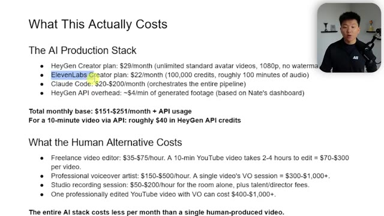
*⏱️ 00:17:45 — Une page de texte détaillant les coûts de la pile de production IA, avec le présentateur visible en médaillon vidéo en haut à droite.*

---

### ⏱️ `[00:18:01 - 00:18:22]` | Segment #42

**🔊 Audio (Transcription Intégrale Mot pour Mot en Français) :**
> Et ensuite, nous avons un coût différent pour l'API HeyGen. Elle va traiter les choses différemment que votre simple tableau de bord. Laissez-moi donc vous montrer un rapide exemple. Si je vais dans HeyGen et que je vais dans mes paramètres, et que je vais dans mon utilisation et historique, vous pouvez voir que j'ai des crédits premium juste ici, n'est-ce pas ? J'ai donc utilisé environ 502 de mes 2 000 crédits. Et ensuite, si je vais dans mon API cependant, ici vous pouvez voir que j'ai dépensé beaucoup d'argent, n'est-ce pas ?

**👁️ Analyse Visuelle d'Écran (gemini-3.5-flash-lite) :**
**Interface & Outils** : Interface web HeyGen

**Contenu textuel & Code** : Menu des paramètres de compte (Account, Preferences, Personalization, General, Plan & Billing, Usage & History, Security, API, Connections)

**Action / Démonstration** : Navigation dans les paramètres du compte HeyGen pour montrer la section d'utilisation et d'historique.

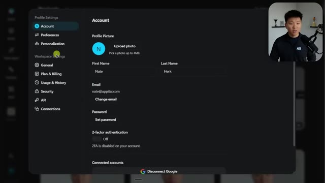
*⏱️ 00:18:11 — L'interface des paramètres d'un compte HeyGen montrant les options de profil et les réglages de l'espace de travail.*

---

### ⏱️ `[00:18:22 - 00:18:43]` | Segment #43

**🔊 Audio (Transcription Intégrale Mot pour Mot en Français) :**
> Comme je le disais, j'ai beaucoup testé. Et si je vais dans mon utilisation, vous pouvez voir mes dépenses, mon taux d'erreur, mon nombre total de requêtes. Et vous pouvez voir que chacun de ces clips d'une minute coûte environ quatre dollars. Donc, si vous faites une vidéo de 10 minutes, ça va probablement vous coûter presque 50 dollars. Oui, c'est un peu cher, n'est-ce pas ? Mais si vous y pensez simplement en vous disant : « Bon, combien est-ce que je paye réellement pour récupérer quelques heures de mon temps ? »

**👁️ Analyse Visuelle d'Écran (gemini-3.5-flash-lite) :**
**Interface & Outils** : Interface de gestion de compte/API type SaaS (probablement une plateforme d'IA comme HeyGen ou similaire).

**Contenu textuel & Code** : "Total Requests: 137", "Error Rate: 10.95%", "Total Spend: $262.89", graphique en barres des dépenses par date, et répartition par catégorie ("Video Generation" à 262,27 $).

**Action / Démonstration** : Navigation dans les paramètres API pour visualiser les données de consommation et les coûts associés à l'utilisation des services d'IA.

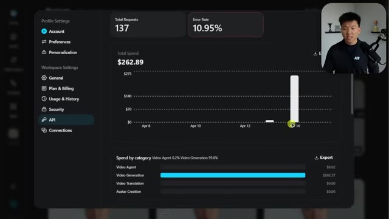
*⏱️ 00:18:27 — Tableau de bord analytique affichant les statistiques d'utilisation de l'API, incluant le total des requêtes, le taux d'erreur, les dépenses totales et une répartition par catégorie.*

---

### ⏱️ `[00:18:43 - 00:19:16]` | Segment #44

**🔊 Audio (Transcription Intégrale Mot pour Mot en Français) :**
> Est-ce que ça en vaut la peine ? Pour certaines personnes, la réponse est oui. Pour d'autres, la réponse est non. Pour la plupart des entreprises et vu à quel point vous allez pouvoir propulser votre contenu, qui est le sommet de l'entonnoir, cela canalise fondamentalement tout ce qui suit et affecte votre chiffre d'affaires d'une excellente manière. Je pense que cet investissement en vaut mille pour cent la peine. Si c'est le déclic dont une entreprise a besoin pour commencer à créer du contenu de manière constante, alors oui, ça en vaut la peine. Et c'est de ça que je parle juste ici. Quelle est l'alternative humaine, hein ? Un monteur vidéo freelance peut coûter entre 35 et 75 dollars de l'heure. Donc une vidéo YouTube de 10 minutes peut coûter jusqu'à 300 dollars. Et puis si vous voulez obtenir une voix off professionnelle ou si vous voulez avoir un studio pour enregistrer

**👁️ Analyse Visuelle d'Écran (gemini-3.5-flash-lite) :**
**Interface & Outils** : Interface web de gestion de projets vidéo et document de notes/rapports textuels.

**Contenu textuel & Code** : Miniatures de vidéos (Lesson 5.4, Demo, YT Intro) et texte chiffré sur les coûts de production vidéo humaine ($35-$75/hour).

**Action / Démonstration** : Navigation dans l'interface de projets et survol du texte comparatif des coûts par le curseur.

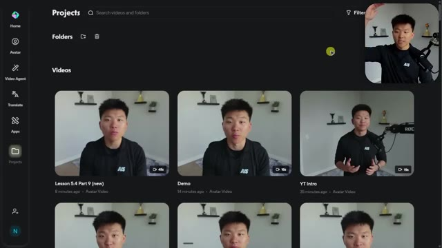
*⏱️ 00:18:51 — Interface web montrant une liste de projets vidéo avec miniatures et un encart vidéo du présentateur en haut à droite.*

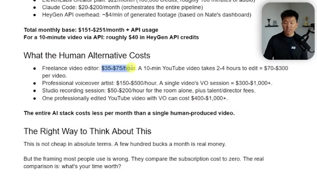
*⏱️ 00:19:08 — Document texte détaillant les coûts alternatifs humains (freelance, voix off, studio) en comparaison avec la pile d'IA.*

---

### ⏱️ `[00:19:16 - 00:19:39]` | Segment #45

**🔊 Audio (Transcription Intégrale Mot pour Mot en Français) :**
> Tout cela pourrait potentiellement s'élever à quelques milliers de dollars, juste pour sortir quelques vidéos de supports de cours ou quelques publicités. Donc la bonne façon d'y penser, c'est que ce n'est pas bon marché en termes absolus, mais si vous pensez à l'investissement, cela vaut l'investissement. Donc, si le pipeline vous rend 10 heures par semaine, cela fait 40 heures par mois. Et à 251 dollars par mois, vous payez environ six dollars de l'heure pour racheter votre propre temps.

**👁️ Analyse Visuelle d'Écran (gemini-3.5-flash-lite) :**
**Interface & Outils** : Éditeur de documents texte (type Google Docs ou Notion).

**Contenu textuel & Code** : Liste détaillée des coûts : montage freelance (35-75$/h), voix off professionnelle (150-500$/h), calcul du coût total par vidéo, et analyse du coût horaire pour récupérer du temps de travail (6,28$/heure).

**Action / Démonstration** : Présentation statique de données comparatives de coûts pour illustrer la rentabilité de l'automatisation IA par rapport aux méthodes traditionnelles.

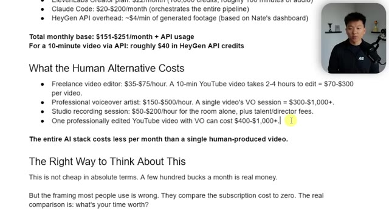
*⏱️ 00:19:22 — Une capture d'écran d'un document texte comparant les coûts de production vidéo par des humains par rapport à l'utilisation d'une pile technologique d'IA, avec le présentateur visible en médaillon.*

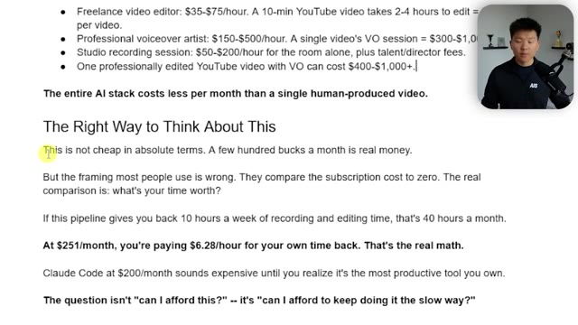
*⏱️ 00:19:27 — La suite du document texte abordant la logique économique et le retour sur investissement en temps lié à l'utilisation d'outils d'automatisation IA, avec le présentateur en médaillon.*

---

### ⏱️ `[00:19:39 - 00:20:03]` | Segment #46

**🔊 Audio (Transcription Intégrale Mot pour Mot en Français) :**
> Et selon la matrice de rachat, c'est probablement une bonne affaire. Quoi qu'il en soit, je vais faire une analyse complète de Remotion. Je sais que vous avez remarqué que certaines de mes autres vidéos ont été montées avec, mais j'ai simplement beaucoup expérimenté avec et j'essaie de trouver la meilleure façon de structurer une vidéo. Donc cela arrivera bientôt. Je vous informerai quand ce sera sorti, mais ce sera tout pour celle-ci. Rappelez-vous simplement que vous pouvez télécharger ce HeyGen Studio et ce document Word que nous regardions si cela vous intéresse de vous plonger dedans.

**👁️ Analyse Visuelle d'Écran (gemini-3.5-flash-lite) :**
**Interface & Outils** : Visual Studio Code, terminal intégré Claude Code CLI (v2.1.105)

**Contenu textuel & Code** : Arborescence des fichiers du projet HeyGen Studio (`generate_videos.py`, `heygen_update.py`, `CLAUDE.md`, etc.), commande terminal `/clear` exécutée sous le modèle Opus 4.6 (1M context).

**Action / Démonstration** : Réinitialisation de la session de terminal Claude Code avec la commande `/clear`.

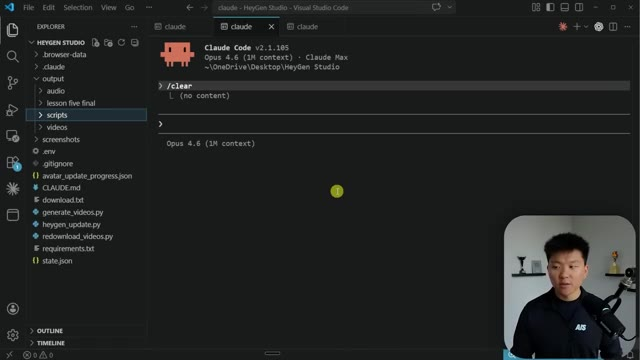
*⏱️ 00:19:45 — L'interface Visual Studio Code affichant le projet HeyGen Studio et un terminal Claude Code réinitialisé.*

---

### ⏱️ `[00:20:03 - 00:20:17]` | Segment #47

**🔊 Audio (Transcription Intégrale Mot pour Mot en Français) :**
> Mais ouais, sinon je vous dirais d'aller sur HeyGen, créez votre avatar, allez sur ElevenLabs, créez votre clone, et commencez simplement à vous amuser avec tout ça. Donc si vous avez aimé la vidéo ou appris quelque chose de nouveau, n'hésitez pas à laisser un j'aime, ça m'aide énormément. Et comme toujours, j'apprécie que vous soyez allés jusqu'à la fin de la vidéo et je vous dis à la prochaine. Merci à tous.

**👁️ Analyse Visuelle d'Écran (gemini-3.5-flash-lite) :**
**Interface & Outils** : Visual Studio Code / Claude Code CLI

**Contenu textuel & Code** : Commande `/clear` et l'affichage d'initialisation de Claude Code v2.1.105 avec Opus 4.6 (1M context) dans le répertoire `HeyGen Studio`.

**Action / Démonstration** : Exécution de la commande `/clear` pour effacer l'historique du terminal Claude Code.

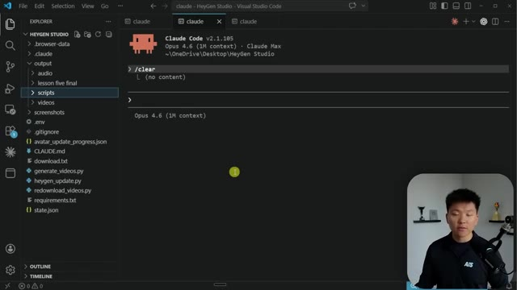
*⏱️ 00:20:07 — Interface de VS Code montrant un terminal intégré exécutant Claude Code v2.1.105 avec l'explorateur de fichiers à gauche et la webcam du présentateur en bas à droite.*

---

