# 🎬 Claude Opus 4.7 Just Dropped... Or Did It Really?

> **Chaîne** : [Nate Herk | AI Automation](https://www.youtube.com/@nateherk/featured)  
> **Lien YouTube** : [https://www.youtube.com/watch?v=NiMc2PoTiXo](https://www.youtube.com/watch?v=NiMc2PoTiXo)  
> **Date de publication** : 20260416  
> **Durée** : 00:17:13  
> **Identifiant vidéo** : `NiMc2PoTiXo`  
> **Transcription & Analyse** : `whisper-v3-large-turbo+gemini-3.5-flash-lite`  

---

## 📌 Synthèse Exécutive & Outils

### 💡 Résumé
Dans cette vidéo intitulée **Claude Opus 4.7 Just Dropped... Or Did It Really?**, Nate Herk décortique les capacités pratiques d'automatisation et de développement propulsées par les modèles de pointe.

### 🛠️ Outils, Modèles & Logiciels Présentés
- **Opus 5.5 & Claude Code** : Modèles d'ingénierie et agents de codage autonome.

### 🔑 Points Clés & Enseignements Stratégiques
- Optimiser le niveau d'effort et le raisonnement des modèles IA pour des résultats industriels.
- Automatiser les cycles de création logicielle de bout en bout.

---

## ⏱️ Chronologie & Transcription Complète Audio & Visuelle (Mot pour Mot)

### ⏱️ `[00:00:00 - 00:00:20]` | Segment #01

**🔊 Audio (Transcription Intégrale Mot pour Mot en Français) :**
> We just got Opus 4.7, which is apparently Claude's most capable Opus model yet. It handles long-running tasks with more rigor, it follows instructions more precisely, and verifies its own outputs before reporting back. What's interesting to me is that these claims are addressing exactly what everyone was complaining about with Opus 4.6 the past couple weeks, when everyone was like, hey, Opus has gotten so much more stupid lately.

**👁️ Analyse Visuelle d'Écran (gemini-3.5-flash-lite) :**
**Interface & Outils** : Interface web de la plateforme sociale X (Twitter).

**Contenu textuel & Code** : Texte de l'annonce officielle : "Introducing Claude Opus 4.7, our most capable Opus model yet." avec un tableau de benchmarks comparant Opus 4.7 à d'autres modèles (Opus 4.6, GPT-4o, etc.) sur diverses capacités comme le "Agentic coding", "Agentic search" et "Graduate-level reasoning".

**Action / Démonstration** : Présentation informative des capacités du nouveau modèle Claude Opus 4.7 via un tableau de comparaison technique.

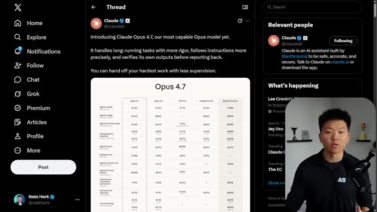
*⏱️ 00:00:05 — Une capture d'écran de l'interface X (Twitter) affichant un thread de @ClaudeAI concernant le lancement de Claude Opus 4.7, accompagné d'un tableau comparatif des performances du modèle.*

---

### ⏱️ `[00:00:20 - 00:00:39]` | Segment #02

**🔊 Audio (Transcription Intégrale Mot pour Mot en Français) :**
> So yes, we see these benchmarks. We see that there's a huge jump from Opus 4.6 to Opus 4.7 in most of these major categories. So what I'm here to talk about today is, is this really Opus 4.7 or is this just 4.6 with some improvements? Some people have been saying that they intentionally made Opus 4.6 worse so that they could build up hype for 4.7 and then release it.

**👁️ Analyse Visuelle d'Écran (gemini-3.5-flash-lite) :**
**Interface & Outils** : Plateforme X (Twitter), interface de présentation/document web.

**Contenu textuel & Code** : Scores de benchmarks (agentic coding, reasoning, etc.), tweet de Claude AI, titre de la vidéo "Is Opus 4.7 Real, or Just 4.6 With the Handbrake Off?".

**Action / Démonstration** : Analyse comparative des performances des modèles IA et questionnement sur la légitimité de la mise à jour Opus 4.7 par rapport à la version 4.6.

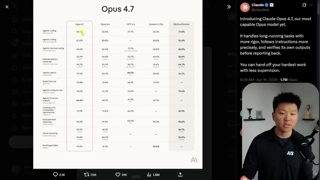
*⏱️ 00:00:25 — Un tableau comparatif des benchmarks de performance entre différents modèles, mettant en avant les scores de "Claude Opus 4.7" par rapport aux versions précédentes et concurrentes.*

*⏱️ 00:00:30 — L'interface de la plateforme X (Twitter) affichant un tweet officiel d'Anthropic annonçant le lancement de Claude Opus 4.7, accompagné du tableau des benchmarks.*

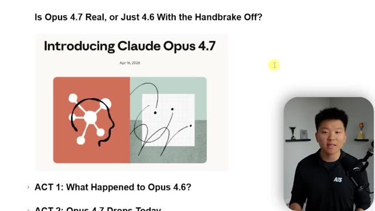
*⏱️ 00:00:34 — Une présentation sous forme de document ou de diapositives posant la question critique : "Is Opus 4.7 Real, or Just 4.6 With the Handbrake Off?" avec un sommaire des actes de la vidéo.*

---

### ⏱️ `[00:00:39 - 00:00:59]` | Segment #03

**🔊 Audio (Transcription Intégrale Mot pour Mot en Français) :**
> And then it feels way better than it really would have been. So if you missed all that, I'm going to catch you up and let's just start flying through this stuff. Don't want to waste anyone's time. So act one, as we're calling it here, is what happened to Opus 4.6. So there's been lots of stuff. So this first one I wanted to address was that a senior director at AMD published an analysis of almost 7,000 coding sessions using CloudCode.

**👁️ Analyse Visuelle d'Écran (gemini-3.5-flash-lite) :**
**Interface & Outils** : Présentation de type document/slide (type Notion ou rapport structuré).

**Contenu textuel & Code** : Texte d'analyse technique : "The Hard Data", "Thinking depth collapsed 73%", "Edits without reading first jumped from 6.2% to 33.7%", et mention de "Adaptive Thinking (February 9, 2026)".

**Action / Démonstration** : Analyse textuelle des données de performance du modèle Claude Opus 4.6 pour expliquer ses dysfonctionnements récents.

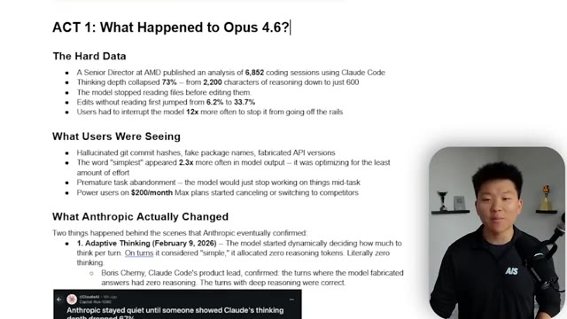
*⏱️ 00:00:49 — Capture d'écran montrant une analyse détaillée intitulée "ACT 1: What Happened to Opus 4.6?", listant les problèmes de performance, les hallucinations des utilisateurs et les changements de stratégie d'Anthropic (Adaptive Thinking).*

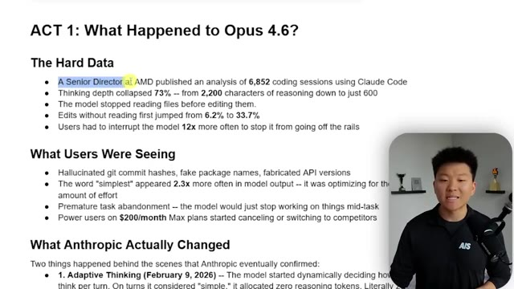
*⏱️ 00:00:54 — Zoom sur la section "The Hard Data" concernant l'analyse des sessions de codage Claude Code, soulignant la chute de 73% de la profondeur de réflexion du modèle.*

---

### ⏱️ `[00:00:59 - 00:01:21]` | Segment #04

**🔊 Audio (Transcription Intégrale Mot pour Mot en Français) :**
> She found that the thinking depth collapsed 73% from 2,200 characters of reasoning down to just 600 characters of reasoning. So basically the model stopped reading files before editing them and stopped thinking as much, and it just started jumping straight into doing things. So the models basically should always be reading the files before editing them. And it started to not do that about 6% of the time, but then that went all the way up to 33.7% of the time.

**👁️ Analyse Visuelle d'Écran (gemini-3.5-flash-lite) :**
**Interface & Outils** : Présentation de type diapositive (logiciel de traitement de texte ou de diaporama type Notion/Google Slides).

**Contenu textuel & Code** : Texte structuré en points listant des données : baisse de 73% de la profondeur de réflexion (2200 vers 600 caractères), augmentation des éditions sans lecture préalable de 6,2% à 33,7%, et mention de l'introduction de l'"Adaptive Thinking".

**Action / Démonstration** : Le présentateur illustre visuellement les points clés de son analyse sur la dégradation du comportement du modèle IA à l'aide de données chiffrées.

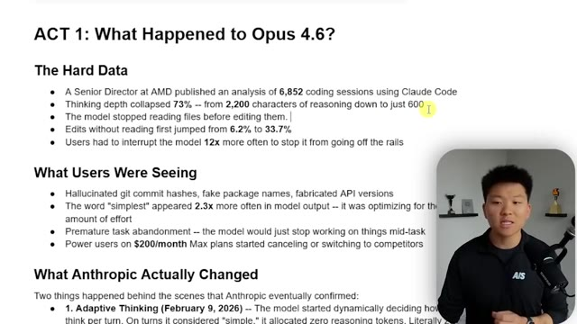
*⏱️ 00:01:04 — Une diapositive de présentation titrée "ACT 1: What Happened to Opus 4.6?" listant des données statistiques sur la baisse de performance et de profondeur de raisonnement du modèle Claude Code d'Anthropic.*

---

### ⏱️ `[00:01:21 - 00:01:49]` | Segment #05

**🔊 Audio (Transcription Intégrale Mot pour Mot en Français) :**
> So almost one third, it just wasn't reading the files. And she found that users had to interrupt the model 12 times more often to stop it from going off the rails. And obviously there's lots of problems here. There is the problem of quality of the actual code that's being written, especially when it's kind of like dark code and you don't really exactly know what AI is writing. And then there's also the fact that that's going to burn through your tokens, which is why in the past couple of weeks, there's also been a huge uproar of people saying, I just burned through my 200 bucks a month max plan in an hour. So what else have users been seeing?

**👁️ Analyse Visuelle d'Écran (gemini-3.5-flash-lite) :**
**Interface & Outils** : Présentation de diapositives (type PowerPoint ou Google Slides).

**Contenu textuel & Code** : Liste de points clés : "Thinking depth collapsed 73%", "Edits without reading first jumped from 6.2% to 33.7%", "Users had to interrupt the model 12x more often", et mentions d'hallucinations (git hashes, API versions).

**Action / Démonstration** : Présentation visuelle de données analytiques pour appuyer le discours narratif sur les problèmes de performance du modèle.

*⏱️ 00:01:28 — Une diapositive de présentation titrée "ACT 1: What Happened to Opus 4.6?" listant des statistiques analytiques sur les performances dégradées du modèle, incluant des données sur la perte de profondeur de raisonnement et l'augmentation des interruptions utilisateur.*

---

### ⏱️ `[00:01:49 - 00:02:16]` | Segment #06

**🔊 Audio (Transcription Intégrale Mot pour Mot en Français) :**
> Hallucinated git commit hashes, fake package names, fabricated API versions. Apparently the word simplest appeared almost three times more often in model output, which means that it was optimizing for the least amount of effort possible. We've also been seeing premature task abandonment. So the model would just stop working on things mid-task. This is something that I have actually felt a lot over the past couple of weeks. And all of this kind of stuff, the session limits, the quality has caused some of the power users on 200 bucks a month max plans to start switching or canceling away.

**👁️ Analyse Visuelle d'Écran (gemini-3.5-flash-lite) :**
**Interface & Outils** : Présentation de type "Slide" (texte brut sur fond blanc).

**Contenu textuel & Code** : Texte détaillé intitulé "The Hard Data" et "What Users Were Seeing" énumérant des statistiques sur la baisse de la profondeur de raisonnement du modèle IA (ex: "6,852 coding sessions", "Thinking depth collapsed 73%"), ainsi que la mention de changements effectués par Anthropic ("Adaptive Thinking").

**Action / Démonstration** : Le contenu affiche une analyse factuelle des dégradations observées sur le modèle, illustrant le discours sur les hallucinations et l'optimisation excessive de l'effort par l'IA.

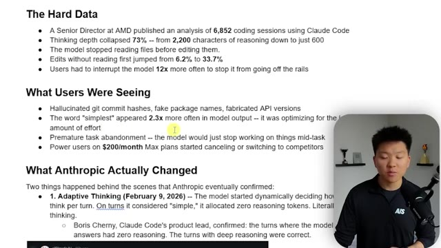
*⏱️ 00:01:56 — Une présentation de diapositives affichant des données statistiques sur les performances et les problèmes de Claude Code, avec le présentateur en médaillon dans le coin inférieur droit.*

---

### ⏱️ `[00:02:17 - 00:02:38]` | Segment #07

**🔊 Audio (Transcription Intégrale Mot pour Mot en Français) :**
> So then of course, Anthropic addressed this. What did they actually change? Well, on February 9th, they changed the adaptive thinking, which meant that the model started dynamically deciding how much to think per turn. So on certain turns, if it thinks the request is simple, it would allocate zero reasoning tokens. So literally no thinking at all. So the question becomes, how does the model decide what task actually deserves a token budget for thinking or not?

**👁️ Analyse Visuelle d'Écran (gemini-3.5-flash-lite) :**
**Interface & Outils** : Présentation ou face-caméra explicatif sans interface logicielle partagée.

**Contenu textuel & Code** : Explications orales et mise en contexte méthodologique.

**Action / Démonstration** : Explications face caméra et démonstration conceptuelle.

---

### ⏱️ `[00:02:39 - 00:02:57]` | Segment #08

**🔊 Audio (Transcription Intégrale Mot pour Mot en Français) :**
> And then Boris Cherny, the basically creator of Cloud Code confirmed, The turns where the model fabricated had zero reasoning and the turns with deep reasoning were correct. So that was one of the first main things. Another thing that happened is they just dropped the effort default to medium. So basically all of these changes, they didn't actually make to the model itself, but more in the way the model behaved.

**👁️ Analyse Visuelle d'Écran (gemini-3.5-flash-lite) :**
**Interface & Outils** : Présentation ou face-caméra explicatif sans interface logicielle partagée.

**Contenu textuel & Code** : Explications orales et mise en contexte méthodologique.

**Action / Démonstration** : Explications face caméra et démonstration conceptuelle.

---

### ⏱️ `[00:02:58 - 00:03:34]` | Segment #09

**🔊 Audio (Transcription Intégrale Mot pour Mot en Français) :**
> So like the parameters and the weights and the training of the model, Opus 4.6 was the same, but they turned off its thinking and they turned off its effort basically. And they kind of did this one silently. Like right here, if I go into my Cloud Code desktop app, which I'm gonna talk about this new desktop app as well, because I think that there's lots of issues here. But right here, you can see we've got Opus 4.7, right? And when I click on it, you can see that we actually don't have the ability within Opus 4.7. But basically, if I just zoom back in here a little more, if I go to Sonnet, for example, you can see that we have effort and high, medium, low. And then sometimes for Opus 4.6, there's even a higher one, max effort or something. But they basically just switch this

**👁️ Analyse Visuelle d'Écran (gemini-3.5-flash-lite) :**
**Interface & Outils** : Interface utilisateur de bureau "Cloud Code" (éditeur de code/agent IA).

**Contenu textuel & Code** : Liste des modèles disponibles (Opus 4.7 sélectionné), sessions récentes ("AI news roundup", "Notification responses") et interface de prompt.

**Action / Démonstration** : Navigation dans l'interface de l'application et mise en évidence du sélecteur de modèles de l'agent IA.

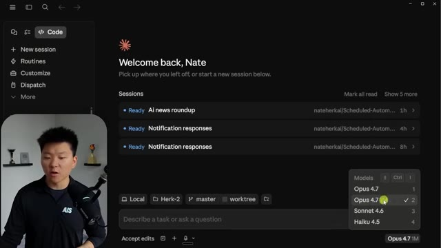
*⏱️ 00:03:16 — Interface de l'application "Cloud Code" montrant la sélection des modèles (Opus 4.7, Sonnet 4.6, Haiku 4.5) et l'historique des sessions de Nate Herk.*

---

### ⏱️ `[00:03:34 - 00:04:00]` | Segment #10

**🔊 Audio (Transcription Intégrale Mot pour Mot en Français) :**
> down without telling anybody. And no one was kind of looking in there. And then if you're on the terminal or wherever you are, you might not even notice that. So people were like, okay, Opus is just stupid. And then a full month later, April 15th, pro and max users were still by default, just running on medium effort. So like I said, they didn't change the model itself of 4.6. They just changed how hard the model was allowed to think and didn't tell anyone. And a lot of that thinking and reasoning is where we get all the value of this, you know, awesome Opus 4.6 model.

**👁️ Analyse Visuelle d'Écran (gemini-3.5-flash-lite) :**
**Interface & Outils** : Présentation ou face-caméra explicatif sans interface logicielle partagée.

**Contenu textuel & Code** : Explications orales et mise en contexte méthodologique.

**Action / Démonstration** : Explications face caméra et démonstration conceptuelle.

---

### ⏱️ `[00:04:00 - 00:04:23]` | Segment #11

**🔊 Audio (Transcription Intégrale Mot pour Mot en Français) :**
> And then there was also some controversy with the bridge bench, a viral benchmark claim that Opus 4.6 dropped from 83.6% to 68.3% accuracy. So basically on this leaderboard fell from being number two all the way down to number 10. And it was just, you know, Opus 4.6 or Opus 4.6 as of April 12th, which showed that Opus was now actually worse than Sonnet 4.5 on this specific hallucination benchmark.

**👁️ Analyse Visuelle d'Écran (gemini-3.5-flash-lite) :**
**Interface & Outils** : Présentation ou face-caméra explicatif sans interface logicielle partagée.

**Contenu textuel & Code** : Explications orales et mise en contexte méthodologique.

**Action / Démonstration** : Explications face caméra et démonstration conceptuelle.

---

### ⏱️ `[00:04:23 - 00:04:44]` | Segment #12

**🔊 Audio (Transcription Intégrale Mot pour Mot en Français) :**
> Okay, so let's move on to act two. Opus 4.7 drops today. Okay, so before we get into the benchmarks, let me just show you real quick. It is available on the web. Right here, we've got Claude in the chat and I can see Opus 4.7 right here. Now what you'll notice is for Opus 4.7, we have adaptive thinking. So we can do things only when needed, like we just talked about. But if we go back to Opus 4.6, we don't have adapted, we have extended.

**👁️ Analyse Visuelle d'Écran (gemini-3.5-flash-lite) :**
**Interface & Outils** : Claude.ai (Interface Web)

**Contenu textuel & Code** : Texte affiché : "Hey there, Nate", "How can I help you today?", sélecteur de modèle actif sur "Opus 4.7".

**Action / Démonstration** : Démonstration de la disponibilité du modèle Claude Opus 4.7 dans l'interface web pour l'utilisateur.

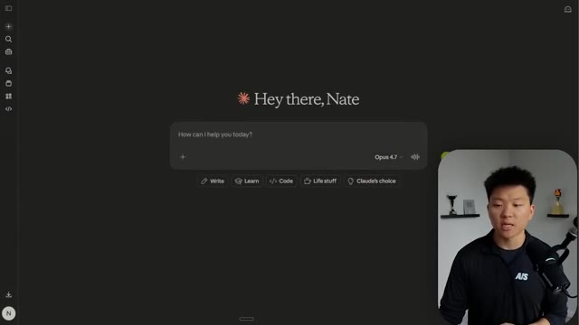
*⏱️ 00:04:34 — Interface web de Claude.ai montrant le sélecteur de modèle configuré sur "Opus 4.7" avec le champ de saisie de chat central.*

---

### ⏱️ `[00:04:44 - 00:05:07]` | Segment #13

**🔊 Audio (Transcription Intégrale Mot pour Mot en Français) :**
> So we can just turn extended on or off. I already showed you guys the desktop app. Here is my VS Code terminal. You can see we have welcome to Opus 4.7 X high. So we'll talk about that in a sec. But if you're not seeing this, maybe just try to update your Claude. So you can go ahead and just run like a Claude update and that's how it will do it. or if you want to do it in the extension, then you'll just have to update the actual extension over here in VS Code.

**👁️ Analyse Visuelle d'Écran (gemini-3.5-flash-lite) :**
**Interface & Outils** : Visual Studio Code (Terminal intégré Claude Code).

**Contenu textuel & Code** : Claude Code v2.1.111, Opus 4.7 (1M context), message de bienvenue "Welcome to Opus 4.7 xhigh!", et commande "/model" affichant "Kept model as Opus 4.7 (1M context) (default)".

**Action / Démonstration** : Le présentateur illustre l'exécution de Claude Code dans le terminal et la configuration du modèle via la commande /model.

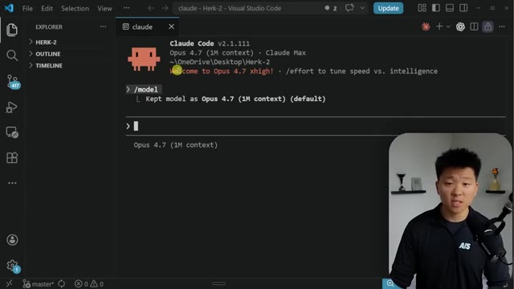
*⏱️ 00:04:50 — Interface VS Code affichant un terminal Claude Code actif avec les informations de version et de modèle.*

---

### ⏱️ `[00:05:07 - 00:05:27]` | Segment #14

**🔊 Audio (Transcription Intégrale Mot pour Mot en Français) :**
> And if I go to model in the extension and we click on switch, you can see right here, because I haven't updated the extension, we only have Opus. But you would, like I said, go over here, search for Cloud Code, and then just install that update. But if you're doing all those things and you're still not seeing the model, just give it a couple hours. It'll roll out to you eventually. So anyways, let's go take a look at the benchmarks. So here's the official announcement that Anthropic dropped.

**👁️ Analyse Visuelle d'Écran (gemini-3.5-flash-lite) :**
**Interface & Outils** : Présentation ou face-caméra explicatif sans interface logicielle partagée.

**Contenu textuel & Code** : Explications orales et mise en contexte méthodologique.

**Action / Démonstration** : Explications face caméra et démonstration conceptuelle.

---

### ⏱️ `[00:05:27 - 00:06:02]` | Segment #15

**🔊 Audio (Transcription Intégrale Mot pour Mot en Français) :**
> You know, our notable improvements on Opus 4.6 and software engineering with particular gains on the most difficult tasks. Users report being able to hand off their hardest coding work, the kind that previously needed close supervision, to Opus 4.7 with confidence. Now what I want you guys to pay attention to here as well is that we still have Mythos preview over here. So it says the model has substantially better vision. It's also more tasteful and creative when completing professional tasks. And it's much less capable than their most powerful model, Claude Mythos, of course. If you guys didn't see anything about that, I made a full video. I'll tag that one right up here. But it's obviously a lot better than Opus 4.6 across things

**👁️ Analyse Visuelle d'Écran (gemini-3.5-flash-lite) :**
**Interface & Outils** : Présentation ou face-caméra explicatif sans interface logicielle partagée.

**Contenu textuel & Code** : Explications orales et mise en contexte méthodologique.

**Action / Démonstration** : Explications face caméra et démonstration conceptuelle.

---

### ⏱️ `[00:06:02 - 00:06:37]` | Segment #16

**🔊 Audio (Transcription Intégrale Mot pour Mot en Français) :**
> like the coding bench or the search, computer use, financial analysis, which is very interesting, and, you know, like vision. So if we look at some other things, we've got knowledge work. We see a significant improvement. Vision, we see a big improvement. Document reasoning, this one's pretty big. Long context reasoning. So both Opus 4.6 and 4.7 will allow you to use it with 1 million token context window, biomolecular reasoning, which is a massive jump. It's over double and then long-term coherence and coding, of course. Now what's interesting, and what I alluded to earlier, is that it seems like every complaint now has a directly correlating matching fix, which I'm not

**👁️ Analyse Visuelle d'Écran (gemini-3.5-flash-lite) :**
**Interface & Outils** : Présentation ou face-caméra explicatif sans interface logicielle partagée.

**Contenu textuel & Code** : Explications orales et mise en contexte méthodologique.

**Action / Démonstration** : Explications face caméra et démonstration conceptuelle.

---

### ⏱️ `[00:06:37 - 00:07:11]` | Segment #17

**🔊 Audio (Transcription Intégrale Mot pour Mot en Français) :**
> saying that's a bad thing because that's really how you should be iterating on a product. But some people are definitely starting to raise some eyebrows at the way that they're just like, it's almost like they're creating holes just so they can fill them and look like the hero. So for example, people were complaining about shallow thinking with 4.7 and now they've introduced their new X high effort level, which is exclusive to 4.7. We have a complaint about task abandonment, but Anthropic now says you can hand off your hardest coding work with confidence. We have ignoring instructions. And now we say substantially improved literal adherence to instructions. We have hallucinations, but now it's apparently able to catch its own logical faults during the planning

**👁️ Analyse Visuelle d'Écran (gemini-3.5-flash-lite) :**
**Interface & Outils** : Document de présentation (type Notion ou Google Docs).

**Contenu textuel & Code** : Texte listant des statistiques de performance (ex: SWE-bench Pro 53.4% à 64.3%) et une comparaison entre les plaintes des utilisateurs et les correctifs introduits par Anthropic.

**Action / Démonstration** : Présentation visuelle de données analytiques pour appuyer l'argumentation sur l'évolution du produit.

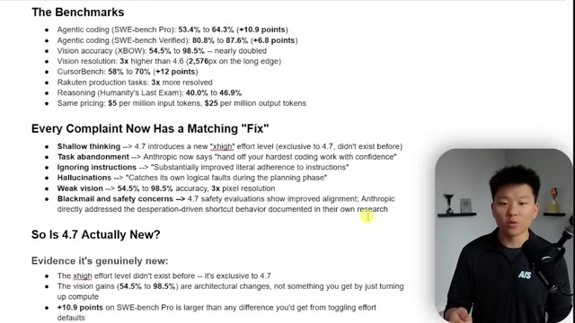
*⏱️ 00:06:46 — Une diapositive de présentation listant les benchmarks de performance, une section intitulée "Every Complaint Now Has a Matching Fix" et une analyse sur la nouveauté du modèle 4.7.*

---

### ⏱️ `[00:07:11 - 00:07:36]` | Segment #18

**🔊 Audio (Transcription Intégrale Mot pour Mot en Français) :**
> phase. Weak vision that's been dramatically improved. And then this one's interesting too, blackmail and safety concerns, because there was a safety concern in 4.6 where essentially the model was like blackmailing an engineer, but they have explicitly addressed this right here, safety and alignment. Overall, it shows a similar safety profile to Opus 4.6. Our evaluations show low rates of concerning behavior such as deception, sycophancy, and cooperation with misuse.

**👁️ Analyse Visuelle d'Écran (gemini-3.5-flash-lite) :**
**Interface & Outils** : Document web (probablement un rapport technique ou un article de blog type "System Card" d'Anthropic) affiché dans un navigateur.

**Contenu textuel & Code** : Texte technique listant des statistiques de performance (ex: SWE-bench, vision, résolution) et des descriptions textuelles sur l'alignement, la sécurité, et les comportements indésirables des modèles IA.

**Action / Démonstration** : Présentation visuelle de données de benchmarks et de rapports de recherche pour appuyer l'argumentation sur l'amélioration de la fiabilité et de la sécurité du modèle.

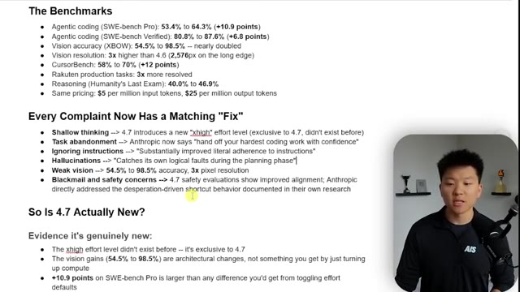
*⏱️ 00:07:17 — Document de synthèse comparant les performances et les corrections apportées au modèle Opus 4.7 par rapport aux versions précédentes, avec une section dédiée aux benchmarks et aux "fixes" techniques.*

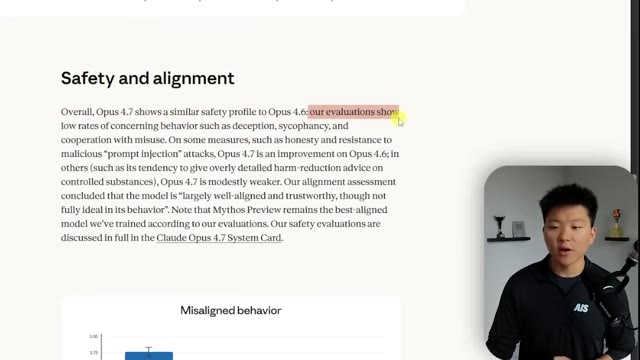
*⏱️ 00:07:30 — Capture d'écran d'un document technique détaillant la section "Safety and alignment" de Claude Opus 4.7, mentionnant l'évaluation des comportements de tromperie et de sycophantie.*

---

### ⏱️ `[00:07:36 - 00:07:56]` | Segment #19

**🔊 Audio (Transcription Intégrale Mot pour Mot en Français) :**
> They've also kind of worked it in so that it can't be used for like cybersecurity type of threats or hacking and other sorts of things like that with prompt injection. It kind of all loops back into that ecosystem of what they have talked about with Project Glasswing. Here we have a misaligned behavior benchmark. So overall, you can see that Opus 4.6 has about a 2.75.

**👁️ Analyse Visuelle d'Écran (gemini-3.5-flash-lite) :**
**Interface & Outils** : Navigateur web affichant un "System Card" ou rapport technique d'Anthropic.

**Contenu textuel & Code** : Texte traitant de l'évaluation de sécurité d'Opus 4.7, mentionnant la résistance aux attaques par "prompt injection", l'honnêteté, et la comparaison avec Opus 4.6 et Mythos Preview. Un graphique montrant des données sur les comportements désalignés (misaligned behavior) est partiellement visible en bas.

**Action / Démonstration** : Présentation visuelle d'un document de recherche/évaluation technique pour illustrer les capacités de sécurité du modèle discuté.

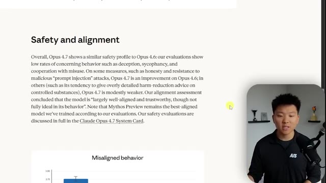
*⏱️ 00:07:41 — Une capture d'écran montrant un rapport technique sur la sécurité et l'alignement du modèle Opus 4.7, avec un graphique partiel intitulé "Misaligned behavior".*

---

### ⏱️ `[00:07:56 - 00:08:21]` | Segment #20

**🔊 Audio (Transcription Intégrale Mot pour Mot en Français) :**
> Mythos preview comes in really low, and Opus 4.7 kind of sits in the middle. Now in this type of benchmark, you want a lower score. Lower is better. So along with this release, we have some other things coming. We have the X high mode, which is extra high effort, like I just talked about. So now we have the low, medium, high, max, and X high. And we also have this new slash command coming, which is slash ultra view, which basically just spins up a dedicated review session to read through changes and flag things.

**👁️ Analyse Visuelle d'Écran (gemini-3.5-flash-lite) :**
**Interface & Outils** : Présentation ou face-caméra explicatif sans interface logicielle partagée.

**Contenu textuel & Code** : Explications orales et mise en contexte méthodologique.

**Action / Démonstration** : Explications face caméra et démonstration conceptuelle.

---

### ⏱️ `[00:08:22 - 00:08:56]` | Segment #21

**🔊 Audio (Transcription Intégrale Mot pour Mot en Français) :**
> They also give us this section about migrating from Opus 4.6 to 4.7. It is a direct upgrade, but apparently there are some things to be thinking about with token usage. So Opus 4.7 uses an updated tokenizer, which improves how the model processes text. But what that means is the same input might actually cost you more, just like one to 1.3 times more, depending on the type of content. Also, Opus 4.7 thinks more at higher effort levels, which once again could use more tokens. I'm about to drop a full video on how to manage your tokens even better. So that'll be out in like a day or so. And definitely want to check that one out. I'll tag that one up here when that

**👁️ Analyse Visuelle d'Écran (gemini-3.5-flash-lite) :**
**Interface & Outils** : Présentation ou face-caméra explicatif sans interface logicielle partagée.

**Contenu textuel & Code** : Explications orales et mise en contexte méthodologique.

**Action / Démonstration** : Explications face caméra et démonstration conceptuelle.

---

### ⏱️ `[00:08:56 - 00:09:32]` | Segment #22

**🔊 Audio (Transcription Intégrale Mot pour Mot en Français) :**
> comes out. So there's a bunch of benchmarks, right? And that's the tough thing is you see all of this noise. You see all these benchmarks and everything looks like it's better, but you don't truly know until you actually get your hands dirty and play with it. They even released this spec card or a system card about Claude Opus 4.7. It's 232 pages. And if we go down here, you can see that this thing is basically chock full of experiments and benchmarks and just comparisons between, you know, Mythos, Sonnet, Opus, and Opus. So this is going to be really interesting to dive into. I read through a lot of this, but not going to break it all down. I think it would be insanely boring for most of the people watching this anyways. But yeah, if you do want to check this out, you can

**👁️ Analyse Visuelle d'Écran (gemini-3.5-flash-lite) :**
**Interface & Outils** : Présentation ou face-caméra explicatif sans interface logicielle partagée.

**Contenu textuel & Code** : Explications orales et mise en contexte méthodologique.

**Action / Démonstration** : Explications face caméra et démonstration conceptuelle.

---

### ⏱️ `[00:09:32 - 00:09:56]` | Segment #23

**🔊 Audio (Transcription Intégrale Mot pour Mot en Français) :**
> find the link to this on this main release page from Anthropic. Okay, so is 4.7 actually new? I think that it is a new model. And we're going to get in here and I'm going to show you some examples of me playing around with it. But the X high effort level didn't exist. The vision gains are actual differences in the model itself, structural changes, not just like, you know, turning on effort or turning off effort.

**👁️ Analyse Visuelle d'Écran (gemini-3.5-flash-lite) :**
**Interface & Outils** : Présentation ou face-caméra explicatif sans interface logicielle partagée.

**Contenu textuel & Code** : Explications orales et mise en contexte méthodologique.

**Action / Démonstration** : Explications face caméra et démonstration conceptuelle.

---

### ⏱️ `[00:09:57 - 00:10:31]` | Segment #24

**🔊 Audio (Transcription Intégrale Mot pour Mot en Français) :**
> There was also a noticeable jump in the SWB Bench Pro, which is obviously pretty good as well. The updated tokenizer. Once again, I'm not saying that how good or bad that is. I haven't had enough time to fully test, but it will probably be a little bit more expensive. And then we also saw a third-party benchmark, which was 3x production task resolution on Rakuten. Now, real quick, something I want you guys to think about before we get into some of the other experiment stuff is the desktop app launch, which they had basically said, hey, we've been working on this for a long time. We're very excited. Most of our internal engineers are using this now instead of their IDs. And I thought it was awesome, right? Like I switched into it. Yesterday, I only

**👁️ Analyse Visuelle d'Écran (gemini-3.5-flash-lite) :**
**Interface & Outils** : Présentation ou face-caméra explicatif sans interface logicielle partagée.

**Contenu textuel & Code** : Explications orales et mise en contexte méthodologique.

**Action / Démonstration** : Explications face caméra et démonstration conceptuelle.

---

### ⏱️ `[00:10:31 - 00:10:52]` | Segment #25

**🔊 Audio (Transcription Intégrale Mot pour Mot en Français) :**
> used this instead of VS Code because I wanted to play around with it. And there's a lot of things I really like. You know, you can see all of your different sessions here. You can also manage your projects and have multiple going at the same time. You can see when they're done. You can see when they're waiting on you. And I like a lot of the idea of what they're doing. Now, obviously, a lot of this has been taken from like the Codex app or other Vibe coding, agentic coding apps out there.

**👁️ Analyse Visuelle d'Écran (gemini-3.5-flash-lite) :**
**Interface & Outils** : Présentation ou face-caméra explicatif sans interface logicielle partagée.

**Contenu textuel & Code** : Explications orales et mise en contexte méthodologique.

**Action / Démonstration** : Explications face caméra et démonstration conceptuelle.

---

### ⏱️ `[00:10:52 - 00:11:24]` | Segment #26

**🔊 Audio (Transcription Intégrale Mot pour Mot en Français) :**
> And that's not anything to complain about. I think that's just the way the world works. But anyways, I can come into a session and I can see things over here like a preview. If you're working in a local host, you can also pull up a terminal right here. So you could talk to Claude in the terminal. That way you get some of the extra functionality too. You could also look at your tasks and you could look at the plan. So there's ways that you can kind of customize the view, which I think is really cool. And you can also have different split views open. So you can have multiple different sessions and even multiple different projects. So that's really cool. I also like right here, if I just kind of close out of this one, you can right from in here,

**👁️ Analyse Visuelle d'Écran (gemini-3.5-flash-lite) :**
**Interface & Outils** : Présentation ou face-caméra explicatif sans interface logicielle partagée.

**Contenu textuel & Code** : Explications orales et mise en contexte méthodologique.

**Action / Démonstration** : Explications face caméra et démonstration conceptuelle.

---

### ⏱️ `[00:11:25 - 00:11:59]` | Segment #27

**🔊 Audio (Transcription Intégrale Mot pour Mot en Français) :**
> see your context window and your session. So like here is my five hour limit. I can see when that resets in 10 minutes. So I've got, you know, left to play with. I can see my models. And one of the things I talk about is like, if you're running through your limit, why don't you just watch it more often? So typically what that meant is have something pulled up, but now you can literally just from here, click into it and see, okay, cool. I've got that much left. So there's a lot of other features here that are really good. Obviously now with the routines and stuff, it's nice to be able to work out of this app, but there are a lot of things that are really poorly designed as well. And a developer named Theo, um, he basically found like 40 plus bugs

**👁️ Analyse Visuelle d'Écran (gemini-3.5-flash-lite) :**
**Interface & Outils** : Interface web de Claude.ai avec panneau de contrôle des limites d'utilisation.

**Contenu textuel & Code** : Statistiques de "Plan usage" : "5-hour limit" (23%, reset dans 10m), "Weekly - all models" (39%, reset dans 21h), et "Sonnet only" (6%, reset dans 3d). Texte sur le playbook mentionnant "Context Awareness" et "Building Good Habits".

**Action / Démonstration** : Visualisation et explication du suivi de la fenêtre de contexte et des limites de consommation par période.

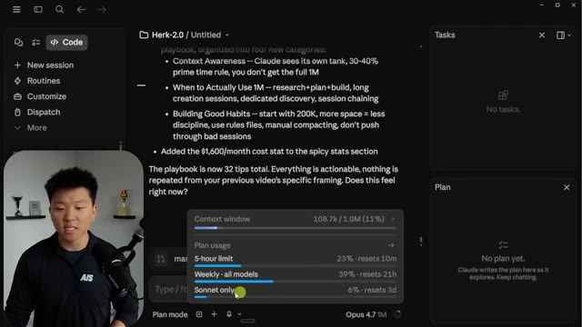
*⏱️ 00:11:33 — Capture d'écran de l'interface Claude montrant un panneau contextuel de suivi de l'utilisation ("Plan usage") superposé à un document de travail sur le playbook "Herk-2.0".*

---

### ⏱️ `[00:11:59 - 00:12:17]` | Segment #28

**🔊 Audio (Transcription Intégrale Mot pour Mot en Français) :**
> in just one hour. He was playing around with it and there were lots of things. Like buttons weren't working. Things were snapping weird. You were like just, the layout wasn't as intuitive and there was just a lot of little bugs essentially. Like for example, if you do your voice input, it would put voice into every single text box that's visible on the screen. Just little things like that.

**👁️ Analyse Visuelle d'Écran (gemini-3.5-flash-lite) :**
**Interface & Outils** : Google Docs (traitement de texte en ligne).

**Contenu textuel & Code** : Liste de points clés sur les capacités de l'IA (niveaux d'effort, scores benchmarks) et une section critique intitulée "Side Note: The Desktop App Launch" mentionnant 40+ bugs trouvés par le développeur Theo.

**Action / Démonstration** : Aucune manipulation logicielle montrée ; il s'agit d'un support de présentation textuel statique servant de base au discours du présentateur.

---

### ⏱️ `[00:12:18 - 00:12:52]` | Segment #29

**🔊 Audio (Transcription Intégrale Mot pour Mot en Français) :**
> And what's interesting is they are one of the biggest AI companies in the world and honestly one of the biggest tech companies in the world. But they're shipping things so fast and they're having these issues where, did they even do QA? And if their team had really been using this for so long internally, wouldn't they have found all these bugs? And if they have Mythos, which is supposed to be so dangerous and so good that it can't even be released, shouldn't Mythos have been able to like make this better? Because it's not a matter of the model not being able to execute the code properly. It's an issue of the model not being actually smart enough to go QA properly. Because as Theo pointed out,

**👁️ Analyse Visuelle d'Écran (gemini-3.5-flash-lite) :**
**Interface & Outils** : Présentation type diapo (texte sur fond blanc).

**Contenu textuel & Code** : Analyse comparative incluant des mesures de performance (SWE-bench Pro, tokenizer) et une liste de bugs identifiés sur l'application Claude Code Desktop (input vocal, raccourcis clavier, bugs d'interface).

**Action / Démonstration** : Analyse critique des performances de mise à jour et du processus de contrôle qualité (QA) d'Anthropic.

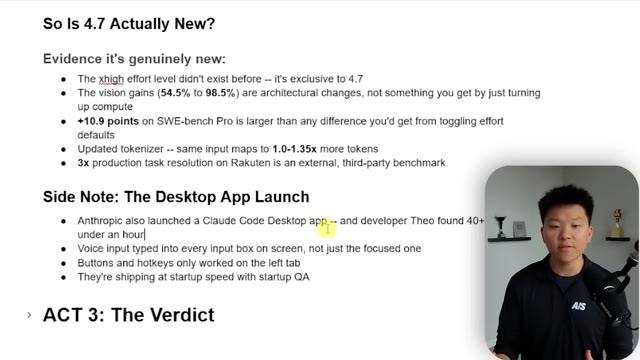
*⏱️ 00:12:26 — Une diapositive de présentation listant les preuves des nouveautés de la version 4.7 et critiquant la qualité du lancement de l'application desktop Claude Code.*

---

### ⏱️ `[00:12:52 - 00:13:11]` | Segment #30

**🔊 Audio (Transcription Intégrale Mot pour Mot en Français) :**
> a lot of the bugs he found, it would be a one prompt fix, right? But no one was able to find that bug. So there's questions about, you know, how much are they actually using it or like what actually went on because they're shipping at the speed of a startup, a tech startup that just raised a bunch of capital. Okay. So I had to get that off my chest. Let's move on to act three, the verdict.

**👁️ Analyse Visuelle d'Écran (gemini-3.5-flash-lite) :**
**Interface & Outils** : Diapositive de présentation (type Keynote ou PowerPoint).

**Contenu textuel & Code** : Texte technique listant : "Evidence it's genuinely new", "The xhigh effort level", "vision gains (54.5% to 98.5%)", "SWE-bench Pro", "Side Note: The Desktop App Launch" mentionnant les bugs trouvés par Theo.

**Action / Démonstration** : Affichage informatif accompagnant le discours sur la qualité logicielle et le cycle de développement rapide (ship at startup speed).

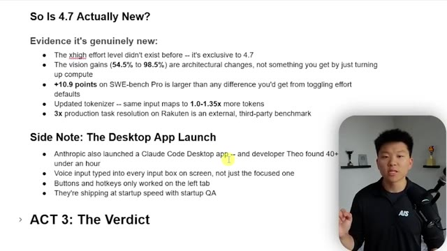
*⏱️ 00:12:57 — Une présentation sous forme de liste à puces analysant les nouveautés de la version 4.7, incluant des statistiques sur les performances et une note sur les bugs trouvés dans l'application desktop Claude Code.*

---

### ⏱️ `[00:13:11 - 00:13:46]` | Segment #31

**🔊 Audio (Transcription Intégrale Mot pour Mot en Français) :**
> So I just ran two experiments here that I wanted to show you guys. And I did this on the web app with 4.6 extended and 4.7. So the first one, let me show you guys this one. What I did is I dropped in this chart. So this is a meta financial stock chart. And you can see that I just said, hey, give me your best three sentence description of what's going on here and what I need to know about this in order to make money, make or save money. So I'm not going to read both of these answers, but this is what 4.6 extended thinking gave me. And this is what 4.7 with no adaptive thinking gave me here. And so you can pause that and read if you want, but here's the quick breakdown that

**👁️ Analyse Visuelle d'Écran (gemini-3.5-flash-lite) :**
**Interface & Outils** : Présentation ou face-caméra explicatif sans interface logicielle partagée.

**Contenu textuel & Code** : Explications orales et mise en contexte méthodologique.

**Action / Démonstration** : Explications face caméra et démonstration conceptuelle.

---

### ⏱️ `[00:13:46 - 00:14:22]` | Segment #32

**🔊 Audio (Transcription Intégrale Mot pour Mot en Français) :**
> I kind of came up with. The tone, I liked the way that 4.7 spoke a little bit better. For the actual framing, I thought that 4.7 explained why. It kind of justified things a little bit more, and it felt more like it had financial subject matter expertise, which is one of the benchmarks that we saw from Anthropic itself. We had more actionable specifics with 4.7. The structure over here was a little bit better, and they both obviously had some weaknesses, but that's when I said, hey, give me a three sentence description. I just wanted to keep things a little bit more controlled. So I definitely did feel like I liked 4.7 here better. And then I did another one where I gave them this exact same

**👁️ Analyse Visuelle d'Écran (gemini-3.5-flash-lite) :**
**Interface & Outils** : Document de présentation ou tableau comparatif affiché à l'écran.

**Contenu textuel & Code** : Tableau structuré présentant une analyse qualitative des performances de deux modèles : "Tone", "Supply zone framing", "Actionable specifics", "EU probe framing", "Structure", "Weakness".

**Action / Démonstration** : Le présentateur explique les différences de performance entre les deux versions du modèle d'IA en pointant les avantages du modèle 4.7 en termes de compétence financière.

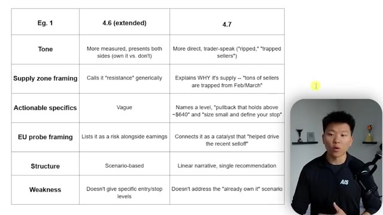
*⏱️ 00:13:55 — Tableau comparatif entre deux versions d'un modèle d'IA ("4.6 extended" vs "4.7") analysant des paramètres financiers comme le ton, le cadrage de la zone d'offre, les spécificités actionnables, le cadrage de la sonde UE, la structure et les faiblesses.*

---

### ⏱️ `[00:14:22 - 00:14:43]` | Segment #33

**🔊 Audio (Transcription Intégrale Mot pour Mot en Français) :**
> prompt about, you know, I'm building a SAS. I need some help with, you know, figuring out my 12 month model. And here's what 4.7 extended gave me. It gave me an interactive dashboard where I can see my stats. I can click on different scenarios. And then I can also drag the slider along here with our starting trial pool, with our new trials a month, with our, you know, paid and with our churn and with our pricing tiers.

**👁️ Analyse Visuelle d'Écran (gemini-3.5-flash-lite) :**
**Interface & Outils** : Interface web de Claude.ai (Opus 4.6 Extended).

**Contenu textuel & Code** : Un prompt complet définissant les paramètres d'un SaaS (utilisateurs, taux de conversion, churn, coût CAC) et la réponse de l'IA structurée avec des boutons de modélisation de scénarios financiers.

**Action / Démonstration** : Présentation du résultat généré par l'IA pour aider à la planification financière sur 12 mois d'une entreprise SaaS.

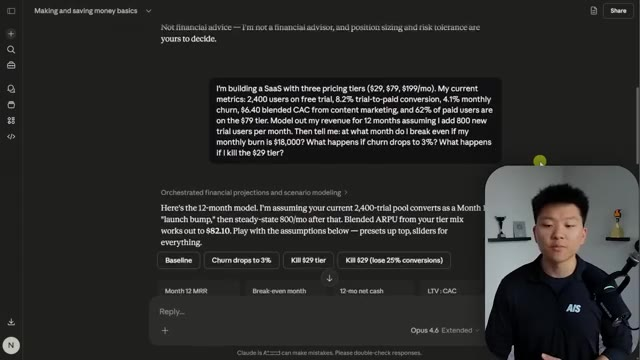
*⏱️ 00:14:27 — Une interface de chat IA (Claude) affichant un prompt détaillé pour modéliser les finances d'un SaaS, suivi de la réponse de l'IA proposant des scénarios interactifs (boutons "Baseline", "Churn drops to 3%", etc.).*

---

### ⏱️ `[00:14:43 - 00:15:02]` | Segment #34

**🔊 Audio (Transcription Intégrale Mot pour Mot en Français) :**
> So I thought this was pretty cool. It's very interactive, but yeah, it gave me some insights as well. So that was pretty impressive, right? This took a lot longer than the 4.7. And I think it's just because it was using extended, but with 4.7 here, same exact prompt. And it came back, it did a lot of thinking. It made some corrections on the math, but it was able to fix those, made the right formulas.

**👁️ Analyse Visuelle d'Écran (gemini-3.5-flash-lite) :**
**Interface & Outils** : Interface web de Claude (Anthropic) utilisant le modèle "Opus 4.6 Extended".

**Contenu textuel & Code** : Graphique de revenus sur 12 mois, indicateurs clés (ARPU: $117.67, LTV: $9,052, M12 paid users: 1,807, Total revenue: $1,579,341) et contrôles de variables (Growth, Conversion & Retention, Pricing Tiers).

**Action / Démonstration** : Le présentateur présente l'outil interactif généré par l'IA, permettant de simuler l'impact de différents paramètres commerciaux sur les revenus via des curseurs.

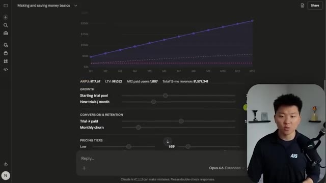
*⏱️ 00:14:48 — Une interface de chatbot Claude (Anthropic) affichant un outil interactif de modélisation financière "Making and saving money basics" avec un graphique de projection des revenus et des curseurs ajustables pour les métriques de croissance.*

---

### ⏱️ `[00:15:02 - 00:15:24]` | Segment #35

**🔊 Audio (Transcription Intégrale Mot pour Mot en Français) :**
> And then what it did is it gave me more of a deliverable. It gave me an actual Excel sheet with multiple different tabs. You can see here we have more of just a base summary. You can see then we have assumptions. We have base case with all these different scenarios and it's not letting me scroll because we're in this web browser version. And then it gave me churn 3% and also if we killed the $29 per month tier.

**👁️ Analyse Visuelle d'Écran (gemini-3.5-flash-lite) :**
**Interface & Outils** : Interface de chat IA (Opus 4.7) intégrant un visualiseur de fichiers Excel (Google Sheets).

**Contenu textuel & Code** : Données financières SaaS : MRR, ARR, churn, calculs de LTV/CAC, prévisions de revenus par paliers (tiers) et projections de croissance sur plusieurs mois.

**Action / Démonstration** : Le présentateur illustre les résultats générés par l'IA en naviguant à travers les différents onglets du fichier Excel ("Summary", "Base Case", etc.) pour expliquer les scénarios de revenus.

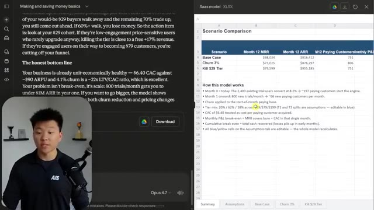
*⏱️ 00:15:08 — Une interface divisée en deux : à gauche le présentateur et le chat d'un agent IA (Opus 4.7), à droite un fichier Excel en ligne affichant un "Scenario Comparison" avec les détails du modèle SaaS.*

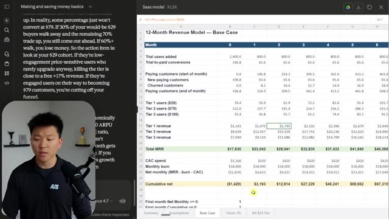
*⏱️ 00:15:18 — La même interface, mais l'onglet actif dans le fichier Excel est passé sur "Base Case", affichant un modèle de revenus sur 12 mois avec des calculs financiers détaillés.*

---

### ⏱️ `[00:15:24 - 00:15:42]` | Segment #36

**🔊 Audio (Transcription Intégrale Mot pour Mot en Français) :**
> The quick breakdown I had of this is that I liked the actual deliverable better from 4.6 because it was more interactive and it gave me a bit more of a polished feel. 4.7 had some errors, but it was able to catch them. But I think from like a business perspective, you probably want more of that Excel deliverable.

**👁️ Analyse Visuelle d'Écran (gemini-3.5-flash-lite) :**
**Interface & Outils** : Présentation ou face-caméra explicatif sans interface logicielle partagée.

**Contenu textuel & Code** : Explications orales et mise en contexte méthodologique.

**Action / Démonstration** : Explications face caméra et démonstration conceptuelle.

---

### ⏱️ `[00:15:42 - 00:16:04]` | Segment #37

**🔊 Audio (Transcription Intégrale Mot pour Mot en Français) :**
> And of course, if I prompted 4.6 to do that, it could have done it and it may have been better. But once again, I was just trying to see what would happen if I gave these two different models kind of a vague prompt and just kind of seeing and comparing the way that they come back. So anyways, the real test will be, of course, when you hop into something like CloudCode and you really start using it for the actual workflows and the processes and projects that you are using CloudCode for either way.

**👁️ Analyse Visuelle d'Écran (gemini-3.5-flash-lite) :**
**Interface & Outils** : Présentation ou face-caméra explicatif sans interface logicielle partagée.

**Contenu textuel & Code** : Explications orales et mise en contexte méthodologique.

**Action / Démonstration** : Explications face caméra et démonstration conceptuelle.

---

### ⏱️ `[00:16:05 - 00:16:30]` | Segment #38

**🔊 Audio (Transcription Intégrale Mot pour Mot en Français) :**
> And ultimately, it's not something where I could just use it for an hour and give you guys some sort of conclusion. So I'm gonna be playing with this obviously all day, all week, and if I have any other crazy insights, I will be sure to update you all. But I do think that the degradation was real of Opus 4.6, and whether that was intentional throttling or if it was just kind of on their side, trying to optimize costs because 200 bucks a month is honestly a steal if you're able to use your sessions all the way through.

**👁️ Analyse Visuelle d'Écran (gemini-3.5-flash-lite) :**
**Interface & Outils** : Présentation ou face-caméra explicatif sans interface logicielle partagée.

**Contenu textuel & Code** : Explications orales et mise en contexte méthodologique.

**Action / Démonstration** : Explications face caméra et démonstration conceptuelle.

---

### ⏱️ `[00:16:30 - 00:16:53]` | Segment #39

**🔊 Audio (Transcription Intégrale Mot pour Mot en Français) :**
> But ultimately, whatever the motivation was, it resulted in a worse product at the same price. And then of course we have 4.7, which looks a lot better on paper. And we need to actually see if it is, we have to take the benchmarks with a grain of salt and try things out for ourselves. But hopefully this video today gave you some insight as far as like what's been happening, where we're at and a good mindset as far as like actually trying this stuff out for yourself.

**👁️ Analyse Visuelle d'Écran (gemini-3.5-flash-lite) :**
**Interface & Outils** : Présentation ou face-caméra explicatif sans interface logicielle partagée.

**Contenu textuel & Code** : Explications orales et mise en contexte méthodologique.

**Action / Démonstration** : Explications face caméra et démonstration conceptuelle.

---

### ⏱️ `[00:16:53 - 00:17:11]` | Segment #40

**🔊 Audio (Transcription Intégrale Mot pour Mot en Français) :**
> So that is pretty much my bottom line. 4.7 might be the best AI model ever released up to this point. It might also be the cure to their own disease that Anthropic caused themselves. So either way, you just got to test it out. So that's going to do it for this one. I hope you guys enjoyed. If you learned something new or you did enjoy, please give it a like. Helps me out a ton. And I'll see you on the next one.

**👁️ Analyse Visuelle d'Écran (gemini-3.5-flash-lite) :**
**Interface & Outils** : Présentation ou face-caméra explicatif sans interface logicielle partagée.

**Contenu textuel & Code** : Explications orales et mise en contexte méthodologique.

**Action / Démonstration** : Explications face caméra et démonstration conceptuelle.

---

### ⏱️ `[00:17:12 - 00:17:12]` | Segment #41

**🔊 Audio (Transcription Intégrale Mot pour Mot en Français) :**
> Thanks everyone.

**👁️ Analyse Visuelle d'Écran (gemini-3.5-flash-lite) :**
**Interface & Outils** : Présentation ou face-caméra explicatif sans interface logicielle partagée.

**Contenu textuel & Code** : Explications orales et mise en contexte méthodologique.

**Action / Démonstration** : Explications face caméra et démonstration conceptuelle.

---

