# 🎬 Claude Opus 4.7 Just Dropped... Or Did It Really?

> **Chaîne** : [Nate Herk | AI Automation](https://www.youtube.com/@nateherk/featured)  
> **Lien YouTube** : [https://www.youtube.com/watch?v=NiMc2PoTiXo](https://www.youtube.com/watch?v=NiMc2PoTiXo)  
> **Date de publication** : 20260416  
> **Durée** : 00:17:13  
> **Identifiant vidéo** : `NiMc2PoTiXo`  
> **Transcription & Analyse** : `whisper-v3-large-turbo+gemini-3.5-flash-lite`  

---

## 📌 Synthèse Exécutive & Outils

### 💡 Résumé
Dans cette vidéo intitulée **Claude Opus 4.7 Just Dropped... Or Did It Really?**, Nate Herk décortique les capacités pratiques d'automatisation et de développement propulsées par les modèles de pointe.

### 🛠️ Outils, Modèles & Logiciels Présentés
- **Opus 5.5 & Claude Code** : Modèles d'ingénierie et agents de codage autonome.

### 🔑 Points Clés & Enseignements Stratégiques
- Optimiser le niveau d'effort et le raisonnement des modèles IA pour des résultats industriels.
- Automatiser les cycles de création logicielle de bout en bout.

---

## ⏱️ Chronologie & Transcription Complète Audio & Visuelle (Mot pour Mot)

### ⏱️ `[00:00:00 - 00:00:20]` | Segment #01

**🔊 Audio (Transcription Intégrale Mot pour Mot en Français) :**
> We just got Opus 4.7, which is apparently Claude's most capable Opus model yet. It handles long-running tasks with more rigor, it follows instructions more precisely, and verifies its own outputs before reporting back. What's interesting to me is that these claims are addressing exactly what everyone was complaining about with Opus 4.6 the past couple weeks, when everyone was like, hey, Opus has gotten so much more stupid lately.

**👁️ Analyse Visuelle d'Écran (gemini-3.5-flash-lite) :**
**Interface & Outils** : Interface web de X (Twitter).

**Contenu textuel & Code** : Texte du tweet : "Introducing Claude Opus 4.7, our most capable Opus model yet." et un tableau comparatif détaillé listant les capacités du modèle Opus 4.7 face à d'autres versions (Opus 4.6, GPT-4o, etc.) sur des tâches comme "Agentic coding", "Agentic terminal coding", "Multidisciplinary reasoning", etc.

**Action / Démonstration** : Présentation visuelle des capacités techniques et du tableau de performance du nouveau modèle IA pour illustrer le discours du présentateur.

*⏱️ 00:00:05 — Une capture d'écran de l'interface X (Twitter) affichant un tweet officiel du compte Claude AI annonçant le lancement du modèle Opus 4.7, accompagné d'un tableau comparatif des performances du modèle.*

---

### ⏱️ `[00:00:20 - 00:00:39]` | Segment #02

**🔊 Audio (Transcription Intégrale Mot pour Mot en Français) :**
> So yes, we see these benchmarks. We see that there's a huge jump from Opus 4.6 to Opus 4.7 in most of these major categories. So what I'm here to talk about today is, is this really Opus 4.7 or is this just 4.6 with some improvements? Some people have been saying that they intentionally made Opus 4.6 worse so that they could build up hype for 4.7 and then release it.

**👁️ Analyse Visuelle d'Écran (gemini-3.5-flash-lite) :**
**Interface & Outils** : Plateforme X (anciennement Twitter) et interface de présentation (type diaporama).

**Contenu textuel & Code** : Scores de performance IA (Agentic coding, Reasoning, etc.) et texte d'annonce officielle d'Anthropic.

**Action / Démonstration** : Présentation comparative des capacités des différents modèles d'IA pour introduire le sujet du jour.

*⏱️ 00:00:25 — Un tableau comparatif des benchmarks détaillés entre Claude Opus 4.7, 4.6, GPT-5.4 et Gemini 1.5 Pro.*

*⏱️ 00:00:30 — Interface de la plateforme X montrant un thread officiel d'Anthropic sur le lancement de Claude Opus 4.7.*

*⏱️ 00:00:34 — Une diapositive de présentation titrée "Is Opus 4.7 Real, or Just 4.6 With the Handbrake Off?" avec un visuel abstrait de réseau neuronal.*

---

### ⏱️ `[00:00:39 - 00:00:59]` | Segment #03

**🔊 Audio (Transcription Intégrale Mot pour Mot en Français) :**
> And then it feels way better than it really would have been. So if you missed all that, I'm going to catch you up and let's just start flying through this stuff. Don't want to waste anyone's time. So act one, as we're calling it here, is what happened to Opus 4.6. So there's been lots of stuff. So this first one I wanted to address was that a senior director at AMD published an analysis of almost 7,000 coding sessions using CloudCode.

**👁️ Analyse Visuelle d'Écran (gemini-3.5-flash-lite) :**
**Interface & Outils** : Présentation de type "slide deck" ou document de travail structuré (format texte/markdown).

**Contenu textuel & Code** : "ACT 1: What Happened to Opus 4.6?", statistiques (baisse de 73% de la profondeur de réflexion, 6 852 sessions analysées), points sur les hallucinations et le changement d'algorithme "Adaptive Thinking" daté du 9 février 2026.

**Action / Démonstration** : Le présentateur utilise ces éléments visuels comme support narratif pour déconstruire les performances passées d'un modèle d'IA et introduire une mise à jour.

*⏱️ 00:00:49 — Diapositive présentant une analyse détaillée des problèmes rencontrés avec "Opus 4.6" : données chiffrées sur la baisse de la profondeur de réflexion, erreurs des utilisateurs et changements de politique d'Anthropic (Adaptive Thinking).*

*⏱️ 00:00:54 — Zoom sur la section "The Hard Data" expliquant les statistiques de performance dégradées lors des sessions de codage avec Claude Code.*

---

### ⏱️ `[00:00:59 - 00:01:21]` | Segment #04

**🔊 Audio (Transcription Intégrale Mot pour Mot en Français) :**
> She found that the thinking depth collapsed 73% from 2,200 characters of reasoning down to just 600 characters of reasoning. So basically the model stopped reading files before editing them and stopped thinking as much, and it just started jumping straight into doing things. So the models basically should always be reading the files before editing them. And it started to not do that about 6% of the time, but then that went all the way up to 33.7% of the time.

**👁️ Analyse Visuelle d'Écran (gemini-3.5-flash-lite) :**
**Interface & Outils** : Diaporama de présentation (type PowerPoint ou Google Slides).

**Contenu textuel & Code** : Texte à puces détaillé : "Thinking depth collapsed 73% -- from 2,200 characters of reasoning down to just 600", "The model stopped reading files before editing them", et "Edits without reading first jumped from 6.2% to 33.7%".

**Action / Démonstration** : Le présentateur expose les preuves chiffrées de la dégradation de la profondeur de réflexion du modèle IA, illustrant visuellement ses propos audio sur la chute de 73% du raisonnement.

*⏱️ 00:01:04 — Une diapositive de présentation titrée "ACT 1: What Happened to Opus 4.6?" listant des données statistiques sur la baisse des performances de raisonnement du modèle Claude Code, avec le présentateur en médaillon dans le coin inférieur droit.*

---

### ⏱️ `[00:01:21 - 00:01:49]` | Segment #05

**🔊 Audio (Transcription Intégrale Mot pour Mot en Français) :**
> So almost one third, it just wasn't reading the files. And she found that users had to interrupt the model 12 times more often to stop it from going off the rails. And obviously there's lots of problems here. There is the problem of quality of the actual code that's being written, especially when it's kind of like dark code and you don't really exactly know what AI is writing. And then there's also the fact that that's going to burn through your tokens, which is why in the past couple of weeks, there's also been a huge uproar of people saying, I just burned through my 200 bucks a month max plan in an hour. So what else have users been seeing?

**👁️ Analyse Visuelle d'Écran (gemini-3.5-flash-lite) :**
**Interface & Outils** : Diapositive de présentation (type Keynote/PowerPoint) affichée à l'écran.

**Contenu textuel & Code** : Liste à puces détaillant les problèmes de performance d'Opus 4.6 : chute de la profondeur de réflexion, échecs de lecture de fichiers, augmentation du taux d'interruption par les utilisateurs (12x plus fréquent), hallucinations (noms de paquets, versions API), et mention de l'implémentation de l' "Adaptive Thinking".

**Action / Démonstration** : Présentation informative des données chiffrées illustrant le déclin technique du modèle.

*⏱️ 00:01:28 — Une diapositive présentant une analyse statistique critique des performances du modèle IA "Opus 4.6", illustrant les dégradations observées par les utilisateurs, avec le présentateur visible en incrustation à droite.*

---

### ⏱️ `[00:01:49 - 00:02:16]` | Segment #06

**🔊 Audio (Transcription Intégrale Mot pour Mot en Français) :**
> Hallucinated git commit hashes, fake package names, fabricated API versions. Apparently the word simplest appeared almost three times more often in model output, which means that it was optimizing for the least amount of effort possible. We've also been seeing premature task abandonment. So the model would just stop working on things mid-task. This is something that I have actually felt a lot over the past couple of weeks. And all of this kind of stuff, the session limits, the quality has caused some of the power users on 200 bucks a month max plans to start switching or canceling away.

**👁️ Analyse Visuelle d'Écran (gemini-3.5-flash-lite) :**
**Interface & Outils** : Logiciel de présentation ou document éditorial (type Markdown/Notion).

**Contenu textuel & Code** : Le texte mentionne des statistiques sur l'utilisation de Claude Code par AMD, la fréquence du mot "simplest" dans les réponses de l'IA, l'abandon prématuré de tâches, et l'introduction de l'"Adaptive Thinking" par Anthropic le 9 février 2026.

**Action / Démonstration** : Présentation visuelle de données analytiques et d'un rapport de situation pour accompagner le discours du présentateur.

*⏱️ 00:01:56 — Une présentation sous forme de liste à puces (diapositive) intitulée "The Hard Data", "What Users Were Seeing" et "What Anthropic Actually Changed", détaillant la baisse de performance de Claude Code et les changements internes d'Anthropic.*

---

### ⏱️ `[00:02:17 - 00:02:38]` | Segment #07

**🔊 Audio (Transcription Intégrale Mot pour Mot en Français) :**
> So then of course, Anthropic addressed this. What did they actually change? Well, on February 9th, they changed the adaptive thinking, which meant that the model started dynamically deciding how much to think per turn. So on certain turns, if it thinks the request is simple, it would allocate zero reasoning tokens. So literally no thinking at all. So the question becomes, how does the model decide what task actually deserves a token budget for thinking or not?

**👁️ Analyse Visuelle d'Écran (gemini-3.5-flash-lite) :**
**Interface & Outils** : Navigateur web (Reddit) et éditeur de texte/diaporama.

**Contenu textuel & Code** : Le texte à l'écran détaille le changement nommé "Adaptive Thinking" opéré le 9 février 2026 par Anthropic, expliquant que le modèle alloue désormais dynamiquement ses jetons de réflexion. Le post Reddit mentionne une baisse de 67% de la profondeur de réflexion perçue par les utilisateurs de Claude Code.

**Action / Démonstration** : Présentation informative analysant le comportement technique du modèle Claude suite aux retours de la communauté.

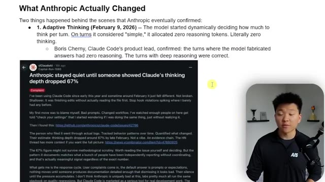
*⏱️ 00:02:22 — Une capture d'écran d'un post Reddit provenant du subreddit r/ClaudeAI discutant de la baisse de la profondeur de réflexion de Claude, accompagnée d'un texte explicatif sur les changements apportés par Anthropic.*

---

### ⏱️ `[00:02:39 - 00:02:57]` | Segment #08

**🔊 Audio (Transcription Intégrale Mot pour Mot en Français) :**
> And then Boris Cherny, the basically creator of Cloud Code confirmed, The turns where the model fabricated had zero reasoning and the turns with deep reasoning were correct. So that was one of the first main things. Another thing that happened is they just dropped the effort default to medium. So basically all of these changes, they didn't actually make to the model itself, but more in the way the model behaved.

**👁️ Analyse Visuelle d'Écran (gemini-3.5-flash-lite) :**
**Interface & Outils** : Plateforme Reddit (affichage web), documents de synthèse textuels (type présentation ou article de blog).

**Contenu textuel & Code** : Discussions sur la baisse de performance de Claude Code, rapports de bugs, mentions de "BridgeBench", et analyse de la gestion des niveaux d'effort (Pro/Max vs API/Enterprise) par Anthropic.

**Action / Démonstration** : Analyse textuelle et présentation de preuves issues de la communauté pour illustrer les régressions constatées dans les outils d'IA.

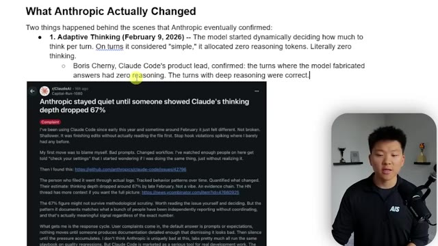
*⏱️ 00:02:43 — Capture d'écran montrant un article de Reddit sur le subreddit r/ClaudeAI concernant une baisse de 67% de la profondeur de réflexion de Claude, accompagnée d'un texte explicatif sur l'Adaptive Thinking.*

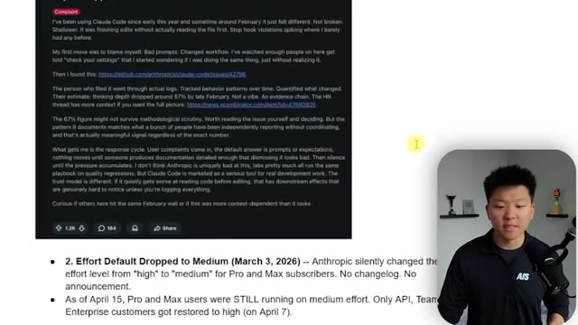
*⏱️ 00:02:48 — Capture d'écran montrant la suite du message Reddit ainsi qu'un point de liste détaillant la réduction du niveau d'effort ("Effort Default") par Anthropic de "high" à "medium".*

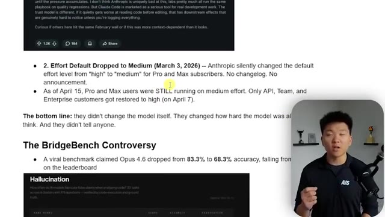
*⏱️ 00:02:53 — Capture d'écran montrant le texte expliquant la controverse "BridgeBench" et le tableau des résultats sur les hallucinations.*

---

### ⏱️ `[00:02:58 - 00:03:34]` | Segment #09

**🔊 Audio (Transcription Intégrale Mot pour Mot en Français) :**
> So like the parameters and the weights and the training of the model, Opus 4.6 was the same, but they turned off its thinking and they turned off its effort basically. And they kind of did this one silently. Like right here, if I go into my Cloud Code desktop app, which I'm gonna talk about this new desktop app as well, because I think that there's lots of issues here. But right here, you can see we've got Opus 4.7, right? And when I click on it, you can see that we actually don't have the ability within Opus 4.7. But basically, if I just zoom back in here a little more, if I go to Sonnet, for example, you can see that we have effort and high, medium, low. And then sometimes for Opus 4.6, there's even a higher one, max effort or something. But they basically just switch this

**👁️ Analyse Visuelle d'Écran (gemini-3.5-flash-lite) :**
**Interface & Outils** : Cloud Code Desktop App.

**Contenu textuel & Code** : Liste des modèles disponibles : Opus 4.7 (sélectionné), Sonnet 4.6, Haiku 4.5. Historique des sessions ("AI news roundup", "Notification responses").

**Action / Démonstration** : Sélection du modèle Opus 4.7 dans le menu déroulant des paramètres de l'application Cloud Code.

*⏱️ 00:03:16 — Capture d'écran de l'interface de bureau "Cloud Code" montrant la sélection des modèles (Opus 4.7, Sonnet 4.6, Haiku 4.5) dans une session active.*

---

### ⏱️ `[00:03:34 - 00:04:00]` | Segment #10

**🔊 Audio (Transcription Intégrale Mot pour Mot en Français) :**
> down without telling anybody. And no one was kind of looking in there. And then if you're on the terminal or wherever you are, you might not even notice that. So people were like, okay, Opus is just stupid. And then a full month later, April 15th, pro and max users were still by default, just running on medium effort. So like I said, they didn't change the model itself of 4.6. They just changed how hard the model was allowed to think and didn't tell anyone. And a lot of that thinking and reasoning is where we get all the value of this, you know, awesome Opus 4.6 model.

**👁️ Analyse Visuelle d'Écran (gemini-3.5-flash-lite) :**
**Interface & Outils** : Cursor (éditeur de code IA), Navigateur web (lecture de rapport/article technique).

**Contenu textuel & Code** : Dans l'image 2, le texte surligné indique : "As of April 15, Pro and Max users were STILL running on medium effort." On y mentionne également "The BridgeBench Controversy" et des statistiques sur les hallucinations des modèles.

**Action / Démonstration** : Le présentateur illustre ses propos sur les changements silencieux apportés par Anthropic aux performances des modèles (effort "medium" vs "high") en montrant la documentation pertinente à l'écran.

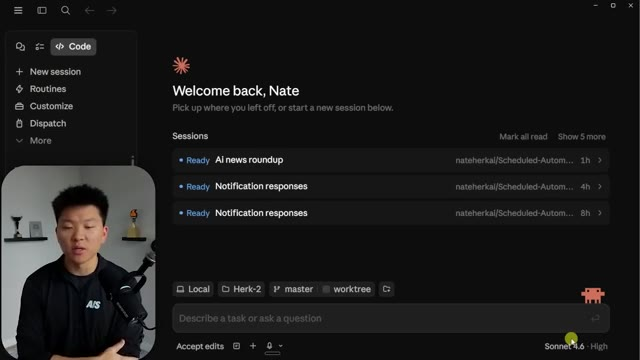
*⏱️ 00:03:41 — L'interface de l'éditeur Cursor affichant une liste de sessions récentes ("AI news roundup", "Notification responses") avec une zone de saisie pour interagir avec l'IA.*

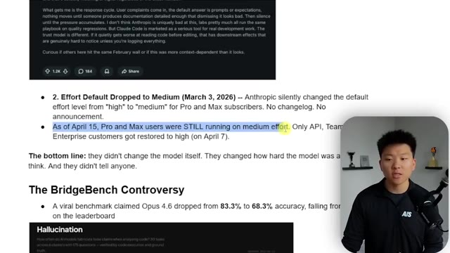
*⏱️ 00:03:47 — Une page web affichant un article ou un rapport technique détaillant une controverse sur les niveaux d'effort des modèles d'Anthropic (passage de "high" à "medium").*

---

### ⏱️ `[00:04:00 - 00:04:23]` | Segment #11

**🔊 Audio (Transcription Intégrale Mot pour Mot en Français) :**
> And then there was also some controversy with the bridge bench, a viral benchmark claim that Opus 4.6 dropped from 83.6% to 68.3% accuracy. So basically on this leaderboard fell from being number two all the way down to number 10. And it was just, you know, Opus 4.6 or Opus 4.6 as of April 12th, which showed that Opus was now actually worse than Sonnet 4.5 on this specific hallucination benchmark.

**👁️ Analyse Visuelle d'Écran (gemini-3.5-flash-lite) :**
**Interface & Outils** : Navigateur web affichant un document de recherche ou un article de blog technique sur les benchmarks LLM.

**Contenu textuel & Code** : Tableau comparatif montrant les scores de modèles comme Grok 4.20, Claude Opus 4.6, GPT-5.4, Qwen 3.6 Plus et Gemini 3.1 Pro avec leurs scores d'exactitude et de taux d'hallucination respectifs.

**Action / Démonstration** : Illustration visuelle du déclassement (chute de la 2ème à la 10ème place) du modèle Claude Opus 4.6 suite à la controverse BridgeBench.

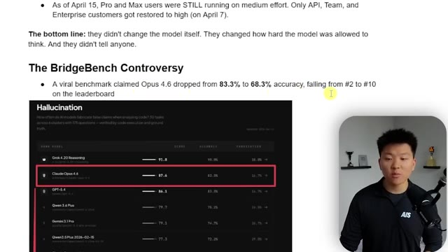
*⏱️ 00:04:06 — Une capture d'écran d'un article ou d'une note de synthèse intitulée "The BridgeBench Controversy", montrant un tableau de classement des modèles d'IA centré sur la métrique de "Hallucination".*

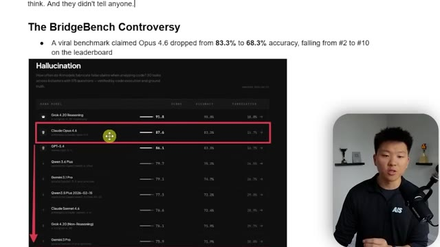
*⏱️ 00:04:12 — La même vue avec une annotation visuelle (flèche rouge) montrant une chute de position dans le classement pour le modèle Claude Opus 4.6 au sein du tableau "Hallucination".*

---

### ⏱️ `[00:04:23 - 00:04:44]` | Segment #12

**🔊 Audio (Transcription Intégrale Mot pour Mot en Français) :**
> Okay, so let's move on to act two. Opus 4.7 drops today. Okay, so before we get into the benchmarks, let me just show you real quick. It is available on the web. Right here, we've got Claude in the chat and I can see Opus 4.7 right here. Now what you'll notice is for Opus 4.7, we have adaptive thinking. So we can do things only when needed, like we just talked about. But if we go back to Opus 4.6, we don't have adapted, we have extended.

**👁️ Analyse Visuelle d'Écran (gemini-3.5-flash-lite) :**
**Interface & Outils** : Interface web de Claude.ai.

**Contenu textuel & Code** : Texte affiché : "Opus 4.7", "How can I help you today?", ainsi que des boutons de suggestions (Write, Learn, Code, etc.).

**Action / Démonstration** : Le présentateur démontre que le modèle Opus 4.7 est désormais sélectionnable et disponible directement depuis l'interface web de Claude.

*⏱️ 00:04:34 — L'interface web de Claude affichant le sélecteur de modèle réglé sur "Opus 4.7" au centre de l'écran d'accueil.*

---

### ⏱️ `[00:04:44 - 00:05:07]` | Segment #13

**🔊 Audio (Transcription Intégrale Mot pour Mot en Français) :**
> So we can just turn extended on or off. I already showed you guys the desktop app. Here is my VS Code terminal. You can see we have welcome to Opus 4.7 X high. So we'll talk about that in a sec. But if you're not seeing this, maybe just try to update your Claude. So you can go ahead and just run like a Claude update and that's how it will do it. or if you want to do it in the extension, then you'll just have to update the actual extension over here in VS Code.

**👁️ Analyse Visuelle d'Écran (gemini-3.5-flash-lite) :**
**Interface & Outils** : Visual Studio Code (VS Code) avec le terminal intégré "Claude Code".

**Contenu textuel & Code** : Claude Code v2.1.111, Opus 4.7 (1M context), texte "Welcome to Opus 4.7 xhigh!", commande "/model" exécutée, et confirmation "Kept model as Opus 4.7 (1M context) (default)".

**Action / Démonstration** : Le présentateur illustre la vérification de la version et du modèle actif de Claude Code dans le terminal de l'éditeur.

*⏱️ 00:04:50 — Interface VS Code affichant un terminal interactif "Claude Code" avec les détails de la version et du modèle utilisé.*

---

### ⏱️ `[00:05:07 - 00:05:27]` | Segment #14

**🔊 Audio (Transcription Intégrale Mot pour Mot en Français) :**
> And if I go to model in the extension and we click on switch, you can see right here, because I haven't updated the extension, we only have Opus. But you would, like I said, go over here, search for Cloud Code, and then just install that update. But if you're doing all those things and you're still not seeing the model, just give it a couple hours. It'll roll out to you eventually. So anyways, let's go take a look at the benchmarks. So here's the official announcement that Anthropic dropped.

**👁️ Analyse Visuelle d'Écran (gemini-3.5-flash-lite) :**
**Interface & Outils** : Visual Studio Code, extension Claude Code.

**Contenu textuel & Code** : Liste des modèles : « Default (Opus 4.6) », « Sonnet », « Sonnet (1M context) », « Haiku ». Barre de saisie de texte en bas : « Ctrl esc to focus or unfocus Claude ».

**Action / Démonstration** : Le présentateur illustre la sélection des différents modèles IA (Opus, Sonnet, Haiku) au sein de l'extension Claude Code dans VS Code.

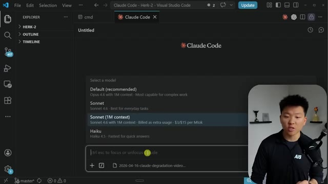
*⏱️ 00:05:12 — Interface de VS Code affichant l'extension « Claude Code » avec une liste de sélection de modèles IA disponibles.*

---

### ⏱️ `[00:05:27 - 00:06:02]` | Segment #15

**🔊 Audio (Transcription Intégrale Mot pour Mot en Français) :**
> You know, our notable improvements on Opus 4.6 and software engineering with particular gains on the most difficult tasks. Users report being able to hand off their hardest coding work, the kind that previously needed close supervision, to Opus 4.7 with confidence. Now what I want you guys to pay attention to here as well is that we still have Mythos preview over here. So it says the model has substantially better vision. It's also more tasteful and creative when completing professional tasks. And it's much less capable than their most powerful model, Claude Mythos, of course. If you guys didn't see anything about that, I made a full video. I'll tag that one right up here. But it's obviously a lot better than Opus 4.6 across things

**👁️ Analyse Visuelle d'Écran (gemini-3.5-flash-lite) :**
**Interface & Outils** : Navigateur web affichant une page d'annonce ou une documentation technique d'Anthropic.

**Contenu textuel & Code** : Tableau de résultats chiffrés pour les catégories : "Agentic coding (SWE-bench Pro)", "Agentic coding (SWE-bench Verified)" et "Agentic terminal coding (Terminal-Bench 2.0)".

**Action / Démonstration** : Présentation visuelle de données chiffrées comparatives pour valider la supériorité du modèle Opus 4.7.

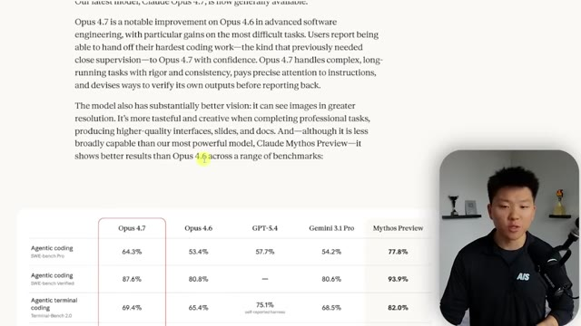
*⏱️ 00:05:45 — Tableau comparatif des performances de différents modèles (Opus 4.7, 4.6, GPT-5.4, Gemini 3.1 Pro, Mythos) sur des benchmarks de codage.*

---

### ⏱️ `[00:06:02 - 00:06:37]` | Segment #16

**🔊 Audio (Transcription Intégrale Mot pour Mot en Français) :**
> like the coding bench or the search, computer use, financial analysis, which is very interesting, and, you know, like vision. So if we look at some other things, we've got knowledge work. We see a significant improvement. Vision, we see a big improvement. Document reasoning, this one's pretty big. Long context reasoning. So both Opus 4.6 and 4.7 will allow you to use it with 1 million token context window, biomolecular reasoning, which is a massive jump. It's over double and then long-term coherence and coding, of course. Now what's interesting, and what I alluded to earlier, is that it seems like every complaint now has a directly correlating matching fix, which I'm not

**👁️ Analyse Visuelle d'Écran (gemini-3.5-flash-lite) :**
**Interface & Outils** : Tableau de bord d'analyse comparative de modèles IA (Benchmark Web UI).

**Contenu textuel & Code** : Scores Elo et données chiffrées sur les performances des modèles LLM (Opus, GPT, Gemini) selon diverses catégories (Knowledge work, Long-term coherence).

**Action / Démonstration** : Présentation visuelle de résultats de benchmarks comparatifs par le présentateur pour illustrer les améliorations de performance des modèles.

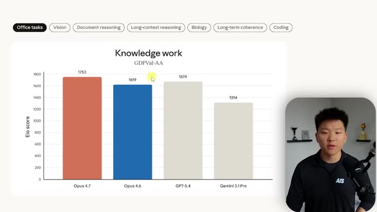
*⏱️ 00:06:11 — Graphique en barres comparant les scores Elo de différents modèles d'IA (Opus 4.7, 4.6, GPT-5.4, Gemini 3.1 Pro) dans la catégorie "Knowledge work".*

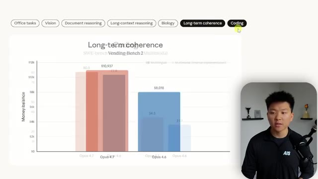
*⏱️ 00:06:28 — Graphique en barres superposées illustrant la "Long-term coherence" et des données de performance pour différentes versions des modèles Opus.*

---

### ⏱️ `[00:06:37 - 00:07:11]` | Segment #17

**🔊 Audio (Transcription Intégrale Mot pour Mot en Français) :**
> saying that's a bad thing because that's really how you should be iterating on a product. But some people are definitely starting to raise some eyebrows at the way that they're just like, it's almost like they're creating holes just so they can fill them and look like the hero. So for example, people were complaining about shallow thinking with 4.7 and now they've introduced their new X high effort level, which is exclusive to 4.7. We have a complaint about task abandonment, but Anthropic now says you can hand off your hardest coding work with confidence. We have ignoring instructions. And now we say substantially improved literal adherence to instructions. We have hallucinations, but now it's apparently able to catch its own logical faults during the planning

**👁️ Analyse Visuelle d'Écran (gemini-3.5-flash-lite) :**
**Interface & Outils** : Présentation de documents (type Notion ou Google Docs).

**Contenu textuel & Code** : Tableau comparatif des performances (SWE-bench, CursorBench, XBOV) et liste de problèmes ("Shallow thinking", "Task abandonment") mis en corrélation avec leurs correctifs respectifs dans la version 4.7.

**Action / Démonstration** : Analyse comparative et critique de la mise à jour du modèle par le présentateur en incrustation vidéo (PIP).

*⏱️ 00:06:46 — Une diapositive présentée avec des listes à puces comparant les benchmarks de performance d'un modèle IA et illustrant comment chaque plainte utilisateur semble avoir trouvé une solution spécifique dans la version 4.7.*

---

### ⏱️ `[00:07:11 - 00:07:36]` | Segment #18

**🔊 Audio (Transcription Intégrale Mot pour Mot en Français) :**
> phase. Weak vision that's been dramatically improved. And then this one's interesting too, blackmail and safety concerns, because there was a safety concern in 4.6 where essentially the model was like blackmailing an engineer, but they have explicitly addressed this right here, safety and alignment. Overall, it shows a similar safety profile to Opus 4.6. Our evaluations show low rates of concerning behavior such as deception, sycophancy, and cooperation with misuse.

**👁️ Analyse Visuelle d'Écran (gemini-3.5-flash-lite) :**
**Interface & Outils** : Documentation technique ou article de blog de type "Technical Report" affiché sur un navigateur web.

**Contenu textuel & Code** : Texte détaillé sur les gains de performance (ex: SWE-bench, vision), la liste des "fix" (ex: shallow thinking, hallucination), et les conclusions de l'évaluation de sécurité (déception, sycophanie, prompt injection).

**Action / Démonstration** : Analyse comparative et explicative des capacités techniques et du profil de sécurité du nouveau modèle par rapport aux versions précédentes.

*⏱️ 00:07:17 — Présentation textuelle des points de repère (benchmarks) de performance de l'IA et une liste des correctifs apportés à la version 4.7 pour répondre aux problèmes courants comme les hallucinations et les risques de sécurité.*

*⏱️ 00:07:30 — Extrait du rapport de sécurité et d'alignement d'Anthropic concernant Opus 4.7, incluant une section sur les comportements problématiques et le début d'un graphique sur le "Misaligned behavior".*

---

### ⏱️ `[00:07:36 - 00:07:56]` | Segment #19

**🔊 Audio (Transcription Intégrale Mot pour Mot en Français) :**
> They've also kind of worked it in so that it can't be used for like cybersecurity type of threats or hacking and other sorts of things like that with prompt injection. It kind of all loops back into that ecosystem of what they have talked about with Project Glasswing. Here we have a misaligned behavior benchmark. So overall, you can see that Opus 4.6 has about a 2.75.

**👁️ Analyse Visuelle d'Écran (gemini-3.5-flash-lite) :**
**Interface & Outils** : Navigateur web affichant un rapport technique ou un "System Card" d'Anthropic.

**Contenu textuel & Code** : Texte analysant les capacités du modèle Opus 4.7 en matière de sécurité, mentionnant la résistance aux attaques par « prompt injection », la déception, la sycophance et la coopération avec des usages abusifs.

**Action / Démonstration** : Affichage informatif documentant les évaluations de sécurité et les mesures d'alignement du modèle IA.

*⏱️ 00:07:41 — Capture d'écran montrant un rapport technique intitulé « Safety and alignment » concernant les performances du modèle Opus 4.7, avec un graphique partiel intitulé « Misaligned behavior » en bas de page.*

---

### ⏱️ `[00:07:56 - 00:08:21]` | Segment #20

**🔊 Audio (Transcription Intégrale Mot pour Mot en Français) :**
> Mythos preview comes in really low, and Opus 4.7 kind of sits in the middle. Now in this type of benchmark, you want a lower score. Lower is better. So along with this release, we have some other things coming. We have the X high mode, which is extra high effort, like I just talked about. So now we have the low, medium, high, max, and X high. And we also have this new slash command coming, which is slash ultra view, which basically just spins up a dedicated review session to read through changes and flag things.

**👁️ Analyse Visuelle d'Écran (gemini-3.5-flash-lite) :**
**Interface & Outils** : Aucune interface logicielle interactive (terminal ou éditeur) n'est affichée ; il s'agit de présentations de diapositives ou de pages web de documentation statique.

**Contenu textuel & Code** : Texte technique décrivant des paramètres d'IA (effort control, task budgets, slash commands) et un graphique de performance d'audit comportemental.

**Action / Démonstration** : Présentation orale et visuelle de notes de mise à jour (release notes) par le présentateur.

---

### ⏱️ `[00:08:22 - 00:08:56]` | Segment #21

**🔊 Audio (Transcription Intégrale Mot pour Mot en Français) :**
> They also give us this section about migrating from Opus 4.6 to 4.7. It is a direct upgrade, but apparently there are some things to be thinking about with token usage. So Opus 4.7 uses an updated tokenizer, which improves how the model processes text. But what that means is the same input might actually cost you more, just like one to 1.3 times more, depending on the type of content. Also, Opus 4.7 thinks more at higher effort levels, which once again could use more tokens. I'm about to drop a full video on how to manage your tokens even better. So that'll be out in like a day or so. And definitely want to check that one out. I'll tag that one up here when that

**👁️ Analyse Visuelle d'Écran (gemini-3.5-flash-lite) :**
**Interface & Outils** : Navigateur Web (Documentation technique Anthropic/Claude).

**Contenu textuel & Code** : Texte explicatif sur la migration "Migrating from Opus 4.6 to Opus 4.7", détaillant les changements concernant l'utilisation des tokens (nouveau tokenizer et niveaux d'effort plus élevés).

**Action / Démonstration** : Affichage informatif de la documentation technique pour expliquer les impacts de la mise à jour du modèle sur la consommation de tokens.

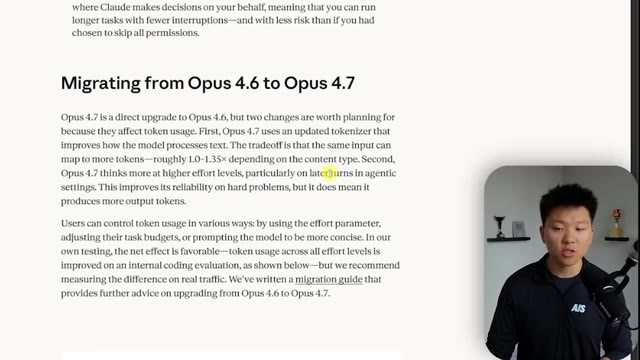
*⏱️ 00:08:30 — Capture d'écran montrant la documentation officielle concernant la migration du modèle Opus 4.6 vers la version 4.7, avec le présentateur en médaillon.*

---

### ⏱️ `[00:08:56 - 00:09:32]` | Segment #22

**🔊 Audio (Transcription Intégrale Mot pour Mot en Français) :**
> comes out. So there's a bunch of benchmarks, right? And that's the tough thing is you see all of this noise. You see all these benchmarks and everything looks like it's better, but you don't truly know until you actually get your hands dirty and play with it. They even released this spec card or a system card about Claude Opus 4.7. It's 232 pages. And if we go down here, you can see that this thing is basically chock full of experiments and benchmarks and just comparisons between, you know, Mythos, Sonnet, Opus, and Opus. So this is going to be really interesting to dive into. I read through a lot of this, but not going to break it all down. I think it would be insanely boring for most of the people watching this anyways. But yeah, if you do want to check this out, you can

**👁️ Analyse Visuelle d'Écran (gemini-3.5-flash-lite) :**
**Interface & Outils** : Navigateur web affichant une page de documentation technique (Google Docs/PDF Viewer).

**Contenu textuel & Code** : Graphiques statistiques sur les performances des modèles IA, scores de biais comparatifs et analyse textuelle de la conformité des modèles.

**Action / Démonstration** : Présentation et analyse comparative des benchmarks de sécurité et de performance des modèles de la famille Claude.

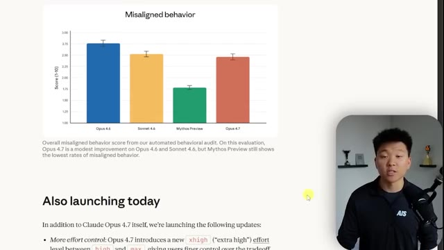
*⏱️ 00:09:05 — Un graphique à barres intitulé "Misaligned behavior" comparant les scores de comportement non aligné entre les modèles Opus 4.6, Sonnet 4.6, Mythos Preview et Opus 4.7.*

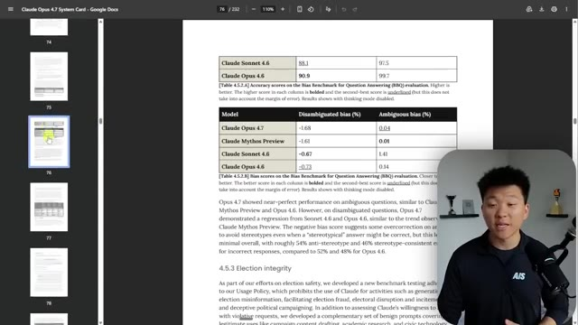
*⏱️ 00:09:14 — Une page de document technique (System Card) présentant des tableaux de données sur les scores de biais (Disambiguated/Ambiguous bias) pour différents modèles Claude.*

---

### ⏱️ `[00:09:32 - 00:09:56]` | Segment #23

**🔊 Audio (Transcription Intégrale Mot pour Mot en Français) :**
> find the link to this on this main release page from Anthropic. Okay, so is 4.7 actually new? I think that it is a new model. And we're going to get in here and I'm going to show you some examples of me playing around with it. But the X high effort level didn't exist. The vision gains are actual differences in the model itself, structural changes, not just like, you know, turning on effort or turning off effort.

**👁️ Analyse Visuelle d'Écran (gemini-3.5-flash-lite) :**
**Interface & Outils** : Navigateur web affichant un document de type notes ou rapport technique (potentiellement Notion ou un blog).

**Contenu textuel & Code** : Texte technique mentionnant : "xhigh effort level", "54.5% to 98.5% accuracy", "SWE-bench Pro", "Updated tokenizer", et "Claude Code Desktop app".

**Action / Démonstration** : Présentation informative analysant les spécifications techniques et les arguments en faveur de la nouveauté du modèle Anthropic 4.7.

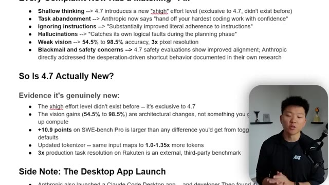
*⏱️ 00:09:38 — Une page web présentant une analyse détaillée des améliorations du modèle IA "4.7" d'Anthropic, avec une liste à puces comparant les performances passées et actuelles.*

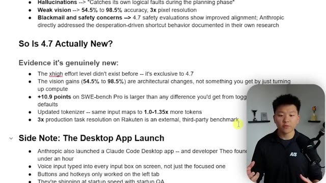
*⏱️ 00:09:50 — La suite de la page web montrant une section intitulée "So Is 4.7 Actually New?" listant les preuves techniques de la nouveauté du modèle, avec le présentateur en médaillon.*

---

### ⏱️ `[00:09:57 - 00:10:31]` | Segment #24

**🔊 Audio (Transcription Intégrale Mot pour Mot en Français) :**
> There was also a noticeable jump in the SWB Bench Pro, which is obviously pretty good as well. The updated tokenizer. Once again, I'm not saying that how good or bad that is. I haven't had enough time to fully test, but it will probably be a little bit more expensive. And then we also saw a third-party benchmark, which was 3x production task resolution on Rakuten. Now, real quick, something I want you guys to think about before we get into some of the other experiment stuff is the desktop app launch, which they had basically said, hey, we've been working on this for a long time. We're very excited. Most of our internal engineers are using this now instead of their IDs. And I thought it was awesome, right? Like I switched into it. Yesterday, I only

**👁️ Analyse Visuelle d'Écran (gemini-3.5-flash-lite) :**
**Interface & Outils** : Application de prise de notes structurées (style Markdown/Obsidian).

**Contenu textuel & Code** : Liste à puces détaillant les caractéristiques techniques du modèle 4.7 : "xhigh effort level", gains en vision (54.5% à 98.5%), +10.9 points sur SWE-bench Pro, mise à jour du tokenizer et lancement de l'application desktop Claude Code.

**Action / Démonstration** : Présentation visuelle de points clés pour accompagner l'analyse critique des mises à jour logicielles et des performances de l'IA par le présentateur.

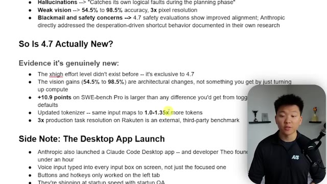
*⏱️ 00:10:05 — Une capture d'écran montrant une page de notes structurées (type Obsidian ou Notion) listant les preuves des nouveautés de la version 4.7, incluant les gains sur SWE-bench Pro et le nouvel tokenizer.*

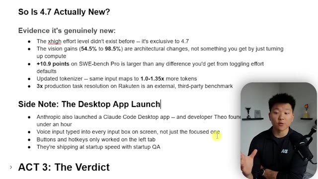
*⏱️ 00:10:23 — La même page de notes, mais avec un focus sur la section "Side Note: The Desktop App Launch" concernant l'application de bureau Claude Code et les retours d'utilisateurs.*

---

### ⏱️ `[00:10:31 - 00:10:52]` | Segment #25

**🔊 Audio (Transcription Intégrale Mot pour Mot en Français) :**
> used this instead of VS Code because I wanted to play around with it. And there's a lot of things I really like. You know, you can see all of your different sessions here. You can also manage your projects and have multiple going at the same time. You can see when they're done. You can see when they're waiting on you. And I like a lot of the idea of what they're doing. Now, obviously, a lot of this has been taken from like the Codex app or other Vibe coding, agentic coding apps out there.

**👁️ Analyse Visuelle d'Écran (gemini-3.5-flash-lite) :**
**Interface & Outils** : Éditeur de code Cursor.

**Contenu textuel & Code** : Liste de sessions ("AI news roundup", "Notification responses"), barre latérale avec les projets ("Remotion Editor", "Herk-2.0", "Scheduled-Automations", "YouTube OS", "Skool Automations") et champ de saisie de prompt "Describe a task or ask a question".

**Action / Démonstration** : Navigation dans l'interface de gestion des sessions et des projets de l'éditeur IA.

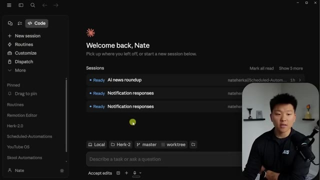
*⏱️ 00:10:37 — Interface principale de l'éditeur de code IA Cursor, montrant la liste des sessions actives et le tableau de bord utilisateur avec le présentateur en incrustation.*

---

### ⏱️ `[00:10:52 - 00:11:24]` | Segment #26

**🔊 Audio (Transcription Intégrale Mot pour Mot en Français) :**
> And that's not anything to complain about. I think that's just the way the world works. But anyways, I can come into a session and I can see things over here like a preview. If you're working in a local host, you can also pull up a terminal right here. So you could talk to Claude in the terminal. That way you get some of the extra functionality too. You could also look at your tasks and you could look at the plan. So there's ways that you can kind of customize the view, which I think is really cool. And you can also have different split views open. So you can have multiple different sessions and even multiple different projects. So that's really cool. I also like right here, if I just kind of close out of this one, you can right from in here,

**👁️ Analyse Visuelle d'Écran (gemini-3.5-flash-lite) :**
**Interface & Outils** : Claude (interface de développement/agent).

**Contenu textuel & Code** : Liste des options d'outils disponibles (Preview, Diff, Terminal, Tasks, Plan) et notes textuelles sur un "playbook" concernant Claude.

**Action / Démonstration** : Le curseur survole l'option "Terminal" dans le menu déroulant de droite.

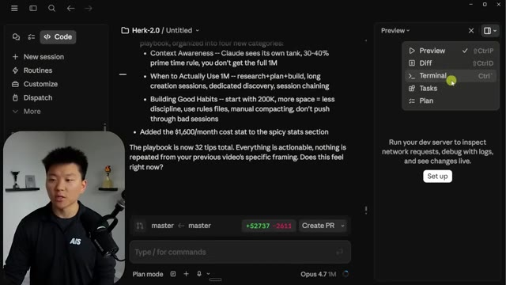
*⏱️ 00:11:00 — Interface de l'éditeur Claude montrant le menu contextuel de droite avec les options Preview, Diff, Terminal, Tasks et Plan.*

---

### ⏱️ `[00:11:25 - 00:11:59]` | Segment #27

**🔊 Audio (Transcription Intégrale Mot pour Mot en Français) :**
> see your context window and your session. So like here is my five hour limit. I can see when that resets in 10 minutes. So I've got, you know, left to play with. I can see my models. And one of the things I talk about is like, if you're running through your limit, why don't you just watch it more often? So typically what that meant is have something pulled up, but now you can literally just from here, click into it and see, okay, cool. I've got that much left. So there's a lot of other features here that are really good. Obviously now with the routines and stuff, it's nice to be able to work out of this app, but there are a lot of things that are really poorly designed as well. And a developer named Theo, um, he basically found like 40 plus bugs

**👁️ Analyse Visuelle d'Écran (gemini-3.5-flash-lite) :**
**Interface & Outils** : Interface web de Claude.ai (Pro/Team).

**Contenu textuel & Code** : Détails de consommation : "Context window 108.7k / 1.0M (11%)", "5-hour limit 23% - resets 10m", "Weekly - all models 39% - resets 21h", "Sonnet only 6% - resets 3d". Texte explicatif sur les règles de contexte (Context Awareness, 1M tokens, habitudes d'utilisation).

**Action / Démonstration** : Consultation et explication des limites de messagerie et de la fenêtre de contexte par le présentateur.

*⏱️ 00:11:33 — Capture d'écran de l'interface de Claude.ai montrant le panneau de contrôle de l'utilisation des limites de contexte et des quotas de messages.*

---

### ⏱️ `[00:11:59 - 00:12:17]` | Segment #28

**🔊 Audio (Transcription Intégrale Mot pour Mot en Français) :**
> in just one hour. He was playing around with it and there were lots of things. Like buttons weren't working. Things were snapping weird. You were like just, the layout wasn't as intuitive and there was just a lot of little bugs essentially. Like for example, if you do your voice input, it would put voice into every single text box that's visible on the screen. Just little things like that.

**👁️ Analyse Visuelle d'Écran (gemini-3.5-flash-lite) :**
**Interface & Outils** : Google Docs (traitement de texte en ligne).

**Contenu textuel & Code** : Liste à puces détaillant les caractéristiques de la version 4.7 d'Opus et une section "Side Note" sur les bugs critiques de l'application Claude Code Desktop (bugs d'entrée vocale, boutons, hotkeys).

**Action / Démonstration** : Le présentateur affiche et parcourt ses notes de script à l'écran tout en s'exprimant face caméra.

---

### ⏱️ `[00:12:18 - 00:12:52]` | Segment #29

**🔊 Audio (Transcription Intégrale Mot pour Mot en Français) :**
> And what's interesting is they are one of the biggest AI companies in the world and honestly one of the biggest tech companies in the world. But they're shipping things so fast and they're having these issues where, did they even do QA? And if their team had really been using this for so long internally, wouldn't they have found all these bugs? And if they have Mythos, which is supposed to be so dangerous and so good that it can't even be released, shouldn't Mythos have been able to like make this better? Because it's not a matter of the model not being able to execute the code properly. It's an issue of the model not being actually smart enough to go QA properly. Because as Theo pointed out,

**👁️ Analyse Visuelle d'Écran (gemini-3.5-flash-lite) :**
**Interface & Outils** : Présentation (diapositives textuelles).

**Contenu textuel & Code** : Texte analysant les performances du modèle (gains de vision, score SWE-bench, tokenizer) et listant les problèmes spécifiques de la version desktop de Claude (input vocal erroné, problèmes de hotkeys, manque de QA).

**Action / Démonstration** : Présentation orale des points de critique sur le cycle de développement rapide d'Anthropic et le manque de contrôle qualité.

*⏱️ 00:12:26 — Une diapositive de présentation listant des preuves techniques sur la version 4.7 d'un modèle IA et critiquant les bugs rencontrés dans la nouvelle application desktop de Claude.*

---

### ⏱️ `[00:12:52 - 00:13:11]` | Segment #30

**🔊 Audio (Transcription Intégrale Mot pour Mot en Français) :**
> a lot of the bugs he found, it would be a one prompt fix, right? But no one was able to find that bug. So there's questions about, you know, how much are they actually using it or like what actually went on because they're shipping at the speed of a startup, a tech startup that just raised a bunch of capital. Okay. So I had to get that off my chest. Let's move on to act three, the verdict.

**👁️ Analyse Visuelle d'Écran (gemini-3.5-flash-lite) :**
**Interface & Outils** : Diapositive de présentation (type PowerPoint ou Google Slides).

**Contenu textuel & Code** : Texte listant des preuves d'innovation (xhigh effort, vision gains, score SWE-bench Pro, tokenizer, Rakuten) et une section intitulée "Side Note: The Desktop App Launch" mentionnant les problèmes découverts par le développeur Theo.

**Action / Démonstration** : Présentation des points clés par le présentateur en incrustation vidéo, illustrant son analyse sur la qualité logicielle et le rythme de livraison d'Anthropic.

*⏱️ 00:12:57 — Une diapositive de présentation montrant une analyse comparative des nouveautés de la version 4.7, incluant des statistiques sur les performances et une note sur les bugs de l'application desktop Claude Code.*

---

### ⏱️ `[00:13:11 - 00:13:46]` | Segment #31

**🔊 Audio (Transcription Intégrale Mot pour Mot en Français) :**
> So I just ran two experiments here that I wanted to show you guys. And I did this on the web app with 4.6 extended and 4.7. So the first one, let me show you guys this one. What I did is I dropped in this chart. So this is a meta financial stock chart. And you can see that I just said, hey, give me your best three sentence description of what's going on here and what I need to know about this in order to make money, make or save money. So I'm not going to read both of these answers, but this is what 4.6 extended thinking gave me. And this is what 4.7 with no adaptive thinking gave me here. And so you can pause that and read if you want, but here's the quick breakdown that

**👁️ Analyse Visuelle d'Écran (gemini-3.5-flash-lite) :**
**Interface & Outils** : Interface Web d'Anthropic (Claude.ai)

**Contenu textuel & Code** : Prompt utilisateur : "Give me your best three-sentence description of what's going on here and what I need to know about this in order to make money or save money." Réponse de l'IA : Une analyse technique détaillée de l'action META, mentionnant les niveaux de support, de résistance, les prochains résultats financiers et les risques réglementaires liés à l'UE. Version utilisée affichée en bas : "Opus 4.6 Extended".

**Action / Démonstration** : L'IA traite une image de graphique boursier fournie par l'utilisateur pour générer une analyse financière et stratégique.

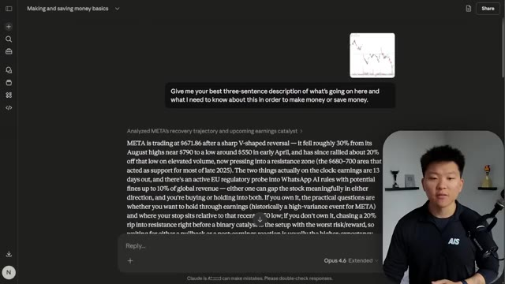
*⏱️ 00:13:20 — Interface de l'application web Anthropic Claude affichant une analyse financière détaillée d'un graphique boursier de Meta (META), avec le présentateur incrusté en bas à droite.*

---

### ⏱️ `[00:13:46 - 00:14:22]` | Segment #32

**🔊 Audio (Transcription Intégrale Mot pour Mot en Français) :**
> I kind of came up with. The tone, I liked the way that 4.7 spoke a little bit better. For the actual framing, I thought that 4.7 explained why. It kind of justified things a little bit more, and it felt more like it had financial subject matter expertise, which is one of the benchmarks that we saw from Anthropic itself. We had more actionable specifics with 4.7. The structure over here was a little bit better, and they both obviously had some weaknesses, but that's when I said, hey, give me a three sentence description. I just wanted to keep things a little bit more controlled. So I definitely did feel like I liked 4.7 here better. And then I did another one where I gave them this exact same

**👁️ Analyse Visuelle d'Écran (gemini-3.5-flash-lite) :**
**Interface & Outils** : Tableau de comparaison (probablement sur une diapositive ou un document texte).

**Contenu textuel & Code** : Comparaison ligne par ligne : "Tone", "Supply zone framing", "Actionable specifics", "EU probe framing", "Structure", "Weakness". Détails sur la terminologie financière utilisée ("resistance", "trader-speak", "pullback", "catalyst").

**Action / Démonstration** : Analyse comparative des capacités de raisonnement financier entre deux versions de modèles IA.

*⏱️ 00:13:55 — Un tableau comparatif analysant les performances des versions 4.6 et 4.7 d'un modèle d'IA sur des critères financiers (ton, cadrage de zone d'offre, détails actionnables, etc.), avec le présentateur en incrustation.*

---

### ⏱️ `[00:14:22 - 00:14:43]` | Segment #33

**🔊 Audio (Transcription Intégrale Mot pour Mot en Français) :**
> prompt about, you know, I'm building a SAS. I need some help with, you know, figuring out my 12 month model. And here's what 4.7 extended gave me. It gave me an interactive dashboard where I can see my stats. I can click on different scenarios. And then I can also drag the slider along here with our starting trial pool, with our new trials a month, with our, you know, paid and with our churn and with our pricing tiers.

**👁️ Analyse Visuelle d'Écran (gemini-3.5-flash-lite) :**
**Interface & Outils** : Interface web de Claude.ai (Opus 4.6 Extended).

**Contenu textuel & Code** : Le prompt de l'utilisateur détaille ses métriques SaaS (utilisateurs, taux de conversion, churn, CAC) et demande une projection sur 12 mois. La réponse de l'IA propose des options interactives : "Baseline", "Churn drops to 3%", "Kill $29 tier", etc.

**Action / Démonstration** : Affichage des résultats de la requête de modélisation financière et présentation des outils de simulation (boutons de scénarios) intégrés dans l'interface de discussion.

*⏱️ 00:14:27 — Une interface de chat IA (Claude) affichant un prompt détaillé pour la modélisation financière d'un SaaS et la réponse générée par l'IA incluant des boutons de sélection de scénarios.*

---

### ⏱️ `[00:14:43 - 00:15:02]` | Segment #34

**🔊 Audio (Transcription Intégrale Mot pour Mot en Français) :**
> So I thought this was pretty cool. It's very interactive, but yeah, it gave me some insights as well. So that was pretty impressive, right? This took a lot longer than the 4.7. And I think it's just because it was using extended, but with 4.7 here, same exact prompt. And it came back, it did a lot of thinking. It made some corrections on the math, but it was able to fix those, made the right formulas.

**👁️ Analyse Visuelle d'Écran (gemini-3.5-flash-lite) :**
**Interface & Outils** : Interface web de Claude.ai (mode artifact)

**Contenu textuel & Code** : Métriques affichées : ARPU ($117.67), LTV ($9,052), M12 paid users (1,807), Total 12-mo revenue ($1,579,341). Curseurs pour "Starting trial pool", "New trials/month", "Trial -> paid", "Monthly churn", et "Pricing Tiers". Sélecteur de modèle en bas à droite réglé sur "Opus 4.6 Extended".

**Action / Démonstration** : Simulation interactive en temps réel permettant d'ajuster les paramètres financiers d'une entreprise pour observer l'impact sur les revenus projetés.

*⏱️ 00:14:48 — Interface interactive d'un simulateur de croissance SaaS montrant un graphique de revenus sur 12 mois, des indicateurs clés (ARPU, LTV, revenus) et des curseurs ajustables pour les variables de croissance et de rétention.*

---

### ⏱️ `[00:15:02 - 00:15:24]` | Segment #35

**🔊 Audio (Transcription Intégrale Mot pour Mot en Français) :**
> And then what it did is it gave me more of a deliverable. It gave me an actual Excel sheet with multiple different tabs. You can see here we have more of just a base summary. You can see then we have assumptions. We have base case with all these different scenarios and it's not letting me scroll because we're in this web browser version. And then it gave me churn 3% and also if we killed the $29 per month tier.

**👁️ Analyse Visuelle d'Écran (gemini-3.5-flash-lite) :**
**Interface & Outils** : Interface de type agent IA (probablement Claude) intégrant un visualiseur de fichiers Excel (XLSX).

**Contenu textuel & Code** : Modèle financier SaaS détaillant les revenus mensuels (MRR), les taux de conversion, l'ARPU et le calcul de la valeur à vie client (LTV/CAC).

**Action / Démonstration** : Navigation entre les différents onglets du fichier Excel ('Summary', 'Assumptions', 'Base Case', etc.) pour présenter les résultats de l'analyse financière générée.

*⏱️ 00:15:08 — Interface divisée avec le chat de l'IA à gauche et un tableur Excel (onglet 'Summary') à droite, montrant une analyse de comparaison de scénarios SaaS.*

*⏱️ 00:15:18 — Interface divisée avec le chat de l'IA à gauche et le tableur Excel à droite, affichant les détails financiers du scénario 'Base Case' sur 12 mois.*

---

### ⏱️ `[00:15:24 - 00:15:42]` | Segment #36

**🔊 Audio (Transcription Intégrale Mot pour Mot en Français) :**
> The quick breakdown I had of this is that I liked the actual deliverable better from 4.6 because it was more interactive and it gave me a bit more of a polished feel. 4.7 had some errors, but it was able to catch them. But I think from like a business perspective, you probably want more of that Excel deliverable.

**👁️ Analyse Visuelle d'Écran (gemini-3.5-flash-lite) :**
**Interface & Outils** : Tableau comparatif statique.

**Contenu textuel & Code** : Le tableau détaille les forces et faiblesses des versions 4.6 et 4.7. Par exemple, sous "Deliverable", il est noté "Interactive but ephemeral" pour la 4.6 et "Excel file you can keep and share" pour la 4.7.

**Action / Démonstration** : Le présentateur explique les résultats du test comparatif en s'appuyant visuellement sur les lignes du tableau.

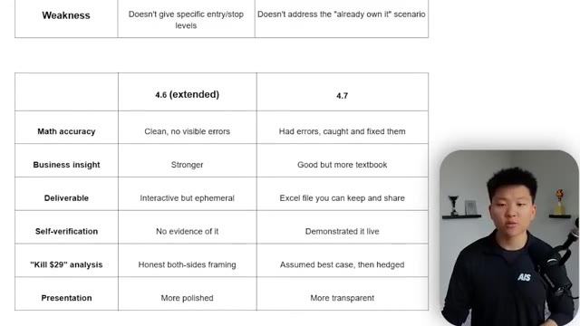
*⏱️ 00:15:28 — Un tableau comparatif affiché à l'écran opposant deux versions d'un modèle IA (4.6 extended vs 4.7) selon plusieurs critères (précision, insight, livrable, auto-vérification, etc.), avec le présentateur en incrustation à droite.*

---

### ⏱️ `[00:15:42 - 00:16:04]` | Segment #37

**🔊 Audio (Transcription Intégrale Mot pour Mot en Français) :**
> And of course, if I prompted 4.6 to do that, it could have done it and it may have been better. But once again, I was just trying to see what would happen if I gave these two different models kind of a vague prompt and just kind of seeing and comparing the way that they come back. So anyways, the real test will be, of course, when you hop into something like CloudCode and you really start using it for the actual workflows and the processes and projects that you are using CloudCode for either way.

**👁️ Analyse Visuelle d'Écran (gemini-3.5-flash-lite) :**
**Interface & Outils** : - Image 1 : Tableau de comparaison de modèles (probablement dans un éditeur de documents ou présentation).
- Image 2 : Terminal de commande système (Windows CLI).

**Contenu textuel & Code** : - Image 1 : Analyse comparative détaillée des capacités des modèles (Math accuracy, Business insight, Deliverable, etc.).
- Image 2 : Commandes terminal : `claude update`, avertissements de chemin d'installation (`npm-global` vs `native`), et suggestion de commande `npm -g uninstall @anthropic-ai/claude-code`.

**Action / Démonstration** : - Image 1 : Présentation d'un résumé de test comparatif (benchmark) entre deux versions de modèles.
- Image 2 : Exécution d'une mise à jour logicielle et diagnostic d'installation via terminal.

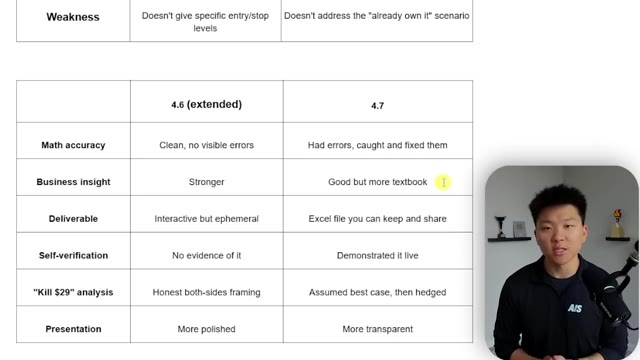
*⏱️ 00:15:48 — Tableau comparatif affichant les performances entre deux modèles d'IA, notés "4.6 (extended)" et "4.7", sur des critères tels que la précision mathématique, l'insight métier, le livrable, l'auto-vérification, l'analyse "Kill $29" et la présentation.*

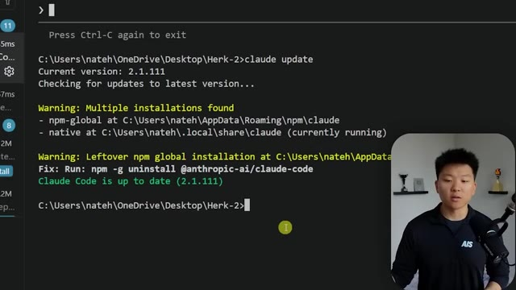
*⏱️ 00:15:59 — Capture d'un terminal de ligne de commande (CLI) montrant une mise à jour du logiciel "Claude" avec des avertissements sur les installations multiples et la confirmation que l'outil est à jour en version 2.1.111.*

---

### ⏱️ `[00:16:05 - 00:16:30]` | Segment #38

**🔊 Audio (Transcription Intégrale Mot pour Mot en Français) :**
> And ultimately, it's not something where I could just use it for an hour and give you guys some sort of conclusion. So I'm gonna be playing with this obviously all day, all week, and if I have any other crazy insights, I will be sure to update you all. But I do think that the degradation was real of Opus 4.6, and whether that was intentional throttling or if it was just kind of on their side, trying to optimize costs because 200 bucks a month is honestly a steal if you're able to use your sessions all the way through.

**👁️ Analyse Visuelle d'Écran (gemini-3.5-flash-lite) :**
**Interface & Outils** : Terminal Windows (PowerShell/CMD).

**Contenu textuel & Code** : Commande `claude update` exécutée, affichant la version 2.1.111, des avertissements sur des installations multiples (npm et native) et une suggestion de commande pour nettoyer l'installation npm globale.

**Action / Démonstration** : Vérification et mise à jour de la version locale de l'outil Claude Code via la ligne de commande.

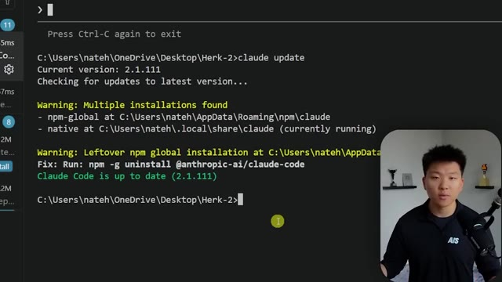
*⏱️ 00:16:11 — Un terminal Windows affichant la mise à jour de l'outil Claude Code.*

---

### ⏱️ `[00:16:30 - 00:16:53]` | Segment #39

**🔊 Audio (Transcription Intégrale Mot pour Mot en Français) :**
> But ultimately, whatever the motivation was, it resulted in a worse product at the same price. And then of course we have 4.7, which looks a lot better on paper. And we need to actually see if it is, we have to take the benchmarks with a grain of salt and try things out for ourselves. But hopefully this video today gave you some insight as far as like what's been happening, where we're at and a good mindset as far as like actually trying this stuff out for yourself.

**👁️ Analyse Visuelle d'Écran (gemini-3.5-flash-lite) :**
**Interface & Outils** : Document de synthèse ou présentation (type Notion ou Google Docs).

**Contenu textuel & Code** : Tableau comparatif (critères : Deliverable, Self-verification, "Kill $29" analysis, Presentation) et texte argumentatif sur la dégradation des produits, l'optimisation des coûts et la fiabilité des benchmarks (SWE-bench).

**Action / Démonstration** : Le présentateur commente le tableau et la conclusion affichée à l'écran concernant l'analyse comparative des versions de modèles.

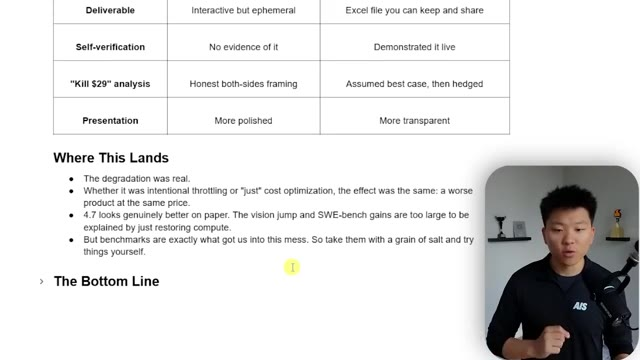
*⏱️ 00:16:36 — Une capture d'écran montrant un tableau comparatif technique et une section intitulée "Where This Lands" avec des points clés sur les performances de modèles IA (4.7) et les limites des benchmarks.*

---

### ⏱️ `[00:16:53 - 00:17:11]` | Segment #40

**🔊 Audio (Transcription Intégrale Mot pour Mot en Français) :**
> So that is pretty much my bottom line. 4.7 might be the best AI model ever released up to this point. It might also be the cure to their own disease that Anthropic caused themselves. So either way, you just got to test it out. So that's going to do it for this one. I hope you guys enjoyed. If you learned something new or you did enjoy, please give it a like. Helps me out a ton. And I'll see you on the next one.

**👁️ Analyse Visuelle d'Écran (gemini-3.5-flash-lite) :**
**Interface & Outils** : Navigateur web affichant des documents de type "Product Announcements".

**Contenu textuel & Code** : Texte analysant les performances de l'IA ("The degradation was real", "The Bottom Line: 4.7 might be the best AI model ever released") et titre officiel d'annonce de produit.

**Action / Démonstration** : Présentation synthétique des conclusions de l'auteur sur l'actualité de la sortie du modèle Claude Opus 4.7.

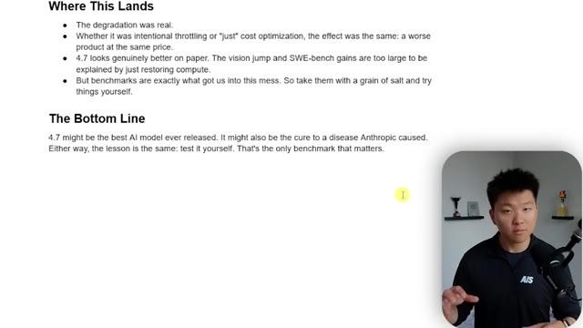
*⏱️ 00:16:58 — Une page de notes textuelles résumant les réflexions du créateur sur le modèle IA 4.7 et la nécessité de tester soi-même les performances.*

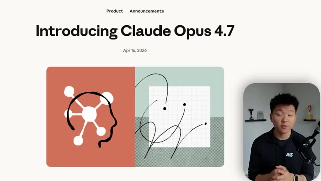
*⏱️ 00:17:07 — Une capture d'écran d'une page d'annonce officielle intitulée "Introducing Claude Opus 4.7" datée du 16 avril 2026.*

---

### ⏱️ `[00:17:12 - 00:17:12]` | Segment #41

**🔊 Audio (Transcription Intégrale Mot pour Mot en Français) :**
> Thanks everyone.

**👁️ Analyse Visuelle d'Écran (gemini-3.5-flash-lite) :**
**Interface & Outils** : Navigateur web (page d'annonce produit).

**Contenu textuel & Code** : Texte : "Product Announcements", "Introducing Claude Opus 4.7", "Apr 16, 2026".

**Action / Démonstration** : Présentation visuelle de la nouvelle version du modèle Claude Opus.

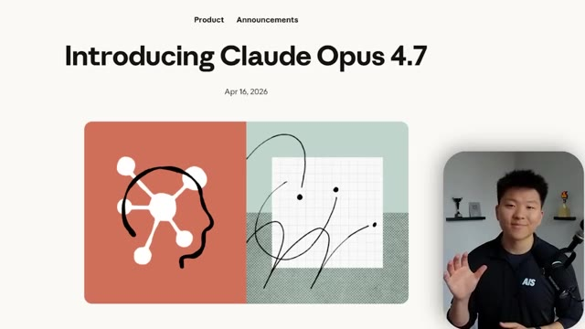
*⏱️ 00:17:12 — Une page web présentant une annonce produit intitulée "Introducing Claude Opus 4.7" datée du 16 avril 2026, avec une illustration abstraite.*

---

