# 🎬 I Turned Claude Into a 24/7 Trader

> **Chaîne** : [Nate Herk | AI Automation](https://www.youtube.com/@nateherk/featured)  
> **Lien YouTube** : [https://www.youtube.com/watch?v=6MC1XqZSltw](https://www.youtube.com/watch?v=6MC1XqZSltw)  
> **Date de publication** : 20260417  
> **Durée** : 00:33:15  
> **Identifiant vidéo** : `6MC1XqZSltw`  
> **Transcription & Analyse** : `whisper-v3-large-turbo+gemini-3.5-flash-lite`  

---

## 📌 Synthèse Exécutive & Outils

### 💡 Résumé
Dans cette vidéo intitulée **I Turned Claude Into a 24/7 Trader**, Nate Herk décortique les capacités pratiques d'automatisation et de développement propulsées par les modèles de pointe.

### 🛠️ Outils, Modèles & Logiciels Présentés
- **Opus 5.5 & Claude Code** : Modèles d'ingénierie et agents de codage autonome.

### 🔑 Points Clés & Enseignements Stratégiques
- Optimiser le niveau d'effort et le raisonnement des modèles IA pour des résultats industriels.
- Automatiser les cycles de création logicielle de bout en bout.

---

## ⏱️ Chronologie & Transcription Complète Audio & Visuelle (Mot pour Mot)

### ⏱️ `[00:00:00 - 00:00:24]` | Segment #01

**🔊 Audio (Transcription Intégrale Mot pour Mot en Français) :**
> So Claude Opus 4.6 is finally here, and it got me thinking, because as I was scrolling down and I started looking at the benchmarks, I noticed right here we have agentic financial analysis, and we have about a 4% jump from Opus 4.6. And about a week ago, I dropped this video where me and Salman traded stocks for 30 days with our OpenClaw agents, and my OpenClaw agent was set up with Opus 4.6, and I was able to beat the S&P by about 8%, as you can see right here.

**👁️ Analyse Visuelle d'Écran (gemini-3.5-flash-lite) :**
**Interface & Outils** : Navigateur web (tableau de bord de benchmarks) et interface YouTube.

**Contenu textuel & Code** : - Image #1 : Données chiffrées de benchmarks IA (ex: Multidisciplinary reasoning, Agentic search, Agentic financial analysis à 64.4%).
- Image #2 : Graphique de performance boursière sur 30 jours, avec des valeurs de portefeuille ($9,980, $9,624, $9,153).

**Action / Démonstration** : - Image #1 : Le présentateur pointe du doigt une statistique spécifique pour illustrer le gain de performance du modèle.
- Image #2 : Présentation visuelle d'un résultat d'expérience de trading automatisé ("I Gave OpenClaw $10,000 to Trade Stocks").

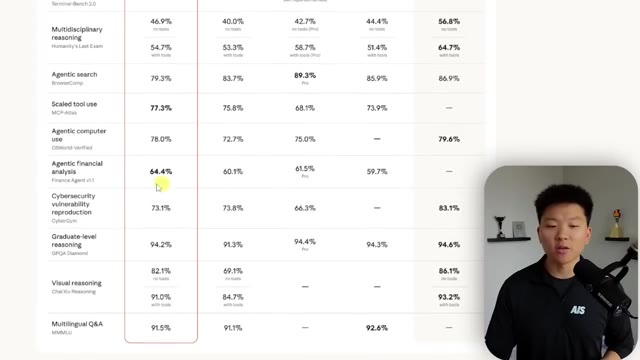
*⏱️ 00:00:06 — Tableau comparatif des performances de différents modèles d'IA sur plusieurs benchmarks techniques, avec une mise en avant de la ligne "Agentic financial analysis".*

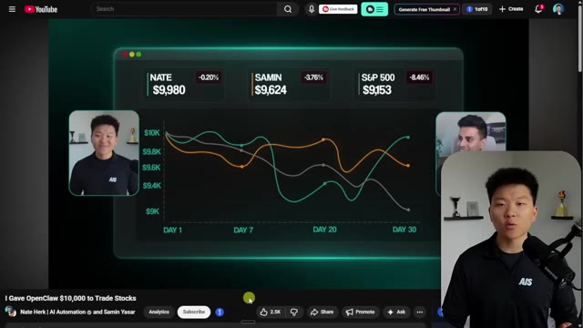
*⏱️ 00:00:12 — Capture d'écran d'une vidéo YouTube montrant un tableau de bord de trading avec des courbes de performance comparative entre Nate, Samin et le S&P 500.*

---

### ⏱️ `[00:00:24 - 00:00:45]` | Segment #02

**🔊 Audio (Transcription Intégrale Mot pour Mot en Français) :**
> This green line is my chart and this gray line is the S&P. So if you guys want to check out this full video, I will link that right up here. So after this challenge, I wanted to keep my agent running to see if it could keep beating the S&P. But now I want to upgrade it to 4.7 instead of 4.6. So that's exactly what I want to cover with you guys today. How do we build a 24-7 AI trading agent with Opus 4.6 inside of Claude Code?

**👁️ Analyse Visuelle d'Écran (gemini-3.5-flash-lite) :**
**Interface & Outils** : Présentation vidéo sur YouTube (Image 1) et présentation type diaporama/Slide deck (Image 2).

**Contenu textuel & Code** : Graphiques de performance financière (Image 1) et plan de construction d'un agent de trading (Image 2).

**Action / Démonstration** : Comparaison des résultats de performance des agents IA par rapport au S&P 500 (Image 1) et introduction au flux de travail technique pour la mise à jour vers Opus 4.7 (Image 2).

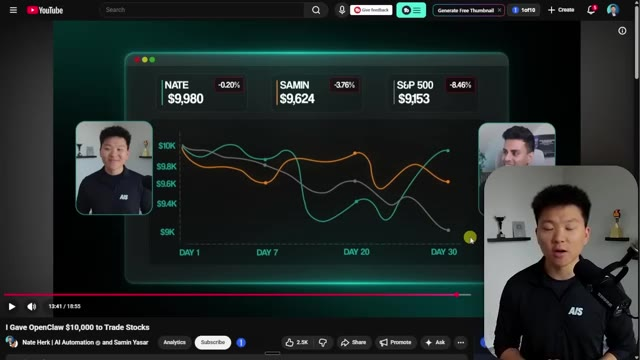
*⏱️ 00:00:30 — Un tableau de bord de performance boursière affichant trois courbes comparatives (Nate, Samin, S&P 500) sur une période de 30 jours, avec les soldes finaux respectifs.*

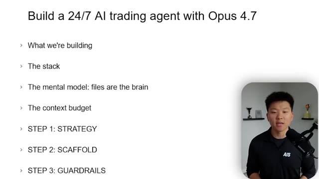
*⏱️ 00:00:40 — Une diapositive de présentation listant les étapes du projet : "Build a 24/7 AI trading agent with Opus 4.7", incluant la stack, le modèle mental, le budget de contexte et les étapes de développement (Stratégie, Scaffold, Guardrails).*

---

### ⏱️ `[00:00:45 - 00:01:04]` | Segment #03

**🔊 Audio (Transcription Intégrale Mot pour Mot en Français) :**
> We're not even going to touch OpenClaw or Hermes Agent. We're going to just do this with Claude Code. And this is all going to be thanks to another feature that we just got from the Anthropic team called Routines. If you don't know what that is, I'm going to break it down in this video, but I also made a full one if you want to check that out also right up here. So basically this is the unlock. 4.7 plus routines means you can have a 24-7 AI agent.

**👁️ Analyse Visuelle d'Écran (gemini-3.5-flash-lite) :**
**Interface & Outils** : Plateforme de réseau social X (anciennement Twitter) affichée dans un navigateur web.

**Contenu textuel & Code** : Texte du tweet : "We just launched Routines. We just launched Claude Opus 4.7. The real unlock is using them together. 4.7 was built for full-throttle agentic work, judgment under ambiguity, and self-verifying outputs. Perfect for routines that work in the background."

**Action / Démonstration** : Affichage d'une annonce officielle sous forme de tweet pour illustrer l'introduction de la fonctionnalité « Routines » dans l'écosystème Claude.

*⏱️ 00:00:50 — Capture d'écran de l'interface du réseau social X montrant une publication de Noah Zweben concernant le lancement de « Routines » et « Claude Opus 4.7 », avec une vidéo illustrative en format GIF.*

---

### ⏱️ `[00:01:04 - 00:01:22]` | Segment #04

**🔊 Audio (Transcription Intégrale Mot pour Mot en Français) :**
> And 4.7 was built for full throttle agentic work, judgment over ambiguity, and self-verifying outputs. So it's perfect for these types of routines. And that's how I'm going to set up my 24-7 trading agent with Cloud Code Routines. So if you follow along with this video, you'll be able to pretty much duplicate my exact setup and have yourself a working agent.

**👁️ Analyse Visuelle d'Écran (gemini-3.5-flash-lite) :**
**Interface & Outils** : X (Twitter) ; Logiciel de présentation (diapositives).

**Contenu textuel & Code** : Texte de la publication X : "4.7 was built for full-throttle agentic work, judgment under ambiguity, and self-verifying outputs." ; Titre de la diapositive : "Build a 24/7 AI trading agent with Opus 4.7" incluant les étapes : "Strategy, Scaffold, Guardrails".

**Action / Démonstration** : Le présentateur explique les capacités de l'IA (Image 1) puis introduit le plan technique du projet (Image 2).

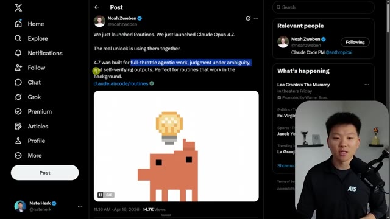
*⏱️ 00:01:08 — Une capture d'écran de l'interface de X (Twitter) affichant une publication de Noah Zweben sur le lancement de "Claude Opus 4.7" et des "Routines".*

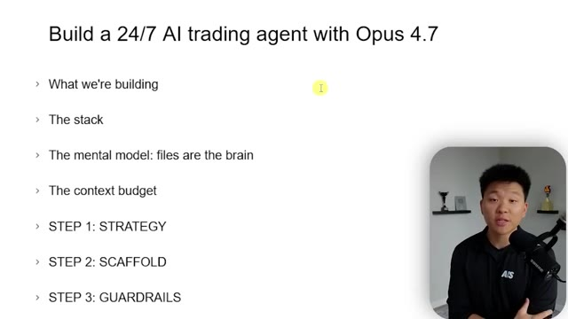
*⏱️ 00:01:18 — Une diapositive de présentation listant le plan de construction d'un agent de trading 24/7 avec Opus 4.7 (stratégie, stack, workflow, étapes 1 à 3).*

---

### ⏱️ `[00:01:22 - 00:01:52]` | Segment #05

**🔊 Audio (Transcription Intégrale Mot pour Mot en Français) :**
> and start trading with it. So let's go ahead and get started. What are we building? We're going to create a cloud code project that runs on a schedule, something like a pre-market cron, a market open, a midday, and a close. It's going to research the market. It's going to place trades via the Alpaca API. It's going to journal and make sure that it's writing context into the file so it can learn. And then it's going to send me every day, every day of the week, an end of day summary to my ClickUp. The goal obviously is just to beat the SMP. We're not looking to do any crazy crypto or crazy day trading stuff.

**👁️ Analyse Visuelle d'Écran (gemini-3.5-flash-lite) :**
**Interface & Outils** : Éditeur de texte / Logiciel de présentation.

**Contenu textuel & Code** : Titre : "Build a 24/7 AI trading agent with Opus 4.7". Description du projet : "A Claude Code project that runs on a schedule: pre-market, open, midday, close. It researches the market, places trades via Alpaca, journals its reasoning, and sends an EOD summary to ClickUp." Objectif : "beat S&P 500". Sommaire : "The stack", "The mental model: files are the brain", "The context budget", "STEP 1: STRATEGY".

**Action / Démonstration** : Présentation théorique du plan de construction de l'agent de trading par le créateur.

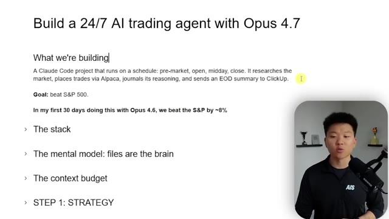
*⏱️ 00:01:29 — Une présentation sous forme de document ou de page web énumérant les objectifs et la structure du projet de trading automatisé avec Opus 4.7.*

---

### ⏱️ `[00:01:52 - 00:02:12]` | Segment #06

**🔊 Audio (Transcription Intégrale Mot pour Mot en Français) :**
> I'm just kind of doing this as a fun long-term investment. Just beat the S&P challenge. Like I said, in my first 30 days, I gave Opus $10,000 and we were able to beat the S&P by about 8%, which is really good, especially in such a short amount of time. So what is the tech stack? We're gonna be using Cloud Code Routines. That's kind of our scheduler. For the AI model, we're gonna use Opus 4.7.

**👁️ Analyse Visuelle d'Écran (gemini-3.5-flash-lite) :**
**Interface & Outils** : Présentation (diapositive textuelle)

**Contenu textuel & Code** : Texte structuré : "Build a 24/7 AI trading agent with Opus 4.7", "A Claude Code project that runs on a schedule: pre-market, open, midday, close", et liste des sections : "The stack", "The mental model", "The context budget", "STEP 1: STRATEGY".

**Action / Démonstration** : Présentation du plan de développement et de la méthodologie du projet.

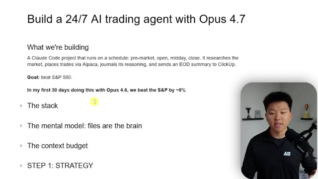
*⏱️ 00:01:57 — Une présentation sous forme de liste à puces structurant le projet d'agent de trading IA, détaillant l'objectif (battre le S&P 500) et les étapes à venir.*

---

### ⏱️ `[00:02:12 - 00:02:31]` | Segment #07

**🔊 Audio (Transcription Intégrale Mot pour Mot en Français) :**
> For the skills, we're gonna be using just kind of like building our own as we go. It'll be stuff like how the agent does research or how it makes decisions or how it places trades or makes logs, things like that. We're gonna use the Alpaca API as our brokerage. We're gonna use the Perplexity API for research. You could also just use the native web fetch and web search, but I'm gonna use Perplexity here.

**👁️ Analyse Visuelle d'Écran (gemini-3.5-flash-lite) :**
**Interface & Outils** : Présentation ou face-caméra explicatif sans interface logicielle partagée.

**Contenu textuel & Code** : Explications orales et mise en contexte méthodologique.

**Action / Démonstration** : Explications face caméra et démonstration conceptuelle.

---

### ⏱️ `[00:02:32 - 00:03:06]` | Segment #08

**🔊 Audio (Transcription Intégrale Mot pour Mot en Français) :**
> And then I'm gonna get my notifications and ClickUp this time rather than Telegram, just because I live in ClickUp a lot more. So obviously some of these things can be interchangeable for you, but if you wanna just copy my exact setup in this video, then feel free. Okay, so how to get started with these different tools that we need for this video. The first one is gonna be Alpaca. So go to alpaca.markets. You can see up at the top, we even see want to trade using AI. We launched an Alpaca's MCP server to help you trade with natural language. So you could use that. I'm just using the endpoints. I honestly like to use endpoints a lot more. But anyways, you're going to sign up right here and you'll click on trading API. Now, once you get in there, you will have basically a paper trading

**👁️ Analyse Visuelle d'Écran (gemini-3.5-flash-lite) :**
**Interface & Outils** : Page web d'Alpaca (alpaca.markets), éditeur de texte/présentation.

**Contenu textuel & Code** : Liste des composants de la stack technique, interface web d'API de trading financier, graphiques boursiers (AAPL, SPY).

**Action / Démonstration** : Le présentateur décrit les briques logicielles du projet et introduit Alpaca comme plateforme de brokerage.

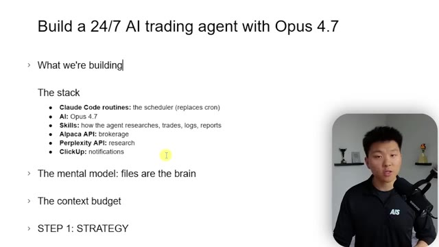
*⏱️ 00:02:40 — Présentation textuelle de la "stack" technologique utilisée pour construire l'agent de trading IA (Claude Code, Opus 4.7, Alpaca API, etc.).*

*⏱️ 00:02:49 — Page d'accueil du site web d'Alpaca montrant leurs services d'API pour le trading de stock et de crypto-monnaies.*

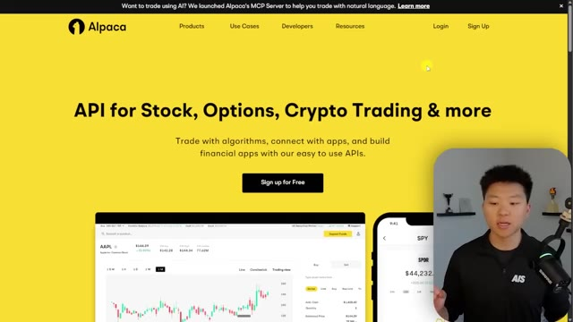
*⏱️ 00:02:57 — Même interface que l'image 2, montrant le site web d'Alpaca avec une vue sur les outils de trading proposés.*

---

### ⏱️ `[00:03:06 - 00:03:26]` | Segment #09

**🔊 Audio (Transcription Intégrale Mot pour Mot en Français) :**
> account. And right here, you can see I've got a paper trading account with a hundred K. You could also open up a new account right here. And that's how you could put real money in. You might, like I said, they'll have to just verify your account, which could take a couple of days. and then they're both the same as far as the credentials. You basically scroll down and on the right-hand side, you have your API keys right here. You get an endpoint and you get a key, but you also need like a secret key.

**👁️ Analyse Visuelle d'Écran (gemini-3.5-flash-lite) :**
**Interface & Outils** : Plateforme de trading en ligne (Web Trader).

**Contenu textuel & Code** : Détails du compte "Paper Trading" avec un solde de 99 837,81 $, interface de passage d'ordre avec options "Buy/Sell", type d'ordre "Market", et quantité par défaut.

**Action / Démonstration** : Le curseur survole l'option "Individual Trading" (Live Account) dans le menu déroulant de sélection de compte.

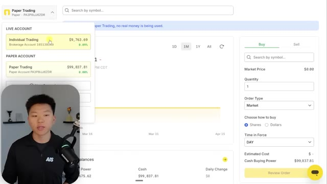
*⏱️ 00:03:11 — Interface de trading web montrant le sélecteur de compte (Live vs Paper) et le panneau de passage d'ordre.*

---

### ⏱️ `[00:03:26 - 00:03:44]` | Segment #10

**🔊 Audio (Transcription Intégrale Mot pour Mot en Français) :**
> So you have like a secret key and then you need like an ID. So you hit regenerate, generate new keys and this is where you get your key and your secret. And once you copy and paste this, just make sure to save it because then it's gonna go away and you'll only be able to see the key, but you need both of them. Next up, I have ClickUp. This is where I wanna get my notifications. You don't have to use ClickUp.

**👁️ Analyse Visuelle d'Écran (gemini-3.5-flash-lite) :**
**Interface & Outils** : Plateforme de trading Alpaca (interface web).

**Contenu textuel & Code** : URL de l'endpoint API, clé publique (API Key) et clé secrète (Secret Key) affichées dans la barre latérale droite, accompagnées d'une notification de succès "New key generated".

**Action / Démonstration** : Génération et affichage des clés API d'Alpaca pour une utilisation dans le développement d'applications.

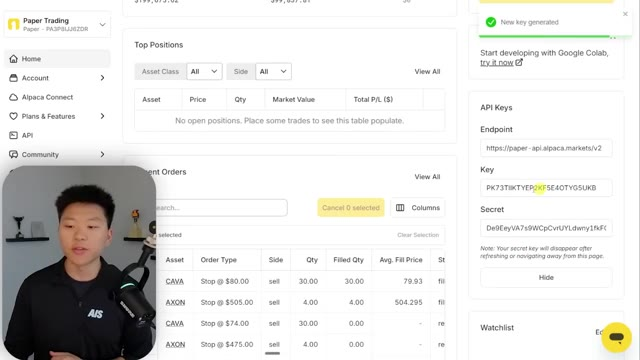
*⏱️ 00:03:30 — Interface web Alpaca affichant les informations d'identification d'API (Key et Secret) venant d'être générées.*

---

### ⏱️ `[00:03:44 - 00:04:05]` | Segment #11

**🔊 Audio (Transcription Intégrale Mot pour Mot en Français) :**
> You can use Slack. you could use, you know, whatever, Telegram, WhatsApp. I would go up here and go to my settings and then I scroll down and find ClickUp API and then I would just copy this token right here. And then similarly with perplexity, I would go down here and I would click on all settings, I think, and then in here I can see API platform and this is where I would be able to go find my actual API key.

**👁️ Analyse Visuelle d'Écran (gemini-3.5-flash-lite) :**
**Interface & Outils** : ClickUp (Plateforme de gestion de projet)

**Contenu textuel & Code** : Jeton API ClickUp (formaté comme `pk_81487**********************B38Z`) et liste des intégrations actives.

**Action / Démonstration** : Navigation dans les menus de paramètres pour accéder à la clé d'authentification API afin de permettre une intégration avec des outils tiers.

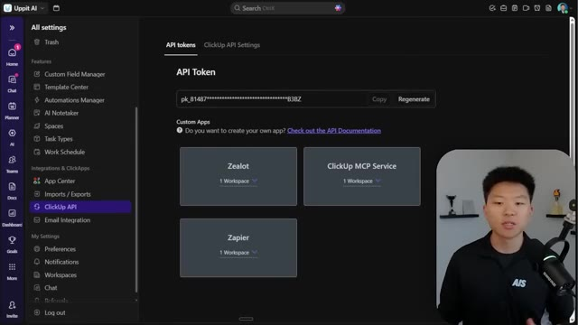
*⏱️ 00:03:55 — Page des paramètres de l'API ClickUp affichant le jeton d'accès (API Token) masqué et les applications personnalisées configurées (Zealot, ClickUp MCP Service, Zapier).*

---

### ⏱️ `[00:04:05 - 00:04:37]` | Segment #12

**🔊 Audio (Transcription Intégrale Mot pour Mot en Français) :**
> If I went down to right here, API keys, I can make a new one or copy an old one. But basically the way it works is every platform has typically API keys. You just have to find them in the settings somewhere. If you can't find them, just do a quick perplexity or Google search or even ask cloud code And it should be able to help you get to your api keys And now that you know how to get these keys just hold on to them We're going to actually plug them in later in the video And then the final piece of the puzzle is going to be the cloud desktop app You can see here you can have cloud chat You can have cloud co-work or you can be in cloud code And this is where we're going to set up these actual routines Where now if I go to my calendar, you can see every single day

**👁️ Analyse Visuelle d'Écran (gemini-3.5-flash-lite) :**
**Interface & Outils** : Présentation ou face-caméra explicatif sans interface logicielle partagée.

**Contenu textuel & Code** : Explications orales et mise en contexte méthodologique.

**Action / Démonstration** : Explications face caméra et démonstration conceptuelle.

---

### ⏱️ `[00:04:37 - 00:05:13]` | Segment #13

**🔊 Audio (Transcription Intégrale Mot pour Mot en Français) :**
> I've got bull which is my trading agent waking up at 6 8 30 noon, 3 p.m. And then on certain days, like on Fridays, he's doing a weekly review. So this is the way I currently have mine set up and we're able to manage everything right from here inside of the Claude desktop app because of this whole routine feature. So all you need to do to use the Claude desktop app is just type in Claude desktop app download, and you should be able to install it right here. You go to the downloads page and then you just have to choose the Claude desktop for your operating system. And then the only other thing you need to do is make sure that you are on an actual subscription. So it has to be a paid either 20 bucks a month plan or the max

**👁️ Analyse Visuelle d'Écran (gemini-3.5-flash-lite) :**
**Interface & Outils** : Application de gestion de workflow/productivité, navigateur web (Support Claude, site de téléchargement Claude).

**Contenu textuel & Code** : Liste de routines quotidiennes indexées sur des heures précises (6:00 AM, 8:30 AM, 12:00 PM, 3:00 PM) et des jours spécifiques.

**Action / Démonstration** : Consultation et présentation du planning d'exécution des agents IA ("Bull") intégrés dans le flux de travail de l'utilisateur.

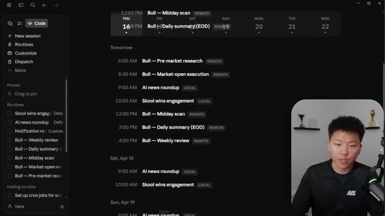
*⏱️ 00:04:46 — Une vue d'une application de gestion de routines (probablement une interface type Notion ou calendrier personnalisé) affichant un planning quotidien avec des tâches automatisées nommées "Bull" (ex: "Bull - Midday scan", "Bull - Weekly review").*

---

### ⏱️ `[00:05:13 - 00:05:34]` | Segment #14

**🔊 Audio (Transcription Intégrale Mot pour Mot en Français) :**
> plans. Now in this video, you might also see me use cloud code inside of something that looks like this, which is the VS code IDE. And then we use cloud code extension inside of it. It's not mandatory, but that is where I typically prefer to use cloud code because I can see all of my files over here. So if you want to do that, just type in VS code in your browser, open this up. It's completely free to download and then go ahead and download it and connect your cloud code account.

**👁️ Analyse Visuelle d'Écran (gemini-3.5-flash-lite) :**
**Interface & Outils** : Visual Studio Code (VS Code) avec l'extension Claude Code.

**Contenu textuel & Code** : Arborescence de projet "TRADING ROUTINE", fichier actif "Claude Code" affichant le message "You've come to the absolutely right place!" et une barre d'entrée de commande (input field).

**Action / Démonstration** : Présentation de l'environnement de travail dans VS Code, avec l'extension Claude Code ouverte en tant qu'onglet principal.

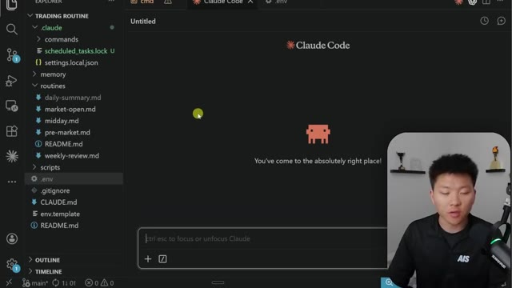
*⏱️ 00:05:18 — Capture d'écran de l'interface VS Code affichant une arborescence de fichiers sur la gauche (dossiers .claude, routines, scripts) et une fenêtre centrale active pour l'extension "Claude Code" avec une mascotte pixel-art.*

---

### ⏱️ `[00:05:35 - 00:05:54]` | Segment #15

**🔊 Audio (Transcription Intégrale Mot pour Mot en Français) :**
> So that is pretty much the tech stack that we're gonna be using today to get all of this set up. And let's get back to the video. Okay, so before we get into the actual step-by-step kind of build, we are going to need to talk about the mental model. So understand this before you write anything. The trading strategy is a piece of the work, but the memory architecture that you're gonna use is gonna be huge.

**👁️ Analyse Visuelle d'Écran (gemini-3.5-flash-lite) :**
**Interface & Outils** : Présentation ou face-caméra explicatif sans interface logicielle partagée.

**Contenu textuel & Code** : Explications orales et mise en contexte méthodologique.

**Action / Démonstration** : Explications face caméra et démonstration conceptuelle.

---

### ⏱️ `[00:05:55 - 00:06:20]` | Segment #16

**🔊 Audio (Transcription Intégrale Mot pour Mot en Français) :**
> So every time a routine fires at 7 a.m., Cloud Code basically wakes up essentially stateless. It doesn't really know anything. So how do you make a stateless agent act disciplined and remember rules and learn over time. You do that with files and with context. So every routine basically wakes up, reads files, does the job, and then writes back any important lessons or anything like that the next agent when it wakes up needs to know, it just writes that down.

**👁️ Analyse Visuelle d'Écran (gemini-3.5-flash-lite) :**
**Interface & Outils** : Logiciel de présentation (type Notion ou éditeur de texte).

**Contenu textuel & Code** : Titre : "The mental model: files are the brain". Texte : "Every time a routine fires at 7am, Claude Code wakes up knowing nothing. So how do you make a stateless agent act disciplined, remember its rules, and learn over time? Files. The files ARE the brain."

**Action / Démonstration** : Le présentateur explique conceptuellement l'architecture de mémoire persistante pour les agents IA via la manipulation de fichiers locaux.

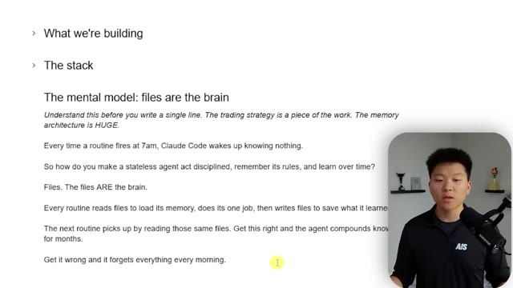
*⏱️ 00:06:01 — Une diapositive de présentation avec du texte expliquant le "modèle mental" où les fichiers servent de mémoire à un agent IA stateless (sans état), accompagnée de la vidéo du présentateur dans une vignette.*

---

### ⏱️ `[00:06:20 - 00:06:43]` | Segment #17

**🔊 Audio (Transcription Intégrale Mot pour Mot en Français) :**
> And that's kind of at a very high level, the type of framework that we're gonna be using here. So the final thing I wanted to talk about before we get into this is the context budget. So treat tokens like money, obviously. Every file that you ask the agent to read, it's going to cost you. Each routine gets about 200,000 tokens to work with. I mean, we do have the a million token context window models now, but I don't really like to think of it like I have a million tokens to play with because context rot.

**👁️ Analyse Visuelle d'Écran (gemini-3.5-flash-lite) :**
**Interface & Outils** : Logiciel de présentation ou éditeur de texte (type Obsidian ou Notion) utilisé pour afficher une liste structurée.

**Contenu textuel & Code** : Liste des points abordés : "What we're building", "The stack", "The mental model: files are the brain", "The context budget", "STEP 1: STRATEGY", "STEP 2: SCAFFOLD", "STEP 3: GUARDRAILS", "STEP 4: SKILLS", "STEP 5: ROUTINES".

**Action / Démonstration** : Présentation du sommaire du framework de travail par le présentateur.

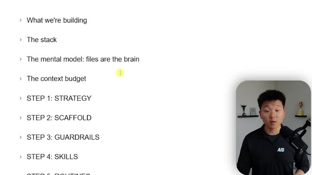
*⏱️ 00:06:26 — Une liste à puces présentant le plan de la vidéo, incluant des étapes de workflow (Strategy, Scaffold, Guardrails, etc.) et des concepts théoriques comme "The context budget".*

---

### ⏱️ `[00:06:44 - 00:07:14]` | Segment #18

**🔊 Audio (Transcription Intégrale Mot pour Mot en Français) :**
> So system instructions will take some up, strategy files, your trade log, your API, your research. Every run is going to take a different amount of tokens, but just keep that in mind. And the reason here that we're using, if I go back to the stack, cloud code instead of just using something like, you know, the agent's SDK or, I mean, I guess that could work, but rather than just using like a standard automation is because if we do this with routines, we basically get the full autonomy of us working with Cloud Code manually because it goes through that whole agenda carnage loop of figuring things out.

**👁️ Analyse Visuelle d'Écran (gemini-3.5-flash-lite) :**
**Interface & Outils** : Logiciel de présentation (type diaporama/Google Slides).

**Contenu textuel & Code** : Texte détaillé sur le "Context budget" : liste des consommations en tokens (System prompt: 10K, Strategy file: 2K, Trade log: 8K+, Research log: 5K+, API/web search: 5K+).

**Action / Démonstration** : Le présentateur explique la gestion des ressources en tokens pour l'exécution d'un agent IA.

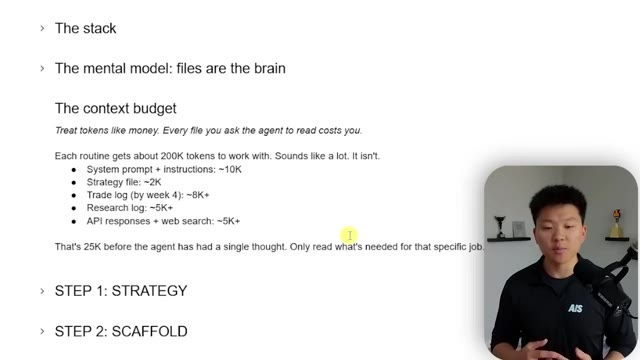
*⏱️ 00:06:51 — Une diapositive de présentation listant les coûts en jetons (tokens) pour différents composants d'un agent IA, avec le présentateur visible en médaillon dans le coin inférieur droit.*

---

### ⏱️ `[00:07:14 - 00:07:46]` | Segment #19

**🔊 Audio (Transcription Intégrale Mot pour Mot en Français) :**
> And especially with Opus 4.7, it's apparently going to be really, really good. Whereas if you just had like an automation that would do research and then make a trade, you're not getting that super variability that you probably want with something that could be very volatile like trading. All right, so now that we got all of that stuff out of the way, Let's get into the strategy. So step one Think of this like you're teaching a kid to ride a bike You have to explain How to balance before you go you have to explain to the kid that he's going to Steer with his hands and he's going to pedal with his feet and even once you put him on the bike

**👁️ Analyse Visuelle d'Écran (gemini-3.5-flash-lite) :**
**Interface & Outils** : Logiciel de présentation (type PowerPoint ou Google Slides).

**Contenu textuel & Code** : Liste détaillée des coûts en tokens pour différents éléments : "System prompt + instructions" (10K), "Strategy file" (2K), "Trade log" (8K+), "Research log" (5K+), "API responses + web search" (5K+). Texte explicatif : "Treat tokens like money. Every file you ask the agent to read costs you."

**Action / Démonstration** : Présentation théorique des limites de contexte pour optimiser l'utilisation des tokens par un agent IA.

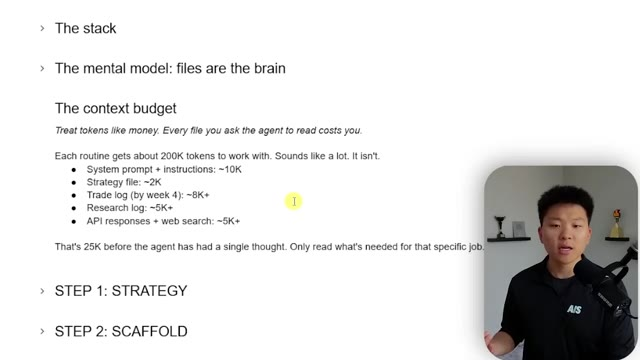
*⏱️ 00:07:22 — Une diapositive de présentation listant les contraintes liées au "budget de contexte" pour un agent IA dédié au trading, avec le présentateur visible en incrustation à droite.*

---

### ⏱️ `[00:07:46 - 00:08:20]` | Segment #20

**🔊 Audio (Transcription Intégrale Mot pour Mot en Français) :**
> You're not just going to let him go. You're going to hold the handlebars You're going to put your hand on his back and you're going to walk with him until he gets a little more comfortable And then slowly you might take off, you know, you might stop steering But you might just run behind him and then slowly you'll put on some training wheels and like you just keep bumping it up in phases. You can't expect to just throw a kid on a bike and it's instantly going to be magic. So maybe you want to start with paper trading. This is obviously not financial advice and I'm not recommending that you go put all of your life savings in here and expect to make money and then get mad at me. This is an experiment for me and I'm trying to show you guys what's possible. So just keep that in mind. Start with paper trading first if you're not comfortable.

**👁️ Analyse Visuelle d'Écran (gemini-3.5-flash-lite) :**
**Interface & Outils** : Application de prise de notes ou éditeur de texte type présentation (format texte structuré).

**Contenu textuel & Code** : Texte structuré : "The mental model: files are the brain", "The context budget", "STEP 1: STRATEGY" (avec analogie sur l'apprentissage du vélo), et notes sur la performance du modèle Opus 4.7 pour l'analyse financière.

**Action / Démonstration** : Présentation théorique d'une méthodologie de travail pour guider un agent IA avant de le laisser opérer en autonomie.

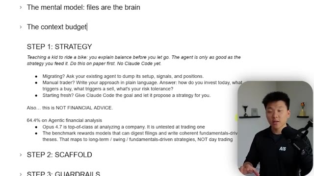
*⏱️ 00:07:55 — Une diapositive de présentation listant les étapes de configuration d'un agent IA pour le trading, illustrée par l'analogie de l'apprentissage du vélo.*

---

### ⏱️ `[00:08:21 - 00:08:56]` | Segment #21

**🔊 Audio (Transcription Intégrale Mot pour Mot en Français) :**
> But anyways, the idea is you need a strategy. So for me, what I'm going to do is I'm basically going to extract all of the strategy that we've been using from my open claw agent. And I'm just going to say, Hey, let's take this over to cloud code. So for me, it's a little easier, but for you, if you actually are like a manual trader and every day you think about things and you do research and you place trades or you sell things, then just write down your strategy. How often are you checking the news? What are the signals that make you realize I'm going to buy this, or I'm going to sell this as much of your gut intuition and your routine about trading that you can get into this cloud code project, the better. And then over time, you're going to help it learn from its mistakes.

**👁️ Analyse Visuelle d'Écran (gemini-3.5-flash-lite) :**
**Interface & Outils** : Logiciel de prise de notes ou éditeur de texte (type Notion ou Obsidian).

**Contenu textuel & Code** : Le document liste les étapes clés : "The mental model: files are the brain", "The context budget", "STEP 1: STRATEGY" (avec des conseils sur la migration des agents, le trading manuel et l'utilisation de Claude Code), et des notes sur les performances de "Opus 4.7" pour l'analyse financière.

**Action / Démonstration** : Le contenu affiche une feuille de route stratégique pour définir les paramètres d'un agent IA avant de passer à l'implémentation technique ("No Claude Code yet").

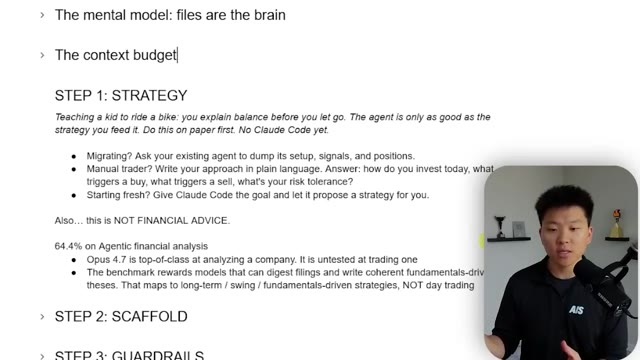
*⏱️ 00:08:29 — Une vue d'une page de prise de notes ou d'un document structuré détaillant la méthodologie de création d'un agent de trading IA, avec le présentateur visible en médaillon.*

---

### ⏱️ `[00:08:56 - 00:09:30]` | Segment #22

**🔊 Audio (Transcription Intégrale Mot pour Mot en Français) :**
> You're going to iterate and it's going to get better and better every time you use it. But if you're starting completely fresh, which in my case of the open cloud trading challenge, I literally just said, hey, I'm doing a 30 day challenge. I'm trying to compete against my friend Salman. Go do research, spin up a team of sub agents. You're my wealth advisor. Try to beat the SMP, figure out the best plan possible. And that's like genuinely all that I said to it, which I think is pretty cool. And it went off and it did a bunch of research. It figured out a strategy for me. And then for the next 30 days, it just did that. And I barely had to touch it at all. So if you want to start off by playing around with some research like that, then certainly do

**👁️ Analyse Visuelle d'Écran (gemini-3.5-flash-lite) :**
**Interface & Outils** : Présentation ou face-caméra explicatif sans interface logicielle partagée.

**Contenu textuel & Code** : Explications orales et mise en contexte méthodologique.

**Action / Démonstration** : Explications face caméra et démonstration conceptuelle.

---

### ⏱️ `[00:09:30 - 00:09:58]` | Segment #23

**🔊 Audio (Transcription Intégrale Mot pour Mot en Français) :**
> that. But if you guys remember at the beginning of this video, I kind of alluded to this benchmark here. So in the official release, and by the way, I just dropped a full video on this new release. I'll tag that up here. So in the official release of Claude Opus 417, they always drop the benchmarks and they compare it to other models that are kind of leading in the industry as well. And so this is the one I wanted to talk about in this case, we have agentic financial analysis, 64.4%. We also have stuff like graduate level reasoning and, you know, just the ability to think really well.

**👁️ Analyse Visuelle d'Écran (gemini-3.5-flash-lite) :**
**Interface & Outils** : Navigateur web affichant les benchmarks officiels d'un modèle d'IA.

**Contenu textuel & Code** : Tableau de données comparatif incluant : "Agentic coding", "Agentic terminal coding", "Multidisciplinary reasoning", "Agentic search", "Scaled tool use", et "Agentic computer use" avec leurs scores respectifs.

**Action / Démonstration** : Analyse visuelle des performances comparatives entre modèles d'IA présentés dans le tableau de benchmarks.

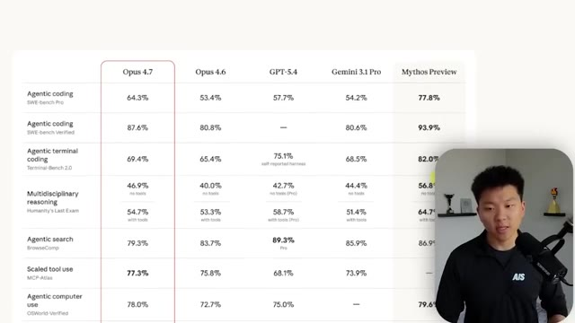
*⏱️ 00:09:44 — Tableau comparatif des performances ("benchmarks") entre différents modèles d'IA (Opus 4.7, 4.6, GPT-5.4, etc.) sur plusieurs métriques.*

---

### ⏱️ `[00:09:58 - 00:10:30]` | Segment #24

**🔊 Audio (Transcription Intégrale Mot pour Mot en Français) :**
> Agentic search actually is worse than Opus 4.6, which is interesting, but yeah, agentic financial analysis. So what does that actually mean? This basically means that it is really good at analyzing a company, but it's not basically a signal or a benchmark for how good this model is at trading and specifically day trading. Like this doesn't mean that it's going to be able to look at like a technical analysis and look at the candlesticks and the MACD and figure out the exact best moment to buy and then the exact moment to sell. I'm not going to try to day trade with these agents. I just don't know enough about it to do it. But that's not what this metric is saying.

**👁️ Analyse Visuelle d'Écran (gemini-3.5-flash-lite) :**
**Interface & Outils** : Éditeur de texte simple ou document de présentation (type bloc-notes ou document texte).

**Contenu textuel & Code** : Texte affiché : "Teaching a kid to ride a bike...", "64.4% on Agentic financial analysis", "Opus 4.7 is top-of-class at analyzing a company", "STEP 2: SCAFFOLD", "STEP 3: GUARDRAILS", "STEP 4: SKILLS", "STEP 5: ROUTINES".

**Action / Démonstration** : Affichage pédagogique des étapes logiques pour construire un agent de trading IA, soulignant la distinction entre l'analyse fondamentale et le trading actif.

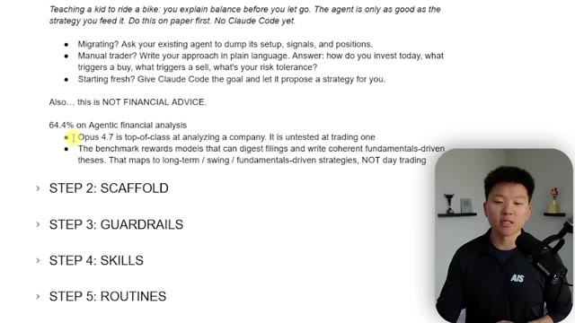
*⏱️ 00:10:06 — Une présentation sous forme de liste à puces structurée détaillant les étapes de conception d'un agent de trading, avec un avertissement sur les capacités d'analyse financière d'Opus 4.7.*

---

### ⏱️ `[00:10:30 - 00:10:55]` | Segment #25

**🔊 Audio (Transcription Intégrale Mot pour Mot en Français) :**
> This benchmark rewards models that can digest fillings and write coherent fundamentals driven theses or theses, I guess. And that maps to long term or swing or fundamentals driven strategies, not day trading. So that's why, once again, we're just going to be trying to beat the S&P here. Okay, so that is the overall strategy. Let's talk about the scaffold. So what you need to do to spin up the Cloud Code project in about 60 seconds is you're gonna open up a new folder and we're gonna open up Cloud Code.

**👁️ Analyse Visuelle d'Écran (gemini-3.5-flash-lite) :**
**Interface & Outils** : Présentation ou face-caméra explicatif sans interface logicielle partagée.

**Contenu textuel & Code** : Explications orales et mise en contexte méthodologique.

**Action / Démonstration** : Explications face caméra et démonstration conceptuelle.

---

### ⏱️ `[00:10:55 - 00:11:13]` | Segment #26

**🔊 Audio (Transcription Intégrale Mot pour Mot en Français) :**
> So let me hop over to my project right here. This is a new folder. It's called trading, I think trading routine. This is basically just a settings file. There's hardly anything in there. The cloud.md is blank and then we have a readme just because I turned this into a GitHub repo so I can pull it into a routine later. If you haven't done that yet, it's fine. We'll talk about that in a sec.

**👁️ Analyse Visuelle d'Écran (gemini-3.5-flash-lite) :**
**Interface & Outils** : VS Code (avec terminal Claude Code intégré)

**Contenu textuel & Code** : Structure de fichiers : répertoire ".claude", fichiers "CLAUDE.md" et "README.md". Terminal : affichage de la version "Claude Code v2.1.111", modèle "Opus 4.7 (1M context)" et chemin du répertoire de travail.

**Action / Démonstration** : Présentation de l'environnement de développement et initialisation de l'outil CLI Claude Code au sein du répertoire du projet.

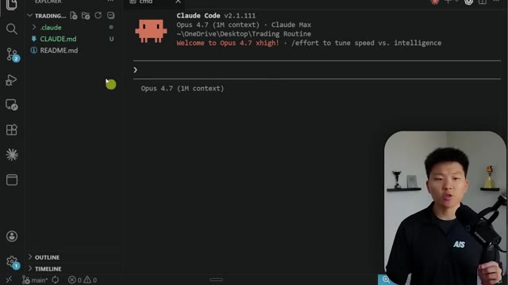
*⏱️ 00:11:00 — L'interface de VS Code montrant l'explorateur de fichiers à gauche avec le projet "Trading Routine" et un terminal intégré exécutant "Claude Code" v2.1.111.*

---

### ⏱️ `[00:11:14 - 00:11:33]` | Segment #27

**🔊 Audio (Transcription Intégrale Mot pour Mot en Français) :**
> The reason why we're starting here in VS Code is because I want to get started in a place where I can see all of my files on this left-hand side. Because if you're in the desktop app, which we will move over to here later, you don't get to see all your files open on the left-hand side. On the left-hand side, you see your routines and your other sessions, which is great. But when we're first getting set up, I like to be able to see everything in one spot.

**👁️ Analyse Visuelle d'Écran (gemini-3.5-flash-lite) :**
**Interface & Outils** : Visual Studio Code, Claude Code (CLI)

**Contenu textuel & Code** : Arborescence de fichiers ("TRADING...", ".claude", "settings.local.json", "CLAUDE.md", "README.md") et en-tête du terminal indiquant "Claude Code v2.1.111" et "Opus 4.7 (1M context)".

**Action / Démonstration** : Présentation de l'environnement de développement et de l'outil Claude Code au sein de VS Code.

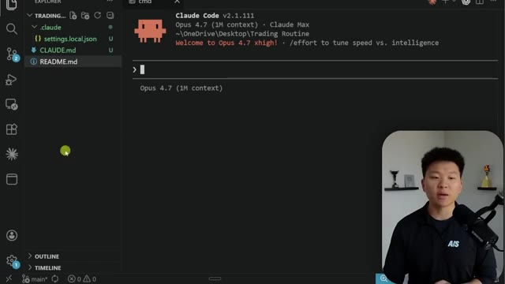
*⏱️ 00:11:18 — Interface VS Code affichant l'explorateur de fichiers à gauche et un terminal intégré exécutant Claude Code.*

---

### ⏱️ `[00:11:33 - 00:11:52]` | Segment #28

**🔊 Audio (Transcription Intégrale Mot pour Mot en Français) :**
> So we're going to start here in the VS Code, either terminal or the Cloud Code extension. So let me show you guys what I did. This is my Telegram chat with Bull, my trading bot. and I said, hey, I want to completely migrate you to a different AI agent setup. I need you to break down the strategy, the cron jobs. What are you looking for when you're doing your research? What type of sub agents do you have?

**👁️ Analyse Visuelle d'Écran (gemini-3.5-flash-lite) :**
**Interface & Outils** : VS Code (avec extension Claude Code), Telegram Desktop.

**Contenu textuel & Code** : - Image #1 : Logs de démarrage de Claude Code, mentionnant "Opus 4.7 (1M context)" et le répertoire de travail "Trading Routine".
- Image #2 : Prompt utilisateur demandant une migration de système et une explication de la stratégie (Cron jobs, recherche, sub-agents) et réponse détaillée du bot "BULL TRADING BOT" listant les tâches automatiques de 6h00 AM.

**Action / Démonstration** : - Image #1 : Initialisation de l'environnement de développement pour le bot.
- Image #2 : Consultation de l'historique de communication avec l'agent IA pour structurer la migration du projet.

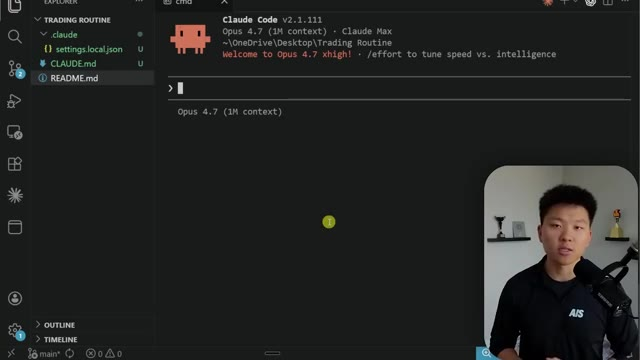
*⏱️ 00:11:38 — Interface de VS Code avec le terminal actif exécutant Claude Code v2.1.111.*

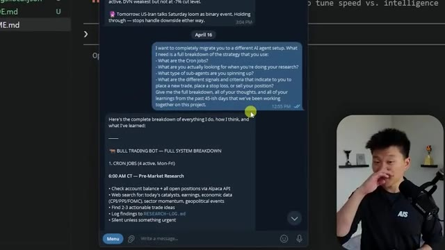
*⏱️ 00:11:42 — Interface de chat Telegram superposée montrant une conversation avec le bot de trading "Bull" détaillant une stratégie de recherche pré-marché.*

---

### ⏱️ `[00:11:52 - 00:12:25]` | Segment #29

**🔊 Audio (Transcription Intégrale Mot pour Mot en Français) :**
> What are the different signals? Give me the full breakdown, all of your learnings. And so it gave me all this stuff. And so what I'm gonna do is I'm just gonna basically migrate over this strategy into my Cloud Code project. You can see we have all of these cell signals. We have all of these key learnings and these kind of main frameworks. And we have our current portfolio. Real quick, guys, when it comes time for you to get set up. I have this free resource for you. It's a 13 page PDF. And I'm assuming if you dropped this thing into cloud code and then started to brainstorm with it, it would help you out a lot as far as the infrastructure and the folder structure and the way you want to get

**👁️ Analyse Visuelle d'Écran (gemini-3.5-flash-lite) :**
**Interface & Outils** : Telegram, Google Docs.

**Contenu textuel & Code** : - Image #1 : Détails techniques du bot de trading (recherche pré-marché, gestion des positions via Alpaca API, analyse de données économiques, scan de milieu de journée).
- Image #2 : Liste d'erreurs fréquentes liées aux variables d'environnement (.env), conflits Git (push/fetch), erreurs de l'API Alpaca et étapes de déploiement pour la réplication du bot.

**Action / Démonstration** : Le présentateur passe en revue la documentation de stratégie et les guides de configuration nécessaires pour migrer ou configurer son projet de bot de trading.

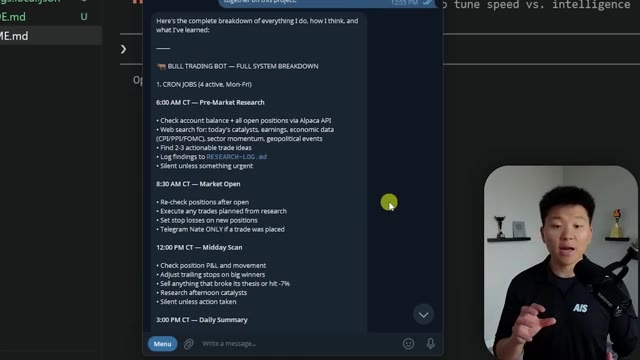
*⏱️ 00:12:00 — Une capture d'écran d'une interface de messagerie (probablement Telegram) affichant un "Bull Trading Bot - Full System Breakdown" détaillant les tâches automatisées (cron jobs) par créneau horaire.*

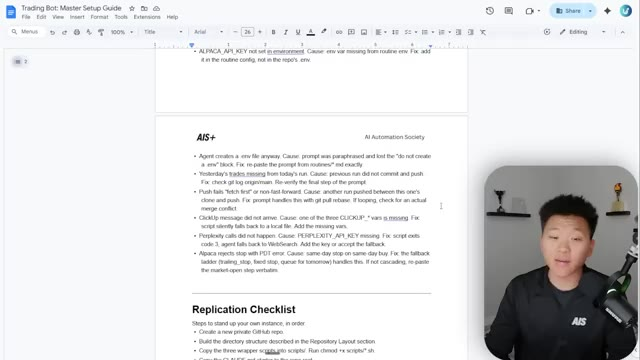
*⏱️ 00:12:17 — Une capture d'écran d'un document Google Docs intitulé "Trading Bot: Master Setup Guide", montrant une liste de dépannage (troubleshooting) pour des erreurs courantes et une "Replication Checklist".*

---

### ⏱️ `[00:12:25 - 00:12:45]` | Segment #30

**🔊 Audio (Transcription Intégrale Mot pour Mot en Français) :**
> things set up and the way you want to create your routines and things like that. So it should be very helpful. This you can download for completely free in my free school community. The link for that is down in the description. Once you get in there, just head over to the classroom, click on YouTube resources, and you'll be able to find it right in there. So let's get back to the video. So I pulled it up real quick. You can see here's today. We had a bit of a jump and then we came back down today.

**👁️ Analyse Visuelle d'Écran (gemini-3.5-flash-lite) :**
**Interface & Outils** : Google Docs, plateforme de communauté Skool, interface de courtage en ligne (trading).

**Contenu textuel & Code** : Texte du guide de configuration d'un agent de trading autonome, structure des cours sur Skool (7 Day AIS Challenge, Claude Code, n8n), données financières de portefeuille.

**Action / Démonstration** : Présentation des ressources téléchargeables, navigation dans les modules de formation et démonstration de la performance financière générée par le bot.

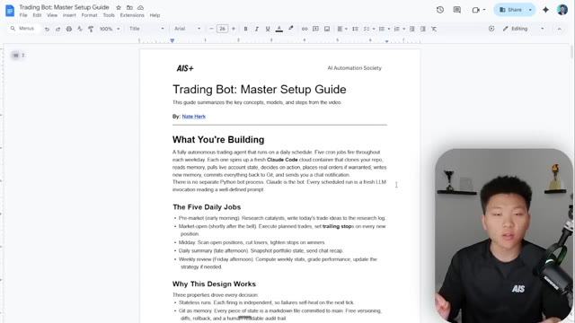
*⏱️ 00:12:30 — Document Google Docs affichant le guide de configuration "Trading Bot: Master Setup Guide".*

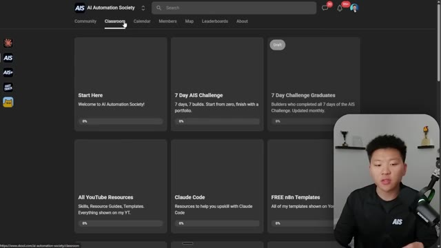
*⏱️ 00:12:35 — Interface de la plateforme Skool montrant l'espace "Classroom" avec les différents modules de formation.*

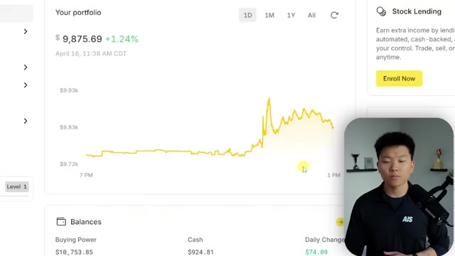
*⏱️ 00:12:40 — Tableau de bord d'un compte de trading affichant la courbe de performance du portefeuille et les soldes.*

---

### ⏱️ `[00:12:45 - 00:13:06]` | Segment #31

**🔊 Audio (Transcription Intégrale Mot pour Mot en Français) :**
> Here's the past month. So this is where we were with the OpenClaw agent. But you guys are going to want to go to Alpaca and make an account, especially if you want to put real money in. You might have to take a few days for your account to get approved. So head over there and get an account. Then I also told it to give me a technical cheat sheet as far as like the different API endpoints it uses and how it makes those requests, as you can see, just because it already has all this knowledge.

**👁️ Analyse Visuelle d'Écran (gemini-3.5-flash-lite) :**
**Interface & Outils** : Interface de trading (Alpaca) et interface de messagerie/documentation technique.

**Contenu textuel & Code** : Documentation technique pour l'API Alpaca : authentification (Headers), endpoints (base URL, Market Data), et appels API (Account, Positions, Quotes).

**Action / Démonstration** : Présentation de la documentation technique nécessaire pour interfacer un agent IA avec la plateforme de trading Alpaca.

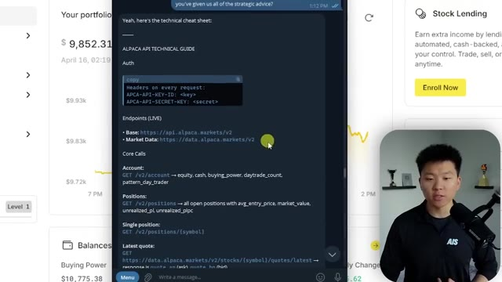
*⏱️ 00:13:01 — Capture d'écran d'une fenêtre de chat (type Telegram ou interface d'IA) affichant une "Alpaca API Technical Guide" avec des endpoints et des structures de requêtes.*

---

### ⏱️ `[00:13:06 - 00:13:25]` | Segment #32

**🔊 Audio (Transcription Intégrale Mot pour Mot en Français) :**
> So why waste time trying to train a new agent if we could just migrate over all of these memories and knowledge to this new agent. And then at the end of that, it even gave me an export of all of these important files, like the agent instructions, the trading strategy, the trade log, the research log, the weekly review. And I'm just basically gonna migrate all this over. So let me show you what that's gonna look like.

**👁️ Analyse Visuelle d'Écran (gemini-3.5-flash-lite) :**
**Interface & Outils** : Interface de messagerie type LLM/Agent IA (superposée sur un tableau de bord de courtage financier).

**Contenu textuel & Code** : Snippets de code JSON pour paramètres d'ordres (limit_price, stop_price), documentation API Alpaca (v2/orders, v2/positions) et liste de bonnes pratiques concernant la protection PDT (Pattern Day Trader).

**Action / Démonstration** : Consultation et présentation de la base de connaissances exportée de l'agent IA, détaillant les logiques métier et les contraintes techniques du trading automatisé.

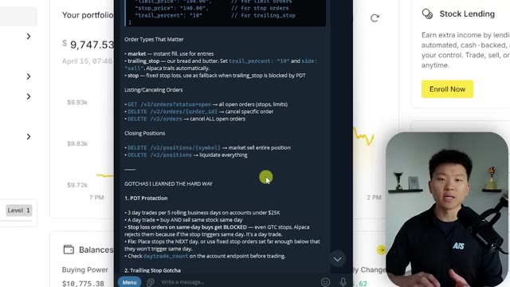
*⏱️ 00:13:11 — Une fenêtre contextuelle sombre affiche une documentation technique structurée sur les stratégies de trading, incluant des types d'ordres, des points de terminaison d'API et des "leçons apprises" sur les règles PDT.*

---

### ⏱️ `[00:13:25 - 00:13:45]` | Segment #33

**🔊 Audio (Transcription Intégrale Mot pour Mot en Français) :**
> So you can see that it gave me this zip file of all of those seven files. And I'm just basically going to extract those into this project right here. So I'm choosing the trading routine project, select folder, and then extract. and we should see all those files just popped up right over here on this left-hand side. Now what I'm gonna do is just talk to my Claude. I'm gonna switch over here to plan mode and I'm just gonna start talking.

**👁️ Analyse Visuelle d'Écran (gemini-3.5-flash-lite) :**
**Interface & Outils** : Visual Studio Code avec le terminal Claude Code (Opus 4.7) actif.

**Contenu textuel & Code** : Explorateur de fichiers : AGENT-INSTRUCTIONS.md, CLAUDE.md, RESEARCH-LOG.md, TRADE-LOG.md, TRADING-STRATEGY.md, WEEKLY-REVIEW.md. Terminal : "Welcome to Opus 4.7 xhigh!".

**Action / Démonstration** : Extraction d'une archive compressée contenant plusieurs fichiers de documentation et de stratégie dans le répertoire de travail du projet "Trading Routine".

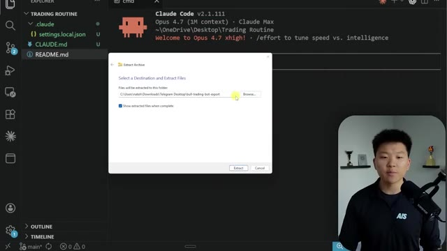
*⏱️ 00:13:30 — Interface système de Windows ouverte au centre de VS Code proposant une fenêtre "Extract Archive" pour sélectionner la destination de l'extraction des fichiers.*

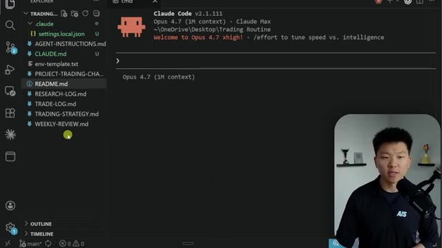
*⏱️ 00:13:40 — Explorateur de fichiers de VS Code affichant la liste mise à jour des fichiers extraits (fichiers .md, log, strategy) dans le projet "TRADING ROUTINE".*

---

### ⏱️ `[00:13:45 - 00:14:03]` | Segment #34

**🔊 Audio (Transcription Intégrale Mot pour Mot en Français) :**
> All right, so I am creating you as a 24-7 AI agent trade bot for me. I had a project set up with OpenClaw and we were trading $10,000 using Alpaca for the past 30 days and we were doing pretty well. But now I wanna move it over here so we can set you up as a Claude code routine.

**👁️ Analyse Visuelle d'Écran (gemini-3.5-flash-lite) :**
**Interface & Outils** : Visual Studio Code (VS Code), Terminal intégré avec Claude Code v2.1.111.

**Contenu textuel & Code** : Arborescence de fichiers du projet incluant `.claude`, `AGENT-INSTRUCTIONS.md`, `CLAUDE.md`, `TRADE-LOG.md`, `TRADING-STRATEGY.md`. Le terminal affiche "Opus 4.7 (1M context)" et "Plan mode on".

**Action / Démonstration** : L'utilisateur initialise ou configure l'agent IA dans l'environnement VS Code pour automatiser la routine de trading mentionnée dans l'audio.

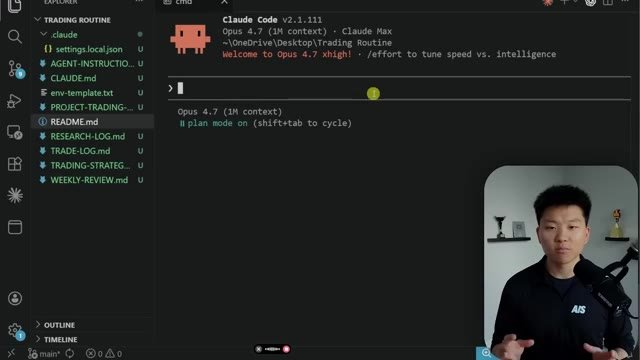
*⏱️ 00:13:50 — Interface VS Code avec le terminal Claude Code actif, montrant la structure d'un projet intitulé "Trading Routine".*

---

### ⏱️ `[00:14:04 - 00:14:22]` | Segment #35

**🔊 Audio (Transcription Intégrale Mot pour Mot en Français) :**
> So I just dropped in a ton of context for you. There's a ton of files in this project. If you want to just take a second to get sort of like acclimated to what I dropped in there, there's going to be a lot of information. But basically, that's like all of the knowledge and all of the strategies and all of the signals that our OpenClaw agent had and how it was able to be successful.

**👁️ Analyse Visuelle d'Écran (gemini-3.5-flash-lite) :**
**Interface & Outils** : VS Code, terminal Claude Code (v2.1.111).

**Contenu textuel & Code** : Arborescence de fichiers incluant : .claude, AGENT-INSTRUCTIONS.md, CLAUDE.md, env-template.txt, PROJECT-TRADING-PLAN.md, README.md, RESEARCH-LOG.md, TRADE-LOG.md, TRADING-STRATEGIES.md, WEEKLY-REVIEW.md. Le terminal affiche "Opus 4.7 (1M context)" et "|| plan mode on".

**Action / Démonstration** : Chargement du contexte du projet dans l'agent Claude Code pour préparer l'automatisation des stratégies de trading.

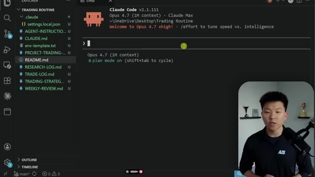
*⏱️ 00:14:08 — Interface de VS Code montrant l'arborescence d'un projet intitulé "TRADING ROUTINE" et un terminal Claude Code actif.*

---

### ⏱️ `[00:14:23 - 00:14:58]` | Segment #36

**🔊 Audio (Transcription Intégrale Mot pour Mot en Français) :**
> And I just want to migrate that over here to you so that we're not losing any of our knowledge. I'm also going to paste in some of the key things that it told me that you should make sure to know. So I'm going to drop in that stuff right below. Now some of this stuff you can take with a grain of salt because it might have been set up and optimized for an open claw Agent harness, but your clawed code you understand the best way to set up your projects and to do things So what's really important is that you're ingesting this information and you're understanding it and then you're helping yourself Organize this project in the way that makes the most sense to you Okay So I know that that is a ton of information that I just chucked into there and you guys might be sitting there like

**👁️ Analyse Visuelle d'Écran (gemini-3.5-flash-lite) :**
**Interface & Outils** : VS Code, terminal Claude Code (version 2.1.111, modèle Opus 4.7).

**Contenu textuel & Code** : Prompt de l'utilisateur demandant à Claude de migrer un projet de bot de trading de 10 000 $ depuis OpenClaw vers un nouvel environnement de routine Claude Code, incluant la mention de données contextuelles fournies.

**Action / Démonstration** : Initialisation d'un agent IA pour automatiser des stratégies de trading ; l'interface affiche le mode "plan mode on".

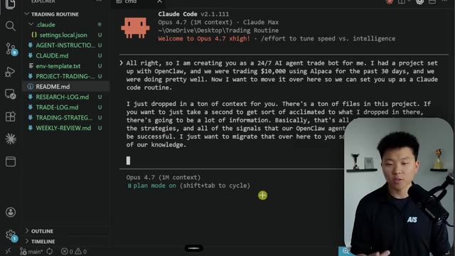
*⏱️ 00:14:31 — Interface de VS Code affichant le terminal de Claude Code en cours d'exécution avec un prompt d'initialisation de projet de trading.*

---

### ⏱️ `[00:14:58 - 00:15:20]` | Segment #37

**🔊 Audio (Transcription Intégrale Mot pour Mot en Français) :**
> Okay, well, I don't have all those files. What do I do? This is where you just start to brainstorm literally treat this thing as if it is your best friend who is the best trader in the world And you are just trying to give it your strategy now So if we think back to earlier in step one where I talked about this strategy When you open up a piece of paper or sorry, you take out a piece of paper You open up a google doc and you just start writing down How do you actually trade? What's your approach?

**👁️ Analyse Visuelle d'Écran (gemini-3.5-flash-lite) :**
**Interface & Outils** : VS Code (avec extension Claude Code/Opus CLI) et logiciel de présentation (type diaporama).

**Contenu textuel & Code** : Image 1 : Structure de fichiers (.md) pour le suivi de trading (TRADE-LOG, RESEARCH-LOG) et statut d'exécution "Transmuting... (thinking)". Image 2 : Liste des étapes de configuration (Mental model, Context budget, Scaffold, Guardrails, Skills, Routines).

**Action / Démonstration** : Image 1 : L'agent IA est en train de traiter une requête (état "thinking"). Image 2 : Le présentateur détaille le flux de travail stratégique pour structurer un projet d'automatisation avec un agent.

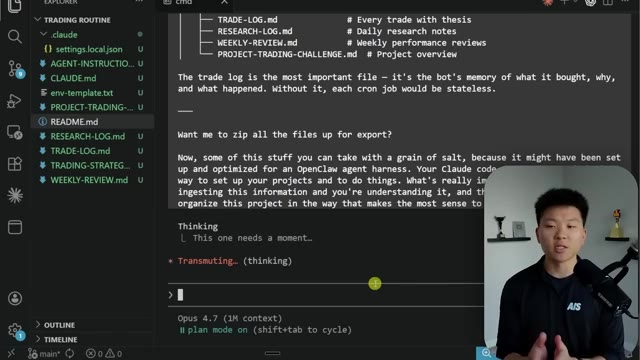
*⏱️ 00:15:03 — Interface VS Code affichant un fichier Markdown de documentation de projet de trading avec une fenêtre de terminal "Opus 4.7" active en bas.*

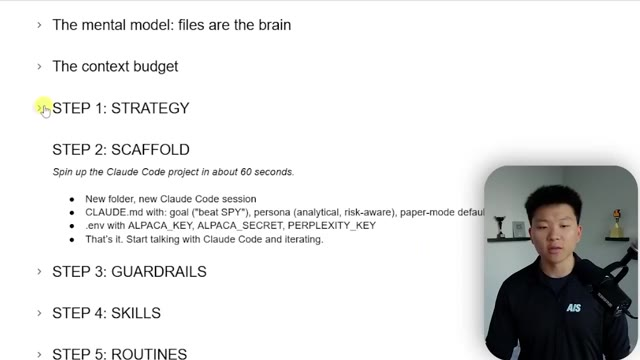
*⏱️ 00:15:09 — Une diapositive de présentation listant les étapes de création d'un agent IA, incluant "STEP 1: STRATEGY" et "STEP 2: SCAFFOLD".*

---

### ⏱️ `[00:15:20 - 00:15:53]` | Segment #38

**🔊 Audio (Transcription Intégrale Mot pour Mot en Français) :**
> Once you write down all this stuff and you basically just brain dump about how you want to do it Then you plug it into the cloud code and that's where you see how I set up this project here I'm just helping it get situated with what we want to do right now And honestly the more context and details that you give it right now The more it asks you questions the better as you can see i'm using the brainstorming skill from superpowers And it's going to start off by asking me some questions Okay, so I just answered some questions and I did want to show you guys this so it alerted me about something with security Inside of this template that open claw gave me it had my live alpaca key in there

**👁️ Analyse Visuelle d'Écran (gemini-3.5-flash-lite) :**
**Interface & Outils** : VS Code avec terminal intégré (Claude Code / Opus 4.7).

**Contenu textuel & Code** : Arborescence du projet "TRADING ROUTINE" à gauche (fichiers .md, .txt) ; dans le terminal, on voit l'historique de l'interaction avec l'IA, notamment l'utilisation du "brainstorming skill" et l'analyse de fichiers du répertoire courant.

**Action / Démonstration** : L'agent IA analyse le contexte du projet "Trading Routine", charge ses compétences (skill) et effectue une recherche de fichiers pour organiser le workflow.

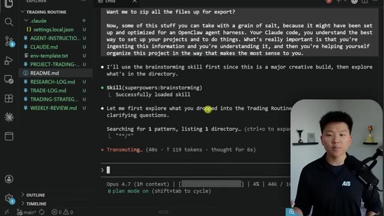
*⏱️ 00:15:28 — Capture d'écran de l'interface VS Code affichant l'exécution de Claude Code (Opus 4.7) dans un terminal intégré, avec le présentateur en médaillon dans le coin inférieur droit.*

---

### ⏱️ `[00:15:53 - 00:16:26]` | Segment #39

**🔊 Audio (Transcription Intégrale Mot pour Mot en Français) :**
> So i'm gonna go ahead and rotate those before we actually push this new one into production but just something to be thinking about when you're migrating stuff or when you're feeding in API keys directly to a chat. Just be careful of that kind of stuff. And I'm going to show you how we get our API keys set up in routines because you don't want to put them straight into a GitHub repo. You're going to have to set them up in the environment variable. So I will show you guys that as well. Okay. So at this point, it's come back with a plan. So Nate ran a live money opaca trading bot called Bull on the open claw harness for 30 days. And now we have all these context files with strategy, with trade history, with research notes, blah, blah, blah. The goal of

**👁️ Analyse Visuelle d'Écran (gemini-3.5-flash-lite) :**
**Interface & Outils** : Visual Studio Code (VS Code) avec l'extension terminal Claude Code (Opus 4.7).

**Contenu textuel & Code** : Texte de dialogue entre l'utilisateur et l'agent, logs de réflexion de l'IA (Unravelling), et résumé du plan de projet incluant la liste des fichiers de contexte (.md) et la mention du problème de sécurité.

**Action / Démonstration** : Analyse et planification par l'agent IA pour une migration de projet, avec signalement explicite d'une vulnérabilité (clés API exposées) nécessitant une rotation.

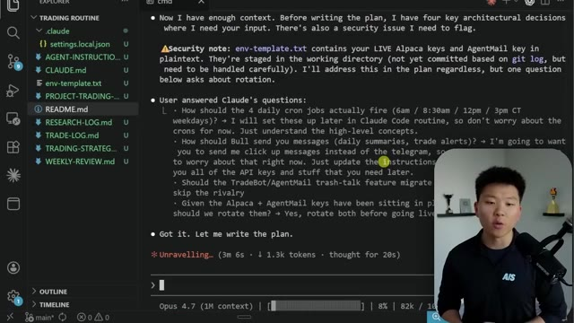
*⏱️ 00:16:01 — Interface VS Code affichant un échange avec l'agent Claude Code, mettant en évidence une alerte de sécurité concernant des clés API Alpaca et AgentMail présentes en texte clair dans le fichier 'env-template.txt'.*

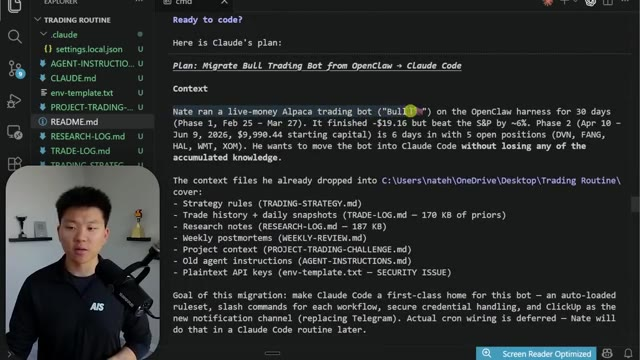
*⏱️ 00:16:18 — Interface VS Code affichant le plan de migration détaillé par Claude Code pour transférer le bot de trading "Bull" depuis OpenClaw vers Claude Code, incluant la gestion des fichiers de contexte et la résolution du problème de sécurité des clés API.*

---

### ⏱️ `[00:16:26 - 00:16:58]` | Segment #40

**🔊 Audio (Transcription Intégrale Mot pour Mot en Français) :**
> this migration is to make Cloud Code a first class home for this bot. So we will set up the cron scheduling, the notifications. We're getting rid of that agent mail step. So me and Salman, we're having our agents trash talk each other. We're going to rotate our credentials, of course. And then it's proposing a layout for the way that the file should be set up. So you can see it's going to put the files in here into the memory. And then we're going to be able to prompt our routines to always check the memory first and update the memory. So this is where it will really help for you guys to brainstorm with how the project should be set up. Oh, one other thing that I forgot to give it here is that I want it to use perplexity for research. So I'm going to

**👁️ Analyse Visuelle d'Écran (gemini-3.5-flash-lite) :**
**Interface & Outils** : VS Code (Visual Studio Code).

**Contenu textuel & Code** : Document Markdown structuré : "User-Confirmed Scope Decisions" (tableau des décisions techniques) et "Target File Layout" (arborescence du projet). Le volet latéral affiche les fichiers du projet "TRADING ROUTINE" (CLAUDE.md, .env-template.txt, etc.).

**Action / Démonstration** : Présentation du plan de migration technique et de la restructuration du dépôt pour intégrer les nouvelles configurations de l'agent.

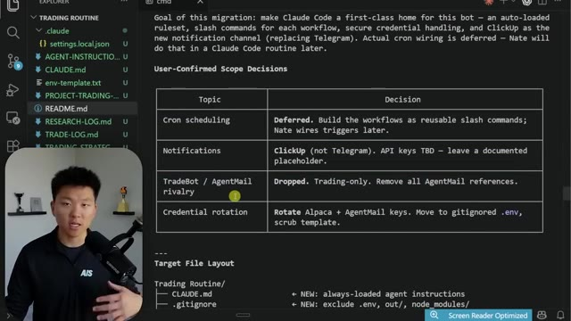
*⏱️ 00:16:34 — Une capture d'écran de l'éditeur VS Code montrant un fichier README.md qui détaille les décisions de migration du projet (planning Cron, notifications ClickUp, suppression de l'AgentMail, rotation des clés).*

---

### ⏱️ `[00:16:58 - 00:17:23]` | Segment #41

**🔊 Audio (Transcription Intégrale Mot pour Mot en Français) :**
> come down here to the bottom of the plan and I'm going to say, yeah, this all looks pretty much good to go. But one thing I forgot to tell you is that we want to use perplexity for research rather than just the native cloud code web search and web fetch function. So add in that perplexity will be used for web search. And once again, once we set up the routine, that's when I'll give you the perplexity API key. Okay. So after this change has been made, we should be ready to start migrating over to setting up the routines.

**👁️ Analyse Visuelle d'Écran (gemini-3.5-flash-lite) :**
**Interface & Outils** : VS Code (éditeur de code).

**Contenu textuel & Code** : Liste numérotée de points de vérification techniques (Alpaca wiring, Memory files, Slash commands, etc.) et options d'interaction avec l'IA (Yes/auto mode, manually approve, No/refine, ou feedback textuel).

**Action / Démonstration** : Le présentateur examine le plan d'exécution généré par l'IA dans l'éditeur avant de décider d'ajouter des instructions spécifiques (comme l'utilisation de Perplexity pour la recherche).

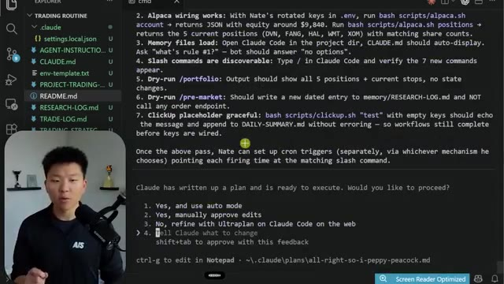
*⏱️ 00:17:04 — Interface VS Code affichant un plan d'exécution détaillé dans un fichier markdown et des options d'interaction avec Claude Code.*

---

### ⏱️ `[00:17:23 - 00:17:45]` | Segment #42

**🔊 Audio (Transcription Intégrale Mot pour Mot en Français) :**
> All right, so the new plan has come back. So here's the end-to-end check. Secrets, alpaca, memory files, slash commands, dry run, click up, perplexity, nice. We're gonna go ahead and accept these changes. And you also notice that we have auto mode on. So I think with this new update with Opus 4.7, when you auto accept a plan, it turns on auto mode, which means it lets Cloud handle permission prompts automatically.

**👁️ Analyse Visuelle d'Écran (gemini-3.5-flash-lite) :**
**Interface & Outils** : VS Code (éditeur de code).

**Contenu textuel & Code** : Une liste numérotée de 8 étapes de test incluant : vérification des secrets (Git), connexion Alpaca (bash scripts), chargement des fichiers mémoire, commandes slash, tests dry-run (portfolio, pre-market), gestion des erreurs pour ClickUp et Perplexity.

**Action / Démonstration** : Le présentateur passe en revue les étapes de validation du plan d'implémentation avant d'accepter les modifications proposées par l'agent IA.

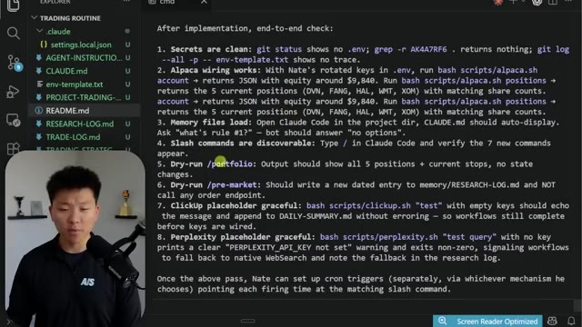
*⏱️ 00:17:29 — Une capture d'écran montrant l'interface VS Code avec une liste de vérification détaillée ("end-to-end check") pour un projet d'automatisation de trading, avec le présentateur en médaillon dans le coin inférieur gauche.*

---

### ⏱️ `[00:17:46 - 00:18:10]` | Segment #43

**🔊 Audio (Transcription Intégrale Mot pour Mot en Français) :**
> Now you will have to be careful though, because doing this is a little bit more expensive. So if you don't want it to be auto mode, then you can just switch it right off of auto mode, of course. But yeah, just something I wanted to point out. All right. So while all of that's still getting set up, let's talk about step three, which is guardrails. So before you start working in the trading logic, think about this kind of stuff. I obviously talked about how you could start with paper mode and then you toggle on real trading and put in money when you feel comfortable.

**👁️ Analyse Visuelle d'Écran (gemini-3.5-flash-lite) :**
**Interface & Outils** : VS Code avec terminal intégré (Claude Code).

**Contenu textuel & Code** : - Image 1 : Commande shell de recherche de clés API dans l'historique Git et prompt de confirmation "Do you want to proceed? (Yes/No)".
- Image 2 : Liste de consignes pour l'agent (Paper mode, limite de 5% par position, perte maximale de 2%, instructions de contrôle).

**Action / Démonstration** : Validation interactive d'une commande système sensible par l'agent et présentation des bonnes pratiques de configuration sécurisée pour un agent de trading.

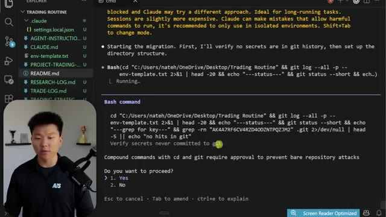
*⏱️ 00:17:52 — Interface de VS Code montrant l'exécution d'une commande Bash par l'agent Claude, demandant une confirmation de l'utilisateur pour vérifier l'absence de secrets dans l'historique Git.*

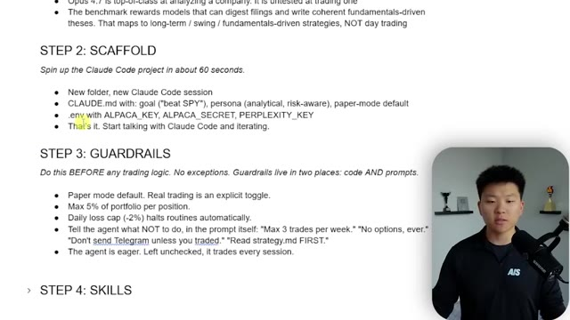
*⏱️ 00:17:58 — Document Markdown affiché à l'écran détaillant les étapes de configuration d'un projet "Claude Code", incluant la gestion des variables d'environnement et la mise en place de garde-fous (guardrails).*

---

### ⏱️ `[00:18:10 - 00:18:32]` | Segment #44

**🔊 Audio (Transcription Intégrale Mot pour Mot en Français) :**
> You could do things like, hey, max 5% of my portfolio per position. You could have a daily loss cap. You could tell the agent what not to do, like only buy three new positions per week or no options ever, or don't do this, or always do this, because the agent is gonna be autonomous. It's gonna be eager. And if you don't give it guardrails, it might just kind of start to go off the rails. But like I said, even though I'm migrating a system over, I know it's not gonna be perfect.

**👁️ Analyse Visuelle d'Écran (gemini-3.5-flash-lite) :**
**Interface & Outils** : Application de prise de notes ou éditeur de document (type Notion ou Obsidian).

**Contenu textuel & Code** : Liste des étapes : "STEP 2: SCAFFOLD" (configuration du projet Claude Code, clés API) et "STEP 3: GUARDRAILS" (règles de gestion des risques comme la limite de 5% par position, plafond de perte quotidien de 2%, et restrictions sur le volume de transactions).

**Action / Démonstration** : Le présentateur explique les bonnes pratiques de mise en place de garde-fous pour un agent de trading autonome afin de limiter les risques financiers.

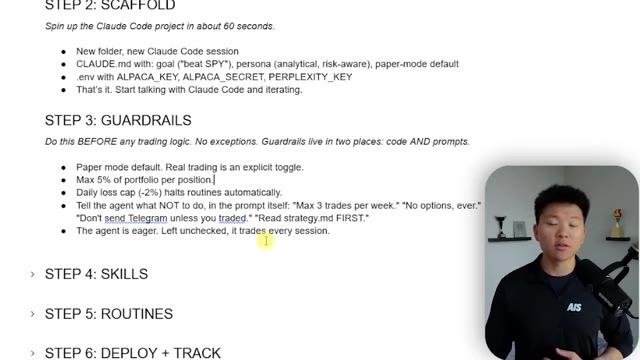
*⏱️ 00:18:16 — Une présentation sous forme de liste à puces structurée sur écran, détaillant les étapes "SCAFFOLD" et "GUARDRAILS" pour la configuration d'un agent de trading IA, avec le présentateur visible en médaillon dans le coin inférieur droit.*

---

### ⏱️ `[00:18:32 - 00:19:05]` | Segment #45

**🔊 Audio (Transcription Intégrale Mot pour Mot en Français) :**
> So I'm gonna watch every single run, and I'm gonna read through the conversation history of every run. And I'm gonna see if there's things that I needed to tweak in the prompt or things that I needed to tweak in the project settings or the context files. And like I said, just kind of keep building the plane as we're flying it here. And then that's where we also start to develop skills. Because right now we have skills maybe for like a research skill or for a trade skill, but we're going to make sure that we're getting them actually explicitly invoked. And we're going to be making sure that that increases the consistency. And we're going to make sure that the agent is able to give us insights every day of, hey, here's what worked well. And here's what

**👁️ Analyse Visuelle d'Écran (gemini-3.5-flash-lite) :**
**Interface & Outils** : Présentation ou face-caméra explicatif sans interface logicielle partagée.

**Contenu textuel & Code** : Explications orales et mise en contexte méthodologique.

**Action / Démonstration** : Explications face caméra et démonstration conceptuelle.

---

### ⏱️ `[00:19:05 - 00:19:27]` | Segment #46

**🔊 Audio (Transcription Intégrale Mot pour Mot en Français) :**
> I noticed. And hey, here's where I think that maybe we should update these skills, X, Y, and Z, you know, whatever. So a combination of thinking about the guardrails and thinking about skills is how you can continuously make this thing better over time. And now that we've talked about all that. We will get to the routines and the deployment. Let's check in on our guy right here. And because I turned it off auto mode, it was sitting and waiting for me to do a permission.

**👁️ Analyse Visuelle d'Écran (gemini-3.5-flash-lite) :**
**Interface & Outils** : VS Code (Visual Studio Code).

**Contenu textuel & Code** : Scripts Bash pour tester l'intégration avec ClickUp, Perplexity et Alpaca : `cd "C:/Users/nateh/OneDrive/Desktop/Trading Routine" && bash scripts/clickup.sh ...`, ainsi qu'un menu interactif pour valider l'exécution des tests.

**Action / Démonstration** : Exécution d'une série de tests de scripts "fallback" pour vérifier le comportement de l'agent en l'absence de clés API configurées, avec une demande de confirmation utilisateur.

*⏱️ 00:19:22 — Interface de l'éditeur VS Code affichant un terminal en cours d'exécution avec une séquence de commandes Bash pour tester les "fallbacks" des scripts de trading.*

---

### ⏱️ `[00:19:28 - 00:20:02]` | Segment #47

**🔊 Audio (Transcription Intégrale Mot pour Mot en Français) :**
> All right. So everything has been migrated. We're looking good, but we're getting a little bit to the point where I like to reset the context. So before we move on, I'm going to say, hey, give me a summary of what we've done. And then I'm going to clear the context and we'll get started again. All right. So here's the session summary that it gave me. Copy that, do a slash clear, paste that in, hit enter. And now we're basically right back at the beginning with a fresh window of context. So this is where it gets pretty cool. You can see on the left-hand side, it has reorganized things. We have our scripts, we have our memory files, we even have some commands in here. And it built all of that just because I told it that I was trying to migrate stuff over.

**👁️ Analyse Visuelle d'Écran (gemini-3.5-flash-lite) :**
**Interface & Outils** : Éditeur de code (VS Code) avec une fenêtre de terminal/interface intégrée pour un agent IA (Opus 4.7).

**Contenu textuel & Code** : Documentation technique, instructions de déploiement, état des variables d'environnement, suivi du portfolio (positions ouvertes : DVN, FANG, HAL, WMT, XOM) et logs de contexte de l'agent.

**Action / Démonstration** : Revue du projet avant la réinitialisation du contexte de l'agent ("reset the context") pour entamer une nouvelle étape du workflow de trading.

*⏱️ 00:19:36 — Interface VS Code affichant un fichier Markdown listant des instructions de vérification pour des scripts d'automatisation (clickup, perplexity, alpaca).*

*⏱️ 00:19:54 — Interface VS Code affichant un récapitulatif de l'état du projet "Trading Routine" incluant le profil de l'utilisateur, l'état du portfolio et le plan de travail actuel.*

---

### ⏱️ `[00:20:03 - 00:20:33]` | Segment #48

**🔊 Audio (Transcription Intégrale Mot pour Mot en Français) :**
> It also updated this Claude.md file because now we have Bull back in all of his glory. And we have our Claude.md file that is about 156 lines. So now it's time to start planning out step five, which is the routines. So we basically need to figure out what are the different daily triggers that we actually want. And we also don't maybe want them every day because the market's only open five days a week. So this is kind of like a baseline. This is kind of how it worked with my bull trading agent, but I'm actually just going to come into VS code and we're just going to brainstorm once again. So I'm going to go on plan mode and I'm just going to start asking.

**👁️ Analyse Visuelle d'Écran (gemini-3.5-flash-lite) :**
**Interface & Outils** : VS Code (Éditeur de code), Document Markdown / Éditeur de texte.

**Contenu textuel & Code** : - Image 1 : Tableau markdown "What to Write Where" (Morning research, EOD snapshot, Friday recap, New rule learned) et règle de sécurité pour le trading.
- Image 2 : Liste des routines quotidiennes horodatées (7:00 AM, 8:30 AM, 11:00 AM, 3:30 PM CT) et mention de l'étape "STEP 6: DEPLOY + TRACK".

**Action / Démonstration** : Le présentateur explique la structure de son fichier de configuration système et la planification temporelle des routines de son agent d'automatisation de trading.

*⏱️ 00:20:10 — Vue de l'éditeur VS Code montrant le fichier 'CLAUDE.md' avec les instructions système pour l'agent de trading "Bull", incluant un tableau récapitulatif des logs de recherche, de trading et de révision.*

*⏱️ 00:20:18 — Vue d'un document texte listant les étapes du workflow, avec un focus sur "STEP 5: ROUTINES" détaillant le calendrier des triggers quotidiens (Pre-market, Market open, Midday, EOD).*

---

### ⏱️ `[00:20:34 - 00:21:08]` | Segment #49

**🔊 Audio (Transcription Intégrale Mot pour Mot en Français) :**
> All right. So now that you know everything about this project and you understand what we did with open claw, I want you to help me figure out what is the best way that we should be setting up these cloud code routines to basically simulate that exact same type of environment. So we have those cron jobs, but each one is kind of doing a bit of a different thing. You know, the pre-market one does a bit of a different job than the mid-market one, and the day close one does a bit of a different job. So you have a better idea of all of our memory files and our skills, and you understand the structure of every time the agent wakes up and the routine is triggered, they need

**👁️ Analyse Visuelle d'Écran (gemini-3.5-flash-lite) :**
**Interface & Outils** : VS Code (avec extension de terminal intégrée).

**Contenu textuel & Code** : Le fichier affiché (CLAUDES.md) détaille les préférences utilisateur (profil, outils préférés comme ClickUp et Perplexity) et le statut de la "Phase 2" du projet de trading (portefeuille, positions ouvertes, stops suiveurs). En bas, l'interface du terminal affiche "Opus 4.7 (1M context)" et le mode "plan mode on".

**Action / Démonstration** : Visualisation du contexte et de l'état actuel du bot de trading au sein de l'environnement de développement.

*⏱️ 00:20:42 — Une capture d'écran montrant l'interface VS Code avec le présentateur en incrustation à gauche, affichant un résumé de l'état d'un projet de bot de trading et les détails d'exécution de l'agent Opus 4.7.*

---

### ⏱️ `[00:21:08 - 00:21:42]` | Segment #50

**🔊 Audio (Transcription Intégrale Mot pour Mot en Français) :**
> to read the files first to, you know, kind of get acclimated with the environment, do what they need to do, research, potentially make a trade, potentially sell something, you know, whatever it is based on their best judgment, and then update all of the memory files so that next time the next agent wakes up, they understand what's going on. So what I want you to do is help me figure out what are the right structure for these cron jobs. And most likely we only want them during the week when the market's actually open. And just like that, I'm able to brain dump and Claude's going to do the heavy lifting for me and propose some ideas. Okay, let's see the plan that it came up

**👁️ Analyse Visuelle d'Écran (gemini-3.5-flash-lite) :**
**Interface & Outils** : VS Code avec interface intégrée Opus 4.7 (CLI).

**Contenu textuel & Code** : Le fichier Markdown contient des détails sur le profil utilisateur, la phase actuelle du projet (Phase 2), l'état du portfolio (~$9,840), les positions ouvertes (DVN, FANG, HAL, WMT, XOM) et le chemin d'accès au fichier de plan. En bas, la console indique "Opus 4.7 (1M context)" et "plan mode on".

**Action / Démonstration** : Le système affiche les données de mémoire persistantes de l'agent, montrant le statut actuel des opérations de trading et la configuration de l'environnement de l'agent.

*⏱️ 00:21:16 — L'éditeur VS Code affichant un fichier Markdown de documentation de projet ("CLAUDE.md") décrivant l'état d'un agent de trading IA, avec le présentateur en incrustation à gauche.*

---

### ⏱️ `[00:21:42 - 00:22:00]` | Segment #51

**🔊 Audio (Transcription Intégrale Mot pour Mot en Français) :**
> with. So stand up five recurring clog code scheduled triggers. And we've got these different slash commands that it's going to be able to utilize. So all five triggers will run on the weekdays only except for the weekly review, which is Friday only. So we have a pre-market, which is for research catalysts and draft trade ideas. It won't message me unless it's urgent.

**👁️ Analyse Visuelle d'Écran (gemini-3.5-flash-lite) :**
**Interface & Outils** : Visual Studio Code (VS Code).

**Contenu textuel & Code** : Fichier Markdown expliquant la logique des 5 triggers récurrents : /pre-market, /market-open, /midday, /daily-summary et /weekly-review, incluant leurs interactions avec les fichiers TRADING-STRATEGY.md, TRADE-LOG.md et RESEARCH-LOG.md.

**Action / Démonstration** : Présentation de la documentation technique et de la structure des processus automatisés pour l'agent IA (Claude Code).

*⏱️ 00:21:46 — Capture d'écran montrant l'interface de VS Code avec un fichier Markdown ouvert détaillant l'automatisation des commandes slash pour des tâches de trading.*

---

### ⏱️ `[00:22:00 - 00:22:21]` | Segment #52

**🔊 Audio (Transcription Intégrale Mot pour Mot en Français) :**
> We have a market open, which is going to execute the planned trades and set 10% trailing stops. that'll go to the trade log. Only if a trade is placed will I get a notification. We have midday, which will cut minus 7% losers and tighten stops on winners. Also go into trade log. So here you guys can see, basically it was able to analyze our strategy and analyze what we have access to and then build me a plan.

**👁️ Analyse Visuelle d'Écran (gemini-3.5-flash-lite) :**
**Interface & Outils** : Visual Studio Code (éditeur de texte/Markdown).

**Contenu textuel & Code** : Tableau structuré présentant les commandes slash (ex: /pre-market, /market-open, /midday), les expressions cron, les descriptions des tâches automatiques, les fichiers de logs associés et les règles de notification.

**Action / Démonstration** : Le présentateur explique le fonctionnement des automatisations de son système de trading en pointant les lignes du tableau correspondant aux segments "market-open" et "midday".

*⏱️ 00:22:06 — Tableau récapitulatif dans VS Code listant les commandes automatisées (cron jobs) pour la routine de trading, avec leurs déclencheurs, objectifs et destinations de logs.*

---

### ⏱️ `[00:22:22 - 00:22:44]` | Segment #53

**🔊 Audio (Transcription Intégrale Mot pour Mot en Français) :**
> And now what I wanna do is basically just have it create those prompts for me so that I can go ahead and go set up those routines in Cloud Code. All right, so those crons look great. So I don't need you to actually create them. What I need you to create for me is the prompts. as if I was going to run one of those commands into a fresh cloud code session and I wanted it to do all the right stuff, what is the exact prompt that I would enter into that session?

**👁️ Analyse Visuelle d'Écran (gemini-3.5-flash-lite) :**
**Interface & Outils** : Visual Studio Code (VS Code).

**Contenu textuel & Code** : Tableau de planification (cron expressions, commandes comme /midday, /daily-summary, /weekly-review), explications sur les fuseaux horaires (America/Chicago, DST) et directives pour les prompts des triggers.

**Action / Démonstration** : Le présentateur passe en revue la configuration des tâches automatisées pour expliquer la logique métier derrière les déclencheurs de routine de trading avant de passer à la création des prompts associés.

*⏱️ 00:22:27 — L'écran montre un éditeur de code VS Code avec un tableau récapitulatif des tâches "cron" et une section expliquant la logique des expressions temporelles pour l'automatisation de routines de trading.*

---

### ⏱️ `[00:22:45 - 00:23:04]` | Segment #54

**🔊 Audio (Transcription Intégrale Mot pour Mot en Français) :**
> And the one thing that you need to keep in mind here is reminding it to obviously read the files before it does anything and update the files at the end. And then also when it needs to use an API like Perplexity or ClickUp or Alpaca, that it should be grabbing those keys from the environment variables of that environment, not inside a .env file.

**👁️ Analyse Visuelle d'Écran (gemini-3.5-flash-lite) :**
**Interface & Outils** : VS Code (avec le panneau latéral d'exploration de fichiers et un terminal intégré).

**Contenu textuel & Code** : Un calendrier de tâches (6 AM, 8:30 AM, 12 PM, 3 PM) liées à `RESEARCH-LOG.md`, `TRADE-LOG.md` et ClickUp. Le texte mentionne explicitement la nécessité de renseigner les clés API dans le fichier `.env` (`ALPACA_API_KEY`, `PERPLEXITY_API_KEY`, etc.) et propose des options d'approbation pour l'exécution du plan par Claude.

**Action / Démonstration** : L'utilisateur visualise un plan généré par l'agent et est invité à choisir entre l'exécution automatique, la validation manuelle ou la modification du plan avant de poursuivre.

*⏱️ 00:22:50 — Interface VS Code affichant un plan d'exécution détaillé pour un agent IA, avec une liste de tâches de trading automatisées et une invite de commande interactive.*

---

### ⏱️ `[00:23:05 - 00:23:27]` | Segment #55

**🔊 Audio (Transcription Intégrale Mot pour Mot en Français) :**
> All right, and now with that feedback, it should be able to give us those prompts, and then we should be able to just set up the routines and go ahead and test them out. Okay, so while this is writing up, there is one more thing that I wanted to show you guys that is very important. So in the Cloud Code desktop app, when you go to routines and you go to create a new one, you can see that you can create them locally or remote. So if you create them locally, like some of these I have, this just basically means that it lives in your local directory.

**👁️ Analyse Visuelle d'Écran (gemini-3.5-flash-lite) :**
**Interface & Outils** : VS Code (avec extension de terminal IA) et interface utilisateur d'application d'automatisation IA (type Cursor/Opus).

**Contenu textuel & Code** : Dans l'image 1 : logs de réflexion de l'agent, mentions de "memory-priming", de "CronCreate pattern" et de fichiers projet (.claude, .env). Dans l'image 2 : liste de sessions ("Notification responses", "AI news roundup") et barre de saisie de tâches IA.

**Action / Démonstration** : L'agent exécute des commandes, conçoit un plan de travail et met à jour des fichiers de configuration, tandis que le présentateur navigue dans l'historique des sessions.

*⏱️ 00:23:10 — Interface de terminal intégrée à VS Code montrant un agent IA (Opus 4.7) en train de générer un plan technique et d'analyser des fichiers de mémoire.*

*⏱️ 00:23:16 — Interface principale de l'application (probablement Cursor ou une interface similaire) affichant l'écran d'accueil avec l'historique des sessions et des automatisations planifiées.*

---

### ⏱️ `[00:23:27 - 00:23:53]` | Segment #56

**🔊 Audio (Transcription Intégrale Mot pour Mot en Français) :**
> It can still talk to the internet and do all those things, but it lives in your machine, essentially. and that means if you closed out of this desktop app, that local routine would not fire off. And that's why these remote routines are so cool because your computer can be off, but they're still running because they run in the cloud. But what that means is when you do a remote run, you have to have a GitHub repository to have this run in, which is why I have this trading routine repo set up.

**👁️ Analyse Visuelle d'Écran (gemini-3.5-flash-lite) :**
**Interface & Outils** : Application de gestion de routines (UI personnalisée sombre).

**Contenu textuel & Code** : Liste des routines : "Skool wins engagement", "AI news roundup", "Notification responses", "Youtube comment replies", "Trade Test", "Testing Skool Wins", "Testing YT Comments", "Testing ClickUp API" avec indicateurs de statut (Local/Remote) et fréquence d'exécution.

**Action / Démonstration** : Visualisation de la distinction entre les routines "Local" (nécessitant l'ordinateur allumé) et "Remote" (exécutées dans le cloud).

*⏱️ 00:23:34 — Interface utilisateur d'une application de gestion de routines automatisées affichant une liste de tâches locales et distantes, avec le présentateur en médaillon.*

---

### ⏱️ `[00:23:53 - 00:24:22]` | Segment #57

**🔊 Audio (Transcription Intégrale Mot pour Mot en Français) :**
> And so when they run via a cloud routine, it basically clones that repo in the cloud. It spins up a copy. it works out of it, it does what it needs to do. And then it basically like destroys that cloud environment. So if you want them to run remotely and you want those files to persist every session, you just have to talk to cloud code and say, hey, make sure, you know, because we're doing a routine, make sure that all of these files that it's actually updating, it's able to push back and commit back to that main actual branch, back to that main.

**👁️ Analyse Visuelle d'Écran (gemini-3.5-flash-lite) :**
**Interface & Outils** : Présentation ou face-caméra explicatif sans interface logicielle partagée.

**Contenu textuel & Code** : Explications orales et mise en contexte méthodologique.

**Action / Démonstration** : Explications face caméra et démonstration conceptuelle.

---

### ⏱️ `[00:24:22 - 00:24:43]` | Segment #58

**🔊 Audio (Transcription Intégrale Mot pour Mot en Français) :**
> And we just got a notification from my trading bot because it was market close. But anyways, I was saying, make sure that it's able to push those changes back to the main repo. Otherwise, the next agent's not going to pick it up. And then what's even the point? So you can start local if you want, and then you can sort of graduate to the cloud if you want. But I definitely just wanted to make sure you guys understood that difference there.

**👁️ Analyse Visuelle d'Écran (gemini-3.5-flash-lite) :**
**Interface & Outils** : Interface web de plateforme d'automatisation d'agents IA (type "Claude" ou équivalent).

**Contenu textuel & Code** : Champs de formulaire pour le "Name" (e.g., Daily code review), zone de description de la tâche, sélecteur de modèle ("Opus 4.7 Adaptive"), option "Select a repository" et choix du fournisseur cloud ("Nate Herk Cloud").

**Action / Démonstration** : Configuration des paramètres d'exécution pour une routine automatisée d'un agent.

*⏱️ 00:24:27 — Interface de configuration d'un agent IA avec un champ de saisie pour définir une routine, incluant une option pour sélectionner un répertoire GitHub (Repository) et le modèle utilisé (Opus 4.7 Adaptive).*

---

### ⏱️ `[00:24:44 - 00:25:02]` | Segment #59

**🔊 Audio (Transcription Intégrale Mot pour Mot en Français) :**
> Okay, so that's done. You can see it created this new folder right here called routines. And this is basically the prompt that we'd be feeding into each of the different routines that we make in order to make sure that Bull actually understands what to do. And the last thing we need to do is actually push all of these new changes to this GitHub repo, because right now here's my trading routine private repo.

**👁️ Analyse Visuelle d'Écran (gemini-3.5-flash-lite) :**
**Interface & Outils** : VS Code (Image 1) et GitHub (Image 2).

**Contenu textuel & Code** : Code Markdown définissant un prompt système pour un bot de trading nommé "Bull" (Image 1) et structure du dépôt GitHub (Image 2).

**Action / Démonstration** : Présentation de la configuration des routines de l'agent IA et de l'initialisation du dépôt de code sur GitHub.

*⏱️ 00:24:48 — L'éditeur VS Code affichant le fichier "daily-summary.md" situé dans le dossier "routines", contenant le prompt système pour l'agent de trading "Bull".*

*⏱️ 00:24:58 — L'interface web de GitHub montrant le dépôt "trading-routine" nouvellement créé par l'utilisateur "nateherkai".*

---

### ⏱️ `[00:25:02 - 00:25:21]` | Segment #60

**🔊 Audio (Transcription Intégrale Mot pour Mot en Français) :**
> All that's in there is a readme and I don't think there's anything in here. So we need to get all of these files that we just created, you know, these commands, these scripts, these memory files. We just have to get all of this into that repo so that our routine can actually access it. So all I have to do is say, hey, push all of these changes, commit everything to the repo. By the way, if you've never done that before, it's super, super simple.

**👁️ Analyse Visuelle d'Écran (gemini-3.5-flash-lite) :**
**Interface & Outils** : Visual Studio Code (VS Code) avec extension Claude/Opus.

**Contenu textuel & Code** : Arborescence du projet visible (dossiers .claude, commands, memory, routines, scripts). Le fichier ouvert contient une documentation sur la configuration des "branch protections" et les permissions de push pour Claude, avec des notes importantes sur les routines.

**Action / Démonstration** : Le présentateur explique la nécessité de pousser les fichiers locaux (scripts, commandes, mémoires) vers le dépôt distant pour que les routines puissent y accéder.

*⏱️ 00:25:07 — L'éditeur VS Code affichant l'arborescence du projet dans la barre latérale gauche et un fichier Markdown de documentation ouvert dans la zone principale, avec une fenêtre d'interaction terminal (Opus 4.7) en bas.*

---

### ⏱️ `[00:25:21 - 00:25:43]` | Segment #61

**🔊 Audio (Transcription Intégrale Mot pour Mot en Français) :**
> You go to github.com, create an account. It's free to create an account. And GitHub is really just like, it's like working on a Microsoft Word on your computer. And that's like local. And if you wanted to share it with someone, you would have to put it into like the shared drive or, you know, a Google drive or something. It just means that you could grab a code base from a different machine because you've uploaded it somewhere on the cloud.

**👁️ Analyse Visuelle d'Écran (gemini-3.5-flash-lite) :**
**Interface & Outils** : Site web GitHub (page des paramètres du profil utilisateur).

**Contenu textuel & Code** : Champs de formulaire pour le nom ("Nate Herk"), l'email public, la biographie et les pronoms.

**Action / Démonstration** : Navigation dans l'interface utilisateur de configuration de compte GitHub.

*⏱️ 00:25:26 — Capture d'écran montrant la page des paramètres du profil public sur GitHub pour l'utilisateur "nateherkai", avec le présentateur incrusté en bas à droite.*

---

### ⏱️ `[00:25:43 - 00:26:04]` | Segment #62

**🔊 Audio (Transcription Intégrale Mot pour Mot en Français) :**
> So that's kind of why we're doing this whole thing with the routines in the cloud. So when you get to GitHub, you come here, you create a new repository or the easiest way to do it is you just come to your cloud code and you say, hey, help me turn this into a GitHub repo. And it will say, okay, I need to authenticate you. Can I use the CLI? and you say, yes, go ahead and do that. And then it will basically open up a tab and it will say, hey, can you sign in with your GitHub?

**👁️ Analyse Visuelle d'Écran (gemini-3.5-flash-lite) :**
**Interface & Outils** : GitHub (Web), Visual Studio Code, extension Claude Code.

**Contenu textuel & Code** : GitHub : options "New repository", "New codespace". VS Code : explorateur de fichiers contenant des dossiers comme `.claude`, `routines`, `scripts` et des fichiers de configuration (`.env`, `settings.local.json`).

**Action / Démonstration** : Navigation dans les menus de GitHub pour créer un nouveau dépôt ; démonstration de l'environnement de développement dans VS Code pour gérer des routines automatisées.

*⏱️ 00:25:48 — Vue de l'interface des paramètres du profil public sur GitHub avec le menu déroulant "New" ouvert dans la barre de navigation supérieure.*

*⏱️ 00:25:54 — Capture de l'éditeur Visual Studio Code affichant l'extension "Claude Code" avec une structure de fichiers orientée "Trading Routine".*

---

### ⏱️ `[00:26:04 - 00:26:27]` | Segment #63

**🔊 Audio (Transcription Intégrale Mot pour Mot en Français) :**
> You sign in and now your Cloud Code just has your GitHub credentials. And whenever you need to push changes or clone a repo or whatever you need to do with GitHub, it can just take care of it because GitHub has been around for a long time. So it knows it way better than you probably do. It knows it way better than I do. So when in doubt, just ask Cloud Code. All right, so if I give this puppy a refresh, we should say we now have all of these files popped in here.

**👁️ Analyse Visuelle d'Écran (gemini-3.5-flash-lite) :**
**Interface & Outils** : Visual Studio Code (VS Code)

**Contenu textuel & Code** : Arborescence de fichiers d'un projet "TRADING ROUTINE" (dossiers .claude, routines, scripts) et barre de commande "Ctrl esc to focus or unfocus Claude".

**Action / Démonstration** : L'utilisateur présente l'environnement de développement configuré avec l'outil Claude Code intégré au sein de l'éditeur VS Code.

*⏱️ 00:26:10 — Capture d'écran de l'interface VS Code avec une extension ou un onglet dédié nommé "Claude Code" ouvert, affichant une zone de saisie pour interagir avec l'IA.*

---

### ⏱️ `[00:26:27 - 00:26:45]` | Segment #64

**🔊 Audio (Transcription Intégrale Mot pour Mot en Français) :**
> We've got bold trading routine. Awesome. So let's head over to the Cloud Desktop app now and start getting set up. So what you're gonna do is you're gonna click on new session and you want to open up the local projects right here of whichever thing you just set up there. So right here, you can see that I'm in the folder called trading routine, which we were just working in in VS Code.

**👁️ Analyse Visuelle d'Écran (gemini-3.5-flash-lite) :**
**Interface & Outils** : Interface de l'application Cloud Desktop (environnement de gestion d'automatisations).

**Contenu textuel & Code** : Liste de routines affichées : "Skool wins engagement", "AI news roundup", "Notification responses", "Youtube comment replies", "Trade Test", "Testing Skool Wins", "Testing YT Comments", et "Testing ClickUp API".

**Action / Démonstration** : Le curseur de la souris survole la liste des routines, illustrant la navigation dans les projets locaux configurés pour l'automatisation.

*⏱️ 00:26:32 — L'interface principale de l'application de bureau montrant la section "Routines" avec une liste de processus automatisés programmés et le présentateur dans une vignette en bas à droite.*

---

### ⏱️ `[00:26:46 - 00:27:05]` | Segment #65

**🔊 Audio (Transcription Intégrale Mot pour Mot en Français) :**
> And if you guys remember in VS Code, we had these five different routine prompts. And inside of each of these, they had the cron, they had the actual like steps, and then they had like any of the skills or commands that they need to run. And this is in a folder once again called routines. So before we start talking to our new project, we need to set up an actual environment for this.

**👁️ Analyse Visuelle d'Écran (gemini-3.5-flash-lite) :**
**Interface & Outils** : VS Code (Image 1) et interface web/application de gestion de workflows automatisés (Image 2).

**Contenu textuel & Code** : Configuration Cron (`0 15 * * 1-5`), instructions de prompt système pour un bot de trading (Alpaca), et liste de routines comme "Skool wins engagement", "AI news roundup" et "Youtube comment replies".

**Action / Démonstration** : Présentation de la structure des dossiers et fichiers de configuration pour les routines automatisées dans VS Code, suivie d'une vue d'ensemble du panneau de contrôle des routines.

*⏱️ 00:26:50 — L'éditeur VS Code affichant le fichier "daily-summary.md" situé dans le dossier "routines", avec une configuration cron et des instructions de prompt pour un bot de trading autonome.*

*⏱️ 00:27:00 — Interface logicielle listant diverses "Routines" automatisées avec leurs horaires, types (Local/Remote) et statuts (Paused), illustrant le système de gestion des tâches du présentateur.*

---

### ⏱️ `[00:27:05 - 00:27:26]` | Segment #66

**🔊 Audio (Transcription Intégrale Mot pour Mot en Français) :**
> So if I go to new routine and I go to remote and I go over here to my cloud environments, you can see that you can add one. And so just add one and I'm gonna pull up my trading once you guys can see. But here, this is where we set up things like our API keys and our network access. So I called mine trading, I gave it full network access and this is where I'm gonna put in my API keys for Alpaca and for Perplexity and for ClickUp.

**👁️ Analyse Visuelle d'Écran (gemini-3.5-flash-lite) :**
**Interface & Outils** : Interface de gestion de routines/environnements pour un agent IA (probablement Claude Code).

**Contenu textuel & Code** : Champs de formulaire pour la gestion des variables d'environnement et un script de démarrage bash avec la commande "npm install".

**Action / Démonstration** : Navigation dans les menus de configuration d'environnements cloud pour la sélection et la modification des paramètres d'accès et d'initialisation.

*⏱️ 00:27:10 — Interface de configuration montrant un menu déroulant "Cloud environments" avec les options : Trading, Scheduled Automations, Nate Herk Cloud et Add environment.*

*⏱️ 00:27:15 — Fenêtre modale "Update cloud environment" permettant de configurer le nom ("Trading"), l'accès réseau ("Full"), des variables d'environnement (.env) et un script de configuration (bash).*

---

### ⏱️ `[00:27:27 - 00:27:49]` | Segment #67

**🔊 Audio (Transcription Intégrale Mot pour Mot en Français) :**
> And then you basically just go ahead and save the changes of that environment. And this is the one that you want your actual routines to be scheduled inside of. I am going to basically just talk to it right here to help us get these remote routines set up. Look inside the routines folder inside of this project and help me set up all of these different schedule routine runs.

**👁️ Analyse Visuelle d'Écran (gemini-3.5-flash-lite) :**
**Interface & Outils** : Application cloud/plateforme de développement type Claude Code ou environnement de gestion d'agents.

**Contenu textuel & Code** : Dans l'image 1 : "Name: Trading", "Network access: Full", "Setup script: #!/bin/bash npm install". Dans l'image 2 : "Welcome back, Nate", liste de sessions (Notification responses, AI news roundup).

**Action / Démonstration** : Configuration et mise à jour d'un environnement de travail cloud avant l'exécution de routines automatisées.

*⏱️ 00:27:32 — Fenêtre modale "Update cloud environment" affichant la configuration d'un environnement nommé "Trading", incluant les paramètres d'accès réseau, les variables d'environnement et un script d'installation Bash.*

*⏱️ 00:27:38 — Interface principale de l'application montrant la liste des sessions "Ready" et le champ de saisie pour interagir avec l'IA en bas de l'écran.*

---

### ⏱️ `[00:27:49 - 00:28:27]` | Segment #68

**🔊 Audio (Transcription Intégrale Mot pour Mot en Français) :**
> They should all have a cron job in there. They should all have a prompt in there already. And we will be working out of this GitHub repo and scheduling off these routines. So let me know if you have any questions. Do not exit the planning phase until you're 95% confident that you know exactly what to do and exactly what I'm looking for. So now I'll shoot that off and it should be able to come back with a plan to actually go create all of those cron jobs for us. Okay, now you can see it's coming back and asking us some questions. So the first one is which cloud environment should they run in? We're going to do trading. That's the one you guys saw me set up. We want to use cloud opus 4.7. And we're going to use this GitHub repo. Yes, trading routine. All right, so it's set up all of those routines for us. You see that all I had to do was

**👁️ Analyse Visuelle d'Écran (gemini-3.5-flash-lite) :**
**Interface & Outils** : Interface utilisateur propriétaire (probablement un environnement de développement orienté IA comme Windsurf ou outil similaire).

**Contenu textuel & Code** : Liste de sessions de travail, paramètres de configuration de routines de trading (clés API pour Alpaca, Perplexity, ClickUp) et options de sélection de modèles linguistiques (LLMs).

**Action / Démonstration** : Le présentateur illustre la phase de planification ("Plan mode") où l'agent IA interroge l'utilisateur sur les spécifications techniques avant l'exécution du code.

*⏱️ 00:27:58 — Interface principale d'une plateforme d'automatisation IA (type Windsurf ou Cursor), affichant une liste de sessions "Ready" (Notification responses, AI news roundup) et une barre de saisie pour la planification des tâches.*

*⏱️ 00:28:17 — Interface de configuration d'un agent IA en phase de planification, posant des questions spécifiques sur le choix du modèle (Claude-opus-4-7, claude-sonnet-4-6, Mixed) pour exécuter des routines de trading.*

---

### ⏱️ `[00:28:27 - 00:28:50]` | Segment #69

**🔊 Audio (Transcription Intégrale Mot pour Mot en Français) :**
> talk to it. It set up these crons because I don't know what exactly this means, but basically that means 6 a.m. Monday through Friday for all of these. Monday through Friday, 8.30 a.m. noon, 3 p.m. And then this one is just 4 p.m. on Friday. So if I go over here to my routines and I scroll down, you can see that we have these new five routines for bull and these are all remote. If I click in, this one, for example, says every Friday at 4 p.m. Central. We're in the right repo.

**👁️ Analyse Visuelle d'Écran (gemini-3.5-flash-lite) :**
**Interface & Outils** : Interface de l'outil Claude Code (CLI) intégrée dans une fenêtre de terminal.

**Contenu textuel & Code** : Un tableau répertoriant 5 déclencheurs (triggers) : "Pre-market research" (6am), "Market-open execution" (8:30am), "Midday scan" (12pm), "Daily summary" (3pm), et "Weekly review" (4pm le vendredi), incluant les expressions cron (UTC) et les IDs associés.

**Action / Démonstration** : Le système confirme la création réussie des tâches planifiées et l'intégration avec le canal ClickUp "Internal Automations".

*⏱️ 00:28:33 — Une interface de terminal ou d'environnement de développement affichant un récapitulatif des tâches planifiées (cron jobs) pour un agent IA nommé "claude-opus-4-7".*

---

### ⏱️ `[00:28:50 - 00:29:22]` | Segment #70

**🔊 Audio (Transcription Intégrale Mot pour Mot en Français) :**
> If I click into here, we should see we see this entire prompt, which is correct. And we're in the right environment, which is my trading cloud environment. And then one other important thing that you have to do is inside of your actual routine, what you want to do is go to permissions and you want to turn on allow unrestricted branch pushes. This removes the branch push restrictions and Claude will be able to actually push to any branch, not just the Claude slash branches. So turn that on for all five of these routines here. So I'm going to turn that on for all five of these routines here. So let's just pretend that it is Friday. I'm going to do a run now to see if this

**👁️ Analyse Visuelle d'Écran (gemini-3.5-flash-lite) :**
**Interface & Outils** : Interface de gestion d'agent IA (type Anthropic Claude Projects/Routines).

**Contenu textuel & Code** : Instructions système : "STEP 7 - COMMIT AND PUSH (mandatory)...", configuration du trigger "Runs every Friday at 4:00 PM CDT", et sélection de l'environnement "Trading".

**Action / Démonstration** : L'utilisateur est en train de configurer les paramètres de déclenchement et de préparer la navigation vers l'onglet des permissions de l'agent.

*⏱️ 00:28:58 — Une fenêtre contextuelle de configuration d'agent IA montrant un prompt système détaillé concernant un workflow de revue de trading hebdomadaire, ainsi que les paramètres de déclenchement et les options de connecteurs.*

---

### ⏱️ `[00:29:22 - 00:29:44]` | Segment #71

**🔊 Audio (Transcription Intégrale Mot pour Mot en Français) :**
> is able to actually work. And when you run these, you can actually click right here and you can watch them actually work in real time. And best practice with routines is that every single time you build a new one, you should always do a run now, at least a few times to make sure that they are working as expected. And exactly why we test out, you can see what happened is when it tried to hit Alpaca, it wasn't able to find the API key because for some reason, once again, it thought it was going to be in a .env.

**👁️ Analyse Visuelle d'Écran (gemini-3.5-flash-lite) :**
**Interface & Outils** : Opus (Agent IA)

**Contenu textuel & Code** : Notification système : « Workflow run started » ; barre latérale avec les menus « New session », « Routines », « Customize » ; titre du workflow : « Bull - Weekly review ».

**Action / Démonstration** : L'utilisateur a déclenché l'exécution d'une routine (« Run now ») et le système confirme le démarrage du processus.

*⏱️ 00:29:28 — Capture d'écran de l'interface de l'agent IA Opus 4.7 montrant le lancement d'un flux de travail nommé « Bull - Weekly review » avec une notification de confirmation.*

---

### ⏱️ `[00:29:45 - 00:30:18]` | Segment #72

**🔊 Audio (Transcription Intégrale Mot pour Mot en Français) :**
> But as you guys know, we don't have a .env because we don't put that into GitHub. So I'm coming back into this session that set up these five and I'm just going to say, remember all of the API keys are going to be stored in the environment variables. So all of the prompts must explicitly state that. Okay. So the issue was they weren't spelled exactly word for word, letter for letter. So I fixed that. And you can even see, for example, this one, they're all now coming through. But for example, in this one, I have the word API right here between alpaca and secret. So they have to be matching one for one. Otherwise it will think that they're not there. But anyways, now that that has been figured out, it's actually able to look

**👁️ Analyse Visuelle d'Écran (gemini-3.5-flash-lite) :**
**Interface & Outils** : Claude.ai (Interface de l'agent Opus 4.7 / 5.5)

**Contenu textuel & Code** : - Image #1 : Liste des variables d'environnement à configurer : `CLICKUP_WORKSPACE_ID`, `CLICKUP_CHANNEL_ID`, `ALPACA_API_KEY`, `ALPACA_SECRET_KEY`, `PERPLEXITY_API_KEY`, `CLICKUP_API_KEY`.
- Image #2 : Historique des runs ("Today at 3:44 PM", "3:40 PM", "3:37 PM") et log d'exécution ("Ran 5 commands, read 5 files").

**Action / Démonstration** : Le présentateur explique la configuration des variables d'environnement dans l'interface de l'agent pour sécuriser les accès API sans fichier .env physique.

*⏱️ 00:29:53 — L'interface de l'agent IA affiche les instructions de configuration pour les variables d'environnement, incluant les identifiants ClickUp et les clés API nécessaires.*

*⏱️ 00:30:01 — L'interface affiche l'état d'exécution "Bull - Weekly review" avec un historique des tâches et le statut "Running" pour la session en cours.*

---

### ⏱️ `[00:30:18 - 00:30:44]` | Segment #73

**🔊 Audio (Transcription Intégrale Mot pour Mot en Français) :**
> through all of these things. It's able to look through the memory and it's going to execute our weekly review here. And there we go. Just like that, the weekly review has been ran. I also told it that I fixed the Alpaca secret key. So now all of that's been updated. And if you go over to my GitHub, you can see that it was able to push these actual commits to this repo. This one was just a test one that it was running on the background as well, but it was able to actually give us the weekly review and you can see it was committed by Claude and it made changes to this actual MD file.

**👁️ Analyse Visuelle d'Écran (gemini-3.5-flash-lite) :**
**Interface & Outils** : Opus 4.7 (outil d'automatisation d'IA).

**Contenu textuel & Code** : Historique de discussion confirmant la mise à jour de "ALPACA_SECRET_KEY" et le statut d'exécution "Completed" pour les tâches "Bull - Weekly review".

**Action / Démonstration** : L'agent a validé la correction de la clé API, confirmé la synchronisation des variables d'environnement et exécuté le "Weekly review" avec succès (code poussé).

*⏱️ 00:30:24 — Capture d'écran de l'interface Opus 4.7 montrant l'exécution réussie de la routine "Bull - Weekly review" après la mise à jour de la clé secrète Alpaca.*

---

### ⏱️ `[00:30:44 - 00:31:17]` | Segment #74

**🔊 Audio (Transcription Intégrale Mot pour Mot en Français) :**
> So now the next time it actually will be able to pick it up and we have our stuff all synced up and alongside that weekly review You can see that in my internal automations channel sandwiched between two youtube notifications We have the weekly review that the run just sent us. We have our portfolio We have versus the s&p and we have any trades that we were making and then you know some best and worst And also it graded itself a c for the week. So we'll see how this is able to improve So I just spun up this test so you guys can see that we are able to talk to alpaca right now you can see that we were able to get the current balance.

**👁️ Analyse Visuelle d'Écran (gemini-3.5-flash-lite) :**
**Interface & Outils** : Application de type plateforme de gestion de workflow/collaboration (probablement une interface customisée ou Slack-like avec intégration Uppit AI).

**Contenu textuel & Code** : Rapports automatisés : statistiques de réponses aux commentaires YouTube (96 commentaires, 0 réponses) et synthèse hebdomadaire de portefeuille boursier (performance, trades, gains/pertes).

**Action / Démonstration** : Visualisation du flux de messages automatisés "Internal Automations" par l'utilisateur.

*⏱️ 00:30:53 — Capture d'écran de l'interface de l'application Uppit AI (ou plateforme intégrée similaire) affichant le canal "Internal Automations" avec des rapports automatisés de commentaires YouTube et une revue hebdomadaire de portefeuille.*

---

### ⏱️ `[00:31:17 - 00:31:35]` | Segment #75

**🔊 Audio (Transcription Intégrale Mot pour Mot en Français) :**
> And if I go into here, we should see 9.859 and back in cloud desktop where it pulled it, 9.859. And just like that, we have set up a 24 seven AI agent trade system with Opus 4.7. We've got our 6 a.m., our 8.30 a.m. We've got our noon and our 3 p.m. And then on Fridays, we have our actual weekly review as well.

**👁️ Analyse Visuelle d'Écran (gemini-3.5-flash-lite) :**
**Interface & Outils** : Cloud Desktop / Interface d'automatisation dédiée.

**Contenu textuel & Code** : "Account snapshot" affichant : Equity $9,859.01, Cash $924.81, Portfolio value $9,859.01, Buying power $10,783.82, et le statut "ACTIVE".

**Action / Démonstration** : L'agent a terminé avec succès l'exécution de trois commandes : récupération du solde du compte, vérification des variables d'environnement Alpaca et récupération des détails du compte avec les variables remappées.

*⏱️ 00:31:22 — Une interface de bureau cloud affichant les résultats d'exécution d'un agent de trading automatisé, avec les données de solde du compte Alpaca.*

---

### ⏱️ `[00:31:36 - 00:32:02]` | Segment #76

**🔊 Audio (Transcription Intégrale Mot pour Mot en Français) :**
> Now, of course, like I talked about earlier, it is on you to now keep testing, keep iterating, making sure that everything's working and upgrading your strategy as you go. and maybe you want to add some more crons in. Maybe you want to take some away. Maybe you want to add one on just like a Sunday night to do some more research to prep for the week. However, you would actually want to set up your trading strategy if you were doing it manually. Now, I know you guys are thinking like, I have four automations per day basically plugged in now with Claude routines, and that's going to eat away at my session limits, right?

**👁️ Analyse Visuelle d'Écran (gemini-3.5-flash-lite) :**
**Interface & Outils** : Application de gestion de routines/automatisation (type interface de terminal de contrôle ou tableau de bord d'agent).

**Contenu textuel & Code** : Liste de routines : "Bull – Pre-market research", "Bull – Market-open execution", "Ai news roundup", "Skool wins engagement", "Bull – Midday scan", "Bull – Daily summary (EOD)".

**Action / Démonstration** : Visualisation et gestion du calendrier d'exécution des tâches automatisées ("crons").

*⏱️ 00:31:42 — Une interface de gestion de routines automatisées affichant un calendrier hebdomadaire et une liste de tâches planifiées (cron jobs) pour des activités de trading et de veille IA, avec le présentateur en médaillon.*

---

### ⏱️ `[00:32:03 - 00:32:33]` | Segment #77

**🔊 Audio (Transcription Intégrale Mot pour Mot en Français) :**
> I mean, yes and no. I'm definitely going to be watching it, obviously. But keep in mind, when I did this with my OpenClaw agent for 30 days, I was also plugged into my Claude subscription and I was still doing my own workflows and I was never really hitting my limits. It's all about managing your context. And I'm gonna have a full video dropping about that, another one coming out soon. But I can tell you for certain that if I were to set up all of these crons and have the same sort of autonomy and agentic workflow-ness, and I was just doing this via API, then that would 100% be way more expensive than what I've got set up here.

**👁️ Analyse Visuelle d'Écran (gemini-3.5-flash-lite) :**
**Interface & Outils** : Logiciel de gestion d'automatisations (type OpenClaw ou application de workflow similaire).

**Contenu textuel & Code** : Liste de routines : "Bull - Pre-market research", "Bull - Market-open execution", "Ai news roundup", "Skool wins engagement", "Bull - Midday scan", "Bull - Daily summary (EOD)".

**Action / Démonstration** : Visualisation du planning des tâches automatisées de l'agent IA sur la journée.

*⏱️ 00:32:10 — Interface d'un tableau de bord de gestion d'automatisations montrant une vue calendrier avec des routines quotidiennes planifiées liées au trading.*

---

### ⏱️ `[00:32:33 - 00:32:52]` | Segment #78

**🔊 Audio (Transcription Intégrale Mot pour Mot en Français) :**
> We have now deployed and now we just go ahead and track. And what is the hidden lesson here? The hidden lesson is that files aren't just memory, but they're essentially the agent's full personality and discipline. Like with OpenClaw, you set up your soul.md file and you've got your agents.md file and you've got all these different files. So it's really about how do you make sure that you orchestrate this in the right way so that it can access the right ones when it needs to.

**👁️ Analyse Visuelle d'Écran (gemini-3.5-flash-lite) :**
**Interface & Outils** : Éditeur de texte type présentation ou document Markdown.

**Contenu textuel & Code** : Le texte affiche "STEP 6: DEPLOY + TRACK" ainsi qu'une section "The hidden lesson" expliquant que les fichiers (ex: weekly-review.md, strategy.md) constituent la personnalité, la discipline et "l'avantage" (edge) de l'agent.

**Action / Démonstration** : Présentation conceptuelle et théorique sur l'importance de la documentation structurée pour la gestion et le comportement des agents autonomes.

*⏱️ 00:32:38 — Une diapositive de présentation épurée expliquant la philosophie derrière la configuration des fichiers d'un agent IA, avec le présentateur en médaillon dans le coin inférieur droit.*

---

### ⏱️ `[00:32:52 - 00:33:11]` | Segment #79

**🔊 Audio (Transcription Intégrale Mot pour Mot en Français) :**
> So anyways, I hope by the end of this video, you guys are able to follow along and set this up. I'm gonna be giving away this document and it's gonna have way more information in there, but basically about everything that we've gone over today. And I'll drop that in my free school community. The link for that is down in the description. Once again, completely free. But that is gonna do it for today. So if you enjoyed the video or you learned something new, please give it a like, it helps me out a ton.

**👁️ Analyse Visuelle d'Écran (gemini-3.5-flash-lite) :**
**Interface & Outils** : Document textuel (probablement une note Notion ou un document partagé).

**Contenu textuel & Code** : Plan du cours : "What we're building", "The stack", "The mental model: files are the brain", "The context budget", et "STEP 1: STRATEGY" détaillant des conseils pour définir une stratégie de trading pour un agent IA (migrer, trader manuel, ou partir de zéro).

**Action / Démonstration** : Présentation pédagogique du contenu du document qui sera distribué dans la communauté, expliquant les étapes conceptuelles avant l'implémentation technique.

*⏱️ 00:32:57 — Une capture d'écran d'un document texte structuré présentant les étapes pour configurer un agent de trading IA, avec le présentateur visible en médaillon dans le coin inférieur droit.*

*⏱️ 00:33:02 — La même vue du document texte, avec une légère modification dans la sélection/mise en surbrillance du texte à l'écran, le présentateur étant toujours présent.*

---

### ⏱️ `[00:33:11 - 00:33:15]` | Segment #80

**🔊 Audio (Transcription Intégrale Mot pour Mot en Français) :**
> and as always, I appreciate you guys making it to the end and I'll see you in the next one. Thanks everyone.

**👁️ Analyse Visuelle d'Écran (gemini-3.5-flash-lite) :**
**Interface & Outils** : Présentation ou face-caméra explicatif sans interface logicielle partagée.

**Contenu textuel & Code** : Explications orales et mise en contexte méthodologique.

**Action / Démonstration** : Explications face caméra et démonstration conceptuelle.

---

