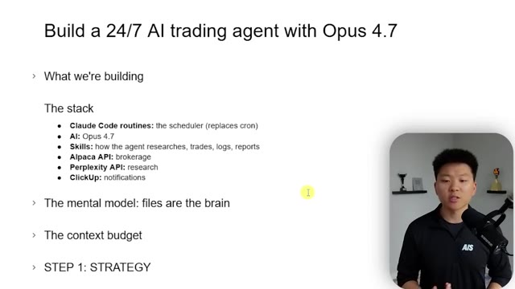
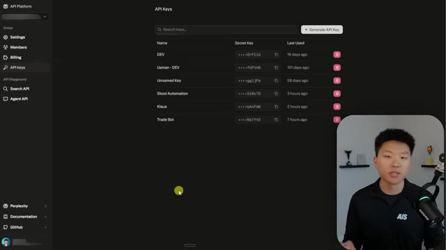
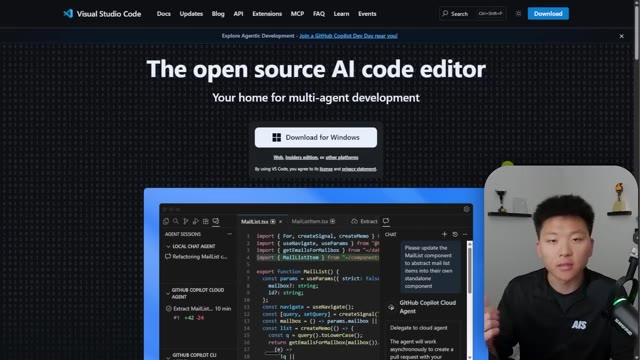
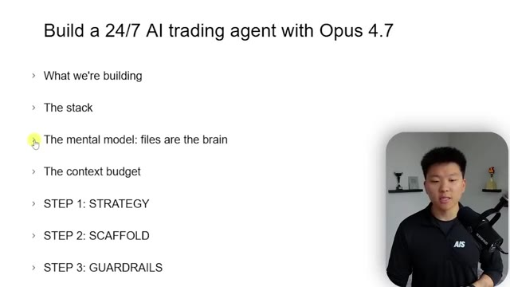
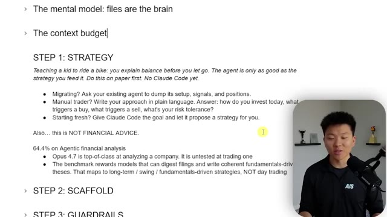
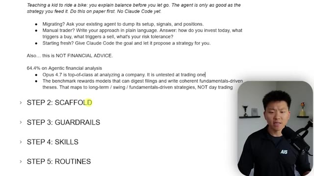
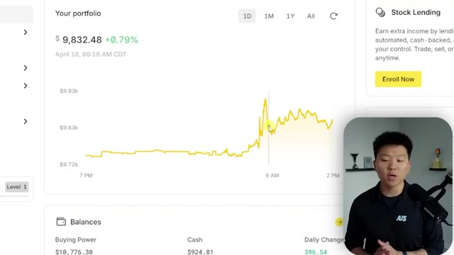
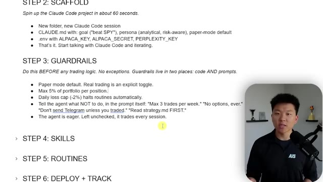
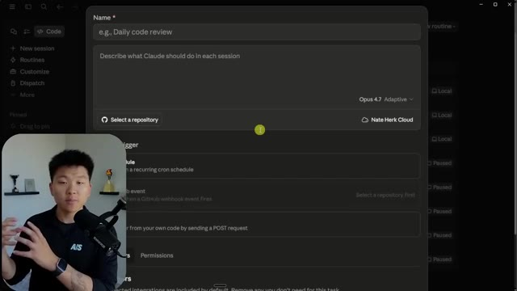
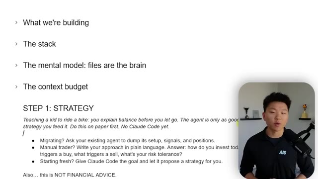

# 🎬 I Turned Claude Into a 24/7 Trader

> **Chaîne** : [Nate Herk | AI Automation](https://www.youtube.com/@nateherk/featured)  
> **Lien YouTube** : [https://www.youtube.com/watch?v=6MC1XqZSltw](https://www.youtube.com/watch?v=6MC1XqZSltw)  
> **Date de publication** : 20260417  
> **Durée** : 00:33:15  
> **Identifiant vidéo** : `6MC1XqZSltw`  
> **Transcription & Analyse** : `whisper-v3-large-turbo+gemini-3.5-flash-lite`  

---

## 📌 Synthèse Exécutive & Outils

### 💡 Résumé
Dans cette vidéo intitulée **I Turned Claude Into a 24/7 Trader**, Nate Herk décortique les capacités pratiques d'automatisation et de développement propulsées par les modèles de pointe.

### 🛠️ Outils, Modèles & Logiciels Présentés
- **Opus 5.5 & Claude Code** : Modèles d'ingénierie et agents de codage autonome.

### 🔑 Points Clés & Enseignements Stratégiques
- Optimiser le niveau d'effort et le raisonnement des modèles IA pour des résultats industriels.
- Automatiser les cycles de création logicielle de bout en bout.

---

## ⏱️ Chronologie & Transcription Complète Audio & Visuelle (Mot pour Mot)

### ⏱️ `[00:00:00 - 00:00:24]` | Segment #01

**🔊 Audio (Transcription Intégrale Mot pour Mot en Français) :**
> So Claude Opus 4.6 is finally here, and it got me thinking, because as I was scrolling down and I started looking at the benchmarks, I noticed right here we have agentic financial analysis, and we have about a 4% jump from Opus 4.6. And about a week ago, I dropped this video where me and Salman traded stocks for 30 days with our OpenClaw agents, and my OpenClaw agent was set up with Opus 4.6, and I was able to beat the S&P by about 8%, as you can see right here.

**👁️ Analyse Visuelle d'Écran (gemini-3.5-flash-lite) :**
**Interface & Outils** : Navigateur web (YouTube, site de benchmarks de modèles IA).

**Contenu textuel & Code** : Scores de benchmarks (ex: 64.4% pour Agentic financial analysis) et interface de suivi de trading (Nate, Samin, S&P 500).

**Action / Démonstration** : Présentation des résultats de tests de modèles d'IA et référence à une vidéo précédente sur le trading automatisé.

*⏱️ 00:00:06 — Un tableau comparatif des performances de modèles IA affichant diverses capacités comme l'analyse financière agentique.*

*⏱️ 00:00:12 — Une interface de vidéo YouTube affichant un graphique de performance boursière avec des courbes de progression comparées.*

---

### ⏱️ `[00:00:24 - 00:00:45]` | Segment #02

**🔊 Audio (Transcription Intégrale Mot pour Mot en Français) :**
> This green line is my chart and this gray line is the S&P. So if you guys want to check out this full video, I will link that right up here. So after this challenge, I wanted to keep my agent running to see if it could keep beating the S&P. But now I want to upgrade it to 4.7 instead of 4.6. So that's exactly what I want to cover with you guys today. How do we build a 24-7 AI trading agent with Opus 4.6 inside of Claude Code?

**👁️ Analyse Visuelle d'Écran (gemini-3.5-flash-lite) :**
**Interface & Outils** : Interface graphique de suivi de portefeuille (Image 1) et présentation type diaporama/logiciel de note (Image 2).

**Contenu textuel & Code** : Image 1 : Valeurs monétaires ($9,980, $9,624, $9,153) et taux de rendement (-0.20%, -3.76%, -8.46%). Image 2 : Titres de sections incluant "The stack", "The mental model: files are the brain", "STEP 1: STRATEGY", "STEP 2: SCAFFOLD", "STEP 3: GUARDRAILS".

**Action / Démonstration** : Analyse comparative des performances de trading passées (Image 1) et planification structurée de l'architecture d'un nouvel agent IA (Image 2).

*⏱️ 00:00:30 — Un tableau de bord de performance de trading montrant les courbes de progression comparées de trois entités (Nate, Samin, S&P 500) sur une période de 30 jours, avec leurs soldes finaux respectifs.*

*⏱️ 00:00:40 — Une diapositive de présentation listant les étapes du projet : "Build a 24/7 AI trading agent with Opus 4.7", détaillant la pile technologique et les étapes de développement.*

---

### ⏱️ `[00:00:45 - 00:01:04]` | Segment #03

**🔊 Audio (Transcription Intégrale Mot pour Mot en Français) :**
> We're not even going to touch OpenClaw or Hermes Agent. We're going to just do this with Claude Code. And this is all going to be thanks to another feature that we just got from the Anthropic team called Routines. If you don't know what that is, I'm going to break it down in this video, but I also made a full one if you want to check that out also right up here. So basically this is the unlock. 4.7 plus routines means you can have a 24-7 AI agent.

**👁️ Analyse Visuelle d'Écran (gemini-3.5-flash-lite) :**
**Interface & Outils** : Plateforme sociale X (Twitter) affichée dans un navigateur web.

**Contenu textuel & Code** : Texte du post : "We just launched Routines. We just launched Claude Opus 4.7. The real unlock is using them together." Inclut une image animée (GIF) pixel-art.

**Action / Démonstration** : Le présentateur illustre visuellement l'annonce officielle d'Anthropic mentionnée dans le segment audio.

*⏱️ 00:00:50 — Capture d'écran montrant une publication sur la plateforme X (anciennement Twitter) de Noah Zweben concernant le lancement de « Routines » et « Claude Opus 4.7 ».*

---

### ⏱️ `[00:01:04 - 00:01:22]` | Segment #04

**🔊 Audio (Transcription Intégrale Mot pour Mot en Français) :**
> And 4.7 was built for full throttle agentic work, judgment over ambiguity, and self-verifying outputs. So it's perfect for these types of routines. And that's how I'm going to set up my 24-7 trading agent with Cloud Code Routines. So if you follow along with this video, you'll be able to pretty much duplicate my exact setup and have yourself a working agent.

**👁️ Analyse Visuelle d'Écran (gemini-3.5-flash-lite) :**
**Interface & Outils** : Réseau social X (Twitter) et logiciel de présentation (type PowerPoint/Keynote).

**Contenu textuel & Code** : Le texte du post X mentionnant les capacités de "Claude Opus 4.7" (agentic work, self-verifying) et le plan de construction de l'agent de trading (Strategy, Scaffold, Guardrails).

**Action / Démonstration** : Le présentateur illustre ses propos en montrant les annonces officielles puis en détaillant la feuille de route technique pour le projet de l'agent de trading.

*⏱️ 00:01:08 — Une capture d'écran de l'interface du réseau social X montrant un post de Noah Zweben sur le lancement de "Routines" et "Claude Opus 4.7", avec le présentateur incrusté en bas à droite.*

*⏱️ 00:01:18 — Une diapositive de présentation listant les étapes du projet : "Build a 24/7 AI trading agent with Opus 4.7", incluant des points comme "The stack", "The mental model", et les étapes de développement de 1 à 3.*

---

### ⏱️ `[00:01:22 - 00:01:52]` | Segment #05

**🔊 Audio (Transcription Intégrale Mot pour Mot en Français) :**
> and start trading with it. So let's go ahead and get started. What are we building? We're going to create a cloud code project that runs on a schedule, something like a pre-market cron, a market open, a midday, and a close. It's going to research the market. It's going to place trades via the Alpaca API. It's going to journal and make sure that it's writing context into the file so it can learn. And then it's going to send me every day, every day of the week, an end of day summary to my ClickUp. The goal obviously is just to beat the SMP. We're not looking to do any crazy crypto or crazy day trading stuff.

**👁️ Analyse Visuelle d'Écran (gemini-3.5-flash-lite) :**
**Interface & Outils** : Logiciel de présentation (type diaporama).

**Contenu textuel & Code** : Texte présentant le projet : "Build a 24/7 AI trading agent with Opus 4.7", "What we're building" (explication du workflow avec Claude Code, Alpaca et ClickUp), "Goal: beat S&P 500", ainsi que le plan : "The stack", "The mental model", "The context budget", "STEP 1: STRATEGY".

**Action / Démonstration** : Présentation du plan de cours et des objectifs du projet d'automatisation.

*⏱️ 00:01:29 — Une diapositive de présentation listant les objectifs et les étapes de construction d'un agent de trading IA, avec le présentateur en médaillon.*

---

### ⏱️ `[00:01:52 - 00:02:12]` | Segment #06

**🔊 Audio (Transcription Intégrale Mot pour Mot en Français) :**
> I'm just kind of doing this as a fun long-term investment. Just beat the S&P challenge. Like I said, in my first 30 days, I gave Opus $10,000 and we were able to beat the S&P by about 8%, which is really good, especially in such a short amount of time. So what is the tech stack? We're gonna be using Cloud Code Routines. That's kind of our scheduler. For the AI model, we're gonna use Opus 4.7.

**👁️ Analyse Visuelle d'Écran (gemini-3.5-flash-lite) :**
**Interface & Outils** : Logiciel de présentation (type diapositives).

**Contenu textuel & Code** : Titre : "Build a 24/7 AI trading agent with Opus 4.7". Texte décrivant le projet : "A Claude Code project that runs on a schedule... researches the market, places trades via Alpaca, journals its reasoning, and sends an EOD summary to ClickUp." Liste des points abordés : "The stack", "The mental model: files are the brain", "The context budget", "STEP 1: STRATEGY".

**Action / Démonstration** : Présentation des objectifs du tutoriel et du plan de la vidéo.

*⏱️ 00:01:57 — Une présentation sous forme de liste à puces décrivant l'architecture et l'objectif du projet d'agent de trading automatisé, avec le présentateur en médaillon.*

---

### ⏱️ `[00:02:12 - 00:02:31]` | Segment #07

**🔊 Audio (Transcription Intégrale Mot pour Mot en Français) :**
> For the skills, we're gonna be using just kind of like building our own as we go. It'll be stuff like how the agent does research or how it makes decisions or how it places trades or makes logs, things like that. We're gonna use the Alpaca API as our brokerage. We're gonna use the Perplexity API for research. You could also just use the native web fetch and web search, but I'm gonna use Perplexity here.

**👁️ Analyse Visuelle d'Écran (gemini-3.5-flash-lite) :**
**Interface & Outils** : Présentation (diapositives) sur fond blanc avec incrustation vidéo du présentateur.

**Contenu textuel & Code** : Liste des composants : Claude Code (scheduler), Opus 4.7 (IA), Skills (recherche, trading, logs), Alpaca API (brokerage), Perplexity API (recherche), ClickUp (notifications). Titres de section : "Build a 24/7 AI trading agent", "The mental model", "The context budget", "STEP 1: STRATEGY".

**Action / Démonstration** : Le présentateur explique les choix technologiques et l'architecture logicielle de l'agent de trading en cours de conception.

*⏱️ 00:02:17 — Une présentation sous forme de liste à puces décrivant la pile technologique (The stack) pour la création d'un agent de trading autonome.*

---

### ⏱️ `[00:02:32 - 00:03:06]` | Segment #08

**🔊 Audio (Transcription Intégrale Mot pour Mot en Français) :**
> And then I'm gonna get my notifications and ClickUp this time rather than Telegram, just because I live in ClickUp a lot more. So obviously some of these things can be interchangeable for you, but if you wanna just copy my exact setup in this video, then feel free. Okay, so how to get started with these different tools that we need for this video. The first one is gonna be Alpaca. So go to alpaca.markets. You can see up at the top, we even see want to trade using AI. We launched an Alpaca's MCP server to help you trade with natural language. So you could use that. I'm just using the endpoints. I honestly like to use endpoints a lot more. But anyways, you're going to sign up right here and you'll click on trading API. Now, once you get in there, you will have basically a paper trading

**👁️ Analyse Visuelle d'Écran (gemini-3.5-flash-lite) :**
**Interface & Outils** : Page web d'Alpaca Markets (alpaca.markets), présentation de diapositive.

**Contenu textuel & Code** : Liste des composants techniques du projet : Claude Code, Opus 4.7, Alpaca API, Perplexity API, ClickUp.

**Action / Démonstration** : Présentation théorique du projet suivie de la navigation vers la plateforme de trading Alpaca utilisée par l'automatisation.

*⏱️ 00:02:40 — Une diapositive listant la pile technologique (tech stack) pour construire un agent de trading IA, incluant Claude Code, Opus 4.7, Alpaca API, Perplexity API et ClickUp.*

*⏱️ 00:02:49 — La page d'accueil du site officiel d'Alpaca affichant les services d'API pour le trading d'actions et de cryptomonnaies, avec une interface utilisateur de démonstration.*

*⏱️ 00:02:57 — La même page d'accueil d'Alpaca affichée, confirmant l'outil utilisé comme pilier pour la partie "courtage" (brokerage) du projet.*

---

### ⏱️ `[00:03:06 - 00:03:26]` | Segment #09

**🔊 Audio (Transcription Intégrale Mot pour Mot en Français) :**
> account. And right here, you can see I've got a paper trading account with a hundred K. You could also open up a new account right here. And that's how you could put real money in. You might, like I said, they'll have to just verify your account, which could take a couple of days. and then they're both the same as far as the credentials. You basically scroll down and on the right-hand side, you have your API keys right here. You get an endpoint and you get a key, but you also need like a secret key.

**👁️ Analyse Visuelle d'Écran (gemini-3.5-flash-lite) :**
**Interface & Outils** : Plateforme de trading en ligne (Webull).

**Contenu textuel & Code** : Soldes des comptes (9 763,69 $ pour le compte réel, 99 837,81 $ pour le compte papier), options de passage d'ordres ("Buy/Sell", "Market Price", "Quantity", "Order Type").

**Action / Démonstration** : Le curseur survole le compte réel "Individual Trading", illustrant la possibilité de passer d'un environnement de simulation à un compte de trading réel.

*⏱️ 00:03:11 — Capture d'écran de l'interface de trading (Webull) montrant un menu déroulant pour basculer entre un compte réel ("Live Account") et un compte de démonstration ("Paper Trading").*

---

### ⏱️ `[00:03:26 - 00:03:44]` | Segment #10

**🔊 Audio (Transcription Intégrale Mot pour Mot en Français) :**
> So you have like a secret key and then you need like an ID. So you hit regenerate, generate new keys and this is where you get your key and your secret. And once you copy and paste this, just make sure to save it because then it's gonna go away and you'll only be able to see the key, but you need both of them. Next up, I have ClickUp. This is where I wanna get my notifications. You don't have to use ClickUp.

**👁️ Analyse Visuelle d'Écran (gemini-3.5-flash-lite) :**
**Interface & Outils** : Plateforme de trading algorithmique Alpaca (interface web).

**Contenu textuel & Code** : URL de l'Endpoint API, clé API (Key), clé secrète (Secret) et notification de confirmation "New key generated".

**Action / Démonstration** : Génération et affichage d'une nouvelle paire de clés API pour l'accès aux services de trading.

*⏱️ 00:03:30 — Capture d'écran du tableau de bord Alpaca montrant la section de génération des clés API, avec le présentateur en médaillon.*

---

### ⏱️ `[00:03:44 - 00:04:05]` | Segment #11

**🔊 Audio (Transcription Intégrale Mot pour Mot en Français) :**
> You can use Slack. you could use, you know, whatever, Telegram, WhatsApp. I would go up here and go to my settings and then I scroll down and find ClickUp API and then I would just copy this token right here. And then similarly with perplexity, I would go down here and I would click on all settings, I think, and then in here I can see API platform and this is where I would be able to go find my actual API key.

**👁️ Analyse Visuelle d'Écran (gemini-3.5-flash-lite) :**
**Interface & Outils** : ClickUp (interface web).

**Contenu textuel & Code** : Jeton API partiellement masqué commençant par "pk_81487" et se terminant par "B3BZ", ainsi que les noms des intégrations connectées.

**Action / Démonstration** : Navigation dans les paramètres de ClickUp pour localiser et copier le jeton d'authentification API.

*⏱️ 00:03:55 — Page des paramètres "ClickUp API" affichant le champ du jeton (API Token) avec l'option de copie et les applications connectées (Zealot, ClickUp MCP Service, Zapier).*

---

### ⏱️ `[00:04:05 - 00:04:37]` | Segment #12

**🔊 Audio (Transcription Intégrale Mot pour Mot en Français) :**
> If I went down to right here, API keys, I can make a new one or copy an old one. But basically the way it works is every platform has typically API keys. You just have to find them in the settings somewhere. If you can't find them, just do a quick perplexity or Google search or even ask cloud code And it should be able to help you get to your api keys And now that you know how to get these keys just hold on to them We're going to actually plug them in later in the video And then the final piece of the puzzle is going to be the cloud desktop app You can see here you can have cloud chat You can have cloud co-work or you can be in cloud code And this is where we're going to set up these actual routines Where now if I go to my calendar, you can see every single day

**👁️ Analyse Visuelle d'Écran (gemini-3.5-flash-lite) :**
**Interface & Outils** : Interface de gestion de clés API (API Platform)

**Contenu textuel & Code** : Liste de clés API avec noms (ex: DEV, Skool Automation, Trade Bot), clés masquées, dates de dernière utilisation et boutons de suppression.

**Action / Démonstration** : Consultation de la page "API Keys" pour visualiser et gérer les accès aux services connectés.

*⏱️ 00:04:13 — Interface web d'une plateforme API affichant la liste des clés API actives et le bouton pour en générer de nouvelles, avec le présentateur en médaillon dans le coin inférieur droit.*

---

### ⏱️ `[00:04:37 - 00:05:13]` | Segment #13

**🔊 Audio (Transcription Intégrale Mot pour Mot en Français) :**
> I've got bull which is my trading agent waking up at 6 8 30 noon, 3 p.m. And then on certain days, like on Fridays, he's doing a weekly review. So this is the way I currently have mine set up and we're able to manage everything right from here inside of the Claude desktop app because of this whole routine feature. So all you need to do to use the Claude desktop app is just type in Claude desktop app download, and you should be able to install it right here. You go to the downloads page and then you just have to choose the Claude desktop for your operating system. And then the only other thing you need to do is make sure that you are on an actual subscription. So it has to be a paid either 20 bucks a month plan or the max

**👁️ Analyse Visuelle d'Écran (gemini-3.5-flash-lite) :**
**Interface & Outils** : Logiciel de gestion de tâches/planning (type interface d'agent IA personnalisée), navigateur web (Support Claude, site de téléchargement Claude).

**Contenu textuel & Code** : Liste de routines quotidiennes horodatées, intitulées "Bull" avec des indicateurs "REMOTE" ou "LOCAL", et des instructions liées à l'installation de logiciels.

**Action / Démonstration** : Présentation du flux de travail automatisé de l'agent de trading "Bull" et démonstration de la configuration logicielle via l'écosystème Claude.

*⏱️ 00:04:46 — Une interface de gestion de planning affichant des tâches automatisées pour un agent nommé "Bull" (ex: "Pre-market research", "Market-open execution", "Midday scan").*

---

### ⏱️ `[00:05:13 - 00:05:34]` | Segment #14

**🔊 Audio (Transcription Intégrale Mot pour Mot en Français) :**
> plans. Now in this video, you might also see me use cloud code inside of something that looks like this, which is the VS code IDE. And then we use cloud code extension inside of it. It's not mandatory, but that is where I typically prefer to use cloud code because I can see all of my files over here. So if you want to do that, just type in VS code in your browser, open this up. It's completely free to download and then go ahead and download it and connect your cloud code account.

**👁️ Analyse Visuelle d'Écran (gemini-3.5-flash-lite) :**
**Interface & Outils** : VS Code avec l'extension Claude Code.

**Contenu textuel & Code** : Arborescence de fichiers (.claude, routines, scripts, .env) et écran d'accueil de Claude Code avec le message "You've come to the absolutely right place!".

**Action / Démonstration** : Présentation de l'environnement de développement et de l'intégration de l'agent Claude Code au sein de l'éditeur.

*⏱️ 00:05:18 — Interface VS Code affichant l'explorateur de fichiers d'un projet "TRADING ROUTINE" et une fenêtre active "Claude Code" au centre.*

---

### ⏱️ `[00:05:35 - 00:05:54]` | Segment #15

**🔊 Audio (Transcription Intégrale Mot pour Mot en Français) :**
> So that is pretty much the tech stack that we're gonna be using today to get all of this set up. And let's get back to the video. Okay, so before we get into the actual step-by-step kind of build, we are going to need to talk about the mental model. So understand this before you write anything. The trading strategy is a piece of the work, but the memory architecture that you're gonna use is gonna be huge.

**👁️ Analyse Visuelle d'Écran (gemini-3.5-flash-lite) :**
**Interface & Outils** : Navigateur web (Cursor/VS Code) et logiciel de présentation (PowerPoint/Keynote).

**Contenu textuel & Code** : Image 1 : code TypeScript/React (fichiers MailList.tsx) et panneau de contrôle d'agent. Image 2 : plan du projet (Strategy, Scaffold, Guardrails).

**Action / Démonstration** : Présentation théorique du "mental model" et des outils nécessaires avant de passer à l'exécution pratique.

*⏱️ 00:05:39 — Page web présentant l'interface de Cursor (ou un éditeur basé sur VS Code) avec des fonctionnalités d'agent IA intégrées (Agent Sessions, Chat).*

*⏱️ 00:05:44 — Diapositive de présentation listant les étapes du projet : "Build a 24/7 AI trading agent with Opus 4.7", incluant le concept de "mental model".*

---

### ⏱️ `[00:05:55 - 00:06:20]` | Segment #16

**🔊 Audio (Transcription Intégrale Mot pour Mot en Français) :**
> So every time a routine fires at 7 a.m., Cloud Code basically wakes up essentially stateless. It doesn't really know anything. So how do you make a stateless agent act disciplined and remember rules and learn over time. You do that with files and with context. So every routine basically wakes up, reads files, does the job, and then writes back any important lessons or anything like that the next agent when it wakes up needs to know, it just writes that down.

**👁️ Analyse Visuelle d'Écran (gemini-3.5-flash-lite) :**
**Interface & Outils** : Éditeur de documents/présentation (format texte).

**Contenu textuel & Code** : Texte explicatif : « Every time a routine fires at 7am, Claude Code wakes up knowing nothing. », « Files. The files ARE the brain. », « Every routine reads files to load its memory, does its one job, then writes files to save what it learned. »

**Action / Démonstration** : Présentation théorique du concept de persistance de données pour un agent stateless via la lecture et l'écriture de fichiers.

*⏱️ 00:06:01 — Une diapositive de présentation illustrant le concept de « mémoire » pour un agent IA, avec le titre « The mental model: files are the brain ».*

---

### ⏱️ `[00:06:20 - 00:06:43]` | Segment #17

**🔊 Audio (Transcription Intégrale Mot pour Mot en Français) :**
> And that's kind of at a very high level, the type of framework that we're gonna be using here. So the final thing I wanted to talk about before we get into this is the context budget. So treat tokens like money, obviously. Every file that you ask the agent to read, it's going to cost you. Each routine gets about 200,000 tokens to work with. I mean, we do have the a million token context window models now, but I don't really like to think of it like I have a million tokens to play with because context rot.

**👁️ Analyse Visuelle d'Écran (gemini-3.5-flash-lite) :**
**Interface & Outils** : Logiciel de présentation ou éditeur de texte (type Obsidian ou Notion).

**Contenu textuel & Code** : Liste des étapes : "What we're building", "The stack", "The mental model: files are the brain", "The context budget", "STEP 1: STRATEGY", "STEP 2: SCAFFOLD", "STEP 3: GUARDRAILS", "STEP 4: SKILLS", "STEP 5: ROUTINES".

**Action / Démonstration** : Présentation visuelle de la structure du cadre de travail (framework) pour le développement d'agents IA.

*⏱️ 00:06:26 — Une liste à puces présentant le plan du tutoriel sur l'automatisation IA, avec le présentateur en médaillon dans le coin inférieur droit.*

---

### ⏱️ `[00:06:44 - 00:07:14]` | Segment #18

**🔊 Audio (Transcription Intégrale Mot pour Mot en Français) :**
> So system instructions will take some up, strategy files, your trade log, your API, your research. Every run is going to take a different amount of tokens, but just keep that in mind. And the reason here that we're using, if I go back to the stack, cloud code instead of just using something like, you know, the agent's SDK or, I mean, I guess that could work, but rather than just using like a standard automation is because if we do this with routines, we basically get the full autonomy of us working with Cloud Code manually because it goes through that whole agenda carnage loop of figuring things out.

**👁️ Analyse Visuelle d'Écran (gemini-3.5-flash-lite) :**
**Interface & Outils** : Logiciel de présentation (type Keynote ou Google Slides).

**Contenu textuel & Code** : Texte structuré : "The context budget", "Treat tokens like money", détail du coût en tokens (System prompt: 10K, Strategy: 2K, Trade log: 8K+, Research log: 5K+, API: 5K+), total de 25K tokens avant traitement, suivi des étapes "STEP 1: STRATEGY" et "STEP 2: SCAFFOLD".

**Action / Démonstration** : Le présentateur explique la contrainte de gestion des tokens avant l'exécution des tâches de l'agent IA.

*⏱️ 00:06:51 — Une présentation de type diapositive expliquant la gestion du budget de tokens pour un agent IA, avec une liste détaillée de la consommation par type de fichier (instructions, stratégie, logs, etc.).*

---

### ⏱️ `[00:07:14 - 00:07:46]` | Segment #19

**🔊 Audio (Transcription Intégrale Mot pour Mot en Français) :**
> And especially with Opus 4.7, it's apparently going to be really, really good. Whereas if you just had like an automation that would do research and then make a trade, you're not getting that super variability that you probably want with something that could be very volatile like trading. All right, so now that we got all of that stuff out of the way, Let's get into the strategy. So step one Think of this like you're teaching a kid to ride a bike You have to explain How to balance before you go you have to explain to the kid that he's going to Steer with his hands and he's going to pedal with his feet and even once you put him on the bike

**👁️ Analyse Visuelle d'Écran (gemini-3.5-flash-lite) :**
**Interface & Outils** : Présentation de contenu textuel (probablement une présentation type PowerPoint ou Obsidian).

**Contenu textuel & Code** : Liste détaillée de la consommation de jetons : System prompt (10K), Strategy file (2K), Trade log (8K+), Research log (5K+), API responses (5K+), avec le conseil : "Treat tokens like money".

**Action / Démonstration** : Présentation théorique illustrant la gestion optimisée de la fenêtre de contexte pour des agents autonomes de trading.

*⏱️ 00:07:22 — Une présentation de type diapositive affichant les concepts de "contexte budgétaire" pour des agents IA appliqués au trading, avec une décomposition de la consommation de jetons (tokens).*

---

### ⏱️ `[00:07:46 - 00:08:20]` | Segment #20

**🔊 Audio (Transcription Intégrale Mot pour Mot en Français) :**
> You're not just going to let him go. You're going to hold the handlebars You're going to put your hand on his back and you're going to walk with him until he gets a little more comfortable And then slowly you might take off, you know, you might stop steering But you might just run behind him and then slowly you'll put on some training wheels and like you just keep bumping it up in phases. You can't expect to just throw a kid on a bike and it's instantly going to be magic. So maybe you want to start with paper trading. This is obviously not financial advice and I'm not recommending that you go put all of your life savings in here and expect to make money and then get mad at me. This is an experiment for me and I'm trying to show you guys what's possible. So just keep that in mind. Start with paper trading first if you're not comfortable.

**👁️ Analyse Visuelle d'Écran (gemini-3.5-flash-lite) :**
**Interface & Outils** : Logiciel de traitement de texte ou de prise de notes type Notion/Google Docs.

**Contenu textuel & Code** : Texte structuré : "The mental model: files are the brain", "The context budget", "STEP 1: STRATEGY", conseils sur l'explication de la stratégie à l'agent ("Teaching a kid to ride a bike"), et mentions sur les performances de "Opus 4.7" en analyse financière.

**Action / Démonstration** : Le contenu affiche les principes théoriques de préparation à la mise en place d'un agent IA, soulignant l'importance de définir une stratégie claire avant l'exécution technique ("No Claude Code yet").

*⏱️ 00:07:55 — Une capture d'écran montrant une présentation sous forme de document structuré avec des points clés sur la stratégie d'utilisation d'agents IA pour le trading, incluant une section "STEP 1: STRATEGY" et des conseils sur l'approche à adopter.*

---

### ⏱️ `[00:08:21 - 00:08:56]` | Segment #21

**🔊 Audio (Transcription Intégrale Mot pour Mot en Français) :**
> But anyways, the idea is you need a strategy. So for me, what I'm going to do is I'm basically going to extract all of the strategy that we've been using from my open claw agent. And I'm just going to say, Hey, let's take this over to cloud code. So for me, it's a little easier, but for you, if you actually are like a manual trader and every day you think about things and you do research and you place trades or you sell things, then just write down your strategy. How often are you checking the news? What are the signals that make you realize I'm going to buy this, or I'm going to sell this as much of your gut intuition and your routine about trading that you can get into this cloud code project, the better. And then over time, you're going to help it learn from its mistakes.

**👁️ Analyse Visuelle d'Écran (gemini-3.5-flash-lite) :**
**Interface & Outils** : Logiciel de prise de notes ou éditeur de texte (style Notion/Obsidian).

**Contenu textuel & Code** : Texte structuré incluant : "The mental model: files are the brain", "STEP 1: STRATEGY" (avec des conseils sur la migration d'agents et le trading), et une section sur "Opus 4.7" concernant l'analyse financière.

**Action / Démonstration** : Présentation théorique d'une méthodologie étape par étape ("Step 1: Strategy", "Step 2: Scaffold", "Step 3: Guardrails") pour guider le spectateur dans la conception d'un agent.

*⏱️ 00:08:29 — Une présentation structurée sous forme de liste à puces décrivant la stratégie pour construire un agent de trading IA, avec le présentateur visible en médaillon dans le coin inférieur droit.*

---

### ⏱️ `[00:08:56 - 00:09:30]` | Segment #22

**🔊 Audio (Transcription Intégrale Mot pour Mot en Français) :**
> You're going to iterate and it's going to get better and better every time you use it. But if you're starting completely fresh, which in my case of the open cloud trading challenge, I literally just said, hey, I'm doing a 30 day challenge. I'm trying to compete against my friend Salman. Go do research, spin up a team of sub agents. You're my wealth advisor. Try to beat the SMP, figure out the best plan possible. And that's like genuinely all that I said to it, which I think is pretty cool. And it went off and it did a bunch of research. It figured out a strategy for me. And then for the next 30 days, it just did that. And I barely had to touch it at all. So if you want to start off by playing around with some research like that, then certainly do

**👁️ Analyse Visuelle d'Écran (gemini-3.5-flash-lite) :**
**Interface & Outils** : Éditeur de texte riche / Application de prise de notes.

**Contenu textuel & Code** : Texte détaillé sur la méthodologie de création d'agent : définition de la stratégie ("The mental model: files are the brain"), conseils pour les traders manuels, mention de "Claude Code" et de "Opus 4.7" pour l'analyse financière, et mise en garde "NOT FINANCIAL ADVICE".

**Action / Démonstration** : Présentation conceptuelle et théorique d'une feuille de route pour automatiser le trading via des agents IA.

*⏱️ 00:09:05 — Une page de notes structurées (type éditeur Markdown ou Notion) détaillant la stratégie pour créer un agent de trading IA, avec des étapes comme "Strategy", "Scaffold" et "Guardrails".*

---

### ⏱️ `[00:09:30 - 00:09:58]` | Segment #23

**🔊 Audio (Transcription Intégrale Mot pour Mot en Français) :**
> that. But if you guys remember at the beginning of this video, I kind of alluded to this benchmark here. So in the official release, and by the way, I just dropped a full video on this new release. I'll tag that up here. So in the official release of Claude Opus 417, they always drop the benchmarks and they compare it to other models that are kind of leading in the industry as well. And so this is the one I wanted to talk about in this case, we have agentic financial analysis, 64.4%. We also have stuff like graduate level reasoning and, you know, just the ability to think really well.

**👁️ Analyse Visuelle d'Écran (gemini-3.5-flash-lite) :**
**Interface & Outils** : Navigateur web affichant un rapport de performance officiel.

**Contenu textuel & Code** : Tableau de données comparant les scores (en pourcentage) pour : "Agentic coding", "Agentic terminal coding", "Multidisciplinary reasoning", "Agentic search", "Scaled tool use", et "Agentic computer use".

**Action / Démonstration** : Présentation visuelle des résultats de benchmarks pour valider les capacités du nouveau modèle Claude Opus 4.7.

*⏱️ 00:09:44 — Tableau comparatif des performances de divers modèles d'IA (Opus 4.7, 4.6, GPT-5.4, Gemini 3.1 Pro, Mythos) sur des benchmarks spécialisés.*

---

### ⏱️ `[00:09:58 - 00:10:30]` | Segment #24

**🔊 Audio (Transcription Intégrale Mot pour Mot en Français) :**
> Agentic search actually is worse than Opus 4.6, which is interesting, but yeah, agentic financial analysis. So what does that actually mean? This basically means that it is really good at analyzing a company, but it's not basically a signal or a benchmark for how good this model is at trading and specifically day trading. Like this doesn't mean that it's going to be able to look at like a technical analysis and look at the candlesticks and the MACD and figure out the exact best moment to buy and then the exact moment to sell. I'm not going to try to day trade with these agents. I just don't know enough about it to do it. But that's not what this metric is saying.

**👁️ Analyse Visuelle d'Écran (gemini-3.5-flash-lite) :**
**Interface & Outils** : Logiciel de présentation (type diaporama).

**Contenu textuel & Code** : Texte structuré incluant : "64.4% on Agentic financial analysis", "Opus 4.7 is top-of-class at analyzing a company", "STEP 2: SCAFFOLD", "STEP 3: GUARDRAILS", "STEP 4: SKILLS", "STEP 5: ROUTINES".

**Action / Démonstration** : Présentation théorique des étapes méthodologiques pour implémenter des agents spécialisés dans l'analyse financière.

*⏱️ 00:10:06 — Une diapositive de présentation listant des étapes stratégiques pour configurer des agents financiers (Scaffold, Guardrails, Skills, Routines) ainsi que des notes sur les capacités d'analyse d'Opus 4.7.*

---

### ⏱️ `[00:10:30 - 00:10:55]` | Segment #25

**🔊 Audio (Transcription Intégrale Mot pour Mot en Français) :**
> This benchmark rewards models that can digest fillings and write coherent fundamentals driven theses or theses, I guess. And that maps to long term or swing or fundamentals driven strategies, not day trading. So that's why, once again, we're just going to be trying to beat the S&P here. Okay, so that is the overall strategy. Let's talk about the scaffold. So what you need to do to spin up the Cloud Code project in about 60 seconds is you're gonna open up a new folder and we're gonna open up Cloud Code.

**👁️ Analyse Visuelle d'Écran (gemini-3.5-flash-lite) :**
**Interface & Outils** : Logiciel de présentation ou éditeur de texte (type Google Docs/Slide).

**Contenu textuel & Code** : Texte affiché : "Teaching a kid to ride a bike...", "64.4% on Agentic financial analysis", "Opus 4.7 is top-of-class at analyzing a company", ainsi que la liste des étapes : "STEP 2: SCAFFOLD", "STEP 3: GUARDRAILS", "STEP 4: SKILLS", "STEP 5: ROUTINES".

**Action / Démonstration** : Présentation théorique des étapes de structuration d'un agent de trading financier.

*⏱️ 00:10:36 — Une diapositive de présentation contenant des instructions sur la stratégie d'investissement assistée par IA, avec une liste d'étapes (SCAFFOLD, GUARDRAILS, SKILLS, ROUTINES) et des notes sur l'analyse financière par l'IA.*

---

### ⏱️ `[00:10:55 - 00:11:13]` | Segment #26

**🔊 Audio (Transcription Intégrale Mot pour Mot en Français) :**
> So let me hop over to my project right here. This is a new folder. It's called trading, I think trading routine. This is basically just a settings file. There's hardly anything in there. The cloud.md is blank and then we have a readme just because I turned this into a GitHub repo so I can pull it into a routine later. If you haven't done that yet, it's fine. We'll talk about that in a sec.

**👁️ Analyse Visuelle d'Écran (gemini-3.5-flash-lite) :**
**Interface & Outils** : Visual Studio Code (éditeur de code) avec le terminal intégré "Claude Code v2.1.111".

**Contenu textuel & Code** : Arborescence du dossier "Trading Routine" (dossiers .claude, fichiers CLAUDE.md et README.md). Le terminal indique : "Opus 4.7 (1M context) · Claude Max" et "Welcome to Opus 4.7 xhigh!".

**Action / Démonstration** : Le présentateur illustre la configuration initiale du projet "Trading Routine" au sein de son environnement de développement, prêt pour l'interaction avec l'agent IA Claude Code.

*⏱️ 00:11:00 — L'interface de VS Code montrant l'explorateur de fichiers à gauche et une instance de terminal Claude Code en cours d'exécution à droite.*

---

### ⏱️ `[00:11:14 - 00:11:33]` | Segment #27

**🔊 Audio (Transcription Intégrale Mot pour Mot en Français) :**
> The reason why we're starting here in VS Code is because I want to get started in a place where I can see all of my files on this left-hand side. Because if you're in the desktop app, which we will move over to here later, you don't get to see all your files open on the left-hand side. On the left-hand side, you see your routines and your other sessions, which is great. But when we're first getting set up, I like to be able to see everything in one spot.

**👁️ Analyse Visuelle d'Écran (gemini-3.5-flash-lite) :**
**Interface & Outils** : VS Code (avec extension Claude Code / Terminal intégré)

**Contenu textuel & Code** : Explorateur de fichiers (dossier .claude, settings.local.json, CLAUDE.md, README.md) et interface de terminal Claude Code v2.1.111 utilisant Opus 4.7.

**Action / Démonstration** : Présentation de l'environnement de développement et initialisation de l'outil CLI Claude Code dans le terminal intégré.

*⏱️ 00:11:18 — Interface VS Code affichant l'explorateur de fichiers à gauche et un terminal Claude Code actif à droite.*

---

### ⏱️ `[00:11:33 - 00:11:52]` | Segment #28

**🔊 Audio (Transcription Intégrale Mot pour Mot en Français) :**
> So we're going to start here in the VS Code, either terminal or the Cloud Code extension. So let me show you guys what I did. This is my Telegram chat with Bull, my trading bot. and I said, hey, I want to completely migrate you to a different AI agent setup. I need you to break down the strategy, the cron jobs. What are you looking for when you're doing your research? What type of sub agents do you have?

**👁️ Analyse Visuelle d'Écran (gemini-3.5-flash-lite) :**
**Interface & Outils** : VS Code, terminal Claude Code, interface Telegram.

**Contenu textuel & Code** : - Image #1 : "Claude Code v2.1.111", "Opus 4.7 (1M context)".
- Image #2 : Message de l'utilisateur demandant un "full breakdown of the strategy" au bot de trading, incluant des questions sur les Cron jobs, la recherche, les sous-agents et les signaux de trading. Réponse du bot listant le "BULL TRADING BOT — FULL SYSTEM BREAKDOWN".

**Action / Démonstration** : Le présentateur passe de l'environnement de développement (VS Code) à l'historique de discussion avec son agent IA pour expliquer le processus de migration de la stratégie de trading.

*⏱️ 00:11:38 — Interface de VS Code affichant un terminal actif avec Claude Code v2.1.111 utilisant le modèle Opus 4.7.*

*⏱️ 00:11:42 — Capture d'écran montrant une interface de chat Telegram superposée au code, affichant une demande détaillée de migration de stratégie pour un bot de trading nommé "Bull".*

---

### ⏱️ `[00:11:52 - 00:12:25]` | Segment #29

**🔊 Audio (Transcription Intégrale Mot pour Mot en Français) :**
> What are the different signals? Give me the full breakdown, all of your learnings. And so it gave me all this stuff. And so what I'm gonna do is I'm just gonna basically migrate over this strategy into my Cloud Code project. You can see we have all of these cell signals. We have all of these key learnings and these kind of main frameworks. And we have our current portfolio. Real quick, guys, when it comes time for you to get set up. I have this free resource for you. It's a 13 page PDF. And I'm assuming if you dropped this thing into cloud code and then started to brainstorm with it, it would help you out a lot as far as the infrastructure and the folder structure and the way you want to get

**👁️ Analyse Visuelle d'Écran (gemini-3.5-flash-lite) :**
**Interface & Outils** : Telegram Desktop, Google Docs.

**Contenu textuel & Code** : - Image 1 : Texte structuré détaillant le flux de travail d'un bot de trading (Alpaca API, recherche d'événements économiques, gestion des positions, stops).
- Image 2 : Liste de dépannage technique (ex: `ALPACA_API_KEY` manquant, échec de push git, erreurs de script ClickUp) et étapes de configuration pour déployer le bot.

**Action / Démonstration** : Présentation de la documentation stratégique et technique du système d'automatisation de trading, suivie du partage de la checklist de déploiement pour les utilisateurs.

*⏱️ 00:12:00 — Une capture d'écran montrant une interface de messagerie (probablement Telegram) affichant un "Full System Breakdown" pour un bot de trading, détaillant les tâches cron (Recherche pré-marché, ouverture du marché, scan de milieu de journée).*

*⏱️ 00:12:17 — Une capture d'écran de Google Docs intitulée "Trading Bot: Master Setup Guide", montrant une liste de résolutions de bugs techniques et une "Replication Checklist" pour installer l'instance du bot.*

---

### ⏱️ `[00:12:25 - 00:12:45]` | Segment #30

**🔊 Audio (Transcription Intégrale Mot pour Mot en Français) :**
> things set up and the way you want to create your routines and things like that. So it should be very helpful. This you can download for completely free in my free school community. The link for that is down in the description. Once you get in there, just head over to the classroom, click on YouTube resources, and you'll be able to find it right in there. So let's get back to the video. So I pulled it up real quick. You can see here's today. We had a bit of a jump and then we came back down today.

**👁️ Analyse Visuelle d'Écran (gemini-3.5-flash-lite) :**
**Interface & Outils** : Google Docs, plateforme communautaire Skool, tableau de bord d'application de trading (type plateforme d'investissement).

**Contenu textuel & Code** : Texte du guide de configuration d'un agent de trading autonome (Claude Code, jobs cron, workflow daily), liste des ressources pédagogiques, données financières de portefeuille (9 875,69 $, graphiques de variation).

**Action / Démonstration** : Présentation du guide de configuration du bot, navigation dans les ressources de la communauté et démonstration visuelle des résultats financiers du bot sur le tableau de bord.

*⏱️ 00:12:30 — Document Google Docs affichant le guide de configuration "Trading Bot: Master Setup Guide" de l'AI Automation Society.*

*⏱️ 00:12:35 — Interface de la plateforme communautaire Skool présentant les cours et ressources "Classroom" disponibles, incluant "All YouTube Resources" et "Claude Code".*

*⏱️ 00:12:40 — Tableau de bord d'un compte de trading affichant un graphique de performance de portefeuille sur une journée avec le solde actuel et le solde en espèces.*

---

### ⏱️ `[00:12:45 - 00:13:06]` | Segment #31

**🔊 Audio (Transcription Intégrale Mot pour Mot en Français) :**
> Here's the past month. So this is where we were with the OpenClaw agent. But you guys are going to want to go to Alpaca and make an account, especially if you want to put real money in. You might have to take a few days for your account to get approved. So head over there and get an account. Then I also told it to give me a technical cheat sheet as far as like the different API endpoints it uses and how it makes those requests, as you can see, just because it already has all this knowledge.

**👁️ Analyse Visuelle d'Écran (gemini-3.5-flash-lite) :**
**Interface & Outils** : Plateforme de trading Alpaca (interface web) et interface de messagerie.

**Contenu textuel & Code** : Image 1 : Graphique de valeur du portfolio, solde de "Buying Power" et "Cash". Image 2 : Documentation technique de l'API Alpaca : clés d'authentification (headers), endpoints (Live), et exemples d'appels API (GET /v2/account, GET /v2/positions).

**Action / Démonstration** : Le présentateur illustre les performances de son compte de trading puis présente la documentation de l'API nécessaire pour connecter l'agent OpenClaw à Alpaca.

*⏱️ 00:12:50 — Interface de portfolio boursier montrant un graphique de performance sur la journée et les soldes du compte.*

*⏱️ 00:13:01 — Fenêtre de chat (type Telegram) affichant une "fiche technique" (cheat sheet) pour l'API d'Alpaca.*

---

### ⏱️ `[00:13:06 - 00:13:25]` | Segment #32

**🔊 Audio (Transcription Intégrale Mot pour Mot en Français) :**
> So why waste time trying to train a new agent if we could just migrate over all of these memories and knowledge to this new agent. And then at the end of that, it even gave me an export of all of these important files, like the agent instructions, the trading strategy, the trade log, the research log, the weekly review. And I'm just basically gonna migrate all this over. So let me show you what that's gonna look like.

**👁️ Analyse Visuelle d'Écran (gemini-3.5-flash-lite) :**
**Interface & Outils** : Interface de chat (type chatbot/LLM) superposée sur un tableau de bord de trading (Alpaca).

**Contenu textuel & Code** : Snippets de code JSON définissant des paramètres de prix, explications sur les points de terminaison de l'API (GET /v2/orders, DELETE /v2/positions), et liste de "GOTCHAS I LEARNED THE HARD WAY" concernant les règles de trading.

**Action / Démonstration** : Affichage des "mémoires" ou des instructions système de l'agent IA, illustrant le transfert de connaissances techniques vers le nouvel agent.

*⏱️ 00:13:11 — Une fenêtre contextuelle sombre affiche une documentation technique structurée (JSON et notes textuelles) sur les stratégies de trading, incluant les types d'ordres (market, trailing_stop, stop) et des conseils pratiques sur les limitations PDT (Pattern Day Trader) pour l'API Alpaca.*

---

### ⏱️ `[00:13:25 - 00:13:45]` | Segment #33

**🔊 Audio (Transcription Intégrale Mot pour Mot en Français) :**
> So you can see that it gave me this zip file of all of those seven files. And I'm just basically going to extract those into this project right here. So I'm choosing the trading routine project, select folder, and then extract. and we should see all those files just popped up right over here on this left-hand side. Now what I'm gonna do is just talk to my Claude. I'm gonna switch over here to plan mode and I'm just gonna start talking.

**👁️ Analyse Visuelle d'Écran (gemini-3.5-flash-lite) :**
**Interface & Outils** : Visual Studio Code (VS Code) avec l'extension Claude Code active.

**Contenu textuel & Code** : - Image 1 : Chemin d'accès de destination (`C:\Users\nateh\Downloads\Telegram Desktop\bull-trading-bot-export`).
- Image 2 : Liste des fichiers extraits : `AGENT-INSTRUCTIONS.md`, `CLAUDE.md`, `env-template.txt`, `PROJECT-TRADING-CHART.md`, `README.md`, `RESEARCH-LOG.md`, `TRADE-LOG.md`, `TRADING-STRATEGY.md`, `WEEKLY-REVIEW.md`.

**Action / Démonstration** : Extraction de fichiers d'une archive compressée vers le répertoire du projet "Trading Routine" et mise à jour automatique de l'arborescence des fichiers dans l'explorateur VS Code.

*⏱️ 00:13:30 — Fenêtre contextuelle "Extract Archive" ouverte par-dessus l'interface VS Code, invitant l'utilisateur à choisir une destination pour extraire un fichier zip.*

*⏱️ 00:13:40 — Interface VS Code après l'extraction : la barre latérale "EXPLORER" affiche désormais la liste complète des fichiers du projet (fichiers .md, .txt, etc.).*

---

### ⏱️ `[00:13:45 - 00:14:03]` | Segment #34

**🔊 Audio (Transcription Intégrale Mot pour Mot en Français) :**
> All right, so I am creating you as a 24-7 AI agent trade bot for me. I had a project set up with OpenClaw and we were trading $10,000 using Alpaca for the past 30 days and we were doing pretty well. But now I wanna move it over here so we can set you up as a Claude code routine.

**👁️ Analyse Visuelle d'Écran (gemini-3.5-flash-lite) :**
**Interface & Outils** : VS Code, Claude Code CLI (v2.1.111), Opus 4.7.

**Contenu textuel & Code** : Arborescence de fichiers incluant .claude, AGENT-INSTRUCTIONS.md, TRADE-LOG.md, TRADING-STRATEGY.md ; terminal affichant "plan mode on".

**Action / Démonstration** : Initialisation ou préparation de l'environnement de travail dans VS Code pour le bot de trading via l'agent Claude Code.

*⏱️ 00:13:50 — Interface VS Code avec le terminal Claude Code actif, affichant la configuration du projet "Trading Routine" et le mode "plan" activé.*

---

### ⏱️ `[00:14:04 - 00:14:22]` | Segment #35

**🔊 Audio (Transcription Intégrale Mot pour Mot en Français) :**
> So I just dropped in a ton of context for you. There's a ton of files in this project. If you want to just take a second to get sort of like acclimated to what I dropped in there, there's going to be a lot of information. But basically, that's like all of the knowledge and all of the strategies and all of the signals that our OpenClaw agent had and how it was able to be successful.

**👁️ Analyse Visuelle d'Écran (gemini-3.5-flash-lite) :**
**Interface & Outils** : VS Code avec terminal Claude Code intégré.

**Contenu textuel & Code** : Liste de fichiers markdown (README.md, RESEARCH-LOG.md, TRADE-LOG.md, TRADING-STRATEGY.md, WEEKLY-REVIEW.md) et interface de commande "Claude Code v2.1.111" en mode "plan".

**Action / Démonstration** : Chargement et initialisation de l'agent Claude Code dans le répertoire de projet "Trading Routine" pour préparer l'analyse du contexte et des stratégies.

*⏱️ 00:14:08 — Une capture d'écran montrant l'interface VS Code avec une session terminal "Claude Code" ouverte, affichant une liste de fichiers de projet liés à une stratégie de trading dans la barre latérale.*

---

### ⏱️ `[00:14:23 - 00:14:58]` | Segment #36

**🔊 Audio (Transcription Intégrale Mot pour Mot en Français) :**
> And I just want to migrate that over here to you so that we're not losing any of our knowledge. I'm also going to paste in some of the key things that it told me that you should make sure to know. So I'm going to drop in that stuff right below. Now some of this stuff you can take with a grain of salt because it might have been set up and optimized for an open claw Agent harness, but your clawed code you understand the best way to set up your projects and to do things So what's really important is that you're ingesting this information and you're understanding it and then you're helping yourself Organize this project in the way that makes the most sense to you Okay So I know that that is a ton of information that I just chucked into there and you guys might be sitting there like

**👁️ Analyse Visuelle d'Écran (gemini-3.5-flash-lite) :**
**Interface & Outils** : VS Code, terminal Claude Code (v2.1.111).

**Contenu textuel & Code** : Prompt utilisateur : "All right, so I am creating you as a 24/7 AI agent trade bot for me... I just want to migrate that over here to you so that we're not losing any of our knowledge." État du terminal : "Opus 4.7 (1M context)", "plan mode on".

**Action / Démonstration** : Le présentateur interagit avec l'agent Claude Code pour initialiser la configuration d'un bot de trading automatisé basé sur des données existantes (OpenClaw/Alpaca).

*⏱️ 00:14:31 — Interface VS Code affichant le terminal Claude Code avec un prompt adressé à l'IA pour la migration d'un bot de trading.*

---

### ⏱️ `[00:14:58 - 00:15:20]` | Segment #37

**🔊 Audio (Transcription Intégrale Mot pour Mot en Français) :**
> Okay, well, I don't have all those files. What do I do? This is where you just start to brainstorm literally treat this thing as if it is your best friend who is the best trader in the world And you are just trying to give it your strategy now So if we think back to earlier in step one where I talked about this strategy When you open up a piece of paper or sorry, you take out a piece of paper You open up a google doc and you just start writing down How do you actually trade? What's your approach?

**👁️ Analyse Visuelle d'Écran (gemini-3.5-flash-lite) :**
**Interface & Outils** : VS Code (éditeur de code), Opus 4.7 CLI (terminal), présentation de workflow.

**Contenu textuel & Code** : Structure de fichiers de trading (logs, research, review), instructions pour Claude Code, et liste d'étapes (Strategy, Scaffold, Guardrails, Skills, Routines).

**Action / Démonstration** : L'agent IA est en mode réflexion ("Transmuting... (thinking)") dans le terminal VS Code ; la diapositive présente les étapes de déploiement d'un agent Claude Code.

*⏱️ 00:15:03 — Interface VS Code affichant un fichier Markdown structuré avec une liste de fichiers de projet (TRADE-LOG.md, RESEARCH-LOG.md, etc.) et une console interactive Opus 4.7.*

*⏱️ 00:15:09 — Diapositive de présentation listant une méthodologie en 5 étapes pour l'automatisation, avec un focus sur "STEP 1: STRATEGY" et "STEP 2: SCAFFOLD".*

---

### ⏱️ `[00:15:20 - 00:15:53]` | Segment #38

**🔊 Audio (Transcription Intégrale Mot pour Mot en Français) :**
> Once you write down all this stuff and you basically just brain dump about how you want to do it Then you plug it into the cloud code and that's where you see how I set up this project here I'm just helping it get situated with what we want to do right now And honestly the more context and details that you give it right now The more it asks you questions the better as you can see i'm using the brainstorming skill from superpowers And it's going to start off by asking me some questions Okay, so I just answered some questions and I did want to show you guys this so it alerted me about something with security Inside of this template that open claw gave me it had my live alpaca key in there

**👁️ Analyse Visuelle d'Écran (gemini-3.5-flash-lite) :**
**Interface & Outils** : VS Code avec terminal intégré (Claude Code / Opus 4.7).

**Contenu textuel & Code** : Arborescence de fichiers : .claude, settings.local.json, AGENT-INSTRUCTIONS.md, CLAUDE.md, etc. Texte du terminal : interaction montrant le chargement de la compétence "brainstorming", l'exploration du répertoire et l'état "Transmuting" de l'agent.

**Action / Démonstration** : L'agent IA analyse le répertoire de travail et interagit avec l'utilisateur pour organiser le projet de routine de trading via des compétences spécifiques.

*⏱️ 00:15:28 — Interface de VS Code montrant une interaction avec Claude Code (Opus 4.7) dans un terminal intégré, avec la barre latérale affichant une arborescence de fichiers de projet "TRADING ROUTINE".*

---

### ⏱️ `[00:15:53 - 00:16:26]` | Segment #39

**🔊 Audio (Transcription Intégrale Mot pour Mot en Français) :**
> So i'm gonna go ahead and rotate those before we actually push this new one into production but just something to be thinking about when you're migrating stuff or when you're feeding in API keys directly to a chat. Just be careful of that kind of stuff. And I'm going to show you how we get our API keys set up in routines because you don't want to put them straight into a GitHub repo. You're going to have to set them up in the environment variable. So I will show you guys that as well. Okay. So at this point, it's come back with a plan. So Nate ran a live money opaca trading bot called Bull on the open claw harness for 30 days. And now we have all these context files with strategy, with trade history, with research notes, blah, blah, blah. The goal of

**👁️ Analyse Visuelle d'Écran (gemini-3.5-flash-lite) :**
**Interface & Outils** : Éditeur VS Code avec l'extension ou le terminal Claude Code (Opus 4.7) intégré.

**Contenu textuel & Code** : Texte de dialogue entre l'utilisateur et l'IA concernant la migration du bot de trading, la gestion des risques de sécurité (clés API exposées), et les spécifications techniques du bot "Bull".

**Action / Démonstration** : Analyse et planification d'une migration de bot de trading effectuée par l'agent IA, avec une mise en garde explicite sur la rotation des clés API compromises.

*⏱️ 00:16:01 — Interface VS Code affichant une discussion avec l'agent Claude, mettant en évidence une note de sécurité concernant des clés API Alpaca et AgentMail présentes en texte clair dans le répertoire de travail.*

*⏱️ 00:16:18 — Interface VS Code montrant le plan de l'agent Claude pour migrer un bot de trading nommé "Bull" depuis le système OpenClaw vers Claude Code, incluant le contexte du projet et la gestion des fichiers.*

---

### ⏱️ `[00:16:26 - 00:16:58]` | Segment #40

**🔊 Audio (Transcription Intégrale Mot pour Mot en Français) :**
> this migration is to make Cloud Code a first class home for this bot. So we will set up the cron scheduling, the notifications. We're getting rid of that agent mail step. So me and Salman, we're having our agents trash talk each other. We're going to rotate our credentials, of course. And then it's proposing a layout for the way that the file should be set up. So you can see it's going to put the files in here into the memory. And then we're going to be able to prompt our routines to always check the memory first and update the memory. So this is where it will really help for you guys to brainstorm with how the project should be set up. Oh, one other thing that I forgot to give it here is that I want it to use perplexity for research. So I'm going to

**👁️ Analyse Visuelle d'Écran (gemini-3.5-flash-lite) :**
**Interface & Outils** : VS Code (Visual Studio Code)

**Contenu textuel & Code** : Document Markdown contenant les objectifs de migration, un tableau "User-Confirmed Scope Decisions" (Cron scheduling, Notifications, TradeBot/AgentMail, Credential rotation) et une section "Target File Layout".

**Action / Démonstration** : Présentation du plan de refactorisation du projet et de la structure des fichiers pour l'intégration de Claude Code.

*⏱️ 00:16:34 — Une capture d'écran de l'éditeur VS Code montrant un fichier README.md qui détaille les décisions de migration du projet "Trading Routine", avec un tableau récapitulatif des tâches.*

---

### ⏱️ `[00:16:58 - 00:17:23]` | Segment #41

**🔊 Audio (Transcription Intégrale Mot pour Mot en Français) :**
> come down here to the bottom of the plan and I'm going to say, yeah, this all looks pretty much good to go. But one thing I forgot to tell you is that we want to use perplexity for research rather than just the native cloud code web search and web fetch function. So add in that perplexity will be used for web search. And once again, once we set up the routine, that's when I'll give you the perplexity API key. Okay. So after this change has been made, we should be ready to start migrating over to setting up the routines.

**👁️ Analyse Visuelle d'Écran (gemini-3.5-flash-lite) :**
**Interface & Outils** : VS Code (éditeur de texte)

**Contenu textuel & Code** : Document Markdown listant des étapes de tests pour des scripts Alpaca, des commandes Claude (`/portfolio`, `/pre-market`), et une invite d'interaction finale proposant de modifier le plan (option 4 : "Tell Claude what to change").

**Action / Démonstration** : Le présentateur passe en revue le plan de développement et s'apprête à demander une modification pour intégrer Perplexity comme outil de recherche.

*⏱️ 00:17:04 — Interface VS Code affichant un plan d'exécution détaillé pour un projet d'automatisation de trading, avec le présentateur en médaillon en bas à gauche.*

---

### ⏱️ `[00:17:23 - 00:17:45]` | Segment #42

**🔊 Audio (Transcription Intégrale Mot pour Mot en Français) :**
> All right, so the new plan has come back. So here's the end-to-end check. Secrets, alpaca, memory files, slash commands, dry run, click up, perplexity, nice. We're gonna go ahead and accept these changes. And you also notice that we have auto mode on. So I think with this new update with Opus 4.7, when you auto accept a plan, it turns on auto mode, which means it lets Cloud handle permission prompts automatically.

**👁️ Analyse Visuelle d'Écran (gemini-3.5-flash-lite) :**
**Interface & Outils** : VS Code (éditeur de code).

**Contenu textuel & Code** : Une check-list numérotée (1 à 8) décrivant les tests à effectuer : vérification des secrets, intégration Alpaca, fichiers de mémoire, commandes slash, tests "dry-run" pour le portfolio et le pré-marché, et gestion des erreurs pour ClickUp et Perplexity.

**Action / Démonstration** : Revue de fin de projet et validation des tests d'intégration pour le système de trading.

*⏱️ 00:17:29 — Une capture d'écran montrant l'éditeur de code VS Code avec, dans le volet central, une liste de contrôle détaillée intitulée "After implementation, end-to-end check" pour un projet de trading automatisé. Le présentateur apparaît dans une fenêtre incrustée en bas à gauche.*

---

### ⏱️ `[00:17:46 - 00:18:10]` | Segment #43

**🔊 Audio (Transcription Intégrale Mot pour Mot en Français) :**
> Now you will have to be careful though, because doing this is a little bit more expensive. So if you don't want it to be auto mode, then you can just switch it right off of auto mode, of course. But yeah, just something I wanted to point out. All right. So while all of that's still getting set up, let's talk about step three, which is guardrails. So before you start working in the trading logic, think about this kind of stuff. I obviously talked about how you could start with paper mode and then you toggle on real trading and put in money when you feel comfortable.

**👁️ Analyse Visuelle d'Écran (gemini-3.5-flash-lite) :**
**Interface & Outils** : Visual Studio Code avec le terminal Claude Code (Image 1) ; Éditeur de texte/Visualiseur de documents (Image 2).

**Contenu textuel & Code** : Image 1 : Commande Bash pour vérifier les commits Git (grep, git log) et invite de confirmation "Do you want to proceed?" (1. Yes / 2. No). Image 2 : Texte listant les bonnes pratiques pour le déploiement d'un agent de trading (Paper mode, gestion des limites de perte, règles de prompt).

**Action / Démonstration** : Image 1 : L'agent demande une autorisation explicite à l'utilisateur pour procéder à une vérification de sécurité sur le dépôt Git. Image 2 : Présentation pédagogique des étapes logiques de configuration d'un agent IA pour le trading.

*⏱️ 00:17:52 — L'interface de l'éditeur VS Code affichant un terminal Claude Code en cours d'exécution, demandant une confirmation de l'utilisateur pour exécuter des commandes Git afin de vérifier l'absence de secrets.*

*⏱️ 00:17:58 — Une page de documentation technique ou un fichier Markdown structurant les étapes de configuration d'un projet de trading assisté par IA, détaillant le "Step 2: Scaffold" et le "Step 3: Guardrails".*

---

### ⏱️ `[00:18:10 - 00:18:32]` | Segment #44

**🔊 Audio (Transcription Intégrale Mot pour Mot en Français) :**
> You could do things like, hey, max 5% of my portfolio per position. You could have a daily loss cap. You could tell the agent what not to do, like only buy three new positions per week or no options ever, or don't do this, or always do this, because the agent is gonna be autonomous. It's gonna be eager. And if you don't give it guardrails, it might just kind of start to go off the rails. But like I said, even though I'm migrating a system over, I know it's not gonna be perfect.

**👁️ Analyse Visuelle d'Écran (gemini-3.5-flash-lite) :**
**Interface & Outils** : Logiciel de présentation (type diaporama/document texte).

**Contenu textuel & Code** : Texte structuré listant les étapes de configuration de Claude Code, incluant des paramètres comme "Max 5% of portfolio per position", "Daily loss cap (-2%)" et des instructions pour définir des limites opérationnelles à l'agent.

**Action / Démonstration** : Présentation théorique des étapes de création et de sécurisation (guardrails) pour un agent de trading autonome.

*⏱️ 00:18:16 — Une diapositive de présentation listant les étapes "STEP 2: SCAFFOLD" et "STEP 3: GUARDRAILS" pour la configuration d'un agent de trading IA, avec le présentateur visible en médaillon.*

---

### ⏱️ `[00:18:32 - 00:19:05]` | Segment #45

**🔊 Audio (Transcription Intégrale Mot pour Mot en Français) :**
> So I'm gonna watch every single run, and I'm gonna read through the conversation history of every run. And I'm gonna see if there's things that I needed to tweak in the prompt or things that I needed to tweak in the project settings or the context files. And like I said, just kind of keep building the plane as we're flying it here. And then that's where we also start to develop skills. Because right now we have skills maybe for like a research skill or for a trade skill, but we're going to make sure that we're getting them actually explicitly invoked. And we're going to be making sure that that increases the consistency. And we're going to make sure that the agent is able to give us insights every day of, hey, here's what worked well. And here's what

**👁️ Analyse Visuelle d'Écran (gemini-3.5-flash-lite) :**
**Interface & Outils** : Logiciel de présentation ou document texte (type Notion ou Google Docs).

**Contenu textuel & Code** : Texte technique listant les exigences pour le projet Claude Code : configuration du fichier CLAUDE.md (persona, clés API) et mise en place de gardes-fous (limite de 5% par position, plafond de perte quotidien, restrictions sur le nombre de transactions par semaine).

**Action / Démonstration** : Le présentateur explique les étapes logiques de sécurisation de l'agent avant de commencer le développement de la logique de trading réelle.

*⏱️ 00:18:40 — Une présentation sous forme de liste à puces structurée détaillant les étapes "SCAFFOLD" et "GUARDRAILS" pour configurer un agent de trading avec Claude Code.*

---

### ⏱️ `[00:19:05 - 00:19:27]` | Segment #46

**🔊 Audio (Transcription Intégrale Mot pour Mot en Français) :**
> I noticed. And hey, here's where I think that maybe we should update these skills, X, Y, and Z, you know, whatever. So a combination of thinking about the guardrails and thinking about skills is how you can continuously make this thing better over time. And now that we've talked about all that. We will get to the routines and the deployment. Let's check in on our guy right here. And because I turned it off auto mode, it was sitting and waiting for me to do a permission.

**👁️ Analyse Visuelle d'Écran (gemini-3.5-flash-lite) :**
**Interface & Outils** : VS Code, terminal de commande intégré (Bash).

**Contenu textuel & Code** : Commandes Bash pour tester les scripts `clickup.sh`, `perplexity.sh` et `alpaca.sh` avec gestion des codes de sortie, ainsi qu'une invite de confirmation utilisateur pour procéder.

**Action / Démonstration** : Exécution de tests de robustesse (fallback) sur les scripts de l'agent pour vérifier la gestion des erreurs en l'absence de clés API configurées.

*⏱️ 00:19:22 — Interface de l'éditeur VS Code affichant un terminal en cours d'exécution avec une séquence de commandes Bash pour tester les scripts de repli (fallback) d'un agent.*

---

### ⏱️ `[00:19:28 - 00:20:02]` | Segment #47

**🔊 Audio (Transcription Intégrale Mot pour Mot en Français) :**
> All right. So everything has been migrated. We're looking good, but we're getting a little bit to the point where I like to reset the context. So before we move on, I'm going to say, hey, give me a summary of what we've done. And then I'm going to clear the context and we'll get started again. All right. So here's the session summary that it gave me. Copy that, do a slash clear, paste that in, hit enter. And now we're basically right back at the beginning with a fresh window of context. So this is where it gets pretty cool. You can see on the left-hand side, it has reorganized things. We have our scripts, we have our memory files, we even have some commands in here. And it built all of that just because I told it that I was trying to migrate stuff over.

**👁️ Analyse Visuelle d'Écran (gemini-3.5-flash-lite) :**
**Interface & Outils** : VS Code avec interface d'interaction Claude/Opus (terminal intégré).

**Contenu textuel & Code** : Documentation technique sur les variables d'environnement, rappels de sécurité pour les clés API, état du portefeuille (DVN, FANG, HAL, WMT, XOM) et résumé de la session en cours.

**Action / Démonstration** : Le présentateur passe en revue le récapitulatif technique avant de procéder à la réinitialisation du contexte de l'agent.

*⏱️ 00:19:36 — L'éditeur VS Code affichant un fichier Markdown avec des instructions de configuration pour des scripts d'API (ClickUp, Perplexity, Alpaca) et une liste d'étapes à suivre pour la mise en ligne.*

*⏱️ 00:19:54 — L'éditeur VS Code affichant le statut du projet "Phase 2" au 16 avril 2026, incluant les performances du portefeuille, les positions ouvertes et le chemin du fichier de plan actuel.*

---

### ⏱️ `[00:20:03 - 00:20:33]` | Segment #48

**🔊 Audio (Transcription Intégrale Mot pour Mot en Français) :**
> It also updated this Claude.md file because now we have Bull back in all of his glory. And we have our Claude.md file that is about 156 lines. So now it's time to start planning out step five, which is the routines. So we basically need to figure out what are the different daily triggers that we actually want. And we also don't maybe want them every day because the market's only open five days a week. So this is kind of like a baseline. This is kind of how it worked with my bull trading agent, but I'm actually just going to come into VS code and we're just going to brainstorm once again. So I'm going to go on plan mode and I'm just going to start asking.

**👁️ Analyse Visuelle d'Écran (gemini-3.5-flash-lite) :**
**Interface & Outils** : VS Code (Image 1), Éditeur de texte/Markdown (Image 2).

**Contenu textuel & Code** : Image 1 : Structure Markdown des instructions agent, incluant des chemins vers `RESEARCH-LOG.md`, `TRADE-LOG.md`, `WEEKLY-REVIEW.md` et `TRADING-STRATEGY.md`. Image 2 : Liste des déclencheurs quotidiens basés sur les horaires de marché (Fuseau horaire CT) et règles de gestion des accès concurrents.

**Action / Démonstration** : Revue et mise à jour de la documentation technique de l'agent IA, suivie de la planification des routines temporelles pour l'automatisation.

*⏱️ 00:20:10 — L'éditeur VS Code affichant le fichier 'CLAUDE.md' qui répertorie les instructions système pour l'agent de trading "Bull", notamment la répartition des données dans divers journaux.*

*⏱️ 00:20:18 — Un document texte ou éditeur de notes planifiant les "STEP 5: ROUTINES" avec un calendrier précis des actions quotidiennes du bot (Pre-market, Market open, Midday, EOD).*

---

### ⏱️ `[00:20:34 - 00:21:08]` | Segment #49

**🔊 Audio (Transcription Intégrale Mot pour Mot en Français) :**
> All right. So now that you know everything about this project and you understand what we did with open claw, I want you to help me figure out what is the best way that we should be setting up these cloud code routines to basically simulate that exact same type of environment. So we have those cron jobs, but each one is kind of doing a bit of a different thing. You know, the pre-market one does a bit of a different job than the mid-market one, and the day close one does a bit of a different job. So you have a better idea of all of our memory files and our skills, and you understand the structure of every time the agent wakes up and the routine is triggered, they need

**👁️ Analyse Visuelle d'Écran (gemini-3.5-flash-lite) :**
**Interface & Outils** : Visual Studio Code avec le plugin/extension Opus CLI intégré.

**Contenu textuel & Code** : Le fichier Markdown affiche des informations sur la mémoire persistante du bot, le profil utilisateur, la phase actuelle du projet (Phase 2, Jour 6 sur 60), l'état du portefeuille (~9 840 $) et les positions ouvertes (DVN, FANG, HAL, WMT, XOM). En bas, l'interface Opus 4.7 indique "plan mode on".

**Action / Démonstration** : Présentation de l'état du système et de la configuration du contexte mémoriel pour le développement des routines cloud.

*⏱️ 00:20:42 — Une capture d'écran de l'éditeur VS Code montrant la structure de fichiers du projet "TRADING ROUTINE" et un fichier Markdown ouvert avec l'état actuel du bot de trading.*

---

### ⏱️ `[00:21:08 - 00:21:42]` | Segment #50

**🔊 Audio (Transcription Intégrale Mot pour Mot en Français) :**
> to read the files first to, you know, kind of get acclimated with the environment, do what they need to do, research, potentially make a trade, potentially sell something, you know, whatever it is based on their best judgment, and then update all of the memory files so that next time the next agent wakes up, they understand what's going on. So what I want you to do is help me figure out what are the right structure for these cron jobs. And most likely we only want them during the week when the market's actually open. And just like that, I'm able to brain dump and Claude's going to do the heavy lifting for me and propose some ideas. Okay, let's see the plan that it came up

**👁️ Analyse Visuelle d'Écran (gemini-3.5-flash-lite) :**
**Interface & Outils** : VS Code (éditeur de code) avec une extension d'agent IA (Opus 4.7).

**Contenu textuel & Code** : Documentation de l'état "Phase 2" d'un bot de trading incluant le solde du portfolio (~$9 840), les positions ouvertes (DVN, FANG, HAL, WMT, XOM) et les préférences de l'utilisateur (ClickUp, Perplexity). Barre d'état indiquant "Opus 4.7" et "plan mode on".

**Action / Démonstration** : Visualisation des fichiers de mémoire de l'agent et du statut actuel de l'automatisation du trading avant la mise à jour des logs.

*⏱️ 00:21:16 — L'écran montre une instance de VS Code avec un fichier markdown ouvert détaillant l'état de la mémoire d'un agent de trading et les performances du portfolio.*

---

### ⏱️ `[00:21:42 - 00:22:00]` | Segment #51

**🔊 Audio (Transcription Intégrale Mot pour Mot en Français) :**
> with. So stand up five recurring clog code scheduled triggers. And we've got these different slash commands that it's going to be able to utilize. So all five triggers will run on the weekdays only except for the weekly review, which is Friday only. So we have a pre-market, which is for research catalysts and draft trade ideas. It won't message me unless it's urgent.

**👁️ Analyse Visuelle d'Écran (gemini-3.5-flash-lite) :**
**Interface & Outils** : VS Code (éditeur de code).

**Contenu textuel & Code** : Documentation technique sur le fonctionnement des slash commands (/pre-market, /market-open, /midday, /daily-summary, /weekly-review) et leur interaction avec les fichiers de mémoire (TRADING-STRATEGY.md, TRADE-LOG.md, RESEARCH-LOG.md).

**Action / Démonstration** : Présentation de l'architecture logique des automatisations de trading basées sur des déclencheurs cron (Claude Code).

*⏱️ 00:21:46 — Capture d'écran montrant l'éditeur VS Code avec un fichier markdown ouvert détaillant la logique des déclencheurs récurrents pour l'agent Claude, avec le présentateur incrusté en bas à gauche.*

---

### ⏱️ `[00:22:00 - 00:22:21]` | Segment #52

**🔊 Audio (Transcription Intégrale Mot pour Mot en Français) :**
> We have a market open, which is going to execute the planned trades and set 10% trailing stops. that'll go to the trade log. Only if a trade is placed will I get a notification. We have midday, which will cut minus 7% losers and tighten stops on winners. Also go into trade log. So here you guys can see, basically it was able to analyze our strategy and analyze what we have access to and then build me a plan.

**👁️ Analyse Visuelle d'Écran (gemini-3.5-flash-lite) :**
**Interface & Outils** : VS Code (Visual Studio Code).

**Contenu textuel & Code** : Tableau structuré listant 5 routines de trading : /pre-market, /market-open, /midday, /daily-summary, et /weekly-review, avec des colonnes détaillant le calendrier cron, la logique métier associée et la gestion des logs.

**Action / Démonstration** : Le présentateur explique le workflow d'automatisation du trading en pointant les différentes tâches planifiées, illustrant comment chaque commande interagit avec le journal des transactions (TRADE-LOG.md).

*⏱️ 00:22:06 — Une capture d'écran de l'éditeur VS Code montrant un tableau récapitulatif des commandes de trading automatisées (slash commands), leurs déclencheurs temporels (cron), leurs objectifs, les fichiers journaux associés et les notifications envoyées.*

---

### ⏱️ `[00:22:22 - 00:22:44]` | Segment #53

**🔊 Audio (Transcription Intégrale Mot pour Mot en Français) :**
> And now what I wanna do is basically just have it create those prompts for me so that I can go ahead and go set up those routines in Cloud Code. All right, so those crons look great. So I don't need you to actually create them. What I need you to create for me is the prompts. as if I was going to run one of those commands into a fresh cloud code session and I wanted it to do all the right stuff, what is the exact prompt that I would enter into that session?

**👁️ Analyse Visuelle d'Écran (gemini-3.5-flash-lite) :**
**Interface & Outils** : VS Code (Visual Studio Code)

**Contenu textuel & Code** : Tableau listant des commandes (/midday, /daily-summary, /weekly-review), leurs expressions cron, leurs descriptions d'actions et les fichiers cibles. Notes explicatives sur la gestion du fuseau horaire "America/Chicago" et les déclencheurs de prompts.

**Action / Démonstration** : Le présentateur passe en revue les définitions des tâches automatisées générées par l'IA dans l'éditeur de code pour valider la logique avant de passer à la création des prompts associés.

*⏱️ 00:22:27 — Une capture d'écran de l'éditeur VS Code montrant un tableau récapitulatif de tâches automatisées (crons) pour une routine de trading, accompagné d'explications sur la logique des expressions cron et des fuseaux horaires.*

---

### ⏱️ `[00:22:45 - 00:23:04]` | Segment #54

**🔊 Audio (Transcription Intégrale Mot pour Mot en Français) :**
> And the one thing that you need to keep in mind here is reminding it to obviously read the files before it does anything and update the files at the end. And then also when it needs to use an API like Perplexity or ClickUp or Alpaca, that it should be grabbing those keys from the environment variables of that environment, not inside a .env file.

**👁️ Analyse Visuelle d'Écran (gemini-3.5-flash-lite) :**
**Interface & Outils** : VS Code (éditeur de code).

**Contenu textuel & Code** : Planning détaillé des tâches de trading (pre-market, market-open, midday, daily-summary), liste des clés API requises (.env : ALPACA_API_KEY, PERPLEXITY_API_KEY, CLICKUP_API_KEY) et menu de sélection d'exécution de l'agent Claude.

**Action / Démonstration** : Présentation du plan de travail de l'agent et sélection des options d'approbation pour l'exécution du script.

*⏱️ 00:22:50 — Interface VS Code affichant un plan d'exécution pour un agent d'automatisation de trading, avec une liste de tâches quotidiennes et les variables d'environnement requises.*

---

### ⏱️ `[00:23:05 - 00:23:27]` | Segment #55

**🔊 Audio (Transcription Intégrale Mot pour Mot en Français) :**
> All right, and now with that feedback, it should be able to give us those prompts, and then we should be able to just set up the routines and go ahead and test them out. Okay, so while this is writing up, there is one more thing that I wanted to show you guys that is very important. So in the Cloud Code desktop app, when you go to routines and you go to create a new one, you can see that you can create them locally or remote. So if you create them locally, like some of these I have, this just basically means that it lives in your local directory.

**👁️ Analyse Visuelle d'Écran (gemini-3.5-flash-lite) :**
**Interface & Outils** : VS Code avec extension terminal IA (Opus 4.7), Interface web/application de gestion de sessions et routines d'IA.

**Contenu textuel & Code** : Dans l'image 1 : logs textuels détaillant le processus de réflexion de l'agent, l'accès aux fichiers, et la validation d'un "plan". Dans l'image 2 : Liste de sessions (Notification responses, AI news roundup) et champ de saisie "Describe a task or ask a question".

**Action / Démonstration** : L'agent IA est en phase de planification et de vérification des fichiers de mémoire pour automatiser une routine (cron job). Le présentateur bascule de l'interface de développement vers le tableau de bord de gestion des sessions.

*⏱️ 00:23:10 — Interface VS Code affichant un terminal interactif avec un agent IA (Opus 4.7) en cours de réflexion pour la conception d'un plan d'automatisation.*

*⏱️ 00:23:16 — Interface principale de l'application (probablement Cursor ou une interface similaire) montrant l'écran d'accueil avec une liste de sessions "Ready" et des accès aux routines d'automatisation.*

---

### ⏱️ `[00:23:27 - 00:23:53]` | Segment #56

**🔊 Audio (Transcription Intégrale Mot pour Mot en Français) :**
> It can still talk to the internet and do all those things, but it lives in your machine, essentially. and that means if you closed out of this desktop app, that local routine would not fire off. And that's why these remote routines are so cool because your computer can be off, but they're still running because they run in the cloud. But what that means is when you do a remote run, you have to have a GitHub repository to have this run in, which is why I have this trading routine repo set up.

**👁️ Analyse Visuelle d'Écran (gemini-3.5-flash-lite) :**
**Interface & Outils** : Présentation ou face-caméra explicatif sans interface logicielle partagée.

**Contenu textuel & Code** : Explications orales et mise en contexte méthodologique.

**Action / Démonstration** : Explications face caméra et démonstration conceptuelle.

---

### ⏱️ `[00:23:53 - 00:24:22]` | Segment #57

**🔊 Audio (Transcription Intégrale Mot pour Mot en Français) :**
> And so when they run via a cloud routine, it basically clones that repo in the cloud. It spins up a copy. it works out of it, it does what it needs to do. And then it basically like destroys that cloud environment. So if you want them to run remotely and you want those files to persist every session, you just have to talk to cloud code and say, hey, make sure, you know, because we're doing a routine, make sure that all of these files that it's actually updating, it's able to push back and commit back to that main actual branch, back to that main.

**👁️ Analyse Visuelle d'Écran (gemini-3.5-flash-lite) :**
**Interface & Outils** : Interface de gestion de routines (probablement une plateforme d'automatisation IA type Claude/Nate Herk).

**Contenu textuel & Code** : Champs de formulaire : "Name", "Describe what Claude should do", sélection de modèle ("Opus 4.7 Adaptive"), option de sélection de dépôt GitHub et paramètre d'exécution "Nate Herk Cloud". Sections de déclencheurs (Trigger) : "Schedule", "Web event", "POST request".

**Action / Démonstration** : Le présentateur explique la configuration d'une routine qui s'exécute dans le cloud, montrant l'interface où l'utilisateur sélectionne le dépôt Git et le mode d'exécution.

*⏱️ 00:24:01 — Une fenêtre modale de configuration d'une routine dans une interface web, permettant de définir les paramètres d'exécution d'un agent IA.*

---

### ⏱️ `[00:24:22 - 00:24:43]` | Segment #58

**🔊 Audio (Transcription Intégrale Mot pour Mot en Français) :**
> And we just got a notification from my trading bot because it was market close. But anyways, I was saying, make sure that it's able to push those changes back to the main repo. Otherwise, the next agent's not going to pick it up. And then what's even the point? So you can start local if you want, and then you can sort of graduate to the cloud if you want. But I definitely just wanted to make sure you guys understood that difference there.

**👁️ Analyse Visuelle d'Écran (gemini-3.5-flash-lite) :**
**Interface & Outils** : Présentation ou face-caméra explicatif sans interface logicielle partagée.

**Contenu textuel & Code** : Explications orales et mise en contexte méthodologique.

**Action / Démonstration** : Explications face caméra et démonstration conceptuelle.

---

### ⏱️ `[00:24:44 - 00:25:02]` | Segment #59

**🔊 Audio (Transcription Intégrale Mot pour Mot en Français) :**
> Okay, so that's done. You can see it created this new folder right here called routines. And this is basically the prompt that we'd be feeding into each of the different routines that we make in order to make sure that Bull actually understands what to do. And the last thing we need to do is actually push all of these new changes to this GitHub repo, because right now here's my trading routine private repo.

**👁️ Analyse Visuelle d'Écran (gemini-3.5-flash-lite) :**
**Interface & Outils** : Présentation ou face-caméra explicatif sans interface logicielle partagée.

**Contenu textuel & Code** : Explications orales et mise en contexte méthodologique.

**Action / Démonstration** : Explications face caméra et démonstration conceptuelle.

---

### ⏱️ `[00:25:02 - 00:25:21]` | Segment #60

**🔊 Audio (Transcription Intégrale Mot pour Mot en Français) :**
> All that's in there is a readme and I don't think there's anything in here. So we need to get all of these files that we just created, you know, these commands, these scripts, these memory files. We just have to get all of this into that repo so that our routine can actually access it. So all I have to do is say, hey, push all of these changes, commit everything to the repo. By the way, if you've never done that before, it's super, super simple.

**👁️ Analyse Visuelle d'Écran (gemini-3.5-flash-lite) :**
**Interface & Outils** : Présentation ou face-caméra explicatif sans interface logicielle partagée.

**Contenu textuel & Code** : Explications orales et mise en contexte méthodologique.

**Action / Démonstration** : Explications face caméra et démonstration conceptuelle.

---

### ⏱️ `[00:25:21 - 00:25:43]` | Segment #61

**🔊 Audio (Transcription Intégrale Mot pour Mot en Français) :**
> You go to github.com, create an account. It's free to create an account. And GitHub is really just like, it's like working on a Microsoft Word on your computer. And that's like local. And if you wanted to share it with someone, you would have to put it into like the shared drive or, you know, a Google drive or something. It just means that you could grab a code base from a different machine because you've uploaded it somewhere on the cloud.

**👁️ Analyse Visuelle d'Écran (gemini-3.5-flash-lite) :**
**Interface & Outils** : Présentation ou face-caméra explicatif sans interface logicielle partagée.

**Contenu textuel & Code** : Explications orales et mise en contexte méthodologique.

**Action / Démonstration** : Explications face caméra et démonstration conceptuelle.

---

### ⏱️ `[00:25:43 - 00:26:04]` | Segment #62

**🔊 Audio (Transcription Intégrale Mot pour Mot en Français) :**
> So that's kind of why we're doing this whole thing with the routines in the cloud. So when you get to GitHub, you come here, you create a new repository or the easiest way to do it is you just come to your cloud code and you say, hey, help me turn this into a GitHub repo. And it will say, okay, I need to authenticate you. Can I use the CLI? and you say, yes, go ahead and do that. And then it will basically open up a tab and it will say, hey, can you sign in with your GitHub?

**👁️ Analyse Visuelle d'Écran (gemini-3.5-flash-lite) :**
**Interface & Outils** : Présentation ou face-caméra explicatif sans interface logicielle partagée.

**Contenu textuel & Code** : Explications orales et mise en contexte méthodologique.

**Action / Démonstration** : Explications face caméra et démonstration conceptuelle.

---

### ⏱️ `[00:26:04 - 00:26:27]` | Segment #63

**🔊 Audio (Transcription Intégrale Mot pour Mot en Français) :**
> You sign in and now your Cloud Code just has your GitHub credentials. And whenever you need to push changes or clone a repo or whatever you need to do with GitHub, it can just take care of it because GitHub has been around for a long time. So it knows it way better than you probably do. It knows it way better than I do. So when in doubt, just ask Cloud Code. All right, so if I give this puppy a refresh, we should say we now have all of these files popped in here.

**👁️ Analyse Visuelle d'Écran (gemini-3.5-flash-lite) :**
**Interface & Outils** : Présentation ou face-caméra explicatif sans interface logicielle partagée.

**Contenu textuel & Code** : Explications orales et mise en contexte méthodologique.

**Action / Démonstration** : Explications face caméra et démonstration conceptuelle.

---

### ⏱️ `[00:26:27 - 00:26:45]` | Segment #64

**🔊 Audio (Transcription Intégrale Mot pour Mot en Français) :**
> We've got bold trading routine. Awesome. So let's head over to the Cloud Desktop app now and start getting set up. So what you're gonna do is you're gonna click on new session and you want to open up the local projects right here of whichever thing you just set up there. So right here, you can see that I'm in the folder called trading routine, which we were just working in in VS Code.

**👁️ Analyse Visuelle d'Écran (gemini-3.5-flash-lite) :**
**Interface & Outils** : Présentation ou face-caméra explicatif sans interface logicielle partagée.

**Contenu textuel & Code** : Explications orales et mise en contexte méthodologique.

**Action / Démonstration** : Explications face caméra et démonstration conceptuelle.

---

### ⏱️ `[00:26:46 - 00:27:05]` | Segment #65

**🔊 Audio (Transcription Intégrale Mot pour Mot en Français) :**
> And if you guys remember in VS Code, we had these five different routine prompts. And inside of each of these, they had the cron, they had the actual like steps, and then they had like any of the skills or commands that they need to run. And this is in a folder once again called routines. So before we start talking to our new project, we need to set up an actual environment for this.

**👁️ Analyse Visuelle d'Écran (gemini-3.5-flash-lite) :**
**Interface & Outils** : Présentation ou face-caméra explicatif sans interface logicielle partagée.

**Contenu textuel & Code** : Explications orales et mise en contexte méthodologique.

**Action / Démonstration** : Explications face caméra et démonstration conceptuelle.

---

### ⏱️ `[00:27:05 - 00:27:26]` | Segment #66

**🔊 Audio (Transcription Intégrale Mot pour Mot en Français) :**
> So if I go to new routine and I go to remote and I go over here to my cloud environments, you can see that you can add one. And so just add one and I'm gonna pull up my trading once you guys can see. But here, this is where we set up things like our API keys and our network access. So I called mine trading, I gave it full network access and this is where I'm gonna put in my API keys for Alpaca and for Perplexity and for ClickUp.

**👁️ Analyse Visuelle d'Écran (gemini-3.5-flash-lite) :**
**Interface & Outils** : Présentation ou face-caméra explicatif sans interface logicielle partagée.

**Contenu textuel & Code** : Explications orales et mise en contexte méthodologique.

**Action / Démonstration** : Explications face caméra et démonstration conceptuelle.

---

### ⏱️ `[00:27:27 - 00:27:49]` | Segment #67

**🔊 Audio (Transcription Intégrale Mot pour Mot en Français) :**
> And then you basically just go ahead and save the changes of that environment. And this is the one that you want your actual routines to be scheduled inside of. I am going to basically just talk to it right here to help us get these remote routines set up. Look inside the routines folder inside of this project and help me set up all of these different schedule routine runs.

**👁️ Analyse Visuelle d'Écran (gemini-3.5-flash-lite) :**
**Interface & Outils** : Présentation ou face-caméra explicatif sans interface logicielle partagée.

**Contenu textuel & Code** : Explications orales et mise en contexte méthodologique.

**Action / Démonstration** : Explications face caméra et démonstration conceptuelle.

---

### ⏱️ `[00:27:49 - 00:28:27]` | Segment #68

**🔊 Audio (Transcription Intégrale Mot pour Mot en Français) :**
> They should all have a cron job in there. They should all have a prompt in there already. And we will be working out of this GitHub repo and scheduling off these routines. So let me know if you have any questions. Do not exit the planning phase until you're 95% confident that you know exactly what to do and exactly what I'm looking for. So now I'll shoot that off and it should be able to come back with a plan to actually go create all of those cron jobs for us. Okay, now you can see it's coming back and asking us some questions. So the first one is which cloud environment should they run in? We're going to do trading. That's the one you guys saw me set up. We want to use cloud opus 4.7. And we're going to use this GitHub repo. Yes, trading routine. All right, so it's set up all of those routines for us. You see that all I had to do was

**👁️ Analyse Visuelle d'Écran (gemini-3.5-flash-lite) :**
**Interface & Outils** : Présentation ou face-caméra explicatif sans interface logicielle partagée.

**Contenu textuel & Code** : Explications orales et mise en contexte méthodologique.

**Action / Démonstration** : Explications face caméra et démonstration conceptuelle.

---

### ⏱️ `[00:28:27 - 00:28:50]` | Segment #69

**🔊 Audio (Transcription Intégrale Mot pour Mot en Français) :**
> talk to it. It set up these crons because I don't know what exactly this means, but basically that means 6 a.m. Monday through Friday for all of these. Monday through Friday, 8.30 a.m. noon, 3 p.m. And then this one is just 4 p.m. on Friday. So if I go over here to my routines and I scroll down, you can see that we have these new five routines for bull and these are all remote. If I click in, this one, for example, says every Friday at 4 p.m. Central. We're in the right repo.

**👁️ Analyse Visuelle d'Écran (gemini-3.5-flash-lite) :**
**Interface & Outils** : Présentation ou face-caméra explicatif sans interface logicielle partagée.

**Contenu textuel & Code** : Explications orales et mise en contexte méthodologique.

**Action / Démonstration** : Explications face caméra et démonstration conceptuelle.

---

### ⏱️ `[00:28:50 - 00:29:22]` | Segment #70

**🔊 Audio (Transcription Intégrale Mot pour Mot en Français) :**
> If I click into here, we should see we see this entire prompt, which is correct. And we're in the right environment, which is my trading cloud environment. And then one other important thing that you have to do is inside of your actual routine, what you want to do is go to permissions and you want to turn on allow unrestricted branch pushes. This removes the branch push restrictions and Claude will be able to actually push to any branch, not just the Claude slash branches. So turn that on for all five of these routines here. So I'm going to turn that on for all five of these routines here. So let's just pretend that it is Friday. I'm going to do a run now to see if this

**👁️ Analyse Visuelle d'Écran (gemini-3.5-flash-lite) :**
**Interface & Outils** : Présentation ou face-caméra explicatif sans interface logicielle partagée.

**Contenu textuel & Code** : Explications orales et mise en contexte méthodologique.

**Action / Démonstration** : Explications face caméra et démonstration conceptuelle.

---

### ⏱️ `[00:29:22 - 00:29:44]` | Segment #71

**🔊 Audio (Transcription Intégrale Mot pour Mot en Français) :**
> is able to actually work. And when you run these, you can actually click right here and you can watch them actually work in real time. And best practice with routines is that every single time you build a new one, you should always do a run now, at least a few times to make sure that they are working as expected. And exactly why we test out, you can see what happened is when it tried to hit Alpaca, it wasn't able to find the API key because for some reason, once again, it thought it was going to be in a .env.

**👁️ Analyse Visuelle d'Écran (gemini-3.5-flash-lite) :**
**Interface & Outils** : Présentation ou face-caméra explicatif sans interface logicielle partagée.

**Contenu textuel & Code** : Explications orales et mise en contexte méthodologique.

**Action / Démonstration** : Explications face caméra et démonstration conceptuelle.

---

### ⏱️ `[00:29:45 - 00:30:18]` | Segment #72

**🔊 Audio (Transcription Intégrale Mot pour Mot en Français) :**
> But as you guys know, we don't have a .env because we don't put that into GitHub. So I'm coming back into this session that set up these five and I'm just going to say, remember all of the API keys are going to be stored in the environment variables. So all of the prompts must explicitly state that. Okay. So the issue was they weren't spelled exactly word for word, letter for letter. So I fixed that. And you can even see, for example, this one, they're all now coming through. But for example, in this one, I have the word API right here between alpaca and secret. So they have to be matching one for one. Otherwise it will think that they're not there. But anyways, now that that has been figured out, it's actually able to look

**👁️ Analyse Visuelle d'Écran (gemini-3.5-flash-lite) :**
**Interface & Outils** : Présentation ou face-caméra explicatif sans interface logicielle partagée.

**Contenu textuel & Code** : Explications orales et mise en contexte méthodologique.

**Action / Démonstration** : Explications face caméra et démonstration conceptuelle.

---

### ⏱️ `[00:30:18 - 00:30:44]` | Segment #73

**🔊 Audio (Transcription Intégrale Mot pour Mot en Français) :**
> through all of these things. It's able to look through the memory and it's going to execute our weekly review here. And there we go. Just like that, the weekly review has been ran. I also told it that I fixed the Alpaca secret key. So now all of that's been updated. And if you go over to my GitHub, you can see that it was able to push these actual commits to this repo. This one was just a test one that it was running on the background as well, but it was able to actually give us the weekly review and you can see it was committed by Claude and it made changes to this actual MD file.

**👁️ Analyse Visuelle d'Écran (gemini-3.5-flash-lite) :**
**Interface & Outils** : Présentation ou face-caméra explicatif sans interface logicielle partagée.

**Contenu textuel & Code** : Explications orales et mise en contexte méthodologique.

**Action / Démonstration** : Explications face caméra et démonstration conceptuelle.

---

### ⏱️ `[00:30:44 - 00:31:17]` | Segment #74

**🔊 Audio (Transcription Intégrale Mot pour Mot en Français) :**
> So now the next time it actually will be able to pick it up and we have our stuff all synced up and alongside that weekly review You can see that in my internal automations channel sandwiched between two youtube notifications We have the weekly review that the run just sent us. We have our portfolio We have versus the s&p and we have any trades that we were making and then you know some best and worst And also it graded itself a c for the week. So we'll see how this is able to improve So I just spun up this test so you guys can see that we are able to talk to alpaca right now you can see that we were able to get the current balance.

**👁️ Analyse Visuelle d'Écran (gemini-3.5-flash-lite) :**
**Interface & Outils** : Présentation ou face-caméra explicatif sans interface logicielle partagée.

**Contenu textuel & Code** : Explications orales et mise en contexte méthodologique.

**Action / Démonstration** : Explications face caméra et démonstration conceptuelle.

---

### ⏱️ `[00:31:17 - 00:31:35]` | Segment #75

**🔊 Audio (Transcription Intégrale Mot pour Mot en Français) :**
> And if I go into here, we should see 9.859 and back in cloud desktop where it pulled it, 9.859. And just like that, we have set up a 24 seven AI agent trade system with Opus 4.7. We've got our 6 a.m., our 8.30 a.m. We've got our noon and our 3 p.m. And then on Fridays, we have our actual weekly review as well.

**👁️ Analyse Visuelle d'Écran (gemini-3.5-flash-lite) :**
**Interface & Outils** : Cloud Desktop / Environnement de développement intégré type IDE ou terminal spécialisé.

**Contenu textuel & Code** : Détails du compte Alpaca : "Equity: 9,859.01", "Cash: 924.81", "Portfolio value: 9,859.01", "Buying power: 10,783.82", ainsi que l'historique des commandes exécutées (Fetch Alpaca account balance, etc.).

**Action / Démonstration** : Vérification réussie des données du compte récupérées par l'agent de trading automatisé après l'exécution des commandes de routine.

*⏱️ 00:31:22 — Interface d'un environnement de développement ou d'exécution d'agent montrant un rapport "Account snapshot" avec les données financières d'un compte Alpaca.*

---

### ⏱️ `[00:31:36 - 00:32:02]` | Segment #76

**🔊 Audio (Transcription Intégrale Mot pour Mot en Français) :**
> Now, of course, like I talked about earlier, it is on you to now keep testing, keep iterating, making sure that everything's working and upgrading your strategy as you go. and maybe you want to add some more crons in. Maybe you want to take some away. Maybe you want to add one on just like a Sunday night to do some more research to prep for the week. However, you would actually want to set up your trading strategy if you were doing it manually. Now, I know you guys are thinking like, I have four automations per day basically plugged in now with Claude routines, and that's going to eat away at my session limits, right?

**👁️ Analyse Visuelle d'Écran (gemini-3.5-flash-lite) :**
**Interface & Outils** : Présentation ou face-caméra explicatif sans interface logicielle partagée.

**Contenu textuel & Code** : Explications orales et mise en contexte méthodologique.

**Action / Démonstration** : Explications face caméra et démonstration conceptuelle.

---

### ⏱️ `[00:32:03 - 00:32:33]` | Segment #77

**🔊 Audio (Transcription Intégrale Mot pour Mot en Français) :**
> I mean, yes and no. I'm definitely going to be watching it, obviously. But keep in mind, when I did this with my OpenClaw agent for 30 days, I was also plugged into my Claude subscription and I was still doing my own workflows and I was never really hitting my limits. It's all about managing your context. And I'm gonna have a full video dropping about that, another one coming out soon. But I can tell you for certain that if I were to set up all of these crons and have the same sort of autonomy and agentic workflow-ness, and I was just doing this via API, then that would 100% be way more expensive than what I've got set up here.

**👁️ Analyse Visuelle d'Écran (gemini-3.5-flash-lite) :**
**Interface & Outils** : Présentation ou face-caméra explicatif sans interface logicielle partagée.

**Contenu textuel & Code** : Explications orales et mise en contexte méthodologique.

**Action / Démonstration** : Explications face caméra et démonstration conceptuelle.

---

### ⏱️ `[00:32:33 - 00:32:52]` | Segment #78

**🔊 Audio (Transcription Intégrale Mot pour Mot en Français) :**
> We have now deployed and now we just go ahead and track. And what is the hidden lesson here? The hidden lesson is that files aren't just memory, but they're essentially the agent's full personality and discipline. Like with OpenClaw, you set up your soul.md file and you've got your agents.md file and you've got all these different files. So it's really about how do you make sure that you orchestrate this in the right way so that it can access the right ones when it needs to.

**👁️ Analyse Visuelle d'Écran (gemini-3.5-flash-lite) :**
**Interface & Outils** : Présentation ou face-caméra explicatif sans interface logicielle partagée.

**Contenu textuel & Code** : Explications orales et mise en contexte méthodologique.

**Action / Démonstration** : Explications face caméra et démonstration conceptuelle.

---

### ⏱️ `[00:32:52 - 00:33:11]` | Segment #79

**🔊 Audio (Transcription Intégrale Mot pour Mot en Français) :**
> So anyways, I hope by the end of this video, you guys are able to follow along and set this up. I'm gonna be giving away this document and it's gonna have way more information in there, but basically about everything that we've gone over today. And I'll drop that in my free school community. The link for that is down in the description. Once again, completely free. But that is gonna do it for today. So if you enjoyed the video or you learned something new, please give it a like, it helps me out a ton.

**👁️ Analyse Visuelle d'Écran (gemini-3.5-flash-lite) :**
**Interface & Outils** : Présentation ou face-caméra explicatif sans interface logicielle partagée.

**Contenu textuel & Code** : Explications orales et mise en contexte méthodologique.

**Action / Démonstration** : Explications face caméra et démonstration conceptuelle.

---

### ⏱️ `[00:33:11 - 00:33:15]` | Segment #80

**🔊 Audio (Transcription Intégrale Mot pour Mot en Français) :**
> and as always, I appreciate you guys making it to the end and I'll see you in the next one. Thanks everyone.

**👁️ Analyse Visuelle d'Écran (gemini-3.5-flash-lite) :**
**Interface & Outils** : Logiciel de présentation ou éditeur de texte type Notion/Obsidian.

**Contenu textuel & Code** : Plan du projet : "What we're building", "The stack", "The mental model: files are the brain", "The context budget", et "STEP 1: STRATEGY" détaillant les approches pour définir une stratégie de trading (migration, trader manuel, nouveau projet).

**Action / Démonstration** : Présentation théorique des étapes méthodologiques avant l'utilisation de Claude Code.

*⏱️ 00:33:12 — Une diapositive de présentation listant les étapes de conception d'un agent de trading, avec le présentateur en médaillon dans le coin inférieur droit.*

---

