# 🎬 Claude Design Just Became Unstoppable

> **Chaîne** : [Nate Herk | AI Automation](https://www.youtube.com/@nateherk/featured)  
> **Lien YouTube** : [https://www.youtube.com/watch?v=gAoZ95kqG7w](https://www.youtube.com/watch?v=gAoZ95kqG7w)  
> **Date de publication** : 20260417  
> **Durée** : 00:14:39  
> **Identifiant vidéo** : `gAoZ95kqG7w`  
> **Transcription & Analyse** : `whisper-v3-large-turbo+gemini-3.5-flash-lite`  

---

## 📌 Synthèse Exécutive & Outils

### 💡 Résumé
Dans cette vidéo intitulée **Claude Design Just Became Unstoppable**, Nate Herk décortique les capacités pratiques d'automatisation et de développement propulsées par les modèles de pointe.

### 🛠️ Outils, Modèles & Logiciels Présentés
- **Opus 5.5 & Claude Code** : Modèles d'ingénierie et agents de codage autonome.

### 🔑 Points Clés & Enseignements Stratégiques
- Optimiser le niveau d'effort et le raisonnement des modèles IA pour des résultats industriels.
- Automatiser les cycles de création logicielle de bout en bout.

---

## ⏱️ Chronologie & Transcription Complète Audio & Visuelle (Mot pour Mot)

### ⏱️ `[00:00:00 - 00:00:34]` | Segment #01

**🔊 Audio (Transcription Intégrale Mot pour Mot en Français) :**
> All right, so Claude just dropped Claude Design by Anthropic Labs, where you can make prototypes, slides, and one-pagers just by talking to Claude. And yesterday they just dropped Claude Opus 4.7, and that is what is behind the scenes. They literally just dropped this thing. So I'm going to go ahead and open it up right now, and we're going to test it out. All right, here it is, Meet Claude Design. You can import your team's designs. So if you have logos or brand assets or, you know, other pages and things like that, and then you can go ahead and make prototypes. So obviously a lot of the stuff we were able to do already inside of something like Claude Code, but now the interface is much more sort of like your lovable or your bolt. So it's going to lower

**👁️ Analyse Visuelle d'Écran (gemini-3.5-flash-lite) :**
**Interface & Outils** : X (Twitter), Explorateur de fichiers système.

**Contenu textuel & Code** : Texte du post sur X : "Introducing Claude Design by Anthropic Labs... Powered by Claude Opus 4.7". Liste de dossiers système dans la boîte de dialogue.

**Action / Démonstration** : Navigation sur les réseaux sociaux pour présenter l'annonce, puis sélection d'un dossier local nommé "my-app" pour initier un projet.

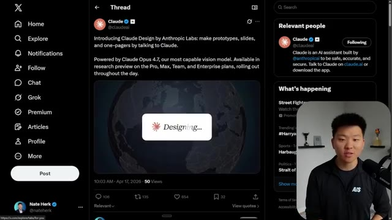
*⏱️ 00:00:08 — Une capture d'écran de l'interface de X (Twitter) montrant un post officiel de Claude AI présentant "Claude Design".*

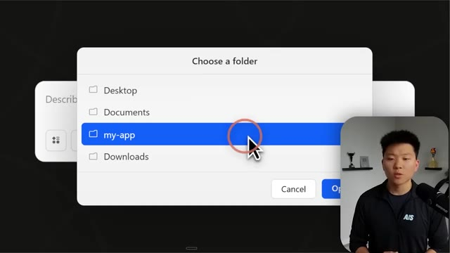
*⏱️ 00:00:25 — Une interface système de sélection de fichiers affichant une boîte de dialogue "Choose a folder" avec le dossier "my-app" sélectionné.*

---

### ⏱️ `[00:00:34 - 00:01:07]` | Segment #02

**🔊 Audio (Transcription Intégrale Mot pour Mot en Français) :**
> the barrier to entry even more. And a lot more people might be coming over here to test out cloud design. All right. So this is the main page. We have prototypes where we can create a new project here, either a wireframe or high fidelity. We can create slide decks or we can create from templates or other sorts of things. And you'll also notice at the bottom here, there's this thing that says set up design system, create a design system so that anyone can create good looking designs and assets. I'm assuming that this might be like a design.md sort of thing. So like a template that the agent can look at to always make sure it's following your brand guidelines. So it looks like, yeah, we have a company name and blurb. We would provide examples of our design systems and

**👁️ Analyse Visuelle d'Écran (gemini-3.5-flash-lite) :**
**Interface & Outils** : Claude Design (Research Preview par Anthropic Labs)

**Contenu textuel & Code** : Menu de création de prototype avec des options pour "Wireframe" et "High fidelity", barre de recherche, onglets "Recent", "Your designs", "Examples", "Design systems".

**Action / Démonstration** : Le curseur survole l'option "High fidelity" dans le panneau de création de nouveau projet.

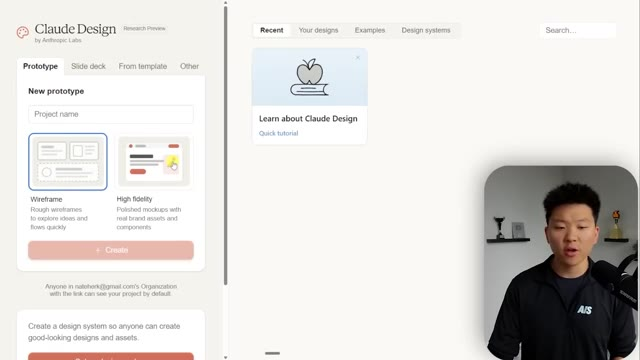
*⏱️ 00:00:42 — Capture d'écran de l'interface principale de "Claude Design" montrant les options de création de nouveaux projets (Wireframe, High fidelity) et le tutoriel "Learn about Claude Design".*

---

### ⏱️ `[00:01:07 - 00:01:38]` | Segment #03

**🔊 Audio (Transcription Intégrale Mot pour Mot en Français) :**
> products and then any other notes. So that's how we could have every single project that we create in here inside of Cloud Design feels consistent with our brand. So let me just go ahead and fill out some example stuff here. All right. So I set up the name. I set up a little blurb. I actually put in the GitHub repo for our AI Automation Society website. So this website right here. And then I just linked in the brand guidelines and our actual logo. And then just that our brand should feel techie, but also modern and professional. So now that is our design system. I'm going to go ahead and click continue to generation. It will take about 15 minutes to generate your design system.

**👁️ Analyse Visuelle d'Écran (gemini-3.5-flash-lite) :**
**Interface & Outils** : Navigateur web (interface de génération de projet/design system).

**Contenu textuel & Code** : Formulaire de saisie pour "Company name and blurb", intégration GitHub ("nateherkai/AI-Automation-Society-Website"), et champ de notes ("Our brand should feel techie but also modern and professional").

**Action / Démonstration** : Le présentateur configure les paramètres de branding en liant un dépôt GitHub spécifique et en téléchargeant des fichiers de ressources graphiques pour assurer la cohérence du design.

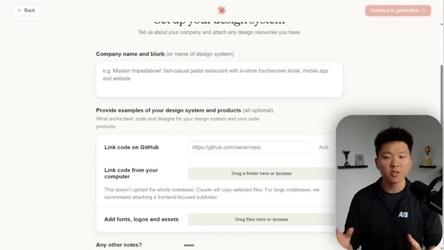
*⏱️ 00:01:15 — Interface de configuration d'un design system avec des champs pour le nom de l'entreprise et l'importation de ressources (GitHub, dossiers locaux, assets).*

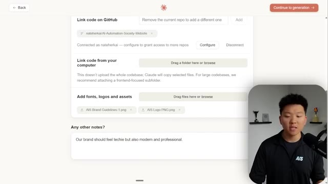
*⏱️ 00:01:30 — Interface de configuration mise à jour avec le repository GitHub "nateherkai/AI-Automation-Society-Website" lié et des fichiers de branding (Brand Guidelines, logo) téléchargés.*

---

### ⏱️ `[00:01:39 - 00:02:19]` | Segment #04

**🔊 Audio (Transcription Intégrale Mot pour Mot en Français) :**
> You can step away, but keep the tab open. Okay, cool. So I'm going to go ahead and start that generation. Now you can see as while this is loading up, we definitely get that lovable style interface. We can see what's going on on the left-hand side. We can see a task list. And then on the right-hand side, we can see what's actually going on. So while this is loading up, let's actually talk about what is this Claude design. So this is the blog or the announcement post they just put out. It is powered by their most capable vision model, Opus 4.7. So if you guys missed my video yesterday about Opus 4.7, I'll put it right up here. But one of the benchmarks that stood out was right here, visual reasoning. So 82% and 91% compared to Opus 4.6 is 69% and 84.7%. So a

**👁️ Analyse Visuelle d'Écran (gemini-3.5-flash-lite) :**
**Interface & Outils** : Interface de travail IA type "Canvas" ou outil de développement, site web officiel Anthropic.

**Contenu textuel & Code** : Liste de tâches techniques : "Explore GitHub repo", "Create README.md", "Create colors_and_type.css", "Create UI kit(s) per product".

**Action / Démonstration** : Démonstration de l'avancement d'un projet de création de système de design via une interface IA interactive.

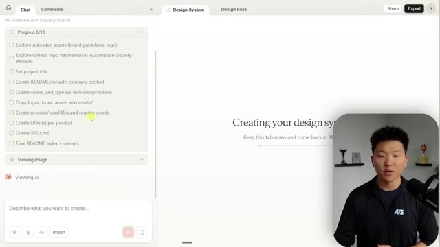
*⏱️ 00:01:49 — Interface utilisateur d'un outil de développement assisté par IA montrant une liste de tâches (Progress 0/10) et un espace de travail "Design System" à droite.*

---

### ⏱️ `[00:02:19 - 00:02:40]` | Segment #05

**🔊 Audio (Transcription Intégrale Mot pour Mot en Français) :**
> noticeable jump in visual reasoning, which is exactly what they called out right over here. So cloud design is available in research preview, but you have to be on a cloud subscription. So pro max team or enterprise subscribers were rolling out to users gradually throughout the day. So I'm not going to read off all these features because I think you guys understand kind of the premise here, but what's cool is you can collaborate. So designs can have organization scoped sharing.

**👁️ Analyse Visuelle d'Écran (gemini-3.5-flash-lite) :**
**Interface & Outils** : Site web officiel d'Anthropic (article de blog sur Claude Design).

**Contenu textuel & Code** : Texte descriptif des fonctionnalités de "Claude Design" (interface de design, typographie, couleurs, importation de fichiers DOCX/PPTX/XLSX).

**Action / Démonstration** : Navigation sur le site web d'Anthropic pour illustrer les capacités de l'outil Claude Design annoncé.

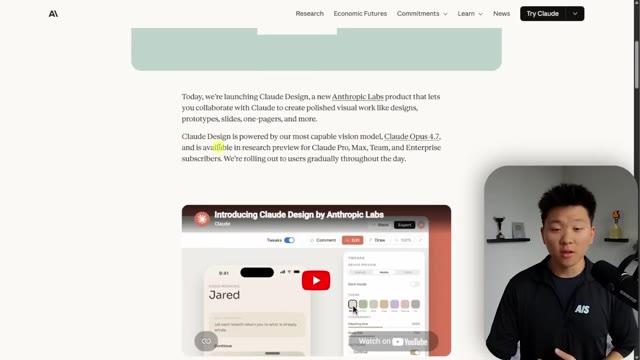
*⏱️ 00:02:24 — Page web officielle d'Anthropic présentant "Claude Design", incluant une vidéo intégrée montrant l'interface de l'outil avec des options de personnalisation visuelle.*

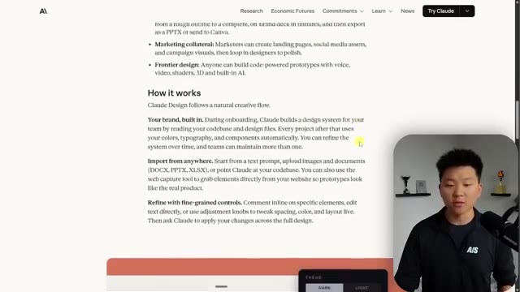
*⏱️ 00:02:35 — Suite de la page web détaillant le fonctionnement de "Claude Design", notamment l'importation de documents, la création de systèmes de design et les outils d'édition fine.*

---

### ⏱️ `[00:02:40 - 00:03:01]` | Segment #06

**🔊 Audio (Transcription Intégrale Mot pour Mot en Français) :**
> You can keep something private or you can share it across your team. You can export pretty much anywhere. You can export to Canva, PDF, PowerPoint, or HTML files. And this is where it gets cool. you can hand off to Claude Code. So when a design is ready, Claude can package everything and you can pass it off to Claude Code to do the actual building and syncing to GitHub and all of these other things. Hey guys, real quick, in this video, my computer was freaking out a little bit.

**👁️ Analyse Visuelle d'Écran (gemini-3.5-flash-lite) :**
**Interface & Outils** : Navigateur web (site web d'Anthropic).

**Contenu textuel & Code** : Texte descriptif des fonctionnalités : "Collaborate", "Export anywhere" (mentionnant Canva, PDF, PPTX, HTML), et "Handoff to Claude Code" (expliquant le packaging des designs pour Claude Code).

**Action / Démonstration** : Présentation visuelle des capacités de workflow et d'intégration de la plateforme Claude.

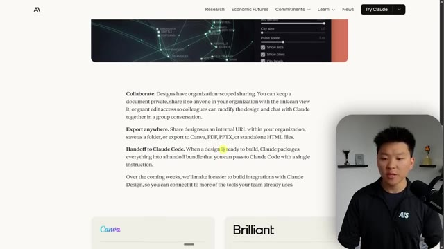
*⏱️ 00:02:45 — Une capture d'écran de l'interface web d'Anthropic (Claude) présentant les fonctionnalités de collaboration, d'exportation et de transfert vers "Claude Code", avec le présentateur incrusté en bas à droite.*

---

### ⏱️ `[00:03:01 - 00:03:37]` | Segment #07

**🔊 Audio (Transcription Intégrale Mot pour Mot en Français) :**
> So there's like a few times where my face cam's super laggy, but it does not last the whole video. Just stick with me for about 30 to 45 seconds of annoying lag, and then we'll be all good to go. Thanks guys, let's get back to the video. Now, a lot of people might be saying that this is gonna kill Canva, but it looks like they're actually working together here. we can see that canvas said we've loved collaborating with anthropic over the past couple of years and share a deep focus on making complex things simple but checking back in on our cloud over here we can see it's doing a lot it's importing from github it's reading everything it's building preview cards and building styles and stuff so i'm just going to check in with you guys once this has been fully built out so it's still working but it came up with something for us as a draft we can

**👁️ Analyse Visuelle d'Écran (gemini-3.5-flash-lite) :**
**Interface & Outils** : Claude Design (outil de conception IA par Anthropic)

**Contenu textuel & Code** : - Image #1 : Menu de configuration de projet, options de "Design system", gestionnaire de fichiers.
- Image #2 : Texte promotionnel et citations clients sur le workflow de prototypage interactif.
- Image #3 : Logs d'exécution de l'agent : "Browsing GitHub repo", "Importing from GitHub", "Reading key CSS & component files".

**Action / Démonstration** : - Image #1 : Initialisation d'un nouveau projet de présentation (Slide deck).
- Image #2 : Navigation dans la documentation/témoignages de la plateforme.
- Image #3 : Traitement automatisé de la base de code pour générer un système de design (Design System) à partir d'un dépôt GitHub.

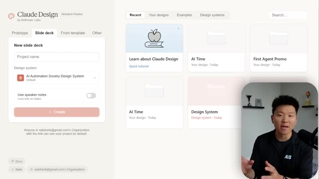
*⏱️ 00:03:10 — Interface de lancement de Claude Design montrant les options de création de "Slide deck" et les projets récents.*

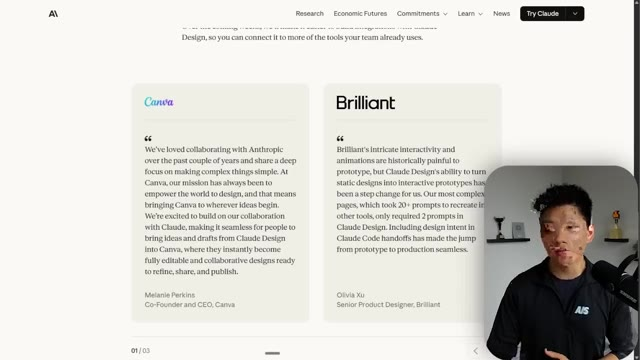
*⏱️ 00:03:19 — Page web présentant des témoignages d'utilisateurs sur l'intégration de Claude Design avec Canva et Brilliant.*

*⏱️ 00:03:28 — Panneau latéral de l'agent Claude Design affichant le journal d'exécution des tâches (importation GitHub, lecture de fichiers CSS/composants).*

---

### ⏱️ `[00:03:37 - 00:03:57]` | Segment #08

**🔊 Audio (Transcription Intégrale Mot pour Mot en Français) :**
> see that we are missing brand fonts hopefully it's able to find those because in the brand guidelines doc that i gave it there is typography in there so just to pull this up real quick you can see here that we do have two different fonts that we use right there. Anyways, things that need review. So we have the colors. These all look good. And we're able to directly approve right here. So I'll say that looks good. We also have some accents and gradients.

**👁️ Analyse Visuelle d'Écran (gemini-3.5-flash-lite) :**
**Interface & Outils** : Outil de génération de Design System (interface de type "Canvas" ou "AI Workspace").

**Contenu textuel & Code** : Fichier "AIS Brand Guidelines.png" listant les spécifications graphiques ; alertes textuelles sur les polices manquantes ("Missing brand fonts") ; palette de couleurs avec codes hexadécimaux (#2CA9E1, #2D9BA8, etc.).

**Action / Démonstration** : Le présentateur consulte le document de directives de marque (Brand Guidelines) pour vérifier les polices utilisées afin de résoudre l'erreur de rendu typographique de l'IA.

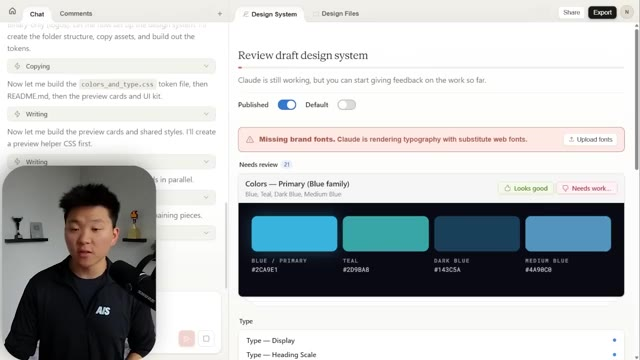
*⏱️ 00:03:42 — Interface de travail d'un outil d'IA génératrice de design système, affichant une alerte sur les polices manquantes et la palette de couleurs.*

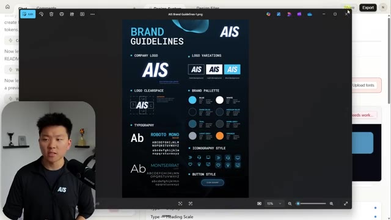
*⏱️ 00:03:47 — Affichage en surimpression d'un fichier image "AIS Brand Guidelines" détaillant le logo, la palette de couleurs et les typographies (Roboto Mono, Montserrat).*

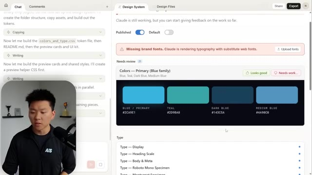
*⏱️ 00:03:52 — Retour à l'interface principale de l'outil de design après consultation des directives, montrant la progression de la documentation des types.*

---

### ⏱️ `[00:03:57 - 00:04:18]` | Segment #09

**🔊 Audio (Transcription Intégrale Mot pour Mot en Français) :**
> Once again, I'll click on looks good. We've got neutrals. We've got the type, which looks exactly the way it is on our website. Okay, so what is it talking about? It definitely does have fonts. This is the typography that we actually are using. So I don't know what's going on there. But you can see that there's tons of different things to review. So I'm just gonna keep clicking through and make sure that nothing looks too weird. It's even getting into like the spacing and what the buttons might look like, the glow, all of that looks really nice too.

**👁️ Analyse Visuelle d'Écran (gemini-3.5-flash-lite) :**
**Interface & Outils** : Plateforme de développement de système de design (potentiellement Claude Projects ou interface similaire de gestion de design system).

**Contenu textuel & Code** : Spécifications typographiques (Roboto Mono, Montserrat), rapports d'état ("Needs review"), logs d'activité ("Copying", "Writing") et messages d'avertissement ("Missing brand fonts").

**Action / Démonstration** : Navigation et révision des composants typographiques par l'utilisateur, avec validation des éléments par clic sur "Looks good".

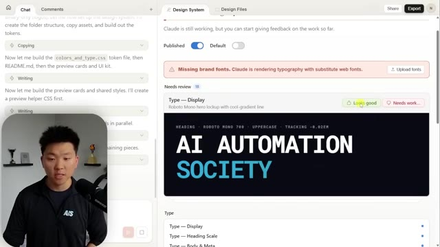
*⏱️ 00:04:02 — Interface de prévisualisation de design montrant une typographie "Roboto Mono" pour le titre "AI AUTOMATION SOCIETY" avec une alerte de police manquante.*

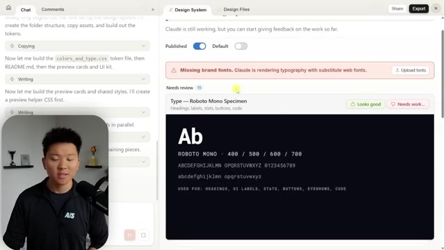
*⏱️ 00:04:08 — Interface de design affichant le spécimen de la police "Roboto Mono" (poids 400 à 700) utilisée pour les titres, boutons et codes.*

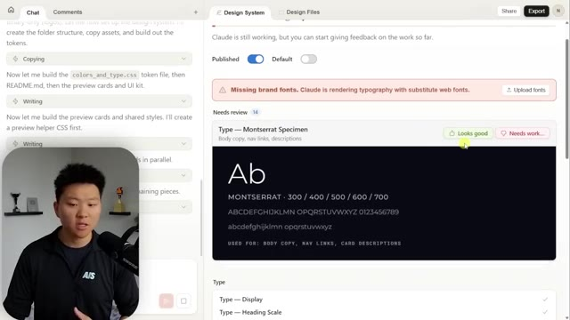
*⏱️ 00:04:13 — Interface de design affichant le spécimen de la police "Montserrat" (poids 300 à 700) utilisée pour le corps du texte et les liens de navigation.*

---

### ⏱️ `[00:04:18 - 00:04:38]` | Segment #10

**🔊 Audio (Transcription Intégrale Mot pour Mot en Français) :**
> We've got our buttons, badges, different cards. Okay, so at this point, it really is just pulling everything from our website to understand the brand feel. But we also see up here, there's a tab called design files. And if I click in, we can see different things. We can see the assets that I dropped in. We can also see a preview of the HTML components and some CSS styling stuff. We can see UI kits.

**👁️ Analyse Visuelle d'Écran (gemini-3.5-flash-lite) :**
**Interface & Outils** : Interface de développement assistée par IA (type Claude / Artifacts) avec gestionnaire de fichiers intégré.

**Contenu textuel & Code** : Structure de fichiers système (folders, stylesheets), noms de fichiers CSS, composants UI (Stats Bar avec statistiques de communauté IA).

**Action / Démonstration** : Navigation entre le "Design System" (visualisation des composants) et les "Design Files" (gestion des ressources sources) pour organiser le projet.

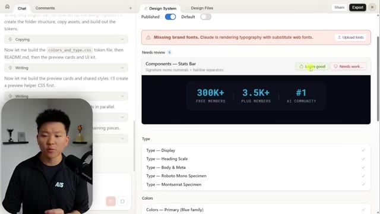
*⏱️ 00:04:23 — Vue de l'interface de travail de l'IA affichant l'onglet "Design System" avec des composants d'interface utilisateur (stats bar) et une liste de types et couleurs en cours de revue.*

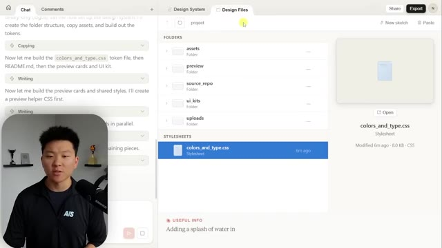
*⏱️ 00:04:28 — Vue de l'interface de l'IA basculée sur l'onglet "Design Files", montrant une structure de dossiers de projet (assets, preview, etc.) et un fichier "colors_and_type.css" sélectionné.*

---

### ⏱️ `[00:04:38 - 00:05:00]` | Segment #11

**🔊 Audio (Transcription Intégrale Mot pour Mot en Français) :**
> We can see any uploads and the source repo, which has other things in here too. So yeah, I guess the way I feel about this right now is they basically took your ability to build a Cloud Code design project or website project inside of, you know, your own folders and files. And they just basically put this onto a lovable style interface. So it kind of reminds me of what they did with Cowork. And they're just kind of doing another iteration of Cowork, but this is for design.

**👁️ Analyse Visuelle d'Écran (gemini-3.5-flash-lite) :**
**Interface & Outils** : Interface web Claude (Artifacts/Design System).

**Contenu textuel & Code** : Liste de tokens de design (Type, Colors, Spacing) et logs d'exécution de l'IA détaillant la création de fichiers CSS, README et composants UI.

**Action / Démonstration** : L'IA est en train de générer et de compiler automatiquement les composants d'un système de design.

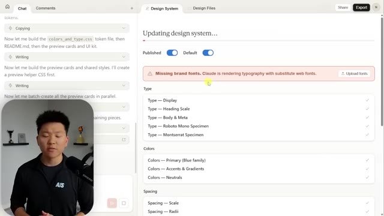
*⏱️ 00:04:44 — Interface d'un outil de design (Claude Artifacts) montrant la mise à jour d'un système de design avec une alerte de police manquante.*

---

### ⏱️ `[00:05:00 - 00:05:27]` | Segment #12

**🔊 Audio (Transcription Intégrale Mot pour Mot en Français) :**
> And what's cool about this is a lot of times when you're building design things, you're brainstorming with Cloud Code about the actual like code or the logic. And then you kind of have a bit of a surprise when it opens up a local host and you look at it. But this way you're able to sort of iterate with it all the way through. So essentially you will be saving tokens because it's kind of the whole theory of having a better planning phase where it might be more upfront, but then what happens is you are spending less because you're not chasing it down the wrong path and trying to course correct it.

**👁️ Analyse Visuelle d'Écran (gemini-3.5-flash-lite) :**
**Interface & Outils** : Interface web de développement assisté par IA (probablement Claude.ai ou outil similaire).

**Contenu textuel & Code** : Journal d'exécution de l'IA (Writing, Reading logs, Edit), messages d'erreur sur les polices d'écriture ("Missing brand fonts"), et structure d'un système de design (Type, Colors, Spacing).

**Action / Démonstration** : L'agent IA est en train de traiter une requête de construction d'un "UI kit" et de corriger des problèmes d'importation de fichiers CSS et de déclarations en double.

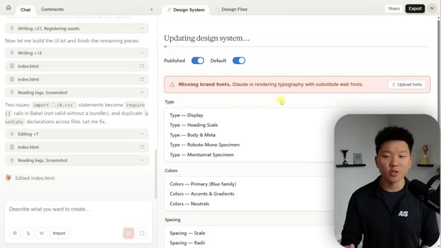
*⏱️ 00:05:07 — Une interface de plateforme web avec une barre latérale de chat gérée par une IA et une zone de visualisation principale affichant un système de design en cours de mise à jour.*

---

### ⏱️ `[00:05:28 - 00:05:50]` | Segment #13

**🔊 Audio (Transcription Intégrale Mot pour Mot en Français) :**
> So we're still missing our fonts apparently. I'm not gonna mess with that because it has our typography and that looks fine. It went through a ton here. You can see what it did is it created colors and type. We have a readme. We have also a skill.md, which is a machine readable manifest for CloudCode. And I'm assuming somewhere in here there is a design MD or maybe that's exactly what we just built together. So now your team's new projects will use this design system by default, which is awesome.

**👁️ Analyse Visuelle d'Écran (gemini-3.5-flash-lite) :**
**Interface & Outils** : Interface web d'outil de design assisté par IA (type platform de génération UI).

**Contenu textuel & Code** : Liste des composants générés : "colors_and_type.css", "README.md", "SKILL.md", ainsi que des sections sur la typographie, les palettes de couleurs et l'espacement.

**Action / Démonstration** : Revue des résultats de la génération automatique du design system et confirmation de la complétion des fichiers produits.

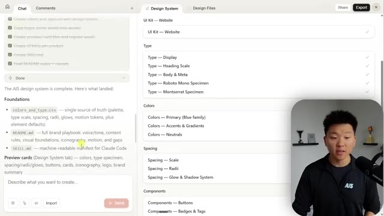
*⏱️ 00:05:33 — Interface d'un outil de génération de design system listant les éléments créés (Foundations, Type, Colors, Spacing) avec le présentateur en médaillon.*

---

### ⏱️ `[00:05:50 - 00:06:09]` | Segment #14

**🔊 Audio (Transcription Intégrale Mot pour Mot en Français) :**
> All of our slides, all of our, you know, whatever it is are gonna use this. So I'm gonna click on this button and we'll see what pops up next. Okay, so the app is a little laggy. It feels like it's using a decent amount of my RAM, probably because it's in research preview and maybe it's still being rolled out. But anyways, we can look at examples, which is pretty cool. We have shader wallpapers. So that's kind of nice.

**👁️ Analyse Visuelle d'Écran (gemini-3.5-flash-lite) :**
**Interface & Outils** : Aucune interface logicielle n'est affichée (écran blanc en cours de chargement).

**Contenu textuel & Code** : Aucun contenu textuel ou graphique n'est visible sur la zone de travail.

**Action / Démonstration** : Le présentateur attend que l'application se charge ou réagisse après avoir cliqué sur un bouton, comme mentionné dans l'audio.

---

### ⏱️ `[00:06:09 - 00:06:27]` | Segment #15

**🔊 Audio (Transcription Intégrale Mot pour Mot en Français) :**
> We have app onboarding. So we could go through the whole flow of an iOS app. We also have text streaming and all of this stuff. We could just go ahead and use the prompt directly. Okay, so I want to first off just try a slide deck. So I'm just going to call this AI time and we're going to go ahead and create this slide deck. It's already using my design system as you can see. And there was a drop down.

**👁️ Analyse Visuelle d'Écran (gemini-3.5-flash-lite) :**
**Interface & Outils** : Plateforme web "Claude Design" (Research Preview) d'Anthropic Labs.

**Contenu textuel & Code** : Menus de sélection de projets, champs de saisie pour le nom du projet ("Project name"), choix du système de design ("AI Automation Society Design System") et descriptions de prompts de design.

**Action / Démonstration** : Navigation dans la bibliothèque d'exemples et configuration d'un nouveau projet de type "Slide deck".

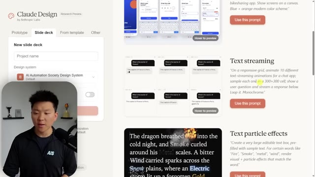
*⏱️ 00:06:13 — Interface de "Claude Design" affichant des exemples de projets comme "Text streaming" et "Text particle effects" avec des boutons "Use this prompt".*

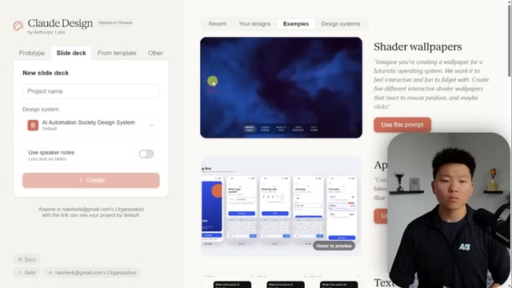
*⏱️ 00:06:18 — Interface de "Claude Design" avec le panneau de configuration "New slide deck" à gauche et une galerie d'exemples interactifs (Shader wallpapers) à droite.*

---

### ⏱️ `[00:06:27 - 00:06:55]` | Segment #16

**🔊 Audio (Transcription Intégrale Mot pour Mot en Français) :**
> So that means you can probably have multiple different design systems. If you've got like different business units or you've got different business branding for different things, you can create a design system for each one. So it says start with context. Designs grounded in real context turn out better. We can attach a design system, screenshots or a code base. All right. So what I did is I just dropped in this PDF and this is the one that I just made for a previous video, basically a huge setup guide for setting up Claude Opus 4.7 as a 24 seven trading bot. So I dropped in that PDF and I just want to see if it can turn that into a presentation for me.

**👁️ Analyse Visuelle d'Écran (gemini-3.5-flash-lite) :**
**Interface & Outils** : Interface web d'outil de design IA (non identifié spécifiquement, similaire à l'interface d'Artifacts ou d'un outil de prototypage assisté par IA).

**Contenu textuel & Code** : Texte "Start with context", options : "Design System", "Add screenshot", "Attach codebase". Champ de saisie utilisateur incluant des tags : "Make a deck" et "AI Automation Society Design System".

**Action / Démonstration** : L'utilisateur prépare le contexte pour la génération d'un design en sélectionnant un système de design existant et en définissant une tâche de création de présentation.

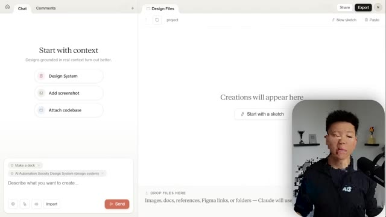
*⏱️ 00:06:34 — Une interface de plateforme de conception assistée par IA (type Claude Artifacts/Design tool) divisée en deux panneaux, avec des options pour intégrer un Design System ou une base de code.*

---

### ⏱️ `[00:06:55 - 00:07:15]` | Segment #17

**🔊 Audio (Transcription Intégrale Mot pour Mot en Français) :**
> So I just gave you a PDF called Opus 4.7 trading bot. I'm not sure if I was supposed to drop it right here or if I was supposed to drop it here, but either way you should be able to see it. And I just want you to turn that into a branded PDF, sorry, not PDF, a branded presentation for me. Okay, so that prompt was horrible. I kind of just like started talking all over the place, but let's see what it can do.

**👁️ Analyse Visuelle d'Écran (gemini-3.5-flash-lite) :**
**Interface & Outils** : Interface web d'outil de design assisté par IA (type Uizard).

**Contenu textuel & Code** : Zone de saisie de prompt avec les éléments contextuels joints : "Make a deck", "AI Automation Society Design System", et "Opus 4.7 Trading Bot - Setup Guide.docx.pdf".

**Action / Démonstration** : Chargement de fichiers et préparation d'un prompt pour générer une présentation à partir d'un guide technique.

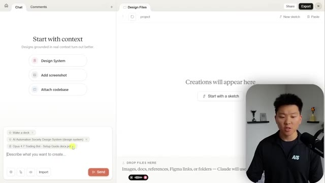
*⏱️ 00:07:00 — L'interface de l'outil Uizard (ou similaire) montrant le panneau de chat latéral avec le fichier "Opus 4.7 Trading Bot - Setup Guide.docx.pdf" importé dans la zone de contexte.*

---

### ⏱️ `[00:07:15 - 00:07:38]` | Segment #18

**🔊 Audio (Transcription Intégrale Mot pour Mot en Français) :**
> It's going to invoke a skill. So let's see which one it's running here. It's running the read PDF skill. I was able to read it and now it's checking the design system and it's setting up the project right here. It planned out the deck. So you can see this is basically 19 different slides that it's gonna create. And now hopefully all of this looks pretty aesthetic and it feels on brand. Okay, this is interesting. We got some sort of internal error, maybe because tons of people are trying to use this right now, but it automatically shot off two retries.

**👁️ Analyse Visuelle d'Écran (gemini-3.5-flash-lite) :**
**Interface & Outils** : Interface web d'agent IA (type environnement de développement/création).

**Contenu textuel & Code** : Historique de logs de l'agent : "Invoking skill: read_pdf", "Running script: const { PDFParse } = await import...", "Listing files", "Copying starter". Liste de fichiers : colors_and_type.css, deck-stage.js.

**Action / Démonstration** : L'agent IA analyse un fichier PDF, interagit avec le système de design, charge des scripts et initialise la structure d'un projet de présentation.

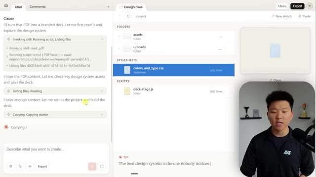
*⏱️ 00:07:20 — Interface d'une application d'automatisation IA affichant un chat avec l'agent "Claude" à gauche et un gestionnaire de fichiers de projet à droite.*

---

### ⏱️ `[00:07:38 - 00:07:57]` | Segment #19

**🔊 Audio (Transcription Intégrale Mot pour Mot en Français) :**
> So it does have that functionality. Oh, here's a nice little useful tip. Store bread in the freezer, toasting it from frozen tastes better than fresh. Okay, so it's still editing some stuff, but you can see right off the bat, this feels very branded to me. The colors, the typography, the logos, everything. So as we start to sort of swipe through here, we can see we're still getting the same feeling with all the fonts.

**👁️ Analyse Visuelle d'Écran (gemini-3.5-flash-lite) :**
**Interface & Outils** : Interface de développement et de design (type Canvas/Editor Web), intégrant un panneau de chat à gauche et un visualiseur de fichiers/présentation à droite.

**Contenu textuel & Code** : Arborescence de fichiers de projet, métadonnées CSS/JS, et texte de présentation pour un "Trading Bot" utilisant Claude Code, Git et l'API Alpaca.

**Action / Démonstration** : Navigation entre la structure technique du projet (fichiers/scripts) et la prévisualisation visuelle de la présentation générée.

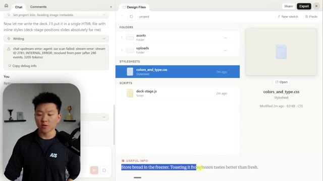
*⏱️ 00:07:43 — Interface de gestion de fichiers d'un projet, montrant des dossiers (assets, uploads), des feuilles de style (colors_and_type.css) et des scripts (deck-stage.js), avec une zone de texte en bas affichant une astuce sur le pain.*

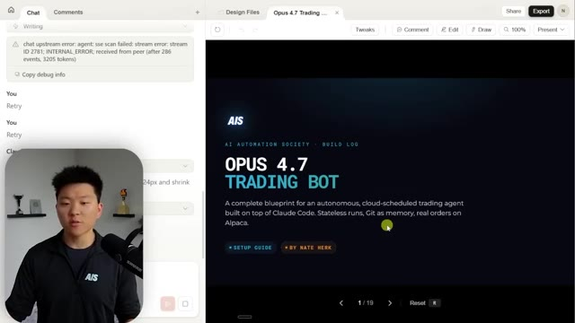
*⏱️ 00:07:47 — Aperçu du rendu final d'une présentation ou d'un rapport intitulé "OPUS 4.7 TRADING BOT", avec le branding "AIS" et une brève description du projet de robot de trading autonome.*

---

### ⏱️ `[00:07:57 - 00:08:15]` | Segment #20

**🔊 Audio (Transcription Intégrale Mot pour Mot en Français) :**
> We're getting the information from the actual PDF. You can tell there's some sort of skills going on on the backend. I don't know if you guys have ever tried to create like a slide deck with Claude Code, but this looks really, really good. And think about the fact that I just dropped in a PDF. So obviously like this, I don't like, I don't like all the spacing here, but something like this is really nice.

**👁️ Analyse Visuelle d'Écran (gemini-3.5-flash-lite) :**
**Interface & Outils** : Application web de création de slides (type éditeur de présentation IA).

**Contenu textuel & Code** : Texte de présentation : "Why this design", détails techniques sur les runs stateless, Git et les hard rules. Fenêtre de chat montrant des instructions d'édition : "Let me fix the findings: bump eyebrow size to 24px...".

**Action / Démonstration** : Visualisation d'une diapositive générée à partir d'un PDF, avec des ajustements de style en cours via l'interface de chat intégrée.

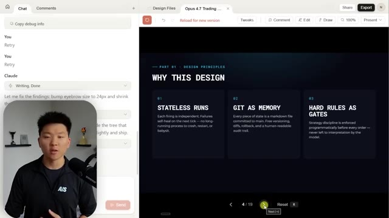
*⏱️ 00:08:02 — Une interface de conception de diapositives affichant une présentation sur les "Design Principles" avec trois colonnes : Stateless Runs, Git as Memory, et Hard Rules as Gates, avec un panneau de chat Claude sur la gauche.*

---

### ⏱️ `[00:08:15 - 00:08:34]` | Segment #21

**🔊 Audio (Transcription Intégrale Mot pour Mot en Français) :**
> I like the glow down here. This is very nice. Okay, I like this slide a lot as well. We can see the repository layout. So anyways, this is awesome. Now what we can do is we can see there's a button here that says tweaks. We can ask Claude to change something about a specific slide. We can leave comments as well. We can actually like choose something and comment on it. So that's very nice about like a very specific element.

**👁️ Analyse Visuelle d'Écran (gemini-3.5-flash-lite) :**
**Interface & Outils** : Interface web de création de slides assistée par IA (semblable à un outil de design itératif).

**Contenu textuel & Code** : Textes sur les architectures "Three Wrappers" et "Prompt Scaffold", commandes CLI associées, fenêtre de chat Claude avec historique et zone de saisie pour "Tweaks".

**Action / Démonstration** : Navigation entre les slides de présentation et ouverture de la fonctionnalité "Tweaks" pour modifier dynamiquement les éléments visuels de la slide via un prompt.

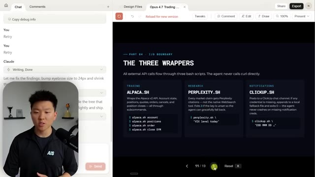
*⏱️ 00:08:20 — Interface de présentation montrant une diapositive intitulée "THE THREE WRAPPERS" détaillant l'utilisation de scripts bash (alpaca.sh, perplexity.sh, clickup.sh) avec le présentateur en médaillon.*

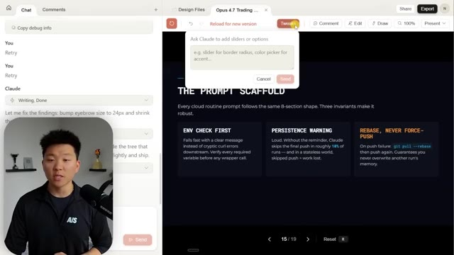
*⏱️ 00:08:25 — Interface de présentation montrant une diapositive intitulée "THE PROMPT SCAFFOLD" avec une fenêtre contextuelle "Tweaks" ouverte pour modifier les éléments de design via une requête à Claude.*

---

### ⏱️ `[00:08:34 - 00:09:08]` | Segment #22

**🔊 Audio (Transcription Intégrale Mot pour Mot en Français) :**
> We can click on edit. So we can actually physically change the things ourselves we want to. We also have this option to draw. I'm not sure what this is. Maybe just to like point at something. Okay. So I basically just drew and I typed and said, I don't like this. And I click send. Okay. So it sends over that image of what I drew and then it sends over my note as well. So I'm just going to go ahead and stop that because there was nothing wrong with it, but we can also present right from here. So we can present full screen right in this tab. And I know that aspect ratio got weird for you guys, but we can present there or just like that. There you go. Now you can see it for real. Okay. So that's very awesome. That's going to help us be able to create slide decks so

**👁️ Analyse Visuelle d'Écran (gemini-3.5-flash-lite) :**
**Interface & Outils** : Interface web d'agent IA (Opus 4.7 Trading) intégrée avec des outils d'annotation et de chat.

**Contenu textuel & Code** : Texte technique sur les "Cloud routine prompts" et des instructions de workflow comme "PERSISTENCE WARNING" ou "REBASE, NEVER FORCE-PUSH".

**Action / Démonstration** : Le présentateur utilise l'outil de dessin pour entourer une zone spécifique de l'interface, soumettant une instruction visuelle à l'agent pour modification.

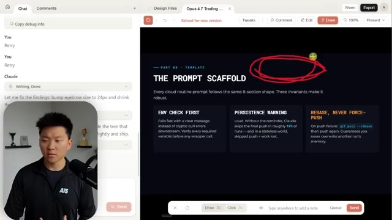
*⏱️ 00:08:43 — Interface de l'agent Opus avec un aperçu visuel à droite ; une annotation rouge (cercle) a été tracée manuellement sur l'élément "THE PROMPT SCAFFOLD".*

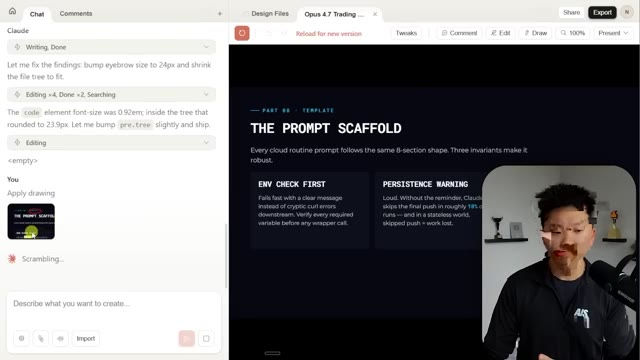
*⏱️ 00:08:51 — Interface de l'agent après l'envoi de la modification : le chat affiche "Apply drawing" et l'état "Scrambling..." indique que l'IA traite la requête visuelle.*

---

### ⏱️ `[00:09:08 - 00:09:27]` | Segment #23

**🔊 Audio (Transcription Intégrale Mot pour Mot en Français) :**
> much quicker. And honestly, I like this more than gamma because gamma has its own things and it's really nice, but it's a bit more inflexible. So if you dropped in an entire, like just transcript or, you know, a 50 page brain dump, it would be able to structure it into a way that you like in here. And it would also feel like it comes from your brand. Okay. So let's go back home.

**👁️ Analyse Visuelle d'Écran (gemini-3.5-flash-lite) :**
**Interface & Outils** : Outil de présentation assisté par IA (similaire à Gamma ou outil équivalent) avec une fenêtre de chat latérale pour les modifications.

**Contenu textuel & Code** : Schéma d'arborescence d'un projet "trading-bot" incluant des dossiers comme `routines/`, `scripts/` et `memory/`, ainsi que des encadrés explicatifs sur les modes "LOCAL MODE" et "CLOUD MODE".

**Action / Démonstration** : L'IA est en train d'exécuter des modifications en temps réel sur la présentation (visible dans le chat latéral : "bump eyebrow size to 24px and shrink the file tree to fit").

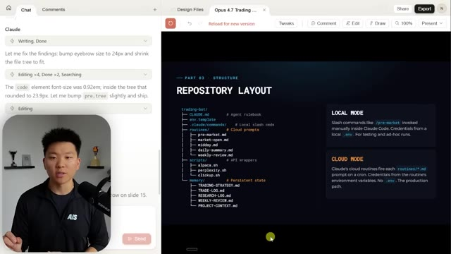
*⏱️ 00:09:13 — Une interface de présentation de type outil de création IA affichant une diapositive technique sur la structure d'un dépôt de code (Repository Layout).*

---

### ⏱️ `[00:09:27 - 00:09:59]` | Segment #24

**🔊 Audio (Transcription Intégrale Mot pour Mot en Français) :**
> That's kind of what we can do with slide decks or presentations. Let's see what it can do with an actual landing page. So I'm going to go over here to prototype and we're just going to do a high fidelity. We're just going to go straight after it with the high fidelity. I'm just going to call this one a first agent promo and we're going to click create. So let's say you have your main website for your brand, right? So we have AI Automation Society, which is just kind of like an overall overview. But what if we want to create like a different landing page that would go on a subdomain because maybe we're launching like a limited time workshop or promotion. All right. So that's pretty vague, right? Like there's a little bit of detail, but it's pretty vague,

**👁️ Analyse Visuelle d'Écran (gemini-3.5-flash-lite) :**
**Interface & Outils** : Application web Claude Design (Research Preview).

**Contenu textuel & Code** : Menu de configuration de projet avec options "Project name", sélection de "Design system" et choix de fidélité du prototype ("Wireframe" vs "High fidelity").

**Action / Démonstration** : Le curseur de la souris survole l'option "High fidelity" pour la sélectionner en vue de créer une landing page.

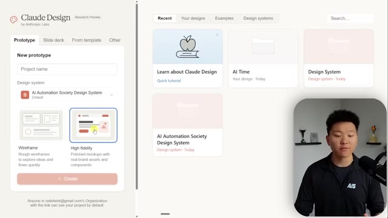
*⏱️ 00:09:35 — Interface de l'outil "Claude Design" affichant le panneau de création d'un nouveau prototype avec le choix entre "Wireframe" et "High fidelity".*

---

### ⏱️ `[00:09:59 - 00:10:34]` | Segment #25

**🔊 Audio (Transcription Intégrale Mot pour Mot en Français) :**
> but it's going to be able to use our design system. And I'm curious to see, there we go. It's asking us questions and it's asking us right over here. So what is the workshop called? We're going to say your first AI agent confirm the dates, May 4th to May 6th. Sure. What time each day? We're just going to go 9am to 11am central. Is there a seat cap? We're just going to say, yeah, sure. Early bird pricing. Who's hosting? I'll host it. What do you want your students to walk away with your first AI agent built with cloud code and the day by day agenda. Sure. High level

**👁️ Analyse Visuelle d'Écran (gemini-3.5-flash-lite) :**
**Interface & Outils** : Application de conception de landing page assistée par IA (type plateforme de design/no-code).

**Contenu textuel & Code** : Formulaire interactif intitulé "Quick questions about the First Agent workshop landing page", avec des options de sélection pour le nom du workshop ("Your First AI Agent"), les dates, et un champ de texte pour les horaires.

**Action / Démonstration** : L'utilisateur (ou l'IA) interagit avec le formulaire pour définir les paramètres du workshop avant la génération de la page.

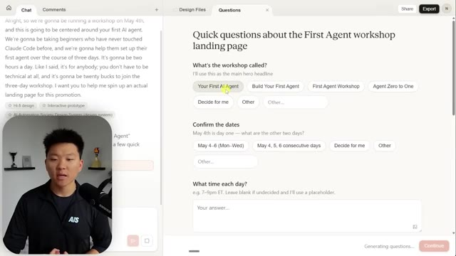
*⏱️ 00:10:08 — Interface d'une application web interactive posant des questions de configuration pour la création d'une landing page de workshop.*

---

### ⏱️ `[00:10:34 - 00:10:59]` | Segment #26

**🔊 Audio (Transcription Intégrale Mot pour Mot en Français) :**
> per day. Okay. So as you can see, it's, it's getting all the questions that it needs from us in order to be able to make this landing page. All right. So I answered all of those questions. There was a lot, but that's once again, a very good thing. Let's see what we get. We have our page now and we have some tweaks that we can make. So it opened up a panel right here. You can see that we can change the early bird. So I could change this to April 30th and it would update. I don't know where it was. Oh, okay. I found it. April 30th. I could change this to April 29th. There we go.

**👁️ Analyse Visuelle d'Écran (gemini-3.5-flash-lite) :**
**Interface & Outils** : Interface web d'un outil de développement de type "AI Canvas" ou constructeur de site web assisté par IA (style Claude Artifacts/Bolt).

**Contenu textuel & Code** : Spécifications techniques pour une page de vente (données de workshop, liens, copier-coller de contenu), barre de progression "Explore AIS design system", et panneau de réglages "Tweaks" pour la landing page (accent bleu/orange, compte à rebours, barre CTA).

**Action / Démonstration** : L'agent IA est en train de structurer et de générer une page web basée sur les prompts fournis par le créateur, avec possibilité d'édition en temps réel via le panneau latéral.

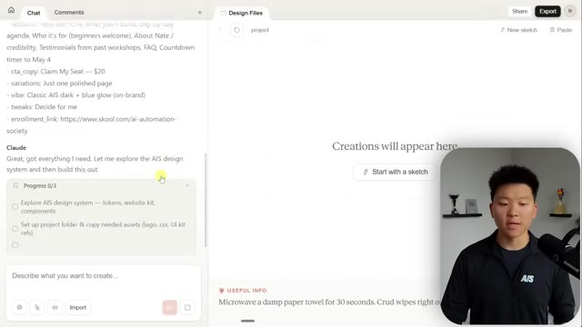
*⏱️ 00:10:41 — Interface de discussion avec Claude où le système analyse les besoins du projet et affiche une barre de progression des tâches.*

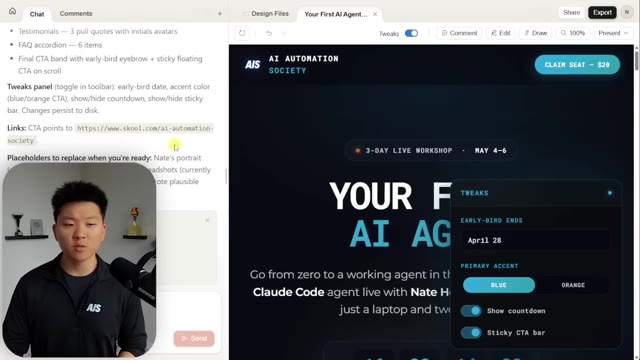
*⏱️ 00:10:47 — Visualisation de la landing page générée par l'IA avec un panneau de configuration ("Tweaks") permettant d'ajuster les couleurs et les options d'affichage.*

---

### ⏱️ `[00:10:59 - 00:11:33]` | Segment #27

**🔊 Audio (Transcription Intégrale Mot pour Mot en Français) :**
> We can make that tweak. The primary accent can be orange instead of blue. So if we wanted to change it to orange, we certainly could that easily. We have a countdown right here, which we could turn off. And we also have a sticky CTA bar, which we could turn off as well, which is right here, as you can see. And now I could just turn this off when I'm all good with the tweaks. So let's take a look at the actual content here. First of all, you'll notice this feels exactly like the website and all of these elements feel the same with the buttons and the colors and the spacing, all of that. Even the copy has a very similar feel. The capitalization, the icons, very nice. We've got the three-day plan. It goes through one, two, three, built for beginners. I

**👁️ Analyse Visuelle d'Écran (gemini-3.5-flash-lite) :**
**Interface & Outils** : Outil de design ou constructeur de site web interactif.

**Contenu textuel & Code** : Panneau de contrôle des réglages : options "PRIMARY ACCENT" (BLUE/ORANGE), "Show countdown" et "Sticky CTA bar".

**Action / Démonstration** : Démonstration de la personnalisation en temps réel d'une page de destination ("landing page") via un panneau de contrôle dédié.

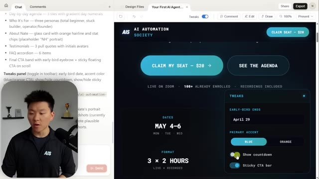
*⏱️ 00:11:08 — Interface de conception web montrant un panneau de personnalisation "TWEAKS" avec des options pour modifier la couleur d'accentuation (bleu/orange), ainsi que des interrupteurs pour afficher/masquer le compte à rebours et la barre CTA collante.*

---

### ⏱️ `[00:11:33 - 00:11:53]` | Segment #28

**🔊 Audio (Transcription Intégrale Mot pour Mot en Français) :**
> would have to upload my image, which would go right here as far as like who is the instructor. And then we've got some testimonials right here. What we would do now is we'd go back and forth and iterate and we'd see the version and we'd keep making tweaks and we'd comment on things. And that's how we would get this to the point that we want it. But now how do we actually get this project on the web? Well, we have an export button up here. We can download the zip, a PDF, a PowerPoint.

**👁️ Analyse Visuelle d'Écran (gemini-3.5-flash-lite) :**
**Interface & Outils** : Outil de design et prototypage (type Figma ou similaire).

**Contenu textuel & Code** : Liste de spécifications (agenda, personas, section "About", témoignages, FAQ, CTA) et rendu visuel d'une page web avec des encadrés de témoignages et un bouton d'appel à l'action.

**Action / Démonstration** : Le présentateur commente la maquette en cours d'itération, pointant les sections de témoignages et les emplacements pour les portraits des instructeurs.

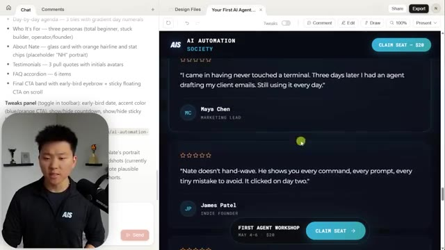
*⏱️ 00:11:38 — Interface de conception collaborative affichant une maquette de page de vente pour "AI Automation Society" avec des sections de témoignages clients et une liste de tâches de développement dans le panneau latéral.*

---

### ⏱️ `[00:11:53 - 00:12:14]` | Segment #29

**🔊 Audio (Transcription Intégrale Mot pour Mot en Français) :**
> we can send to Canva, we can export the HTML, or we can hand off to Cloud Code. So let me see what happens if I click on this. Okay, so it says, fetch this design file, read its readme, and implement the relevant aspects of the design. And I'm gonna go ahead and click on copy command. And now in VS Code, I have the actual project open, which is the AIS website that it had looked at originally. And I'm gonna paste in that prompt, and we'll shoot it off and we'll just see what happens.

**👁️ Analyse Visuelle d'Écran (gemini-3.5-flash-lite) :**
**Interface & Outils** : Interface web de design (probablement une plateforme d'IA génératrice de sites) et Visual Studio Code.

**Contenu textuel & Code** : Commande affichée : "Fetch this design file, read its readme, and implement the relevant aspects of the design. [URL] Implement: Your First AI Agent.html".

**Action / Démonstration** : Copie de la commande depuis l'interface web pour une exécution ultérieure dans le terminal VS Code.

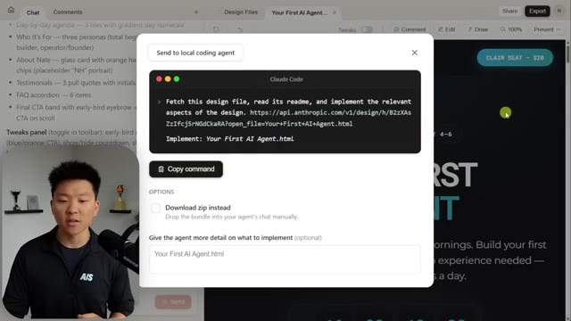
*⏱️ 00:11:58 — Fenêtre modale "Send to local coding agent" affichant une commande à copier pour l'outil Claude Code.*

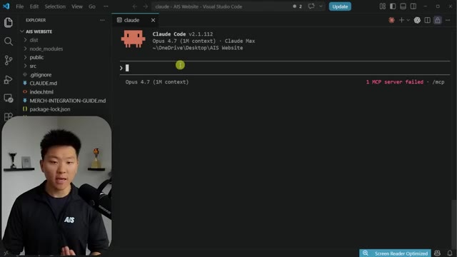
*⏱️ 00:12:09 — Interface de Visual Studio Code avec le terminal Claude Code (v2.1.112) ouvert et prêt à recevoir une entrée.*

---

### ⏱️ `[00:12:14 - 00:12:44]` | Segment #30

**🔊 Audio (Transcription Intégrale Mot pour Mot en Français) :**
> Okay, so you can see it's able to go to this endpoint, and it's able to fetch the design file that we need. So basically, it's going to extract that zip file that we just made over here together in Cloud Design. And while this is running, I just wanna say, this is really impressive to me. It basically just loops everything into Anthropix ecosystem. Like I understand the play for sure because I might not even need my Gamma subscription anymore or I might not even need my Canvas subscription anymore if I can basically just have all of my things synced together and all of my team working on the same projects and the same design systems in the same environment.

**👁️ Analyse Visuelle d'Écran (gemini-3.5-flash-lite) :**
**Interface & Outils** : Visual Studio Code, terminal intégré Claude Code.

**Contenu textuel & Code** : Log d'exécution affichant la récupération d'un fichier design via une URL API Anthropic, la confirmation de réception du fichier (54.5KB) et l'exécution d'une commande Bash pour extraire l'archive.

**Action / Démonstration** : L'agent IA exécute automatiquement des commandes pour récupérer et extraire un fichier de design afin d'implémenter les changements demandés.

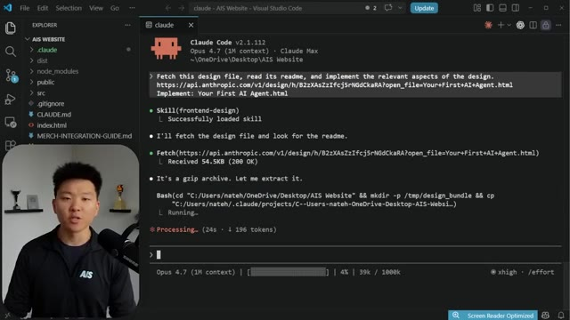
*⏱️ 00:12:22 — Une capture d'écran de l'interface VS Code montrant l'exécution de Claude Code (Opus 4.7) dans un terminal intégré, avec le présentateur en médaillon.*

---

### ⏱️ `[00:12:44 - 00:13:17]` | Segment #31

**🔊 Audio (Transcription Intégrale Mot pour Mot en Français) :**
> Especially when you think about the fact that in order to make these landing pages and in order to make your presentations, Context is everything and when i'm making presentations in gamma, I have to go get from my cloud code projects So much context and so many maybe meeting transcripts or different memos or something But if all of that already lives inside of my cloud code environment and then I say hey Make me a presentation about x y and z go look in the right projects. That's like a huge help So I think the flow is you come to cloud design And you have your design elements and you have your projects here and you do your prototyping here and you do your

**👁️ Analyse Visuelle d'Écran (gemini-3.5-flash-lite) :**
**Interface & Outils** : Visual Studio Code, interface de ligne de commande (CLI) Opus 4.7.

**Contenu textuel & Code** : Journal d'exécution de l'agent : listage de fichiers/répertoires (dist, src, node_modules), exécution de commandes Bash pour copier des dossiers de design, et statut de l'agent ("Thinking", "Working through it", "Cooking...").

**Action / Démonstration** : L'agent IA analyse la structure du projet "AIS Website" et traite les fichiers de design pour préparer l'intégration.

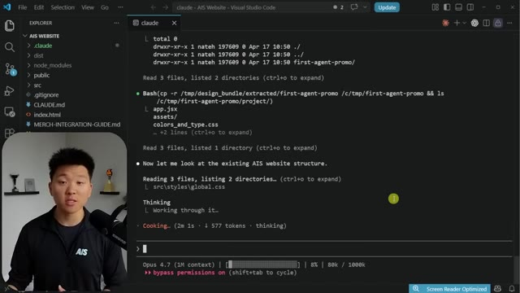
*⏱️ 00:12:53 — Une capture d'écran de l'interface VS Code montrant l'exécution de l'agent IA Opus 4.7 dans une fenêtre de terminal intégrée.*

---

### ⏱️ `[00:13:17 - 00:13:53]` | Segment #32

**🔊 Audio (Transcription Intégrale Mot pour Mot en Français) :**
> you know, slide deck building. And then when you need to actually take it one step further to deploy it or to maybe integrate some other deeper things into it, that's when you send it over to Cloud Code with the click of a button, and then you can expand the functionality from there. Okay. So the server is up. It also said that it automatically switched out my image. Remember if you guys saw in this version, where were we first agent promo in this version, there was a placeholder basically for my image, which was right down here. So it looks like I didn't even tell it to do that by the way. And it was able to fill that in. So let's open up the local host. We have the homepage right here, AI Automation Society. Yep, that's the homepage. But then if we go back to the actual

**👁️ Analyse Visuelle d'Écran (gemini-3.5-flash-lite) :**
**Interface & Outils** : Claude Design, Visual Studio Code (via terminaux dans la barre des tâches).

**Contenu textuel & Code** : Liste de fichiers de design ("First Agent Promo", "AI Time"), spécifications textuelles pour une page web, structure de code affichée dans les vignettes de terminaux.

**Action / Démonstration** : Navigation dans le tableau de bord de design (Image 1) et présentation de l'interface de travail sur un projet de landing page (Image 2).

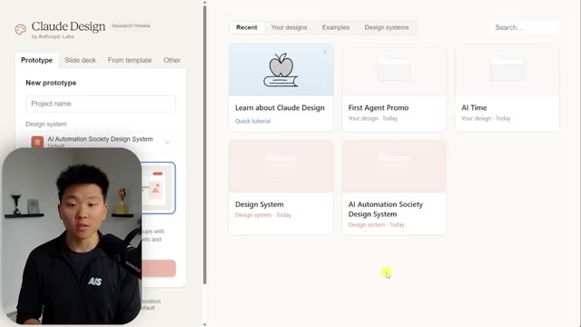
*⏱️ 00:13:26 — Interface principale de "Claude Design" affichant la bibliothèque de projets récents, incluant "Learn about Claude Design" et "AI Automation Society Design System".*

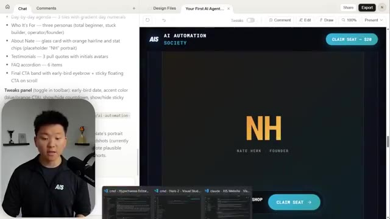
*⏱️ 00:13:44 — Interface d'édition de design montrant une prévisualisation de page web (AI Automation Society) avec une colonne latérale de notes textuelles et une barre de tâches en bas affichant plusieurs instances de terminaux/éditeurs (VS Code).*

---

### ⏱️ `[00:13:53 - 00:14:28]` | Segment #33

**🔊 Audio (Transcription Intégrale Mot pour Mot en Français) :**
> workshop page, which would be kind of like a subdomain, there we go. We have the your first AI agent. We've got the countdown. We've got the buttons. We've got all the same information, the sticky CTA down here. And if I keep scrolling down, we have the actual image. Although this isn't the right one. This is one of my other website. I would ideally want like a headshot, but that would be as simple as dropping in a headshot and saying, hey, use this instead. And it would go ahead and update that. And now, because we're already inside of this project, all I would have to do is push this to GitHub and then Fussell would grab it and I could sync it to a different subdomain. So that is Anthropic's new cloud design. Like I said, I think this is awesome. I'm definitely

**👁️ Analyse Visuelle d'Écran (gemini-3.5-flash-lite) :**
**Interface & Outils** : Navigateur web (page de landing) et éditeur de code (VS Code).

**Contenu textuel & Code** : Détails du plan de formation ("Three-Day Plan") ; dans le terminal : logs npm run dev, adresse du serveur local (http://localhost:5173/first-agent), et statut de l'agent Opus 4.7.

**Action / Démonstration** : Présentation du contenu marketing de la page de l'atelier, puis démonstration technique du lancement du serveur de développement et de la vérification de l'environnement de travail.

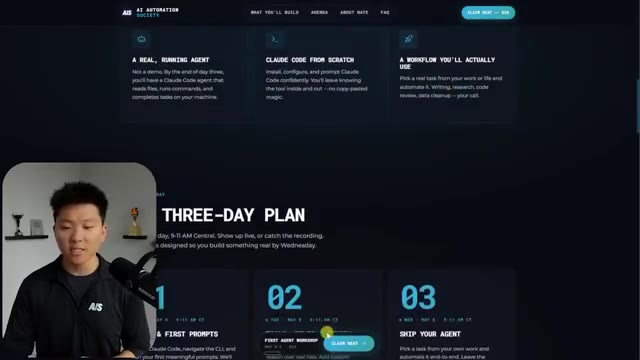
*⏱️ 00:14:01 — Vue d'une page web de présentation d'un atelier sur trois jours, détaillant le programme, les objectifs et les boutons d'appel à l'action (CTA) pour s'inscrire.*

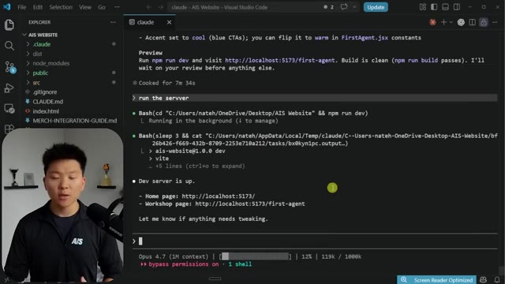
*⏱️ 00:14:19 — Interface de Visual Studio Code avec le terminal intégré montrant l'exécution d'un serveur de développement local (Vite) via Claude Code (Opus 4.7).*

---

### ⏱️ `[00:14:28 - 00:14:39]` | Segment #34

**🔊 Audio (Transcription Intégrale Mot pour Mot en Français) :**
> going to be playing around with this. I'm going to be making a lot of presentations in there. I can already tell you guys that for certain. So if you enjoyed the video or you learned something new, please give it a like. Helps me out a ton. And as always, I appreciate you guys making it to the end and I'll see you in the next one.

**👁️ Analyse Visuelle d'Écran (gemini-3.5-flash-lite) :**
**Interface & Outils** : Navigateur web affichant le site web d'Anthropic.

**Contenu textuel & Code** : Titre "Introducing Claude Design by Anthropic Labs", date "Apr 17, 2026" et une illustration graphique abstraite au centre.

**Action / Démonstration** : Présentation statique de la page d'annonce du produit par le créateur.

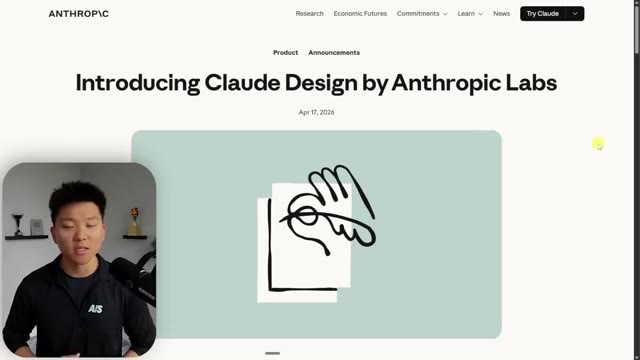
*⏱️ 00:14:30 — Capture d'écran montrant la page web officielle d'Anthropic annonçant le lancement de "Claude Design".*

---

