# 🎬 Claude Just Destroyed Every Video Editing Tool

> **Chaîne** : [Nate Herk | AI Automation](https://www.youtube.com/@nateherk/featured)  
> **Lien YouTube** : [https://www.youtube.com/watch?v=ZNbgOhxhzXg](https://www.youtube.com/watch?v=ZNbgOhxhzXg)  
> **Date de publication** : 20260418  
> **Durée** : 00:32:00  
> **Identifiant vidéo** : `ZNbgOhxhzXg`  
> **Transcription & Analyse** : `whisper-v3-large-turbo+gemini-3.5-flash-lite`  

---

## 📌 Synthèse Exécutive & Outils

### 💡 Résumé
Dans cette vidéo intitulée **Claude Just Destroyed Every Video Editing Tool**, Nate Herk décortique les capacités pratiques d'automatisation et de développement propulsées par les modèles de pointe.

### 🛠️ Outils, Modèles & Logiciels Présentés
- **Opus 5.5 & Claude Code** : Modèles d'ingénierie et agents de codage autonome.

### 🔑 Points Clés & Enseignements Stratégiques
- Optimiser le niveau d'effort et le raisonnement des modèles IA pour des résultats industriels.
- Automatiser les cycles de création logicielle de bout en bout.

---

## ⏱️ Chronologie & Transcription Complète Audio & Visuelle (Mot pour Mot)

### ⏱️ `[00:00:00 - 00:00:23]` | Segment #01

**🔊 Audio (Transcription Intégrale Mot pour Mot en Français) :**
> Today I'm going to show you guys how Claude can be a complete game changer for editing videos, whether that's text on screen like up here or whether that's subtitles down at the bottom like right here. Or it could be motion graphics or charts and different elements. It can be pretty much anything you want it to be. I can move my face around if I want. I can do anything by just using my natural language. You don't have to know how to code at all. And I'm going to show you guys a ton of other examples. So let's not waste any time and let's just get straight into the video.

**👁️ Analyse Visuelle d'Écran (gemini-3.5-flash-lite) :**
**Interface & Outils** : Aucune interface logicielle ou outil technique n'est visible.

**Contenu textuel & Code** : Aucun code, commande ou donnée technique n'est affiché.

**Action / Démonstration** : Le présentateur fait une présentation orale sans manipulation d'interface ou démonstration de logiciel.

---

### ⏱️ `[00:00:23 - 00:01:00]` | Segment #02

**🔊 Audio (Transcription Intégrale Mot pour Mot en Français) :**
> So yeah, pretty wild. By the end of this video, you'll know exactly how to do all of this that I just did using Claude and it's so much easier than you may think. And I'm going to give you guys a repo and a skill and all the stuff that you need to get set up exactly like I've been set up here for completely free. So stay tuned and I'll show you how. So Claude is now a video editing team and this has already been saving me so much time it's actually crazy. Now one thing I want to put into perspective real quick is if you've never edited videos yourself, if you've never like used keyframes and animated motion graphics and things like that, you may not realize how long this 23 second clip would have taken you to edit manually. But if I wanted to edit this by hand,

**👁️ Analyse Visuelle d'Écran (gemini-3.5-flash-lite) :**
**Interface & Outils** : Logiciel d'édition vidéo (interface type éditeur de code/studio), Google Docs.

**Contenu textuel & Code** : "editing.loop()", "analyze_clip", "sync_captions", "Claude Is Now a Video Editing Team", "Method 1 — Claude Design", "Method 2 — Hyperframes", "No code required".

**Action / Démonstration** : Démonstration du workflow d'édition automatisé par IA et présentation structurée du contenu de la vidéo.

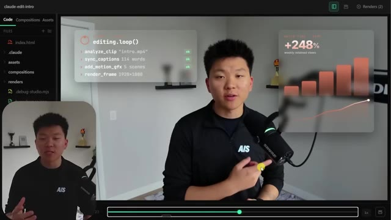
*⏱️ 00:00:32 — Interface de logiciel d'édition vidéo avec une fenêtre centrale montrant une boucle de traitement "editing.loop()" et des graphiques de performance (+248%).*

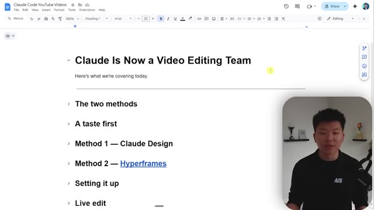
*⏱️ 00:00:42 — Capture d'écran d'un document Google Docs présentant le plan de la vidéo : "Claude Is Now a Video Editing Team" avec deux méthodes listées.*

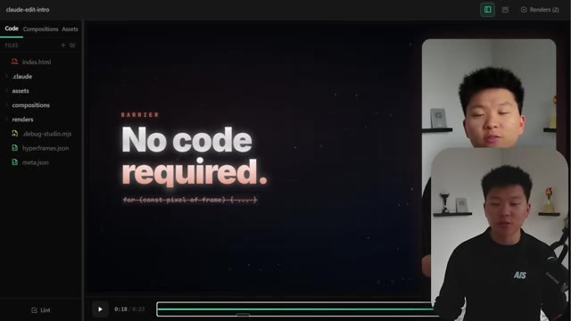
*⏱️ 00:00:51 — Interface du logiciel montrant une scène textuelle "No code required" sur un fond sombre, avec une structure de fichiers sur le côté gauche.*

---

### ⏱️ `[00:01:00 - 00:01:33]` | Segment #03

**🔊 Audio (Transcription Intégrale Mot pour Mot en Français) :**
> it would have probably taken me like two hours. And you know, I'm not a crazy good video editor. So maybe some of the best could do this in 30, 45 an hour. But the people on my team who actually know how to edit videos really well said that this is a complete game changer. So we're going to talk about two different methods. The first one is using Claude Design. Yeah, Claude Design, the web app that we showed off yesterday. If you didn't see that video, I'll tag it right up here. But inside of Claude Design, not only can you make websites and slide decks, but you can actually animate things. I'll show you guys some examples. We'll go through a live build together. It's really cool. And then we're going to talk about how to do it with hyperframes, which is kind of like

**👁️ Analyse Visuelle d'Écran (gemini-3.5-flash-lite) :**
**Interface & Outils** : Environnement de développement (type éditeur de code pour montage vidéo) et Google Docs.

**Contenu textuel & Code** : Texte à l'écran : "Natural language. Describe it. Claude builds it." et "The two methods: Claude Design ... Hyperframes in Claude".

**Action / Démonstration** : Démonstration de l'interface de création vidéo assistée par IA et présentation structurée du flux de travail.

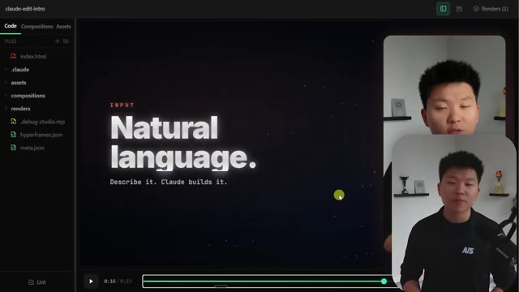
*⏱️ 00:01:08 — Interface logicielle affichant un environnement de développement orienté vidéo avec un panneau de fichiers sur la gauche et une zone de prévisualisation centrale montrant le texte « Natural language. Describe it. Claude builds it. ».*

---

### ⏱️ `[00:01:33 - 00:02:06]` | Segment #04

**🔊 Audio (Transcription Intégrale Mot pour Mot en Français) :**
> a better version of Remotion, if you guys have seen that. It's a little bit more setup, but it's way more powerful. So I'm going to walk you guys through both of those. So real quick before we do that, let's just start with a taste. Let me show you guys a few different examples of what's happened here. So obviously you guys already saw that Claude Edit intro, but let's look at one that I made called the HyperFrames sizzle, which just basically shows off the power of what HyperFrames could really do. All right, here we go. So we got this cool little terminal thing that installs HyperFrames, HyperFrames times cloud code, write HTML, render video, built for agents.

**👁️ Analyse Visuelle d'Écran (gemini-3.5-flash-lite) :**
**Interface & Outils** : Google Docs (Image 1), Lecteur vidéo multimédia (Image 2).

**Contenu textuel & Code** : Plan structuré (Image 1) ; Texte "HYPERFRAMES", "CLAUDE CODE" et commande terminal "$ npx hyperframes render --quality high" (Image 2).

**Action / Démonstration** : Présentation du plan de cours (Image 1) ; Visualisation d'un exemple concret de rendu vidéo généré par Hyperframes (Image 2).

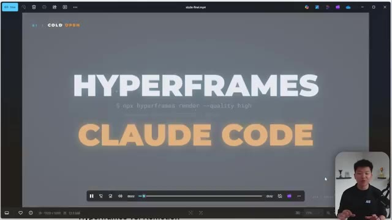
*⏱️ 00:01:57 — Aperçu d'une vidéo de démonstration intitulée "HYPERFRAMES" et "CLAUDE CODE" lue dans un lecteur multimédia.*

---

### ⏱️ `[00:02:07 - 00:02:31]` | Segment #05

**🔊 Audio (Transcription Intégrale Mot pour Mot en Français) :**
> Hours to ship a 90 second video, Premiere Pro, final cut, but HyperFrames is a fraction of the time. We got these cool little phones pop up and you can see it's like the process of like rendering a video, prompt, preview, render. The audio is reactive, which is pretty cool. Another little terminal style animation. We're launching different color schemes. This is from Anthropic.

**👁️ Analyse Visuelle d'Écran (gemini-3.5-flash-lite) :**
**Interface & Outils** : Lecteur vidéo / Interface de gestion de fichiers web (type Cloud Drive).

**Contenu textuel & Code** : Nom du fichier "sizzle-final.mp4", indicateurs de résolution (1920x1080) et taille de fichier (11.9 MB).

**Action / Démonstration** : Visualisation d'un export vidéo finalisé au sein d'une interface de prévisualisation.

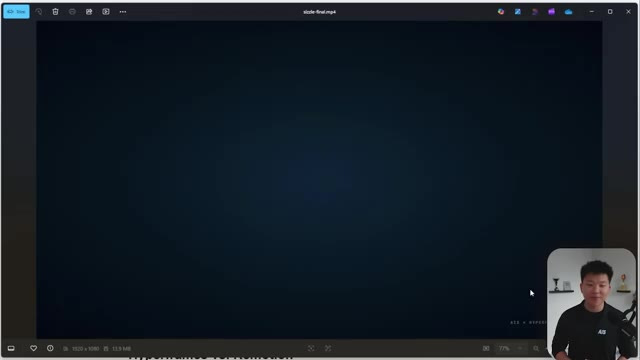
*⏱️ 00:02:13 — Une interface de visionneuse de fichiers vidéo affichant un espace de travail sombre avec le nom de fichier "sizzle-final.mp4" dans la barre de titre, incluant des outils de lecture et de zoom.*

---

### ⏱️ `[00:02:31 - 00:03:04]` | Segment #06

**🔊 Audio (Transcription Intégrale Mot pour Mot en Français) :**
> It pulls in their font. We can see Claude 4.7 Opus. We can see a swirl type of animation, which we can install from Hyperframes. We could also do this chromatic radial split. We've got these other cool little overlays that could pop up, and you can use so many of these elements out of the box. They've got catalogs. They've got things like that. You can sync your voice to the actual words like karaoke style subtitles. It goes from HTML to your browser to FFmpeg to MP4. And it is just really, really impressive. So this is supposed to be my logo.

**👁️ Analyse Visuelle d'Écran (gemini-3.5-flash-lite) :**
**Interface & Outils** : Application de prévisualisation ou éditeur vidéo intégré type "Hyperframes".

**Contenu textuel & Code** : Commande d'installation : "npx hyperframes add chromatic-radial-split"

**Action / Démonstration** : Présentation de la méthode d'intégration d'un composant d'animation via une ligne de commande.

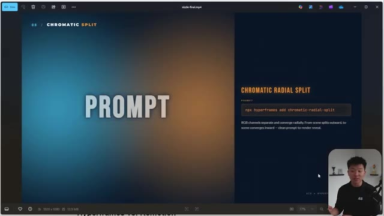
*⏱️ 00:02:40 — Interface logicielle présentant l'effet visuel "Chromatic Radial Split" avec une zone de code pour l'installation et une description fonctionnelle.*

---

### ⏱️ `[00:03:05 - 00:03:42]` | Segment #07

**🔊 Audio (Transcription Intégrale Mot pour Mot en Français) :**
> I'm not exactly sure what happened. That's weird. For some reason, the draft had my logo, but the final version didn't. So I would have to tweak that. But basically that's what happened there. And all of this, this entire video was animated and edited and created by Hyperframes and Claude Code. Okay. Now let me show you one called the first agent promo. And we actually made this one in Claude Design. So in here, you can see that I basically, the other day, I made this thing called the first agent promo. So it basically made me a website. And so what I did with this is I converted this up here. I exported this to a standalone HTML, as you can see right here. I downloaded that standalone HTML. And then I went back into a new project right here, the first agent release video.

**👁️ Analyse Visuelle d'Écran (gemini-3.5-flash-lite) :**
**Interface & Outils** : Claude Design, interface web de développement/design Claude.

**Contenu textuel & Code** : Log d'exécution de l'agent : "Reading", "Searching", "Copying, Editing v3, Generating HTML", référence au fichier "AIS_Logo.png", menu contextuel d'exportation (Download project, Export as standalone HTML, Handoff to Claude Code).

**Action / Démonstration** : Navigation dans la bibliothèque de designs, analyse des fichiers de code par l'agent, et sélection de l'option "Export as standalone HTML".

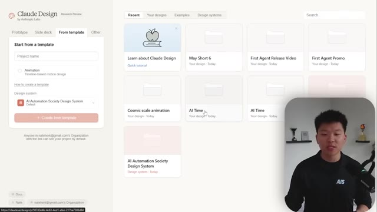
*⏱️ 00:03:23 — Interface de "Claude Design" affichant une galerie de projets de design et d'animations récents.*

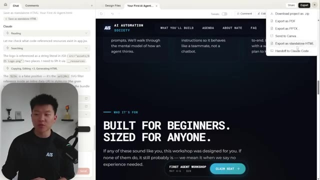
*⏱️ 00:03:32 — Interface de Claude avec une barre latérale de log d'agent (analyse de code source) et un menu d'exportation ouvert sur une page web de "AI Automation Society".*

---

### ⏱️ `[00:03:42 - 00:04:16]` | Segment #08

**🔊 Audio (Transcription Intégrale Mot pour Mot en Français) :**
> And you can see what I did is I dropped in that standalone HTML. And now we get this. so AI Automation Society what if you could build an AI agent this weekend all the branding is consistent your first AI agent you can see that there's like a scrolling banner at the bottom we've got these animations coming in really nice and just once again all I did was dropped in the HTML of our website and it said turn this into an animated release video I mean I thought all of these animations are awesome I really like this one with the terminal style stuff I think that's really cool and then it pops up at the end with May 4th through 6th just $20

**👁️ Analyse Visuelle d'Écran (gemini-3.5-flash-lite) :**
**Interface & Outils** : Interface web de type outil de développement ou de design (type Figma ou éditeur de code cloud).

**Contenu textuel & Code** : Texte technique listant les étapes d'exportation vidéo (Option 2: Frame-perfect export with Puppeteer + FFmpeg) et texte promotionnel à l'écran : "WHAT IF YOU COULD BUILD AN AI AGENT THIS WEEKEND?".

**Action / Démonstration** : Démonstration de la prévisualisation d'une vidéo générée via code, illustrant le rendu final de l'animation.

*⏱️ 00:03:50 — Une interface de plateforme de développement ou de design montrant une vidéo de prévisualisation d'une animation promotionnelle pour un "AI Agent", avec une fenêtre de texte technique à gauche expliquant le processus d'exportation vidéo via Puppeteer et FFmpeg.*

---

### ⏱️ `[00:04:16 - 00:04:49]` | Segment #09

**🔊 Audio (Transcription Intégrale Mot pour Mot en Français) :**
> $500, 500 seats, claim your seat, join for 20 bucks. It all is just like super branded to the same way that the actual site is. And once again in here, my prompt was create me an animation for the first AirAgent promotion. I dropped in the standalone HTML for this launch. There should be motion graphics, animations, and visual elements that explain what's going on. It should feel fast paced and engaging. That's it. And then it created me this. Once again, this 30-ish second clip would have taken multiple hours to edit by hand. Okay. So method one is using Claude design. How do we actually make a video? How do we make it feel branded? And where are the limitations of cloud

**👁️ Analyse Visuelle d'Écran (gemini-3.5-flash-lite) :**
**Interface & Outils** : Interface de travail type "Artifacts" (Claude) avec panneau de discussion latéral et zone d'aperçu du projet à droite.

**Contenu textuel & Code** : Prompt : "Create me an animation for the first AI agent promotion. I dropped in the standalone HTML for this launch. There should be motion graphics..."

**Action / Démonstration** : L'IA traite le fichier "Your First AI Agent_standalone.html" pour analyser et générer l'animation promotionnelle demandée.

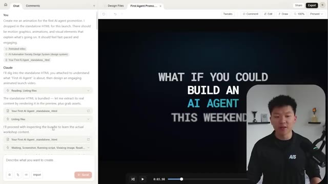
*⏱️ 00:04:24 — Interface de chat IA (Claude) montrant le prompt de l'utilisateur pour créer une animation promotionnelle, avec un rendu vidéo en cours de lecture à droite.*

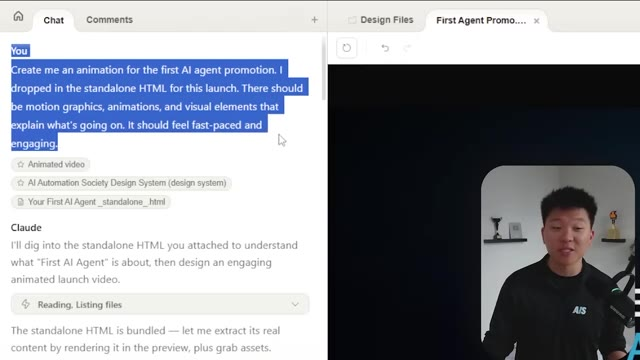
*⏱️ 00:04:32 — Interface de chat avec le texte du prompt en surbrillance, détaillant la demande d'intégration d'un fichier HTML pour une campagne "First AI Agent".*

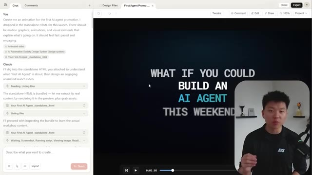
*⏱️ 00:04:40 — Vue identique à l'image 1, illustrant le processus de lecture de fichiers et d'inspection du contenu HTML par l'IA pour générer le contenu visuel.*

---

### ⏱️ `[00:04:49 - 00:05:22]` | Segment #10

**🔊 Audio (Transcription Intégrale Mot pour Mot en Français) :**
> design? So you guys pretty much just saw all that, right? I came in here and I have my AI Automation Society design system. So now it understands my logos, my branding, my colors, my typography. And that's how it made all of this stuff for me feel like the real website, which real quick, just to show you guys, it looks like this. So this is basically exactly what you saw in those other two things, the promo video and the website. It has the same buttons. It has the same font. It has the same colors. And now every video I make or every, whatever I make in Cloud Design will also look like that. So let's say we want to make a new video. If I go here to from

**👁️ Analyse Visuelle d'Écran (gemini-3.5-flash-lite) :**
**Interface & Outils** : Plateforme de design génératif "Claude Design" et interface de site web.

**Contenu textuel & Code** : Noms de projets (First Agent Release Video, AI Time) et éléments de branding (AIS, AI Automation Society).

**Action / Démonstration** : Navigation au sein d'un outil de design basé sur l'IA et démonstration du rendu final d'un site web personnalisé via ce système.

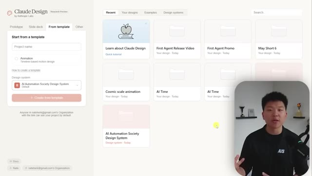
*⏱️ 00:04:57 — Interface de gestion de projets "Claude Design" affichant une bibliothèque de modèles, avec le "AI Automation Society Design System" sélectionné dans le panneau latéral.*

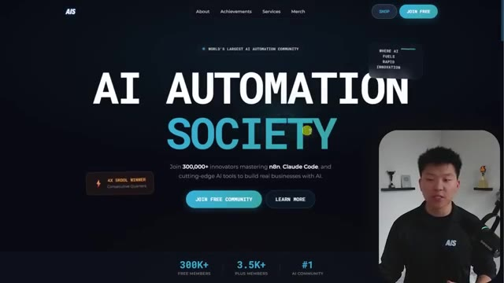
*⏱️ 00:05:05 — Page d'accueil web générée pour "AI Automation Society", présentant un design moderne sombre, des boutons d'appel à l'action et des statistiques de communauté.*

---

### ⏱️ `[00:05:22 - 00:05:59]` | Segment #11

**🔊 Audio (Transcription Intégrale Mot pour Mot en Français) :**
> template and I click on animation, now we can actually make a timeline based motion design. So I'm going to call this one, um, May short demo, and we're going to create from template. So what I want to do here is instead of just animating, you know, motion graphics, I wanted to take a video of mine and somehow animate that with things on top of it. So I'm going to drop in a video file real quick. Okay. So I just attached this file, um, right here, you can see may short six. So it's like a 18 second clip or something. And I want it to animate it. So I'm going to say, Hey, I just gave you a video, an MP4 called may short six. And what I want you to do is create a

**👁️ Analyse Visuelle d'Écran (gemini-3.5-flash-lite) :**
**Interface & Outils** : Claude Design (par Anthropic Labs)

**Contenu textuel & Code** : - Image #1 : "May Short Demo", "Animation (Timeline-based motion design)", "AI Automation Society Design System".
- Image #2 : "Start with context", "Animated video", "AI Automation Society Design System", "may_shorts_6.mp4", champ de prompt "Describe what you want to create".

**Action / Démonstration** : - Image #1 : Configuration du projet et clic sur le bouton "+ Create from template".
- Image #2 : Importation d'un fichier vidéo (context) pour lancer une requête de création de motion design assistée par IA.

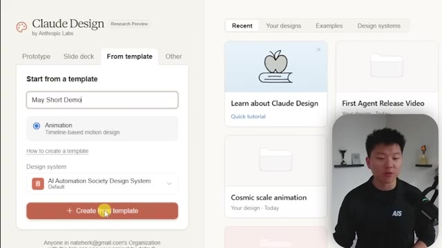
*⏱️ 00:05:31 — Interface "Claude Design" affichant le formulaire de création d'un projet basé sur un modèle nommé "May Short Demo" avec l'option "Animation" sélectionnée.*

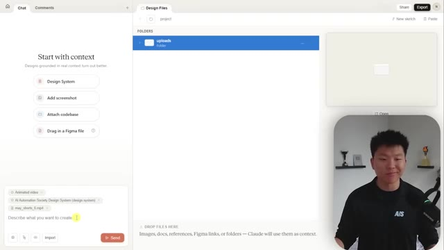
*⏱️ 00:05:50 — Interface de projet Claude Design montrant le volet de contexte ("Start with context") avec un fichier vidéo importé ("may_shorts_6.mp4") et une zone de saisie pour décrire la création souhaitée.*

---

### ⏱️ `[00:05:59 - 00:06:17]` | Segment #12

**🔊 Audio (Transcription Intégrale Mot pour Mot en Français) :**
> landscape video. Um, I want you to animate this so that people can watch the video and there will will be text and motion graphics and animations that sync up and go along with what I'm actually saying in the video. And it should be engaging and keep their attention while visually illustrating the concepts.

**👁️ Analyse Visuelle d'Écran (gemini-3.5-flash-lite) :**
**Interface & Outils** : Interface web Claude (Project/Artifacts).

**Contenu textuel & Code** : Zone d'entrée de texte "Describe what you want to create", boutons d'options ("Design System", "Add screenshot", "Attach codebase", "Drag in a Figma file"), et liste de fichiers importés.

**Action / Démonstration** : Le présentateur explique comment fournir du contexte à l'IA pour améliorer la génération de designs et d'animations.

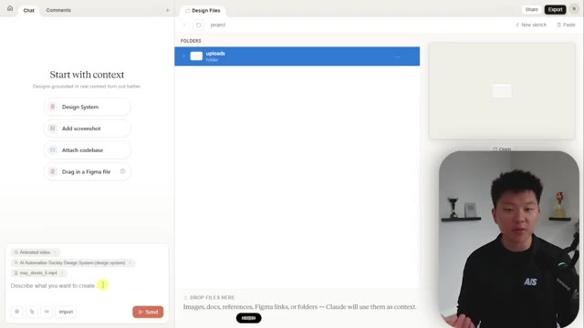
*⏱️ 00:06:03 — Interface de l'outil Claude avec une barre latérale pour la gestion des fichiers "Design Files" et une zone de chat contextuelle à gauche.*

---

### ⏱️ `[00:06:17 - 00:06:43]` | Segment #13

**🔊 Audio (Transcription Intégrale Mot pour Mot en Français) :**
> Okay, so that is my prompt. I'm gonna shoot that off. And now Cloud Design is basically going to start asking me some questions and it's going to start making this video. Now what you'll notice here is it can't actually read or listen to or understand what's being said in the video, which when you're animating a video, that's super important. And that's one of the limitations you would have to basically feed in like the transcript of it so that it could actually understand what's being said and where. So here it says paste in the video with the rough timestamps.

**👁️ Analyse Visuelle d'Écran (gemini-3.5-flash-lite) :**
**Interface & Outils** : Interface de plateforme de conception basée sur l'IA (type outil de design génératif).

**Contenu textuel & Code** : Prompt utilisateur détaillant la demande de création vidéo ("create a landscape video", "animate this", "sync up with what I'm saying") et réponse de Claude confirmant l'analyse des fichiers.

**Action / Démonstration** : Envoi de la requête de création vidéo et analyse des fichiers importés par l'agent IA.

*⏱️ 00:06:23 — L'écran montre une interface de conception web (type plateforme de prototypage ou agent IA) où l'utilisateur a envoyé une requête textuelle demandant la création d'une vidéo paysage animée synchronisée avec un fichier MP4 importé, suivie d'une réponse de l'agent confirmant la prise en compte du fichier.*

---

### ⏱️ `[00:06:43 - 00:07:15]` | Segment #14

**🔊 Audio (Transcription Intégrale Mot pour Mot en Français) :**
> And you know, if you had to do that manually, it's a little bit of work. Luckily for us in my cloud code project, we've already done this. And by the way, if you're overwhelmed looking at this, don't be, I'm going to explain it later, but I would come down here to my May short six project. And I already did basically extract the script. So if I go to assets, you can see I have May short 6.json. And this basically transcribed this whole video word for word with timestamp. So I'm just going to copy this, go back into Cloud Design, paste that in. So now it should be able to see the actual script. And then it asks me some other questions. So where does your talking head sit?

**👁️ Analyse Visuelle d'Écran (gemini-3.5-flash-lite) :**
**Interface & Outils** : Éditeur de code (apparence VS Code/Hyperframes Editor)

**Contenu textuel & Code** : Arborescence de fichiers comprenant des dossiers comme "video-projects", "may-shorts-6", "aisoc-app-release" ; interface Claude Code affichant le message "Tired of repeating yourself? Tell Claude to remember what you've told it using CLAUDE.md."

**Action / Démonstration** : Le présentateur navigue dans l'arborescence du projet pour localiser le répertoire "may-shorts-6".

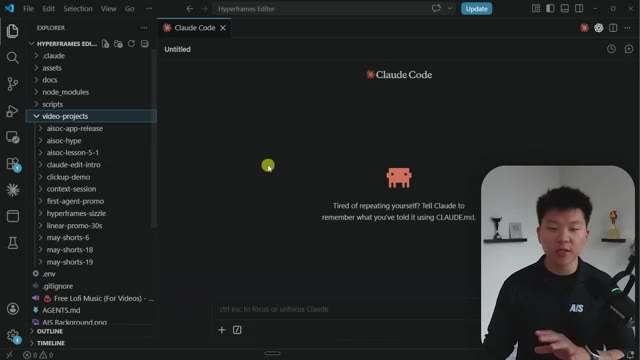
*⏱️ 00:06:51 — Interface de l'éditeur de code avec l'arborescence des fichiers ouverte à gauche et l'onglet "Claude Code" ouvert au centre, présentant une invite utilisateur.*

---

### ⏱️ `[00:07:15 - 00:07:50]` | Segment #15

**🔊 Audio (Transcription Intégrale Mot pour Mot en Français) :**
> It could be full width behind me with graphics overlay on top. It could be me on the left, graphics on the right. And I'm just basically going to say, decide for me. Let's see what it can do. Visual energy level. Let's go with punchy. What kind of motion graphics? We will do animated captions. We will do diagrams, progress bars, screen. Yeah, all that. Sure. We'll do full AIS dark theme. The end card CTA will be joined the free community and we'll do landscape and shoot that off. So what I like about Cloud Design is it does a good job of asking you questions. But once again, like I said, the limitation is it can't actually read or listen to and transcribe

**👁️ Analyse Visuelle d'Écran (gemini-3.5-flash-lite) :**
**Interface & Outils** : Outil de prototypage d'interface / IA de conception (Type Napkin ou plateforme similaire avec système de chat intégré).

**Contenu textuel & Code** : Paramètres de configuration : "Full width behind me", "Punchy & fast", "Animated captions", résumé textuel des spécifications du projet (layout, tone, branding) et liste de progression (Progress 0/2).

**Action / Démonstration** : Le présentateur interagit avec l'agent IA pour définir les spécifications techniques de montage vidéo et de motion design, en configurant les préférences de mise en page et de style via le formulaire interactif.

*⏱️ 00:07:24 — Interface interactive d'un outil de design de workflow IA (probablement Napkin ou similaire), affichant un formulaire de configuration de projet avec des options de mise en page, d'énergie visuelle et de style graphique. Le présentateur apparaît dans une bulle en bas à gauche.*

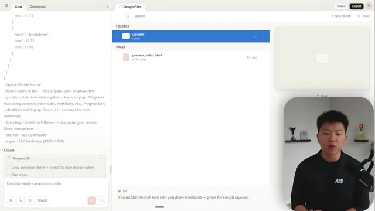
*⏱️ 00:07:41 — Vue de l'interface de travail de l'outil avec le volet de chat à gauche contenant un résumé structuré des paramètres du projet (layout, tone, branding), et l'espace de travail principal affichant la structure des fichiers et des pages du projet.*

---

### ⏱️ `[00:07:50 - 00:08:12]` | Segment #16

**🔊 Audio (Transcription Intégrale Mot pour Mot en Français) :**
> the video. You would have to give it that timestamp stuff if you want it to actually sync the text and animations to what you're saying, which obviously is very important. And of course, so that it actually knows what motion graphics to create. Okay. So that took like two minutes. Let's see what we got. I've built over 500 AI workflows and most of them businesses don't need, they don't need flashy automations or cool AI demos. They want simple things that save time or make money.

**👁️ Analyse Visuelle d'Écran (gemini-3.5-flash-lite) :**
**Interface & Outils** : Interface de développement type "Claude" (ou outil d'agent IA web), interface de design/prévisualisation.

**Contenu textuel & Code** : Image #1 : Liste de tâches (Progress 0/5) détaillant les étapes de création d'une vidéo (animation, synchronisation, composants). Image #2 : Plan de scène (scene map) détaillé avec horodatages et description des effets visuels (badges, texte animé).

**Action / Démonstration** : L'agent IA génère et organise les composants d'une vidéo selon un plan de scène précis, incluant la synchronisation des éléments graphiques et du texte.

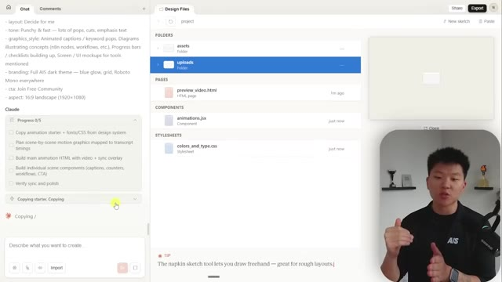
*⏱️ 00:07:56 — L'interface de développement d'un agent IA (Claude) montrant une liste de tâches (checklist) et une structure de dossiers de projet.*

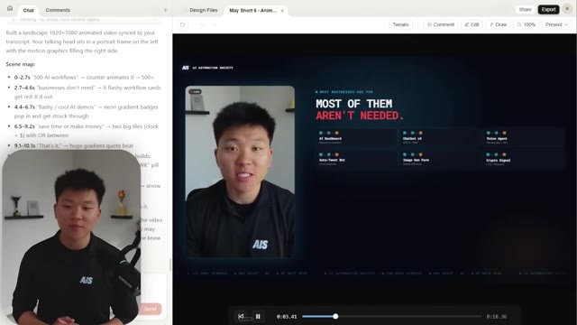
*⏱️ 00:08:07 — L'interface de prévisualisation montrant une vidéo générée avec une mise en page divisée : le présentateur à gauche et des infographies dynamiques sur la droite.*

---

### ⏱️ `[00:08:12 - 00:08:35]` | Segment #17

**🔊 Audio (Transcription Intégrale Mot pour Mot en Français) :**
> That's it. The workflows that actually work are boring stuff that replaces real work. That's what businesses pay for. Comment 500W and I'll send you the full breakdown. Okay. That is crazy. I mean, this is like super fast paced. There's lots of animations in some ways. This actually might be a bit better than what we would do later with hyperframes because like that is really impressive.

**👁️ Analyse Visuelle d'Écran (gemini-3.5-flash-lite) :**
**Interface & Outils** : Figma (outil de design et de prototypage).

**Contenu textuel & Code** : Texte de script détaillé ("Scene map") incluant des timestamps et des descriptions de séquences vidéo ("0-2.7s 500 AI workflows", "4.4-6.7s flashy / cool AI demos", etc.) ainsi qu'un graphique de revenus avec des montants associés ($4,800, $9,200, etc.).

**Action / Démonstration** : Édition et revue du plan de montage vidéo (storyboard interactif) synchronisé avec le script narratif.

*⏱️ 00:08:18 — Interface de conception Figma montrant une vidéo en cours d'édition. Le canevas affiche un graphisme avec le texte "REAL WORK. REAL MONEY" et un histogramme à barres colorées, accompagné d'un panneau latéral détaillant le "Scene map" (plan de montage) de la vidéo.*

---

### ⏱️ `[00:08:35 - 00:09:10]` | Segment #18

**🔊 Audio (Transcription Intégrale Mot pour Mot en Français) :**
> Yeah. I mean, I am very impressed that it was able to do this anyways. What you would do now, if you want to export this, it doesn't actually let you export this as a MP4. So you would either just make this full screen and you would just screen record it, which would be fine. Or if it's a longer video, you could actually do this. You could go here and hand off the Claude code and just copy this command. And then you could come into Claude and just literally give it this and then say, hey, render this as an MP4. And it would actually be able to do it for you. And then you get the download, which is exactly what I did here with the first agent promo, the render. You can see that we have the first agent promo and that's exactly the same flow I did. I gave it that link and I

**👁️ Analyse Visuelle d'Écran (gemini-3.5-flash-lite) :**
**Interface & Outils** : Interface web de design (type Canvas/Motion), Claude Code, VS Code / Hyperframes Editor.

**Contenu textuel & Code** : URL d'API Anthropic (api.anthropic.com/v1/design/...), commande "Fetch this design file... and implement...", fichier "May Short 6 - Animated.html".

**Action / Démonstration** : Exportation/transfert d'un design généré vers un agent de codage local (Claude Code) pour implémentation technique et automatisation.

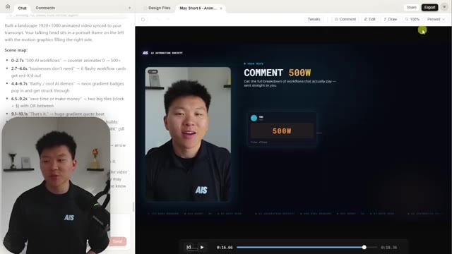
*⏱️ 00:08:44 — Interface de prévisualisation vidéo avec une fenêtre de chat latérale détaillant les étapes d'un storyboard ("Scene map").*

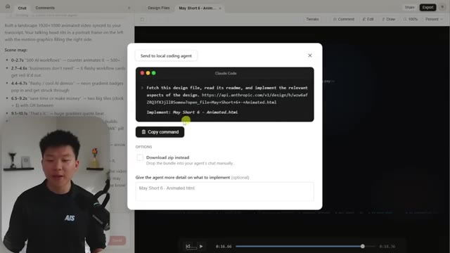
*⏱️ 00:08:52 — Fenêtre contextuelle "Send to local coding agent" affichant une ligne de commande pour Claude Code intégrant un lien vers un fichier de design.*

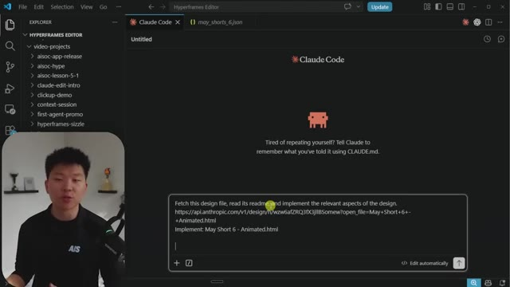
*⏱️ 00:09:01 — Éditeur de code (Hyperframes Editor) avec l'interface de Claude Code ouverte, prête à recevoir une instruction d'implémentation.*

---

### ⏱️ `[00:09:10 - 00:09:43]` | Segment #19

**🔊 Audio (Transcription Intégrale Mot pour Mot en Français) :**
> said, hey, render this. Because when you think about what's actually going on with hyperframes, it's basically just creating HTML and Claude Design is really, really good at creating HTML. and apparently it's really good at animating that HTML as well. So cloud design is a very, very viable option to actually edit these videos. I'll show you guys another quick output I did earlier, which was this one. I did this one vertically just because I wanted to see how it would work and see what it did. And obviously I didn't prompt it too much, right? Like I didn't give it a ton of information and I didn't tell it like, Hey, when we're doing short form content,

**👁️ Analyse Visuelle d'Écran (gemini-3.5-flash-lite) :**
**Interface & Outils** : Interface de création/édition de contenu vidéo basée sur le Web (potentiellement un outil utilisant l'IA pour le montage automatisé).

**Contenu textuel & Code** : Données de timing JSON (start/end/text) dans l'image 1 ; Panneau de configuration "TWEAKS" avec des options de layout, réglages de curseurs et gestion des "beats" dans l'image 2.

**Action / Démonstration** : Visualisation du rendu final et ajustement des paramètres de configuration de l'interface utilisateur pour optimiser la sortie vidéo.

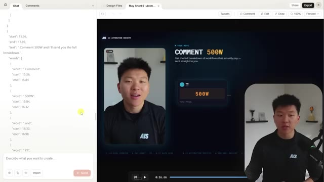
*⏱️ 00:09:18 — Interface de développement avec une colonne de gauche affichant un fichier JSON de sous-titres et une zone de visualisation vidéo à droite montrant le présentateur incrusté dans une mise en page dynamique.*

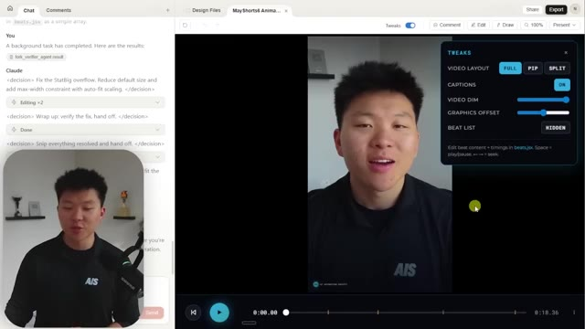
*⏱️ 00:09:35 — Interface de contrôle "Tweaks" avec des réglages de mise en page vidéo (Full, PiP, Split), des options de sous-titres et des curseurs de réglage pour le rendu visuel.*

---

### ⏱️ `[00:09:43 - 00:10:02]` | Segment #20

**🔊 Audio (Transcription Intégrale Mot pour Mot en Français) :**
> it needs to do this, this, and this. But here's what we got. Let me just get rid of the tweaks. Let's see what we got here. I've built over 500 AI workflows. And most of them, businesses don't need, they don't need flashy automations or cool AI demos. They want simple things that save time or make money. That's it. The workflows that actually work are boring. Stuff that replaces real work.

**👁️ Analyse Visuelle d'Écran (gemini-3.5-flash-lite) :**
**Interface & Outils** : Interface de design/prototypage web avec panneau de discussion latéral.

**Contenu textuel & Code** : Historique de logs de l'agent "Claude" incluant des balises `<decision>` (ex: "Fix the StatBig overflow", "Wrap up: verify the fix, hand off") et des statuts d'exécution.

**Action / Démonstration** : Le présentateur interagit avec l'interface pour consulter les étapes de résolution d'un problème technique par l'agent IA, avec un bouton "Tweaks" activable en haut de l'écran.

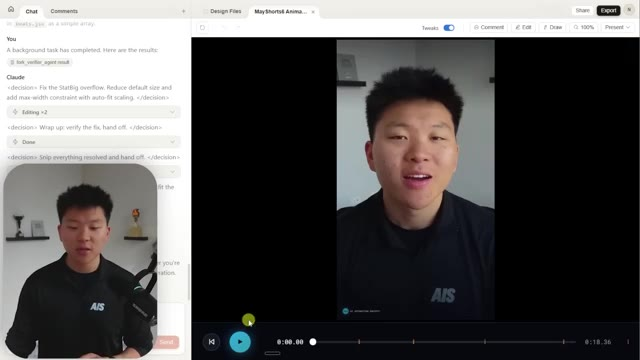
*⏱️ 00:09:48 — Une interface de plateforme collaborative (type FigJam ou interface de design) affichant un panneau de chat avec l'historique d'exécution d'un agent IA nommé "Claude", et une zone de prévisualisation vidéo au centre.*

---

### ⏱️ `[00:10:02 - 00:10:20]` | Segment #21

**🔊 Audio (Transcription Intégrale Mot pour Mot en Français) :**
> That's what businesses pay for. Comment 500. Okay, so the animations look good and stuff, right? But it's obviously just covering my face. So I'd want to say, hey, maybe you should put my face on just the bottom half and then put animations up top and things like that. But I didn't even give it any information here. This one you can see actually timed out. So it filled in a bunch of information right here.

**👁️ Analyse Visuelle d'Écran (gemini-3.5-flash-lite) :**
**Interface & Outils** : Interface de travail type "Artifacts" (probablement Cursor ou une interface similaire intégrée à Claude) avec un panneau de chat à gauche et un visualiseur de projet/vidéo à droite.

**Contenu textuel & Code** : Texte affichant les décisions de l'agent : "Fix the StatBig overflow", "Wrap up: verify the fix", "Snip everything resolved and hand off", ainsi que des explications techniques sur la synchronisation vidéo (`video.timeupdate` et `currentTime`).

**Action / Démonstration** : Analyse des décisions logiques prises par l'agent IA pour structurer les composants graphiques sur la vidéo et démonstration de l'outil en cours d'exécution.

*⏱️ 00:10:07 — Interface de développement montrant un historique de chat avec un agent IA (Claude) détaillant des décisions de code (réglage de taille, contraintes) et un lecteur vidéo intégré à droite affichant le présentateur avec des éléments graphiques en superposition.*

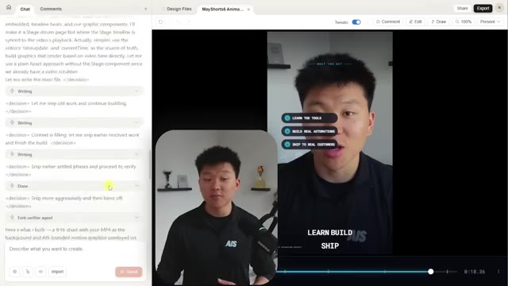
*⏱️ 00:10:16 — Suite de la conversation avec l'agent IA où celui-ci explique sa logique de développement pour synchroniser des animations avec la lecture vidéo ("timeline beats"), toujours avec le lecteur vidéo actif à droite.*

---

### ⏱️ `[00:10:20 - 00:10:40]` | Segment #22

**🔊 Audio (Transcription Intégrale Mot pour Mot en Français) :**
> It said that the question's timed out on the user. So it just went with the default. So maybe that's another reason why it's not as good, but this is really impressive. Okay, so that's Cloud Design. You guys will be able to get in there, play around with it. And I think it'll be able to take you pretty far. But if you wanna go even farther and if you want more control, then you might wanna look at using Hyperframes, which is what I'm gonna be showing you guys now.

**👁️ Analyse Visuelle d'Écran (gemini-3.5-flash-lite) :**
**Interface & Outils** : Interface web d'édition de projet (similaire à un IDE ou outil de design assisté par IA type "Claude Design").

**Contenu textuel & Code** : Historique de discussion textuelle : "Claude has some questions", "Questions timed out; go with defaults", "I can't watch the MP4 to know what you're saying", "The sandbox can't decode the MP4".

**Action / Démonstration** : Démonstration de l'échec de traitement d'un fichier vidéo par l'agent IA, forçant l'utilisation des réglages par défaut suite à un timeout.

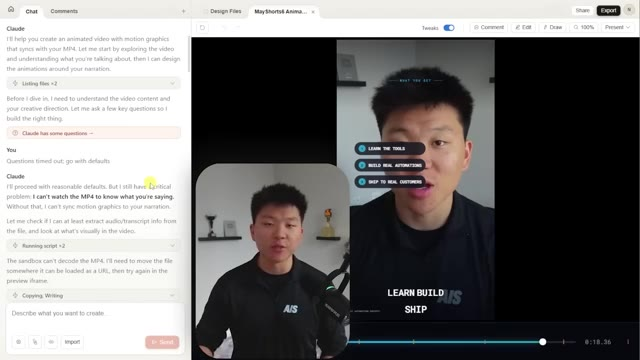
*⏱️ 00:10:25 — Une interface de plateforme IA (Canvas/Agent) montrant un dialogue avec Claude où l'IA explique son incapacité à lire un fichier MP4, affichant des logs d'erreurs "Running script" et une zone de prévisualisation vidéo en temps réel.*

---

### ⏱️ `[00:10:40 - 00:11:26]` | Segment #23

**🔊 Audio (Transcription Intégrale Mot pour Mot en Français) :**
> So before we hop into Hyperframes, let's real quick look at a few other examples that Hyperframes was able to create for me. So in this example, I basically said, hey, let's pretend that AI Automation Society is releasing a mobile app. And I gave it the URL of AI Automation Society. And here's what we got. That's pretty incredible.

**👁️ Analyse Visuelle d'Écran (gemini-3.5-flash-lite) :**
**Interface & Outils** : Lecteur multimédia Windows (Media Player).

**Contenu textuel & Code** : Le titre du fichier vidéo "aisoc-app-release-v5.mp4" est visible dans la barre de titre, ainsi que les commandes de lecture standards (play, barre de progression, volume).

**Action / Démonstration** : Le présentateur s'apprête à lancer la lecture d'une vidéo générée par Hyperframes illustrant le lancement de l'application mobile pour "AI Automation Society".

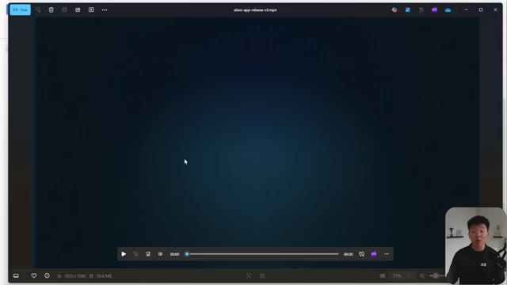
*⏱️ 00:10:52 — Capture d'écran montrant l'interface d'un lecteur vidéo natif de Windows (Media Player) affichant un fichier nommé "aisoc-app-release-v5.mp4".*

---

### ⏱️ `[00:11:26 - 00:11:45]` | Segment #24

**🔊 Audio (Transcription Intégrale Mot pour Mot en Français) :**
> I love this slide. I love this scene. And the tweet is pretty cool. The follow is awesome. And the reason it was able to do some of these things is because inside of Hyperframes, they're not inside, but they have this documentation of, you know, like how it works. And they also have some really cool catalog things. So you could pull in this exact animation and just fill in your own things.

**👁️ Analyse Visuelle d'Écran (gemini-3.5-flash-lite) :**
**Interface & Outils** : Google Docs (pour l'image 2).

**Contenu textuel & Code** : Document textuel structuré : "The two methods", "A taste first", "Method 1 — Claude Design", "Method 2 — Hyperframes", "Setting it up", "Live edit", "Hyperframes vs. Remotion", "Cost and speed".

**Action / Démonstration** : Présentation du plan de travail pour la création de contenu vidéo et les méthodes techniques associées.

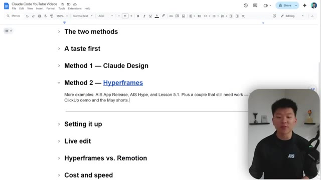
*⏱️ 00:11:36 — Capture d'écran d'un document Google Docs listant les étapes et méthodes de production, incluant "Method 2 — Hyperframes".*

---

### ⏱️ `[00:11:45 - 00:12:13]` | Segment #25

**🔊 Audio (Transcription Intégrale Mot pour Mot en Français) :**
> a macOS notification, a Reddit postcard. We've got all of these different transitions as well. We've got the app showcase right here, which is what you saw earlier in a different video. But it is just so cool. You can do a 3D UI reveal like this. There's lots of elements that you can already pull out and use. Okay, let me show you guys another example of one that is kind of a lesson 5.1 when and how to pitch an audit. At some point during a project, you're going to notice something. The client's business has more problems than the one you were hired to fix.

**👁️ Analyse Visuelle d'Écran (gemini-3.5-flash-lite) :**
**Interface & Outils** : Plateforme de documentation technique/bibliothèque de composants UI.

**Contenu textuel & Code** : Titres de sections (App Showcase, 3D UI Reveal) et métadonnées de composants web.

**Action / Démonstration** : Navigation dans le catalogue de composants d'animation UI et démonstration de rendu visuel.

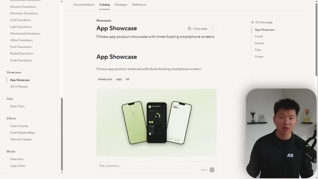
*⏱️ 00:11:52 — Interface de documentation montrant un "App Showcase" avec trois écrans de smartphone flottants.*

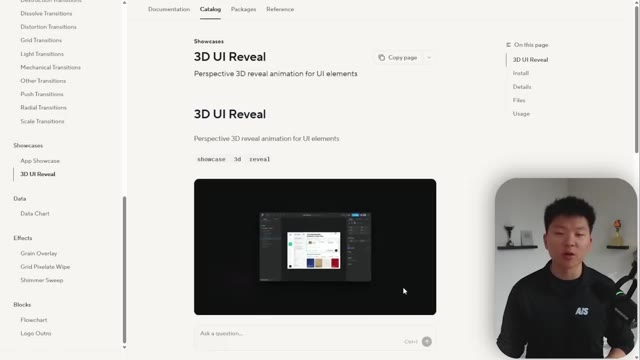
*⏱️ 00:11:59 — Interface de documentation montrant une démonstration de "3D UI Reveal" avec une animation de fenêtre perspective.*

---

### ⏱️ `[00:12:13 - 00:12:32]` | Segment #26

**🔊 Audio (Transcription Intégrale Mot pour Mot en Français) :**
> You can see inefficiencies and workflows they haven't even asked about. You can tell the system needs more than a single automation. And you'll want to say something. But you won't be sure how. Bringing up a bigger engagement feels risky. You don't want to come across as the consultant who's always trying to expand the scope. So you might just finish the project, send the invoice, and move on.

**👁️ Analyse Visuelle d'Écran (gemini-3.5-flash-lite) :**
**Interface & Outils** : Logiciel de présentation vidéo (interface de lecteur vidéo avec outils de montage).

**Contenu textuel & Code** : Texte affiché : "LESSON 5.1", "When and how to pitch an audit", "THE REAL SCOPE", "INEFFICIENCIES", "BROKEN WORKFLOWS", "THE PROJECT - What you were hired to fix", "@AI Automation Society".

**Action / Démonstration** : Présentation pédagogique par le narrateur expliquant la portée réelle d'un audit par rapport au projet initialement confié.

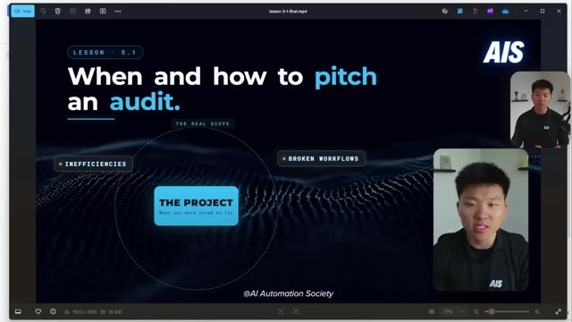
*⏱️ 00:12:17 — Une diapositive de présentation titrée "When and how to pitch an audit" illustrant le concept de "The Real Scope" avec un schéma montrant "The Project" entouré par des zones "Inefficiencies" et "Broken Workflows".*

---

### ⏱️ `[00:12:32 - 00:13:06]` | Segment #27

**🔊 Audio (Transcription Intégrale Mot pour Mot en Français) :**
> That hesitation costs you. Not because pitching audits is hard. Okay, so I'm going to pause it there. You guys can see the styling is a little bit different, right? And for an educational style video, I don't even know. I might want to use that or I might want to play around more with what we saw back in hyperframes over here Because like I said, I thought that this output was really really cool So the important thing to understand here is there's so much customization Like obviously I tweaked this project so many times and i've rendered Probably over 60 videos in the past day just playing around with different methods And that's what's really important when you use a tool like hyperframes or cloud design is that you're putting in your own sort of like

**👁️ Analyse Visuelle d'Écran (gemini-3.5-flash-lite) :**
**Interface & Outils** : Hyperframes Editor (basé sur VS Code), Interface web de gestion de workflow/production vidéo.

**Contenu textuel & Code** : Liste de tâches/scénario vidéo (Scene map) avec timestamps et descriptions d'animations (ex: 500+ AI workflows), arborescence de fichiers de projets vidéos (.md, .env, dossiers), instruction "Tired of repeating yourself?".

**Action / Démonstration** : Navigation dans l'arborescence des fichiers du projet et démonstration du flux de travail de création de contenu assisté par IA.

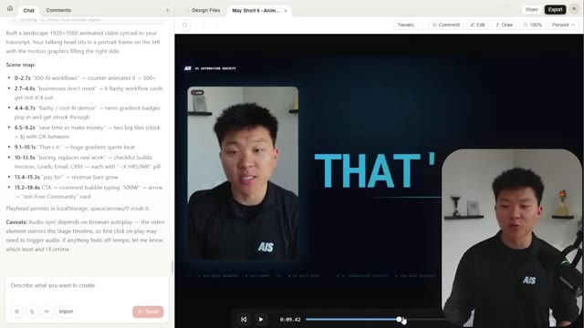
*⏱️ 00:12:49 — Interface de gestion de projet type "Canvas" ou éditeur web, avec un panneau latéral à gauche détaillant une "map" de scène pour une vidéo animée, et un aperçu vidéo à droite.*

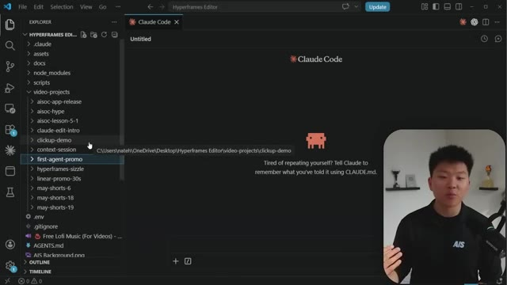
*⏱️ 00:12:58 — Éditeur de code (type VS Code / Hyperframes Editor) affichant l'arborescence des fichiers du projet et un espace de travail central avec le logo "Claude Code".*

---

### ⏱️ `[00:13:06 - 00:13:40]` | Segment #28

**🔊 Audio (Transcription Intégrale Mot pour Mot en Français) :**
> You know animation philosophy and your own design skills and your own things to make the outputs the way you want them. Now, before we get set up, I wanted to show you two other things that I tried to play with that didn't really work too well. So the first one was a ClickUp demo. I tried to make like a product SaaS demo and I could have made this work a lot better if I did some things a little bit more manually, but I was really trying to push this tool to see what it could do with CloudCode. So basically what I did is I said, hey, go to ClickUp.com and screen record and log in as me and take screenshots and just create me a demo. And this is what it ended up making. It's not

**👁️ Analyse Visuelle d'Écran (gemini-3.5-flash-lite) :**
**Interface & Outils** : Google Docs (éditeur de texte en ligne).

**Contenu textuel & Code** : Plan de la vidéo intitulé "Claude Code YouTube Videos" avec les sections : "The two methods", "A taste first", "Method 1 — Claude Design", "Method 2 — Hyperframes", "Setting it up", "Live edit", "Hyperframes vs. Remotion", "Cost and speed". Le texte mentionne : "More examples: AIS App Release, AIS Hype, and Lesson 5.1. Plus a couple that still need work: ClickUp demo and the May shorts."

**Action / Démonstration** : Présentation visuelle du plan de la vidéo par le créateur.

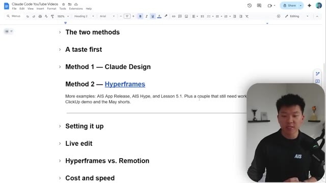
*⏱️ 00:13:15 — Capture d'écran montrant un document Google Docs structuré en plan pour une vidéo YouTube, avec le présentateur en incrustation vidéo dans le coin inférieur droit.*

---

### ⏱️ `[00:13:40 - 00:14:13]` | Segment #29

**🔊 Audio (Transcription Intégrale Mot pour Mot en Français) :**
> perfect. But if you think about the fact that I didn't record any of the screen thing, and I just said, I shot it off on a prompt and it came back, it's pretty cool. Now this is also version five. So I tried four different prompts and then I got to this one, iterated each time, but you can see it pulled the logo. It has this nice animation. The color scheme feels like ClickUp. We have sort of that 3D UI reveal, and this is where it loses me a little bit. It starts to just become a little bit static, even though you can see it went into the app and it was able to take pictures, but now it's losing a bit of that taste and it's kind of losing the energy that a human editor would have

**👁️ Analyse Visuelle d'Écran (gemini-3.5-flash-lite) :**
**Interface & Outils** : Lecteur vidéo intégré dans une interface de travail (nom du fichier en haut : "clickup-demo-v5.mp4").

**Contenu textuel & Code** : Texte affiché : "Every team juggles 12+ tools" entouré des noms de divers logiciels (Slack, Sheets, Asana, Drive, Jira, Linear, Notion, GitHub, Zoom, Figma, Loom, Trello).

**Action / Démonstration** : Le présentateur illustre le résultat généré par l'IA (version 5 de son prompt) qui a produit cette démonstration vidéo sans enregistrement manuel d'écran.

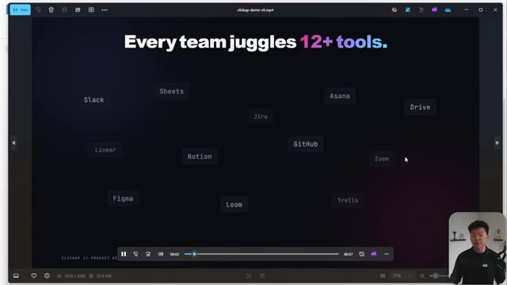
*⏱️ 00:13:48 — Une capture d'écran montrant le lecteur vidéo intégré à une application (probablement un outil de gestion de projet ou une plateforme de design) affichant une animation sur la complexité des outils logiciels (« Every team juggles 12+ tools »).*

---

### ⏱️ `[00:14:13 - 00:14:45]` | Segment #30

**🔊 Audio (Transcription Intégrale Mot pour Mot en Français) :**
> been able to put in. So what I think is really awesome about this is people who already know how to edit and people who have a nice creative like intuition are going to be able to use these tools to 10x their productivity. Because if someone has no taste, they might get outputs like this. But if someone has a really good understanding of what makes videos engaging and what, you know, scenes and transitions they should be looking at, they're going to be able to use these tools like crazy. So anyways, that's what we got when I just gave it ClickUp's URL and said, make me a product demo. And then the other thing I wanted to show you guys is I was playing around with making shorts

**👁️ Analyse Visuelle d'Écran (gemini-3.5-flash-lite) :**
**Interface & Outils** : ClickUp (plateforme de gestion de projet avec fonctionnalités IA).

**Contenu textuel & Code** : Résumé textuel structuré d'un projet "Q2 Product Launch" incluant des sections : "Project Overview", "Key Decisions and Updates", et une barre de prompt en bas ("Ask in plain English").

**Action / Démonstration** : Démonstration des capacités de synthèse de l'IA au sein de ClickUp pour traiter des données de tâches et fournir un aperçu décisionnel.

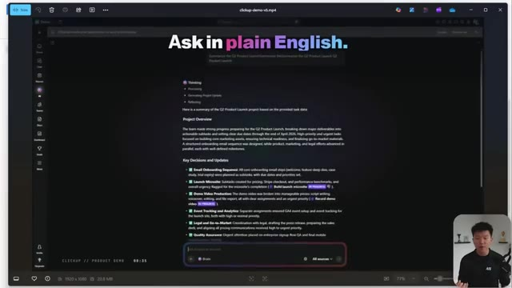
*⏱️ 00:14:21 — Interface de l'outil ClickUp montrant un résumé généré par une IA sur un projet de lancement de produit.*

---

### ⏱️ `[00:14:45 - 00:15:19]` | Segment #31

**🔊 Audio (Transcription Intégrale Mot pour Mot en Français) :**
> using Cloud Code and Hyperframes because it's a little bit more customizable. And this was my second version of this one. I think earlier I made five or six shorts just testing it out. But you can see, you know, shorts are different. They have to capture your attention. They have to be engaging. And I just don't think that this is there yet. Like I wouldn't post this, but I do think that if I keep iterating, it can definitely get there eventually. So let's give it a quick watch. Claude just killed chat GPT, not in hype, but in actual use, better outputs, more reliable, less babysitting. If you're building with AI, you've probably already felt it. And if you haven't,

**👁️ Analyse Visuelle d'Écran (gemini-3.5-flash-lite) :**
**Interface & Outils** : Lecteur multimédia Windows (Media Player) utilisé pour la prévisualisation de fichiers vidéo.

**Contenu textuel & Code** : Interface de lecture vidéo avec sous-titres dynamiques et éléments graphiques incrustés sur la vidéo verticale.

**Action / Démonstration** : Lecture et prévisualisation du montage vidéo destiné aux réseaux sociaux.

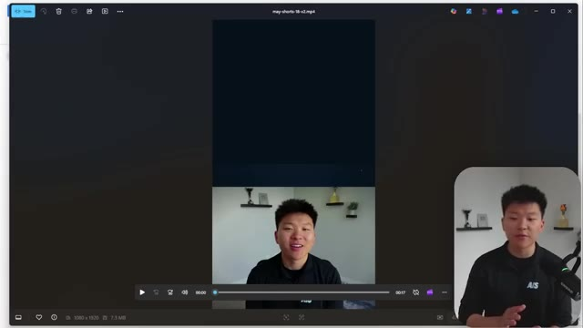
*⏱️ 00:14:53 — L'écran affiche une application de lecteur vidéo (Media Player) montrant un projet de courte vidéo vertical ("may-shorts-18-v2.mp4") en cours d'édition ou de prévisualisation, avec Nate Herk dans le coin inférieur droit.*

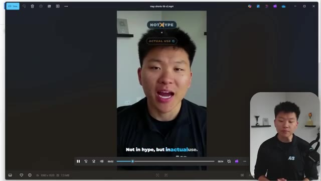
*⏱️ 00:15:10 — Le lecteur vidéo affiche la même séquence verticale, cette fois avec des éléments graphiques à l'écran (texte "NOT TYPE", "ACTUAL USE" et sous-titres) illustrant le rendu final du short.*

---

### ⏱️ `[00:15:19 - 00:15:46]` | Segment #32

**🔊 Audio (Transcription Intégrale Mot pour Mot en Français) :**
> then you need to switch before it's too late. Comment dead, and I'll send the video explaining why. Okay, so what I like about this is there's always something new going on. The subtitles are there automatically. Sometimes it's me on the bottom half and stuff on the top half, and sometimes it zooms into just me. And then sometimes it goes to just all motion graphics. So it definitely has this feeling like there's different vibes as you progress throughout the video. But like I said, it's not there yet. I wouldn't post this, but it's getting better and it's really cool.

**👁️ Analyse Visuelle d'Écran (gemini-3.5-flash-lite) :**
**Interface & Outils** : Lecteur vidéo intégré (interface de montage ou de prévisualisation) affichant des contenus de format court (Shorts/Reels).

**Contenu textuel & Code** : Superpositions graphiques dynamiques de type "split-screen" et éléments de typographie cinétique pour l'édition de contenu vidéo.

**Action / Démonstration** : Démonstration visuelle des techniques de montage pour réseaux sociaux incluant des variations de cadrage et des sous-titres automatiques.

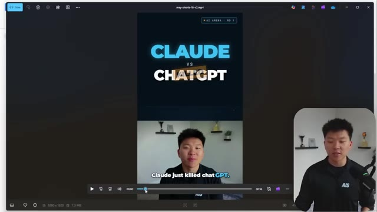
*⏱️ 00:15:26 — Le présentateur montre une vidéo verticale divisée en deux parties : en haut, le titre "CLAUDE vs CHATGPT" et en bas, lui-même en train de parler avec la légende "Claude just killed chatGPT."*

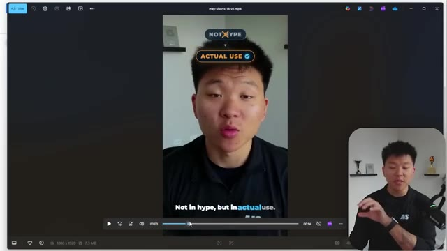
*⏱️ 00:15:32 — Le présentateur montre une vidéo verticale utilisant un effet de zoom sur son visage avec les superpositions textuelles "NOT HYPE" (barré) et "ACTUAL USE" (coché), accompagné de la légende "Not in hype, but in actual use."*

---

### ⏱️ `[00:15:46 - 00:16:20]` | Segment #33

**🔊 Audio (Transcription Intégrale Mot pour Mot en Français) :**
> So how do we actually go ahead and set up hyperframes? Well, you have to use Cloud Code for this. That's at least how I'm going to show you. And you can use this in VS Code, which is mainly what I'm going to show you guys. You could also use this in the Cloud Desktop app. So like what I've got pulled up right here. And what's cool about this is Cloud Desktop app has a preview function. So you can pull up an app you're working on or a local host, and you can preview your video right in here from the app as you're having a conversation, which I do like. But also I would like this to be just like full screen. And I don't know, for me, it's not too big of a deal to just switch over to my browser in order to see the local host and then just open VS Code back up.

**👁️ Analyse Visuelle d'Écran (gemini-3.5-flash-lite) :**
**Interface & Outils** : Navigateur web (Hyperframes Studio / interface locale).

**Contenu textuel & Code** : Arborescence de fichiers de composition (01-hook, 02-text-on-screen, 03-karaoke-captions) et logs d'exécution de fonctions (`editing.loop()`, `analyze_clip`, `sync_captions`).

**Action / Démonstration** : Navigation dans l'interface de montage et affichage en temps réel des actions de l'agent IA sur la vidéo.

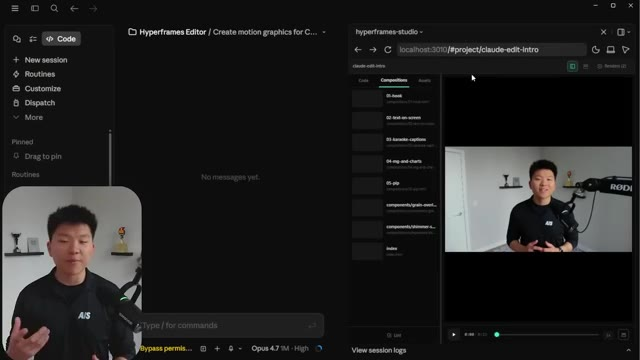
*⏱️ 00:16:03 — Interface de "Hyperframes Studio" affichée dans un navigateur, montrant la structure d'un projet avec plusieurs compositions (hook, captions, etc.) et une fenêtre de prévisualisation vidéo.*

*⏱️ 00:16:11 — Interface de "Hyperframes Studio" affichant une superposition graphique dynamique (overlay) sur la vidéo, indiquant l'exécution d'une fonction `editing.loop()` avec les tâches `analyze_clip` et `sync_captions`.*

---

### ⏱️ `[00:16:20 - 00:16:56]` | Segment #34

**🔊 Audio (Transcription Intégrale Mot pour Mot en Français) :**
> So that's really the main benefit of using the Cloud desktop app. For me, the main benefit of using VS Code is I can see all of my projects. I can see the different assets I've dropped in. I can move things around. I can look at all my different renders. I like to be able to see my files and that's why I'm going to be using VS Code for this video. Also, this entire project right here is going to be a free GitHub repository that you guys can access, like I said, for free. Just join my FreeSchool community. The link for that is down in the description and you'll be able to find all of my YouTube resources in there. And once you get that GitHub repo, literally just take the URL of it, sort of like I did with this, you know, the HeyGen Hyperframes one. You take the URL, you give it

**👁️ Analyse Visuelle d'Écran (gemini-3.5-flash-lite) :**
**Interface & Outils** : VS Code (Visual Studio Code).

**Contenu textuel & Code** : Arborescence de fichiers comprenant des dossiers (assets, docs, scripts) et des fichiers variés (images .jpg/.png, .css, .md, .mp4, .env). Au centre, l'interface de démarrage "Claude Code" avec le slogan : "Tired of repeating yourself? Tell Claude to remember what you've told it using CLAUDE.md."

**Action / Démonstration** : Navigation et exploration dans l'explorateur de fichiers de l'éditeur de code, montrant la gestion des ressources du projet.

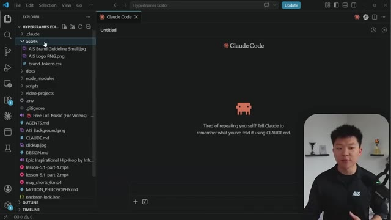
*⏱️ 00:16:29 — Interface VS Code affichant l'arborescence des fichiers du projet "HYPERFRAMES EDITOR" avec un dossier "assets" ouvert, et une fenêtre centrale "Claude Code".*

---

### ⏱️ `[00:16:56 - 00:17:14]` | Segment #35

**🔊 Audio (Transcription Intégrale Mot pour Mot en Français) :**
> to CloudCode and you say, hey, can you please like analyze this or can you clone it and pull it in and then just help me set up my own video editing studio right here in this project. So that leads me on to step one, which is you go to the official HeyGen, Hyperframes repo. If you scroll down, you can read about all of the different things in here. It's already got some built-in skills that you can use.

**👁️ Analyse Visuelle d'Écran (gemini-3.5-flash-lite) :**
**Interface & Outils** : VS Code (éditeur de code) et GitHub (plateforme de gestion de code).

**Contenu textuel & Code** : Arborescence de fichiers incluant des fichiers .md, .json, .mp4, et les détails du dépôt GitHub (commits, branches, tags).

**Action / Démonstration** : Navigation dans un projet de développement et accès à la source du framework Hyperframes pour sa mise en place.

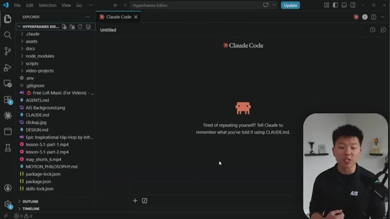
*⏱️ 00:17:01 — Interface de VS Code affichant le répertoire "HYPERFRAMES EDITOR" avec des fichiers de projet et une notification intégrée de Claude Code.*

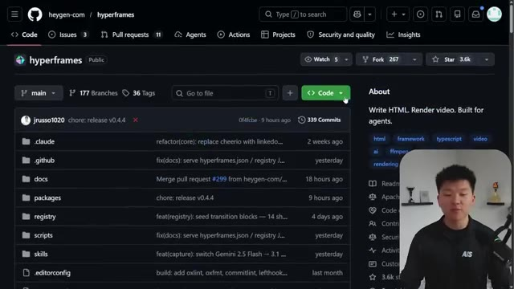
*⏱️ 00:17:10 — Capture d'écran du dépôt GitHub public "heygen-com/hyperframes", montrant l'arborescence du projet et le bouton pour cloner le code.*

---

### ⏱️ `[00:17:15 - 00:17:52]` | Segment #36

**🔊 Audio (Transcription Intégrale Mot pour Mot en Français) :**
> But then basically it shows you how this works and the quick start. So you could just use this. You could just install it right here. But I think what's better is you copy the URL. Like I said, you grab the URL of this GitHub repo, come into your cloud code, paste it in. And then you just say something like, this is an open source video editing tool that I want to use. Analyze the repo, you know, start to build some skills and start to build some knowledge around how it works and then help me get it installed. And it will just in a matter of minutes, you'll have it up and running and then you just have to start iterating. And that's the thing about a tool like this is it really is all about iteration. So here's my project. Here is the actual like different ones I've worked on.

**👁️ Analyse Visuelle d'Écran (gemini-3.5-flash-lite) :**
**Interface & Outils** : Navigateur web (documentation GitHub) et l'interface de ligne de commande/éditeur de "Claude Code".

**Contenu textuel & Code** : Commande `npx skills add heygen-com/hyperframes` et URL `https://github.com/heygen-com/hyperframes`.

**Action / Démonstration** : Installation des compétences ("skills") pour les agents IA et intégration du lien du dépôt dans l'interface de travail de Claude Code pour initialiser le projet.

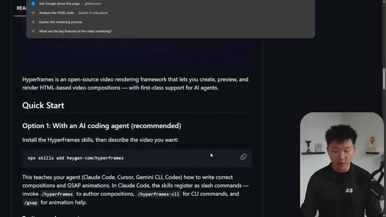
*⏱️ 00:17:24 — Page de documentation GitHub de "Hyperframes" affichant le guide "Quick Start" et la commande d'installation pour les agents IA.*

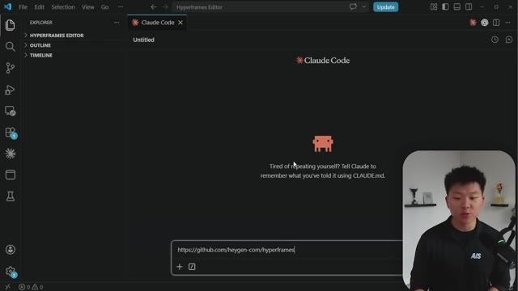
*⏱️ 00:17:33 — Interface de "Claude Code" au sein d'un éditeur, montrant l'utilisateur en train de copier l'URL du dépôt GitHub pour l'intégrer à l'agent.*

---

### ⏱️ `[00:17:52 - 00:18:10]` | Segment #37

**🔊 Audio (Transcription Intégrale Mot pour Mot en Français) :**
> You can see that I've iterated a ton. If I open up this one and I go to my renders, there's different versions, right? And there's so many different frames that I've tried. If I go to like the May shorts 19, we have tried so many different versions because what happens is it gives you something and then you say, okay, here's what I like. Here's what I don't like. Go make changes. And then it renders it again. And then you say, okay, here's what I like.

**👁️ Analyse Visuelle d'Écran (gemini-3.5-flash-lite) :**
**Interface & Outils** : VS Code (ou éditeur similaire) avec le gestionnaire de fichiers intégré ouvert.

**Contenu textuel & Code** : Arborescence de fichiers : `Hyperframes Editor > video-projects > context-session > renders`, contenant des sous-dossiers comme "audit-frames", "final-frames", "v2-compare", et divers fichiers vidéo de prévisualisation (drafts).

**Action / Démonstration** : Navigation dans l'explorateur de fichiers pour montrer les nombreuses versions générées du projet.

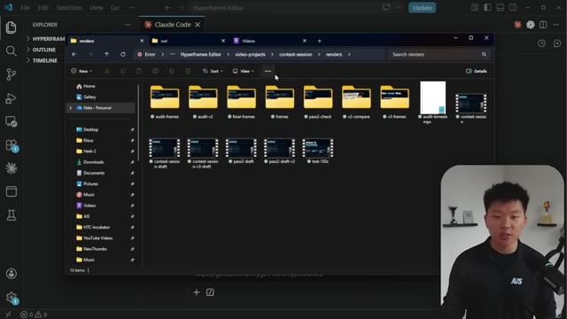
*⏱️ 00:17:57 — Une capture d'écran montrant l'explorateur de fichiers au sein d'une interface de développement (type VS Code), affichant le contenu du dossier "renders" avec de multiples sous-dossiers et fichiers vidéo illustrant l'itération sur un projet.*

---

### ⏱️ `[00:18:10 - 00:18:33]` | Segment #38

**🔊 Audio (Transcription Intégrale Mot pour Mot en Français) :**
> Here's what I don't like. And you have to do that over time. And as you do that, tell it, build up a skill for this, build up a skill for this, build up a design doc for this. So every single iteration, every single video you make makes your entire video editing studio in Cloud Code better. So don't expect that you're going to be able to clone my repo, ask it to make a video and it's going to be perfect. You're going to have to put in a little bit of work, but you can iterate extremely fast.

**👁️ Analyse Visuelle d'Écran (gemini-3.5-flash-lite) :**
**Interface & Outils** : VS Code (avec une extension ou interface intégrée nommée "Hyperframes Editor" et un onglet "Claude Code").

**Contenu textuel & Code** : Arborescence de fichiers système montrant des dossiers et fichiers de projet ("renders", "out", "video-projects", "may-shorts-19") avec des vignettes de prévisualisation de montages vidéo.

**Action / Démonstration** : Navigation dans le système de fichiers du projet pour accéder aux itérations de rendu vidéo ("may-shorts-19-vertical-v4"), illustrant le processus d'itération mentionné dans l'audio.

*⏱️ 00:18:16 — Capture d'écran montrant l'interface VS Code avec un explorateur de fichiers ouvert au sein d'un projet nommé "Hyperframes Editor", affichant les dossiers de rendus et de projets vidéo.*

---

### ⏱️ `[00:18:33 - 00:18:54]` | Segment #39

**🔊 Audio (Transcription Intégrale Mot pour Mot en Français) :**
> And I built a custom skill for this. So I'm going to show that off in a second when we do this live edit here. So let's go into VS Code and let's edit a video together. I'm going to go to my downloads real quick and drag in a video clip that we're going to edit. Okay, so I've got this video right here. It's going to be 37 seconds long and it's just me talking. I don't know why I can't see the preview right here, but this is now in our project.

**👁️ Analyse Visuelle d'Écran (gemini-3.5-flash-lite) :**
**Interface & Outils** : VS Code (Visual Studio Code).

**Contenu textuel & Code** : Arborescence de fichiers (assets, docs, node_modules, scripts, fichiers .md, fichiers vidéo .mp4) et interface de lecture vidéo intégrée.

**Action / Démonstration** : Le présentateur navigue dans ses dossiers de projet et ouvre un fichier vidéo pour commencer le montage live.

*⏱️ 00:18:44 — Interface de l'éditeur VS Code montrant l'arborescence des fichiers du projet « Hyperframes Editor ».*

*⏱️ 00:18:49 — L'éditeur VS Code affiche une vidéo chargée (« Golden Ratio Demo.mp4 ») avec une barre de lecture active.*

---

### ⏱️ `[00:18:54 - 00:19:12]` | Segment #40

**🔊 Audio (Transcription Intégrale Mot pour Mot en Français) :**
> And what I'm going to do is I'm going to tell Cloud Code that we want to make a video using this video. So in my dot Claude, in my skills, you can see I've got some skills that you guys obviously will get access to all of them. And I have this one right here called make a video. And we've got some references in here and we've got the skill. So what I'm going to do is say, hey, Claude Code, I need you to use the make a video skill.

**👁️ Analyse Visuelle d'Écran (gemini-3.5-flash-lite) :**
**Interface & Outils** : Hyperframes Editor (VS Code), Claude Code interface.

**Contenu textuel & Code** : Arborescence de projet affichant des fichiers tels que `.claude`, `AGENTS.md`, `CLAUDE.md`, et plusieurs fichiers vidéo (.mp4) dans le dossier `video-projects`. Texte affiché : "Tired of repeating yourself? Tell Claude to remember what you've told it using CLAUDE.md."

**Action / Démonstration** : Le présentateur présente l'environnement de développement et les outils disponibles, incluant le dossier des compétences (.claude) et les fichiers de projet vidéo, en préparation de l'utilisation de l'outil "make a video".

*⏱️ 00:18:58 — L'interface de l'éditeur "Hyperframes Editor" (basé sur VS Code) montrant l'explorateur de fichiers à gauche et l'espace de travail "Claude Code" au centre avec un champ de saisie de texte.*

---

### ⏱️ `[00:19:13 - 00:19:36]` | Segment #41

**🔊 Audio (Transcription Intégrale Mot pour Mot en Français) :**
> And I need you to help me create a video for the golden ratio demo dot MP4 that I've dropped into the root of this project. So that's the video. What I need you to do is help me figure out how to animate this. I'm also just going to shoot this off in plan mode and then we will get going. You can see it's invoked the make a video skill and it's going to start by basically interviewing us a little bit and understanding the video in order for it to understand what to build.

**👁️ Analyse Visuelle d'Écran (gemini-3.5-flash-lite) :**
**Interface & Outils** : Hyperframes Editor (basé sur VS Code), Claude Code.

**Contenu textuel & Code** : Structure de dossiers (assets, docs, scripts, etc.), liste de fichiers incluant "Golden Ratio Demo.mp4", invite de commande : "hey Claude Code! I need you to use the 'Make a Video'..."

**Action / Démonstration** : Navigation dans l'arborescence des fichiers, puis sélection d'un mode de fonctionnement de l'agent IA dans le menu déroulant.

*⏱️ 00:19:19 — Interface de l'éditeur "Hyperframes" affichant la structure des fichiers du projet, incluant le fichier "Golden Ratio Demo.mp4".*

*⏱️ 00:19:24 — Interface de l'éditeur avec un menu contextuel de sélection des modes (Plan mode, Edit automatically, etc.) ouvert au-dessus de la zone de saisie.*

---

### ⏱️ `[00:19:36 - 00:19:56]` | Segment #42

**🔊 Audio (Transcription Intégrale Mot pour Mot en Français) :**
> Oh, and by the way, just for reference, right now in my usage, I am 20% of the way through. So keep that in mind, 20% of the way through. Let's see where we are after we have our finished video back right here. Now, what I want you to do is think about what it's actually doing here. So right here, it tells us, okay, the video is landscape at 60 FPS, 37 seconds, 2259 frames.

**👁️ Analyse Visuelle d'Écran (gemini-3.5-flash-lite) :**
**Interface & Outils** : Hyperframes Editor (application web personnalisée) et VS Code (avec l'extension Claude Code).

**Contenu textuel & Code** : - Image 1 : Statistiques "Plan usage" (5-hour limit: 20%). 
- Image 2 : Logs de l'agent : `ffprobe` pour extraire les métadonnées vidéo (codec, résolution), commande `ls` pour inventorier les actifs et lecture du fichier `MOTION_PHILOSOPHY.md`.

**Action / Démonstration** : Analyse et inventaire des fichiers de projet par l'agent IA pour préparer l'animation d'une vidéo de démonstration.

*⏱️ 00:19:41 — L'interface de "Hyperframes Editor" montrant le tableau de bord avec les statistiques de consommation de l'abonnement (plan usage) à 20% et une prévisualisation vidéo à droite.*

*⏱️ 00:19:46 — L'interface de l'éditeur de code (VS Code) affichant le flux de travail de l'agent AI "Claude Code" en train d'analyser les métadonnées d'une vidéo via des commandes Bash.*

---

### ⏱️ `[00:19:56 - 00:20:18]` | Segment #43

**🔊 Audio (Transcription Intégrale Mot pour Mot en Français) :**
> Let me sample a few frames to see what this video actually contains. So it needs to analyze it a little bit It says got it. This video is just you at your desk in your ais quarter zip with your mic You're standing there just talking. So now it understands what it's looking at And you can see it starts to set up all of these different gates So the next thing we have to do is script and voice. So it's going to ask us some questions What is the golden ratio demo going to become?

**👁️ Analyse Visuelle d'Écran (gemini-3.5-flash-lite) :**
**Interface & Outils** : VS Code / Claude Code (terminal intégré).

**Contenu textuel & Code** : Historique de discussion affichant la lecture de plusieurs fichiers images (.jpg) extraits du projet, suivie de l'analyse textuelle de l'agent décrivant le présentateur (Nate) et le contexte technique de la vidéo.

**Action / Démonstration** : L'agent effectue une analyse visuelle automatisée (échantillonnage de frames) pour identifier le contenu d'un fichier vidéo et déterminer comment procéder à son animation.

*⏱️ 00:20:01 — Une interface de terminal Claude Code au sein d'un éditeur (VS Code) où l'agent analyse des images extraites d'une vidéo pour comprendre son contenu.*

---

### ⏱️ `[00:20:19 - 00:20:55]` | Segment #44

**🔊 Audio (Transcription Intégrale Mot pour Mot en Français) :**
> A face plus motion graphic overlays. So that's kind of like what we saw in the Claude edit intro, the video that I showed you guys earlier, or do we want my face cam to be like on the bottom right corner and make it be more of like a core style video? I want to do sort of one of these. So we will click on this. You want to keep the full 37 seconds or trim it. I'm just going to keep the full 37 seconds. Should I transcribe the demo so we get word level timestamps? Absolutely. So that's what's really key here is it needs to transcribe the video so that not only, like I said, can it create the right motion graphics, but it also needs to have them come into the scene at the right time. So you can either have it do this locally by installing

**👁️ Analyse Visuelle d'Écran (gemini-3.5-flash-lite) :**
**Interface & Outils** : VS Code (Hyperframes Editor), fenêtre de dialogue de l'agent Claude Code.

**Contenu textuel & Code** : Texte du prompt : "hey Claude Code! I need you to use the 'Make a Video' skill...", liste d'options : "AIS lesson (16:9, face + MG overlays)", "AIS short (9:16 vertical)", "Promo / hype piece (16:9, MOTION_PHILOSOPHY-style)".

**Action / Démonstration** : Le présentateur interagit avec l'agent IA pour configurer les paramètres techniques et le format d'un projet de montage vidéo.

*⏱️ 00:20:28 — Une capture d'écran de l'éditeur VS Code montrant une interface de discussion avec un agent IA ("Claude Code") au centre, demandant de définir l'intention d'une vidéo via une liste de choix (format 16:9, short 9:16 ou promo).*

---

### ⏱️ `[00:20:55 - 00:21:32]` | Segment #45

**🔊 Audio (Transcription Intégrale Mot pour Mot en Français) :**
> like a Python whisper thing, and it will actually go do it on your machine. But if that's taking up too much of your RAM, then what you can do is just use like an API to do so. So if you give it an open AI API key, it can use open AI's whisper to go grab the transcript and the timestamps. And right on cue, you can see it says whisper.cpp isn't installed. So it's going to try alternatives, which will be the open AI API. I ended up uninstalling this because when I was running like eight different videos at the same time. It was just killing my RAM. So I just said, Hey, just uninstall that. Now the transcript is in and you can see that it starts to actually plan out what it's going to do for each kind of section of the video. So hero visual metaphor, what carries

**👁️ Analyse Visuelle d'Écran (gemini-3.5-flash-lite) :**
**Interface & Outils** : Éditeur de code (Hyperframes Editor / VS Code-like) avec interface de chat pour agent IA intégrée.

**Contenu textuel & Code** : Commande shell : `cd "C:/Users/nateh/OneDrive/Desktop/Hyperframes Editor" && npx hyperframes transcribe "Golden Ratio Demo.mp4" --model sm`.

**Action / Démonstration** : L'agent IA exécute une tâche de transcription en arrière-plan pour traiter le fichier vidéo spécifié.

*⏱️ 00:21:04 — Interface de l'éditeur Hyperframes montrant une interaction avec un agent IA (Claude Code) qui exécute une commande de transcription.*

---

### ⏱️ `[00:21:32 - 00:22:07]` | Segment #46

**🔊 Audio (Transcription Intégrale Mot pour Mot en Français) :**
> the golden ratio idea visually across the whole piece? Yeah, we'll just go with this. I'm just going to take its recommendations. What about the captions? I don't actually want to do captions. We'll say no audio only and face cam treatment corner pip throughout full screen for intro and outro full screen with floating MG overlays. Yeah, I'm going to do this one. You guys may be confused about this whole golden ratio thing because I haven't shown you the raw footage yet, but just stick with me. You'll see at the end. It's going to keep chugging its way through all of these different gates. I'm going to check in with you guys if we get anything interesting or once it's done. Okay. So we got the plan ready for review. So this is where you definitely want to spend some

**👁️ Analyse Visuelle d'Écran (gemini-3.5-flash-lite) :**
**Interface & Outils** : VS Code (éditeur Hyperframes).

**Contenu textuel & Code** : Plan de montage vidéo détaillant des segments (Cold open, 60% logique, 30% IA, 10% humain) et une liste de choix pour les sous-titres : "Karaoke word-by-word", "Phrase-level lower-third captions", "No captions".

**Action / Démonstration** : Le curseur de la souris survole l'option "No captions" dans le menu de configuration des sous-titres, correspondant à la décision énoncée à l'oral.

*⏱️ 00:21:40 — L'interface de l'éditeur Hyperframes dans VS Code affiche les recommandations de montage pour une vidéo, avec un menu contextuel "Captions plan" ouvert.*

---

### ⏱️ `[00:22:07 - 00:22:26]` | Segment #47

**🔊 Audio (Transcription Intégrale Mot pour Mot en Français) :**
> time making sure that you agree with what it's doing. So it's basically going to tell me here for each of these sections, what is the motion graphics or animations that it's going to create? because once you start creating them, that's where you're getting a lot of output tokens being used because it's writing a ton of HTML. So if you accept the plan, but then you end up like not liking what it's doing, that will cost you more tokens.

**👁️ Analyse Visuelle d'Écran (gemini-3.5-flash-lite) :**
**Interface & Outils** : VS Code (éditeur de code).

**Contenu textuel & Code** : Tableau récapitulatif structuré par sections (01, 02, 03) avec des colonnes pour la chronologie (t-start, t-end, Dur, Beat) et les instructions détaillées pour les animations graphiques (Key MG moves) synchronisées avec l'audio.

**Action / Démonstration** : Le présentateur illustre le processus de planification d'une animation vidéo où l'IA génère un script structuré pour définir précisément les éléments visuels, la synchronisation et le comportement des graphiques à l'écran.

*⏱️ 00:22:11 — Une capture d'écran de l'éditeur VS Code affichant un fichier Markdown intitulé "Golden Ratio Demo — Animation Plan", détaillant la structure des sections vidéo, les temps de début/fin, les beats et les mouvements graphiques (Key MG moves).*

---

### ⏱️ `[00:22:26 - 00:22:56]` | Segment #48

**🔊 Audio (Transcription Intégrale Mot pour Mot en Français) :**
> So take some time, read through the plan and then go ahead and approve it. In this case, I'm just gonna go ahead and approve it because I wanna see how good it does by default without me helping steer it a ton. And one other quick thing I wanted to mention while this is churning out its code is that if you wanted to take like a completely raw, unedited video and drop it into here, You would probably want to manually edit out some of the mistakes and the retakes or some of the blank space or like dead space Because it's not going to be great at interpreting When is the start of a new sentence and when did you mess up and what do you want to remove?

**👁️ Analyse Visuelle d'Écran (gemini-3.5-flash-lite) :**
**Interface & Outils** : VS Code (ou éditeur de code similaire avec une extension d'agent IA intégrée).

**Contenu textuel & Code** : Le journal affiche les étapes du projet : "Gate 6 - Build compositions", "Gate 7 - Lint + Studio preview", "Gate 8 - Draft render". On voit également le chemin d'accès au fichier de plan (`hey-claude-code-i-shiny-alpaca.md`) et le statut "Concocting..." (en cours de préparation).

**Action / Démonstration** : L'utilisateur a validé le plan généré par l'IA, déclenchant l'exécution automatique des tâches de développement.

*⏱️ 00:22:33 — Une interface de type éditeur de code affichant le journal de progression d'un agent IA nommé Claude, qui détaille les étapes d'un plan de projet d'animation intitulé "Golden Ratio Demo".*

---

### ⏱️ `[00:22:56 - 00:23:16]` | Segment #49

**🔊 Audio (Transcription Intégrale Mot pour Mot en Français) :**
> So you could also try to use a tool like descript But it's the same sort of logic and even descript messes up a lot of times when I try to use it So I will usually just take the script I will cut out the mistakes because I know what's a mistake and what's not and then I take that file and drop it into here Now cloud code with something like f of mpeg and hyperframes, it certainly could but you would just have to steer it.

**👁️ Analyse Visuelle d'Écran (gemini-3.5-flash-lite) :**
**Interface & Outils** : VS Code / Cursor (avec une extension d'agent IA).

**Contenu textuel & Code** : Liste de fichiers HTML correspondant à des segments de vidéo (ex: "05-magic-trash-middle.html"), instructions sur l'utilisation de l'API OpenAI pour la transcription, et état d'exécution de l'agent ("Building section 05...").

**Action / Démonstration** : L'agent IA est en cours d'exécution ("Marinating...") pour construire une section spécifique du projet vidéo après avoir traité les étapes précédentes.

*⏱️ 00:23:01 — Interface de l'éditeur de code (Cursor ou VS Code) affichant une liste de tâches de montage vidéo générées par un agent IA.*

---

### ⏱️ `[00:23:16 - 00:23:36]` | Segment #50

**🔊 Audio (Transcription Intégrale Mot pour Mot en Français) :**
> And at that point, if you're saying, hey, cut from four seconds to seven seconds and then cut from 15 seconds to 22 seconds. At that point, you doing that and then having it render all that would just take longer than if you just did it yourself. So that's why I say that it's still capable, just gotta play around. Okay, so it pulls up a preview. And I do wanna say that I've been having a lot of issues with these previews on localhost.

**👁️ Analyse Visuelle d'Écran (gemini-3.5-flash-lite) :**
**Interface & Outils** : Hyperframes Editor (basé sur VS Code)

**Contenu textuel & Code** : Liste de tâches "Gate" (étapes de rendu vidéo) avec des coches, état de réflexion ("Thought for 17s"), et une instruction de construction de sections ("Building section 05...").

**Action / Démonstration** : L'agent IA est en cours d'exécution ("Brewing...") pour traiter les étapes de montage et de rendu vidéo.

*⏱️ 00:23:21 — Interface d'un éditeur de code avec une fenêtre de chat d'agent IA montrant la progression d'une tâche de montage vidéo automatisée.*

---

### ⏱️ `[00:23:36 - 00:23:56]` | Segment #51

**🔊 Audio (Transcription Intégrale Mot pour Mot en Français) :**
> That's something that on Remotion, I've basically never had an issue with. But for some reason, hyperframes, maybe because it's HTML based or whatever it is, it has a problem sometimes. So like right here, what's happened is it's loaded in all of the different compositions, but at the bottom of the screen, you see it says zero seconds out of zero seconds. So there's nothing for me to actually look at, but here's the exact same scenario with the intro video and this one's working fine.

**👁️ Analyse Visuelle d'Écran (gemini-3.5-flash-lite) :**
**Interface & Outils** : VS Code (éditeur de code) et interface de prévisualisation "Hyperframes".

**Contenu textuel & Code** : Liste de compositions vidéo (01 à 06) avec des liens localhost:3003 et un texte explicatif sur la gestion des sub-compositions.

**Action / Démonstration** : Le présentateur illustre les problèmes de chargement ou de rendu rencontrés dans son outil de développement basé sur le web (Hyperframes) par rapport à Remotion.

*⏱️ 00:23:41 — Interface VS Code affichant un fichier Markdown listant les compositions vidéo et leurs URLs locales, avec un avertissement sur un problème de mémoire (stall) lors du chargement de la composition principale.*

*⏱️ 00:23:46 — Interface de prévisualisation "Hyperframes" montrant la liste des compositions sur la gauche et une fenêtre de lecture vidéo vide sur la droite.*

---

### ⏱️ `[00:23:56 - 00:24:32]` | Segment #52

**🔊 Audio (Transcription Intégrale Mot pour Mot en Français) :**
> So sometimes it's been working. It's been a little bit here to miss. I can go back and forth to have it, you know, try to fix it. Or if it's doing the same thing to you and you're just getting frustrated with it, then just say, hey, you know what? Instead, just go ahead and give me the full render and then I'll give you feedback from there. The only time when that's really annoying is if the render is going to take a long time, if it's like a 15 minute video, and then you render everything just to see that you need to make a few changes. Okay. So what's really cool is when I told it to go ahead and render it, what it does is it does another final check and it looks at the frames. And before I even gave any feedback, it made another fix. So it made a V1 and then it came back and made a V2. It gave us another local host. Let's see if we can see it this time. Cool. Okay.

**👁️ Analyse Visuelle d'Écran (gemini-3.5-flash-lite) :**
**Interface & Outils** : Hyperframes Editor (intégré à VS Code).

**Contenu textuel & Code** : Liste de contrôle des rendus vidéo : "60% / 30% / 10% cards", "MAGIC / TRASH", et des notes techniques sur les problèmes de gradient et les "sparse keyframes" causant des gels d'images.

**Action / Démonstration** : Consultation du compte-rendu de rendu de l'IA pour valider les corrections apportées ou demander un nouveau rendu.

*⏱️ 00:24:05 — Interface d'édition vidéo avec une arborescence de fichiers à gauche et une zone de prévisualisation noire à droite, centrée sur le projet "golden-ratio-demo".*

*⏱️ 00:24:23 — Interface de type éditeur (Hyperframes) montrant un rapport de progression avec des points de contrôle, des liens vers des rendus MP4 (v1 et v2), et une liste de tâches terminées ou en attente.*

---

### ⏱️ `[00:24:32 - 00:24:52]` | Segment #53

**🔊 Audio (Transcription Intégrale Mot pour Mot en Français) :**
> We actually can see it in a local host. So let's give this a watch. Hey guys, my name is Nate. Today I wanted to talk to you about the golden ratio of AI automation, which basically means when you think of automating a process with AI, you think about the first 60% being automated with just deterministic logic, the next 30% being automated with AI, sort of AI assisted.

**👁️ Analyse Visuelle d'Écran (gemini-3.5-flash-lite) :**
**Interface & Outils** : Aucune interface logicielle montrée.

**Contenu textuel & Code** : Aucun contenu technique (code, commande, workflow).

**Action / Démonstration** : Nate Herk parle face caméra sans manipulation d'outil.

---

### ⏱️ `[00:24:52 - 00:25:10]` | Segment #54

**🔊 Audio (Transcription Intégrale Mot pour Mot en Français) :**
> And then that last 10% being kind of the human in the loop manual approval stage. And the reason why I think this is important is because some people think that AI is magic and it can do it all. Some people think that AI is trash and it can't do anything because they've only been using Copilot. And really, it's actually somewhere in the middle. So that's what I want to talk about in this video.

**👁️ Analyse Visuelle d'Écran (gemini-3.5-flash-lite) :**
**Interface & Outils** : Aucune

**Contenu textuel & Code** : Aucun

**Action / Démonstration** : Aucune

---

### ⏱️ `[00:25:11 - 00:25:31]` | Segment #55

**🔊 Audio (Transcription Intégrale Mot pour Mot en Français) :**
> Okay, so pretty good. There's obviously some issues, but if you think about the fact that we hardly prompted it and it added this overlay on the left-hand side so it can put text and we can see it. This was a big major issue. I think it put the blur on top of the text rather than behind. But there's a few things we need to fix here with spacing and with the blur.

**👁️ Analyse Visuelle d'Écran (gemini-3.5-flash-lite) :**
**Interface & Outils** : Aucune interface logicielle ou outil de développement n'est présenté ici ; il s'agit d'une superposition graphique de montage vidéo (overlay).

**Contenu textuel & Code** : Texte informatif sur les ratios d'automatisation et le titre de la leçon, sans code source ni interface fonctionnelle.

**Action / Démonstration** : Aucune manipulation d'agent ou exécution de code n'est démontrée ; le segment consiste en une discussion du présentateur sur les éléments visuels de sa vidéo.

---

### ⏱️ `[00:25:32 - 00:25:56]` | Segment #56

**🔊 Audio (Transcription Intégrale Mot pour Mot en Français) :**
> But this is pretty cool. The animations that it's making and the logic that it went through to make this stuff is pretty cool. Now, also the video in general is a little dark. And if I seem a little tired, I literally like had just woken up and I decided to film this, but let's actually talk about how do we give this thing feedback now? Okay, so real quick, before we start giving feedback, I wanna see how much context we're at, how many tokens this is eating up, because this does eat up a decent amount.

**👁️ Analyse Visuelle d'Écran (gemini-3.5-flash-lite) :**
**Interface & Outils** : VS Code (avec une extension de type interface d'agent IA, potentiellement Claude Code ou similaire).

**Contenu textuel & Code** : Liste de contrôle (check-list) de tâches terminées (tâches sur les cartes, étiquettes, barre de progression, éléments graphiques) et avertissements de rendu technique (keyframe sparse warnings).

**Action / Démonstration** : Revue de projet et validation de l'état d'avancement d'une automatisation vidéo via une interface de dialogue avec un agent.

*⏱️ 00:25:50 — Interface de l'éditeur VS Code affichant un rapport de progression sur un projet d'animation intitulé "Animate Golden Ratio Demo video", incluant des liens locaux vers des fichiers MP4 de prévisualisation et des notes techniques sur le rendu.*

---

### ⏱️ `[00:25:56 - 00:26:22]` | Segment #57

**🔊 Audio (Transcription Intégrale Mot pour Mot en Français) :**
> So right now in the conversation, we are at 263K out of our million. So what I would do here is I would basically just go ahead and give this a clear. So in this case, what I like to do is say, okay, give me a summary of everything that you've built and where the different files are so I can clear the session because I don't want to be making all of these changes on top of 263,000 tokens. We're going to reset and then I'm going to give it some more feedback. Okay. So here is the handoff message.

**👁️ Analyse Visuelle d'Écran (gemini-3.5-flash-lite) :**
**Interface & Outils** : Visual Studio Code (éditeur de texte) avec l'extension ou l'intégration Claude activée.

**Contenu textuel & Code** : Arborescence des fichiers du projet (dossiers .claude, scripts, video-projects, etc.) et statistiques affichées : "Model: claude-opus-4-7", "Tokens: 263.4k / 1m (26%)", avec une répartition par catégories (System prompt, System tools).

**Action / Démonstration** : Le présentateur affiche l'utilisation actuelle des tokens de la session pour justifier le besoin de "clear" (réinitialiser) la mémoire de l'agent afin de libérer de l'espace.

*⏱️ 00:26:03 — Capture d'écran de l'interface VS Code avec une vue des statistiques d'utilisation des tokens de l'agent Claude affichée au centre de l'éditeur.*

---

### ⏱️ `[00:26:22 - 00:26:45]` | Segment #58

**🔊 Audio (Transcription Intégrale Mot pour Mot en Français) :**
> I'm going to copy all of this. I'm going to clear this session and then I'm going to paste that in and then I'm just going to shoot that off and let it sort of like reorient itself. And then we're going to go ahead and give feedback. And don't overcomplicate the feedback. The way you're going to do this is the same exact way that you would give feedback to a human video editor. Basically saying, hey, at this timestamp, I don't like this and I like this. And at this timestamp, do this.

**👁️ Analyse Visuelle d'Écran (gemini-3.5-flash-lite) :**
**Interface & Outils** : Hyperframes Editor (environnement de développement intégré).

**Contenu textuel & Code** : Chemin d'accès au projet "c:\Users\nateh\OneDrive\Desktop\Hyperframes Editor\video-projects\golden-ratio-demo\", liste de fichiers (assets, node_modules, scripts, fichiers .md et .mp4), zone de texte "Queue another message...".

**Action / Démonstration** : Le présentateur s'apprête à coller du contenu dans la zone d'input pour réorienter l'agent IA du projet.

*⏱️ 00:26:28 — L'interface de "Hyperframes Editor" (basée sur VS Code) affichant l'arborescence des fichiers du projet sur la gauche et la zone de chat/input au centre, avec le présentateur en incrustation à droite.*

---

### ⏱️ `[00:26:46 - 00:27:24]` | Segment #59

**🔊 Audio (Transcription Intégrale Mot pour Mot en Français) :**
> So let's just go ahead and start. Okay. So the feedback that I need you to incorporate and fix some of these issues is as follows. Overall, I like the vibe. I like the logic. I just need some aesthetic changes. So first of all, at about five seconds, four to five seconds, when the text starts to come in that I think it says the golden ratio, we can't actually see it because there's a blur effect on top of it. And I think that blur effect needs to be behind it rather than on top because that whole text is blurred out basically from like, you know, four seconds all the way till about seven seconds. The next scene where you have the 60% come in at about 12 seconds in,

**👁️ Analyse Visuelle d'Écran (gemini-3.5-flash-lite) :**
**Interface & Outils** : Lecteur vidéo YouTube (interface de navigation).

**Contenu textuel & Code** : Texte affiché : "LESSON 01" en haut à gauche et encart "NATE HERK" en bas à gauche.

**Action / Démonstration** : Aucune action technique n'est montrée ; il s'agit d'une séquence de présentation face caméra.

---

### ⏱️ `[00:27:24 - 00:28:02]` | Segment #60

**🔊 Audio (Transcription Intégrale Mot pour Mot en Français) :**
> this looks really good however kind of the right half of the percentage sign gets blurred and a little bit of the left part of the six is out of frame so if you can kind of just scale that down a little bit and make sure that none of that text is blurred out very similar feedback for the next section with the 30 this one all fits in frame but the right half of the percentage sign is also blurred out and same thing for the 10 the right half of the percentage sign is blurred out The next scene looks solid no feedback there. I think that's really good

**👁️ Analyse Visuelle d'Écran (gemini-3.5-flash-lite) :**
**Interface & Outils** : Logiciel de montage vidéo ou lecteur vidéo (visualisation du graphique "60%").

**Contenu textuel & Code** : Le chiffre "60%" stylisé en bleu avec un effet de flou sur le bord droit, et une étiquette "01 - DETERMINISTIC" en haut à droite.

**Action / Démonstration** : Critique visuelle du design : le "6" est partiellement coupé à gauche et le signe "%" est flou sur la droite, ce qui justifie la demande de redimensionnement mentionnée dans l'audio.

*⏱️ 00:27:34 — Une capture d'écran montrant le présentateur devant un graphique animé affichant "60%" en gros caractères bleus, avec une barre de progression en bas à gauche et une fenêtre "Picture-in-Picture" du présentateur en bas à droite.*

---

### ⏱️ `[00:28:02 - 00:28:34]` | Segment #61

**🔊 Audio (Transcription Intégrale Mot pour Mot en Français) :**
> And same thing with the final scene. So those are the changes that I have for you. Please go ahead and Figure out how to make those and then give us a new video And that's why it's so nice to be able to just speak Instead of having to type things out because you can just look at it and you can speak So if you guys want to check out the tool that I use just use the link in the description The good news is it basically told us. Yep. Everything you said is true. I see this. I need to make these changes So what you can do is in your prompting and the way that you set up your video editing flow Is you can try to have it make sure that before it ever renders or before it ever gives you any

**👁️ Analyse Visuelle d'Écran (gemini-3.5-flash-lite) :**
**Interface & Outils** : Visual Studio Code (ou éditeur basé sur VS Code) avec extension d'agent IA intégrée.

**Contenu textuel & Code** : Journal de l'agent affichant le statut du projet "golden-ratio-demo", incluant l'emplacement du projet, les fichiers de rendu (draft v2), les tâches restantes ("section 01 title polish"), et l'état du serveur en arrière-plan.

**Action / Démonstration** : L'agent attend une instruction utilisateur dans la zone de saisie ("ctrl esc to focus or unfocus Claude") pour procéder au polissage final et au rendu.

*⏱️ 00:28:10 — Une interface d'éditeur de code (type VS Code personnalisé) affichant un agent IA actif au centre, avec une barre latérale explorateur de fichiers et une fenêtre de chat en bas.*

---

### ⏱️ `[00:28:34 - 00:29:06]` | Segment #62

**🔊 Audio (Transcription Intégrale Mot pour Mot en Français) :**
> Any output to review You're telling it to look at every single frame first and then it can extract all of them Fix the changes and then come back with a better version. So anyways, here's the plan It's suggested changes to fix all those things that we wanted I'm gonna go ahead and accept that and i'll let you know when we get our v2 Or technically I guess it would be our v3. All right, we've got a v3. Let's open this up and check it out Hey guys, my name is Nate. Today I wanted to talk to you about the golden ratio of AI automation, which basically means when you think of automating a process with AI, you think about the first 60%

**👁️ Analyse Visuelle d'Écran (gemini-3.5-flash-lite) :**
**Interface & Outils** : Éditeur de code Cursor.

**Contenu textuel & Code** : Liste de points détaillant des problèmes esthétiques de rendu vidéo (illisibilité du titre "THE GOLDEN RATIO", problèmes de contraste sur le glyphe "60%"), et menu d'interaction "Accept this plan?".

**Action / Démonstration** : Le présentateur passe en revue les suggestions de correction de l'IA dans l'éditeur avant de confirmer l'application des modifications.

*⏱️ 00:28:42 — Interface de l'éditeur Cursor affichant un plan de correction de projet vidéo intitulé "Golden Ratio Demo — v3 Aesthetic Fixes", avec des options de validation pour appliquer les changements suggérés par l'IA.*

---

### ⏱️ `[00:29:06 - 00:29:42]` | Segment #63

**🔊 Audio (Transcription Intégrale Mot pour Mot en Français) :**
> being automated with just deterministic logic, the next 30% being automated with AI, sort of approval. Okay, so you can see that the fixes have been made a little bit, the 60% still cut off a bit, but the percentage signs look good. And of course, the big one is the hero title. This is still blurred out. So I'm going to do another round of revisions and we should be there. The hero title is still unreadable. It's still completely blurred out. I don't know what is going on here, but you need to make it visible just like the other text on this slide, like lesson one and of AI automation. Those are completely visible. So you need to fix that. And then the percentage

**👁️ Analyse Visuelle d'Écran (gemini-3.5-flash-lite) :**
**Interface & Outils** : Superposition graphique vidéo (Overlay).

**Contenu textuel & Code** : Texte affiché : "60% LOGIC", "30% AI", "10% HUMAN", et le label "01 - DETERMINISTIC" en haut à droite.

**Action / Démonstration** : Le présentateur commente les niveaux d'automatisation représentés visuellement par une barre de progression segmentée.

*⏱️ 00:29:15 — Le présentateur explique un graphique de progression superposé à l'écran montrant les étapes "60% LOGIC", "30% AI" et "10% HUMAN".*

---

### ⏱️ `[00:29:42 - 00:30:16]` | Segment #64

**🔊 Audio (Transcription Intégrale Mot pour Mot en Français) :**
> signs look better. The only issue still is that the 60%, a little chunk of the six is still out of frame. So if you can just scale this down or either just move it a little bit more to the right, That needs to be fixed a little bit, but the other ones look good. All right, V4 is here, fingers crossed. Hey guys, my name is Nate. Today I wanted to talk to you about the golden ratio of AI automation, which basically means when you think of automating a process with AI, you think about the first 60% being automated with just deterministic logic, the next 30% being automated with AI, sort of AI assisted.

**👁️ Analyse Visuelle d'Écran (gemini-3.5-flash-lite) :**
**Interface & Outils** : Interface de présentation vidéo / Tableau de bord graphique.

**Contenu textuel & Code** : Graphique "60%" avec une barre de progression sous-jacente et le texte "01 - DETERMINISTIC" en haut à droite.

**Action / Démonstration** : Analyse visuelle de l'alignement graphique du composant "60%" pour correction (problème de cadrage).

*⏱️ 00:29:51 — Capture d'écran montrant le présentateur devant une interface graphique présentant un compteur "60%" dont le chiffre "6" est partiellement coupé sur le bord gauche de l'écran.*

---

### ⏱️ `[00:30:16 - 00:30:37]` | Segment #65

**🔊 Audio (Transcription Intégrale Mot pour Mot en Français) :**
> And then that last 10% being kind of the human in the loop manual approval stage. and the reason why I think this is important is some people think we've only been using Copa. Actually, that's what I want to talk about in this video. There we go. We have our final version. I also think that this is pretty interesting, this kind of spiral. I forget what this pattern is called, but we have basically the 10%, the 30% and the 60% of the golden ratio.

**👁️ Analyse Visuelle d'Écran (gemini-3.5-flash-lite) :**
**Interface & Outils** : Graphique informatif (Overlay)

**Contenu textuel & Code** : "60% DETERMINISTIC (Plain logic - code - API calls)", "30% AI ASSISTED (LLM calls in the pipeline)", "10% HUMAN (Manual approval - judgment)".

**Action / Démonstration** : Présentation conceptuelle des étapes d'un workflow d'automatisation.

*⏱️ 00:30:26 — Infographie affichée à gauche du présentateur détaillant une répartition par pourcentage (60% déterministe, 30% assisté par IA, 10% humain).*

---

### ⏱️ `[00:30:37 - 00:31:17]` | Segment #66

**🔊 Audio (Transcription Intégrale Mot pour Mot en Français) :**
> So that's just showing you that Opus 4.7, Cloud Code, the logic that it's able to make and then using hyperframes and turning that into actual HTML that can be animated is very cool. So the final thing I wanted to talk about was just kind of the cost and speed stuff. So let's come back into here and let's do another quick slash context to see how many we took on that second run. So the first one was what, like $260k? This one is $125k. And if we remember our session limit, we started this project at 20%. So this one project took about 10% of my five hour limit, and I'm on the $200 a month max plan. So keep that in mind. Because we're writing so much output with our code, that is what's going to eat up the tokens.

**👁️ Analyse Visuelle d'Écran (gemini-3.5-flash-lite) :**
**Interface & Outils** : Hyperframes Editor, VS Code (interface), Navigateur web (Hyperframes Studio).

**Contenu textuel & Code** : Historique de discussion avec un assistant IA, logs de corrections graphiques (golden ratio), indicateurs de consommation de quota (limites 5h/hebdomadaire).

**Action / Démonstration** : Revue de code et de rendu vidéo par l'IA ; consultation des statistiques d'utilisation du modèle Opus 4.7.

*⏱️ 00:30:57 — Interface de l'éditeur Hyperframes (VS Code like) montrant un historique de conversation avec une IA sur des corrections de rendu vidéo.*

*⏱️ 00:31:07 — Interface de gestion de session "Hyperframes Studio" affichant les limites d'utilisation de l'API (Context window) et le statut des modèles (Opus 4.7).*

---

### ⏱️ `[00:31:17 - 00:31:50]` | Segment #67

**🔊 Audio (Transcription Intégrale Mot pour Mot en Français) :**
> But if you can follow some best practices and clear stuff, then you're going to be able to dramatically reduce that The other thing to note is that If you're rendering multiple videos your cpu your ram will feel it. So yesterday when I uploaded the video about cloud design My face cam was all glitchy and I realized I was like, okay That was so dumb because I was rendering like four videos as I was recording that one so If you're rendering multiple videos and your computer starts to feel slow, that's why so maybe just Only do one at a time or whatever you need to do there But anyways, that is going to do it for this one. I hope you guys enjoyed. I hope you learned something new

**👁️ Analyse Visuelle d'Écran (gemini-3.5-flash-lite) :**
**Interface & Outils** : VS Code (avec extension de chat IA, probablement Claude Code).

**Contenu textuel & Code** : Texte du prompt : "Polish golden ratio demo and render final... the hero title is still unreadable; it's still completely blurred out...". Affichage des statistiques de consommation de jetons (Model: claude-opus-4-7, Tokens: 125.7k/1m).

**Action / Démonstration** : L'utilisateur est en train d'interagir avec l'IA pour corriger des problèmes de rendu visuel sur un projet vidéo nommé "Golden Ratio Demo.mp4".

*⏱️ 00:31:25 — Interface de VS Code montrant l'éditeur "Hyperframes" avec une discussion active avec un agent IA concernant l'amélioration d'une démo de "golden ratio".*

---

### ⏱️ `[00:31:50 - 00:31:59]` | Segment #68

**🔊 Audio (Transcription Intégrale Mot pour Mot en Français) :**
> Don't forget to go to the free school community to get all of the resources that you need But if you enjoyed give it a like helps me out a ton And I appreciate you guys making it to the end of the video and I will see you in the next one. Thanks everyone

**👁️ Analyse Visuelle d'Écran (gemini-3.5-flash-lite) :**
**Interface & Outils** : Canva (outil de design et de montage vidéo).

**Contenu textuel & Code** : Le script détaillé de la vidéo (Scene map) et une interface de call-to-action incitant les spectateurs à commenter "500W" pour rejoindre une communauté.

**Action / Démonstration** : Édition et prévisualisation du rendu final d'une courte vidéo promotionnelle.

*⏱️ 00:31:52 — Une capture d'écran montrant l'interface de Canva avec un projet de montage vidéo ouvert. À gauche, un panneau avec les instructions et le script du projet, et au centre, la zone de prévisualisation affichant un tutoriel vidéo montrant le présentateur et une incitation à rejoindre la communauté ("Join 300,000+ Innovators").*

---

