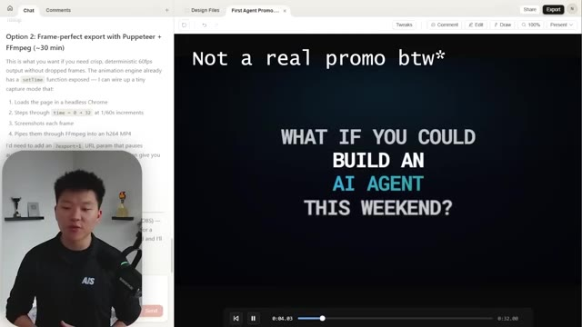
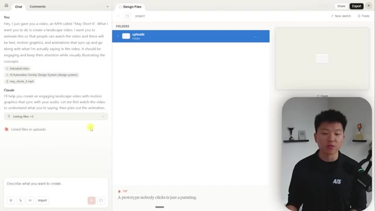
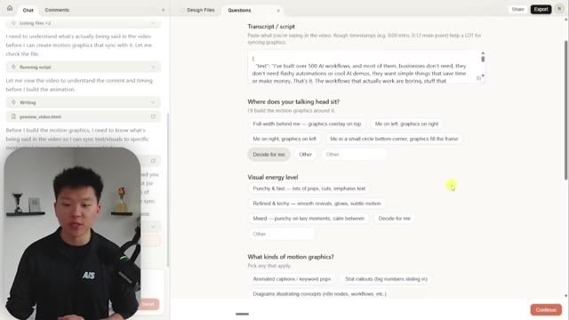
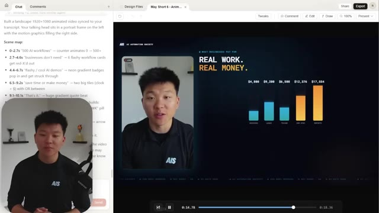
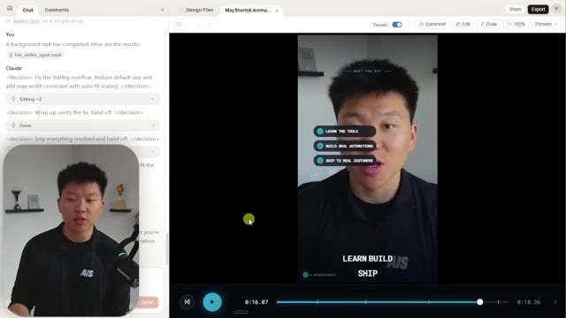
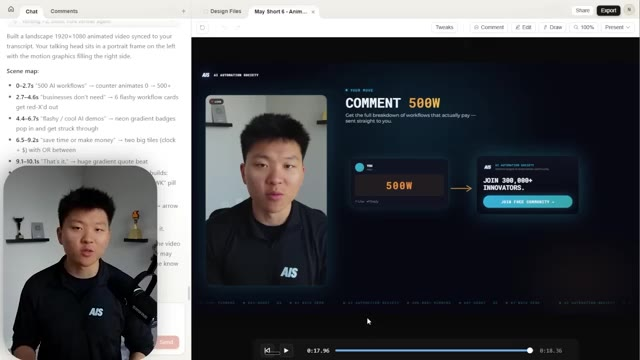

# 🎬 Claude Just Destroyed Every Video Editing Tool

> **Chaîne** : [Nate Herk | AI Automation](https://www.youtube.com/@nateherk/featured)  
> **Lien YouTube** : [https://www.youtube.com/watch?v=ZNbgOhxhzXg](https://www.youtube.com/watch?v=ZNbgOhxhzXg)  
> **Date de publication** : 20260418  
> **Durée** : 00:32:00  
> **Identifiant vidéo** : `ZNbgOhxhzXg`  
> **Transcription & Analyse** : `whisper-v3-large-turbo+gemini-3.5-flash-lite`  

---

## 📌 Synthèse Exécutive & Outils

### 💡 Résumé
Dans cette vidéo intitulée **Claude Just Destroyed Every Video Editing Tool**, Nate Herk décortique les capacités pratiques d'automatisation et de développement propulsées par les modèles de pointe.

### 🛠️ Outils, Modèles & Logiciels Présentés
- **Opus 5.5 & Claude Code** : Modèles d'ingénierie et agents de codage autonome.

### 🔑 Points Clés & Enseignements Stratégiques
- Optimiser le niveau d'effort et le raisonnement des modèles IA pour des résultats industriels.
- Automatiser les cycles de création logicielle de bout en bout.

---

## ⏱️ Chronologie & Transcription Complète Audio & Visuelle (Mot pour Mot)

### ⏱️ `[00:00:00 - 00:00:23]` | Segment #01

**🔊 Audio (Transcription Intégrale Mot pour Mot en Français) :**
> Today I'm going to show you guys how Claude can be a complete game changer for editing videos, whether that's text on screen like up here or whether that's subtitles down at the bottom like right here. Or it could be motion graphics or charts and different elements. It can be pretty much anything you want it to be. I can move my face around if I want. I can do anything by just using my natural language. You don't have to know how to code at all. And I'm going to show you guys a ton of other examples. So let's not waste any time and let's just get straight into the video.

**👁️ Analyse Visuelle d'Écran (gemini-3.5-flash-lite) :**
**Interface & Outils** : Aucune interface logicielle, éditeur de code ou outil d'automatisation n'est visible.

**Contenu textuel & Code** : Aucun code, aucune commande ou donnée technique n'est affiché.

**Action / Démonstration** : Le présentateur fait une démonstration orale et visuelle de montage vidéo basique (superposition de texte et recadrage d'image).

---

### ⏱️ `[00:00:23 - 00:01:00]` | Segment #02

**🔊 Audio (Transcription Intégrale Mot pour Mot en Français) :**
> So yeah, pretty wild. By the end of this video, you'll know exactly how to do all of this that I just did using Claude and it's so much easier than you may think. And I'm going to give you guys a repo and a skill and all the stuff that you need to get set up exactly like I've been set up here for completely free. So stay tuned and I'll show you how. So Claude is now a video editing team and this has already been saving me so much time it's actually crazy. Now one thing I want to put into perspective real quick is if you've never edited videos yourself, if you've never like used keyframes and animated motion graphics and things like that, you may not realize how long this 23 second clip would have taken you to edit manually. But if I wanted to edit this by hand,

**👁️ Analyse Visuelle d'Écran (gemini-3.5-flash-lite) :**
**Interface & Outils** : Éditeur de projet propriétaire (type studio de montage assisté par code/IA), Google Docs.

**Contenu textuel & Code** : "editing.loop()", "analyze_clip", "sync_captions", "add_motion_gfx", "No code required.", plan de cours détaillé (Claude Design, Hyperframes).

**Action / Démonstration** : Démonstration de l'interface de travail automatisée pour le montage vidéo assisté par IA.

*⏱️ 00:00:32 — Interface d'un éditeur vidéo/code montrant une boucle d'automatisation 'editing.loop()' avec des étapes validées (analyse, synchro, rendu) et une visualisation de données de vues.*

*⏱️ 00:00:42 — Capture d'écran d'un document Google Docs présentant le plan de la vidéo, intitulé "Claude Is Now a Video Editing Team", listant les méthodes de travail.*

*⏱️ 00:00:51 — Interface de l'éditeur montrant un écran de prévisualisation vidéo avec le texte "No code required." et une boucle de code barrée en dessous.*

---

### ⏱️ `[00:01:00 - 00:01:33]` | Segment #03

**🔊 Audio (Transcription Intégrale Mot pour Mot en Français) :**
> it would have probably taken me like two hours. And you know, I'm not a crazy good video editor. So maybe some of the best could do this in 30, 45 an hour. But the people on my team who actually know how to edit videos really well said that this is a complete game changer. So we're going to talk about two different methods. The first one is using Claude Design. Yeah, Claude Design, the web app that we showed off yesterday. If you didn't see that video, I'll tag it right up here. But inside of Claude Design, not only can you make websites and slide decks, but you can actually animate things. I'll show you guys some examples. We'll go through a live build together. It's really cool. And then we're going to talk about how to do it with hyperframes, which is kind of like

**👁️ Analyse Visuelle d'Écran (gemini-3.5-flash-lite) :**
**Interface & Outils** : Interface de développement ou d'édition vidéo (type studio de rendu Claude/Hyperframes).

**Contenu textuel & Code** : Texte promotionnel : "INPUT: Natural language. Describe it. Claude builds it."

**Action / Démonstration** : Présentation d'un outil d'édition vidéo piloté par l'IA via le langage naturel.

*⏱️ 00:01:08 — Interface logicielle montrant une démonstration vidéo où le texte "Natural language. Describe it. Claude builds it." est affiché au centre, avec une barre de navigation de projet sur la gauche.*

---

### ⏱️ `[00:01:33 - 00:02:06]` | Segment #04

**🔊 Audio (Transcription Intégrale Mot pour Mot en Français) :**
> a better version of Remotion, if you guys have seen that. It's a little bit more setup, but it's way more powerful. So I'm going to walk you guys through both of those. So real quick before we do that, let's just start with a taste. Let me show you guys a few different examples of what's happened here. So obviously you guys already saw that Claude Edit intro, but let's look at one that I made called the HyperFrames sizzle, which just basically shows off the power of what HyperFrames could really do. All right, here we go. So we got this cool little terminal thing that installs HyperFrames, HyperFrames times cloud code, write HTML, render video, built for agents.

**👁️ Analyse Visuelle d'Écran (gemini-3.5-flash-lite) :**
**Interface & Outils** : Lecteur vidéo (interface de visionnage de fichier .mp4) affichant le projet "Hyperframes".

**Contenu textuel & Code** : Texte affiché : "HYPERFRAMES", "CLAUDE CODE" et la commande terminal : "$ npx hyperframes render --quality high".

**Action / Démonstration** : Présentation visuelle d'un exemple concret de rendu généré via Hyperframes pour introduire les capacités de l'outil.

*⏱️ 00:01:57 — Capture d'écran montrant une démonstration vidéo (sizzle reel) présentant un titre animé "HYPERFRAMES" avec une commande npx visible en sous-titre.*

---

### ⏱️ `[00:02:07 - 00:02:31]` | Segment #05

**🔊 Audio (Transcription Intégrale Mot pour Mot en Français) :**
> Hours to ship a 90 second video, Premiere Pro, final cut, but HyperFrames is a fraction of the time. We got these cool little phones pop up and you can see it's like the process of like rendering a video, prompt, preview, render. The audio is reactive, which is pretty cool. Another little terminal style animation. We're launching different color schemes. This is from Anthropic.

**👁️ Analyse Visuelle d'Écran (gemini-3.5-flash-lite) :**
**Interface & Outils** : Lecteur vidéo intégré ou interface d'application web de gestion de fichiers média (type cloud storage/preview).

**Contenu textuel & Code** : Nom du fichier "sizzle-final.mp4", résolution "1920 x 1080", poids "13.9 MB", et texte discret en bas à droite de l'écran "AIS x HYPERFRAMES".

**Action / Démonstration** : Lecture ou prévisualisation d'un fichier vidéo finalisé dans une interface d'aperçu.

*⏱️ 00:02:13 — Une interface de visionneuse média (lecteur vidéo) affichant un fichier nommé "sizzle-final.mp4", avec une barre d'outils supérieure et inférieure, et le présentateur en médaillon dans le coin inférieur droit.*

---

### ⏱️ `[00:02:31 - 00:03:04]` | Segment #06

**🔊 Audio (Transcription Intégrale Mot pour Mot en Français) :**
> It pulls in their font. We can see Claude 4.7 Opus. We can see a swirl type of animation, which we can install from Hyperframes. We could also do this chromatic radial split. We've got these other cool little overlays that could pop up, and you can use so many of these elements out of the box. They've got catalogs. They've got things like that. You can sync your voice to the actual words like karaoke style subtitles. It goes from HTML to your browser to FFmpeg to MP4. And it is just really, really impressive. So this is supposed to be my logo.

**👁️ Analyse Visuelle d'Écran (gemini-3.5-flash-lite) :**
**Interface & Outils** : Logiciel de démonstration de composants (probablement une interface propriétaire ou un outil de gestion d'assets type Hyperframes).

**Contenu textuel & Code** : Commande affichée : `npx hyperframes add chromatic-radial-split`

**Action / Démonstration** : Présentation de la commande pour installer et intégrer l'effet d'animation "Chromatic Radial Split" dans un projet.

*⏱️ 00:02:40 — Interface logicielle présentant l'effet "Chromatic Radial Split" avec une commande d'installation et une description fonctionnelle.*

---

### ⏱️ `[00:03:05 - 00:03:42]` | Segment #07

**🔊 Audio (Transcription Intégrale Mot pour Mot en Français) :**
> I'm not exactly sure what happened. That's weird. For some reason, the draft had my logo, but the final version didn't. So I would have to tweak that. But basically that's what happened there. And all of this, this entire video was animated and edited and created by Hyperframes and Claude Code. Okay. Now let me show you one called the first agent promo. And we actually made this one in Claude Design. So in here, you can see that I basically, the other day, I made this thing called the first agent promo. So it basically made me a website. And so what I did with this is I converted this up here. I exported this to a standalone HTML, as you can see right here. I downloaded that standalone HTML. And then I went back into a new project right here, the first agent release video.

**👁️ Analyse Visuelle d'Écran (gemini-3.5-flash-lite) :**
**Interface & Outils** : Claude Design, navigateur web.

**Contenu textuel & Code** : Logs d'analyse et de traitement de fichiers (ex: "checking code-referenced resources", "Generating HTML"), menu d'exportation (Download as .zip, Export as HTML, Handoff to Claude Code).

**Action / Démonstration** : Navigation dans l'espace de travail, manipulation des options d'exportation de projet et débogage du rendu final (mentionné dans l'audio).

*⏱️ 00:03:23 — Interface principale de Claude Design affichant une galerie de projets récents et des modèles de conception (Design Systems).*

*⏱️ 00:03:32 — Interface de Claude avec le panneau de chat latéral actif (logs d'exécution de code) et le menu d'exportation ouvert sur un projet web.*

---

### ⏱️ `[00:03:42 - 00:04:16]` | Segment #08

**🔊 Audio (Transcription Intégrale Mot pour Mot en Français) :**
> And you can see what I did is I dropped in that standalone HTML. And now we get this. so AI Automation Society what if you could build an AI agent this weekend all the branding is consistent your first AI agent you can see that there's like a scrolling banner at the bottom we've got these animations coming in really nice and just once again all I did was dropped in the HTML of our website and it said turn this into an animated release video I mean I thought all of these animations are awesome I really like this one with the terminal style stuff I think that's really cool and then it pops up at the end with May 4th through 6th just $20

**👁️ Analyse Visuelle d'Écran (gemini-3.5-flash-lite) :**
**Interface & Outils** : Navigateur web (outil de design/développement type interface de prototyping).

**Contenu textuel & Code** : Texte technique listant "Option 2: Frame-perfect export with Puppeteer + FFmpeg", expliquant les étapes de rendu image par image (headless Chrome, time increments, screenshots). À droite, le texte promotionnel : "WHAT IF YOU COULD BUILD AN AI AGENT THIS WEEKEND?".

**Action / Démonstration** : Présentation de la méthodologie technique pour générer des vidéos haute fidélité à partir d'un code HTML/CSS, avec démonstration du rendu visuel final.

*⏱️ 00:03:50 — Interface montrant une plateforme de développement de contenu/vidéo où le présentateur expose une stratégie d'exportation technique (Puppeteer + FFmpeg) à gauche et une prévisualisation de la vidéo promotionnelle à droite.*

---

### ⏱️ `[00:04:16 - 00:04:49]` | Segment #09

**🔊 Audio (Transcription Intégrale Mot pour Mot en Français) :**
> $500, 500 seats, claim your seat, join for 20 bucks. It all is just like super branded to the same way that the actual site is. And once again in here, my prompt was create me an animation for the first AirAgent promotion. I dropped in the standalone HTML for this launch. There should be motion graphics, animations, and visual elements that explain what's going on. It should feel fast paced and engaging. That's it. And then it created me this. Once again, this 30-ish second clip would have taken multiple hours to edit by hand. Okay. So method one is using Claude design. How do we actually make a video? How do we make it feel branded? And where are the limitations of cloud

**👁️ Analyse Visuelle d'Écran (gemini-3.5-flash-lite) :**
**Interface & Outils** : Interface de travail type "Claude Artifacts" ou éditeur de création IA avec panneau de chat latéral et zone de prévisualisation multimédia.

**Contenu textuel & Code** : Prompt : "Create me an animation for the first AI agent promotion. I dropped in the standalone HTML... It should feel fast-paced and engaging."

**Action / Démonstration** : Interaction avec une IA pour générer et prévisualiser une vidéo promotionnelle basée sur un fichier source HTML importé.

*⏱️ 00:04:24 — Interface de chat IA affichant le prompt de création d'animation avec un aperçu vidéo "What if you could build an AI agent this weekend" à droite.*

*⏱️ 00:04:32 — Gros plan sur le prompt de l'utilisateur demandant une animation pour une promotion d'agent IA à partir d'un fichier HTML.*

*⏱️ 00:04:40 — Vue identique à l'image #1, montrant le dialogue avec l'IA et le rendu visuel du projet en cours de traitement.*

---

### ⏱️ `[00:04:49 - 00:05:22]` | Segment #10

**🔊 Audio (Transcription Intégrale Mot pour Mot en Français) :**
> design? So you guys pretty much just saw all that, right? I came in here and I have my AI Automation Society design system. So now it understands my logos, my branding, my colors, my typography. And that's how it made all of this stuff for me feel like the real website, which real quick, just to show you guys, it looks like this. So this is basically exactly what you saw in those other two things, the promo video and the website. It has the same buttons. It has the same font. It has the same colors. And now every video I make or every, whatever I make in Cloud Design will also look like that. So let's say we want to make a new video. If I go here to from

**👁️ Analyse Visuelle d'Écran (gemini-3.5-flash-lite) :**
**Interface & Outils** : Application web "Claude Design" (interface de conception) et rendu final du site web "AI Automation Society".

**Contenu textuel & Code** : Noms de projets (ex: "First Agent Release Video", "AI Time"), identité visuelle "AIS" (logo, typographie, couleurs).

**Action / Démonstration** : Présentation du système de design (design system) utilisé par l'IA pour générer une identité de marque cohérente sur le site web.

*⏱️ 00:04:57 — Interface utilisateur de "Claude Design" affichant la bibliothèque de projets avec la sélection active du "AI Automation Society Design System".*

*⏱️ 00:05:05 — Aperçu du site web finalisé "AI Automation Society" avec un design sombre, une typographie moderne et des boutons d'appel à l'action.*

---

### ⏱️ `[00:05:22 - 00:05:59]` | Segment #11

**🔊 Audio (Transcription Intégrale Mot pour Mot en Français) :**
> template and I click on animation, now we can actually make a timeline based motion design. So I'm going to call this one, um, May short demo, and we're going to create from template. So what I want to do here is instead of just animating, you know, motion graphics, I wanted to take a video of mine and somehow animate that with things on top of it. So I'm going to drop in a video file real quick. Okay. So I just attached this file, um, right here, you can see may short six. So it's like a 18 second clip or something. And I want it to animate it. So I'm going to say, Hey, I just gave you a video, an MP4 called may short six. And what I want you to do is create a

**👁️ Analyse Visuelle d'Écran (gemini-3.5-flash-lite) :**
**Interface & Outils** : Claude Design (interface web d'outil de design assisté par IA).

**Contenu textuel & Code** : - Image 1 : Nom du projet "May Short Demo", sélection "Animation (Timeline-based motion design)", sélection du système de design "AI Automation Society".
- Image 2 : Liste de fichiers joints dans la zone de prompt : "Animated video", "AI Automation Society Design System", "may_shorts_6.mp4". Zone de saisie : "Describe what you want to create".

**Action / Démonstration** : - Image 1 : L'utilisateur clique sur le bouton "Create from template" pour initialiser le projet de motion design.
- Image 2 : L'utilisateur a chargé des fichiers contextuels et s'apprête à envoyer une instruction textuelle pour générer le design basé sur ses ressources.

*⏱️ 00:05:31 — L'interface de "Claude Design" affichant le formulaire de création de projet "Start from a template" où l'utilisateur nomme le projet "May Short Demo".*

*⏱️ 00:05:50 — L'interface de chat de Claude Design montrant les fichiers contextuels joints ("Animated video", "Design System", "may_shorts_6.mp4") avant l'envoi d'un prompt.*

---

### ⏱️ `[00:05:59 - 00:06:17]` | Segment #12

**🔊 Audio (Transcription Intégrale Mot pour Mot en Français) :**
> landscape video. Um, I want you to animate this so that people can watch the video and there will will be text and motion graphics and animations that sync up and go along with what I'm actually saying in the video. And it should be engaging and keep their attention while visually illustrating the concepts.

**👁️ Analyse Visuelle d'Écran (gemini-3.5-flash-lite) :**
**Interface & Outils** : Interface web Claude (Claude.ai / Artifacts)

**Contenu textuel & Code** : Zone de saisie de prompt "Describe what you want to create", boutons d'importation "Design System", "Add screenshot", "Attach codebase", "Drag in a Figma file", et liste de fichiers joints (Animated video, AI Automation Society Design System, may_shorts_6.mp4).

**Action / Démonstration** : Préparation d'un projet dans l'interface de Claude en ajoutant du contexte sous forme de fichiers et de systèmes de design pour guider la génération.

*⏱️ 00:06:03 — Capture d'écran de l'interface de Claude Artifacts avec une zone de chat à gauche et un espace de travail pour les fichiers de design à droite, incluant la vidéo du présentateur en incrustation.*

---

### ⏱️ `[00:06:17 - 00:06:43]` | Segment #13

**🔊 Audio (Transcription Intégrale Mot pour Mot en Français) :**
> Okay, so that is my prompt. I'm gonna shoot that off. And now Cloud Design is basically going to start asking me some questions and it's going to start making this video. Now what you'll notice here is it can't actually read or listen to or understand what's being said in the video, which when you're animating a video, that's super important. And that's one of the limitations you would have to basically feed in like the transcript of it so that it could actually understand what's being said and where. So here it says paste in the video with the rough timestamps.

**👁️ Analyse Visuelle d'Écran (gemini-3.5-flash-lite) :**
**Interface & Outils** : Interface web de l'application Cloud Design.

**Contenu textuel & Code** : Prompt utilisateur : « Hey, I just gave you a video, an MP4 called "May Short 6"... » et réponse de l'IA : « I'll help you create an engaging landscape video with motion graphics... ».

**Action / Démonstration** : Envoi du prompt par l'utilisateur et analyse/listing des fichiers par l'agent IA.

*⏱️ 00:06:23 — L'interface de l'application « Cloud Design » affiche une conversation active où l'utilisateur a envoyé une vidéo MP4 avec des instructions détaillées pour créer une vidéo paysage animée, et l'IA (Claude) confirme la réception des fichiers.*

---

### ⏱️ `[00:06:43 - 00:07:15]` | Segment #14

**🔊 Audio (Transcription Intégrale Mot pour Mot en Français) :**
> And you know, if you had to do that manually, it's a little bit of work. Luckily for us in my cloud code project, we've already done this. And by the way, if you're overwhelmed looking at this, don't be, I'm going to explain it later, but I would come down here to my May short six project. And I already did basically extract the script. So if I go to assets, you can see I have May short 6.json. And this basically transcribed this whole video word for word with timestamp. So I'm just going to copy this, go back into Cloud Design, paste that in. So now it should be able to see the actual script. And then it asks me some other questions. So where does your talking head sit?

**👁️ Analyse Visuelle d'Écran (gemini-3.5-flash-lite) :**
**Interface & Outils** : Hyperframes Editor (basé sur VS Code)

**Contenu textuel & Code** : Arborescence de fichiers affichant des dossiers de projets comme 'video-projects', 'aisoc-app-release', 'may-shorts-6', etc. L'écran principal affiche le logo et le message de Claude Code : "Tired of repeating yourself? Tell Claude to remember what you've told it using CLAUDE.md."

**Action / Démonstration** : Navigation dans l'explorateur de fichiers du projet pour localiser le dossier spécifique 'may-shorts-6'.

*⏱️ 00:06:51 — Interface de l'éditeur Hyperframes montrant la structure des dossiers du projet dans la barre latérale gauche et l'interface d'accueil de Claude Code dans la fenêtre principale.*

---

### ⏱️ `[00:07:15 - 00:07:50]` | Segment #15

**🔊 Audio (Transcription Intégrale Mot pour Mot en Français) :**
> It could be full width behind me with graphics overlay on top. It could be me on the left, graphics on the right. And I'm just basically going to say, decide for me. Let's see what it can do. Visual energy level. Let's go with punchy. What kind of motion graphics? We will do animated captions. We will do diagrams, progress bars, screen. Yeah, all that. Sure. We'll do full AIS dark theme. The end card CTA will be joined the free community and we'll do landscape and shoot that off. So what I like about Cloud Design is it does a good job of asking you questions. But once again, like I said, the limitation is it can't actually read or listen to and transcribe

**👁️ Analyse Visuelle d'Écran (gemini-3.5-flash-lite) :**
**Interface & Outils** : Application de design/prototypage Napkin (ou outil similaire).

**Contenu textuel & Code** : Image #1 : Options de configuration (Transcript, position de la caméra, niveau d'énergie visuel). Image #2 : Liste de paramètres (layout, tone, branding) et barre de progression "Progress 0/2".

**Action / Démonstration** : Interaction avec l'IA pour définir les spécifications de production vidéo : choix des préférences de mise en page, de style graphique et structuration du workflow de montage.

*⏱️ 00:07:24 — Interface d'une application de gestion de projet (Napkin) affichant un formulaire de configuration pour des motion graphics, avec le présentateur en incrustation.*

*⏱️ 00:07:41 — Interface de projet montrant une structure de dossiers et une page "preview_video.html", avec le panneau de chat latéral résumant les paramètres choisis.*

---

### ⏱️ `[00:07:50 - 00:08:12]` | Segment #16

**🔊 Audio (Transcription Intégrale Mot pour Mot en Français) :**
> the video. You would have to give it that timestamp stuff if you want it to actually sync the text and animations to what you're saying, which obviously is very important. And of course, so that it actually knows what motion graphics to create. Okay. So that took like two minutes. Let's see what we got. I've built over 500 AI workflows and most of them businesses don't need, they don't need flashy automations or cool AI demos. They want simple things that save time or make money.

**👁️ Analyse Visuelle d'Écran (gemini-3.5-flash-lite) :**
**Interface & Outils** : Outil de développement/conception d'interface (probablement un environnement de type Claude Artifacts ou interface de workflow IA).

**Contenu textuel & Code** : - Image 1 : Liste de tâches (Progress 0/5) pour la création de vidéos et structure de fichiers (assets, uploads, preview_video.html, animations.jsx, colors_and_type.css).
- Image 2 : Plan de scène chronométré ("Scene map") avec des instructions précises pour l'animation (ex: "500 AI workflows", "businesses don't need").

**Action / Démonstration** : L'agent IA est en train de structurer les étapes de production d'une vidéo et de générer un aperçu du rendu final avec des éléments graphiques synchronisés.

*⏱️ 00:07:56 — Interface de l'outil Canvas (type Claude ou équivalent) montrant une liste de tâches (checklist) à gauche et une structure de dossiers de projet à droite.*

*⏱️ 00:08:07 — Interface de l'outil affichant un "Scene map" détaillé dans la colonne de gauche et un aperçu vidéo généré par l'IA dans la zone principale.*

---

### ⏱️ `[00:08:12 - 00:08:35]` | Segment #17

**🔊 Audio (Transcription Intégrale Mot pour Mot en Français) :**
> That's it. The workflows that actually work are boring stuff that replaces real work. That's what businesses pay for. Comment 500W and I'll send you the full breakdown. Okay. That is crazy. I mean, this is like super fast paced. There's lots of animations in some ways. This actually might be a bit better than what we would do later with hyperframes because like that is really impressive.

**👁️ Analyse Visuelle d'Écran (gemini-3.5-flash-lite) :**
**Interface & Outils** : Outil de conception vidéo en ligne (type Figma ou éditeur vidéo basé sur le cloud).

**Contenu textuel & Code** : Texte détaillé de la "Scene map" (plan de montage) incluant des horodatages et des descriptions d'animations, ainsi qu'un graphique à barres montrant des valeurs monétaires (ex: 4800, 9200, 17554).

**Action / Démonstration** : Présentation du processus de production vidéo et de la structure narrative du contenu promotionnel pour une automatisation IA.

*⏱️ 00:08:18 — Interface de conception vidéo affichant une liste de tâches de montage avec un graphique à barres animé illustrant le concept "REAL WORK. REAL MONEY."*

---

### ⏱️ `[00:08:35 - 00:09:10]` | Segment #18

**🔊 Audio (Transcription Intégrale Mot pour Mot en Français) :**
> Yeah. I mean, I am very impressed that it was able to do this anyways. What you would do now, if you want to export this, it doesn't actually let you export this as a MP4. So you would either just make this full screen and you would just screen record it, which would be fine. Or if it's a longer video, you could actually do this. You could go here and hand off the Claude code and just copy this command. And then you could come into Claude and just literally give it this and then say, hey, render this as an MP4. And it would actually be able to do it for you. And then you get the download, which is exactly what I did here with the first agent promo, the render. You can see that we have the first agent promo and that's exactly the same flow I did. I gave it that link and I

**👁️ Analyse Visuelle d'Écran (gemini-3.5-flash-lite) :**
**Interface & Outils** : Outil de design (Canvas/Hyperframes), Claude Code CLI, Visual Studio Code (Hyperframes Editor).

**Contenu textuel & Code** : Commande : "Fetch this design file, read its readme, and implement the relevant aspects of the design. https://api.anthropic.com/.../May+Short+6+--+Animated.html"

**Action / Démonstration** : Préparation de l'exportation du design vers un environnement de développement local via l'agent Claude Code pour une implémentation logicielle.

*⏱️ 00:08:44 — Interface de design affichant une prévisualisation vidéo animée avec une structure de plan (scene map) à gauche et une barre de lecture.*

*⏱️ 00:08:52 — Fenêtre modale "Send to local coding agent" contenant une commande générée pour Claude Code permettant d'implémenter un fichier de design.*

*⏱️ 00:09:01 — Interface de l'éditeur Hyperframes (VS Code) affichant l'extension Claude Code prête à recevoir une instruction d'implémentation.*

---

### ⏱️ `[00:09:10 - 00:09:43]` | Segment #19

**🔊 Audio (Transcription Intégrale Mot pour Mot en Français) :**
> said, hey, render this. Because when you think about what's actually going on with hyperframes, it's basically just creating HTML and Claude Design is really, really good at creating HTML. and apparently it's really good at animating that HTML as well. So cloud design is a very, very viable option to actually edit these videos. I'll show you guys another quick output I did earlier, which was this one. I did this one vertically just because I wanted to see how it would work and see what it did. And obviously I didn't prompt it too much, right? Like I didn't give it a ton of information and I didn't tell it like, Hey, when we're doing short form content,

**👁️ Analyse Visuelle d'Écran (gemini-3.5-flash-lite) :**
**Interface & Outils** : Interface web de type "Claude Design" ou outil de génération vidéo assisté par IA.

**Contenu textuel & Code** : Données JSON structurées (timestamps, mots) dans l'image 1 ; logs d'exécution d'agent ("Fix the StatBig overflow", "Reduce default size") et panneaux de configuration "Tweaks" dans l'image 2.

**Action / Démonstration** : Démonstration de la manipulation du code/données et des réglages de l'interface par l'IA pour ajuster dynamiquement le rendu d'une vidéo.

*⏱️ 00:09:18 — Interface de création vidéo affichant un panneau de chat à gauche avec des données JSON de sous-titres et une prévisualisation vidéo au centre montrant le présentateur et une incrustation graphique.*

*⏱️ 00:09:35 — Interface de création vidéo montrant à gauche le journal des décisions d'un agent IA (Claude) et à droite une fenêtre de réglages ("Tweaks") pour la mise en page vidéo, les sous-titres et les graphiques.*

---

### ⏱️ `[00:09:43 - 00:10:02]` | Segment #20

**🔊 Audio (Transcription Intégrale Mot pour Mot en Français) :**
> it needs to do this, this, and this. But here's what we got. Let me just get rid of the tweaks. Let's see what we got here. I've built over 500 AI workflows. And most of them, businesses don't need, they don't need flashy automations or cool AI demos. They want simple things that save time or make money. That's it. The workflows that actually work are boring. Stuff that replaces real work.

**👁️ Analyse Visuelle d'Écran (gemini-3.5-flash-lite) :**
**Interface & Outils** : Interface de développement ou d'édition (probablement une plateforme intégrant l'API Claude ou un outil de création d'agents).

**Contenu textuel & Code** : Historique de discussion textuel avec l'agent Claude, incluant des balises <decision> telles que "Fix the StatBig overflow" et "Wrap up: verify the fix, hand off".

**Action / Démonstration** : L'utilisateur est en train de consulter le rapport d'exécution d'une tâche d'arrière-plan terminée ("A background task has completed") réalisée par l'agent.

*⏱️ 00:09:48 — Une vue de l'interface de travail de l'IA affichant une conversation avec un agent nommé "Claude" dans la colonne de gauche, et une zone de prévisualisation vidéo sur la droite.*

---

### ⏱️ `[00:10:02 - 00:10:20]` | Segment #21

**🔊 Audio (Transcription Intégrale Mot pour Mot en Français) :**
> That's what businesses pay for. Comment 500. Okay, so the animations look good and stuff, right? But it's obviously just covering my face. So I'd want to say, hey, maybe you should put my face on just the bottom half and then put animations up top and things like that. But I didn't even give it any information here. This one you can see actually timed out. So it filled in a bunch of information right here.

**👁️ Analyse Visuelle d'Écran (gemini-3.5-flash-lite) :**
**Interface & Outils** : Interface web de développement assistée par IA (semblable à un éditeur de projet type Cursor ou outil de génération de vidéo IA).

**Contenu textuel & Code** : Journal de tâches : "<decision> Fix the StatBig overflow...", "<decision> Wrap up: verify the fix...", "<decision> Snip everything resolved...", explications sur la synchronisation du "timeline" et du "currentTime" pour les animations.

**Action / Démonstration** : Analyse et exécution d'un agent IA générant des animations vidéo synchronisées avec le contenu, avec une phase de revue des décisions prises par l'agent dans le panneau de chat.

*⏱️ 00:10:07 — Interface de l'agent IA affichant un flux de décisions techniques dans la barre latérale gauche et un lecteur vidéo intégré à droite montrant le résultat d'une animation superposée sur le visage du présentateur.*

*⏱️ 00:10:16 — Suite de la discussion avec l'agent IA, montrant le journal des décisions (écritures et vérifications) dans le panneau latéral gauche et la prévisualisation vidéo en cours de lecture à droite.*

---

### ⏱️ `[00:10:20 - 00:10:40]` | Segment #22

**🔊 Audio (Transcription Intégrale Mot pour Mot en Français) :**
> It said that the question's timed out on the user. So it just went with the default. So maybe that's another reason why it's not as good, but this is really impressive. Okay, so that's Cloud Design. You guys will be able to get in there, play around with it. And I think it'll be able to take you pretty far. But if you wanna go even farther and if you want more control, then you might wanna look at using Hyperframes, which is what I'm gonna be showing you guys now.

**👁️ Analyse Visuelle d'Écran (gemini-3.5-flash-lite) :**
**Interface & Outils** : Claude (interface de développement web avec panneau de prévisualisation vidéo)

**Contenu textuel & Code** : Historique de dialogue montrant : "Listing files", "Questions timed out; go with defaults", "Running script", "Copying, Writing". La prévisualisation affiche une vidéo avec des superpositions textuelles : "LEARN THE TOOLS", "BUILD REAL AUTOMATIONS", "SHIP TO REAL CUSTOMERS".

**Action / Démonstration** : Démonstration de l'échec partiel d'un agent IA tentant d'analyser et d'animer une vidéo MP4, passant par défaut à une configuration automatique suite à un dépassement de délai (timeout).

*⏱️ 00:10:25 — Interface de travail d'un agent IA (type Claude Artifacts/Canvas) où le modèle tente d'analyser une vidéo, affichant les étapes de traitement, les erreurs de timeout et le rendu visuel de la vidéo à droite.*

---

### ⏱️ `[00:10:40 - 00:11:26]` | Segment #23

**🔊 Audio (Transcription Intégrale Mot pour Mot en Français) :**
> So before we hop into Hyperframes, let's real quick look at a few other examples that Hyperframes was able to create for me. So in this example, I basically said, hey, let's pretend that AI Automation Society is releasing a mobile app. And I gave it the URL of AI Automation Society. And here's what we got. That's pretty incredible.

**👁️ Analyse Visuelle d'Écran (gemini-3.5-flash-lite) :**
**Interface & Outils** : Lecteur vidéo natif (Windows Media Player)

**Contenu textuel & Code** : Le nom du fichier vidéo "aisoc-app-release-v5.mp4" est affiché dans la barre de titre de la fenêtre.

**Action / Démonstration** : Le présentateur s'apprête à lancer la lecture d'une vidéo de démonstration générée par Hyperframes concernant une application pour "AI Automation Society".

*⏱️ 00:10:52 — Une capture d'écran montrant l'interface du lecteur multimédia natif de Windows affichant une vidéo intitulée "aisoc-app-release-v5.mp4", avec le présentateur en médaillon dans le coin inférieur droit.*

---

### ⏱️ `[00:11:26 - 00:11:45]` | Segment #24

**🔊 Audio (Transcription Intégrale Mot pour Mot en Français) :**
> I love this slide. I love this scene. And the tweet is pretty cool. The follow is awesome. And the reason it was able to do some of these things is because inside of Hyperframes, they're not inside, but they have this documentation of, you know, like how it works. And they also have some really cool catalog things. So you could pull in this exact animation and just fill in your own things.

**👁️ Analyse Visuelle d'Écran (gemini-3.5-flash-lite) :**
**Interface & Outils** : Google Docs (pour l'image #2).

**Contenu textuel & Code** : Le document liste les sections : "The two methods", "A taste first", "Method 1 — Claude Design", "Method 2 — Hyperframes" (avec une sous-note mentionnant des exemples comme AIS App Release, AIS Hype, ClickUp demo).

**Action / Démonstration** : Le présentateur passe en revue le plan de la vidéo et les différentes méthodes de production de contenu ("Hyperframes" vs "Remotion").

*⏱️ 00:11:36 — L'image montre un document Google Docs ouvert, structurant le contenu vidéo sur les méthodes de conception, incluant une section sur "Hyperframes".*

---

### ⏱️ `[00:11:45 - 00:12:13]` | Segment #25

**🔊 Audio (Transcription Intégrale Mot pour Mot en Français) :**
> a macOS notification, a Reddit postcard. We've got all of these different transitions as well. We've got the app showcase right here, which is what you saw earlier in a different video. But it is just so cool. You can do a 3D UI reveal like this. There's lots of elements that you can already pull out and use. Okay, let me show you guys another example of one that is kind of a lesson 5.1 when and how to pitch an audit. At some point during a project, you're going to notice something. The client's business has more problems than the one you were hired to fix.

**👁️ Analyse Visuelle d'Écran (gemini-3.5-flash-lite) :**
**Interface & Outils** : Documentation web (type bibliothèque de composants UI/Motion), Lecteur vidéo de formation.

**Contenu textuel & Code** : Titres de composants : "App Showcase", "3D UI Reveal" ; Titre de leçon : "When and how to pitch an audit".

**Action / Démonstration** : Navigation dans une bibliothèque d'animations UI, lecture d'un module de cours vidéo.

*⏱️ 00:11:52 — Interface de documentation montrant un composant "App Showcase" avec trois écrans de smartphone flottants.*

*⏱️ 00:11:59 — Interface de documentation montrant une démonstration de "3D UI Reveal" avec une animation de perspective sur une fenêtre logicielle.*

---

### ⏱️ `[00:12:13 - 00:12:32]` | Segment #26

**🔊 Audio (Transcription Intégrale Mot pour Mot en Français) :**
> You can see inefficiencies and workflows they haven't even asked about. You can tell the system needs more than a single automation. And you'll want to say something. But you won't be sure how. Bringing up a bigger engagement feels risky. You don't want to come across as the consultant who's always trying to expand the scope. So you might just finish the project, send the invoice, and move on.

**👁️ Analyse Visuelle d'Écran (gemini-3.5-flash-lite) :**
**Interface & Outils** : Présentation vidéo (type diaporama pédagogique).

**Contenu textuel & Code** : Le texte titre indique "LESSON 5.1 When and how to pitch an audit." Un schéma visuel présente un rectangle intitulé "THE PROJECT (What you were hired to fix)" entouré d'une zone en pointillés étiquetée "THE REAL SCOPE", avec deux indicateurs externes : "INEFFICIENCIES" et "BROKEN WORKFLOWS".

**Action / Démonstration** : Le présentateur explique conceptuellement comment élargir la portée d'une mission en identifiant des inefficacités en dehors du périmètre initial du projet.

*⏱️ 00:12:17 — Une diapositive de présentation illustrant la différence entre la portée initiale d'un projet et les problèmes sous-jacents identifiés par un consultant, avec un schéma de type Venn/cercle d'influence.*

---

### ⏱️ `[00:12:32 - 00:13:06]` | Segment #27

**🔊 Audio (Transcription Intégrale Mot pour Mot en Français) :**
> That hesitation costs you. Not because pitching audits is hard. Okay, so I'm going to pause it there. You guys can see the styling is a little bit different, right? And for an educational style video, I don't even know. I might want to use that or I might want to play around more with what we saw back in hyperframes over here Because like I said, I thought that this output was really really cool So the important thing to understand here is there's so much customization Like obviously I tweaked this project so many times and i've rendered Probably over 60 videos in the past day just playing around with different methods And that's what's really important when you use a tool like hyperframes or cloud design is that you're putting in your own sort of like

**👁️ Analyse Visuelle d'Écran (gemini-3.5-flash-lite) :**
**Interface & Outils** : Hyperframes Editor, VS Code (ou éditeur de code similaire), interface web de gestion de projet vidéo.

**Contenu textuel & Code** : Plan de scène (scene map) détaillé : "500 AI workflows", "businesses don't need", liste de tâches avec "Invoices", "Leads", "Email", "CRM". Arborescence de fichiers : "aisoc-app-release", "clickup-demo", "first-agent-promo", "may-shorts-6". Texte : "Tired of repeating yourself? Tell Claude to remember...".

**Action / Démonstration** : Navigation dans l'arborescence de fichiers du projet, consultation d'un plan de création de contenu vidéo via une interface conversationnelle (AI agent).

*⏱️ 00:12:49 — Interface de développement avec une barre latérale listant des projets vidéo et une zone de chat contenant un plan de scène détaillé (scene map) pour une vidéo.*

*⏱️ 00:12:58 — Éditeur de code (type VS Code) affichant l'arborescence des fichiers d'un projet "Hyperframes Editor" avec le logo de Claude Code.*

---

### ⏱️ `[00:13:06 - 00:13:40]` | Segment #28

**🔊 Audio (Transcription Intégrale Mot pour Mot en Français) :**
> You know animation philosophy and your own design skills and your own things to make the outputs the way you want them. Now, before we get set up, I wanted to show you two other things that I tried to play with that didn't really work too well. So the first one was a ClickUp demo. I tried to make like a product SaaS demo and I could have made this work a lot better if I did some things a little bit more manually, but I was really trying to push this tool to see what it could do with CloudCode. So basically what I did is I said, hey, go to ClickUp.com and screen record and log in as me and take screenshots and just create me a demo. And this is what it ended up making. It's not

**👁️ Analyse Visuelle d'Écran (gemini-3.5-flash-lite) :**
**Interface & Outils** : Google Docs

**Contenu textuel & Code** : Texte structuré sous forme de liste : "The two methods", "A taste first", "Method 1 — Claude Design", "Method 2 — Hyperframes", "Setting it up", "Live edit", "Hyperframes vs. Remotion", "Cost and speed". On peut également lire une phrase mentionnant "ClickUp demo and the May shorts".

**Action / Démonstration** : Le présentateur utilise ce document comme aide-mémoire (script) pour structurer sa présentation et introduire les différents sujets abordés dans la vidéo.

*⏱️ 00:13:15 — Capture d'écran montrant un document Google Docs structurant le plan de la vidéo, avec des sections listées comme "Method 1 — Claude Design" et "Method 2 — Hyperframes".*

---

### ⏱️ `[00:13:40 - 00:14:13]` | Segment #29

**🔊 Audio (Transcription Intégrale Mot pour Mot en Français) :**
> perfect. But if you think about the fact that I didn't record any of the screen thing, and I just said, I shot it off on a prompt and it came back, it's pretty cool. Now this is also version five. So I tried four different prompts and then I got to this one, iterated each time, but you can see it pulled the logo. It has this nice animation. The color scheme feels like ClickUp. We have sort of that 3D UI reveal, and this is where it loses me a little bit. It starts to just become a little bit static, even though you can see it went into the app and it was able to take pictures, but now it's losing a bit of that taste and it's kind of losing the energy that a human editor would have

**👁️ Analyse Visuelle d'Écran (gemini-3.5-flash-lite) :**
**Interface & Outils** : Navigateur web (lecteur vidéo intégré) affichant le fichier "clickup-demo-v5.mp4".

**Contenu textuel & Code** : Texte marketing : "Every team juggles 12+ tools" accompagné des noms d'outils comme Slack, Sheets, Asana, Drive, Linear, Notion, GitHub, Zoom, Figma, Loom et Trello.

**Action / Démonstration** : Le présentateur visionne la vidéo générée par IA ("version five") pour illustrer son propos sur le résultat obtenu après plusieurs itérations de prompts.

*⏱️ 00:13:48 — Une capture d'écran montrant le lecteur vidéo intégré au navigateur, affichant une animation graphique pour une présentation produit intitulée "Every team juggles 12+ tools", avec divers logos d'outils SaaS flottant à l'écran.*

---

### ⏱️ `[00:14:13 - 00:14:45]` | Segment #30

**🔊 Audio (Transcription Intégrale Mot pour Mot en Français) :**
> been able to put in. So what I think is really awesome about this is people who already know how to edit and people who have a nice creative like intuition are going to be able to use these tools to 10x their productivity. Because if someone has no taste, they might get outputs like this. But if someone has a really good understanding of what makes videos engaging and what, you know, scenes and transitions they should be looking at, they're going to be able to use these tools like crazy. So anyways, that's what we got when I just gave it ClickUp's URL and said, make me a product demo. And then the other thing I wanted to show you guys is I was playing around with making shorts

**👁️ Analyse Visuelle d'Écran (gemini-3.5-flash-lite) :**
**Interface & Outils** : ClickUp (interface web).

**Contenu textuel & Code** : Résumé de projet "Q2 Product Launch" incluant les décisions clés, les mises à jour et une zone de saisie pour interroger le "Brain" de l'IA.

**Action / Démonstration** : Démonstration de la génération automatique d'un rapport de synthèse textuel à partir de données de gestion de projet.

*⏱️ 00:14:21 — Interface de l'outil ClickUp montrant un résumé de projet généré automatiquement par une IA avec une zone de saisie de prompt en bas.*

---

### ⏱️ `[00:14:45 - 00:15:19]` | Segment #31

**🔊 Audio (Transcription Intégrale Mot pour Mot en Français) :**
> using Cloud Code and Hyperframes because it's a little bit more customizable. And this was my second version of this one. I think earlier I made five or six shorts just testing it out. But you can see, you know, shorts are different. They have to capture your attention. They have to be engaging. And I just don't think that this is there yet. Like I wouldn't post this, but I do think that if I keep iterating, it can definitely get there eventually. So let's give it a quick watch. Claude just killed chat GPT, not in hype, but in actual use, better outputs, more reliable, less babysitting. If you're building with AI, you've probably already felt it. And if you haven't,

**👁️ Analyse Visuelle d'Écran (gemini-3.5-flash-lite) :**
**Interface & Outils** : Lecteur multimédia Windows / Visionneuse de fichiers vidéo.

**Contenu textuel & Code** : Texte dynamique superposé : "NOT HYPE" et "ACTUAL USE" avec des sous-titres affichant "Not in hype, but in actual use."

**Action / Démonstration** : Lecture et démonstration de l'intégration visuelle de sous-titres et d'éléments graphiques (Hyperframes) dans un format court (Short).

*⏱️ 00:14:53 — L'écran montre le présentateur en train de visionner une vidéo YouTube Short verticale dans un lecteur multimédia, avec une zone noire en haut et le contenu vidéo en dessous.*

*⏱️ 00:15:10 — L'écran montre la lecture du même YouTube Short où des éléments textuels dynamiques ("NOT HYPE", "ACTUAL USE") et des sous-titres s'affichent au-dessus de la vidéo du présentateur.*

---

### ⏱️ `[00:15:19 - 00:15:46]` | Segment #32

**🔊 Audio (Transcription Intégrale Mot pour Mot en Français) :**
> then you need to switch before it's too late. Comment dead, and I'll send the video explaining why. Okay, so what I like about this is there's always something new going on. The subtitles are there automatically. Sometimes it's me on the bottom half and stuff on the top half, and sometimes it zooms into just me. And then sometimes it goes to just all motion graphics. So it definitely has this feeling like there's different vibes as you progress throughout the video. But like I said, it's not there yet. I wouldn't post this, but it's getting better and it's really cool.

**👁️ Analyse Visuelle d'Écran (gemini-3.5-flash-lite) :**
**Interface & Outils** : Lecteur vidéo intégré à l'environnement de bureau du présentateur (logiciel de montage ou lecteur média).

**Contenu textuel & Code** : Textes superposés à l'écran : "CLAUDE vs CHATGPT", "Claude just killed chat GPT", "NOT HYPE", "ACTUAL USE".

**Action / Démonstration** : Le présentateur passe en revue ses propres montages vidéo pour illustrer ses propos sur l'évolution du format de ses contenus (utilisation de sous-titres, zooms, et mises en page divisées).

*⏱️ 00:15:26 — Le présentateur visionne une vidéo verticale dans un lecteur multimédia où l'on voit une comparaison titrée "CLAUDE vs CHATGPT" avec le sous-titre "Claude just killed chat GPT".*

*⏱️ 00:15:32 — Le présentateur visionne une vidéo verticale montrant un gros plan sur lui-même avec des éléments graphiques dynamiques affichant "NOT HYPE" et "ACTUAL USE" au-dessus de sa tête.*

---

### ⏱️ `[00:15:46 - 00:16:20]` | Segment #33

**🔊 Audio (Transcription Intégrale Mot pour Mot en Français) :**
> So how do we actually go ahead and set up hyperframes? Well, you have to use Cloud Code for this. That's at least how I'm going to show you. And you can use this in VS Code, which is mainly what I'm going to show you guys. You could also use this in the Cloud Desktop app. So like what I've got pulled up right here. And what's cool about this is Cloud Desktop app has a preview function. So you can pull up an app you're working on or a local host, and you can preview your video right in here from the app as you're having a conversation, which I do like. But also I would like this to be just like full screen. And I don't know, for me, it's not too big of a deal to just switch over to my browser in order to see the local host and then just open VS Code back up.

**👁️ Analyse Visuelle d'Écran (gemini-3.5-flash-lite) :**
**Interface & Outils** : Hyperframes Studio (application Web/Desktop).

**Contenu textuel & Code** : Noms des compositions (01-hook, 02-text-on-screen, 03-karaoke-captions), chemin de projet "claude-edit-intro", et commandes de traitement "editing.loop()".

**Action / Démonstration** : Navigation dans l'interface de montage vidéo automatisée et visualisation de l'exécution des boucles d'édition de l'agent.

*⏱️ 00:16:03 — Interface de "Hyperframes Studio" affichant un projet en cours, avec un panneau latéral de compositions et une fenêtre de prévisualisation vidéo.*

*⏱️ 00:16:11 — Interface de "Hyperframes Studio" affichant une superposition d'édition avec le texte "editing.loop()" et des processus en cours comme "analyze_clip" et "sync_captions".*

---

### ⏱️ `[00:16:20 - 00:16:56]` | Segment #34

**🔊 Audio (Transcription Intégrale Mot pour Mot en Français) :**
> So that's really the main benefit of using the Cloud desktop app. For me, the main benefit of using VS Code is I can see all of my projects. I can see the different assets I've dropped in. I can move things around. I can look at all my different renders. I like to be able to see my files and that's why I'm going to be using VS Code for this video. Also, this entire project right here is going to be a free GitHub repository that you guys can access, like I said, for free. Just join my FreeSchool community. The link for that is down in the description and you'll be able to find all of my YouTube resources in there. And once you get that GitHub repo, literally just take the URL of it, sort of like I did with this, you know, the HeyGen Hyperframes one. You take the URL, you give it

**👁️ Analyse Visuelle d'Écran (gemini-3.5-flash-lite) :**
**Interface & Outils** : VS Code (Visual Studio Code).

**Contenu textuel & Code** : Arborescence de fichiers incluant des dossiers comme "assets", "docs", "scripts", "video-projects" et des fichiers spécifiques comme "AIS Brand Guideline Small.jpg", "brand-tokens.css", ainsi qu'une page de bienvenue "Claude Code".

**Action / Démonstration** : Navigation et consultation de l'arborescence des fichiers du projet dans le panneau latéral gauche (Explorer).

*⏱️ 00:16:29 — Une capture d'écran de l'interface VS Code montrant l'explorateur de fichiers ouvert sur le projet "HYPERFRAMES EDITOR", avec le présentateur en médaillon dans le coin inférieur droit.*

---

### ⏱️ `[00:16:56 - 00:17:14]` | Segment #35

**🔊 Audio (Transcription Intégrale Mot pour Mot en Français) :**
> to CloudCode and you say, hey, can you please like analyze this or can you clone it and pull it in and then just help me set up my own video editing studio right here in this project. So that leads me on to step one, which is you go to the official HeyGen, Hyperframes repo. If you scroll down, you can read about all of the different things in here. It's already got some built-in skills that you can use.

**👁️ Analyse Visuelle d'Écran (gemini-3.5-flash-lite) :**
**Interface & Outils** : Visual Studio Code (VS Code), Navigateur Web (GitHub).

**Contenu textuel & Code** : Arborescence de fichiers (scripts, video-projects, .claude, etc.), message de Claude Code : "Tired of repeating yourself? Tell Claude to remember what you've told it using CLAUDE.md."

**Action / Démonstration** : Présentation de l'environnement de développement local pour le projet Hyperframes et navigation sur le dépôt GitHub source pour le clonage.

*⏱️ 00:17:01 — Interface de Visual Studio Code affichant le répertoire "HYPERFRAMES EDITOR" et une fenêtre centrale de "Claude Code" invitant à l'utilisation du fichier CLAUDE.md.*

*⏱️ 00:17:10 — Page du dépôt GitHub officiel "heygen-com/hyperframes" montrant la structure des fichiers du projet et le bouton "Code" pour cloner le dépôt.*

---

### ⏱️ `[00:17:15 - 00:17:52]` | Segment #36

**🔊 Audio (Transcription Intégrale Mot pour Mot en Français) :**
> But then basically it shows you how this works and the quick start. So you could just use this. You could just install it right here. But I think what's better is you copy the URL. Like I said, you grab the URL of this GitHub repo, come into your cloud code, paste it in. And then you just say something like, this is an open source video editing tool that I want to use. Analyze the repo, you know, start to build some skills and start to build some knowledge around how it works and then help me get it installed. And it will just in a matter of minutes, you'll have it up and running and then you just have to start iterating. And that's the thing about a tool like this is it really is all about iteration. So here's my project. Here is the actual like different ones I've worked on.

**👁️ Analyse Visuelle d'Écran (gemini-3.5-flash-lite) :**
**Interface & Outils** : Navigateur web (GitHub) et environnement de développement Claude Code (VS Code).

**Contenu textuel & Code** : - Image 1 : Commande `npx skills add heygen-com/hyperframes`.
- Image 2 : URL `https://github.com/heygen-com/hyperframes` saisie dans la barre de prompt de l'assistant Claude Code.

**Action / Démonstration** : Installation des compétences de l'agent IA et importation du dépôt via l'assistant Claude Code pour automatiser la création de vidéos.

*⏱️ 00:17:24 — Page de documentation GitHub présentant "Hyperframes" avec les instructions d'installation "Quick Start".*

*⏱️ 00:17:33 — Interface de Claude Code (VS Code) où l'utilisateur saisit l'URL du dépôt GitHub "Hyperframes".*

---

### ⏱️ `[00:17:52 - 00:18:10]` | Segment #37

**🔊 Audio (Transcription Intégrale Mot pour Mot en Français) :**
> You can see that I've iterated a ton. If I open up this one and I go to my renders, there's different versions, right? And there's so many different frames that I've tried. If I go to like the May shorts 19, we have tried so many different versions because what happens is it gives you something and then you say, okay, here's what I like. Here's what I don't like. Go make changes. And then it renders it again. And then you say, okay, here's what I like.

**👁️ Analyse Visuelle d'Écran (gemini-3.5-flash-lite) :**
**Interface & Outils** : Visual Studio Code (ou éditeur similaire).

**Contenu textuel & Code** : Arborescence de fichiers : `Hyperframes Editor > video-projects > context-session > renders`, contenant des sous-dossiers (audit-frames, final-frames, v2-compare) et divers fichiers vidéo de prévisualisation.

**Action / Démonstration** : Navigation dans l'explorateur de fichiers du projet pour démontrer l'itération et le versioning des rendus vidéo.

*⏱️ 00:17:57 — Une capture d'écran montrant l'explorateur de fichiers au sein d'une interface de développement (type VS Code), affichant le contenu du dossier "renders" avec de multiples sous-dossiers et fichiers vidéo de projet.*

---

### ⏱️ `[00:18:10 - 00:18:33]` | Segment #38

**🔊 Audio (Transcription Intégrale Mot pour Mot en Français) :**
> Here's what I don't like. And you have to do that over time. And as you do that, tell it, build up a skill for this, build up a skill for this, build up a design doc for this. So every single iteration, every single video you make makes your entire video editing studio in Cloud Code better. So don't expect that you're going to be able to clone my repo, ask it to make a video and it's going to be perfect. You're going to have to put in a little bit of work, but you can iterate extremely fast.

**👁️ Analyse Visuelle d'Écran (gemini-3.5-flash-lite) :**
**Interface & Outils** : VS Code (avec un onglet "Claude Code" actif) et explorateur de fichiers système intégré.

**Contenu textuel & Code** : Arborescence de dossiers contenant des fichiers de projet vidéo, des dossiers de frames (v2, v4, final, polish) et plusieurs versions de rendus de Shorts verticaux.

**Action / Démonstration** : Navigation dans l'arborescence de fichiers d'un projet d'édition vidéo automatisé au sein de l'environnement de développement.

*⏱️ 00:18:16 — Capture d'écran montrant l'interface VS Code avec un explorateur de fichiers système ouvert au-dessus, affichant le contenu du dossier "renders" d'un projet vidéo nommé "may-shorts-19".*

---

### ⏱️ `[00:18:33 - 00:18:54]` | Segment #39

**🔊 Audio (Transcription Intégrale Mot pour Mot en Français) :**
> And I built a custom skill for this. So I'm going to show that off in a second when we do this live edit here. So let's go into VS Code and let's edit a video together. I'm going to go to my downloads real quick and drag in a video clip that we're going to edit. Okay, so I've got this video right here. It's going to be 37 seconds long and it's just me talking. I don't know why I can't see the preview right here, but this is now in our project.

**👁️ Analyse Visuelle d'Écran (gemini-3.5-flash-lite) :**
**Interface & Outils** : VS Code (Visual Studio Code).

**Contenu textuel & Code** : Arborescence de fichiers du projet (node_modules, scripts, fichiers .md, assets vidéo).

**Action / Démonstration** : Navigation dans l'explorateur de fichiers de VS Code, puis ouverture et lecture d'un clip vidéo directement dans l'éditeur.

*⏱️ 00:18:44 — Interface de l'éditeur VS Code affichant l'explorateur de fichiers d'un projet intitulé "Hyperframes Editor".*

*⏱️ 00:18:49 — L'éditeur VS Code montrant la prévisualisation vidéo d'un fichier nommé "Golden Ratio Demo.mp4".*

---

### ⏱️ `[00:18:54 - 00:19:12]` | Segment #40

**🔊 Audio (Transcription Intégrale Mot pour Mot en Français) :**
> And what I'm going to do is I'm going to tell Cloud Code that we want to make a video using this video. So in my dot Claude, in my skills, you can see I've got some skills that you guys obviously will get access to all of them. And I have this one right here called make a video. And we've got some references in here and we've got the skill. So what I'm going to do is say, hey, Claude Code, I need you to use the make a video skill.

**👁️ Analyse Visuelle d'Écran (gemini-3.5-flash-lite) :**
**Interface & Outils** : Hyperframes Editor (environnement de développement intégré).

**Contenu textuel & Code** : Arborescence de fichiers incluant des dossiers (.claude, assets, scripts) et des fichiers vidéo (Golden Ratio Demo.mp4, etc.). Zone de saisie de prompt "Claude Code" visible au centre de l'écran.

**Action / Démonstration** : Le présentateur présente l'interface de travail dans Hyperframes pour préparer l'utilisation de la compétence "make a video" avec Claude Code.

*⏱️ 00:18:58 — Interface de l'éditeur Hyperframes (basée sur VS Code) affichant l'explorateur de fichiers à gauche et la zone de chat "Claude Code" au centre.*

---

### ⏱️ `[00:19:13 - 00:19:36]` | Segment #41

**🔊 Audio (Transcription Intégrale Mot pour Mot en Français) :**
> And I need you to help me create a video for the golden ratio demo dot MP4 that I've dropped into the root of this project. So that's the video. What I need you to do is help me figure out how to animate this. I'm also just going to shoot this off in plan mode and then we will get going. You can see it's invoked the make a video skill and it's going to start by basically interviewing us a little bit and understanding the video in order for it to understand what to build.

**👁️ Analyse Visuelle d'Écran (gemini-3.5-flash-lite) :**
**Interface & Outils** : Hyperframes Editor (intégrant Claude Code).

**Contenu textuel & Code** : Liste de fichiers incluant "Golden Ratio Demo.mp4", "AGENTS.md", "MOTION_PHILOSOPHY.md" et le prompt dans la zone de saisie : "hey Claude Code! I need you to use the 'Make a Video' script...".

**Action / Démonstration** : Le présentateur sélectionne le mode "Edit automatically" dans le menu contextuel de Claude Code pour traiter la demande d'animation du fichier vidéo.

*⏱️ 00:19:19 — Interface de l'éditeur Hyperframes affichant le panneau latéral de gestion des fichiers et la zone de saisie de Claude Code au centre.*

*⏱️ 00:19:24 — Interface de l'éditeur Hyperframes affichant un menu déroulant de sélection des modes d'exécution (Edit automatically, Plan mode, Auto mode) au-dessus de la barre de prompt.*

---

### ⏱️ `[00:19:36 - 00:19:56]` | Segment #42

**🔊 Audio (Transcription Intégrale Mot pour Mot en Français) :**
> Oh, and by the way, just for reference, right now in my usage, I am 20% of the way through. So keep that in mind, 20% of the way through. Let's see where we are after we have our finished video back right here. Now, what I want you to do is think about what it's actually doing here. So right here, it tells us, okay, the video is landscape at 60 FPS, 37 seconds, 2259 frames.

**👁️ Analyse Visuelle d'Écran (gemini-3.5-flash-lite) :**
**Interface & Outils** : Hyperframes Editor, VS Code (ou environnement type Claude Code), terminal Bash intégré.

**Contenu textuel & Code** : - Image 1 : Statistiques d'usage (5-hour limit 20%, Weekly 40-48%).
- Image 2 : Commandes `ffprobe` pour extraire les métadonnées vidéo (codec, résolution) et lecture de `MOTION_PHILOSOPHY.md`.

**Action / Démonstration** : Analyse technique et exploration des fichiers du projet par l'agent IA pour préparer l'animation d'une vidéo "Golden Ratio".

*⏱️ 00:19:41 — Interface de gestion de projet "Hyperframes Editor" affichant le statut de consommation des limites de l'API (20% sur la limite de 5h).*

*⏱️ 00:19:46 — Interface de "Claude Code" au sein d'un éditeur, montrant l'exécution de commandes Bash pour analyser les métadonnées d'une vidéo et lire un fichier de philosophie de mouvement.*

---

### ⏱️ `[00:19:56 - 00:20:18]` | Segment #43

**🔊 Audio (Transcription Intégrale Mot pour Mot en Français) :**
> Let me sample a few frames to see what this video actually contains. So it needs to analyze it a little bit It says got it. This video is just you at your desk in your ais quarter zip with your mic You're standing there just talking. So now it understands what it's looking at And you can see it starts to set up all of these different gates So the next thing we have to do is script and voice. So it's going to ask us some questions What is the golden ratio demo going to become?

**👁️ Analyse Visuelle d'Écran (gemini-3.5-flash-lite) :**
**Interface & Outils** : VS Code avec extension/interface Claude Code (Chat/Terminal intégré).

**Contenu textuel & Code** : Historique de discussion affichant la lecture de plusieurs frames d'image (.jpg) et une analyse textuelle détaillée du contenu de la vidéo (description de Nate à son bureau avec un micro).

**Action / Démonstration** : L'agent IA traite les données visuelles (frames) pour comprendre le contexte de la vidéo et formuler une réflexion sur l'animation, en mode "Plan mode".

*⏱️ 00:20:01 — Une vue de l'interface de Claude Code au sein d'un éditeur (VS Code) où l'IA analyse des images extraites d'une vidéo de démonstration.*

---

### ⏱️ `[00:20:19 - 00:20:55]` | Segment #44

**🔊 Audio (Transcription Intégrale Mot pour Mot en Français) :**
> A face plus motion graphic overlays. So that's kind of like what we saw in the Claude edit intro, the video that I showed you guys earlier, or do we want my face cam to be like on the bottom right corner and make it be more of like a core style video? I want to do sort of one of these. So we will click on this. You want to keep the full 37 seconds or trim it. I'm just going to keep the full 37 seconds. Should I transcribe the demo so we get word level timestamps? Absolutely. So that's what's really key here is it needs to transcribe the video so that not only, like I said, can it create the right motion graphics, but it also needs to have them come into the scene at the right time. So you can either have it do this locally by installing

**👁️ Analyse Visuelle d'Écran (gemini-3.5-flash-lite) :**
**Interface & Outils** : VS Code / Hyperframes Editor (environnement de développement)

**Contenu textuel & Code** : Interface utilisateur avec des choix de format vidéo : « AIS lesson (16:9, face + MG overlays) », « AIS short (9:16 vertical) », et « Promo / hype piece (16:9, MOTION_PHILOSOPHY-style) ».

**Action / Démonstration** : Le présentateur interagit avec l'outil de sélection de flux de travail pour définir le style de montage et le format de la vidéo générée par l'agent.

*⏱️ 00:20:28 — L'écran montre une interface de projet dans un éditeur de code (type VS Code/Cursor) avec une fenêtre contextuelle ouverte demandant de définir l'intention de la vidéo (« Video intent ») parmi trois options : AIS lesson, AIS short, ou Promo/hype piece. Une petite incrustation vidéo (face-cam) du présentateur est visible en bas à gauche.*

---

### ⏱️ `[00:20:55 - 00:21:32]` | Segment #45

**🔊 Audio (Transcription Intégrale Mot pour Mot en Français) :**
> like a Python whisper thing, and it will actually go do it on your machine. But if that's taking up too much of your RAM, then what you can do is just use like an API to do so. So if you give it an open AI API key, it can use open AI's whisper to go grab the transcript and the timestamps. And right on cue, you can see it says whisper.cpp isn't installed. So it's going to try alternatives, which will be the open AI API. I ended up uninstalling this because when I was running like eight different videos at the same time. It was just killing my RAM. So I just said, Hey, just uninstall that. Now the transcript is in and you can see that it starts to actually plan out what it's going to do for each kind of section of the video. So hero visual metaphor, what carries

**👁️ Analyse Visuelle d'Écran (gemini-3.5-flash-lite) :**
**Interface & Outils** : Hyperframes Editor (environnement VS Code avec intégration d'agent IA).

**Contenu textuel & Code** : Commande shell exécutée par l'agent : `npx hyperframes transcribe "Golden Ratio Demo.mp4" --model sm`, avec un retour système indiquant l'exécution en arrière-plan et le chemin du fichier de sortie.

**Action / Démonstration** : L'agent IA traite la demande de transcription d'une vidéo spécifique pour générer des horodatages, illustrant l'utilisation d'outils automatisés pour le traitement multimédia.

*⏱️ 00:21:04 — Capture d'écran de l'interface "Hyperframes Editor" (basée sur VS Code) montrant une interaction avec un agent IA qui exécute une commande de transcription vidéo.*

---

### ⏱️ `[00:21:32 - 00:22:07]` | Segment #46

**🔊 Audio (Transcription Intégrale Mot pour Mot en Français) :**
> the golden ratio idea visually across the whole piece? Yeah, we'll just go with this. I'm just going to take its recommendations. What about the captions? I don't actually want to do captions. We'll say no audio only and face cam treatment corner pip throughout full screen for intro and outro full screen with floating MG overlays. Yeah, I'm going to do this one. You guys may be confused about this whole golden ratio thing because I haven't shown you the raw footage yet, but just stick with me. You'll see at the end. It's going to keep chugging its way through all of these different gates. I'm going to check in with you guys if we get anything interesting or once it's done. Okay. So we got the plan ready for review. So this is where you definitely want to spend some

**👁️ Analyse Visuelle d'Écran (gemini-3.5-flash-lite) :**
**Interface & Outils** : VS Code (avec extension Hyperframes Editor).

**Contenu textuel & Code** : Un plan de montage détaillé ("Captions plan") proposant trois options : "Karaoke word-by-word", "Phrase-level lower-third captions" et "No captions". La souris survole l'option "No captions".

**Action / Démonstration** : Le présentateur interagit avec l'interface pour sélectionner l'option "No captions" (audio uniquement) pour son projet vidéo.

*⏱️ 00:21:40 — Une interface de type éditeur (Hyperframes) affichée dans VS Code, présentant une configuration de projet vidéo avec un menu de sélection des options de sous-titrage.*

---

### ⏱️ `[00:22:07 - 00:22:26]` | Segment #47

**🔊 Audio (Transcription Intégrale Mot pour Mot en Français) :**
> time making sure that you agree with what it's doing. So it's basically going to tell me here for each of these sections, what is the motion graphics or animations that it's going to create? because once you start creating them, that's where you're getting a lot of output tokens being used because it's writing a ton of HTML. So if you accept the plan, but then you end up like not liking what it's doing, that will cost you more tokens.

**👁️ Analyse Visuelle d'Écran (gemini-3.5-flash-lite) :**
**Interface & Outils** : VS Code (Hyperframes Editor).

**Contenu textuel & Code** : Un tableau structuré listant les segments temporels, les durées, les "Beats" (étapes clés du discours) et les "Key MG moves" (descriptions précises des animations et éléments graphiques prévus pour chaque section de la vidéo).

**Action / Démonstration** : Le présentateur illustre le processus de planification où l'IA génère un script technique détaillé pour guider la création de motion design avant de passer à la phase de rendu intensive.

*⏱️ 00:22:11 — Une capture d'écran de l'éditeur VS Code affichant un plan d'animation détaillé sous forme de tableau nommé "Golden Ratio Demo — Animation Plan", avec une petite fenêtre incrustée montrant le présentateur.*

---

### ⏱️ `[00:22:26 - 00:22:56]` | Segment #48

**🔊 Audio (Transcription Intégrale Mot pour Mot en Français) :**
> So take some time, read through the plan and then go ahead and approve it. In this case, I'm just gonna go ahead and approve it because I wanna see how good it does by default without me helping steer it a ton. And one other quick thing I wanted to mention while this is churning out its code is that if you wanted to take like a completely raw, unedited video and drop it into here, You would probably want to manually edit out some of the mistakes and the retakes or some of the blank space or like dead space Because it's not going to be great at interpreting When is the start of a new sentence and when did you mess up and what do you want to remove?

**👁️ Analyse Visuelle d'Écran (gemini-3.5-flash-lite) :**
**Interface & Outils** : Éditeur de code Cursor (avec interface d'agent intégrée).

**Contenu textuel & Code** : Un plan d'exécution intitulé "# Golden Ratio Demo - Animation Plan" détaillant les étapes (Gate 6 à 8), le chemin vers le fichier de plan sur le disque local, et une notification indiquant "Plan is written. Exiting plan mode for approval." suivie de "Concocting...".

**Action / Démonstration** : L'agent IA est en train de passer de la phase de planification à la phase de "concoction" (exécution/génération de code) après avoir soumis le plan pour approbation.

*⏱️ 00:22:33 — Une vue de l'interface de l'éditeur Cursor affichant un plan de projet d'animation généré par Claude.*

---

### ⏱️ `[00:22:56 - 00:23:16]` | Segment #49

**🔊 Audio (Transcription Intégrale Mot pour Mot en Français) :**
> So you could also try to use a tool like descript But it's the same sort of logic and even descript messes up a lot of times when I try to use it So I will usually just take the script I will cut out the mistakes because I know what's a mistake and what's not and then I take that file and drop it into here Now cloud code with something like f of mpeg and hyperframes, it certainly could but you would just have to steer it.

**👁️ Analyse Visuelle d'Écran (gemini-3.5-flash-lite) :**
**Interface & Outils** : Hyperframes Editor / VS Code.

**Contenu textuel & Code** : Liste de tâches techniques (Gates 6 à 8) concernant la génération de fichiers HTML pour un projet vidéo, avec une instruction spécifique : "use the open ai api for transcript. you have my api key in the .env". Le statut affiche "Building section 05" et "Marinating...".

**Action / Démonstration** : L'agent IA est en cours d'exécution et traite activement la génération d'une section spécifique du projet vidéo, tout en suivant une liste de contrôle séquentielle.

*⏱️ 00:23:01 — Interface de l'éditeur Hyperframes (basé sur VS Code) affichant la progression d'un agent IA travaillant sur un projet vidéo "Animate Golden Ratio".*

---

### ⏱️ `[00:23:16 - 00:23:36]` | Segment #50

**🔊 Audio (Transcription Intégrale Mot pour Mot en Français) :**
> And at that point, if you're saying, hey, cut from four seconds to seven seconds and then cut from 15 seconds to 22 seconds. At that point, you doing that and then having it render all that would just take longer than if you just did it yourself. So that's why I say that it's still capable, just gotta play around. Okay, so it pulls up a preview. And I do wanna say that I've been having a lot of issues with these previews on localhost.

**👁️ Analyse Visuelle d'Écran (gemini-3.5-flash-lite) :**
**Interface & Outils** : VS Code (avec l'extension Hyperframes Editor)

**Contenu textuel & Code** : Liste de tâches nommées "Gate 6", "Gate 7", "Gate 8" avec des statuts de complétion (checkmarks), ainsi qu'un état d'exécution montrant "Thought for 17s" et "Brewing...".

**Action / Démonstration** : L'agent IA est en train de traiter les sections 05 et 06 du projet de montage vidéo "Animate Golden Ratio".

*⏱️ 00:23:21 — Une vue de l'interface "Hyperframes Editor" intégrée dans VS Code, affichant une liste de tâches de montage vidéo en cours de traitement par un agent IA.*

---

### ⏱️ `[00:23:36 - 00:23:56]` | Segment #51

**🔊 Audio (Transcription Intégrale Mot pour Mot en Français) :**
> That's something that on Remotion, I've basically never had an issue with. But for some reason, hyperframes, maybe because it's HTML based or whatever it is, it has a problem sometimes. So like right here, what's happened is it's loaded in all of the different compositions, but at the bottom of the screen, you see it says zero seconds out of zero seconds. So there's nothing for me to actually look at, but here's the exact same scenario with the intro video and this one's working fine.

**👁️ Analyse Visuelle d'Écran (gemini-3.5-flash-lite) :**
**Interface & Outils** : VS Code (avec extension ou intégration Hyperframes), Interface Hyperframes (Web-based IDE).

**Contenu textuel & Code** : Liste de liens "localhost:3003", avertissement "Known issue (workspace memory): master composition on face-cam-in-root projects stalls Studio". Noms de compositions : "01-intro-title", "02-sixty-deterministic", "03-thirty-ai-assisted".

**Action / Démonstration** : Le présentateur explique les problèmes de chargement des compositions dans Hyperframes par rapport à Remotion, en montrant la structure des fichiers et les logs d'erreurs potentielles.

*⏱️ 00:23:41 — Interface VS Code affichant un fichier Markdown "Animate Golden Ratio Demo" contenant des liens locaux vers des sous-compositions et un avertissement sur un problème de mémoire (stalling).*

*⏱️ 00:23:46 — Interface de "Hyperframes" affichant la liste des compositions vidéo (01-intro-title, 02-sixty-deterministic, etc.) dans une barre latérale, avec un écran de prévisualisation noir.*

---

### ⏱️ `[00:23:56 - 00:24:32]` | Segment #52

**🔊 Audio (Transcription Intégrale Mot pour Mot en Français) :**
> So sometimes it's been working. It's been a little bit here to miss. I can go back and forth to have it, you know, try to fix it. Or if it's doing the same thing to you and you're just getting frustrated with it, then just say, hey, you know what? Instead, just go ahead and give me the full render and then I'll give you feedback from there. The only time when that's really annoying is if the render is going to take a long time, if it's like a 15 minute video, and then you render everything just to see that you need to make a few changes. Okay. So what's really cool is when I told it to go ahead and render it, what it does is it does another final check and it looks at the frames. And before I even gave any feedback, it made another fix. So it made a V1 and then it came back and made a V2. It gave us another local host. Let's see if we can see it this time. Cool. Okay.

**👁️ Analyse Visuelle d'Écran (gemini-3.5-flash-lite) :**
**Interface & Outils** : Hyperframes Editor / VS Code.

**Contenu textuel & Code** : Log de tâches (task-id: br2zj9app), liens vers des fichiers MP4 locaux (V1/V2), liste de statut des éléments visuels (60/30/10 cards, Magic/Trash/Copilot chip), avertissement sur le rendu des keyframes et choix d'actions pour l'utilisateur (ship as-is, fix, etc.).

**Action / Démonstration** : Revue des résultats de rendu d'un agent IA pour une vidéo et évaluation des correctifs nécessaires avant le rendu final.

*⏱️ 00:24:05 — Interface d'édition vidéo ou de développement "golden-ratio-demo" avec une structure de fichiers à gauche et une fenêtre de visualisation vide à droite.*

*⏱️ 00:24:23 — Interface de "Hyperframes Editor" (basée sur VS Code) affichant un compte-rendu de génération vidéo avec des liens vers des drafts, une liste de points vérifiés et des options de correction pour le rendu final.*

---

### ⏱️ `[00:24:32 - 00:24:52]` | Segment #53

**🔊 Audio (Transcription Intégrale Mot pour Mot en Français) :**
> We actually can see it in a local host. So let's give this a watch. Hey guys, my name is Nate. Today I wanted to talk to you about the golden ratio of AI automation, which basically means when you think of automating a process with AI, you think about the first 60% being automated with just deterministic logic, the next 30% being automated with AI, sort of AI assisted.

**👁️ Analyse Visuelle d'Écran (gemini-3.5-flash-lite) :**
**Interface & Outils** : Aucune interface logicielle ou technique n'est affichée.

**Contenu textuel & Code** : Aucun code, commande ou graphique fonctionnel n'est présent à l'écran.

**Action / Démonstration** : Le présentateur est en train de parler et d'introduire le sujet sans démonstration visuelle à ce stade.

---

### ⏱️ `[00:24:52 - 00:25:10]` | Segment #54

**🔊 Audio (Transcription Intégrale Mot pour Mot en Français) :**
> And then that last 10% being kind of the human in the loop manual approval stage. And the reason why I think this is important is because some people think that AI is magic and it can do it all. Some people think that AI is trash and it can't do anything because they've only been using Copilot. And really, it's actually somewhere in the middle. So that's what I want to talk about in this video.

**👁️ Analyse Visuelle d'Écran (gemini-3.5-flash-lite) :**
**Interface & Outils** : Aucune

**Contenu textuel & Code** : Aucun

**Action / Démonstration** : Le présentateur parle en regardant l'objectif.

---

### ⏱️ `[00:25:11 - 00:25:31]` | Segment #55

**🔊 Audio (Transcription Intégrale Mot pour Mot en Français) :**
> Okay, so pretty good. There's obviously some issues, but if you think about the fact that we hardly prompted it and it added this overlay on the left-hand side so it can put text and we can see it. This was a big major issue. I think it put the blur on top of the text rather than behind. But there's a few things we need to fix here with spacing and with the blur.

**👁️ Analyse Visuelle d'Écran (gemini-3.5-flash-lite) :**
**Interface & Outils** : Graphisme vidéo (montage/overlay).

**Contenu textuel & Code** : Texte informatif sur la répartition des tâches en automatisation et titre de section.

**Action / Démonstration** : Présentation orale des concepts d'automatisation par le créateur.

---

### ⏱️ `[00:25:32 - 00:25:56]` | Segment #56

**🔊 Audio (Transcription Intégrale Mot pour Mot en Français) :**
> But this is pretty cool. The animations that it's making and the logic that it went through to make this stuff is pretty cool. Now, also the video in general is a little dark. And if I seem a little tired, I literally like had just woken up and I decided to film this, but let's actually talk about how do we give this thing feedback now? Okay, so real quick, before we start giving feedback, I wanna see how much context we're at, how many tokens this is eating up, because this does eat up a decent amount.

**👁️ Analyse Visuelle d'Écran (gemini-3.5-flash-lite) :**
**Interface & Outils** : Éditeur de code (Cursor/VS Code) avec une interface de chat intégrée (type Claude).

**Contenu textuel & Code** : Le fichier affiche un résumé de prévisualisation ("Preview Gate 2") pour un projet vidéo nommé "Animate Golden Ratio". On y voit des liens locaux pour deux versions de rendu (v1, v2), une liste de corrections effectuées (cases à cocher), des alertes techniques sur des "sparse keyframes" (images clés éparses) et une demande de feedback avec choix multiples (a, b, ou c).

**Action / Démonstration** : Le présentateur présente le rapport de sortie généré par l'IA concernant l'état d'avancement du montage vidéo, incluant les bugs identifiés et les propositions de correction.

*⏱️ 00:25:50 — L'éditeur de code Cursor (ou VS Code) affichant le projet "Hyperframes Editor" avec un rapport de génération vidéo et des options de révision.*

---

### ⏱️ `[00:25:56 - 00:26:22]` | Segment #57

**🔊 Audio (Transcription Intégrale Mot pour Mot en Français) :**
> So right now in the conversation, we are at 263K out of our million. So what I would do here is I would basically just go ahead and give this a clear. So in this case, what I like to do is say, okay, give me a summary of everything that you've built and where the different files are so I can clear the session because I don't want to be making all of these changes on top of 263,000 tokens. We're going to reset and then I'm going to give it some more feedback. Okay. So here is the handoff message.

**👁️ Analyse Visuelle d'Écran (gemini-3.5-flash-lite) :**
**Interface & Outils** : Éditeur de code (VS Code / Hyperframes Editor).

**Contenu textuel & Code** : Panneau affichant "Context Usage" avec le modèle "claude-opus-4-7", montrant une utilisation de 263.4k sur 1 million de tokens (26%). Liste de fichiers dans la barre latérale incluant des assets vidéo, des scripts et des documents Markdown (AGENTS.md, DESIGN.md).

**Action / Démonstration** : Le présentateur consulte l'utilisation des tokens pour décider de réinitialiser la fenêtre de contexte de l'agent.

*⏱️ 00:26:03 — Interface de l'éditeur Hyperframes (VS Code) affichant une analyse de consommation de tokens par un agent IA.*

---

### ⏱️ `[00:26:22 - 00:26:45]` | Segment #58

**🔊 Audio (Transcription Intégrale Mot pour Mot en Français) :**
> I'm going to copy all of this. I'm going to clear this session and then I'm going to paste that in and then I'm just going to shoot that off and let it sort of like reorient itself. And then we're going to go ahead and give feedback. And don't overcomplicate the feedback. The way you're going to do this is the same exact way that you would give feedback to a human video editor. Basically saying, hey, at this timestamp, I don't like this and I like this. And at this timestamp, do this.

**👁️ Analyse Visuelle d'Écran (gemini-3.5-flash-lite) :**
**Interface & Outils** : Hyperframes Editor (environnement de développement type VS Code).

**Contenu textuel & Code** : Arborescence de fichiers (notamment le dossier "video-projects" et le fichier "MOTION_PHILOSOPHY.md") et une zone de saisie active en bas avec la mention "Queue another message...".

**Action / Démonstration** : Le présentateur prépare la réinitialisation de la session de l'agent en affichant l'espace de travail avant de copier/coller les instructions pour permettre à l'IA de se réorienter.

*⏱️ 00:26:28 — L'interface du "Hyperframes Editor" (basé sur VS Code) affichant l'arborescence des fichiers du projet sur la gauche et une zone de chat/input au centre.*

---

### ⏱️ `[00:26:46 - 00:27:24]` | Segment #59

**🔊 Audio (Transcription Intégrale Mot pour Mot en Français) :**
> So let's just go ahead and start. Okay. So the feedback that I need you to incorporate and fix some of these issues is as follows. Overall, I like the vibe. I like the logic. I just need some aesthetic changes. So first of all, at about five seconds, four to five seconds, when the text starts to come in that I think it says the golden ratio, we can't actually see it because there's a blur effect on top of it. And I think that blur effect needs to be behind it rather than on top because that whole text is blurred out basically from like, you know, four seconds all the way till about seven seconds. The next scene where you have the 60% come in at about 12 seconds in,

**👁️ Analyse Visuelle d'Écran (gemini-3.5-flash-lite) :**
**Interface & Outils** : Aucune interface logicielle visible.

**Contenu textuel & Code** : Aucun contenu technique ou code source visible.

**Action / Démonstration** : Le présentateur s'exprime oralement sans effectuer de manipulation logicielle.

---

### ⏱️ `[00:27:24 - 00:28:02]` | Segment #60

**🔊 Audio (Transcription Intégrale Mot pour Mot en Français) :**
> this looks really good however kind of the right half of the percentage sign gets blurred and a little bit of the left part of the six is out of frame so if you can kind of just scale that down a little bit and make sure that none of that text is blurred out very similar feedback for the next section with the 30 this one all fits in frame but the right half of the percentage sign is also blurred out and same thing for the 10 the right half of the percentage sign is blurred out The next scene looks solid no feedback there. I think that's really good

**👁️ Analyse Visuelle d'Écran (gemini-3.5-flash-lite) :**
**Interface & Outils** : Interface de montage vidéo / Logiciel de création graphique (représentation visuelle).

**Contenu textuel & Code** : Texte dynamique "60%" et indicateur de progression en bas à gauche de l'écran.

**Action / Démonstration** : Critique visuelle du rendu graphique où le texte "60%" est mal ajusté à l'écran (hors cadre et flou).

*⏱️ 00:27:34 — Une capture d'écran montrant le présentateur de profil avec, en arrière-plan (superposition graphique), un grand texte "60%" partiellement coupé sur les bords et légèrement flou, illustrant le problème de cadrage mentionné dans la vidéo.*

---

### ⏱️ `[00:28:02 - 00:28:34]` | Segment #61

**🔊 Audio (Transcription Intégrale Mot pour Mot en Français) :**
> And same thing with the final scene. So those are the changes that I have for you. Please go ahead and Figure out how to make those and then give us a new video And that's why it's so nice to be able to just speak Instead of having to type things out because you can just look at it and you can speak So if you guys want to check out the tool that I use just use the link in the description The good news is it basically told us. Yep. Everything you said is true. I see this. I need to make these changes So what you can do is in your prompting and the way that you set up your video editing flow Is you can try to have it make sure that before it ever renders or before it ever gives you any

**👁️ Analyse Visuelle d'Écran (gemini-3.5-flash-lite) :**
**Interface & Outils** : Hyperframes Editor / VS Code.

**Contenu textuel & Code** : Résumé de l'état du projet "golden-ratio-demo" : fichiers source, état du rendu actuel (draft-v2), tâches restantes pour la version finale (polissage de la section 01), et statut du serveur d'arrière-plan sur le port 55289.

**Action / Démonstration** : L'agent IA propose une étape suivante : "What would you like to do — ship the section 01 polish + final render now, or pause here?".

*⏱️ 00:28:10 — Interface de l'éditeur Hyperframes (basé sur VS Code) affichant un résumé de l'état du projet et une zone de saisie pour l'agent IA, avec le présentateur visible en incrustation à droite.*

---

### ⏱️ `[00:28:34 - 00:29:06]` | Segment #62

**🔊 Audio (Transcription Intégrale Mot pour Mot en Français) :**
> Any output to review You're telling it to look at every single frame first and then it can extract all of them Fix the changes and then come back with a better version. So anyways, here's the plan It's suggested changes to fix all those things that we wanted I'm gonna go ahead and accept that and i'll let you know when we get our v2 Or technically I guess it would be our v3. All right, we've got a v3. Let's open this up and check it out Hey guys, my name is Nate. Today I wanted to talk to you about the golden ratio of AI automation, which basically means when you think of automating a process with AI, you think about the first 60%

**👁️ Analyse Visuelle d'Écran (gemini-3.5-flash-lite) :**
**Interface & Outils** : Cursor (éditeur de code basé sur VS Code).

**Contenu textuel & Code** : Plan de correction de projet vidéo détaillant des problèmes d'esthétique (illisibilité du titre "THE GOLDEN RATIO", problèmes de contraste sur le symbole "60%") avec une demande d'acceptation des modifications proposées par l'IA.

**Action / Démonstration** : Le présentateur valide le plan proposé par l'IA ("Yes, and auto-accept") pour appliquer automatiquement les corrections aux éléments visuels du projet.

*⏱️ 00:28:42 — Interface de l'éditeur Cursor affichant un plan de correction ("Golden Ratio Demo - v3 Aesthetic Fixes") soumis par l'IA, avec une liste de bugs visuels identifiés dans une vidéo et une option de validation ("Yes, and auto-accept").*

---

### ⏱️ `[00:29:06 - 00:29:42]` | Segment #63

**🔊 Audio (Transcription Intégrale Mot pour Mot en Français) :**
> being automated with just deterministic logic, the next 30% being automated with AI, sort of approval. Okay, so you can see that the fixes have been made a little bit, the 60% still cut off a bit, but the percentage signs look good. And of course, the big one is the hero title. This is still blurred out. So I'm going to do another round of revisions and we should be there. The hero title is still unreadable. It's still completely blurred out. I don't know what is going on here, but you need to make it visible just like the other text on this slide, like lesson one and of AI automation. Those are completely visible. So you need to fix that. And then the percentage

**👁️ Analyse Visuelle d'Écran (gemini-3.5-flash-lite) :**
**Interface & Outils** : Graphique de présentation superposé (Overlay)

**Contenu textuel & Code** : Texte affiché : "60%", "LOGIC", "AI", "HUMAN", "01 DETERMINISTIC" (en haut à droite).

**Action / Démonstration** : Le présentateur commente les performances d'automatisation représentées visuellement par la jauge de progression.

*⏱️ 00:29:15 — Le présentateur explique un graphique de progression superposé à l'écran, affichant "60%" en gros caractères, avec une barre de progression en dessous segmentée par catégories (Logic, AI, Human). Un encadré en bas à droite montre le présentateur en plan large.*

---

### ⏱️ `[00:29:42 - 00:30:16]` | Segment #64

**🔊 Audio (Transcription Intégrale Mot pour Mot en Français) :**
> signs look better. The only issue still is that the 60%, a little chunk of the six is still out of frame. So if you can just scale this down or either just move it a little bit more to the right, That needs to be fixed a little bit, but the other ones look good. All right, V4 is here, fingers crossed. Hey guys, my name is Nate. Today I wanted to talk to you about the golden ratio of AI automation, which basically means when you think of automating a process with AI, you think about the first 60% being automated with just deterministic logic, the next 30% being automated with AI, sort of AI assisted.

**👁️ Analyse Visuelle d'Écran (gemini-3.5-flash-lite) :**
**Interface & Outils** : Logiciel de montage vidéo ou interface de prévisualisation de contenu graphique.

**Contenu textuel & Code** : Éléments graphiques de style interface utilisateur : texte "60%", barre de progression horizontale avec des graduations ("LOGIC", "HUMAN"), et badge "01 - DETERMINISTIC" en haut à droite.

**Action / Démonstration** : Critique visuelle et ajustement de la mise en page (positionnement et mise à l'échelle) de l'élément graphique "60%".

*⏱️ 00:29:51 — Le présentateur est à l'écran avec une incrustation graphique affichant "60%" sur la gauche, dont une partie du chiffre "6" est tronquée sur le bord gauche de l'image. Une barre de progression stylisée est visible en bas à gauche.*

---

### ⏱️ `[00:30:16 - 00:30:37]` | Segment #65

**🔊 Audio (Transcription Intégrale Mot pour Mot en Français) :**
> And then that last 10% being kind of the human in the loop manual approval stage. and the reason why I think this is important is some people think we've only been using Copa. Actually, that's what I want to talk about in this video. There we go. We have our final version. I also think that this is pretty interesting, this kind of spiral. I forget what this pattern is called, but we have basically the 10%, the 30% and the 60% of the golden ratio.

**👁️ Analyse Visuelle d'Écran (gemini-3.5-flash-lite) :**
**Interface & Outils** : Aucune (Superposition graphique de présentation).

**Contenu textuel & Code** : "THE GOLDEN RATIO" : 60% Deterministic (Plain logic - code - API calls), 30% AI Assisted (LLM calls in the pipeline), 10% Human (Manual approval - judgment).

**Action / Démonstration** : Présentation conceptuelle des étapes d'un workflow d'automatisation incluant une intervention humaine.

*⏱️ 00:30:26 — Le présentateur est affiché avec, sur la gauche, un diagramme informatif intitulé "THE GOLDEN RATIO". Ce graphique détaille la répartition d'un pipeline d'automatisation : 60% Déterministe, 30% Assisté par IA, et 10% Humain.*

---

### ⏱️ `[00:30:37 - 00:31:17]` | Segment #66

**🔊 Audio (Transcription Intégrale Mot pour Mot en Français) :**
> So that's just showing you that Opus 4.7, Cloud Code, the logic that it's able to make and then using hyperframes and turning that into actual HTML that can be animated is very cool. So the final thing I wanted to talk about was just kind of the cost and speed stuff. So let's come back into here and let's do another quick slash context to see how many we took on that second run. So the first one was what, like $260k? This one is $125k. And if we remember our session limit, we started this project at 20%. So this one project took about 10% of my five hour limit, and I'm on the $200 a month max plan. So keep that in mind. Because we're writing so much output with our code, that is what's going to eat up the tokens.

**👁️ Analyse Visuelle d'Écran (gemini-3.5-flash-lite) :**
**Interface & Outils** : VS Code (Hyperframes Editor), Hyperframes Studio (application web).

**Contenu textuel & Code** : Logs de correction de bugs visuels (typographie, flou, marges), liste de fichiers de projet, barres de progression d'utilisation de l'API Claude (Opus 4.7), logs de sessions.

**Action / Démonstration** : Revue de code et correction d'instructions pour l'agent IA afin d'optimiser le rendu graphique d'une vidéo.

*⏱️ 00:30:57 — Interface de l'éditeur Hyperframes (VS Code) affichant un journal de conversation avec l'IA pour corriger le rendu visuel d'un titre et d'un pourcentage dans une vidéo.*

*⏱️ 00:31:07 — Interface de l'application "Hyperframes Studio" montrant le tableau de bord de gestion des sessions de code et les statistiques d'utilisation du contexte (limites de modèles).*

---

### ⏱️ `[00:31:17 - 00:31:50]` | Segment #67

**🔊 Audio (Transcription Intégrale Mot pour Mot en Français) :**
> But if you can follow some best practices and clear stuff, then you're going to be able to dramatically reduce that The other thing to note is that If you're rendering multiple videos your cpu your ram will feel it. So yesterday when I uploaded the video about cloud design My face cam was all glitchy and I realized I was like, okay That was so dumb because I was rendering like four videos as I was recording that one so If you're rendering multiple videos and your computer starts to feel slow, that's why so maybe just Only do one at a time or whatever you need to do there But anyways, that is going to do it for this one. I hope you guys enjoyed. I hope you learned something new

**👁️ Analyse Visuelle d'Écran (gemini-3.5-flash-lite) :**
**Interface & Outils** : VS Code (avec extension ou intégration type Hyperframes/Claude).

**Contenu textuel & Code** : Invite textuelle adressée à l'IA concernant la lisibilité d'un titre ("the hero title is still unreadable") et tableau des statistiques de tokens utilisés (Model: claude-opus-4-7, Tokens: 125.7k).

**Action / Démonstration** : Analyse et demande de correction de rendu visuel par l'agent IA.

*⏱️ 00:31:25 — Interface de l'éditeur VS Code montrant une interaction avec une IA nommée "Hyperframes Editor" et des statistiques d'utilisation de modèles (Claude-Opus).*

---

### ⏱️ `[00:31:50 - 00:31:59]` | Segment #68

**🔊 Audio (Transcription Intégrale Mot pour Mot en Français) :**
> Don't forget to go to the free school community to get all of the resources that you need But if you enjoyed give it a like helps me out a ton And I appreciate you guys making it to the end of the video and I will see you in the next one. Thanks everyone

**👁️ Analyse Visuelle d'Écran (gemini-3.5-flash-lite) :**
**Interface & Outils** : Figma (outil de design et de prototypage).

**Contenu textuel & Code** : Un script de montage vidéo détaillé avec une "Scene map" indiquant le minutage et les éléments visuels, et un rendu vidéo montrant le présentateur incrusté avec un appel à l'action pour rejoindre une communauté.

**Action / Démonstration** : Édition et prévisualisation du contenu visuel pour la vidéo finale.

*⏱️ 00:31:52 — Interface de conception Figma montrant un projet de montage vidéo intitulé "May Short 6 - Animation" avec une mise en page divisée entre des notes textuelles à gauche et une prévisualisation de la vidéo à droite.*

---

