# 🎬 How to Never Hit Your Claude Session Limit Again

> **Chaîne** : [Nate Herk | AI Automation](https://www.youtube.com/@nateherk/featured)  
> **Lien YouTube** : [https://www.youtube.com/watch?v=_qZvORxGqI0](https://www.youtube.com/watch?v=_qZvORxGqI0)  
> **Date de publication** : 20260420  
> **Durée** : 00:24:49  
> **Identifiant vidéo** : `_qZvORxGqI0`  
> **Transcription & Analyse** : `whisper-v3-large-turbo+gemini-3.5-flash-lite`  

---

## 📌 Synthèse Exécutive & Outils

### 💡 Résumé

La vidéo de Nate Herk aborde l'un des goulets d'étranglement les plus critiques pour les développeurs et ingénieurs utilisant Claude et Claude Code : l'atteinte prématurée et coûteuse des limites de session due à une mauvaise gestion du contexte. À travers des démonstrations pratiques, incluant l'utilisation de tableaux de bord de jetons personnalisés et de compétences dédiées, la vidéo démontre comment les sessions longues détruisent l'efficacité financière et opérationnelle des agents IA. 

L'analyse technique révèle que le modèle de facturation et de lecture séquentielle des jetons crée une inflation exponentielle des coûts et du temps de traitement au fil des messages. En s'appuyant sur les recommandations officielles d'Anthropic, la vidéo expose des stratégies concrètes — telles que l'utilisation de la commande `/context`, le recours systématique au retour en arrière (`/rewind`) plutôt qu'aux corrections en cascade, et le remplacement du compactage automatique par des actions manuelles anticipées — permettant de préserver durablement les performances des modèles et d'optimiser drastiquement l'ingénierie des flux de travail.

### 🛠️ Outils, Modèles & Logiciels Présentés

* **Claude** : Le modèle de langage et l'écosystème conversationnel d'Anthropic au cœur des problématiques de gestion de contexte et de sessions.
* **Claude Code** : L'outil de développement en ligne de commande offrant une fenêtre de contexte d'un million de tokens, exposé à la surcharge de démarrage et à la pourriture contextuelle.
* **Opus 5.5** : Mentionné comme jalon technologique associé aux performances avancées des agents IA dans l'écosystème d'ingénierie moderne.
* **Tableau de bord de jetons personnalisé** : Un outil développé sur mesure pour surveiller en temps réel la consommation et la charge des jetons dans les sessions de codage.
* **Commandes natives (`/context`, `/rewind`, `/clear`, `/compact`)** : Les utilitaires intégrés indispensables pour inspecter, purger, remonter dans l'historique ou résumer les sessions de travail.
* **Serveurs MCP (Model Context Protocol)** : Des composants d'architecture et d'outils externes qui s'ajoutent à la surcharge initiale du contexte dès le lancement d'une session.

### 🔑 Points Clés & Enseignements Stratégiques

* **Inflation exponentielle des coûts de jetons** : À chaque nouveau message, Claude relit l'intégralité de l'historique de la conversation depuis le début, transformant la croissance des coûts en une courbe exponentielle plutôt que linéaire.
* **Le coût caché de l'historique** : Jusqu'à 98,5 % des jetons consommés dans une session de plus de 100 messages peuvent être gaspillés à simplement relire les échanges précédents.
* **Surcharge de démarrage invisible** : Une nouvelle session de Claude Code brûle immédiatement environ 8 000 jetons rien qu'en surcharge système (instructions, fichiers `cloud.md`, serveurs MCP et compétences), un chiffre pouvant grimper jusqu'à 62 000 jetons selon la configuration.
* **Diagnostic proactif avec `/context`** : L'utilisation systématique de la commande `/context` au démarrage permet d'identifier les jetons invisibles consommés et de purger les éléments superflus avant d'engager le moindre échange.
* **Le phénomène de la « pourriture du contexte »** : À mesure qu'une session s'allonge, l'attention du modèle se dilue, entraînant une baisse drastique des performances, des oubli, des contradictions et des modifications erronées de fichiers.
* **Chute de la précision de récupération** : La précision de recherche interne de l'IA chute de 92 % à 256 000 tokens pour descendre à 78 % à un million de tokens, prouvant que saturer la fenêtre de contexte nuit gravement à la fiabilité.
* **Inefficacité du compactage automatique** : L'auto-compaction déclenchée par défaut à 95 % de la fenêtre intervient au pire moment (pic de pourriture contextuelle) et ne conserve que 20 à 30 % des détails d'origine.
* **Supériorité de la compaction manuelle anticipée** : Effectuer un compactage manuel autour de 60 % de la capacité de la fenêtre de contexte surpasse largement l'automatisation tardive en termes de rétention d'informations utiles.
* **L'arme stratégique du `/rewind`** : Plutôt que de dire à Claude « cela n'a pas fonctionné, essaie ceci » (ce qui pollue le contexte avec du code cassé et de mauvaises approches), l'utilisation du retour en arrière (`/rewind` ou double Échap) efface proprement les tentatives infructueuses.
* **Délégation via les sous-agents** : Transférer des tâches complexes vers de nouvelles fenêtres de contexte indépendantes (sous-agents) permet d'isoler les flux de travail et de récupérer uniquement le résultat final, évitant la pollution de la session principale.

---

## ⏱️ Chronologie & Transcription Complète Audio & Visuelle (Mot pour Mot)

### ⏱️ `[00:00:00 - 00:00:23]` | Segment #01

**🔊 Audio (Transcription Intégrale Mot pour Mot en Français) :**
> Si vous utilisez Claude, cette vidéo va vous faire économiser de l'argent aujourd'hui. Atteindre les limites de session a été un énorme problème ces derniers temps dans toute la communauté, alors aujourd'hui je vais vous montrer tout ce que je sais sur la façon de vous assurer de ne pas atteindre votre limite. Je vais vous montrer un tableau de bord de jetons personnalisé que j'ai construit, je vais vous montrer des compétences personnalisées que j'ai construites pour vous aider à gérer vos limites de session, je vais vous montrer les meilleurs outils gratuits qui vous aident à réduire la quantité de jetons que vous envoyez, et je vais vous montrer les meilleures pratiques actuelles d'Anthropic pour vous assurer de ne pas atteindre votre limite.

**👁️ Analyse Visuelle d'Écran (gemini-3.5-flash-lite) :**
**Interface & Outils** : Plan d'utilisation Claude, Token Dashboard, Interface de terminal / Éditeur de code (Claude Code)

**Contenu textuel & Code** : Statistiques d'utilisation des tokens, graphiques de consommation journalière, instructions textuelles et code markdown

**Action / Démonstration** : Présentation des limites de session de Claude et visualisation des données d'utilisation de l'API / des tokens

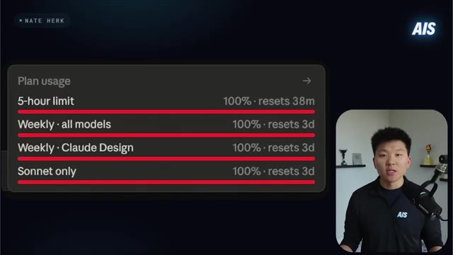
*⏱️ 00:00:06 — Capture d'écran montrant les limites d'utilisation du plan Claude (Plan usage) avec des barres de progression à 100% pour la limite de 5 heures et les limites hebdomadaires.*

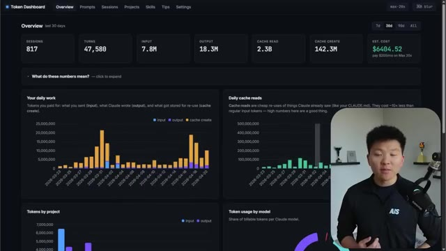
*⏱️ 00:00:12 — Tableau de bord d'analyse des tokens (Token Dashboard) affichant les sessions, les requêtes (turns), les tokens d'entrée/sortie, la lecture de cache et le coût estimé.*

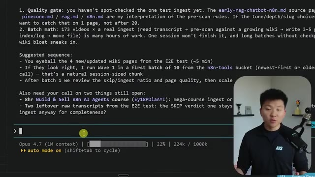
*⏱️ 00:00:18 — Interface de terminal ou d'éditeur affichant du texte markdown avec des instructions sur un chatbot RAG n8n et une barre de statut en bas indiquant le mode automatique et l'utilisation du contexte.*

---

### ⏱️ `[00:00:24 - 00:00:46]` | Segment #02

**🔊 Audio (Transcription Intégrale Mot pour Mot en Français) :**
> Donc, peu importe où vous utilisez Claude, je vais vous faire économiser de l'argent dans cette vidéo, alors ne perdons pas de temps et entrons directement dans le vif du sujet. Commençons donc par le commencement, ici, avec ce qu'est le contexte. Le contexte, c'est fondamentalement tout ce que Claude Code peut voir en même temps. Cela inclut l'invite système, votre conversation complète, chaque appel d'outil, chaque sortie d'outil, chaque fichier que Claude a lu, chaque compétence, serveur MCP ou agent de votre projet.

**👁️ Analyse Visuelle d'Écran (gemini-3.5-flash-lite) :**
**Interface & Outils** : Présentation vidéo avec diapositives graphiques et incrustation du présentateur.

**Contenu textuel & Code** : Schémas explicatifs sur la mémoire de travail de Claude et les composants de la fenêtre de contexte (system prompt, conversation, tool calls, files read).
[Démonstration] Le présentateur explique les concepts théoriques de la fenêtre de contexte à l'aide de visuels textuels.

**Action / Démonstration** : Explications face caméra et démonstration conceptuelle.

---

### ⏱️ `[00:00:47 - 00:01:23]` | Segment #03

**🔊 Audio (Transcription Intégrale Mot pour Mot en Français) :**
> C'est fondamentalement tout ce genre de choses. Pensez-y comme à la mémoire de travail actuelle de Claude. Maintenant, Claude Code nous offre une fenêtre de contexte d'un million de tokens, ce qui est énorme, mais avant même que vous ne tapiez quoi que ce soit dedans, vous en brûlez déjà environ 8 000 rien qu'en raison de la surcharge de démarrage, donc des choses comme vos instructions système ou votre fichier cloud.md ou, vous savez, vos fichiers de contexte ou, comme je l'ai dit, les outils MCP, les compétences, des choses comme ça. Et honnêtement, ça pourrait être bien plus que ces 8 000. Quand j'ai découvert ça pour la première fois, j'ai réalisé que j'avais en fait environ 62 000 tokens juste à partir d'une nouvelle session. Donc si ce n'est pas déjà fait, allez dans une nouvelle session, tapez `/context` et voyez ce que vous avez.

**👁️ Analyse Visuelle d'Écran (gemini-3.5-flash-lite) :**
**Interface & Outils** : Présentation vidéo avec diapositive graphique explicative et incrustation vidéo du présentateur.

**Contenu textuel & Code** : Schémas conceptuels sur la fenêtre de contexte, texte '1M hard cutoff', et mention de la commande '/context'.

**Action / Démonstration** : Explication visuelle du fonctionnement de la mémoire de travail et de la surcharge de tokens au démarrage d'une session.

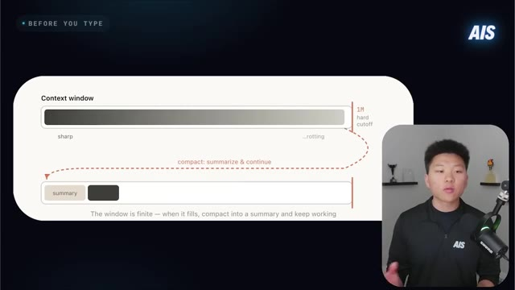
*⏱️ 00:00:56 — Schéma explicatif montrant la gestion de la fenêtre de contexte (Context window) de 1 million de tokens, avec un mécanisme de résumé automatique lorsque la limite est atteinte.*

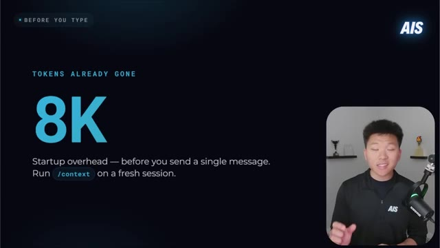
*⏱️ 00:01:14 — Diapositive illustrant la consommation initiale de tokens avec le texte '8K' et la mention 'Startup overhead — before you send a single message. Run /context on a fresh session.'*

---

### ⏱️ `[00:01:23 - 00:01:43]` | Segment #04

**🔊 Audio (Transcription Intégrale Mot pour Mot en Français) :**
> assis devant avant même d'envoyer quoi que ce soit. Et cela pourrait vous dire de supprimer des éléments ou de déplacer certaines choses en fonction de ce nombre que vous voyez, car sinon, il pourrait y avoir beaucoup de jetons invisibles dont vous ignorez même la consommation. Et très rapidement, il y a une chose super importante que vous devez comprendre sur le fonctionnement des jetons. Et cette seule chose a permis à des gens d'économiser des centaines et des milliers de jetons. Je vais donc insérer un extrait très rapidement.

**👁️ Analyse Visuelle d'Écran (gemini-3.5-flash-lite) :**
**Interface & Outils** : Visual Studio Code et diapositive de présentation

**Contenu textuel & Code** : Commande `/context`, statistiques de tokens par catégorie (System prompt: 8.7k, System tools: 11.3k, MCP tools: 2.4k, System tools deferred: 19.9k), et texte "8K Startup overhead — before you send a single message"

**Action / Démonstration** : Analyse et affichage de la consommation de tokens initiale avant l'envoi du premier message dans l'interface de développement

*⏱️ 00:01:28 — L'éditeur VS Code affichant les détails d'utilisation du contexte avec la commande `/context`, montrant la consommation de tokens par catégorie (System prompt, System tools, etc.) et le présentateur en incrustation.*

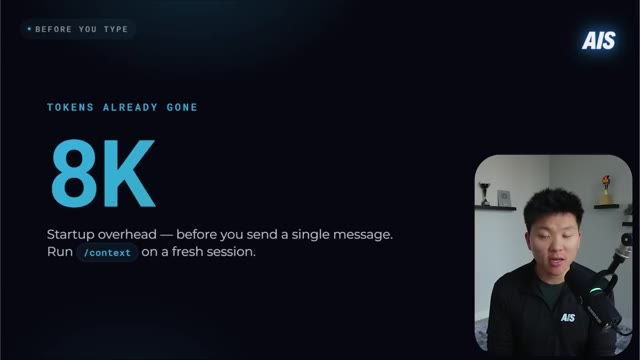
*⏱️ 00:01:38 — Une diapositive de présentation sur fond sombre titrée "BEFORE YOU TYPE" indiquant "TOKENS ALREADY GONE 8K" avec le texte explicatif "Startup overhead — before you send a single message. Run /context on a fresh session." et le présentateur en incrustation.*

---

### ⏱️ `[00:01:43 - 00:02:03]` | Segment #05

**🔊 Audio (Transcription Intégrale Mot pour Mot en Français) :**
> Donc, alors que j'ai optimisé ma propre gestion des jetons, je pense que ce qui est vraiment important de réaliser d'abord, c'est comment fonctionnent réellement les jetons. Parce qu'une fois que vous realizez comment Claude utilise les jetons, cela rend très clair la façon dont vous devriez réellement rétroconcevoir votre façon de travailler afin d'utiliser moins de jetons. Donc, un jeton est la plus petite unité de texte qu'un modèle d'IA lit et vous facture.

**👁️ Analyse Visuelle d'Écran (gemini-3.5-flash-lite) :**
**Interface & Outils** : Présentation vidéo avec diapositive de texte intégrée

**Contenu textuel & Code** : Définition d'un jeton comme plus petite unité de texte et explication du mécanisme de relecture de l'historique complet par Claude à chaque message.

**Action / Démonstration** : Présentation théorique illustrée par du texte à l'écran.

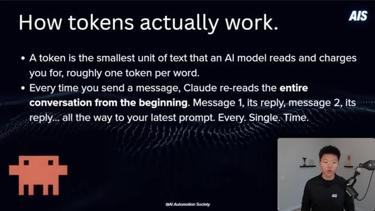
*⏱️ 00:01:48 — Diapositive explicative sur le fonctionnement des jetons (« How tokens actually work ») avec des puces textuelles et le présentateur en médaillon vidéo.*

---

### ⏱️ `[00:02:03 - 00:02:21]` | Segment #06

**🔊 Audio (Transcription Intégrale Mot pour Mot en Français) :**
> C'est à peu près un jeton pour un mot, mais ce n'est pas tout à fait vrai, c'est juste une bonne référence de base. Donc, à chaque fois que vous envoyez un message, Claude relit toute la conversation depuis le début, et tous ces éléments sont des jetons pour lesquels il vous facture. Donc, au premier message, il le lira, puis il lira sa réponse, puis au deuxième message, et ensuite la réponse, tout cela jusqu'à votre dernière instruction.

**👁️ Analyse Visuelle d'Écran (gemini-3.5-flash-lite) :**
**Interface & Outils** : Présentation vidéo avec incrustation du présentateur.

**Contenu textuel & Code** : Texte explicatif sur les tokens et le fonctionnement de la mémoire contextuelle de Claude.

**Action / Démonstration** : Présentation du concept théorique des tokens par le présentateur.

---

### ⏱️ `[00:02:21 - 00:02:57]` | Segment #07

**🔊 Audio (Transcription Intégrale Mot pour Mot en Français) :**
> et ça fait ça à chaque fois. Et je pense que rien que ça, c'est une énorme prise de conscience pour beaucoup de gens. Cela signifie que pendant que vous avez une conversation avec Claude, votre coût s'accumule, il ne s'ajoute pas seulement, il augmente de façon exponentielle. Ce qui signifie que le premier message peut coûter 500 jetons, et le trentième message en coûte 15 000 parce qu'il relit tout ce qui précède. Un développeur a effectivement suivi un chat de plus de 100 messages et a constaté que 98,5 % de tous les jetons étaient simplement dépensés à relire l'historique de chat précédent dans la session. C'est un énorme gaspillage. Alors oui, on peut faire valoir l'argument selon lequel, eh bien, il a besoin du contexte et il a besoin de comprendre ce que nous faisons, mais quand même, 98,5 % c'est

**👁️ Analyse Visuelle d'Écran (gemini-3.5-flash-lite) :**
**Interface & Outils** : Présentation vidéo avec diapositive explicative et incrustation vidéo du présentateur.

**Contenu textuel & Code** : Texte à l'écran : "How tokens actually work. - This means cost compounds, not adds. Message 1 might cost 500 tokens. Message 30 costs 15,000+, because it's re-reading everything before it. - One developer tracked a 100+ message chat: 98.5% of all tokens were spent re-reading old history. Only 1.5% went toward new output."

**Action / Démonstration** : Présentation des statistiques et du fonctionnement du coût cumulatif des tokens par le présentateur.

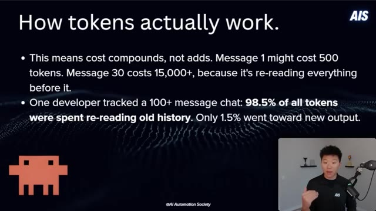
*⏱️ 00:02:30 — Diapositive explicative intitulée "How tokens actually work." avec des puces détaillant le coût cumulatif des tokens et l'historique des conversations, tandis que le présentateur apparaît en médaillon dans le coin inférieur droit.*

---

### ⏱️ `[00:02:57 - 00:03:32]` | Segment #08

**🔊 Audio (Transcription Intégrale Mot pour Mot en Français) :**
> fou. Donc, jetez un rapide coup d'œil à ce graphique ici. Sur l'axe des x, nous avons le numéro du message. Et à mesure qu'il augmente, vous pouvez voir que nous avons notre coût par message et nos jetons cumulés qui augmentent, mais ce n'est pas linéaire. C'est fondamentalement que chaque message relit tous les précédents et il doit en tenir compte. Donc, le message un pourrait être de 500, le message 30 pourrait être de 15 500, ce qui fait 31 fois plus. Et puis, après 30 messages, vous pourriez déjà être à près d'un quart de million de jetons cumulés. Très bien, super. Je suis content que vous sachiez cela maintenant. Revenons à la vidéo, ce qui nous amène à la pourriture du contexte. Et dans mon esprit, je pense fondamentalement à la pourriture du contexte comme un mot sophistiqué pour désigner la démence de l'IA, parce que cette

**👁️ Analyse Visuelle d'Écran (gemini-3.5-flash-lite) :**
**Interface & Outils** : Présentation vidéo avec graphiques et diapositives intégrés.

**Contenu textuel & Code** : Graphique avec axe X (numéro de message) et axe Y (jetons cumulés / coût par message), et mention 'Startup overhead' avec '8K' jetons.

**Action / Démonstration** : Explication par le présentateur de la consommation non linéaire des jetons dans une session de chat.

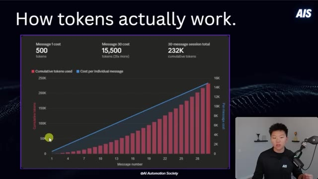
*⏱️ 00:03:05 — Graphique explicatif montrant l'évolution du coût des jetons par message et le cumul total sur une session de 30 messages.*

*⏱️ 00:03:23 — Diapositive illustrant les frais généraux de démarrage avec 8K jetons déjà consommés avant d'envoyer un seul message.*

---

### ⏱️ `[00:03:32 - 00:04:09]` | Segment #09

**🔊 Audio (Transcription Intégrale Mot pour Mot en Français) :**
> ce qui se produit fondamentalement à mesure que votre session s'allonge et que les performances du modèle commencent à se dégrader parce que son attention se répartit sur chaque token, chaque message qui a été envoyé. Et fondamentalement, il commence à être vraiment distrait. Il commence à oublier des choses. Il commence à se contredire et à modifier des fichiers sans les lire au préalable. Et il devient très vague et sensiblement pire. Et les statistiques nous montrent en réalité que la précision de la récupération chute de 92 % à 256 000 tokens pour descendre jusqu'à 78 % à un million de tokens. Donc même si vous pouvez remplir votre fenêtre de contexte d'un million de tokens, le modèle sera nettement moins performant pour trouver ce dont il a besoin à l'intérieur

**👁️ Analyse Visuelle d'Écran (gemini-3.5-flash-lite) :**
**Interface & Outils** : Présentation vidéo

**Contenu textuel & Code** : Texte à l'écran 'THE BIG PROBLEM', 'CONTEXT ROT', 'AI DEMENTIA.' et une barre de progression graphique en blocs.

**Action / Démonstration** : Le présentateur explique le concept de la dégradation du contexte (context rot).

---

### ⏱️ `[00:04:09 - 00:04:46]` | Segment #10

**🔊 Audio (Transcription Intégrale Mot pour Mot en Français) :**
> de cette fenêtre. Et maintenant, si vous y pensez, à mesure que le modèle commence à empirer, votre efficacité en matière de jetons baisse considérablement, car vous pourriez devoir dépenser 500 000 jetons, par exemple, pour obtenir un résultat qui aurait pu vous en prendre 200 000 si le modèle fonctionnait comme il le devrait. Essayez donc d'éviter la pourriture contextuelle à tout prix dans l'ensemble de vos sessions. Bien, ensuite nous avons le compactage automatique. Celui-ci va s'activer automatiquement, d'où le nom de compactage automatique, vers 95 % de votre fenêtre. Mais toute la communauté s'accorde à dire que c'est bien trop tard. Et je suis entièrement d'accord. Parce qu'lorsqu'il se compacte automatiquement, vous ne conservez qu'environ 20 à 30 % des détails d'origine.

**👁️ Analyse Visuelle d'Écran (gemini-3.5-flash-lite) :**
**Interface & Outils** : Présentation vidéo avec incrustation d'infographie.

**Contenu textuel & Code** : Texte « RETRIEVAL ACCURACY » et « ACCURACY AT 256K -> 1M TOKENS » avec les pourcentages « 92% -> 78% ».

**Action / Démonstration** : Le présentateur explique l'impact de la baisse de performance du modèle sur l'efficacité des jetons.

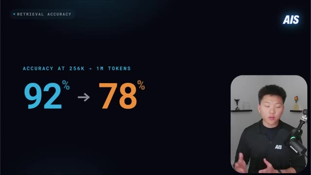
*⏱️ 00:04:18 — Diapositive présentant la précision de récupération (Retrieval Accuracy) qui chute de 92% à 78% lorsque la taille du contexte passe de 256K à 1M de tokens, avec le présentateur en médaillon.*

---

### ⏱️ `[00:04:46 - 00:05:23]` | Segment #11

**🔊 Audio (Transcription Intégrale Mot pour Mot en Français) :**
> Donc vous perdez une tonne de contexte important. Et le modèle fait cette compaction à son niveau d'intelligence le plus bas possible. Parce qu'évidemment, l'auto-compaction se déclenche genre au pic de la pourriture du contexte. Alors imaginez que vous faites vos valises pour un voyage. Si vous deviez faire vos valises la veille au soir, vous auriez le temps de réfléchir et vous prendriez toutes les bonnes affaires et vousisseriez probablement rien oublier parce que vous feriez une liste et vous la vérifieriez. Mais si vous bourrez votre sac de manière frénétique parce que vous vous êtes réveillé cinq minutes avant de devoir partir, vous allez probablement oublier votre chargeur, votre brosse à dents, des choses comme ça. Et c'est fondamentalement l'auto-compaction à 95 %. Donc la solution serait tout simplement la compaction manuelle. J'aime faire ça à environ 60 % de mon parcours dans ma fenêtre de contexte si je suis à

**👁️ Analyse Visuelle d'Écran (gemini-3.5-flash-lite) :**
**Interface & Outils** : Présentation vidéo avec diapositive explicative et incrustation du présentateur.

**Contenu textuel & Code** : Schéma de la fenêtre de contexte, texte "Manual VS Auto", "Manual: Pack the night before", "Auto: 5 min before you leave".

**Action / Démonstration** : Explication par le présentateur du fonctionnement de la compaction automatique du contexte et comparaison avec une préparation de voyage.

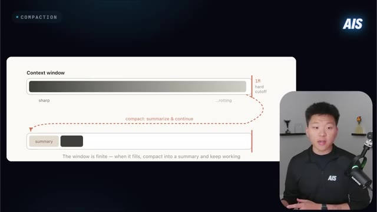
*⏱️ 00:04:55 — Schéma explicatif montrant la compaction de la fenêtre de contexte (Context window) avec un résumé (summary) et le mécanisme de "hard cutoff" à 1M.*

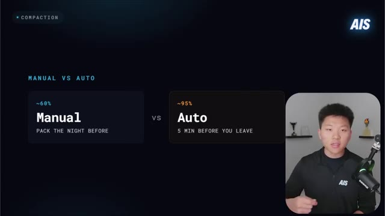
*⏱️ 00:05:05 — Diapositive comparant la méthode "Manual" (Pack the night before, ~60%) et la méthode "Auto" (5 min before you leave, ~95%).*

---

### ⏱️ `[00:05:23 - 00:05:48]` | Segment #12

**🔊 Audio (Transcription Intégrale Mot pour Mot en Français) :**
> comme le modèle à 250 000, qui bat définitivement la compaction automatique à 95 % à chaque fois. Cependant, il y a quelque chose que j'aime faire, que je fais beaucoup plus souvent par rapport au simple fait de compacter manuellement. Et je vais aborder cela dans une minute ici. Et d'ailleurs, beaucoup de ces diagrammes que vous pourriez voir ici proviennent de l'article d'Anthropic. Et je pensais qu'ils étaient vraiment bons. Donc je voulais les glisser ici. Mais de toute façon, en parlant de l'article d'Anthropic, celui-ci était là, cette prochaine sorte de section.

**👁️ Analyse Visuelle d'Écran (gemini-3.5-flash-lite) :**
**Interface & Outils** : Présentation vidéo et interface de lecteur de tweet (réseau social X).

**Contenu textuel & Code** : Texte comparatif sur les processus manuels et automatiques, et un diagramme de gestion de session pour Claude Code.

**Action / Démonstration** : Le présentateur explique les concepts de compaction automatique versus manuelle.

---

### ⏱️ `[00:05:48 - 00:06:21]` | Segment #13

**🔊 Audio (Transcription Intégrale Mot pour Mot en Français) :**
> Et j'ai vraiment aimé la façon dont ils l'ont présenté. Donc, en gros, ils ont dit qu'après absolument chaque intervention de Claude, vous avez fondamentalement cinq options. La première étant de continuer, ce qui signifie que vous répondez simplement, vous envoyez un autre message, et c'est très naturel et il est facile de se retrouver dans cette boucle de simple continuation. Et ensuite, vous avez slash rewind, qui vous permet de revenir à un message précédent et de supprimer tout ce qui suit. Donc c'est très cool. Vous pouvez aussi faire slash clear, pour recommencer entièrement à zéro. Vous pouvez faire slash compact pour résumer la session et remplacer l'historique par ce résumé. Ou vous pouvez envoyer des messages à un sous-agent. Donc, en gros, déléguer le travail.

**👁️ Analyse Visuelle d'Écran (gemini-3.5-flash-lite) :**
**Interface & Outils** : Présentation vidéo avec diapositive graphique et incrustation du présentateur.

**Contenu textuel & Code** : Texte listant les options : Continue, /rewind, /clear, /compact, Sub-agent, ainsi que les descriptions du niveau de contexte conservé.

**Action / Démonstration** : Le présentateur détaille et explique les cinq options disponibles lors de l'utilisation de Claude.

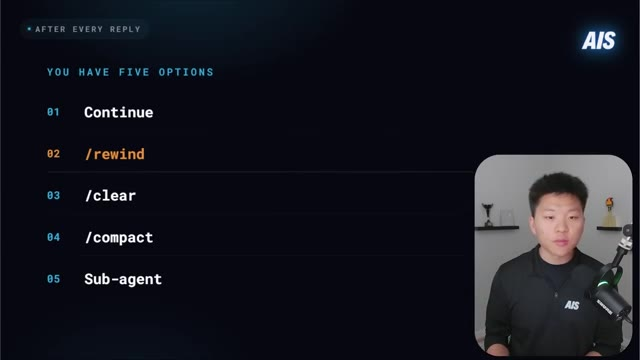
*⏱️ 00:05:57 — Une diapositive montrant une liste de cinq options disponibles après chaque réponse ("After every reply, you have five options"), avec le présentateur incrusté en bas à droite.*

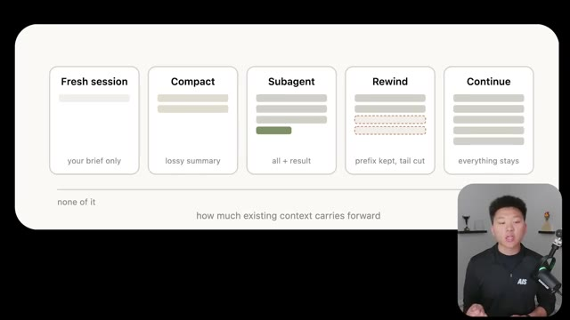
*⏱️ 00:06:13 — Un schéma explicatif illustrant les cinq options (Fresh session, Compact, Subagent, Rewind, Continue) et la quantité de contexte conservée pour chacune.*

---

### ⏱️ `[00:06:21 - 00:06:44]` | Segment #14

**🔊 Audio (Transcription Intégrale Mot pour Mot en Français) :**
> vers une nouvelle fenêtre de contexte, et ensuite vous obtenez une sorte de résultat final. Très rapidement, les gars, je sais que nous allons couvrir une tonne d'informations dans cette vidéo. J'ai donc regroupé tout ce dont nous allons parler dans un guide de ressources complet auquel vous pouvez accéder tout à fait gratuitement. Le lien pour cela se trouvera dans la description. Rejoignez ma communauté School gratuite. Et c'est là que vous pourrez obtenir ce document, comme je l'ai dit, tout à fait gratuitement ainsi que toutes les autres ressources gratuites que j'ai publiées avec toutes mes vidéos YouTube. Je vous retrouve donc là-bas. Revenons à la vidéo.

**👁️ Analyse Visuelle d'Écran (gemini-3.5-flash-lite) :**
**Interface & Outils** : Présentation vidéo

**Contenu textuel & Code** : Texte promotionnel pour un document de ressources et logo AIS

**Action / Démonstration** : Le présentateur introduit un guide de ressources complet disponible en description.

---

### ⏱️ `[00:06:45 - 00:07:17]` | Segment #15

**🔊 Audio (Transcription Intégrale Mot pour Mot en Français) :**
> Donc, plongeons un peu dans tout ça, car une fois que vous commencez à comprendre lesquels vous devriez utiliser dans quel scénario, cela peut changer la donne pour vous. Donc, slash rewind, qui est la habitude numéro un qu'Anthropic recommande. Maintenant, je faisais beaucoup cela manuellement, sans utiliser la véritable fonctionnalité slash rewind, mais je vais définitivement commencer à utiliser cette fonctionnalité, car fondamentalement, vous pouvez appuyer deux fois sur Échap ou vous pouvez exécuter slash rewind, et cela vous permet de revenir à n'importe quel message précédent dans votre session, et tout ce qui se trouve à ce moment-là après est supprimé, ce qui est évidemment énorme pour le contexte. Et c'est beaucoup plus puissant que vous ne le pensez, car la plupart du temps, lorsque Claude

**👁️ Analyse Visuelle d'Écran (gemini-3.5-flash-lite) :**
**Interface & Outils** : Présentation visuelle (diapositives avec schémas explicatifs et incrustation vidéo du présentateur).

**Contenu textuel & Code** : Diagrammes de flux comparant "Correcting" (tentatives multiples accumulées dans le contexte) et "Rewinding" (retour en arrière pour n'envoyer qu'un prompt propre).

**Action / Démonstration** : Explication comparative des méthodes de correction et de retour en arrière dans l'agent IA.

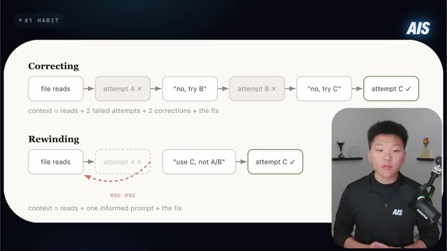
*⏱️ 00:07:09 — Schéma comparatif entre la correction classique et l'utilisation de la fonction Rewinding avec la touche 'esc', et le présentateur en médaillon.*

---

### ⏱️ `[00:07:17 - 00:07:48]` | Segment #16

**🔊 Audio (Transcription Intégrale Mot pour Mot en Français) :**
> fait quelque chose de travers, et je le fais beaucoup moi-même, il faut bien l'admettre, je vais simplement dire quelque chose du genre, ça n'a pas fonctionné, essaie plutôt ceci. Et ensuite Claude essaie autre chose. Et la plupart du temps, ça fonctionne. Donc on se dit, ok, il n'y a rien de mal dans ce que je viens de faire. Mais si vous y pensez, cette tentative infructueuse, ce code cassé, peu importe ce qu'il a fait de travers, la mauvaise approche, tout cela est toujours présent dans votre contexte. Et c'est toujours lu à chaque fois. Et cela ne fait que polluer vos futures réponses. Maintenant, je pense qu'il y a un argument à faire valoir sur le fait que si vous laissez des choses comme ça, il est capable de lire à travers et il est capable d'apprendre et il est capable de ne pas commettre cette même erreur une deuxième fois.

**👁️ Analyse Visuelle d'Écran (gemini-3.5-flash-lite) :**
**Interface & Outils** : Présentation vidéo avec schéma explicatif en blocs et flux de texte.

**Contenu textuel & Code** : Schémas textuels 'Correcting' (file reads -> attempt A -> 'no, try B' -> attempt B -> 'no, try C' -> attempt C) et 'Rewinding' (file reads -> attempt A -> 'use C, not A/B' -> attempt C), illustrant la gestion du contexte.

**Action / Démonstration** : Le présentateur explique l'optimisation du contexte par le retour en arrière (rewinding) plutôt que par la correction successive.

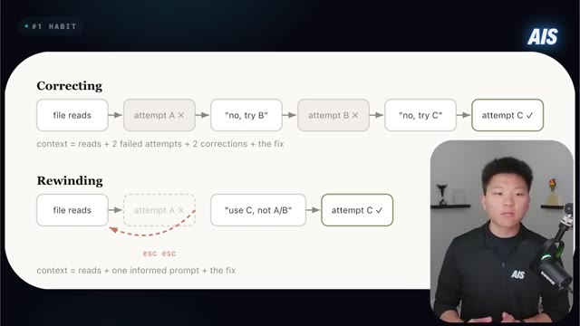
*⏱️ 00:07:25 — Schéma comparatif illustrant deux méthodes d'interaction avec une IA : 'Correcting' (corriger itérativement) et 'Rewinding' (revenir en arrière), avec le présentateur visible en incrustation.*

---

### ⏱️ `[00:07:48 - 00:08:21]` | Segment #17

**🔊 Audio (Transcription Intégrale Mot pour Mot en Français) :**
> Mais je pense qu'il y a différentes manières d'enseigner essentiellement à Claude de ne pas faire la même erreur deux fois, qui sont plus efficaces ou plus économiques en jetons que de simplement la laisser là. Peut-être avez-vous simplement un journal de décisions ou peut-être le prompt-ez-vous mieux la prochaine fois, des choses comme ça. Donc, faire un retour en arrière est préférable parce que maintenant votre contexte est propre. Et lorsque vous faites slash retour en arrière, il y a aussi une option résumer à partir d'ici dans ce menu, qui vous crée fondamentalement un message de transition, qui est une note du futur soi de Claude à son passé soi disant, voici ce que nous avons découvert, faites-le de cette façon. D'accord. Alors maintenant, parlons de compact et clair. Donc, la règle empirique du genre

**👁️ Analyse Visuelle d'Écran (gemini-3.5-flash-lite) :**
**Interface & Outils** : Présentation vidéo avec diapositive graphique et vignette du présentateur

**Contenu textuel & Code** : Texte affichant « #1 HABIT », « ANTHROPIC'S #1 RECOMMENDATION », « /REWIND » et une frise chronologique illustrant le retour en arrière.

**Action / Démonstration** : Le présentateur explique la fonctionnalité de retour en arrière ou de journal de décision pour éviter de répéter les mêmes erreurs avec l'IA.

*⏱️ 00:07:57 — Une diapositive sombre avec le texte '/REWIND' et la mention 'ANTHROPIC'S #1 RECOMMENDATION', accompagnée d'une vidéo incrustée du présentateur en bas à droite.*

---

### ⏱️ `[00:08:21 - 00:08:54]` | Segment #18

**🔊 Audio (Transcription Intégrale Mot pour Mot en Français) :**
> Du point de vue de la documentation, ce serait que si vous commencez une nouvelle tâche, faites slash clear. Et si vous continuez la même tâche, faites slash compact. Et honnêtement, je ne suis plus du tout d'accord. Je n'utilise plus du tout slash compact. Ce que je fais en réalité, c'est essentiellement ma propre version. Si j'utilise Opus avec une fenêtre de contexte d'un million de jetons, si je dépasse environ 120 000 jetons, soit environ 12 %, alors je dis simplement à Claude, hé, donne-moi un résumé complet de tout ce que nous avons fait et l'état actuel de ce que nous sommes sur le point de faire ensuite. Et ensuite, je prends simplement ce résumé et je fais

**👁️ Analyse Visuelle d'Écran (gemini-3.5-flash-lite) :**
**Interface & Outils** : Diapositive de présentation / Schéma conceptuel

**Contenu textuel & Code** : Texte du schéma : "long session", "/compact", "Compact (LLM-written summary)", "mid-task, keep momentum", "/clear", "Fresh + brief (your hand-written brief)", "high-stakes next step"

**Action / Démonstration** : Le présentateur explique et compare l'utilisation des commandes '/compact' et '/clear' dans son workflow.

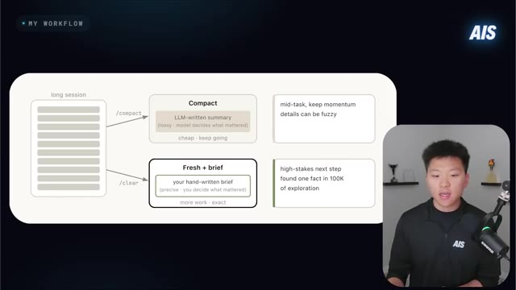
*⏱️ 00:08:29 — Schéma explicatif comparant les commandes '/compact' et '/clear' pour la gestion des sessions longues.*

---

### ⏱️ `[00:08:54 - 00:09:26]` | Segment #19

**🔊 Audio (Transcription Intégrale Mot pour Mot en Français) :**
> un slash clear, je le colle, et je continue. Donc en gros, je fais juste une réinitialisation et j'ai l'impression de ne pas avoir réinitialisé parce que j'ai déjà tout ce contexte. Ça pointe déjà, vous savez, vers tous les fichiers de plan, les fichiers de décision ou les listes de tâches qui ont été créés. Et c'est aussi très important. Si vous perdez tout cet historique de conversation, vous devez vous assurer de stocker les données quelque part. Donc comme je l'ai dit, des tableaux de suivi, des journaux d'activité, des listes de tâches, des choses comme ça. De cette façon, même si vous réinitialisez une session, on n'a pas l'impression d'avoir fait une réinitialisation. C'est un peu comme si vous vouliez fermer tous vos onglets Chrome, mais que vous aviez quand même tous vos signaux ou favoris auxquels vous pouvez accéder très rapidement.

**👁️ Analyse Visuelle d'Écran (gemini-3.5-flash-lite) :**
**Interface & Outils** : Diapositive de présentation vidéo (slide)

**Contenu textuel & Code** : Texte explicatif du workflow de gestion des tokens : résumé, commande /clear, collage et continuation

**Action / Démonstration** : Le présentateur explique sa méthode de gestion du contexte et des tokens dans l'interface de développement

---

### ⏱️ `[00:09:27 - 00:09:48]` | Segment #20

**🔊 Audio (Transcription Intégrale Mot pour Mot en Français) :**
> Et ouais, c'est un peu la façon dont, dans mon esprit, pour une raison quelconque, j'y pense. Mais cette seule habitude, si vous pouvez réellement opérer ce changement et commencer à le faire, c'est probablement ce qui a fait la différence la plus notable sur le remplissage effectif de ma limite de session. Donc ce que j'ai fait, c'est que j'ai réellement créé une compétence pour ça. Donc juste ici, vous pouvez voir que j'ai, vous savez, une longue conversation juste ici. Nous avons environ 224 000 jetons de la fenêtre qui ont déjà été utilisés.

**👁️ Analyse Visuelle d'Écran (gemini-3.5-flash-lite) :**
**Interface & Outils** : Visual Studio Code, Claude Code CLI, Interface vidéo incrustée (Picture-in-Picture)

**Contenu textuel & Code** : Code source, arborescence du projet, échanges avec l'assistant Claude Code et indicateur d'utilisation des tokens (22% de 1M)

**Action / Démonstration** : Navigation et explication du flux de travail de l'agent IA par le présentateur sur l'éditeur de code

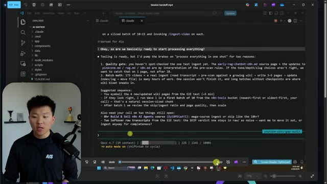
*⏱️ 00:09:43 — Interface de Visual Studio Code affichant un terminal Claude Code (Opus 4.7) avec une barre de progression de tokens à 224k / 1000k, et le présentateur en incrustation à gauche.*

---

### ⏱️ `[00:09:48 - 00:10:24]` | Segment #21

**🔊 Audio (Transcription Intégrale Mot pour Mot en Français) :**
> Donc je tape simplement slash session handoff, comme vous le voyez. Et maintenant ce qui se passe, c'est que ça va essentiellement parcourir tout le processus de lecture de tout, de son analyse, et me donner les trucs importants que je dois savoir. Et ça crache ce résultat. Ça montre où ça a commencé, les décisions verrouillées, et ce qui a été livré. Ça montre les fichiers clés pour la prochaine session. Ça montre l'état d'exécution, la vérification, les questions reportées et ouvertes, et ensuite reprendre à partir d'ici. Donc en gros maintenant je copie tout ce résultat. Je fais un slash clear, et ensuite je colle simplement ce résultat et je l'exécute. Et maintenant ce projet est fondamentalement complètement réorienté sur ce qu'il doit faire. Il dit, d'accord, je suis prêt.

**👁️ Analyse Visuelle d'Écran (gemini-3.5-flash-lite) :**
**Interface & Outils** : Visual Studio Code (VS Code) avec terminal intégré et interface de chat/CLI IA.

**Contenu textuel & Code** : Commande `/session-handoff`, texte d'analyse de l'assistant IA détaillant l'état du traitement et la séquence suggérée, ainsi que des indicateurs de jetons (606 tokens, Opus 4.7, 22% de la limite de contexte).

**Action / Démonstration** : Exécution de la commande de transfert de session (`/session-handoff`) dans l'outil de ligne de commande IA intégré à l'éditeur.

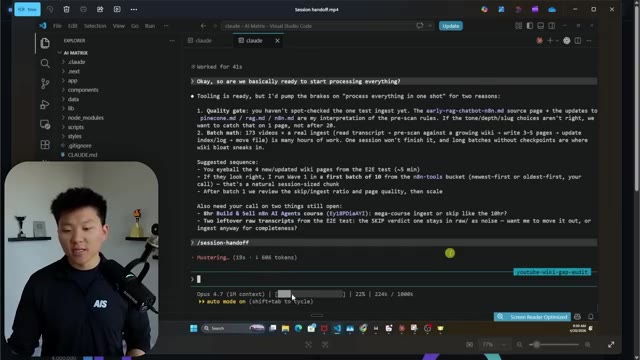
*⏱️ 00:09:57 — Capture d'écran montrant l'éditeur VS Code avec une interface de terminal intégrée affichant le résultat de la commande de session handoff et l'historique des échanges avec l'assistant IA, avec le présentateur visible en incrustation.*

---

### ⏱️ `[00:10:24 - 00:10:49]` | Segment #22

**🔊 Audio (Transcription Intégrale Mot pour Mot en Français) :**
> Voici tous les fichiers que je dois lire. Voici où nous nous sommes arrêtés. Donne-moi la prochaine tâche. Et maintenant, j'ai une fenêtre de contexte complètement fraîche. Donc aussi, cette compétence sera rattachée dans la communauté School gratuite. Juste la communauté School gratuite a tout ce que je partage un jour ou l'autre. Donc, rejoignez-la simplement. Très bien. Ensuite, nous avons des sous-agents. C'est donc en quelque sorte le dernier concept principal de base. Chaque sous-agent obtiendra sa propre fenêtre de contexte fraîche. Il fait son propre travail. Il fait ses propres recherches. Il synthétise les résultats. Et puis il renvoie en gros un résultat vers votre session principale.

**👁️ Analyse Visuelle d'Écran (gemini-3.5-flash-lite) :**
**Interface & Outils** : Visual Studio Code, diapositive de présentation graphique.

**Contenu textuel & Code** : Texte de résumé de session de travail et instructions pour l'IA, interface de terminal IA. Schéma conceptuel sur la délégation avec des sous-agents (Agent 01, Agent 02, Agent 03).

**Action / Démonstration** : Présentation et explication du fonctionnement des sessions de handoff et de la délégation de tâches aux sous-agents IA.

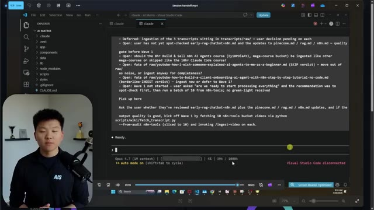
*⏱️ 00:10:30 — Capture d'écran montrant l'interface de Visual Studio Code avec un terminal affichant le statut d'un modèle d'IA (Opus 4.7) et le présentateur incrusté en bas à gauche.*

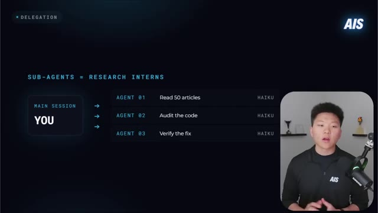
*⏱️ 00:10:37 — Diapositive de présentation intitulée "DELEGATION" montrant le concept de sous-agents comparés à des assistants de recherche, avec le présentateur incrusté en bas à droite.*

---

### ⏱️ `[00:10:50 - 00:11:14]` | Segment #23

**🔊 Audio (Transcription Intégrale Mot pour Mot en Français) :**
> Donc si vous y pensez, c'est comme un stagiaire en recherche, si vous vouliez qu'un stagiaire en recherche fouille dans genre 50 articles, vous ne resteriez pas assis là à le regarder ou la regarder faire. Et vous neisseriez pas non plus de lire les articles. Vous diriez simplement, hé, fais-moi juste savoir quand tu as genre un résumé ou quand tu as l'information dont j'ai besoin. Et donc vous ne gaspillez pas votre espace mental avec tout ce superflu, vous obtenez simplement ce que vous voulez en retour. Maintenant, vous pouvez simplement dire explicitement des choses comme lance un sous-agent pour vérifier ceci, lance un sous-agent pour examiner votre base de code et me résumer ceci.

**👁️ Analyse Visuelle d'Écran (gemini-3.5-flash-lite) :**
**Interface & Outils** : Schéma conceptuel/diagramme de flux personnalisé affiché à l'écran.

**Contenu textuel & Code** : Blocs de texte illustrant le flux : "Parent context", "user prompt", "Task(*explore auth/*)", "Subagent context", "final report", et la légende "The exploration noise is garbage-collected when the subagent exits".

**Action / Démonstration** : Le diagramme illustre visuellement comment un sous-agent traite une tâche lourde de manière isolée pour ne renvoyer que le rapport final au contexte parent.

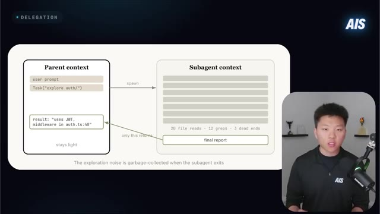
*⏱️ 00:10:56 — Schéma explicatif illustrant la délégation entre un contexte parent et un sous-agent (Subagent context) avec le présentateur en médaillon dans le coin inférieur droit.*

---

### ⏱️ `[00:11:15 - 00:11:43]` | Segment #24

**🔊 Audio (Transcription Intégrale Mot pour Mot en Français) :**
> Et une autre chose cool, c'est que chaque fois que vous créez un sous-agent, il peut utiliser un modèle moins cher. Alors, lancez-moi un sous-agent pour résumer ceci et assurez-vous que ce sous-agent utilise Haiku. Et ce qui finit par se produire, c'est que la tâche de ce sous-agent était tellement moins chère que si Opus l'avait fait, et les performances et la qualité sont à peu près les mêmes. La clé ici est de savoir quelles tâches déléguer réellement. Bon. Passons donc à d'autres conseils pratiques. Alors, ce premier, qui a l'air vraiment évident et dugenre, pourquoi tu dis ça, Nate ? C'est tellement évident, mais c'est, c'est énorme.

**👁️ Analyse Visuelle d'Écran (gemini-3.5-flash-lite) :**
**Interface & Outils** : Présentation vidéo avec diagrammes graphiques animés (infographie explicative).

**Contenu textuel & Code** : Schéma d'architecture de délégation montrant "Parent context", "Subagent context", et l'analogie "Sub-agents = Research interns" avec des tâches assignées et le modèle Haiku.
[DESC_IMAGE_1]

**Action / Démonstration** : Le présentateur explique visuellement comment le contexte d'un sous-agent isole le bruit et ne renvoie que le rapport final au contexte parent.

*⏱️ 00:11:22 — Schéma explicatif montrant la relation entre le contexte parent et le contexte d'un sous-agent (Subagent context) avec le retour d'un rapport final synthétique.*

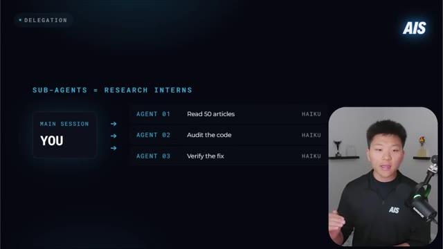
*⏱️ 00:11:29 — Schéma illustrant la session principale (Main session) déléguant des tâches à trois sous-agents (Agent 01, 02, 03) utilisant le modèle Haiku.*

---

### ⏱️ `[00:11:44 - 00:12:18]` | Segment #25

**🔊 Audio (Transcription Intégrale Mot pour Mot en Français) :**
> Il surveille la limite de votre session. C'est-à-dire que si vous utilisez la nouvelle application de bureau, vous pouvez voir la quantité de limite de session qu'il vous reste. Surveillez-la simplement constamment. Si vous avez deux moniteurs, gardez-en un ouvert sur les autres onglets, vous pouvez toujours la surveiller. Le simple fait de pouvoir y jeter un coup d'œil de temps en temps changera votre façon de concevoir le prompt que vous pourriez envoyer, ou de savoir si vous devez lancer cette équipe d'agents ou non, vous savez, des choses comme ça. Et soyez simplement stratégique à ce sujet. Si vous approchez de la fin de votre session et que cela a été une longue session, allez faire une promenade ou profitez-en pour aller chercher un encas ou quelque chose comme ça. Et d'un autre côté, s'il vous reste environ 50 % de votre session et qu'elle va se réinitialiser dans environ une heure ou une demi-heure, alors profitez-en à fond.

**👁️ Analyse Visuelle d'Écran (gemini-3.5-flash-lite) :**
**Interface & Outils** : Application de bureau de suivi des limites d'utilisation de l'IA (Claude).

**Contenu textuel & Code** : Graphiques de consommation : 5-hour limit (73%), Weekly - all models (73%), Weekly - Claude Design (86%), Sonnet only (9%).

**Action / Démonstration** : Présentation des métriques de consommation et des conseils pour gérer l'utilisation des modèles d'IA en fonction des quotas restants.

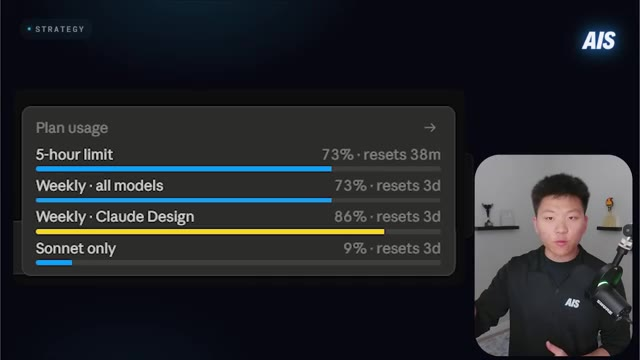
*⏱️ 00:11:52 — Capture montrant l'interface de suivi d'utilisation du plan (Plan usage) avec les limites de session (5-hour limit, Weekly - all models, Weekly - Claude Design, Sonnet only).*

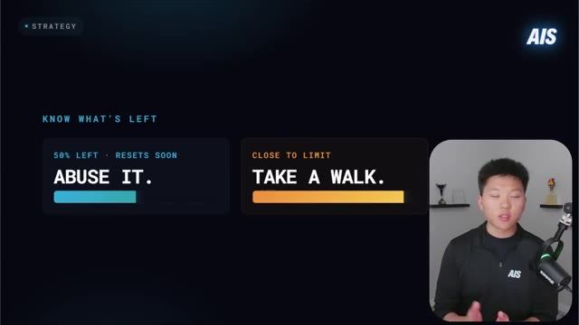
*⏱️ 00:12:10 — Capture montrant les conseils de stratégie avec les états de limite : "50% left - Resets soon: Abuse it." et "Close to limit: Take a walk."*

---

### ⏱️ `[00:12:19 - 00:12:38]` | Segment #26

**🔊 Audio (Transcription Intégrale Mot pour Mot en Français) :**
> Vous savez, essayez de pousser ce truc jusqu'à la limite. Essayez de lancer des équipes d'agents. Essayez de travailler sur une base de code lourde que vous deviez traiter depuis un moment. Essayez de faire des choses dont vous savez qu'elles vont consommer beaucoup de vos jetons. Soyez donc stratégique quant au moment où vous réalisez de petits flux de travail de productivité ou des choses de ce genre, ou lorsque vous faites du code approfondi ou de la construction approfondie. D'accord. Donc, le prochain est plutôt cool.

**👁️ Analyse Visuelle d'Écran (gemini-3.5-flash-lite) :**
**Interface & Outils** : Présentation vidéo avec diapositive graphique de stratégie

**Contenu textuel & Code** : Texte stratégique sur la gestion des limites d'utilisation de l'IA (Abuse it / Take a walk)

**Action / Démonstration** : Le présentateur explique la stratégie d'utilisation intensive des jetons d'IA jusqu'aux limites.

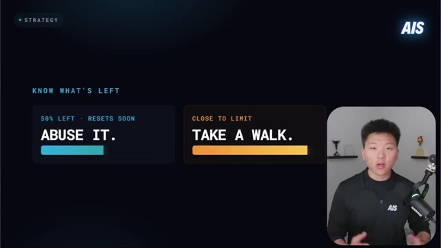
*⏱️ 00:12:23 — Une diapositive de présentation avec le titre "STRATEGY" et "KNOW WHAT'S LEFT", affichant deux encadrés de conseils : "ABUSE IT." (50% left) et "TAKE A WALK." (Close to limit), avec le présentateur incrusté en bas à droite.*

---

### ⏱️ `[00:12:38 - 00:13:16]` | Segment #27

**🔊 Audio (Transcription Intégrale Mot pour Mot en Français) :**
> Fondamentalement, l'idée est de tout convertir en Markdown. Le Markdown est tellement plus rapide et tellement moins cher pour les modèles d'IA, avec une réduction énorme des tokens. Donc, par exemple, pour du HTML vers du Markdown, vous obtenez environ 90 % de tokens en moins. Pour du PDF vers du Markdown, vous obtenez environ 65 à 70 % de réduction de tokens. Pour des fichiers docx vers du Markdown, vous obtenez environ 33 % de réduction de tokens. Donc cela signifie que vous pouvez faire tenir à peu près trois fois plus de contenu dans la même fenêtre de contexte. Donc, par exemple, un PDF de 40 pages pourrait en fait occuper la même quantité d'espace qu'un fichier Markdown de 130 pages. Et vous pouvez simplement utiliser un outil comme docling ou beaucoup d'autres pour convertir ces fichiers en quelques secondes, car les tokenizers traitent le texte vraiment,

**👁️ Analyse Visuelle d'Écran (gemini-3.5-flash-lite) :**
**Interface & Outils** : Présentation vidéo avec graphique de données et vignette du présentateur en bas à droite.

**Contenu textuel & Code** : Texte et graphiques en barres illustrant l'efficacité de la conversion en Markdown (HTML -> MD : -90%, PDF -> MD : -68%, DOCX -> MD : -33%).

**Action / Démonstration** : Le présentateur explique l'économie de tokens réalisée en convertissant les documents au format Markdown.

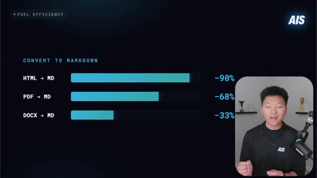
*⏱️ 00:12:48 — Graphique montrant les pourcentages de réduction de tokens lors de la conversion de différents formats vers Markdown : HTML vers MD (-90%), PDF vers MD (-68%), DOCX vers MD (-33%).*

---

### ⏱️ `[00:13:16 - 00:13:51]` | Segment #28

**🔊 Audio (Transcription Intégrale Mot pour Mot en Français) :**
> très efficacement. Et les PDF, les documents et le HTML contiennent tous ce bruit de mise en page, de métadonnées et de formatage dont le modèle n'a pas besoin. Tout ce dont le modèle a besoin, c'est du contenu de ce document, qui se résume généralement au texte. Maintenant, si vous avez besoin de reconnaissance optique de caractères et si vous avez besoin de vision ou quelque chose de ce genre, c'est une autre histoire. Mais si c'est basé sur du texte, donnez simplement le texte à Claude. Très bien, la prochaine astuce consiste à utiliser slash by the way ou slash btw. Cela ouvre essentiellement une superposition rapide pour les questions secondaires qui n'entrent pas réellement dans l'historique de votre conversation. Donc, si vous êtes plongé dans un projet et que vous devez poser une question rapide sur ce projet, faites simplement slash BTW, tapez la question, et cela conserve ce contexte.

**👁️ Analyse Visuelle d'Écran (gemini-3.5-flash-lite) :**
**Interface & Outils** : VS Code, Terminal Claude Code

**Contenu textuel & Code** : Commandes et échanges textuels avec un assistant IA dans VS Code (ex: "how would we build this out on mobile?", "Answering...", "Opus 4.7").

**Action / Démonstration** : Navigation et démonstration de l'utilisation d'un outil de développement assisté par IA dans VS Code.

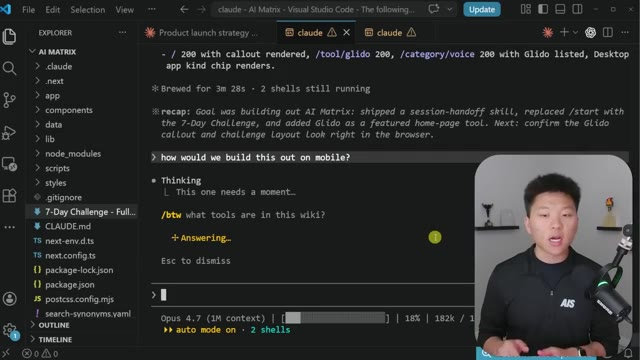
*⏱️ 00:13:43 — Interface de VS Code affichant un terminal interactif avec Claude Code montrant des prompts et l'utilisation de l'agent.*

---

### ⏱️ `[00:13:51 - 00:14:26]` | Segment #29

**🔊 Audio (Transcription Intégrale Mot pour Mot en Français) :**
> propre, mais vous pouvez quand même obtenir une réponse à votre question. Bon, évidemment, le suivant concerne le mode plan, ce qui est énorme. Boris Cherney, le créateur de CloudCode, commence chaque session en mode plan. Je fais la même chose. Je suis fondamentalement Boris Cherney. Mais toute l'idée est que si vous utilisez des jetons au départ pour clarifier le plan avant de commencer à construire, vous n'aurez pas à le corriger. Et en fin de compte, ce sera moins cher à long terme lorsqu'il s'agit, vous savez, d'être efficace avec vos jetons. C'est pourquoi je mets tous mes efforts dans le plan d'abord, je m'assure qu'il est correct, et ensuite je laisse Claude réaliser l'implémentation du premier coup parce qu'il comprend ce qu'il doit faire et il comprend ce que vous voulez. J'utilise donc des choses comme Ultraplan tout le temps ou Superpowers tout

**👁️ Analyse Visuelle d'Écran (gemini-3.5-flash-lite) :**
**Interface & Outils** : Visual Studio Code, Claude Code extension

**Contenu textuel & Code** : Interface graphique de Claude Code dans VS Code avec options de saisie et de mode d'édition.

**Action / Démonstration** : Présentation de l'interface de l'outil Claude Code au sein de l'éditeur.

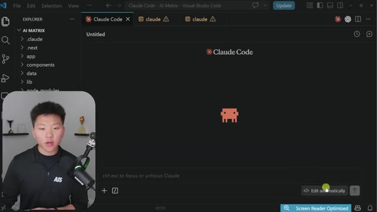
*⏱️ 00:14:17 — Interface de Visual Studio Code affichant l'extension Claude Code avec le présentateur en bas à gauche.*

---

### ⏱️ `[00:14:26 - 00:15:02]` | Segment #30

**🔊 Audio (Transcription Intégrale Mot pour Mot en Français) :**
> le temps. Et je mettrai des liens vers des vidéos que j'ai faites sur les deux juste ici. Je vous recommande vraiment de regarder d'abord cette vidéo sur les Superpowers. Très bien. Et pour celle-ci, vous savez qu'on ne pouvait pas faire de vidéo sur les tokens sans parler de la discipline concernant Claude.md. Gardez donc ce fichier sous les 200 lignes, soit environ 2 000 tokens, car il se charge à chaque session. Donc s'il est trop lourd, vous paierez pour ce poids à chaque conversation. Vous disposez d'un espace limité, alors n'y tassez pas tout. N'y mettez que ce dont vous avez réellement besoin et seulement ce dont Claude a besoin pour faire du bon travail. Vous pouvez également faire des choses comme déplacer des instructions spécialisées dans des fichiers de contexte vers lesquels le routage est effectué ou des compétences vers lesquelles le routage est effectué.

**👁️ Analyse Visuelle d'Écran (gemini-3.5-flash-lite) :**
**Interface & Outils** : Visual Studio Code

**Contenu textuel & Code** : Fichier CLAUDE.md montrant la structure d'architecture ('data/atlas.json', 'scripts/validate.ts') et des commandes npm (install, run dev, run build).

**Action / Démonstration** : Le présentateur explique l'importance de structurer et limiter la taille du fichier CLAUDE.md pour optimiser les tokens et la discipline des agents.

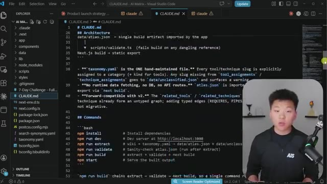
*⏱️ 00:14:44 — Éditeur de code Visual Studio Code affichant un fichier de configuration CLAUDE.md avec les instructions de l'architecture et les commandes bash.*

---

### ⏱️ `[00:15:02 - 00:15:36]` | Segment #31

**🔊 Audio (Transcription Intégrale Mot pour Mot en Français) :**
> et de cette façon, ils ne se chargent que à la demande quand ils sont réellement nécessaires. Et vous pourriez utiliser un fichier .clawed ignore pour exclure des dossiers ou des fichiers que vous ne voulez pas que Claude lise réellement, ce qui pourrait être un très, très gros coup si vous avez genre un dépôt massif. Très bien, alors que je suis assis ici en train de monter la vidéo, il y a encore une chose dont je me suis rendu compte que je voulais dire, c'était que les jetons de sortie coûtent plus cher que les jetons d'entrée. Donc beaucoup de gens pourraient penser que vous pourriez dire, hé, Claude, sois super concis et donne-moi juste, tu sais, des réponses d'une seule phrase plutôt que des paragraphes. Et cela vous ferait économiser des jetons. Et en théorie, oui, mais dans le grand schéma des choses, ce n'est pas ce qui est réellement

**👁️ Analyse Visuelle d'Écran (gemini-3.5-flash-lite) :**
**Interface & Outils** : Présentation vidéo avec diapositive infographique et encadré webcam.

**Contenu textuel & Code** : Texte listant des pratiques (Quick Wins, /btw, Plan mode, <200 lines) et tarifs des modèles Claude (Opus, Sonnet, Haiku).

**Action / Démonstration** : Le présentateur explique les bonnes pratiques et astuces pour l'utilisation des modèles d'intelligence artificielle.

---

### ⏱️ `[00:15:36 - 00:16:11]` | Segment #32

**🔊 Audio (Transcription Intégrale Mot pour Mot en Français) :**
> qui va être le facteur décisif entre si vous atteignez votre limite ou non, parce qu'il y a tellement de jetons de sortie qui sont dépensés sans que vous ne le voyiez vraiment dans vos fichiers et des choses comme ça. Donc, vous savez, il pourrait y avoir, j'ai vu ce plugin caveman que les gens utilisent, j'ai en fait vu quelqu'un faire une expérience et tester combien cela économise vraiment de jetons. Et il s'avère que ce n'était pas vraiment autant que les gens le pensaient, parce qu'encore une fois, il y a tellement plus de jetons de sortie que juste ce que Claude vous redonne dans la fenêtre. Donc je pense qu'il est important de comprendre que les jetons de sortie coûtent plus cher que les jetons d'entrée, mais dire simplement d'être concis ne va pas vraiment faire bouger les choses. Je voulais donc aussi mentionner cela. Donc un autre

**👁️ Analyse Visuelle d'Écran (gemini-3.5-flash-lite) :**
**Interface & Outils** : Tableau de bord web personnalisé ("Token dashboard") affichant des graphiques de consommation et des listes de sessions récentes.

**Contenu textuel & Code** : Graphiques en barres ("Tokens by project", "Top tools"), diagramme circulaire ("Token usage by model") et tableau des sessions récentes avec les projets et nombres de tokens.

**Action / Démonstration** : Le présentateur commente les statistiques de consommation des jetons d'IA affichées à l'écran.

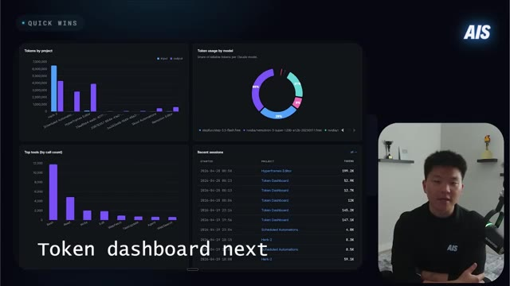
*⏱️ 00:15:45 — Tableau de bord d'analyse de l'utilisation des tokens d'IA avec des graphiques statistiques et le présentateur en médaillon.*

---

### ⏱️ `[00:16:11 - 00:16:47]` | Segment #33

**🔊 Audio (Transcription Intégrale Mot pour Mot en Français) :**
> Une chose super importante est de savoir réellement où vont vos tokens, car cela va en quelque sorte amener votre cerveau à réfléchir à la manière de mieux les économiser. C'est donc un tableau de bord des tokens que j'ai créé. Je vais rendre ce dépôt public et vous pourrez y accéder tout à fait gratuitement. Il vous suffit de rejoindre ma communauté School gratuite. Le lien pour cela se trouvera dans la description et vous pourrez le trouver là-bas et l'installer. Mais en gros, cela nous montre des choses comme nos sessions, nos tours, nos tokens d'entrée, nos tokens de sortie, la lecture du cache et la création du cache, ce qui est important à comprendre. Et si vous ne comprenez pas ce que cela signifie, regardez juste ici. C'est assez simple. Mais de toute façon, nous pouvons voir au cours des sept derniers jours ou des trente derniers jours ce qui s'est réellement passé avec nos utilisations de tokens selon les modèles et selon les différents projets.

**👁️ Analyse Visuelle d'Écran (gemini-3.5-flash-lite) :**
**Interface & Outils** : Application web (Tableau de bord personnalisé "Token Dashboard")

**Contenu textuel & Code** : Statistiques sur l'utilisation des tokens (Sessions: 252, Turns: 21,435, Input: 454.4K, Output: 10.4M, Cache Read: 1.5B, Cache Create: 54M, Coût estimé: $3955.26), graphiques journaliers "Your daily work", "Daily cache reads", "Tokens by project" et "Token usage by model".

**Action / Démonstration** : Le présentateur commente le tableau de bord de suivi des tokens qu'il a créé pour analyser et optimiser la consommation de l'IA.

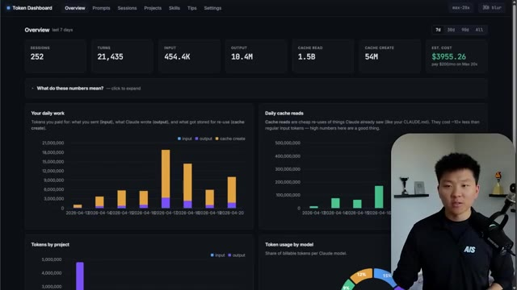
*⏱️ 00:16:20 — Capture d'écran montrant le tableau de bord personnalisé des tokens avec des graphiques d'utilisation, des statistiques par session et un encart vidéo du présentateur en bas à droite.*

---

### ⏱️ `[00:16:47 - 00:17:21]` | Segment #34

**🔊 Audio (Transcription Intégrale Mot pour Mot en Français) :**
> et à travers différents outils qui sont appelés. Et cela devrait vous donner des informations intéressantes parce qu'ici même vous pouvez voir dans mon projet Herc2, qui est en quelque sorte mon assistant exécutif, mon second cerveau, vous pouvez voir que j'ai beaucoup plus de jetons d'entrée que de jetons de sortie. Maintenant, évidemment, les jetons de sortie sont plus cher, mais quand même, cela devrait me signaler qu'il se passe quelque chose ici. Genre, pourquoi tous mes autres projets ont-ils significativement plus de sortie que d'entrée ? Mais ici, j'ai, vous savez, 2 millions de plus en entrée. Pourquoi est-ce que je pense que c'est le cas ? Parce que j'ai récemment fait en sorte qu'il lise tout et qu'il m'aide à réorganiser les choses et qu'il m'aide, vous savez, à trouver la meilleure façon d'optimiser ce projet. Donc je sais que c'est pour ça, mais c'est important d'aller voir ce genre de choses. Maintenant

**👁️ Analyse Visuelle d'Écran (gemini-3.5-flash-lite) :**
**Interface & Outils** : Tableau de bord Web ("Token Dashboard")

**Contenu textuel & Code** : Graphiques montrant la consommation de jetons par projet, notamment le projet "Herk-2" avec ses détails d'utilisation (input: 6,485,823 / output: 4,313,036), ainsi que l'utilisation par modèle.

**Action / Démonstration** : Le présentateur commente les graphiques du tableau de bord en pointant la section dédiée aux jetons par projet.

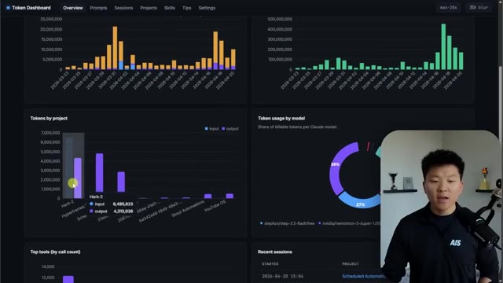
*⏱️ 00:16:56 — Un tableau de bord sombre affichant des statistiques d'utilisation de jetons d'IA, avec des graphiques en barres et un diagramme circulaire. Le présentateur apparaît dans une petite fenêtre incrustée en bas à droite.*

---

### ⏱️ `[00:17:21 - 00:17:55]` | Segment #35

**🔊 Audio (Transcription Intégrale Mot pour Mot en Français) :**
> ce qui est génial aussi, c'est que vous pouvez aller voir vos vrais prompts. Donc ici, je peux voir quels prompts ont réellement consommé le plus de jetons et je peux regarder ça et comprendre, bon, qu'est-ce que j'ai fait ici ? Est-ce que j'avais besoin de vider ma session plus tôt ? Pourquoi est-ce que j'ai consommé autant de jetons ici ? Et comment je fais pour que ça ne se reproduise plus ? Donc par exemple, si je veux ouvrir ce projet juste ici, et que je peux ouvrir ce prompt et aller dans la session, on peut voir tout ce que j'ai réellement fait ici. On peut voir tous les appels d'outils, on peut voir ce qui s'est passé. Et je pourrais analyser ça ou même demander à Cloud Code de l'analyser pour moi afin de comprendre pourquoi ça a pris autant de jetons. L'onglet des sessions nous montre aussi toutes nos différentes sessions et combien de tours et combien de jetons. Nous avons aussi des projets donc je peux voir par

**👁️ Analyse Visuelle d'Écran (gemini-3.5-flash-lite) :**
**Interface & Outils** : Tableau de bord web (Token Dashboard)

**Contenu textuel & Code** : Liste de prompts avec les colonnes Cache Cost, Prompt, Model, Tokens, Cache RD et Session, affichant les prompts les plus consommateurs de jetons.

**Action / Démonstration** : Visualisation et analyse des prompts qui ont consommé le plus de jetons par l'utilisateur.

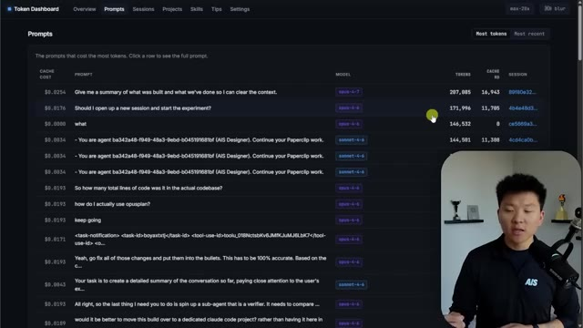
*⏱️ 00:17:30 — Capture d'écran montrant l'interface d'un tableau de bord de suivi des jetons (Token Dashboard) avec la liste des prompts et leur coût en tokens.*

---

### ⏱️ `[00:17:55 - 00:18:28]` | Segment #36

**🔊 Audio (Transcription Intégrale Mot pour Mot en Français) :**
> projetter combien de jetons j'utilise et combien de sessions j'ai eues. Et ensuite, j'ai une section de compétences, qui là ne fonctionne vraiment pas. Ce n'est pas exactement super facile d'obtenir les jetons par appel, mais vous pouvez voir, vous pouvez au moins voir combien de fois vos différentes compétences ont été invoquées. Et puis aussi une section de conseils. Maintenant, je n'ai pas vraiment intégré beaucoup d'IA ici, mais ce serait un peu le but, mais ça va vous montrer, Hé, ce fichier a été ouvert 181 fois. Ce fichier a été ouvert 166 fois. Cette commande bash a été exécutée 67 fois au cours des sept derniers jours. Vous pourriez donc être capaz d'identifier des schémas dont vous ne remarquez même pas qu'ils se produisent. Donc de toute façon, comme je l'ai dit, le dépôt GitHub dans la communauté School gratuite, tout ce que vous avez à faire est de prendre l'URL, de la donner à Claude Code et de dire,

**👁️ Analyse Visuelle d'Écran (gemini-3.5-flash-lite) :**
**Interface & Outils** : Interface Web (Tableau de bord personnalisé de monitoring pour agent IA).

**Contenu textuel & Code** : Tableau de données avec les colonnes : SKILL, INVOCATIONS, TOKENS PER CALL, SESSIONS, LAST USED. On y voit des noms de compétences comme "paperclip", "superpowers:brainstorming", "linkedin-post", etc.

**Action / Démonstration** : Navigation dans l'onglet "Skills" du tableau de bord pour analyser l'utilisation des ressources par compétence.

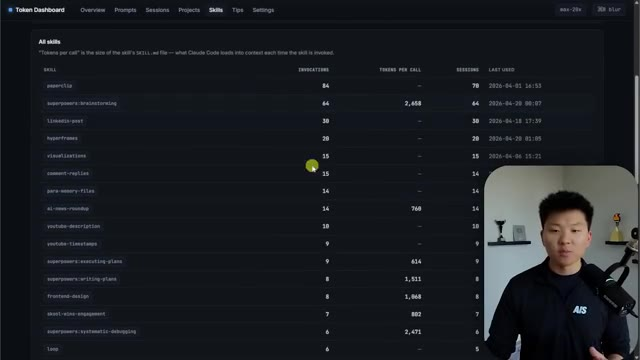
*⏱️ 00:18:03 — Tableau de bord "Token Dashboard" affichant une liste détaillée des compétences (skills) d'un agent IA, incluant le nombre d'invocations, de jetons par appel et de sessions.*

---

### ⏱️ `[00:18:28 - 00:18:58]` | Segment #37

**🔊 Audio (Transcription Intégrale Mot pour Mot en Français) :**
> Hé, aide-moi à configurer ça. Très bien. Donc avant d'aborder des questions de philosophie plus larges sur les raisons pour lesquelles je ne pense même pas que vous ayez besoin d'utiliser le modèle à fenêtre d'un million de tokens, je veux vous balancer quelques statistiques. Donc, très vite, première stat : un développeur a analysé sur GitHub 18 000 blocs de réflexion répartis sur 7 000 sessions. La profondeur de réflexion a chuté de 67 % à mesure que les sessions s'allongeaient, et les modifications sans lecture sont passées de 6 % à 34 %. Donc en gros, plus la session est longue, plus Claude devient paresseux et bâclé. Je sais qu'on le sait, mais cette statistique permet vraiment de bien s'en rendre compte.

**👁️ Analyse Visuelle d'Écran (gemini-3.5-flash-lite) :**
**Interface & Outils** : Présentation graphique (type slide deck).

**Contenu textuel & Code** : Texte : « PHILOSOPHY », « 1M IS INSURANCE, NOT A GOAL », « FIRST 20% IS PRIME TIME », « 0 - 20% », « DIMINISHING RETURNS ».

**Action / Démonstration** : Le présentateur explique sa philosophie sur l'inutilité relative des très grandes fenêtres de contexte (1 million de tokens) pour la plupart des usages.

*⏱️ 00:18:36 — Une diapositive de présentation sombre affichant le titre « 1M IS INSURANCE, NOT A GOAL » et le slogan « FIRST 20% IS PRIME TIME », accompagnée d'une barre de progression illustrant le concept de « Diminishing returns » (rendements décroissants) pour le reste de la fenêtre contextuelle.*

---

### ⏱️ `[00:18:59 - 00:19:32]` | Segment #38

**🔊 Audio (Transcription Intégrale Mot pour Mot en Français) :**
> Bien, deuxième statistique. Un utilisateur est passé d'une dépense de 345 dollars par mois en jetons à 42 000 dollars par mois, et la qualité des résultats est restée totalement inchangée. Donc, même travail, même résultat, mais à cause des habitudes liées aux jetons, je ne sais pas ce qui est arrivé à ce pauvre type, mais le coût a augmenté tellement, tellement, et la qualité n'a même pas fait un bond. C'est donc une mauvaise gestion du contexte. Troisième statistique. Le problème de précision de récupération que j'ai mentionné plus tôt, 92 % à 256 000 jetons tombe à 78 % à 1 million. Donc, ce n'est pas parce que vous pouvez remplir un million de jetons que vous devez le faire, ce qui mène très bien

**👁️ Analyse Visuelle d'Écran (gemini-3.5-flash-lite) :**
**Interface & Outils** : Graphique de présentation (type Keynote/Slide).

**Contenu textuel & Code** : Texte affiché : "STAT 02", "SAME QUALITY • 122× COST", "$345 -> $42K".

**Action / Démonstration** : Le présentateur explique une statistique sur l'inefficacité des dépenses liées à l'utilisation des jetons IA.

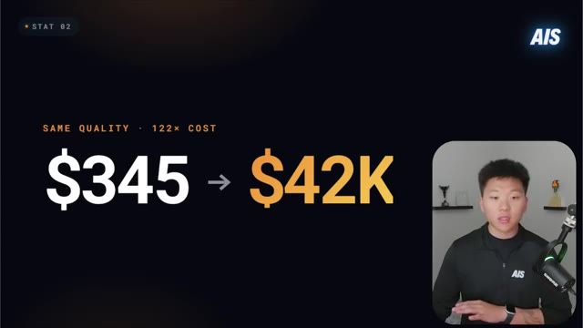
*⏱️ 00:19:07 — Une infographie illustrant une comparaison de coûts : passage de 345 $ à 42 000 $ pour une qualité de résultat identique, avec la mention "122x cost".*

---

### ⏱️ `[00:19:32 - 00:20:08]` | Segment #39

**🔊 Audio (Transcription Intégrale Mot pour Mot en Français) :**
> en passant au point suivant sur la raison pour laquelle je l'utilise à peine. Donc, quand les gens entendent 1 million, ils pensent qu'ils ont un million de jetons avec lesquels jouer. Et ensuite, ils commencent à gaspiller. Ils arrêtent d'utiliser des sous-agents. Ils arrêtent d'être intentionnels. Ils déchargent tout dans une seule session géante parce qu'ils pensent qu'ils ont de la place. Et parce que la barre de progression, vous savez, selon l'endroit où vous utilisez Claude Code, n'en est qu'à moitié. Donc autant continuer. Mais les règles sur la façon dont fonctionnent les modèles d'IA n'ont pas changé. Une plus grande fenêtre ne signifie pas un meilleur résultat. Cela signifie simplement plus d'espace pour la pourriture du contexte et plus d'espace pour que le modèle se distrait et plus d'espace pour, vous savez, tout ce genre de choses. Ce million, c'est juste une assurance. Ce n'est pas du tout un objectif de le remplir. Vraiment les premiers, genre,

**👁️ Analyse Visuelle d'Écran (gemini-3.5-flash-lite) :**
**Interface & Outils** : Diapositive de présentation (graphique pédagogique).

**Contenu textuel & Code** : Texte affiché : "PHILOSOPHY", "1M IS INSURANCE, NOT A GOAL", "FIRST 20% IS PRIME TIME", et une barre de progression légendée "0-20% DIMINISHING RETURNS".

**Action / Démonstration** : Illustration conceptuelle utilisée par le présentateur pour expliquer que la majorité de la valeur des jetons IA se trouve dans les premiers 20% de la fenêtre contextuelle.

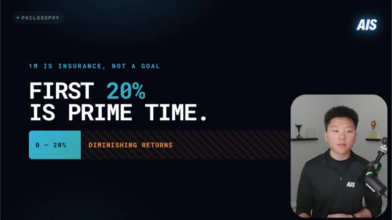
*⏱️ 00:19:41 — Une diapositive de présentation illustrant la philosophie sur l'utilisation des jetons IA, avec le texte "1M IS INSURANCE, NOT A GOAL" et "FIRST 20% IS PRIME TIME".*

---

### ⏱️ `[00:20:08 - 00:20:30]` | Segment #40

**🔊 Audio (Transcription Intégrale Mot pour Mot en Français) :**
> Tu sais, de zéro à 20 % de ta session, c’est le moment idéal. Et c’est là que le Cloud.MD est le plus frais. C’est là que le modèle est le plus prêt. Quand j’utilise Opus avec un million de contexte, je ne dépasse jamais environ 120k tokens ou environ 12 %. Et ce n’est pas nécessairement parce que si tu arrives à 200k, ça va être horrible. C’est juste parce que, dans ma tête, je me suis dit, OK, 120k, c’est mon chiffre.

**👁️ Analyse Visuelle d'Écran (gemini-3.5-flash-lite) :**
**Interface & Outils** : Présentation vidéo avec diapositive graphique.

**Contenu textuel & Code** : Texte affiché : '1M IS INSURANCE, NOT A GOAL', 'FIRST 20% IS PRIME TIME', et une barre de progression '0 - 20% DIMINISHING RETURNS'.

**Action / Démonstration** : Le présentateur parle de l'utilisation optimale de la fenêtre de contexte d'un modèle d'IA (les premiers 20%).

---

### ⏱️ `[00:20:30 - 00:21:07]` | Segment #41

**🔊 Audio (Transcription Intégrale Mot pour Mot en Français) :**
> Je vais prendre l'habitude de toujours tout effacer et de prendre cette habitude, vous savez, de stocker des choses et d'avoir des feuilles de suivi et de faire toutes ces bonnes pratiques afin de savoir que je gère toujours bien ma session. Et d'ailleurs, à propos de toute cette histoire de 120 000 jetons, je veux dire, prenez ça avec des pincettes, parce qu'il va se passer qu'il y aura des moments où vous travaillez sur un gros projet de code ou vous utilisez, vous savez, des hyperframes pour monter une vidéo et vous allez dépasser les 120 et vous ne voulez pas vous arrêter en plein milieu de l'exécution parce que c'est en train de générer tout un tas de jetons. Mais pour moi, c'est juste en quelque sorte ma référence de base. Et si vous vous demandez d'où je sors ça, c'est parce que lorsque nous n'avions que 200 000 jetons dans la fenêtre de contexte,

**👁️ Analyse Visuelle d'Écran (gemini-3.5-flash-lite) :**
**Interface & Outils** : Logiciel de présentation (type PowerPoint/Keynote).

**Contenu textuel & Code** : Texte affiché : "1M IS INSURANCE, NOT A GOAL", "FIRST 20% IS PRIME TIME", et une barre de progression indiquant "0 - 20% DIMINISHING RETURNS".

**Action / Démonstration** : Aucune action technique ou logicielle montrée, il s'agit d'un support visuel statique illustrant les propos du présentateur.

---

### ⏱️ `[00:21:07 - 00:21:40]` | Segment #42

**🔊 Audio (Transcription Intégrale Mot pour Mot en Français) :**
> J'étais fondamentalement toujours en train de nettoyer et de compacter quand j'arrivais à environ 60 %, ce qui représentait environ 120 000 jetons, donc j'ai toujours gardé ça comme référence du moment où, quand j'arrive à ce point, je vais essayer de faire ce que je peux pour réinitialiser, réécrire les mémoires, réécrire la progression, puis continuer sur un modèle neuf. Vous pouvez aussi faire des choses comme le chaînage de sessions, donc si vous avez un gros projet, vous n'avez pas tout à faire en une seule session, les chaîner ensemble, en avoir une pour la découverte où vous pouvez demander à Claude de lire des fichiers PDF et de lire la base de code et, vous savez, de vous donner simplement un beau document de synthèse. Et ensuite, vous pouvez déplacer toutes ces informations dans une session de planification où il

**👁️ Analyse Visuelle d'Écran (gemini-3.5-flash-lite) :**
**Interface & Outils** : Diapositive de présentation graphique (style tableau de bord/slide).

**Contenu textuel & Code** : Texte pédagogique sur l'optimisation des jetons ("1M is insurance", "20% is prime time", "0-20% diminishing returns").

**Action / Démonstration** : Présentation théorique illustrant la stratégie de nettoyage des jetons avant saturation, en appui du discours du présentateur.

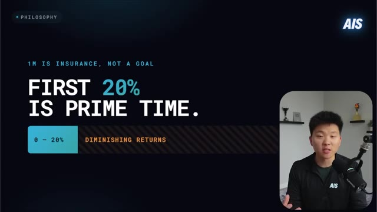
*⏱️ 00:21:15 — Une diapositive de présentation avec un fond sombre illustrant une philosophie de gestion des jetons IA, affichant le texte "1M IS INSURANCE, NOT A GOAL", "FIRST 20% IS PRIME TIME" et une barre de progression indiquant "0-20% DIMINISHING RETURNS".*

---

### ⏱️ `[00:21:40 - 00:22:16]` | Segment #43

**🔊 Audio (Transcription Intégrale Mot pour Mot en Français) :**
> lit cela et cela crée un plan. Et ensuite, vous prenez ce plan terminé et vous le déplacez dans votre session d'exécution. Donc je pense que vous avez compris. C'est un peu comme une chaîne de montage. Chaque session a une tâche spécialisée. Donc comme je l'ai dit, il est vraiment important de commencer à prendre ces habitude-là. Donc si vous débutez tout juste, restez peut-être simplement avec la fenêtre de contexte de 200k pendant un petit moment, apprenez la discipline, apprenez à être intentionnel, et ensuite vous pourrez passer à 1 million si vous en avez même besoin. Vous pourriez même réaliser que vous n'en avez pas besoin, car je pense que plus vous avez d'espace, cela invite simplement à de plus mauvaises habitudes. Comme si vous essayez de perdre du poids, mais que vous avez toujours des biscuits posés sur votre bureau, vous allez juste être tenté tout le temps d'attraper plus de biscuits. Alors pourquoi ne pas simplement jeter les biscuits si vous n'en avez pas besoin ?

**👁️ Analyse Visuelle d'Écran (gemini-3.5-flash-lite) :**
**Interface & Outils** : Logiciel de présentation (diapositive graphique).

**Contenu textuel & Code** : Schéma en 3 étapes : 01 DISCOVER (Read -> summary doc), 02 PLAN (Summary -> plan), 03 BUILD (Plan -> execution). Titre principal : "WORK THE ASSEMBLY LINE."

**Action / Démonstration** : Illustration conceptuelle du processus de travail automatisé par des agents IA, où chaque étape traite une sortie de l'étape précédente.

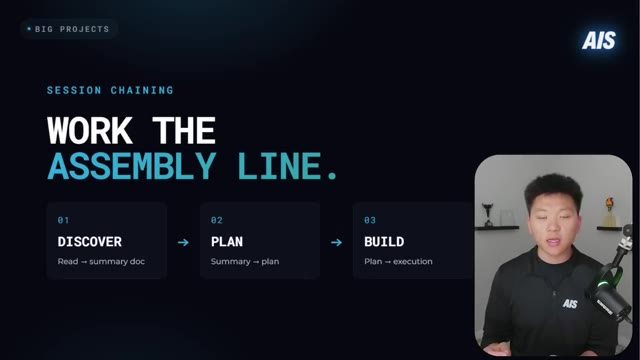
*⏱️ 00:21:49 — Diapositive de présentation illustrant le concept de "Session Chaining" sous forme de chaîne de montage en trois étapes.*

---

### ⏱️ `[00:22:16 - 00:22:49]` | Segment #44

**🔊 Audio (Transcription Intégrale Mot pour Mot en Français) :**
> Maintenant, il y a aussi beaucoup d'autres frameworks que d'autres personnes ont déjà conçus et que vous pouvez simplement intégrer dans votre projet. Je vais donc mettre le lien de ce tweet dans la description de cette vidéo. Il contient 10 dépôts GitHub différents pour dépenser 60 à 90 % de jetons en moins dans Claude Code. Je ne vais pas tous les passer en revue ici. Je vais les survoler rapidement. Mais ce qu'il est important de garder à l'esprit, ce n'est pas que vous voulez mettre les 10 dans un projet et simplement le laisser tourner, car cela ne va pas vraiment marcher. Chacun d'eux fait quelque chose de différent. Ils abordent la gestion du contexte et la réduction des jetons de différentes manières. La clé est donc de les analyser, peut-être même de les nourrir

**👁️ Analyse Visuelle d'Écran (gemini-3.5-flash-lite) :**
**Interface & Outils** : Navigateur web (X / Twitter) et webcam du présentateur.

**Contenu textuel & Code** : Publication de @DeRonin_ listant "10 GitHub repos to spend 60-90% less tokens in Claude Code" incluant RTK (Rust Token Killer) et Context Mode.

**Action / Démonstration** : Le présentateur présente à l'écran les ressources et frameworks externes pour optimiser l'utilisation des tokens d'IA.

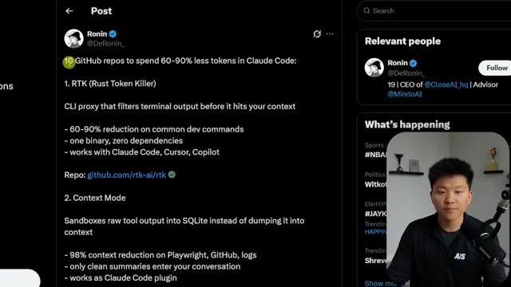
*⏱️ 00:22:25 — Capture d'écran montrant un tweet sur X (Twitter) listant des dépôts GitHub pour réduire la consommation de jetons, avec le présentateur visible en incrustation à droite.*

---

### ⏱️ `[00:22:49 - 00:23:21]` | Segment #45

**🔊 Audio (Transcription Intégrale Mot pour Mot en Français) :**
> tout intégrer dans votre produit et dire, hé, sur la base de ce que nous faisons ici dans ce projet spécifique avec cet objectif final spécifique, lequel de ces répertoires nous aiderait probablement le plus. Maintenant, si l'un d'entre eux vous semble particulièrement intéressant, faites-le-moi savoir dans les commentaires et je ferai un tutoriel complet et approfondi dessus. Mais pour l'instant, jetons juste un coup d'œil rapide. Nous avons Rust Token Killer, qui est un proxy CLI qui filtre la sortie du terminal avant qu'elle n'atteigne votre contexte. Nous avons Context Mode, qui met en bac à sable la sortie d'un outil brut dans SQLite au lieu de la déverser dans le contexte. Nous avons donc vu de très belles statistiques ici avec Context Mode. Nous avons Code Review Graph. Nous avons Token

**👁️ Analyse Visuelle d'Écran (gemini-3.5-flash-lite) :**
**Interface & Outils** : Plateforme de réseau social (X/Twitter) affichant une liste de dépôts GitHub.

**Contenu textuel & Code** : Liste de recommandations : "1. RTK (Rust Token Killer)", "2. Context Mode", "3. code-review-graph", avec leurs avantages respectifs pour réduire la consommation de jetons.

**Action / Démonstration** : Le présentateur passe en revue une liste de solutions techniques pour optimiser le contexte des agents IA comme Claude Code.

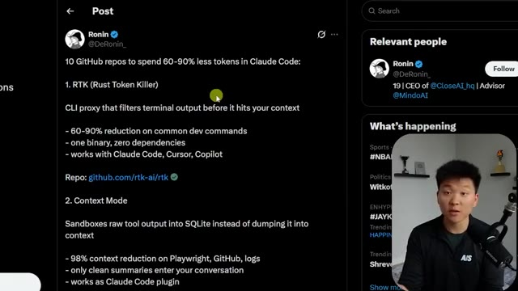
*⏱️ 00:22:57 — Capture d'un post X listant des outils d'optimisation de jetons (RTK) pour Claude Code, avec le présentateur en médaillon.*

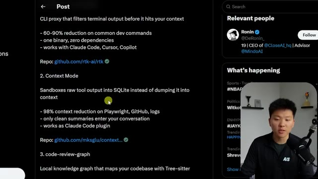
*⏱️ 00:23:13 — Capture du même post X montrant les points 2 et 3 (Context Mode et code-review-graph) avec le présentateur en médaillon.*

---

### ⏱️ `[00:23:21 - 00:23:57]` | Segment #46

**🔊 Audio (Transcription Intégrale Mot pour Mot en Français) :**
> Sauveur. Voici celui du Homme des cavernes dont je parlais et qui fait parler Claude comme un homme des cavernes. Nous avons Claude Token Efficient, qui est un fichier Claude.nmd qui maintient les réponses concises. Nous avons l'optimiseur de jetons MCP. Nous avons l'optimiseur de jetons Claude, un autre optimiseur de jetons et le contexte Claude. Donc encore une fois, vous n'avez pas besoin des 10, choisissez-en deux ou trois en fonction de votre flux de travail. Voici un petit arbre de décision ou quelques directives sur la façon de les utiliser. Mais comme je l'ai dit, la meilleure façon de faire est de donner à Claude Code ces répertoires et de lui faire expliquer en langage naturel ce que chacun fait et lequel conviendrait le mieux à votre projet spécifique. Faites-moi donc savoir si vous voulez

**👁️ Analyse Visuelle d'Écran (gemini-3.5-flash-lite) :**
**Interface & Outils** : Navigateur web affichant un fil d'actualité Twitter / X.

**Contenu textuel & Code** : Texte du post détaillant des projets GitHub comme 'claude-token-efficient' et 'token-optimizer-mcp' ainsi que des conseils d'association.

**Action / Démonstration** : Le présentateur commente la liste des outils d'optimisation de jetons affichée à l'écran.

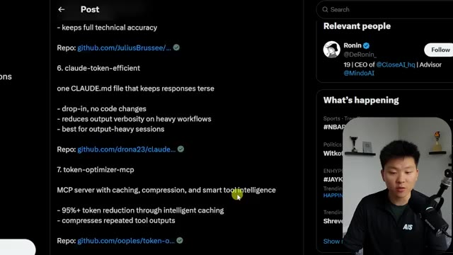
*⏱️ 00:23:30 — Capture d'écran montrant un post sur les réseaux sociaux (X/Twitter) listant des outils d'optimisation de jetons pour Claude, avec le présentateur visible en incrustation à droite.*

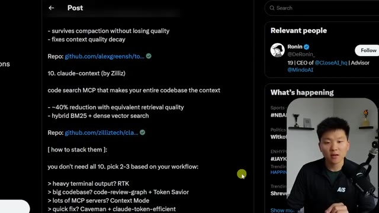
*⏱️ 00:23:48 — Suite du même post sur les réseaux sociaux détaillant les recommandations pour combiner les outils (« how to stack them »), avec le présentateur en incrustation.*

---

### ⏱️ `[00:23:57 - 00:24:17]` | Segment #47

**🔊 Audio (Transcription Intégrale Mot pour Mot en Français) :**
> me permettre d'analyser en profondeur n'importe lequel d'entre eux, mais je me suis dit que ce serait une super ressource à consulter. Le lien sera dans la description de cette vidéo YouTube. Et la dernière chose que je voulais vous laisser, les gars, c'est que si vous avez une mauvaise session, si vous avez l'impression que Claude déraille, mais que vous n'êtes peut-être même pas, vous savez, près de ce genre de zone de pourriture contextuelle, mais que vous avez simplement l'impression de vous répéter ou quoi que ce soit, effacez tout simplement ouvrez-en une nouvelle.

**👁️ Analyse Visuelle d'Écran (gemini-3.5-flash-lite) :**
**Interface & Outils** : Navigateur web (Twitter/X)

**Contenu textuel & Code** : Publication listant des outils comme "RTK (Rust Token Killer)" et "Context Mode" pour réduire les tokens de Claude Code, Cursor et Copilot.

**Action / Démonstration** : Le présentateur présente une ressource utile sous forme de post Twitter qui sera mise en lien dans la description.

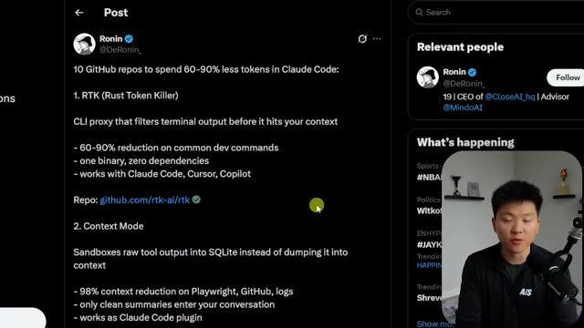
*⏱️ 00:24:02 — Capture d'écran montrant un tweet de Ronin (@DeRonin_) listant des dépôts GitHub pour réduire la consommation de tokens dans Claude Code, avec le présentateur incrusté en bas à droite.*

---

### ⏱️ `[00:24:17 - 00:24:42]` | Segment #48

**🔊 Audio (Transcription Intégrale Mot pour Mot en Français) :**
> Parfois, ouvrez simplement une nouvelle session et repartez de zéro, à la fois pour votre propre santé mentale, mais aussi pour la santé mentale de cette session Claude. C'est donc tout ce que j'ai pour vous aujourd'hui concernant la gestion de vos limites de session, mieux que 99 % des personnes qui utilisent Claude Code. Si vous faites ces choses régulièrement, je vous le garantis, vous tirerez bien plus parti de votre abonnement Claude Code que beaucoup ne le feront. Je pense donc que vous êtes maintenant prêts à vous plonger plus profondément dans ces 18 astuces dont je vous ai parlé. Et vous pouvez le faire en regardant cette vidéo que je vais placer juste ici. Et j'espère vous y voir, les gars.

**👁️ Analyse Visuelle d'Écran (gemini-3.5-flash-lite) :**
**Interface & Outils** : N/A

**Contenu textuel & Code** : Texte de conclusion : "THANKS FOR WATCHING", "WHEN IN DOUBT", "CLEAR IT.", "START FRESH."

**Action / Démonstration** : Le présentateur conclut la vidéo en résumant le conseil de réinitialiser les sessions avec l'IA.

---

### ⏱️ `[00:24:42 - 00:24:49]` | Segment #49

**🔊 Audio (Transcription Intégrale Mot pour Mot en Français) :**
> Mais si vous avez apprécié celui-ci et que vous avez appris quelque chose de nouveau, veuillez mettre un pouce bleu. Ça m'aide énormément. Et comme toujours, je vous remercie d'être arrivés jusqu'à la fin de la vidéo, et je vous dis à la prochaine.

**👁️ Analyse Visuelle d'Écran (gemini-3.5-flash-lite) :**
**Interface & Outils** : Aucun éditeur ou terminal (écran de fin de vidéo).

**Contenu textuel & Code** : Texte affiché : "WHEN IN DOUBT CLEAR IT. START FRESH."

**Action / Démonstration** : Conclusion de la vidéo par le présentateur.

---

