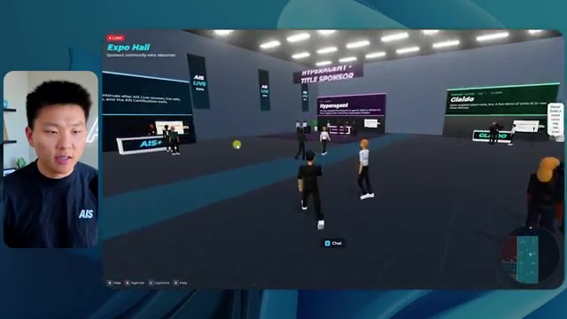
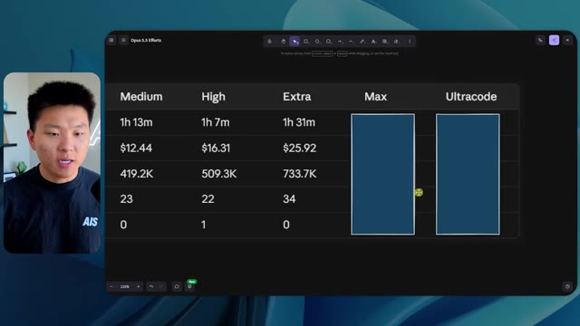
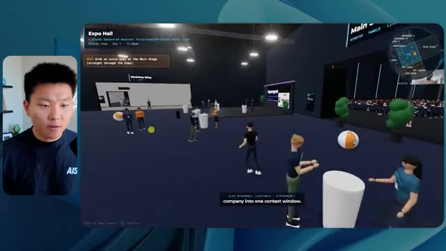
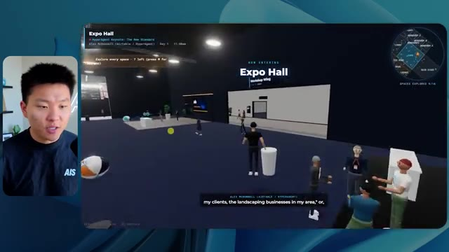

# 🎬 How to Never Hit Your Claude Session Limit Again

> **Chaîne** : [Nate Herk | AI Automation](https://www.youtube.com/@nateherk/featured)  
> **Lien YouTube** : [https://www.youtube.com/watch?v=_qZvORxGqI0](https://www.youtube.com/watch?v=_qZvORxGqI0)  
> **Date de publication** : 20260420  
> **Durée** : 00:24:49  
> **Identifiant vidéo** : `_qZvORxGqI0`  
> **Transcription & Analyse** : `whisper-v3-large-turbo+gemini-3.5-flash-lite`  

---

## 📌 Synthèse Exécutive & Outils

### 💡 Résumé
Dans cette vidéo intitulée **Comment ne plus jamais atteindre la limite de vos sessions Claude**, Nate Herk décortique les capacités pratiques d'automatisation et de développement propulsées par les modèles de pointe.

### 🛠️ Outils, Modèles & Logiciels Présentés
- **Opus 5.5 & Claude Code** : Modèles d'ingénierie et agents de codage autonome.

### 🔑 Points Clés & Enseignements Stratégiques
- Optimiser le niveau d'effort et le raisonnement des modèles IA pour des résultats industriels.
- Automatiser les cycles de création logicielle de bout en bout.

---

## ⏱️ Chronologie & Transcription Complète Audio & Visuelle (Mot pour Mot)

### ⏱️ `[00:00:00 - 00:00:20]` | Segment #01

**🔊 Audio (Transcription Intégrale Mot pour Mot en Français) :**
> Opus 5.5, Opus 5.5, Opus 5.5, Opus 5.5, Opus 5.5. Ce modèle est littéralement partout et pour de très bonnes raisons. Il est intelligent, il est bon marché, il a un goût incroyable, c'est un modèle d'IA incroyable. Mais avec chaque modèle d'IA, vous avez le choix de l'effort, que ce soit faible, moyen, élevé, extra, max ou code ultra.

**👁️ Analyse Visuelle d'Écran (gemini-3.5-flash-lite) :**
**Interface & Outils** : Interface web de X (Twitter).

**Contenu textuel & Code** : Un tweet avec une vidéo intégrée montrant un environnement 3D tropical.

**Action / Démonstration** : Affichage d'un exemple de contenu généré par IA pour illustrer le propos.

*⏱️ 00:00:05 — Capture d'écran d'un post sur le réseau social X montrant une vidéo de paysage tropical généré par IA et un texte sur la perturbation des créateurs techniques.*

---

### ⏱️ `[00:00:20 - 00:00:38]` | Segment #02

**🔊 Audio (Transcription Intégrale Mot pour Mot en Français) :**
> Donc dans cette vidéo, j'ai donné exactement le même prompt à Opus 5.5 et je l'ai exécuté sur chaque niveau d'effort et nous allons comparer les résultats. Nous examinerons la qualité de toutes les différentes sorties réelles, mais nous allons aussi examiner combien de temps chacun d'eux a fonctionné, combien cela nous a coûté s'il s'agissait de la facturation par API, le total des jetons, combien de vérifications ils ont exécutées et combien de questions ils m'ont réellement posées tout au long du processus.

**👁️ Analyse Visuelle d'Écran (gemini-3.5-flash-lite) :**
**Interface & Outils** : Application de tableau blanc / interface de présentation (type Miro ou Figma) avec un tableau de comparaison structuré.

**Contenu textuel & Code** : Tableau comparatif avec les colonnes Low, Medium, High, Extra, Max, Ultracode et les lignes Run time, API cost, Total tokens, Checks, Questions asked.

**Action / Démonstration** : Affichage des critères de comparaison des différents niveaux d'effort d'Opus 5.5.

*⏱️ 00:00:29 — Tableau de comparaison montrant les différents niveaux d'effort (Low, Medium, High, Extra, Max, Ultracode) et métriques.*

---

### ⏱️ `[00:00:39 - 00:00:58]` | Segment #03

**🔊 Audio (Transcription Intégrale Mot pour Mot en Français) :**
> Et les résultats que nous avons obtenus ne correspondent pas du tout à ce que j'attendais, donc j'ai hâte de partager cela avec vous les gars. Ne perdons pas de temps et entrons directement dans le vif du sujet. Bon, alors plongeons directement là-dedans. Je veux commencer simplement en vous montrant le prompt réel que nous avons utilisé, que nous avons donné à chacun de ces différents agents. Je vais aller dans les fichiers ici, et nous allons ouvrir ce fichier markdown de prompt, et je vais vous montrer ce que nous avons obtenu. Voici donc le slash objectif que j'ai fourni.

**👁️ Analyse Visuelle d'Écran (gemini-3.5-flash-lite) :**
**Interface & Outils** : Interface de type IDE / assistant de code (Cursor ou application similaire) avec un panneau latéral de discussion et une incrustation vidéo.

**Contenu textuel & Code** : Texte du prompt demandant de construire un monde 3D interactif et navigable représentant la conférence AIS Live à partir d'enregistrements.

**Action / Démonstration** : Le présentateur introduit l'interface de l'outil d'IA et le prompt en cours de test.

*⏱️ 00:00:48 — Interface d'un assistant de code affichant un prompt sur un projet de monde 3D, avec une incrustation vidéo du présentateur sur le côté gauche.*

---

### ⏱️ `[00:00:58 - 00:01:34]` | Segment #04

**🔊 Audio (Transcription Intégrale Mot pour Mot en Français) :**
> J'ai dit, tu dois me créer un monde 3D qui est une conférence tech réaliste dans laquelle je peux me promener en vue à la troisième personne. Tu vas regarder ce dossier, qui contient mes ressources d'enregistrement d'événements de AIS Live. Et ce dossier est un dossier Frame.io de 105 gigaoctets d'enregistrements vidéo. C'était un événement complètement virtuel. Tout a été enregistré et tous les enregistrements sont ici même. J'ai dit, ton objectif est de prendre cet événement et de le transformer en un monde 3D explorable qui me donne l'impression d'être réellement allé à une vraie conférence en personne avec différentes salles, différentes pistes, différentes scènes, bla, bla, bla. N'hésite pas à utiliser key.ai si tu as besoin de générer des images ou des vidéos. Et tu peux aussi utiliser n'importe quoi d'autre à l'intérieur de mon projet Herc 2, qui est comme mon système d'exploitation IA. J'ai dit,

**👁️ Analyse Visuelle d'Écran (gemini-3.5-flash-lite) :**
**Interface & Outils** : Éditeur de code (type VS Code/Cursor) et interface web Frame.io

**Contenu textuel & Code** : Fichier Markdown PROMPT.md détaillant les instructions pour concevoir un monde 3D de conférence tech avec vue à la troisième personne à partir de ressources d'événements AIS Live (lien Frame.io).

**Action / Démonstration** : Présentation du prompt initial demandant à l'agent IA de transformer un dossier d'enregistrements de 105 Go en un monde virtuel 3D explorable.

*⏱️ 00:01:07 — Éditeur de code affichant le fichier PROMPT.md contenant les instructions pour créer un monde 3D interactif basé sur un dossier d'enregistrements d'événements.*

*⏱️ 00:01:16 — Interface Frame.io affichant un dossier d'une taille de 105,69 Go contenant les ressources d'enregistrement d'événements pour 'GA Access (For AIS)' et 'VIP Access'.*

---

### ⏱️ `[00:01:34 - 00:02:08]` | Segment #05

**🔊 Audio (Transcription Intégrale Mot pour Mot en Français) :**
> vous serez jugé sur la créativité, le design, la physique et la sensation générale lorsque j'explorerai le monde en 3D que vous avez construit. Et c'était fondamentalement la fin des instructions. Donc, comme vous pouvez le voir sur ce côté gauche, j'ai exécuté ceci à travers tous les différents niveaux d'effort. Commençons par le niveau bas et montons jusqu'à ultra code. Très bien. Donc ici, nous avons le résultat du niveau bas. Ouvrons ceci et jetons un coup d'œil. Nous avons donc AIS live, le sommet des services IA en personne enfin, et nous avons pu cliquer partout. Tout d'abord, cela ne fait pas très personnalisé. Genre, ce n'of pas le logo d'AIS Live. Ce n'est même pas nos couleurs. Donc je n'ike pas trop ça, mais entrons ici. D'accord. C'est bien trop lumineux. Hum, nous avons une carte en haut à droite. Nous avons une ville par ici. Je ne peux pas dire quelle ville c'est.

**👁️ Analyse Visuelle d'Écran (gemini-3.5-flash-lite) :**
**Interface & Outils** : Application logicielle (interface type Claude / assistant de code) avec un panneau latéral de sélection des sessions (Hello, Extra, High, Max, etc.) et une zone de chat centrale.

**Contenu textuel & Code** : Message de l'assistant IA demandant si la tâche de construction d'un monde 3D doit commencer ("Hi Nate. This worktree has the effort-test task queued in PROMPT.md : build a walkable third-person 3D world... Should I begin, or did you have something else in mind?"), avec la réponse de l'utilisateur saisie dans le champ du bas ("yes, start the task in PROMPT.md").

**Action / Démonstration** : L'utilisateur navigue dans les différents niveaux de test d'effort dans le panneau de gauche et valide le lancement de la tâche.

*⏱️ 00:01:42 — Interface d'une application d'IA affichant une discussion avec un assistant virtuel sur un test d'effort pour un monde 3D.*

---

### ⏱️ `[00:02:08 - 00:02:40]` | Segment #06

**🔊 Audio (Transcription Intégrale Mot pour Mot en Français) :**
> C'est. D'accord. C'est Chicago, ce qui est plutôt cool parce que tu sais, j'habite à Chicago, mais bref, en haut à droite, on peut voir une carte. Nous avons un hall d'accueil. Nous avons une salle d'exposition. Nous avons un salon VIP, la scène principale. La carte montre également où se trouve chaque autre personne et cela se synchronise en direct. Donc on peut voir l'inscription. On peut voir le premier jour, la keynote de l'hyper agent, le débriefing en direct. Cool. Donc ça connaît vraiment le programme et puis il y a le deuxième jour. Donc il a trouvé ça, c'est bien. Nous avons ces petits ballons ici que je peux espérer botter. D'accord. Le visage, oh, regardez ça. Si je vais par ici, tous les gens disparaissent tout simplement. Très mauvais. Très mauvais. D'accord. Alors voyons voir. Est-ce que je peux courir ? D'accord.

**👁️ Analyse Visuelle d'Écran (gemini-3.5-flash-lite) :**
**Interface & Outils** : Application web 3D immersive / plateforme virtuelle d'événement en ligne.

**Contenu textuel & Code** : Carte de navigation, panneaux d'information "DAY 1", zones de l'événement (Lobby, Expo Hall, Main Stage).

**Action / Démonstration** : Navigation et exploration d'un environnement virtuel interactif à l'aide d'un avatar.

*⏱️ 00:02:16 — Vue d'un espace virtuel 3D avec un avatar et une mini-carte en haut à droite indiquant l'emplacement actuel.*

*⏱️ 00:02:24 — Vue dans l'espace virtuel montrant un panneau affichant le programme du premier jour (DAY 1).*

*⏱️ 00:02:32 — Vue de l'exposition virtuelle avec des avatars colorés et une installation lumineuse au centre.*

---

### ⏱️ `[00:02:40 - 00:03:04]` | Segment #07

**🔊 Audio (Transcription Intégrale Mot pour Mot en Français) :**
> Je peux aller un peu plus vite. Je vais d'abord aller par ici. Il y a des goodies, euh, certifiés AIS plus glido. D'accord. Donc il y a les stands réels qu'on avait dans l'événement virtuel. On avait des stands. Donc c'est plutôt cool. Un petit endroit pour prendre des photos. Salle C. En ce moment, nous avons Tangy Frederick qui anime un atelier. D'accord. Mais ce n'est pas une vidéo. Comme vous pouvez le voir, c'est juste une image. Elle ne bouge pas. C'est donc juste une image. Ces gens sont en train de disparaître. Ce doivent être des fantômes. Allons par ici vers la salle A.

**👁️ Analyse Visuelle d'Écran (gemini-3.5-flash-lite) :**
**Interface & Outils** : Environnement virtuel 3D interactif (similaire à Gather.town ou un jeu en ligne)

**Contenu textuel & Code** : Éléments graphiques d'un événement virtuel, stands, blocs de goodies AIS et tutoriels textuels affichés sur des écrans virtuels.

**Action / Démonstration** : Exploration et navigation du présentateur dans l'espace virtuel pour montrer les différents stands et salles d'atelier.

*⏱️ 00:02:46 — Vue d'un monde virtuel interactif montrant le stand de l'événement avec des goodies et des blocs marqués "AIS".*

*⏱️ 00:02:52 — Navigation du personnage virtuel dans la salle C de l'événement virtuel avec des tables lumineuses et des écrans d'information.*

*⏱️ 00:02:58 — Gros plan sur un écran virtuel dans la salle d'atelier montrant des instructions pour l'obtention d'une clé API.*

---

### ⏱️ `[00:03:04 - 00:03:30]` | Segment #08

**🔊 Audio (Transcription Intégrale Mot pour Mot en Français) :**
> Nous avons Liberty White. D'accord. Très cool. Vos 30 premiers jours en automatisation. Encore une fois, c'est juste une image fixe et les gens ont des bugs d'affichage. Donc ce n'est pas très bien ici. Je vais aller sur la scène principale et voir ce que nous avons. D'accord, cool. Nous avons donc une scène qui a l'air principale. Les gens ont des bugs d'affichage. Vraiment grave. Ce n'est vraiment pas très bien. Notre vidéo est en train de bouger. J'ai vu mon visage ici et j'ai vu celui de Devin, mais maintenant ils ont disparu. Donc je ne sais pas ce qui s'est passé. D'accord. On dirait que c'est plutôt un diaporama. Rien n'est encore vraiment diffusé. Quoi qu'il en soit, entrons ici.

**👁️ Analyse Visuelle d'Écran (gemini-3.5-flash-lite) :**
**Interface & Outils** : Environnement virtuel 3D interactif (plate-forme de type événement virtuel / métavers).

**Contenu textuel & Code** : Textes d'affichage et signalétique virtuelle d'événements ("Foundation track", "Main Stage", "AIS LIVE AI Services Summit").

**Action / Démonstration** : Navigation et déplacement d'un avatar à travers un espace virtuel d'événement en ligne.

*⏱️ 00:03:17 — Vue de l'avatar naviguant dans un auditorium virtuel rempli de participants numérisés lors d'un atelier.*

*⏱️ 00:03:24 — Vue en face d'une grande scène principale affichant le logo "AIS LIVE AI Services Summit" dans l'environnement virtuel 3D.*

---

### ⏱️ `[00:03:30 - 00:03:58]` | Segment #09

**🔊 Audio (Transcription Intégrale Mot pour Mot en Français) :**
> Nous avons d'autres stands. Nous avons hyper agent. Nous avons Claude Code. Nous avons plus de goodies. La salle B, c'est Dave Ebelor. Je suppose que c'est exactement la même chose. Nous avons du café. Et ensuite, je suppose que le salon VIP, accès VIP seulement. C'est plutôt cool, mais il ne se passe vraiment rien ici. Cet écran est bien trop lumineux. Bon. Donc je pense que vous comprenez l'ambiance qu'on obtient ici avec Opus 5.5 en effort faible. Et c'est là que les choses deviennent intéressantes. Combien de temps pensez-vous que cela a duré ? Combien de temps ? Celui-ci a duré 16 minutes et 43 secondes. Combien pensez-vous que cela a coûté ?

**👁️ Analyse Visuelle d'Écran (gemini-3.5-flash-lite) :**
**Interface & Outils** : Application de tableau blanc ou de prise de notes collaborative (type Excalidraw ou canevas web)

**Contenu textuel & Code** : Tableau avec les colonnes Low, Medium, High, Extra, Max, Ultracode et les lignes Run time, API cost, Total tokens, Checks, Questions asked.

**Action / Démonstration** : Présentation des différents niveaux de performance et métriques d'évaluation dans le canevas.

*⏱️ 00:03:51 — Tableau de comparaison d'efforts "Opus 5.5 Efforts" affichant des niveaux de performance (Low, Medium, High, Extra, Max, Ultracode) et des métriques associées.*

---

### ⏱️ `[00:03:58 - 00:04:26]` | Segment #10

**🔊 Audio (Transcription Intégrale Mot pour Mot en Français) :**
> 3,91 dollars si c'eût été une facturation par API. J'utilise évidemment mon abonnement ici, mais nous allons simplement calculer cela avec la facturation par API. Le total des jetons était de 191 000. Il a effectué 22 vérifications. Donc, pour la vérification, il a ouvert 22 fois le navigateur et exécuté différents types de vérifications. Soit 22 catégories de vérifications. Et combien de questions m'a-t-il posées ? Il m'a posé un total de zéro question tout au long de cette invite de commande d'objectif globale. D'accord. Alors ouvrons l'effort moyen et voyons ce que nous avons. D'accord, c'est parti. Effort moyen. Nous avons Nate Herc. Nous avons mon badge. C'est aux couleurs de la marque AI's life.

**👁️ Analyse Visuelle d'Écran (gemini-3.5-flash-lite) :**
**Interface & Outils** : Tableau blanc ou application de mind mapping/diagramme (ex: Excalidraw ou similaire).

**Contenu textuel & Code** : Tableau avec les lignes 'Run time', 'API cost', 'Total tokens', 'Checks', 'Questions asked' et les colonnes 'Low', 'Medium', 'High', 'Ex'.

**Action / Démonstration** : Le présentateur commente le tableau de données chiffrées affichant le coût de l'API ($3.91) et le nombre total de jetons (191.3K).

*⏱️ 00:04:05 — Un tableau comparatif montrant les métriques de performance et de coût, notamment 'Run time: 16m 43s', 'API cost: $3.91', 'Total tokens: 191.3K', et 'Checks'.*

---

### ⏱️ `[00:04:26 - 00:04:46]` | Segment #11

**🔊 Audio (Transcription Intégrale Mot pour Mot en Français) :**
> Donc ça a déjà l'air un tout petit peu mieux. Ça ressemble à nos palettes de couleurs qui ont utilisé nos directives de marque. Premier jour de construction, deuxième jour de gain, VIP. Cool. D'accord. Je vais entrer dans le lieu. D'accord. Waouh. Donc une ambiance un peu similaire. C'est en arrière-plan. Ça ne ressemble pas à Chicago, n'est-ce pas ? Non, ça ressemble à, honnêtement, ça ressemble à une ville inventée. Quoi qu'il en soit, c'est drôle qu'ils aient décidé de faire ça. Voyons si je peux me déplacer un peu plus vite. Oh, waouh.

**👁️ Analyse Visuelle d'Écran (gemini-3.5-flash-lite) :**
**Interface & Outils** : Application web interactive / Environnement virtuel 3D (AIS Live)

**Contenu textuel & Code** : Page d'accueil de l'événement virtuel avec badges, options de navigation, contrôles clavier et affichage du nombre de sessions.

**Action / Démonstration** : Le présentateur clique sur le bouton pour entrer dans l'événement virtuel 3D et explore l'environnement.

*⏱️ 00:04:31 — Interface web de l'application 'AIS Live' montrant un badge de pass VIP personnalisé au nom de 'NATE HERK' et un bouton 'ENTER THE VENUE'.*

*⏱️ 00:04:41 — Vue immersive 3D à l'intérieur de l'espace virtuel 'AIS Live', montrant des avatars de type rétro/low-poly dans un hall d'accueil avec vue sur des gratte-ciels la nuit.*

---

### ⏱️ `[00:04:46 - 00:05:21]` | Segment #12

**🔊 Audio (Transcription Intégrale Mot pour Mot en Français) :**
> Les gens interagissent avec moi. Regardez. Si je m'approche de ce type, il vient de lever le bras. Bon, maintenant il ne veut plus du tout avoir affaire à moi. Mais tous ces petits robots ici doivent prendre des décisions. Je ne sais pas s'ils utilisent Jev. C'est sûr que non. Je ne le lui ai pas dit. En fait, ma clé Jev est à l'arrière. Je ne sais pas. Peut-être qu'elle l'a utilisée. Quoi qu'il en soit, nous pouvons voir ici que nous avons la salle d'atelier C, le laboratoire des agents. Sympa. Donc celui-ci est en fait en cours d'exécution. Vous pouvez voir qu'il s'agit d'une vraie vidéo lue par Tangy. Tout le monde ici est en train de travailler sur un ordinateur portable. Ils ne buguent pas. C'est plutôt cool. De plus, mon badge est sur ma poitrine, ce qui est plutôt cool. Je peux venir par ici. Nous avons une carte en haut à droite, comme vous pouvez le voir, mais je peux venir par ici. Nous avons un

**👁️ Analyse Visuelle d'Écran (gemini-3.5-flash-lite) :**
**Interface & Outils** : Application de métavers / monde virtuel 3D (type Gather Town ou équivalent en 3D)

**Contenu textuel & Code** : Environnement virtuel interactif peuplé d'avatars et d'éléments de bureau

**Action / Démonstration** : Navigation et exploration d'un espace virtuel 3D peuplé de personnages non-joueurs (robots/avatars)

---

### ⏱️ `[00:05:21 - 00:05:47]` | Segment #13

**🔊 Audio (Transcription Intégrale Mot pour Mot en Français) :**
> hall d'exposition. C'est là que nous avons le stand Glido. Et ça diffuse en ce moment. Oui, ça diffuse la vidéo de nous parlant de Glido. Ça diffuse la vidéo d'Ed et moi parlant de notre programme de certification. Nous avons le logo AIS Plus juste ici, qui est un peu dans un endroit bizarre. Ce sont les diapositives des conférenciers et les points clés. Donc wow, ce sont toutes les ressources que nous avons distribuées après l'événement. Elles sont toutes là également. Nous pouvons voir que nous avons un projecteur sur la communauté. C'est donc Aiden qui parle de son contrat qu'il a décroché et c'est diffusé en direct. Ces gens regardent.

**👁️ Analyse Visuelle d'Écran (gemini-3.5-flash-lite) :**
**Interface & Outils** : Environnement virtuel 3D de type salon d'exposition.

**Contenu textuel & Code** : Panneaux textuels, diapositives de présentation et interfaces de navigation virtuelle.

**Action / Démonstration** : Navigation et exploration dans l'espace d'exposition virtuel par le présentateur.

---

### ⏱️ `[00:05:47 - 00:06:21]` | Segment #14

**🔊 Audio (Transcription Intégrale Mot pour Mot en Français) :**
> Ils sont plutôt engagés. On a un hyper agent. C'était, c'est ce que je voulais dire. Si vous avez vu ces gens lever les mains en disant bonjour, c'était plutôt marrant. Regardez, regardez, le voilà qui recommence. Bref. Bon. Où est-ce que je suis maintenant ? Maintenant, je suis dans le hall principal. On a un bar à café. On a un grand logo, qui est le vrai logo. C'est trop lumineux, mais on a le logo. On peut voir si on peut entrer ici dans le parcours des fondations. On a Sabrina Romanov et Liberty White. Donc différentes formations juste là. On peut entrer dans cette salle. C'est le parcours avancé. Donc qu'est-ce qui se passe ici. On a Dave Ebelar et Saman qui parlent de différentes choses là-dedans. Et maintenant, allons jeter un œil à la scène principale. Oh, attendez, il y a une vidéo de moi là-haut. C'est genre un VIP

**👁️ Analyse Visuelle d'Écran (gemini-3.5-flash-lite) :**
**Interface & Outils** : Environnement virtuel 3D interactif (type metaverse/plateforme d'événement en ligne).

**Contenu textuel & Code** : Interface utilisateur virtuelle affichant "Main Lobby", mini-carte de navigation et options d'interaction.

**Action / Démonstration** : Navigation et exploration d'un espace virtuel 3D par l'utilisateur et des agents IA.

*⏱️ 00:05:55 — Vue principale du hall virtuel 3D (Main Lobby) avec des avatars et des barres d'outils d'interaction.*

*⏱️ 00:06:04 — Avatars se déplaçant dans un espace virtuel d'événement en ligne vers une salle de conférence.*

*⏱️ 00:06:12 — Vue en mouvement montrant plusieurs avatars interactifs regroupés autour d'une table dans l'espace virtuel.*

---

### ⏱️ `[00:06:21 - 00:06:50]` | Segment #15

**🔊 Audio (Transcription Intégrale Mot pour Mot en Français) :**
> section ? Ouais, on ira voir ça dans une minute. Mais bref, voici la scène principale. Ça a l'air vraiment, vraiment très bien. On a une grande scène. On a genre quatre personnes assises ici. On a les trois écrans d'Alex là-haut avec Hyper Agent. Est-ce que j'ai le droit de monter sur scène ? Oh, et il me laisse monter sur scène. D'accord. C'est plutôt sympa. Bon les gars, prenons un selfie. Laissez-moi mettre tout le monde en arrière-plan. Venez par ici. Bref, c'est plutôt, plutôt cool. Par contre, toutes les places ne sont pas occupées. Donc il faut qu'on travaille là-dessus. Mais bref, je vais y retourner en courant pour voir ce que c'était que cette section VIP. D'accord. Le salon VIP. J'ai l'impression que c'est comme un aéroport ou un truc comme ça.

**👁️ Analyse Visuelle d'Écran (gemini-3.5-flash-lite) :**
**Interface & Outils** : Application virtuelle 3D Hyper Agent

**Contenu textuel & Code** : Interface de conférence virtuelle avec écrans de keynote et mini-carte de navigation

**Action / Démonstration** : Navigation et exploration de l'espace de conférence virtuel 3D par le présentateur

---

### ⏱️ `[00:06:51 - 00:07:14]` | Segment #16

**🔊 Audio (Transcription Intégrale Mot pour Mot en Français) :**
> OK, super. Donc maintenant, nous avons les sessions VIP ici. Une foire aux questions VIP avec la lecture vidéo en direct de Nate juste ici. C'est vraiment, vraiment super. Et nous avons comme un bar ou quelque chose comme ça. Génial. Je dirais que c'est un très bon résultat. Maintenant, en ce qui concerne les statistiques ici, celui-ci a pris une heure et 13 minutes à s'exécuter. Il nous aurait coûté 12 dollars et 44 cents. Il a utilisé 490 000 jetons et il a fait 23 vérifications.

**👁️ Analyse Visuelle d'Écran (gemini-3.5-flash-lite) :**
**Interface & Outils** : Application de monde virtuel / salon VIP et tableau de bord de métriques.

**Contenu textuel & Code** : Vidéo en direct intégrée dans un espace virtuel 3D, sous-titres, et tableau de métriques (Run time: 16m 43s, API cost: $3.91, Total tokens: 191.3K).

**Action / Démonstration** : Visite guidée du salon virtuel VIP avec présentation de la session vidéo en direct.

*⏱️ 00:06:56 — Capture d'écran montrant l'espace virtuel VIP avec le présentateur en vidéo en direct et un bar en arrière-plan.*

---

### ⏱️ `[00:07:14 - 00:07:48]` | Segment #17

**🔊 Audio (Transcription Intégrale Mot pour Mot en Français) :**
> Et il nous a posé un total de zéro question une fois de plus. Très bien, passons au niveau élevé. C'était déjà un résultat plutôt correct et Anthropic eux-mêmes dans leur vidéo, ou désolé, pas une vidéo, un article sur comment prompter Opus 5.5, ils ont dit de commencer simplement par le niveau moyen et de l'ajuster à la hausse ou à la baisse si nécessaire. C'était donc un résultat moyen. Passons au niveau élevé et voyons ce que nous avons obtenu. Très rapidement, les gars, je dois prendre une seconde pour vous parler du sponsor de la vidéo d'aujourd'hui, Hostinger. Donc ces deux modèles viennent de me construire une version fonctionnelle de la même chose. Et maintenant, je suis exactement là où je finis toujours, avec quelque chose de terminé sur mon ordinateur portable et aucun moyen rapide de le mettre en ligne. Et c'est le fossé que le connecteur d'Hostinger comble. C'est une extension gratuite

**👁️ Analyse Visuelle d'Écran (gemini-3.5-flash-lite) :**
**Interface & Outils** : Logiciel de prise de notes/tableau blanc (Image 1), éditeur Cursor avec agent Claude Code intégré (Image 2).

**Contenu textuel & Code** : Tableau de métriques de performance IA (Image 1) ; prompt de construction d'un calculateur HTML, logs de réflexion ("Ruminating", "dataviz skill") et paramètres de configuration de modèle Opus 5.5 (Image 2).

**Action / Démonstration** : Comparaison des coûts et efficacité de l'IA (Image 1) ; exécution d'une tâche de développement web automatisée via l'agent Claude Code (Image 2).

*⏱️ 00:07:22 — Un tableau comparatif des performances de l'agent Opus 5.5 selon les niveaux de réglage (Low, Medium, High, Extra), affichant le temps d'exécution, le coût API, le nombre de tokens, les vérifications et les questions posées.*

*⏱️ 00:07:39 — Capture d'écran de l'interface de développement Cursor avec Claude Code, montrant le processus de construction d'un calculateur de ROI ("Northwind ROI calculator") en mode agentique avec des étapes de réflexion.*

---

### ⏱️ `[00:07:48 - 00:08:23]` | Segment #18

**🔊 Audio (Transcription Intégrale Mot pour Mot en Français) :**
> pour votre éditeur qui intègre votre compte Hostinger dans l'outil de programmation que vous utilisez déjà, que ce soit VS Code, Cursor, Cloud Code, Codex, et j'en passe. Vous vous connectez une seule fois en un clic, et à partir de là, votre agent peut déployer le site, y pointer un domaine, configurer les enregistrements DNS et vérifier votre VPS sans que vous n'ayez jamais à quitter l'éditeur. Ainsi, peu importe celui que vous finirez par préférer, ce qu'il a construit n'est qu'à quelques minutes d'une véritable URL sur un hébergement géré. L'extension Connector est gratuite avec n'offrant n'importe quel plan d'hébergement, donc si vous avez encore besoin de l'hébergement sous-jacent, profitez du plan illimité grâce au lien dans la description et utilisez le code NATEHERK pour obtenir 10 % de réduction. Cela inclut également un nom de domaine gratuit et un e-mail professionnel pour l'année. Et c'est toujours le moyen le moins cher que j'ai trouvé pour obtenir quelque

**👁️ Analyse Visuelle d'Écran (gemini-3.5-flash-lite) :**
**Interface & Outils** : Hostinger Integration, Claude Code

**Contenu textuel & Code** : "Manage Hostinger from your IDE", "Connected VIA OAUTH", "AVAILABLE TOOLS" (Websites, Domains, Subscriptions & Payments, Email Marketing)

**Action / Démonstration** : Connexion du compte Hostinger via OAuth dans l'IDE pour permettre à l'assistant d'accéder aux outils de gestion.

*⏱️ 00:07:57 — Interface montrant l'intégration de Hostinger dans l'IDE avec le statut connecté et les outils disponibles (Websites, Domains, Subscriptions, Email Marketing), ainsi que Claude Code et le présentateur en incrustation.*

---

### ⏱️ `[00:08:23 - 00:08:47]` | Segment #19

**🔊 Audio (Transcription Intégrale Mot pour Mot en Français) :**
> vous avez construit sur une vraie URL. Donc revenons à la vidéo. D'accord. Encore une fois, très, très marqué par la marque. C'est un écran de chargement encore meilleur que le précédent. Nous avons ce petit effet sympa en arrière-plan. Nous avons le logo. Nous allons entrer dans le lieu. D'accord. Nous y voilà. Ça a l'air plutôt bien. Nous commençons à l'extérieur et vous pouvez voir que nous avons ces drapeaux pour tous les intervenants, Wyatt, Casper, Alex, Ed, Aiden, Sabrina, Liberty. C'est plutôt cool. Nous avons des blocs en direct ici.

**👁️ Analyse Visuelle d'Écran (gemini-3.5-flash-lite) :**
**Interface & Outils** : Application web interactive en 3D / environnement virtuel hébergé

**Contenu textuel & Code** : Interface d'un salon virtuel 3D nommé 'AIS LIVE' avec mini-carte, bannières nominatives, contrôles à l'écran (WASD, Mouse, E, Tab, etc.)

**Action / Démonstration** : Chargement de l'application web, entrée dans le lieu virtuel (venue) et exploration de la place 3D avec les contrôles de déplacement.

*⏱️ 00:08:29 — Écran de chargement et d'accueil de la plateforme virtuelle 'AIS LIVE' avec logo, description de l'événement et contrôles clavier/souris affichés.*

*⏱️ 00:08:35 — Entrée dans l'univers virtuel 3D (AIS Live Plaza) avec un avatar au centre, des bâtiments, des arbres et des instructions textuelles en haut.*

*⏱️ 00:08:41 — Navigation dans la place virtuelle montrant des bannières avec des noms de conférenciers, des avatars et un petit robot sphérique au sol.*

---

### ⏱️ `[00:08:47 - 00:09:23]` | Segment #20

**🔊 Audio (Transcription Intégrale Mot pour Mot en Français) :**
> Il a pris cette photo de moi, votre hôte, Nate Herc, John, Dave, Nate Herc. Voilà. OK. Les portes. Génial. Ce sont des portes coulissantes automatiques en verre. J'adore ça. On peut voir l'enregistrement VIP. On peut voir l'admission générale. On peut venir par ici et on peut découvrir l'expo avec différents stands, le projecteur sur la communauté. Vous pouvez aussi voir qu'en haut à gauche, j'ai un passeport. Donc c'est du genre, ça va montrer combien d'endroits j'ai visités. Tout cela est une lecture réelle. Nous avons un mur de ressources avec tous les différents intervenants. Ils ont aussi une session de networking par ici. Donc je vais y aller très rapidement et voir de quoi il s'agit. Nous avons donc le bar à cold brew AIS. Nous avons différents membres de la communauté qui ont été mis en avant ou mis en lumière.

**👁️ Analyse Visuelle d'Écran (gemini-3.5-flash-lite) :**
**Interface & Outils** : Environnement de conférence virtuelle 3D (Metaverse/Plateforme événementielle immersive).

**Contenu textuel & Code** : Interfaces utilisateur superposées (HUD) incluant une barre de progression "Passport", une mini-carte en haut à droite et des menus contextuels en bas à droite.

**Action / Démonstration** : Navigation et exploration de l'espace virtuel par l'avatar de l'utilisateur à travers différentes zones de l'exposition.

*⏱️ 00:08:56 — Vue à la première personne dans un environnement virtuel 3D représentant un hall d'accueil de conférence avec des comptoirs de "VIP Check-in" et "Registration".*

*⏱️ 00:09:05 — Navigation dans un espace d'exposition virtuel (Expo Hall) avec des stands d'information et des avatars de visiteurs.*

*⏱️ 00:09:14 — Vue panoramique du hall principal montrant la circulation des avatars vers les zones d'enregistrement et les baies vitrées coulissantes.*

---

### ⏱️ `[00:09:23 - 00:09:56]` | Segment #21

**🔊 Audio (Transcription Intégrale Mot pour Mot en Français) :**
> On a l'aile VIP. Attends, quoi ? Récupère un bracelet. Oh, je dois vraiment aller chercher le bracelet. D'accord. Laisse-moi m'enregistrer rapidement. Le bracelet est déjà mis. Attends, quoi ? D'accord. Oh, d'accord. Maintenant, les portes se sont ouvertes pour moi. Cool. Je peux entrer ici. Oh, ça mène juste à la scène principale. Salon VIP. Il y a une séance de questions-réponses en cours. Ça a l'air très sympa. Je veux dire, je suis très impressionné par la façon dont il est capable de faire ça. Waouh. D'accord. Donc c'est vraiment bien. Ce qu'on a fait, c'est qu'on a eu des salles de discussion VIP avec différentes personnes. Tu peux voir qu'il y a différentes salles, différents membres de l'équipe AIS qui vont dans des trucs. C'est vraiment sympa. C'est très sympa. C'est un bien meilleur VIP

**👁️ Analyse Visuelle d'Écran (gemini-3.5-flash-lite) :**
**Interface & Outils** : Plateforme de conférence virtuelle 3D / environnement virtuel type metavers

**Contenu textuel & Code** : Interface utilisateur avec mini-carte, indicateurs de statut (Passport, VIP), légende des commandes, et écrans affichant des sessions vidéo

**Action / Démonstration** : Navigation et exploration d'un environnement virtuel de conférence 3D par un avatar contrôlé par l'utilisateur

*⏱️ 00:09:32 — Vue d'un espace virtuel 3D « Registration Concourse » montrant un avatar et l'interface utilisateur du jeu ou de la plateforme de conférence virtuelle.*

*⏱️ 00:09:40 — Vue de la « VIP Lounge » dans l'espace virtuel, affichant un écran vidéo de la session et des avatars assis.*

*⏱️ 00:09:48 — Vue de l'espace « VIP Working Sessions » avec plusieurs salles thématiques virtuelles (« Price It Right », « Turn Your Expertise into a Service », « Land Your First Paying Client »).*

---

### ⏱️ `[00:09:56 - 00:10:30]` | Segment #22

**🔊 Audio (Transcription Intégrale Mot pour Mot en Français) :**
> expérience que ce qui a été montré dans le premier élément. D'accord. After party VIP. Regardez ça. On a une piste de danse. On a tous ces éléments ici. On a la lecture de l'after party VIP juste ici. Et il y a une estrade de DJ. C'est tellement marrant. Il y a un petit bug ici, un petit glitch par là, mais c'est génial. Oh, chouette. Donc quand je suis ici sur la scène principale, on a des sous-titres. Vous pouvez voir juste ici en bas de mon écran, on a ces sous-titres de Wyatt qui est en train de parler ici. On a des lumières. On a le panneau. Très cool. Belle scène principale. Je vais aller par ici, on peut aller à la fondation,

**👁️ Analyse Visuelle d'Écran (gemini-3.5-flash-lite) :**
**Interface & Outils** : Application web de monde virtuel 3D / métavers interactif

**Contenu textuel & Code** : Environnement 3D interactif avec avatars, écrans vidéo de participants et affichage de l'événement VIP After-Party.

**Action / Démonstration** : Navigation et exploration de l'espace virtuel par le présentateur.

*⏱️ 00:10:04 — Vue d'un monde virtuel 3D représentant une after-party VIP avec une piste de danse lumineuse, des avatars et des écrans vidéo.*

*⏱️ 00:10:13 — Autre angle de la piste de danse virtuelle de l'after-party VIP avec des ballons et des avatars en mouvement.*

*⏱️ 00:10:21 — Vue d'une salle de conférence virtuelle 3D (Main Stage) avec un public d'avatars assis et un grand écran de présentation.*

---

### ⏱️ `[00:10:30 - 00:11:06]` | Segment #23

**🔊 Audio (Transcription Intégrale Mot pour Mot en Français) :**
> avancés, et les parcours d'entreprise par ici. Alors voyons voir. Nous avons l'anatomie de trois vraies transactions. Nous avons hyper agent. Nous avons les évaluations avec Nate et Ed ici. Nous avons Dave qui s'occupe des trucs avancés. C'est vraiment bien. Je veux dire, évidemment, chacun, chacun de ces résultats jusqu'à présent, faible était correct. Moyen était mieux. Élevé a été encore mieux. Voyons si cette tendance se poursuit et allons voir ce que cela nous a coûté. Donc, le niveau élevé a fonctionné pendant une heure et sept minutes. Donc un peu plus rapide que le niveau moyen, cela nous aurait coûté 16 dollars et 31 cents. Il a utilisé un demi-million de tokens, 509 000. Il a fait 22 vérifications. Et il nous a aussi demandé, enfin, non, je me suis trompé. Ce

**👁️ Analyse Visuelle d'Écran (gemini-3.5-flash-lite) :**
**Interface & Outils** : Tableau blanc ou application de mind mapping / diagramme (style Excalidraw ou similaire).

**Contenu textuel & Code** : Tableau de données comparatives : Run time (16m 43s à 1h 07m), API cost ($3.91 à $16.31), Total tokens (191.3K à 419.2K), Checks, Questions asked.

**Action / Démonstration** : Présentation et analyse comparative des performances et des coûts selon différents niveaux d'effort (Low, Medium, High, Extra).

*⏱️ 00:10:57 — Tableau comparatif des niveaux d'effort (Low, Medium, High, Extra) affichant des métriques telles que le temps d'exécution, le coût API, le nombre de tokens et de vérifications.*

---

### ⏱️ `[00:11:06 - 00:11:25]` | Segment #24

**🔊 Audio (Transcription Intégrale Mot pour Mot en Français) :**
> l'un m'a posé une question et spoiler, c'est le seul qui nous a posé une question tout au long de tout ça. Donc voyons voir, il nous en reste trois : extra, max et ultra code. Laissez-moi ouvrir extra et nous verrons ce que nous avons. D'accord. Donc celui-ci a l'air plutôt bien. Je dirais honnêtement que jusqu'à présent, l'écran de chargement haut était le meilleur. Celui que nous venons de voir, mais de toute façon, entrons dans le live d'AIS.

**👁️ Analyse Visuelle d'Écran (gemini-3.5-flash-lite) :**
**Interface & Outils** : Application de tableau blanc ou de prise de notes avec un tableau structuré (style Notion ou interface web).

**Contenu textuel & Code** : Tableau comparatif avec les lignes : Run time (16m 43s, 1h 13m, 1h 7m), API cost ($3.91, $12.44, $16.31), Total tokens (191.3K, 419.2K, 509.3K), Checks (22, 23, 22), Questions asked (0, 0, 1).

**Action / Démonstration** : Le présentateur commente les résultats du niveau "Extra" et met en avant la colonne correspondante.

*⏱️ 00:11:11 — Un tableau comparatif montrant les métriques de différents niveaux d'effort (Low, Medium, High, Extra) avec le présentateur en médaillon à gauche.*

---

### ⏱️ `[00:11:26 - 00:11:51]` | Segment #25

**🔊 Audio (Transcription Intégrale Mot pour Mot en Français) :**
> Whoa. D'accord. Donc on a comme de petits extraits sonores. Je peux discuter avec des gens. Le panneau sur la guerre des outils a réglé quelques débats pour moi. Sympa. Bonne perspective là-bas. On est dehors à nouveau. On a ces différentes bannières, bien qu'elles soient toutes les mêmes. Elles n'affichent pas de noms de personnes différents. Donc grand logo AIS live. L'aile des ateliers est par ici. Et passons par les portes coulissantes en verre pour voir ce qu'on a. Donc on a le café AIS. La carte est en bas à droite, et elle n'est pas très descriptive.

**👁️ Analyse Visuelle d'Écran (gemini-3.5-flash-lite) :**
**Interface & Outils** : Application de métavers 3D / plateforme virtuelle interactive.

**Contenu textuel & Code** : Environnement virtuel 3D avec avatars, bannières et mini-carte en bas à droite.

**Action / Démonstration** : Navigation et déplacement d'un avatar à travers l'espace virtuel du métavers.

*⏱️ 00:11:32 — Vue d'un monde virtuel 3D de type métavers ou jeu montrant un personnage en train de marcher près de bannières publicitaires et de lampadaires.*

*⏱️ 00:11:38 — Vue de l'environnement virtuel en extérieur montrant d'autres avatars au loin et des bâtiments illuminés.*

*⏱️ 00:11:45 — Le personnage virtuel se déplace vers l'entrée d'un bâtiment ou d'un hall d'exposition virtuel.*

---

### ⏱️ `[00:11:51 - 00:12:26]` | Segment #26

**🔊 Audio (Transcription Intégrale Mot pour Mot en Français) :**
> J'aime bien comment les autres cartes nous ont dit quoi, genre où se trouvaient les choses, mais celle-ci a l'air très professionnelle. On peut voir ici la scène principale. Allons y faire un tour rapidement. Ils ont tous ces ballons qui volent partout, ce qui je trouve est assez drôle. Les ballons de plage AIS. On me voit là-haut en train de parler. Je crois que j'introduisais l'un des jours. Continuons par ici vers la salle d'atelier sur ce côté gauche. D'accord. Donc ici, nous avons le théâtre Hyper Agent. Nous avons cette session sponsorisée ici par Hyper Agent, mais cela nous montre aussi ce qui va s'y passer. C'est vraiment drôle qu'on puisse discuter avec des gens. Salmon a créé un représentant commercial vocal en direct. La salle du juste prix était comble. Avez-vous pris le guide d'accompagnement VIP ? C'est trop drôle. Nous avons le parcours avancé dans

**👁️ Analyse Visuelle d'Écran (gemini-3.5-flash-lite) :**
**Interface & Outils** : Application web de métaverse / plateforme virtuelle 3D d'événements en ligne

**Contenu textuel & Code** : Environnement virtuel 3D interactif, avatars, écrans vidéo intégrés et interfaces de discussion

**Action / Démonstration** : Navigation et exploration de l'espace virtuel par le présentateur sous forme d'avatar

*⏱️ 00:12:00 — Vue principale d'un espace virtuel 3D avec un écran géant montrant une retransmission vidéo et des avatars d'utilisateurs.*

*⏱️ 00:12:09 — Hall d'entrée virtuel 3D (Grand Lobby) avec des avatars d'utilisateurs et des panneaux indicateurs d'ateliers.*

*⏱️ 00:12:17 — Couloir virtuel 3D interactif avec plusieurs avatars d'utilisateurs discutant ou se déplaçant.*

---

### ⏱️ `[00:12:26 - 00:12:58]` | Segment #27

**🔊 Audio (Transcription Intégrale Mot pour Mot en Français) :**
> ici. Encore une fois, nous avons la lecture en direct. Est-ce que c'est la lecture en direct ? Oh, d'accord. Ça a commencé une fois que je suis entré, mais je peux prendre place. Oh la la. Je peux regarder ça. Je peux me lever. Je veux m'asseoir au premier rang. C'est plutôt cool. C'est très bien. J'aime ça. Et vous savez ce que j'ai remarqué jusqu'à présent ? Le personnage que j'incarne me ressemble un peu. Je pense qu'il a été modélisé à partir de mes photos de profil ou quelque chose comme ça. Quoi qu'il en soit, nous avons Sabrina ici, l'animatrice de la salle ici, prenez n'importe quel siège libre. D'accord, cool. Et j'ai vraiment aimé la fonctionnalité pour s'asseoir. C'est plutôt marrant. Genre, on pourrait vraiment assister à cet atelier et participer. Bref, ça nous montre les intervenants. Ça nous montre les

**👁️ Analyse Visuelle d'Écran (gemini-3.5-flash-lite) :**
**Interface & Outils** : Application ou plateforme virtuelle de type métavers/salle de classe en 3D

**Contenu textuel & Code** : Interface d'un événement virtuel en direct avec un écran de projection affichant un atelier et des avatars d'utilisateurs.

**Action / Démonstration** : Navigation et exploration de l'espace virtuel par le présentateur.

---

### ⏱️ `[00:12:58 - 00:13:31]` | Segment #28

**🔊 Audio (Transcription Intégrale Mot pour Mot en Français) :**
> ordre du jour. Il y a un petit tapis rouge ici pour prendre des photos. On peut prendre la pose. Oh, wouah. C'est plutôt cool. Bibliothèque de ressources, devenir certifié AIS Plus, Glido, Hyper Agent, AIS Plus, trois vraies affaires. Génial. Je veux dire, je dirais vraiment que jusqu'à présent, chacune est meilleure. Et on n'a même pas encore vérifié la section VIP, le salon VIP. Montons ici très vite. J'espère que je pourrai entrer. Sympa. On a une réinitialisation des outils. Ce sont les différentes pièces dans lesquelles on pourrait aller. Donc encore une fois, je pourrais prendre la feuille de calcul et je pourrais essayer de comprendre comment tarifer mes trucs. C'est tellement cool. C'est vraiment mieux que la précédente où on a en quelque sorte juste

**👁️ Analyse Visuelle d'Écran (gemini-3.5-flash-lite) :**
**Interface & Outils** : Plateforme événementielle virtuelle interactive de style métavers.

**Contenu textuel & Code** : Texte affiché : "Expo Hall", "Hyperagent Title Sponsor", "Workshops", et des questions stratégiques sur les tarifs ("If you doubled your rate, what would change?").

**Action / Démonstration** : Navigation de l'utilisateur (avatar) dans un espace virtuel d'exposition, visite du salon VIP et lecture de documents de travail ("Price It Right" worksheet).

*⏱️ 00:13:07 — Vue d'une salle d'exposition virtuelle ("Expo Hall") avec des stands pour AIS+, Hyperagent et Glido.*

*⏱️ 00:13:15 — Vue de l'entrée principale ou "Lobby" d'un événement virtuel avec des escaliers et des zones dédiées aux ateliers.*

*⏱️ 00:13:23 — Vue à la première personne dans un "VIP Lounge" où des avatars sont assis autour d'une table, avec des questions affichées à l'écran.*

---

### ⏱️ `[00:13:31 - 00:13:59]` | Segment #29

**🔊 Audio (Transcription Intégrale Mot pour Mot en Français) :**
> like looked at stuff. Awesome. I can get behind the bar and come in here. This is very nice. Okay. So as far as statistics go, this one ran for an hour and a half. It costs 25.92 bucks. I don't know why I say point $25, 92 cents. It was 733,000 tokens and 34 checks. So it had the most checks so far by far. And it asked us zero questions. I can't wait to see what we got here from max and ultra code. Okay. Here is max loading screens, boring, but it's on brand and it has our logo.

**👁️ Analyse Visuelle d'Écran (gemini-3.5-flash-lite) :**
**Interface & Outils** : Application de tableau blanc / diagramme (type Excalidraw ou similaire).

**Contenu textuel & Code** : Tableau de données : Durée (1h 13m, 1h 7m, 1h 31m...), Coût ($12.44, $16.31...), Tokens (419.2K, 509.3K...) et barres graphiques.

**Action / Démonstration** : Présentation et analyse des résultats statistiques des différents tests d'exécution.

*⏱️ 00:13:38 — Un tableau comparatif affichant les statistiques de différents niveaux d'effort (Medium, High, Extra, Max, Ultracode) avec des durées, des coûts et le nombre de tokens.*

---

### ⏱️ `[00:14:00 - 00:14:35]` | Segment #30

**🔊 Audio (Transcription Intégrale Mot pour Mot en Français) :**
> So that was good. I like that. We will go ahead and enter AIS live. Ooh, nice little animation here that brings us in. Once again, the character looks like me. They've all looked like me. I mean, sort of, we have sitting in the background. This looks like Chicago. Like I mentioned earlier, a lot of these are playing sounds and I'm not including that because it would be very distracting for you guys to try to listen to what's going on as well as me speaking. So there is like some slight music in all these. I hate how this is walking. This walking is really, really bad. I mean, the walking, yeah, I don't like this at all. So that's not great. But besides that, let's go in and explore. Notice these shadows when I walk in, they like really switch. I'm not sure why that is,

**👁️ Analyse Visuelle d'Écran (gemini-3.5-flash-lite) :**
**Interface & Outils** : Application web 3D / Environnement virtuel interactif (AIS live).

**Contenu textuel & Code** : Interface utilisateur virtuelle avec mini-carte, bannières d'événements et commandes de déplacement (WASD).

**Action / Démonstration** : Navigation et exploration de l'environnement virtuel 3D par le présentateur.

---

### ⏱️ `[00:14:35 - 00:15:11]` | Segment #31

**🔊 Audio (Transcription Intégrale Mot pour Mot en Français) :**
> but anyways, we can chat with people in here too. Hyperagent booth is right where you walk into the expo. All good. Okay, cool. I can keep clicking E to make them change what they say. We've got the speakers right here. That looks pretty good. Although we definitely had everyone's profile picture. So I'm not sure why that's not included there. We see people taking pictures right here. I love that. And it saves a little picture. Okay. The map also isn't super, like doesn't give me a great explanation of what's going on, but I like these booths. These are cool. I think these booths are the best that I've seen so far. Like they just look nice. They've got reps. There's nice like slides behind them. Yeah. These booths are cool. Okay. We have a little featured theater

**👁️ Analyse Visuelle d'Écran (gemini-3.5-flash-lite) :**
**Interface & Outils** : Application web 3D virtuelle de type métavers/conférence en ligne

**Contenu textuel & Code** : Environnement virtuel 3D interactif avec affichage de listes de conférenciers et de stands d'exposition

**Action / Démonstration** : Exploration d'un espace de conférence virtuel 3D et interaction avec des avatars et des éléments d'interface

*⏱️ 00:14:44 — Vue d'un espace virtuel 3D de type métavers avec des avatars de participants, une grande fresque de conférenciers au fond et le présentateur dans une vignette à gauche.*

*⏱️ 00:14:53 — Navigation dans le hall virtuel montrant des avatars qui interagissent autour d'une table haute et une photo souvenir incrustée à l'écran.*

*⏱️ 00:15:02 — Entrée dans l'exposition virtuelle (« Expo Hall ») avec des stands thématisés (« Evals Lab », « Enterprise AI ») et des avatars de visiteurs.*

---

### ⏱️ `[00:15:11 - 00:15:35]` | Segment #32

**🔊 Audio (Transcription Intégrale Mot pour Mot en Français) :**
> going on over here. It's Casper. Although why is this not playing? I feel like this should be playing, right? Like in the other ones, they were always playing. We can talk to some other people over here. Coffee's free. Blah, blah, blah. Amy Simpson, Matt Wolf. Nice. Okay. This is just the networking area that we're in right now, but we can see in the top right. We can also see what's live on the main stage right now. It is a tool war panel. So let's head in here. We've got Devin, Cole, Dave, and Russ chatting in here. We've got sort of AV, some light stuff going on back here.

**👁️ Analyse Visuelle d'Écran (gemini-3.5-flash-lite) :**
**Interface & Outils** : Environnement virtuel 3D en ligne (type métavers de conférence).

**Contenu textuel & Code** : Interface utilisateur avec mini-carte, commandes clavier (WASD, Shift, Space), et affichage des zones de conférence.

**Action / Démonstration** : Exploration et navigation dans l'espace virtuel de conférence par le présentateur.

*⏱️ 00:15:17 — Vue d'un espace d'exposition virtuel 3D avec des écrans affichant des statistiques financières et des avatars d'utilisateurs.*

*⏱️ 00:15:23 — Navigation d'un avatar dans un salon de réseautage virtuel (Networking Lounge) en 3D.*

*⏱️ 00:15:29 — Vue d'une scène principale virtuelle (Main Stage) où un avatar s'approche d'un amphithéâtre en ligne avec des écrans de retransmission.*

---

### ⏱️ `[00:15:36 - 00:15:55]` | Segment #33

**🔊 Audio (Transcription Intégrale Mot pour Mot en Français) :**
> Switch the main stage to what actually matters right now. So I can switch the topic. Cool. So I just switched to me and Matt. We can go to anatomy of three real deals. That's pretty cool. The stage looks good. We've got a nice little panel up here. Can I get on the stage? Nice. Nice. Well, I can't go too far, actually. All right, everyone, let me take the selfie. Everyone get in this. I can also take a seat in this audience over here and just enjoy the session.

**👁️ Analyse Visuelle d'Écran (gemini-3.5-flash-lite) :**
**Interface & Outils** : Application de métavers ou de conférence virtuelle en 3D.

**Contenu textuel & Code** : Environnement virtuel 3D interactif avec des avatars et des écrans vidéo de diffusion.

**Action / Démonstration** : Navigation et interaction d'un avatar dans un espace de conférence virtuel.

---

### ⏱️ `[00:15:55 - 00:16:14]` | Segment #34

**🔊 Audio (Transcription Intégrale Mot pour Mot en Français) :**
> Très cool, très cool. OK, allons par ici. Je vois une section à l'étage. Donc c'est marrant comme ils choisissent tous de mettre la section VIP à l'étage. Je veux dire, je ne déteste pas ça. Oh la vache, ils ont un escalator. Pas croyable. Je vais discuter avec ce type sur l'escalator. Glenn a 15 ans d'expérience en agence. Ses trucs de "land and expand" étaient en or. Du bon boulot, Glenn. Cool, donc je vais, je n'arrive même pas à dépasser ce type pourtant.

**👁️ Analyse Visuelle d'Écran (gemini-3.5-flash-lite) :**
**Interface & Outils** : Application ou plateforme virtuelle 3D (environnement virtuel en ligne).

**Contenu textuel & Code** : Interface utilisateur virtuelle affichant des indications de navigation, une mini-carte en bas à droite et un panneau de conférence en haut à droite.

**Action / Démonstration** : Exploration d'un environnement virtuel 3D et déplacement vers l'étage VIP via un escalator.

*⏱️ 00:16:00 — Vue générale de la réception dans l'espace virtuel 3D avec un grand hall et de grandes baies vitrées.*

*⏱️ 00:16:04 — Approche des escalators menant au niveau VIP avec un panneau indicateur jaune "VIP LEVEL".*

*⏱️ 00:16:09 — Interaction avec un avatar sur l'escalator affichant une bulle de dialogue sur son expérience en agence.*

---

### ⏱️ `[00:16:14 - 00:16:48]` | Segment #35

**🔊 Audio (Transcription Intégrale Mot pour Mot en Français) :**
> Oh, j'ai dû sauter par-dessus lui. D'accord, niveau VIP, badge requis. Oh la la. Tu te moques de moi ? Je dois aller chercher mon badge. Bon, super. Maintenant, ça montre que je suis un vrai VIP et je peux aller ici dans la section VIP. On a de super petites sessions de travail par ici, auxquelles on peut se greffer. Je me demande si ça va me laisser m'asseoir ici. Je peux juste discuter. Je peux participer ? Ça ne me laisse pas m'asseoir et participer. C'est pas grave. On a la "War Room" sur les prix. Oh, c'est peut-être l'after-party. Allons voir ce qui se passe par ici. Ou peut-être que je dois juste entrer par là. D'accord. C'est bizarre. Je devais juste entrer par ici. Cette after-party n'est pas aussi cool que l'autre. Mais bref, allons voir ce qui se passe par ici.

**👁️ Analyse Visuelle d'Écran (gemini-3.5-flash-lite) :**
**Interface & Outils** : Application web de monde virtuel / métavers de conférence en ligne.

**Contenu textuel & Code** : Interface utilisateur virtuelle affichant le profil de Nate Herk ("Founder, AI Automation Society", badge VIP) et la carte de navigation de l'événement.

**Action / Démonstration** : Navigation et exploration de l'espace virtuel par le présentateur en incarnant un avatar 3D.

---

### ⏱️ `[00:16:48 - 00:17:07]` | Segment #36

**🔊 Audio (Transcription Intégrale Mot pour Mot en Français) :**
> dans les ateliers. D'accord. Ce n'était pas bien. Regardez ça. On peut tout voir et je viens de bugger et maintenant boum. Donc ce n'est pas bon. Je dirais qu'globalement, je veux dire, vous captez l'ambiance de comment ça fonctionne, mais je dirais que celui d'avant, qui était, je crois, élevé, celui-là, je l'aimais mieux. Je ne peux pas non plus m'asseoir dans ces chaises. Ouais. Donc je n'aime pas la façon de marcher dans celui-ci.

**👁️ Analyse Visuelle d'Écran (gemini-3.5-flash-lite) :**
**Interface & Outils** : Application metaverse / plateforme d'événements virtuels en 3D (Workshop Wing / HyperAgent Lab)

**Contenu textuel & Code** : Environnement virtuel 3D avec interface de navigation, mini-carte, affichage des salles et panneaux de présentation

**Action / Démonstration** : Navigation et exploration de l'espace virtuel par le présentateur en vue subjective 3D

*⏱️ 00:16:53 — Vue d'un avatar virtuel naviguant dans un couloir en 3D d'une plateforme virtuelle de type événementiel ou metaverse (Workshop Wing).*

*⏱️ 00:16:57 — L'avatar s'approche de l'entrée de la salle Room C - HyperAgent Lab.*

*⏱️ 00:17:02 — Vue à l'intérieur de la Room C montrant des avatars assistant à un atelier avec des présentations et des bulles de discussion.*

---

### ⏱️ `[00:17:07 - 00:17:43]` | Segment #37

**🔊 Audio (Transcription Intégrale Mot pour Mot en Français) :**
> Je n'aime pas trop l'ambiance et il y a quelques bugs. Donc, jusqu'à présent, si nous voulons regarder notre liste, j'aime bien Extra Extra, c'est celui que j'ai préféré jusqu'à présent. Mais bref, celui-ci était au maximum. Celui-ci était au maximum juste ici. Voyons donc combien de temps cela a duré : deux heures et 28 minutes. Ça a donc duré longtemps, 50 dollars et 38 cents, 1,18 million de jetons. Il a donc effectivement atteint une compaction et a dû s'auto-compacter. Et puis il a fait 51 vérifications. L'a-t-il vraiment fait, hein ? Parce qu'il y avait beaucoup de bugs là-dedans. Et de toute façon, celui-ci ne nous a posé zéro question. Donc, jusqu'à présent, chaque fois, c's'est avéré à peu près plus cher et a pris plus de temps, à part ici. Mais ceux-ci en gros

**👁️ Analyse Visuelle d'Écran (gemini-3.5-flash-lite) :**
**Interface & Outils** : Tableau de bord d'analyse ou interface de visualisation de données.

**Contenu textuel & Code** : Tableau avec des métriques de temps (ex. 1h 13m, 1h 31m), de coût ($12.44, $25.92) et de tokens (419.2K, 733.7K) pour chaque niveau d'effort.

**Action / Démonstration** : Présentation des résultats comparatifs des différents modèles ou configurations testés.

*⏱️ 00:17:16 — Tableau comparatif affichant les performances, les coûts et le nombre de tokens pour différents niveaux de réglage ("Medium", "High", "Extra", "Max", "Ultracode").*

---

### ⏱️ `[00:17:43 - 00:18:17]` | Segment #38

**🔊 Audio (Transcription Intégrale Mot pour Mot en Français) :**
> a pris un temps très similaire, mais à chaque fois, il a utilisé plus de tokens parce qu'il a réfléchi davantage. Et puis, vous savez, ces tokens vont coûter plus cher. Mais bref, passons au dernier, qui est ultra code. Donc, nous espérons vraiment que celui-ci est le meilleur. Allons donc sur ce localhost et voyons ce que nous avons. D'accord, super. Regardez ce badge. C'est un joli badge host all access. Nous avons un petit visuel sympa juste ici. Nous allons entrer AIS Live. Cool. D'accord. Bienvenue, Nate. J'aime la marche. Ça a l'air réaliste. J'aime le logo, même s'il manque le petit point rouge qui donne l'impression que c'est du direct. La carte en haut à droite

**👁️ Analyse Visuelle d'Écran (gemini-3.5-flash-lite) :**
**Interface & Outils** : Tableau comparatif de données et interface d'application web 3D.

**Contenu textuel & Code** : Données de performance (temps, coût, tokens) pour différents modes d'effort de l'IA, et interface visuelle d'un événement virtuel.

**Action / Démonstration** : Comparaison des métriques des différents modes d'effort et transition vers l'affichage de l'application générée.

*⏱️ 00:17:52 — Tableau de comparaison montrant les niveaux d'effort (High, Extra, Max, Ultracode) avec les durées, les coûts et le nombre de tokens.*

*⏱️ 00:18:09 — Interface virtuelle 3D 'AIS LIVE' avec un avatar au premier plan dans le hall d'enregistrement.*

---

### ⏱️ `[00:18:17 - 00:18:49]` | Segment #39

**🔊 Audio (Transcription Intégrale Mot pour Mot en Français) :**
> est un petit peu mieux étiqueté, donc je peux voir ce qui se passe. Je vais venir ici et récupérer mon bracelet VIP très rapidement. D'accord, super. Ça me dit aussi quoi faire. Donc en haut à gauche, ça dit de scanner au portique VIP sur le mur est du hall. Donc je crois que l'est serait par là, non ? Ne mange jamais de gaufres molles. Ouais. Ailes VIP, scanner le bracelet. D'accord, cool. Maintenant je suis dans la section VIP. Je peux voir ces différentes pièces. L'outil a été réinitialisé. La vidéo en direct est en train d'être diffusée. Je suis capable de voir les sous-titres juste là de ce dont on est en train de parler. Ça diffuse aussi les sons, mais je ne diffuse tout simplement pas l'audio pour vous les gars parce que je ne veux pas saturer.

**👁️ Analyse Visuelle d'Écran (gemini-3.5-flash-lite) :**
**Interface & Outils** : AUCUNE

**Contenu textuel & Code** : AUCUN

**Action / Démonstration** : AUCUNE

---

### ⏱️ `[00:18:50 - 00:19:08]` | Segment #40

**🔊 Audio (Transcription Intégrale Mot pour Mot en Français) :**
> Encore une fois, celui-ci fonctionne avec Cody et Mustafa là-dedans. C'est génial. Vidéo en direct. La vidéo ne se lance pas tant qu'on n'entre pas, par contre. Donc, honnêtement, je pense que c'est un bon choix. Dès que j'entre, par contre, la vidéo commence. Sympa. Belle attention. Toutes ces pièces. Génial. Ouais. Je veux dire, ça fait très haut de gamme. Voici une salle de guerre des prix. Entrons ici. Moi et John là-dedans.

**👁️ Analyse Visuelle d'Écran (gemini-3.5-flash-lite) :**
**Interface & Outils** : Application web de monde virtuel / espace collaboratif 3D

**Contenu textuel & Code** : Environnement virtuel en 3D avec des salles de réunion, des panneaux indicateurs textuels ("VIP Wing", "Price It Right - First 10 Clients Plan") et un avatar en mouvement.

**Action / Démonstration** : Navigation et exploration d'un espace virtuel 3D avec affichage de salles interactives.

*⏱️ 00:18:54 — Capture d'écran montrant l'interface d'un espace virtuel 3D (type monde virtuel ou métavers) avec un avatar qui se déplace dans une zone nommée "VIP Wing", tandis que le présentateur apparaît en incrustation vidéo à gauche.*

---

### ⏱️ `[00:19:08 - 00:19:42]` | Segment #41

**🔊 Audio (Transcription Intégrale Mot pour Mot en Français) :**
> Et ensuite nous avons l'after-party sympa. Cet after-party n'est pas encore aussi animé. Et nous avons plus de ballons de plage pour une raison quelconque, mais cet after-party est cool. Je veux dire, ça nous donne une bonne ambiance et il y a la rediffusion juste ici de notre questions-réponses de l'after-party, tout cela est en direct aussi. Génial. Ok. Allons vers la grande scène. Ça m'invite aussi à prendre une place côté allée à la grande scène, qui est tout droit à travers l'expo. Donc en fait, allons d'abord à travers l'expo. Qu'est-ce que vous construisez. Il y a beaucoup de gens qui parlent de différentes choses par ici. Waouh. Il y a aussi comme un petit truc de basketball. Est-ce que je peux le lancer ? Je peux. Est-ce que je dois regarder en haut pour le lancer ? Ok.

**👁️ Analyse Visuelle d'Écran (gemini-3.5-flash-lite) :**
**Interface & Outils** : Application de métavers / espace virtuel 3D (Gather ou similaire)

**Contenu textuel & Code** : Environnement virtuel 3D interactif avec interface de navigation et mini-carte

**Action / Démonstration** : Exploration et visite guidée de l'espace virtuel par le présentateur

*⏱️ 00:19:17 — Vue d'une simulation virtuelle 3D montrant l'after-party avec des avatars et des ballons de plage.*

---

### ⏱️ `[00:19:42 - 00:20:08]` | Segment #42

**🔊 Audio (Transcription Intégrale Mot pour Mot en Français) :**
> Eh bien, pas terrible. Mais bref, nous avons un stand AIS plus. Nous avons le stand Glido. Est-ce que ça diffuse en direct ? Oui, ça diffuse définitivement en direct. Sympa. Nous avons le stand de l'hyper agent. Nous avons d'autres trucs par ici. Ok, cool. Je vais aller dans la salle principale et voir si on peut trouver une place côté allée. Dès qu'on entre, tout commence à jouer. On a une très belle ambiance de scène. Comment je fais pour trouver une place côté allée par contre. Voilà. Il a fallu que je trouve la bonne. Je prends la place côté allée. Il n'y a personne sur scène, ce qui est bizarre. J'aimais bien quand il y avait du monde sur scène dans les versions précédentes.

**👁️ Analyse Visuelle d'Écran (gemini-3.5-flash-lite) :**
**Interface & Outils** : Application web interactive / Environnement virtuel 3D de conférence AIS Live.

**Contenu textuel & Code** : Éléments textuels d'interface utilisateur (Expo Hall, Main Stage, Grab a seat, options de navigation).

**Action / Démonstration** : Navigation et exploration de l'espace virtuel par le présentateur se dirigeant vers la salle principale.

*⏱️ 00:19:48 — Vue de l'Expo Hall virtuel dans l'espace 3D avec les différents stands de la conférence AIS.*

*⏱️ 00:19:55 — Entrée du présentateur dans la salle principale (Main Stage) de l'événement virtuel.*

*⏱️ 00:20:01 — Gros plan sur les spectateurs virtuels assis dans l'auditorium de la Main Stage avec l'interface de visionnage "Grab a seat".*

---

### ⏱️ `[00:20:08 - 00:20:31]` | Segment #43

**🔊 Audio (Transcription Intégrale Mot pour Mot en Français) :**
> Prenons un petit selfie. Bref, on a moi et Pat là-haut. Pat est tout habillé comme un ouvrier du bâtiment. Comme vous pouvez voir, on faisait une petite simulation d'appel de découverte dans cet exemple. Je vais revenir par l'expo et on va aller ici dans l'aile des ateliers et juste vérifier si ces chambres sont fondamentalement exactement pareilles qu'elles le devraient. Maintenant, je ne peux pas vraiment discuter avec les gens. Je le pouvais avant, dans les versions précédentes, discuter avec les gens, ce que je trouvais être une très jolie touche. Et on a l'atelier parcours fondation. Est-ce que je peux m'asseoir ?

**👁️ Analyse Visuelle d'Écran (gemini-3.5-flash-lite) :**
**Interface & Outils** : Application ou plateforme virtuelle 3D interactive (type monde virtuel ou métavers).

**Contenu textuel & Code** : Interface de navigation virtuelle affichant des indications textuelles ('Main Stage', 'Expo Hall', 'Workshop Wing', mini-carte en haut à droite).

**Action / Démonstration** : Navigation et exploration guidée à travers différentes zones d'un environnement virtuel interactif en 3D.

*⏱️ 00:20:14 — Vue d'une scène virtuelle 3D représentant une grande estrade ("Main Stage") avec des avatars virtuels et des écrans informatifs.*

*⏱️ 00:20:20 — Navigation dans un hall d'exposition virtuel ("Expo Hall") avec plusieurs avatars d'utilisateurs et des panneaux indicateurs.*

*⏱️ 00:20:25 — Déplacement dans un couloir virtuel ("Workshop Wing") avec des avatars discutant entre eux, illustrant l'exploration de l'espace virtuel.*

---

### ⏱️ `[00:20:32 - 00:21:04]` | Segment #44

**🔊 Audio (Transcription Intégrale Mot pour Mot en Français) :**
> Je ne peux pas m'asseoir. Je ne sais pas. Nous avons Liberty qui parle en ce moment et elle est en train de parler et nous pouvons l'entendre. Donc c'est bien, mais ça ne me laisse pas m'asseoir. Et regardez ça. Je deviens assez instable juste ici. Ça buguait de la façon dont je marchais. Ça ne voulait pour ainsi dire pas me laisser marcher. Ce n'est pas bon. Pareil. Nous avons cette piste avancée dedans. Génial. Donc dans l'ensemble, ils ont une ambiance très similaire. Je dirai que je suis impressionné par la façon dont ils ont pu raconter une histoire à partir de ce que nous faisaient. Bibliothèque de points clés des intervenants. D'accord. C'est cool. Je ne pense pas que nous ayons vu ça depuis différents endroits, mais ce sont comme les ressources et ça montre des trucs sympas. Oh, ouah. Je

**👁️ Analyse Visuelle d'Écran (gemini-3.5-flash-lite) :**
**Interface & Outils** : Environnement virtuel en ligne 3D (type Gather.town ou similaire)

**Contenu textuel & Code** : Interface d'un espace virtuel avec des salles nommées 'Workshop A', 'Workshop B' et 'Speaker Takeaways Library'

**Action / Démonstration** : Exploration et navigation d'un avatar dans différentes salles de l'environnement virtuel

*⏱️ 00:20:40 — Vue d'un espace virtuel nommé 'Workshop A - Foundation Track' avec un avatar et des sous-titres 'All right.'*

*⏱️ 00:20:48 — Navigation dans la zone 'Workshop B - Advanced Track' d'un environnement virtuel interactif avec des tables et des chaises*

*⏱️ 00:20:56 — Exploration de la bibliothèque 'Speaker Takeaways Library' dans l'environnement virtuel avec des avatars et des présentations*

---

### ⏱️ `[00:21:04 - 00:21:41]` | Segment #45

**🔊 Audio (Transcription Intégrale Mot pour Mot en Français) :**
> peut en fait ouvrir toutes ces choses et nous pouvons prendre des photos ici même aussi. Super. Prendre une photo. Je peux aussi l'enregistrer. Genre, je peux vraiment télécharger ceci. Et maintenant nous avons cette photo que nous venons de prendre à cet événement en direct d'AIS. Très bien. Eh bien, je pense qu'il est temps pour moi de tirer quelques conclusions, mais voyons d'abord ce que cette exécution nous a coûté. Cela a pris une heure et 35 minutes. C'était donc beaucoup plus rapide que le maximum. Cela n'a coûté que 18 dollars et 69 cents. Waouh. C'était donc un peu plus cher que le niveau élevé, moins cher que l'extra et beaucoup moins cher que le maximum. Cela a également consommé 606 000 jetons et 42 vérifications avec zéro question. Maintenant, une autre chose intéressante à noter est que tout

**👁️ Analyse Visuelle d'Écran (gemini-3.5-flash-lite) :**
**Interface & Outils** : Visionneuse d'images Windows / Application de diagramme

**Contenu textuel & Code** : Photo de l'événement AIS LIVE avec des avatars sur un tapis rouge / Tableau de données (durées, prix, métriques)

**Action / Démonstration** : Visualisation de la photo capturée lors de l'événement.

*⏱️ 00:21:13 — L'image montre une visionneuse d'images affichant une photo prise lors de l'événement en direct 'AIS LIVE'.*

---

### ⏱️ `[00:21:41 - 00:22:13]` | Segment #46

**🔊 Audio (Transcription Intégrale Mot pour Mot en Français) :**
> ces exécutions, aucune d'entre elles n'a utilisé de sous-agent. J'ai vérifié et je me suis assuré qu'aucune d'elles n'avait utilisé de sous-agents. Elles ne voulaient déléguer aucun travail, ce qui était intéressant. Donc ces jetons sont ce qui a été reflété à l'intérieur de cette session. Évidemment, comme je l'ai dit, celle-ci a dépassé, vous savez, 950 000, donc, ou peu importe quelle est la fenêtre de compaction. Je ne la laisse généralement jamais monter si haut, mais comme c'était un objectif global et que je n'étais pas impliqué, celle-ci a dû se compacter, mais les autres ont simplement tourné dans cette unique session. Et ce sont les statistiques globales. Et aussi, très rapidement concernant les trucs d'UltraCode, les gars, je ne sais pas si vous l'avez remarqué, mais quand j'ai fait tourner UltraCode ces derniers temps, ça a juste fait bizarre. Ça a semblé un peu buggé. Je, plusieurs fois je l'ai fait tourner

**👁️ Analyse Visuelle d'Écran (gemini-3.5-flash-lite) :**
**Interface & Outils** : Application de tableau ou outil de présentation avec une incrustation vidéo du présentateur en bas à gauche.

**Contenu textuel & Code** : Tableau de données chiffrées : Run time (de 16m 43s à 2h 28m), API cost (de $3.91 à $50.38), Total tokens (de 191.3K à 1.18M), Checks, et Questions asked.

**Action / Démonstration** : Le présentateur explique les résultats des différentes exécutions présentées dans le tableau de données.

*⏱️ 00:21:49 — Un tableau comparatif montrant les performances et coûts de différents niveaux d'effort (Low, Medium, High, Extra, Max, Ultracode) avec les métriques Run time, API cost, Total tokens, Checks et Questions asked.*

---

### ⏱️ `[00:22:13 - 00:22:34]` | Segment #47

**🔊 Audio (Transcription Intégrale Mot pour Mot en Français) :**
> et je me suis dit, est-ce que ça tourne vraiment sous UltraCode ? Ça a fait pas mal de vérifications de plus que ces autres-là, mais pour une raison quelconque, ça ne me semblait pas correct, parce qu'essentiellement, ce qu'est UltraCode, c'est un effort supplémentaire et c'est tout simplement l'utilisation de flux de travail plus dynamiques pour faire les choses. Et donc, à force de fouiller dans les journaux de session et même quand je regardais ce truc se construire dans UltraCode, ça ne lançait aucun de ces flux de travail dynamiques et j'ai essayé plusieurs fois.

**👁️ Analyse Visuelle d'Écran (gemini-3.5-flash-lite) :**
**Interface & Outils** : Application web ou tableau de bord de type interface de notes/visualisation (marquée « Opus 5.5 Efforts »).

**Contenu textuel & Code** : Tableau de données comparatives : Run time, API cost, Total tokens, Checks, Questions asked pour différents modes de configuration (Low à Ultracode).

**Action / Démonstration** : Le présentateur commente et analyse les performances et les coûts affichés dans le tableau comparatif entre les différents niveaux d'effort.

*⏱️ 00:22:18 — Un tableau comparatif montrant les performances de différents niveaux d'effort (Low, Medium, High, Extra, Max, Ultracode) avec des métriques comme le temps d'exécution, le coût API, le nombre total de tokens, les vérifications et les questions posées, avec le présentateur visible dans un encadré à gauche.*

---

### ⏱️ `[00:22:35 - 00:23:00]` | Segment #48

**🔊 Audio (Transcription Intégrale Mot pour Mot en Français) :**
> Donc je ne sais pas si c'est un bug actuellement dans le harness de CloudCode ou si c'est juste avec Opus 5.5, c'est un tout petit peu pire avec UltraCode en ce moment ou quelque chose comme ça, mais dans les deux cas, ce sont les véritables niveaux d'effort globaux et tout cela semble tout à fait logique quand on regarde un peu comment ils progressent. Jetons donc un œil à ceci. Coût maximum par rapport au minimum, nous avions 12,9 fois sur l'exécution la moins chère par rapport à l'exécution la plus chère, ce qui, je crois, allait de 3,98 $ à 50,38 $.

**👁️ Analyse Visuelle d'Écran (gemini-3.5-flash-lite) :**
**Interface & Outils** : Application web ou tableau de bord avec le présentateur visible en incrustation à gauche.

**Contenu textuel & Code** : Tableau avec les colonnes : Low, Medium, High, Extra, Max, Ultracode, et les lignes : Run time, API cost, Total tokens, Checks, Questions asked.

**Action / Démonstration** : Présentation et analyse des performances et des coûts selon les différents niveaux d'effort des modèles d'IA.

*⏱️ 00:22:41 — Tableau comparatif des niveaux d'effort (Low, Medium, High, Extra, Max, Ultracode) affichant le temps d'exécution, le coût API, le nombre total de tokens, les vérifications et les questions posées.*

---

### ⏱️ `[00:23:01 - 00:23:19]` | Segment #49

**🔊 Audio (Transcription Intégrale Mot pour Mot en Français) :**
> Donc c'était bas et max. En ce qui concerne les vérifications max par rapport au bas, nous avons eu un multiple de 2,3 fois. Le total pour les six était de 127 dollars et ultra code était de 18,69 dollars. Regardons la vitesse par rapport au coût ici. Laissez-moi donc dézoomer un peu pour que nous puissions voir tout cela. Sur l'axe des X, nous avons le temps d'exécution. Sur l'axe des Y, nous avons le coût.

**👁️ Analyse Visuelle d'Écran (gemini-3.5-flash-lite) :**
**Interface & Outils** : Interface web de test et de rapport de métriques (Opus Effort Test)

**Contenu textuel & Code** : Texte explicatif sur les sessions de test et cartes de métriques chiffrées (12.9x, 2.3x, $18.69, $127.65)

**Action / Démonstration** : Présentation des résultats comparatifs de coûts et de vérifications entre différents niveaux d'effort.

*⏱️ 00:23:05 — Capture d'écran montrant le présentateur à gauche et une interface de tableau de bord affichant des statistiques sur les coûts et les vérifications (ex: 12.9x Max cost vs Low, 2.3x Max checks vs Low, $18.69 Ultracode cost, $127.65 Total across all six).*

---

### ⏱️ `[00:23:19 - 00:23:42]` | Segment #50

**🔊 Audio (Transcription Intégrale Mot pour Mot en Français) :**
> Donc j'ai l'impression que le mieux serait en bas à gauche, mais pas vraiment. Donc de toute façon, vous pouvez voir que low était bon marché et rapide. Max était lent et cher. Mais ce genre de graphique a généralement du sens. Plus vous augmentez l'effort, plus ça va coûter cher et plus ça va prendre un peu plus de temps. C'est logique. Maintenant voyons la croissance par rapport à low. Nous avons donc le temps d'exécution en bleu, les coûts d'API en orange, les jetons en vert, et les vérifications en or jaunâtre, moutarde.

**👁️ Analyse Visuelle d'Écran (gemini-3.5-flash-lite) :**
**Interface & Outils** : Interface web montrant un graphique analytique (vitesse par rapport au coût) d'un test nommé 'Opus Effort Test'.

**Contenu textuel & Code** : Graphique à nuage de points comparant la vitesse (axe X, temps d'exécution) et le coût en dollars (axe Y, coût API) pour différents niveaux de test (Low, Medium, High, Extra, Ultracode, Max). Une infobulle affiche les détails du point 'Low' (16m 43s - $3.91 - 191.3K tokens - 22 checks).

**Action / Démonstration** : Le présentateur commente le graphique montrant que le niveau 'Low' est rapide et bon marché, tandis que 'Max' est lent et cher.

*⏱️ 00:23:25 — Capture d'écran montrant le présentateur à gauche et un graphique de résultats intitulé 'Speed vs cost' comparant différents niveaux d'effort (Low, Medium, High, Extra, Ultracode, Max) en fonction du temps d'exécution et du coût de l'API.*

---

### ⏱️ `[00:23:42 - 00:24:01]` | Segment #51

**🔊 Audio (Transcription Intégrale Mot pour Mot en Français) :**
> Et d'ailleurs, la raison pour laquelle UltraCode apparaît comme ça, c'est parce qu'il utilise réellement un niveau d'effort supplémentaire. Il est simplement incité et il utilise plutôt des flux de travail dynamiques et des choses comme ça, ce qui fait que, vous savez, c'est logique parce qu'en gros, il utilisait un supplément sous le capot. C'est aussi pourquoi Claude l'a étiqueté ici en orange. Quoi qu'il en soit, si nous continuons plus bas ici, c'est généralement logique, n'est-ce pas ?

**👁️ Analyse Visuelle d'Écran (gemini-3.5-flash-lite) :**
**Interface & Outils** : Interface web de test et de visualisation de données (graphique de performance 'Opus Effort Test')

**Contenu textuel & Code** : Graphique comparatif intitulé 'Growth relative to Low' avec les courbes 'Run time', 'API cost', 'Tokens', et 'Checks' allant de 'Low' à 'Ultracode'.

**Action / Démonstration** : Présentation des résultats d'un test comparatif sur différents niveaux d'effort de l'IA.

*⏱️ 00:23:47 — Un graphique montrant la croissance relative des performances par rapport au niveau 'Low' (bas), incluant les métriques de temps d'exécution, de coût d'API, de tokens et de vérifications (Checks), avec en bas à gauche une incrustation vidéo du présentateur.*

---

### ⏱️ `[00:24:02 - 00:24:21]` | Segment #52

**🔊 Audio (Transcription Intégrale Mot pour Mot en Français) :**
> À mesure que le niveau d'effort augmente, encore une fois, ces métriques vont augmenter. Le temps d'exécution, les coûts d'API, les jetons et les vérifications. C'est la même chose ici avec le temps d'exécution. Cela nous donne simplement des graphiques linéaires individuels maintenant pour chacune de ces différentes métriques, comme le coût d'API, les vérifications, le total des jetons, le coût par vérification, et tous les chiffres au même endroit. Des données plutôt cool, donc.

**👁️ Analyse Visuelle d'Écran (gemini-3.5-flash-lite) :**
**Interface & Outils** : Interface web de visualisation de données / tableau de bord de test (Opus Effort Test).

**Contenu textuel & Code** : Graphique linéaire comparant quatre métriques : Run time (8.9x), API cost (12.9x), Tokens (6.2x) et Checks (2.3x) sur une échelle allant de 'Low' à 'Ultracode'.

**Action / Démonstration** : Le présentateur commente l'augmentation des différentes métriques en fonction du niveau d'effort configuré.

*⏱️ 00:24:06 — Un graphique montrant la croissance relative de différentes métriques (coût API, temps d'exécution, jetons, vérifications) en fonction du niveau d'effort, avec le présentateur visible à gauche.*

---

### ⏱️ `[00:24:21 - 00:24:40]` | Segment #53

**🔊 Audio (Transcription Intégrale Mot pour Mot en Français) :**
> Je dirais que rien ici n'est trop choquant. Ce qui a été le plus choquant pour moi, ce sont ces résultats. Mes deux principaux favoris étaient high, qui est celui-ci, et extra, qui est celui-ci. Donc je dois retourner ici et me souvenir de ce que j'en pensais. J'ai vraiment aimé cette sensation. Celui-ci donne aussi simplement l'impression d'être le plus fluide. La physique était agréable. La porte coulissante en verre était agréable. Je n'ai pas vraiment remarqué beaucoup de bugs dans celui-ci, ce qui est ce que j'ai vraiment aimé.

**👁️ Analyse Visuelle d'Écran (gemini-3.5-flash-lite) :**
**Interface & Outils** : Application web interactive de type monde virtuel 3D (AIS Live)

**Contenu textuel & Code** : Interface utilisateur affichant le titre 'AIS LIVE - Real Projects, Real Revenue', des instructions de contrôle clavier/souris et un monde virtuel en 3D isométrique.

**Action / Démonstration** : Exploration de l'espace virtuel et interaction avec la plateforme interactive 3D.

*⏱️ 00:24:26 — Écran d'accueil de la plateforme virtuelle 'AIS LIVE' montrant les contrôles de navigation et le bouton d'entrée.*

*⏱️ 00:24:31 — Vue de la place virtuelle 'AIS Live Plaza' avec des avatars et des bannières informatives.*

*⏱️ 00:24:35 — Navigation dans l'environnement virtuel 'AIS Live Plaza' avec un avatar en vue subjective/troisième personne.*

---

### ⏱️ `[00:24:40 - 00:25:13]` | Segment #54

**🔊 Audio (Transcription Intégrale Mot pour Mot en Français) :**
> Je ne me rappelle plus si celui-ci était un où, oh, je ne pouvais pas parler aux gens par contre. Je pouvais juste traverser tout droit à travers eux. Je ne pouvais pas m'asseoir dans celui-ci non plus. Voici un autre petit truc visuel où je fais essentiellement juste traverser tout droit à travers ce mur. Donc je n'aime pas trop ça. Mais je pense, est-ce que c'était celui-là où je pouvais m'asseoir dans ces sessions ? Non. D'accord. Donc je ne pense pas que c'était mon gagnant alors. Celui-ci est extra haut. Je pense que c'est le gagnant. Ouais. Je pense que c'était celui que j'aimais le plus. J'adorais toute cette ambiance. J'adorais que je pouvais clavarder avec des gens. C'était définitivement celui où nous pouvions venir ici et nous pouvions nous asseoir où nous voulions, prendre un siège, nous lever. Je pouvais lire ces trois offres et je pouvais clavarder avec eux. J'ai aussi réalisé qu'il y avait de petites sections pour simuler des appels de découverte ici aussi.

**👁️ Analyse Visuelle d'Écran (gemini-3.5-flash-lite) :**
**Interface & Outils** : Application web 3D interactive (plateforme d'événement virtuel AIS Live).

**Contenu textuel & Code** : Interface utilisateur avec commandes de déplacement, mini-carte et affichage de la scène principale.

**Action / Démonstration** : Exploration d'un monde virtuel 3D et navigation à travers les espaces de l'événement.

*⏱️ 00:24:48 — Vue à la troisième personne dans l'environnement virtuel 3D montrant des avatars et une scène principale.*

*⏱️ 00:24:57 — Écran d'accueil de l'application web interactive 'AIS LIVE' avec un bouton 'ENTER AIS LIVE'.*

*⏱️ 00:25:05 — Navigation de l'avatar dans le hall virtuel du monde 3D menant à la 'Main Stage'.*

---

### ⏱️ `[00:25:13 - 00:25:51]` | Segment #55

**🔊 Audio (Transcription Intégrale Mot pour Mot en Français) :**
> Nous avons des goodies et des sacs en tissu, ce qui est de la vraie physique. J'aime bien ça. C'était celui où l'on pouvait s'asseoir partout. Oui, j'ai vraiment, vraiment aimé celui-là. Bien que je pense que le seul inconvénient de celui-ci, c'est qu'il n'y avait pas vraiment d'after-party VIP, parce que je crois que c'était le salon. Et je pense que c'était la seule partie de la section VIP, c'est-à-dire ces différentes pièces où l'on pouvait entrer et s'asseoir. Mais à part ça, il n'offrait pas une super expérience VIP par rapport à certains des autres qu'on a vus. Donc mon gagnant ici va définitivement être Extra. Extra a fait un travail phénoménal. C'était environ deux fois moins long et deux fois moins cher que Max. Donc Max, je pense, c'était vraiment beaucoup trop pour pas assez de bien. Je pense que les points forts étaient corrects. Ça pouvait,

**👁️ Analyse Visuelle d'Écran (gemini-3.5-flash-lite) :**
**Interface & Outils** : Environnement virtuel 3D et tableau de données "Opus 5.5 Efforts"

**Contenu textuel & Code** : Texte de présentation et tableau comparatif de performances (Run time, API cost, Total tokens, Checks, Questions asked) pour différents niveaux (Low, Medium, High, Extra, Max, Ultracode)

**Action / Démonstration** : Navigation dans un espace virtuel 3D puis affichage et sélection d'un tableau comparatif de performances de modèles d'IA

*⏱️ 00:25:23 — Vue d'un monde virtuel en 3D représentant un couloir de conférence ("West Concourse") avec un avatar en mouvement.*

*⏱️ 00:25:32 — Vue dans un salon VIP virtuel où des avatars sont assis autour d'une table avec des écrans affichant du texte.*

*⏱️ 00:25:42 — Tableau comparatif "Opus 5.5 Efforts" détaillant le temps d'exécution, le coût API, les tokens et le nombre de vérifications selon différents niveaux d'effort.*

---

### ⏱️ `[00:25:51 - 00:26:25]` | Segment #56

**🔊 Audio (Transcription Intégrale Mot pour Mot en Français) :**
> avec peut-être un ou deux prompts de plus, arrivé là où je l'aimais vraiment. Mais pour un objectif de slash, Extra a fourni un résultat incroyable ici. Je n'ai pas adoré Medium. Et pour une grande partie de mon travail intellectuel et de ce que je fais, Medium fonctionne très bien. Mais pour cette tâche précisément, j'avais besoin de beaucoup de raisonnement. Il devait parcourir des tonnes de choses. Il devait parcourir des tonnes de vidéos. Il devait trouver beaucoup de choses à l'intérieur de mes projets. Il devait créer une expérience et raconter une histoire à partir de tout. Je pense qu'Extra a fait un travail phénoménamental. En général, cependant, j'ai aimé beaucoup de ces résultats, mais Extra est celui avec lequel je voudrais commencer dès maintenant. Si je voulais vraiment faire de cela une application et un univers super, super polis et cool, je commencerais par le résultat d'Extra et probablement

**👁️ Analyse Visuelle d'Écran (gemini-3.5-flash-lite) :**
**Interface & Outils** : Application web ou tableau de bord avec une interface sombre présentant un tableau de données analytiques.

**Contenu textuel & Code** : Tableau avec les colonnes Low, Medium, High, Extra, Max, Ultracode et les lignes : Run time, API cost, Total tokens, Checks, Questions asked.

**Action / Démonstration** : Le présentateur commente et analyse les résultats chiffrés du tableau comparatif pour différents niveaux de performance.

*⏱️ 00:26:00 — Tableau comparatif affichant les performances selon différents niveaux d'effort (Low, Medium, High, Extra, Max, Ultracode) avec des métriques telles que le temps d'exécution, le coût API, le total des tokens, les vérifications et les questions posées.*

---

### ⏱️ `[00:26:25 - 00:26:37]` | Segment #57

**🔊 Audio (Transcription Intégrale Mot pour Mot en Français) :**
> continuez à itérer avec Extra. Donc de toute façon, les gars, c'était l'expérience. J'espère que vous avez trouvé cela instructif. J'espère que vous avez appris quelque chose de nouveau. Et si c'est le cas, veuillez mettre un pouce bleu. Ça m'aide énormément. Et comme toujours, je vous remercie d'être arrivés jusqu'à la fin de la vidéo, et je vous dis à la prochaine. Merci à tous.

**👁️ Analyse Visuelle d'Écran (gemini-3.5-flash-lite) :**
**Interface & Outils** : Aucune interface logicielle visible.

**Contenu textuel & Code** : Aucun code, commande ou donnée technique affichés.

**Action / Démonstration** : Le présentateur conclut la vidéo en parlant à l'audience.

---

