# 🎬 Claude Design Builds Beautiful 3D Websites Instantly (full tutorial)

> **Chaîne** : [Nate Herk | AI Automation](https://www.youtube.com/@nateherk/featured)  
> **Lien YouTube** : [https://www.youtube.com/watch?v=TcFeSjwTo7g](https://www.youtube.com/watch?v=TcFeSjwTo7g)  
> **Date de publication** : 20260421  
> **Durée** : 00:35:04  
> **Identifiant vidéo** : `TcFeSjwTo7g`  
> **Transcription & Analyse** : `whisper-v3-large-turbo+gemini-3.5-flash-lite`  

---

## 📌 Synthèse Exécutive & Outils

### 💡 Résumé

Dans cette vidéo de la chaîne *Nate Herk | AI Automation*, l'analyste explore en profondeur les capacités du modèle de pointe **Opus 5.5** et de son écosystème en le soumettant à un test rigoureux d'ingénierie et d'automatisation. Le défi technique posé à l'agent IA consiste à ingérer un dossier Frame.io de 105 gigaoctets contenant les enregistrements vidéo bruts d'un événement virtuel (« AIS Live ») pour concevoir, de zéro, un monde 3D interactif et explorable à la troisième personne, simulant une conférence technologique physique avec ses différentes salles, scènes et pistes de formation. 

La démonstration compare méthodiquement l'impact des différents niveaux d'effort proposés par le modèle (de faible à ultra code) sur un prompt unique d'objectif global. Les résultats révèlent des variations spectaculaires : le niveau d'effort « faible » génère un prototype basique, truffé de bugs visuels (éléments fantômes, images fixes au lieu de flux vidéo) en 16 minutes pour environ 3,91 $, tandis que le niveau « moyen » élève considérablement la qualité du rendu avec des couleurs de marque respectées, des PNJ animés, des intégrations vidéo dynamiques et une navigation fluide, nécessitant 1 heure 13 minutes et 12,44 $. 

Cette analyse met en lumière l'importance cruciale du paramétrage de l'effort dans l'utilisation des agents de codage modernes comme **Claude Code**. Elle démontre comment l'IA est désormais capable d'orchestrer des architectures web complexes, d'exploiter des bases documentaires multimédias massives et de générer des expériences immersives quasi-autonomes, tout en soulignant la nécessité de combler le fossé entre le développement local et le déploiement en production grâce à des outils de publication intégrés.

### 🛠️ Outils, Modèles & Logiciels Présentés

* **Opus 5.5** : Modèle de pointe d'Anthropic, salué pour son intelligence, son efficacité économique et sa finesse de rendu, servant de moteur principal pour la génération du monde 3D.
* **Claude Code / Claude Design** : Environnement de développement et assistant agentique utilisé pour coder, structurer et déployer l'application web 3D interactive à partir d'un prompt d'objectif.
* **Frame.io** : Plateforme cloud de gestion multimédia utilisée ici comme source de données lourdes (105 Go d'enregistrements vidéo de l'événement).
* **Herc 2** : Système d'exploitation IA personnel de l'auteur, intégré comme ressource de référence contextuelle par l'agent.
* **Hostinger Connector** : Extension gratuite pour éditeurs de code (VS Code, Cursor, Claude Code, etc.) permettant de lier l'environnement de développement local à un compte d'hébergement pour une mise en ligne instantanée.

### 🔑 Points Clés & Enseignements Stratégiques

* **L'impact critique du paramétrage de l'effort** : Le choix du niveau d'effort (faible, moyen, élevé, etc.) modifie radicalement la profondeur de traitement, la logique architecturale et la qualité esthétique du code produit par un même prompt.
* **Gestion autonome de gros volumes de données** : Capacité démontrée d'un agent IA à naviguer, indexer et exploiter un dossier de 105 Go de vidéos pour structurer l'architecture thématique d'un événement (scènes, pistes, salles VIP).
* **Évolution de la fidélité visuelle selon l'effort** : Le passage d'un effort faible à moyen transforme un prototype grossier (images fixes, bugs d'affichage, personnages évanescents) en une expérience fluide intégrant des PNJ animés et des flux vidéo fonctionnels.
* **Respect des chartes graphiques et du branding** : Les niveaux d'effort supérieurs interprètent avec beaucoup plus de précision les directives de marque (palettes de couleurs, logos, bages nominatifs personnalisés).
* **Analyse comparative des coûts et du temps d'exécution** : 
  * *Effort faible* : ~16 minutes, 191 000 tokens, 22 vérifications, 3,91 $ (coût API estimé).
  * *Effort moyen* : ~1 heure 13 minutes, 490 000 tokens, 23 vérifications, 12,44 $ (coût API estimé).
* **Autonomie décisionnelle des agents** : Dans les deux configurations testées, l'agent a exécuté l'intégralité du développement complexe sans poser la moindre question de clarification à l'utilisateur (« zéro question »).
* **Boucles de vérification automatisées** : L'utilisation intensive de l'ouverture automatisée du navigateur par l'agent (plus de 20 vérifications par run) permet un auto-ajustement visuel et fonctionnel en cours de génération.
* **La transition du prototype local au déploiement** : Le goulot d'étranglement classique du développeur — disposer d'une application finie en local sans moyen rapide de la publier — nécessite des extensions d'intégration directe (comme le connecteur Hostinger) pour fluidifier le workflow.
* **Recommandation méthodologique officielle** : Selon les directives d'Anthropic, il est optimal de démarrer les tâches complexes au niveau d'effort « moyen », puis d'ajuster le curseur à la hausse ou à la baisse en fonction de la complexité requise et des résultats intermédiaires.

---

## ⏱️ Chronologie & Transcription Complète Audio & Visuelle (Mot pour Mot)

### ⏱️ `[00:00:00 - 00:00:20]` | Segment #01

**🔊 Audio (Transcription Intégrale Mot pour Mot en Français) :**
> Opus 5.5, Opus 5.5, Opus 5.5, Opus 5.5, Opus 5.5. Ce modèle est littéralement partout et pour de très bonnes raisons. Il est intelligent, il est bon marché, il a un goût incroyable, c'est un modèle d'IA incroyable. Mais avec chaque modèle d'IA, vous avez le choix de l'effort, que ce soit faible, moyen, élevé, extra, max ou code ultra.

**👁️ Analyse Visuelle d'Écran (gemini-3.5-flash-lite) :**
**Interface & Outils** : Interface du réseau social X (Twitter).

**Contenu textuel & Code** : Un tweet contenant une vidéo de rendu 3D/environnement généré montrant un paysage tropical côtier, avec des statistiques d'engagement.

**Action / Démonstration** : Affichage d'un post et d'une vidéo virale sur l'impact des modèles d'IA pour illustrer le sujet.

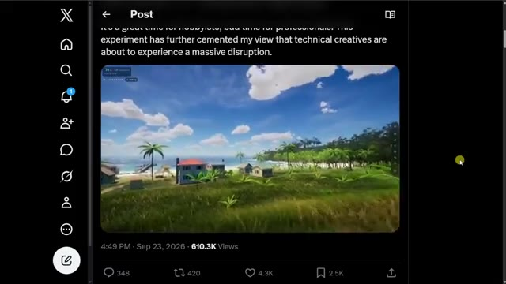
*⏱️ 00:00:05 — Capture d'écran d'un post sur le réseau social X montrant une vidéo de paysage généré par IA et un texte sur l'impact de l'IA.*

---

### ⏱️ `[00:00:20 - 00:00:38]` | Segment #02

**🔊 Audio (Transcription Intégrale Mot pour Mot en Français) :**
> Donc, dans cette vidéo, j'ai donné exactement le même prompt à Opus 5.5 et je l'ai exécuté sur chaque niveau d'effort, et nous allons comparer les résultats. Nous examinerons la qualité de tous les différents résultats réels, mais nous examinerons également combien de temps chacun d'eux a pris pour s'exécuter, combien cela nous a coûté si c'était facturé par API, le nombre total de tokens, combien de vérifications ils ont exécutées et combien de questions ils m'ont réellement posées tout au long du processus.

**👁️ Analyse Visuelle d'Écran (gemini-3.5-flash-lite) :**
**Interface & Outils** : Interface web de tableau de bord / application de comparaison de modèles.

**Contenu textuel & Code** : Tableau avec les colonnes Low, Medium, High, Extra, Max, Ultracode et les lignes Run time, API cost, Total tokens, Checks, Questions asked.

**Action / Démonstration** : Présentation du tableau comparatif des différents niveaux d'effort pour l'analyse des résultats.

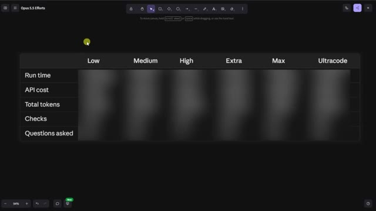
*⏱️ 00:00:29 — Tableau de comparaison des niveaux d'effort d'Opus 5.5 montrant des métriques (Run time, API cost, Total tokens, etc.).*

---

### ⏱️ `[00:00:39 - 00:00:58]` | Segment #03

**🔊 Audio (Transcription Intégrale Mot pour Mot en Français) :**
> Et les résultats que nous avons obtenus ne sont pas du tout ce à quoi je m'attends, donc j'ai hâte de partager cela avec vous les gars. Ne perdons pas de temps et allons directement à celui-ci. D'accord, alors plongeons directement dans celui-ci. Je veux commencer juste en vous montrant le prompt réel que nous avons utilisé, que nous avons donné à chacun de ces différents agents. Je vais aller dans les fichiers ici, et nous allons ouvrir ce fichier markdown de prompt, et je vais vous montrer ce que nous avons obtenu. Voici donc le slash objectif que j'ai fourni.

**👁️ Analyse Visuelle d'Écran (gemini-3.5-flash-lite) :**
**Interface & Outils** : Interface logicielle de développement/assistant IA avec panneau latéral de navigation et zone de discussion.

**Contenu textuel & Code** : Texte du prompt affiché à l'écran : "Hi Nate. This worktree has the effort-test task queued in PROMPT.md : build a walkable third-person 3D world of the AIS Live conference..."

**Action / Démonstration** : Affichage et lecture du prompt initial dans l'interface de l'outil de développement.

*⏱️ 00:00:48 — Interface d'un outil de développement avec le présentateur en incrustation vidéo sur la gauche, affichant un prompt textuel lié à la création d'un monde 3D.*

---

### ⏱️ `[00:00:58 - 00:01:34]` | Segment #04

**🔊 Audio (Transcription Intégrale Mot pour Mot en Français) :**
> J'ai dit : tu dois me créer un monde 3D qui est une conférence technologique réaliste dans laquelle je peux me déplacer en vue à la troisième personne. Tu vas regarder ce dossier, qui contient mes ressources d'enregistrement d'événements provenant d'AIS Live. Et ce dossier est un dossier Frame.io de 105 gigaoctets d'enregistrements vidéo. C'était un événement entièrement virtuel. Tout a été enregistré et tous les enregistrements sont juste ici. J'ai dit, ton objectif est de prendre cet événement et de le transformer en un monde 3D explorable qui me donne l'impression d'avoir réellement assisté à une vraie conférence en personne avec différentes salles, différentes pistes, différentes scènes, bla, bla, bla. N'hésite pas à utiliser key.ai si tu as besoin de générer des images ou des vidéos. Et tu peux aussi utiliser tout ce qui se trouve dans mon projet Herc 2, qui est comme mon système d'exploitation IA. J'ai dit,

**👁️ Analyse Visuelle d'Écran (gemini-3.5-flash-lite) :**
**Interface & Outils** : Éditeur de code (VS Code / Cursor) et interface web Frame.io

**Contenu textuel & Code** : Texte du prompt demandant de convertir des enregistrements d'événements virtuels en un monde 3D explorable en vue à la troisième personne, avec lien Frame.io.

**Action / Démonstration** : Présentation du prompt initial et navigation vers le dossier des ressources d'enregistrement.

*⏱️ 00:01:07 — Un éditeur de texte affichant le fichier PROMPTS.md avec les instructions pour créer un monde 3D interactif.*

*⏱️ 00:01:16 — Une interface cloud Frame.io montrant un dossier d'enregistrements d'événements de la conférence AIS Live.*

*⏱️ 00:01:25 — Vue de l'éditeur de code retournant sur le fichier de prompt détaillant les consignes du projet.*

---

### ⏱️ `[00:01:34 - 00:02:08]` | Segment #05

**🔊 Audio (Transcription Intégrale Mot pour Mot en Français) :**
> tu seras jugé sur la créativité, le design, la physique et la sensation générale lorsque j'explorerai le monde en 3D que tu as construit. Et c'était fondamentalement la fin des instructions. Donc comme tu peux le voir sur ce côté gauche, j'ai fait passer cela par tous les différents niveaux d'effort. Commençons par le niveau bas et progressons jusqu'à ultra code. Très bien. Donc ici nous avons le résultat du niveau bas. Ouvrons ceci et jetons un coup d'œil. Nous avons donc AIS Live, le sommet des services IA enfin en personne, et nous avons pu cliquer partout. Tout d'abord, cela ne fait pas très personnalisé. Genre, ce n'habille pas le logo d'IS Live. Ce n'est même pas nos couleurs. Donc je n'aime pas trop ça, mais entrons ici. D'accord. C'est bien trop lumineux. Hum, nous avons une carte en haut à droite. Nous avons une ville par ici. Je ne peux pas dire quelle ville c'est

**👁️ Analyse Visuelle d'Écran (gemini-3.5-flash-lite) :**
**Interface & Outils** : Interface web ou application de bureau avec panneau latéral de navigation et zone de chat (mention de Opus 5.5 et Ultracode).

**Contenu textuel & Code** : Texte du prompt demandant de construire un monde 3D en vue à la troisième personne avec des salles, pistes et scènes distinctes basées sur des enregistrements f.io, et un message de réponse de l'IA demandant si elle doit commencer.

**Action / Démonstration** : Le curseur de la souris survole le niveau d'effort « Low » dans la liste des sessions à gauche, illustrant les différents niveaux d'effort testés.

*⏱️ 00:01:42 — Interface d'une application de type assistant IA (style éditeur ou chat avancé) montrant les différents niveaux d'effort (« Hello », « Extra », « High », « Max », « Ultracode », « Medium », « Low ») dans le panneau latéral gauche et une conversation active dans la fenêtre principale.*

---

### ⏱️ `[00:02:08 - 00:02:40]` | Segment #06

**🔊 Audio (Transcription Intégrale Mot pour Mot en Français) :**
> c'est. D'accord. C'est Chicago, ce qui est plutôt cool parce que tu sais, j'habite à Chicago, mais bref, en haut, à droite, nous pouvons voir une carte. Nous avons un lobby. Nous avons un hall d'exposition. Nous avons le salon VIP, la scène principale. De plus, la carte montre où se trouve chaque autre personne et cela se synchronise en direct. Nous pouvons donc voir l'enregistrement. Nous pouvons voir le premier jour, la keynote de l'hyper agent, le débriefing en direct. Cool. Donc ça connaît réellement l'agenda et ensuite il y a le deuxième jour. Donc il a trouvé ça, c'est bien. Nous avons ces petites boules ici que je peux espérer botter. D'accord. Le visage, Oh, regarde ça. Si je vais par ici, toutes les personnes disparaissent tout simplement. Très mauvais. Très mauvais. D'accord. Alors voyons voir. Est-ce que je peux sprinter ? D'accord.

**👁️ Analyse Visuelle d'Écran (gemini-3.5-flash-lite) :**
**Interface & Outils** : Application virtuelle 3D (type metavers ou plateforme d'événement virtuel) avec mini-carte de navigation.

**Contenu textuel & Code** : Menus d'événements, programmes de conférences, indicateurs de position sur une mini-carte.

**Action / Démonstration** : Navigation et exploration des différentes zones d'un événement virtuel (Lobby, Expo Hall).

*⏱️ 00:02:16 — Vue d'un monde virtuel interactif montrant un espace d'événement avec des avatars et une mini-carte en haut à droite.*

*⏱️ 00:02:24 — Vue du lobby dans l'application virtuelle affichant le programme du premier jour et la carte de navigation.*

*⏱️ 00:02:32 — Vue de l'Expo Hall dans le monde virtuel avec des avatars et des zones d'interaction lumineuses.*

---

### ⏱️ `[00:02:40 - 00:03:04]` | Segment #07

**🔊 Audio (Transcription Intégrale Mot pour Mot en Français) :**
> Je peux aller un peu plus vite. Je vais d'abord aller par ici. Il y a des goodies, euh, certifiés AIS plus glido. D'accord. Donc il y a les stands réels qu'on avait dans l'événement virtuel. On avait des stands. Donc c'est plutôt cool. Un petit endroit pour prendre des photos. Salle C. En ce moment, nous avons Tangy Frederick qui anime un atelier. D'accord. Mais ce n'est pas une vidéo. Comme vous pouvez le voir, c'est juste une image. Elle ne bouge pas. Donc c'est juste une image. Ces gens sont en train de disparaître. Ce doivent être des fantômes. Allons par ici vers la salle A.

**👁️ Analyse Visuelle d'Écran (gemini-3.5-flash-lite) :**
**Interface & Outils** : Environnement virtuel 3D interactif (plateforme type metaverse/événement en ligne) avec mini-carte en haut à droite.

**Contenu textuel & Code** : Texte et instructions sur grand écran virtuel : 'Step 1: Go To Settings', 'Step 2: API Integrations', 'Step 3: Create A New Token'.

**Action / Démonstration** : Exploration et visite guidée de l'espace virtuel par le présentateur à travers les différents stands et salles d'ateliers.

*⏱️ 00:02:46 — Vue d'un espace virtuel 3D de type salon professionnel, montrant un avatar se déplaçant devant un stand sponsorisé 'GlaiDo' avec des boîtes étiquetées 'AIS' au sol.*

*⏱️ 00:02:52 — Navigation dans la salle d'atelier C (Workshop Room C) de l'événement virtuel, présentant un espace vert lumineux avec des tables rondes et des écrans d'information.*

*⏱️ 00:02:58 — Gros plan sur l'intérieur de la salle d'atelier affichant une grande présentation à l'écran détaillée sur les étapes de configuration d'une clé API et des services IA d'entreprise.*

---

### ⏱️ `[00:03:04 - 00:03:30]` | Segment #08

**🔊 Audio (Transcription Intégrale Mot pour Mot en Français) :**
> Nous avons Liberty White. D'accord. Très cool. Vos 30 premiers jours en automatisation. Encore une fois, c'est juste une image fixe et les gens ont des bugs d'affichage. Donc ce n'est pas très bien ici. Je vais aller sur la scène principale et voir ce que nous avons. D'accord, cool. Donc nous avons une scène d'apparence principale. Les gens ont des bugs d'affichage. Vraiment mauvais. Ce n'est vraiment pas terrible. Notre vidéo est en fait en train de bouger. Genre, j'ai vu mon visage ici et j'ai vu celui de Devin, mais maintenant ils ont disparu. Donc je ne sais pas ce qui s'est passé. D'accord. Ça ressemble plutôt à un diaporama. Rien n'est en fait encore diffusé. Bref, entrons ici.

**👁️ Analyse Visuelle d'Écran (gemini-3.5-flash-lite) :**
**Interface & Outils** : Environnement virtuel 3D interactif de type metaverse (plateforme événementielle).

**Contenu textuel & Code** : Éléments graphiques textuels de l'événement et affichage d'écrans virtuels de présentation.

**Action / Démonstration** : Navigation et déplacement d'un avatar dans l'espace virtuel pour explorer les différentes salles.

---

### ⏱️ `[00:03:30 - 00:03:58]` | Segment #09

**🔊 Audio (Transcription Intégrale Mot pour Mot en Français) :**
> Nous avons d'autres stands. Nous avons hyper agent. Nous avons Claude Code. Nous avons plus de gadgets publicitaires. La salle B, c'est Dave Ebelor. Je suppose que c'est exactement la même chose. Nous avons du café. Et ensuite, je suppose, le salon VIP, accès VIP uniquement. C'est plutôt sympa, mais il n'y a vraiment rien de spécial qui se passe ici. Cet écran est beaucoup trop lumineux. D'accord. Donc je pense que vous comprenez l'ambiance que nous obtenons ici avec Opus 5.5 en effort faible. Et c'est là que les choses deviennent intéressantes. Combien de temps pensez-vous que cela a duré ? Combien de temps ? Celui-ci a duré 16 minutes et 43 secondes. Combien pensez-vous que cela a coûté ?

**👁️ Analyse Visuelle d'Écran (gemini-3.5-flash-lite) :**
**Interface & Outils** : Interface web de tableau blanc / tableau de bord de métriques.

**Contenu textuel & Code** : Tableau comparatif évaluant les niveaux d'effort selon plusieurs critères : Run time, API cost, Total tokens, Checks, Questions asked.

**Action / Démonstration** : Présentation et analyse des différents niveaux d'effort et coûts associés aux modèles IA.

*⏱️ 00:03:51 — Tableau comparatif des niveaux d'effort (Low, Medium, High, Extra, Max, Ultracode) avec des métriques comme Run time, API cost, Total tokens.*

---

### ⏱️ `[00:03:58 - 00:04:26]` | Segment #10

**🔊 Audio (Transcription Intégrale Mot pour Mot en Français) :**
> 3,91 dollars si c'était une facturation par API. J'utilise évidemment mon abonnement ici, mais nous allons simplement calculer cela en facturation API. Le total des jetons était de 191 000. Il a fait 22 vérifications. Donc la vérification, 22 fois il a ouvert le navigateur et a exécuté différentes sortes de vérifications. Donc 22 catégories de vérifications. Et combien de questions m'a-t-il posées ? Il m'a posé un total de zéro question tout au long de cette invite de commande d'objectif. D'accord. Alors ouvrons l'effort moyen et voyons ce que nous avons. D'accord, c'est parti. Effort moyen. Nous avons Nate Herc. Nous avons mon badge. C'est marqué AI's life.

**👁️ Analyse Visuelle d'Écran (gemini-3.5-flash-lite) :**
**Interface & Outils** : Application de tableau blanc / diagramme (type Excalidraw) avec un tableau structuré.

**Contenu textuel & Code** : Tableau avec les lignes : Run time (16m 43s), API cost ($3.91), Total tokens (191.3K), Checks, Questions asked, et les colonnes Low, Medium, High, Ex.

**Action / Démonstration** : Le présentateur explique les métriques affichées dans le tableau (coût API et nombre de jetons).

*⏱️ 00:04:05 — Un tableau comparatif affichant les métriques d'exécution d'un agent IA, incluant le temps d'exécution (16m 43s), le coût API ($3.91), le nombre total de jetons (191.3K) et les vérifications, avec le présentateur visible dans une vignette à gauche.*

---

### ⏱️ `[00:04:26 - 00:04:46]` | Segment #11

**🔊 Audio (Transcription Intégrale Mot pour Mot en Français) :**
> Donc ça a déjà l'air un tout petit peu mieux. Ça ressemble à nos palettes de couleurs qui utilisaient nos directives de marque. Premier jour, construction, deuxième jour, gain, VIP. Cool. D'accord. Je vais entrer dans le lieu. D'accord. Waouh. Donc une ambiance un peu similaire. C'est en arrière-plan. Ça ne ressemble pas à Chicago pourtant, si ? Non, ça ressemble à, honnêtement, ça ressemble à une ville inventée. Quoi qu'il en soit, c'est marrant qu'ils aient décidé de faire ça. Voyons si je peux me déplacer un peu plus vite. Oh, waouh.

**👁️ Analyse Visuelle d'Écran (gemini-3.5-flash-lite) :**
**Interface & Outils** : Interface web d'application virtuelle / 3D interactive.

**Contenu textuel & Code** : Écran d'accueil avec badge de participant ('Nate Herk', 'Host - All Access') et instructions de déplacement, suivi d'un rendu 3D d'un espace de réunion virtuel.

**Action / Démonstration** : Navigation et entrée dans l'espace virtuel interactif de l'événement en ligne.

*⏱️ 00:04:31 — Interface web 'Welcome to AIS Live' montrant un badge nominatif avec les options de navigation et de sessions (Day 1, Build, Day 2, Earn, VIP).*

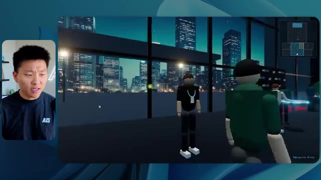
*⏱️ 00:04:41 — Vue à la première ou troisième personne dans un espace virtuel 3D de type métavers avec des avatars et un panorama urbain en arrière-plan.*

---

### ⏱️ `[00:04:46 - 00:05:21]` | Segment #12

**🔊 Audio (Transcription Intégrale Mot pour Mot en Français) :**
> Les gens interagissent avec moi. Regardez. Si je m'approche de ce type, il vient de lever le bras. Bon, maintenant il ne veut plus du tout avoir affaire à moi. Mais tous ces petits robots ici doivent prendre des décisions. Je ne sais pas s'ils utilisent Jev. C'est sûr que non. Je ne le lui ai pas dit. En fait, ma clé Jev est à l'arrière. Je ne sais pas. Peut-être qu'il l'a utilisée. Quoi qu'il en soit, nous pouvons voir ici que nous avons la salle d'atelier C, le laboratoire des agents. Sympa. Donc celui-ci est réellement en train de tourner. Vous pouvez voir qu'il s'agit d'une vraie vidéo diffusée par Tangy. Tout le monde ici est en train de travailler sur un ordinateur portable. Ils ne buguent pas. C'est plutôt cool. De plus, mon badge est sur ma poitrine, ce qui est plutôt cool. Je peux venir par ici. Nous avons une carte en haut à droite, comme vous pouvez le voir, mais je peux venir par ici. Nous avons un

**👁️ Analyse Visuelle d'Écran (gemini-3.5-flash-lite) :**
**Interface & Outils** : Application de métavers / espace virtuel 3D interactif.

**Contenu textuel & Code** : Environnement 3D avec des avatars virtuels, une carte miniature et des informations de session de workshop.

**Action / Démonstration** : Navigation et exploration d'un environnement virtuel 3D multi-utilisateurs.

---

### ⏱️ `[00:05:21 - 00:05:47]` | Segment #13

**🔊 Audio (Transcription Intégrale Mot pour Mot en Français) :**
> hall d'exposition. C'est là que nous avons le stand Glido. Et ça diffuse en ce moment. Oui, ça diffuse la vidéo de nous parlant de Glido. Ça diffuse la vidéo d'Ed et moi parlant de notre programme de certification. Nous avons le logo AIS Plus juste ici, qui est un peu mal placé. Ce sont les diapositives des conférenciers et les points clés. Alors wow, ce sont toutes les ressources que nous avons distribuées après l'événement. Elles sont toutes là aussi. Nous pouvons voir que nous avons un coup de projecteur sur la communauté. C'est donc Aiden qui parle de son contrat qu'il a décroché et c'est diffusé en direct. Ces gens regardent.

**👁️ Analyse Visuelle d'Écran (gemini-3.5-flash-lite) :**
**Interface & Outils** : Environnement virtuel 3D / plateforme de type metaverse ou salon virtuel interactif.

**Contenu textuel & Code** : Affiches textuelles, diapositives de présentation, bannières 'AIS+ Certified' et interface utilisateur de navigation virtuelle.
[DESC_IMAGE_3] Navigation et exploration d'un hall d'exposition virtuel par des avatars.

**Action / Démonstration** : Explications face caméra et démonstration conceptuelle.

---

### ⏱️ `[00:05:47 - 00:06:21]` | Segment #14

**🔊 Audio (Transcription Intégrale Mot pour Mot en Français) :**
> Ils sont plutôt engagés. On a un hyper agent. C'était, c'est ce que je voulais dire. Si vous avez vu ces gens lever les mains pour dire bonjour, c'était plutôt drôle. Regardez, regardez, le voilà qui recommence. Bref. Bon. Où est-ce que je suis maintenant ? Maintenant, je suis dans le hall principal. On a un bar à café. On a un grand logo, qui est le vrai logo. C'est trop lumineux, mais on a le logo. On peut voir si on peut entrer ici dans le parcours des fondations. On a Sabrina Romanov et Liberty White. Donc différentes formations juste là. On peut entrer dans cette pièce. C'est le parcours avancé. Alors qu'est-ce qui se passe ici ? On a Dave Ebelar et Saman qui parlent de différentes choses là-dedans. Et maintenant, allons jeter un œil à la scène principale. Oh, attendez, il y a une vidéo de moi là-haut. C'est genre un VIP

**👁️ Analyse Visuelle d'Écran (gemini-3.5-flash-lite) :**
**Interface & Outils** : Environnement virtuel 3D interactif (plateforme de conférence en ligne).

**Contenu textuel & Code** : Interface utilisateur virtuelle avec mini-carte et indications textuelles ("Main Lobby").

**Action / Démonstration** : Exploration et déplacement de l'avatar dans le hall virtuel de la plateforme.

*⏱️ 00:05:55 — Vue principale dans le hall virtuel avec le présentateur en incrustation à gauche.*

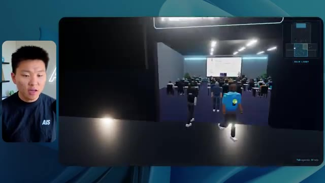
*⏱️ 00:06:04 — Navigation vers la salle de conférence virtuelle depuis le hall principal.*

*⏱️ 00:06:12 — Vue en mouvement montrant plusieurs avatars de participants réunis dans l'espace virtuel.*

---

### ⏱️ `[00:06:21 - 00:06:50]` | Segment #15

**🔊 Audio (Transcription Intégrale Mot pour Mot en Français) :**
> section ? Ouais, on ira voir ça dans une minute. Mais bref, voici la scène principale. Ça a l'air vraiment, vraiment bien. On a une grande scène. On a genre quatre personnes assises ici. On a les trois écrans d'Alex là-haut avec Hyper Agent. Est-ce que j'ai le droit de monter sur scène ? Oh, et il me laisse monter sur scène. D'accord. C'est plutôt sympa. Bon les gars, prenons un selfie. Laissez-moi mettre tout le monde en arrière-plan. Venez par ici. Bref, c'est vraiment, vraiment cool. Par contre, toutes les places ne sont pas occupées. Donc il faut qu'on travaille là-dessus. Mais bref, je vais y retourner en courant pour voir ce qu'était cette section VIP. D'accord. Salon VIP. J'ai l'impression que c'est comme un aéroport ou un truc du genre.

**👁️ Analyse Visuelle d'Écran (gemini-3.5-flash-lite) :**
**Interface & Outils** : Environnement virtuel 3D de conférence / plateforme de type métavers ou événement virtuel.

**Contenu textuel & Code** : Interface utilisateur avec encadré d'information 'Hyperagent Keynote' par Alex McDonnell et mini-carte de navigation en haut à droite.

**Action / Démonstration** : Navigation et exploration de l'espace virtuel de conférence avec un avatar numérique.

---

### ⏱️ `[00:06:51 - 00:07:14]` | Segment #16

**🔊 Audio (Transcription Intégrale Mot pour Mot en Français) :**
> D'accord, super. Donc maintenant nous avons les sessions VIP ici. Une foire aux questions VIP avec la lecture vidéo en direct de Nate juste ici. Très, très cool. Et nous avons comme un bar ou quelque chose. Génial. Je dirais que c'est un assez bon résultat. Maintenant, en ce qui concerne les statistiques ici, celle-ci a pris une heure et 13 minutes à s'exécuter. Cela nous aurait coûté 12 dollars et 44 cents. Elle a utilisé 490 000 jetons et elle a fait 23 vérifications.

**👁️ Analyse Visuelle d'Écran (gemini-3.5-flash-lite) :**
**Interface & Outils** : Interface web de salon virtuel 3D et tableau de bord de statistiques Opus 5.5 Efforts.

**Contenu textuel & Code** : Statistiques de performance affichées : Run time (16m 43s), API cost ($3.91), Total tokens (191.3K), Checks (22), Questions asked (0).

**Action / Démonstration** : Présentation des sessions VIP virtuelles puis transition vers l'analyse des statistiques d'exécution du projet.

*⏱️ 00:06:56 — Capture montrant l'espace virtuel VIP avec des avatars et un grand écran diffusant une vidéo de Nate Herk.*

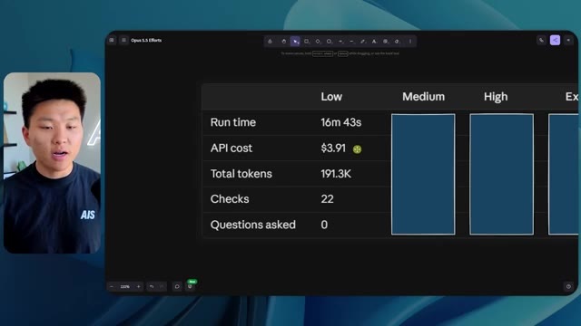
*⏱️ 00:07:02 — Capture montrant un tableau de statistiques comparatives (Run time, API cost, Total tokens, etc.) avec la colonne 'Low' remplie.*

---

### ⏱️ `[00:07:14 - 00:07:48]` | Segment #17

**🔊 Audio (Transcription Intégrale Mot pour Mot en Français) :**
> Et il ne nous a posé absolument aucune question une fois de plus. Très bien, passons au niveau élevé. C'était déjà un résultat plutôt correct, et Anthropic eux-mêmes dans leur vidéo sur comment prompter Opus 5.5, ou désolé, pas une vidéo, un article. Ils ont dit de simplement commencer au niveau moyen et de l'ajuster à la hausse ou à la baisse si nécessaire. C'était donc un résultat moyen. Passons au niveau élevé et voyons ce que nous avons obtenu. Très rapidement, les gars, je dois prendre une seconde pour vous parler du sponsor de la vidéo d'aujourd'hui, Hostinger. Donc ces deux modèles viennent de me construire une version fonctionnelle de la même chose. Et maintenant je suis exactement là où je finis toujours, avec un projet terminé sur mon ordinateur portable et aucun moyen rapide de le mettre en ligne. Et c'est le fossé que comble le connecteur d'Hostinger. C'est une extension gratuite.

**👁️ Analyse Visuelle d'Écran (gemini-3.5-flash-lite) :**
**Interface & Outils** : Tableau comparatif sur canevas numérique et éditeur de code/interface de développement avec l'assistant Codex.

**Contenu textuel & Code** : Tableaux de métriques (Run time, API cost, Total tokens, Checks, Questions asked) et prompt pour un calculateur ROI en HTML autonome.

**Action / Démonstration** : Présentation des résultats comparatifs des différents niveaux d'effort et démonstration en cours d'un agent de génération de code.

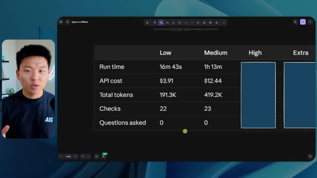
*⏱️ 00:07:22 — Un tableau comparatif des performances et des coûts selon les niveaux d'effort (Low, Medium, High, Extra) pour Opus 5.5, avec le présentateur incrusté à gauche.*

*⏱️ 00:07:39 — Une interface de développement avec deux fenêtres affichant l'exécution d'un agent IA pour construire un calculateur de ROI Northwind, avec le présentateur en bas à droite.*

---

### ⏱️ `[00:07:48 - 00:08:23]` | Segment #18

**🔊 Audio (Transcription Intégrale Mot pour Mot en Français) :**
> pour votre éditeur qui intègre votre compte Hostinger dans l'environnement où vous codez déjà. Que ce soit VS Code, Cursor, Cloud Code, Codex, peu importe. Vous vous connectez une seule fois en un clic, et à partir de là, votre agent peut déployer le site, y pointer un domaine, configurer les enregistrements DNS et vérifier votre VPS sans que vous n'ayez jamais à quitter l'éditeur. Ainsi, peu importe celui de ces outils que vous finirez par préférer, ce qu'il a construit se trouve à quelques minutes d'une vraie URL sur un hébergement géré. Connector est gratuit avec chaque formule d'hébergement, donc si vous avez toujours besoin de l'hébergement sous-jacent, profitez de la formule illimitée grâce au lien dans la description et utilisez le code NATEHERK pour obtenir 10 % de réduction. Cela inclut également un nom de domaine gratuit et un e-mail professionnel pour l'année. Et c'est toujours le moyen le moins cher que j'ai trouvé pour obtenir quelque chose

**👁️ Analyse Visuelle d'Écran (gemini-3.5-flash-lite) :**
**Interface & Outils** : Interface de gestion Hostinger pour IDE et terminal Claude Code.

**Contenu textuel & Code** : Statut "Connected" via OAuth, Node.js 24.13.0, liste des outils disponibles (Websites, Domains, Subscriptions & Payments, Email Marketing) avec options d'accès activées.

**Action / Démonstration** : Affichage de la configuration et des autorisations accordées à l'assistant pour gérer Hostinger directement depuis l'environnement de développement.

*⏱️ 00:07:57 — Interface montrant l'intégration de Hostinger dans un IDE avec le statut de connexion et les outils disponibles, ainsi qu'une vue de Claude Code sur le panneau droit.*

---

### ⏱️ `[00:08:23 - 00:08:47]` | Segment #19

**🔊 Audio (Transcription Intégrale Mot pour Mot en Français) :**
> tu as construit sur une vraie URL. Donc revenons à la vidéo. D'accord. Encore une fois, très, très marqué par la marque. C'est un écran de chargement encore meilleur que le précédent. Nous avons ce petit effet sympa en arrière-plan. Nous avons le logo. Nous allons entrer dans le lieu. D'accord. Nous y voilà. Ça a l'air plutôt bien. Nous commençons à l'extérieur et vous pouvez voir que nous avons ces drapeaux pour tous les intervenants, Wyatt, Casper, Alex, Ed, Aiden, Sabrina, Liberty. C'est plutôt cool. Nous avons des blocs en direct ici.

**👁️ Analyse Visuelle d'Écran (gemini-3.5-flash-lite) :**
**Interface & Outils** : Navigateur web / Application web 3D interactive (environnement virtuel type métavers / plateforme d'événement virtuel)

**Contenu textuel & Code** : Interface utilisateur de la plateforme 'AIS LIVE', menus d'aide aux contrôles (WASD, Mouse, Space, Tab), bannières de noms de speakers (Alex McDonnell, Wyatt Lyonsmith), et indicateur de position.
[DESC_IMAGE_3]

**Action / Démonstration** : Navigation et exploration de l'espace virtuel 3D après avoir cliqué sur 'Enter the Venue', déplacement dans la place principale de l'événement.

*⏱️ 00:08:29 — Écran de chargement et d'accueil de la plateforme 'AIS LIVE' avec le titre 'Real Projects, Real Revenue - July 11-12, 2026', un résumé textuel, les commandes clavier/souris et un bouton 'ENTER THE VENUE'.*

*⏱️ 00:08:35 — Vue dans le monde virtuel 3D de type jeu vidéo montrant un avatar sur une place publique pavée ('AIS Live Plaza') avec des gratte-ciels en arrière-plan, des arbres, et une indication de bienvenue textuelle en haut.*

*⏱️ 00:08:41 — Vue de la place virtuelle 3D montrant l'avatar du présentateur au milieu de bannières verticales affichant des noms de conférenciers, ainsi qu'une petite sphère robotique au premier plan.*

---

### ⏱️ `[00:08:47 - 00:09:23]` | Segment #20

**🔊 Audio (Transcription Intégrale Mot pour Mot en Français) :**
> il a pris cette photo de moi, votre hôte, Nate Herc, John, Dave, Nate Herc. Voilà. D'accord. Les portes. C'est génial. Ce sont des portes coulissantes automatiques en verre. J'adore ça. On peut voir l'enregistrement VIP. On peut voir l'admission générale. On peut venir par ici et on peut découvrir l'expo avec différents stands, le coin de la communauté. Vous pouvez aussi voir qu'en haut à gauche, j'ai un passeport. Donc c'est comme si, ça va montrer combien d'endroits j'ai visités. Tout cela est une vraie lecture. Nous avons un mur de ressources avec tous les différents conférenciers. Ils ont aussi une session de réseautage par ici. Donc je vais venir très vite et voir de quoi il s'agit. Donc nous avons le bar à cold brew AIS. Nous avons différents membres de la communauté qui ont été mis en avant ou mis en lumière.

**👁️ Analyse Visuelle d'Écran (gemini-3.5-flash-lite) :**
**Interface & Outils** : Application de monde virtuel 3D / plateforme d'événement virtuel.

**Contenu textuel & Code** : Interface utilisateur virtuelle affichant des zones de conférence, des bannières 'Registration' et 'Expo Hall'.

**Action / Démonstration** : Exploration interactive d'un espace événementiel virtuel en 3D avec un avatar.

*⏱️ 00:08:56 — Vue d'un monde virtuel 3D montrant l'entrée d'une conférence avec la mention 'LIVE - REGISTRATION' et des comptoirs VIP.*

*⏱️ 00:09:05 — Navigation dans un hall d'exposition virtuel 3D avec des stands et des avatars interactifs.*

*⏱️ 00:09:14 — Vue à la troisième personne dans un hall virtuel fréquenté par des avatars de participants.*

---

### ⏱️ `[00:09:23 - 00:09:56]` | Segment #21

**🔊 Audio (Transcription Intégrale Mot pour Mot en Français) :**
> Nous avons l'aile VIP. Attends, quoi ? Prends un bracelet. Oh, je dois vraiment aller chercher le bracelet. D'accord. Laisse-moi m'enregistrer rapidement. Le bracelet est déjà mis. Attends, quoi ? D'accord. Oh, d'accord. Maintenant, les portes se sont ouvertes pour moi. Cool. Je peux entrer ici. Oh, ça mène juste à la scène principale. Salon VIP. Il y a une séance de questions-réponses en cours. Ça a l'air très cool. Je veux dire, je suis très impressionné par la façon dont il est capable de faire ça. Waouh. D'accord. Donc c'est vraiment bien. Ce qu'on a fait, c'est qu'on a eu des salles de réunion VIP avec différentes personnes. Tu peux voir qu'il y a différentes salles, différents membres de l'équipe AIS qui participent à des trucs. C'est vraiment cool. C'est très cool. C'est un bien meilleur VIP

**👁️ Analyse Visuelle d'Écran (gemini-3.5-flash-lite) :**
**Interface & Outils** : Application ou plateforme virtuelle 3D interactive (metaverse / événement virtuel)

**Contenu textuel & Code** : Éléments d'interface utilisateur virtuels, textes de guidage ("Wristband is already on. The VIP wing is through the east corridor"), et affichages de salles.

**Action / Démonstration** : Navigation et exploration de l'espace virtuel par l'avatar du présentateur.

*⏱️ 00:09:32 — Vue d'un espace virtuel 3D avec un avatar se déplaçant dans la zone d'enregistrement et affichant des informations textuelles.*

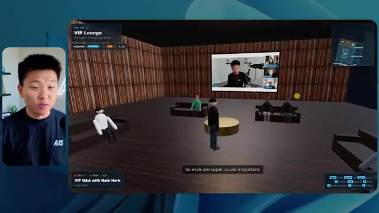
*⏱️ 00:09:40 — L'avatar dans le salon VIP virtuel, assistant à une session de questions-réponses avec une diffusion vidéo sur un grand écran.*

*⏱️ 00:09:48 — L'avatar explorant la section des sessions de travail VIP avec différentes tables thématiques ("Price It Right", "Turn Your Expertise into a Service", etc.).*

---

### ⏱️ `[00:09:56 - 00:10:30]` | Segment #22

**🔊 Audio (Transcription Intégrale Mot pour Mot en Français) :**
> expérience que ce qui a été montré dans la première partie. D'accord. After party VIP. Regardez ça. On a une piste de danse. On a tous ces éléments ici. On a la lecture de l'after party VIP juste ici. Et il y a une estrade de DJ. C'est trop marrant. Il y a un petit bug ici, un petit glitch ici, mais c'est génial. Oh, cool. Donc quand je suis ici sur la scène principale, on a des sous-titres. Vous pouvez voir juste ici en bas de mon écran, on a ces sous-titres de Wyatt qui est en train de parler ici. On a des lumières. On a le panel. Très cool. Belle scène principale. Je vais aller par ici. On peut aller à la fondation,

**👁️ Analyse Visuelle d'Écran (gemini-3.5-flash-lite) :**
**Interface & Outils** : Application web virtuelle en 3D (type Gather Town ou salon virtuel)

**Contenu textuel & Code** : Environnements virtuels interactifs avec avatars, écrans vidéo et éléments de conférence en ligne

**Action / Démonstration** : Navigation et présentation des différentes salles de l'événement virtuel (after party et scène principale)

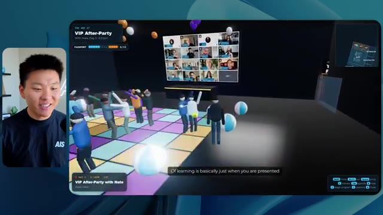
*⏱️ 00:10:04 — Vue d'un espace virtuel interactif représentant un after party VIP avec piste de danse et avatars numériques.*

*⏱️ 00:10:13 — Élargissement de la vue de l'after party VIP avec les avatars, l'écran vidéo et la signalétique.*

*⏱️ 00:10:21 — Vue d'une autre zone virtuelle principale (Main Stage) avec un auditoire assis et un grand écran de présentation.*

---

### ⏱️ `[00:10:30 - 00:11:06]` | Segment #23

**🔊 Audio (Transcription Intégrale Mot pour Mot en Français) :**
> avancé, et les parcours d'entreprise par ici. Alors voyons voir. Nous avons l'anatomie de trois vraies transactions. Nous avons hyper agent. Nous avons les évals avec Nate et Ed ici. Nous avons Dave qui intervient dans les trucs avancés. C'est vraiment bien. Je veux dire, évidemment, chacun, chacun de ces résultats jusqu'à présent, faible était correct. Moyen était meilleur. Élevé a été encore meilleur. Voyons si cette tendance se poursuit et allons voir ce que cela nous a coûté. Donc, élevé a tourné pendant une heure et sept minutes. Donc un peu plus rapide que moyen, cela nous aurait coûté 16 dollars et 31 cents. Il a utilisé un demi-million de tokens, 509 000. Il a fait 22 vérifications. Et il nous a aussi demandé, enfin, non, je me suis trompé. Ce

**👁️ Analyse Visuelle d'Écran (gemini-3.5-flash-lite) :**
**Interface & Outils** : Application de tableau blanc / outil de visualisation et outil de comparaison (Opus 5.5 Efforts).

**Contenu textuel & Code** : Tableau comparatif des performances et coûts : Run time (16m 43s à 1h 13m), API cost ($3.91 à $16.31), Total tokens (191.3K à 419.2K), Checks et Questions asked.

**Action / Démonstration** : Analyse et présentation des métriques de coût et de performance d'un modèle d'IA selon différents niveaux d'effort.

*⏱️ 00:10:57 — Un tableau comparatif montrant les coûts et performances d'Opus 5.5 selon différents niveaux d'effort (Low, Medium, High, Extra) avec les temps d'exécution, coûts API et nombre de tokens.*

---

### ⏱️ `[00:11:06 - 00:11:25]` | Segment #24

**🔊 Audio (Transcription Intégrale Mot pour Mot en Français) :**
> l'un m'a posé une question et, divulgâcheur, c'était le seul qui nous a posé une question tout au long de tout cela. Voyons voir, il nous en reste trois : extra, max et ultra code. Laissez-moi ouvrir extra et nous verrons ce que nous avons. D'accord. Donc celui-ci a l'air plutôt bien. Je dirais honnêtement que jusqu'à présent, l'écran de chargement haut était le meilleur. Celui que nous venons de voir, mais de toute façon, entrons dans le direct d'AIS.

**👁️ Analyse Visuelle d'Écran (gemini-3.5-flash-lite) :**
**Interface & Outils** : Interface web de tableau de bord ou canevas de données (type outil de mindmapping/notes visuelles).

**Contenu textuel & Code** : Tableau comparatif de performances d'IA avec colonnes Low, Medium, High et Extra, et lignes Run time, API cost, Total tokens, Checks, et Questions asked.

**Action / Démonstration** : Le présentateur commente le tableau et s'apprête à ouvrir la section « Extra ».

*⏱️ 00:11:11 — Capture d'écran montrant le présentateur à gauche et un tableau comparatif détaillé sur interface web à droite, listant les métriques (Run time, API cost, Total tokens, Checks, Questions asked) pour différentes configurations (Low, Medium, High, Extra).*

---

### ⏱️ `[00:11:26 - 00:11:51]` | Segment #25

**🔊 Audio (Transcription Intégrale Mot pour Mot en Français) :**
> Whoa. D'accord. Donc on a comme de petits extraits sonores. Je peux discuter avec des gens. Le panneau sur la guerre des outils a réglé quelques débats pour moi. Sympa. Bonne perspective là-bas. On est dehors à nouveau. On a ces différentes bannières, bien qu'elles soient toutes les mêmes. Elles n'indiquent pas du genre les noms de différentes personnes. Donc grand logo de AIS live. L'aile des ateliers est par ici. Et passons par les portes coulissantes en verre et voyons ce qu'on a. Donc on a le café AIS. La carte est en bas à droite, et elle n'est pas très descriptive.

**👁️ Analyse Visuelle d'Écran (gemini-3.5-flash-lite) :**
**Interface & Outils** : Environnement virtuel 3D de type métavers / plateforme événementielle en ligne

**Contenu textuel & Code** : Interface utilisateur de monde virtuel 3D avec mini-carte en bas à droite et bannières textuelles

**Action / Démonstration** : Navigation et exploration de l'espace virtuel 3D avec un avatar personnage

*⏱️ 00:11:32 — Le présentateur apparaît dans un encadré à gauche, tandis que l'écran principal montre un monde virtuel 3D (convention plaza) avec des avatars et des bannières publicitaires.*

*⏱️ 00:11:38 — Le présentateur est visible à gauche, l'écran principal affichant la suite de la navigation de l'avatar dans l'espace virtuel nocturne.*

*⏱️ 00:11:45 — Le présentateur est à gauche, l'écran principal montrant l'avatar s'approchant de l'entrée d'un bâtiment dans l'environnement virtuel.*

---

### ⏱️ `[00:11:51 - 00:12:26]` | Segment #26

**🔊 Audio (Transcription Intégrale Mot pour Mot en Français) :**
> I like how the other maps have told us what, like where things were, but this one looks very professional. We can see here's the main stage. Let's hop in here real quick. They've all got these balls flying around, which I think is pretty funny. The AIS beach balls. We have me up there speaking. I think I was introing one of the days. Let's keep on moving here to the workshop room on this left side. Okay. So here we've got the Hyper Agent Theater. We've got this sponsored session in here by Hyper Agent, but it's showing us what's coming up in here as well. It's really funny that we can chat to people. Salmon built a voice sales rep live. The price it right room was packed. Did you grab the VIP companion guide? That's so funny. We have the advanced track in

**👁️ Analyse Visuelle d'Écran (gemini-3.5-flash-lite) :**
**Interface & Outils** : Application web 3D interactive (environnement virtuel type metaverse / événement en ligne).

**Contenu textuel & Code** : Environnement virtuel 3D, avatars, panneaux "Main Stage", "Workshops", "Enterprise AI Services", mini-carte en bas à droite.

**Action / Démonstration** : Navigation et exploration de l'espace virtuel 3D lors d'une démonstration d'événement en ligne.

*⏱️ 00:12:00 — Vue d'une scène virtuelle 3D (Main Stage) avec un avatar présentateur et des spectateurs assis, commentée par le présentateur à gauche.*

*⏱️ 00:12:09 — Navigation dans un hall d'exposition virtuel 3D (Grand Lobby) avec des avatars et des panneaux de signalétique.*

*⏱️ 00:12:17 — Exploration d'un couloir virtuel 3D avec des avatars interactifs et des bulles de discussion.*

---

### ⏱️ `[00:12:26 - 00:12:58]` | Segment #27

**🔊 Audio (Transcription Intégrale Mot pour Mot en Français) :**
> here. Once again, we've got live playback. Is that live playback? Oh, okay. It started once I got in, but I can take a seat. Oh my. I can watch this. I can stand up. I want to sit in the front. That's pretty cool. That's very nice. I like that. And you know what I noticed so far? The actual character that I'm playing kind of looks like me. I think it modeled it off of my thumbnail pictures or something. Anyways, we have Sabrina in here, room host here, grab any open seat. Okay, cool. And I really liked the sitting functionality. It's kind of funny. Like we could actually attend this workshop and participate. Anyways, it's showing us the speakers. It's showing us the

**👁️ Analyse Visuelle d'Écran (gemini-3.5-flash-lite) :**
**Interface & Outils** : Environnement virtuel 3D / plateforme de réunion virtuelle interactive.

**Contenu textuel & Code** : Interface utilisateur virtuelle affichant une salle de classe 3D, un écran de présentation géant et des avatars de participants.

**Action / Démonstration** : Navigation et exploration d'un espace de réunion virtuel 3D interactif.

---

### ⏱️ `[00:12:58 - 00:13:31]` | Segment #28

**🔊 Audio (Transcription Intégrale Mot pour Mot en Français) :**
> programme. Il y a un petit tapis rouge ici pour prendre des photos. On peut prendre la pose. Oh, waouh. C'est plutôt cool. Bibliothèque de ressources, devenir certifié AIS Plus, Glido, Hyper Agent, AIS Plus, trois vraies offres. Génial. Je veux dire, je dirais vraiment que jusqu'à présent, chacune est meilleure. Et on n'a même pas encore vu la section VIP, le salon VIP. Montons ici rapidement. J'espère que je pourrai entrer. Sympa. On a le réinitialisation des outils. Ce sont les différentes salles où l'on peut aller. Donc encore une fois, je pourrais prendre la feuille de calcul et essayer de comprendre comment tarifer mes trucs. C'est tellement cool. C'est vraiment mieux que le précédent où on a juste en quelque sorte

**👁️ Analyse Visuelle d'Écran (gemini-3.5-flash-lite) :**
**Interface & Outils** : Plateforme d'événement virtuel 3D/Metaverse (environnement de conférence).

**Contenu textuel & Code** : Texte affiché à l'écran incluant des titres de stands ("Hyperagent", "Glido") et des questions de réflexion sur le pricing ("What's your gut floor number?", "Price It Right worksheet").

**Action / Démonstration** : Navigation et exploration au sein d'un espace de conférence virtuel immersif.

---

### ⏱️ `[00:13:31 - 00:13:59]` | Segment #29

**🔊 Audio (Transcription Intégrale Mot pour Mot en Français) :**
> genre regardé des trucs. Génial. Je peux passer derrière le bar et venir ici. C'est très bien. Bon. Alors, en ce qui concerne les statistiques, celui-ci a tourné pendant une heure et demie. Il a coûté 25,92 dollars. Je ne sais pas pourquoi je dis point 25,92 cents. Il y a eu 733 000 jetons et 34 vérifications. Il a donc eu le plus grand nombre de vérifications de loin jusqu'à présent. Et il ne nous a posé aucune question. J'ai hâte de voir ce qu'on a là de max et ultra code. Bon. Voici les écrans de chargement de max, ennuyeux, mais c'est dans l'esprit de la marque et il y a notre logo.

**👁️ Analyse Visuelle d'Écran (gemini-3.5-flash-lite) :**
**Interface & Outils** : Logiciel de dessin/diagramme de type "Excalidraw" (intitulé "Opus 5.5 Efforts").

**Contenu textuel & Code** : Colonne "Extra" : 1h 31m, $25.92 (non visible mais mentionné à l'oral), 733k jetons, 34 vérifications. Le tableau présente des métriques de performance et de coût pour chaque catégorie.

**Action / Démonstration** : Le présentateur analyse visuellement les données de performance et de coûts associés aux différents niveaux de modèles IA, avec le curseur positionné sur la colonne "Extra".

*⏱️ 00:13:38 — Tableau comparatif des performances de différents modèles IA (Medium, High, Extra, Max, Ultracode) affichant la durée, le coût en dollars, le nombre de jetons et le nombre de vérifications.*

---

### ⏱️ `[00:14:00 - 00:14:35]` | Segment #30

**🔊 Audio (Transcription Intégrale Mot pour Mot en Français) :**
> So that was good. I like that. We will go ahead and enter AIS live. Ooh, nice little animation here that brings us in. Once again, the character looks like me. They've all looked like me. I mean, sort of, we have sitting in the background. This looks like Chicago. Like I mentioned earlier, a lot of these are playing sounds and I'm not including that because it would be very distracting for you guys to try to listen to what's going on as well as me speaking. So there is like some slight music in all these. I hate how this is walking. This walking is really, really bad. I mean, the walking, yeah, I don't like this at all. So that's not great. But besides that, let's go in and explore. Notice these shadows when I walk in, they like really switch. I'm not sure why that is,

**👁️ Analyse Visuelle d'Écran (gemini-3.5-flash-lite) :**
**Interface & Outils** : Environnement virtuel 3D (plateforme de métavers/conférence en ligne AIS Live).

**Contenu textuel & Code** : Interface utilisateur virtuelle affichant une mini-carte, des panneaux d'information sur les sessions en direct et des commandes de navigation.

**Action / Démonstration** : Navigation et déplacement d'un avatar 3D dans un monde virtuel interactif.

---

### ⏱️ `[00:14:35 - 00:15:11]` | Segment #31

**🔊 Audio (Transcription Intégrale Mot pour Mot en Français) :**
> Mais bref, on peut discuter avec des gens ici aussi. Le stand Hyperagent est juste là où l'on entre dans l'exposition. Tout va bien. D'accord, super. Je peux continuer à appuyer sur E pour faire changer ce qu'ils disent. Nous avons les conférenciers juste ici. Ça a l'air plutôt bien. Même si nous avions vraiment la photo de profil de tout le monde. Je ne sais donc pas trop pourquoi ce n'est pas inclus là. On voit des gens prendre des photos juste ici. J'adore ça. Et ça enregistre une petite photo. D'accord. La carte n'est pas non plus super, genre elle ne donne pas une super explication de ce qui se passe, mais j'aime ces stands. Ils sont cool. Je pense que ces stands sont les meilleurs que j'aie vus jusqu'à présent. Genre, ils ont juste l'air bien. Ils ont des représentants. Il y a de superbes diapositives derrière eux. Ouais. Ces stands sont cool. D'accord. Nous avons un petit théâtre mis en avant

**👁️ Analyse Visuelle d'Écran (gemini-3.5-flash-lite) :**
**Interface & Outils** : Application web 3D (environnement virtuel de type événement en ligne)

**Contenu textuel & Code** : Interface utilisateur virtuelle 3D avec mini-carte, commandes de navigation, listes de conférenciers et stands d'exposition.

**Action / Démonstration** : Navigation et déplacement d'un avatar dans l'espace virtuel de l'exposition.

*⏱️ 00:14:44 — Le présentateur navigue dans une application web virtuelle 3D représentant une réception d'événement avec des avatars et des écrans d'information.*

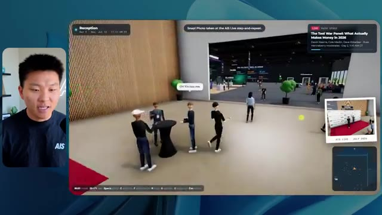
*⏱️ 00:14:53 — L'avatar s'approche de groupes de discussion dans le monde virtuel avec des bulles de texte interactives.*

*⏱️ 00:15:02 — L'avatar entre dans le hall d'exposition virtuel montrant différents stands (Evals Lab, Enterprise AI).*

---

### ⏱️ `[00:15:11 - 00:15:35]` | Segment #32

**🔊 Audio (Transcription Intégrale Mot pour Mot en Français) :**
> going on over here. It's Casper. Although why is this not playing? I feel like this should be playing, right? Like in the other ones, they were always playing. We can talk to some other people over here. Coffee's free. Blah, blah, blah. Amy Simpson, Matt Wolf. Nice. Okay. This is just the networking area that we're in right now, but we can see in the top right. We can also see what's live on the main stage right now. It is a tool war panel. So let's head in here. We've got Devin, Cole, Dave, and Russ chatting in here. We've got sort of AV, some light stuff going on back here.

**👁️ Analyse Visuelle d'Écran (gemini-3.5-flash-lite) :**
**Interface & Outils** : Environnement virtuel 3D de type métavers / plateforme événementielle en ligne

**Contenu textuel & Code** : Interface utilisateur avec mini-carte, contrôles de navigation (WASD, Shift) et affichage d'événements en direct (Featured Theater / Main Stage)

**Action / Démonstration** : Exploration et navigation dans une plateforme d'événement virtuel en 3D

*⏱️ 00:15:17 — Vue d'un espace d'exposition virtuel en 3D avec un avatar et des statistiques financières affichées sur un mur.*

*⏱️ 00:15:23 — Navigation d'un avatar dans un salon de réseautage virtuel interactif.*

*⏱️ 00:15:29 — Entrée dans la salle principale (Main Stage) d'un événement virtuel en 3D avec des écrans montrant des intervenants en direct.*

---

### ⏱️ `[00:15:36 - 00:15:55]` | Segment #33

**🔊 Audio (Transcription Intégrale Mot pour Mot en Français) :**
> Basculons la scène principale sur ce qui compte vraiment en ce moment. Je peux donc changer de sujet. Cool. Je viens donc de passer à moi et Matt. Nous pouvons passer à l'anatomie de trois vraies transactions. C'est plutôt cool. La scène a l'air bien. Nous avons un petit panneau sympa ici. Je peux monter sur la scène ? Sympa. Sympa. Bon, je ne peux pas aller trop loin, en fait. Très bien tout le monde, laissez-moi prendre le selfie. Tout le monde vient là-dedans. Je peux aussi m'asseoir dans ce public par ici et juste profiter de la session.

**👁️ Analyse Visuelle d'Écran (gemini-3.5-flash-lite) :**
**Interface & Outils** : Environnement virtuel 3D (metaverse / plateforme de conférence virtuelle)

**Contenu textuel & Code** : Interface utilisateur virtuelle affichant des indications textuelles (« AV desk - switch the Main Stage... »), des mini-cartes et des flux vidéo de conférence.

**Action / Démonstration** : Navigation et déplacement d'un avatar dans l'espace virtuel pour changer de scène.

---

### ⏱️ `[00:15:55 - 00:16:14]` | Segment #34

**🔊 Audio (Transcription Intégrale Mot pour Mot en Français) :**
> Très cool, très cool. OK, allons par ici. Je vois une section à l'étage. C'est marrant comme ils choisissent tous de mettre la section VIP à l'étage. Je veux dire, je ne déteste pas ça. Oh la la, ils ont un escalator. Pas possible. Je vais discuter avec ce type sur l'escalator. Glenn a 15 ans d'expérience en agence. Ses trucs de "land and expand" étaient en or. Du bon boulot, Glenn. Cool, donc je vais, je n'arrive même pas à passer devant ce type par contre.

**👁️ Analyse Visuelle d'Écran (gemini-3.5-flash-lite) :**
**Interface & Outils** : Application web ou plateforme virtuelle 3D interactive (espace de conférence virtuel)

**Contenu textuel & Code** : Interface utilisateur virtuelle affichant des indications de navigation, une mini-carte, des informations de session en direct et des bulles de discussion textuelles au-dessus des avatars.

**Action / Démonstration** : Navigation et exploration de l'espace virtuel 3D par l'utilisateur, déplacement vers l'étage VIP et interaction avec un autre avatar.

*⏱️ 00:16:00 — Vue d'un espace virtuel en 3D avec des avatars de participants et un grand hall d'accueil lumineux.*

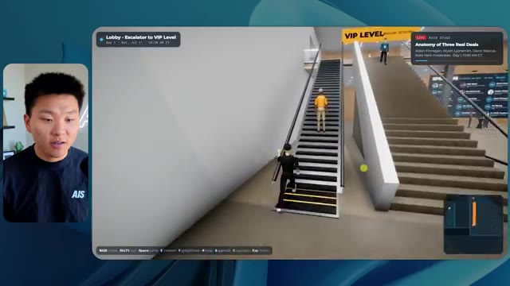
*⏱️ 00:16:04 — Gros plan sur un escalier mécanique menant au niveau VIP dans l'environnement virtuel 3D.*

*⏱️ 00:16:09 — L'avatar discute avec un autre participant sur l'escalator, avec une bulle de dialogue affichant du texte descriptif.*

---

### ⏱️ `[00:16:14 - 00:16:48]` | Segment #35

**🔊 Audio (Transcription Intégrale Mot pour Mot en Français) :**
> Oh, j'ai dû sauter par-dessus lui. D'accord, niveau VIP, badge requis. Oh la vache. Tu te moques de moi ? Je dois aller chercher mon badge. Bon, super. Maintenant ça montre que je suis un vrai VIP et je peux monter ici dans la section VIP. On a de super petites sessions de travail là-derrière, auxquelles on peut se greffer. Je me demande si ça va me laisser genre m'asseoir ici. Je peux juste discuter. Je peux participer ? Ça ne me laisse pas m'asseoir et participer. C'est pas grave. On a la salle de crise des prix. Oh, c'est peut-être l'after-party. Allons voir ce qui se passe par ici. Ou peut-être que je dois juste entrer par ici. D'accord. C'est bizarre. Je devais juste entrer par ici. Cet after-party n'est pas aussi cool que l'autre. Mais bref, allons voir ce qui se passe par là.

**👁️ Analyse Visuelle d'Écran (gemini-3.5-flash-lite) :**
**Interface & Outils** : Application web de salon ou monde virtuel en 3D (type événement virtuel en ligne)

**Contenu textuel & Code** : Interface utilisateur avec mini-carte, badges VIP, informations de l'événement et options de chat interactif.

**Action / Démonstration** : Navigation et exploration de l'espace virtuel par le présentateur avec son avatar.

*⏱️ 00:16:23 — Vue d'un monde virtuel interactif (style métavers) montrant un avatar s'approchant d'un escalier dans une réception.*

*⏱️ 00:16:31 — L'avatar se trouve dans une section VIP avec un écran affichant des sessions de travail et des participants autour d'une table.*

*⏱️ 00:16:39 — L'avatar explore une autre zone VIP de l'événement virtuel avec des panneaux d'affichage et d'autres utilisateurs.*

---

### ⏱️ `[00:16:48 - 00:17:07]` | Segment #36

**🔊 Audio (Transcription Intégrale Mot pour Mot en Français) :**
> dans les ateliers. D'accord. Ce n'était pas bien. Regardez ça. On peut tout voir et je viens de bugger et maintenant boum. Donc ce n'est pas bon. Je dirais qu'globalement, je veux dire, vous captez l'ambiance de comment ça fonctionne, mais je dirais que celui d'avant, qui était, je crois, élevé, celui-là, je l'aimais mieux. Je ne peux pas m'asseoir dans ces chaises non plus. Ouais. Donc je n'aime pas la marche dans celui-ci.

**👁️ Analyse Visuelle d'Écran (gemini-3.5-flash-lite) :**
**Interface & Outils** : Application web 3D de conférence virtuelle / monde virtuel interactif (type événement en ligne 3D)

**Contenu textuel & Code** : Environnement virtuel 3D avec affichage de bannières d'événements, profils des intervenants et interfaces de discussion.

**Action / Démonstration** : Navigation et exploration d'un espace de conférence virtuel 3D avec un avatar.

*⏱️ 00:16:53 — Vue d'un avatar virtuel naviguant dans un couloir moderne 3D d'une plateforme virtuelle de conférence.*

*⏱️ 00:16:57 — L'avatar s'approche de l'entrée d'une salle de conférence virtuelle (Room C).*

*⏱️ 00:17:02 — L'avatar entre dans la salle "Room C - HyperAgent Lab" où se déroule une présentation virtuelle avec des participants assis.*

---

### ⏱️ `[00:17:07 - 00:17:43]` | Segment #37

**🔊 Audio (Transcription Intégrale Mot pour Mot en Français) :**
> Je n'aime pas trop l'ambiance et il y a quelques bugs. Donc, jusqu'à présent, si on veut regarder notre liste, j'aime bien Extra Extra, c'est celui que j'ai le plus aimé jusqu'à présent. Mais bon, celui-ci était au maximum. Celui-ci était au maximum juste ici. Alors voyons combien de temps cela a duré : deux heures et 28 minutes. Donc ça a tourné pendant longtemps, 50 dollars et 38 cents, 1,18 million de jetons. Donc il a en fait atteint une compaction et a dû faire une auto-compaction. Et puis il a fait 51 vérifications. Est-ce qu'il l'a vraiment fait ? Parce qu'il y avait beaucoup de bugs là-dedans. Et de toute façon, celui-ci ne nous a posé zéro question. Donc, jusqu'à présent, à chaque fois, ça a presque été plus cher et ça a pris plus de temps, à part ici. Mais ceux-ci fondamentalement

**👁️ Analyse Visuelle d'Écran (gemini-3.5-flash-lite) :**
**Interface & Outils** : Application de tableau de bord ou interface web de présentation de données.

**Contenu textuel & Code** : Tableau avec les colonnes Medium (1h 13m, $12.44, 419.2K, 23, 0), High (1h 7m, $16.31, 509.3K, 22, 1), Extra (1h 31m, $25.92, 733.7K, 34, 0), Max et Ultracode.

**Action / Démonstration** : Le présentateur commente et analyse les résultats chiffrés affichés dans le tableau comparatif.

*⏱️ 00:17:16 — Un tableau comparatif montrant différentes métriques (temps, coût, jetons) pour des niveaux de performance nommés Medium, High, Extra, Max et Ultracode, avec le présentateur incrusté à gauche.*

---

### ⏱️ `[00:17:43 - 00:18:17]` | Segment #38

**🔊 Audio (Transcription Intégrale Mot pour Mot en Français) :**
> a pris à peu près le même temps, mais à chaque fois il a utilisé plus de tokens parce qu'ils ont plus réfléchi. Et puis, vous savez, ces tokens vont coûter plus cher. Mais bref, passons au dernier, qui est ultra code. Donc on espérerait vraiment que celui-ci soit le meilleur. Alors allons sur ce localhost et voyons ce qu'on a. Ok, super. Regardez ce badge. C'est un joli badge host all access. On a un petit visuel sympa juste ici. On va continuer et entrer AIS Live. Cool. Ok. Bienvenue, Nate. J'aime bien la marche. Ça a l'air réaliste. J'aime le logo, même s'il manque le petit point rouge qui donne l'impression que c'est en direct. La carte en haut à droite

**👁️ Analyse Visuelle d'Écran (gemini-3.5-flash-lite) :**
**Interface & Outils** : Tableau de données comparatives (probablement dans un outil de gestion de projet ou tableur) et interface de simulation/jeu 3D.

**Contenu textuel & Code** : Dans le tableau : colonnes de modèles (High à Ultracode), lignes de mesures (temps, dollars, nombre de tokens : 509.3K à 1.18M). Dans le jeu : hall d'accueil "AIS LIVE", texte "Registration & Lobby", avatars.

**Action / Démonstration** : Le présentateur compare les coûts et performances des modèles IA (Image 1) puis montre le résultat visuel final généré dans un environnement virtuel (Image 2).

*⏱️ 00:17:52 — Tableau comparatif des performances de différents modèles (High, Extra, Max, Ultracode) affichant le temps, le coût, le nombre de tokens et d'autres métriques.*

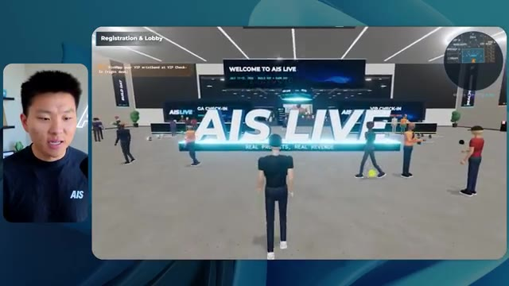
*⏱️ 00:18:09 — Capture d'écran d'un environnement virtuel 3D de type métavers ou simulateur événementiel intitulé "AIS LIVE" avec des avatars.*

---

### ⏱️ `[00:18:17 - 00:18:49]` | Segment #39

**🔊 Audio (Transcription Intégrale Mot pour Mot en Français) :**
> est un petit peu mieux étiqueté, donc je peux voir ce qui se passe. Je vais venir ici et récupérer mon bracelet VIP très rapidement. D'accord, super. Ça me dit aussi quoi faire. Donc en haut à gauche, il est écrit de scanner au portail VIP sur le mur est du hall. Je crois donc que l'est serait par ici, non ? Ne mange jamais de gaufres détrempées. Ouais. Ailes VIP, scanner le bracelet. D'accord, cool. Maintenant je suis dans la section VIP. Je peux voir ces différentes salles. La réinitialisation des outils. Une vidéo en direct est diffusée. Je suis capable de voir les sous-titres juste là de ce dont on est en train de parler. Ça diffuse aussi les sons, mais je ne diffuse tout simplement pas l'audio pour vous les gars parce que je ne veux pas submerger.

**👁️ Analyse Visuelle d'Écran (gemini-3.5-flash-lite) :**
**Interface & Outils** : Application ou plateforme virtuelle 3D (Metaverse / environnement virtuel interactif).

**Contenu textuel & Code** : Éléments textuels de guidage à l'écran ("Registration & Lobby", "VIP Wing", "VIP Room 5").

**Action / Démonstration** : Navigation et exploration dans l'espace virtuel par le présentateur.

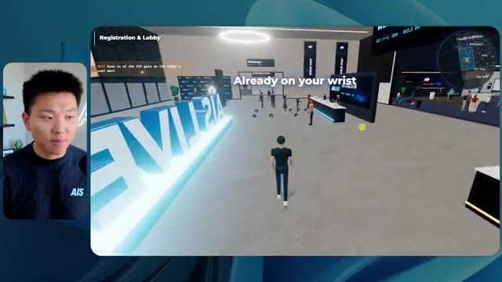
*⏱️ 00:18:25 — Image montrant l'avatar du présentateur dans un hall virtuel d'enregistrement avec le texte "Registration & Lobby".*

*⏱️ 00:18:33 — Image montrant l'avatar entrant dans l'espace "VIP Wing" du monde virtuel.*

*⏱️ 00:18:41 — Image montrant l'avatar dans la "VIP Room 5 - Tooling Reset / Solo to Real Business" autour d'une table avec d'autres avatars.*

---

### ⏱️ `[00:18:50 - 00:19:08]` | Segment #40

**🔊 Audio (Transcription Intégrale Mot pour Mot en Français) :**
> Encore une fois, celui-ci fonctionne avec Cody et Mustafa là-dedans. C'est génial. Vidéo en direct. La vidéo ne se lance pas tant qu'on n'entre pas, par contre. Donc, honnêtement, je pense que c'est un bon choix. Dès que j'entre, par contre, la vidéo démarre. Sympa. Belle attention. Toutes ces salles. Génial. Ouais. Je veux dire, ça fait très haut de gamme. Voici une salle de guerre des prix. Allons voir ça. Moi et John là-dedans.

**👁️ Analyse Visuelle d'Écran (gemini-3.5-flash-lite) :**
**Interface & Outils** : Application web ou plateforme virtuelle 3D interactive (type metaverse).

**Contenu textuel & Code** : Interface d'un espace virtuel interactif affichant "VIP Wing", des indications de salles ("Price It Right - First 10 Clients Plan") et un avatar en mouvement.

**Action / Démonstration** : Exploration de l'environnement virtuel 3D et déplacement d'un avatar vers une salle de réunion.

*⏱️ 00:18:54 — Un utilisateur navigue dans un environnement virtuel 3D (metaverse / espace virtuel) montrant une aile VIP avec des salles de réunion et des écrans vidéo.*

---

### ⏱️ `[00:19:08 - 00:19:42]` | Segment #41

**🔊 Audio (Transcription Intégrale Mot pour Mot en Français) :**
> Et ensuite, nous avons l'after-party sympa. Cet after-party n'est pas encore aussi animé. Et nous avons plus de ballons de plage pour une raison quelconque, mais cet after-party est cool. Je veux dire, ça nous donne une bonne ambiance et il y a la rediffusion juste ici de notre séance de questions-réponses de l'after-party, tout cela est en direct aussi. Génial. Bon. Allons sur la scène principale. Cela m'invite aussi à prendre un siège côté allée sur la scène principale, qui est tout droit à travers l'expo. Donc en fait, traversons d'abord l'expo. Qu'est-ce que vous construisez. Il y a beaucoup de gens qui parlent de différentes choses par ici. Waouh. Il y a aussi genre un petit truc de basket. Est-ce que je peux le lancer ? Je peux. Est-ce que je dois regarder en haut pour le lancer vers le haut ? D'accord.

**👁️ Analyse Visuelle d'Écran (gemini-3.5-flash-lite) :**
**Interface & Outils** : Environnement virtuel 3D en ligne (type metaverse / plateforme de conférence virtuelle)

**Contenu textuel & Code** : Interface de navigation 3D avec mini-carte et affichage textuel contextuel.

**Action / Démonstration** : Exploration d'un monde virtuel 3D lors d'une visite guidée.

---

### ⏱️ `[00:19:42 - 00:20:08]` | Segment #42

**🔊 Audio (Transcription Intégrale Mot pour Mot en Français) :**
> Eh bien, pas terrible. Mais bref, nous avons un stand AIS plus. Nous avons le stand Glido. Est-ce que ça diffuse en direct ? Ouais, ça diffuse définitivement en direct. Sympa. Nous avons le stand de l'hyper agent. Nous avons d'autres trucs par ici. OK, super. Je vais aller dans la salle principale et voir si on peut trouver une place côté allée. Dès qu'on entre, tout se met à jouer. On a une très bonne ambiance de scène. Comment faire pour trouver une place côté allée par contre. Voilà. Il a fallu que je trouve la bonne. Je prends la place côté allée. Il n'y a personne sur scène, ce qui est bizarre. J'aimais bien quand il y avait du monde sur scène dans les versions précédentes.

**👁️ Analyse Visuelle d'Écran (gemini-3.5-flash-lite) :**
**Interface & Outils** : Plateforme événementielle virtuelle interactive "AIS LIVE".

**Contenu textuel & Code** : Interface utilisateur de type jeu vidéo avec mini-carte (top-right), texte d'orientation (ex: "Grab a seat", "New space unlocked"), et sous-titres des dialogues.

**Action / Démonstration** : Navigation et déplacement de l'avatar dans l'espace virtuel pour rejoindre la zone de conférence principale.

*⏱️ 00:19:48 — Vue d'un environnement virtuel immersif représentant une salle d'exposition (Expo Hall) avec des avatars d'utilisateurs.*

*⏱️ 00:19:55 — Transition vers la "Main Stage" dans l'environnement virtuel, montrant une scène avec des écrans de diffusion en direct.*

*⏱️ 00:20:01 — Gros plan sur la salle principale (Main Stage) où l'avatar est assis parmi d'autres participants virtuels pour assister à une présentation.*

---

### ⏱️ `[00:20:08 - 00:20:31]` | Segment #43

**🔊 Audio (Transcription Intégrale Mot pour Mot en Français) :**
> Prenons un petit selfie. Bref, il y a moi et Pat là-haut. Pat est habillé comme un ouvrier du bâtiment. Comme vous pouvez le voir, nous faisions un petit appel de découverte simulé dans cet exemple. Je vais revenir par l'expo et nous allons aller ici vers l'aile des ateliers et simplement vérifier si ces salles sont fondamentalement exactement telles qu'elles devraient être. Maintenant, je ne peux pas vraiment discuter avec les gens. Avant, je le pouvais, dans les versions précédentes, discuter avec les gens, ce que je trouvais être une très belle touche. Et nous avons l'atelier d'une piste de base. Est-ce que je peux m'asseoir ?

**👁️ Analyse Visuelle d'Écran (gemini-3.5-flash-lite) :**
**Interface & Outils** : Plateforme de conférence virtuelle interactive / Metaverse type événementiel (AIS LIVE).

**Contenu textuel & Code** : Superposition d'éléments d'interface (HUD) incluant une mini-map en haut à droite, des objectifs de navigation ("Explore every space") et des noms d'utilisateurs.

**Action / Démonstration** : Déplacement et exploration au sein d'un espace de réunion virtuel simulant une conférence réelle.

*⏱️ 00:20:14 — Vue d'un environnement virtuel immersif type conférence en ligne ("Main Stage") avec avatars et interface de navigation.*

*⏱️ 00:20:20 — Navigation dans le hall d'exposition virtuel ("Expo Hall") avec indications de zones et avatars des participants.*

*⏱️ 00:20:25 — Entrée dans le couloir "Workshop Wing" de la plateforme virtuelle avec signalétique informative sur les murs.*

---

### ⏱️ `[00:20:32 - 00:21:04]` | Segment #44

**🔊 Audio (Transcription Intégrale Mot pour Mot en Français) :**
> Je ne peux pas m'asseoir. Je ne sais pas. Nous avons Liberty qui parle en ce moment et elle est en train de parler et nous pouvons l'entendre. Donc c'est bien, mais ça ne me laisse pas m'asseoir. Et regardez ça. Je deviens assez instable juste ici. Ça buguait de la façon dont je marchais. Ça ne voulait pas me laisser marcher pour ainsi dire. Ce n'est pas bon. Même chose. Nous avons cette piste avancée là-dedans. Super. Donc dans l'ensemble, ils ont une ambiance très similaire. Je dirai que je suis impressionné par la façon dont ils ont été capables de raconter une histoire à partir de ce que nous faisaient. Bibliothèque de points clés des intervenants. D'accord. C'est cool. Je ne pense pas que nous ayons vu cela à partir de différents endroits, mais ce sont comme les ressources et qui montrent des choses sympas. Oh, ouah. Je

**👁️ Analyse Visuelle d'Écran (gemini-3.5-flash-lite) :**
**Interface & Outils** : Environnement de métavers éducatif (type plateforme de conférence virtuelle).

**Contenu textuel & Code** : Textes informatifs sur les ateliers ("Foundation Track", "Advanced Track", "Speaker Takeaways Library") et sous-titres interactifs en temps réel.

**Action / Démonstration** : Navigation et déplacement de l'avatar dans les différentes sections du hall virtuel lors de la présentation.

*⏱️ 00:20:40 — Vue d'un environnement virtuel 3D avec un avatar se tenant devant une porte, sous-titré "Workshop A - Foundation Track".*

*⏱️ 00:20:48 — L'avatar se déplace dans une salle de conférence virtuelle intitulée "Workshop B - Advanced Track", avec des sièges et des écrans.*

*⏱️ 00:20:56 — Vue intérieure d'une salle nommée "Speaker Takeaways Library" avec des avatars et des panneaux d'information muraux.*

---

### ⏱️ `[00:21:04 - 00:21:41]` | Segment #45

**🔊 Audio (Transcription Intégrale Mot pour Mot en Français) :**
> peut réellement ouvrir toutes ces choses et nous pouvons prendre des photos ici même aussi. Sympathique. Prendre une photo. Je peux aussi l'enregistrer. Genre, je peux vraiment télécharger ceci. Et maintenant nous avons cette photo que nous venons de prendre à cet événement en direct de l'AIS. Très bien. Eh bien, je pense qu'il est temps pour moi de tirer quelques conclusions, mais d'abord voyons ce que cette exécution nous a coûté. Cela a pris une heure et 35 minutes. C'était donc beaucoup plus rapide que max. Cela n'a coûté que 18 dollars et 69 cents. Waouh. C'était donc un peu plus cher que high, moins cher que extra et beaucoup moins cher que max. Cela a également consommé 606 000 jetons et 42 vérifications avec zéro question. Maintenant, une autre chose intéressante à noter est que tout

**👁️ Analyse Visuelle d'Écran (gemini-3.5-flash-lite) :**
**Interface & Outils** : Visionneuse d'images Windows (Image 1) ; Interface de design/diagramme "Opus 5.5 Efforts" (Image 2).

**Contenu textuel & Code** : Photo de l'événement "AIS LIVE" (Image 1) ; Tableau de données comparatives incluant des durées, des montants en dollars et des valeurs numériques (Image 2).

**Action / Démonstration** : Affichage et visualisation d'une photo capturée automatiquement lors de l'événement virtuel (Image 1) ; Manipulation de données dans une interface de travail (Image 2).

*⏱️ 00:21:13 — Une visionneuse d'images Windows affichant une photo prise lors d'un événement virtuel "AIS LIVE", montrant deux avatars sur un tapis rouge devant un mur de sponsors.*

---

### ⏱️ `[00:21:41 - 00:22:13]` | Segment #46

**🔊 Audio (Transcription Intégrale Mot pour Mot en Français) :**
> ces exécutions, aucune d'entre elles n'a utilisé de sous-agent. J'ai vérifié et je me suis assuré qu'aucune d'elles n'avait utilisé de sous-agents. Elles ne voulaient déléguer aucun travail, ce qui était intéressant. Donc ces jetons sont ce qui a été reflété à l'intérieur de cette session. Évidemment, comme je l'ai dit, celle-ci a dépassé, vous savez, 950 000, donc, ou peu importe quelle est la fenêtre de compaction. Je ne la laisse généralement jamais monter aussi haut, mais comme c'était un objectif global et que je n'étais pas impliqué, celle-ci a dû se compacter, mais le reste d'entre elles a simplement tourné dans cette seule session. Et voici les statistiques globales. Et aussi, très rapidement, à propos des trucs d'UltraCode, les gars, je ne sais pas si vous l'avez remarqué, mais quand j'ai fait tourner UltraCode ces derniers temps, ça a juste fait bizarre. Ça a semblé un peu buggé. Moi, à quelques reprises, je l'ai fait tourner

**👁️ Analyse Visuelle d'Écran (gemini-3.5-flash-lite) :**
**Interface & Outils** : Application web ou tableau de bord avec une interface sombre présentant un tableau de données analytiques.

**Contenu textuel & Code** : Tableau avec les colonnes Low, Medium, High, Extra, Max, Ultracode et les lignes : Run time, API cost, Total tokens, Checks, Questions asked.

**Action / Démonstration** : Le présentateur commente les résultats chiffrés et l'utilisation des jetons affichés dans le tableau comparatif.

*⏱️ 00:21:49 — Tableau comparatif affichant les performances de différents niveaux d'effort (Low, Medium, High, Extra, Max, Ultracode) avec le temps d'exécution, le coût API, le nombre total de jetons, les vérifications et les questions posées.*

---

### ⏱️ `[00:22:13 - 00:22:34]` | Segment #47

**🔊 Audio (Transcription Intégrale Mot pour Mot en Français) :**
> et je me suis dit, est-ce que ça tourne vraiment sous UltraCode ? Ça a fait pas mal de vérifications de plus que ces autres-là, mais pour une raison quelconque, ça ne me semblait pas correct, parce qu'essentiellement, ce qu'est UltraCode, c'est un effort supplémentaire, et ensuite c'est juste comme utiliser des flux de travail plus dynamiques afin de faire les choses. Et donc, à force de fouiller dans les journaux de session et même quand je regardais ce truc se construire dans UltraCode, ça ne lançait aucun de ces flux de travail dynamiques et j'ai essayé plusieurs fois.

**👁️ Analyse Visuelle d'Écran (gemini-3.5-flash-lite) :**
**Interface & Outils** : Application web ou tableau de bord avec une interface sombre.

**Contenu textuel & Code** : Tableau de données comparatives avec les lignes : Run time, API cost, Total tokens, Checks, Questions asked, et les colonnes de Low à Ultracode.

**Action / Démonstration** : Le présentateur commente et analyse les résultats affichés dans le tableau comparatif des différents niveaux d'effort.

*⏱️ 00:22:18 — Un tableau comparatif montrant les métriques de performance de différents niveaux d'effort (Low, Medium, High, Extra, Max, Ultracode) comprenant le temps d'exécution, le coût de l'API, les tokens totaux, les vérifications et les questions posées.*

---

### ⏱️ `[00:22:35 - 00:23:00]` | Segment #48

**🔊 Audio (Transcription Intégrale Mot pour Mot en Français) :**
> Donc je ne sais pas si c'est un bug actuellement dans l'environnement de test de CloudCode ou si c'est juste avec Opus 5.5, c'est un tout petit peu pire avec UltraCode en ce moment ou quelque chose comme ça, mais dans les deux cas, ce sont les niveaux d'effort globaux réels et tout cela semble tout à fait logique quand on regarde comment ils progressent. Alors jetons un œil à ceci. Coût maximal par rapport au coût minimal, nous avions un facteur de 12,9 fois sur l'exécution la moins chère par rapport à l'exécution la plus chère, ce qui, je crois, allait de 3,98 $ à 50,38 $.

**👁️ Analyse Visuelle d'Écran (gemini-3.5-flash-lite) :**
**Interface & Outils** : Application de prise de notes ou tableau blanc virtuel (type Miro ou Obsidian).

**Contenu textuel & Code** : Tableau de données chiffrées incluant : Run time (temps d'exécution), API cost (coût), Total tokens, Checks (vérifications), et Questions asked (questions posées).

**Action / Démonstration** : Analyse visuelle des performances comparatives entre les modèles d'IA lors d'un test de charge.

*⏱️ 00:22:41 — Tableau comparatif des performances et coûts des différents niveaux d'effort (Low, Medium, High, Extra, Max, Ultracode) pour Opus 5.5.*

---

### ⏱️ `[00:23:01 - 00:23:19]` | Segment #49

**🔊 Audio (Transcription Intégrale Mot pour Mot en Français) :**
> Donc c'était bas et maximum. En ce qui concerne les vérifications maximales par rapport aux minimales, nous avons eu un multiplicateur de 2,3 fois. Le total pour les six était de 127 dollars et ultra code était de 18,69 dollars. Examinons la vitesse par rapport au coût ici. Laissez-moi donc dézoomer un peu pour que nous puissions voir tout cela. Sur l'axe des X, nous avons le temps d'exécution. Sur l'axe des Y, nous avons le coût.

**👁️ Analyse Visuelle d'Écran (gemini-3.5-flash-lite) :**
**Interface & Outils** : Application web propriétaire (Opus Effort Test).

**Contenu textuel & Code** : Données chiffrées : "12.9x Max cost vs Low", "2.3x Max checks vs Low", "$18.69 Ultracode cost, 42 checks", "$127.65 Total across all six". Texte descriptif sur le test des sessions avec différents paramètres d'effort.

**Action / Démonstration** : Le présentateur explique les résultats des tests de performance et de coût de l'agent en comparant les différents niveaux d'effort (Low vs Max).

*⏱️ 00:23:05 — Interface web "Opus Effort Test" affichant des statistiques comparatives sur les coûts et le nombre de vérifications pour différents réglages d'effort d'un agent IA.*

---

### ⏱️ `[00:23:19 - 00:23:42]` | Segment #50

**🔊 Audio (Transcription Intégrale Mot pour Mot en Français) :**
> So I feel like what the best would be is in the bottom left, but not really. So anyways, you can see that low was cheap and fast. Max was slow and expensive. But this sort of chart typically makes sense. As you increase in effort, it's gonna cost more and it's gonna run a little bit longer. That makes sense. Now let's see growth relative to low. So we have runtime in blue, API costs in orange, tokens in green, and checks in yellowish gold, mustard.

**👁️ Analyse Visuelle d'Écran (gemini-3.5-flash-lite) :**
**Interface & Outils** : Application web de test/analyse de performance (tableau de bord avec graphique en nuage de points).

**Contenu textuel & Code** : Graphique montrant les métriques de différentes sessions (Low, Medium, High, Extra, Ultracode, Max) avec des infobulles détaillant le temps d'exécution, le coût en dollars et le nombre de tokens.

**Action / Démonstration** : Le présentateur commente le graphique et survole le point "Low" pour afficher les détails de la session.

*⏱️ 00:23:25 — Un graphique comparant la vitesse et le coût ("Speed vs cost") intitulé "Opus Effort Test", montrant différents niveaux d'effort (Low, Medium, High, Extra, Ultracode, Max) en fonction du temps d'exécution et du coût de l'API.*

---

### ⏱️ `[00:23:42 - 00:24:01]` | Segment #51

**🔊 Audio (Transcription Intégrale Mot pour Mot en Français) :**
> Et d'ailleurs, la raison pour laquelle UltraCode apparaît comme ça, c'est parce qu'il utilise réellement un niveau d'effort supplémentaire. Il est simplement incité et il utilise plutôt des flux de travail dynamiques et des choses comme ça, ce qui fait que ça, vous savez, ça a du sens parce qu'il utilisait essentiellement un effort supplémentaire sous le capot. C'est aussi pour cela que Claude l'a étiqueté ici en orange. Quoi qu'il en soit, si nous continuons plus bas ici, cela a généralement du sens, n'est-ce pas ?

**👁️ Analyse Visuelle d'Écran (gemini-3.5-flash-lite) :**
**Interface & Outils** : Interface web d'analyse de données ou de tableau de bord de test de performance IA.

**Contenu textuel & Code** : Courbes de performance croisées sur un axe X allant de "Low" à "Ultracode" ; valeurs de croissance affichées pour "API cost" (12.9x), "Run time" (8.9x), "Tokens" (6.2x) et "Checks" (2.3x).

**Action / Démonstration** : Survol (tooltip) par la souris du point de donnée "Extra" sur la courbe jaune "Checks", affichant "Extra - Checks: 1.5x Low".

*⏱️ 00:23:47 — Un graphique comparatif intitulé "Opus Effort Test" illustrant la croissance relative de plusieurs métriques (temps d'exécution, coût API, tokens, vérifications) par rapport à un niveau d'effort "Low", avec une mise en évidence du point "Extra" pour les "Checks".*

---

### ⏱️ `[00:24:02 - 00:24:21]` | Segment #52

**🔊 Audio (Transcription Intégrale Mot pour Mot en Français) :**
> À mesure que le niveau d'effort augmente, encore une fois, ces métriques vont augmenter. Le temps d'exécution, les coûts d'API, les jetons et les vérifications. C'est la même chose ici avec le temps d'exécution. Cela nous donne simplement des graphiques linéaires individuels maintenant pour chacune de ces différentes métriques, comme le coût d'API, les vérifications, le total des jetons, le coût par vérification, et tous les chiffres au même endroit. Des données plutôt cool donc.

**👁️ Analyse Visuelle d'Écran (gemini-3.5-flash-lite) :**
**Interface & Outils** : Interface web de tableau de bord ou d'application de test.

**Contenu textuel & Code** : Graphique linéaire comparant l'évolution des métriques (Run time, API cost, Tokens, Checks) en fonction du niveau d'effort (Low, Medium, High, Extra, Max, Ultracode).

**Action / Démonstration** : Le présentateur commente l'augmentation des métriques avec le niveau d'effort.

*⏱️ 00:24:06 — Capture d'écran montrant un graphique de résultats d'un test d'effort ("Opus Effort Test") avec le présentateur visible à gauche.*

---

### ⏱️ `[00:24:21 - 00:24:40]` | Segment #53

**🔊 Audio (Transcription Intégrale Mot pour Mot en Français) :**
> Je dirais que rien ici n'est trop choquant. Ce qui m'a le plus choqué, ce sont ces résultats. Mes deux principaux candidats étaient "high", qui est celui-ci, et "extra", qui est celui-ci. Je dois donc retourner ici et me souvenir de ce que j'en pensais. J'ai vraiment aimé cette sensation. Celui-ci donne aussi simplement l'impression d'être le plus fluide. La physique était agréable. La porte coulissante en verre était agréable. Je n'ai pas vraiment remarqué beaucoup de bugs dans celui-ci, ce qui est ce que j'ai vraiment aimé.

**👁️ Analyse Visuelle d'Écran (gemini-3.5-flash-lite) :**
**Interface & Outils** : Interface web d'application 3D interactive (environnement virtuel type metaverse).

**Contenu textuel & Code** : Éléments textuels et graphiques de la plateforme 'AIS LIVE', indicateurs de déplacement et bannières.
[DESC_IMAGE_3] Navigation de l'avatar dans l'environnement virtuel.

**Action / Démonstration** : Exploration et navigation dans le monde virtuel 3D de la conférence.

*⏱️ 00:24:26 — Écran d'accueil de l'application 'AIS LIVE' avec un bouton pour entrer dans la salle virtuelle.*

*⏱️ 00:24:31 — Vue de la place virtuelle 'AIS Live Plaza' montrant un avatar de joueur et d'autres avatars en 3D.*

*⏱️ 00:24:35 — Navigation de l'avatar dans la place virtuelle 'AIS Live Plaza' en direction des bâtiments.*

---

### ⏱️ `[00:24:40 - 00:25:13]` | Segment #54

**🔊 Audio (Transcription Intégrale Mot pour Mot en Français) :**
> Je ne me rappelle pas si celui-ci était un de ceux où, oh, je ne pouvais pas parler aux gens par contre. Je pouvais juste passer à travers eux. Je ne pouvais pas m'asseoir dans celui-là non plus. Voici un autre petit truc visuel où je passe fondamentalement juste à travers ce mur. Donc je n'aime pas trop ça. Mais je pense, est-ce que c'était celui où je pouvais m'asseoir dans ces sessions ? Non. D'accord. Donc je ne pense pas que c'était mon gagnant alors. Celui-ci est extra haut. Je pense que c'est le gagnant. Ouais. Je pense que c'était celui que j'aimais le plus. J'adorais toute cette ambiance. J'adorais le fait que je pouvais discuter avec les gens. C'était définitivement celui où nous pouvions venir ici et nous pouvions nous asseoir où nous voulions, prendre une place, nous lever. Je pouvais lire ces trois offres et je pouvais discuter avec eux. J'ai aussi réalisé qu'il y avait de petites sections pour simuler des appels de découverte ici aussi.

**👁️ Analyse Visuelle d'Écran (gemini-3.5-flash-lite) :**
**Interface & Outils** : Application web 3D "AIS Live" (environnement virtuel interactif de conférence).

**Contenu textuel & Code** : Interface utilisateur virtuelle, avatars 3D, panneau de contrôle des mouvements, mini-carte et informations sur la session en cours ("Anatomy of Three Real Deals").

**Action / Démonstration** : Navigation et exploration d'un monde virtuel interactif en 3D lors d'une démonstration de plateforme en ligne.

*⏱️ 00:24:48 — Vue d'un espace virtuel 3D (AIS Live) montrant un avatar circulant près de la scène principale.*

*⏱️ 00:25:05 — Vue à la troisième personne dans un environnement 3D virtuel représentant un hall d'événement avec affichage de la scène principale.*

---

### ⏱️ `[00:25:13 - 00:25:51]` | Segment #55

**🔊 Audio (Transcription Intégrale Mot pour Mot en Français) :**
> Nous avons des goodies et des sacs en tissu, ce qui est de la vraie physique. J'aime bien ça. C'était celui où nous pouvions nous asseoir partout. Oui, j'ai vraiment, vraiment aimé celui-ci. Bien que je pense que le seul inconvénient de celui-ci était qu'il n'y avait pas vraiment d'after-party VIP parce que je pense que c'était le salon. Et je pense que c'était la seule partie de la section VIP, c'était que c'étaient les différentes pièces dans lesquelles on pouvait entrer et s'asseoir. Mais à part ça, il n'avait pas une super expérience VIP par rapport à certains des autres que nous avons vus. Donc mon gagnant ici va définitivement être Extra. Extra a fait un travail phénoménal. C'était environ la moitié de la durée et la moitié du coût de Max. Donc Max, je pense, était tout simplement beaucoup trop pour pas assez de bien. Je pense que le niveau était correct. Il pouvait,

**👁️ Analyse Visuelle d'Écran (gemini-3.5-flash-lite) :**
**Interface & Outils** : Interface web de tableau de bord / diagramme de données (« Opus 5.5 Efforts »)

**Contenu textuel & Code** : Tableau comparatif des coûts et performances d'exécution (Run time, API cost, Total tokens, Checks, Questions asked).

**Action / Démonstration** : Sélection d'une colonne de données dans le tableau comparatif à l'aide de la souris.

*⏱️ 00:25:42 — Un tableau de comparaison de performances pour différents modes d'effort (Low, Medium, High, Extra, Max, Ultracode) affichant le temps d'exécution, le coût API, le nombre de jetons, de vérifications et de questions.*

---

### ⏱️ `[00:25:51 - 00:26:25]` | Segment #56

**🔊 Audio (Transcription Intégrale Mot pour Mot en Français) :**
> avec peut-être un ou deux prompts de plus, arrivé là où je l'aimais vraiment. Mais pour un objectif de slash, Extra a fourni un résultat incroyable ici. Je n'ai pas adoré Medium. Et pour une grande partie de mon travail de réflexion et de ce que je fais, Medium fonctionne très bien. Mais pour cette tâche précisément, j'avais besoin de beaucoup de raisonnement. Il devait passer par des tonnes de trucs. Il devait passer par des tonnes de vidéos. Il devait trouver beaucoup de choses à l'intérieur de mes projets. Il devait créer une expérience et raconter une histoire à partir de tout. Je pense qu'Extra a fait un travail phénoménale. En général, cependant, j'ai aimé beaucoup de ces résultats, mais Extra est celui avec lequel je voudrais commencer dès maintenant. Si je voulais vraiment en faire une application et un monde super, super polis et cool, je commencerais par le résultat d'Extra et probablement

**👁️ Analyse Visuelle d'Écran (gemini-3.5-flash-lite) :**
**Interface & Outils** : Application web ou tableau de bord de performance (Opus 5.5 Efforts) avec une incrustation vidéo du présentateur en bas à gauche.

**Contenu textuel & Code** : Tableau de données comparatif avec les colonnes Low, Medium, High, Extra, Max et Ultracode, et les lignes Run time, API cost, Total tokens, Checks et Questions asked.

**Action / Démonstration** : Le présentateur commente et analyse les résultats chiffrés des différents niveaux de performance affichés à l'écran.

*⏱️ 00:26:00 — Un tableau comparatif montrant les performances de différents niveaux d'effort (Low, Medium, High, Extra, Max, Ultracode) avec des métriques comme le temps d'exécution, le coût API, les jetons totaux, les vérifications et les questions posées.*

---

### ⏱️ `[00:26:25 - 00:26:37]` | Segment #57

**🔊 Audio (Transcription Intégrale Mot pour Mot en Français) :**
> continuez à itérer avec Extra. Donc de toute façon, les gars, c'était l'expérience. J'espère que vous avez trouvé cela instructif. J'espère que vous avez appris quelque chose de nouveau. Et si c'est le cas, veuillez mettre un pouce bleu. Ça m'aide énormément. Et comme toujours, je vous remercie d'être arrivés jusqu'à la fin de la vidéo, et je vous dis à la prochaine. Merci à tous.

**👁️ Analyse Visuelle d'Écran (gemini-3.5-flash-lite) :**
**Interface & Outils** : Aucune interface logicielle ou technique affichée.

**Contenu textuel & Code** : Aucun code, terminal ou données visibles.

**Action / Démonstration** : Le présentateur s'adresse directement aux spectateurs pour conclure la vidéo.

---

