# 🎬 Claude Design Builds Beautiful 3D Websites Instantly (full tutorial)

> **Chaîne** : [Nate Herk | AI Automation](https://www.youtube.com/@nateherk/featured)  
> **Lien YouTube** : [https://www.youtube.com/watch?v=TcFeSjwTo7g](https://www.youtube.com/watch?v=TcFeSjwTo7g)  
> **Date de publication** : 20260421  
> **Durée** : 00:35:04  
> **Identifiant vidéo** : `TcFeSjwTo7g`  
> **Transcription & Analyse** : `whisper-v3-large-turbo+gemini-3.5-flash-lite`  

---

## 📌 Synthèse Exécutive & Outils

### 💡 Résumé
Dans cette vidéo intitulée **Claude Design crée de superbes sites web 3D en un instant (tutoriel complet)**, Nate Herk décortique les capacités pratiques d'automatisation et de développement propulsées par les modèles de pointe.

### 🛠️ Outils, Modèles & Logiciels Présentés
- **Opus 5.5 & Claude Code** : Modèles d'ingénierie et agents de codage autonome.

### 🔑 Points Clés & Enseignements Stratégiques
- Optimiser le niveau d'effort et le raisonnement des modèles IA pour des résultats industriels.
- Automatiser les cycles de création logicielle de bout en bout.

---

## ⏱️ Chronologie & Transcription Complète Audio & Visuelle (Mot pour Mot)

### ⏱️ `[00:00:00 - 00:00:20]` | Segment #01

**🔊 Audio (Transcription Intégrale Mot pour Mot en Français) :**
> Donc en seulement 20 minutes, j'ai pu transformer le site web de mon AI Automation Society de ça à ça, où maintenant, quand je commence à faire défiler, nous partons dans ce voyage. Nous traversons cette scène où nous avons ces différentes cartes qui apparaissent, et vous pouvez voir qu'elles sont en quelque sorte 3D, elles sont interactives. Et tandis que nous continuons à faire défiler, nous avançons davantage dans le voyage. Nous avons cette diapositive suivante, nous continuons ici, nous avons celle-ci, tout ce dont vous avez besoin pour maîtriser l'automatisation par IA.

**👁️ Analyse Visuelle d'Écran (gemini-3.5-flash-lite) :**
**Interface & Outils** : Navigateur web affichant le site internet de l'AI Automation Society.

**Contenu textuel & Code** : Pages web contenant du texte marketing, des boutons d'appel à l'action ('Join Free') et un design sombre avec des accents bleus.
[DESC_IMAGE_2] Navigation et défilement sur le site web pour présenter la refonte de l'interface utilisateur.

**Action / Démonstration** : Explications face caméra et démonstration conceptuelle.

*⏱️ 00:00:05 — Page d'accueil du site web 'AI Automation Society' avec le titre 'Unleash the AI Society' et une incrustation vidéo du présentateur en bas à droite.*

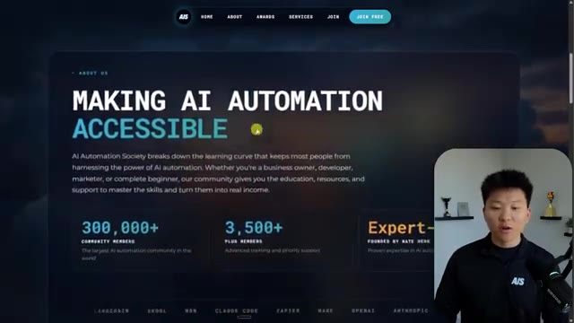
*⏱️ 00:00:10 — Section 'About Us' du site web avec le texte 'Making AI Automation Accessible', des statistiques de membres et l'incrustation vidéo du présentateur.*

---

### ⏱️ `[00:00:21 - 00:00:52]` | Segment #02

**🔊 Audio (Transcription Intégrale Mot pour Mot en Français) :**
> Et vous pouvez voir que c'est une sensation beaucoup plus interactive et soignée qu'avant. Nous avons l'appel à l'action final pour rejoindre le mouvement, et vous pouvez voir que nous avons en quelque sorte traversé le parcours d'une évolution technologique, ce que je trouve juste super, super cool. Et ce que vous remarquerez, c'est que j'ai pu reprendre l'esprit de la marque, l'ambiance, les couleurs et tout le texte, et j'ai pu tout transférer très facilement. Il contient donc toutes les mêmes informations importantes, mais avec un côté beaucoup plus interactif. Et puis 20 minutes plus tard, j'ai pu faire exactement la même chose avec mon site web personnel. Ici, vous pouvez voir qu'il a des ambiances plutôt sombres.

**👁️ Analyse Visuelle d'Écran (gemini-3.5-flash-lite) :**
**Interface & Outils** : Navigateur web affichant le site internet de la communauté AI Automation Society (AIS).

**Contenu textuel & Code** : Textes promotionnels de la communauté, statistiques (300K+ membres) et boutons d'appel à l'action.

**Action / Démonstration** : Présentation et défilement de la page web du site de la communauté par le créateur.

*⏱️ 00:00:29 — Vue d'une section du site web AIS montrant un graphique futuriste en arrière-plan et un appel à l'action 'JOIN THE MOVEMENT'.*

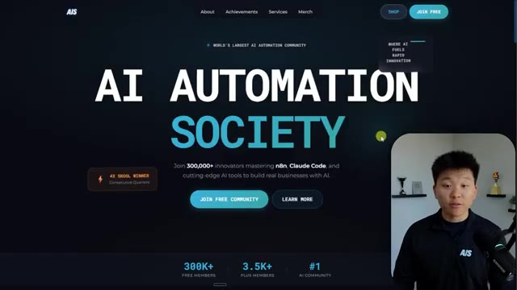
*⏱️ 00:00:36 — Page d'accueil principale du site 'AI Automation Society' avec le titre principal en grand et les boutons d'inscription.*

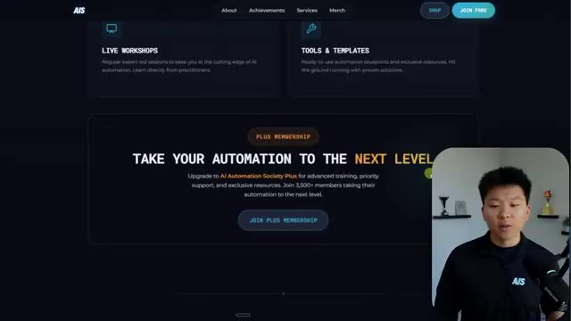
*⏱️ 00:00:44 — Section du site web présentant les offres de niveau supérieur 'PLUS MEMBERSHIP' avec des descriptions de fonctionnalités.*

---

### ⏱️ `[00:00:52 - 00:01:25]` | Segment #03

**🔊 Audio (Transcription Intégrale Mot pour Mot en Français) :**
> Il y a plein de statistiques. Il y a différentes choses sur lesquelles je travaille. Et je l'ai simplement transformé pour qu'il soit un peu plus dynamique. Vous pouvez voir que c'est moi assis sur une île flottante au milieu de l'espace et je travaille sur un ordinateur. Mais en faisant défiler vers le bas, nous avons les mêmes éléments. Nous avons le même texte. Nous avons la même ambiance. Mais maintenant, il y a beaucoup plus de profondeur et ça fait beaucoup plus professionnel. Donc ce que je vais vous montrer aujourd'hui, c'est comment nous créons des sites Web comme celui-ci en utilisant Claude Design. Nous pouvons avoir différents éléments. Nous pouvons avoir différentes ambiances et tout est conçu d'une manière qui est tout simplement beaucoup plus captivante et professionnelle. Et j'ai essayé beaucoup de choses différentes ici. Vous pouvez voir que j'ai déjà épuisé mon quota de design et j'ai déjà

**👁️ Analyse Visuelle d'Écran (gemini-3.5-flash-lite) :**
**Interface & Outils** : Navigateur web, interface de design/développement web.

**Contenu textuel & Code** : Textes de présentation, statistiques (abonnés YouTube, membres de la communauté), et maquette de site web.

**Action / Démonstration** : Présentation du site web personnel et d'un projet de design en cours.

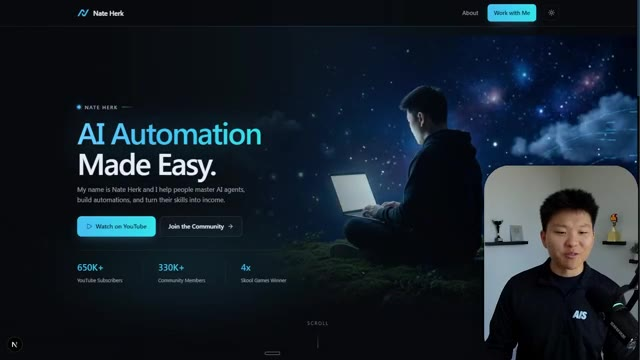
*⏱️ 00:01:00 — Page web de présentation "AI Automation Made Easy" avec le créateur en encadré vidéo.*

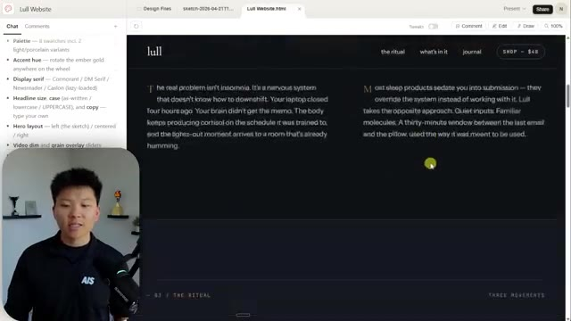
*⏱️ 00:01:17 — Interface de design ou de prévisualisation d'un site web nommé "Lull" avec un panneau de chat à gauche.*

---

### ⏱️ `[00:01:25 - 00:01:58]` | Segment #04

**🔊 Audio (Transcription Intégrale Mot pour Mot en Français) :**
> J'ai dépensé plus de 200 dollars en utilisation supplémentaire juste en jouant avec ces trucs. Donc non seulement je vais vous montrer, les gars, les astuces et les trucs que j'ai appris, mais je vais aussi aborder des choses importantes comme comment faire pour ne pas épuiser votre limite plus rapidement et comment tirer le meilleur parti de ce que vous faites ici ? Je ne veux pas perdre de temps aujourd'hui. Allons-y directement et passons tout de suite à la vidéo. Très bien, donc je m'apprête à vous montrer, les gars, tout ce que vous devez faire étape par étape pour faire passer une idée de votre cerveau à un site web réel et la déployer afin que d'autres personnes puissent réellement la voir et y accéder. D'accord, donc disons que vous voulez transformer un site web. Tout ce que vous voudriez vraiment faire, c'est si celui-ci a une sorte de base de code dans GitHub ou CloudCode ou peu importe où

**👁️ Analyse Visuelle d'Écran (gemini-3.5-flash-lite) :**
**Interface & Outils** : Google Docs, navigateur web (page de présentation de produit "lull")

**Contenu textuel & Code** : Plan de la vidéo listant les sujets abordés (What It Is, The Two-Meter System, What Drains Your Limit Fastest, Best Practices to Stretch Limits, File Upload + Extra Usage Rates, Limitations to Flag) et page web promotionnelle.
[DESC_IMAGE_1] Présentation du plan de la vidéo par le créateur.
[DESC_IMAGE_2] Illustration visuelle d'un exemple de design web sur le thème du sommeil.

**Action / Démonstration** : Le présentateur introduit le plan de sa vidéo et montre un exemple concret de design généré ou analysé.

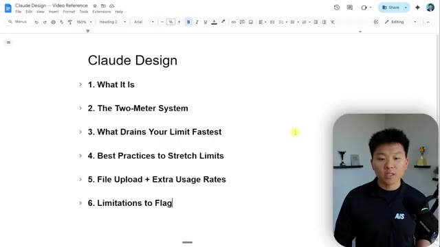
*⏱️ 00:01:33 — Un document Google Docs affichant le plan de la vidéo intitulé "Claude Design" avec 6 points clés, incluant "What Drains Your Limit Fastest" et "Best Practices to Stretch Limits", avec le présentateur en médaillon.*

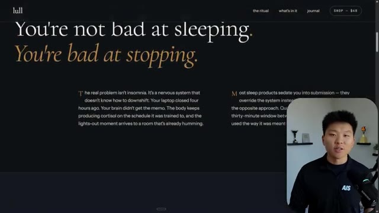
*⏱️ 00:01:41 — Une page web au design épuré sur fond noir avec le titre "You're not bad at sleeping. You're bad at stopping." (site "lull"), avec le présentateur incrusté en bas à droite.*

---

### ⏱️ `[00:01:58 - 00:02:34]` | Segment #05

**🔊 Audio (Transcription Intégrale Mot pour Mot en Français) :**
> en fait vit, vous pouvez fondamentalement juste récupérer ce dépôt GitHub ou vous pouvez récupérer le dossier avec tout son contenu et le donner simplement à CloudDesign. C'est donc un peu comme la première méthode. L'autre méthode consiste à se demander : et si vous avez juste une idée et si vous avez juste besoin de créer un site web à partir de zéro ? Eh bien, laissez-moi vous montrer ce que je fais ici à l'intérieur de CloudChat proprement dit afin de nous donner un exemple à construire ensemble aujourd'hui. J'ai donc dit : je veux créer un site web en utilisant CloudDesign et je cherche un peu d'inspiration sur le type de site web que je devrais construire. Quel est le produit ou le service que nous proposons ? Et à quoi devrait ressembler la section héroïque et le texte réel ? Aidez-moi fondamentalement à créer une marque et donnez-moi les spécifications pour cela. Il a donc eu l'idée de proposer une boisson de détente pour la nuit,

**👁️ Analyse Visuelle d'Écran (gemini-3.5-flash-lite) :**
**Interface & Outils** : Interface web de type assistant conversationnel / LLM.

**Contenu textuel & Code** : Prompt utilisateur demandant l'inspiration pour un site web et spécifications textuelles générées pour la marque 'Lull'.

**Action / Démonstration** : Présentation de la méthode de conception basée sur une simple idée et des spécifications textuelles générées par l'IA.

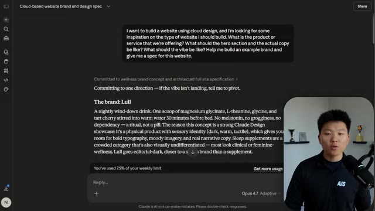
*⏱️ 00:02:07 — Interface d'une application web montrant un prompt demandant de l'inspiration pour créer un site web, avec la réponse générée détaillant la marque 'Lull'.*

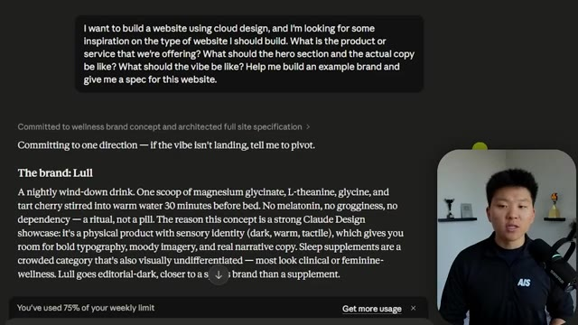
*⏱️ 00:02:25 — Vue similaire de l'interface montrant le détail de la spécification de la marque de boisson relaxante 'Lull' générée par l'IA.*

---

### ⏱️ `[00:02:35 - 00:03:08]` | Segment #06

**🔊 Audio (Transcription Intégrale Mot pour Mot en Français) :**
> une cuillère de glycinate de magnésium, bla, bla, bla. Mais la marque s'appelle Lull et elle me donne le positionnement et la voix, l'identité visuelle, et à quoi le site devrait ressembler. Donc c'est génial. Et ensuite je reviens et je dis, super, je veux créer une vidéo qui jouera en arrière-plan de la section principale et elle sera juste en boucle infinie. J'ai besoin que la vidéo corresponde à l'ambiance et je veux qu'elle ait un effet "waouh" pour que quand les gens vont sur le site web, ils se disent oh waouh, c'est, tu sais, professionnel. Il ne devrait y avoir aucun texte, mais il devrait aussi y avoir de la place où nous pourrions insérer un bloc pour le texte principal et le sous-texte. Donc ce que je lui demande, c'est un prompt d'image pour l'arrière-plan et ensuite un prompt vidéo pour l'animer. Donc il crache un prompt d'image

**👁️ Analyse Visuelle d'Écran (gemini-3.5-flash-lite) :**
**Interface & Outils** : Interface web de type assistant IA (ChatGPT ou similaire).

**Contenu textuel & Code** : Texte du prompt utilisateur demandant une idée de vidéo d'arrière-plan avec effet 'wow' et boucle infinie pour la section héroïque d'un site web.

**Action / Démonstration** : Défilement ou affichage progressif du texte du prompt de l'utilisateur dans l'interface de l'assistant.

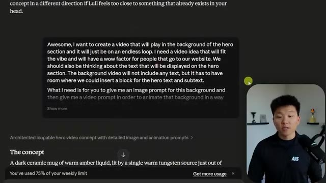
*⏱️ 00:02:43 — Interface d'une application affichant un prompt textuel concernant la création d'une vidéo en arrière-plan, avec le présentateur incrusté en bas à droite.*

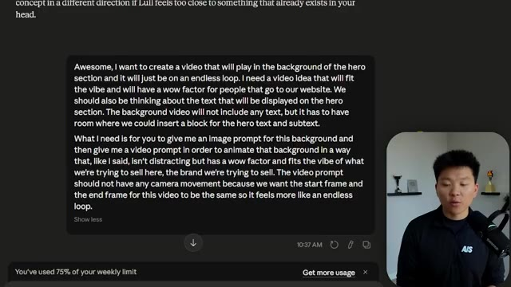
*⏱️ 00:02:51 — Suite du message de prompt détaillé concernant l'animation en boucle sans mouvement de caméra, avec le présentateur en bas à droite.*

---

### ⏱️ `[00:03:08 - 00:03:27]` | Segment #07

**🔊 Audio (Transcription Intégrale Mot pour Mot en Français) :**
> juste ici. Donc en gros le thème le concept est une tasse en céramique noire avec un liquide chaud à l'intérieur et ensuite d'avoir juste en quelque sorte, tu sais, de la vapeur en arrière-plan, ce qui lui donnerait une belle sensation et ça correspondra à l'ambiance du genre, tu sais, de tisane pour dormir ou quoi que ce soit censé être. Donc ça me donne l'invite d'image et je vais aller sur key.ai. J'utilise nano banana two.

**👁️ Analyse Visuelle d'Écran (gemini-3.5-flash-lite) :**
**Interface & Outils** : Interface web de type LLM ou éditeur de texte en ligne (ChatGPT / Claude) et webcam du présentateur.

**Contenu textuel & Code** : Texte descriptif d'un concept visuel de tasse en céramique noire avec du liquide chaud et de la vapeur, et un prompt de génération d'image ('Cinematic still-life photograph...').

**Action / Démonstration** : Le présentateur présente et commente le texte du concept affiché à l'écran concernant la tasse en céramique.

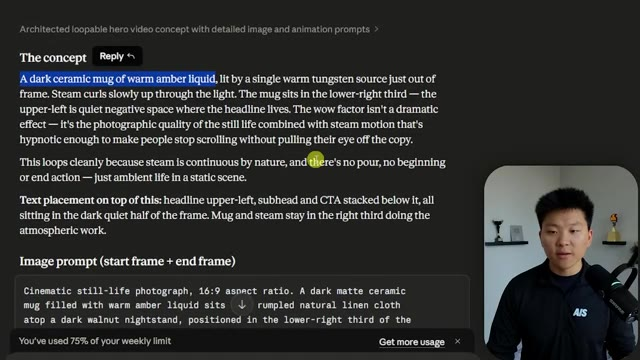
*⏱️ 00:03:12 — Capture d'écran montrant une interface web textuelle avec un concept de vidéo (The concept : A dark ceramic mug of warm amber liquid...) et des prompts de génération d'image, avec la vidéo du présentateur en bas à droite.*

---

### ⏱️ `[00:03:27 - 00:04:01]` | Segment #08

**🔊 Audio (Transcription Intégrale Mot pour Mot en Français) :**
> Donc, je dépose les invites d'images ici même. Je m'assure que c'est un format 16 par 9. Et ensuite j'obtiens cette image, qui, comme vous pouvez le voir, est fondamentalement juste une tasse avec une sorte de liquide. C'est là que nous mettenons le texte principal et le sous-texte, ce qui est bien. Et puis ça fume. Et ensuite je prends cette image et je retourne dans un autre onglet et clé et je vais sur C dance 2.0. Et je mets cette image comme première et dernière image, et je vais chercher ces invites en bas pour les invites vidéo afin d'animer l'image. La chose essentielle ici, c'est que la caméra ne bouge pas. C'est fondamentalement juste un plan fixe.

**👁️ Analyse Visuelle d'Écran (gemini-3.5-flash-lite) :**
**Interface & Outils** : KIE API (génération d'images) et interface Web de Claude (Anthropic).

**Contenu textuel & Code** : Prompt détaillé pour une photographie "cinematic still-life" d'une tasse sur un support en noyer avec des instructions de mise en page (headline, subhead, CTA).

**Action / Démonstration** : Présentation du flux de travail pour générer des assets visuels (image) via un prompt textuel complexe destiné à un design web.

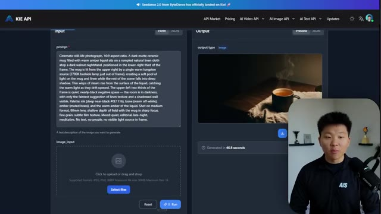
*⏱️ 00:03:44 — Interface de "KIE API" affichant un champ de prompt détaillé à gauche et l'image générée résultante à droite.*

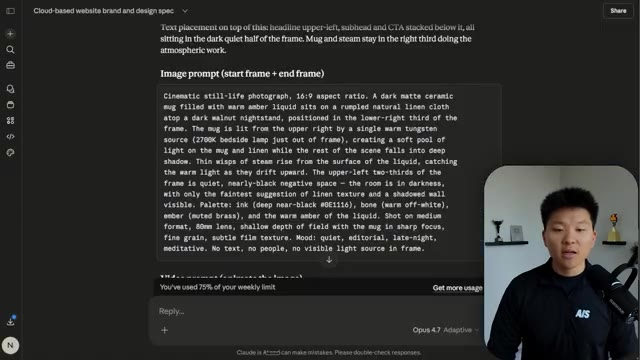
*⏱️ 00:03:52 — Interface de Claude (chatbot) présentant des spécifications de design textuelles incluant un prompt d'image très détaillé.*

---

### ⏱️ `[00:04:01 - 00:04:35]` | Segment #09

**🔊 Audio (Transcription Intégrale Mot pour Mot en Français) :**
> Une image fixe de ce café ou quoi que ce soit qui est en train d'être animé. Donc voici à quoi cela ressemble. Comme vous pouvez le voir, ça fume juste et ça a l'air vraiment bien. Maintenant, imaginez que c'est l'arrière-plan d'un site web lorsque vous avez du texte par ici, ça pourrait être plutôt sympa. D'accord, donc maintenant que nous avons ces éléments initiaux, je vais ouvrir v0 par Vercel (ou : claw design) et je vais créer un nouveau prototype, et nous allons commencer par un prototype haute fidélité. Je ne vais pas utiliser de système de design parce que dans ce cas, nous créons en quelque sorte notre propre nouvelle marque et peut-être pourrons-nous construire un système de design autour de cela plus tard, mais pour l'instant, je vais simplement dire aucun et nous allons appeler cela le site web lol parce que c'est le nom de la marque. Donc je vais cliquer sur créer.

**👁️ Analyse Visuelle d'Écran (gemini-3.5-flash-lite) :**
**Interface & Outils** : Claude Design (Research Preview)

**Contenu textuel & Code** : Liste de projets (ex: "AI Automation Society Design System", "AIS Website"), options de création (Wireframe, High fidelity) et paramètres de projet.

**Action / Démonstration** : Navigation au sein du tableau de bord de l'application de design pour sélectionner ou créer un nouveau projet.

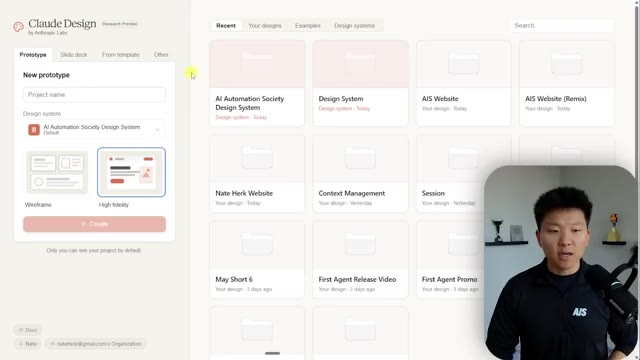
*⏱️ 00:04:18 — Interface de "Claude Design" affichant une galerie de projets de design récents avec une fenêtre contextuelle pour créer un nouveau prototype.*

---

### ⏱️ `[00:04:35 - 00:04:54]` | Segment #10

**🔊 Audio (Transcription Intégrale Mot pour Mot en Français) :**
> Et ce que ça va faire, c'est que ça va lancer cette petite interface adorable, si on veut, on peut commencer avec un croquis ici. Donc on pourrait littéralement venir ici et dire, bon, tu sais, voilà à quoi va ressembler notre site web. C'est ici que, oh, je voulais un autre carré. C'est ici qu'on va avoir, genre, la vidéo principale. Donc ce sera l'arrière-plan de la section principale.

**👁️ Analyse Visuelle d'Écran (gemini-3.5-flash-lite) :**
**Interface & Outils** : Interface web de design et prototypage (style interface de type Lull Website ou outil de conception assisté par IA)
[DESC_IMAGE_1] Panneau 'Start with context' avec options (Design System, Add screenshot, Attach codebase, Drag in a Figma file) et zone de chat
[DESC_IMAGE_2] Outil de croquis interactif avec barre d'outils de dessin et rectangle tracé sur une grille pointillée

**Contenu textuel & Code** : Explications orales et mise en contexte méthodologique.

**Action / Démonstration** : Le présentateur montre l'interface de croquis et commence à dessiner un rectangle pour définir la structure d'une page web

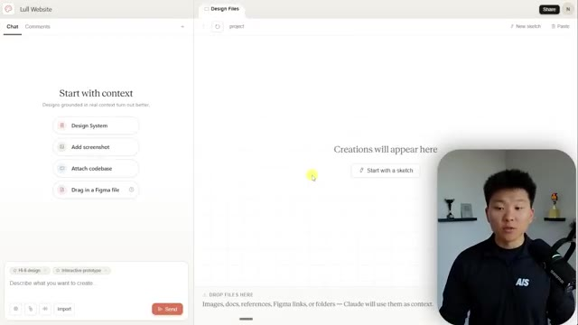
*⏱️ 00:04:40 — Interface web de conception montrant un panneau de chat à gauche et une zone de design à droite avec un bouton 'Start with a sketch', ainsi que la webcam du présentateur en bas à droite.*

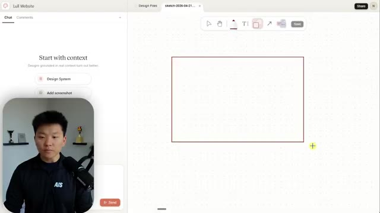
*⏱️ 00:04:45 — Interface web avec la zone de dessin active montrant un rectangle rouge tracé à l'écran et la barre d'outils de croquis, avec la webcam du présentateur déplacée en bas à gauche.*

---

### ⏱️ `[00:04:56 - 00:05:23]` | Segment #11

**🔊 Audio (Transcription Intégrale Mot pour Mot en Français) :**
> Et je pourrais venir ici et dire genre, ceci est la vidéo d'arrière-plan principale. Et puis nous voulons une autre boîte par ici, qui sera comme le texte principal et le sous-texte, le texte principal. Et puis je vais descendre ici et dire simplement sous-texte principal. Nous pourrions aussi probablement vouloir une sorte de barre de navigation en haut. Donc c'est comme, tu sais, le logo pourrait être par ici. Oups, ce n'est pas comme ça qu'on écrit logo.

**👁️ Analyse Visuelle d'Écran (gemini-3.5-flash-lite) :**
**Interface & Outils** : Interface web de conception (type outil de wireframing/design)

**Contenu textuel & Code** : Un cadre rectangulaire avec le texte "Hero Background Video" à l'intérieur, et une barre d'outils contextuelle en haut.

**Action / Démonstration** : Le présentateur explique la disposition des éléments de design sur l'interface.

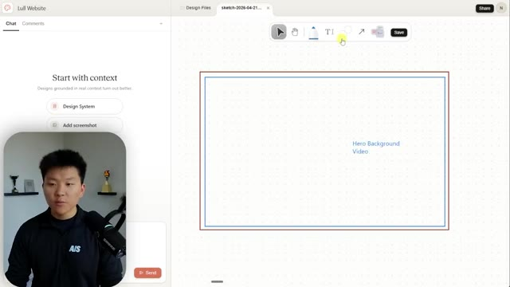
*⏱️ 00:05:02 — Interface web montrant un espace de travail de design avec une zone de brouillon et une barre d'outils, ainsi qu'une incrustation vidéo du présentateur en bas à gauche.*

---

### ⏱️ `[00:05:23 - 00:05:54]` | Segment #12

**🔊 Audio (Transcription Intégrale Mot pour Mot en Français) :**
> Et ensuite, nous pourrions aussi avoir du genre, vous savez, une boutique ou quelque chose comme ça. Et donc, c'est juste une façon pour nous de nous mettre en quelque sorte visuellement sur la même longueur d'onde que Claude. Et puis, bien sûr, vous pouvez voir ici en bas, il serait en train de regarder le croquis. Alors, allons-y et gardons ceci pour l'instant. Évidemment, si vous avez une meilleure vision, vous pouvez y consacrer un peu plus de temps et d'attention. Vous pourriez aussi agencer le reste de votre site ici en bas également. Et puis, vous pouvez ajouter des notes et des trucs. Mais pour l'instant, laissons ça comme ça. Et ce que je vais faire maintenant, c'est que je vais glisser ce fichier MP4 réel que nous avons obtenu de CDance. Vous pouvez voir qu'il télécharge le fichier et il est juste ici.

**👁️ Analyse Visuelle d'Écran (gemini-3.5-flash-lite) :**
**Interface & Outils** : Interface web de design (type Figma ou outil de maquettage collaboratif)

**Contenu textuel & Code** : Maquette de site web filaire (wireframe) avec des blocs textuels "logo", "shop", "Hero Text", "Hero subtext" et "Hero Background Video"

**Action / Démonstration** : Présentation et explication d'un wireframe de site web pour aligner la vision avec l'assistant IA Claude

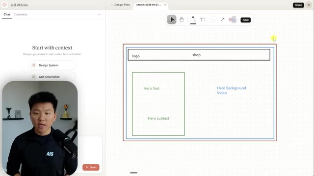
*⏱️ 00:05:31 — Interface web montrant un panneau de design avec des wireframes et le présentateur en médaillon en bas à gauche.*

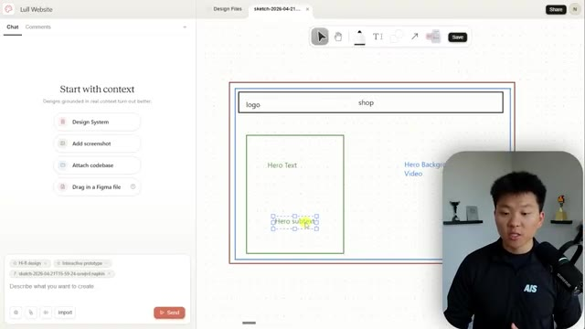
*⏱️ 00:05:39 — Interface web similaire avec le présentateur cette fois déplacé en médaillon dans le coin inférieur droit, montrant l'édition d'un wireframe.*

---

### ⏱️ `[00:05:55 - 00:06:30]` | Segment #13

**🔊 Audio (Transcription Intégrale Mot pour Mot en Français) :**
> Maintenant, c'était une vidéo de huit secondes. Ça ne va pas vous laisser télécharger des vidéos qui font genre 30 secondes de long. Il y a une limite et je crois qu'elle est autour de 30 ou 40 mégaoctets. Donc gardez juste ça à l'esprit. J'ai réussi à télécharger des vidéos de 15 secondes. J'ai essayé une vidéo de 20 secondes et ça a fonctionné, mais gardez juste ça à l'esprit. Donc maintenant, ce que je veux faire, c'est que Claude a déjà fait tout le travail difficile et ardu pour nous. Vous savez, si je remonte tout en haut, ça nous a fondamentalement donné la marque et tout ça avec une identité visuelle, les différentes sections, le pied de page. Et vous pouvez voir que ça a aussi genre, vous savez, des couleurs et tout. Donc je vais prendre ça. Je vais retourner dans Claude Design et je vais juste coller ça dedans. Et c'est collé dedans comme genre

**👁️ Analyse Visuelle d'Écran (gemini-3.5-flash-lite) :**
**Interface & Outils** : Interface web de conception de site et interface de chat LLM (Claude).

**Contenu textuel & Code** : Texte du prompt vidéo détaillant les mouvements de caméra fixes et les effets de vapeur, avec une limite hebdomadaire d'utilisation atteinte à 75%.

**Action / Démonstration** : Le présentateur explique les contraintes de taille et de durée pour l'importation de fichiers vidéo dans l'application.

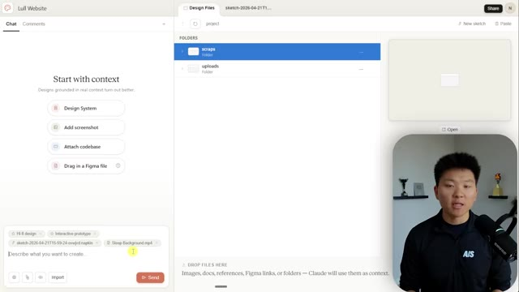
*⏱️ 00:06:03 — Interface web de conception montrant une zone de chat contextuelle avec un fichier vidéo importé ("Sleep Background.mp4") et le présentateur en incrustation.*

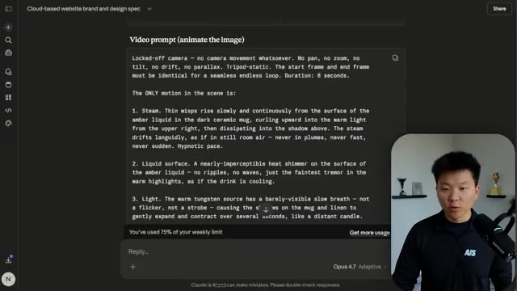
*⏱️ 00:06:12 — Interface sombre affichant un prompt détaillé pour la génération d'une vidéo (animation d'image) avec Claude, et le présentateur en bas à droite.*

---

### ⏱️ `[00:06:30 - 00:07:02]` | Segment #14

**🔊 Audio (Transcription Intégrale Mot pour Mot en Français) :**
> a little bit of an artifact because it was a long bit of text. So now I just explain what I wanted to do. Hey, Claude Design. I've given you a couple things. I've got a sketch, which is just my basically idea for the hero section. There's going to be a lot of little sections beneath, which you will be on your own to figure out what that should look like. I've given you the sleep background.mp4. This is a video that I want you to be playing on an endless loop in the background. And you should see that the hero text will be on the left side compared to that. And then I pasted in 23 lines of text, which is kind of the brand identity, the feel for

**👁️ Analyse Visuelle d'Écran (gemini-3.5-flash-lite) :**
**Interface & Outils** : Interface web de design (Claude Design / outil de prototypage)

**Contenu textuel & Code** : Panneau de chat avec divers fichiers joints et options contextuelles (Hi-fi design, Interactive prototype, croquis, texte collé de 23 lignes).

**Action / Démonstration** : Le présentateur explique l'utilisation de l'outil en fournissant un croquis et du contexte pour concevoir la section principale du site web.

*⏱️ 00:06:38 — Interface divisée montrant à gauche un panneau de chat avec des options de contexte (Design System, Add screenshot, Attach codebase, etc.) et des fichiers joints, au centre un gestionnaire de fichiers de design avec les dossiers scraps et uploads, et en bas à droite le présentateur qui parle.*

---

### ⏱️ `[00:07:02 - 00:07:30]` | Segment #15

**🔊 Audio (Transcription Intégrale Mot pour Mot en Français) :**
> the website and how you should write the copy. And just go ahead and write all the copy for now. We can make tweaks later. Okay. So I'm going to paste that in and go ahead and shoot that off. If you guys are curious about how I'm doing voice to text, check the description for the tool. I'm using extra usage, by the way, but it's going to start to build this out. And if it has any specific questions for us, it will come back and it will ask those questions. But right now it looks like it's just going to run. And also keep in mind, this is right now using Claude Opus 4.7.

**👁️ Analyse Visuelle d'Écran (gemini-3.5-flash-lite) :**
**Interface & Outils** : Interface web de génération de site web (Lull Website)

**Contenu textuel & Code** : Champ de saisie 'Describe what you want to create.' avec des balises de contexte jointes en haut et le bouton 'Send'.

**Action / Démonstration** : Le présentateur s'apprête à envoyer le prompt textuel pour générer le contenu du site web.

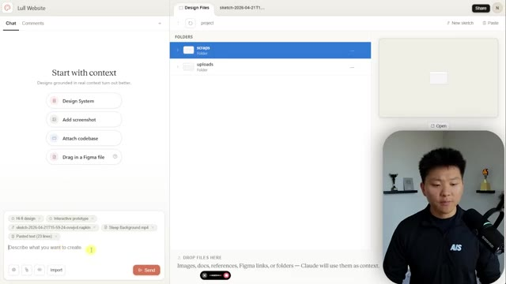
*⏱️ 00:07:09 — Interface de l'outil de génération de site web montrant un panneau de chat à gauche avec des options de contexte (Design System, Add screenshot, etc.) et le présentateur incrusté en bas à droite.*

---

### ⏱️ `[00:07:30 - 00:08:05]` | Segment #16

**🔊 Audio (Transcription Intégrale Mot pour Mot en Français) :**
> Donc honnêtement, genre pour la phase de planification, j'aime bien utiliser Opus 4.7. Si on voulait plus tard faire quelques modifications et qu'on voulait faire d'autres choses, on pourrait baisser le modèle. Mais gardez à l'esprit que ça va utiliser Opus 4.7, qui est le modèle le plus cher qui nous est publiquement accessible en ce moment. Mais j'adore comment on a toujours cette sensation de Claude ici parce qu'il nous dit ce qu'il pense. On peut voir ce qu'il fait. Il fait une liste de tâches. C'est donc très facile pour nous de simplement vérifier comment ça se passe et où nous en sommes. Il est en train de créer un système de design ici. Donc on a une sorte de palette de couleurs. On a du texte juste ici. Et c'est honnêtement la meilleure pratique, surtout quand vous vous habituez au design avec le cloud, de simplement regarder ce qu'il fait et d'aller l'arrêter s'il est en train de

**👁️ Analyse Visuelle d'Écran (gemini-3.5-flash-lite) :**
**Interface & Outils** : Interface web de développement ou de design, panneau de chat textuel.

**Contenu textuel & Code** : Texte de planification du design et choix typographiques pour un site web nommé 'Lull Website'.

**Action / Démonstration** : Le modèle discute et planifie la structure et le design typographique d'un site web.

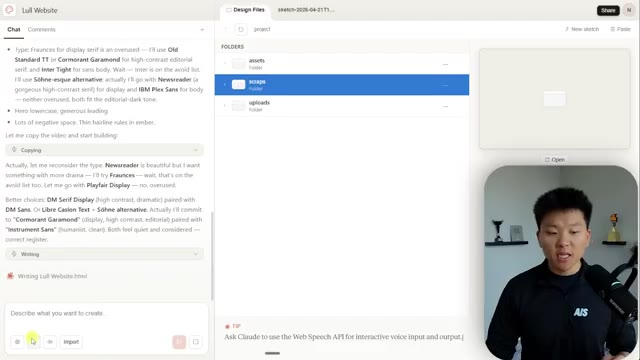
*⏱️ 00:07:38 — Interface web montrant un panneau de chat avec des instructions de design (choix de polices comme Newsreader et DM Serif Display) sur la gauche, un explorateur de fichiers au centre, et le présentateur en bas à droite.*

---

### ⏱️ `[00:08:05 - 00:08:27]` | Segment #17

**🔊 Audio (Transcription Intégrale Mot pour Mot en Français) :**
> dans la mauvaise direction, parce que s'il va dans la mauvaise direction, il va construire des choses. Et cela va utiliser une grande partie de votre limite de session. Autant donc l'arrêter et en quelque sorte rafraîchir ou corriger le tir avant qu'il ne gaspille tout ce temps. Maintenant, pendant que cela s'exécute, je veux vous montrer la façon dont j'ai pu trouver d'autres inspirations. Il y un site vraiment cool appelé motionsites.ai et un salut à mon pote Aiden. Il m'a montré ce site et je me suis dit, c'est génial.

**👁️ Analyse Visuelle d'Écran (gemini-3.5-flash-lite) :**
**Interface & Outils** : Navigateur web, interface de projet de site web et plateforme "motionsites"

**Contenu textuel & Code** : Texte de discussion dans l'interface de développement concernant le choix des polices typographiques (serif/sans-serif) et grille de miniatures vidéo animées sur motionsites.

**Action / Démonstration** : Navigation et démonstration d'outils de génération et de conception de sites web par le présentateur.

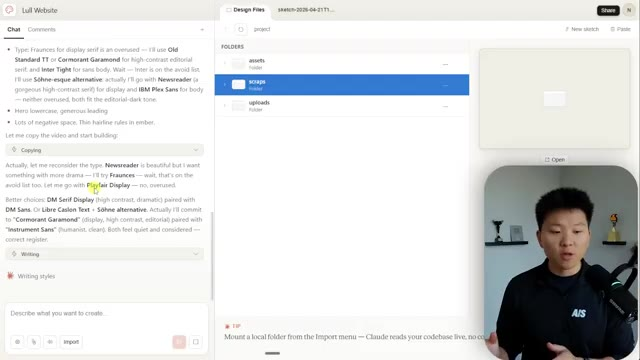
*⏱️ 00:08:10 — Interface d'un outil de développement web avec un panneau de chat à gauche et l'explorateur de fichiers/projet au centre, tandis que le présentateur apparaît en bas à droite.*

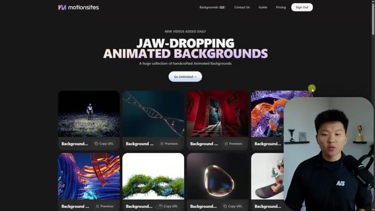
*⏱️ 00:08:22 — Page d'accueil du site web "motionsites" présentant une galerie de fonds animés avec le présentateur visible en incrustation dans le coin inférieur droit.*

---

### ⏱️ `[00:08:28 - 00:08:54]` | Segment #18

**🔊 Audio (Transcription Intégrale Mot pour Mot en Français) :**
> Donc la façon dont cela fonctionne, c'est que vous pouvez essentiellement regarder des arrière-plans et vous pouvez regarder d'autres sites réels pour trouver de l'inspiration. Donc ce que vous remarquerez ici, si vous vous souvenez de ma version de AI Automation Society, donc ce site web où nous avons ce genre de scène en arrière-plan et au fur et à mesure que nous faisons défiler, nous avons ces cartes visuelles. C'est comme un voyage du point de vue de l'utilisateur final réel. J'ai été inspiré par celui-ci. Donc si j'ouvre ceci, vous pouvez voir que c'est un voyage de défilement. Il a ces éléments dynamiques 3D dans les cartes. Et j'ai pu littéralement copier ce prompt.

**👁️ Analyse Visuelle d'Écran (gemini-3.5-flash-lite) :**
**Interface & Outils** : Navigateur web affichant une plateforme d'inspiration de design (type UI Gallery ou archive de sites web).

**Contenu textuel & Code** : Interface utilisateur de templates web avec titres, catégories, logos, statistiques de membres (300 000+), et noms de technologies/outils (Zapier, Make, OpenAI, Claude Code).

**Action / Démonstration** : Navigation et sélection visuelle au sein d'une bibliothèque de templates pour démontrer des inspirations de design pour des sites web d'automatisation.

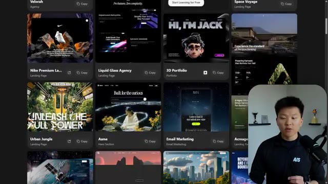
*⏱️ 00:08:34 — Une bibliothèque d'inspiration présentant des designs de landing pages et portfolios (ex: "Nike Premium", "Liquid Glass Agency", "Urban Jungle").*

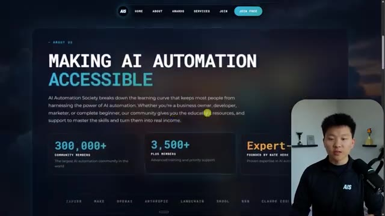
*⏱️ 00:08:41 — Vue détaillée du site web "AI Automation Society" avec le titre "Making AI Automation Accessible" et des statistiques communautaires.*

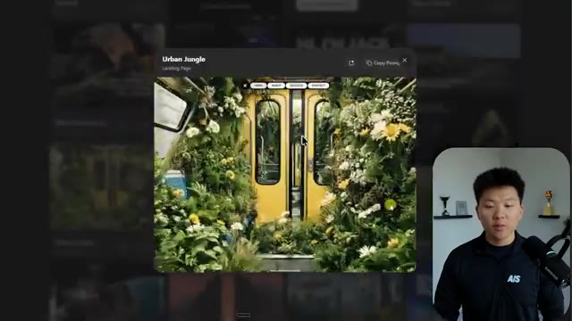
*⏱️ 00:08:48 — Aperçu agrandi et interactif du design "Urban Jungle" sélectionné dans la bibliothèque, affichant une image immersive de métro végétalisé.*

---

### ⏱️ `[00:08:55 - 00:09:18]` | Segment #19

**🔊 Audio (Transcription Intégrale Mot pour Mot en Français) :**
> Et j'ai donné ça à Claude Design. Et j'ai dit, Hé, c'est un concept sympa. Je veux que tu remplaces l'image d'arrière-plan par, ou désolé, pas l'image d'arrière-plan. Je veux que tu remplaces la vidéo d'arrière-plan par cette vidéo d'arrière-plan. Et j'ai glissé la mienne. Et j'ai dit, Je veux que tu mettes à jour tous les textes, les couleurs de la marque et l'ambiance pour les adapter à ma marque. Et ensuite je lui ai donné comme un système de design. Donc c'est fondamentalement tout ce que j'ai eu à faire pour transformer mon AI Automation Society en ceci.

**👁️ Analyse Visuelle d'Écran (gemini-3.5-flash-lite) :**
**Interface & Outils** : Interface web de génération de design ou de landing page (type Claude Design / v0) et webcam du présentateur.

**Contenu textuel & Code** : Texte affiché : "We transform sterile concrete into thriving urban jungles..." avec des boutons de navigation et des logos de partenaires en bas.

**Action / Démonstration** : Présentation du design généré par l'IA et explication de la modification de la vidéo d'arrière-plan.

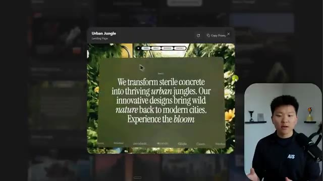
*⏱️ 00:09:01 — Aperçu d'une landing page générée intitulée "Urban Jungle" avec un texte de présentation et une vidéo en arrière-plan, tandis que le présentateur apparaît dans une incrustation vidéo en bas à droite.*

---

### ⏱️ `[00:09:18 - 00:09:48]` | Segment #20

**🔊 Audio (Transcription Intégrale Mot pour Mot en Français) :**
> et il y en a tellement d'autres. La plupart de ceux-ci sont gratuits. Je suis sur le forfait payant, qui coûte littéralement seulement 99 dollars à vie. Donc c'est plutôt cool. Mais certains d'entre eux vont être payants. Certains d'entre eux vont être gratuits. Mais comme je l'ai dit, vous trouvez fondamentalement ceux que vous aimez, vous trouvez ceux qui correspondent à votre marque, vous cliquez sur copier, vous donnez ça à Claude Design et il va le recréer. Et ensuite, vous pouvez simplement faire des ajustements à partir de là. Et puis si je vais dans les arrière-plans, vous pouvez voir qu'il y a juste un tas d'arrière-plans que nous pouvons regarder. Donc pour une raison quelconque, il ne détecte pas que je suis un membre payant, mais de toute façon, disons que nous aimons vraiment cet arrière-plan. Je pourrais le copier.

**👁️ Analyse Visuelle d'Écran (gemini-3.5-flash-lite) :**
**Interface & Outils** : Navigateur web affichant une plateforme de design et de modèles de sites web.

**Contenu textuel & Code** : Vignettes de prévisualisation de sites web, landing pages, sections héro, et fonds d'écran avec options de copie.

**Action / Démonstration** : Navigation et défilement dans la galerie de ressources de design.

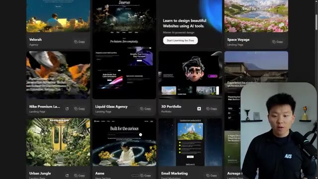
*⏱️ 00:09:25 — Grille de modèles de sites web et d'éléments de design avec des vignettes (ex: Velorah, Liquid Glass Agency, 3D Portfolio) et une vue du présentateur en incrustation.*

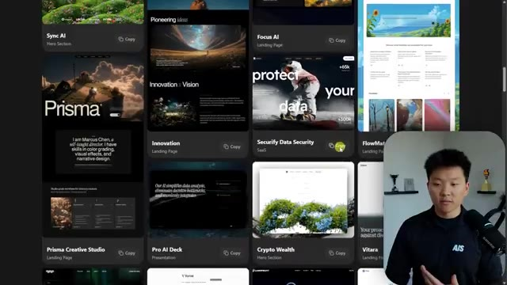
*⏱️ 00:09:33 — Navigation dans une galerie de templates web et de sections de landing pages (ex: Prisma, Securify Data Security) avec des boutons de copie.*

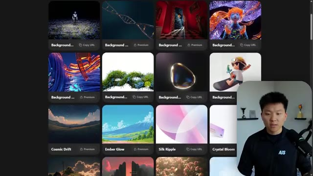
*⏱️ 00:09:40 — Galerie d'arrière-plans et d'éléments visuels avec des badges 'Premium' et 'Copy URL' sur les vignettes.*

---

### ⏱️ `[00:09:48 - 00:10:20]` | Segment #21

**🔊 Audio (Transcription Intégrale Mot pour Mot en Français) :**
> Si j'ouvre un nouvel onglet et que je colle ça dedans, ça me donne essentiellement cette animation que je pourrais évidemment télécharger et ensuite afficher derrière le texte sur mon site web, derrière les différentes sections de mon site web. Étant donné que la plupart des trucs ici sont gratuits, allez sur Motion Sites et amusez-vous un peu. Ça va vous donner de l'inspiration et il y a beaucoup d'éléments sympas ici que vous pouvez intégrer. Donc aussi, si vous vous souvenez de mon truc Nate Herk, je suis assis ici sur une île flottante et je travaille sur je ne sais quoi, et j'ai été inspiré par certains de ceux-là, vous savez, celui-ci ressemblait un peu à un abîme, celui-ci représentait quelqu'un qui travaille. Donc je ne vous recommande pas nécessairement de simplement copier ces éléments et de les mettre sur votre site.

**👁️ Analyse Visuelle d'Écran (gemini-3.5-flash-lite) :**
**Interface & Outils** : Navigateur web affichant une application ou un site de fonds d'écran animés.

**Contenu textuel & Code** : Galerie de vignettes visuelles avec des titres tels que Crystal Wave, Solar Drift, Abstract Flow, Digital Pulse et des boutons « Copy URL ».

**Action / Démonstration** : Navigation et défilement dans la galerie de vignettes d'animations pour copier l'URL d'un fond d'écran.

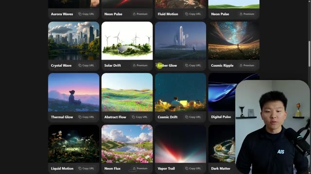
*⏱️ 00:10:04 — Interface web présentant une galerie de vignettes d'animations avec des boutons de copie d'URL.*

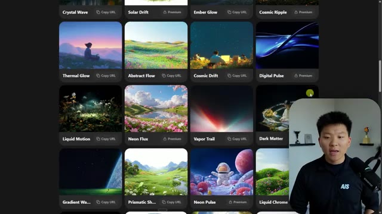
*⏱️ 00:10:12 — Suite de la grille de vignettes d'animations montrant différents thèmes visuels de fonds d'écran animés.*

---

### ⏱️ `[00:10:20 - 00:10:44]` | Segment #22

**🔊 Audio (Transcription Intégrale Mot pour Mot en Français) :**
> Vous le pouvez certainement, mais c'est juste une bonne façon de faire preuve d'un peu de créativité et de trouver de l'inspiration. Bon, mais nous sommes de retour dans le design sur le cloud maintenant et ce que nous avons, c'est notre première version, ce qui, je veux dire, a l'air génial. Comme ce texte, ce texte juste ici. Tout cela semble très fidèle à la marque. Nous pouvons voir ici qu'en faisant défiler vers le bas, l'image est un peu dynamique, ou désolé, pas l'image, je n arrête pas de dire image, la vidéo est un peu dynamique. Je pense que tout cela a l'air, je veux dire, tout simplement incroyable.

**👁️ Analyse Visuelle d'Écran (gemini-3.5-flash-lite) :**
**Interface & Outils** : Interface web de conception et de génération de sites web (type outil de design cloud/IA) avec panneau de chat et aperçu en temps réel.

**Contenu textuel & Code** : Texte de spécifications de design dans le panneau de chat (choix des polices Newsreader, IBM Plex Sans) et aperçu d'un site e-commerce minimaliste pour un produit de rituel de sommeil ('Lull').

**Action / Démonstration** : Présentation du premier prototype visuel généré d'un site web de design moderne.

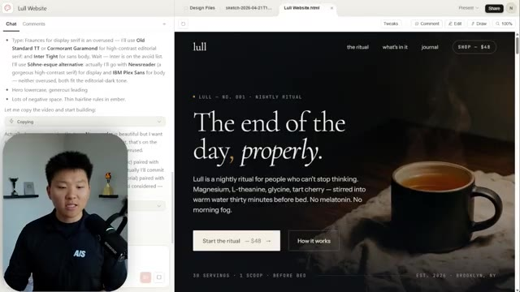
*⏱️ 00:10:26 — Interface de conception web montrant le panneau de chat de l'assistant IA à gauche, la première version du site 'Lull Website' avec un design sombre et une image de tasse de thé à droite, et la webcam du présentateur en médaillon.*

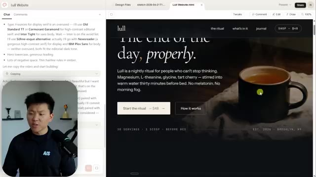
*⏱️ 00:10:38 — Vue similaire montrant le rendu du site web 'Lull Website' avec le curseur de la souris positionné sur l'image de la tasse de thé, le chat IA à gauche et la webcam du présentateur.*

---

### ⏱️ `[00:10:44 - 00:11:04]` | Segment #23

**🔊 Audio (Transcription Intégrale Mot pour Mot en Français) :**
> On a vraiment l'impression que c'est tout à fait dans le ton. On continue de descendre et on peut voir, on obtient un peu d'arrière-plan, on obtient un peu de contexte quant à ce qu'est le produit, le problème qu'il résout. Et c'est incroyable. Encore une fois, tout cela a été généré par Claude. L'idée, le design, les prompts, pas les images et vidéos réelles, mais les prompts. Et j'adore ça.

**👁️ Analyse Visuelle d'Écran (gemini-3.5-flash-lite) :**
**Interface & Outils** : Interface web d'un outil de conception/génération de site web avec panneau de chat et prévisualisation.

**Contenu textuel & Code** : Texte du site web 'lull' : 'You\'re not bad at sleeping. You\'re bad at stopping.' et explications sur le produit dans des colonnes avec typographie soignée.

**Action / Démonstration** : Présentation du rendu final et de la mise en page générée par l'IA pour le produit Lull.

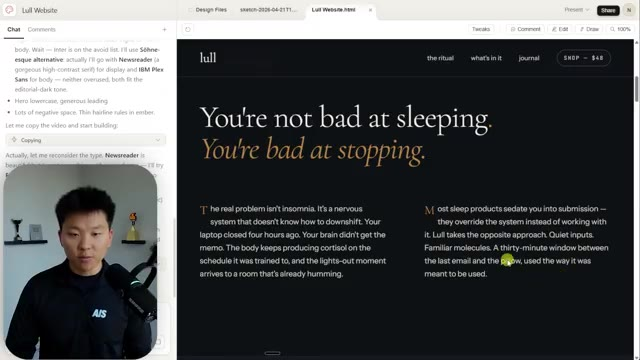
*⏱️ 00:10:49 — Aperçu du site web généré 'Lull' avec le panneau de discussion de l'outil d'IA sur la gauche et le présentateur en médaillon.*

---

### ⏱️ `[00:11:04 - 00:11:38]` | Segment #24

**🔊 Audio (Transcription Intégrale Mot pour Mot en Français) :**
> Maintenant, ce qui est vraiment génial avec ça et qui est une excellente façon d'économiser des jetons, c'est que vous pouvez simplement faire des itérations directement ici. Vous savez, si vous intégriez ce prompt dans Claude Code, vous obtiendriez peut-être quelque chose qui ressemble visuellement à ça, mais pour faire des allers-retours et apporter des modifications, vous devriez prendre des captures d'écran un peu maladroites ou être très précis. Mais ici, ce qu'on peut faire, c'est ajouter des commentaires, je pourrais en gros juste cliquer sur quelque chose et on peut changer son fonctionnement. Donc par exemple, le bouton "comment ça marche", disons que je voulais qu'il ait une couleur différente, peut-être comme la couleur dorée, allez-y et faites de ce bouton la couleur de la virgule dans le texte principal, faites-en un accent doré.

**👁️ Analyse Visuelle d'Écran (gemini-3.5-flash-lite) :**
**Interface & Outils** : Outil de prototypage web / Environnement de design collaboratif.

**Contenu textuel & Code** : Spécifications techniques du site (The formula, The morning after, Subscribe) et zone de saisie pour feedback textuel ("Describe the issue or suggestion...").

**Action / Démonstration** : Démonstration de l'intégration d'un flux de travail où l'utilisateur commente directement la maquette pour itérer avec l'IA.

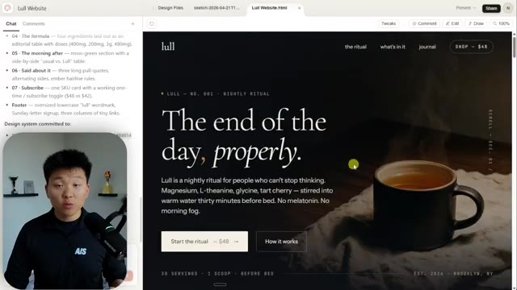
*⏱️ 00:11:12 — Interface de conception web montrant une maquette de site pour "Lull", avec une colonne latérale de notes de design et le présentateur en médaillon.*

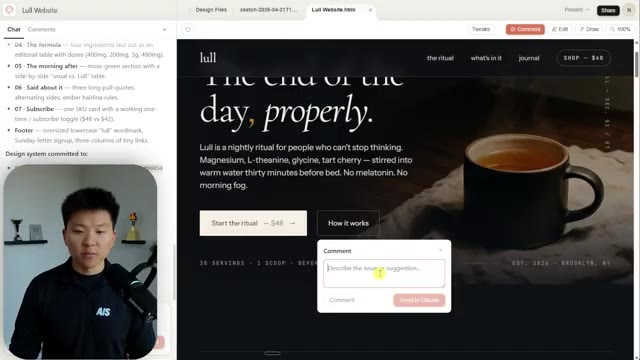
*⏱️ 00:11:29 — Même interface de conception web, mais avec une fenêtre de commentaire ouverte permettant d'envoyer des instructions directement à Claude.*

---

### ⏱️ `[00:11:38 - 00:12:11]` | Segment #25

**🔊 Audio (Transcription Intégrale Mot pour Mot en Français) :**
> And so now I can just say hey send this to claude and it gets the exact comment about the exact element that I was referring to So it's not going to get confused. You can also do edits straight in line So if I came here and I was like, okay, I don't want this m dash that looks very ai I could just delete it And then I could just close that out and it's going to make that change for us because I was just able to edit it right there So I can change the text. I could even you guys noticed change the size So if I wanted this all to be a little bit smaller I could just come in here and I could just go. Okay, make that 15 or make that 10 and it's going to change it right in real time. And then Claude just makes the change for us. You

**👁️ Analyse Visuelle d'Écran (gemini-3.5-flash-lite) :**
**Interface & Outils** : Outil de conception web collaboratif avec IA intégrée (type éditeur de design visuel).

**Contenu textuel & Code** : Spécifications du design système (palette de couleurs, typographie), panneau de configuration CSS (police, taille, poids, couleur, marges) pour l'élément sélectionné.

**Action / Démonstration** : Interaction directe avec l'IA via le chat pour demander des modifications, suivie d'une manipulation manuelle des propriétés visuelles (typographie) d'un élément sélectionné dans l'éditeur.

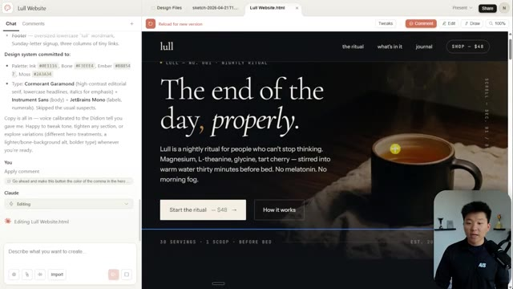
*⏱️ 00:11:46 — Interface de conception web montrant un panneau latéral de chat avec l'IA "Claude" en train de traiter une édition sur le fichier "Lull Website.html".*

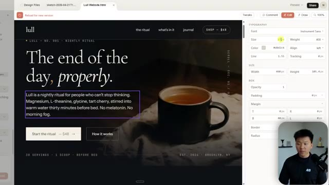
*⏱️ 00:12:02 — Interface de design montrant un panneau de propriétés typographiques à droite, avec un bloc de texte sélectionné sur la maquette du site web "Lull".*

---

### ⏱️ `[00:12:11 - 00:12:46]` | Segment #26

**🔊 Audio (Transcription Intégrale Mot pour Mot en Français) :**
> can also draw. So like right here, let's say I don't love the way that the video just kind of ends so abruptly. I can just kind of make a circle around this and then I can type and just say, I don't like how this ends. So abruptly add a transition overlay or gradient. So it feels smoother. And I shoot that off by hitting send. Now, when I do the drawing thing, the little comments get stuck down there. So sometimes it's hard to see. That's just kind of a UI bug. Once again, this is a research preview. So little kinks will get ironed out,

**👁️ Analyse Visuelle d'Écran (gemini-3.5-flash-lite) :**
**Interface & Outils** : Interface de développement et de prévisualisation web (type Cursor/Claude artifact).

**Contenu textuel & Code** : Interface de chat latéral avec historique de modifications et prévisualisation du site "Lull" à droite.

**Action / Démonstration** : Annotation directe sur l'interface de prévisualisation pour demander une correction de design.

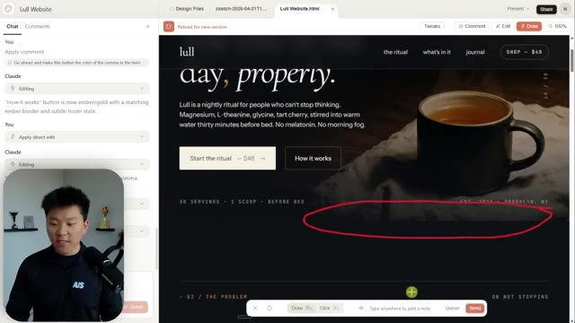
*⏱️ 00:12:20 — Le présentateur utilise l'outil de dessin pour entourer une zone spécifique sur la prévisualisation d'un site web.*

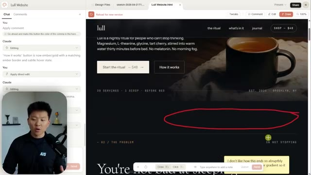
*⏱️ 00:12:37 — Le présentateur a ajouté une note textuelle sous la zone entourée pour demander une amélioration de la transition visuelle.*

---

### ⏱️ `[00:12:46 - 00:13:06]` | Segment #27

**🔊 Audio (Transcription Intégrale Mot pour Mot en Français) :**
> but that's a really nice feature to be able to just draw. Okay. So you can see that that button changed colors. I like that. Everything else that we have changed has been changed. And it, hopefully you can see it added a little line here. So that's not exactly what I wanted. I would iterate a little bit. I was kind of hoping for sort of like a gradient transition, but either way, at least it knew exactly what I was referring to.

**👁️ Analyse Visuelle d'Écran (gemini-3.5-flash-lite) :**
**Interface & Outils** : Navigateur web avec outil de prévisualisation et d'édition de site (probablement Cursor ou un environnement similaire de développement assisté par IA).

**Contenu textuel & Code** : Historique de chat IA traitant de la modification du style des boutons et de l'ajout d'éléments structurels ("bridging element") sur la page Lull.

**Action / Démonstration** : Itération sur le design du site web : l'agent IA ajuste la mise en page en insérant du texte et des éléments visuels pour fluidifier la transition entre les sections.

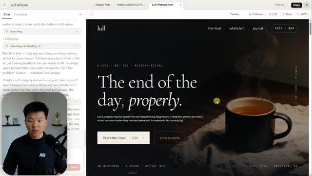
*⏱️ 00:12:51 — Interface de développement web montrant une page de renvoi "Lull" avec un volet de chat IA à gauche et un rendu visuel du site à droite.*

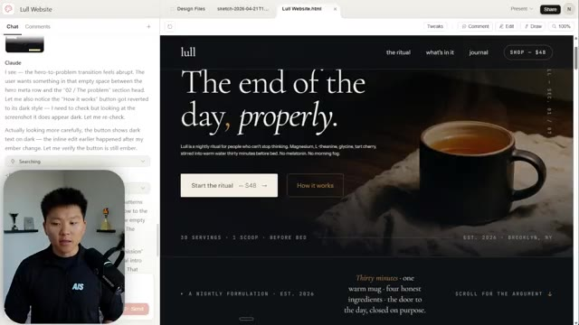
*⏱️ 00:12:56 — Mise à jour de la page affichant une nouvelle section textuelle "Thirty minutes" ajoutée sous la bannière principale après une itération de l'agent.*

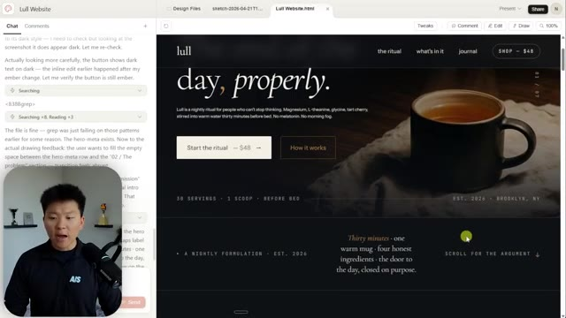
*⏱️ 00:13:01 — Vue détaillée de l'interface montrant une fine ligne ajoutée graphiquement sous la section texte, correspondant au commentaire audio sur l'itération.*

---

### ⏱️ `[00:13:06 - 00:13:27]` | Segment #28

**🔊 Audio (Transcription Intégrale Mot pour Mot en Français) :**
> Okay, so anyways, at this point, we would read through all the copy and we would iterate. And like I said, I think that this looks pretty solid. But now, if you are not someone who's creative, you might be like, okay, what do I even add? If you are someone who's creative, you're probably gonna have a lot of features that you wanna add. And at that point, you'll iterate, make some changes, make some prompts. But let's say you just wanna know what else is possible and you wanna see what Claude can come up with.

**👁️ Analyse Visuelle d'Écran (gemini-3.5-flash-lite) :**
**Interface & Outils** : Navigateur web (outil de design/collaboration type Figma ou plateforme de développement IA).

**Contenu textuel & Code** : Interface utilisateur du site web avec texte promotionnel sur des ingrédients (Glycine, Tart Cherry) et logs textuels de l'IA (mentionnant "grep", "hero-meta", et des retours sur le design).

**Action / Démonstration** : Revue de conception web et interaction avec un agent IA pour itérer sur le contenu et la mise en page.

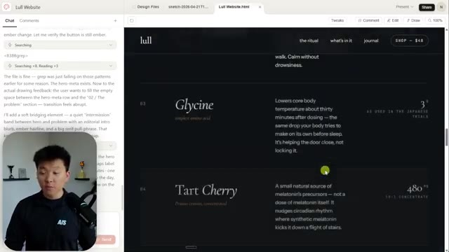
*⏱️ 00:13:11 — Interface de conception web montrant un aperçu du site "Lull" avec un volet de chat interactif à gauche contenant des commentaires et des logs de recherche technique.*

---

### ⏱️ `[00:13:27 - 00:14:00]` | Segment #29

**🔊 Audio (Transcription Intégrale Mot pour Mot en Français) :**
> Watch this, you come into here. This is a really great iteration one. I want to see what else is possible I want to see how this website could be improved So just add a bunch of things that I can tweak and put those on there for me different colors different sliders different Panels and just give me a bunch of things to play with And this is one of the biggest benefits and things that I love about cloud design even compared to other You know website builders is that we have this tweaks panel right here Right now we have none But it's going to add a bunch of tweaks that we can just play with in real time and that way we're able to see, okay, I love this, don't like this so much

**👁️ Analyse Visuelle d'Écran (gemini-3.5-flash-lite) :**
**Interface & Outils** : Interface de développement web orientée IA (semblable à V0 ou Cursor).

**Contenu textuel & Code** : Historique de modifications textuel détaillant l'ajout d'un élément de transition ("interstitial band") et l'ajustement du contenu textuel sur la page d'accueil de "Lull".

**Action / Démonstration** : L'utilisateur interagit avec l'IA pour itérer sur le design du site web en utilisant le panneau de chat pour donner des instructions de modification.

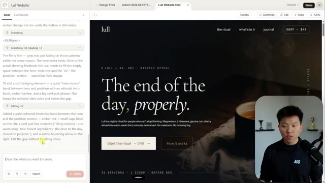
*⏱️ 00:13:36 — Une plateforme de design et développement assistée par IA (type V0.dev) affichant à gauche un journal de modifications et un chat, et à droite l'aperçu du site web "Lull".*

---

### ⏱️ `[00:14:00 - 00:14:19]` | Segment #30

**🔊 Audio (Transcription Intégrale Mot pour Mot en Français) :**
> and it has helped me feel a lot more creative in times when I'm kind of sitting there lacking inspiration. Real quick, guys, I know we're gonna be going over a lot of information today so I'm gonna throw in everything that we're talking about here, all of the different things to keep in mind into a free resource guide that you can access for completely free by joining my free school community. As you can see, join the free community.

**👁️ Analyse Visuelle d'Écran (gemini-3.5-flash-lite) :**
**Interface & Outils** : Artifacts (interface de prévisualisation web de Claude.ai) pour l'image 1 ; Site web public pour l'image 2.

**Contenu textuel & Code** : - Image 1 : Prompts utilisateur demandant des ajustements de design ("different colors, different sliders, different panels") et réponses de l'IA ("Invoking skill", "Reading", "Searching, Reading, Editing").
- Image 2 : Titre "UNLEASH THE AI SOCIETY" et mention de "n8n, Claude Code".

**Action / Démonstration** : L'agent IA est en train d'analyser la structure de fichier et d'injecter une logique de "Tweaks panel" pour permettre des modifications dynamiques sur le site.

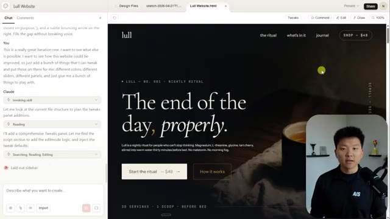
*⏱️ 00:14:05 — Interface de développement web interactive montrant une prévisualisation de site "Lull" et une barre latérale de discussion avec une IA (Claude) qui traite des demandes de modification de design.*

---

### ⏱️ `[00:14:19 - 00:14:38]` | Segment #31

**🔊 Audio (Transcription Intégrale Mot pour Mot en Français) :**
> This will take you to AI Automation Society. You will go into the classroom and inside of all YouTube resources, you will be able to find everything. The document that I'm referring to And I'm also going to include basically the zip file of this website. If you guys want to extract it and understand how it works and how the scrolling animations work, you can dive into it and you can let Claude Code or Claude Design dive into it.

**👁️ Analyse Visuelle d'Écran (gemini-3.5-flash-lite) :**
**Interface & Outils** : Plateforme communautaire web "AI Automation Society" (Skilljar ou plateforme similaire).

**Contenu textuel & Code** : Menu de navigation : Community, Classroom, Calendar, Members, etc. Vignettes : "Start Here", "7 Day AIS Challenge", "All YouTube Resources", "Claude Code", "FREE n8n Templates".

**Action / Démonstration** : Navigation dans la bibliothèque de ressources éducatives de la plateforme pour localiser les documents et fichiers zip mentionnés.

*⏱️ 00:14:24 — Interface du "Classroom" de la plateforme AI Automation Society présentant des vignettes de modules de formation, dont "All YouTube Resources".*

---

### ⏱️ `[00:14:38 - 00:15:12]` | Segment #32

**🔊 Audio (Transcription Intégrale Mot pour Mot en Français) :**
> But it's really quite simple. Like I said, I basically just said, hey, here's the video. But instead of just playing it, I want you to only associate each frame with like a scroll position so that as I scroll down or up, the video goes forward or reverses. So anyways, let's get back to the video. Okay, so our tweaks are here. And you can see on this right hand side, we have a ton of things that we could play with, which is just going to be so cool. So let's start up at the top. We have a palette. So this was the default. We could also go to more of a blue or more of a brown and more of a green or whatever these is. I'm sure you guys can't tell a ton, but the colors here are changing. Now you can see more. The background is changing. We can get sort of like a green. We can get more of a brown.

**👁️ Analyse Visuelle d'Écran (gemini-3.5-flash-lite) :**
**Interface & Outils** : Navigateur web, interface de design prototype de site web (type outil de personnalisation en temps réel).

**Contenu textuel & Code** : Panneaux de réglages : "Tweaks", "Hero Layout", "Video Dim", "Grain Overlay", "Palette", "Display Serif", "Accent Hue".

**Action / Démonstration** : Ajustement des paramètres visuels du site web (layout, filtres, couleurs) via des curseurs et des sélecteurs dans le panneau de configuration latéral.

*⏱️ 00:14:55 — Interface de design web "Lull" montrant un panneau latéral de configuration "Tweaks" avec des curseurs pour ajuster la mise en page, la vidéo et le grain.*

*⏱️ 00:15:04 — Interface de design web "Lull" avec le panneau "Tweaks" affichant des options de sélection de palette de couleurs, typographie (serif) et réglages de police.*

---

### ⏱️ `[00:15:13 - 00:15:47]` | Segment #33

**🔊 Audio (Transcription Intégrale Mot pour Mot en Français) :**
> We have more of a light mode here. So this would let you play around with what you think fits the brand the best. And obviously I don't like this because the hero looks weird. So we could tweak that. I kind of like the brown, but anyways, what else? We have the accent hue. So we can change this. You see how the hue was kind of like a gold. We can change this to see what other colors might look good with our main color scheme. For now, I really liked the default, which was kind of over here more of like a golden bronze. So we'll keep it there. We have the text as well. So I can switch this around or sorry, not the text, the font. And I can play with different fonts to see what I actually like. And we can see where else it changes. So it looks like this is changing kind

**👁️ Analyse Visuelle d'Écran (gemini-3.5-flash-lite) :**
**Interface & Outils** : Navigateur web / Éditeur de design visuel propriétaire.

**Contenu textuel & Code** : Panneau "Tweaks" affichant des sélecteurs de couleurs, une roue de teinte (accent hue), des options de polices (Cormorant, DM Serif, etc.) et des curseurs de réglage pour la taille des titres.

**Action / Démonstration** : Démonstration de la personnalisation dynamique de l'interface du site web en modifiant les paramètres visuels via le panneau de contrôle latéral.

*⏱️ 00:15:21 — Interface d'édition web "Lull" montrant un panneau latéral de personnalisation stylistique (Tweaks) avec des options de palette, de teinte d'accentuation (accent hue) et de typographie.*

---

### ⏱️ `[00:15:47 - 00:16:21]` | Segment #34

**🔊 Audio (Transcription Intégrale Mot pour Mot en Français) :**
> of the primary font everywhere. This is kind of more of a secondary, but this is changing the main text everywhere. We could also see the headline slider. So this can make it bigger or smaller, and we can play around with the way that it wraps and everything. So that's nice. The headline could be right in all uppercase. It could be lowercase, which actually I like. I'm going to keep it all lowercase. And then we can change the actual text right here. Of course, the hero layout we could play around with. Obviously, I don't want it centered. We want it left aligned because we made the video that way. So we're going to keep that. But hopefully you guys are starting to understand what I'm talking about. Now we have sort of like this overlay we can play around with. We have the video dim that we can play around with. I'm sure you guys, unfortunately,

**👁️ Analyse Visuelle d'Écran (gemini-3.5-flash-lite) :**
**Interface & Outils** : Interface de design web interactive (type Vercel v0 ou outil similaire de prototypage en temps réel).

**Contenu textuel & Code** : Panneau "Tweaks" : réglages Palette, Accent hue, Display serif, Headline size (slider), Headline case (As written, Uppercase), Hero headline copy, Hero layout.

**Action / Démonstration** : Manipulation interactive des styles CSS (taille de police, casse, alignement) via le panneau de contrôle "Tweaks" pour modifier le rendu visuel de la page d'accueil en temps réel.

*⏱️ 00:15:56 — Interface de personnalisation de site web "Lull" montrant un panneau latéral "Tweaks" avec des réglages de palette, de teinte, de police et un curseur de taille de titre (112px).*

*⏱️ 00:16:04 — Interface de personnalisation de site web "Lull" où le titre est passé en minuscules, avec le panneau "Tweaks" affichant des options pour la casse du titre et la mise en page (Left, Centered, Right).*

---

### ⏱️ `[00:16:21 - 00:16:43]` | Segment #35

**🔊 Audio (Transcription Intégrale Mot pour Mot en Français) :**
> you can't really see. I wish that they could move. Like I wish you could drag this tweak slider anywhere, but I'm sure that'll come. We have something called section rhythm, which I probably have to scroll down to see what that is. Okay. So this is basically just like the gaps between the sections. So we could make that smaller or larger. We have the ritual card style. I'm not sure where the rituals are. Here they are. So flat, bordered, or big numerals. I think I like the big numerals.

**👁️ Analyse Visuelle d'Écran (gemini-3.5-flash-lite) :**
**Interface & Outils** : Interface de développement ou de prévisualisation web (type outil de design/prototypage).

**Contenu textuel & Code** : Panneau de contrôle "TWEAKS" affichant des sliders pour : Video Dim (12%), Grain Overlay (6%), Section Rhythm (96px) et des options de style (Ritual Card Style, Interstitial Band).

**Action / Démonstration** : Manipulation des curseurs de réglage (sliders) pour ajuster le design de la page en temps réel.

*⏱️ 00:16:27 — Une interface de site web avec un panneau latéral "TWEAKS" ouvert à droite, permettant d'ajuster des paramètres de design comme le "Section Rhythm", le "Video Dim" et le "Grain Overlay".*

---

### ⏱️ `[00:16:43 - 00:17:14]` | Segment #36

**🔊 Audio (Transcription Intégrale Mot pour Mot en Français) :**
> So yeah, I'm sure you guys get the point by now. We're able to just play around with the tweaks. And of course we could just hit reset, which would reset everything. So there's really nothing to lose here. Actually making tweaks and then saving those changes is going to save you more time and also more of your session limit than if you're just having a conversation back and forth with Claude because we all know how that can go if you just shoot off prompt after prompt after prompt after prompt. Because also think about the fact that if you were doing this in Claude code and you had all these tweaks that you wanted to play with, this is basically like, hey, I wonder what it would look like if the background was blue. And then you would have to go submit the prompt.

**👁️ Analyse Visuelle d'Écran (gemini-3.5-flash-lite) :**
**Interface & Outils** : Environnement de développement web interactif ou éditeur de site basé sur l'IA (type V0 ou plateforme de prototypage similaire).

**Contenu textuel & Code** : Panneau de configuration "TWEAKS" avec des curseurs (Video dim, Grain overlay, Section rhythm) et des options de sélection de style (Hero layout, Ritual card style).

**Action / Démonstration** : Démonstration interactive de modification des paramètres de design en temps réel ("tweaking") et présentation de l'historique des modifications apportées par l'agent IA dans la barre latérale.

*⏱️ 00:16:51 — Interface web affichant un panneau de contrôle "TWEAKS" superposé sur une page de destination design, permettant de modifier en temps réel la mise en page, la luminosité vidéo et les styles de cartes.*

*⏱️ 00:17:06 — Interface de développement ou d'édition web avec une barre latérale de chat "Fork verifier agent" détaillant les actions effectuées sur le code et les options de personnalisation disponibles.*

---

### ⏱️ `[00:17:14 - 00:17:47]` | Segment #37

**🔊 Audio (Transcription Intégrale Mot pour Mot en Français) :**
> Claude code would change the background. It would put it on a local host. And then you'd look at it be like, I actually don't like that. So then you would have to like revert back to the old version. And so that could potentially be two prompts. Whereas here we can see so much stuff and test it out in a way that doesn't actually make us send more prompts and send more prompts. Now, one thing I noticed is I don't think there's like a revert button in lovable. You can just like revert back to previous prompts, which is nice. I don't see that here, but once again, this ability to do tweaks saves us from having to do a lot of reverts because we can say, Hmm, I wonder what it might look like if the font was changed, or I wonder what it might look like

**👁️ Analyse Visuelle d'Écran (gemini-3.5-flash-lite) :**
**Interface & Outils** : Application web de prévisualisation et de design interactif avec panneau de contrôle latéral (type "Tweaks").

**Contenu textuel & Code** : Panneau de configuration avec options de palette (swatches), réglage de teinte (Accent hue), choix de polices (Display serif) et curseurs de taille (Headline).

**Action / Démonstration** : Démonstration de modifications visuelles en temps réel sur le site, illustrant la capacité de tester instantanément des changements de design sans avoir besoin de recoder.

*⏱️ 00:17:22 — Interface web montrant la personnalisation en temps réel d'un site (Lull Website) avec un panneau "TWEAKS" à droite permettant de modifier la palette de couleurs et la typographie.*

*⏱️ 00:17:31 — Même interface web où le site bascule instantanément vers une palette de couleurs plus claire (fond blanc/crème) via le panneau de contrôle latéral.*

---

### ⏱️ `[00:17:47 - 00:18:10]` | Segment #38

**🔊 Audio (Transcription Intégrale Mot pour Mot en Français) :**
> if the spacing between sections was smaller. And then if you don't like it, it's as simple as just not doing it. So once you're good with the tweaks, you just turn that off. If you made any changes, it would just go ahead and start making those changes for you. And now what's awesome is you have this project set up, whether you're doing this in Cloud Design or in Cloud Code, you can keep iterating because you understand the idea of how do you get a dynamic element like this?

**👁️ Analyse Visuelle d'Écran (gemini-3.5-flash-lite) :**
**Interface & Outils** : Application web propriétaire de design/édition avec assistant IA intégré (type interface de prototypage).

**Contenu textuel & Code** : Liste de commandes d'édition (Hero layout, Video dim, Section rhythm, etc.) et panneau de paramètres visuels (Palette, Accent hue, Display serif).

**Action / Démonstration** : Démonstration de la personnalisation dynamique d'un design de site web via l'ajustement de curseurs et de paramètres dans le panneau "Tweaks".

*⏱️ 00:17:53 — Interface de prévisualisation de site web avec un panneau latéral "TWEAKS" ouvert, permettant de modifier la palette de couleurs, la typographie et la taille des titres en temps réel.*

*⏱️ 00:17:59 — Vue de l'interface de design web montrant le héros du site "Lull" et le panneau de chat latéral gauche détaillant les options de personnalisation disponibles via l'agent.*

*⏱️ 00:18:04 — Vue identique à l'image précédente, illustrant la navigation sur le site web "Lull" tout en conservant le panneau de contrôle de l'agent IA à gauche.*

---

### ⏱️ `[00:18:10 - 00:18:29]` | Segment #39

**🔊 Audio (Transcription Intégrale Mot pour Mot en Français) :**
> Or how do you do one of those scroll things where you just tell it that as you're scrolling, you want it to play the frames backwards or forwards? So let's say we have this that we love and maybe down here we want to have like maybe a video of someone sleeping. That would be really creepy. But now if you basically just break the website into sections. So the hero section.

**👁️ Analyse Visuelle d'Écran (gemini-3.5-flash-lite) :**
**Interface & Outils** : Navigateur web (image 1), outil de design/prototypage type Figma ou environnement de développement web (image 2).

**Contenu textuel & Code** : Image 1 : "4X SKOOL GAMES WINNER", "Top 5", "100K+". Image 2 : Panneau de réglages avec options ("Hero layout", "Video dim", "Section rhythm", "Ritual card style", "Interstitial band").

**Action / Démonstration** : Le présentateur explique et manipule les interfaces de conception de sites web, illustrant le processus de développement et de personnalisation visuelle.

*⏱️ 00:18:15 — Interface web d'un site présentant des statistiques de succès ("4X SKOOL GAMES WINNER") avec des blocs de données chiffrées sur fond sombre.*

*⏱️ 00:18:20 — Interface de design/prototypage web nommée "Lull Website" affichant un panneau de contrôle latéral avec des paramètres de style et une prévisualisation de site web au centre.*

---

### ⏱️ `[00:18:29 - 00:18:48]` | Segment #40

**🔊 Audio (Transcription Intégrale Mot pour Mot en Français) :**
> Okay, cool. Section one. What can we do to section one to make this cool? Maybe we just add like a dynamic background where there's like shooting stars or something like that. And then section three. Maybe we have like a little dynamic video of someone stirring coffee, you know? We can just kind of keep taking it section by section. and that way it's not so overwhelming of, oh my gosh, I have to build a whole website.

**👁️ Analyse Visuelle d'Écran (gemini-3.5-flash-lite) :**
**Interface & Outils** : Éditeur de design/prototypage web (type Framer ou outil similaire).

**Contenu textuel & Code** : Panneau de configuration affichant des options de personnalisation : "Hero layout", "Video dim and grain overlay", "Section rhythm", "Ritual card style", "Interstitial band and scroll hint", "Price slider" et "CTA label".

**Action / Démonstration** : Modification des paramètres visuels de la section du site web (titre "02 / THE PROBLEM").

*⏱️ 00:18:34 — Interface de conception web montrant une page "Lull" avec un panneau latéral de contrôle des réglages du site.*

---

### ⏱️ `[00:18:49 - 00:19:08]` | Segment #41

**🔊 Audio (Transcription Intégrale Mot pour Mot en Français) :**
> Just take it section by section and just use these principles. Use Claude to help you think of, okay, for section two, help me figure out like right here, what type of video should I have or what type of elements should I have? And then, okay, cool, make me the prompts. And then I'll go into Key and I'll make the images, I'll make the videos and then I'll bring them back into Claude.

**👁️ Analyse Visuelle d'Écran (gemini-3.5-flash-lite) :**
**Interface & Outils** : Interface web de Claude.ai.

**Contenu textuel & Code** : Un prompt demandant de l'aide pour définir le concept d'un site web, suivi d'une réponse détaillée de l'IA décrivant le branding du produit "Lull" (une boisson pour le sommeil à base de magnésium).

**Action / Démonstration** : Le présentateur illustre l'utilisation de Claude comme partenaire stratégique pour définir l'identité visuelle et textuelle d'un projet avant de passer à la phase de conception technique.

*⏱️ 00:18:54 — Une capture d'écran de l'interface de conversation Claude montrant un échange sur la création d'une marque fictive appelée « Lull ». Le présentateur est visible en médaillon dans le coin inférieur gauche.*

---

### ⏱️ `[00:19:08 - 00:19:34]` | Segment #42

**🔊 Audio (Transcription Intégrale Mot pour Mot en Français) :**
> And you'll just keep iterating. And I think you'll find that it's really, really fun. You have the fundamentals, you understand how the tool works and now you keep going. But now you're at the point where, let's say you're good with this website. You know, you could also click on present. You could open it up. You could make sure it feels good. You could make sure the buttons are linking to the right spots. And then what do you do next? Well, what we want to do is we want to get this into Cloud Code so we can push it into a GitHub repository and so that we can push that GitHub repository to Vercel.

**👁️ Analyse Visuelle d'Écran (gemini-3.5-flash-lite) :**
**Interface & Outils** : Éditeur web de type CMS ou outil de prototypage interactif.

**Contenu textuel & Code** : Texte du site "Lull" (produit de sommeil), paramètres de mise en page (Hero layout, section rhythm, etc.), menus de navigation.

**Action / Démonstration** : Navigation et démonstration du rendu visuel en mode présentation ("Present").

*⏱️ 00:19:14 — Interface de conception web montrant un site intitulé "Lull" avec un panneau de contrôle latéral pour ajuster les mises en page et les paramètres visuels.*

*⏱️ 00:19:21 — Aperçu du site web "Lull" en mode plein écran, montrant une typographie élégante sur fond sombre avec un indicateur de défilement.*

*⏱️ 00:19:27 — Aperçu de la page d'accueil du site "Lull" avec une image d'illustration d'une tasse de thé et du texte promotionnel.*

---

### ⏱️ `[00:19:34 - 00:20:10]` | Segment #43

**🔊 Audio (Transcription Intégrale Mot pour Mot en Français) :**
> So if that makes no sense to you at all, I'm going to explain it all. So don't worry. What we're going to do first is we're going to click on share and we're just going to go ahead and download this product as a zip file or a zip folder. So i'm going to download as zip you could also just hit hand off the cloud code Which would give you a command you would copy this give it to cloud code and then it would be able to pull everything in Today this morning i've been having issues with this command. It's been getting a 404 error So it's worked in the past. This will probably work by the time you see this video But that's also an option. But the other option is you just grab the zip file. All right. So here's that zip file I'm going to go ahead and extract all and I actually want to place this into a folder

**👁️ Analyse Visuelle d'Écran (gemini-3.5-flash-lite) :**
**Interface & Outils** : Interface de design web (type outil de prototypage/génération d'UI) et fenêtre modale de Claude Code.

**Contenu textuel & Code** : Commande affichée dans la fenêtre Claude Code : "Fetch this design file, read its readme, and implement the relevant aspects of the design...".

**Action / Démonstration** : Sélection de l'option de téléchargement du projet en format .zip, suivie de la génération d'une commande de transfert vers un agent de codage local.

*⏱️ 00:19:43 — Interface d'édition de design web affichant un menu déroulant "Share" avec l'option "Download project as zip" sélectionnée.*

*⏱️ 00:19:52 — Fenêtre contextuelle "Claude Code" affichant une commande de transfert de projet prête à être copiée pour un agent de codage.*

---

### ⏱️ `[00:20:10 - 00:20:42]` | Segment #44

**🔊 Audio (Transcription Intégrale Mot pour Mot en Français) :**
> So i've already created a folder on my desktop and it is called lull website So i'm going to click into lull website and i'm going to select that folder to extract it into It kind of sounded like I was saying lull website as if website was a wrapper like lull website But now we have lull website and this is the folder that we want to open up inside of cloud code So here I am i'm using it in the vs code IDE and i'm going to go ahead and open up that project Okay, so now that we are in here, we're going to open up cloud code and we're going to get started You can see basically over here what we have is we have the background video

**👁️ Analyse Visuelle d'Écran (gemini-3.5-flash-lite) :**
**Interface & Outils** : Explorateur de fichiers Windows, Visual Studio Code.

**Contenu textuel & Code** : Arborescence de fichiers ("assets", "scraps", "uploads", "Lull Website.html"), commandes de menu VS Code ("Open Folder").

**Action / Démonstration** : Sélection d'un répertoire de destination pour l'extraction de fichiers, puis ouverture dudit dossier dans Visual Studio Code.

*⏱️ 00:20:18 — Fenêtre de l'explorateur de fichiers Windows affichant le contenu du dossier "Downloads" pour sélectionner une destination d'extraction.*

*⏱️ 00:20:26 — Explorateur de fichiers Windows montrant le contenu du dossier "Lull Website", incluant les sous-dossiers "assets", "scraps", "uploads" et le fichier HTML.*

*⏱️ 00:20:34 — Interface de Visual Studio Code avec le menu "File" ouvert, mettant en évidence l'option "Open Folder".*

---

### ⏱️ `[00:20:42 - 00:21:17]` | Segment #45

**🔊 Audio (Transcription Intégrale Mot pour Mot en Français) :**
> We have scraps which was our sketch and we have the uploads and we have the html So this is basically our full project from cloud design, but now it's inside of cloud code and i'm literally just going to say Hey, this is a website project for our brand called lull All I want you to do is push this to a github repository Push it to a private repository and call it whatever you want and because i've already used github with my cloud code It's going to be able to just push it and it's gonna be able to create that repo But if you've never done this before all you want to do is go to github.com It's free to create an account. You're going to log in and then basically

**👁️ Analyse Visuelle d'Écran (gemini-3.5-flash-lite) :**
**Interface & Outils** : Visual Studio Code (VS Code) intégrant l'extension Claude Code.

**Contenu textuel & Code** : Arborescence de fichiers : "assets", "scraps", "uploads", et "Lull Website.html". Interface de chat Claude Code avec l'invite : "Type /model to pick the right tool for the job."

**Action / Démonstration** : Le présentateur s'apprête à interagir avec l'agent Claude Code pour traiter le projet de site web "Lull" importé dans l'environnement de développement.

*⏱️ 00:20:51 — Capture d'écran montrant l'interface de VS Code avec le plugin/extension "Claude Code" ouvert, affichant la structure de fichiers d'un projet intitulé "LULL WEBSITE".*

---

### ⏱️ `[00:21:17 - 00:21:39]` | Segment #46

**🔊 Audio (Transcription Intégrale Mot pour Mot en Français) :**
> You just need to connect this to your cloud code So if you ask cloud code to connect it, it'll say sure just let me pull up the authorization page You'll have to sign in and now cloud code can talk to your github push changes create repositories Things like that And then the second piece of this is you're going to need to create an account At verse sell so verse sell is basically just a place for you to host and deploy your web apps and your website.

**👁️ Analyse Visuelle d'Écran (gemini-3.5-flash-lite) :**
**Interface & Outils** : GitHub (interface utilisateur web)

**Contenu textuel & Code** : Barre de recherche contextuelle GitHub : "Ask anything or type @ to add context" ; Boutons d'action : "Agent", "Create issue", "Write code", "Git", "Pull requests".

**Action / Démonstration** : Présentation de l'intégration de capacités d'IA directement dans le tableau de bord GitHub pour permettre l'interaction et la gestion de code.

*⏱️ 00:21:23 — Interface GitHub personnalisée affichant un tableau de bord avec une barre de recherche centrale "Ask anything or type @ to add context" et des options d'IA intégrées.*

---

### ⏱️ `[00:21:39 - 00:21:58]` | Segment #47

**🔊 Audio (Transcription Intégrale Mot pour Mot en Français) :**
> So it should look like this. And when you sign up for Vercel, you can sign up with your GitHub account, which makes it super easy because then you can just sync a GitHub repo to Vercel. Because if you think about it, when you have a GitHub repository, all this is basically is, is its folders and its files and its code. And GitHub stores them. So what you need to do is you need to get that code somewhere on the web.

**👁️ Analyse Visuelle d'Écran (gemini-3.5-flash-lite) :**
**Interface & Outils** : Vercel Dashboard, GitHub Repositories.

**Contenu textuel & Code** : Noms des dépôts comme "seedance-demo", "nateherk-com", "token-dashboard", "claude-workflow-builder".

**Action / Démonstration** : Navigation et présentation visuelle de l'écosystème de déploiement (Vercel) et de stockage de code source (GitHub) pour illustrer la synchronisation.

*⏱️ 00:21:44 — Tableau de bord Vercel affichant la liste des projets actifs et les statistiques d'utilisation (Edge Requests, Image Optimization).*

*⏱️ 00:21:49 — Interface GitHub montrant la liste des dépôts (repositories) de l'utilisateur, notamment ceux liés à l'automatisation et à l'IA.*

---

### ⏱️ `[00:21:58 - 00:22:19]` | Segment #48

**🔊 Audio (Transcription Intégrale Mot pour Mot en Français) :**
> And that's what Vercel does. And there you go. Super easy. I didn't have to do anything. It says your website is now a GitHub repo. I can follow this link to open it up. and this is the actual repository that we just pulled in from Cloud Design. Now, honestly, before we push this, we probably should have made sure that it worked. So make sure that the website actually works as expected and open it up in a local host for me to view.

**👁️ Analyse Visuelle d'Écran (gemini-3.5-flash-lite) :**
**Interface & Outils** : Visual Studio Code (avec extension de chat IA), GitHub (navigateur web).

**Contenu textuel & Code** : Commandes Git (`git commit`, `gh repo create`), lien vers le dépôt GitHub `nateherkai/lull-website`.

**Action / Démonstration** : Automatisation de la création d'un dépôt GitHub à partir d'un dossier local via des commandes terminal exécutées par un agent IA.

*⏱️ 00:22:04 — Interface de VS Code montrant l'exécution d'une commande par un agent (Claude) pour créer et pousser un dépôt GitHub privé.*

*⏱️ 00:22:09 — Interface web du dépôt GitHub nouvellement créé nommé "lull-website", affichant la structure des dossiers du projet.*

---

### ⏱️ `[00:22:19 - 00:22:40]` | Segment #49

**🔊 Audio (Transcription Intégrale Mot pour Mot en Français) :**
> Now, I'm actually glad that I had to do this because you'll notice I said local host. So what does that mean? Local host is just a local host that will basically display our website. And so if this comes back with something like local host 3000, if you tried to give someone that URL, it wouldn't open up for them. It would open up whatever they have running on their own localhost 3000, which could be nothing.

**👁️ Analyse Visuelle d'Écran (gemini-3.5-flash-lite) :**
**Interface & Outils** : Visual Studio Code avec extension d'assistant IA.

**Contenu textuel & Code** : Historique de discussion montrant : "Done. Your Lull website is live as a private repo: https://github.com/nateherkai/lull-website", ainsi que l'action en cours : "Read c:\Users\nateh\OneDrive\Desktop\Lull Website\Lull Website.html" et "Incubating...".

**Action / Démonstration** : L'agent IA termine la poussée du code vers GitHub et commence l'analyse du fichier HTML pour servir le site localement.

*⏱️ 00:22:25 — Interface de VS Code montrant une interaction avec un assistant IA, confirmant le déploiement sur un dépôt GitHub privé et l'initialisation de l'exécution en local du site web.*

---

### ⏱️ `[00:22:41 - 00:23:04]` | Segment #50

**🔊 Audio (Transcription Intégrale Mot pour Mot en Français) :**
> I actually saw some funny tweets where it was like a beginner getting into Cloud Code saying, look at this awesome web app I built. And they sent out the localhost URL and everyone was, obviously they couldn't open it. So here is the localhost. It opened up our website. You can see we have the video playing. We have all of the text coming in dynamically. So everything is basically being transferred over from Cloud Design over to Cloud Code seamlessly, no issues.

**👁️ Analyse Visuelle d'Écran (gemini-3.5-flash-lite) :**
**Interface & Outils** : VS Code (avec terminal intégré) et navigateur web affichant le site "Lull".

**Contenu textuel & Code** : Commandes bash : `python -m http.server 8765 --bind 127.0.0.1` et `curl` pour vérifier l'accès au HTML et à la vidéo.

**Action / Démonstration** : Le présentateur démontre le processus de mise en ligne locale d'un projet web via un serveur de développement, puis navigue sur le résultat final.

*⏱️ 00:22:47 — L'interface de VS Code montrant l'exécution d'un serveur HTTP local via un terminal intégré pour tester un site web.*

*⏱️ 00:22:53 — Capture du site web "Lull" affiché en plein écran, présentant une interface moderne avec une image de tasse et du texte stylisé.*

*⏱️ 00:22:58 — Suite du défilement sur le site web "Lull", mettant en avant la section "The Formula" et les détails des ingrédients.*

---

### ⏱️ `[00:23:05 - 00:23:25]` | Segment #51

**🔊 Audio (Transcription Intégrale Mot pour Mot en Français) :**
> And now that this is actually a GitHub repo, let's connect this to Vercel to put it on the web so that I could actually give you a URL and you could view my website. So back in Vercel, you guys are gonna be shocked at how easy this is. You click on add new, you click on add new project. And then right here, because I'm signed in with my GitHub repo or my GitHub account, I basically just click on this website and I say import.

**👁️ Analyse Visuelle d'Écran (gemini-3.5-flash-lite) :**
**Interface & Outils** : GitHub, Vercel (Dashboard et Import flow).

**Contenu textuel & Code** : Noms des dépôts GitHub (lull-website, token-dashboard, trading-routine), statistiques d'utilisation Vercel et options de déploiement.

**Action / Démonstration** : Transition de la phase de création de code sur GitHub vers la configuration du déploiement sur la plateforme Vercel pour rendre le site accessible via une URL.

*⏱️ 00:23:10 — Interface GitHub affichant le dépôt "lull-website" nouvellement créé par l'utilisateur.*

*⏱️ 00:23:15 — Tableau de bord Vercel montrant la liste des projets actifs de l'utilisateur.*

*⏱️ 00:23:20 — Interface de déploiement Vercel montrant la section "Import Git Repository" avec la liste des dépôts GitHub disponibles.*

---

### ⏱️ `[00:23:25 - 00:23:58]` | Segment #52

**🔊 Audio (Transcription Intégrale Mot pour Mot en Français) :**
> It's looking through my projects. It's gonna pull in this project. And then I basically just say deploy. This will take maybe 60 seconds and then it'll give us an actual URL for our website. Now, the cool part about this is if you ever make changes to your site, you basically now have a practice environment and a real environment. So if I'm on my local host here, you know, and I'm working inside of Cloud Code and I'm doing things, basically what happens is I can make changes and I can iterate, but only I will see these changes. So if I wanted to change the copy or if I wanted to change the background video, but then once we're good with

**👁️ Analyse Visuelle d'Écran (gemini-3.5-flash-lite) :**
**Interface & Outils** : Vercel (plateforme de déploiement), Navigateur web, Visual Studio Code (avec Claude AI).

**Contenu textuel & Code** : URL locale (127.0.0.1:8765), logs de serveur Python, configuration de projet Git sur Vercel.

**Action / Démonstration** : Déploiement automatisé d'un projet web via Vercel, vérification du serveur local dans VS Code, et démonstration du site en ligne.

*⏱️ 00:23:34 — Interface de configuration Vercel pour le déploiement d'un nouveau projet nommé "lull-website" importé depuis GitHub.*

*⏱️ 00:23:42 — Visualisation du rendu final du site web "lull" une fois déployé, avec son interface utilisateur élégante.*

*⏱️ 00:23:50 — Éditeur VS Code avec l'extension Claude, montrant les logs d'exécution du serveur local et la confirmation de la mise en ligne du site.*

---

### ⏱️ `[00:23:58 - 00:24:17]` | Segment #53

**🔊 Audio (Transcription Intégrale Mot pour Mot en Français) :**
> those changes, I come back into here and I say, hey, Cloud Code, push all of these changes to GitHub. And then when the changes come to GitHub and they come over here, Vercel automatically grabs that and deploys it to the live site. So you have a very clean separation between what you're practicing with and changes that you might want to make. And then saying, hey, cool. We love this.

**👁️ Analyse Visuelle d'Écran (gemini-3.5-flash-lite) :**
**Interface & Outils** : - Image #1 : Visual Studio Code avec extension Claude.
- Image #2 : Interface web GitHub (dépôt privé).

**Contenu textuel & Code** : - Image #1 : Logs de l'agent confirmant le lancement du serveur Python sur le port 8765 et l'ouverture automatique dans le navigateur.
- Image #2 : Liste des dossiers (assets, scraps, uploads) et du fichier HTML principal poussés sur GitHub.

**Action / Démonstration** : - Image #1 : Exécution locale du serveur pour prévisualisation du site web.
- Image #2 : Confirmation visuelle de la synchronisation des fichiers de travail vers le dépôt distant GitHub.

*⏱️ 00:24:03 — Interface de VS Code montrant l'agent Claude traitant une requête pour lancer un serveur local et ouvrir le site web.*

*⏱️ 00:24:08 — Interface du dépôt GitHub privé "lull-website" montrant les fichiers du projet après le push initial.*

---

### ⏱️ `[00:24:18 - 00:24:50]` | Segment #54

**🔊 Audio (Transcription Intégrale Mot pour Mot en Français) :**
> Push that public. And then Vercel will grab it. And then it will be live in like 30 seconds later. So anyways, congratulations. You just deployed a new project on Vercel. I'm going to go ahead and click on continue to the dashboard. And now we have an actual domain. So this is a, you know, lol-website.versell.app. And if I open this up, aha. Okay. So when I opened this up, it says 404 not found. So what do we do here? You go back into Cloud Code and you say, so I just pushed that to GitHub and then I synced that to Vercel to host it on the web. And when I opened it up, it gave me

**👁️ Analyse Visuelle d'Écran (gemini-3.5-flash-lite) :**
**Interface & Outils** : Vercel Dashboard, Visual Studio Code (avec plugin d'agent IA).

**Contenu textuel & Code** : Commande `npx plugins add vercel/vercel-plugin`, logs de serveur local Python sur le port 8765, structure de fichiers (assets, scraps, uploads, Lull Website.html).

**Action / Démonstration** : Installation d'un plugin Vercel pour agent IA et visualisation de l'état d'un serveur web local en cours d'exécution.

*⏱️ 00:24:26 — Interface Vercel affichant un message d'erreur 404 suivi d'une section pour installer un plugin d'agent de codage via une commande terminal.*

*⏱️ 00:24:42 — Éditeur Visual Studio Code (VS Code) affichant une conversation avec un agent IA détaillant le déploiement local d'un site web via un serveur Python sur le port 8765.*

---

### ⏱️ `[00:24:50 - 00:25:09]` | Segment #55

**🔊 Audio (Transcription Intégrale Mot pour Mot en Français) :**
> this error message. What does this mean? How do I fix this? Do you need any more info from me in order to actually help me fix this? It was able to find the cause right away. Vercel serves this from the root of your repo by default, but the repo has a different path instead. So that's why I can't find anything. So the fix is it needs to rename the whole website to index.html.

**👁️ Analyse Visuelle d'Écran (gemini-3.5-flash-lite) :**
**Interface & Outils** : VS Code (avec extension de chat IA intégrée, probablement Cursor ou un outil similaire).

**Contenu textuel & Code** : - Erreur : "404: NOT_FOUND"
- Explication IA : "Vercel serves index.html from the root of your repo by default. Your repo has Lull Website.html instead."
- Commande Bash : `cd "..." && git mv "Lull Website.html" "index.html" && git status --short`

**Action / Démonstration** : Diagnostic d'un problème de déploiement Vercel et résolution par renommage du fichier principal via une commande Git dans le terminal de l'éditeur.

*⏱️ 00:24:55 — Vue de l'interface VS Code avec une discussion active avec une IA. Le message d'erreur "404: NOT_FOUND" retourné par Vercel est affiché.*

*⏱️ 00:25:00 — L'IA explique la cause de l'erreur (Vercel attend "index.html" mais trouve "Lull Website.html") et propose une commande Bash pour renommer le fichier.*

---

### ⏱️ `[00:25:10 - 00:25:34]` | Segment #56

**🔊 Audio (Transcription Intégrale Mot pour Mot en Français) :**
> And then look, it pushed those changes to GitHub. So if I now go to the GitHub repo, which was this one, and I give this a refresh, we should see here that we have two commits, which means that we've made two different pushes. So we've made a change. And then what happens if I go back to Vercel, so back here, you can already see the website is now rendering properly. And if I also click on deployments, we can see once again that we have a change that was made one minute ago, which was renaming to index.html.

**👁️ Analyse Visuelle d'Écran (gemini-3.5-flash-lite) :**
**Interface & Outils** : GitHub (Dépôt) et Vercel (Tableau de bord des déploiements).

**Contenu textuel & Code** : - Image 1 : Structure de fichiers (assets, scraps) et métadonnées du dépôt.
- Image 2 : Liste des déploiements avec leurs IDs (GwlxBsran, 52T4ICsA4), statuts "Ready" et messages de commit associés (ex: "Rename to index.html").

**Action / Démonstration** : Vérification de la synchronisation entre les modifications poussées sur GitHub et le déploiement automatique correspondant sur Vercel.

*⏱️ 00:25:16 — Vue du dépôt GitHub "lull-website" montrant les fichiers du projet et l'historique des commits.*

*⏱️ 00:25:28 — Interface Vercel affichant la liste des "Deployments" du projet, avec deux déploiements listés comme "Ready".*

---

### ⏱️ `[00:25:34 - 00:25:55]` | Segment #57

**🔊 Audio (Transcription Intégrale Mot pour Mot en Français) :**
> So now I could click on this domain and I could see that we actually have our real site just the way that we saw it on our local host. And everything should be coming through properly because we've made that fix. Now, one other quick thing I wanted to talk about when it comes to actually deploying your site is that you built this to be optimized for a laptop or for a computer.

**👁️ Analyse Visuelle d'Écran (gemini-3.5-flash-lite) :**
**Interface & Outils** : Navigateur web (Google Chrome ou similaire) affichant le site web e-commerce de la marque "lull".

**Contenu textuel & Code** : Textes marketing, interface utilisateur de boutique en ligne (UI), sélecteurs de produits et tarification.

**Action / Démonstration** : Navigation et démonstration du rendu final du site web déployé en ligne pour valider que le design correspond au développement local.

*⏱️ 00:25:39 — Page d'accueil du site web "lull" avec un design sombre et minimaliste, montrant le haut de page avec le titre et un bouton "Start the ritual".*

*⏱️ 00:25:44 — Section intermédiaire du site web "lull" détaillant les options d'achat du produit (abonnement ou achat unique) avec une interface de sélection de prix.*

*⏱️ 00:25:49 — Vue globale de la section "Hero" du site web "lull" avec le titre "The end of the day, properly" et le produit mis en avant.*

---

### ⏱️ `[00:25:55 - 00:26:23]` | Segment #58

**🔊 Audio (Transcription Intégrale Mot pour Mot en Français) :**
> So if you come into your site on the local host before you deploy it and you hit F12 or you just open up your developer console, you can click this button right here to switch to mobile view. So this is actually what we'd be seeing if I open up the site on mobile, which obviously is not good. So you would need to go back and iterate a little bit and tell Cloud Code to optimize this for mobile. Maybe we want the image to be, or I keep saying image, maybe we want the video to be kind of down here instead, or maybe we just want the font to be displayed in one line and then have more stuff down here.

**👁️ Analyse Visuelle d'Écran (gemini-3.5-flash-lite) :**
**Interface & Outils** : Google Chrome Developer Tools (mode responsive design).

**Contenu textuel & Code** : Rendu visuel d'une page produit mobile avec texte "The end of the day, properly." et bouton "Start the ritual".

**Action / Démonstration** : Utilisation du simulateur d'appareil mobile au sein des outils de développement pour inspecter le rendu responsive d'un site local.

*⏱️ 00:26:02 — Vue scindée montrant à gauche un aperçu mobile non optimisé d'un site web ("lull") dans les outils de développement, et à droite la console Chrome DevTools avec une fenêtre incrustée du présentateur.*

---

### ⏱️ `[00:26:24 - 00:26:44]` | Segment #59

**🔊 Audio (Transcription Intégrale Mot pour Mot en Français) :**
> So that is something to think about. You need to be thinking about how will this actually look if I'm on a mobile device compared to if I am on my computer or even like a tablet and stuff like that. So the point being, Claude design and Claude code don't automatically optimize for mobile, but if you tell it you need to optimize for mobile, it will certainly help you figure out the way to restructure it.

**👁️ Analyse Visuelle d'Écran (gemini-3.5-flash-lite) :**
**Interface & Outils** : Chrome DevTools (mode responsive), Navigateur web.

**Contenu textuel & Code** : Prévisualisation d'une page web mobile (dimensions 590px de large) affichant le texte "lull" et "of the day, properly", avec les panneaux "Elements" et "Console" des outils de développement ouverts à droite.

**Action / Démonstration** : Le créateur illustre l'importance de tester l'affichage et la réactivité d'un site web sur différents formats d'appareils (mobile vs ordinateur).

*⏱️ 00:26:29 — Une capture d'écran montrant les outils de développement (Chrome DevTools) avec un simulateur d'appareil mobile actif pour tester la réactivité (responsive design) d'une page web "Lull".*

---

### ⏱️ `[00:26:44 - 00:27:20]` | Segment #60

**🔊 Audio (Transcription Intégrale Mot pour Mot en Français) :**
> And you can do all that without having it actually impact the way that it appears on the web, on your computer version. So just something else I wanted to make sure you guys were aware of. And you can see right here that we're using a .forcell.app domain. So if you wanted to change this, you would just have to bring in your own custom domain It takes maybe five minutes and you can just talk to claude to figure out how to do that It's super simple But let's hop into some of this other stuff now And dive a little bit deeper into how to get the most out of claude design So claude design is its own product It it kind of feels like what they did with claude co-work How they basically packaged up different workflows and different functionality into something that's a little bit more

**👁️ Analyse Visuelle d'Écran (gemini-3.5-flash-lite) :**
**Interface & Outils** : Navigateur web (site Lull), Plateforme de déploiement cloud (Vercel), Interface de présentation (Google Slides/PowerPoint).

**Contenu textuel & Code** : URL de domaine "lull-website.vercel.app", informations techniques sur "Claude Design" (version Opus 4.7, résolution d'image).

**Action / Démonstration** : Démonstration du rendu final d'un site web et visualisation de son hébergement sur la plateforme Vercel.

*⏱️ 00:26:53 — Aperçu du site web "Lull" généré, affichant une landing page élégante avec un titre accrocheur sur fond sombre.*

*⏱️ 00:27:02 — Tableau de bord Vercel montrant les détails d'un déploiement de projet, incluant l'URL de domaine en .vercel.app.*

---

### ⏱️ `[00:27:20 - 00:27:39]` | Segment #61

**🔊 Audio (Transcription Intégrale Mot pour Mot en Français) :**
> Accessible, you know, because everything that claude design does you could easily do in claude code but not everyone wants to. And they're keeping all of this in the same environment. It's built on top of Claude Opus 4.7, which has much more advanced vision capabilities than the previous models did. But of course the Opus 4.7 model does come at a bit of a cost. So keep that in mind.

**👁️ Analyse Visuelle d'Écran (gemini-3.5-flash-lite) :**
**Interface & Outils** : Présentation (diapositive pédagogique)

**Contenu textuel & Code** : Détails sur Claude Design : date de lancement (17 avril 2026), URL (claude.ai/design), capacités du modèle Opus 4.7 (résolution d'image, génération de prototypes/slides/wireframes), et informations sur la tarification et l'activation en entreprise.

**Action / Démonstration** : Présentation des points clés théoriques par le narrateur à l'appui du sujet traité.

*⏱️ 00:27:25 — Une présentation sous forme de liste à puces décrivant les fonctionnalités et spécifications techniques de "Claude Design", incluant la mention du modèle Claude Opus 4.7.*

---

### ⏱️ `[00:27:40 - 00:28:14]` | Segment #62

**🔊 Audio (Transcription Intégrale Mot pour Mot en Français) :**
> You can build prototypes, you can build slides, you can build landing pages, animated promos, so much stuff with design. Obviously today we mainly looked at websites, but there's a lot you can do. And in order to use it, you have to be on a paid plan. You cannot be on a free plan. So let's talk about the two meter system. First of all, Claude Design has its own weekly quota. So if I go back into my usage, you can see you have a current session for your plan. You have all models, you have Sonnet only, and you have your own Claude Design usage. And this is what I flew through pretty quick. And so what do the burn rates look like? People have been complaining that they're getting their session eaten up really quick. So if you're on 20 bucks a month,

**👁️ Analyse Visuelle d'Écran (gemini-3.5-flash-lite) :**
**Interface & Outils** : Paramètres de compte Anthropic / Claude (page Usage).

**Contenu textuel & Code** : Détails de consommation des ressources : « Claude Design » (100% used), « All models » (83% used), « Sonnet only » (15% used), ainsi que les temps de réinitialisation associés.

**Action / Démonstration** : Consultation des quotas d'utilisation de l'API ou des outils avancés pour démontrer la limitation des services.

*⏱️ 00:27:57 — Une vue des paramètres de compte montrant les limites d'utilisation (usage limits) pour différents modèles, notamment la barre de progression « Claude Design » atteinte à 100%.*

---

### ⏱️ `[00:28:15 - 00:28:51]` | Segment #63

**🔊 Audio (Transcription Intégrale Mot pour Mot en Français) :**
> after one big website and one big design system, you might already be almost done. If you're on the max five times plan, then you're going to have, you know, maybe four to five series prompts and you might be able to You know hit the limit pretty quick. And then if you're on the 20x plan, which i'm on I was able to build probably A few different video projects and a few different websites And then I started to get really close to the end of my limit So what actually drains your limits the fastest? Well, there are a few things first of all If you do every single thing with 4.7 Then you're obviously going to be eating more tokens than if you were on sonnet or even haiku for some very minor changes. I personally haven't done this myself. I haven't really jumped into the wireframes. I

**👁️ Analyse Visuelle d'Écran (gemini-3.5-flash-lite) :**
**Interface & Outils** : Document textuel (probablement Notion ou un éditeur de notes markdown) affiché à l'écran.

**Contenu textuel & Code** : Texte détaillé sur la stratégie d'utilisation de Claude Design, comparatifs de coûts (20$/mo, 100$/mo, 200$/mo), et recommandations techniques pour la gestion des limites d'usage et des modèles (Opus 4.7 vs Sonnet 4.6).

**Action / Démonstration** : Le présentateur illustre ses propos en faisant défiler les points clés d'une liste de recommandations stratégiques pour ne pas atteindre les limites d'utilisation de l'outil.

*⏱️ 00:28:24 — Une capture d'écran d'un document structuré expliquant le système de quotas "Claude Design", incluant une ventilation des tarifs (Pro, Max 5x, Max 20x) et leur impact sur la consommation des limites.*

*⏱️ 00:28:42 — Une capture d'écran du même document, se concentrant sur la section "3. What Drains Your Limit Fastest", détaillant des conseils pour optimiser l'utilisation de Claude (ex: passer de Opus à Sonnet, éviter les longs threads, utiliser les outils d'édition inline).*

---

### ⏱️ `[00:28:51 - 00:29:24]` | Segment #64

**🔊 Audio (Transcription Intégrale Mot pour Mot en Français) :**
> always just started with a high fidelity, but I have seen some people on X talking about that if you do the wireframe first, you're able to basically convert it better to high fidelity with less iteration. And obviously that makes sense. I mean, if you're in cloud code, I always talk about how the planning phase is so important. So get clear on your idea, give as much context up front as far as like a sketch and, you know, maybe like that cloud spec that we saw earlier in the live example. This information was able to make it so much easier for Cloud Design to build what we wanted on the first try rather than having to iterate so much because that's where you're

**👁️ Analyse Visuelle d'Écran (gemini-3.5-flash-lite) :**
**Interface & Outils** : Interface de présentation de type document (probablement un éditeur de texte ou une application de prise de notes).

**Contenu textuel & Code** : Texte détaillé sur le "Two-Meter System", les stratégies pour éviter d'épuiser les limites d'utilisation (choix des modèles Sonnet vs Opus, usage des wireframes, outils Canvas) et spécifications de design (codes hexadécimaux, recommandations typographiques).

**Action / Démonstration** : Le présentateur illustre ses conseils théoriques via ces supports visuels textuels pour guider l'audience sur l'optimisation des flux de travail avec Claude.

*⏱️ 00:28:59 — Une présentation sous forme de liste structurée intitulée "Claude Design", détaillant des bonnes pratiques pour optimiser l'utilisation des limites d'utilisation de l'IA (Claude).*

*⏱️ 00:29:16 — Une section de documentation technique décrivant une identité visuelle (palette de couleurs, typographie, imagerie) et des directives de conception pour un site web, avec une notification de limite d'utilisation en bas d'écran.*

---

### ⏱️ `[00:29:24 - 00:29:57]` | Segment #65

**🔊 Audio (Transcription Intégrale Mot pour Mot en Français) :**
> going to burn a lot of tokens. Also setting up a design system without a URL. In general though, design systems will eat a lot. So if I go back to the app and I go into like creating a design system, which if I went right here, what this does is it lets you set up a system for your brand. So your name, you can put in a GitHub repo, you can put in other folders, other files and other logos and assets, and it will create you basically a template so that if you ever want to make anything, videos, slides, websites, you can create it with that brand. So for example, I made one with AI

**👁️ Analyse Visuelle d'Écran (gemini-3.5-flash-lite) :**
**Interface & Outils** : Claude Design (Research Preview).

**Contenu textuel & Code** : Interface utilisateur avec options de création "New prototype", sélection de design system ("AI Automation Society Design System") et choix entre "Wireframe" ou "High fidelity". Liste de projets : "AIS Website", "Nate Herk Website", "Lull Website", "AI Automation Society Design System", "Design System", "AIS Website (Remix)", "Context Management", "May Short Demo", "May Short 6", "First Agent Release".

**Action / Démonstration** : Navigation dans l'interface de gestion de projets et configuration d'un nouveau prototype basé sur un système de design existant.

*⏱️ 00:29:32 — Interface de l'application Claude Design montrant le tableau de bord de création de prototypes et la liste des projets récents.*

---

### ⏱️ `[00:29:57 - 00:30:27]` | Segment #66

**🔊 Audio (Transcription Intégrale Mot pour Mot en Français) :**
> Automation Society, which is what you see right here. So every time I use this design system, it's going to make everything with that typography, with those colors, with that background, the color scheme, all that kind of stuff. Now, when you create a design system, once you put in all this information, it has to ingest it and it has to create that actual spec. And this can eat a decent amount of tokens because it's going to take like 10 to 15 minutes. Now, what's interesting is if you actually export this, you can put that into cloud code and you can get all of that value already. If you come into your design system, you can see the type of information that's in here.

**👁️ Analyse Visuelle d'Écran (gemini-3.5-flash-lite) :**
**Interface & Outils** : Claude Design (interface web d'Anthropic).

**Contenu textuel & Code** : Liste de projets incluant : "AI Automation Society Design System", "AIS Website", "Nate Herk Website", "Lull Website", et options de création de prototypes.

**Action / Démonstration** : Sélection et démonstration de la gestion des systèmes de design au sein de l'interface Claude Design.

*⏱️ 00:30:04 — Interface de l'outil "Claude Design" affichant le tableau de bord avec une fenêtre modale "New prototype" ouverte, permettant de sélectionner un "Design system".*

*⏱️ 00:30:19 — Même interface que la précédente, avec une vue globale des projets récents ("Design System", "AIS Website", etc.) organisés sous forme de cartes.*

---

### ⏱️ `[00:30:27 - 00:30:46]` | Segment #67

**🔊 Audio (Transcription Intégrale Mot pour Mot en Français) :**
> You can iterate on it, but you can actually go ahead and share this with your team, but you could also just download this as a zip. And then you could give that zip to cloud code, sort of like we did earlier. And now you can say, Hey, this is the design system for AI Automation Society. Help me build some other stuff. And you could do that then in Cloud Code as well. It's really nothing new. The whole concept of having like a design system or a design MD, it's not a new concept.

**👁️ Analyse Visuelle d'Écran (gemini-3.5-flash-lite) :**
**Interface & Outils** : Interface web de génération de Design System (probablement Claude Artifacts ou outil similaire).

**Contenu textuel & Code** : Détails du système de design : "UI Kit", "Body & Meta", "Heading Scale", "Colors - Accents & Gradients", "Spacing". Menu d'options d'exportation : "Download project as .zip", "Export as PDF", "Handoff to Claude Code...".

**Action / Démonstration** : Le curseur de la souris survole l'option "Download project as .zip" pour montrer comment récupérer les fichiers du système de design pour une utilisation ultérieure avec Claude Code.

*⏱️ 00:30:31 — L'écran montre une interface de système de design généré ("AI Automation Society Design System") avec un menu contextuel ouvert sur la droite permettant l'exportation du projet.*

---

### ⏱️ `[00:30:46 - 00:31:12]` | Segment #68

**🔊 Audio (Transcription Intégrale Mot pour Mot en Français) :**
> It's just kind of the way that it's packaged up here in Cloud Design makes it a lot easier. And then of course, like I showed you guys, the ability to tweak stuff in the canvas. We talked about this, right? Being inside of a project and using tweaks and using, you know, the comments and the edits, that's going to be more precise. And it's going to give Cloud a better idea of what you actually want to change. So then it doesn't go down the wrong path and waste your time and your session. And then just think about the fact that you might get into some really, really long threads.

**👁️ Analyse Visuelle d'Écran (gemini-3.5-flash-lite) :**
**Interface & Outils** : Interface de design web (type "Canvas" ou outil de prototypage IA).

**Contenu textuel & Code** : Panneau de configuration "TWEAKS" avec options pour Palette, Accent hue (curseur), Display serif, et réglages de mise en page. Liste d'instructions contextuelles dans la colonne de gauche.

**Action / Démonstration** : Démonstration de la manipulation en temps réel des paramètres visuels d'un site web via les outils d'ajustement intégrés (tweaks) sans avoir à réécrire les prompts.

*⏱️ 00:30:59 — Interface de "Cloud Design" montrant une prévisualisation de site web avec un panneau latéral actif nommé "TWEAKS" permettant de modifier dynamiquement la palette de couleurs, les polices et la mise en page.*

*⏱️ 00:31:06 — Même interface de prévisualisation web, mais avec le panneau "TWEAKS" fermé, affichant le rendu final du design "Lull".*

---

### ⏱️ `[00:31:13 - 00:31:49]` | Segment #69

**🔊 Audio (Transcription Intégrale Mot pour Mot en Français) :**
> I haven't proven this for a fact, but just based on the way that Claude uses tokens, what I found is that if you are in a project, right, and it's getting really, really long, and you're still not getting where you want, maybe you want to export this and then open up a fresh session. And you're kind of not really starting at square one again. You're iterating upon something that's already been built and you're making some changes, but now you have fresh context because this is likely all starting to pollute the context window and it might be leading to some rot and it might be leading to tokens becoming uncashed. And then you're basically just processing them again. So that's something to keep in mind. Now you could also come in here and do a slash

**👁️ Analyse Visuelle d'Écran (gemini-3.5-flash-lite) :**
**Interface & Outils** : Interface web de développement (probablement Claude.ai avec la fonctionnalité Artifacts ou un éditeur similaire).

**Contenu textuel & Code** : Panneau latéral listant des paramètres de design : Palette, Accent hue, Display serif, Headline size, Hero layout, etc. Prévisualisation textuelle "The end of the day, properly." sur la partie droite.

**Action / Démonstration** : Le présentateur illustre le résultat visuel d'un projet de développement web généré par IA, mettant en avant la personnalisation des styles via une interface de chat.

*⏱️ 00:31:22 — Interface de développement web (probablement un environnement de type "Canvas" ou "Artifacts" intégré) affichant la prévisualisation d'un site nommé "Lull" avec un panneau latéral de configuration.*

---

### ⏱️ `[00:31:49 - 00:32:07]` | Segment #70

**🔊 Audio (Transcription Intégrale Mot pour Mot en Français) :**
> clear and it says, Hey, cleared, we're ready for the next instruction. So that's something else to also play around with, but I can't say with certainty that that actually clears all of this from the context window. I haven't seen for sure yet. So, okay. So best practices to stretch limits. We kind of already talked a lot about that. I just showed you guys the zip export when you're zipping either your actual project or a design system.

**👁️ Analyse Visuelle d'Écran (gemini-3.5-flash-lite) :**
**Interface & Outils** : Interface de développement/génération d'UI (type v0 ou outil similaire) et logiciel de présentation (type Notion ou Google Slides).

**Contenu textuel & Code** : - Image 1 : Liste de paramètres (Hero layout, Section rhythm, etc.) et commande "/clear" dans la zone de prompt.
- Image 2 : Texte structuré sur le "ZIP export hack" (SKILL.md, Claude Code), le choix des modèles (Opus 4.7, Sonnet 4.6) et des conseils pour économiser les jetons (tokens).

**Action / Démonstration** : - Image 1 : Illustration de l'utilisation d'une commande de réinitialisation contextuelle ("/clear") pour nettoyer la mémoire de l'agent.
- Image 2 : Présentation théorique d'une stratégie pour contourner les limitations d'usage d'un outil en utilisant des fichiers de compétence (SKILL.md) avec Claude Code.

*⏱️ 00:31:53 — Interface d'un outil de génération d'UI avec une liste de commandes de personnalisation à gauche et un aperçu du site web généré à droite.*

*⏱️ 00:32:02 — Diapositive présentant des bonnes pratiques techniques pour optimiser l'utilisation des limites d'usage des modèles d'IA (le "ZIP export hack" et la gestion des modèles).*

---

### ⏱️ `[00:32:07 - 00:32:28]` | Segment #71

**🔊 Audio (Transcription Intégrale Mot pour Mot en Français) :**
> We talked about model by stage. So maybe you can use Opus 4.7 at the beginning to plan a little bit or when you need some really legit changes. But switch over to Sonic 4.6. I was on Sonic 4.6 for a lot of a different build and it was able to generate the video and it was able to create the animations and create the slide decks. And it was working just fine. I think at the end of the day, like Sonic 4.6 is really good.

**👁️ Analyse Visuelle d'Écran (gemini-3.5-flash-lite) :**
**Interface & Outils** : Logiciel de présentation (type Notion ou Google Slides).

**Contenu textuel & Code** : Texte détaillé incluant : "The ZIP export hack", "Model by stage" (Opus 4.7 vs Sonnet 4.6), et une liste de conseils "Workflow that saves the most tokens" (ex: One visual dimension per prompt, Ban the default AI look, etc.).

**Action / Démonstration** : Présentation pédagogique des bonnes pratiques pour optimiser les performances et réduire les coûts lors de l'utilisation de modèles IA dans un flux de travail de conception.

*⏱️ 00:32:12 — Une diapositive de présentation listant les "Best Practices to Stretch Limits" pour l'utilisation de modèles d'IA, avec des conseils sur l'exportation ZIP et l'optimisation des tokens.*

---

### ⏱️ `[00:32:28 - 00:32:47]` | Segment #72

**🔊 Audio (Transcription Intégrale Mot pour Mot en Français) :**
> And if you are super clear and super specific about what you want, then you could probably get a lot of the way done with Sonic 4.6. So it's definitely worth testing out. And then some other real quick tips, one visual dimension per prompt. So don't try to throw in a mega prompt with, hey, change X, Y, Z, A, B, C, D, E, F, and G.

**👁️ Analyse Visuelle d'Écran (gemini-3.5-flash-lite) :**
**Interface & Outils** : Logiciel de présentation (type Notion ou Google Slides).

**Contenu textuel & Code** : Texte structuré avec trois sections principales : "The ZIP export hack", "Model by stage" (comparaison Opus 4.7 vs Sonnet 4.6), et "Workflow that saves the most tokens" (liste de conseils pratiques comme "One visual dimension per prompt").

**Action / Démonstration** : Présentation de bonnes pratiques stratégiques pour maximiser l'efficacité et réduire les coûts lors de l'utilisation d'outils d'IA générative pour le design.

*⏱️ 00:32:33 — Une diapositive de présentation listant les "Best Practices to Stretch Limits" pour l'utilisation de modèles IA dans le design, incluant le hack d'export ZIP, la sélection de modèles par étape et des conseils pour l'optimisation des tokens.*

---

### ⏱️ `[00:32:47 - 00:33:06]` | Segment #73

**🔊 Audio (Transcription Intégrale Mot pour Mot en Français) :**
> Now I know that some people might disagree with this because sometimes in Cloud Code, you wanna send off one big prompt so that it can create its to-do list and it can start to iterate. But what I've found here is that when I ask for multiple different big changes in one prompt, it only actually does like one or two of them well, and the rest of them just kind of get disregarded. So I've found more success.

**👁️ Analyse Visuelle d'Écran (gemini-3.5-flash-lite) :**
**Interface & Outils** : Logiciel de présentation (type PowerPoint ou Google Slides).

**Contenu textuel & Code** : Texte structuré en points : "The ZIP export hack", "Model by stage" (Opus 4.7, Sonnet 4.6), "Workflow that saves the most tokens" (contenant des conseils comme "One visual dimension per prompt" et "Reference real products").

**Action / Démonstration** : Le présentateur explique et développe les points de bonnes pratiques affichés sur la diapositive, illustrant sa méthodologie de travail avec l'IA.

*⏱️ 00:32:52 — Une diapositive de présentation listant les "Best Practices to Stretch Limits" pour l'utilisation de modèles IA, incluant des conseils sur l'export ZIP pour Claude Code, la sélection de modèles par étape, et des stratégies d'économie de jetons (tokens).*

---

### ⏱️ `[00:33:06 - 00:33:28]` | Segment #74

**🔊 Audio (Transcription Intégrale Mot pour Mot en Français) :**
> And when I talk about being efficient with my prompting, I found more success doing one main big change per prompt. It's also good to do negatives. So tell it what you don't want. Tell it if you don't want these fonts or if you don't want these color schemes, that way you don't have to correct it later. You can also reference real things. So saying something like linear 2023 with higher density, rather than just saying, hey, make this clean or make this minimalistic.

**👁️ Analyse Visuelle d'Écran (gemini-3.5-flash-lite) :**
**Interface & Outils** : Diapositives de présentation (format texte).

**Contenu textuel & Code** : Conseils sur le "ZIP export hack", le choix des modèles (Opus 4.7 vs Sonnet 4.6), et les meilleures pratiques de prompting ("One visual dimension per prompt", "Reference real products").

**Action / Démonstration** : Explication théorique des bonnes pratiques de workflow pour l'automatisation avec IA.

*⏱️ 00:33:12 — Présentation sous forme de liste à puces intitulée "4. Best Practices to Stretch Limits" détaillant des stratégies d'optimisation de tokens et d'utilisation de Claude Code.*

*⏱️ 00:33:17 — Même présentation textuelle que l'image 1, avec un curseur visible soulignant la ligne sur le bannissement du style IA par défaut.*

---

### ⏱️ `[00:33:28 - 00:34:00]` | Segment #75

**🔊 Audio (Transcription Intégrale Mot pour Mot en Français) :**
> Obviously pointing and commenting on things and drawing on things, and then asking for prototypes, flows, demos. And then of course, you can go ahead and export that entire HTML. You could export it to Figma. You could export it to Canva. You could export the PowerPoint. You can get it out of there and then make the tweaks you need to if you don't actually need to use Cloud Design for things that you could do pretty easily and pretty quickly by hand. So some other things to keep in mind, file uploads. So I have been able to upload MP4s like you guys have seen. I've been able to edit some videos, but there is a cap and I think it might be 30 megabytes, it might be 40, it might be a little more,

**👁️ Analyse Visuelle d'Écran (gemini-3.5-flash-lite) :**
**Interface & Outils** : Présentation type diaporama ou document structuré (format texte sur fond blanc).

**Contenu textuel & Code** : Texte structuré sous forme de listes à puces : "The ZIP export hack", "Model by stage", "Workflow that saves the most tokens", et "Accepts as input".

**Action / Démonstration** : Le présentateur illustre les meilleures pratiques pour maximiser l'efficacité des agents IA et décrit les capacités d'importation de données pour les flux de travail automatisés.

*⏱️ 00:33:36 — Une diapositive technique détaillée présentant des stratégies d'optimisation de jetons (tokens) pour l'utilisation d'IA, incluant le "ZIP export hack" et des conseils sur le choix des modèles (Opus 4.7 vs Sonnet 4.6).*

*⏱️ 00:33:52 — Une diapositive listant les types de fichiers acceptés en entrée par l'outil présenté, tels que les URLs, dépôts GitHub, fichiers Figma, documents bureautiques et médias.*

---

### ⏱️ `[00:34:01 - 00:34:20]` | Segment #76

**🔊 Audio (Transcription Intégrale Mot pour Mot en Français) :**
> but if you try to go and upload like a five minute video, it's probably not gonna let you. There also might've just been a bug because this is in research preview and because everyone's using it, but for the most part, you can upload lots of different assets and the more things that you're able to upload right away, the more context it's gonna have and the less you're gonna have to repeat yourself and fix things.

**👁️ Analyse Visuelle d'Écran (gemini-3.5-flash-lite) :**
**Interface & Outils** : Logiciel de présentation (type Notion ou Google Slides).

**Contenu textuel & Code** : Liste des entrées acceptées : "Website URL, public GitHub repo, local folder", "Figma .fig exports, custom fonts (.woff, .ttf), logos (PNG, SVG)", "DOCX, PPTX, XLSX", et "Images and videos up to 30 MB". Titres de section : "5. File Upload + Extra Usage Rates" et "6. Limitations to Flag".

**Action / Démonstration** : Présentation informative des capacités et des contraintes techniques d'importation de fichiers dans l'outil discuté.

*⏱️ 00:34:05 — Une diapositive de présentation listant les types de fichiers supportés en entrée par l'outil IA, incluant des URLs, des dépôts GitHub, des dossiers locaux, des fichiers Figma, des polices, des images/logos et des documents bureautiques, avec une limite de taille spécifique pour les médias.*

---

### ⏱️ `[00:34:20 - 00:34:49]` | Segment #77

**🔊 Audio (Transcription Intégrale Mot pour Mot en Français) :**
> And then here are just some other quick limitations to flag. Not gonna read all these off because I feel like I've hit on a lot of these already, but take a quick pause if you want to look at this. And like I said, that free doc that I drop in the community will have a lot more of this kind of stuff as well. All right, so that is going to do it for today. Now, what you can do next is watch this video right up here where I talk about other website hacks and specifically in Cloud Code because what might happen is if you burn through your limit in Cloud Design, but you want to keep iterating, you want to keep building, just do what I showed you.

**👁️ Analyse Visuelle d'Écran (gemini-3.5-flash-lite) :**
**Interface & Outils** : Présentation de type diapositives (probablement PowerPoint ou Google Slides) affichant des données textuelles.

**Contenu textuel & Code** : Liste de limitations : "Research preview", "No drag-and-drop", "Browser only", "Multi-screen consistency", "Not a Figma replacement", et "Opus 4.7 tokenization speed".

**Action / Démonstration** : Le présentateur passe en revue une liste de limitations techniques pour informer les utilisateurs avant de conclure sur la disponibilité d'un document récapitulatif dans sa communauté.

*⏱️ 00:34:27 — Une liste à puces présentant des limitations techniques spécifiques concernant un outil IA (mentionnant Opus 4.7, les restrictions de navigateur et les limites de conception type Figma).*

---

### ⏱️ `[00:34:50 - 00:35:04]` | Segment #78

**🔊 Audio (Transcription Intégrale Mot pour Mot en Français) :**
> Export your Cloud Design project, get it into Cloud Code. And now you can just keep working on Cloud Code because you have more usage. and then just wait till your usage resets on design, and then take it back into design. So like I said, watch that video on screen. I'll see you guys over there, and thanks for watching. Give it a like if it helps.

**👁️ Analyse Visuelle d'Écran (gemini-3.5-flash-lite) :**
**Interface & Outils** : Navigateur web (site communautaire AIS).

**Contenu textuel & Code** : Texte affiché : "READY WHEN YOU ARE", "JOIN THE MOVEMENT", "300,000+ innovators are building real businesses with n8n, Claude Code, and cutting-edge AI. Your seat is free.", et un bouton "JOIN FREE COMMUNITY".

**Action / Démonstration** : Affichage de la page de destination (landing page) incitant à rejoindre la communauté associée aux outils mentionnés dans la vidéo.

*⏱️ 00:34:53 — Interface web d'une plateforme communautaire nommée "AIS" avec une fenêtre modale centrale invitant les utilisateurs à rejoindre le mouvement.*

---

