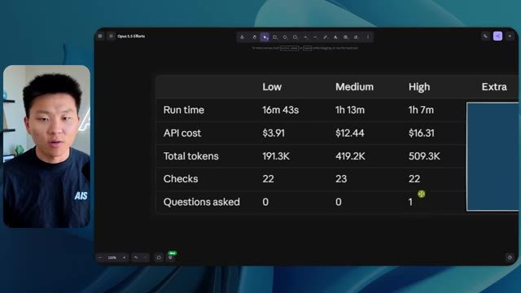
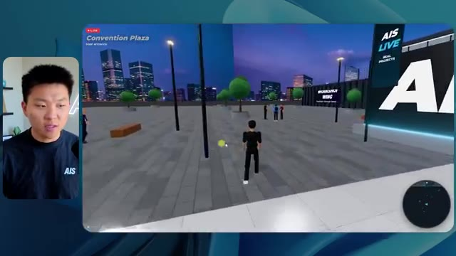
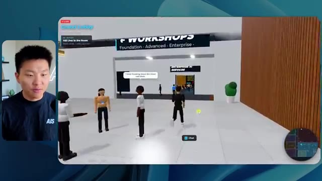
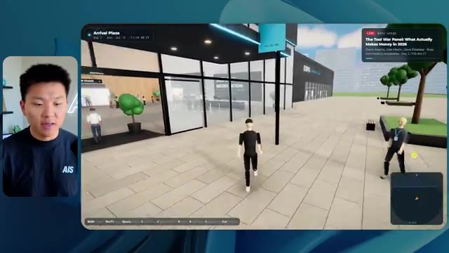

# 🎬 OpenAI Image 2 is Nuts. Here are 10 Ways to Use it.

> **Chaîne** : [Nate Herk | AI Automation](https://www.youtube.com/@nateherk/featured)  
> **Lien YouTube** : [https://www.youtube.com/watch?v=GY-kAiZGLOw](https://www.youtube.com/watch?v=GY-kAiZGLOw)  
> **Date de publication** : 20260422  
> **Durée** : 00:13:58  
> **Identifiant vidéo** : `GY-kAiZGLOw`  
> **Transcription & Analyse** : `whisper-v3-large-turbo+gemini-3.5-flash-lite`  

---

## 📌 Synthèse Exécutive & Outils

### 💡 Résumé

Cette vidéo, présentée par la chaîne *Nate Herk | AI Automation*, propose une analyse empirique fascinante et rigoureuse des performances de l'IA à travers le prisme des différents niveaux d'effort d'**Opus 5.5**, un modèle de pointe omniprésent dans l'écosystème actuel. L'expérimentation consiste à soumettre un objectif de conception complexe et brut (*slash goal*) à l'agent IA : transformer un ensemble de données brutes et massives — un dossier Frame.io de 105 gigaoctets d'enregistrements vidéo de l'événement virtuel *AIS Live* — en un monde virtuel 3D entièrement explorable en vue à la troisième personne, simulant une conférence technologique physique dotée de différentes salles, scènes et pistes de formation.

À travers la comparaison méthodique des exécutions (allant du niveau d'effort « bas » au niveau « code ultra », bien que la transcription s'arrête au niveau « élevé »), la vidéo met en lumière l'écart abyssal de qualité, de fidélité contextuelle et de comportement autonome des agents selon les ressources computationnelles allouées. L'effort « bas » (16 min 43 s, 191k jetons, 3,91 $) génère un environnement générique, truffé de bugs graphiques d'affichage, de PNJ (personnages non-joueurs) fantômes qui disparaissent et de vidéos fixes incapables de restituer le dynamisme de l'événement. En revanche, le niveau d'effort « moyen » (1 h 13 min, 490k jetons, 12,44 $) produit un bond qualitatif spectaculaire : respect strict des chartes graphiques de la marque, PNJ dotés d'interactions dynamiques et crédibles, intégration parfaite des flux vidéo en direct et des supports pédagogiques, et modélisation fidèle de l'architecture des salles et du salon VIP.

Cette démonstration grandeur nature illustre parfaitement les arbitrages critiques de l'ingénierie moderne des agents IA : un niveau d'effort supérieur ne se contente pas d'allonger le temps de calcul et d'augmenter les coûts d'API, il transforme radicalement la profondeur logique, la robustesse visuelle et l'autonomie comportementale du système. Elle souligne également le fossé persistant entre la génération locale de code fonctionnel par l'IA et la friction opérationnelle du déploiement en production, introduisant des solutions d'hébergement intégrées pour combler ce goulet d'étranglement.

### 🛠️ Outils, Modèles & Logiciels Présentés

* **Opus 5.5** : Modèle de fondation ultra-performant, intelligent et économique d'Anthropic, utilisé ici pour piloter des agents IA complexes dotés d'une architecture de niveaux d'effort ajustables (du niveau bas au niveau code ultra).
* **Claude Code** : Environnement de développement et d'exécution pour agents logiciels, employé pour orchestrer la construction et le déploiement du monde 3D à partir des directives textuelles.
* **Frame.io** : Plateforme de collaboration vidéo cloud utilisée pour stocker et structurer les 105 gigaoctets d'archives de l'événement virtuel *AIS Live* analysés par l'agent.
* **Hostinger** : Partenaire sponsor et outil d'infrastructure cloud/web dont l'extension gratuite pour éditeur de code permet de combler le fossé entre le développement local et le déploiement en ligne des applications générées par l'IA.
* **Système d'exploitation IA Herc 2** : Écosystème propriétaire et modulaire de l'auteur servant de base de données contextuelle et d'ensemble d'outils interconnectés pour alimenter les agents autonomes.

### 🔑 Points Clés & Enseignements Stratégiques

* **Impact direct du niveau d'effort sur la qualité architecturale** : L'expérimentation prouve mathématiquement et visuellement qu'augmenter le niveau d'effort d'Opus 5.5 ne se traduit pas seulement par des ajustements cosmétiques, mais par une refonte structurelle de la logique de l'agent, passant d'un rendu grossier et bugué à une simulation immersive et cohérente.
* **Arbitrage coût/performance des appels API** : Le passage du niveau d'effort « bas » (3,91 $, 16 minutes) au niveau « moyen » (12,44 $, 1 h 13 min) multiplie par plus de quatre le coût estimé et le temps d'exécution, mais garantit un taux de réussite fonctionnel et esthétique indispensable pour un produit fini.
* **Autonomie totale des agents sans sollicitation humaine** : Fait remarquable, qu'il s'agisse de l'effort faible ou moyen, l'agent a exécuté l'intégralité du prompt complexe en posant un total de **zéro question**, démontrant une capacité d'autonomie et d'interprétation contextuelle extrêmement poussée.
* **Gestion de la complexité multimodale massive** : L'agent a réussi à ingérer, trier et exploiter intelligemment un volume brut de 105 Go de vidéos (provenant de Frame.io) pour les réinjecter dynamiquement dans des zones spécifiques (salles de conférence, salons VIP, stands) du monde 3D virtuel.
* **Respect rigoureux des directives de marque** : Alors que l'effort faible a généré un design générique et déconnecté de l'identité visuelle d'AIS Live, le niveau d'effort moyen a appliqué avec précision les palettes de couleurs et les chartes graphiques de l'entreprise.
* **Immersion et comportement des PNJ (Personnages Non-Joueurs)** : Au niveau moyen, l'IA a doté les avatars et les PNJ de micro-interactions dynamiques (mouvements de bras, réactions de proximité), évitant l'effet « fantôme » et les bugs d'affichage constatés au niveau inférieur.
* **Synchronisation des agendas et des flux multimédias** : L'agent a démontré une excellente compréhension temporelle en associant les flux vidéo en direct (Keynotes, ateliers de Tangy Frederick, interventions de Dave Ebelar) aux bons espaces physiques et horaires de la conférence virtuelle.
* **La transition critique du local au web** : La vidéo met en lumière le défi récurrent de l'ingénierie logicielle assistée par IA : la capacité à générer rapidement une application fonctionnelle sur sa machine locale versus la friction et la complexité de son déploiement rapide en production, résolues ici par des extensions d'hébergement intégrées.
* **Alignement avec les recommandations d'Anthropic** : L'observation empirique de Nate Herk valide la bonne pratique officielle d'Anthropic concernant Opus 5.5 : commencer par un niveau d'effort moyen par défaut, puis ajuster itérativement à la baisse ou à la hausse en fonction de la criticité du livrable attendu.
* **Intégration d'écosystèmes d'agents interconnectés** : L'utilisation de briques modulaires (comme le système Herc 2 ou l'appel conditionnel à des générateurs d'images/vidéos) montre que les agents modernes tirent leur puissance de leur capacité à orchestrer des outils externes spécialisés plutôt qu'à tout coder de zéro.

---

## ⏱️ Chronologie & Transcription Complète Audio & Visuelle (Mot pour Mot)

### ⏱️ `[00:00:00 - 00:00:20]` | Segment #01

**🔊 Audio (Transcription Intégrale Mot pour Mot en Français) :**
> Opus 5.5, Opus 5.5, Opus 5.5, Opus 5.5, Opus 5.5. Ce modèle est littéralement partout et pour de très bonnes raisons. Il est intelligent, il est bon marché, il a un goût incroyable, c'est un modèle d'IA incroyable. Mais avec chaque modèle d'IA, vous avez le choix de l'effort, que ce soit faible, moyen, élevé, extra, max ou code ultra.

**👁️ Analyse Visuelle d'Écran (gemini-3.5-flash-lite) :**
**Interface & Outils** : Interface du réseau social X (Twitter).

**Contenu textuel & Code** : Publication sur X avec texte sur les créatifs techniques et vidéo intégrée d'un paysage côtier tropical.

**Action / Démonstration** : Affichage d'un tweet illustrant l'impact des modèles d'IA sur la création de contenu visuel.

*⏱️ 00:00:05 — Capture d'écran d'un tweet sur X (anciennement Twitter) montrant un post sur les créatifs techniques et une vidéo de paysage tropical généré par IA.*

---

### ⏱️ `[00:00:20 - 00:00:38]` | Segment #02

**🔊 Audio (Transcription Intégrale Mot pour Mot en Français) :**
> Donc, dans cette vidéo, j'ai donné exactement le même prompt à Opus 5.5 et je l'ai exécuté sur chaque niveau d'effort, et nous allons comparer les résultats. Nous examinerons la qualité de toutes les différentes sorties réelles, mais nous allons aussi examiner combien de temps chacun d'eux a fonctionné, combien cela nous a coûté s'il s'agissait d'une facturation par API, le total des jetons, combien de vérifications ils ont exécutées, et combien de questions ils m'ont réellement posées tout au long du processus.

**👁️ Analyse Visuelle d'Écran (gemini-3.5-flash-lite) :**
**Interface & Outils** : Application web de tableau de bord / interface de gestion de projet type canvas (ex: Miro, Obsidian ou Notion).

**Contenu textuel & Code** : Tableau avec les en-têtes de colonnes : Low, Medium, High, Extra, Max, Ultracode, et de lignes : Run time, API cost, Total tokens, Checks, Questions asked.

**Action / Démonstration** : Affichage et présentation comparative des performances et coûts de l'IA selon les niveaux d'effort.

*⏱️ 00:00:29 — Capture d'un tableau comparatif d'Opus 5.5 affichant les différents niveaux d'effort (Low, Medium, High, Extra, Max, Ultracode) et métriques (Run time, API cost, Total tokens).*

---

### ⏱️ `[00:00:39 - 00:00:58]` | Segment #03

**🔊 Audio (Transcription Intégrale Mot pour Mot en Français) :**
> Et les résultats que nous avons obtenus ne sont pas du tout ce à quoi je m'attends, donc j'ai hâte de partager cela avec vous les gars. Ne perdons pas de temps et entrons directement dans le vif du sujet. D'accord, alors plongeons directement dans celui-ci. Je veux commencer juste en vous montrant, les gars, le prompt réel que nous avons utilisé, que nous avons donné à chacun de ces différents agents. Je vais aller dans les fichiers ici, et nous allons ouvrir ce fichier markdown de prompt, et je vais vous montrer ce que nous avons obtenu. Alors voici le slash objectif que j'ai fourni.

**👁️ Analyse Visuelle d'Écran (gemini-3.5-flash-lite) :**
**Interface & Outils** : Interface de l'outil de développement IA (éditeur avec panneau latéral de chat et gestion de worktrees).

**Contenu textuel & Code** : Un message de l'IA demandant si elle doit commencer à construire un monde 3D walkable de la conférence AIS Live à partir d'enregistrements.

**Action / Démonstration** : Le présentateur introduit l'interface de travail et le prompt en cours d'exécution dans l'éditeur.

*⏱️ 00:00:48 — Interface d'un assistant de code IA (type Cursor/Cline) avec le présentateur incrusté à gauche, affichant un prompt sur la création d'un monde 3D interactif.*

---

### ⏱️ `[00:00:58 - 00:01:34]` | Segment #04

**🔊 Audio (Transcription Intégrale Mot pour Mot en Français) :**
> J'ai dit, tu dois me créer un monde en 3D qui soit une conférence tech réaliste dans laquelle je peux me promener en vue à la troisième personne. Tu vas regarder ce dossier, qui contient mes éléments d'enregistrement d'événements provenant d'AIS Live. Et ce dossier est un dossier Frame.io de 105 gigaoctets d'enregistrements vidéo. C'était un événement entièrement virtuel. Tout a été enregistré et tous les enregistrements sont juste ici. J'ai dit, ton objectif est de prendre cet événement et de le transformer en un monde 3D explorable qui me donne l'impression d'être réellement allé à une vraie conférence en personne avec différentes salles, différentes pistes, différentes scènes, bla, bla, bla. N'hésite pas à utiliser key.ai si tu as besoin de générer des images ou des vidéos. Et tu peux aussi utiliser tout ce qui se trouve dans mon projet Herc 2, qui est comme mon système d'exploitation IA. J'ai dit,

**👁️ Analyse Visuelle d'Écran (gemini-3.5-flash-lite) :**
**Interface & Outils** : Éditeur de code (VS Code / Cursor) et interface web Frame.io

**Contenu textuel & Code** : Fichier Markdown PROMPT.md contenant les instructions détaillées pour l'agent IA et URL Frame.io vers le dossier de 105 Go.

**Action / Démonstration** : Consultation et présentation des instructions du prompt et du dossier de ressources multimédias sur Frame.io.

*⏱️ 00:01:07 — Éditeur de code affichant le fichier PROMPT.md avec les instructions pour créer un monde 3D interactif et le lien Frame.io.*

*⏱️ 00:01:16 — Interface Frame.io montrant un dossier de 105,69 Go contenant les enregistrements des événements AIS Live (GA Access et VIP Access).*

---

### ⏱️ `[00:01:34 - 00:02:08]` | Segment #05

**🔊 Audio (Transcription Intégrale Mot pour Mot en Français) :**
> vous serez jugé sur la créativité, le design, la physique et la sensation globale alors que j'explore le monde 3D que vous avez construit. Et c'était fondamentalement la fin des instructions. Donc comme vous pouvez le voir sur ce côté gauche, j'ai exécuté cela à travers tous les différents niveaux d'effort. Commençons par bas et remontons jusqu'à code ultra. Très bien. Donc ici nous avons le résultat de bas. Ouvrons ceci et jetons un œil. Donc nous avons AIS Live, le sommet des services IA en personne enfin, et nous avons pu cliquer partout. Tout d'abord, cela ne fait pas très personnalisé. Genre, ce n'libère pas le logo d'IS Live. Ce n'est même pas nos couleurs. Donc je n'aime pas trop ça, mais entrons ici. D'accord. C'est beaucoup trop lumineux. Euh, nous avons une carte en haut à droite ? Nous avons une ville ici derrière. Je ne peux pas dire quelle ville c'est.

**👁️ Analyse Visuelle d'Écran (gemini-3.5-flash-lite) :**
**Interface & Outils** : Interface web d'un assistant de développement ou d'agent IA

**Contenu textuel & Code** : Panneau latéral avec les niveaux de test (« Hello », « Extra », « High », « Max », « Ultracode », « Medium », « Low ») et message de l'IA demandant si elle doit commencer la tâche décrite dans PROMPT.md.

**Action / Démonstration** : Navigation et sélection des différents niveaux de test d'effort dans l'interface de l'agent.

*⏱️ 00:01:42 — Interface d'une application d'assistant IA affichant des sessions de tests (« effort-test ») avec différents niveaux de configuration sur le panneau latéral gauche et une conversation avec l'IA dans la zone principale.*

---

### ⏱️ `[00:02:08 - 00:02:40]` | Segment #06

**🔊 Audio (Transcription Intégrale Mot pour Mot en Français) :**
> c'est. D'accord. C'est Chicago, ce qui est plutôt cool parce que tu sais, j'habite à Chicago, mais bref, en haut à droite, on peut voir une carte. Nous avons un hall d'accueil. Nous avons un hall d'exposition. Nous avons un salon VIP sur la scène principale. La carte montre également où se trouve chaque autre personne et cela se synchronise en direct. Donc nous pouvons voir l'enregistrement. Nous pouvons voir le premier jour, la keynote de l'hyper agent, le débriefing en direct. Cool. Donc il connaît réellement l'agenda et puis il y a le deuxième jour. Donc il a trouvé ça, c'est bien. Nous avons ces petites boules ici que je peux espérer pousser du pied. D'accord. Le visage, oh, regarde ça. Si je vais par ici, toutes les personnes disparaissent tout simplement. Très mauvais. Très mauvais. D'accord. Alors voyons voir. Est-ce que je peux sprinter ? D'accord.

**👁️ Analyse Visuelle d'Écran (gemini-3.5-flash-lite) :**
**Interface & Outils** : Application virtuelle 3D interactive (metaverse / événement virtuel) avec mini-carte de navigation.

**Contenu textuel & Code** : Menus d'événements virtuels (« Day 1 », « Badge pickup », « Sponsors, booths and hallway conversations »).

**Action / Démonstration** : Exploration et navigation de l'avatar dans les différentes zones de l'événement virtuel.

*⏱️ 00:02:16 — Vue d'un espace virtuel 3D avec un avatar et une mini-carte en haut à droite indiquant le lieu « Badge pickup - GA and VIP ».*

*⏱️ 00:02:24 — Navigation dans le hall virtuel (Lobby) avec un panneau d'affichage du programme du jour 1.*

*⏱️ 00:02:32 — Exploration de l'Expo Hall virtuel avec des stands et des participants sous forme d'avatars colorés.*

---

### ⏱️ `[00:02:40 - 00:03:04]` | Segment #07

**🔊 Audio (Transcription Intégrale Mot pour Mot en Français) :**
> Je peux avancer un peu plus vite. Je vais d'abord aller par ici. Il y a des produits dérivés, euh, un sweat glido certifié AIS plus. D'accord. Donc il y a les vrais stands qu'on avait lors de l'événement virtuel. On avait des stands. Donc c'est plutôt cool. Un petit endroit pour prendre des photos. Salle C. En ce moment, nous avons Tangy Frederick qui anime un atelier. D'accord. Mais ce n'est pas une vidéo. Comme vous pouvez le voir, c'est juste une image. Elle ne bouge pas. C'est donc juste une image. Ces gens sont en train de disparaître. Ce doivent être des fantômes. Allons par ici vers la salle A.

**👁️ Analyse Visuelle d'Écran (gemini-3.5-flash-lite) :**
**Interface & Outils** : Environnement virtuel 3D interactif (type metaverse/plateforme d'événement virtuel)

**Contenu textuel & Code** : Écrans d'affichage virtuel présentant des instructions textuelles et des étapes de configuration d'API.

**Action / Démonstration** : Exploration et navigation interactive dans les stands et salles d'un événement virtuel 3D.

*⏱️ 00:02:46 — Vue d'un espace virtuel 3D de type salon professionnel avec le personnage explorant un stand sponsorisé 'Glaido' et des cubes disposés au sol.*

*⏱️ 00:02:52 — Navigation dans une salle d'atelier virtuelle verdoyante avec des tables lumineuses et des écrans d'affichage au fond.*

*⏱️ 00:02:58 — Avancée du personnage virtuel vers un grand écran affichant des instructions par étapes (Step 1, Step 2, Step 3) concernant des clés API.*

---

### ⏱️ `[00:03:04 - 00:03:30]` | Segment #08

**🔊 Audio (Transcription Intégrale Mot pour Mot en Français) :**
> Nous avons Liberty White. D'accord. Très cool. Vos 30 premiers jours en automatisation. Encore une fois, c'est juste une image fixe et les gens ont des bugs d'affichage. Donc ce n'est pas très bien ici. Je vais aller sur la scène principale et voir ce que nous avons. D'accord, cool. Donc nous avons une scène d'apparence principale. Les gens ont des bugs d'affichage. Vraiment grave. Ce n'est vraiment pas terrible. Notre vidéo est en fait en train de bouger. Genre, j'ai vu mon visage ici et j'ai vu celui de Devin, mais maintenant ils ont disparu. Donc je ne sais pas ce qui s'est passé. D'accord. C'est, on dirait que c'est plutôt un diaporama. Rien n'est réellement diffusé pour l'instant. Quoi qu'il en soit, entrons ici.

**👁️ Analyse Visuelle d'Écran (gemini-3.5-flash-lite) :**
**Interface & Outils** : Environnement virtuel 3D interactif (metavers / plateforme de conférence en ligne)

**Contenu textuel & Code** : Aucun code source, terminal ou prompt visible ; affichage d'un espace virtuel 3D avec avatars.

**Action / Démonstration** : Navigation et exploration de l'espace virtuel 3D par un avatar contrôlé par l'utilisateur.

---

### ⏱️ `[00:03:30 - 00:03:58]` | Segment #09

**🔊 Audio (Transcription Intégrale Mot pour Mot en Français) :**
> Nous avons d'autres stands. Nous avons hyper agent. Nous avons Claude Code. Nous avons plus de goodies. La salle B, c'est Dave Ebelor. Je suppose que c'est exactement la même chose. Nous avons du café. Et ensuite, je suppose que le salon VIP, c'est accès VIP uniquement. C'est plutôt cool, mais il n'y a vraiment rien qui se passe ici. Cet écran est bien trop lumineux. Bon. Donc je pense que vous comprenez l'ambiance qu'on obtient ici de la part d'Opus 5.5 en effort faible. Et c'est là que les choses deviennent intéressantes. Combien de temps pensez-vous que cela a duré ? Combien de temps ? Celui-ci a duré 16 minutes et 43 secondes. Combien pensez-vous que cela a coûté ?

**👁️ Analyse Visuelle d'Écran (gemini-3.5-flash-lite) :**
**Interface & Outils** : Application web de tableau blanc interactif et environnement virtuel 3D.

**Contenu textuel & Code** : Tableau listant Run time, API cost, Total tokens, Checks et Questions asked selon différents niveaux d'effort.

**Action / Démonstration** : Présentation d'un tableau comparatif des performances de différents modes d'exécution d'IA.

*⏱️ 00:03:51 — Tableau comparatif des niveaux d'effort (Low, Medium, High, Extra, Max, Ultracode) avec des métriques de performance.*

---

### ⏱️ `[00:03:58 - 00:04:26]` | Segment #10

**🔊 Audio (Transcription Intégrale Mot pour Mot en Français) :**
> 3,91 dollars si c'était facturé par l'API. J'utilise évidemment mon abonnement ici, mais nous allons simplement calculer cela avec la facturation de l'API. Le nombre total de jetons était de 191 000. Il a effectué 22 vérifications. Donc pour la vérification, il a ouvert le navigateur 22 fois et a exécuté différents types de vérifications. Soit 22 catégories de vérifications. Et combien de questions m'a-t-il posées ? Il m'a posé un total de zéro question tout au long de cette invite de type slash goal. D'accord. Alors ouvrons l'effort moyen et voyons ce que nous avons. D'accord, c'est parti. Effort moyen. Nous avons Nate Herc. Nous avons mon badge. C'est de la marque AI's Life.

**👁️ Analyse Visuelle d'Écran (gemini-3.5-flash-lite) :**
**Interface & Outils** : Outil de tableau blanc ou de diagramme (type Excalidraw ou similaire).

**Contenu textuel & Code** : Tableau avec les lignes : Run time (16m 43s), API cost ($3.91), Total tokens (191.3K), Checks, Questions asked, et les colonnes : Low, Medium, High, Ex.

**Action / Démonstration** : Le présentateur commente les métriques de coût et d'utilisation des jetons pour le niveau d'effort 'Low'.

*⏱️ 00:04:05 — Un tableau comparatif des coûts et performances d'une tâche d'IA, affichant un coût d'API de 3.91 $ et un total de 191.3K tokens.*

---

### ⏱️ `[00:04:26 - 00:04:46]` | Segment #11

**🔊 Audio (Transcription Intégrale Mot pour Mot en Français) :**
> Donc ça a déjà l'air un tout petit peu mieux. Ça ressemble à nos palettes de couleurs qui utilisaient nos directives de marque. Premier jour de construction, deuxième jour de gain, VIP. Cool. D'accord. Je vais entrer dans le lieu. D'accord. Waouh. Donc une ambiance un peu similaire. C'est en arrière-plan. Ça ne ressemble pas à Chicago, hein ? Non, ça ressemble à un, honnêtement, ça ressemble à une ville imaginaire. Quoi qu'il en soit, c'est drôle qu'ils aient décidé de faire ça. Voyons si je peux me déplacer un peu plus vite. Oh, waouh.

**👁️ Analyse Visuelle d'Écran (gemini-3.5-flash-lite) :**
**Interface & Outils** : Navigateur web affichant une application 3D interactive (environnement virtuel).

**Contenu textuel & Code** : Badge utilisateur avec nom, options de navigation, et interface de simulation virtuelle 3D (AIS Live).

**Action / Démonstration** : Le présentateur navigue dans l'interface de connexion puis entre dans l'espace virtuel 3D.

*⏱️ 00:04:31 — Interface web de l'application 'AIS Live' montrant un badge nominatif virtuel pour 'NATE HERK' et un bouton pour entrer dans le lieu virtuel.*

*⏱️ 00:04:41 — Vue dans le lieu virtuel 3D avec des avatars interactifs et un paysage urbain nocturne en arrière-plan.*

---

### ⏱️ `[00:04:46 - 00:05:21]` | Segment #12

**🔊 Audio (Transcription Intégrale Mot pour Mot en Français) :**
> Les gens interagissent avec moi. Regardez. Si je m'approche de ce type, il vient de lever le bras. Bon, maintenant il ne veut plus du tout avoir affaire à moi. Mais tous ces petits robots ici doivent prendre des décisions. Je ne sais pas s'ils utilisent Jev. C'est certain que non. Je ne le lui ai pas dit. En fait, ma clé Jev est à l'arrière. Je ne sais pas. Peut-être qu'elle l'a utilisée. Quoi qu'il en soit, nous pouvons voir ici que nous avons la Salle d'atelier C, le Laboratoire des agents. Sympa. Donc celui-ci est réellement en train de fonctionner. Vous pouvez voir qu'il s'agit d'une vraie vidéo lue par Tangy. Tout le monde ici est en train de travailler sur un ordinateur portable. Ils ne buguent pas. C'est plutôt cool. De plus, mon badge est sur ma poitrine, ce qui est plutôt cool. Je peux venir par ici. Nous avons une carte en haut à droite, comme vous pouvez le voir, mais je peux venir par ici. Nous avons un

**👁️ Analyse Visuelle d'Écran (gemini-3.5-flash-lite) :**
**Interface & Outils** : Application de monde virtuel / environnement 3D interactif (Metaverse / simulation d'agents)

**Contenu textuel & Code** : Environnement virtuel 3D avec des avatars simulant des agents ou des participants à un atelier (Enterprise AI Services)

**Action / Démonstration** : Navigation et exploration de l'environnement virtuel 3D peuplé d'avatars animés

---

### ⏱️ `[00:05:21 - 00:05:47]` | Segment #13

**🔊 Audio (Transcription Intégrale Mot pour Mot en Français) :**
> hall d'exposition. C'est là que nous avons le stand Glido. Et ça diffuse en ce moment. Oui, ça diffuse la vidéo de nous en train de parler de Glido. Ça diffuse la vidéo d'Ed et moi parlant de notre programme de certification. Nous avons le logo AIS Plus juste ici, qui est un peu mal placé. Ce sont les diapositives des conférenciers et les points clés. Alors wow, ce sont toutes les ressources que nous avons distribuées après l'événement. Elles sont toutes là également. Nous pouvons voir que nous avons un coup de projecteur sur la communauté. C'est donc Aiden qui parle de son contrat qu'il a décroché et c'est diffusé en direct. Ces gens regardent.

**👁️ Analyse Visuelle d'Écran (gemini-3.5-flash-lite) :**
**Interface & Outils** : Environnement virtuel 3D de type salon d'exposition en ligne.

**Contenu textuel & Code** : Panneaux textuels, écrans de diffusion vidéo et supports de présentation virtuels.

**Action / Démonstration** : Navigation et visite guidée du hall d'exposition virtuel par le présentateur.

---

### ⏱️ `[00:05:47 - 00:06:21]` | Segment #14

**🔊 Audio (Transcription Intégrale Mot pour Mot en Français) :**
> Ils sont plutôt engagés. On a un hyper agent. C'était, c'est ce que je voulais dire. Si vous avez vu ces gens lever les mains pour dire bonjour, c'était plutôt marrant. Regardez, regardez, le voilà qui recommence. Bref. Bon. Où est-ce que je suis maintenant ? Maintenant, je suis dans le hall principal. On a un bar à café. On a un grand logo, qui est le vrai logo. C'est trop lumineux, mais on a le logo. On peut voir si on peut entrer ici dans le parcours fondation. On a Sabrina Romanov et Liberty White. Donc différentes formations juste là. On peut entrer dans cette salle. C'est le parcours avancé. Donc qu'est-ce qui se passe ici. On a Dave Ebelar et Saman qui parlent de différentes choses là-dedans. Et maintenant, allons jeter un œil à la scène principale. Oh, attendez, il y a une vidéo de moi là-haut. C'est genre un VIP

**👁️ Analyse Visuelle d'Écran (gemini-3.5-flash-lite) :**
**Interface & Outils** : Environnement virtuel 3D / Plateforme d'événement en ligne

**Contenu textuel & Code** : Avatars numériques, interface de navigation virtuelle, carte miniature en haut à droite

**Action / Démonstration** : Navigation et exploration de l'espace virtuel par un avatar piloté dans le hall principal

---

### ⏱️ `[00:06:21 - 00:06:50]` | Segment #15

**🔊 Audio (Transcription Intégrale Mot pour Mot en Français) :**
> section ? Ouais, on ira voir ça dans une minute. Mais bref, voici la scène principale. Ça a l'air vraiment, vraiment très bien. On a une grande scène. On a genre quatre personnes assises ici. On a les trois écrans d'Alex là-haut avec Hyper Agent. Est-ce que j'ai le droit de monter sur scène ? Oh, et il me laisse monter sur scène. D'accord. C'est plutôt sympa. Bon, les gars, faisons un selfie. Laissez-moi prendre tout le monde en arrière-plan. Venez par ici. Bref, c'est plutôt, plutôt cool. Par contre, toutes les places ne sont pas occupées. Donc il faut qu'on travaille là-dessus. Mais bon, je vais y retourner en courant pour voir ce que c'était que cette section VIP. D'accord. Le salon VIP. J'ai l'impression que c'est comme un aéroport ou un truc comme ça.

**👁️ Analyse Visuelle d'Écran (gemini-3.5-flash-lite) :**
**Interface & Outils** : Interface de l'application virtuelle 3D Hyper Agent Keynote.

**Contenu textuel & Code** : Écrans de présentation de la keynote d'Alex McDonnell et carte miniature de la salle.

**Action / Démonstration** : Navigation et exploration de l'espace de conférence virtuel 3D par l'utilisateur.

*⏱️ 00:06:28 — Vue d'une conférence virtuelle 3D (Hyper Agent) montrant un avatar se déplaçant dans une grande salle avec des écrans de présentation en arrière-plan.*

*⏱️ 00:06:36 — Vue de l'estrade et des fauteuils sur scène dans l'environnement virtuel 3D Hyper Agent.*

*⏱️ 00:06:43 — Vue en plongée de la salle de conférence virtuelle 3D remplie d'avatars assis face à la scène principale.*

---

### ⏱️ `[00:06:51 - 00:07:14]` | Segment #16

**🔊 Audio (Transcription Intégrale Mot pour Mot en Français) :**
> D'accord, super. Donc maintenant nous avons les sessions VIP ici. Une foire aux questions VIP avec la lecture vidéo en direct de Nate juste ici. Très, très cool. Et nous avons comme un bar ou quelque chose comme ça. Génial. Je dirais que c'est un très bon résultat. Maintenant, en ce qui concerne les statistiques ici, celui-ci a pris une heure et 13 minutes à s'exécuter. Il nous aurait coûté 12 dollars et 44 cents. Il a utilisé 490 000 jetons et il a fait 23 vérifications.

**👁️ Analyse Visuelle d'Écran (gemini-3.5-flash-lite) :**
**Interface & Outils** : Application de salon virtuel 3D et tableau de bord analytique web (Opus 5.5 Efforts).

**Contenu textuel & Code** : Écran vidéo de questions-réponses VIP et tableau de données chiffrées (Run time, API cost, Total tokens, Checks, Questions asked).

**Action / Démonstration** : Navigation et présentation des fonctionnalités de l'espace VIP et des statistiques d'exécution du projet.

*⏱️ 00:06:56 — Vue d'un espace virtuel 3D (salon VIP) avec un écran affichant une vidéo en direct de Nate Herk et des avatars d'utilisateurs.*

*⏱️ 00:07:02 — Tableau de bord d'analyse montrant les métriques de performance : temps d'exécution (16m 43s), coût API ($3.91), tokens (191.3K), etc.*

---

### ⏱️ `[00:07:14 - 00:07:48]` | Segment #17

**🔊 Audio (Transcription Intégrale Mot pour Mot en Français) :**
> Et il nous a posé un total de zéro question une fois de plus. Très bien, passons au niveau élevé. C'était déjà un résultat plutôt correct et Anthropic eux-mêmes dans leur vidéo, ou désolé, pas une vidéo, un article sur comment prompter Opus 5.5. Ils ont dit de commencer simplement par le niveau moyen et de l'ajuster à la hausse ou à la baisse si nécessaire. C'était donc un résultat moyen. Passons au niveau élevé et voyons ce que nous avons obtenu. Très rapidement, les gars, je dois prendre une seconde pour vous parler du sponsor de la vidéo d'aujourd'hui, Hostinger. Donc ces deux modèles viennent de me construire une version fonctionnelle de la même chose. Et maintenant, je me retrouve exactement là où je finis toujours, avec quelque chose de terminé sur mon ordinateur portable et aucun moyen rapide de le mettre en ligne. Et c'est le fossé que comble le connecteur d'Hostinger. C'est une extension gratuite.

**👁️ Analyse Visuelle d'Écran (gemini-3.5-flash-lite) :**
**Interface & Outils** : Tableau blanc ou application de notes/mindmap (Image 1) et IDE / environnement de développement de code (Image 2).

**Contenu textuel & Code** : Tableau comparatif des performances et des coûts selon les niveaux d'effort (Low, Medium) et code / prompt pour le projet Northwind ROI calculator.
[DESC_IMAGE_2] Explication et analyse comparative des performances et coûts de l'IA selon le niveau de complexité configuré.

**Action / Démonstration** : Explications face caméra et démonstration conceptuelle.

*⏱️ 00:07:22 — Tableau comparatif affichant les métriques (Run time, API cost, Total tokens, Checks, Questions asked) pour différents niveaux d'effort (Low, Medium, High, Extra).*

*⏱️ 00:07:39 — Interface de développement ou d'IDE avec un panneau affichant le processus de génération de l'outil ROI Calculator et le visage du présentateur en incrustation.*

---

### ⏱️ `[00:07:48 - 00:08:23]` | Segment #18

**🔊 Audio (Transcription Intégrale Mot pour Mot en Français) :**
> pour votre éditeur qui intègre votre compte Hostinger dans l'environnement où vous codez déjà. Que ce soit VS Code, Cursor, Cloud Code, Codex, peu importe. Vous vous connectez une seule fois en un clic, et à partir de là, votre agent peut déployer le site, y pointer un domaine, configurer les enregistrements DNS et vérifier votre VPS sans que vous ayez jamais à quitter l'éditeur. Ainsi, peu importe celui de ces outils que vous finirez par préférer, ce qu'il a construit n'est qu'à quelques minutes d'une véritable URL sur un hébergement géré. Connector est gratuit avec tous les hébergements ou forfaits, donc si vous avez toujours besoin de l'hébergement sous-jacent, profitez du forfait illimité avec le lien dans la description et utilisez le code NATEHERK pour 10 % de réduction. Cela inclut également un domaine gratuit et un e-mail professionnel pour l'année. Et c'est toujours le moyen le moins cher que j'ai trouvé pour obtenir un

**👁️ Analyse Visuelle d'Écran (gemini-3.5-flash-lite) :**
**Interface & Outils** : Extension IDE Hostinger et interface Claude Code

**Contenu textuel & Code** : Tableau de bord d'intégration Hostinger avec le statut « Connected » et les outils disponibles (Websites, Domains, Subscriptions & Payments, Email Marketing).

**Action / Démonstration** : Connexion réussie de l'IDE à Hostinger permettant à l'agent d'accéder aux outils de gestion.

*⏱️ 00:07:57 — Interface montrant l'intégration de Hostinger connectée via IDE et l'outil Claude Code à droite.*

---

### ⏱️ `[00:08:23 - 00:08:47]` | Segment #19

**🔊 Audio (Transcription Intégrale Mot pour Mot en Français) :**
> tu as construit sur une vraie URL. Donc revenons à la vidéo. D'accord. Encore une fois, très, très marqué par la marque. C'est un écran de chargement encore meilleur que le précédent. Nous avons ce petit effet sympa en arrière-plan. Nous avons le logo. Nous allons entrer dans le lieu. D'accord. Nous y voilà. Ça a l'air plutôt bien. Nous commençons à l'extérieur et vous pouvez voir que nous avons ces drapeaux pour tous les intervenants, Wyatt, Casper, Alex, Ed, Aiden, Sabrina, Liberty. C'est plutôt cool. Nous avons des blocs en direct ici.

**👁️ Analyse Visuelle d'Écran (gemini-3.5-flash-lite) :**
**Interface & Outils** : Application web 3D interactive (environnement virtuel type métavers).

**Contenu textuel & Code** : Interface utilisateur avec mini-carte, indicateur de lieu 'AIS Live Plaza' et bannières informatives.

**Action / Démonstration** : Connexion et exploration de l'espace virtuel 3D en vue subjective/troisième personne.

*⏱️ 00:08:29 — Écran de chargement et d'accueil de la plateforme 'AIS LIVE' avec les instructions de contrôle et le bouton 'ENTER THE VENUE'.*

*⏱️ 00:08:35 — Entrée dans l'espace virtuel 3D 'AIS Live Plaza' avec des avatars polygonaux et des bâtiments en arrière-plan.*

*⏱️ 00:08:41 — Navigation dans la place virtuelle 'AIS Live Plaza' montrant des bannières verticales avec des noms de conférenciers.*

---

### ⏱️ `[00:08:47 - 00:09:23]` | Segment #20

**🔊 Audio (Transcription Intégrale Mot pour Mot en Français) :**
> Il a pris cette photo de moi, votre hôte, Nate Herc, John, Dave, Nate Herc. Voilà. D'accord. Les portes. Génial. Ce sont des portes coulissantes automatiques en verre. J'adore ça. Nous pouvons voir l'enregistrement VIP. Nous pouvons voir l'admission générale (GA). Nous pouvons venir ici et nous pouvons découvrir l'exposition avec différents stands, le projecteur sur la communauté. Vous pouvez également voir qu'en haut à gauche, j'ai un passeport. C'est donc comme si, il montrera combien d'endroits j'ai visités. Tout cela est une lecture réelle. Nous avons un mur de ressources avec tous les différents conférenciers. Ils ont également une session de réseautage ici. Je vais donc venir très vite et voir de quoi il s'agit. Nous avons donc le bar à cold brew AIS. Nous avons différents membres de la communauté qui ont été mis en avant ou mis en lumière.

**👁️ Analyse Visuelle d'Écran (gemini-3.5-flash-lite) :**
**Interface & Outils** : Application ou plateforme virtuelle 3D (metaverse / événement virtuel)

**Contenu textuel & Code** : Environnement virtuel 3D interactif avec interface de navigation et bannières d'événements

**Action / Démonstration** : Exploration d'un espace virtuel 3D par un avatar contrôlé par l'utilisateur

*⏱️ 00:08:56 — Vue d'un monde virtuel 3D représentant une zone d'enregistrement (Registration Concourse) avec des avatars et des comptoirs VIP.*

*⏱️ 00:09:05 — Navigation dans l'Expo Hall virtuel avec des stands d'exposition et des bannières informatives.*

*⏱️ 00:09:14 — Déplacement d'un avatar au milieu d'autres personnages dans le hall d'entrée virtuel.*

---

### ⏱️ `[00:09:23 - 00:09:56]` | Segment #21

**🔊 Audio (Transcription Intégrale Mot pour Mot en Français) :**
> On a l'aile VIP. Attends, quoi ? Prends un bracelet. Ah, je dois vraiment aller chercher le bracelet. D'accord. Laisse-moi m'enregistrer rapidement. Le bracelet est déjà mis. Attends, quoi ? D'accord. Oh, d'accord. Maintenant, les portes se sont ouvertes pour moi. Cool. Je peux entrer ici. Oh, ça mène juste à la scène principale. Salon VIP. Il y a une foire aux questions en cours. Ça a l'air très sympa. Je veux dire, je suis très impressionné par la façon dont il parvient à faire ça. Waouh. D'accord. Donc c'est vraiment bien. Ce qu'on a fait, c'est qu'on a eu des salles de discussion VIP avec différentes personnes. Tu peux voir qu'il y a différentes salles, différents membres de l'équipe AIS qui participent à des trucs. C'est vraiment sympa. C'est très sympa. C'est un bien meilleur VIP

**👁️ Analyse Visuelle d'Écran (gemini-3.5-flash-lite) :**
**Interface & Outils** : Application virtuelle interactive 3D (type Gather.town ou monde virtuel de conférence)

**Contenu textuel & Code** : Environnement virtuel 3D avec avatars, écrans de diffusion vidéo, panneaux textuels et interface utilisateur de navigation

**Action / Démonstration** : Navigation et exploration de différentes zones du monde virtuel par l'avatar de l'utilisateur

*⏱️ 00:09:32 — L'avatar se déplace dans le hall d'enregistrement virtuel avec des écrans d'affichage et l'indication de l'aile VIP.*

*⏱️ 00:09:40 — L'avatar se trouve dans le salon VIP où une session de questions-réponses est diffusée sur grand écran.*

*⏱️ 00:09:48 — L'avatar navigue dans la zone des sessions de travail VIP avec différentes tables thématiques ("Price It Right", "Land Your First Paying Client").*

---

### ⏱️ `[00:09:56 - 00:10:30]` | Segment #22

**🔊 Audio (Transcription Intégrale Mot pour Mot en Français) :**
> expérience que ce qui a été montré dans le premier élément. D'accord. After party VIP. Regardez ça. On a une piste de danse. On a tous ces éléments ici. On a la lecture de l'after party VIP juste ici. Et il y a une estrade de DJ. C'est tellement marrant. Il y a un petit bug ici, un petit dysfonctionnement là, mais c'est génial. Oh, super. Donc quand je suis ici sur la scène principale, on a des sous-titres. Vous pouvez voir juste ici en bas de mon écran, on a ces sous-titres de Wyatt qui est en train de parler là-haut. On a des lumières. On a le panneau. Très cool. Belle scène principale. Je vais aller par ici. On peut aller à la fondation,

**👁️ Analyse Visuelle d'Écran (gemini-3.5-flash-lite) :**
**Interface & Outils** : Application web de monde virtuel / métavers interactif avec visioconférence intégrée.

**Contenu textuel & Code** : Environnement 3D avec avatars, interface de streaming vidéo, et éléments de navigation (passeport, commandes clavier).

**Action / Démonstration** : Navigation et exploration de différentes salles d'un événement virtuel en ligne.

*⏱️ 00:10:04 — Vue d'une plateforme virtuelle interactive affichant un espace "VIP After-Party" avec un avatar sur une piste de danse et des participants en visioconférence.*

*⏱️ 00:10:13 — Vue élargie de l'espace virtuel de l'"VIP After-Party" montrant d'autres avatars et ballons sur la piste de danse.*

*⏱️ 00:10:21 — Vue d'une autre zone de l'espace virtuel intitulée "Main Stage" montrant un auditorium avec des avatars assis et un écran de présentation.*

---

### ⏱️ `[00:10:30 - 00:11:06]` | Segment #23

**🔊 Audio (Transcription Intégrale Mot pour Mot en Français) :**
> avancé, et les parcours d'entreprise par ici. Alors voyons voir. Nous avons l'anatomie de trois vraies transactions. Nous avons hyper agent. Nous avons les évaluations avec Nate et Ed ici. Nous avons Dave qui s'occupe des trucs avancés. C'est vraiment bien. Je veux dire, évidemment, chacun, chacun de ces résultats jusqu'à présent, le niveau bas était correct. Le niveau moyen était meilleur. Le niveau élevé a été encore meilleur. Voyons si cette tendance se poursuit et allons voir ce que cela nous a coûté. Le niveau élevé a tourné pendant une heure et sept minutes. Donc un peu plus rapide que le niveau moyen, cela nous aurait coûté 16 dollars et 31 cents. Il a utilisé un demi-million de jetons, 509 000. Il a fait 22 vérifications. Et il nous a aussi demandé, enfin, non, je me suis trompé, ce

**👁️ Analyse Visuelle d'Écran (gemini-3.5-flash-lite) :**
**Interface & Outils** : Application de tableau blanc / diagramme (style Excalidraw / Opus 5.5 Efforts).

**Contenu textuel & Code** : Tableau de données comparatives sur les performances d'IA (Run time: 16m 43s, 1h 13m, 1h 7m | API cost: $3.91, $12.44, $16.31 | Total tokens: 191.3K, 419.2K | Checks: 22, 23 | Questions asked: 0, 0).

**Action / Démonstration** : Présentation des résultats d'évaluation et de l'anatomie de transactions basées sur différents niveaux d'effort d'IA.

*⏱️ 00:10:57 — Tableau comparatif sous forme de diagramme (Opus 5.5 Efforts) affichant des métriques par niveau d'effort (Low, Medium, High, Extra) : temps d'exécution, coût API, tokens, vérifications et questions posées.*

---

### ⏱️ `[00:11:06 - 00:11:25]` | Segment #24

**🔊 Audio (Transcription Intégrale Mot pour Mot en Français) :**
> l'un m'a posé une question et spoiler, c'était le seul qui nous a posé une question de tout ça. Donc voyons voir, il nous en reste trois, extra, max et ultra code. Laissez-moi ouvrir extra et nous verrons ce que nous avons. D'accord. Donc celui-ci a l'air plutôt bien. Je dirais honnêtement que jusqu'à présent, l'écran de chargement haut était le meilleur. Celui qu'on vient juste de voir, mais bref, entrons dans AIS live.

**👁️ Analyse Visuelle d'Écran (gemini-3.5-flash-lite) :**
**Interface & Outils** : Application web ou tableau de bord de type canvas (titre "Opus 5.5 Efforts").

**Contenu textuel & Code** : Tableau avec des lignes pour "Run time", "API cost", "Total tokens", "Checks" et "Questions asked", et des colonnes pour Low, Medium, High et Extra.

**Action / Démonstration** : Le présentateur commente les résultats et sélectionne la colonne "Extra" du tableau.

*⏱️ 00:11:11 — Un tableau comparatif montrant les métriques de performance et de coût pour différents niveaux de réglage (Low, Medium, High, Extra).*

---

### ⏱️ `[00:11:26 - 00:11:51]` | Segment #25

**🔊 Audio (Transcription Intégrale Mot pour Mot en Français) :**
> Waouh. D'accord. Donc on a comme de petits extraits sonores. Je peux discuter avec des gens. Le panneau de la guerre des outils a réglé quelques débats pour moi. Sympa. Bonne perspective là-dessus. On est dehors à nouveau. On a ces différentes bannières, bien qu'elles soient toutes les mêmes. Elles n'affichent pas du genre les noms de différentes personnes. Donc grand logo AIS live. L'aile de l'atelier est par ici. Et passons par les portes coulissantes en verre pour voir ce qu'on a. Donc on a le café AIS. La carte est en bas à droite, et elle n'est pas très descriptive.

**👁️ Analyse Visuelle d'Écran (gemini-3.5-flash-lite) :**
**Interface & Outils** : Application ou plateforme virtuelle 3D interactive (type métavers / espace d'événement virtuel).

**Contenu textuel & Code** : Environnement virtuel 3D interactif avec avatars, bannières "AIS LIVE", bâtiments urbains et mini-carte.

**Action / Démonstration** : Navigation et exploration d'un monde virtuel 3D par l'utilisateur à l'aide d'un avatar.

*⏱️ 00:11:32 — Vue en monde virtuel 3D (type métavers) montrant un avatar se déplaçant sur une esplanade urbaine avec des bannières publicitaires et des PNJ.*

*⏱️ 00:11:38 — Poursuite de la navigation dans l'environnement virtuel 3D avec l'avatar se dirigeant vers des bâtiments sous un ciel au crépuscule.*

*⏱️ 00:11:45 — L'avatar virtuel s'approche de l'entrée principale d'un bâtiment du centre de convention dans l'environnement 3D.*

---

### ⏱️ `[00:11:51 - 00:12:26]` | Segment #26

**🔊 Audio (Transcription Intégrale Mot pour Mot en Français) :**
> J'aime bien comment les autres cartes nous ont dit quoi, genre où se trouvaient les choses, mais celle-ci a l'air très professionnelle. On peut voir ici c'est la scène principale. Allons y faire un saut rapidement. Ils ont tous ces ballons qui volent partout, ce que je trouve assez marrant. Les ballons de plage AIS. On nous voit là-haut en train de parler. Je crois que j'étais en train de faire l'introduction d'un des jours. Continuons à avancer par ici vers la salle d'atelier sur ce côté gauche. D'accord. Donc ici nous avons le théâtre Hyper Agent. Nous avons cette session sponsorisée ici par Hyper Agent, mais ça nous montre aussi ce qui va s'y passer. C'est vraiment marrant qu'on puisse discuter avec les gens. Salmon a créé un représentant commercial vocal en direct. La salle du juste prix était comble. Tu as récupéré le guide du compagnon VIP ? C'est trop marrant. Nous avons le parcours avancé dans

**👁️ Analyse Visuelle d'Écran (gemini-3.5-flash-lite) :**
**Interface & Outils** : Plateforme événementielle virtuelle 3D (type Gather Town ou équivalent).

**Contenu textuel & Code** : Interface utilisateur incluant une mini-carte, des indicateurs de chat, des menus de navigation (Map, Agenda, Captions) et des bulles de dialogue au-dessus des avatars.

**Action / Démonstration** : Navigation et exploration de l'utilisateur à travers les différents espaces de la conférence virtuelle.

*⏱️ 00:12:00 — Vue à la première personne d'une plateforme d'événement virtuel montrant une scène principale avec un écran diffusant le présentateur, entouré d'avatars dans un auditorium.*

*⏱️ 00:12:09 — Vue dans le "Grand Lobby" de l'espace virtuel, montrant des avatars se déplaçant devant des stands nommés "Workshops" et "Enterprise AI Services".*

*⏱️ 00:12:17 — Vue en perspective dans un couloir de l'événement virtuel avec des avatars interagissant et une mini-carte affichée en bas à droite.*

---

### ⏱️ `[00:12:26 - 00:12:58]` | Segment #27

**🔊 Audio (Transcription Intégrale Mot pour Mot en Français) :**
> ici. Encore une fois, nous avons la lecture en direct. Est-ce que c'est la lecture en direct ? Oh, d'accord. Ça a commencé une fois que je suis entré, mais je peux m'asseoir. Oh la la. Je peux regarder ça. Je peux me lever. Je veux m'asseoir au premier rang. C'est plutôt cool. C'est très bien. J'aime ça. Et tu sais ce que j'ai remarqué jusqu'à présent ? Le personnage que j'incarne me ressemble un peu. Je pense qu'il s'est inspiré de mes photos miniatures ou quelque chose comme ça. Bref, nous avons Sabrina ici, l'animatrice de la salle ici, prenez n'importe quel siège libre. D'accord, cool. Et j'ai vraiment aimé la fonctionnalité pour s'asseoir. C'est plutôt marrant. Genre, on pourrait vraiment assister à cet atelier et participer. Bref, ça nous montre les intervenants. Ça nous montre les

**👁️ Analyse Visuelle d'Écran (gemini-3.5-flash-lite) :**
**Interface & Outils** : Plateforme événementielle virtuelle type métavers / salle de conférence 3D immersive.

**Contenu textuel & Code** : Textes informatifs sur les sessions en cours : "Advanced Track: Build a Voice AI Sales Bot" et "Foundation Track: Build Your First AI Content Engine".

**Action / Démonstration** : Navigation et immersion dans un environnement virtuel d'apprentissage en ligne, avec interaction de l'avatar utilisateur dans une salle de conférence simulée.

*⏱️ 00:12:34 — Vue d'une salle de conférence virtuelle dans une application de métavers, affichant un atelier sur la construction d'un agent commercial IA vocal.*

*⏱️ 00:12:42 — Vue de la même salle de conférence virtuelle, affichant cette fois un atelier de fondation sur la création d'un moteur de contenu IA.*

*⏱️ 00:12:50 — Vue en plongée de la salle virtuelle montrant l'écran de projection principal avec une interface web de plateforme de collaboration ou d'outils IA.*

---

### ⏱️ `[00:12:58 - 00:13:31]` | Segment #28

**🔊 Audio (Transcription Intégrale Mot pour Mot en Français) :**
> agenda. There's a little red carpet here to take some pictures. We can strike a pose. Oh, wow. That's pretty cool. Resource library, get AIS Plus certified, Glido, Hyper Agent, AIS Plus, three real deals. Awesome. I mean, I would definitely say so far, each one is getting better. And we didn't even check out the VIP section yet, the VIP lounge. Let's go up here real quick. Hopefully I can get in. Nice. We've got tooling reset. These are the different rooms we could go in. So once again, I could grab the worksheet and I could try to understand how to price my stuff. This is so cool. This is definitely better than the previous one where we kind of just

**👁️ Analyse Visuelle d'Écran (gemini-3.5-flash-lite) :**
**Interface & Outils** : Environnement virtuel 3D de type métavers / plateforme événementielle en ligne

**Contenu textuel & Code** : Avatars virtuels, stands d'exposition, panneaux informatifs, bannières de sponsors et interface de navigation 3D

**Action / Démonstration** : Exploration visuelle d'un espace virtuel interactif lors de la présentation de l'agenda et des fonctionnalités de la plateforme

---

### ⏱️ `[00:13:31 - 00:13:59]` | Segment #29

**🔊 Audio (Transcription Intégrale Mot pour Mot en Français) :**
> comme j'ai regardé des trucs. Génial. Je peux passer derrière le bar et venir ici. C'est très bien. Bon. Alors, en ce qui concerne les statistiques, celui-ci a tourné pendant une heure et demie. Il a coûté 25,92 dollars. Je ne sais pas pourquoi je dis point 25,92 cents. C'était 733 000 jetons et 34 vérifications. Il a donc eu le plus grand nombre de vérifications de loin jusqu'à présent. Et il ne nous a posé zéro question. J'ai hâte de voir ce qu'on a obtenu ici de max et d'ultra code. Bon. Voici les écrans de chargement de max, ennuyeux, mais c'est dans l'esprit de la marque et il y a notre logo.

**👁️ Analyse Visuelle d'Écran (gemini-3.5-flash-lite) :**
**Interface & Outils** : Tableau blanc numérique / outil de diagramme interactif (type Excalidraw ou similaire).

**Contenu textuel & Code** : Tableau avec des colonnes Medium, High, Extra, Max, Ultracode affichant des durées (1h 13m, 1h 7m, 1h 31m), des coûts en dollars ($12.44, $16.31), et des volumes de tokens.

**Action / Démonstration** : Le présentateur commente les statistiques affichées dans le tableau comparatif des différents niveaux d'effort.

*⏱️ 00:13:38 — Un tableau comparatif sous forme de grille ou de graphique montrant les statistiques de performance de différents niveaux (Medium, High, Extra, Max, Ultracode) incluant le temps (1h 31m), le coût ($12.44, $16.31), et d'autres métriques.*

---

### ⏱️ `[00:14:00 - 00:14:35]` | Segment #30

**🔊 Audio (Transcription Intégrale Mot pour Mot en Français) :**
> Donc c'était bien. J'aime bien. On va continuer et entrer dans AIS live. Ooh, jolie petite animation ici qui nous fait entrer. Encore une fois, le personnage me ressemble. Ils m'ont tous ressemblé. Enfin, en gros, nous sommes assis en arrière-plan. Ça ressemble à Chicago. Comme je l'mentionné plus tôt, beaucoup de ceux-ci jouent des sons et je n'inclus pas cela parce que ce serait très perturbateur pour vous d'essayer d'écouter ce qui se passe en même temps que je parle. Il y a donc comme une légère musique dans tout ça. Je déteste la façon dont il marche. Cette marche est vraiment, vraiment mauvaise. Je veux dire, la marche, ouais, je n'aime pas du tout ça. Donc ce n'est pas génial. Mais à part ça, allons explorer. Remarquez ces ombres quand je rentre, elles changent vraiment. Je ne sais pas trop pourquoi,

**👁️ Analyse Visuelle d'Écran (gemini-3.5-flash-lite) :**
**Interface & Outils** : Application web interactive / Plateforme virtuelle 3D (AIS live)

**Contenu textuel & Code** : Interface utilisateur virtuelle 3D avec mini-carte en bas à droite, commandes de navigation et panneau d'événements en haut à droite.

**Action / Démonstration** : Exploration d'un monde virtuel en 3D à l'aide d'un avatar représentant l'utilisateur.

*⏱️ 00:14:08 — Vue d'un monde virtuel 3D (AIS live) montrant un personnage sur une place urbaine arborée avec des bâtiments en arrière-plan.*

*⏱️ 00:14:17 — Navigation dans l'environnement virtuel 3D se rapprochant des bâtiments de la plateforme "AIS live".*

*⏱️ 00:14:26 — Avancée du personnage virtuel 3D vers l'entrée d'un bâtiment de type centre de conférence ou exposition.*

---

### ⏱️ `[00:14:35 - 00:15:11]` | Segment #31

**🔊 Audio (Transcription Intégrale Mot pour Mot en Français) :**
> Mais bref, on peut discuter avec des gens ici aussi. Le stand Hyperagent est juste là où on entre dans l'exposition. Tout va bien. D'accord, super. Je peux continuer à cliquer sur E pour changer ce qu'ils disent. On a les conférenciers juste ici. Ça a l'air plutôt bien. Même si on avait clairement la photo de profil de tout le monde. Du coup, je ne sais pas trop pourquoi ce n'est pas inclus là. On voit des gens prendre des photos juste ici. J'adore ça. Et ça enregistre une petite photo. D'accord. La carte n'est pas non plus super, genre ne donne pas une super explication de ce qui se passe, mais j'aime bien ces stands. Ils sont cool. Je pense que ces stands sont les meilleurs que j'aie vus jusqu'à présent. Genre, ils ont juste une belle apparence. Il y a des représentants. Il y a de superbes diapositives derrière eux. Ouais. Ces stands sont cool. D'accord. On a un petit théâtre en vedette

**👁️ Analyse Visuelle d'Écran (gemini-3.5-flash-lite) :**
**Interface & Outils** : Application web de métavers ou de salon virtuel 3D avec interface de navigation et mini-carte.

**Contenu textuel & Code** : Environnement 3D interactif représentant un salon professionnel virtuel, noms de stands et interface HUD de contrôle.

**Action / Démonstration** : Navigation et déplacement de l'avatar à travers les différents espaces de l'événement virtuel.

*⏱️ 00:14:44 — Vue générale de la zone de réception virtuelle avec des avatars et des écrans montrant la liste des conférenciers.*

*⏱️ 00:14:53 — Le présentateur s'approche d'un groupe d'avatats autour d'une table haute dans la zone de réception.*

*⏱️ 00:15:02 — Entrée dans le hall d'exposition virtuel avec les différents stands ("Evals Lab", "Enterprise AI") et les participants.*

---

### ⏱️ `[00:15:11 - 00:15:35]` | Segment #32

**🔊 Audio (Transcription Intégrale Mot pour Mot en Français) :**
> qui se passe par ici. C'est Casper. Bien que, pourquoi est-ce que ça ne se lit pas ? J'ai l'impression que ça devrait se lire, non ? Comme dans les autres, ils étaient toujours en train de jouer. On peut parler à d'autres personnes par ici. Le café est gratuit. Blabla. Amy Simpson, Matt Wolf. Sympa. D'accord. C'est juste la zone de networking où nous sommes en ce moment, mais on peut voir en haut à droite. On peut aussi voir ce qui est en direct sur la scène principale en ce moment. C'est un panel sur la guerre des outils. Alors allons par ici. Nous avons Devin, Cole, Dave et Russ qui discutent ici. Nous avons de l'audiovisuel, des trucs de lumière par ici.

**👁️ Analyse Visuelle d'Écran (gemini-3.5-flash-lite) :**
**Interface & Outils** : Application web de salon virtuel / métavers 3D en ligne.

**Contenu textuel & Code** : Interface de navigation en 3D représentant un espace de conférence virtuel avec des écrans de présentation et des avatars.

**Action / Démonstration** : Navigation et exploration d'un environnement virtuel de conférence 3D avec un avatar.

---

### ⏱️ `[00:15:36 - 00:15:55]` | Segment #33

**🔊 Audio (Transcription Intégrale Mot pour Mot en Français) :**
> Basculons la scène principale sur ce qui compte vraiment en ce moment. Je peux donc changer de sujet. Cool. Je viens de basculer sur moi et Matt. Nous pouvons passer à l'anatomie de trois vraies transactions. C'est plutôt cool. La scène a l'air bien. Nous avons un petit panneau sympa ici. Je peux monter sur la scène ? Sympa. Sympa. Enfin, je ne peux pas aller trop loin, en fait. Bon, tout le monde, laissez-moi prendre un selfie. Tout le monde vient là-dedans. Je peux aussi m'asseoir dans ce public là-bas et simplement profiter de la session.

**👁️ Analyse Visuelle d'Écran (gemini-3.5-flash-lite) :**
**Interface & Outils** : Application web de conférence virtuelle 3D / metaverse

**Contenu textuel & Code** : Interface utilisateur virtuelle avec commandes de déplacement (WASD, Shift, Space) et affichage de la scène principale.

**Action / Démonstration** : Navigation et déplacement d'un avatar dans un espace virtuel 3D de conférence.

---

### ⏱️ `[00:15:55 - 00:16:14]` | Segment #34

**🔊 Audio (Transcription Intégrale Mot pour Mot en Français) :**
> Très cool, très cool. OK, allons par ici. Je vois une section à l'étage. C'est marrant comme ils choisissent tous de mettre la section VIP à l'étage. Je veux dire, je ne déteste pas ça. Oh la la, ils ont un escalator. Pas possible. Je vais discuter avec ce type sur l'escalator. Glenn a 15 ans d'expérience en agence. Ses trucs de "land and expand" étaient en or. Du bon boulot, Glenn. Cool, donc je vais, je n'arrive même pas à passer devant ce type par contre.

**👁️ Analyse Visuelle d'Écran (gemini-3.5-flash-lite) :**
**Interface & Outils** : Application web virtuelle 3D / plateforme virtuelle interactive de conférence.

**Contenu textuel & Code** : Interface utilisateur virtuelle avec mini-carte, indicateurs de touches (WASD) et panneau d'événements en direct.

**Action / Démonstration** : Navigation de l'avatar utilisateur dans l'environnement virtuel vers l'étage VIP.

*⏱️ 00:16:00 — Vue principale du lobby virtuel avec des avatars d'utilisateurs et de grandes baies vitrées.*

*⏱️ 00:16:04 — L'avatar s'approche d'un escalator menant à la zone 'VIP LEVEL'.*

*⏱️ 00:16:09 — L'avatar emprunte l'escalator derrière un autre participant avec une bulle de dialogue affichant ses informations.*

---

### ⏱️ `[00:16:14 - 00:16:48]` | Segment #35

**🔊 Audio (Transcription Intégrale Mot pour Mot en Français) :**
> Oh, j'ai dû sauter par-dessus lui. D'accord, niveau VIP, badge requis. Oh mon Dieu. Tu te moques de moi ? Je dois aller chercher mon badge. D'accord, cool. Maintenant, ça montre que je suis un vrai VIP et je peux aller ici dans la section VIP. Nous avons de petites sessions de travail sympas là-bas, auxquelles nous pouvons participer. Je me demande si ça va me laisser, genre, m'asseoir ici. Je peux juste discuter. Est-ce que je peux participer ? Ça ne me laisse pas m'asseoir et participer. C'est pas grave. Nous avons la salle de crise des prix. Oh, c'est peut-être l'after-party. Allons voir ce qui se passe par ici. Ou peut-être que je dois juste entrer par ici. D'accord. C'est bizarre. Je devais juste entrer par ici. Cet after-party n'est pas aussi cool que l'autre. Mais bref, allons voir ce qui se passe par ici.

**👁️ Analyse Visuelle d'Écran (gemini-3.5-flash-lite) :**
**Interface & Outils** : Application ou plateforme virtuelle 3D (metaverse / événement virtuel)

**Contenu textuel & Code** : Interface utilisateur avec mini-carte, indicateurs de statut VIP et éléments textuels de conférence

**Action / Démonstration** : Navigation et exploration d'un environnement virtuel 3D par un utilisateur

---

### ⏱️ `[00:16:48 - 00:17:07]` | Segment #36

**🔊 Audio (Transcription Intégrale Mot pour Mot en Français) :**
> dans les ateliers. D'accord. Ce n'était pas bien. Regardez ça. On peut tout voir et j'ai juste bugué et maintenant boum. Donc ce n'est pas bon. Je dirais qu'globalement, je veux dire, vous captez l'ambiance de la façon dont ça fonctionne, mais je dirais que celui d'avant, qui était, je crois, élevé, j'ai préféré celui-là. Je ne peux pas m'asseoir dans ces chaises non plus. Ouais. Donc je n'aime pas la marche dans celui-ci.

**👁️ Analyse Visuelle d'Écran (gemini-3.5-flash-lite) :**
**Interface & Outils** : Environnement virtuel 3D interactif (plateforme de conférence virtuelle).

**Contenu textuel & Code** : Interface utilisateur virtuelle affichant des informations de conférence, des salles et des avatars.

**Action / Démonstration** : Navigation et déplacement d'un avatar dans un espace virtuel 3D de type métavers ou plateforme d'événement.

*⏱️ 00:16:53 — Vue d'un monde virtuel 3D représentant un couloir de conférence, avec le présentateur incrusté à gauche.*

*⏱️ 00:16:57 — L'avatar du présentateur se déplace dans le couloir virtuel et s'apprête à entrer dans une salle (Room C).*

*⏱️ 00:17:02 — L'avatar est désormais à l'intérieur de la salle de conférence virtuelle (Room C - HyperAgent Lab) avec des écrans de présentation.*

---

### ⏱️ `[00:17:07 - 00:17:43]` | Segment #37

**🔊 Audio (Transcription Intégrale Mot pour Mot en Français) :**
> Je n'aime pas trop l'ambiance et il y a quelques bugs. Donc, jusqu'à présent, si nous voulons regarder notre liste, j'aime bien Extra Extra, c'est celui que j'ai le plus aimé jusqu'à présent. Mais bon, celui-ci était au maximum. Celui-ci était au maximum juste ici. Alors voyons combien de temps cela a duré : deux heures et 28 minutes. Donc ça a tourné pendant longtemps, 50 dollars et 38 cents, 1,18 million de tokens. Donc il a en fait atteint une compaction et a dû faire une auto-compaction. Et puis il a fait 51 vérifications. Est-ce qu'il l'a vraiment fait ? Parce qu'il y avait pas mal de bugs là-dedans. Et de toute façon, celui-ci ne nous a posé aucune question. Donc, jusqu'à présent, chaque fois, c'est devenu à peu près plus cher et ça a pris plus de temps, à part ici. Mais ceux-là, en gros

**👁️ Analyse Visuelle d'Écran (gemini-3.5-flash-lite) :**
**Interface & Outils** : Tableau de bord d'analyse ou application web de type tableau comparatif.

**Contenu textuel & Code** : Tableau avec des colonnes Medium (1h 13m, $12.44, 419.2K, 23, 0), High (1h 7m, $16.31, 509.3K, 22, 1), Extra (1h 31m, $25.92, 733.7K, 34, 0), ainsi que Max et Ultracode.

**Action / Démonstration** : Le présentateur commente les résultats et compare les différentes options du tableau.

*⏱️ 00:17:16 — Un tableau comparatif montrant différentes options (Medium, High, Extra, Max, Ultracode) avec des métriques de temps, de coût et de performance.*

---

### ⏱️ `[00:17:43 - 00:18:17]` | Segment #38

**🔊 Audio (Transcription Intégrale Mot pour Mot en Français) :**
> a pris un montant de temps très similaire, mais à chaque fois il a utilisé plus de tokens parce qu'ils ont réfléchi davantage. Et puis, vous savez, ces tokens vont coûter plus cher. Mais bref, passons au dernier, qui est ultra code. Donc on espérerait vraiment que celui-ci soit le meilleur. Alors allons sur ce localhost et voyons ce qu'on a. OK, cool. Regardez ce badge. C'est un joli badge host all access. On a un petit visuel sympa juste ici. On va aller de l'avant et entrer AIS Live. Cool. OK. Bienvenue, Nate. J'aime bien la marche. Ça a l'air réaliste. J'aime le logo, même s'il manque le petit point rouge qui fait penser au direct. La carte en haut à droite

**👁️ Analyse Visuelle d'Écran (gemini-3.5-flash-lite) :**
**Interface & Outils** : Tableau de données comparatives et application ou jeu en 3D ('AIS LIVE').

**Contenu textuel & Code** : Tableau comparatif des coûts, temps et tokens par niveau de modèle, et interface 3D de navigation.

**Action / Démonstration** : Présentation des résultats comparatifs et démonstration de l'environnement virtuel.

*⏱️ 00:17:52 — Un tableau comparatif affichant les performances de différents niveaux de configuration ('High', 'Extra', 'Max', 'Ultracode') avec des métriques de temps, de coût et de tokens.*

*⏱️ 00:18:09 — Une vue en 3D d'un environnement virtuel interactif représentant un hall d'événement, avec des avatars et le logo 'AIS LIVE'.*

---

### ⏱️ `[00:18:17 - 00:18:49]` | Segment #39

**🔊 Audio (Transcription Intégrale Mot pour Mot en Français) :**
> est un tout petit peu mieux étiqueté, donc je peux voir ce qui se passe. Je vais venir ici et récupérer mon bracelet VIP très rapidement. D'accord, sympa. Ça me dit aussi quoi faire. Donc en haut à gauche, ça dit de scanner au portail VIP sur le mur est du hall. Donc je crois que l'est serait par là, non ? Never eat soggy waffles. Ouais. Ailes VIP, scanner le bracelet. D'accord, cool. Maintenant je suis dans la section VIP. Je peux voir ces différentes salles. L'outil a été réinitialisé. Une vidéo en direct est diffusée. Je suis capable de voir les sous-titres juste là de ce dont on est en train de parler. Ça joue aussi les sons, mais je ne diffuse tout simplement pas l'audio pour vous les gars parce que je ne veux pas surcharger.

**👁️ Analyse Visuelle d'Écran (gemini-3.5-flash-lite) :**
**Interface & Outils** : Application ou plateforme virtuelle 3D de type métavers / salon virtuel.

**Contenu textuel & Code** : Textes d'indication de quête ou d'objectifs affichés à l'écran (« VIP Wing », « VIP Room 5 »).

**Action / Démonstration** : Navigation du personnage joueur dans l'espace virtuel 3D de l'événement.

---

### ⏱️ `[00:18:50 - 00:19:08]` | Segment #40

**🔊 Audio (Transcription Intégrale Mot pour Mot en Français) :**
> Encore une fois, celui-ci fonctionne avec Cody et Mustafa là-dedans. C'est génial. Vidéo en direct. La vidéo ne se lance pas tant qu'on n'entre pas, par contre. Donc, honnêtement, je trouve que c'est un bon choix. Dès que j'entre, cependant, la vidéo démarre. Sympa. Belle attention. Toutes ces pièces. Génial. Ouais. Je veux dire, ça fait très haut de gamme. Voici une salle de guerre pour la tarification. Entrons ici. Moi et John là-dedans.

**👁️ Analyse Visuelle d'Écran (gemini-3.5-flash-lite) :**
**Interface & Outils** : Interface de monde virtuel 3D / plateforme interactive en ligne.

**Contenu textuel & Code** : Environnement 3D avec affichage textuel 'VIP Wing', 'VIP ROOM 1', et des écrans vidéo interactifs.

**Action / Démonstration** : L'avatar de l'utilisateur navigue dans l'espace virtuel et entre dans une salle pour activer la lecture d'une vidéo en direct.

*⏱️ 00:18:54 — Un espace virtuel 3D représentant une aile VIP ('VIP Wing') où un avatar entre dans une salle de réunion pour lancer une vidéo en direct.*

---

### ⏱️ `[00:19:08 - 00:19:42]` | Segment #41

**🔊 Audio (Transcription Intégrale Mot pour Mot en Français) :**
> Et ensuite, nous avons une belle after-party. Cette after-party n'est pas encore aussi animée. Et nous avons plus de ballons de plage pour une raison quelconque, mais cette after-party est cool. Je veux dire, ça nous donne une bonne ambiance et il y a la redevance ici de notre séance de questions-réponses de l'after-party, tout cela est en direct aussi. Génial. Bon. Allons sur la grande scène. Ça m'invite aussi à prendre un siège côté allée sur la grande scène, qui se trouve tout droit à travers l'expo. Alors en fait, traversons d'abord l'expo. Qu'est-ce que vous construisez ? Il y a beaucoup de gens qui parlent de différentes choses par ici. Waouh. Il y a aussi genre un petit truc de basketball. Est-ce que je peux le lancer ? Je peux. Est-ce que je dois lever les yeux pour le lancer vers le haut ? D'accord.

**👁️ Analyse Visuelle d'Écran (gemini-3.5-flash-lite) :**
**Interface & Outils** : Environnement virtuel 3D en ligne (plateforme de métavers / salon virtuel).

**Contenu textuel & Code** : Interface utilisateur affichant "VIP Lounge & After-Party", "VIP Wing" et "Expo Hall", avec des mini-cartes et des indications textuelles.

**Action / Démonstration** : Navigation et exploration de différentes zones d'un espace virtuel interactif par le présentateur.

*⏱️ 00:19:17 — Capture montrant l'after-party virtuelle avec des avatars sur une piste de danse et des ballons de plage.*

*⏱️ 00:19:25 — Capture montrant le couloir du pavillon VIP dans l'environnement virtuel.*

*⏱️ 00:19:34 — Capture montrant le hall d'exposition virtuel (Expo Hall) avec un mur de notes adhésives.*

---

### ⏱️ `[00:19:42 - 00:20:08]` | Segment #42

**🔊 Audio (Transcription Intégrale Mot pour Mot en Français) :**
> Eh bien, pas terrible. Mais bref, nous avons un stand AIS plus. Nous avons le stand Glido. Est-ce que ça diffuse en direct ? Oui, ça diffuse définitivement en direct. Sympa. Nous avons le stand Hyper Agent. Nous avons d'autres trucs par ici. D'accord, cool. Je vais aller sur la scène principale et voir si on peut trouver une place côté allée. Dès qu'on entre, tout commence à jouer. On a une très bonne ambiance de scène. Comment je fais pour trouver une place côté allée par contre. Voilà. Il a fallu que je trouve la bonne. Je prends la place côté allée. Il n'y a personne sur la scène, ce qui est bizarre. J'aimais bien quand il y avait du monde sur la scène dans les versions précédentes.

**👁️ Analyse Visuelle d'Écran (gemini-3.5-flash-lite) :**
**Interface & Outils** : Application web de métavers / conférence virtuelle en 3D

**Contenu textuel & Code** : Environnement virtuel 3D représentant une conférence ou un salon professionnel en ligne avec des écrans de diffusion en direct

**Action / Démonstration** : Navigation et exploration dans l'espace virtuel 3D de la conférence AIS LIVE

---

### ⏱️ `[00:20:08 - 00:20:31]` | Segment #43

**🔊 Audio (Transcription Intégrale Mot pour Mot en Français) :**
> Prenons un rapide selfie. Bref, il y a moi et Pat là-haut. Pat est habillé comme un ouvrier du bâtiment. Comme vous pouvez le voir, nous faisions un petit appel de découverte simulé dans cet exemple. Je vais revenir par l'exposition et nous allons aller ici vers l'aile de l'atelier et simplement vérifier si ces pièces sont fondamentalement exactement les mêmes qu'elles devraient l'être. Maintenant, je ne peux pas vraiment discuter avec les gens. Je le pouvais avant, dans les versions précédentes, discuter avec les gens, ce que je trouvais vraiment une belle attention. Et nous avons l'atelier, un parcours fondamental. Est-ce que je peux m'asseoir ?

**👁️ Analyse Visuelle d'Écran (gemini-3.5-flash-lite) :**
**Interface & Outils** : Plateforme événementielle virtuelle de type métavers (environnement 3D interactif).

**Contenu textuel & Code** : Textes contextuels à l'écran : "Main Stage", "Expo Hall", "Workshop Wing" et des guides de navigation ("Explore every space").

**Action / Démonstration** : Navigation et exploration de l'utilisateur à travers les différents espaces thématiques du salon virtuel pour assister à des présentations ou des ateliers.

*⏱️ 00:20:14 — Vue d'ensemble d'une salle de conférence virtuelle (Main Stage) avec des avatars d'utilisateurs assis et une scène principale.*

*⏱️ 00:20:20 — Navigation dans le hall d'exposition virtuel (Expo Hall) montrant divers stands, des avatars circulant et une indication vers l'aile "Workshop Wing".*

*⏱️ 00:20:25 — Vue à la première personne dans un couloir virtuel désigné comme "Workshop Wing" où trois avatars sont en pleine discussion.*

---

### ⏱️ `[00:20:32 - 00:21:04]` | Segment #44

**🔊 Audio (Transcription Intégrale Mot pour Mot en Français) :**
> Je ne peux pas m'asseoir. Je ne sais pas. Nous avons Liberty qui parle en ce moment et elle est en train de parler et nous pouvons l'entendre. Donc c'est bien, mais ça ne me laisse pas m'asseoir. Et regardez ça. Je deviens assez instable juste ici. Ça buguait de la façon dont je marchais. Ça ne voulait pour ainsi dire pas me laisser marcher. Ce n'est pas bon. Pareil. Nous avons cette piste avancée là-dedans. C'est génial. Donc dans l'ensemble, ils ont une ambiance très similaire. Je dirais que je suis impressionné par la façon dont ils ont été capables de raconter une histoire à partir de ce que nous faisions. Bibliothèque de points clés des intervenants. D'accord. C'est sympa. Je ne pense pas que nous ayons vu ça depuis différents endroits, mais ce sont comme les ressources et ça montre des trucs sympas. Oh, waouh. Je

**👁️ Analyse Visuelle d'Écran (gemini-3.5-flash-lite) :**
**Interface & Outils** : Environnement de réunion virtuelle / Plateforme de métavers éducatif.

**Contenu textuel & Code** : Titres de salles ("Workshop A", "Workshop B", "Speaker Takeaways Library"), mini-carte dans le coin supérieur droit et sous-titres interactifs en bas de l'écran.

**Action / Démonstration** : Navigation et exploration de l'utilisateur à travers différents espaces de travail virtuels (ateliers et bibliothèque).

*⏱️ 00:20:40 — Vue d'un environnement virtuel 3D de type métavers avec une interface de "Workshop A - Foundation Track" et un avatar d'utilisateur se déplaçant.*

*⏱️ 00:20:48 — Navigation dans une salle de conférence virtuelle nommée "Workshop B - Advanced Track", avec des rangées de bureaux et un écran de présentation.*

*⏱️ 00:20:56 — Exploration d'un espace virtuel nommé "Speaker Takeaways Library" contenant divers panneaux d'information et avatars d'autres participants.*

---

### ⏱️ `[00:21:04 - 00:21:41]` | Segment #45

**🔊 Audio (Transcription Intégrale Mot pour Mot en Français) :**
> peut effectivement ouvrir toutes ces choses et nous pouvons prendre des photos ici même aussi. Super. Prends une photo. Je peux sauvegarder ceci aussi. Genre, je peux effectivement télécharger ceci. Et maintenant nous avons cette photo que nous venons de prendre à cet événement en direct d'AIS. Très bien. Eh bien, je pense qu'il est temps pour moi de tirer quelques conclusions, mais d'abord, voyons combien cette exécution nous a coûté. Cela a pris une heure et 35 minutes. C'était donc beaucoup plus rapide que max. Cela n'a coûté que 18 dollars et 69 cents. Waouh. C'était donc un peu plus cher que high, moins cher que extra et beaucoup moins cher que max. Cela a également consommé 606 000 jetons et 42 vérifications avec zéro question. Maintenant, une autre chose intéressante à noter est que tout

**👁️ Analyse Visuelle d'Écran (gemini-3.5-flash-lite) :**
**Interface & Outils** : Visionneuse de photos Windows native.

**Contenu textuel & Code** : Image de l'événement virtuel avec le branding "AIS LIVE".

**Action / Démonstration** : Le présentateur démontre la capacité de sauvegarder et d'afficher localement une photo générée ou capturée durant l'interaction avec l'environnement virtuel.

*⏱️ 00:21:13 — Une visionneuse d'images Windows affichant une capture d'écran prise lors d'un événement virtuel "AIS LIVE", montrant deux avatars sur un tapis rouge devant un panneau de marque.*

---

### ⏱️ `[00:21:41 - 00:22:13]` | Segment #46

**🔊 Audio (Transcription Intégrale Mot pour Mot en Français) :**
> ces exécutions, aucune d'entre elles n'a utilisé de sous-agent. J'ai vérifié et je me suis assuré qu'aucune d'elles n'avait utilisé de sous-agents. Elles ne voulaient déléguer aucun travail, ce qui était intéressant. Donc ces jetons sont ce qui a été reflété à l'intérieur de cette session. Évidemment, comme je l'ai dit, celle-ci a dépassé, vous savez, 950 000, donc, ou peu importe quelle est la fenêtre de compaction. Je ne la laisse généralement jamais monter aussi haut, mais comme c'était un objectif global et que je n'étais pas impliqué, celle-ci a dû se compacter, mais le reste d'entre elles s'est simplement exécuté dans cette seule session. Et ce sont les statistiques globales. Et aussi, très rapidement, concernant les trucs d'UltraCode, les gars, je ne sais pas si vous avez remarqué cela, mais quand j'ai fait tourner UltraCode dernièrement, ça a juste fait bizarre. Ça a semblé un peu buggé. Je, à quelques reprises, je l'ai fait tourner

**👁️ Analyse Visuelle d'Écran (gemini-3.5-flash-lite) :**
**Interface & Outils** : Application de tableau de bord ou interface de suivi analytique ("Opus 5.5 Efforts").

**Contenu textuel & Code** : Tableau avec six colonnes (Low, Medium, High, Extra, Max, Ultracode) affichant des métriques techniques : "Run time", "API cost", "Total tokens", "Checks" et "Questions asked".

**Action / Démonstration** : Présentation des résultats d'analyse de performance démontrant l'absence quasi totale de questions posées (sous-agents/délégation) durant les sessions.

*⏱️ 00:21:49 — Tableau comparatif des performances de différentes exécutions d'agents nommées "Opus 5.5 Efforts", détaillant le temps d'exécution, le coût API, le nombre de jetons, les vérifications et les questions posées.*

---

### ⏱️ `[00:22:13 - 00:22:34]` | Segment #47

**🔊 Audio (Transcription Intégrale Mot pour Mot en Français) :**
> et en mode, est-ce que ça tourne vraiment sous UltraCode ? Il a fait pas mal de vérifications de plus que ces autres, mais pour une raison quelconque, ça ne me semblait pas correct, car essentiellement ce qu'est UltraCode, c'est un effort supplémentaire et c'est juste comme utiliser des flux de travail plus dynamiques afin de faire les choses. Et donc à travers toutes mes recherches dans les journaux de session et même quand je regardais cette chose se construire dans UltraCode, il ne lançait aucun de ces flux de travail dynamiques et j'ai essayé cela plusieurs fois.

**👁️ Analyse Visuelle d'Écran (gemini-3.5-flash-lite) :**
**Interface & Outils** : Interface de tableau de bord d'analyse de performances (type application de reporting ou base de données).

**Contenu textuel & Code** : Données chiffrées comparant "Ultracode" aux autres niveaux : Run time (1h 35m), API cost ($18.69), Total tokens (606.2K), Checks (42), Questions asked (0).

**Action / Démonstration** : Affichage et analyse comparative des métriques de performance pour différents modes d'exécution d'un agent IA.

*⏱️ 00:22:18 — Un tableau comparatif des performances de différents modes (Low, Medium, High, Extra, Max, Ultracode) incluant le temps d'exécution, le coût API, le nombre total de tokens, les vérifications (checks) et les questions posées.*

---

### ⏱️ `[00:22:35 - 00:23:00]` | Segment #48

**🔊 Audio (Transcription Intégrale Mot pour Mot en Français) :**
> Donc je ne sais pas si c'est un bug actuellement dans l'environnement de CloudCode ou si c'est juste avec Opus 5.5, c'est un peu pire avec UltraCode en ce moment ou quelque chose comme ça, mais dans les deux cas, ce sont les véritables niveaux d'effort globaux et tout cela semble tout à fait logique quand on examine leur progression. Jetons donc un coup d'œil à ceci. Coût maximum par rapport au coût minimum, nous avons eu 12,9 fois sur l'exécution la moins chère par rapport à l'exécution la plus chère, ce qui, je crois, allait de 3,98 $ à 50,38 $.

**👁️ Analyse Visuelle d'Écran (gemini-3.5-flash-lite) :**
**Interface & Outils** : Interface web ou outil de visualisation sous forme de tableau (style tableau de bord ou canvas type Miro/Obsidian).

**Contenu textuel & Code** : Tableau de données de performance avec des colonnes de niveaux d'effort et des lignes de métriques (Run time, API cost, Total tokens, Checks, Questions asked).

**Action / Démonstration** : Analyse et présentation des résultats comparatifs des différents niveaux d'effort d'Opus 5.5.

*⏱️ 00:22:41 — Un tableau comparatif montrant les différents niveaux d'effort (Low, Medium, High, Extra, Max, Ultracode) avec les métriques associées telles que le temps d'exécution (Run time), le coût de l'API (API cost), le total des tokens, les vérifications (Checks) et les questions posées.*

---

### ⏱️ `[00:23:01 - 00:23:19]` | Segment #49

**🔊 Audio (Transcription Intégrale Mot pour Mot en Français) :**
> Donc c'était bas et maximum. En ce qui concerne les vérifications maximales par rapport aux minimales, nous avons eu un multiple de 2,3. Le total pour les six était de 127 dollars et ultra code était de 18,69 dollars. Examinons la vitesse par rapport au coût ici. Laissez-moi donc dézoomer un peu pour que nous puissions voir tout cela. Sur l'axe des X, nous avons le temps d'exécution. Sur l'axe des Y, nous avons le coût.

**👁️ Analyse Visuelle d'Écran (gemini-3.5-flash-lite) :**
**Interface & Outils** : Interface web de test ou tableau de bord analytique (Opus Effort Test).

**Contenu textuel & Code** : Texte et métriques affichées : "12.9x Max cost vs Low", "2.3x Max checks vs Low", "$18.69 Ultracode cost, 42 checks", "$127.65 Total across all six".

**Action / Démonstration** : Présentation des résultats comparatifs de coûts et de vérifications entre différents niveaux d'effort.

*⏱️ 00:23:05 — Capture d'écran montrant le présentateur à gauche et une interface de tableau de bord affichant des statistiques et des métriques de tests d'effort sur plusieurs sessions.*

---

### ⏱️ `[00:23:19 - 00:23:42]` | Segment #50

**🔊 Audio (Transcription Intégrale Mot pour Mot en Français) :**
> Donc j'ai l'impression que le mieux serait en bas à gauche, mais pas vraiment. Donc de toute façon, vous pouvez voir que low était bon marché et rapide. Max était lent et coûteux. Mais ce genre de graphique a généralement du sens. À mesure que vous augmentez l'effort, ça va coûter plus cher et ça va prendre un peu plus de temps. C'est logique. Voyons maintenant la croissance par rapport à low. Nous avons donc le temps d'exécution en bleu, les coûts de l'API en orange, les jetons en vert, et les vérifications en or jaunâtre, moutarde.

**👁️ Analyse Visuelle d'Écran (gemini-3.5-flash-lite) :**
**Interface & Outils** : Interface web d'analyse de test (Opus Effort Test).

**Contenu textuel & Code** : Graphique de dispersion 'Speed vs cost' avec axes de temps d'exécution et de coût API, affichant une infobulle pour le niveau 'Low'.

**Action / Démonstration** : Le présentateur commente le graphique comparant le coût et la vitesse des différents niveaux d'effort.

*⏱️ 00:23:25 — Un graphique montrant la vitesse par rapport au coût pour différents niveaux d'effort (Low, Medium, High, Extra, Ultracode, Max).*

---

### ⏱️ `[00:23:42 - 00:24:01]` | Segment #51

**🔊 Audio (Transcription Intégrale Mot pour Mot en Français) :**
> Et d'ailleurs, la raison pour laquelle UltraCode apparaît comme ça, c'est parce qu'il utilise réellement un niveau d'effort supplémentaire. Il est simplement incité à le faire et il utilise plutôt des flux de travail dynamiques et des choses de ce genre, ce qui fait que, vous savez, c'est logique puisque fondamentalement, il utilisait un effort supplémentaire sous le capot. C'est aussi pourquoi Claude l'a marqué ici en orange. Quoi qu'il en soit, si nous continuons plus bas ici, c'est généralement logique, n'est-ce pas ?

**👁️ Analyse Visuelle d'Écran (gemini-3.5-flash-lite) :**
**Interface & Outils** : Interface web avec un graphique analytique (type tableau de bord de test).

**Contenu textuel & Code** : Graphique "Growth relative to Low" avec des courbes pour Run time (8.9x), API cost (12.9x), Tokens (6.2x) et Checks (2.3x), ainsi qu'une colonne pour Ultracode.

**Action / Démonstration** : Visualisation des statistiques et de l'impact des différents niveaux d'effort sur les coûts et l'utilisation des tokens.

*⏱️ 00:23:47 — Un graphique montrant la croissance relative des performances et des coûts (Run time, API cost, Tokens, Checks) en fonction du niveau d'effort, avec une comparaison incluant "Ultracode".*

---

### ⏱️ `[00:24:02 - 00:24:21]` | Segment #52

**🔊 Audio (Transcription Intégrale Mot pour Mot en Français) :**
> Alors que le niveau d'effort augmente, encore une fois, ces métriques vont augmenter. Le temps d'exécution, les coûts de l'API, les jetons et les vérifications. C'est la même chose ici avec le temps d'exécution. Cela nous donne en quelque sorte plus de graphiques linéaires individuels maintenant pour chacune de ces différentes métriques, comme le coût de l'API, les vérifications, le total des jetons, le coût par vérification, et tous les chiffres au même endroit. Des données plutôt cool donc.

**👁️ Analyse Visuelle d'Écran (gemini-3.5-flash-lite) :**
**Interface & Outils** : Interface web de test et de visualisation de données.

**Contenu textuel & Code** : Graphiques linéaires montrant la croissance relative par rapport au niveau 'Low' (API cost 12.9x, Run time 8.9x, Tokens 6.2x, Checks 2.3x) avec des paliers (Low, Medium, High, Extra, Max, Ultracode).

**Action / Démonstration** : Analyse et présentation des résultats comparatifs sur l'augmentation des coûts, du temps d'exécution et des jetons selon le niveau d'effort.

*⏱️ 00:24:06 — Capture d'écran montrant un graphique de performance d'un test intitulé "Opus Effort Test", illustrant l'augmentation des métriques (Run time, API cost, Tokens, Checks) en fonction du niveau d'effort, avec le présentateur visible à gauche.*

---

### ⏱️ `[00:24:21 - 00:24:40]` | Segment #53

**🔊 Audio (Transcription Intégrale Mot pour Mot en Français) :**
> Je dirais que rien ici n'est vraiment choquant. Ce qui m'a le plus choqué, ce sont ces résultats. Mes deux principaux favoris étaient high, qui est celui-ci, et extra, qui est celui-là. Je dois donc retourner ici et me rappeler ce que j'en pensais. J'ai vraiment aimé cette sensation. Celui-ci donne aussi simplement l'impression d'être le plus fluide. La physique était agréable. La porte coulissante en verre était agréable. Je n'ai pas vraiment remarqué beaucoup de bugs dans celui-ci, ce qui est ce que j'ai vraiment aimé.

**👁️ Analyse Visuelle d'Écran (gemini-3.5-flash-lite) :**
**Interface & Outils** : Navigateur web affichant une application virtuelle 3D interactive (AIS Live).

**Contenu textuel & Code** : Interface utilisateur 3D avec bannières textuelles, mini-carte et commandes affichées à l'écran.

**Action / Démonstration** : Navigation et exploration d'un événement virtuel 3D en ligne.

*⏱️ 00:24:26 — Écran d'accueil de l'application web 3D "AIS LIVE" avec le bouton "Enter the Venue".*

*⏱️ 00:24:31 — Vue interactive à la première/troisième personne dans l'univers virtuel "AIS Live Plaza" avec des avatars.*

*⏱️ 00:24:35 — Navigation dans la place virtuelle "AIS Live Plaza" en contrôlant l'avatar vers l'entrée principale.*

---

### ⏱️ `[00:24:40 - 00:25:13]` | Segment #54

**🔊 Audio (Transcription Intégrale Mot pour Mot en Français) :**
> Je ne me rappelle pas si celui-ci était un de ceux où, oh, je ne pouvais pas parler aux gens par contre. Je pouvais juste passer à travers eux. Je ne pouvais pas m'asseoir dans celui-ci non plus. Voici un autre petit truc visuel où je passe pratiquement juste à travers ce mur. Donc je n'aime pas trop ça. Mais je pense, est-ce que c'était celui où je pouvais m'asseoir dans ces sessions ? Non. D'accord. Donc je ne pense pas que c'était mon gagnant alors. Celui-ci est super haut. Je pense que c'est le gagnant. Ouais. Je pense que c'était celui que j'aimais le plus. J'adorais toute cette ambiance. J'adorais le fait de pouvoir discuter avec les gens. C'était vraiment celui où on pouvait venir ici et on pouvait s'asseoir où on voulait, prendre une place, se lever. Je pouvais lire ces trois offres et je pouvais discuter avec eux. J'ai aussi réalisé qu'il y avait de petites sections pour simuler des appels de découverte ici aussi.

**👁️ Analyse Visuelle d'Écran (gemini-3.5-flash-lite) :**
**Interface & Outils** : Navigateur web / Application 3D interactive (AIS LIVE)

**Contenu textuel & Code** : Interface utilisateur virtuelle d'un événement en ligne avec avatars 3D, menus et instructions de navigation.

**Action / Démonstration** : Navigation et exploration de l'espace virtuel 3D de la plateforme AIS LIVE.

*⏱️ 00:24:48 — Vue à la première personne dans l'environnement virtuel 3D 'AIS LIVE' avec un avatar et des PNJ.*

*⏱️ 00:24:57 — Écran d'accueil de l'application web 'AIS LIVE' avec le bouton 'ENTER AIS LIVE'.*

*⏱️ 00:25:05 — Vue en mouvement dans le hall virtuel 3D montrant l'accès à la 'MAIN STAGE' avec une foule virtuelle.*

---

### ⏱️ `[00:25:13 - 00:25:51]` | Segment #55

**🔊 Audio (Transcription Intégrale Mot pour Mot en Français) :**
> Nous avons des produits dérivés et des sacs cabas, ce qui est de la vraie physique. J'aime bien ça. C'était celui où l'on pouvait s'asseoir partout. Oui, j'ai vraiment, vraiment aimé celui-là. Bien que je pense que le seul inconvénient de celui-ci, c'était qu'il n'avait pas genre d'after-party VIP, parce que je pense que c'était le salon. Et je pense que c'était la seule partie de la section VIP, qui était ces différentes pièces où l'on pouvait entrer et s'asseoir. Mais à part ça, il n'offrait pas une super expérience VIP par rapport à certains des autres que nous avons vus. Donc mon gagnant ici va définitivement être Extra. Extra a fait un travail phénoménal. C'était environ la moitié de la durée et la moitié du coût de Max. Donc Max, je pense, c'était juste beaucoup trop pour pas assez de bien. Je pense que le niveau était correct. Ça aurait pu,

**👁️ Analyse Visuelle d'Écran (gemini-3.5-flash-lite) :**
**Interface & Outils** : Environnement de conférence virtuel 3D (type Gather ou similaire) et outil de gestion de données/tableur type Notion ou table de bord.

**Contenu textuel & Code** : Questions de réflexion sur un projet (boundary break, "on the house") et données chiffrées sur les performances de modèles IA (Run time, API cost, Total tokens).

**Action / Démonstration** : Navigation et interaction dans un espace de travail virtuel suivi de l'analyse comparative des capacités d'un modèle IA.

*⏱️ 00:25:23 — Vue à la troisième personne dans un environnement virtuel 3D représentant un hall d'exposition (West Concourse) avec des avatars d'utilisateurs.*

*⏱️ 00:25:32 — Intérieur d'un espace virtuel identifié comme "VIP Lounge" où des avatars sont assis autour d'une table avec des questions affichées sur un écran mural.*

*⏱️ 00:25:42 — Tableau comparatif technique intitulé "Opus 5.5 Efforts" détaillant les temps d'exécution, coûts API et nombre de tokens pour différents niveaux de performance.*

---

### ⏱️ `[00:25:51 - 00:26:25]` | Segment #56

**🔊 Audio (Transcription Intégrale Mot pour Mot en Français) :**
> avec peut-être un ou deux prompts de plus, arrivé là où je l'aimais vraiment. Mais pour un objectif de niveau supérieur, Extra a livré un résultat incroyable ici. Je n'ai pas adoré Medium. Et pour une grande partie de mon travail intellectuel et des choses que je fais, Medium fonctionne très bien. Mais pour cette tâche précisément, j'avais besoin de beaucoup de raisonnement. Il devait passer par des tonnes de choses. Il devait passer par des tonnes de vidéos. Il devait trouver beaucoup de choses à l'intérieur de mes projets. Il devait créer une expérience et raconter une histoire à partir de tout cela. Je pense qu'Extra a fait un travail phénoménale. En général, cependant, j'ai aimé beaucoup de ces résultats, mais Extra est celui avec lequel je voudrais commencer dès maintenant. Si je voulais vraiment faire de ça une application et un univers super, super polis et cool, je commencerais avec le résultat d'Extra et probablement

**👁️ Analyse Visuelle d'Écran (gemini-3.5-flash-lite) :**
**Interface & Outils** : Application de type tableau blanc interactif (interface de style Obsidian Canvas ou similaire).

**Contenu textuel & Code** : Tableau de données comparatives incluant : "Run time", "API cost", "Total tokens", "Checks" et "Questions asked" pour six catégories de modèles.

**Action / Démonstration** : Présentation visuelle des métriques de performance pour justifier le choix entre les différents niveaux de modèles selon les besoins.

*⏱️ 00:26:00 — Un tableau comparatif des performances de différents niveaux de modèles (Low, Medium, High, Extra, Max, Ultracode) affiché dans une application de type whiteboard/canvas.*

---

### ⏱️ `[00:26:25 - 00:26:37]` | Segment #57

**🔊 Audio (Transcription Intégrale Mot pour Mot en Français) :**
> continuez à itérer avec Extra. Donc de toute façon, les gars, c'was ça l'expérience. J'espère que vous avez trouvé cela instructif. J'espère que vous avez appris quelque chose de nouveau. Et si c'est le cas, veuillez lui donner un j'aime. Ça m'aide énormément. Et comme toujours, je vous remercie d'être arrivés jusqu'à la fin de la vidéo, et je vous verrai sur la prochaine. Merci à tous.

**👁️ Analyse Visuelle d'Écran (gemini-3.5-flash-lite) :**
**Interface & Outils** : Aucune interface logicielle.

**Contenu textuel & Code** : Aucun code, commande ou donnée affiché.

**Action / Démonstration** : Le présentateur conclut la vidéo en parlant face caméra.

---

