# 🎬 OpenAI Image 2 is Nuts. Here are 10 Ways to Use it.

> **Chaîne** : [Nate Herk | AI Automation](https://www.youtube.com/@nateherk/featured)  
> **Lien YouTube** : [https://www.youtube.com/watch?v=GY-kAiZGLOw](https://www.youtube.com/watch?v=GY-kAiZGLOw)  
> **Date de publication** : 20260422  
> **Durée** : 00:13:58  
> **Identifiant vidéo** : `GY-kAiZGLOw`  
> **Transcription & Analyse** : `whisper-v3-large-turbo+gemini-3.5-flash-lite`  

---

## 📌 Synthèse Exécutive & Outils

### 💡 Résumé
Dans cette vidéo intitulée **OpenAI Image 2 is Nuts. Here are 10 Ways to Use it.**, Nate Herk décortique les capacités pratiques d'automatisation et de développement propulsées par les modèles de pointe.

### 🛠️ Outils, Modèles & Logiciels Présentés
- **Opus 5.5 & Claude Code** : Modèles d'ingénierie et agents de codage autonome.

### 🔑 Points Clés & Enseignements Stratégiques
- Optimiser le niveau d'effort et le raisonnement des modèles IA pour des résultats industriels.
- Automatiser les cycles de création logicielle de bout en bout.

---

## ⏱️ Chronologie & Transcription Complète Audio & Visuelle (Mot pour Mot)

### ⏱️ `[00:00:00 - 00:00:35]` | Segment #01

**🔊 Audio (Transcription Intégrale Mot pour Mot en Français) :**
> So OpenAI just dropped a new image model called ChatGBT Images 2.0, and it is really good. Everything you're seeing right here in this video, all of these images were generated with this new model, and it is insanely impressive. It's really good with text. It's really good with realism. It's so good, in fact, that it actually has been ranked the number one image generation model, and it beats Nano Banana 2 by 242 points, and there's never been a gap this large, at least according to Arena.ai. Now, this is crazy if you just look at it. So Nano Banana 2 is the one that I use for everything. So what I wanted to do is actually get my hands dirty and compare these two models. I've got tons of different matchups here. So I'm going to show you guys

**👁️ Analyse Visuelle d'Écran (gemini-3.5-flash-lite) :**
**Interface & Outils** : Navigateur Web, Interface de réseau social (Twitter/X).

**Contenu textuel & Code** : Texte descriptif sur les capacités de rendu (résolution 2K, rendu de texte), et graphique à barres classant les modèles d'IA par performance (Elo score).

**Action / Démonstration** : Présentation visuelle des capacités du nouveau modèle et preuve de sa supériorité via des données de benchmark.

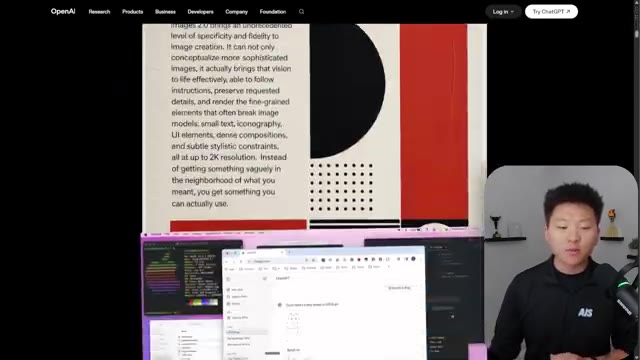
*⏱️ 00:00:09 — Capture d'écran montrant un site web OpenAI affichant des détails techniques sur le modèle, avec en dessous une fenêtre de navigateur illustrant une interface de génération d'images.*

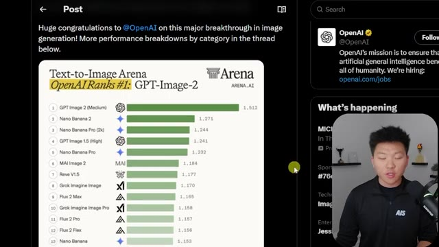
*⏱️ 00:00:17 — Capture d'écran d'un tweet montrant un classement (leaderboard) "Text-to-Image Arena" plaçant le modèle "GPT-Image-2" en première position.*

---

### ⏱️ `[00:00:35 - 00:01:00]` | Segment #02

**🔊 Audio (Transcription Intégrale Mot pour Mot en Français) :**
> which one I think is better for which use cases. And then we're going to dive into some specific GPT image to use cases that you can go do right now. So let's not waste any time and just get straight into it. We have 30 different matchups. We fed them both the same prompt and we're going to put them side by side and you guys can help me decide which ones you think are better. But funny enough, you know, GPT is open AI, Nano Bananas Google. So I'm going to have Claude Opus 4.7 acting as the judge and telling us which one it thinks did best at each of these categories.

**👁️ Analyse Visuelle d'Écran (gemini-3.5-flash-lite) :**
**Interface & Outils** : Site web officiel d'OpenAI (Image 1) et interface de présentation de données/diapositive (Image 2).

**Contenu textuel & Code** : Texte descriptif sur les capacités de génération d'images 2.0 (Image 1) ; Titre du match, nombre de catégories (10), et modèle juge (Claude Opus 4.7) (Image 2).

**Action / Démonstration** : Présentation théorique du sujet et contexte du test comparatif "head-to-head" entre deux modèles d'IA génératrice d'images.

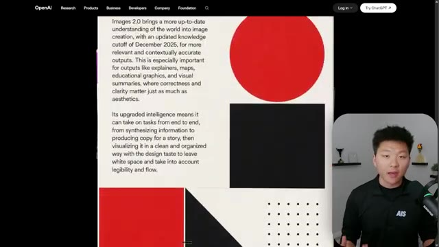
*⏱️ 00:00:41 — Une capture d'écran de la documentation officielle d'OpenAI concernant les capacités de "Images 2.0" en matière de compréhension contextuelle et de création visuelle.*

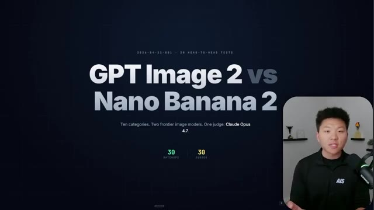
*⏱️ 00:00:47 — Une diapositive de présentation affichant le titre du comparatif : "GPT Image 2 vs Nano Banana 2", avec la mention de 30 tests en duel jugés par Claude Opus 4.7.*

---

### ⏱️ `[00:01:00 - 00:01:19]` | Segment #03

**🔊 Audio (Transcription Intégrale Mot pour Mot en Français) :**
> So let's just get straight into this deck here. All right, so for all of these, GBT Image 2 will be on the left and Nano Banana will be on the right. So this right here was a vintage 1960s movie poster for a film called Neon Shadows. If I was to choose a winner here, I would be taking GBT Image 2. All right, this next one is a clean modern infographic titled AI Image Model Comparison.

**👁️ Analyse Visuelle d'Écran (gemini-3.5-flash-lite) :**
**Interface & Outils** : Interface de test et d'évaluation comparative de modèles de génération d'images (AI Benchmarking tool).

**Contenu textuel & Code** : Prompt affiché : "Vintage 1960s movie poster for a film called 'NEON SHADOWS'. Bold sans-serif title in glowing red, tagline 'The Future Is Already Here' in smaller white type below, intricate gold border with art-deco corners, weathered paper texture, photorealistic. Title must be perfectly legible."

**Action / Démonstration** : Présentation comparative des performances de rendu typographique et visuel entre deux modèles d'IA générative.

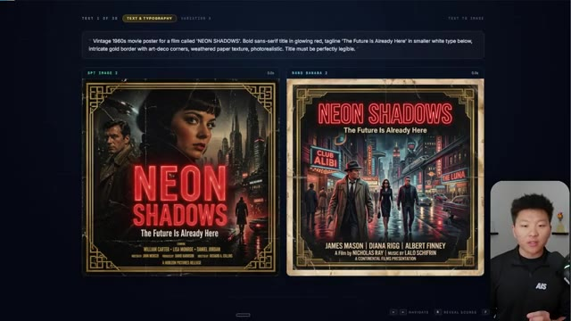
*⏱️ 00:01:05 — Interface de comparaison affichant un prompt textuel en haut et deux résultats d'images côte à côte (GBT Image 2 à gauche, Nano Banana à droite) illustrant une affiche de film vintage intitulée "Neon Shadows".*

---

### ⏱️ `[00:01:20 - 00:01:45]` | Segment #04

**🔊 Audio (Transcription Intégrale Mot pour Mot en Français) :**
> Once again, I would be going with GBT Image 2. This one just looks a little bit cheap, even though the text is all fine over here. This one looks like kind of a template and this one feels like it was actually built for us. Okay. Here we have a premium product label for a coffee bag that reads Ethiopian. I'm not even going to try to pronounce that. And honestly here, like this is one where I might lean towards this one. I just don't think that there's enough of a difference yet to pick at least in this specific scenario. So they're both good. I would probably pick NanoBanet 2 here.

**👁️ Analyse Visuelle d'Écran (gemini-3.5-flash-lite) :**
**Interface & Outils** : Outil d'évaluation comparative de modèles de génération d'images (interface propriétaire de test de prompt).

**Contenu textuel & Code** : Le prompt utilisé en haut de page est visible : "Premium product label for a coffee bag reading 'Ethiopian Yirgacheffe' in elegant serif...". Les résultats des modèles "GPT Image 2" et "Nano Banana 2" sont affichés côte à côte.

**Action / Démonstration** : Le présentateur compare les résultats visuels produits par deux modèles d'IA différents en réponse à une même instruction de design.

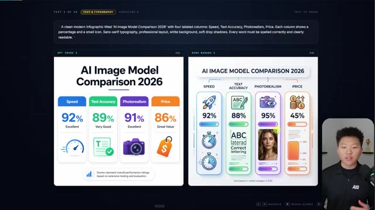
*⏱️ 00:01:26 — Interface de comparaison affichant deux infographies générées par IA sur le thème "AI Image Model Comparison 2026", avec les scores de performance détaillés.*

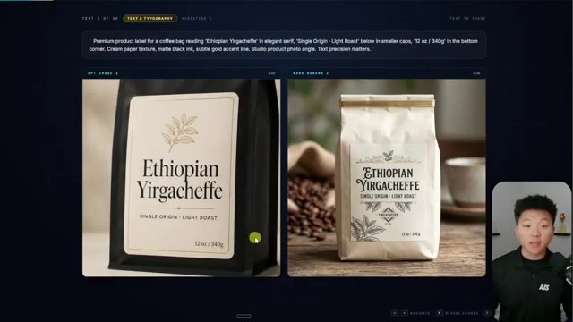
*⏱️ 00:01:32 — Interface de comparaison présentant deux visuels de packaging de café "Ethiopian Yirgacheffe" pour évaluer la qualité du rendu typographique et du design par l'IA.*

---

### ⏱️ `[00:01:45 - 00:02:05]` | Segment #05

**🔊 Audio (Transcription Intégrale Mot pour Mot en Français) :**
> Okay. A candid photo of a 35 year old woman with light freckles sitting in a cafe. I'm going to go with the left side. I mean, this looks so much more real. This looks like something you might shoot on an iPhone. Whereas this looks like it, sometimes it just looks too good. Like the lighting and the blurriness and it just looks a bit too good. So I would be choosing this one over here. Okay. So I'm going to start to speed this up a little bit. You guys don't need a full breakdown.

**👁️ Analyse Visuelle d'Écran (gemini-3.5-flash-lite) :**
**Interface & Outils** : Interface de test de génération d'images (benchmark type "Chatbot Arena" ou outil d'évaluation de modèles).

**Contenu textuel & Code** : Prompt : "Candid photo of a 35-year-old woman with light freckles and a subtle smile sitting at a small Parisian café table in the late afternoon. Natural skin texture, visible pores, slight cold-weather redness on her cheeks. Shot on iPhone 15 Pro, shallow depth of field, warm window light. She is mid-conversation, looking slightly off camera."

**Action / Démonstration** : Le présentateur évalue visuellement et compare le réalisme des deux images générées pour déterminer laquelle semble la plus authentique.

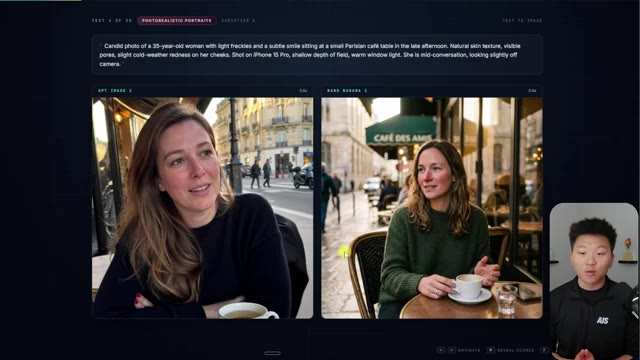
*⏱️ 00:01:50 — Comparaison côte à côte de deux portraits générés par IA dans une interface web sombre, avec le prompt textuel affiché en haut de l'écran.*

---

### ⏱️ `[00:02:05 - 00:02:31]` | Segment #06

**🔊 Audio (Transcription Intégrale Mot pour Mot en Français) :**
> Let's just fly through these a little bit. I'd be taking this one. Like I said, it just looks more real. This looks too perfect. Professional headshots. Honestly, I think these are both pretty solid. I think it depends. Like I said, these are both pretty good. Now this one's tough because they both sort of look, I don't know, like fantasy-ish. And if I'm going to go with which one I think looks more real, I would probably choose this one over here. The lighting over here just looks too edited, I guess. This looks like something that was, you know, color corrected.

**👁️ Analyse Visuelle d'Écran (gemini-3.5-flash-lite) :**
**Interface & Outils** : Plateforme d'évaluation comparative de modèles de génération d'images (type "arena").

**Contenu textuel & Code** : Prompts textuels détaillés décrivant des sujets (portrait professionnel, rue de Tokyo sous la pluie), résultats générés par "GPT IMAGE 2" et "NANO BANANA 2".

**Action / Démonstration** : Analyse comparative et évaluation visuelle de la qualité des rendus générés par différents modèles d'IA par le présentateur.

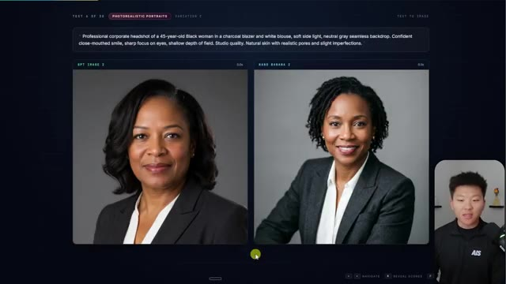
*⏱️ 00:02:12 — Comparaison côte à côte de deux portraits professionnels générés par IA, avec le prompt descriptif affiché en haut.*

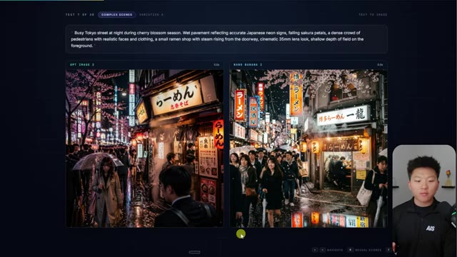
*⏱️ 00:02:18 — Comparaison côte à côte de deux images complexes d'une scène de rue à Tokyo de nuit, avec le prompt descriptif affiché en haut.*

---

### ⏱️ `[00:02:32 - 00:03:06]` | Segment #07

**🔊 Audio (Transcription Intégrale Mot pour Mot en Français) :**
> And this one looks also color corrected, but a little bit more natural. Okay. This one in my mind is just a no brainer. This left one looks so much more realistic, even though this one is solid, this looks way more realistic. So GBT image two, as you guys can see, is just crushing it. these are very very similar i honestly think i would take this one i don't know why my gut's just telling me i'd lean this way okay same sort of thing here as the last product one i think these are both really really solid so hard to choose a winner there i think once again these would be very similar to me although the physics over here don't really make sense it's floating and the uh

**👁️ Analyse Visuelle d'Écran (gemini-3.5-flash-lite) :**
**Interface & Outils** : Application web de test/benchmarking de modèles "Text to Image" (affichage côte à côte avec prompt en haut).

**Contenu textuel & Code** : Prompts textuels décrivant les scènes : "Outdoor farmers market...", "Hyper-detailed cyberpunk alley...", "Professional product photograph...".

**Action / Démonstration** : Comparaison qualitative par le présentateur de la fidélité, du réalisme et de la correction colorimétrique entre deux modèles d'IA.

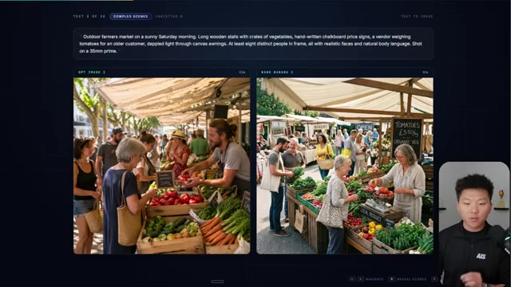
*⏱️ 00:02:40 — Interface de comparaison "Text to Image" montrant deux rendus de marché fermier basés sur un prompt détaillé, avec le présentateur en médaillon.*

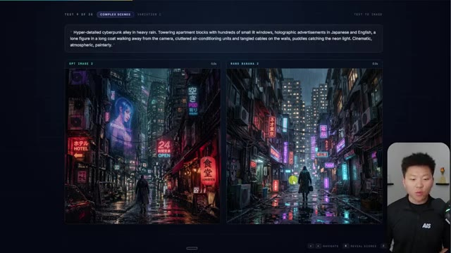
*⏱️ 00:02:49 — Interface de comparaison montrant deux interprétations visuelles d'une ruelle cyberpunk sous la pluie, générées par deux modèles IA différents.*

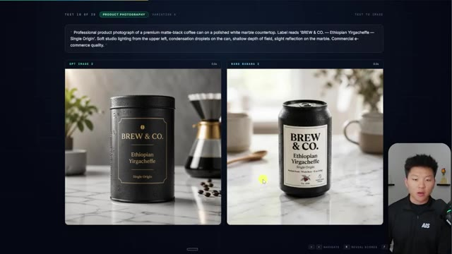
*⏱️ 00:02:57 — Interface de comparaison affichant deux packshots publicitaires d'une canette de café "Brew & Co" sur un comptoir en marbre.*

---

### ⏱️ `[00:03:06 - 00:03:38]` | Segment #08

**🔊 Audio (Transcription Intégrale Mot pour Mot en Français) :**
> the insole is also floating out so i'd pick gbt image 2 these are both really solid i think the lighting on both of these looks really good. As far as the actual watch, which one would I rather wear? I'd probably rather wear that one, so I'm going to choose that one. A realistic mobile screenshot of a clean banking app dashboard. I mean, these are basically identical. I think the only thing where I would give Nano Banana 2 the edge here is that it was able to use web search, and it pulled the real logos over here, which I do think is a plus. A clean labeled physics diagram of a simple pendulum. Okay, that one's hard to tell. I don't know. I'm not picking one there.

**👁️ Analyse Visuelle d'Écran (gemini-3.5-flash-lite) :**
**Interface & Outils** : Outil de comparaison et de génération d'images par IA (interface de type test de modèle).

**Contenu textuel & Code** : Prompts textuels décrivant les visuels : "Luxury close-up of a stainless steel automatic watch..." (Image 1) et "Realistic mobile screenshot of a clean banking app dashboard..." (Image 2).

**Action / Démonstration** : Évaluation et comparaison des résultats générés par deux modèles d'IA distincts (étiquetés "GPT IMAGE 2" et "RAND BANANA 2") pour sélectionner la meilleure sortie visuelle.

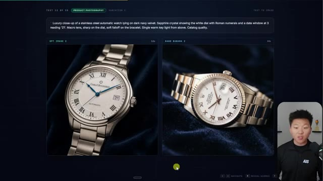
*⏱️ 00:03:14 — Comparaison côte à côte de deux images générées par IA représentant des montres de luxe sur du velours bleu.*

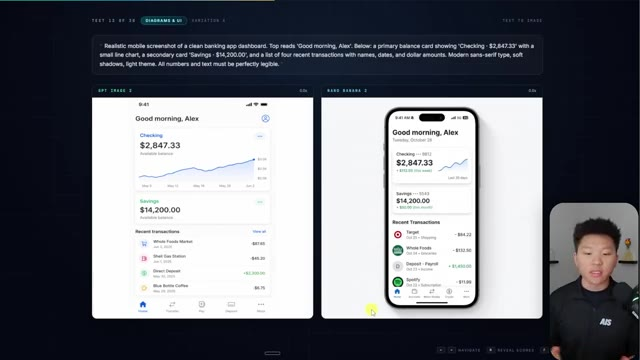
*⏱️ 00:03:22 — Comparaison côte à côte de deux designs d'interface d'application bancaire mobile générés par IA, basés sur une requête textuelle.*

---

### ⏱️ `[00:03:38 - 00:04:10]` | Segment #09

**🔊 Audio (Transcription Intégrale Mot pour Mot en Français) :**
> a realistic sass landing page this one's also kind of tough i think i might have to go with the open ai version this one just looks a little bit more vibe coded these are basically okay i'm not i'm not even going to choose their um oil painting this one i think i would choose i'm gonna start to do these a little bit more lightning round oof oh i'd pick this one gpt image 2 i can't choose here i don't know what i'm looking at really um these look this one looks better if we're talking like a kind of a watercolor type of thing. I don't know. I would choose that one.

**👁️ Analyse Visuelle d'Écran (gemini-3.5-flash-lite) :**
**Interface & Outils** : Plateforme d'évaluation comparative de modèles de génération d'images (benchmark LLM/générateur d'images).

**Contenu textuel & Code** : Texte du prompt : "Realistic SaaS landing page mockup. Hero section reads 'Ship faster with focus.' as the headline..." et noms des modèles (GPT-4o, Hard Banana).

**Action / Démonstration** : Analyse comparative et sélection par le présentateur de la meilleure interface utilisateur générée par IA pour une page SaaS.

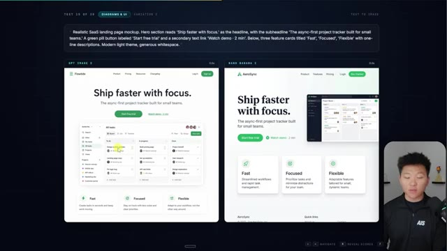
*⏱️ 00:03:46 — Interface de comparaison côte à côte de deux designs de landing page SaaS générés par IA, avec une description textuelle détaillée en haut de l'écran.*

---

### ⏱️ `[00:04:11 - 00:04:47]` | Segment #10

**🔊 Audio (Transcription Intégrale Mot pour Mot en Français) :**
> Yep. I think I would go with GPT image two on this one. Again, a single image showing the exact same person in three different outfits. I mean, this one's closer up, so the details are better. So I'm not going to really choose a winner there. This one, I think interesting. Honestly, for this one, I would choose Nano Banana two because on this side, the lighting and all the features just look too perfect. Whereas the lighting over here seems like it's dynamic for the actual scene. Okay. 30 was a lot. I'm just going to click through these. I don't think you guys need to hear me talk anymore. These are all, I mean, they're both very good, but you can kind of see where we are with these two models. So it's good to see them side by side. And let's see what

**👁️ Analyse Visuelle d'Écran (gemini-3.5-flash-lite) :**
**Interface & Outils** : Interface de test comparatif (benchmark) de modèles d'intelligence artificielle.

**Contenu textuel & Code** : Prompts textuels détaillés décrivant des modifications ou des générations d'images spécifiques pour tester la cohérence de l'IA.

**Action / Démonstration** : Évaluation et comparaison visuelle des résultats produits par deux modèles IA différents pour déterminer lequel respecte le mieux les consignes.

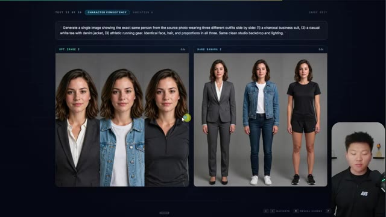
*⏱️ 00:04:20 — Comparaison côte à côte de deux modèles IA générant une personne dans trois tenues différentes (costume, jean/veste, tenue sportive).*

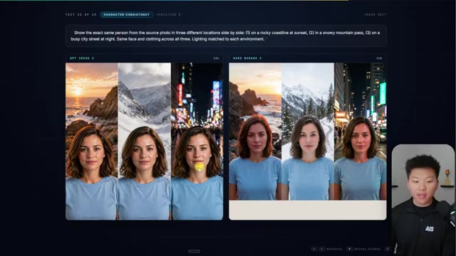
*⏱️ 00:04:29 — Interface montrant un test de consistance de personnage en plaçant la même personne dans trois environnements distincts (côte rocheuse, montagne enneigée, ville).*

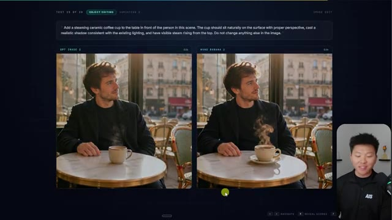
*⏱️ 00:04:38 — Interface de comparaison "Object Editing" illustrant l'ajout d'une tasse de café fumante sur une table devant un homme assis en terrasse.*

---

### ⏱️ `[00:04:47 - 00:05:08]` | Segment #11

**🔊 Audio (Transcription Intégrale Mot pour Mot en Français) :**
> the cloud opus 4.7 said. And by the way, if you guys are curious how I built this whole deck right here and the one that you're going to see later in this video with all these different use cases, then you can download the repo for this cloud code project, which actually looks like this. I pretty much automated that entire thing. I set it off on the task. It generated all the images, all the tests, created that entire presentation in two different separate local hosts.

**👁️ Analyse Visuelle d'Écran (gemini-3.5-flash-lite) :**
**Interface & Outils** : VS Code (Visual Studio Code).

**Contenu textuel & Code** : Code source, journaux d'exécution (logs) d'un terminal, commandes de type "npm run typecheck", et notes de suivi de projet ("What shipped").

**Action / Démonstration** : Le présentateur montre son environnement de développement pour illustrer le processus de construction de son projet ("cloud code project").

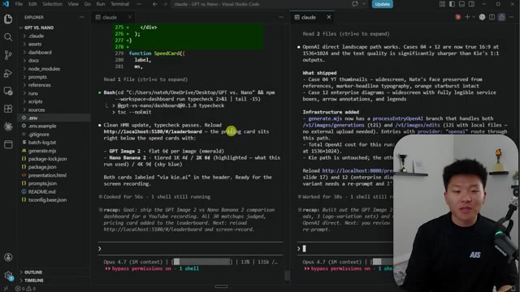
*⏱️ 00:05:03 — Vue de l'interface de VS Code montrant un éditeur de code et un terminal actif utilisé pour le projet.*

---

### ⏱️ `[00:05:09 - 00:05:27]` | Segment #12

**🔊 Audio (Transcription Intégrale Mot pour Mot en Français) :**
> I'm gonna drop this whole project as a GitHub repo in my FreeSchool community. The link for that is down in the description. If you just wanna check it out, look at the images yourself and also figure out sort of like just the way I built it. Anyways, the FreeSchool community is linked in the description. You'll come here, you'll go to the classroom, go to all YouTube resources and you'll find everything that I've ever dropped from YouTube in here. So thanks guys.

**👁️ Analyse Visuelle d'Écran (gemini-3.5-flash-lite) :**
**Interface & Outils** : Visual Studio Code, Plateforme communautaire Skool (AI Automation Society).

**Contenu textuel & Code** : Logs de build (npm), code source (fichiers .mjs, .json), posts communautaires, modules de cours (7 Day AIS Challenge, Claude Code, n8n Templates).

**Action / Démonstration** : Présentation de l'environnement de développement technique puis navigation dans la communauté où les ressources du projet sont partagées.

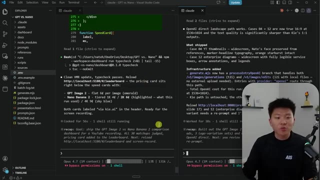
*⏱️ 00:05:13 — Interface de Visual Studio Code affichant des logs de terminal et du code source.*

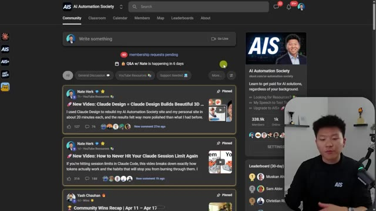
*⏱️ 00:05:18 — Interface de la plateforme communautaire "AI Automation Society" (Skool).*

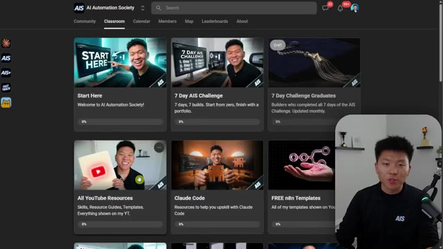
*⏱️ 00:05:23 — Onglet "Classroom" de la plateforme communautaire affichant différents modules de formation.*

---

### ⏱️ `[00:05:27 - 00:05:48]` | Segment #13

**🔊 Audio (Transcription Intégrale Mot pour Mot en Français) :**
> I will let you get back to the video now. It said that GPT Image 2 won. We have different categories. We have artistic styles, character consistency, complex scenes, diagrams, and UI. If you guys really care, you can pause this real quick and take a look. You can see that they were just basically judged on Thai, Nano Banana, or GPT Image 2. And GPT Image 2 ended up winning more. So that is what Anthropic thinks of these two models.

**👁️ Analyse Visuelle d'Écran (gemini-3.5-flash-lite) :**
**Interface & Outils** : Interface web de reporting ou tableau de bord de benchmark d'IA.

**Contenu textuel & Code** : Tableau récapitulatif avec les catégories (Artistic Styles, Character Consistency, Complex Scenes, Diagrams & UI, Object Editing, etc.) et les scores respectifs par modèle avec indicateurs visuels (barres de progression).

**Action / Démonstration** : Présentation des résultats finaux et comparaison des performances des modèles évalués par des juges.

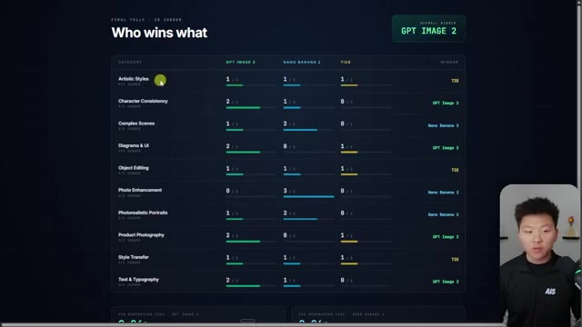
*⏱️ 00:05:32 — Un tableau de bord comparatif présentant les résultats d'un test opposant deux modèles d'IA, "GPT Image 2" et "Nano Banana 2", à travers différentes catégories de performance.*

---

### ⏱️ `[00:05:48 - 00:06:12]` | Segment #14

**🔊 Audio (Transcription Intégrale Mot pour Mot en Français) :**
> And also pricing. So I use Nano Banana and GPT Image through Key.ai. It's basically like an open router for models. because here you can see you can get image models, video models, it's just like one key and you get all of them. So Nano Banana 2 has different kind of pricing for the quality if it's 1K, 2K or 4K and it goes up from 4 cents to 6 cents to 9 cents.

**👁️ Analyse Visuelle d'Écran (gemini-3.5-flash-lite) :**
**Interface & Outils** : Plateforme web Key.ai (interface de gestion d'API et d'exécution de modèles).

**Contenu textuel & Code** : Détails sur GPT-2 Image, tarifs (12 crédits), options de résolution, et catalogue de modèles (Wan 2.7, Seendance 2.0).

**Action / Démonstration** : Exploration des fonctionnalités de la plateforme, sélection de paramètres de génération (résolution, format) et démonstration de l'interface de test "Playground".

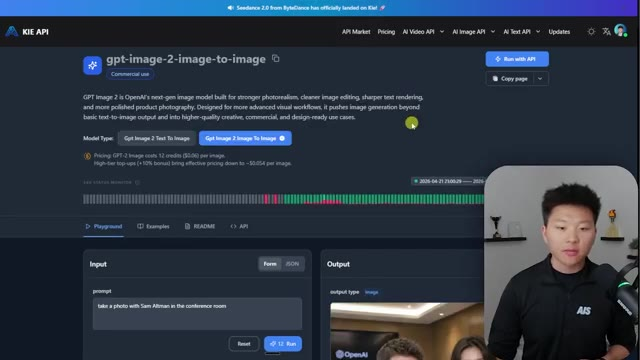
*⏱️ 00:05:54 — Interface de la plateforme Key.ai montrant les détails techniques et tarifaires du modèle "gpt-image-2-image-to-image".*

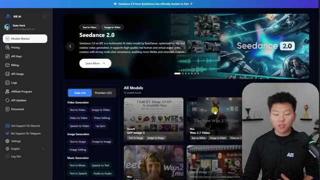
*⏱️ 00:06:00 — Tableau de bord principal de Key.ai affichant une liste de modèles IA disponibles (vidéo, image, musique) incluant Seendance 2.0.*

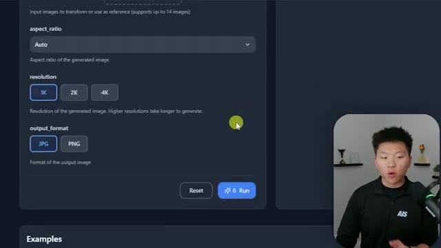
*⏱️ 00:06:06 — Panneau de configuration des paramètres de génération d'image sur Key.ai, permettant de choisir la résolution (1K, 2K, 4K) et le format de sortie.*

---

### ⏱️ `[00:06:12 - 00:06:35]` | Segment #15

**🔊 Audio (Transcription Intégrale Mot pour Mot en Français) :**
> So four, six or nine. And then right now, GBT Image 2 is just 6 cents flat per image. So do with that information what you want, but they're roughly the same price. And you can also get them for cheaper through Key.ai. high. So that's what I use. All right. So now I've got some use cases for you guys. And I know I said 10, but I ended up just kind of throwing in a few more because there's so many things you can do.

**👁️ Analyse Visuelle d'Écran (gemini-3.5-flash-lite) :**
**Interface & Outils** : Interface de plateforme web (type Playground API) pour modèles génératifs.

**Contenu textuel & Code** : Texte descriptif des fonctionnalités de GPT Image 2, tarification affichée (0.06$ par image) et visuel publicitaire de boîte de muesli.

**Action / Démonstration** : Présentation informative des outils d'IA et démonstration de cas d'usage réels (création de packaging).

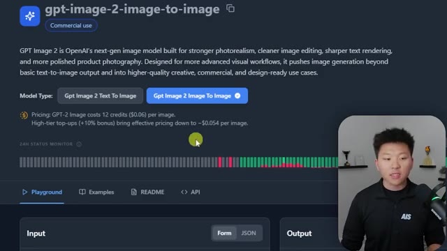
*⏱️ 00:06:18 — Interface web présentant le modèle "GPT Image 2" avec ses détails de tarification et ses capacités.*

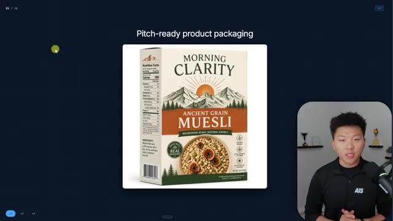
*⏱️ 00:06:29 — Exemple de rendu visuel généré par IA montrant un packaging de produit ("Morning Clarity Muesli").*

---

### ⏱️ `[00:06:35 - 00:07:10]` | Segment #16

**🔊 Audio (Transcription Intégrale Mot pour Mot en Français) :**
> And there's so many more. There's probably 50 others I could come up with, but I just wanted to show you guys a few things that you might be inspired to try. So the first one is pitch ready product packaging. So I've got three versions basically for all of these. This one is cereal box. Pay attention to the calories over here, the nutrition facts, pay attention to the barcode, all of the text, it's all really, really good. I don't see a single mistake. And that was one of the biggest problems with AI image generation. You can see here, same exact thing, all of this, the shadows, the labeling, the text, you know, the depth, and then same thing right here with this pill bottle. So that was use case number one. Number two is pretty cool. So I was inspired by

**👁️ Analyse Visuelle d'Écran (gemini-3.5-flash-lite) :**
**Interface & Outils** : Présentation (diaporama sur fond sombre).

**Contenu textuel & Code** : Texte affiché : "Pitch-ready product packaging" ; visuel d'une boîte de muesli avec des détails nutritionnels, illustration de montagnes et logo de marque.

**Action / Démonstration** : Le présentateur présente un exemple concret de design de produit généré par IA dans le cadre d'un argumentaire de vente.

*⏱️ 00:06:44 — Une diapositive de présentation affiche une maquette de packaging de produit intitulée "Pitch-ready product packaging", montrant une boîte de céréales fictive nommée "Morning Clarity Ancient Grain Muesli". Le présentateur est visible dans une incrustation vidéo en bas à droite.*

---

### ⏱️ `[00:07:10 - 00:07:44]` | Segment #17

**🔊 Audio (Transcription Intégrale Mot pour Mot en Français) :**
> this user on X. His name was Nick and he posted a picture basically said, Hey, I took this image and I gave it to GPT. And I said, Hey, you know, basically make this into a scan and get rid of the creases. And if you look at it, you can see that it actually matches his handwriting like exactly. And the creases are gone and it even cleaned up some things. So I think that this is super impressive, especially when you look down here and I think this is physics and you start to see like different formulas and like just messy characters. It was able to match it. It even got rid of this little red stroke. You don't see that over here. So then I tried this myself. Of

**👁️ Analyse Visuelle d'Écran (gemini-3.5-flash-lite) :**
**Interface & Outils** : Présentation vidéo type diaporama avec capture d'écran d'une interface de traitement d'image.

**Contenu textuel & Code** : Document manuscrit contenant des équations physiques et des formules mathématiques sur papier ligné.

**Action / Démonstration** : Démonstration de la capacité d'un modèle IA (GPT) à numériser et nettoyer un document physique tout en préservant l'écriture manuscrite originale.

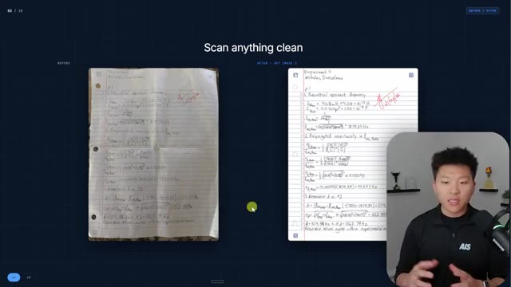
*⏱️ 00:07:19 — Comparaison côte à côte d'une feuille de notes manuscrites avant et après traitement par IA, montrant l'élimination des plis et des imperfections.*

---

### ⏱️ `[00:07:44 - 00:08:18]` | Segment #18

**🔊 Audio (Transcription Intégrale Mot pour Mot en Français) :**
> course, I uploaded this piece of paper that I crumpled up a little bit and it matches my handwriting basically perfect. The only mistake I saw here was right here. This was supposed to be an arrow and then a three, not 33, but that's like the only mistake that I was able to find. So very impressive. And then we have this handwritten whiteboard brainstorm. So obviously this looks a little too perfect, but you can see the shadow on the whiteboard is really good. You can see here, this one looks a little bit more realistic, I'd say, but all of these are very solid. We also have doing website design. So this one has a kind of like a SAS. It's a full website hero section.

**👁️ Analyse Visuelle d'Écran (gemini-3.5-flash-lite) :**
**Interface & Outils** : Outil de numérisation et de transcription de documents manuscrite vers format numérique propre.

**Contenu textuel & Code** : Notes manuscrites concernant des stratégies marketing, des indicateurs de performance (LTV/churn) et un plan "Q2 2026 - GO-TO-MARKET".

**Action / Démonstration** : Démonstration de la capacité d'une IA à nettoyer et numériser des documents physiques (papiers froissés, tableaux blancs) tout en conservant la structure et le contenu manuscrit.

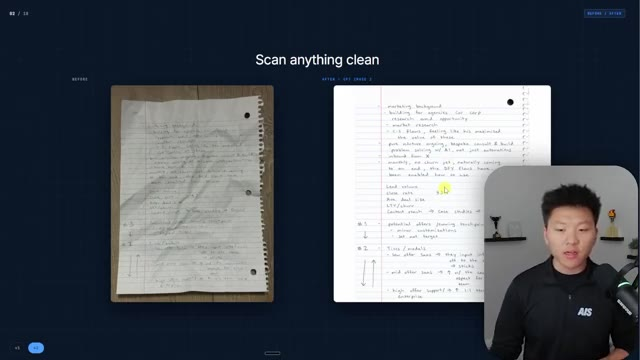
*⏱️ 00:07:52 — Comparaison côte à côte d'une page de carnet manuscrite froissée (à gauche) et de sa transcription numérique propre (à droite) réalisée par l'IA.*

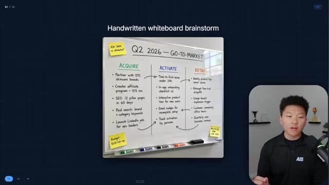
*⏱️ 00:08:01 — Affichage d'un tableau blanc organisé en colonnes ("Acquire", "Activate", "Retain") avec des notes manuscrites et des post-its, illustrant la conversion de notes informelles en structure de stratégie marketing.*

---

### ⏱️ `[00:08:18 - 00:08:38]` | Segment #19

**🔊 Audio (Transcription Intégrale Mot pour Mot en Français) :**
> And for some reason right now, I'm not able to change the aspect ratio. So it's basically always coming back square and I can't really control it. So this would probably look a little bit better if it was landscape. But this one looks really nice. I mean, if you were able to use this inspiration and feed that into like a claw design, it would build it out really nice. And then similarly here, I think that this one is also pretty beautiful. So it should be good at helping you design website concepts.

**👁️ Analyse Visuelle d'Écran (gemini-3.5-flash-lite) :**
**Interface & Outils** : Navigateur web (présentant des interfaces UI/UX de sites web).

**Contenu textuel & Code** : Designs de pages d'accueil de sites web ("Full website hero sections").

**Action / Démonstration** : Le présentateur commente la qualité esthétique des designs affichés et exprime une difficulté technique à modifier le format d'image (aspect ratio) des démonstrations.

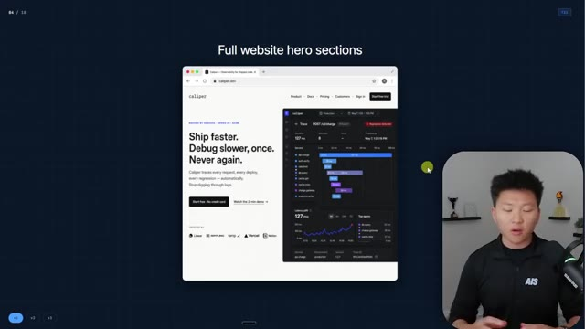
*⏱️ 00:08:23 — Une capture d'écran d'un navigateur affichant le site web de Caliper.dev, présentant une section "hero" avec du texte promotionnel et un tableau de bord technique sur le côté droit.*

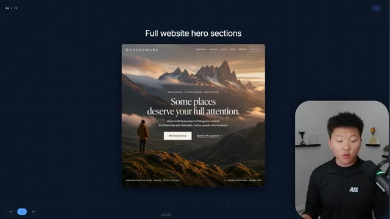
*⏱️ 00:08:28 — Une capture d'écran d'un navigateur affichant le site web de Wandermark, présentant une section "hero" avec une image de paysage montagneux en arrière-plan et un slogan publicitaire.*

---

### ⏱️ `[00:08:39 - 00:09:15]` | Segment #20

**🔊 Audio (Transcription Intégrale Mot pour Mot en Français) :**
> All right. So add creative split tests. I think this is super cool. I mean, it understands the spacing. It is engaging. Maybe you want to get a little bit less wordy, but still, this one looks really good this one also looks really solid and this one i mean this one has the red which i think would kind of stop the scroll a little bit but all of these different variations are pretty cool now we also have ugc selfie ads so this one is obviously very solid it is the little serum this one is cedar and sage it's we've saw this product a few other times this one i think the man doesn't look as realistic his skin looks a little bit maybe too smooth this one looks a lot

**👁️ Analyse Visuelle d'Écran (gemini-3.5-flash-lite) :**
**Interface & Outils** : Interface de présentation de diapositives de marketing numérique (type slide deck).

**Contenu textuel & Code** : Publicités graphiques (textes, images produits) et vidéos UGC pour la marque "Cedar & Sage".

**Action / Démonstration** : Le présentateur passe en revue différents types de supports publicitaires pour illustrer ses propos sur les tests A/B de création.

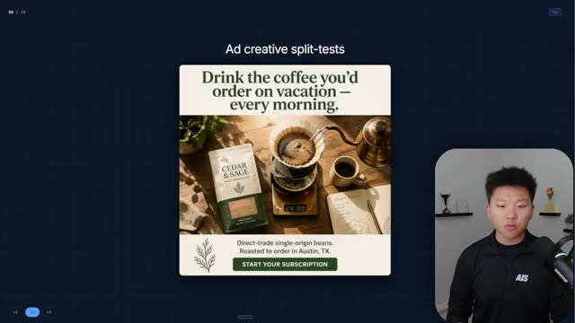
*⏱️ 00:08:48 — Présentation d'une publicité créative pour la marque Cedar & Sage mettant en avant le rituel du café matinal.*

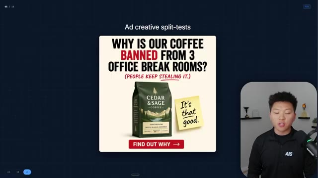
*⏱️ 00:08:57 — Affichage d'une autre variante publicitaire utilisant un titre accrocheur sur le bannissement du café au bureau et un bouton d'appel à l'action rouge.*

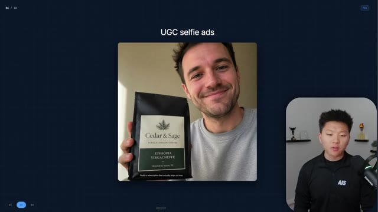
*⏱️ 00:09:06 — Illustration d'une publicité de type "UGC" (User Generated Content) montrant un homme souriant tenant un paquet de café Cedar & Sage.*

---

### ⏱️ `[00:09:15 - 00:09:34]` | Segment #21

**🔊 Audio (Transcription Intégrale Mot pour Mot en Français) :**
> better, I think. And here, I think this one looks really solid as well. The lighting and everything, all the wording. Now we also have the localized creative. So we saw the Cedar and Sage earlier, but now it can be translated. And I think that this ad itself actually looks really solid too. So I'd probably say, Hey, make this in English as well. This one looks really, really good. All of these are very consistent with the brand, as you can see the colors and stuff.

**👁️ Analyse Visuelle d'Écran (gemini-3.5-flash-lite) :**
**Interface & Outils** : Diaporama de présentation (format Slide/Keynote).

**Contenu textuel & Code** : Visuels publicitaires générés ou optimisés par IA pour différentes niches (suppléments sportifs et café).

**Action / Démonstration** : Le présentateur commente la qualité visuelle, l'éclairage et la pertinence de la localisation du contenu publicitaire.

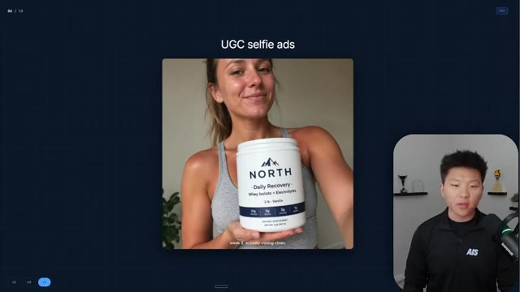
*⏱️ 00:09:20 — Présentation d'une publicité type "UGC" (User Generated Content) sous forme de selfie montrant une femme tenant un pot de complément alimentaire de la marque "NORTH".*

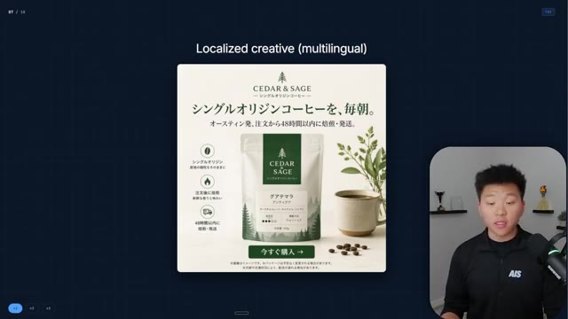
*⏱️ 00:09:24 — Exemple de création publicitaire localisée en japonais pour la marque de café "Cedar & Sage", incluant le packaging, du texte promotionnel et un bouton d'appel à l'action.*

---

### ⏱️ `[00:09:35 - 00:10:11]` | Segment #22

**🔊 Audio (Transcription Intégrale Mot pour Mot en Français) :**
> And this one also looks nice. We've got book covers and three different styles. So this book is called The Founder's Silence. And we have this one as well as this one, very different vibes, but this kind of stuff could just help you ideate, right? Like you could just drop in a product and say, Hey, create me 15 different styles of book covers or of ads or websites. And it's just going to give you a ton of outputs. That's really going to help you with like figuring out which direction you want to go. You can also use this for LinkedIn carousels. So here we have, you know, seven pricing mistakes founders make on SAS. And then you'd have all your different slides generated with this image model because the text is good and because it

**👁️ Analyse Visuelle d'Écran (gemini-3.5-flash-lite) :**
**Interface & Outils** : Interface de présentation graphique ou outil de design assisté par IA.

**Contenu textuel & Code** : Textes marketing et designs visuels (couverture de livre, template de carousel).

**Action / Démonstration** : Démonstration de capacités d'idéation et de génération de contenu visuel par IA pour différents formats marketing.

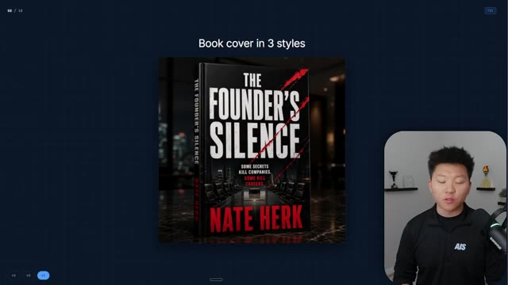
*⏱️ 00:09:44 — Présentation à l'écran d'une couverture de livre intitulée "The Founder's Silence" avec un design sombre et professionnel, illustrant une option de style.*

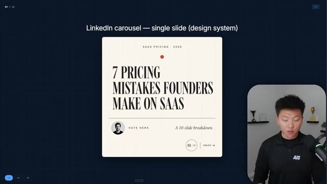
*⏱️ 00:10:02 — Affichage à l'écran d'une diapositive de carousel LinkedIn intitulée "7 Pricing Mistakes Founders Make on SaaS", illustrant un exemple de système de design.*

---

### ⏱️ `[00:10:11 - 00:10:32]` | Segment #23

**🔊 Audio (Transcription Intégrale Mot pour Mot en Français) :**
> could generate diagrams and charts and things like that as well. This one, I don't really know how this got in here. Restaurant menu plus food photography, but the menu looks fine. It looks a little bit AI generated, the handwriting, but this food, I mean, if you put this on your website or, you know, in your reviews or even just on your menu, this food looks super, super like just real.

**👁️ Analyse Visuelle d'Écran (gemini-3.5-flash-lite) :**
**Interface & Outils** : Aucune interface logicielle, éditeur de code ou outil d'automatisation n'est visible. Il s'agit d'une présentation de diapositives contenant des exemples d'images générées par IA.

**Contenu textuel & Code** : Textes descriptifs sur les images : "Restaurant menu + food photography".

**Action / Démonstration** : Le présentateur commente la qualité visuelle des rendus IA (menu et photographie culinaire).

---

### ⏱️ `[00:10:32 - 00:11:04]` | Segment #24

**🔊 Audio (Transcription Intégrale Mot pour Mot en Français) :**
> We've also got brand mascots. So if you've got a mascot and you want to put it across different elements of your website or wherever, it should be able to keep that character pretty consistent throughout. Not only logo design, but also the ability to like change the styling of your logo. So we've got the AIS right here, but look, you can make it like a 3D element. You could make it like a plush. You could change it to be sort of like glass. And I did this with other logos too. So the Up at AI logo, you can see same exact thing. And then for just my logo, Nate, we can see that we have these different styles as well. So very cool. Also real estate. So figuring out what to do with

**👁️ Analyse Visuelle d'Écran (gemini-3.5-flash-lite) :**
**Interface & Outils** : Présentation visuelle (diapositive type slideshow).

**Contenu textuel & Code** : Texte affichant « Brand mascot across touchpoints » et une maquette de page web « 404 - We can't find that page » avec une mascotte renard, des icônes de dollar et un bouton « Back to dashboard ».

**Action / Démonstration** : Démonstration de l'intégration d'un personnage de marque sur différents éléments d'une interface web.

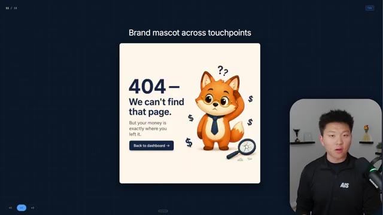
*⏱️ 00:10:40 — Une diapositive de présentation illustrant l'utilisation cohérente d'une mascotte de marque (un renard) intégrée dans une page d'erreur 404.*

---

### ⏱️ `[00:11:04 - 00:11:37]` | Segment #25

**🔊 Audio (Transcription Intégrale Mot pour Mot en Français) :**
> your space. Like this is my space right back here. It's a pretty empty room, right? But here you can see that it keeps my elements that already exist. And it put a new plant, it put a couch, it put a different rug. And then I did that with a few other styles too. So it's keeping the spatial awareness and it's keeping the elements, but it's just kind of changing up what's in here. We've got some enterprise diagrams. So it understands logic, it understands flow, it understands how to obviously make text. So here's just a few other examples of this. Now I did notice right here, we have a

**👁️ Analyse Visuelle d'Écran (gemini-3.5-flash-lite) :**
**Interface & Outils** : Présentation de slides / interface de démonstration logicielle.

**Contenu textuel & Code** : Schéma technique de plateforme de paiement (Web SPA, SDK, API, microservices, Postgres, Redis, Kafka).

**Action / Démonstration** : Illustration des capacités de l'IA pour la modification d'images spatiales et la documentation d'architectures système complexes.

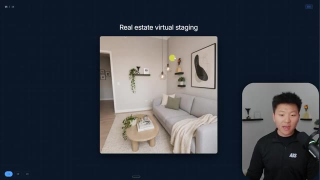
*⏱️ 00:11:12 — Démonstration de « virtual staging » immobilier montrant une pièce meublée avec un canapé, une table basse et des plantes décoratives.*

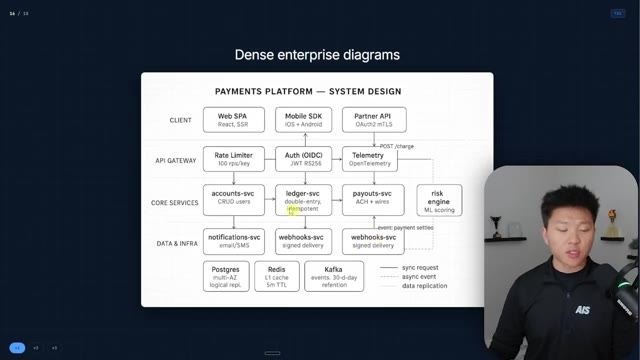
*⏱️ 00:11:28 — Schéma d'architecture système intitulé « PAYMENTS PLATFORM — SYSTEM DESIGN », détaillant les composants client, passerelle API, services principaux et infrastructure de données.*

---

### ⏱️ `[00:11:37 - 00:11:55]` | Segment #26

**🔊 Audio (Transcription Intégrale Mot pour Mot en Français) :**
> little bit of an error here and I'm not sure exactly if I put click P, we should be able to see the exact prompt, what it might've messed up. Yeah. So I'm not exactly sure what happened here, but it definitely did miss up some of the text. Now I was also throttling this API and just generating hundreds of images, but if you push it to the limit, it might mess up some stuff.

**👁️ Analyse Visuelle d'Écran (gemini-3.5-flash-lite) :**
**Interface & Outils** : Logiciel de présentation (type slides).

**Contenu textuel & Code** : Diagramme technique décrivant 6 étapes : Ingest, Features, Train, Register, Monitor. En bas, un prompt textuel décrivant la génération du diagramme mentionne des erreurs de transcription ("Regifoasys", "Ptfooder", "Moei regis t/T V25").

**Action / Démonstration** : Analyse et présentation d'un diagramme d'architecture système pour un modèle de recommandation, tout en discutant des erreurs de génération de texte dans le prompt.

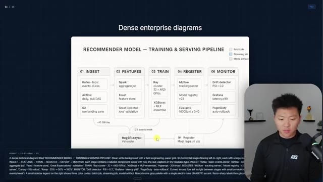
*⏱️ 00:11:41 — Une présentation affichant un diagramme technique complexe intitulé "RECOMMENDER MODEL - TRAINING & SERVING PIPELINE" détaillant les étapes de pipeline ML, avec une section de prompt textuel visible en bas de l'écran.*

---

### ⏱️ `[00:11:56 - 00:12:15]` | Segment #27

**🔊 Audio (Transcription Intégrale Mot pour Mot en Français) :**
> Speaking of messing up some stuff, these thumbnails are horrific. Now, keep in mind, this was literally me giving it a reference thumbnail and saying, make a bunch. And like I said, I was throttling the API and stuff. And it's interesting because earlier I did some examples where I said, hey, here's a picture of me, make it look like I'm shaking hands with X person. And it was making me look like me.

**👁️ Analyse Visuelle d'Écran (gemini-3.5-flash-lite) :**
**Interface & Outils** : Présentation de diapositives (format type interface web de cours ou éditeur de slides).

**Contenu textuel & Code** : Textes graphiques de miniatures YouTube : "NAPKIN -> BILLBOARD" (Image 1) et "3 HOURS / 30 SECONDS" avec visuels de produits (Image 2).

**Action / Démonstration** : Le présentateur fait défiler des exemples de miniatures générées par une IA pour illustrer son propos sur la qualité et les tests réalisés.

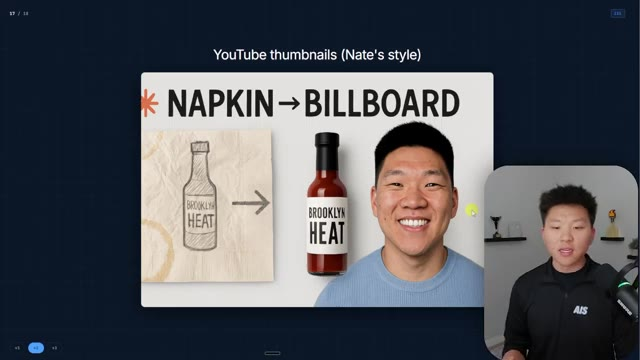
*⏱️ 00:12:01 — Une diapositive montrant une miniature YouTube intitulée "NAPKIN -> BILLBOARD", illustrant une transformation de concept (croquis sur serviette vers produit fini) aux côtés du visage de Nate.*

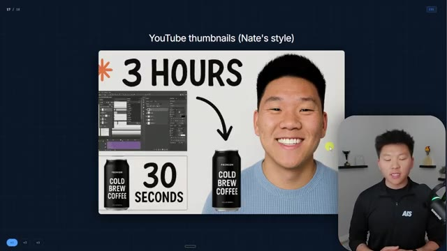
*⏱️ 00:12:06 — Une diapositive montrant une miniature YouTube intitulée "3 HOURS 30 SECONDS", illustrant un processus de création graphique rapide comparé au produit fini, aux côtés du visage de Nate.*

---

### ⏱️ `[00:12:15 - 00:12:36]` | Segment #28

**🔊 Audio (Transcription Intégrale Mot pour Mot en Français) :**
> But sometimes when you do a source image over and over, it just degrades and it degrades. But the reason I wanted to include it here is because if I actually built a workflow around this that had like good elements and it had good prompting for my style, I 100% think that I could fully automate the thumbnail creation. So I thought that it was at least worth including in this sort of use case type of video, but these are obviously trash.

**👁️ Analyse Visuelle d'Écran (gemini-3.5-flash-lite) :**
**Interface & Outils** : Logiciel de présentation (type diaporama) affichant des exemples de miniatures YouTube.

**Contenu textuel & Code** : Texte à l'écran : "YouTube thumbnails (Nate's style)", "3 HOURS", "30 SECONDS", "NAPKIN -> BILLBOARD", "BROOKLYN HEAT".

**Action / Démonstration** : Démonstration visuelle des exemples de résultats finaux (thumbnails) que l'automatisation permet de produire pour la chaîne.

*⏱️ 00:12:21 — Présentation d'une miniature YouTube montrant un comparatif "3 heures vs 30 secondes" pour la création d'une publicité de café, incluant une capture d'interface de logiciel de montage.*

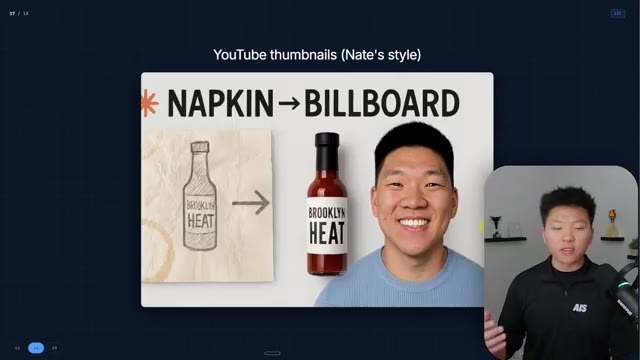
*⏱️ 00:12:31 — Présentation d'une miniature YouTube illustrant le concept "Napkin -> Billboard" avec un dessin de bouteille de sauce piquante transformé en produit réel fini.*

---

### ⏱️ `[00:12:37 - 00:12:56]` | Segment #29

**🔊 Audio (Transcription Intégrale Mot pour Mot en Français) :**
> Like even all three of these, I look different in all of them. And then the last one I put, because it could definitely be useful, is just realistic app mock-ups, which we saw earlier in the comparison between GPT Image 2 and Nanobinette 2. So all of these look pretty solid. But yeah, I mean, if you guys are curious how I built those two sort of tests and those dashboards, Those were just spun up on localhost.

**👁️ Analyse Visuelle d'Écran (gemini-3.5-flash-lite) :**
**Interface & Outils** : Visual Studio Code (VS Code), interfaces d'applications mobiles (mock-ups).

**Contenu textuel & Code** : Code source JavaScript, logs de compilation TypeScript (tsc --noEmit), rapports de tests sur les coûts des modèles IA, maquettes d'UI/UX mobile.

**Action / Démonstration** : Présentation visuelle de résultats générés par IA (UI) et analyse technique via terminal dans l'environnement de développement.

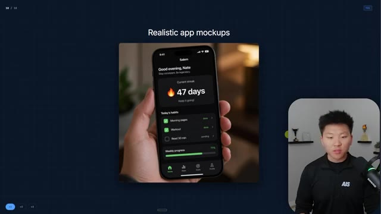
*⏱️ 00:12:41 — Une maquette d'application mobile sombre affichée sur un smartphone tenue en main, montrant un tableau de bord de suivi d'habitudes avec une série de "47 jours" et des tâches.*

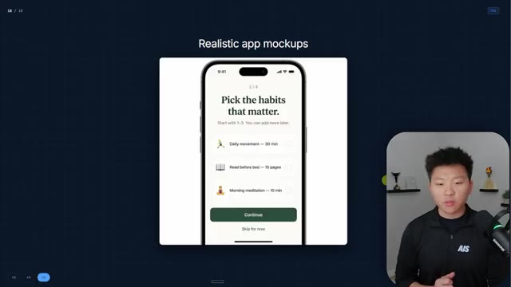
*⏱️ 00:12:46 — Une maquette d'application mobile au design clair sur smartphone, montrant une interface de sélection d'habitudes ("Pick the habits that matter").*

*⏱️ 00:12:51 — L'éditeur Visual Studio Code affichant des logs de terminal et du code source, détaillant le déploiement de tests de comparaison entre les modèles IA "GPT Image 2" et "Nano Banana 2".*

---

### ⏱️ `[00:12:56 - 00:13:17]` | Segment #30

**🔊 Audio (Transcription Intégrale Mot pour Mot en Français) :**
> And I pretty much just had Cloud Code in here build everything. So I dropped in what it needed and I had it brainstorm over how we could do this comparison and research what the best use cases would be as far as like comparing them. And then obviously Cloud Code itself analyzed and judged all those images. So it's really cool that I was able to just give it this task and give it this idea I had.

**👁️ Analyse Visuelle d'Écran (gemini-3.5-flash-lite) :**
**Interface & Outils** : VS Code (Visual Studio Code) avec deux fenêtres de terminal intégrées utilisant "Opus 4.7".

**Contenu textuel & Code** : Logs d'exécution montrant des commandes Bash (`npm --workspace=...`), des rapports de validation de type (typecheck), des analyses de coûts OpenAI, et des notes de développement sur la génération de visuels (images 16:9, qualité de texte).

**Action / Démonstration** : L'agent IA exécute des tâches de build, vérifie les types de code, et génère des rapports de résultats pour un tableau de bord de comparaison ("Leaderboard").

*⏱️ 00:13:01 — Capture d'écran de l'interface VS Code affichant un environnement de développement avec deux instances de terminal actif exécutant des processus d'agent IA (Opus 4.7) pour comparer des performances de modèles.*

---

### ⏱️ `[00:13:17 - 00:13:50]` | Segment #31

**🔊 Audio (Transcription Intégrale Mot pour Mot en Français) :**
> And then it was able to automate the pipeline of creating all those images and inserting them into the dashboards and, you know, creating all that styling in the presentation for me. So very, very cool to just be able to push Cloud Code to its limits and just connect all these different tools. But that is going to do it for today. And I know this one was quick, but just wanted to show you guys the new model, compare it to Nano Banana 2. But anyways, I'm going to be using GPT Image 2 a lot more because right now pretty much all my thumbnails are created or enhanced with Nano Banana 2. So this thumbnail that you're looking at for this video, I have built with GPT Image 2. So hopefully you guys think it looked good. Anyways, that's going to do it for

**👁️ Analyse Visuelle d'Écran (gemini-3.5-flash-lite) :**
**Interface & Outils** : Visual Studio Code (avec extension Claude/Opus), Navigateur Web (Dashboard).

**Contenu textuel & Code** : - Image 1 : Logs de terminal, commande `npm run typecheck`, et rapports d'état sur l'infrastructure d'IA (génération d'images, chemins de fichiers, coûts OpenAI).
- Image 2 : Tableau comparatif avec des barres de progression par catégorie (Artistic Styles, Character Consistency, etc.) et le résultat final désignant "GPT Image 2".

**Action / Démonstration** : - Image 1 : Exécution et validation du pipeline d'automatisation via l'agent Opus.
- Image 2 : Visualisation des résultats finaux générés automatiquement et intégrés dans le tableau de bord.

*⏱️ 00:13:25 — Interface de VS Code montrant deux instances d'un agent IA (Opus 4.7) traitant du code et des journaux de déploiement pour un projet de comparaison d'images.*

*⏱️ 00:13:42 — Capture d'écran d'un tableau de bord web sombre affichant les résultats détaillés d'un comparatif ("Who wins what") entre "GPT Image 2" et "Nano Banana 2".*

---

### ⏱️ `[00:13:50 - 00:13:58]` | Segment #32

**🔊 Audio (Transcription Intégrale Mot pour Mot en Français) :**
> this one. Hope you guys enjoyed the video. If you did, please give it a like. It helps me out a ton. And as always, I appreciate you making it to end the video and I'll see you in the next one. Thanks everyone.

**👁️ Analyse Visuelle d'Écran (gemini-3.5-flash-lite) :**
**Interface & Outils** : Interface web de reporting ou tableau de bord analytique personnalisé (type SaaS).

**Contenu textuel & Code** : Tableau comparatif avec colonnes : Catégorie (Artistic Styles, Character Consistency, Complex Scenes, etc.), score par modèle (GPT Image 2, Nano Banana 2), nombre de matchs nuls (Ties) et le vainqueur final par catégorie.

**Action / Démonstration** : Affichage des résultats finaux du test de performance pour conclure la vidéo.

*⏱️ 00:13:52 — Un tableau de bord sombre affichant un récapitulatif des résultats d'un comparatif entre modèles d'IA (GPT Image 2 vs Nano Banana 2) sur plusieurs catégories de tâches.*

---

