# 🎬 Claude Video Editing Just Became Unrecognizable

> **Chaîne** : [Nate Herk | AI Automation](https://www.youtube.com/@nateherk/featured)  
> **Lien YouTube** : [https://www.youtube.com/watch?v=Aw3BkmhYu4I](https://www.youtube.com/watch?v=Aw3BkmhYu4I)  
> **Date de publication** : 20260423  
> **Durée** : 00:28:12  
> **Identifiant vidéo** : `Aw3BkmhYu4I`  
> **Transcription & Analyse** : `whisper-v3-large-turbo+gemini-3.5-flash-lite`  

---

## 📌 Synthèse Exécutive & Outils

### 💡 Résumé
Dans cette vidéo intitulée **Claude Video Editing Just Became Unrecognizable**, Nate Herk décortique les capacités pratiques d'automatisation et de développement propulsées par les modèles de pointe.

### 🛠️ Outils, Modèles & Logiciels Présentés
- **Opus 5.5 & Claude Code** : Modèles d'ingénierie et agents de codage autonome.

### 🔑 Points Clés & Enseignements Stratégiques
- Optimiser le niveau d'effort et le raisonnement des modèles IA pour des résultats industriels.
- Automatiser les cycles de création logicielle de bout en bout.

---

## ⏱️ Chronologie & Transcription Complète Audio & Visuelle (Mot pour Mot)

### ⏱️ `[00:00:00 - 00:00:25]` | Segment #01

**🔊 Audio (Transcription Intégrale Mot pour Mot en Français) :**
> Claude is now editing my videos end to end. All I have to do is drop in a raw file and it is trimming out the mistakes in the dead space. It's adding motion graphics like you see over here. It's adding dynamic elements like you see over here. It can even add subtitles at the bottom of the screen like you're looking at right here. So even if you've never coded before or you've never edited videos before, I'm going to show you guys exactly how you can get set up and get outputs that look pretty incredible just like this. All you have to do is use your natural language. It is so insane.

**👁️ Analyse Visuelle d'Écran (gemini-3.5-flash-lite) :**
**Interface & Outils** : Logiciel de montage vidéo assisté par IA (interface personnalisée "Hyperframes").

**Contenu textuel & Code** : Texte et icônes du processus "HOW IT WORKS" : "PROMPT", "HYPERFRAMES", "VIDEO".

**Action / Démonstration** : Présentation visuelle du flux de traitement automatisé des fichiers vidéo par l'IA.

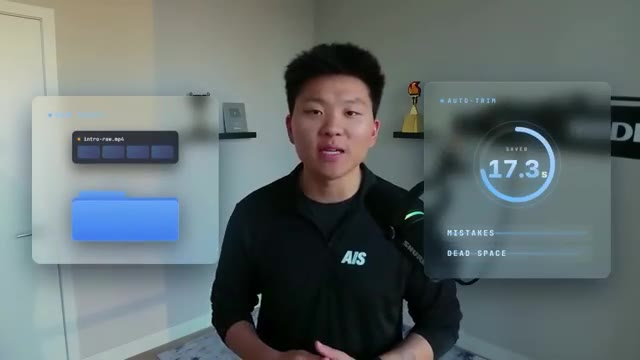
*⏱️ 00:00:06 — Interface utilisateur montrant un outil "AUTO-TRIM" avec un graphique circulaire affichant le temps économisé (17.3s) après suppression des erreurs et des silences.*

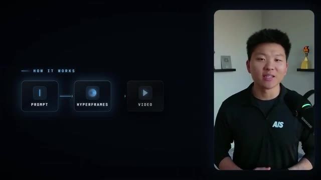
*⏱️ 00:00:19 — Schéma de workflow simplifié "HOW IT WORKS" montrant la progression séquentielle : PROMPT -> HYPERFRAMES -> VIDEO.*

---

### ⏱️ `[00:00:25 - 00:01:00]` | Segment #02

**🔊 Audio (Transcription Intégrale Mot pour Mot en Français) :**
> Don't want to waste any of your guys' time, so let's just get straight to the video. So yeah, I was able to take this, you know, 50 second clip, drop it into Claude. And then it basically cut out all of the mistakes, all of the filler words. And now we have a 27 second clip with all of the motion graphics that you guys just saw. But not only that, you can see, we also have this timeline editor, which has all of the actual elements down here, all of the different motion graphics. So if I wanted to, I could delete these, I can move them around and I could change the timing because obviously what's super important about motion graphics is the timing. So now we have this actual interface within our Hyperframes dashboard to make some really quick iterations.

**👁️ Analyse Visuelle d'Écran (gemini-3.5-flash-lite) :**
**Interface & Outils** : Logiciel de montage vidéo orienté code (type Remotion ou outil d'automatisation vidéo similaire).

**Contenu textuel & Code** : Noms de fichiers dans la barre latérale (index.html, compositions, assets, render, scripts/DESIGN.md, hyperframes.json). Timeline affichant des segments nommés "b01" à "b07".

**Action / Démonstration** : Le créateur présente une interface de montage automatique où les coupes (cuts) sont gérées sous forme de clips séquencés (b01-b07) sur une timeline, illustrant le résultat du traitement effectué par l'IA sur la vidéo source.

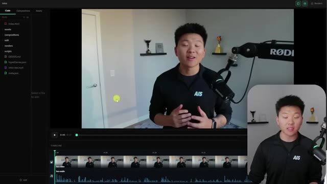
*⏱️ 00:00:34 — Interface d'édition vidéo basée sur du code, affichant une prévisualisation de la vidéo du présentateur et une timeline linéaire avec des vignettes.*

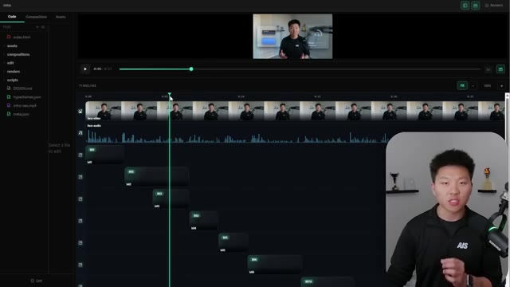
*⏱️ 00:00:51 — Interface d'édition vidéo montrant une timeline détaillée avec des blocs de segments de clips (étiquetés de b01 à b07) et une forme d'onde audio.*

---

### ⏱️ `[00:01:00 - 00:01:21]` | Segment #03

**🔊 Audio (Transcription Intégrale Mot pour Mot en Français) :**
> So today I'm going to show you guys step-by-step setting up a fresh Cloud project. We're going to get everything we need to get installed installed. And by the end, you're going to know exactly how to edit videos, just like you saw in the intro. All right. So before we get into it, let's talk about the way that this actually works and sort of the tech stack that we're using. So before we were able to use Cloud and these other tools to edit videos, this was basically my process.

**👁️ Analyse Visuelle d'Écran (gemini-3.5-flash-lite) :**
**Interface & Outils** : Hyperframes Studio, application de type tableau blanc interactif (Excalidraw ou similaire).

**Contenu textuel & Code** : Image 1 : Logs de développement, structure de fichiers "hyperframes-student-kit", timeline avec marqueurs de battements (beats). Image 2 : Étapes de production : "Raw file", "Trim/Edit", "Animate", "Render".

**Action / Démonstration** : Présentation technique d'un écosystème d'édition vidéo assistée par IA et explication du processus séquentiel de traitement d'une vidéo.

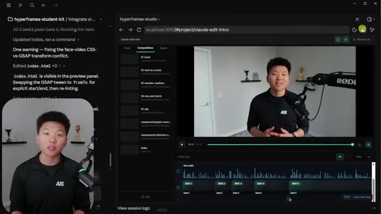
*⏱️ 00:01:05 — Interface de développement "Hyperframes Studio" affichant un environnement de montage vidéo avec prévisualisation et timeline audio synchronisée.*

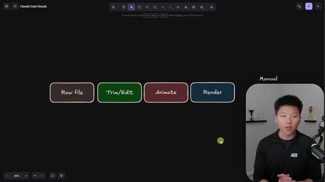
*⏱️ 00:01:11 — Diagramme de workflow illustré sur un tableau blanc virtuel, décomposant les étapes du montage vidéo.*

---

### ⏱️ `[00:01:21 - 00:01:43]` | Segment #04

**🔊 Audio (Transcription Intégrale Mot pour Mot en Français) :**
> I would have some sort of raw file, which would be a recording. And then I would go in there manually into, you know, like Adobe Premiere Pro. And I would trim out all of my mistakes and I would trim out all of the retakes and things like that. And this was all very manual. So I was doing this manually and I was doing this manually. And then if I wanted to add any animations, I would be doing that manually. And then rendering is not a big deal, but I would be doing that manually as well.

**👁️ Analyse Visuelle d'Écran (gemini-3.5-flash-lite) :**
**Interface & Outils** : Excalidraw (ou outil de tableau blanc numérique similaire).

**Contenu textuel & Code** : Diagramme de processus en quatre étapes : Raw file -> Trim/Edit -> Animate -> Render. Le titre "Manual" est inscrit au-dessus du flux.

**Action / Démonstration** : Présentation visuelle du flux de travail manuel traditionnel avant l'automatisation.

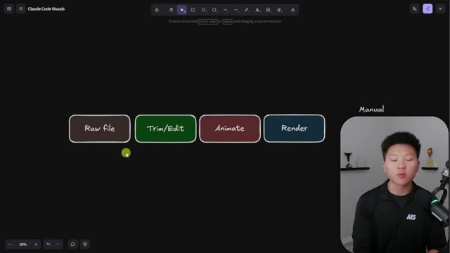
*⏱️ 00:01:27 — Un schéma sur tableau blanc numérique illustrant un flux de travail de montage vidéo manuel, composé de quatre blocs : "Raw file", "Trim/Edit", "Animate" et "Render", avec le présentateur en médaillon.*

---

### ⏱️ `[00:01:44 - 00:02:02]` | Segment #05

**🔊 Audio (Transcription Intégrale Mot pour Mot en Français) :**
> And then a few days back, this tool from HN just dropped called Hyperframes. And I made a video about how we're able to use Claude with Hyperframes to get motion graphics and animations like this. And what I showed you guys in that video was basically us doing these first two pieces manually, but then we were using hyperframes to actually do the animations and the rendering.

**👁️ Analyse Visuelle d'Écran (gemini-3.5-flash-lite) :**
**Interface & Outils** : Excalidraw (ou outil de dessin similaire).

**Contenu textuel & Code** : Schéma de workflow manuel : "Manual" connecté par des flèches à quatre boîtes intitulées "Raw file", "Trim/Edit", "Animate", et "Render".

**Action / Démonstration** : Présentation visuelle d'un processus de travail étape par étape pour expliquer les limitations des méthodes manuelles par rapport à l'automatisation.

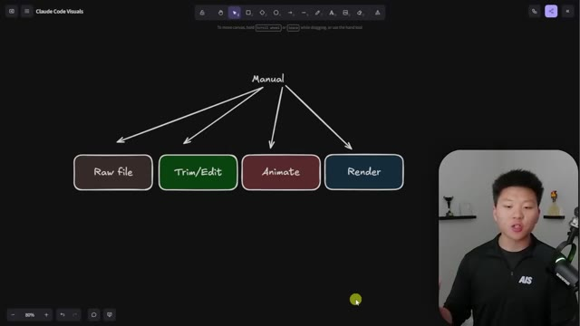
*⏱️ 00:01:53 — Un schéma conceptuel créé dans un logiciel de tableau blanc collaboratif (type Excalidraw) montrant le processus "Manual" divisé en quatre étapes : Raw file, Trim/Edit, Animate, Render.*

---

### ⏱️ `[00:02:02 - 00:02:24]` | Segment #06

**🔊 Audio (Transcription Intégrale Mot pour Mot en Français) :**
> So still a huge productivity boost, but we were still manually doing the trimming and editing. But now we're taking it a step farther because we have this new tool called video use. And video use is going to be the one that's doing the trimming and editing for us. So right now what we're doing is we're dropping in a raw file, and then it's basically being trimmed, edited, animated and rendered for us and it's really cool.

**👁️ Analyse Visuelle d'Écran (gemini-3.5-flash-lite) :**
**Interface & Outils** : Excalidraw (ou outil de tableau blanc similaire)

**Contenu textuel & Code** : Schéma textuel : "Manual" pointant vers "Raw file" et "Trim/Edit" ; "Hyperframes" pointant vers "Animate" et "Render".

**Action / Démonstration** : Présentation conceptuelle du workflow pour illustrer la transition de l'édition manuelle vers l'automatisation via l'outil "Video Use".

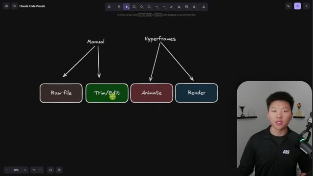
*⏱️ 00:02:08 — Un schéma visuel créé sur un tableau blanc numérique illustrant le flux de travail de production vidéo, avec une distinction entre les étapes "Manual" (Raw file, Trim/Edit) et "Hyperframes" (Animate, Render).*

---

### ⏱️ `[00:02:25 - 00:03:01]` | Segment #07

**🔊 Audio (Transcription Intégrale Mot pour Mot en Français) :**
> Now, yes, we could get rid of the manual step of recording the raw file. I don't wanna do that for YouTube because I wanna keep these videos real but I did actually make a video about that as well. In this video, I talked about how I used HeyGen to basically automate me recording the videos. So I would drop in a script and then it would give us the raw file. So this step would actually change to a HeyGen avatar and then because the fact that the HeyGen avatar is perfect, we basically were able to just remove this trimming and editing step entirely and then we would just get the animations and the rendering done. So there's lots of ways that you can skin the cat here but today what I'm showing you is basically just manual recording and then the rest from

**👁️ Analyse Visuelle d'Écran (gemini-3.5-flash-lite) :**
**Interface & Outils** : Application de tableau blanc collaboratif (type Miro ou Excalidraw).

**Contenu textuel & Code** : Diagramme de flux avec les termes : "Manual", "Video Use", "Hyperframes" pointant vers des boîtes étiquetées "Raw file", "Trim/Edit", "Animate" et "Render".

**Action / Démonstration** : Présentation visuelle et structuration du workflow de montage vidéo automatisé.

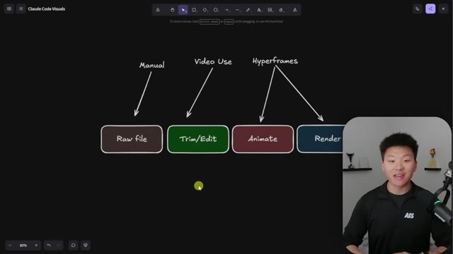
*⏱️ 00:02:34 — Un schéma conceptuel sur un tableau blanc virtuel illustrant les étapes de production vidéo : "Raw file" (Manual), "Trim/Edit" (Video Use), et "Animate" / "Render" (Hyperframes).*

---

### ⏱️ `[00:03:01 - 00:03:36]` | Segment #08

**🔊 Audio (Transcription Intégrale Mot pour Mot en Français) :**
> there is taking care of us and like I said I'm going to show you guys this step by step. And of course at the core of all of this we're using CloudCode as the orchestrator to connect all these different tools together. Don't be scared by the word CloudCode. I'm going to show you how this works. It's super simple. So today I'm going to be showing you guys how to do this with the desktop app of Cloud Code. Right here, you can see this is what VS Code looks like, which I've shown in a lot of my previous tutorials. I'm not going to use it today, but that is usually the main way I like to use it. Today, we're going to be using the Cloud Desktop app just because the interface might feel a little less scary. Also, kind of funny when you search Cloud Desktop app, at least right now, Codex pops up. But anyways, you're going to install the Cloud Desktop app.

**👁️ Analyse Visuelle d'Écran (gemini-3.5-flash-lite) :**
**Interface & Outils** : Tableau blanc virtuel (type Miro/Excalidraw) pour l'image 1 ; Visual Studio Code avec extension/terminal Claude Code pour l'image 2.

**Contenu textuel & Code** : Image 1 : Schéma conceptuel du pipeline vidéo. Image 2 : Logs du terminal affichant "Opus 4.7 (1M context)", "/clear", et la configuration des permissions.

**Action / Démonstration** : Présentation du workflow logique (image 1) suivie d'une interaction technique directe dans l'environnement de développement (image 2).

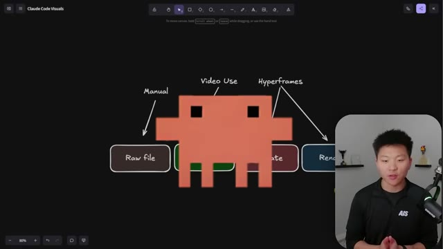
*⏱️ 00:03:10 — Diagramme de flux de travail sur un tableau blanc virtuel illustrant les étapes d'un projet vidéo (Raw file, Video Use, Hyperframes, Render).*

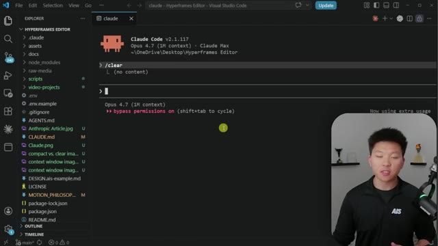
*⏱️ 00:03:19 — Interface de Visual Studio Code avec le terminal Claude Code (version 2.1.117) ouvert, affichant le statut "bypass permissions on".*

---

### ⏱️ `[00:03:36 - 00:04:12]` | Segment #09

**🔊 Audio (Transcription Intégrale Mot pour Mot en Français) :**
> You can see you go to this Cloud download page and just download this for your operating system right here. Now, once you open that up, it's obviously going to prompt you to sign in. And because we're using Cloud Code, you do need to be on a paid plan that has access to Cloud Code. So then what you're going to want to do is you're going to choose a folder to work in. So you could come in here, open a folder and just choose a brand new one. It can be completely empty and you'll be all good to get set up. Or what you could do is you could go over to my FreeSchool community. The link for that is down in the description. And you could grab this HyperFrame student kit. And all you need to do from here is you need to just grab the URL of this and give it to Cloud Code and say, hey, clone this repo, set up this project for me just like this. Like I said, link for this is in

**👁️ Analyse Visuelle d'Écran (gemini-3.5-flash-lite) :**
**Interface & Outils** : Claude Code (interface de bureau).

**Contenu textuel & Code** : Liste des sessions "Unread" (Notification responses, Skool wins engagement, AI news roundup) et champ de saisie "Describe a task or ask a question".

**Action / Démonstration** : Navigation au sein de l'interface de gestion des sessions de l'assistant de codage.

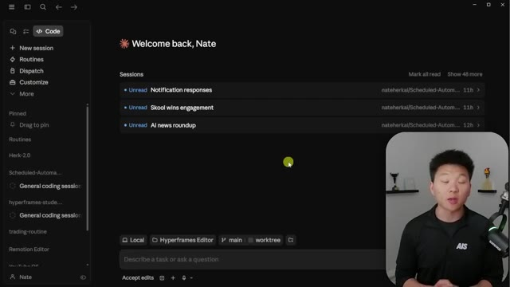
*⏱️ 00:03:45 — Interface principale de l'application Claude Code affichant un tableau de bord de sessions de travail passées.*

---

### ⏱️ `[00:04:12 - 00:04:45]` | Segment #10

**🔊 Audio (Transcription Intégrale Mot pour Mot en Français) :**
> my free school community. Okay, but let's say you don't do that. What are the other tools you'll need? Well, I'm also going to attach in the description of this video, this Hyperframes GitHub repo and the video use GitHub repo. A GitHub repo is basically just a project. It's a collection of folders and files and Claude is able to look through this and pull in the elements that it needs. So literally all you would do is you would copy this link, go into Claude Desktop, just paste it in. And then I'm going to go grab the other one as well for video use. And I'm going to paste that and I would just say, hey, I'm setting up this project to be basically my video editing studio.

**👁️ Analyse Visuelle d'Écran (gemini-3.5-flash-lite) :**
**Interface & Outils** : Navigateur web affichant la plateforme GitHub (dépôt heygen-com/hyperframes).

**Contenu textuel & Code** : Liste des répertoires et fichiers du dépôt (ex: .claude, .codex-plugin, .github, assets, docs, packages, etc.) ainsi que les messages de commits associés.

**Action / Démonstration** : Navigation dans l'interface GitHub pour illustrer la structure d'un projet logiciel open source.

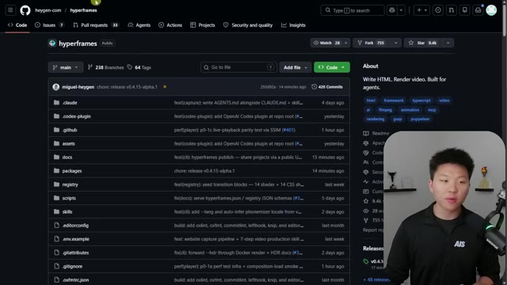
*⏱️ 00:04:20 — Capture d'écran de la page du dépôt GitHub du projet "hyperframes" montrant l'arborescence des fichiers et dossiers du projet. Le présentateur est visible en incrustation dans le coin inférieur droit.*

---

### ⏱️ `[00:04:46 - 00:05:08]` | Segment #11

**🔊 Audio (Transcription Intégrale Mot pour Mot en Français) :**
> So I want you to look at these two GitHub repos and I want you to pull in the skills and pull in the important information that we need from these so that I could basically give you a raw video file and you would be able to edit it, remove the filler words and then help me add motion graphics to it. So basically the full pipeline. And then you just go ahead and shoot that off and let it do its thing, let it look through those and let it pull in any of the files that it needs.

**👁️ Analyse Visuelle d'Écran (gemini-3.5-flash-lite) :**
**Interface & Outils** : Windsurf (IDE AI-native).

**Contenu textuel & Code** : Liens GitHub : "https://github.com/heygen-com/hyperframes" et "https://github.com/browser-use/video-use".

**Action / Démonstration** : L'utilisateur saisit les URLs des dépôts GitHub dans la zone de chat de l'IDE pour permettre à l'agent IA d'analyser le code et d'apprendre les compétences nécessaires à l'automatisation du montage vidéo.

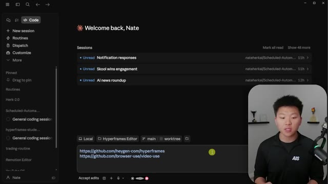
*⏱️ 00:04:51 — Interface de l'éditeur Windsurf (Cascade) montrant une zone de saisie de prompt où deux liens GitHub sont listés, avec une barre latérale de gestion de sessions.*

---

### ⏱️ `[00:05:08 - 00:05:42]` | Segment #12

**🔊 Audio (Transcription Intégrale Mot pour Mot en Français) :**
> Now, while this is running real quick, You guys might be asking like why do you prefer to use the desktop app over vs code or vice versa? Well, typically for me the reason why I like vs code is because I can see all of my files So this is my cloud code project, right? And over here I can see my assets. I can see my projects I can see everything that i've dropped into here Whereas in the desktop app you don't have visibility even though they're working out of the same folder We just don't have that visibility because on the left hand side here All we are seeing is our other projects that we could switch into We don't actually get to see all of the files. So anyways, you can see it says, okay, good news.

**👁️ Analyse Visuelle d'Écran (gemini-3.5-flash-lite) :**
**Interface & Outils** : Cursor (éditeur de code IA).

**Contenu textuel & Code** : Liens GitHub (HeyGen et Browser-use) et prompt demandant de configurer un studio de montage vidéo automatisé utilisant ces bibliothèques.

**Action / Démonstration** : L'utilisateur a soumis un prompt à l'agent IA pour l'intégration de compétences et d'informations depuis des dépôts GitHub.

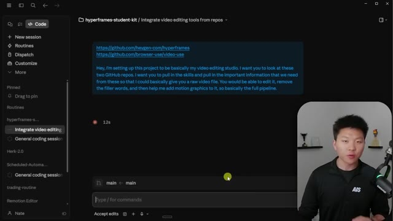
*⏱️ 00:05:17 — Interface de l'application Cursor affichant une session de projet nommée « Integrate video editing from repos » avec une fenêtre de chat contenant les instructions du projet et une barre de commande en bas.*

---

### ⏱️ `[00:05:42 - 00:06:06]` | Segment #13

**🔊 Audio (Transcription Intégrale Mot pour Mot en Français) :**
> Almost all of this is already wired up. Everything's already set up because my project is already set up. So you guys can either grab the repos or you can just basically do this exact same prompt and it will set up everything for you because all we need is we need the skills from hyperframes and the skills from video use. And then we're just going to start building some videos here. Okay. So because that's already happened, I'm just going to go in here and I'm going to do a slash command, which means I'm just going to clear out this conversation so we can start fresh.

**👁️ Analyse Visuelle d'Écran (gemini-3.5-flash-lite) :**
**Interface & Outils** : Claude Code (outil de ligne de commande assisté par IA)

**Contenu textuel & Code** : Documentation technique sous forme de Markdown : état de l'installation, chemins de fichiers (.env, scripts .mjs), liste des compétences (skills) chargées et procédure opérationnelle standard (Mode B) pour le traitement de fichiers vidéo.

**Action / Démonstration** : Le présentateur affiche et parcourt la documentation technique interne du projet au sein de l'environnement Claude Code pour démontrer que l'infrastructure est prête à l'emploi.

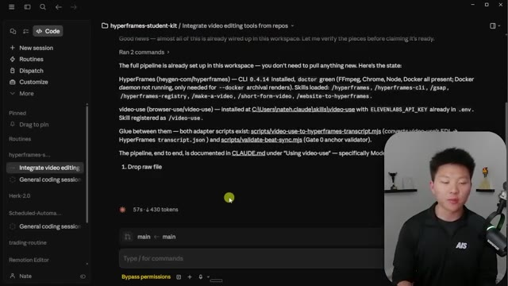
*⏱️ 00:05:48 — L'interface de Claude Code affichant un récapitulatif technique du statut de l'espace de travail "hyperframes-student-kit", incluant la configuration de la CLI HyperFrames, des dépendances (FFmpeg, Node, Docker) et des chemins d'accès aux skills.*

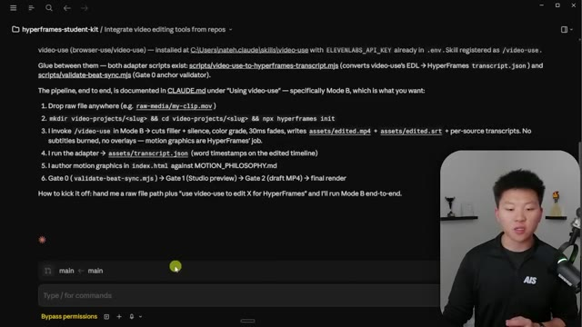
*⏱️ 00:06:00 — L'interface de Claude Code affichant la documentation détaillée du pipeline de traitement vidéo, étape par étape, expliquant comment utiliser le mode B pour intégrer les outils d'édition vidéo et les scripts de validation.*

---

### ⏱️ `[00:06:06 - 00:06:41]` | Segment #14

**🔊 Audio (Transcription Intégrale Mot pour Mot en Français) :**
> Okay, so I recorded this video right here. It's 50 seconds and it's basically just me kind of blabbing about what we're doing in this video But I purposely made a few mistakes. I left a lot of you know silences and filler words in here And remember this is 50 seconds long So I dropped this into the project right here and i'm going to ask it to Trim it for us So in here if I type the at sign it will show all of the different things that are in this project And right here if I go to the bottom you can see we have edit demo raw which is that video that I was just talking about. And so now it knows exactly what I'm actually referring to. And I'm just going to say, Hey, Cloud Code, I would like you to use the video use

**👁️ Analyse Visuelle d'Écran (gemini-3.5-flash-lite) :**
**Interface & Outils** : Cursor (ou éditeur basé sur VS Code avec extension agentique), terminal de commande intégré (style Claude Code).

**Contenu textuel & Code** : Liste de fichiers de projet (Markdown, scripts Python, assets image, JSON) et barre de saisie de commandes contextuelle avec le préfixe "@edit".

**Action / Démonstration** : Sélection et importation du fichier vidéo brut "Edit Demo Raw.mp4" dans l'environnement de travail pour traitement par l'agent IA.

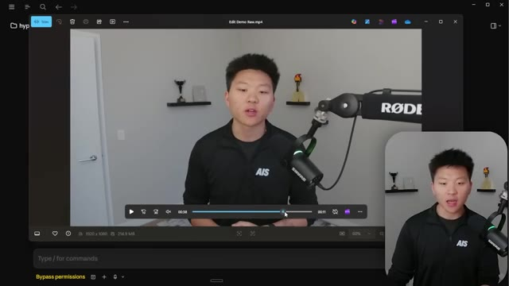
*⏱️ 00:06:15 — Interface de l'éditeur montrant le fichier vidéo "Edit Demo Raw.mp4" en cours de lecture dans un lecteur média intégré.*

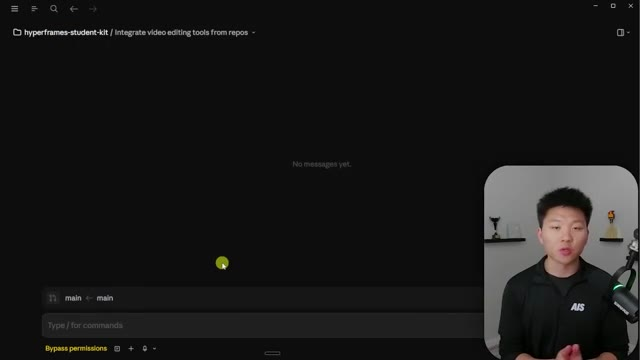
*⏱️ 00:06:24 — Interface vierge de l'environnement de développement "hyperframes-student-kit" en attente de commandes.*

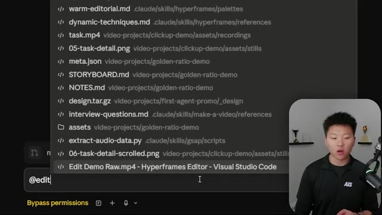
*⏱️ 00:06:32 — Menu contextuel de recherche/sélection de fichiers activé par la commande "@edit", listant divers documents et le fichier "Edit Demo Raw.mp4".*

---

### ⏱️ `[00:06:41 - 00:07:16]` | Segment #15

**🔊 Audio (Transcription Intégrale Mot pour Mot en Français) :**
> tool just to edit this video. I want you to analyze it. I want you to remove any filler words or silences or retakes. And then what we're going to do after that is we're going to use hyperframes to actually add the motion graphics to it. So your first task is just to edit out the mistakes and the filler words. Okay, cool. So while that's running, let me explain why we're doing it that way. Because like I showed you guys, ultimately what we're able to do is completely automate this pipeline, but we have to kind of work our way up there. And if we wanted to use video use to basically do everything, it could. Because within video use, there's actually kind of like a

**👁️ Analyse Visuelle d'Écran (gemini-3.5-flash-lite) :**
**Interface & Outils** : - Image 1 : Interface type "Agent AI / Chat" intégrée avec VS Code.
- Image 2 : Outil de création graphique / tableau blanc interactif.

**Contenu textuel & Code** : - Image 1 : "hyperframes-student-kit / Integrate video editing tools from repos" ; "Edit Demo Raw.mp4 - Hyperframes Editor - Visual Studio Code".
- Image 2 : Schéma avec un personnage pixel-art orange, annoté avec les étapes : "Manual", "video UI", "hyperframes" et un diagramme de processus (Raw file, Trim/Edit, Animate, Render).

**Action / Démonstration** : - Image 1 : L'utilisateur prépare ou interagit avec l'agent IA pour éditer un fichier vidéo spécifique.
- Image 2 : Présentation visuelle du workflow de montage vidéo automatisé via Hyperframes.

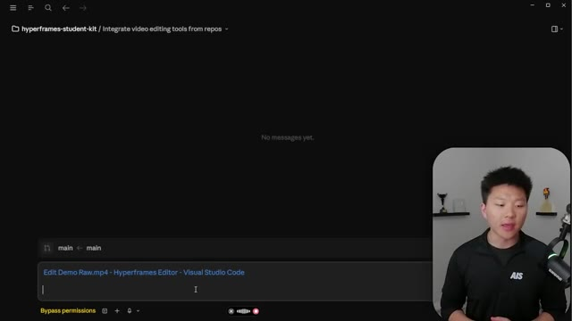
*⏱️ 00:06:50 — Interface de discussion de type agent IA affichant un prompt lié à un projet "Hyperframes" avec l'éditeur Visual Studio Code.*

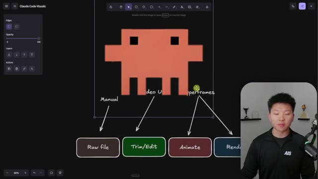
*⏱️ 00:07:08 — Interface de conception graphique (canvas) montrant un workflow en quatre étapes : Raw file, Trim/Edit, Animate, Render.*

---

### ⏱️ `[00:07:16 - 00:07:36]` | Segment #16

**🔊 Audio (Transcription Intégrale Mot pour Mot en Français) :**
> motion graphics skill called remotion, which you guys might've been familiar with already. And the reason why we're using hyperframes over remotion is because we just like it better. I'll show you guys a comparison in just a sec here. But what you could do is say, hey, run the full video use pipeline, trim, animate, and render. I don't want to touch anything. And it would do it.

**👁️ Analyse Visuelle d'Écran (gemini-3.5-flash-lite) :**
**Interface & Outils** : Outil de tableau blanc collaboratif (type Excalidraw ou similaire).

**Contenu textuel & Code** : Schéma textuel : "Video Use" -> "Remotion" -> "Trim/Edit", "Animate", "Render". Il y a également une mention "Manual" pointant vers "Raw file".

**Action / Démonstration** : Présentation visuelle comparative du flux de travail de montage vidéo automatisé par le présentateur.

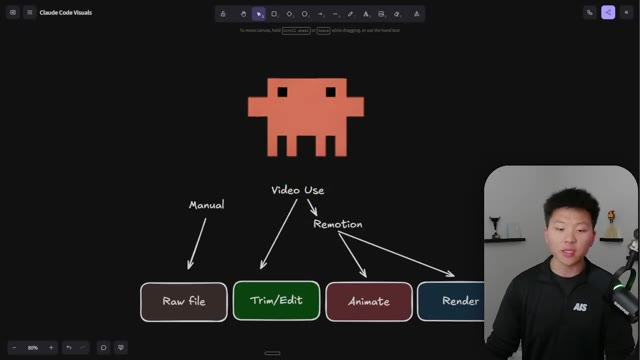
*⏱️ 00:07:21 — Un diagramme schématique réalisé sur un tableau blanc virtuel expliquant le flux de travail "Video Use" avec Remotion, incluant les étapes : Raw file, Trim/Edit, Animate, et Render.*

---

### ⏱️ `[00:07:36 - 00:07:56]` | Segment #17

**🔊 Audio (Transcription Intégrale Mot pour Mot en Français) :**
> It would do it with remotion. So let me show you an example. So if you guys remember the intro to this video, we had these motion graphics. We had these kind of liquid glass cards. And I thought this looked really, really good. We had this little, you know, animation there. I love this. This was hyperframes. Now I dropped in that same raw video that you guys looked at here. I dropped in the same raw one into Cloud Code.

**👁️ Analyse Visuelle d'Écran (gemini-3.5-flash-lite) :**
**Interface & Outils** : Remotion (environnement de développement de vidéo programmatique).

**Contenu textuel & Code** : Arborescence de fichiers sur la gauche (index.html, assets, compositions, renders, scripts, etc.) et timeline de montage vidéo en bas de l'écran.

**Action / Démonstration** : Navigation et démonstration du rendu des effets visuels ("liquid glass cards") dans l'interface de montage de Remotion.

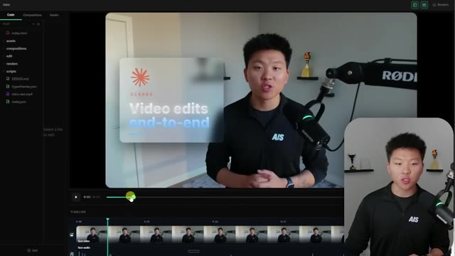
*⏱️ 00:07:41 — Interface de développement Remotion montrant une prévisualisation vidéo avec un élément graphique "liquid glass" affichant "Video edits end-to-end", avec une barre de timeline active en dessous.*

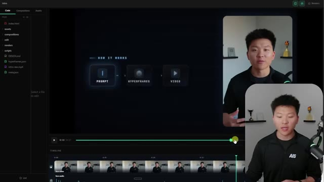
*⏱️ 00:07:46 — Interface de développement Remotion montrant une séquence de flux de travail stylisée "HOW IT WORKS" avec trois icônes (Prompt, Hyperframes, Video) au centre de la prévisualisation.*

---

### ⏱️ `[00:07:56 - 00:08:15]` | Segment #18

**🔊 Audio (Transcription Intégrale Mot pour Mot en Français) :**
> And I said, hey, do the full video use pipeline. And this is what it gave me when it used Remotion. Cloud is now editing my videos end to end. All I have to do is drop in a raw file and it is trimming out the mistakes and the dead space. It's adding motion graphics like you see over here. It's adding dynamic elements like you see over here. It can even add subtitles at the bottom of the screen like you're looking at right here.

**👁️ Analyse Visuelle d'Écran (gemini-3.5-flash-lite) :**
**Interface & Outils** : Remotion (logiciel de montage vidéo programmatique)

**Contenu textuel & Code** : Prévisualisation d'une vidéo montrant le présentateur, accompagnée de sous-titres textuels ("Claude is now editing my videos") et d'une barre de lecture avec contrôle de vitesse.

**Action / Démonstration** : Lecture de la vidéo générée automatiquement par le pipeline IA pour démontrer le résultat du montage, incluant le rognage et l'ajout de graphismes animés.

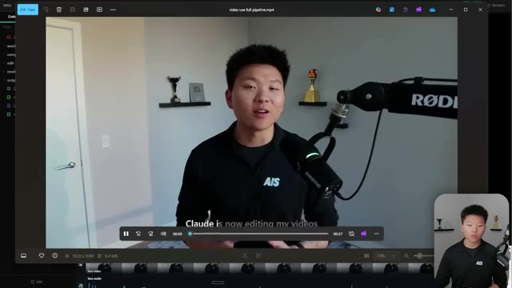
*⏱️ 00:08:01 — Une interface de logiciel de montage vidéo (Remotion) affichant une prévisualisation d'une vidéo avec des sous-titres générés automatiquement et une chronologie (timeline) en bas.*

---

### ⏱️ `[00:08:15 - 00:08:33]` | Segment #19

**🔊 Audio (Transcription Intégrale Mot pour Mot en Français) :**
> So even if you've never coded before or you've never edited. So you can see it trimmed it just fine because it went from 50 seconds to again, about 27. It added things like this. It synced it up to the time that I was actually saying them. So it all felt good, but I just liked the hyperframes animations a little bit more. Real quick, I'll just show you guys a few other examples of what's possible.

**👁️ Analyse Visuelle d'Écran (gemini-3.5-flash-lite) :**
**Interface & Outils** : Logiciel d'édition vidéo (interface utilisateur type éditeur IA).

**Contenu textuel & Code** : Fenêtre de prévisualisation vidéo montrant le présentateur, barre de progression de lecture, sous-titres incrustés ("before or you've never edited videos") et timeline en bas avec pistes audio et vidéo.

**Action / Démonstration** : Démonstration du résultat du montage automatique (trimming et synchronisation des sous-titres).

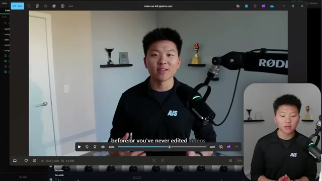
*⏱️ 00:08:19 — Interface d'un logiciel de montage vidéo basé sur IA, affichant une prévisualisation de la vidéo en cours d'édition avec des sous-titres dynamiques synchronisés.*

---

### ⏱️ `[00:08:33 - 00:08:57]` | Segment #20

**🔊 Audio (Transcription Intégrale Mot pour Mot en Français) :**
> Here is Remotion. So it has a nice little background. It's got my face in the lower right corner. It has these motion graphics coming in. So it's not to say that Remotion isn't capable. It's just to say that right now with the new hyperframes, the way that it works with HTML, I just think I like it a little bit more. Here's another example where I changed the background. And once again, we're still able to have animations come in and we can still make things look really, really nice just by using our natural language, which is obviously the big unlock.

**👁️ Analyse Visuelle d'Écran (gemini-3.5-flash-lite) :**
**Interface & Outils** : Lecteur vidéo Google Drive (interface web).

**Contenu textuel & Code** : La vidéo lue montre un compte à rebours ("3") et une interface de contrôle de lecture. Un panneau latéral "Summary" affiche un résumé textuel sur les processus de travail (workflow).

**Action / Démonstration** : Lecture d'une vidéo de cours ou de démonstration via une plateforme d'hébergement de fichiers cloud.

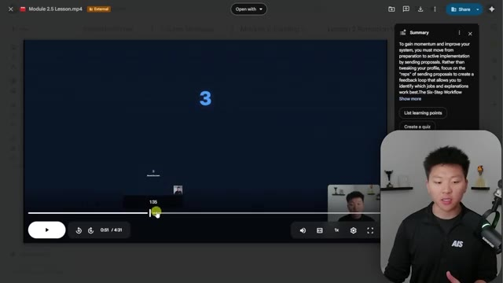
*⏱️ 00:08:39 — Capture d'écran montrant une interface de lecteur vidéo en ligne (Google Drive) affichant une vidéo de démonstration "Remotion" avec le présentateur en incrustation dans le coin inférieur droit de la vidéo.*

---

### ⏱️ `[00:08:58 - 00:09:16]` | Segment #21

**🔊 Audio (Transcription Intégrale Mot pour Mot en Français) :**
> But that same style of like animating a course or like a lesson, this is what we got with hyperframes. So once again, I think it's just a little bit more sophisticated and it just feels a little bit more engaging. So that's really the main difference between remotion and hyperframes. They don't actually work under the hood the exact same way. So that's important to understand.

**👁️ Analyse Visuelle d'Écran (gemini-3.5-flash-lite) :**
**Interface & Outils** : Lecteur vidéo intégré ou interface de prévisualisation d'Hyperframes.

**Contenu textuel & Code** : Texte à l'écran : "LESSON 5.1 - When and how to pitch an audit.", incluant un schéma graphique "THE REAL SCOPE" et "THE PROJECT".

**Action / Démonstration** : Lecture d'une séquence vidéo animée utilisée comme démonstration de la qualité de rendu d'Hyperframes.

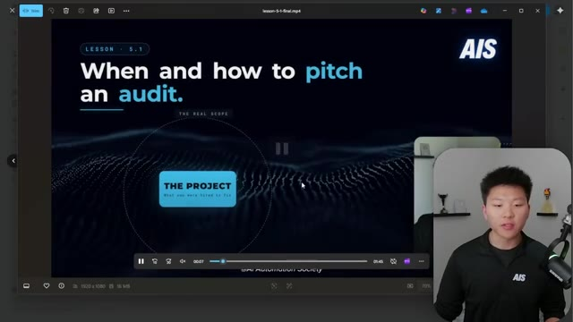
*⏱️ 00:09:02 — Interface logicielle affichant une vidéo de formation "Lesson 5.1" produite avec Hyperframes, présentant un titre dynamique sur le pitch d'un audit.*

---

### ⏱️ `[00:09:16 - 00:09:42]` | Segment #22

**🔊 Audio (Transcription Intégrale Mot pour Mot en Français) :**
> But as far as like this actual flow, they both basically do this step, which is the animate step. and then they will both go ahead and do the rendering as well. But really the most important part is that you trim it first and that you have the motion graphics synced up to the exact moments that you're saying the words that you want those animations to pop in at. So what's important is that while you're trimming it and then before you animate, you're doing something to get the transcript and have like a timestamp correlated with every single word that you say.

**👁️ Analyse Visuelle d'Écran (gemini-3.5-flash-lite) :**
**Interface & Outils** : Excalidraw (outil de tableau blanc numérique).

**Contenu textuel & Code** : Diagramme organisationnel avec des boîtes textuelles liées par des flèches : "Manual" et "Remotion" pointant vers les étapes "Trim/Edit", "Animate" et "Render".

**Action / Démonstration** : Présentation visuelle et pédagogique des étapes de production vidéo, avec la case "Animate" actuellement sélectionnée dans l'interface de dessin.

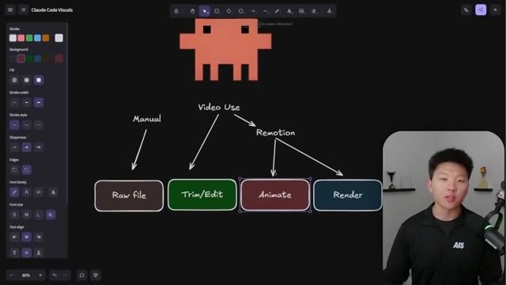
*⏱️ 00:09:23 — Un schéma de flux de travail (workflow) créé dans un outil de dessin, illustrant les étapes de traitement vidéo ("Raw file", "Trim/Edit", "Animate", "Render").*

---

### ⏱️ `[00:09:43 - 00:10:03]` | Segment #23

**🔊 Audio (Transcription Intégrale Mot pour Mot en Français) :**
> And all of that is obviously baked into our pipeline right here. Now, the other thing that I want you guys to think about is the fact that none of this is going to be perfect because it has to get used to your style and the way that you work. I always tell people to think about it like you're teaching a kid to ride a bike. You can't just chuck a kid on a bike and he or she's gonna ride it perfectly. You have to hold the handlebars. You have to make sure that they're balancing properly.

**👁️ Analyse Visuelle d'Écran (gemini-3.5-flash-lite) :**
**Interface & Outils** : Cursor (ou interface d'agent de développement basée sur VS Code).

**Contenu textuel & Code** : Un tableau de planification d'édition vidéo (Edit plan) avec des colonnes "Action", "Time" et "Why", détaillant les segments à conserver (KEEP) ou à supprimer (CUT) d'une vidéo de 50.3s, ainsi que des paramètres de configuration ("Settings per CLAUDE.md Mode B").

**Action / Démonstration** : L'agent IA présente un plan d'édition structuré pour valider le découpage automatique d'une vidéo, illustrant le résultat d'un pipeline d'automatisation.

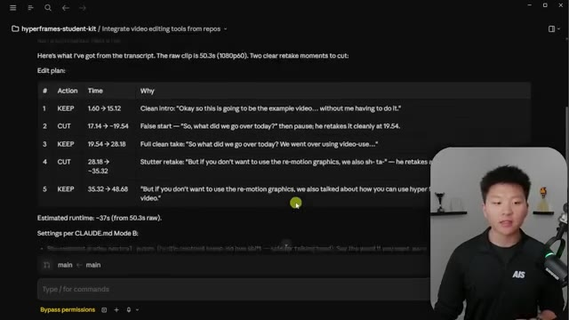
*⏱️ 00:09:48 — Une interface de chat IA (type Cursor ou outil de développement) affichant un plan de montage vidéo généré automatiquement à partir d'une transcription.*

---

### ⏱️ `[00:10:03 - 00:10:24]` | Segment #24

**🔊 Audio (Transcription Intégrale Mot pour Mot en Français) :**
> You have to help them adjust. And over time, it's gonna get to the point where that kid is just riding the bike and you don't even have to think about it. But you have to steer it in the right way at first. So inside of this video use project, there's gonna be a few skills. And right here, you can see when we were actually doing that thing to just edit it, it used one of its skills called video use and it was just basically doing an edit only for HyperFrames handoff.

**👁️ Analyse Visuelle d'Écran (gemini-3.5-flash-lite) :**
**Interface & Outils** : Claude Code (CLI/Interface IA de développement)

**Contenu textuel & Code** : Tableau "Edit plan" avec colonnes #, Action, Time, Why ; Arguments pour la compétence `video-use` : mode édition, suppression des silences, sous-titres, et répertoire source.

**Action / Démonstration** : L'agent IA analyse le contenu vidéo, planifie les coupes nécessaires et invoque la compétence de traitement vidéo (`video-use`) pour automatiser le montage.

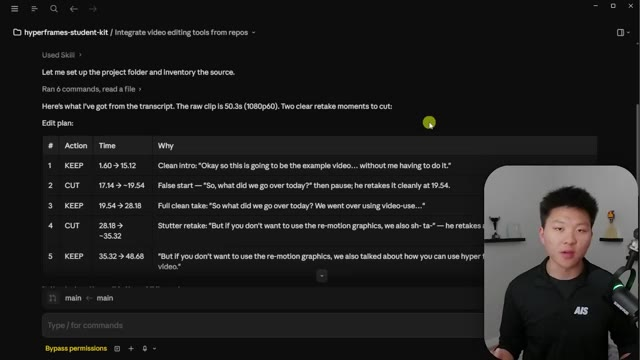
*⏱️ 00:10:08 — Interface de l'outil Claude Code affichant un plan de montage vidéo (tableau avec les segments à garder ou couper) basé sur une transcription brute.*

*⏱️ 00:10:19 — Interface de Claude Code montrant les détails d'une "compétence" (skill) nommée `video-use` avec ses arguments techniques pour automatiser le montage.*

---

### ⏱️ `[00:10:24 - 00:10:43]` | Segment #25

**🔊 Audio (Transcription Intégrale Mot pour Mot en Français) :**
> Now within this skill, it has to actually transcribe the video. And there's a few different ways that you can do this. You can use OpenAI for a Whisper API. You can use a local sort of like tool, which it can install for you and run in the background. That would be free. Or you could use also 11labs API, which is what video use likes to default to.

**👁️ Analyse Visuelle d'Écran (gemini-3.5-flash-lite) :**
**Interface & Outils** : Interface de type agent IA (Claude Code / Terminal interactif).

**Contenu textuel & Code** : Un tableau récapitulant les segments d'une vidéo (Keep/Cut) avec des horodatages précis et des justifications textuelles pour chaque coupe, sous le titre "Edit plan".

**Action / Démonstration** : L'agent présente une analyse de montage vidéo terminée, proposant des segments à conserver ou à supprimer pour optimiser la vidéo brute.

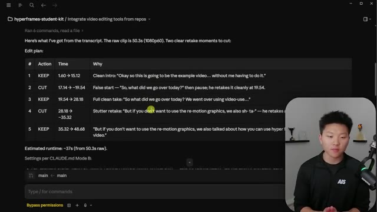
*⏱️ 00:10:29 — Une interface de chat d'un agent IA (probablement Claude Code) affichant un plan de montage vidéo automatique généré à partir d'une transcription.*

---

### ⏱️ `[00:10:43 - 00:11:03]` | Segment #26

**🔊 Audio (Transcription Intégrale Mot pour Mot en Français) :**
> HyperFrames likes to default to OpenAI Whisper or just Whisper. For this video, I am using 11labs API because I think that it's actually better at finding the right moments to cut. But all three of those methods are just fine. So let's say you did wanna use 11labs. Okay, what you would do is you would go to 11labs, you would come into the bottom left and click on developers and you would go to your API keys.

**👁️ Analyse Visuelle d'Écran (gemini-3.5-flash-lite) :**
**Interface & Outils** : - Image #1 : Claude Code (ou interface d'agent de codage similaire)
- Image #2 : Google Chrome (moteur de recherche)

**Contenu textuel & Code** : - Image #1 : Tableau d'analyse de script vidéo avec colonnes "Action", "Time" et "Why".
- Image #2 : Suggestions de recherche liées à ElevenLabs (Voice Library, Text to Speech).

**Action / Démonstration** : - Image #1 : Visualisation d'un plan de montage généré par une IA pour découper un fichier vidéo brut.
- Image #2 : Navigation web vers le service ElevenLabs pour effectuer des tâches audio.

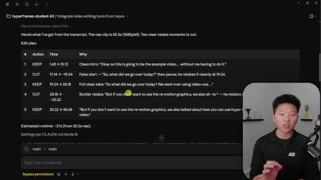
*⏱️ 00:10:48 — Une interface de type assistant de développement (probablement Claude Code) affichant un tableau d'édition de plan de montage vidéo, listant des actions (KEEP/CUT), des horodatages et des justifications textuelles.*

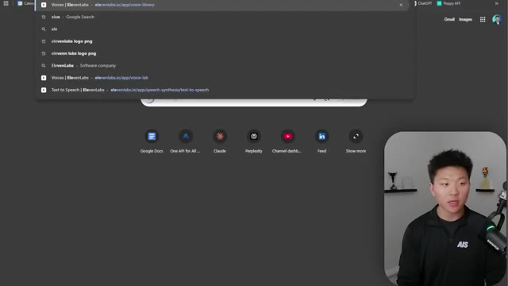
*⏱️ 00:10:58 — Une page de recherche Google dans un navigateur web montrant des suggestions de saisie automatique pour le site "ElevenLabs".*

---

### ⏱️ `[00:11:03 - 00:11:27]` | Segment #27

**🔊 Audio (Transcription Intégrale Mot pour Mot en Français) :**
> And then you would basically just create a key right here and then copy that value it gives you. And then you would just need to come into your Cloud Code project and drop that key into a file called the .env. So the way that I would do that is I would basically pull up your project in an actual environment like this. and I would create a new file called a .env or say, hey, Cloud Code, create me the .env and then I'll go ahead and drop my 11labs API key inside of it.

**👁️ Analyse Visuelle d'Écran (gemini-3.5-flash-lite) :**
**Interface & Outils** : Explorateur de fichiers Windows (File Explorer).

**Contenu textuel & Code** : Liste de fichiers incluant ".env", ".env.example", ".gitignore", ainsi que des dossiers comme ".claude", "assets", et "node_modules".

**Action / Démonstration** : Navigation dans le système de fichiers pour localiser et préparer l'édition du fichier de configuration ".env" du projet.

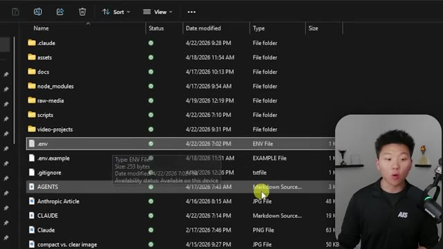
*⏱️ 00:11:21 — L'image montre une vue de l'explorateur de fichiers Windows affichant le contenu du répertoire racine du projet, avec le fichier ".env" mis en surbrillance.*

---

### ⏱️ `[00:11:27 - 00:11:46]` | Segment #28

**🔊 Audio (Transcription Intégrale Mot pour Mot en Français) :**
> Or if you do wanna use Visual Studio Code, which is like one of the reasons why I like to use it is because I can see everything right here and I could literally just click on my .env. This is the example, but I could click on the .env and then I could just paste in my API key right there. So either way you wanna do it, just I typically try to avoid just pasting it straight into the actual chat.

**👁️ Analyse Visuelle d'Écran (gemini-3.5-flash-lite) :**
**Interface & Outils** : Visual Studio Code, Claude Code (CLI).

**Contenu textuel & Code** : Arborescence de fichiers du projet (incluant .env, .env.example, CLAUDE.md) ; dans le terminal : interface Claude Code v2.1.117 avec Opus 4.7, commande `/clear` exécutée, et indicateur "bypass permissions on".

**Action / Démonstration** : Le présentateur explique la navigation dans l'arborescence des fichiers pour accéder au fichier `.env` afin d'y insérer une clé API.

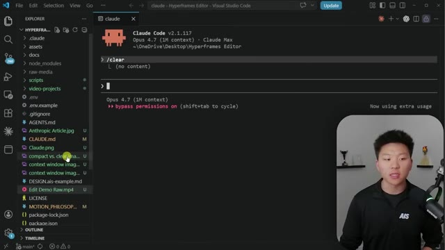
*⏱️ 00:11:32 — Capture d'écran de l'interface VS Code affichant l'explorateur de fichiers sur la gauche et un terminal intégré utilisant Claude Code.*

---

### ⏱️ `[00:11:46 - 00:12:18]` | Segment #29

**🔊 Audio (Transcription Intégrale Mot pour Mot en Français) :**
> And the reason for that is just because that would stay in the conversation history and just best practice to not do that. So what you can see is that it comes over here and it says, okay, here's what I've got from the transcript. The raw clip is 50 seconds and there are two clear retake moments to cut. So here's what it wants to keep. Here's the clean intro. Here's what it wants to cut. I have a false start. So I kind of like started talking and then I paused and then I retake. So it knows to cut that. It's going to keep the next take. It's going to cut another section where I stutter and then it's going to keep the end. So it's going to basically cut it down to about 37 seconds. And then it says, okay, I've got two

**👁️ Analyse Visuelle d'Écran (gemini-3.5-flash-lite) :**
**Interface & Outils** : Interface de type agent conversationnel (probablement Claude Code ou outil similaire).

**Contenu textuel & Code** : Un tableau de montage listant les actions ("KEEP", "CUT"), les segments temporels, et les justifications textuelles pour chaque coupe (ex: "False start"). Le texte mentionne l'utilisation de "Mode B" et l'inventaire de la source.

**Action / Démonstration** : L'agent présente une analyse structurée de la transcription vidéo et propose un plan d'édition technique pour nettoyer les prises ratées.

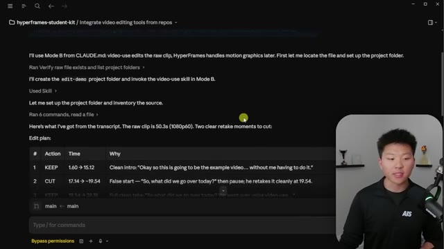
*⏱️ 00:11:54 — Interface de l'agent IA affichant un plan de montage vidéo généré automatiquement basé sur une transcription.*

---

### ⏱️ `[00:12:18 - 00:12:39]` | Segment #30

**🔊 Audio (Transcription Intégrale Mot pour Mot en Français) :**
> taste calls for you. There's a trailing. So at 4220, do you want to leave this as a natural breath or get rid of it? And then it says cut edges around retakes. I'll snap to word boundaries with 50 millisecond leads. I'm just going to say, yep, make this as punchy as possible. And we'll shoot that off and it will come back with a fully edited version for us.

**👁️ Analyse Visuelle d'Écran (gemini-3.5-flash-lite) :**
**Interface & Outils** : Interface de chat de développement ou d'agent IA (type terminal/IDE intégré).

**Contenu textuel & Code** : Texte technique détaillant les paramètres de rendu vidéo : "Settings per CLAUDE.md Mode B", gestion des fondus audio (30ms), sous-titres SRT, et questions sur le traitement des transitions audio et des coupes de retouches (snap to word boundaries).

**Action / Démonstration** : L'agent IA présente une configuration de montage et attend une validation humaine ("Approve this and I'll build the EDL and render") pour finaliser le projet.

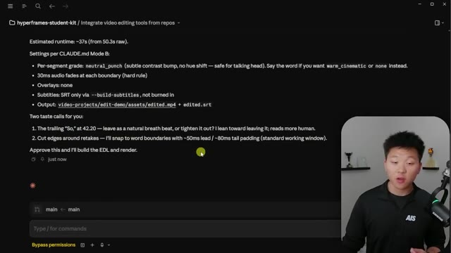
*⏱️ 00:12:23 — Interface de discussion d'un agent IA (probablement Claude Code) affichant les paramètres d'un processus de montage vidéo et sollicitant l'avis de l'utilisateur sur des détails spécifiques du rendu.*

---

### ⏱️ `[00:12:39 - 00:12:58]` | Segment #31

**🔊 Audio (Transcription Intégrale Mot pour Mot en Français) :**
> And then we'll add the motion graphics. And by the way, while we're waiting for all this, if you guys do want a bit of a deeper dive as far as like some other methods to edit videos with Claude and I go into hyperframes a little bit more, I do an even more depth setup and I talk at the end about like some cost and speed stuff, then definitely check out this video after the one that you're watching right now. All right, so that edit is complete.

**👁️ Analyse Visuelle d'Écran (gemini-3.5-flash-lite) :**
**Interface & Outils** : Google Docs, Lecteur vidéo, Hyperframes Studio (éditeur de code/IDE).

**Contenu textuel & Code** : Plan du cours/tutoriel, logo ClickUp, statistiques de consommation de tokens et limites d'utilisation de modèles IA (Claude).

**Action / Démonstration** : Présentation du sommaire du tutoriel, démonstration du rendu visuel final, puis affichage de l'environnement de travail technique.

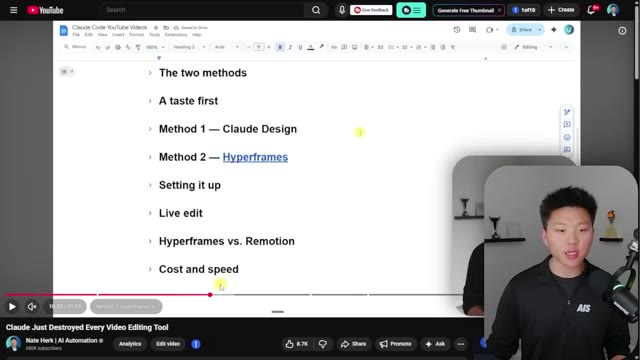
*⏱️ 00:12:44 — Une liste à puces dans un document Google Docs présentant les différentes méthodes et étapes du processus de montage vidéo par IA, incluant "Hyperframes".*

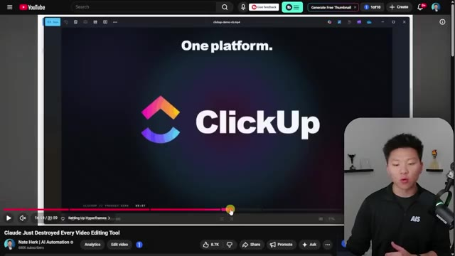
*⏱️ 00:12:49 — Aperçu d'une interface de lecture vidéo présentant un exemple de motion design pour la plateforme "ClickUp", illustrant le résultat final du montage.*

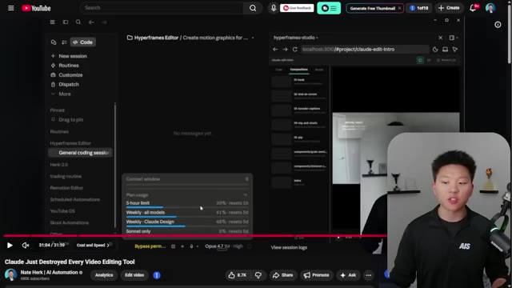
*⏱️ 00:12:54 — Interface de l'outil "Hyperframes Studio" avec une barre latérale de gestion de sessions et un volet affichant des statistiques d'utilisation du contexte (limites de modèles, usage Sonnet).*

---

### ⏱️ `[00:12:58 - 00:13:22]` | Segment #32

**🔊 Audio (Transcription Intégrale Mot pour Mot en Français) :**
> It is called edited.mp4. It is 32 seconds long. And let's go ahead and take a look to make sure that we're all good. Okay, I actually don't know where it put this. So I'm just gonna say, give me the file path. It gave me the file path right here. I'm gonna copy this and we're going to paste that in to my Explorer. And now we have the edited version. Okay, so this is going to be the example video that we're editing together live in this YouTube tutorial.

**👁️ Analyse Visuelle d'Écran (gemini-3.5-flash-lite) :**
**Interface & Outils** : Éditeur de code type Cursor ou VS Code avec interface d'agent intégrée.

**Contenu textuel & Code** : Détails techniques du rendu : "edited.mp4 - 32.56s, 1920x1080", métadonnées de fichiers, et commandes de flux de travail (CLAUD.md Mode B).

**Action / Démonstration** : L'utilisateur vérifie le résultat de l'édition automatisée en ouvrant le fichier généré pour en contrôler la qualité de montage.

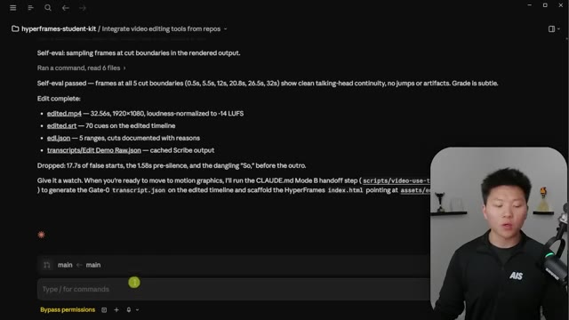
*⏱️ 00:13:04 — Interface de l'éditeur montrant le résumé d'une tâche d'édition vidéo automatisée (self-eval) avec la liste des fichiers générés (mp4, srt, json).*

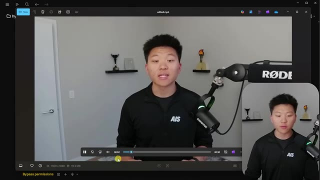
*⏱️ 00:13:16 — Visualisation du fichier "edited.mp4" ouvert dans le lecteur vidéo intégré à l'interface, affichant la vidéo finale avec ses contrôles de lecture.*

---

### ⏱️ `[00:13:22 - 00:13:43]` | Segment #33

**🔊 Audio (Transcription Intégrale Mot pour Mot en Français) :**
> So I might make a few mistakes and that's okay because I'm going to show you exactly how we edit those out with AI without me having to do it. So what did we go over today? We went over using video use to run the full pipeline where you can drop in a raw file. It will edit it and then it will do remotion graphics. But if you don't want to use the remotion graphics, We also talked about how you can use hyperframes for those motion graphics as well.

**👁️ Analyse Visuelle d'Écran (gemini-3.5-flash-lite) :**
**Interface & Outils** : Lecteur vidéo natif ou application de prévisualisation de média.

**Contenu textuel & Code** : Le fichier affiché est nommé "edited.mp4". Une mention "Bypass permissions" apparaît en bas à gauche, ainsi que des métadonnées de fichier (1920 x 1080, 19.3 MB).

**Action / Démonstration** : Lecture/visualisation du résultat du montage vidéo généré par l'IA.

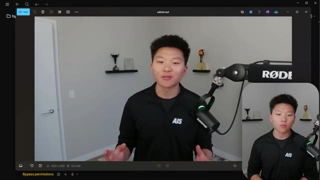
*⏱️ 00:13:27 — Une interface de lecteur vidéo ou d'application de montage montrant une vidéo en cours de lecture avec une incrustation (picture-in-picture) du présentateur en bas à droite.*

---

### ⏱️ `[00:13:43 - 00:14:02]` | Segment #34

**🔊 Audio (Transcription Intégrale Mot pour Mot en Français) :**
> Hopefully now you guys understand. Let's keep on getting this video edited. And I hope that you all enjoy this YouTube video. Perfect. I mean, that was edited exactly the way that I would have done it myself manually. And now we're ready to move on to the next step. And you can see what else it created was the transcript. So this should have all of the timestamps associated with it as well.

**👁️ Analyse Visuelle d'Écran (gemini-3.5-flash-lite) :**
**Interface & Outils** : Interface de type agent IA (Claude Code / IDE intégré) avec terminal de commande interactif.

**Contenu textuel & Code** : Résumé de l'édition : "Edit complete", liste des fichiers générés (edited.mp4, edited.srt, edl.json), détails techniques (1920x1080, -14 LUFS) et mention du prochain script "CLAUDE.md Mode B handoff".

**Action / Démonstration** : Validation du travail d'édition réalisé par l'IA et préparation du passage à l'étape de génération des graphismes animés (motion graphics).

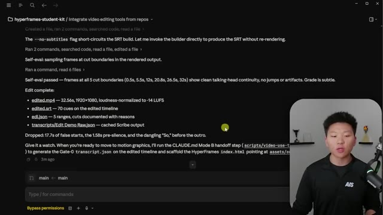
*⏱️ 00:13:57 — Interface de l'agent AI (Claude Code) affichant le journal des opérations de montage terminées, incluant les spécifications du fichier (mp4, srt, json) et les prochaines étapes de motion graphics.*

---

### ⏱️ `[00:14:02 - 00:14:22]` | Segment #35

**🔊 Audio (Transcription Intégrale Mot pour Mot en Français) :**
> You can see here if I go into my video projects and I go into the edit demo and I go into the assets, right here is where we see that edited MP4. and right here we can also see transcripts. And if we open up this JSON file, we can see the actual transcript, right? We see the full thing, but we also get the word by word breakdown. So we can see that okay starts at 1.599 seconds.

**👁️ Analyse Visuelle d'Écran (gemini-3.5-flash-lite) :**
**Interface & Outils** : Explorateur de fichiers Windows, Éditeur de code (type VS Code).

**Contenu textuel & Code** : Structure de fichiers de projet (MP4, SRT, JSON, Markdown) et contenu brut d'un fichier de transcription JSON avec timestamps détaillés.

**Action / Démonstration** : Navigation dans l'arborescence des fichiers du projet, suivie de l'ouverture et de l'inspection visuelle du fichier de transcription JSON.

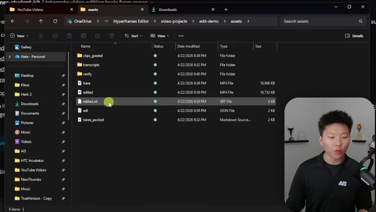
*⏱️ 00:14:07 — L'explorateur de fichiers Windows affichant le contenu d'un dossier de projet ("edit-demo/assets"), montrant divers fichiers de production comme des dossiers de clips, des fichiers MP4, des fichiers SRT et un fichier JSON nommé "edl".*

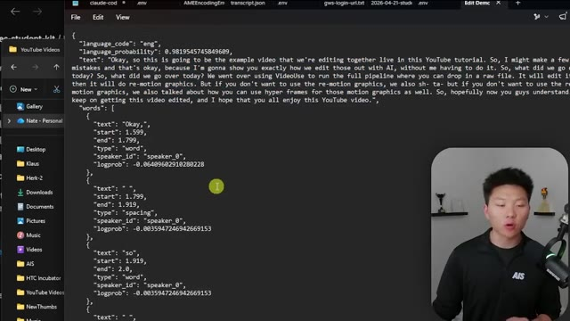
*⏱️ 00:14:17 — L'éditeur de code montrant le contenu interne d'un fichier JSON, affichant la transcription complète d'une vidéo avec des métadonnées temporelles, des types de mots, des identifiants de locuteurs ("speaker_0") et des probabilités logarithmiques.*

---

### ⏱️ `[00:14:22 - 00:14:42]` | Segment #36

**🔊 Audio (Transcription Intégrale Mot pour Mot en Français) :**
> And if we wanted a motion graphic to start when I say the word you, then we would just need that motion graphic to start at 11 seconds, 0.199. So you can see this is super, super precise and that's gonna help a ton with the motion graphics. Okay, so how do I like to do this? Well, on the first pass, because we don't yet have a style figured out, we have to sort of steer it, like I told you guys earlier.

**👁️ Analyse Visuelle d'Écran (gemini-3.5-flash-lite) :**
**Interface & Outils** : Éditeur de code / Interface de ligne de commande (probablement Cursor ou un environnement de développement intégré avec agent IA).

**Contenu textuel & Code** : - Image #1 : Données JSON de transcription (text, start, end, type: "word", speaker_id).
- Image #2 : Logs d'exécution système, chemins de fichiers Windows, résumé de montage vidéo (éditions, normalisation sonore, noms de fichiers).

**Action / Démonstration** : Le présentateur illustre la précision temporelle des transcriptions générées pour automatiser l'insertion de motion graphics, puis montre le résultat de l'exécution d'un processus de montage vidéo par un agent.

*⏱️ 00:14:27 — Affichage d'un fichier JSON (`transcript.json`) structuré montrant des métadonnées de transcription audio avec les horodatages précis du mot "you" (début à 11.199s).*

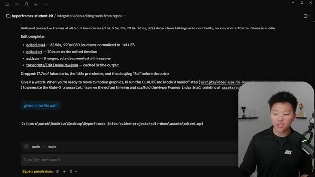
*⏱️ 00:14:37 — Interface de l'outil d'automatisation montrant un rapport d'évaluation "Self-eval passed" après une édition vidéo, avec les chemins d'accès aux fichiers générés et une invite de commande interactive.*

---

### ⏱️ `[00:14:42 - 00:15:02]` | Segment #37

**🔊 Audio (Transcription Intégrale Mot pour Mot en Français) :**
> So what I'm gonna do is open this file back up and I want to figure out when we want certain elements to pop in. So here's kind of my process. I'm gonna use my voice to text tool, which you guys can see in the description. And I'm just gonna start talking and telling it how I wanted to edit this video. Okay, so I need you to add motion graphics using hyperframes to this video.

**👁️ Analyse Visuelle d'Écran (gemini-3.5-flash-lite) :**
**Interface & Outils** : Lecteur multimédia natif (Windows Media Player ou Photos) et une barre de commande textuelle (probablement issue d'un outil d'IA ou de gestion de tâches).

**Contenu textuel & Code** : Barre de progression vidéo, réglages de volume, nom de fichier "edited.mp4", et zone de saisie "Type / for commands".

**Action / Démonstration** : Manipulation d'un fichier vidéo dans un lecteur local et préparation à l'utilisation d'un outil de commande textuelle.

---

### ⏱️ `[00:15:02 - 00:15:30]` | Segment #38

**🔊 Audio (Transcription Intégrale Mot pour Mot en Français) :**
> I'm going to give you some direction as far as what we're looking for. Okay, so this is going to be the example video that we're editing together live in this YouTube tutorial. So, okay, so at the beginning when I say this is the example video that we're editing live together, I want you to pop up a liquid glass style card on the left half of the screen, and I want the words to sort of appear as if they are karaoke style words popping in, karaoke style subtitles, and it should look like a title of a video.

**👁️ Analyse Visuelle d'Écran (gemini-3.5-flash-lite) :**
**Interface & Outils** : Logiciel de montage vidéo ou lecteur média intégré (type interface de gestion de fichiers).

**Contenu textuel & Code** : Interface utilisateur de lecture vidéo avec barre de progression, boutons de contrôle et métadonnées de fichier (1520 x 1080, 19.3 MB).

**Action / Démonstration** : Le présentateur présente l'exemple de vidéo qui est en train d'être visionné dans l'interface pour illustrer le tutoriel d'édition.

*⏱️ 00:15:09 — L'interface du logiciel de montage vidéo montrant la prévisualisation d'une séquence vidéo, avec une incrustation de la caméra du présentateur en bas à droite.*

---

### ⏱️ `[00:15:33 - 00:15:52]` | Segment #39

**🔊 Audio (Transcription Intégrale Mot pour Mot en Français) :**
> I might make a few mistakes, and that's okay, because I'm going to show you exactly how we edit those out. with AI without me having to do it. Okay, and then the next part, when I talk about I might make a few mistakes and that's okay, what I want you to do is add a card at the bottom of the screen that says, you know, mistakes will be cut.

**👁️ Analyse Visuelle d'Écran (gemini-3.5-flash-lite) :**
**Interface & Outils** : Frame.io (plateforme de révision vidéo).

**Contenu textuel & Code** : Interface utilisateur de lecteur vidéo avec barre de progression, boutons de navigation temporelle, et champ de saisie de commandes "Type / for commands" en bas de l'écran.

**Action / Démonstration** : Le présentateur illustre le processus de révision et de montage vidéo collaboratif en utilisant l'interface de lecture Frame.io.

*⏱️ 00:15:37 — Interface du logiciel Frame.io affichant une vidéo en cours de lecture, avec une fenêtre incrustée (PiP) du présentateur en bas à droite et une barre de commandes en bas de l'écran.*

---

### ⏱️ `[00:15:52 - 00:16:10]` | Segment #40

**🔊 Audio (Transcription Intégrale Mot pour Mot en Français) :**
> And then also add a motion graphic on the right side of the screen that just shows like an animation, you know, a visual understanding of what does it mean to edit out and trim mistakes. What did we go over today? We went over using video use to run the full pipeline where you can drop in a raw file, it will edit it, and then it will do re-motion graphics.

**👁️ Analyse Visuelle d'Écran (gemini-3.5-flash-lite) :**
**Interface & Outils** : Lecteur vidéo intégré dans une application d'automatisation IA (type éditeur de flux de travail).

**Contenu textuel & Code** : Interface utilisateur avec des contrôles de lecture, des métadonnées (1920x1080, 19.3 MB) et une barre de commande en bas ("Type / for commands").

**Action / Démonstration** : Démonstration du résultat du pipeline de traitement vidéo où le fichier "edited.mp4" est affiché après l'application de modifications automatiques.

*⏱️ 00:15:57 — Interface d'une application de lecture/édition vidéo affichant une vidéo en cours de traitement, avec le présentateur en médaillon (Picture-in-Picture) dans le coin inférieur droit.*

---

### ⏱️ `[00:16:11 - 00:16:43]` | Segment #41

**🔊 Audio (Transcription Intégrale Mot pour Mot en Français) :**
> But if you don't... Okay, and then the next part, when I talk about the video use pipeline of dropping in a raw file and having it be edited and re-motion graphics, I want you to animate that. I want you to show me on a liquid glass card, an actual animation of raw file being edited up with motion graphics applied. So just, you know, show me, tell me a story, paint a story here with these animations. Don't want to use the re-motion graphics. We also talked about how you can use hyperframes for those motion graphics as well. Okay, and then the next piece, when I talk about

**👁️ Analyse Visuelle d'Écran (gemini-3.5-flash-lite) :**
**Interface & Outils** : Lecteur multimédia au sein d'une application de bureau type "Liquid Glass" / application de gestion de workflow.

**Contenu textuel & Code** : Le lecteur affiche la progression d'une vidéo avec un horodatage à 00:21. En bas, une barre de saisie de commandes affiche le texte "Type / for commands" et un badge "Bypass permissions".

**Action / Démonstration** : Lecture d'un fichier vidéo traité ("edited.mp4") démontrant le résultat final du processus de montage automatisé mentionné dans l'audio.

*⏱️ 00:16:19 — Une interface de lecteur vidéo intégrée dans une application de bureau ("Liquid Glass"), montrant la lecture d'un fichier nommé "edited.mp4" avec une vue incrustée (PiP) du présentateur en bas à droite.*

---

### ⏱️ `[00:16:43 - 00:17:16]` | Segment #42

**🔊 Audio (Transcription Intégrale Mot pour Mot en Français) :**
> using hyperframes instead, I want you to just show a different version of motion graphics, maybe a different color or some other different animation style. And you can do that as cards, both on the left-hand side of the screen and the right-hand side of the screen. So that's what we want for this video. Make sure that everything is syncing up to the exact second where it makes the most sense for that motion graphic or that text to pop in. And yeah, that is your task. Let's see what you can do. Okay. So we've just shut off that prompt. What I like to

**👁️ Analyse Visuelle d'Écran (gemini-3.5-flash-lite) :**
**Interface & Outils** : Environnement de développement type Claude Code / Cursor.

**Contenu textuel & Code** : Journalisation de tâches ("Edit complete", "Self-eval passed"), liste de fichiers (.mp4, .srt, .json) et chemin d'accès Windows affiché en bas.

**Action / Démonstration** : Revue de l'état d'un projet d'édition vidéo et vérification des fichiers générés.

*⏱️ 00:16:51 — Interface de prévisualisation vidéo montrant le présentateur dans un lecteur multimédia intégré à l'environnement de travail.*

*⏱️ 00:17:00 — Interface de terminal/éditeur de texte affichant un résumé de projet ("Self-eval passed") et un chemin d'accès local vers un fichier vidéo.*

---

### ⏱️ `[00:17:16 - 00:17:51]` | Segment #43

**🔊 Audio (Transcription Intégrale Mot pour Mot en Français) :**
> do now is I like to switch this to plan mode. So now it's able to basically look at the transcript. It's able to understand our requests and it's going to start to plan out. Okay. I'm going to make this card and here's what it's going to say. Here's what's going to be on it. I'm going to have this come in at this timestamp. Are you okay with that? And we're basically able to say, yes, I like this plan. Go build the motion graphics now, or we can iterate a little bit before it actually wastes our time and our clawed session limit actually coding out and building the HTML for the video. So this planning stage is very important. All right. Awesome. So we got a plan

**👁️ Analyse Visuelle d'Écran (gemini-3.5-flash-lite) :**
**Interface & Outils** : Interface de type IDE avec agent IA intégré (probablement Cursor).

**Contenu textuel & Code** : Prompt utilisateur détaillé expliquant les besoins en motion design (style "liquid glass", sous-titres karaoké, cartes d'animation) pour un projet de montage vidéo. En bas, la barre de commande indique "Plan mode".

**Action / Démonstration** : L'utilisateur a basculé l'agent en "Plan mode" pour planifier la génération des éléments graphiques décrits dans le prompt.

*⏱️ 00:17:25 — Une interface de chat ou d'assistant IA (type Cursor ou agent de développement) montrant une longue requête utilisateur détaillée sur l'intégration d'animations graphiques (HyperFrames) dans une vidéo.*

---

### ⏱️ `[00:17:51 - 00:18:28]` | Segment #44

**🔊 Audio (Transcription Intégrale Mot pour Mot en Français) :**
> back, which I can go ahead and make a little bit larger here. Okay. So we have our talking head clip. We have the goal to add four hyperframes, motion graphics beats, which are kind of just like scenes that feel like iOS 26 liquid glass premium UI over a lightly dimmed talking head, each synced to the exact spoken phrase, blah, blah, blah. That sounds good. We have an aesthetic direction. We have a motion philosophy doc, which if you download this GitHub repo that I am giving you guys, then that will be in there as well. But that just has some best practices that I've found for creating these motion graphics. But anyways, we have some color palette stuff. So beat A is

**👁️ Analyse Visuelle d'Écran (gemini-3.5-flash-lite) :**
**Interface & Outils** : Éditeur de documents/planification (Image 1), Interface Web GitHub (Image 2).

**Contenu textuel & Code** : Texte détaillé sur le workflow de montage vidéo, les spécifications techniques (1920x1080 @ 24fps), et la philosophie esthétique "Liquid Glass". Liste de fichiers dans un dépôt GitHub nommé "hyperframes-student-kit".

**Action / Démonstration** : Consultation du cahier des charges du projet et exploration du dépôt de ressources pédagogiques pour le montage.

*⏱️ 00:18:00 — Une interface de planification structurée détaillant les objectifs techniques et la direction esthétique pour un projet de montage vidéo "HyperFrames".*

*⏱️ 00:18:18 — Une page de dépôt GitHub ("hyperframes-student-kit") montrant la structure du répertoire et les fichiers du projet.*

---

### ⏱️ `[00:18:28 - 00:19:02]` | Segment #45

**🔊 Audio (Transcription Intégrale Mot pour Mot en Français) :**
> going to be an intro glow with teal. We've got orange, we've got purple, we've got graphite. But now let's go to the actual timeline. So this is where we have to potentially make some changes to the plan. There's a bit of a bug here. It looks like this column is getting, oh, okay, nevermind. I just had to scroll over a little bit. That does seem like a bit of a bug, but either way, the beat timeline. So the intro is basically from zero seconds to five seconds. And then we have five to 12, 12 to 20, and we have different things going on. So it's basically showing us what word is the anchor. So what word is going to trigger the scene to basically start? So at this point, we would basically go through each of the beats or the scenes to make sure we like what it's saying.

**👁️ Analyse Visuelle d'Écran (gemini-3.5-flash-lite) :**
**Interface & Outils** : Outil de planification textuel (probablement une application de type Notion ou un éditeur de texte structuré).

**Contenu textuel & Code** : Un tableau intitulé "Plan" répertoriant des "Beats" (segments vidéo) avec des colonnes : id, Start, Dur, End, Anchor word, et data-anchor. On y voit des données comme "b01-title", "b02-mistakes", et des timestamps associés.

**Action / Démonstration** : Le présentateur passe en revue le planning de montage de la vidéo et analyse les colonnes du tableau pour vérifier la cohérence des données.

*⏱️ 00:18:36 — Une capture d'écran montrant l'interface d'un outil de gestion de projet ou de planification de contenu avec une table structurée des séquences vidéo.*

---

### ⏱️ `[00:19:02 - 00:19:26]` | Segment #46

**🔊 Audio (Transcription Intégrale Mot pour Mot en Français) :**
> So I'll go through one with you guys. I'm not going to read all of them because I don't want to bore you, but let's say beat A. And by the way, when I highlight, you can actually leave comments. So if we need to comment, we can comment on something very specific, which is nice, but I'm going to stop highlighting. So that stops popping up. We've got a liquid glass card positioned on the left side, fills left half centered vertically. It covers the empty wall and door area, if you guys remember the camera, but it does not cover the speaker, which is great.

**👁️ Analyse Visuelle d'Écran (gemini-3.5-flash-lite) :**
**Interface & Outils** : Editeur de texte/documentation (type Notion ou outil de gestion de projet).

**Contenu textuel & Code** : Spécifications techniques détaillées pour "Beat A", incluant des propriétés CSS (transform, translate, opacity), des instructions de typographie (taille en px, espacement, effets de halo/chrome) et une référence à un fichier "assets/transcript.json".

**Action / Démonstration** : Le présentateur met en évidence ("highlight") le texte "Beat A" dans le document pour illustrer ses explications sur le design et la possibilité d'ajouter des commentaires.

*⏱️ 00:19:08 — Interface de documentation technique (type Notion ou éditeur de texte structuré) affichant les spécifications de conception "Per-Beat Design" pour un montage vidéo.*

---

### ⏱️ `[00:19:26 - 00:19:45]` | Segment #47

**🔊 Audio (Transcription Intégrale Mot pour Mot en Français) :**
> It's gonna have a tiny uppercase eyebrow that says edit demo chapter one. It's going to have a Chrome gradient. It's gonna have a large title that says the edit live, and that's gonna be on two different lines and then karaoke run beneath. So it's gonna say, this is going to be the example in 34 font. Okay, timing anchors, cool.

**👁️ Analyse Visuelle d'Écran (gemini-3.5-flash-lite) :**
**Interface & Outils** : Éditeur de texte ou application de prise de notes structurées (type Obsidian ou similaire).

**Contenu textuel & Code** : Spécifications techniques détaillées : "Tiny uppercase eyebrow", "Large title THE EDIT / LIVE", "Karaoke run beneath title", incluant des paramètres CSS/GSAP (opacity, scale, power3.out, rgba) et des points d'ancrage temporels pour un fichier JSON.

**Action / Démonstration** : Le présentateur explique la logique de conception et les détails techniques de l'animation de texte (titres et sous-titres karaoké) qu'il est en train de planifier pour son montage vidéo.

*⏱️ 00:19:31 — Une capture d'écran montrant un document technique ou un plan de projet ouvert dans une interface de type éditeur de texte/Markdown, détaillant les spécifications d'animation pour une vidéo.*

*⏱️ 00:19:40 — Une suite de l'image précédente, détaillant les paramètres temporels ("Timing anchors") et les comportements d'animation pour le fichier "transcript.json".*

---

### ⏱️ `[00:19:45 - 00:20:03]` | Segment #48

**🔊 Audio (Transcription Intégrale Mot pour Mot en Français) :**
> So that sounds like it lines up with what I want. I'm gonna quickly scan through these other beats and then I'm gonna shoot it off. Actually, I realized there's one more thing that we showed in that intro that I didn't do here. So let me make a change. I'm going to click on revise and I'm just going to say this all looks good, but I do want to add one more scene at the very end.

**👁️ Analyse Visuelle d'Écran (gemini-3.5-flash-lite) :**
**Interface & Outils** : Éditeur de texte/interface de planification (type workflow agentique ou IDE).

**Contenu textuel & Code** : Spécifications techniques CSS/animation (coordonnées, opacité, délais, durée) et une liste numérotée d'étapes de validation pour le projet "hyperframes-student-kit".

**Action / Démonstration** : Le présentateur passe en revue les spécificités d'une animation avant d'envisager une révision du plan proposé par l'agent IA.

*⏱️ 00:19:50 — Vue détaillée du plan de montage vidéo, affichant des instructions techniques pour une animation "Bottom bar" et "Right-side trim MG" avec des spécifications précises de timing et de dimensions.*

*⏱️ 00:19:54 — Interface de l'outil de développement montrant une proposition de plan par l'agent IA, avec un panneau latéral récapitulant les étapes du projet et des options interactives ("Revise", "Accept") en bas de l'écran.*

---

### ⏱️ `[00:20:04 - 00:20:22]` | Segment #49

**🔊 Audio (Transcription Intégrale Mot pour Mot en Français) :**
> For most of the video, or pretty much so far, the whole video is just my face cam full screen. But what I want to do is in the last five seconds, I want to transition. I want to take the face cam and I want to vertical crop it with rounded edges and a drop shadow. and I want to reveal kind of just a dark mode, modern looking background.

**👁️ Analyse Visuelle d'Écran (gemini-3.5-flash-lite) :**
**Interface & Outils** : Interface de l'outil Claude (utilisant potentiellement Claude Code ou une interface similaire intégrée).

**Contenu textuel & Code** : Texte du plan de projet affiché à gauche (étapes incluant `npx hyperframes lint` et `npx hyperframes compositions`) et champ de saisie utilisateur "What should change?" en bas de la fenêtre.

**Action / Démonstration** : L'IA a proposé un plan d'action pour le projet "hyperframes-student-kit" et attend une validation ou une révision de l'utilisateur.

*⏱️ 00:20:08 — Une interface de chat d'IA (Claude) affichant une proposition de plan de travail, avec une fenêtre flottante superposée en bas à droite montrant le présentateur en mode "picture-in-picture" avec des bords arrondis.*

---

### ⏱️ `[00:20:22 - 00:20:41]` | Segment #50

**🔊 Audio (Transcription Intégrale Mot pour Mot en Français) :**
> And I want the face cam to shift over to the right half of the screen. On the left half of the screen, I want there just to be text that says, thanks for watching. So now I can just shoot off that revision. It's gonna come back with another plan and then I'm gonna go ahead and approve it. And I'll check in with you guys when we have that first iteration done. But basically that's it. As you guys saw, I was just using my natural language.

**👁️ Analyse Visuelle d'Écran (gemini-3.5-flash-lite) :**
**Interface & Outils** : Claude Code / Terminal interactif

**Contenu textuel & Code** : Liste numérotée de tâches techniques (validation, linting, rendus Playwright, export MP4) et champ de saisie "What should change?" pour demander des modifications au plan proposé.

**Action / Démonstration** : L'utilisateur est en train de formuler une instruction pour réviser le plan proposé par l'agent afin d'ajuster la mise en page vidéo.

*⏱️ 00:20:27 — Interface de l'agent IA (Claude Code) affichant un plan de travail technique et une zone de saisie pour soumettre des révisions, avec une incrustation vidéo du présentateur en bas à droite.*

---

### ⏱️ `[00:20:41 - 00:21:00]` | Segment #51

**🔊 Audio (Transcription Intégrale Mot pour Mot en Français) :**
> I was being very, very specific. And I know you guys are thinking, okay, well, how much time does that really save if you're being that specific every time? Well, think about it like this. In my real project, I have video projects, right? So if I open this up, you can see how many different videos I've made. I've made an app release video. I made a hype video. I made a lesson video. I made an intro. I made demos. All of these videos are training data.

**👁️ Analyse Visuelle d'Écran (gemini-3.5-flash-lite) :**
**Interface & Outils** : VS Code, Claude Code (Opus 4.7)

**Contenu textuel & Code** : - Image #1 : Liste de contrôle (validation de scripts, linting, rendus Playwright), état des agents, et champ de saisie de commandes.
- Image #2 : Arborescence de fichiers (`video-projects`, `scripts`, `.env`), statut des modifications Git (M, U), et terminal de commande Claude Code.

**Action / Démonstration** : - Image #1 : Exécution et planification de workflows automatisés par l'agent.
- Image #2 : Navigation dans l'arborescence du projet et réinitialisation du terminal de l'agent via la commande `/clear`.

*⏱️ 00:20:46 — Interface de l'outil Claude Code montrant une planification de projet en cours ("Plan mode") avec une liste d'étapes techniques et une barre de commande interactive en bas.*

*⏱️ 00:20:50 — Éditeur VS Code ouvert avec l'extension Claude Code active, affichant l'arborescence des fichiers du projet "HyperFrames Editor" et une commande `/clear` dans le terminal intégré.*

---

### ⏱️ `[00:21:01 - 00:21:20]` | Segment #52

**🔊 Audio (Transcription Intégrale Mot pour Mot en Français) :**
> So let's say I make five different lessons. Now I can basically say, okay, cool. Build a lesson design markdown philosophy file, which means every time I build a lesson, just use that. And that's where you truly get to the point of dropping in a raw file and having it edited end-to-end once you've kind of established a style for that type of video.

**👁️ Analyse Visuelle d'Écran (gemini-3.5-flash-lite) :**
**Interface & Outils** : Visual Studio Code avec extension Claude Code (v2.1.117), modèle Opus 4.7.

**Contenu textuel & Code** : Commande "/clear" visible dans le terminal intégré de Claude Code ; structure de dossiers "video-projects" contenant divers projets de montage vidéo (aisoc-app-release, edit-demo, etc.).

**Action / Démonstration** : Le terminal est en attente d'instruction, avec le statut "bypass permissions on" activé, prêt à traiter les prochaines étapes de la création automatisée de leçons.

*⏱️ 00:21:06 — Capture d'écran de l'éditeur Visual Studio Code affichant l'extension "Claude Code" active, avec l'arborescence des fichiers du projet "Hyperframes Editor" dans la barre latérale.*

---

### ⏱️ `[00:21:20 - 00:21:38]` | Segment #53

**🔊 Audio (Transcription Intégrale Mot pour Mot en Français) :**
> So like here, you can see I've built three different YouTube shorts. They're not that great. We're still iterating a little bit, but we're gonna get to a point where our shorts automation is so good that all I have to do is drop in a raw video and it will turn it into a short. So that's kind of the mindset that I have here. And that's the mindset you guys should have. And that's why in this example, I wanted to show you guys how specific I had to be to get a good output.

**👁️ Analyse Visuelle d'Écran (gemini-3.5-flash-lite) :**
**Interface & Outils** : Visual Studio Code, Claude Code (CLI).

**Contenu textuel & Code** : - Image #1 : Liste de répertoires (`video-projects`, `aisoc-app-release`, `may-shorts-18`), commande `/clear` dans le terminal Claude Code.
- Image #2 : Plan d'exécution détaillé incluant des points comme `npx hyperframes lint`, `npx hyperframes compositions`, et des instructions sur le rendu vidéo (1920x1080) et les tests Playwright.

**Action / Démonstration** : - Image #1 : Navigation dans l'arborescence des fichiers du projet de montage.
- Image #2 : Consultation et exécution d'un plan de développement technique généré par l'IA pour automatiser des workflows vidéo.

*⏱️ 00:21:24 — Interface de VS Code montrant l'explorateur de fichiers "Hyperframes Editor" avec une liste de projets vidéo, incluant une session Claude Code active.*

*⏱️ 00:21:34 — Interface de planification d'un agent IA (probablement Claude Code) affichant des étapes détaillées pour l'intégration d'outils de montage vidéo.*

---

### ⏱️ `[00:21:39 - 00:22:06]` | Segment #54

**🔊 Audio (Transcription Intégrale Mot pour Mot en Français) :**
> Okay, so it looks like we're at a spot where this has come back with a version for us to look at. Now, if you come into the top right of the desktop app and you click on preview, you actually can preview it right here, which is kind of a nice feature. And it's just not full screen. So you could definitely do it here if you wanted to, you know, not context switch out, but it's also as simple as just clicking into the tab. But anyways, now we are in here and let's just give this a quick watch and see what we've got. So this is going to be the example video that we're editing together live in this YouTube tutorial.

**👁️ Analyse Visuelle d'Écran (gemini-3.5-flash-lite) :**
**Interface & Outils** : Hyperframes Studio, interface de développement web, terminal intégré.

**Contenu textuel & Code** : Logs de session (Git, linter, GSAP transforms), structure de fichiers (index.html, compositions, assets), timeline audio avec repères temporels (Beat 1 à 5).

**Action / Démonstration** : Démonstration de l'outil de prévisualisation vidéo intégré et manipulation de la timeline pour ajuster les effets GSAP dans le projet.

*⏱️ 00:21:46 — Interface de développement avec une console de logs sur la gauche et une fenêtre de prévisualisation vidéo intégrée sur la droite.*

*⏱️ 00:21:53 — Gros plan sur l'interface "Hyperframes Studio" montrant la barre de lecture, la timeline audio avec des marqueurs de "beats" et le bouton de prévisualisation en haut à droite.*

*⏱️ 00:22:00 — Vue de l'interface de montage montrant la gestion des assets et une timeline détaillée avec des vignettes miniatures de la vidéo.*

---

### ⏱️ `[00:22:07 - 00:22:34]` | Segment #55

**🔊 Audio (Transcription Intégrale Mot pour Mot en Français) :**
> So I might make a few mistakes and that's okay because I'm going to show you exactly how we edit those out with AI without me having to do it. So what did we go over today? We went over using video use to run the full pipeline where you can drop in a raw file. It will edit it and then it will do re-motion graphics. But if you don't want to use the re-motion graphics, we also talked about how you can use hyperframes for those motion graphics as well. Hopefully now you guys understand. Let's keep on getting this video edited and I hope that you all enjoy this YouTube video.

**👁️ Analyse Visuelle d'Écran (gemini-3.5-flash-lite) :**
**Interface & Outils** : Application web de montage vidéo (Video SDK/Outil d'automatisation d'édition).

**Contenu textuel & Code** : Structure de fichiers dans la barre latérale gauche (index.html, assets, compositions, scripts avec hyperframes.json et meta.json) ; timeline avec segments M01 à M05.

**Action / Démonstration** : Le logiciel affiche une timeline de montage en cours de traitement ou de visualisation, permettant la manipulation des segments vidéo par l'utilisateur.

*⏱️ 00:22:13 — Une interface de montage vidéo basée sur le web montrant une timeline avec des vignettes de prévisualisation et une fenêtre de rendu centrale où le présentateur s'exprime.*

---

### ⏱️ `[00:22:34 - 00:23:08]` | Segment #56

**🔊 Audio (Transcription Intégrale Mot pour Mot en Français) :**
> Okay, so it's not too bad. Obviously there's some things we need to fix. Like this was obviously horrible. It didn't get that right. The other thing I noticed is that this kind of covers my face a little bit, which we'll want to tweak. And then also, where was it? Oh, just in general, there's like a grid. And I think it's because when they go into this background, they want the grid to be there, which is fine. But having this grid just be there naturally is not what I want. So at this point, we just have to go back and make some more comments. Okay, so not bad. All of the motion graphics are coming in at the right time. I think you just made a few mistakes when it comes

**👁️ Analyse Visuelle d'Écran (gemini-3.5-flash-lite) :**
**Interface & Outils** : Éditeur vidéo basé sur navigateur (type Remotion ou outil de montage web propriétaire).

**Contenu textuel & Code** : Superposition graphique "THE EDIT LIVE", barre de progression de la timeline, et structure de fichiers du projet (index.html, assets, compositions, scripts) dans la colonne de gauche.

**Action / Démonstration** : Le présentateur évalue le rendu visuel de l'overlay et souligne un problème de positionnement (masquage du visage) nécessitant un ajustement technique.

*⏱️ 00:22:43 — Interface d'édition vidéo montrant une prévisualisation avec une superposition de texte semi-transparente ("THE EDIT LIVE") qui masque partiellement le visage du présentateur.*

---

### ⏱️ `[00:23:08 - 00:23:46]` | Segment #57

**🔊 Audio (Transcription Intégrale Mot pour Mot en Français) :**
> to the actual visuals. So the first thing is in beat one, the liquid glass looks good, but it's actually covering my face a little bit. So if you could just scale this down and then maybe crop off the right side a little bit, so it doesn't cover my face, that would be beautiful. The next thing is that across the whole video, there's kind of like a grid pattern overlay that is visible and it shouldn't be there at all. I like the rest of the beats until we get to the end where you transition into the video crop. So the problem is you need to crop the left side in and the right side in.

**👁️ Analyse Visuelle d'Écran (gemini-3.5-flash-lite) :**
**Interface & Outils** : Interface de montage vidéo basée sur navigateur (style outil d'édition IA).

**Contenu textuel & Code** : Prévisualisation vidéo avec texte "THE EDIT LIVE", timeline avec vignettes d'aperçu, et panneau de navigation des fichiers à gauche.

**Action / Démonstration** : Le présentateur explique visuellement le besoin de redimensionner et de recadrer l'élément graphique en "liquid glass" qui masque son visage sur la vidéo de démonstration.

*⏱️ 00:23:18 — Une interface de montage vidéo web affichant une prévisualisation avec un élément graphique en verre dépoli ("liquid glass") qui recouvre partiellement le visage du présentateur.*

---

### ⏱️ `[00:23:46 - 00:24:09]` | Segment #58

**🔊 Audio (Transcription Intégrale Mot pour Mot en Français) :**
> So we keep the center, we keep the face cam and that's a vertical ratio with rounded crop corners. And that's mainly the issue because right now what you did is you just cropped the right side of the screen. Everything else about the video looks good. So implement those changes and then we'll give it a look. So I'll just paste that in. And then once again, I'm going to shoot this off.

**👁️ Analyse Visuelle d'Écran (gemini-3.5-flash-lite) :**
**Interface & Outils** : Application de montage vidéo basée sur le web (interface de type éditeur de composition, probablement Remotion ou outil propriétaire).

**Contenu textuel & Code** : Code source visible dans l'interface : `<Composition ... />` et texte "REMOTION".

**Action / Démonstration** : Navigation sur la ligne de temps (timeline) et ajustement des ratios de recadrage des éléments visuels dans la composition vidéo.

*⏱️ 00:23:52 — Interface de montage vidéo affichant une ligne de temps et une prévisualisation montrant le présentateur en plan large.*

*⏱️ 00:23:57 — Interface de montage montrant une vue "Thanks for watching" avec un recadrage vertical partiel sur la droite de l'écran.*

*⏱️ 00:24:03 — Interface de montage montrant une comparaison entre "Option A" (code Remotion) et une option B floutée, avec le présentateur au centre.*

---

### ⏱️ `[00:24:09 - 00:24:45]` | Segment #59

**🔊 Audio (Transcription Intégrale Mot pour Mot en Français) :**
> Also, I apologize if that video was like insanely loud. For some reason, when it pulled it up in that local host, it just like tripled the decibels. I'm not exactly sure why. So when we render it, it would be fine. But sometimes in the preview, we get little things like that. But we are lucky that the timing was good because iterating on the timing used to be a little bit annoying. But now you can see if I just kind of move this up, we have the audio. Aha. Okay. So this is the actual, I believe this is probably the beat that is associated with sort of like the graph background, but we could move these around, right? I don't have to because they all come in at the right times, but this is where the timeline editor is actually huge because you can, you know, shorten things like,

**👁️ Analyse Visuelle d'Écran (gemini-3.5-flash-lite) :**
**Interface & Outils** : Gate 1 Studio (environnement de développement/montage assisté par IA)

**Contenu textuel & Code** : - Image #1 : Liste de instructions détaillées sur les modifications visuelles (ajustement de calques, recadrage, suppression d'un motif de grille).
- Image #2 : Timeline de montage avec pistes "face-video", "face-audio", "dim-veil" et "edge-vignette".

**Action / Démonstration** : - Image #1 : L'utilisateur donne des directives de correction visuelle à l'IA pour ajuster le rendu.
- Image #2 : Visualisation du projet de montage en cours avec prévisualisation vidéo en haut et gestion des pistes sur la timeline.

*⏱️ 00:24:18 — Interface de l'outil "Gate 1 Studio" montrant une interaction textuelle avec un agent IA sur un projet de montage vidéo.*

*⏱️ 00:24:27 — Interface de montage vidéo (timeline) dans Gate 1 Studio affichant les pistes audio, vidéo et les effets appliqués.*

---

### ⏱️ `[00:24:45 - 00:25:18]` | Segment #60

**🔊 Audio (Transcription Intégrale Mot pour Mot en Français) :**
> you know, we could move this in or out, we could delete things. And what happens is because we make that change here, that change actually gets reflected in the actual code. And then Cloud Code would see that and just make sure it reflects that change as well. So for quick iterations, that can be a huge time saver. Okay, so here is the new version. I'm going to open up this local host and let's give it a quick watch. Hopefully it's not absurdly loud again. Okay, so this is going to be the example video that we're editing together live in this YouTube tutorial. So I might make a few mistakes and that's okay because I'm going to show you exactly how we edit those out

**👁️ Analyse Visuelle d'Écran (gemini-3.5-flash-lite) :**
**Interface & Outils** : Éditeur vidéo basé sur le web (interface de type "Remotion" ou éditeur de composition vidéo automatisée).

**Contenu textuel & Code** : Timeline de montage composée de segments vidéo (B01-B05), pistes audio, et prévisualisation de contenu dynamique avec superposition de texte.

**Action / Démonstration** : Démonstration de l'interface de montage où l'utilisateur visualise et manipule les éléments temporels du projet pour illustrer l'édition en temps réel.

*⏱️ 00:24:53 — Interface de montage vidéo type "timeline" où l'utilisateur manipule des blocs de clips vidéo et audio sur une piste séquentielle.*

*⏱️ 00:25:02 — Vue de la timeline de l'éditeur vidéo montrant la structure des clips synchronisés avec une piste audio détaillée en dessous.*

*⏱️ 00:25:10 — L'interface affiche une fenêtre de prévisualisation vidéo avec un overlay graphique "THE EDIT LIVE" au-dessus de la timeline de montage.*

---

### ⏱️ `[00:25:18 - 00:25:52]` | Segment #61

**🔊 Audio (Transcription Intégrale Mot pour Mot en Français) :**
> with AI without me. By the way, maybe I want to play with the spacing because it might look weird with like a right card and this thing at the bottom and nothing on the left. But I really like this animation. Look at this. Those cards go red. And then we have a scissor come across and cut those out. Like, remember, I didn't ask it to do that. I just said, make an animation that looks like we're editing the video. And it did that. Very nice. Exactly how we edit those out with AI without me having to do it. So what did we go over today? We went over using video use to run the full pipeline where you can drop in a raw file. It will edit it and then it will do

**👁️ Analyse Visuelle d'Écran (gemini-3.5-flash-lite) :**
**Interface & Outils** : Logiciel de montage vidéo propriétaire avec interface de timeline (AI-assisted video editor).

**Contenu textuel & Code** : Timeline vidéo divisée en blocs (B01, B02, B03, B04, B05), superposition textuelle "TRIM - EDL - AI-ASSISTED" et "MISTAKES WILL BE CUT", indicateur de progression de lecture.

**Action / Démonstration** : Démonstration de l'interface d'édition, visualisation de la timeline avec des segments identifiés pour la suppression automatique (cuts).

*⏱️ 00:25:27 — Interface d'un éditeur vidéo alimenté par l'IA montrant une timeline avec des segments de vidéo et une superposition graphique avec le texte « MISTAKES WILL BE CUT ».*

---

### ⏱️ `[00:25:52 - 00:26:28]` | Segment #62

**🔊 Audio (Transcription Intégrale Mot pour Mot en Français) :**
> remotion graphics. But if you don't want to use the remotion graphics, we also talked about how you can use hyperframes for those motion graphics as well. Hopefully now you guys understand. Let's keep on getting this video edited and I hope that you all enjoy. Okay, beautiful. Now that we have that, we could either keep going back and forth and editing like you guys saw, or we just basically say, Hey, give me the render. And then it pops it into your project and you would just be able to, you know, throw that into whatever else you want, upload it. That's basically it. And like I said, just to switch back to the VS code version now, because of the way that I've set up this project, every time I drop in raw assets, it all gets organized by project. So for example, if we

**👁️ Analyse Visuelle d'Écran (gemini-3.5-flash-lite) :**
**Interface & Outils** : Remotion (montage vidéo), Hyperframes (éditeur), VS Code, Claude Code (CLI).

**Contenu textuel & Code** : Liste de tâches (Beat A, B, E), URLs localhost (3003), commandes terminal (/clear), statut de permissions.

**Action / Démonstration** : Revue de l'avancement des corrections sur le projet de montage vidéo, interaction avec l'agent IA pour valider les modifications.

*⏱️ 00:26:01 — Interface de montage vidéo avec une timeline affichant les segments "B01" à "B05" et une prévisualisation "THANKS FOR WATCHING".*

*⏱️ 00:26:10 — Interface de l'éditeur Hyperframes affichant une liste de tâches de correction pour des "beats" vidéo et des liens locaux pour la prévisualisation.*

*⏱️ 00:26:19 — Visual Studio Code avec l'extension Claude Code active, montrant l'utilisation du modèle Opus 4.7 avec les permissions activées dans le terminal intégré.*

---

### ⏱️ `[00:26:28 - 00:26:54]` | Segment #63

**🔊 Audio (Transcription Intégrale Mot pour Mot en Français) :**
> look at the edit demo, we now have assets. We have the clips, we have the transcripts, we have anything else that it needs. We have the compositions, which are the actual beats HTML. And this is what it's using in order to make those animations display. And this is what we're actually rendering. We have different components, and then we have any final renders in here. And this is where it's verifying the actual screenshots, which is really cool. I'm basically telling it to take screenshots of what's going on in the scene to make sure that it looks good.

**👁️ Analyse Visuelle d'Écran (gemini-3.5-flash-lite) :**
**Interface & Outils** : Visual Studio Code (VS Code) avec interface Claude Code intégrée.

**Contenu textuel & Code** : Code source HTML structuré avec des balises div et span (classes CSS pour animations), arborescence de fichiers de projet.

**Action / Démonstration** : Navigation dans l'arborescence du projet pour montrer les composants de composition, le code source d'animation et les rendus finaux.

*⏱️ 00:26:34 — L'explorateur de fichiers de VS Code montre la structure de projet 'edit-demo', avec le dossier 'compositions' et les fichiers d'assets ouverts à droite.*

*⏱️ 00:26:41 — Visualisation du code HTML au sein de 'b02-mistakes.html' qui définit des éléments visuels et textuels (span) pour les animations.*

*⏱️ 00:26:47 — L'explorateur de fichiers affiche le répertoire 'renders/verify' contenant une liste d'images générées automatiquement pour la validation du montage.*

---

### ⏱️ `[00:26:54 - 00:27:15]` | Segment #64

**🔊 Audio (Transcription Intégrale Mot pour Mot en Français) :**
> Because sometimes it'll just come back and say, hey, I've done this, but it doesn't look good at all. So if we tell it to take screenshots, it has to go verify for itself. And that is just a really nice trick that I found out to do. So anyways, like I said, now you have all these projects and you can start to make different folders. Every time you want to do an intro, if you want your intros to look like this, now you use this one as a reference and you just make your intros better every single time.

**👁️ Analyse Visuelle d'Écran (gemini-3.5-flash-lite) :**
**Interface & Outils** : Visual Studio Code, Claude Code (CLI).

**Contenu textuel & Code** : Arborescence de fichiers (dossier 'renders/verify' contenant des captures d'écran), terminal affichant "Claude Code v2.1.117", "/clear", et "bypass permissions on".

**Action / Démonstration** : Utilisation d'un agent IA pour effectuer des vérifications visuelles (screenshots) afin de valider la qualité du rendu d'un projet.

*⏱️ 00:26:59 — Interface VS Code affichant un terminal Claude Code dans le panneau central et un aperçu d'image "t1.80.png" dans le panneau de droite, utilisée pour vérifier visuellement le rendu d'un projet.*

---

### ⏱️ `[00:27:16 - 00:27:50]` | Segment #65

**🔊 Audio (Transcription Intégrale Mot pour Mot en Français) :**
> And that's where you get to the point where this is like way more automated. And the other thing I did want to call out is you guys watched me shoot off all of these prompts and you guys saw everything that it built, all of those different HTML files it had to make. How many tokens did this cost? This took us about 238,000 tokens. So not too bad, but not great either because this will eat some tokens. And that's why the more specific you can be with your planning and with your iterating, the better because you don't want it to go down the wrong path and then it wastes tokens and it wastes your time. So be specific. And if you guys want to dive into more stuff, then you can check out this video where I go deeper, like I said earlier,

**👁️ Analyse Visuelle d'Écran (gemini-3.5-flash-lite) :**
**Interface & Outils** : Claude Code / Terminal interactif orienté IA.

**Contenu textuel & Code** : Liste de tâches (todos) pour l'édition vidéo, liens localhost, statistiques de jetons (tokens) et limites de modèles (Opus, Sonnet).

**Action / Démonstration** : Présentation des résultats d'un cycle de développement automatisé et vérification de la consommation de ressources (tokens) par l'agent IA.

*⏱️ 00:27:24 — Interface de l'outil de développement montrant le journal d'activité de l'IA détaillant les corrections apportées (Beat A, Beat E) et les URLs locales pour prévisualiser les changements.*

*⏱️ 00:27:33 — Fenêtre contextuelle affichant la consommation de la fenêtre de contexte (238.6k / 1.0M tokens, soit 24%) et les limites d'utilisation du plan d'abonnement.*

---

### ⏱️ `[00:27:51 - 00:28:12]` | Segment #66

**🔊 Audio (Transcription Intégrale Mot pour Mot en Français) :**
> into some other tactics and show off some other examples and how you can get the most out of hyperframes. But anyways, as this slide says, thanks for watching. This is going to do it for today. I noticed that this is a little bit of a blurry thing that I would want to fix, but that would be a super simple iteration for us. But anyways, if you enjoyed the video, please give it a like. It helps me out a ton. And as always, I appreciate you guys making it to the end of the video and I will see you on the next one. Thanks everyone.

**👁️ Analyse Visuelle d'Écran (gemini-3.5-flash-lite) :**
**Interface & Outils** : Éditeur de montage vidéo de type studio (interface de développement web pour le montage).

**Contenu textuel & Code** : Texte affiché "THANKS FOR WATCHING" et "KEEP ON SHIPPING", explorateur de fichiers sur la gauche (index.html, compositions, scripts).

**Action / Démonstration** : Présentation de la conclusion de la vidéo dans l'environnement de développement/montage.

*⏱️ 00:27:56 — Interface de montage vidéo affichant une diapositive de fin "Thanks for watching" avec une incrustation vidéo du présentateur, ainsi qu'une timeline de montage en bas.*

---

