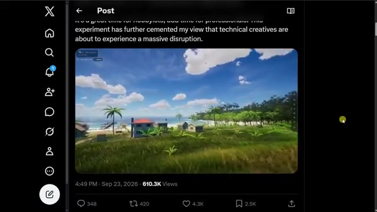
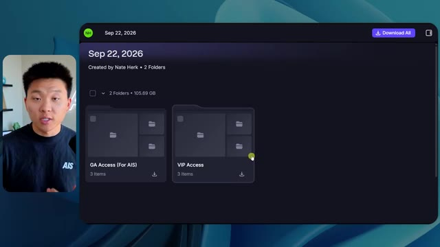
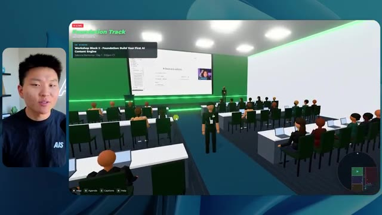
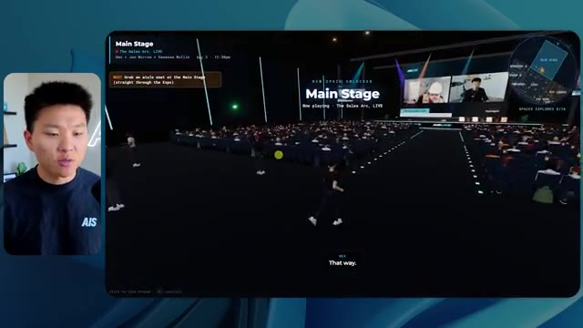

# 🎬 Claude Video Editing Just Became Unrecognizable

> **Chaîne** : [Nate Herk | AI Automation](https://www.youtube.com/@nateherk/featured)  
> **Lien YouTube** : [https://www.youtube.com/watch?v=Aw3BkmhYu4I](https://www.youtube.com/watch?v=Aw3BkmhYu4I)  
> **Date de publication** : 20260423  
> **Durée** : 00:28:12  
> **Identifiant vidéo** : `Aw3BkmhYu4I`  
> **Transcription & Analyse** : `whisper-v3-large-turbo+gemini-3.5-flash-lite`  

---

## 📌 Synthèse Exécutive & Outils

### 💡 Résumé

Dans cette vidéo publiée sur la chaîne *Nate Herk | AI Automation*, l'analyste explore en profondeur les performances du modèle **Opus 5.5** d'Anthropic en le soumettant à un test grandeur nature via **Claude Code**, en faisant varier le paramètre crucial du niveau d'effort (*Effort Level*). Le défi technique imposé au modèle consiste à transformer un dossier Frame.io brut de 105 gigaoctets (contenant les enregistrements vidéo de l'événement virtuel *AIS Live*) en un monde 3D interactif et explorable à la troisième personne, simulant une conférence technologique physique avec ses salles, pistes et scènes. 

À travers les différents paliers testés (du niveau « bas » au niveau « moyen », menant vers les paliers supérieurs), les démonstrations mettent en lumière l'impact direct du niveau d'effort sur la qualité architecturale, la gestion de la physique, le respect de l'identité visuelle de la marque et l'intégration dynamique des flux vidéo. Le niveau bas, bien que fonctionnel après 16 minutes d'exécution, souffre d'approximations graphiques, d'une absence de personnalisation de la marque et d'artefacts visuels majeurs. En revanche, le niveau moyen franchit un cap spectaculaire en générant une interface aux couleurs de la marque, des PNJ dotés de comportements interactifs basiques, ainsi que des flux vidéo réels fonctionnels dans les différentes salles d'ateliers, le tout pour un coût API calculé de 12,44 $ et une durée d'exécution d'un peu plus d'une heure.

Cette expérimentation démontre la puissance des agents IA autonomes modernes capables de concevoir des environnements virtuels complexes à partir de données non structurées massives. Elle souligne également l'importance stratégique d'ajuster le niveau d'effort des modèles d'IA pour trouver le juste équilibre entre la complexité du rendu, le coût d'inférence, le temps de calcul et le niveau d'autonomie requis pour mener à bien des projets d'ingénierie logicielle d'envergure.

### 🛠️ Outils, Modèles & Logiciels Présentés

* **Claude Code** : Environnement de développement et agent de codage avancé permettant d'exécuter des instructions complexes directement depuis le terminal ou l'éditeur.
* **Opus 5.5** : Modèle d'IA de pointe d'Anthropic, réputé pour sa haute intelligence, son coût abordable et ses capacités de raisonnement exceptionnelles, soumis ici à différents niveaux d'effort.
* **Effort Level** (Niveaux d'effort) : Paramètre de configuration des modèles d'IA (faible, moyen, élevé, extra, max, code ultra) permettant de calibrer la profondeur de traitement et la rigueur de l'agent.
* **Frame.io** : Plateforme de collaboration et de stockage cloud utilisée pour héberger les 105 gigaoctets de ressources vidéo de l'événement *AIS Live*.
* **Hostinger Connector** : Extension gratuite pour éditeurs de code permettant d'intégrer directement un compte d'hébergement web pour déployer rapidement des applications locales.
* **VS Code / Cursor** : Éditeurs de code sources populaires utilisés comme environnements de travail pour le développement assisté par IA.

### 🔑 Points Clés & Enseignements Stratégiques

* **Impact direct du niveau d'effort sur la qualité** : Les tests comparatifs démontrent qu'augmenter le niveau d'effort d'Opus 5.5 améliore drastiquement la fidélité visuelle, la cohérence spatiale et l'intégration des directives de marque de l'entreprise.
* **Gestion des coûts et des temps de calcul** : Le passage du niveau d'effort faible (16 minutes, 3,91 $, 191k jetons) au niveau moyen (1 heure 13 minutes, 12,44 $, 490k jetons) illustre le compromis inhérent entre la granularité du travail fourni par l'agent et les ressources d'inférence consommées.
* **Autonomie totale des agents** : Dans tous les cas de figure testés, l'agent a exécuté l'intégralité du prompt d'objectif global en posant zéro question à l'utilisateur, démontrant une excellente capacité d'interprétation des spécifications vagues ou créatives.
* **Validation par l'automatisation visuelle** : L'utilisation de boucles de vérification autonomes (22 à 23 exécutions de navigateurs par l'agent pour inspecter son propre travail) permet au modèle d'ajuster sa production en temps réel.
* **Transformation de données brutes en expériences immersives** : L'IA est capable d'analyser un volume massif de 105 Go de vidéos hétérogènes et de structurer logiquement ces ressources dans un espace 3D thématique (hall d'accueil, salon VIP, scènes principales, pistes spécialisées).
* **Intégration multimédia dynamique** : Les niveaux d'effort supérieurs parviennent à remplacer les simples images statiques par de véritables flux vidéo fonctionnels, simulant l'activité en direct des ateliers et des conférences.
* **Respect des chartes graphiques** : Alors que le niveau bas génère un design générique et non personnalisé, le niveau moyen intègre avec succès les palettes de couleurs et l'identité visuelle de la marque *AIS Live*.
* **Interactivité et comportements simulés** : Les agents dotés d'un niveau d'effort suffisant introduisent des éléments de vie dans l'environnement virtuel (PNJ interactifs, cartes de navigation synchronisées en direct, affichage dynamique des agendas).
* **Le fossé du déploiement** : La génération d'un produit logiciel fonctionnel par l'IA crée un besoin immédiat de solutions de mise en ligne rapide, comblé par des outils de type connecteur d'hébergement web intégré à l'éditeur.
* **Recommandation méthodologique officielle** : Suivant les recommandations d'Anthropic, il est stratégiquement conseillé de débuter les prompts complexes avec un niveau d'effort moyen, puis d'ajuster le curseur à la hausse ou à la baisse en fonction des résultats obtenus et des exigences du projet.

---

## ⏱️ Chronologie & Transcription Complète Audio & Visuelle (Mot pour Mot)

### ⏱️ `[00:00:00 - 00:00:20]` | Segment #01

**🔊 Audio (Transcription Intégrale Mot pour Mot en Français) :**
> Opus 5.5, Opus 5.5, Opus 5.5, Opus 5.5, Opus 5.5. Ce modèle est littéralement partout et pour de très bonnes raisons. Il est intelligent, il est bon marché, il a un goût extraordinaire, c'est un modèle d'IA incroyable. Mais avec chaque modèle d'IA, vous avez le choix de l'effort, que ce soit faible, moyen, élevé, extra, max ou code ultra.

**👁️ Analyse Visuelle d'Écran (gemini-3.5-flash-lite) :**
**Interface & Outils** : Interface du réseau social X (Twitter).

**Contenu textuel & Code** : Un tweet avec un aperçu vidéo de paysage tropical et du texte en anglais sur l'impact de l'IA.

**Action / Démonstration** : Affichage d'un exemple de contenu généré par IA pour illustrer le propos sur l'impact des nouveaux modèles.

*⏱️ 00:00:05 — Capture d'écran d'un post sur le réseau social X montrant une vidéo de paysage tropical généré par IA et un texte commentant les perturbations pour les créateurs.*

---

### ⏱️ `[00:00:20 - 00:00:38]` | Segment #02

**🔊 Audio (Transcription Intégrale Mot pour Mot en Français) :**
> Donc, dans cette vidéo, j'ai donné exactement le même prompt à Opus 5.5 et je l'ai exécuté sur chaque niveau d'effort, et nous allons comparer les résultats. Nous examinerons la qualité de tous les différents résultats réels, mais nous examinerons également combien de temps chacun d'eux a pris pour s'exécuter, combien cela nous a coûté si c'était facturé par l'API, le total des jetons, combien de vérifications ils ont effectuées, et combien de questions ils m'ont réellement posées tout au long du processus.

**👁️ Analyse Visuelle d'Écran (gemini-3.5-flash-lite) :**
**Interface & Outils** : Application web de tableau de bord / canevas (titre : Opus 5.5 Efforts).

**Contenu textuel & Code** : Tableau comparatif affichant les niveaux d'effort en colonnes et les métriques de performance en lignes.

**Action / Démonstration** : Présentation du tableau comparatif des différents niveaux d'effort d'Opus 5.5.

*⏱️ 00:00:29 — Tableau de comparaison des performances d'Opus 5.5 selon les niveaux d'effort (Low, Medium, High, Extra, Max, Ultracode) avec des métriques floutées (Run time, API cost, Total tokens, Checks, Questions asked).*

---

### ⏱️ `[00:00:39 - 00:00:58]` | Segment #03

**🔊 Audio (Transcription Intégrale Mot pour Mot en Français) :**
> Et les résultats que nous avons obtenus ne sont pas du tout ce à quoi je m'attends, donc j'ai hâte de partager ça avec vous les gars. Ne perdons pas de temps et allons directement à celui-ci. D'accord, alors plongeons directement dans celui-ci. Je veux commencer juste en vous montrant le prompt réel que nous avons utilisé que nous avons donné à chacun de ces différents agents. Je vais aller dans les fichiers ici, et nous allons ouvrir ce fichier markdown de prompt, et je vais vous montrer ce que nous avons obtenu. Donc voici le slash objectif que j'ai alimenté.

**👁️ Analyse Visuelle d'Écran (gemini-3.5-flash-lite) :**
**Interface & Outils** : Interface de l'application de développement IA / agent (Opus 5.5 / Ultracode) avec panneau de navigation à gauche et zone de chat/prompt à droite.

**Contenu textuel & Code** : Un message de l'IA adressé à Nate : "Hi Nate. This worktree has the effort-test task queued in PROMPT.md : build a walkable third-person 3D world..." avec options de configuration en bas (Opus 5.5, Ultracode).

**Action / Démonstration** : Le présentateur montre l'interface de l'outil de développement IA et le prompt initial configuré pour la tâche.

*⏱️ 00:00:48 — Interface d'une application d'assistant IA (probablement Opus 5.5 ou similaire) affichant un prompt textuel demandant de construire un monde 3D en vue à la troisième personne basé sur des enregistrements.*

---

### ⏱️ `[00:00:58 - 00:01:34]` | Segment #04

**🔊 Audio (Transcription Intégrale Mot pour Mot en Français) :**
> J'ai dit, tu dois me créer un monde en 3D qui est une conférence tech réaliste dans laquelle je peux me promener en vue à la troisième personne. Tu vas regarder ce dossier, qui contient mes ressources d'enregistrement d'événements d'AIS Live. Et ce dossier est un dossier Frame.io de 105 gigaoctets d'enregistrements vidéo. C'était un événement entièrement virtuel. Tout a été enregistré et tous les enregistrements sont juste ici. J'ai dit, ton objectif est de prendre cet événement et de le transformer en un monde explorable en 3D qui me donne l'impression d'être réellement allé à une vraie conférence en personne avec différentes salles, différentes pistes, différentes scènes, bla, bla, bla. N'hésite pas à utiliser key.ai si tu as besoin de générer des images ou des vidéos. Et tu peux aussi utiliser tout ce qui se trouve dans mon projet Herc 2, qui est comme mon système d'exploitation IA. J'ai dit,

**👁️ Analyse Visuelle d'Écran (gemini-3.5-flash-lite) :**
**Interface & Outils** : VS Code et Frame.io

**Contenu textuel & Code** : Fichier Markdown PROMPT.md contenant le prompt demandant de créer un monde 3D de conférence tech basé sur les enregistrements AIS Live.

**Action / Démonstration** : Présentation du prompt de configuration et des fichiers sources sur Frame.io.

*⏱️ 00:01:07 — Éditeur de code affichant le fichier PROMPT.md avec les instructions pour créer le monde 3D.*

*⏱️ 00:01:16 — Interface Frame.io montrant un dossier de 105,69 Go contenant les ressources d'enregistrement d'événements.*

*⏱️ 00:01:25 — Éditeur de code affichant à nouveau le fichier PROMPT.md avec les instructions détaillées du projet.*

---

### ⏱️ `[00:01:34 - 00:02:08]` | Segment #05

**🔊 Audio (Transcription Intégrale Mot pour Mot en Français) :**
> vous serez jugé sur la créativité, le design, la physique et la sensation générale lorsque j'explorerai le monde 3D que vous avez construit. Et c'était fondamentalement la fin des instructions. Donc comme vous pouvez le voir sur ce côté gauche, j'ai exécuté cela à travers tous les différents niveaux d'effort. Commençons par le niveau bas et remontons jusqu'au code ultra. Très bien. Donc ici nous avons le résultat du niveau bas. Ouvrons ceci et jetons un coup d'œil. Nous avons donc AIS live, le sommet des services IA en personne enfin, et nous avons pu cliquer partout. Tout d'abord, cela ne fait pas très personnalisé. Genre, ce n'ego... ce n'est pas le logo d'IS Live. Ce n'est même pas nos couleurs. Donc je n'aime pas trop ça, mais entrons ici. D'accord. C'est beaucoup trop lumineux. Euh, nous avons une carte en haut à droite, nous avons une ville par ici, je ne peux pas dire quelle ville c'est

**👁️ Analyse Visuelle d'Écran (gemini-3.5-flash-lite) :**
**Interface & Outils** : Application web / Interface d'agent IA (type Claude / environnement de développement)

**Contenu textuel & Code** : "Hi Nate. This worktree has the effort-test task queued in PROMPT.md : build a walkable third-person 3D world of the AIS Live conference from your fjio recordings..." et saisie utilisateur "yes, start the task in PROMPT.md"

**Action / Démonstration** : Sélection et navigation à travers les différents niveaux de test dans le panneau latéral gauche de l'interface.

*⏱️ 00:01:42 — Capture d'écran montrant l'interface d'une application d'agent IA avec un volet latéral listant différents niveaux de test (Hello, Extra, High, Max, Ultracode, Medium, Low) et un panneau de discussion principal affichant le prompt initial pour construire un monde 3D.*

---

### ⏱️ `[00:02:08 - 00:02:40]` | Segment #06

**🔊 Audio (Transcription Intégrale Mot pour Mot en Français) :**
> C'est. D'accord. C'est Chicago, ce qui est plutôt cool parce que vous savez, j'habite à Chicago, mais bref, en haut à droite, nous pouvons voir une carte. Nous avons un hall d'accueil. Nous avons un hall d'exposition. Nous avons un salon VIP sur la scène principale. La carte montre également où se trouve chaque autre personne et cela se synchronise en direct. Nous pouvons donc voir l'enregistrement. Nous pouvons voir le premier jour, la keynote de l'hyper agent, le débriefing en direct. Cool. Donc ça connaît réellement l'ordre du jour et puis il y a le deuxième jour. Donc il a trouvé ça, c'est bien. Nous avons ces petites boules ici que je peux espérer botter. D'accord. Le visage, oh, regardez ça. Si je vais par ici, toutes les personnes disparaissent tout simplement. Très mauvais. Très mauvais. D'accord. Voyons voir. Est-ce que je peux sprinter ? D'accord.

**👁️ Analyse Visuelle d'Écran (gemini-3.5-flash-lite) :**
**Interface & Outils** : Application ou plateforme virtuelle 3D avec mini-carte de navigation.

**Contenu textuel & Code** : Menus d'événements virtuels et indications de zones (Badge pickup, Lobby, Expo Hall).
[DESC_IMAGE_3] Navigation et exploration d'un espace virtuel 3D interactif.

**Action / Démonstration** : Explications face caméra et démonstration conceptuelle.

*⏱️ 00:02:16 — Vue d'un espace virtuel en 3D avec un avatar et une mini-carte en haut à droite indiquant l'emplacement.*

*⏱️ 00:02:24 — Vue du lobby d'un événement virtuel 3D avec un panneau affichant le programme du premier jour.*

*⏱️ 00:02:32 — Vue de l'hall d'exposition (Expo Hall) d'un espace virtuel interactif 3D avec des avatars et des animations lumineuses.*

---

### ⏱️ `[00:02:40 - 00:03:04]` | Segment #07

**🔊 Audio (Transcription Intégrale Mot pour Mot en Français) :**
> Je peux avancer un peu plus vite. Je vais d'abord aller par ici. Il y a des produits promotionnels, euh, certifiés AIS plus glido. D'accord. Donc il y a les vrais stands qu'on avait dans l'événement virtuel. On avait des stands. Donc c'est plutôt cool. Un petit endroit pour prendre des photos. Salle C. En ce moment, nous avons Tangy Frederick qui anime un atelier. D'accord. Mais ce n'est pas une vidéo. Comme vous pouvez le voir, c'est juste une image. Elle ne bouge pas. Donc c'est juste une image. Ces gens sont en train de disparaître. Ce doivent être des fantômes. Allons par ici dans la salle A.

**👁️ Analyse Visuelle d'Écran (gemini-3.5-flash-lite) :**
**Interface & Outils** : Environnement virtuel 3D (style métavers / jeu vidéo) avec mini-carte et indications textuelles.

**Contenu textuel & Code** : Instructions affichées sur écran virtuel : "Step 1: Go To 'Settings'", "Step 2: Go To 'API Integrations'", "Step 3: Go To 'Create A New Token'".

**Action / Démonstration** : Exploration d'un salon virtuel 3D interactif et découverte des stands de sponsors et salles d'ateliers.

---

### ⏱️ `[00:03:04 - 00:03:30]` | Segment #08

**🔊 Audio (Transcription Intégrale Mot pour Mot en Français) :**
> Nous avons Liberty White. D'accord. Très cool. Vos 30 premiers jours en automatisation. Encore une fois, c'est juste une image fixe et les gens ont des bugs d'affichage. Donc ce n'est pas très bien ici. Je vais aller sur la scène principale et voir ce que nous avons. D'accord, cool. Donc nous avons une scène d'apparence principale. Les gens ont de gros bugs d'affichage. Vraiment mauvais. Ce n'est vraiment pas bon du tout. Notre vidéo est en train de bouger. Genre, j'ai vu mon visage ici et j'ai vu celui de Devin, mais maintenant ils ont disparu. Donc je ne sais pas ce qui s'est passé. D'accord. On dirait que c'est plutôt un diaporama. Rien n'est encore vraiment lu. Quoi qu'il en soit, entrons ici.

**👁️ Analyse Visuelle d'Écran (gemini-3.5-flash-lite) :**
**Interface & Outils** : Environnement virtuel 3D / Metavers de conférence (type Gather.town ou similaire).

**Contenu textuel & Code** : Écrans virtuels affichant le titre de l'atelier "Hyperagent Workshop: How to Build an Always-On Fleet of Agents".

**Action / Démonstration** : Exploration et navigation d'un avatar dans l'espace virtuel de la conférence.

---

### ⏱️ `[00:03:30 - 00:03:58]` | Segment #09

**🔊 Audio (Transcription Intégrale Mot pour Mot en Français) :**
> Nous avons d'autres stands. Nous avons hyper agent. Nous avons Claude Code. Nous avons plus de goodies. La salle B, c'est Dave Ebelor. Je suppose que c'est exactement la même chose. Nous avons du café. Et ensuite, je suppose que le salon VIP, accès VIP seulement. C'est plutôt cool, mais il ne se passe vraiment rien ici. Cet écran est bien trop lumineux. Bon. Donc je pense que vous comprenez l'ambiance qu'on obtient ici de la part d'Opus 5.5 en effort faible. Et c'est là que les choses deviennent intéressantes. À combien est-ce que vous pensez que cela a tourné ? Combien de temps ? Celui-ci a tourné pendant 16 minutes et 43 secondes. Combien est-ce que vous pensez que cela a coûté ?

**👁️ Analyse Visuelle d'Écran (gemini-3.5-flash-lite) :**
**Interface & Outils** : Application de tableau blanc / canevas (Opus 5.5 Efforts)

**Contenu textuel & Code** : Tableau avec des colonnes de niveaux d'effort (Low à Ultracode) et des lignes de métriques (Run time, API cost, Total tokens, Checks, Questions asked).

**Action / Démonstration** : Présentation du tableau comparatif des différents niveaux d'effort de l'outil.

*⏱️ 00:03:51 — Tableau comparatif dans une application de canevas (intitulé Opus 5.5 Efforts) avec les niveaux Low, Medium, High, Extra, Max et Ultracode.*

---

### ⏱️ `[00:03:58 - 00:04:26]` | Segment #10

**🔊 Audio (Transcription Intégrale Mot pour Mot en Français) :**
> 3,91 dollars si c'était une facturation par API. J'utilise évidemment mon abonnement ici, mais nous allons simplement calculer cela en facturation API. Le nombre total de jetons était de 191 000. Il a effectué 22 vérifications. Donc la vérification, 22 fois il a ouvert le navigateur et a exécuté différentes sortes de vérifications. Donc 22 catégories de vérifications. Et combien de questions m'a-t-il posées ? Il m'a posé un total de zéro question tout au long de cette invite de commande d'objectif global. D'accord. Alors, ouvrons l'effort moyen et voyons ce que nous avons. D'accord, c'est parti. Effort moyen. Nous avons Nate Herc. Nous avons mon badge. C'est marqué AI's life.

**👁️ Analyse Visuelle d'Écran (gemini-3.5-flash-lite) :**
**Interface & Outils** : Outil de tableau blanc ou de diagramme (ex. Excalidraw)

**Contenu textuel & Code** : Tableau comparatif avec les lignes Run time (16m 43s), API cost ($3.91), Total tokens (191.3K), Checks et Questions asked, sous des colonnes Low, Medium, High, Ex.

**Action / Démonstration** : Le présentateur explique et commente les coûts d'API et les statistiques de jetons affichés dans le tableau.

*⏱️ 00:04:05 — Capture d'écran montrant le présentateur à gauche et un tableau de données sur fond sombre à droite avec des métriques telles que Run time, API cost ($3.91), Total tokens (191.3K), et Checks.*

---

### ⏱️ `[00:04:26 - 00:04:46]` | Segment #11

**🔊 Audio (Transcription Intégrale Mot pour Mot en Français) :**
> Donc ça a déjà l'air un tout petit peu mieux. Ça ressemble à nos palettes de couleurs qui utilisaient nos directives de marque. Premier jour, construction, deuxième jour, gain, VIP. Cool. D'accord. Je vais entrer dans le lieu. D'accord. Waouh. Donc une ambiance un peu similaire. C'est en arrière-plan. Ça ne ressemble pas à Chicago pourtant, n'est-ce pas ? Non, ça ressemble à un, honnêtement, ça ressemble à une ville inventée. Quoi qu'il en soit, c'est drôle qu'ils aient décidé de faire ça. Voyons si je peux me déplacer un peu plus vite. Oh, waouh.

**👁️ Analyse Visuelle d'Écran (gemini-3.5-flash-lite) :**
**Interface & Outils** : Navigateur web affichant l'application virtuelle 3D 'AIS Live' avec le présentateur incrusté en vidéo.

**Contenu textuel & Code** : Écran de bienvenue avec le badge de l'événement, les contrôles clavier (WASD, Shift, Espace, etc.), puis l'environnement virtuel 3D avec avatars.

**Action / Démonstration** : Le présentateur interagit avec l'interface de connexion puis entre dans le lieu virtuel 3D en cliquant sur le bouton de démarrage.

*⏱️ 00:04:31 — Interface web de l'application 'AIS Live' montrant un badge nominatif virtuel pour 'Nate Herk' avec des options de navigation et un bouton 'ENTER THE VENUE'.*

*⏱️ 00:04:41 — Vue à l'intérieur du monde virtuel 3D de l'application 'AIS Live' montrant des avatars de personnages dans un espace de type lounge avec vue sur une ville la nuit.*

---

### ⏱️ `[00:04:46 - 00:05:21]` | Segment #12

**🔊 Audio (Transcription Intégrale Mot pour Mot en Français) :**
> Les gens interagissent avec moi. Regardez. Si je m'approche de ce type, il vient de lever le bras. Bon, maintenant il ne veut plus du tout avoir affaire à moi. Mais tous ces petits robots ici doivent prendre des décisions. Je ne sais pas s'ils utilisent Jev. C'est certain que non. Je ne lui ai pas dit de le faire. En fait, ma clé Jev est à l'arrière. Je ne sais pas. Peut-être qu'il l'a utilisée. Quoi qu'il en soit, on peut voir ici que nous avons la salle d'atelier C, le laboratoire des agents. Sympa. Donc celui-ci est en fait en cours d'exécution. Vous pouvez voir qu'il s'agit d'une vraie vidéo lue par Tangy. Tout le monde ici est en train de travailler sur un ordinateur portable. Ils ne buguent pas. C'est plutôt cool. De plus, mon badge est sur ma poitrine, ce qui est plutôt cool. Je peux venir par ici. Nous avons une carte en haut à droite, comme vous pouvez le voir, mais je peux venir par ici. Nous avons un

**👁️ Analyse Visuelle d'Écran (gemini-3.5-flash-lite) :**
**Interface & Outils** : Environnement virtuel 3D de type métavers / plateforme de visioconférence immersive.

**Contenu textuel & Code** : Avatars 3D de personnages, interface de navigation, mini-carte en haut à droite, encart d'information "Enterprise AI Services".

**Action / Démonstration** : Navigation et exploration d'un monde virtuel 3D interactif peuplé d'avatars.

---

### ⏱️ `[00:05:21 - 00:05:47]` | Segment #13

**🔊 Audio (Transcription Intégrale Mot pour Mot en Français) :**
> hall d'exposition. C'est là que nous avons le stand Glido. Et ça diffuse en ce moment. Oui, ça diffuse la vidéo de nous en train de parler de Glido. Ça diffuse la vidéo d'Ed et moi parlant de notre programme de certification. Nous avons le logo AIS Plus ici à l'arrière, qui est un peu mal placé. Ce sont les diapositives des conférenciers et les points clés. Donc, wow, ce sont toutes les ressources que nous avons distribuées après l'événement. Elles sont toutes là aussi. Nous pouvons voir que nous avons un coup de projecteur sur la communauté. Donc c'est Aiden qui parle de l'accord qu'il a décroché et c'est diffusé en direct. Ces gens regardent.

**👁️ Analyse Visuelle d'Écran (gemini-3.5-flash-lite) :**
**Interface & Outils** : Application de monde virtuel 3D / plateforme de métavers pour salon professionnel.

**Contenu textuel & Code** : Panneaux textuels, diapositives de conférence et affichages du programme AIS+ Certified.

**Action / Démonstration** : Navigation et exploration d'un hall d'exposition virtuel par un avatar.

---

### ⏱️ `[00:05:47 - 00:06:21]` | Segment #14

**🔊 Audio (Transcription Intégrale Mot pour Mot en Français) :**
> Ils sont plutôt engagés. On a un hyper agent. C'était, c'est ce que je voulais dire. Si vous avez vu ces gens lever les bras en disant bonjour, c'était plutôt marrant. Regardez, regardez, le voilà qui recommence. Bref. Bon. Où est-ce que je suis maintenant ? Maintenant, je suis dans le hall principal. On a un bar à café. On a un grand logo, qui est le vrai logo. C'est trop lumineux, mais on a le logo. On peut voir si on peut entrer ici dans le parcours fondation. On a Sabrina Romanov et Liberty White. Donc différentes formations juste là. On peut entrer dans cette salle. C'est le parcours avancé. Alors, qu'est-ce qui se passe ici ? On a Dave Ebelar et Saman qui parlent de trucs différents là-dedans. Et maintenant, allons jeter un œil à la scène principale. Oh, attendez, il y a une vidéo de moi là-haut. C'est genre un VIP

**👁️ Analyse Visuelle d'Écran (gemini-3.5-flash-lite) :**
**Interface & Outils** : Application de conférence virtuelle en 3D / métavers

**Contenu textuel & Code** : Environnement virtuel 3D interactif avec avatars, mini-carte et indicateurs de navigation

**Action / Démonstration** : Navigation et exploration d'un hall virtuel 3D avec des avatars d'utilisateurs

*⏱️ 00:05:55 — Vue principale du hall virtuel 3D (Main Lobby) avec des avatars d'utilisateurs et une mini-carte en haut à droite.*

*⏱️ 00:06:04 — Avatars virtuels se déplaçant dans un espace virtuel avec un écran de présentation en arrière-plan.*

*⏱️ 00:06:12 — Vue depuis le hall principal montrant des participants virtuels attablés et en mouvement.*

---

### ⏱️ `[00:06:21 - 00:06:50]` | Segment #15

**🔊 Audio (Transcription Intégrale Mot pour Mot en Français) :**
> section ? Ouais, on ira voir ça dans une minute. Mais bref, voici la scène principale. Ça a l'air vraiment, vraiment très bien. On a une grande scène. On a genre quatre personnes assises ici. On a les trois écrans d'Alex là-haut avec hyper agent. Est-ce que j'ai le droit de monter sur scène ? Oh, et ça me laisse monter sur scène. D'accord. C'est plutôt sympa. Bon les gars, prenons un selfie. Laissez-moi mettre tout le monde en arrière-plan. Venez par ici. Bref, c'est vraiment, vraiment cool. Toutes les places ne sont pas occupées par contre. Donc il faut qu'on travaille là-dessus. Mais bref, je vais retourner en courant pour voir ce qu'était cette section VIP. D'accord. Le salon VIP. J'ai l'impression que c'est comme un aéroport ou un truc du genre.

**👁️ Analyse Visuelle d'Écran (gemini-3.5-flash-lite) :**
**Interface & Outils** : Application web immersive ou environnement virtuel 3D de type métavers pour événements professionnels.

**Contenu textuel & Code** : Interface utilisateur affichant les détails de la session "Hyperagent Keynote" avec le nom d'Alex McDonnell et une mini-carte de navigation.

**Action / Démonstration** : Navigation et exploration de l'espace virtuel de la conférence par le présentateur sous forme d'avatar.

*⏱️ 00:06:28 — Vue depuis le public d'une grande salle de conférence virtuelle avec des écrans de présentation affichant la keynote d'Alex McDonnell sur Hyperagent.*

*⏱️ 00:06:36 — Vue de dos montrant l'avatar s'approchant de la scène principale où sont assises quatre personnes face au public.*

*⏱️ 00:06:43 — Vue en plongée de la salle de conférence virtuelle remplie d'avatars de spectateurs assistant à l'événement en direct.*

---

### ⏱️ `[00:06:51 - 00:07:14]` | Segment #16

**🔊 Audio (Transcription Intégrale Mot pour Mot en Français) :**
> OK, super. Donc maintenant, nous avons les sessions VIP ici. Une FAQ VIP avec Nate, la lecture vidéo en direct juste ici. Très, très cool. Et nous avons comme un bar ou quelque chose comme ça. Génial. Je dirais que c'est un très bon résultat. Maintenant, en ce qui concerne les statistiques ici, celle-ci a pris une heure et 13 minutes à s'exécuter. Cela nous aurait coûté 12 dollars et 44 cents. Elle a utilisé 490 000 jetons et elle a effectué 23 vérifications.

**👁️ Analyse Visuelle d'Écran (gemini-3.5-flash-lite) :**
**Interface & Outils** : Application virtuelle 3D / Interface de tableau de bord de statistiques.

**Contenu textuel & Code** : Vidéo en direct "VIP Q&A with Nate", espace virtuel type salon/bar, et tableau de métriques (Run time: 16m 43s, API cost: $3.91, Total tokens: 191.3K, Checks: 22).

**Action / Démonstration** : Navigation et présentation des résultats de l'application virtuelle et des statistiques d'utilisation.

*⏱️ 00:06:56 — Capture montrant une application virtuelle en 3D représentant un espace VIP avec une vidéo en direct et des avatars.*

*⏱️ 00:07:02 — Capture montrant un tableau de statistiques de performance (temps d'exécution, coût API, jetons totaux, vérifications).*

---

### ⏱️ `[00:07:14 - 00:07:48]` | Segment #17

**🔊 Audio (Transcription Intégrale Mot pour Mot en Français) :**
> Et il nous a posé un total de zéro question une fois de plus. Très bien, passons à élevé. C'était déjà un résultat plutôt correct et Anthropic eux-mêmes dans leur article, ou désolé, pas une vidéo, un article sur comment prompter Opus 5.5. Ils ont dit de commencer simplement par moyen et de l'ajuster à la hausse ou à la baisse si nécessaire. C'était donc un résultat moyen. Passons à élevé et voyons ce que nous avons obtenu. Très rapidement, les gars, je dois prendre une seconde pour vous parler du sponsor de la vidéo d'aujourd'hui, Hostinger. Donc ces deux modèles viennent de me construire une version fonctionnelle de la même chose. Et maintenant je suis exactement là où je finis toujours, avec un produit fini sur mon ordinateur portable et aucun moyen rapide de le mettre en ligne. Et c'est le fossé que le connecteur d'Hostinger comble. C'est une extension gratuite

**👁️ Analyse Visuelle d'Écran (gemini-3.5-flash-lite) :**
**Interface & Outils** : Tableau blanc/application de notes (Image 1) ; IDE ou environnement de développement de type VS Code / Cursor (Image 2).

**Contenu textuel & Code** : Tableau comparatif avec les colonnes Low et Medium remplies (Run time, API cost, Total tokens, Checks, Questions asked) et High/Extra vides (Image 1) ; Prompt de création de "Northwind ROI calculator" et logs d'exécution (Image 2).

**Action / Démonstration** : Présentation comparative des performances d'Opus 5.5 selon les niveaux d'effort (Low, Medium, High).

*⏱️ 00:07:22 — Tableau comparatif montrant les métriques selon différents niveaux d'effort (Low, Medium, High, Extra) pour Opus 5.5, incluant le temps d'exécution, le coût API, les tokens et les questions posées.*

---

### ⏱️ `[00:07:48 - 00:08:23]` | Segment #18

**🔊 Audio (Transcription Intégrale Mot pour Mot en Français) :**
> pour votre éditeur qui intègre votre compte Hostinger dans l'outil où vous êtes déjà en train de coder. Donc VS Code, Cursor, Cloud Code, Codex, et j'en passe. Vous vous connectez une seule fois en un seul clic, et à partir de là, votre agent peut déployer le site, y pointer un domaine, configurer les enregistrements DNS et vérifier votre VPS sans que vous n'ayez jamais à quitter l'éditeur. Donc, peu importe celui de ces outils que vous finirez par préférer, ce qu'il a construit se trouve à quelques minutes d'une vraie URL sur un hébergement géré. Le connecteur est gratuit sur tous les plans d'hébergement, donc si vous avez toujours besoin de l'hébergement sous-jacent, prenez le plan illimité avec le lien dans la description et utilisez le code NATEHERK pour 10 % de réduction. Cela inclut également un domaine gratuit et un e-mail professionnel pour l'année. Et c'est toujours le moyen le moins cher que j'ai trouvé pour obtenir quelque chose

**👁️ Analyse Visuelle d'Écran (gemini-3.5-flash-lite) :**
**Interface & Outils** : Interface de gestion Hostinger liée à l'IDE et fenêtre Claude Code.

**Contenu textuel & Code** : Panneau de configuration "Manage Hostinger from your IDE" avec statut "Connected" et options pour Websites, Domains, Subscriptions & Payments et Email Marketing.

**Action / Démonstration** : Connexion du compte Hostinger à l'éditeur de code pour permettre à l'agent d'accéder aux outils de déploiement et de gestion.

*⏱️ 00:07:57 — Interface montrant l'intégration de Hostinger connectée via OAuth à gauche, et l'interface de Claude Code à droite.*

---

### ⏱️ `[00:08:23 - 00:08:47]` | Segment #19

**🔊 Audio (Transcription Intégrale Mot pour Mot en Français) :**
> vous avez construit sur une vraie URL. Donc revenons à la vidéo. D'accord. Encore une fois, très, très marqué par la marque. C'est un écran de chargement encore meilleur que le précédent. Nous avons ce petit effet sympa en arrière-plan. Nous avons le logo. Nous allons entrer dans le lieu. D'accord. Nous y voilà. Ça a l'air plutôt bien. Nous commençons à l'extérieur et vous pouvez voir que nous avons ces drapeaux pour tous les intervenants, Wyatt, Casper, Alex, Ed, Aiden, Sabrina, Liberty. C'est plutôt cool. Nous avons des blocs en direct ici.

**👁️ Analyse Visuelle d'Écran (gemini-3.5-flash-lite) :**
**Interface & Outils** : Application web interactive en 3D (environnement virtuel de type métavers ou événement en ligne).

**Contenu textuel & Code** : Interface utilisateur affichant 'AIS LIVE', bannières d'événements, instructions de touches (WASD, SHIFT, SPACE, MOUSE, E, P), et nom de la zone 'AIS Live Plaza'.

**Action / Démonstration** : Navigation et entrée dans le lieu virtuel 3D en utilisant les commandes indiquées à l'écran.

*⏱️ 00:08:29 — Écran de chargement et d'accueil de la plateforme virtuelle 'AIS LIVE', affichant le logo, les instructions de contrôles clavier/souris et un bouton pour entrer dans le lieu virtuel.*

*⏱️ 00:08:35 — Vue dans le monde virtuel 3D ('AIS Live Plaza') montrant des avatars de personnages, des bâtiments de ville en arrière-plan et un indicateur de progression en haut à gauche.*

*⏱️ 00:08:41 — Continuation de la navigation dans la place virtuelle 3D avec des bannières de conférenciers affichant des noms comme 'ALEX MCDONNELL' et 'WYATT LYONSMITH'.*

---

### ⏱️ `[00:08:47 - 00:09:23]` | Segment #20

**🔊 Audio (Transcription Intégrale Mot pour Mot en Français) :**
> il a pris cette photo de moi, votre hôte, Nate Herc, John, Dave, Nate Herc. Voilà. D'accord. Les portes. C'est génial. Ce sont des portes coulissantes automatiques en verre. J'adore ça. Nous pouvons voir l'enregistrement VIP. Nous pouvons voir l'admission générale. Nous pouvons venir ici et nous pouvons découvrir l'exposition avec différents stands, le projecteur sur la communauté. Vous pouvez également voir qu'en haut à gauche, j'ai un passeport. Donc c'est du genre, ça va montrer combien d'endroits j'ai visités. Tout cela est une lecture réelle. Nous avons un mur de ressources avec tous les différents conférenciers. Ils ont aussi une session de réseautage par ici. Je vais donc venir très vite voir de quoi il s'agit. Nous avons donc le bar à cold brew AIS. Nous avons différents membres de la communauté qui ont été mis en avant ou mis en lumière.

**👁️ Analyse Visuelle d'Écran (gemini-3.5-flash-lite) :**
**Interface & Outils** : Application ou plateforme virtuelle 3D / Navigateur web de métaverse

**Contenu textuel & Code** : Environnement virtuel 3D interactif avec des stands d'exposition et des zones d'enregistrement (Registration Concourse, VIP Check-in)

**Action / Démonstration** : Navigation et exploration de l'espace virtuel par l'avatar de l'utilisateur

*⏱️ 00:08:56 — Vue d'un monde virtuel interactif montrant un espace de type hall d'exposition avec une zone d'enregistrement et une scène principale.*

*⏱️ 00:09:05 — Navigation dans un hall d'exposition virtuel avec des stands et des avatars interactifs.*

*⏱️ 00:09:14 — Vue à la troisième personne dans un espace virtuel animé avec de multiples avatars se déplaçant.*

---

### ⏱️ `[00:09:23 - 00:09:56]` | Segment #21

**🔊 Audio (Transcription Intégrale Mot pour Mot en Français) :**
> Nous avons l'aile VIP. Attends, quoi ? Prends un bracelet. Oh, je dois vraiment aller chercher le bracelet. D'accord. Laisse-moi m'enregistrer rapidement. Le bracelet est déjà mis. Attends, quoi ? D'accord. Oh, d'accord. Maintenant les portes se sont ouvertes pour moi. Cool. Je peux entrer ici. Oh, ça mène juste à la scène principale. Salon VIP. Il y a une séance de questions-réponses en cours. Ça a l'air très cool. Je veux dire, je suis très impressionné par la façon dont il est capable de faire ça. Waouh. D'accord. Donc c'est vraiment bien. Ce que nous avons fait, c'est que nous avons eu des salles de discussion VIP avec différentes personnes. Tu peux voir qu'il y a différentes salles, différents membres de l'équipe AIS qui participent à des trucs. C'est vraiment cool. C'est très cool. C'est un VIP bien meilleur

**👁️ Analyse Visuelle d'Écran (gemini-3.5-flash-lite) :**
**Interface & Outils** : Application de métavers / plateforme d'événements virtuels en 3D

**Contenu textuel & Code** : Navigation interactive d'un avatar dans un espace virtuel avec interface utilisateur HUD (mini-carte, passeport, commandes)

**Action / Démonstration** : Exploration des différentes zones d'un événement virtuel (hall d'enregistrement, salon VIP, sessions de travail)

*⏱️ 00:09:32 — Vue d'un espace virtuel 3D de type métavers ou événementiel (« Registration Concourse »), montrant un avatar se déplaçant dans un grand hall.*

*⏱️ 00:09:40 — L'avatar se trouve dans un espace VIP (« VIP Lounge ») avec un grand écran affichant des participants en visio et des sous-titres textuels.*

*⏱️ 00:09:48 — L'avatar explore des salles de travail VIP (« VIP Working Sessions ») avec différents ateliers comme « Land Your First Paying Client ».*

---

### ⏱️ `[00:09:56 - 00:10:30]` | Segment #22

**🔊 Audio (Transcription Intégrale Mot pour Mot en Français) :**
> expérience que ce qui a été montré dans la première partie. D'accord. After party VIP. Regardez ça. On a une piste de danse. On a tous ces éléments ici. On a la lecture réelle de l'after party VIP juste ici. Et il y a une estrade pour DJ. C'est tellement marrant. Il y a un petit bug ici, un petit glitch juste là, mais c'est génial. Oh, super. Donc quand je suis ici sur la scène principale, on a des sous-titres. Vous pouvez voir juste ici en bas de mon écran, on a ces sous-titres de Wyatt qui est en train de parler ici. On a des lumières. On a le panneau. Très cool. Belle scène principale. Je vais aller par ici, on peut aller à la fondation,

**👁️ Analyse Visuelle d'Écran (gemini-3.5-flash-lite) :**
**Interface & Outils** : Application ou plateforme virtuelle 3D (environnement virtuel de conférence/événement).

**Contenu textuel & Code** : Interface utilisateur virtuelle affichant les informations de l'événement ("VIP After-Party", "Main Stage"), les participants et les commandes de navigation.
[DESC_IMAGE_3] Navigation et exploration de l'environnement virtuel 3D par l'utilisateur.

**Action / Démonstration** : Explications face caméra et démonstration conceptuelle.

*⏱️ 00:10:04 — Capture d'écran montrant l'espace virtuel de l'after-party VIP avec un sol lumineux coloré et des avatars.*

*⏱️ 00:10:13 — Capture d'écran montrant une vue plus large de la piste de danse virtuelle avec des ballons et des écrans vidéo.*

*⏱️ 00:10:21 — Capture d'écran montrant la scène principale (Main Stage) avec des avatars assis dans une salle de conférence virtuelle.*

---

### ⏱️ `[00:10:30 - 00:11:06]` | Segment #23

**🔊 Audio (Transcription Intégrale Mot pour Mot en Français) :**
> avancé, et les parcours d'entreprise par ici. Alors voyons voir. Nous avons l'anatomie de trois vraies transactions. Nous avons hyper agent. Nous avons les évaluations avec Nate et Ed ici. Nous avons Dave qui intervient dans les trucs avancés. C'est vraiment bien. Je veux dire, évidemment, chacun, chacun de ces résultats jusqu'à présent, bas était correct. Moyen était meilleur. Élevé a été encore meilleur. Voyons si cette tendance se poursuit et allons voir ce que cela nous a coûté. Donc, élevé a fonctionné pendant une heure et sept minutes. Donc un peu plus rapide que moyen, cela nous aurait coûté 16 dollars et 31 cents. Il a utilisé un demi-million de jetons, 509 000. Il a fait 22 vérifications. Et il nous a aussi demandé, enfin, non, je me suis trompé. Ce

**👁️ Analyse Visuelle d'Écran (gemini-3.5-flash-lite) :**
**Interface & Outils** : Tableau blanc numérique / outil de tableau (style Excalidraw ou similaire) affichant des données comparatives

**Contenu textuel & Code** : Tableau avec les colonnes Low, Medium, High, Extra comparant Run time (16m 43s, 1h 13m...), API cost ($3.91, $12.44, $16.31...), Total tokens, Checks et Questions asked.

**Action / Démonstration** : Présentation et analyse des coûts et performances d'exécution des modèles (Opus 5.5 Efforts) selon différents niveaux d'effort.

*⏱️ 00:10:57 — Tableau comparatif montrant les métriques de performance et de coûts (Run time, API cost, Total tokens, Checks, Questions asked) pour différents niveaux (Low, Medium, High, Extra)*

---

### ⏱️ `[00:11:06 - 00:11:25]` | Segment #24

**🔊 Audio (Transcription Intégrale Mot pour Mot en Français) :**
> l'un m'a posé une question et, divulgâcheur, c'était le seul qui nous a posé une question tout au long de tout cela. Voyons voir, il nous en reste trois : extra, max et ultra code. Laissez-moi ouvrir extra et nous verrons ce que nous avons. D'accord. Donc celui-ci a l'air plutôt bien. Je dirais honnêtement que jusqu'à présent, l'écran de chargement haut était le meilleur. Celui que nous venons de voir, mais de toute façon, entrons dans le direct d'AIS.

**👁️ Analyse Visuelle d'Écran (gemini-3.5-flash-lite) :**
**Interface & Outils** : Application de tableau blanc ou de prise de notes numérique avec affichage d'un tableau comparatif et incrustation vidéo du présentateur à gauche.

**Contenu textuel & Code** : Tableau de métriques comparatives incluant 'Low' (16m 43s, $3.91, 191.3K, 22 checks, 0 questions), 'Medium' (1h 13m, $12.44, 419.2K, 23 checks, 0 questions) et 'High' (1h 7m, $16.31, 509.3K, 22 checks, 1 question).

**Action / Démonstration** : Le présentateur commente les résultats du tableau et s'apprête à ouvrir la section 'Extra'.

*⏱️ 00:11:11 — Capture d'écran montrant un tableau comparatif avec les colonnes Low, Medium, High et Extra, évaluant le temps d'exécution (Run time), le coût API (API cost), le nombre de tokens (Total tokens), les vérifications (Checks) et les questions posées (Questions asked).*

---

### ⏱️ `[00:11:26 - 00:11:51]` | Segment #25

**🔊 Audio (Transcription Intégrale Mot pour Mot en Français) :**
> Whoa. D'accord. Donc on a comme de petits extraits sonores. Je peux discuter avec des gens. Le panneau sur la guerre des outils a réglé quelques débats pour moi. Sympa. Bonne perspective là-bas. On est dehors à nouveau. On a ces différentes bannières, bien qu'elles soient toutes les mêmes. Elles n'affichent pas de noms de personnes différents. Donc grand logo AIS Live. L'aile des ateliers est par ici. Et passons par les portes coulissantes en verre pour voir ce qu'on a. Donc on a le café AIS. La carte est en bas à droite, et elle n'est pas très descriptive.

**👁️ Analyse Visuelle d'Écran (gemini-3.5-flash-lite) :**
**Interface & Outils** : Environnement virtuel 3D de type métavers/plateforme d'événement en ligne.

**Contenu textuel & Code** : Environnement graphique 3D, bannières textuelles "AIS LIVE", mini-carte de navigation.

**Action / Démonstration** : Navigation et déplacement d'un avatar dans un espace virtuel d'exposition.

---

### ⏱️ `[00:11:51 - 00:12:26]` | Segment #26

**🔊 Audio (Transcription Intégrale Mot pour Mot en Français) :**
> J'aime bien comment les autres cartes nous ont indiqué quoi, genre où étaient les choses, mais celle-ci a l'air très professionnelle. On peut voir ici c'est la scène principale. Allons y faire un saut rapidement. Ils ont tous ces ballons qui volent partout, ce qui je trouve est plutôt marrant. Les ballons de plage AIS. On me voit là-haut en train de parler. Je crois que j'introduisais l'un des jours. Continuons à avancer par ici vers la salle d'atelier sur ce côté gauche. D'accord. Donc ici nous avons le Hyper Agent Theater. Nous avons cette session sponsorisée ici par Hyper Agent, mais cela nous montre aussi ce qui va s'y passer. C'est vraiment marrant qu'on puisse discuter avec les gens. Salmon a construit un représentant commercial vocal en direct. La salle du Juste Prix était comble. As-tu pris le guide d'accompagnement VIP ? C'est trop marrant. Nous avons le parcours avancé en

**👁️ Analyse Visuelle d'Écran (gemini-3.5-flash-lite) :**
**Interface & Outils** : Espace événementiel virtuel 3D (type métavers professionnel).

**Contenu textuel & Code** : Interface utilisateur HUD avec mini-carte, boutons d'interaction (Chat), et légendes contextuelles ("Enterprise AI Services", "Workshops").

**Action / Démonstration** : Exploration et navigation au sein d'un salon professionnel virtuel modélisé pour des événements en direct.

*⏱️ 00:12:00 — Vue à la première personne dans un environnement virtuel 3D représentant une "Main Stage" avec un écran diffusant le présentateur, des sièges et des ballons flottants.*

*⏱️ 00:12:09 — Navigation dans le "Grand Lobby" de l'espace virtuel, montrant des accès aux zones "Workshops" et "Enterprise AI Services".*

*⏱️ 00:12:17 — Vue de couloir dans l'espace virtuel avec des avatars interagissant et des bulles de texte au-dessus d'eux.*

---

### ⏱️ `[00:12:26 - 00:12:58]` | Segment #27

**🔊 Audio (Transcription Intégrale Mot pour Mot en Français) :**
> ici. Encore une fois, nous avons la lecture en direct. Est-ce que c'est la lecture en direct ? Oh, d'accord. Ça a commencé une fois que je suis entré, mais je peux prendre place. Oh la la. Je peux regarder ça. Je peux me lever. Je veux m'asseoir au premier rang. C'est plutôt cool. C'est très bien. J'aime bien. Et vous savez ce que j'ai remarqué jusqu'à présent ? Le personnage que j'incarne me ressemble un peu. Je pense qu'il a été modélisé à partir de mes photos de profil ou quelque chose comme ça. Quoi qu'il en soir, nous avons Sabrina ici, l'animatrice de la salle ici, prenez n'importe quel siège libre. D'accord, cool. Et j'ai vraiment aimé la fonctionnalité pour s'assoir. C'est assez marrant. Genre, nous pourrions réellement assister à cet atelier et participer. Bref, ça nous montre les intervenants. Ça nous montre les

**👁️ Analyse Visuelle d'Écran (gemini-3.5-flash-lite) :**
**Interface & Outils** : Environnement de métavers de conférence (type Gather.town ou similaire), interface web de plateforme de workshop.

**Contenu textuel & Code** : Titres des workshops ("Advanced Build a Voice AI Sales Bot" et "Foundations: Build Your First AI Content Engine"), interfaces utilisateur web avec chats et caméras.

**Action / Démonstration** : Navigation et interaction dans un espace de travail virtuel permettant de visualiser des présentations en direct.

*⏱️ 00:12:34 — Vue d'une salle de conférence virtuelle dans une application de métavers, affichant une présentation sur un grand écran.*

*⏱️ 00:12:42 — La salle de conférence virtuelle montre une interface différente sur l'écran principal, indiquant une session de formation différente.*

*⏱️ 00:12:50 — Gros plan sur l'écran principal dans le métavers montrant une interface web complexe avec des flux vidéo de participants et des éléments de discussion.*

---

### ⏱️ `[00:12:58 - 00:13:31]` | Segment #28

**🔊 Audio (Transcription Intégrale Mot pour Mot en Français) :**
> programme. Il y a un petit tapis rouge ici pour prendre des photos. On peut prendre la pose. Oh, waouh. C'est plutôt cool. Bibliothèque de ressources, devenir certifié AIS Plus, Glido, Hyper Agent, AIS Plus, trois vraies affaires. Génial. Je veux dire, je dirais vraiment que jusqu'à présent, chacune est meilleure. Et on n'a même pas encore regardé la section VIP, le salon VIP. Allons par ici très vite. J'espère que je pourrai entrer. Sympa. On a la réinitialisation des outils. Ce sont les différentes salles dans lesquelles nous pourrions aller. Donc encore une fois, je pourrais prendre la feuille d'exercices et je pourrais essayer de comprendre comment tarifer mes trucs. C'est tellement cool. C'est vraiment mieux que le précédent où on a juste en quelque sorte

**👁️ Analyse Visuelle d'Écran (gemini-3.5-flash-lite) :**
**Interface & Outils** : Plateforme d'événement virtuel 3D de type métavers.

**Contenu textuel & Code** : Panneaux textuels avec questions business : "What's your gut floor number?", "If you doubled your rate, what would change?", et directive "Read the 'Price It Right' worksheet".

**Action / Démonstration** : Navigation de l'utilisateur dans l'environnement 3D pour explorer les stands, les espaces de conférence et participer à des ateliers.

*⏱️ 00:13:07 — Vue d'ensemble d'un hall d'exposition virtuel avec des stands sponsorisés (AIS+, Hyperagent, Gialdo).*

*⏱️ 00:13:15 — Hall d'entrée virtuel d'un événement avec escaliers, zone de réception et panneaux indiquant "Workshops".*

*⏱️ 00:13:23 — Espace "VIP Lounge" virtuel montrant des avatars autour d'une table avec un panneau de questions affiché.*

---

### ⏱️ `[00:13:31 - 00:13:59]` | Segment #29

**🔊 Audio (Transcription Intégrale Mot pour Mot en Français) :**
> on a regardé des trucs. Génial. Je peux aller derrière le bar et venir ici. C'est très bien. Bon. Alors, en ce qui concerne les statistiques, celle-ci a tourné pendant une heure et demie. Elle a coûté 25,92 dollars. Je ne sais pas pourquoi je dis point 25, 92 cents. Il y a eu 733 000 jetons et 34 vérifications. C'est donc de loin le plus grand nombre de vérifications jusqu'à présent, et elle ne nous a posé aucune question. J'ai hâte de voir ce qu'on a obtenu ici de la part de max et ultra code. Bon. Voici les écrans de chargement de max, c'est ennuyeux, mais c'est fidèle à la marque et il y a notre logo.

**👁️ Analyse Visuelle d'Écran (gemini-3.5-flash-lite) :**
**Interface & Outils** : Application de tableau blanc / outil de mindmapping et de schématisation (type Excalidraw ou similaire).

**Contenu textuel & Code** : Tableau avec des colonnes "Medium", "High", "Extra", "Max", "Ultracode" affichant des durées (ex: 1h 31m pour Extra), des coûts ($12.44, $16.31) et des métriques de jetons (419.2K, 509.3K).

**Action / Démonstration** : Le présentateur présente et commente les différentes statistiques de performance et de coût affichées à l'écran.

*⏱️ 00:13:38 — Un tableau comparatif montrant les statistiques de différentes options de configuration (Medium, High, Extra, Max, Ultracode) incluant le temps, le coût et le nombre de jetons.*

---

### ⏱️ `[00:14:00 - 00:14:35]` | Segment #30

**🔊 Audio (Transcription Intégrale Mot pour Mot en Français) :**
> Donc c'était bien. J'aime bien. On va continuer et entrer dans AIS live. Ooh, jolie petite animation ici qui nous fait entrer. Encore une fois, le personnage me ressemble. Ils m'ont tous ressemblé. Je veux dire, en quelque sorte, nous sommes assis en arrière-plan. Ça ressemble à Chicago. Comme je l'mentionné plus tôt, beaucoup de ceux-ci jouent des sons et je n'inclus pas cela parce que ce serait très distrayant pour vous d'essayer d'écouter ce qui se passe en même temps que moi je parle. Il y a donc comme une légère musique dans tout ça. Je déteste la façon dont il marche. Cette marche est vraiment, vraiment mauvaise. Je veux dire, la marche, ouais, je n'aime pas du tout ça. Donc ce n'est pas génial. Mais à part ça, entrons et explorons. Remarquez ces ombres quand je rentre, elles changent vraiment, je ne sais pas trop pourquoi,

**👁️ Analyse Visuelle d'Écran (gemini-3.5-flash-lite) :**
**Interface & Outils** : Navigateur web / Application interactive 3D (Metavers ou plateforme événementielle virtuelle).

**Contenu textuel & Code** : Environnement virtuel 3D avec des éléments d'interface utilisateur, des bannières et des avatars animés.

**Action / Démonstration** : Navigation et exploration de l'espace virtuel 3D présenté à l'écran.

---

### ⏱️ `[00:14:35 - 00:15:11]` | Segment #31

**🔊 Audio (Transcription Intégrale Mot pour Mot en Français) :**
> Mais de toute façon, on peut discuter avec des gens ici aussi. Le stand Hyperagent est juste là où on entre dans l'expo. Tout va bien. OK, super. Je peux continuer à cliquer sur E pour faire changer ce qu'ils disent. On a les conférenciers juste ici. Ça a l'air plutôt bien. Même si on avait vraiment la photo de profil de tout le monde. Du coup, je ne sais pas trop pourquoi ce n'est pas inclus là. On voit des gens prendre des photos juste ici. J'adore ça. Et ça enregistre une petite photo. OK. La carte aussi n'est pas super, du coup ne donne pas vraiment une bonne explication de ce qui se passe, mais j'aime bien ces stands. Ils sont cool. Je pense que ces stands sont les meilleurs que j'ai vu jusqu'à présent. Genre, ils ont juste une belle apparence. Ils ont des représentants. Il y a de superbes diapositives derrière eux. Ouais. Ces stands sont cool. OK. On a un petit théâtre en vedette.

**👁️ Analyse Visuelle d'Écran (gemini-3.5-flash-lite) :**
**Interface & Outils** : Application web 3D interactive (métavers virtuel pour événement en ligne).

**Contenu textuel & Code** : Navigation interactive avec des commandes affichées en bas de l'écran (WASD, commandes clavier) et panneaux d'information contextuels.

**Action / Démonstration** : Exploration d'un salon virtuel en 3D et interaction avec les différents stands et avatars présents.

*⏱️ 00:14:44 — Vue d'un espace virtuel 3D de type métavers avec des avatars et des panneaux de présentation de conférenciers.*

*⏱️ 00:14:53 — Navigation dans le hall virtuel avec des avatars regroupés autour de tables hautes et des notifications contextuelles.*

*⏱️ 00:15:02 — Entrée dans la zone d'exposition (Expo Hall) du salon virtuel montrant différents stands (Evals Lab, Enterprise AI).*

---

### ⏱️ `[00:15:11 - 00:15:35]` | Segment #32

**🔊 Audio (Transcription Intégrale Mot pour Mot en Français) :**
> qui se passe par ici. C'est Casper. Bien que, pourquoi est-ce que ça ne se lit pas ? J'ai l'impression que ça devrait se lire, non ? Comme dans les autres, ils étaient toujours en train de jouer. On peut parler à d'autres personnes par ici. Le café est gratuit. Blabla. Amy Simpson, Matt Wolf. Sympa. D'accord. C'est juste la zone de networking où nous sommes en ce moment, mais on peut voir en haut à droite. On peut aussi voir ce qui est en direct sur la scène principale en ce moment. C'est un panel de guerre des outils. Alors allons par ici. On a Devin, Cole, Dave et Russ qui discutent ici. On a en quelque sorte de l'audiovisuel, des petits trucs de lumière qui se passent ici à l'arrière.

**👁️ Analyse Visuelle d'Écran (gemini-3.5-flash-lite) :**
**Interface & Outils** : Application de métavers / espace virtuel 3D de conférence.

**Contenu textuel & Code** : Aucun code source, terminal ou prompt n'est affiché.

**Action / Démonstration** : Navigation et exploration de l'environnement virtuel 3D par le présentateur.

---

### ⏱️ `[00:15:36 - 00:15:55]` | Segment #33

**🔊 Audio (Transcription Intégrale Mot pour Mot en Français) :**
> Basculons la scène principale vers ce qui compte vraiment en ce moment. Je peux donc changer de sujet. C'est cool. Je viens donc de basculer sur moi et Matt. Nous pouvons passer à l'anatomie de trois vraies transactions. C'est plutôt cool. La scène a l'air bien. Nous avons un petit panneau sympa ici. Je peux monter sur la scène ? Sympa. Sympa. Bon, je ne peux pas aller trop loin, en fait. Très bien tout le monde, laissez-moi prendre le selfie. Tout le monde, venez là-dedans. Je peux aussi m'asseoir dans ce public là-bas et simplement profiter de la session.

**👁️ Analyse Visuelle d'Écran (gemini-3.5-flash-lite) :**
**Interface & Outils** : Application de métavers ou de conférence virtuelle 3D (AIS LIVE).

**Contenu textuel & Code** : Interface graphique d'un événement virtuel montrant des avatars 3D, une scène principale et des panneaux informatifs.

**Action / Démonstration** : Navigation et déplacement d'un avatar dans l'espace virtuel de conférence.

---

### ⏱️ `[00:15:55 - 00:16:14]` | Segment #34

**🔊 Audio (Transcription Intégrale Mot pour Mot en Français) :**
> Très cool, très cool. OK, allons par ici. Je vois une section à l'étage. C'est marrant comme ils choisissent tous de mettre la section VIP à l'étage. Je veux dire, je ne déteste pas ça. Oh la la, ils ont un escalator. Pas possible. Je vais discuter avec ce type sur l'escalator. Glenn a 15 ans d'expérience en agence. Ses trucs de "land and expand" étaient en or. Du bon boulot, Glenn. Cool, donc je vais, je n'arrive même pas à passer devant ce type par contre.

**👁️ Analyse Visuelle d'Écran (gemini-3.5-flash-lite) :**
**Interface & Outils** : Application web de monde virtuel 3D / événement virtuel en ligne.

**Contenu textuel & Code** : Interface utilisateur avec mini-carte, commandes de déplacement (WASD) et indication 'VIP Level'.

**Action / Démonstration** : Navigation de l'avatar dans l'espace virtuel vers l'étage VIP.

*⏱️ 00:16:00 — Vue d'un espace virtuel 3D de réception avec des avatars et de grandes baies vitrées.*

*⏱️ 00:16:04 — L'avatar s'approche d'un escalator menant à la section 'VIP Level'.*

*⏱️ 00:16:09 — L'avatar monte sur l'escalator avec une bulle de dialogue affichant les informations sur Glenn.*

---

### ⏱️ `[00:16:14 - 00:16:48]` | Segment #35

**🔊 Audio (Transcription Intégrale Mot pour Mot en Français) :**
> Oh, j'ai dû sauter par-dessus lui. D'accord, niveau VIP, badge requis. Oh mon Dieu. Tu te moques de moi ? Je dois aller chercher mon badge. D'accord, cool. Maintenant, ça montre que je suis un vrai VIP et je peux aller ici dans la section VIP. Nous avons de petites sessions de travail sympas là-bas, auxquelles nous pouvons nous joindre. Je me demande si ça va me laisser m'asseoir ici. Je peux juste discuter. Puis-je participer ? Ça ne me laisse pas m'asseoir et participer. C'est pas grave. Nous avons la "War Room" sur les prix. Oh, ça pourrait être l'after-party. Allons voir ce qui se passe par ici. Ou peut-être que je dois juste entrer par ici. D'accord. C'est bizarre. Je devais juste entrer par ici. Cette after-party n'est pas aussi cool que l'autre. Mais bref, allons voir ce qui se passe par ici.

**👁️ Analyse Visuelle d'Écran (gemini-3.5-flash-lite) :**
**Interface & Outils** : Environnement virtuel 3D de type métaverse / plateforme d'événements virtuels en ligne.

**Contenu textuel & Code** : Interface utilisateur virtuelle affichant le profil de Nate Herk, le niveau VIP, des bulles de discussion textuelles et un mini-carte de navigation.

**Action / Démonstration** : Navigation et exploration de l'espace virtuel par l'avatar, interaction avec des zones VIP et des sessions de travail.

---

### ⏱️ `[00:16:48 - 00:17:07]` | Segment #36

**🔊 Audio (Transcription Intégrale Mot pour Mot en Français) :**
> dans les ateliers. D'accord. Ce n'était pas bien. Regardez ça. On peut tout voir et je viens de bugger et maintenant boum. Donc ce n'est pas bon. Je dirais qu'globalement, je veux dire, vous captez l'ambiance de comment ça fonctionne, mais je dirais que celui d'avant, qui était, je crois, élevé, je préférais celui-là. Je ne peux pas m'asseoir dans ces chaises non plus. Ouais. Donc je n'aime pas la marche dans celui-ci.

**👁️ Analyse Visuelle d'Écran (gemini-3.5-flash-lite) :**
**Interface & Outils** : Environnement virtuel 3D de type métavers / plateforme de conférence en ligne

**Contenu textuel & Code** : Interface utilisateur virtuelle affichant le nom des salles, des panneaux d'agenda et des options d'interaction ("Chat with this attendee").

**Action / Démonstration** : Navigation et déplacement d'un avatar à travers les espaces virtuels de la conférence d'automatisation.

*⏱️ 00:16:53 — Vue d'un avatar virtuel explorant un couloir de conférence 3D ("Workshop Wing") avec le présentateur en incrustation.*

*⏱️ 00:16:57 — L'avatar s'approche de l'entrée de la "Room C" dans l'environnement virtuel 3D.*

*⏱️ 00:17:02 — L'avatar entre dans la salle de conférence virtuelle (HyperAgent Lab) où des participants virtuels interagissent.*

---

### ⏱️ `[00:17:07 - 00:17:43]` | Segment #37

**🔊 Audio (Transcription Intégrale Mot pour Mot en Français) :**
> J'aime moins l'ambiance et il y a quelques bugs. Donc, jusqu'à présent, si on veut aller sur notre liste, j'aime... extra c'était celui que j'ai le plus aimé jusqu'à présent. Mais bref, celui-ci c'était max. Celui-ci c'était max juste ici. Voyons donc combien de temps ça a tourné : deux heures et 28 minutes. Donc ça a tourné pendant longtemps, 50 dollars et 38 cents, 1,18 million de tokens. Donc il a en fait atteint une compaction et a dû s'auto-compacter. Et ensuite il a fait 51 vérifications. Est-ce qu'il l'a vraiment fait pourtant ? Parce qu'il y avait beaucoup de bugs là-dedans. Et bref, celui-ci nous a posé zéro question. Donc, jusqu'à présent, chaque fois c'est pratiquement devenu plus cher et ça a pris plus de temps, à part juste ici. Mais ceux-là, en gros...

**👁️ Analyse Visuelle d'Écran (gemini-3.5-flash-lite) :**
**Interface & Outils** : Application web / Tableau de bord analytique.

**Contenu textuel & Code** : Tableau avec les colonnes Medium, High, Extra, Max, Ultracode et des lignes de données (temps de 1h13m à 1h31m, coûts de 12.44$ à 25.92$, tokens et autres métriques).

**Action / Démonstration** : Le présentateur commente et analyse les résultats affichés dans le tableau comparatif des différents niveaux de performance.

*⏱️ 00:17:16 — Tableau comparatif affichant les résultats de différents niveaux d'effort (Medium, High, Extra, Max, Ultracode) avec des métriques de temps, de coût et de performance.*

---

### ⏱️ `[00:17:43 - 00:18:17]` | Segment #38

**🔊 Audio (Transcription Intégrale Mot pour Mot en Français) :**
> Ça a pris un temps très similaire, mais à chaque fois ça a utilisé plus de tokens parce qu'ils ont réfléchi davantage. Et puis, vous savez, ces tokens vont coûter plus cher. Mais bref, passons au dernier, qui est ultra code. On espère donc vraiment que celui-ci sera le meilleur. Alors allons sur ce localhost et voyons ce qu'on a. D'accord, cool. Regardez ce badge. C'est un joli badge d'hôte accès total. On a un joli petit visuel juste ici. On va continuer et entrer dans AIS Live. Cool. D'accord. Bienvenue, Nate. J'aime la façon de marcher. Ça semble réaliste. J'aime le logo, même s'il manque le petit point rouge qui fait que ça ressemble à du direct. La carte en haut à droite

**👁️ Analyse Visuelle d'Écran (gemini-3.5-flash-lite) :**
**Interface & Outils** : Tableau de données interactif et interface graphique 3D type application web/jeu.

**Contenu textuel & Code** : Données comparatives de performances d'IA (temps d'exécution, prix, nombre de tokens) et scène 3D d'accueil « AIS LIVE ».

**Action / Démonstration** : Présentation des résultats de performance des différents modes et démonstration visuelle de l'application 3D « AIS LIVE ».

*⏱️ 00:17:52 — Tableau comparatif affichant les métriques (temps, coût, tokens) pour les modes High, Extra, Max et Ultracode.*

*⏱️ 00:18:09 — Vue en 3D d'un environnement virtuel ou d'un jeu (« AIS LIVE ») avec des avatars et des bannières d'accueil.*

---

### ⏱️ `[00:18:17 - 00:18:49]` | Segment #39

**🔊 Audio (Transcription Intégrale Mot pour Mot en Français) :**
> est étiqueté un tout petit peu mieux, donc je peux voir ce qui se passe. Je vais venir ici et récupérer mon bracelet VIP très rapidement. D'accord, sympa. Ça me dit aussi ce que je dois faire. Donc en haut à gauche, il est écrit de scanner au portail VIP sur le mur est du hall. Je crois donc que l'est serait par ici, n'est-ce pas ? Les gaufres mouillées ne me réussissent jamais. Ouais. Ailes VIP, scanner le bracelet. D'accord, cool. Maintenant, je suis dans la section VIP. Je peux voir ces différentes pièces. La réinitialisation des outils. La vidéo en direct est diffusée. Je peux voir les sous-titres juste là de ce dont on est en train de parler. Ça diffuse aussi les sons, mais je ne diffuse tout simplement pas l'audio pour vous les gars parce que je ne veux pas saturer.

**👁️ Analyse Visuelle d'Écran (gemini-3.5-flash-lite) :**
**Interface & Outils** : Environnement de conférence virtuelle 3D (type métavers).

**Contenu textuel & Code** : Texte contextuel à l'écran : "Registration & Lobby", "VIP Wing", "VIP Room 5 - Tooling Reset / Solo to Real Business", et directives de navigation ("Scan in at the VIP gate", "Grab an extra seat").

**Action / Démonstration** : Navigation de l'avatar au sein d'un espace virtuel, passage de zones (hall vers aile VIP) et arrivée dans une salle de réunion thématique.

*⏱️ 00:18:25 — Vue à la première personne dans un environnement virtuel de type salon professionnel, montrant l'avatar du présentateur au centre d'un hall d'accueil avec des objectifs de mission affichés en haut à gauche.*

*⏱️ 00:18:33 — L'avatar du présentateur franchit une porte marquée "VIP Wing" après avoir débloqué un nouvel espace virtuel, avec des instructions de navigation mises à jour à l'écran.*

*⏱️ 00:18:41 — L'avatar du présentateur entre dans une salle de conférence virtuelle intitulée "VIP Room 5 - Tooling Reset", où des avatars sont assis autour d'une table ronde pour une session de travail.*

---

### ⏱️ `[00:18:50 - 00:19:08]` | Segment #40

**🔊 Audio (Transcription Intégrale Mot pour Mot en Français) :**
> Encore une fois, celui-ci fonctionne avec Cody et Mustafa là-dedans. C'est génial. Vidéo en direct. La vidéo ne se lance pas tant qu'on n'entre pas, cela dit. Donc honnêtement, je pense que c'est une bonne décision. Dès que j'entre, en revanche, la vidéo démarre. Sympa. Une touche sympa. Toutes ces salles. Génial. Ouais. Je veux dire, ça fait très premium. Voici une salle de stratégie tarifaire. Entrons ici. Moi et John là-dedans.

**👁️ Analyse Visuelle d'Écran (gemini-3.5-flash-lite) :**
**Interface & Outils** : Environnement virtuel 3D interactif (plateforme de conférence ou de networking en ligne).

**Contenu textuel & Code** : Interface utilisateur avec mini-carte en haut à droite, noms des zones ("VIP Wing"), instructions contextuelles ("Grab an aisle seat at the Main Stage") et flux vidéo en direct affiché sur un écran virtuel.

**Action / Démonstration** : Navigation de l'avatar de l'utilisateur dans le couloir virtuel vers une salle de réunion où une session vidéo est en cours de lecture.

*⏱️ 00:18:54 — Une vue à la première personne dans un environnement virtuel 3D de type métavers ou salle de conférence numérique, où l'utilisateur s'approche d'une "VIP Wing" affichant une vidéo en direct à l'intérieur d'une salle.*

---

### ⏱️ `[00:19:08 - 00:19:42]` | Segment #41

**🔊 Audio (Transcription Intégrale Mot pour Mot en Français) :**
> Et puis nous avons, sympa, l'after-party. Cette after-party n'est pas encore très animée. Et on a encore des ballons de plage pour une raison quelconque, mais cette after-party est cool. Je veux dire, ça donne une bonne ambiance et il y a la retransmission juste ici de notre session de questions-réponses de l'after-party, tout ça est aussi en direct. Super. D'accord. Dirigeons-nous vers la scène principale. Ça m'incite aussi à prendre un siège côté couloir pour la scène principale, qui se trouve tout droit en traversant l'expo. Donc en fait, traversons d'abord l'expo. Qu'est-ce que vous construisez ? Il y a plein de gens qui parlent de différentes choses par ici. Waouh. Il y a aussi comme un petit, un truc de basket. Est-ce que je peux le lancer ? Je peux. Est-ce que je dois regarder en l'air pour le lancer vers le haut ? D'accord.

**👁️ Analyse Visuelle d'Écran (gemini-3.5-flash-lite) :**
**Interface & Outils** : Environnement de conférence virtuelle 3D (plateforme métavers type Gather ou similaire).

**Contenu textuel & Code** : Textes informatifs intégrés à l'interface 3D ("VIP Lounge & After-Party", "Expo Hall", "What you building?").

**Action / Démonstration** : Navigation et exploration de l'espace 3D par l'avatar du présentateur.

---

### ⏱️ `[00:19:42 - 00:20:08]` | Segment #42

**🔊 Audio (Transcription Intégrale Mot pour Mot en Français) :**
> Eh bien, pas terrible. Mais bref, nous avons un stand AIS plus. Nous avons le stand Glido. Est-ce que ça diffuse en direct ? Oui, ça diffuse définitivement en direct. Sympa. Nous avons le stand de l'hyper agent. Nous avons d'autres trucs par ici. OK, super. Je vais aller sur la scène principale et voir si on peut choper un siège côté allée. Dès qu'on entre, tout se met à jouer. On a une très bonne ambiance de scène. Comment je fais pour choper un siège côté allée par contre ? Voilà. Il a fallu que je trouve le bon. Choper le siège côté allée. Il n'y a personne sur la scène, ce qui est bizarre. J'aimais bien quand il y avait du monde sur la scène dans les versions précédentes.

**👁️ Analyse Visuelle d'Écran (gemini-3.5-flash-lite) :**
**Interface & Outils** : Application web interactive de salon virtuel ou métavers (AIS Live / Expo Hall).

**Contenu textuel & Code** : Interface utilisateur virtuelle affichant des indications textuelles (« Expo Hall », « Main Stage », « Grab a seat ») et des flux vidéo en direct.

**Action / Démonstration** : Navigation et exploration de l'espace virtuel d'exposition avant de se diriger vers la scène principale.

*⏱️ 00:19:48 — Vue d'un espace d'exposition virtuel (Expo Hall) montrant des stands et des avatars avec le présentateur en incrustation à gauche.*

*⏱️ 00:19:55 — Vue de l'entrée de la scène principale (Main Stage) dans l'environnement virtuel avec des écrans de retransmission en direct.*

*⏱️ 00:20:01 — Vue de l'auditorium principal virtuel invitant l'utilisateur à s'asseoir (Grab a seat) pour assister à la session en direct.*

---

### ⏱️ `[00:20:08 - 00:20:31]` | Segment #43

**🔊 Audio (Transcription Intégrale Mot pour Mot en Français) :**
> Prenons un petit selfie. Bref, il y a moi et Pat là-haut. Pat est habillé comme un ouvrier du bâtiment. Comme vous pouvez le voir, nous faisions un petit appel de découverte simulé dans cet exemple. Je vais revenir par l'expo et nous allons sortir ici dans l'aile de l'atelier et juste vérifier si ces rooms sont fondamentalement exactement les mêmes qu'elles devraient l'être. Maintenant, je ne peux plus vraiment discuter avec les gens. Avant, je pouvais le faire dans les versions précédentes, discuter avec les gens, ce que je trouvais être une très jolie attention. Et nous avons atelier un parcours fondation. Est-ce que je peux m'asseoir ?

**👁️ Analyse Visuelle d'Écran (gemini-3.5-flash-lite) :**
**Interface & Outils** : Environnement virtuel 3D de type métavers / plateforme de conférence en ligne.

**Contenu textuel & Code** : Interface de navigation virtuelle avec mini-carte en haut à droite, sous-titres et indications textuelles ("Main Stage", "Expo Hall", "Workshop Wing").

**Action / Démonstration** : Exploration interactive de l'espace virtuel par le présentateur se déplaçant de la scène principale vers l'aile de l'atelier.

*⏱️ 00:20:14 — Vue d'une scène principale virtuelle avec des avatars 3D et un public assis.*

*⏱️ 00:20:20 — Navigation dans une salle d'exposition virtuelle (Expo Hall) montrant des avatars et des stands.*

*⏱️ 00:20:25 — Déplacement dans l'aile de l'atelier (Workshop Wing) montrant des avatars en discussion dans un couloir virtuel.*

---

### ⏱️ `[00:20:32 - 00:21:04]` | Segment #44

**🔊 Audio (Transcription Intégrale Mot pour Mot en Français) :**
> Je ne peux pas m'asseoir. Je ne sais pas. Nous avons Liberty qui parle en ce moment et elle est en train de parler et nous pouvons l'entendre. Donc c'est bien, mais ça ne me laisse pas m'asseoir. Et regardez ça. Je deviens assez instable juste ici. Ça buguait de la façon dont je marchais. Ça ne voulait pour ainsi dire pas me laisser marcher. Ce n'est pas bon. Pareil. Nous avons cette piste avancée là-dedans. Génial. Donc dans l'ensemble, ils ont une ambiance très similaire. Je dirais que je suis impressionné par la façon dont ils ont été capables de raconter une histoire à partir de ce que nous faisaient. Bibliothèque de points clés des intervenants. D'accord. C'est cool. Je ne pense pas que nous ayons vu ça depuis différents endroits, mais ce sont comme les ressources et ça montre des trucs sympas. Oh, waouh. Je

**👁️ Analyse Visuelle d'Écran (gemini-3.5-flash-lite) :**
**Interface & Outils** : Environnement virtuel 3D interactif basé sur le web (semblable à Gather.town ou une plateforme similaire).

**Contenu textuel & Code** : Interfaces de salles virtuelles textuelles ('Workshop A', 'Workshop B', 'Speaker Takeaways Library') et sous-titres de dialogue.
[DESC_IMAGE_3] Exploration d'une grande salle virtuelle 3D avec des avatars se déplaçant.

**Action / Démonstration** : Navigation et déplacement d'un avatar à l'intérieur d'un espace virtuel 3D lors d'une démonstration.

*⏱️ 00:20:40 — Vue d'un monde virtuel 3D interactif dans le navigateur, montrant un avatar se déplaçant dans la salle 'Workshop A - Foundation Track'.*

*⏱️ 00:20:48 — Navigation dans une autre section du monde virtuel 3D, intitulée 'Workshop B - Advanced Track', avec des avatars et des tables de classe.*

*⏱️ 00:20:56 — Exploration d'une grande salle virtuelle nommée 'Speaker Takeaways Library' avec des affiches et des avatars interactifs.*

---

### ⏱️ `[00:21:04 - 00:21:41]` | Segment #45

**🔊 Audio (Transcription Intégrale Mot pour Mot en Français) :**
> peut réellement ouvrir toutes ces choses et nous pouvons prendre des photos ici même également. Sympa. Prendre une photo. Je peux aussi l'enregistrer. Genre, je peux vraiment télécharger ceci. Et maintenant nous avons cette photo que nous venons de prendre à cet événement en direct d'AIS. Très bien. Eh bien, je pense qu'il est temps pour moi de tirer quelques conclusions, mais d'abord voyons ce que cette exécution nous a coûté. Cela a pris une heure et 35 minutes. C'était donc beaucoup plus rapide que max. Cela n'a coûté que 18 dollars et 69 cents. Waouh. C'était donc un peu plus cher que high, moins cher que extra et beaucoup moins cher que max. Cela a également consommé 606 000 jetons et 42 vérifications avec zéro question. Maintenant, une autre chose intéressante à noter est que tout

**👁️ Analyse Visuelle d'Écran (gemini-3.5-flash-lite) :**
**Interface & Outils** : Visionneuse de photos Windows et application de diagramme/tableau blanc.

**Contenu textuel & Code** : Photo de personnages virtuels sur fond "AIS LIVE" et tableau de données comparatives.

**Action / Démonstration** : Visualisation d'une photo enregistrée et manipulation d'un diagramme ou tableau.

*⏱️ 00:21:13 — Visionneuse d'images affichant une photo prise lors d'un événement virtuel "AIS LIVE".*

*⏱️ 00:21:22 — Application de tableau blanc ou de diagramme montrant un tableau comparatif avec des colonnes "Ultracode", "Max", etc.*

---

### ⏱️ `[00:21:41 - 00:22:13]` | Segment #46

**🔊 Audio (Transcription Intégrale Mot pour Mot en Français) :**
> ces exécutions, aucune d'entre elles n'a utilisé de sous-agent. J'ai vérifié et je me suis assuré qu'aucune d'elles n'avait utilisé de sous-agents. Elles ne voulaient déléguer aucun travail, ce qui était intéressant. Donc ces jetons sont ce qui a été reflété à l'intérieur de cette session. Évidemment, comme je l'ai dit, celle-ci a dépassé, vous savez, 950 000, donc, ou peu importe quelle est la fenêtre de compaction. Je ne la laisse généralement jamais monter si haut, mais comme c'était un objectif global et que je n'étais pas impliqué, celle-ci a dû se compacter, mais les autres ont simplement tourné dans cette unique session. Et ce sont les statistiques globales. Et aussi, très rapidement concernant les trucs d'UltraCode, les gars, je ne sais pas si vous avez remarqué cela, mais quand j'ai fait tourner UltraCode ces derniers temps, ça a juste fait bizarre. Ça a semblé un peu buggé. Moi, à quelques reprises, je l'ai fait tourner

**👁️ Analyse Visuelle d'Écran (gemini-3.5-flash-lite) :**
**Interface & Outils** : Application web ou tableau de bord de présentation de données avec un encart vidéo du présentateur en haut à gauche.

**Contenu textuel & Code** : Tableau avec les colonnes : Low, Medium, High, Extra, Max, Ultracode. Lignes : Run time, API cost, Total tokens, Checks, Questions asked.

**Action / Démonstration** : Le présentateur commente les résultats et les métriques d'exécution affichées dans le tableau.

*⏱️ 00:21:49 — Tableau comparatif des performances de différents niveaux d'effort (Low, Medium, High, Extra, Max, Ultracode) avec les temps d'exécution, coûts API, tokens et vérifications.*

---

### ⏱️ `[00:22:13 - 00:22:34]` | Segment #47

**🔊 Audio (Transcription Intégrale Mot pour Mot en Français) :**
> et je me suis dit, est-ce que ça tourne vraiment sous UltraCode ? Ça a fait pas mal de vérifications de plus que ces autres-là, mais pour une raison quelconque, ça ne me semblait pas correct, car essentiellement, ce qu'est UltraCode, c'est un effort supplémentaire, et ensuite, c'est juste comme utiliser des flux de travail plus dynamiques afin de faire les choses. Et donc, à force de fouiller dans les journaux de session et même quand je regardais ce truc se construire dans UltraCode, ça ne lançait aucun de ces flux de travail dynamiques et j'ai essayé plusieurs fois.

**👁️ Analyse Visuelle d'Écran (gemini-3.5-flash-lite) :**
**Interface & Outils** : Tableau de bord de type interface web ou outil d'analyse (intitulé "Opus 5.5 Efforts").

**Contenu textuel & Code** : Tableau de données comparatives : Run time (16m 43s à 2h 28m), API cost ($3.91 à $50.38), Total tokens (191.3K à 1.18M), Checks (22 à 51), et Ultracode.

**Action / Démonstration** : Analyse comparative des différents niveaux d'effort et du mode Ultracode en fonction du temps d'exécution, du coût et du nombre de vérifications.

*⏱️ 00:22:18 — Un tableau comparatif montrant les performances de différents niveaux d'effort (Low, Medium, High, Extra, Max, Ultracode) avec des métriques telles que le temps d'exécution (Run time), le coût de l'API (API cost), le nombre total de jetons (Total tokens), les vérifications (Checks) et les questions posées (Questions asked), tandis que le présentateur apparaît en médaillon à gauche.*

---

### ⏱️ `[00:22:35 - 00:23:00]` | Segment #48

**🔊 Audio (Transcription Intégrale Mot pour Mot en Français) :**
> Donc je ne sais pas si c'est un bug en ce moment dans le harnais de CloudCode ou si c'est juste avec Opus 5.5, c'est un petit peu pire avec UltraCode en ce moment ou quelque chose comme ça, mais de toute façon, ce sont les niveaux d'effort globaux réels et tout cela semble tout à fait logique quand on examine un peu la façon dont ils progressent. Jetez donc un œil à ceci. Coût maximum par rapport au minimum, nous avons eu 12,9 fois plus sur l'exécution la moins chère par rapport à l'exécution la plus chère, ce qui, je crois, était de 3,98 $ à 50,38 $.

**👁️ Analyse Visuelle d'Écran (gemini-3.5-flash-lite) :**
**Interface & Outils** : Application web ou tableau de bord avec une vidéo du présentateur incrustée à gauche.

**Contenu textuel & Code** : Tableau de données de performance des modèles d'IA : Run time, API cost, Total tokens, Checks, Questions asked.

**Action / Démonstration** : Présentation et analyse des résultats de performance selon le niveau d'effort configuré.

*⏱️ 00:22:41 — Un tableau comparatif montrant les différents niveaux d'effort (Low, Medium, High, Extra, Max, Ultracode) avec leurs temps d'exécution, coûts API, tokens totaux, vérifications et questions posées.*

---

### ⏱️ `[00:23:01 - 00:23:19]` | Segment #49

**🔊 Audio (Transcription Intégrale Mot pour Mot en Français) :**
> Donc c'était minimum et maximum. En ce qui concerne les vérifications maximum par rapport au minimum, nous avons eu un multiple de 2,3. Le total pour les six était de 127 dollars et ultra code était de 18,69 dollars. Regardons la vitesse par rapport au coût ici. Laissez-moi donc dézoomer un peu pour que nous puissions voir tout cela. Sur l'axe des X, nous avons le temps d'exécution. Sur l'axe des Y, nous avons le coût.

**👁️ Analyse Visuelle d'Écran (gemini-3.5-flash-lite) :**
**Interface & Outils** : Interface web de tableau de bord d'analyse ou de rapport de tests d'effort

**Contenu textuel & Code** : Texte descriptif des sessions de test ('Six sessions ran the same prompt at different effort settings...') et blocs de métriques chiffrées (12.9x Max cost vs Low, 2.3x Max checks vs Low, $18.69 Ultracode cost, $127.65 Total across all six).

**Action / Démonstration** : Le présentateur commente et analyse les résultats chiffrés des tests d'effort affichés sur le tableau de bord à l'écran.

*⏱️ 00:23:05 — Capture d'écran montrant le présentateur à gauche et une interface de tableau de bord d'analyse de test (intitulée 'Opus Effort Test') affichant des métriques financières et de performance, notamment un multiple de coût de 12.9x, un multiple de vérifications de 2.3x, un coût d'Ultracode de 18.69$ et un total de 127.65$.*

---

### ⏱️ `[00:23:19 - 00:23:42]` | Segment #50

**🔊 Audio (Transcription Intégrale Mot pour Mot en Français) :**
> Donc j'ai l'impression que le mieux serait en bas à gauche, mais pas vraiment. Donc de toute façon, vous pouvez voir que low était bon marché et rapide. Max était lent et cher. Mais ce genre de graphique a généralement du sens. Plus vous y mettez d'efforts, plus ça va coûter cher et plus ça va prendre un peu plus de temps. C'est logique. Voyons maintenant la croissance par rapport à low. Nous avons donc le temps d'exécution en bleu, les coûts de l'API en orange, les jetons en vert, et les vérifications en or jaunâtre, moutarde.

**👁️ Analyse Visuelle d'Écran (gemini-3.5-flash-lite) :**
**Interface & Outils** : Interface web de test d'effort 'Opus Effort Test' avec graphique interactif.

**Contenu textuel & Code** : Graphique à nuage de points comparant le temps d'exécution (en abscisse) et le coût en API (en ordonnée) pour différents modes d'effort d'IA.

**Action / Démonstration** : Le curseur survole le point 'Low' sur le graphique pour afficher les détails de la session d'exécution.

*⏱️ 00:23:25 — Un graphique comparatif intitulé 'Speed vs cost' (vitesse par rapport au coût) affichant les performances de différents niveaux d'effort (Low, Medium, High, Extra, Ultracode, Max). Une infobulle indique les détails pour 'Low' (16m 43s - $3.91 - 191.3K tokens - 22 checks). Le présentateur apparaît dans une incrustation vidéo à gauche.*

---

### ⏱️ `[00:23:42 - 00:24:01]` | Segment #51

**🔊 Audio (Transcription Intégrale Mot pour Mot en Français) :**
> Et d'ailleurs, la raison pour laquelle UltraCode apparaît comme ça, c'est parce qu'il utilise réellement un niveau d'effort supplémentaire. Il est simplement incité et il utilise plutôt des flux de travail dynamiques et des choses comme ça, ce qui fait que, vous savez, c'est logique parce qu'en gros, il utilisait un supplément sous le capot. C'est aussi pour cela que Claude l'a étiqueté ici en orange. Quoi qu'il en soit, si nous continuons un peu plus bas, c'est généralement logique, n'est-ce pas ?

**👁️ Analyse Visuelle d'Écran (gemini-3.5-flash-lite) :**
**Interface & Outils** : Interface web de test d'effort ("Opus Effort Test") avec un graphique linéaire sombre.

**Contenu textuel & Code** : Graphique avec axes Low, Medium, High, Extra, Max et Ultracode, comparant Run time, API cost, Tokens et Checks.

**Action / Démonstration** : Le présentateur commente le graphique et les performances selon les niveaux d'effort.

*⏱️ 00:23:47 — Un graphique montrant la croissance relative de différents paramètres (Run time, API cost, Tokens, Checks) en fonction du niveau d'effort, avec le présentateur en médaillon à gauche.*

---

### ⏱️ `[00:24:02 - 00:24:21]` | Segment #52

**🔊 Audio (Transcription Intégrale Mot pour Mot en Français) :**
> À mesure que le niveau d'effort augmente, encore une fois, ces mesures vont augmenter. Le temps d'exécution, les coûts d'API, les jetons et les vérifications. C'est la même chose ici avec le temps d'exécution. Cela nous donne simplement des graphiques linéaires individuels pour chacune de ces différentes mesures, comme le coût d'API, les vérifications, le total des jetons, le coût par vérification, et tous les chiffres au même endroit. Des données plutôt cool donc.

**👁️ Analyse Visuelle d'Écran (gemini-3.5-flash-lite) :**
**Interface & Outils** : Interface web de test d'effort (Opus Effort Test).

**Contenu textuel & Code** : Graphique avec des courbes pour "API cost" (12.9x), "Run time" (8.9x), "Tokens" (6.2x) et "Checks" (2.3x) selon les niveaux Low, Medium, High, Extra, Max et Ultracode.

**Action / Démonstration** : Le présentateur commente l'augmentation des métriques par rapport au niveau d'effort.

*⏱️ 00:24:06 — Un graphique linéaire affichant la croissance relative des coûts d'API, du temps d'exécution, des jetons et des vérifications en fonction du niveau d'effort, avec le présentateur visible à gauche.*

---

### ⏱️ `[00:24:21 - 00:24:40]` | Segment #53

**🔊 Audio (Transcription Intégrale Mot pour Mot en Français) :**
> Je dirais que rien ici n'est trop choquant. Ce qui a été le plus choquant pour moi, ce sont ces résultats. Mes deux principaux concurrents étaient high, qui est celui-ci, et extra, qui est celui-ci. Je dois donc retourner ici et me souvenir de ce que j'en pensais. J'ai vraiment aimé cette sensation. Celui-ci donne aussi l'impression d'être le plus fluide. La physique était agréable. La porte coulissante en verre était agréable. Je n'ai vraiment pas remarqué beaucoup de bugs dans celui-ci, ce qui est ce que j'ai vraiment aimé.

**👁️ Analyse Visuelle d'Écran (gemini-3.5-flash-lite) :**
**Interface & Outils** : Application web interactive en 3D (metaverse / espace virtuel événementiel).

**Contenu textuel & Code** : Interface utilisateur d'un monde virtuel avec bannières, avatars et mini-carte.

**Action / Démonstration** : Exploration et navigation dans l'espace virtuel 3D de l'événement.

*⏱️ 00:24:26 — Écran d'accueil de l'application virtuelle "AIS LIVE" avec les instructions de contrôle et le bouton d'entrée.*

*⏱️ 00:24:31 — Vue de la place virtuelle 3D "AIS Live Plaza" montrant des avatars et les commandes de navigation.*

*⏱️ 00:24:35 — Navigation de l'avatar dans la place virtuelle 3D en train d'explorer l'environnement de l'événement.*

---

### ⏱️ `[00:24:40 - 00:25:13]` | Segment #54

**🔊 Audio (Transcription Intégrale Mot pour Mot en Français) :**
> Je ne me rappelle pas si celui-ci était un de ceux où, oh, je ne pouvais pas parler aux gens par contre. Je pouvais juste traverser tout droit à travers eux. Je ne pouvais pas m'asseoir dans celui-ci non plus. Voici un autre petit truc visuel où je fais essentiellement juste traverser tout droit ce mur. Donc je n'aime pas trop ça. Mais je pense, est-ce que c'était celui où je pouvais m'asseoir dans ces sessions ? Non. D'accord. Donc je ne pense pas que c'était mon gagnant alors. Celui-ci est super haut. Je pense que c'est le gagnant. Ouais. Je pense que c'était celui que j'aimais le plus. J'ai adoré toute cette ambiance. J'ai adoré que je pouvais discuter avec les gens. C'était vraiment celui où nous pouvions venir ici et nous pouvions nous asseoir où nous voulions, prendre un siège, nous lever. Je pouvais lire ces trois offres et je pouvais discuter avec eux. J'ai aussi réalisé qu'il y avait de petites sections pour simuler des appels de découverte ici aussi.

**👁️ Analyse Visuelle d'Écran (gemini-3.5-flash-lite) :**
**Interface & Outils** : Interface web de la plateforme virtuelle 'AIS LIVE' et environnement 3D interactif.

**Contenu textuel & Code** : Écran d'accueil de l'événement virtuel avec commandes de navigation (WASD, Shift, Space, etc.) et affichage de la scène principale.

**Action / Démonstration** : Navigation dans l'environnement virtuel 3D et exploration des différentes zones de la plateforme par l'avatar.

*⏱️ 00:24:48 — Vue dans l'espace virtuel 3D montrant l'avatar traversant des personnages de type NPC lors de la session 'Anatomy of Three Real Deals'.*

*⏱️ 00:24:57 — Écran d'accueil de la plateforme 'AIS LIVE' avec le titre 'Real Projects, Real Revenue' et le bouton 'ENTER AIS LIVE'.*

*⏱️ 00:25:05 — Vue en perspective dans l'espace virtuel 3D montrant l'avatar naviguant vers la zone 'Main Stage' avec un grand écran de diffusion.*

---

### ⏱️ `[00:25:13 - 00:25:51]` | Segment #55

**🔊 Audio (Transcription Intégrale Mot pour Mot en Français) :**
> Nous avons des goodies et des tote bags, ce qui est de la vraie physique. J'aime bien. C'était celui où l'on pouvait s'asseoir partout. Oui, j'ai vraiment, vraiment aimé celui-là. Bien que je pense que le seul inconvénient de celui-ci, c'était qu'il n'y avait pas vraiment d'after-party VIP, parce que je crois que c'était le salon. Et je pense que c'était la seule partie de la section VIP, qui consistait en ces différentes pièces où l'on pouvait entrer et s'asseoir. Mais à part ça, il n'offrait pas une super expérience VIP par rapport à certains des autres que nous avons vus. Donc mon gagnant ici va définitivement être Extra. Extra a fait un travail phénoménal. C'était environ la moitié de la durée et la moitié du coût de Max. Donc Max, je pense, c'était tout simplement beaucoup trop pour pas assez de bien. Je pense que le niveau était correct. Ça aurait pu,

**👁️ Analyse Visuelle d'Écran (gemini-3.5-flash-lite) :**
**Interface & Outils** : Application de tableau blanc ou de présentation (Opus 5.5 Efforts).

**Contenu textuel & Code** : Tableau comparatif avec les colonnes : Low, Medium, High, Extra, Max, Ultracode, détaillant les métriques (Run time, API cost, Total tokens, Checks, Questions asked).

**Action / Démonstration** : Sélection d'une colonne ("Extra") dans le tableau de données comparatives.

*⏱️ 00:25:42 — Tableau de données comparatives intitulé "Opus 5.5 Efforts" affichant les temps d'exécution, coûts d'API, tokens et vérifications par niveau.*

---

### ⏱️ `[00:25:51 - 00:26:25]` | Segment #56

**🔊 Audio (Transcription Intégrale Mot pour Mot en Français) :**
> avec peut-être un ou deux prompts de plus, arrivé là où je l'aimais vraiment. Mais pour un objectif de niveau slash, Extra a fourni un résultat incroyable ici. Je n'ai pas adoré Medium. Et pour une grande partie de mon travail de réflexion et de ce que je fais, Medium fonctionne très bien. Mais pour cette tâche précisément, j'avais besoin de beaucoup de raisonnement. Il devait passer par des tonnes de choses. Il devait passer par des tonnes de vidéos. Il devait trouver beaucoup de choses à l'intérieur de mes projets. Il devait créer une expérience et raconter une histoire à partir de tout. Je pense qu'Extra a fait un travail phénoménale. En général, cependant, j'ai aimé beaucoup de ces résultats, mais Extra est celui avec lequel je voudrais commencer dès maintenant. Si je voulais vraiment en faire une application et un univers super, super polis et cool, je commencerais par le résultat d'Extra et probablement

**👁️ Analyse Visuelle d'Écran (gemini-3.5-flash-lite) :**
**Interface & Outils** : Application de tableau ou outil de benchmark (type Opus 5.5 Efforts).

**Contenu textuel & Code** : Tableau de données avec des lignes "Run time", "API cost", "Total tokens", "Checks", "Questions asked" et des colonnes de niveaux d'effort chiffrés.

**Action / Démonstration** : Présentation et analyse des résultats de performance selon le niveau d'effort configuré.

*⏱️ 00:26:00 — Un tableau comparatif montrant les métriques de différents niveaux d'effort (Low, Medium, High, Extra, Max, Ultracode) incluant le temps d'exécution, le coût API, les tokens totaux et le nombre de vérifications.*

---

### ⏱️ `[00:26:25 - 00:26:37]` | Segment #57

**🔊 Audio (Transcription Intégrale Mot pour Mot en Français) :**
> continuez à itérer avec Extra. Donc de toute façon, les gars, c'était l'expérience. J'espère que vous avez trouvé cela instructif. J'espère que vous avez appris quelque chose de nouveau. Et si c'est le cas, veuillez mettre un pouce bleu. Ça m'aide énormément. Et comme toujours, je vous remercie d'être arrivés jusqu'à la fin de la vidéo, et je vous dis à la prochaine. Merci à tous, les amis.

**👁️ Analyse Visuelle d'Écran (gemini-3.5-flash-lite) :**
**Interface & Outils** : Aucun logiciel ou interface affiché.

**Contenu textuel & Code** : Aucun contenu technique ou de code affiché.

**Action / Démonstration** : Le présentateur conclut la vidéo en parlant à l'audience.

---

