# 🎬 I Tested GPT 5.5 vs Opus 4.7: What You Need to Know

> **Chaîne** : [Nate Herk | AI Automation](https://www.youtube.com/@nateherk/featured)  
> **Lien YouTube** : [https://www.youtube.com/watch?v=WX4rp-vP3zo](https://www.youtube.com/watch?v=WX4rp-vP3zo)  
> **Date de publication** : 20260423  
> **Durée** : 00:19:33  
> **Identifiant vidéo** : `WX4rp-vP3zo`  
> **Transcription & Analyse** : `whisper-v3-large-turbo+gemini-3.5-flash-lite`  

---

## 📌 Synthèse Exécutive & Outils

### 💡 Résumé
Dans cette vidéo intitulée **I Tested GPT 5.5 vs Opus 4.7: What You Need to Know**, Nate Herk décortique les capacités pratiques d'automatisation et de développement propulsées par les modèles de pointe.

### 🛠️ Outils, Modèles & Logiciels Présentés
- **Opus 5.5 & Claude Code** : Modèles d'ingénierie et agents de codage autonome.

### 🔑 Points Clés & Enseignements Stratégiques
- Optimiser le niveau d'effort et le raisonnement des modèles IA pour des résultats industriels.
- Automatiser les cycles de création logicielle de bout en bout.

---

## ⏱️ Chronologie & Transcription Complète Audio & Visuelle (Mot pour Mot)

### ⏱️ `[00:00:00 - 00:00:20]` | Segment #01

**🔊 Audio (Transcription Intégrale Mot pour Mot en Français) :**
> So OpenAI just dropped GPT 5.5 and it is really solid. But the question is, how solid is it? And the other question is, is it more expensive? And how does it compare to Opus 4.7? Because obviously you can look at the benchmarks, which there are some pretty impressive things, especially when you are comparing it to Opus 4.7. But of course, what we wanna do is actually get in there and get our hands dirty.

**👁️ Analyse Visuelle d'Écran (gemini-3.5-flash-lite) :**
**Interface & Outils** : Plateforme X (Twitter), site web officiel OpenAI.

**Contenu textuel & Code** : Texte promotionnel décrivant les capacités "agentiques" de GPT-5.5 et courbe de performance comparant l'intelligence des modèles par rapport au coût/jetons (tokens).

**Action / Démonstration** : Présentation officielle des fonctionnalités du nouveau modèle et analyse comparative de ses performances de marché.

*⏱️ 00:00:05 — Une capture d'écran d'un post X (Twitter) officiel d'OpenAI annonçant le lancement de GPT-5.5, avec une interface de démonstration montrant une interaction agentique sur des documents.*

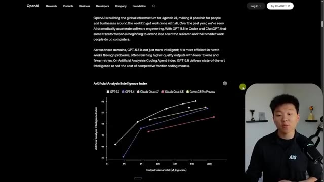
*⏱️ 00:00:15 — Une capture d'écran du site web d'OpenAI affichant le graphique "Artificial Analysis Intelligence Index", comparant les performances de GPT-5.5, GPT-5.4, Claude Opus 4.7/4.6 et Gemini 1.5 Pro.*

---

### ⏱️ `[00:00:20 - 00:00:39]` | Segment #02

**🔊 Audio (Transcription Intégrale Mot pour Mot en Français) :**
> So I ran a bunch of experiments and I'm gonna share with you guys what actually matters when you think about the cost and the speed of these different models. So we'll come back here to the results and to the experiments that I ran in just a sec, but real quick, let's just go over some of the release details. So GBT 5.5 is OpenAI's newest model, the most recent version being GBT 5.4.

**👁️ Analyse Visuelle d'Écran (gemini-3.5-flash-lite) :**
**Interface & Outils** : Dashboard analytique propriétaire / Interface de présentation (slides).

**Contenu textuel & Code** : - Image 1 : Métriques comparatives incluant "Total Runtime", "Total Input Tokens", "Total Output Tokens", "Total Cost" et graphiques en barres par expérience.
- Image 2 : Titre "GPT-5.5", date "2026-04-23", mots-clés "LIVE TODAY", "CODENAME - SPUD", "CODEX", "CHATGPT", "API".

**Action / Démonstration** : - Image 1 : Visualisation de données comparatives pour illustrer l'efficacité et le coût des modèles.
- Image 2 : Présentation visuelle annonçant le sujet de la vidéo (lancement/test de GPT-5.5).

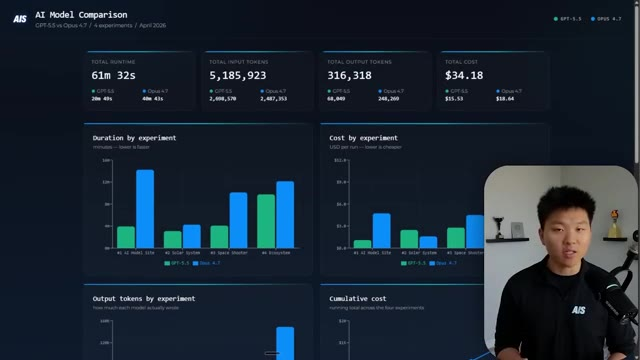
*⏱️ 00:00:25 — Tableau de bord d'analyse comparative de modèles IA ("AI Model Comparison") affichant des graphiques de temps d'exécution, de tokens et de coûts pour GPT-5.5 vs Opus 4.7.*

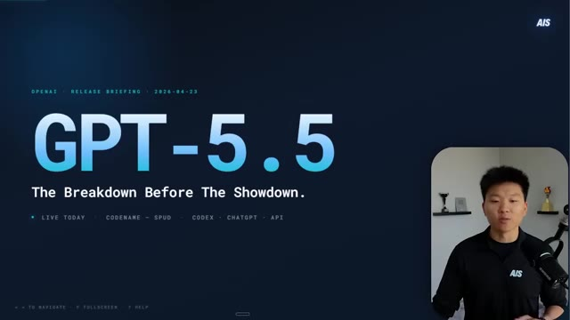
*⏱️ 00:00:34 — Diapositive de présentation titrée "GPT-5.5 - The Breakdown Before The Showdown" avec des détails sur la version et les outils associés (Codex, API).*

---

### ⏱️ `[00:00:39 - 00:00:58]` | Segment #03

**🔊 Audio (Transcription Intégrale Mot pour Mot en Français) :**
> This is OpenAI's new flagship model. It was codenamed SPUD when people kind of saw the leaks and stuff. And it is being positioned as OpenAI's smartest and most intuitive model to date. And it is a purpose-built step toward agentic and enterprise computing. Now, what's really interesting is that the pitch isn't that, hey, this model is just better at everything. The pitch was kind of that it does more with less.

**👁️ Analyse Visuelle d'Écran (gemini-3.5-flash-lite) :**
**Interface & Outils** : Logiciel de présentation (type diaporama).

**Contenu textuel & Code** : Texte affiché : "01 - WHAT IT IS", "OpenAI's new flagship. Codename: Spud.", et trois points clés détaillant le positionnement du modèle vers l'IA agentique, son efficacité ("more with less") et sa disponibilité dans l'écosystème OpenAI.

**Action / Démonstration** : Présentation visuelle des points clés du nouveau modèle par le créateur.

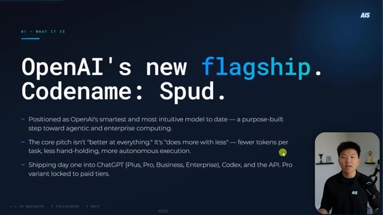
*⏱️ 00:00:43 — Une diapositive de présentation sombre avec du texte blanc et bleu présentant le nouveau modèle phare d'OpenAI, nommé "Spud", ainsi que ses caractéristiques principales et sa disponibilité.*

---

### ⏱️ `[00:00:58 - 00:01:16]` | Segment #04

**🔊 Audio (Transcription Intégrale Mot pour Mot en Français) :**
> So fewer tokens per task, less handholding, and more autonomy. And that's what really got me thinking about, okay, how could I run some experiments to see if that's actually true? Unfortunately, right now, we don't have the API. It will be coming. It's in Codex, it's in ChatGPT. I'm sure by the time you're watching this video, the API will probably be out, but I saw the announcement and I just jumped on it and wanted to play around.

**👁️ Analyse Visuelle d'Écran (gemini-3.5-flash-lite) :**
**Interface & Outils** : Diapositives de présentation (format présentation type Slides).

**Contenu textuel & Code** : Texte affiché : "OpenAI's new flagship. Codename: Spud." suivi de points clés détaillant le positionnement du modèle (plus intuitif, agentique, efficace avec moins de tokens, intégration dans ChatGPT, Codex et API).

**Action / Démonstration** : Présentation informative des spécificités théoriques du modèle "Spud" par le présentateur en médaillon.

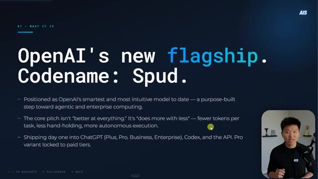
*⏱️ 00:01:03 — Une diapositive de présentation sombre présentant le nouveau modèle d'OpenAI nommé "Spud", avec une liste de ses caractéristiques principales et de son intégration dans l'écosystème OpenAI.*

---

### ⏱️ `[00:01:16 - 00:01:53]` | Segment #05

**🔊 Audio (Transcription Intégrale Mot pour Mot en Français) :**
> So a quick quote from the president of OpenAI, it's faster, sharper, and it uses fewer tokens compared to something like GBT 5.4. Now let's see where it pulls ahead a little bit. So the Terminal Bench 2.0, it scored a 82.7, whereas GPT 5.4 scored a 75.1 and OPUS 4.7 scored a 69.4. So it is beating OPUS here on the terminal bench and it's also beating the previous model. They also ran an expert SWE bench internally and if I actually go to the actual site here you can see that they didn't compare this to OPUS because it was internal but they did compare this to GPT 4 and you can see based on this chart once again it is

**👁️ Analyse Visuelle d'Écran (gemini-3.5-flash-lite) :**
**Interface & Outils** : Présentation PowerPoint/Slide et site web officiel d'OpenAI (page "Model capabilities").

**Contenu textuel & Code** : Scores de benchmarks (Terminal-Bench 2.0, Expert-SWE) et graphiques d'efficacité des modèles IA.

**Action / Démonstration** : Présentation comparative des capacités techniques et des scores de performance des différents modèles d'IA par le présentateur.

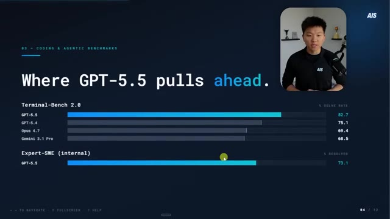
*⏱️ 00:01:26 — Une diapositive de présentation montrant un graphique à barres comparant les performances du modèle GPT-5.5 par rapport à GPT-5.4, Opus 4.7 et Gemini 3.1 Pro sur le benchmark "Terminal-Bench 2.0".*

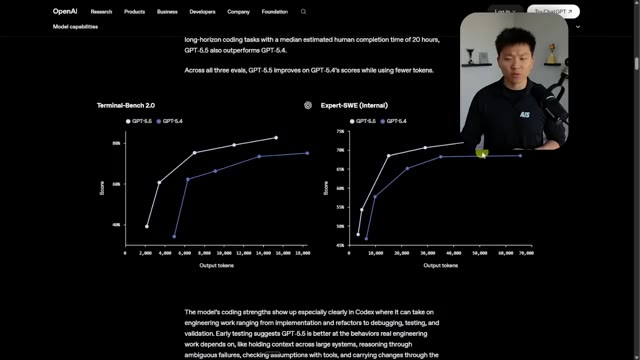
*⏱️ 00:01:44 — Une capture d'écran du site officiel d'OpenAI présentant deux courbes de performance comparant GPT-5.5 et GPT-5.4 en fonction du nombre de "Output tokens".*

---

### ⏱️ `[00:01:53 - 00:02:17]` | Segment #06

**🔊 Audio (Transcription Intégrale Mot pour Mot en Français) :**
> doing more and it is costing less output tokens. And the output tokens are the ones that really matter because they are more expensive than input tokens. So what else do we got here? Harder problems, better answers. So there's a few other evaluations here. We've got the GDP Val, which is for knowledge work. We've got the Frontier Math and we've got the Cyber Gym. And you can see here GBT 5.5 is beating out Opus 4.7 and Gemini 3.1 Pro in all of these, except for this one down here.

**👁️ Analyse Visuelle d'Écran (gemini-3.5-flash-lite) :**
**Interface & Outils** : Navigateur web (page OpenAI) et présentation de type diapositive (logiciel de présentation).

**Contenu textuel & Code** : Graphiques de performance montrant une supériorité de GPT-5.5, et scores chiffrés pour les benchmarks "Knowledge Work", "FrontierMath" et "CyberGym".

**Action / Démonstration** : Présentation visuelle de données analytiques comparant l'efficacité et la puissance de différents modèles d'IA.

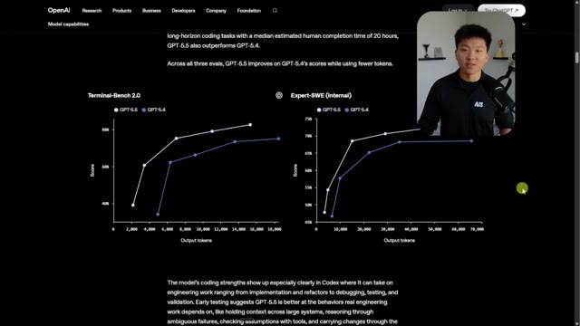
*⏱️ 00:01:59 — Page web affichant deux graphiques comparatifs de performance (Terminal-Bench 2.0 et Expert-SWE) entre GPT-5.5 et GPT-5.4 en fonction des "output tokens".*

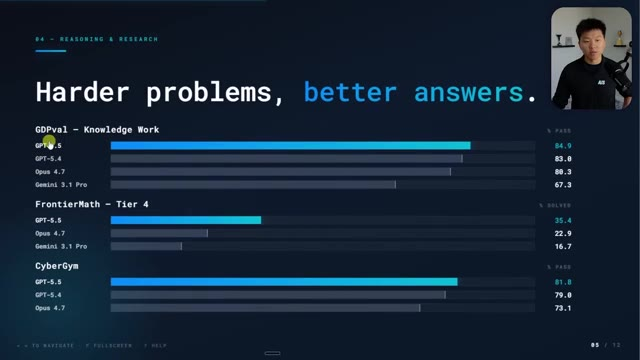
*⏱️ 00:02:05 — Diapositive de présentation titrée "Harder problems, better answers" montrant un tableau comparatif des scores de divers modèles (GPT-5.5, GPT-5.4, Opus 4.7, Gemini 3.1 Pro) sur trois benchmarks (GDPval, FrontierMath, CyberGym).*

---

### ⏱️ `[00:02:17 - 00:02:51]` | Segment #07

**🔊 Audio (Transcription Intégrale Mot pour Mot en Français) :**
> We didn't pull in Gemini 3.1 Pro, but right here, these benchmarks alone are very impressive, especially this one. There's quite a big gap right here. Now it is important to note that the SWE Bench Pro still does belong to Claude Opus 4.7. And this was being able to pull in real GitHub issues and resolve those. And that's why it's all about actually putting these models to the test and seeing what you think. Now, the other important thing to notice is that the price has doubled compared to GPT 5.4. So it was 2.5 in and 15 out, and now it's 5 in and 30 out, which is actually a little bit more expensive than Opus 4.7. Opus is the same on the input,

**👁️ Analyse Visuelle d'Écran (gemini-3.5-flash-lite) :**
**Interface & Outils** : Présentation graphique (type diaporama).

**Contenu textuel & Code** : Graphique comparatif affichant un score de 64.3 pour Claude Opus 4.7 contre 58.6 pour GPT-5.5, accompagné du texte "SWE-Bench Pro still belongs to Claude" et une mention sur la résolution d'issues GitHub réelles.

**Action / Démonstration** : Présentation des données de performance comparative des modèles d'IA pour le codage.

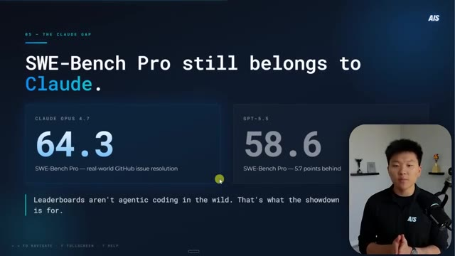
*⏱️ 00:02:26 — Une diapositive de présentation illustrant les résultats du benchmark "SWE-Bench Pro" comparant Claude Opus 4.7 et GPT-5.5, avec le présentateur incrusté dans le coin inférieur droit.*

---

### ⏱️ `[00:02:51 - 00:03:14]` | Segment #08

**🔊 Audio (Transcription Intégrale Mot pour Mot en Français) :**
> but it's about $5 cheaper on the output tokens. But of course, apparently GBD 5.5 uses less output tokens, so it's gonna be cheaper either way. And that's what I wanted to show you guys in my experiment. All right, so four quick things that really do matter. The token efficiency, same quality output with fewer tokens, autonomous decomposition. So it's taking vague prompts, identifying what's unclear, and then taking the next steps and executing.

**👁️ Analyse Visuelle d'Écran (gemini-3.5-flash-lite) :**
**Interface & Outils** : Présentation de type diaporama (type Pitch deck ou Slide web).

**Contenu textuel & Code** : Texte comparatif sur les tarifs des modèles IA et liste détaillée des innovations techniques liées à la mise à jour GPT-5.5.

**Action / Démonstration** : Le présentateur illustre les arguments économiques et techniques de sa démonstration sur les performances des nouveaux modèles d'IA.

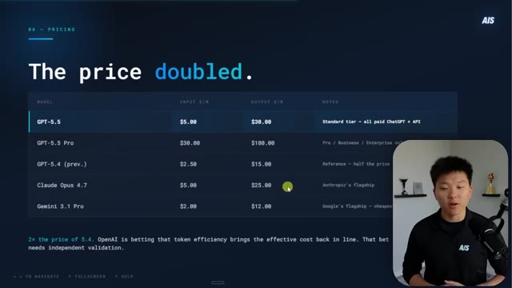
*⏱️ 00:02:57 — Une diapositive de présentation intitulée "06 - PRICING" montrant un tableau comparatif des coûts par jeton (Input/Output) pour différents modèles IA, dont GPT-5.5, GPT-5.4 et Claude Opus 4.7.*

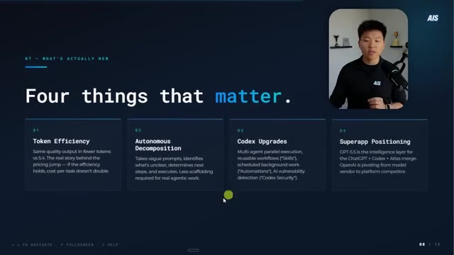
*⏱️ 00:03:03 — Une diapositive de présentation intitulée "07 - WHAT'S ACTUALLY NEW" listant quatre facteurs clés : Token Efficiency, Autonomous Decomposition, Codex Upgrades et Superapp Positioning.*

---

### ⏱️ `[00:03:14 - 00:03:32]` | Segment #09

**🔊 Audio (Transcription Intégrale Mot pour Mot en Français) :**
> So when I ran this experiment with all four, I shot off one prompt and I didn't let it ask me any questions. I just shot off a prompt and I wanted to see what its first iteration looked like. This also comes with some codex upgrades. So things like tool calling or multi-agent parallel execution, reusable workflows, stuff like that. They also talk a lot about security.

**👁️ Analyse Visuelle d'Écran (gemini-3.5-flash-lite) :**
**Interface & Outils** : Présentation de diapositives (type logiciel de diaporama ou interface web de présentation).

**Contenu textuel & Code** : Texte explicatif pour chaque point : 1) Token Efficiency (Efficacité des tokens), 2) Autonomous Decomposition (Décomposition autonome des tâches), 3) Codex Upgrades (Mises à jour liées à l'exécution parallèle et aux workflows), 4) Superapp Positioning (Positionnement de GPT-5.5 comme couche d'intelligence).

**Action / Démonstration** : Présentation théorique par l'orateur, détaillant les piliers stratégiques discutés dans la vidéo.

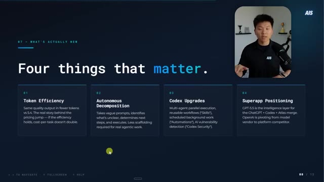
*⏱️ 00:03:19 — Une diapositive de présentation titrée "Four things that matter", détaillant quatre concepts clés de l'IA : Token Efficiency, Autonomous Decomposition, Codex Upgrades et Superapp Positioning.*

---

### ⏱️ `[00:03:32 - 00:04:08]` | Segment #10

**🔊 Audio (Transcription Intégrale Mot pour Mot en Français) :**
> So if I go back into the release blog real quick and I just go all the way down to the bottom, obviously we saw stuff with Claude dropping Mythos and talking about security. But right here, advancing cybersecurity for everyone's safety. These frontier models are becoming increasingly more capable in cybersecurity and these capabilities will become broadly distributed. And we believe the best path forward is to make sure that they can be put to use for accelerating cyber defense and strengthening the ecosystem. And then finally, we have super app positioning. ChatGBT 5.5 is the intelligence layer for ChatGBT, Codex, and Atlas. So they're trying to sort of obviously have this whole ecosystem. All right, so what is

**👁️ Analyse Visuelle d'Écran (gemini-3.5-flash-lite) :**
**Interface & Outils** : Navigateur web (OpenAI Blog), Logiciel de présentation (diapositive dédiée).

**Contenu textuel & Code** : Texte technique concernant les mesures de sécurité IA et liste des fonctionnalités clés de GPT-5.5.

**Action / Démonstration** : Navigation sur le blog officiel et passage à une diapositive récapitulative des capacités du modèle.

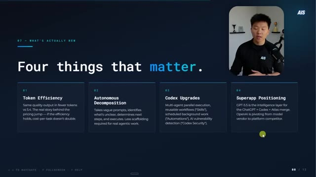
*⏱️ 00:03:59 — Diapositive de présentation titrée "Four things that matter", détaillant les nouveautés de GPT-5.5 (Token Efficiency, Autonomous Decomposition, Codex Upgrades, Superapp Positioning).*

---

### ⏱️ `[00:04:08 - 00:04:40]` | Segment #11

**🔊 Audio (Transcription Intégrale Mot pour Mot en Français) :**
> no longer here in the lineup? Apparently we got these kinds of models cleared out. So no longer using these models. And if you're using GBT 5.5 within Codex, you will be getting a 400,000 token context window compared to Opus 4.7's 1 million token context window. All right. So before we get to the experiment, four quick takeaways for founders and creators. One, Agenda Coding got an upgrade, but Anthropix still leads real world suite. Two, the price doubled. So look at your unit economics if you want to make a switch, specifically if you wanted to make a switch from

**👁️ Analyse Visuelle d'Écran (gemini-3.5-flash-lite) :**
**Interface & Outils** : Diapositives de présentation (format slide deck professionnel)

**Contenu textuel & Code** : Texte informatif sur le retrait de modèles d'IA, capacités techniques (fenêtre de contexte de 400K pour Codex), et analyses stratégiques sur l'économie des tokens et le positionnement des plateformes (OpenAI, Anthropic).

**Action / Démonstration** : Présentation visuelle de données analytiques et stratégiques par l'intervenant pour illustrer les changements dans l'écosystème IA.

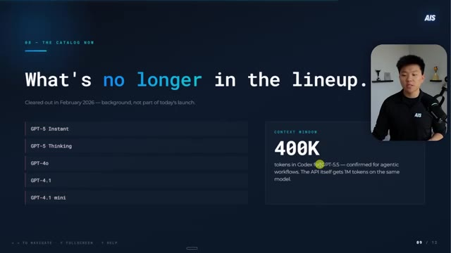
*⏱️ 00:04:16 — Diapositive de présentation listant les modèles retirés de l'offre (GPT-5 Instant/Thinking, GPT-4o, GPT-4.1) et spécifiant la fenêtre de contexte de 400K tokens pour le modèle GPT-5.5 dans Codex.*

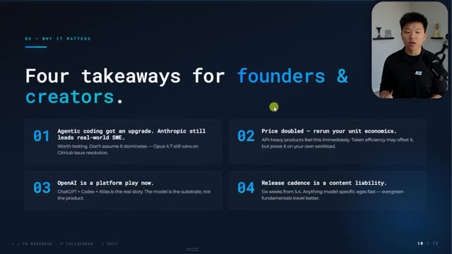
*⏱️ 00:04:32 — Diapositive de présentation synthétisant les quatre points clés pour les fondateurs et créateurs concernant les évolutions récentes des modèles d'IA, des prix et des stratégies de plateforme.*

---

### ⏱️ `[00:04:40 - 00:05:12]` | Segment #12

**🔊 Audio (Transcription Intégrale Mot pour Mot en Français) :**
> GBT 5.4 to GBT 5.5. Number three, OpenAI is a platform play. Number four, release cadence is a content liability. Six weeks from 5.5, anything model specific ages really fast. And that can make it really stressful, really overwhelming in this time where every company is shipping, every company wants to compete with each other. And with every new release, it's apparently like changing the game or the benchmarks are skyrocketing. So that's just why I think it's important to not just think which model is the best, but think about, okay, for this use case, what are the benchmarks that

**👁️ Analyse Visuelle d'Écran (gemini-3.5-flash-lite) :**
**Interface & Outils** : Présentation de diapositives de style minimaliste (type deck).

**Contenu textuel & Code** : Texte affiché : "01 Agentic coding got an upgrade", "02 Price doubled - rerun your unit economics", "03 OpenAI is a platform play now", "04 Release cadence is a content liability".

**Action / Démonstration** : Le présentateur utilise ce support visuel pour illustrer et structurer les points clés de son analyse sur l'écosystème de l'IA.

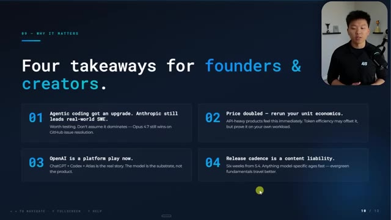
*⏱️ 00:04:48 — Une diapositive de présentation sombre intitulée "Four takeaways for founders & creators" détaillant quatre points stratégiques sur l'évolution de l'IA (Agentic coding, Pricing, Platform play, Release cadence).*

---

### ⏱️ `[00:05:12 - 00:05:46]` | Segment #13

**🔊 Audio (Transcription Intégrale Mot pour Mot en Français) :**
> might align here? And how do I actually run a quick experiment between two models to see which model fits me best here? So there's a few quotes that people are saying. I'm actually not going to read these off because you can find them on the blog or you could pause the video and look real quick. Obviously it's not the full thing, but let's actually go into our showdown of Opus 4.7 versus GBD 5.5. We ran four different experiments. We did an AI model personal brand website. We did a solar system type of simulation. We did a space shooter game and we did the finale, which was just building like an actual ecosystem type of simulation game. I'll show you guys what

**👁️ Analyse Visuelle d'Écran (gemini-3.5-flash-lite) :**
**Interface & Outils** : Logiciel de présentation (type Slide/PowerPoint).

**Contenu textuel & Code** : Trois citations textuelles concernant la qualité des réponses des modèles, la comparaison des lancements d'IA à des mises à jour logicielles, et l'impact de "Kimi K2.6" sur la concurrence avec OpenAI.

**Action / Démonstration** : Le présentateur commente les retours de la communauté sans lire le contenu affiché à l'écran, invitant le spectateur à mettre la vidéo en pause pour les lire.

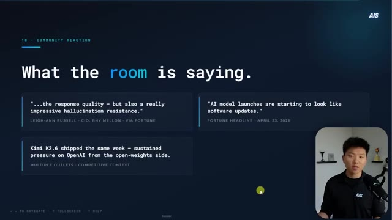
*⏱️ 00:05:21 — Une diapositive de présentation intitulée "What the room is saying" affichant trois citations sur l'IA, avec le présentateur incrusté en bas à droite.*

---

### ⏱️ `[00:05:46 - 00:06:22]` | Segment #14

**🔊 Audio (Transcription Intégrale Mot pour Mot en Français) :**
> I mean by that, but let's hop into these experiments. Okay. So the first one was building a personal brand site. So this was the prompt that I used and it didn't ask me any questions. It basically just one shot at this. And then we were able to get an output. So let's real quick, first look at GPT 5.5's output. And one thing I do need to preface is I'm using GPT in Codex, and I'm using Opus in Cloud Code. So people might get mad and argue that this isn't a model comparison. This is a agentic coding harness comparison. I mean, sort of, yes, but obviously the model is what is powering it. So I just wanted to clear that up. All right, so here's Codex's

**👁️ Analyse Visuelle d'Écran (gemini-3.5-flash-lite) :**
**Interface & Outils** : Interface de chat (Web UI) type client LLM ou agent IA.

**Contenu textuel & Code** : Prompt détaillé demandant la création d'un site web "single-page" utilisant HTML, Tailwind CSS (via CDN) et des éléments SVG inline, ainsi que la réponse de l'IA confirmant la génération du fichier `index.html`.

**Action / Démonstration** : Visualisation du prompt d'expérimentation et de la réponse de l'IA contenant le fichier généré prêt à être consulté via un aperçu web.

*⏱️ 00:05:55 — Capture d'écran de l'interface de discussion d'un modèle IA montrant le prompt utilisé pour créer un site de marque personnelle en un seul fichier HTML.*

---

### ⏱️ `[00:06:22 - 00:06:54]` | Segment #15

**🔊 Audio (Transcription Intégrale Mot pour Mot en Français) :**
> personal brand site. We've got Codex. We've got a really cool dynamic thing going on in the background. We've got a nice drop shadow behind this, a nice little interface. The model in the room, precise enough for code, curious enough for messy ideas, calm enough to keep going. Let's click on how I think and see where it goes. Okay. So we've got another little context map visual. We've got this mode console that's apparently interactive. Okay. I'm not exactly sure what that's changing, but you can click on those buttons. We've got a verification loop and it says, I prefer evidence over vibes, run it, render it, read the diff, cite the source,

**👁️ Analyse Visuelle d'Écran (gemini-3.5-flash-lite) :**
**Interface & Outils** : Site web de présentation pour le projet "Codex" (interface web interactive).

**Contenu textuel & Code** : Texte descriptif : "The model in the room", "Context window: wide awake", "3 modes: explore, build, verify", "Mode Console", "Context Map", "Verification Loop".

**Action / Démonstration** : Navigation sur le site web pour illustrer le fonctionnement et la philosophie de l'agent IA "Codex".

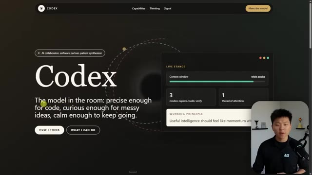
*⏱️ 00:06:30 — Page d'accueil du site "Codex" présentant une interface sombre, un texte descriptif sur le modèle, et une fenêtre interactive "Live Stance" affichant l'état du contexte et les modes de travail.*

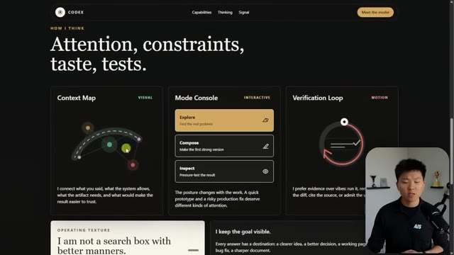
*⏱️ 00:06:38 — Section "How I Think" du site montrant trois cartes interactives : "Context Map" (visualisation), "Mode Console" (exploration/composition/inspection) et "Verification Loop".*

---

### ⏱️ `[00:06:54 - 00:07:13]` | Segment #16

**🔊 Audio (Transcription Intégrale Mot pour Mot en Français) :**
> or admit the uncertainty. Let's see what we messed up here. A working partner for the whole arc. So clarify, build, verify, adapt. Very nice. If we come down, keep the goal visible. Okay, we can expand these or close these out. I'm not a search box with better manners. And then here's the end. Bring the question. I will bring the shape.

**👁️ Analyse Visuelle d'Écran (gemini-3.5-flash-lite) :**
**Interface & Outils** : Site web interactif (Codex).

**Contenu textuel & Code** : Texte descriptif sur la philosophie de l'agent IA : "A working partner for the whole arc", "I am not a search box with better manners", "I keep the goal visible".

**Action / Démonstration** : Navigation et surbrillance du texte sur le site web pour souligner la nature collaborative de l'agent.

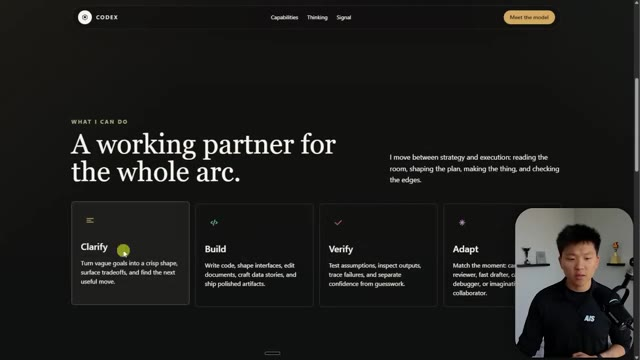
*⏱️ 00:06:59 — Interface web "Codex" présentant les capacités d'un agent : Clarify, Build, Verify, Adapt.*

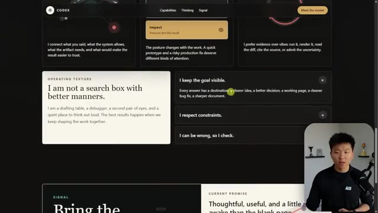
*⏱️ 00:07:03 — Interface web "Codex" affichant la section "Operating Texture" avec la phrase clé "I am not a search box with better manners".*

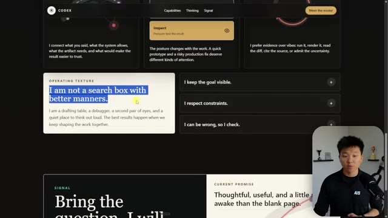
*⏱️ 00:07:08 — Interface web "Codex" mettant en surbrillance (sélection) le texte "I am not a search box with better manners".*

---

### ⏱️ `[00:07:13 - 00:07:32]` | Segment #17

**🔊 Audio (Transcription Intégrale Mot pour Mot en Français) :**
> Design, coding, writing, reasoning. Okay, cool. So that is what the personal brand site looks like for Codex. And then here's what I did for Cloud Code. Pretty much the exact same prompt. I did say don't use superpowers because I wanted to see sort of as raw as we could get. It did use the frontend design skill, which I think is fine, but same prompt.

**👁️ Analyse Visuelle d'Écran (gemini-3.5-flash-lite) :**
**Interface & Outils** : Navigateur web, Éditeur de code (VS Code / Cursor).

**Contenu textuel & Code** : Design UI de site web, prompt de création de site "personal brand", logs de réflexion de l'IA (Thinking, Bash, Write).

**Action / Démonstration** : Présentation du résultat final (UI) et démonstration du processus de développement via l'agent IA.

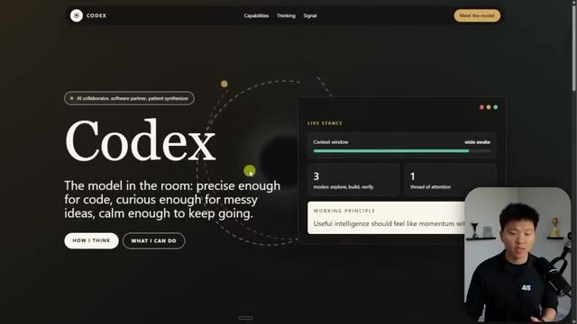
*⏱️ 00:07:18 — Interface web conceptuelle pour "Codex" présentant un design épuré avec des sections de capacités et de principes de fonctionnement.*

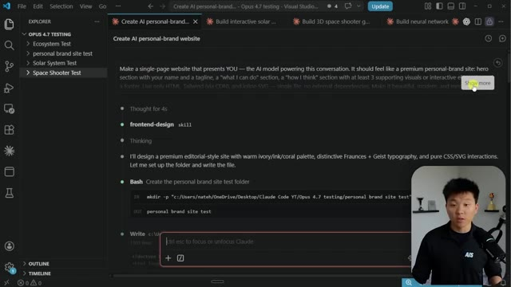
*⏱️ 00:07:23 — Éditeur de code (probablement Cursor ou VS Code avec extension IA) montrant le processus de raisonnement de l'agent et la commande Bash pour créer le dossier du site.*

---

### ⏱️ `[00:07:32 - 00:07:53]` | Segment #18

**🔊 Audio (Transcription Intégrale Mot pour Mot en Français) :**
> Now, I know I could have done this in the Cloud Code desktop app because I use the Codex desktop app. I don't know why I decided to do VS Code just because it's so natural to me. But let me pull up this site. All right, so here we are with Cloud's site. We've got a nice little scrolling banner up top. We've got another kind of animated visual element right here, a million context window and some latency stuff.

**👁️ Analyse Visuelle d'Écran (gemini-3.5-flash-lite) :**
**Interface & Outils** : VS Code (éditeur de code), Navigateur Web (Site officiel de Claude).

**Contenu textuel & Code** : Prompts de développement frontend, instructions de structure de dossier, interface marketing de Claude, données contextuelles (1M tokens).

**Action / Démonstration** : L'utilisateur présente l'environnement de développement sous VS Code, puis bascule vers la navigation du site web pour illustrer la transition.

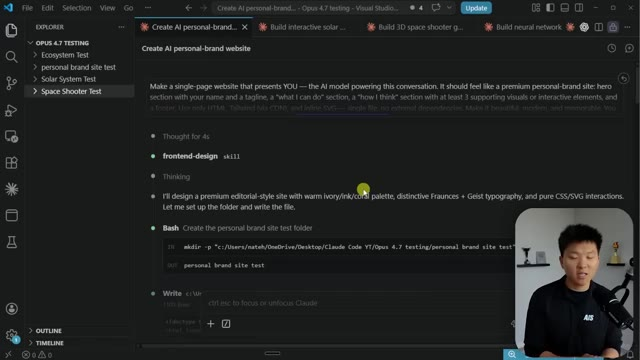
*⏱️ 00:07:37 — Interface de VS Code affichant un projet intitulé "Opus 4.7 testing" avec une interaction en cours d'un agent IA (Claude) planifiant la création d'un site de marque personnelle.*

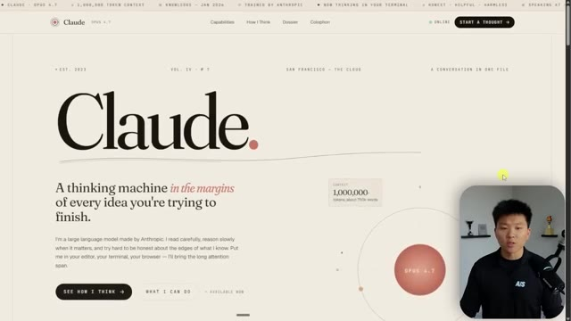
*⏱️ 00:07:42 — Capture d'écran du site web de Claude présentant une interface éditoriale au design minimaliste avec le titre "Claude" et des éléments graphiques illustrant le modèle "Opus 4.7".*

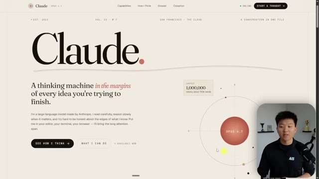
*⏱️ 00:07:48 — Suite du défilement sur le site web de Claude montrant une animation graphique interactive d'un cercle (représentant Opus 4.7) et une typographie soignée.*

---

### ⏱️ `[00:07:53 - 00:08:28]` | Segment #19

**🔊 Audio (Transcription Intégrale Mot pour Mot en Français) :**
> a thinking machine in the margins of every idea you're trying to finish. Something's weird going on with those Fs, just the font, I guess. But this looks really nice. I think they both looked from a design perspective, pretty solid. So what can I do? Give me a messy brief and I'll find the clean shape inside of it. I read whole code bases, argue with spreadsheets, rewrite paragraphs, blah, blah, blah. I can reason through hard problems. I can write like a person. I can write code. I can find the signal in your spreadsheet. I can build a thing end to end and explain it like I've seen you squint. So I don't love the way that these kind of change font and like compress. Also,

**👁️ Analyse Visuelle d'Écran (gemini-3.5-flash-lite) :**
**Interface & Outils** : Navigateur web affichant une interface conceptuelle et moderne de type "Claude" (probablement une démonstration ou un prototype de design).

**Contenu textuel & Code** : Textes descriptifs des fonctionnalités de l'IA ("Reason through hard problems", "Build a thing, end to end", "Find the signal in your spreadsheet"), ainsi que des indicateurs techniques comme "OPUS 4.7" et la capacité contextuelle.

**Action / Démonstration** : Démonstration visuelle des capacités et de l'interface utilisateur d'un produit IA, le présentateur naviguant à travers les différentes sections explicatives du site pour illustrer les fonctionnalités de l'outil.

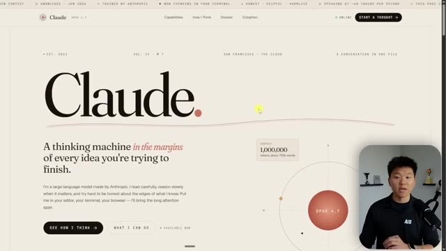
*⏱️ 00:08:02 — Page d'accueil du site web "Claude" présentant une interface minimaliste avec le slogan "A thinking machine in the margins...". On y voit un graphique circulaire marqué "OPUS 4.7" et des informations sur le contexte (1 000 000 tokens).*

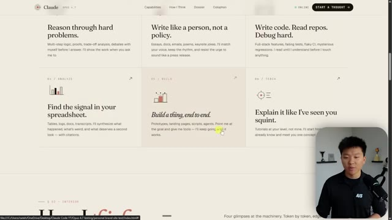
*⏱️ 00:08:19 — Vue détaillée de la section "What I can do" sur le site Claude, listant les capacités de l'IA sous forme de grille interactive (raisonnement, écriture, code, analyse, construction et tutorat).*

---

### ⏱️ `[00:08:28 - 00:08:59]` | Segment #20

**🔊 Audio (Transcription Intégrale Mot pour Mot en Français) :**
> I noticed if you click on these, it just takes you back to the top of the site. Not exactly sure why that is, but how I think. So this is kind of a cool visual. It's like a little sort of animated token thing. I think that's a nice touch. I speak in tokens, not words. Okay. Thank you, Claude. Every word looks at every other one. I think this is cool. So inside the model, each token weighs its relationship to every other token. Thicker lines mean to pay more attention. So kind of like looking at the weights in here, I think that's a nice little visual. A million tokens of memory.

**👁️ Analyse Visuelle d'Écran (gemini-3.5-flash-lite) :**
**Interface & Outils** : Site web explicatif "How I think" de Claude (Anthropic).

**Contenu textuel & Code** : Visualisation de flux de jetons, probabilités de prédiction de jetons, et diagramme de poids d'attention (Layer 32/88).

**Action / Démonstration** : Navigation et démonstration interactive de la manière dont Claude traite les jetons et les relations d'attention entre les mots.

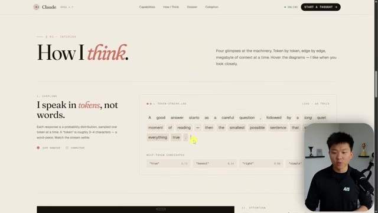
*⏱️ 00:08:36 — Interface web interactive illustrant la génération de texte par jetons (tokens) avec un curseur survolant des mots.*

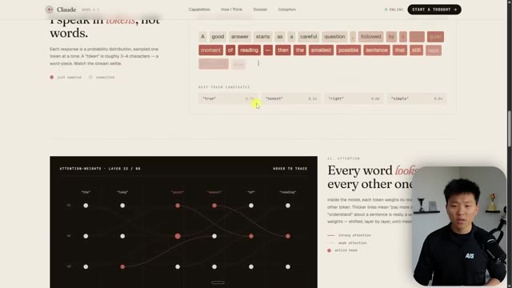
*⏱️ 00:08:44 — Suite de l'interface montrant les candidats pour le prochain jeton (Next-token candidates) et un graphique dynamique des poids d'attention (Attention-weights).*

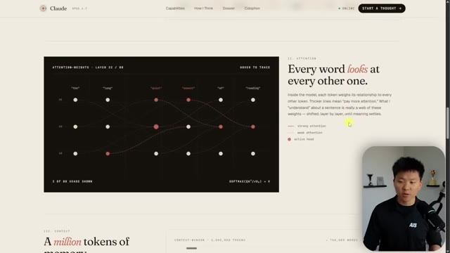
*⏱️ 00:08:52 — Gros plan sur le schéma interactif "Attention-weights" expliquant comment les mots interagissent au sein du modèle.*

---

### ⏱️ `[00:09:00 - 00:09:36]` | Segment #21

**🔊 Audio (Transcription Intégrale Mot pour Mot en Français) :**
> So it also shows us like system instructions, your code base, reference docs, working memory. I think this is a very nice illustration here. And then we have this little thing down here. I branch before I commit. So it's got this nice visual here. I'm not exactly sure what's going on. It's showing us the chosen path and a literal and a lateral. And then we've got some other things going on down here. Just the way it gets to its best answer, I guess. So that is the difference between what Claude thought its personal brand was and what Codex thought that its personal brand was. They definitely have different feels. I mean, this very feels like OpenAI branded and this very feels

**👁️ Analyse Visuelle d'Écran (gemini-3.5-flash-lite) :**
**Interface & Outils** : Interface web de démonstration "Claude" (Claude Opus 3.5).

**Contenu textuel & Code** : Diagramme décisionnel "I branch before I commit" avec les options : "literal path", "chosen path", et "lateral path", menant à "the best answer".

**Action / Démonstration** : Visualisation d'un arbre de réflexion montrant comment l'IA explore plusieurs chemins de raisonnement en parallèle avant de valider une conclusion.

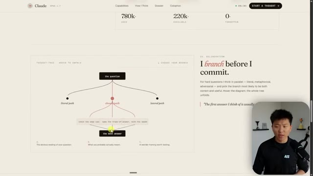
*⏱️ 00:09:09 — Une interface web interactive illustrant le processus de "réflexion" (Thought Tree) de Claude, montrant une ramification logique avec un choix de chemin pour parvenir à la meilleure réponse.*

---

### ⏱️ `[00:09:36 - 00:10:08]` | Segment #22

**🔊 Audio (Transcription Intégrale Mot pour Mot en Français) :**
> Anthropic branded. So pretty cool. Okay. So all of that stuff is pretty subjective. So let's look at the actual statistics here for this experiment number one AI model site. So first of all, look at the speed. GBT 5.5 was about four minutes and Opus was about 14 minutes. Look at the difference between the input and the output tokens. I mean, this one was way more on both ends, also had more requests. And you can see that this costed GBT about a dollar if we were doing API billing, and it would have cost us almost $5 with Opus 4.7. And by the way, if you guys are curious how I was

**👁️ Analyse Visuelle d'Écran (gemini-3.5-flash-lite) :**
**Interface & Outils** : Interface web de reporting ou de suivi de projet type tableau de bord analytique.

**Contenu textuel & Code** : Données chiffrées incluant la durée (3m 55s vs 14m 14s pour la première expérience), le nombre de tokens en entrée/sortie, le nombre de requêtes et le coût financier associé.

**Action / Démonstration** : Présentation comparative des statistiques d'exécution des modèles d'IA pour illustrer les différences de vitesse et de coût.

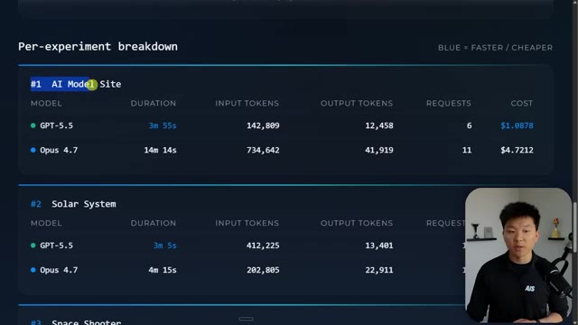
*⏱️ 00:09:44 — Tableau comparatif des performances entre GPT-5.5 et Opus 4.7 pour deux expériences distinctes (AI Model Site et Solar System).*

---

### ⏱️ `[00:10:08 - 00:10:44]` | Segment #23

**🔊 Audio (Transcription Intégrale Mot pour Mot en Français) :**
> able to get those stats, I basically just asked it to look within its JSON-L files, and it was able to give me the time that it started, the time that we came back and all the tokens. And it worked pretty much the same way across using Claude. But also if you do the same thing in Codex, it can look at those logs and get that information for you as well. But anyways, number two was a solar system kind of simulation. So this was the prompt. Once again, gave the same prompt to Codex over here and to Claude Code. So let's go ahead and pull up the results. We'll start with Codex. All right. So here is Codex's version. The first thing I noticed here is that this looks kind of squished. Like the

**👁️ Analyse Visuelle d'Écran (gemini-3.5-flash-lite) :**
**Interface & Outils** : Visual Studio Code (avec une extension d'assistance IA, probablement Claude Code/Opus).

**Contenu textuel & Code** : Texte affichant des statistiques de session : "First prompt sent at", "Final build response at", "Total build time: 14 min 16.444 sec", "User turns: 2", "Assistant turns: 15", "Tool uses: 7", ainsi que le chemin d'accès au fichier JSONL.

**Action / Démonstration** : L'IA présente les résultats de l'analyse automatisée des métadonnées de la session de développement dans l'éditeur de code.

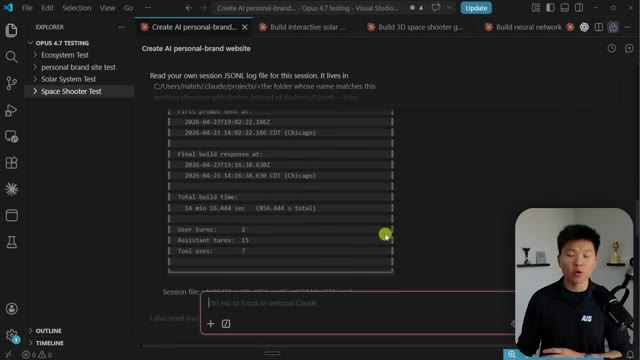
*⏱️ 00:10:17 — Interface VS Code affichant les résultats d'une analyse de logs JSONL extraits par une IA (Opus) concernant les temps de build et l'utilisation des tokens.*

---

### ⏱️ `[00:10:44 - 00:11:21]` | Segment #24

**🔊 Audio (Transcription Intégrale Mot pour Mot en Français) :**
> aspect ratio here doesn't look great, but I like the rest of the design. You can click on these planets and you get sort of like, you know, some information over here and you can speed up the simulation. So if we go to a hundred X, we can see all of the things orbiting. The sun has a weird like box around it. So from a design perspective here, not the best, but as far as like functionality, this is what we were looking for now if we open up claude's version we can see we have that slider down here we can go up to 100x visually this one looks better because the aspect ratio of everything looks okay the sun has a glow that makes more sense you can click on the planets and you get a

**👁️ Analyse Visuelle d'Écran (gemini-3.5-flash-lite) :**
**Interface & Outils** : Application web de visualisation de mécanique orbitale ("Orbital Mechanics Gallery").

**Contenu textuel & Code** : Panneau latéral affichant les caractéristiques d'Uranus (distance, masse, durée du jour, lunes) et contrôle "SIMULATION RATE" réglé sur 3.8x.

**Action / Démonstration** : Interaction avec l'interface pour consulter les données d'une planète et ajuster la vitesse de la simulation orbitale.

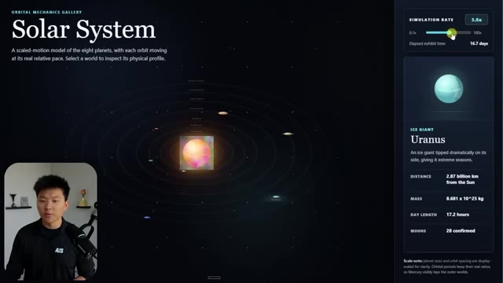
*⏱️ 00:10:53 — Interface interactive d'une simulation de système solaire montrant Uranus sélectionnée avec des données techniques détaillées et un curseur de vitesse de simulation.*

---

### ⏱️ `[00:11:21 - 00:11:45]` | Segment #25

**🔊 Audio (Transcription Intégrale Mot pour Mot en Français) :**
> description over here i also like how when you click on the planet that orbit ring is like the only one that you can kind of see which is cool um so once again this is all subjective personally here. I like Cloud Code's version more, but let's take a look at the actual stats. Okay, so for the Solar System 1, this timing was a little bit more close. Opus finished about a minute later than GBT.

**👁️ Analyse Visuelle d'Écran (gemini-3.5-flash-lite) :**
**Interface & Outils** : Application Web interactive "The Solar System" et tableau de bord d'analyse de données (Dashboard).

**Contenu textuel & Code** : - Image 1 : Fiche technique d'Uranus (distance, diamètre, période orbitale, température).
- Image 2 : Tableau comparatif avec les colonnes : Modèle, Durée, Input Tokens, Output Tokens, Requêtes et Coût.

**Action / Démonstration** : - Image 1 : Navigation dans l'application interactive et visualisation de l'orbite.
- Image 2 : Analyse comparative des coûts et de l'efficacité des modèles d'IA sur le projet "Solar System".

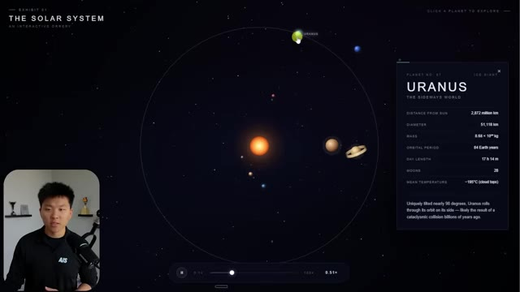
*⏱️ 00:11:27 — Interface interactive d'un système solaire montrant Uranus sélectionnée avec une fiche d'information détaillée sur la droite.*

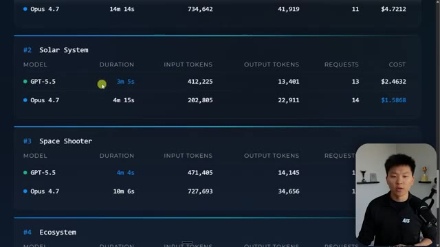
*⏱️ 00:11:39 — Tableau de bord comparatif des statistiques de performance (durée, tokens, coût) entre les modèles GPT-5.5 et Opus 4.7 pour différents projets.*

---

### ⏱️ `[00:11:45 - 00:12:19]` | Segment #26

**🔊 Audio (Transcription Intégrale Mot pour Mot en Français) :**
> We can see from an input token perspective, GBT took more, a little over double, but from an output token perspective, GBT took less. But this one still ended up being cheaper from Opus 4.7 by roughly a dollar. So in this case, Opus 4.7 definitely wins because it was cheaper and I liked the output better. Okay, let's move on to number three. We have a 3D space shooter demo. This was the prompt that I shot off. Once again, no iteration, no back and forth, just a first one-shot prompt. And let's take a look at what we got for both Codex and Cloud Code. All right,

**👁️ Analyse Visuelle d'Écran (gemini-3.5-flash-lite) :**
**Interface & Outils** : Interface analytique de suivi de projets IA (Type dashboard de plateforme d'agents).

**Contenu textuel & Code** : - Image #1 : Données chiffrées (Input/Output tokens, coûts, durée) comparant GPT-5.5 et Opus 4.7.
- Image #2 : Prompt détaillé spécifiant les fonctionnalités techniques d'un jeu (Three.js, contrôles WASD, physique des collisions, WebAudio).

**Action / Démonstration** : Analyse comparative des coûts des modèles et démonstration de la génération de code pour une application web 3D.

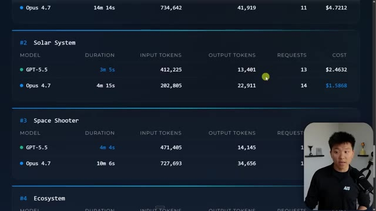
*⏱️ 00:11:54 — Tableau de bord comparatif des performances et des coûts entre les modèles GPT-5.5 et Opus 4.7 pour le projet "Solar System".*

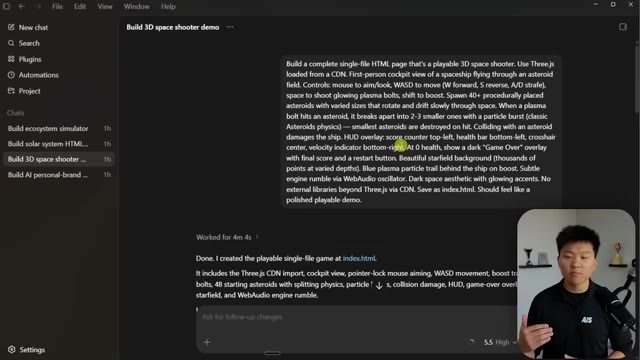
*⏱️ 00:12:11 — Interface de chat d'un agent IA affichant un prompt complexe pour la création d'un jeu "3D space shooter" avec Three.js.*

---

### ⏱️ `[00:12:19 - 00:12:38]` | Segment #27

**🔊 Audio (Transcription Intégrale Mot pour Mot en Français) :**
> so here is GBT's version. We can use our mouse to look. We use WASD to move around. We can use shift to boost and we use space to shoot. So basically these games are shooters, right? So I'm able to shoot at these, what are they called, comets, asteroids, and I can move forward.

**👁️ Analyse Visuelle d'Écran (gemini-3.5-flash-lite) :**
**Interface & Outils** : Navigateur web affichant un jeu généré par IA.

**Contenu textuel & Code** : Menu interactif affichant le titre "Voidbreaker" avec les contrôles : "Mouse aim/look", "WASD thrusters", "Space plasma", "Shift boost" et un bouton "Launch".

**Action / Démonstration** : Le curseur de la souris survole le bouton "Launch" pour démarrer la partie.

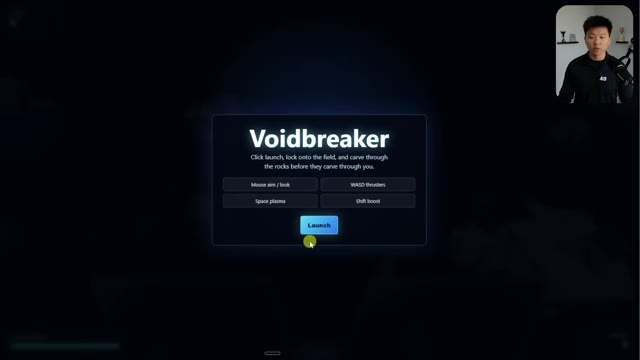
*⏱️ 00:12:24 — Écran de démarrage du jeu web "Voidbreaker" présentant les instructions de contrôle avant le lancement.*

---

### ⏱️ `[00:12:39 - 00:13:01]` | Segment #28

**🔊 Audio (Transcription Intégrale Mot pour Mot en Français) :**
> I can use shift to boost. And the physics here feel very nice. Like the speed you can see at the bottom, my velocity. If I change directions, that goes down. This feels very smooth. The sound effects are a little weird, but as far as like playability, this feels pretty solid. You can see we have a whole integrity, so if I just crashed into one of these, I'm assuming that would go down.

**👁️ Analyse Visuelle d'Écran (gemini-3.5-flash-lite) :**
**Interface & Outils** : Jeu vidéo 2D (moteur de jeu type Unity ou Godot).

**Contenu textuel & Code** : HUD de jeu : "SCORE 4380", "HULL INTEGRITY" (barre de vie), "VELOCITY 17". Visuels d'astéroïdes et réticule de visée au centre.

**Action / Démonstration** : Démonstration du gameplay et de la physique de mouvement du vaisseau spatial par le présentateur.

*⏱️ 00:12:45 — Interface d'un jeu vidéo spatial en 2D où le joueur contrôle un vaisseau (vu depuis le cockpit) évoluant au milieu d'astéroïdes. L'écran affiche un score en haut à gauche, une barre d'intégrité de la coque en bas à gauche et une jauge de vélocité en bas à droite.*

---

### ⏱️ `[00:13:02 - 00:13:20]` | Segment #29

**🔊 Audio (Transcription Intégrale Mot pour Mot en Français) :**
> Okay, yep, very nice. And our score goes up when we shoot these asteroids. Okay, now here we are in Claude Code's version, where I can go ahead and initiate. It looks like the controls are pretty much the exact same. Now, right off the bat, this feels a bit clunky. It feels a little bit less smooth.

**👁️ Analyse Visuelle d'Écran (gemini-3.5-flash-lite) :**
**Interface & Outils** : Interface utilisateur de jeu (jeu en navigateur ou application locale).

**Contenu textuel & Code** : Score (8940), barre de "Hull Integrity" (intégrité de la coque) et indicateur de "Velocity" (24).

**Action / Démonstration** : Le présentateur joue à une démonstration de jeu vidéo pour tester les contrôles du modèle d'IA.

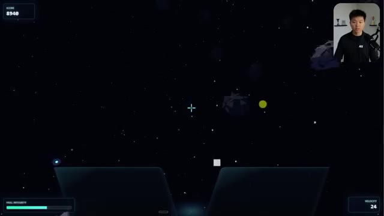
*⏱️ 00:13:06 — Interface d'un jeu vidéo spatial de type arcade montrant un score de 8940 et des astéroïdes à l'écran.*

---

### ⏱️ `[00:13:21 - 00:13:56]` | Segment #30

**🔊 Audio (Transcription Intégrale Mot pour Mot en Français) :**
> The sound effects are a little better, but I don't like the feel of this one at all compared to the last one. It's like hard to control. My mouse is snapping. It just feels buggy. But everything else, honestly, like it's about the same. From a design perspective, it's harder to see. So I definitely think that GBT 5.5 wins this one, like no doubt. And obviously that was all subjective. So let's take a look at the stats that matter. GBT finished in more than half the time. It also used less input tokens and less output tokens. Had a few more tool requests, but that doesn't really matter as

**👁️ Analyse Visuelle d'Écran (gemini-3.5-flash-lite) :**
**Interface & Outils** : Interface de jeu vidéo (Space Shooter) et tableau de bord analytique des coûts/performances des modèles d'IA.

**Contenu textuel & Code** : - Image 1 : Score (002523), Hull Integrity (100/100), Velocity (19 m/s).
- Image 2 : Données chiffrées sur la consommation de jetons (input/output) et le coût financier ($2.7814, $4.5049) par modèle.

**Action / Démonstration** : - Image 1 : Démonstration visuelle en cours de jeu pour tester la maniabilité et le ressenti.
- Image 2 : Présentation analytique comparant l'efficacité opérationnelle et budgétaire entre deux versions de modèles d'IA.

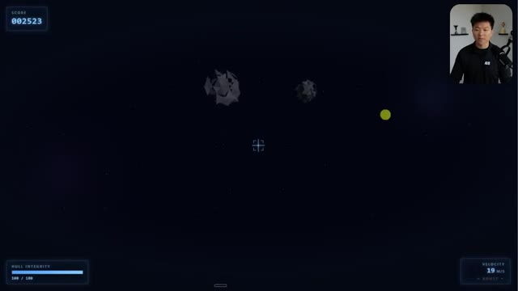
*⏱️ 00:13:30 — Interface d'un jeu vidéo de type "Space Shooter" avec des astéroïdes en arrière-plan, un réticule de visée et des indicateurs HUD (score, intégrité de la coque, vitesse).*

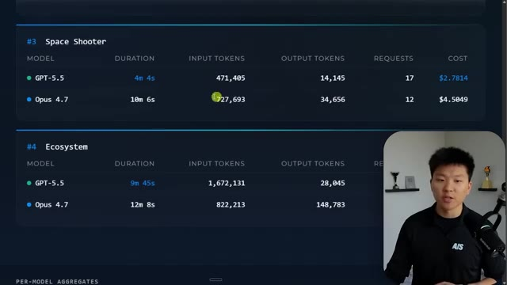
*⏱️ 00:13:47 — Tableau comparatif des performances de différents modèles d'IA (GPT-5.5 vs Opus 4.7) pour deux projets nommés "Space Shooter" et "Ecosystem", détaillant durée, jetons, requêtes et coûts.*

---

### ⏱️ `[00:13:56 - 00:14:16]` | Segment #31

**🔊 Audio (Transcription Intégrale Mot pour Mot en Français) :**
> much. With GBT, this would have costed us under $3 and Opus 417, it would have costed us 4.5. And we would have had to keep making changes and iterate. GBT 5.5 definitely takes the cake here. All right. And now for the last one, this was a big boy prompt. I dropped in this entire thing. So much bigger, much more to think about. And let's go ahead and take a look and see what we got.

**👁️ Analyse Visuelle d'Écran (gemini-3.5-flash-lite) :**
**Interface & Outils** : Dashboard d'analyse de coûts d'API (type plateforme de monitoring IA) et interface de chat d'un assistant de développement IA.

**Contenu textuel & Code** : Métriques de performance (tokens, coûts en dollars, durée en minutes) ; prompt technique demandant la création d'un simulateur d'écosystème avec réseaux de neurones, rendu 2D et cycle jour/nuit.

**Action / Démonstration** : Comparaison des coûts d'exécution entre modèles IA et démonstration d'un prompt complexe pour la génération d'un projet de simulation.

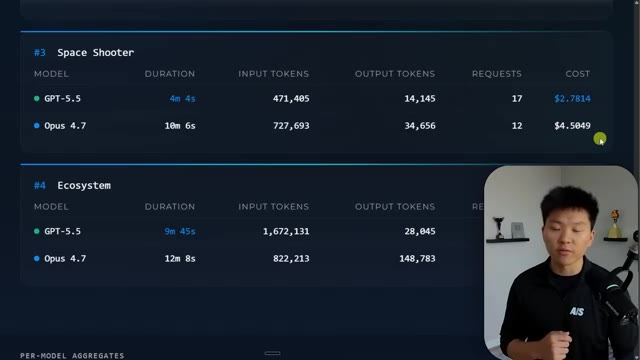
*⏱️ 00:14:01 — Tableau de bord comparatif affichant les coûts et les performances (durée, tokens, requêtes) de GPT-5.5 face à Opus 4.7 pour des projets nommés "Space Shooter" et "Ecosystem".*

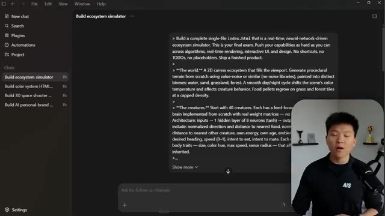
*⏱️ 00:14:06 — Interface d'une application de chat type IA montrant un prompt complexe et détaillé pour la création d'un "Ecosystem simulator" en un seul fichier index.html.*

---

### ⏱️ `[00:14:17 - 00:14:44]` | Segment #32

**🔊 Audio (Transcription Intégrale Mot pour Mot en Français) :**
> Okay. So here is our simulation of Codex. This is our living ecosystem. We can see we have population, generation, fitness, and some other stuff. And I can speed this up and I can watch this ecosystem evolve. Looks like right now it's okay. It's starting to drop. Let me actually slow this down. I can drop in some food, I think. So sprinkle food. Oh, the button's up here. Okay. So nothing seems to be working when I'm trying to sprinkle food and I'm trying to spawn more.

**👁️ Analyse Visuelle d'Écran (gemini-3.5-flash-lite) :**
**Interface & Outils** : Interface web de simulation "Neural Biome".

**Contenu textuel & Code** : Métriques affichées : Population (43), Génération (2), Fitness (0.2), Temps (Day), FPS (60), Speed (1.0x). Commandes de contrôle : lecture, rafraîchissement, modes (Observe, Food, Spawn) et curseur de vitesse.

**Action / Démonstration** : Le présentateur explique le fonctionnement de la simulation et manipule les commandes pour observer l'évolution de l'écosystème.

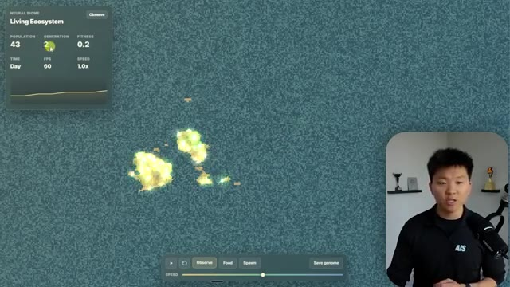
*⏱️ 00:14:23 — Une interface de simulation nommée "Neural Biome" affichant un écosystème vivant avec des entités lumineuses et un tableau de bord de statistiques en temps réel.*

---

### ⏱️ `[00:14:44 - 00:15:18]` | Segment #33

**🔊 Audio (Transcription Intégrale Mot pour Mot en Français) :**
> Nothing seems to be working. And unfortunately the population is dying out. So I'm real quick going to go back into codex and i'm going to ask oh wait but that's really interesting in this version the population looks like it's making a bit of a comeback but i guess i just don't really understand how i can control this so i'm just going to go ahead and ask real quick ah okay so food only works on grass or forest spawn only works on land i didn't necessarily want it to make a fix because i wanted to see how good it is just by default but let's see if i'm able to spawn some food in here or if i'm able to spawn some creatures okay so i'm able to spawn creatures but maybe it's just not visually showing me that i'm sprinkling food when i'm

**👁️ Analyse Visuelle d'Écran (gemini-3.5-flash-lite) :**
**Interface & Outils** : Interface de développement assisté par IA (probablement Cursor ou une interface similaire intégrée à un navigateur), simulateur WebGL "Neural Biome".

**Contenu textuel & Code** : Texte explicatif de l'agent sur les bugs de contrôle ("click handler"), statistiques en temps réel de la simulation (population, fitness, FPS), logs de tâches complétées.

**Action / Démonstration** : L'agent analyse les retours utilisateur, explique la logique de correction du code pour le "click handler", et exécute la simulation du biome neural.

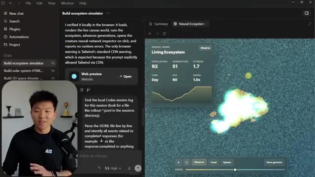
*⏱️ 00:14:53 — L'interface de l'agent IA affiche un simulateur d'écosystème avec un tableau de bord (population 92, génération 51) et une visualisation du biome neural.*

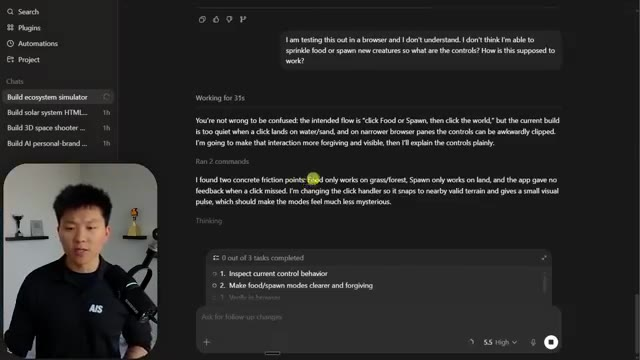
*⏱️ 00:15:01 — L'agent explique dans la fenêtre de chat les points de friction détectés (interactions nourriture/spawn) et propose des corrections logicielles.*

*⏱️ 00:15:09 — Le simulateur d'écosystème en mode plein écran montrant une baisse de la population (10 individus, génération 2) et un graphique de déclin.*

---

### ⏱️ `[00:15:18 - 00:15:39]` | Segment #34

**🔊 Audio (Transcription Intégrale Mot pour Mot en Français) :**
> trying to. Well, anyways, for a one-shot prompt, it's not great, but let's also go take a look at what Claude Code was able to do on one shot to compare. Oh, sorry. Also, one more thing you can do is we can click on a creature and we can see kind of like how it's evolving. We can see the energy, the age, the size, the speed, radius. We can just look at them in different ways.

**👁️ Analyse Visuelle d'Écran (gemini-3.5-flash-lite) :**
**Interface & Outils** : Application Web de simulation "Neural Biome".

**Contenu textuel & Code** : Métriques de simulation : Population (16), Génération (2), Fitness (0.2), FPS (60), Vitesse (0.3x) ; boutons de contrôle "Observe", "Food", "Spawn".

**Action / Démonstration** : Le présentateur commente l'interface de simulation où l'on peut observer les créatures évoluer en temps réel.

*⏱️ 00:15:23 — Une interface de simulation biologique appelée "Neural Biome" avec un panneau d'état en haut à gauche affichant les statistiques (population, génération, fitness, vitesse) et des contrôles de simulation en bas au centre.*

---

### ⏱️ `[00:15:40 - 00:16:14]` | Segment #35

**🔊 Audio (Transcription Intégrale Mot pour Mot en Français) :**
> Kind of interesting. But anyways, here is Claude Code's version. So it looks similar. I think honestly like aesthetically visually this one's makes more sense to me I can kind of see the land and I can see what I can do sprinkle food let's see if I can drop food in there nice I can spawn creature I can also spawn creatures in there as well I can save the top genome whatever that means okay that just downloaded some sort of JSON file but when I was playing around with this what I've noticed is I think that there's something wrong with this code for example all of the creatures are just staying in one fixed location. I don't even think they seem to be doing anything

**👁️ Analyse Visuelle d'Écran (gemini-3.5-flash-lite) :**
**Interface & Outils** : Application de simulation web / jeu de type "Neural Ecosystem".

**Contenu textuel & Code** : Panneau "Live Evolution" avec statistiques (Population: 41, Génération: 2, Avg Fitness: 0.05, Time of day: 07:53). Barre d'outils avec boutons : "Sprinkle Food", "Spawn Creature", "Reset", "Save Top Genome".

**Action / Démonstration** : Le présentateur interagit avec la simulation en cliquant pour ajouter de la nourriture et faire apparaître des créatures sur la carte.

*⏱️ 00:15:49 — Une interface de simulation "Neural Ecosystem" montrant une carte en pixel art avec de petits organismes lumineux, un panneau d'informations en haut à gauche et une barre d'outils en bas.*

---

### ⏱️ `[00:16:14 - 00:16:50]` | Segment #36

**🔊 Audio (Transcription Intégrale Mot pour Mot en Français) :**
> with the food. They just seem to die. And then they just die. And then the population hits 10. And then it just sticks at 10. So if I speed this up, you can see that this is going to hit 10 and then it just stays. So I don't know exactly, you know, obviously there's an issue with the code. Once again, this was a one shot prompt, but if I add more, it just goes back to 10. So there's something in there that's stuck. The logic isn't working. And if I switch back over to Codex's version. It's kind of a similar thing. Like it just doesn't actually work. The logic doesn't work in order to make this like a legit simulation. It doesn't seem like at least, or maybe I just need it to speed up faster where we actually see something. So let me speed this up and just see

**👁️ Analyse Visuelle d'Écran (gemini-3.5-flash-lite) :**
**Interface & Outils** : Application de simulation d'écosystème neuronal personnalisée (environnement de test pour IA).

**Contenu textuel & Code** : Métriques de performance de l'écosystème : Population, Génération, Fitness, Vitesse de simulation, FPS, Temps.

**Action / Démonstration** : Le présentateur observe la dynamique de population dans l'écosystème et ajuste la vitesse de simulation pour démontrer un bug où la population se stabilise à 10.

*⏱️ 00:16:23 — Interface de simulation "Neural Ecosystem" affichant une carte avec des créatures (points lumineux), des statistiques de population (10) et de génération, et une barre de contrôle de simulation (vitesse, nourriture).*

*⏱️ 00:16:41 — Interface de simulation "Neural Biome" affichant un environnement simplifié avec des îlots, montrant une population de 11, une fitness de 0.2, et des contrôles de simulation en bas.*

---

### ⏱️ `[00:16:50 - 00:17:22]` | Segment #37

**🔊 Audio (Transcription Intégrale Mot pour Mot en Français) :**
> if it can go past 10 at all. Yeah. I mean, I don't know what's going on. Look at this poor soul. He just died, but yeah, I don't think I'm able to sprinkle food. So, so anyways, none of those are perfect. And what we would have to do obviously is we would iterate and we'd come back and we would give some feedback. But let's take a look at the stats here. Kind of interesting. So GBT 5.5 took almost 10 minutes and Opus 4.7 took about 12 minutes. Now GBT 5 took way more input tokens here, like double. But also look at how many output tokens it used compared to Opus 4.7. Now it's

**👁️ Analyse Visuelle d'Écran (gemini-3.5-flash-lite) :**
**Interface & Outils** : - Image 1 : Simulateur web "Neural Biome" (Living Ecosystem).
- Image 2 : Tableau de bord de suivi d'utilisation API / Coûts (probablement issu d'une plateforme de monitoring LLM type LangSmith ou outil propriétaire).

**Contenu textuel & Code** : - Image 1 : Métriques en temps réel (Population, Fitness, FPS).
- Image 2 : Données chiffrées : GPT-5.5 (1,672,131 tokens, 9.20$) vs Opus 4.7 (822,213 tokens, 7.83$).

**Action / Démonstration** : - Image 1 : Observation de l'écosystème neural en cours d'exécution.
- Image 2 : Analyse comparative des performances et de la rentabilité des différents modèles IA utilisés dans le projet.

*⏱️ 00:16:58 — Interface interactive d'un simulateur "Neural Biome" affichant les statistiques de population (10), génération (2) et vitesse de simulation (10.0x).*

*⏱️ 00:17:06 — Tableau de bord d'analyse de coûts et de performances par modèle IA (GPT-5.5 et Opus 4.7), détaillant le temps de traitement, les tokens consommés et les coûts financiers.*

---

### ⏱️ `[00:17:22 - 00:17:56]` | Segment #38

**🔊 Audio (Transcription Intégrale Mot pour Mot en Français) :**
> interesting because GBT 5.5 still costed us more here because of how many input tokens it took. But that is really interesting to me that it's able to only output about 28,000 tokens and we're still able to get an output that's basically the same. Like this is basically the same as this, like pretty close, but it took a fraction of the output tokens, which is just really interesting to me. Okay. So if we zoom out and we look at all of these statistics as a whole, we did four total experiments. Total runtime between the two was about an hour and GBT total runtime was 20

**👁️ Analyse Visuelle d'Écran (gemini-3.5-flash-lite) :**
**Interface & Outils** : Dashboard d'analyse de données (web-based) et interface de simulation d'écosystème IA.

**Contenu textuel & Code** : Métriques chiffrées (tokens, coûts en USD, temps d'exécution, nombre de requêtes) et visualisation graphique comparative des modèles GPT-5.5 et Opus 4.7.

**Action / Démonstration** : Présentation comparative des coûts et des performances techniques des modèles IA à travers des simulations d'expérimentation.

*⏱️ 00:17:31 — Tableau de bord d'analyse comparant les performances et coûts entre les modèles GPT-5.5 et Opus 4.7, mettant en évidence les métriques spécifiques à l'expérience "#4 Ecosystem".*

*⏱️ 00:17:39 — Interface de simulation "Live Evolution" montrant un écosystème pixélisé avec des créatures et des points de nourriture, illustrant l'application pratique des modèles IA.*

*⏱️ 00:17:47 — Tableau de bord global "AI Model Comparison" présentant des graphiques à barres comparant la durée, le coût et le nombre de jetons de sortie pour quatre expériences différentes.*

---

### ⏱️ `[00:17:56 - 00:18:28]` | Segment #39

**🔊 Audio (Transcription Intégrale Mot pour Mot en Français) :**
> minutes, 49 seconds. Opus total runtime was 40 minutes and 43 seconds. So basically double the runtime. Input tokens, they were honestly pretty similar. 2.7 million over here with GBT and 2.5 million with Opus. But the output tokens tells a very interesting story. It's about 70k compared to about a quarter million. And then total cost, it honestly came out to be pretty even, but GBT was about three bucks cheaper over these four experiments. But if every single time you do it, it's a fraction of a bit cheaper with GBT 5.5, then in the long run, it's going to get more and

**👁️ Analyse Visuelle d'Écran (gemini-3.5-flash-lite) :**
**Interface & Outils** : Tableau de bord analytique web personnalisé (interface sombre avec graphiques et cartes de données).

**Contenu textuel & Code** : Comparaisons chiffrées : Runtime (61m 32s total), Input Tokens (~5,18M total), Output Tokens (GPT-5.5: 68,049 vs Opus 4.7: 248,269), Total Cost ($34.18). Graphique à barres comparant les durées d'exécution.

**Action / Démonstration** : Présentation commentée de données de benchmark comparant l'efficacité opérationnelle, les coûts et le volume de génération de tokens entre les modèles GPT-5.5 et Opus 4.7.

*⏱️ 00:18:04 — Tableau de bord d'analyse comparative "AI Model Comparison" affichant les métriques de runtime, tokens d'entrée et coûts totaux entre GPT-5.5 et Opus 4.7.*

*⏱️ 00:18:12 — Suite du tableau de bord affichant les métriques "Total Output Tokens" (316,318 au total) et le début du graphique "Duration by experiment".*

*⏱️ 00:18:20 — Vue détaillée du graphique "Duration by experiment" comparant les temps d'exécution des deux modèles, avec le présentateur en médaillon.*

---

### ⏱️ `[00:18:28 - 00:19:02]` | Segment #40

**🔊 Audio (Transcription Intégrale Mot pour Mot en Français) :**
> more cheap. So I won't dive into all of these other graphs because I think we've already kind of understood the differences here, but GBT5 is green. Opus 4.7 is blue. And for the majority of the time, GBT is in the position that we would rather be in, meaning it's less and it's less and it's less and it is less. I could have just said all four that GBT was less. But anyways, that is going to do it for today. I hope you guys enjoy this little experiment. I really encourage you to just hop into ChatGPT or plug in GBT 5.5 in your automations via API, or maybe even hop on

**👁️ Analyse Visuelle d'Écran (gemini-3.5-flash-lite) :**
**Interface & Outils** : Dashboard d'analyse de données (type BI/Custom web interface).

**Contenu textuel & Code** : Graphiques en barres et courbes comparatives montrant "Duration by experiment", "Cost by experiment", "Output tokens" et "Cumulative cost".

**Action / Démonstration** : Présentation visuelle et analyse comparative des métriques de performance et de coûts entre deux modèles d'IA.

*⏱️ 00:18:37 — Tableau de bord d'analyse comparant les performances (durée, coût) de "GPT-5.5" (vert) et "Opus 4.7" (bleu) sur quatre expériences.*

*⏱️ 00:18:45 — Suite du tableau de bord affichant les graphiques des "Output tokens" et du "Cumulative cost" pour les deux modèles.*

*⏱️ 00:18:54 — Vue d'ensemble du tableau de bord "AI Model Comparison" avec les totaux agrégés en haut de page.*

---

### ⏱️ `[00:19:02 - 00:19:32]` | Segment #41

**🔊 Audio (Transcription Intégrale Mot pour Mot en Français) :**
> Codex and play around with it a little bit. I'm a firm believer in not one tool being the best, but figuring out which tool to use for your use case. I've been playing around with Codex a lot. I just haven't started making YouTube videos too much on it yet because I don't really want to overwhelm you guys with too many things. And I know I've been uploading a lot lately, so maybe you are overwhelmed either way and there's so many new features. But like I said, just try out new tools. So if you enjoyed the video or you learned something new, please give a like. It helps me out a ton. And as always, I appreciate you guys making it to the end of the video and I'll see you all in the next one. Thanks everyone.

**👁️ Analyse Visuelle d'Écran (gemini-3.5-flash-lite) :**
**Interface & Outils** : Tableau de bord analytique personnalisé (UI de comparaison de modèles).

**Contenu textuel & Code** : Graphiques en barres comparatifs ("Duration by experiment", "Cost by experiment") et indicateurs chiffrés agrégés (Total runtime: 61m 32s, Total cost: $34.18, etc.).

**Action / Démonstration** : Présentation visuelle des données de benchmarking comparatif des modèles d'IA pour illustrer l'efficacité opérationnelle.

*⏱️ 00:19:10 — Un tableau de bord analytique comparant les performances et les coûts entre deux modèles d'IA, GPT-5.5 et Opus 4.7, affichant des métriques de temps d'exécution, de jetons consommés et de coûts.*

---

