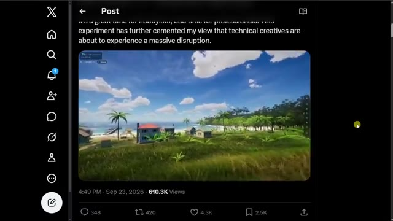
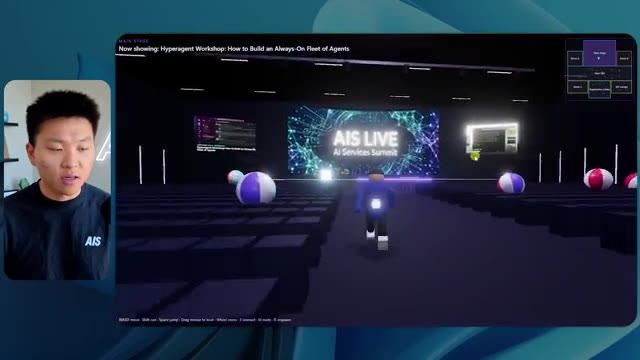
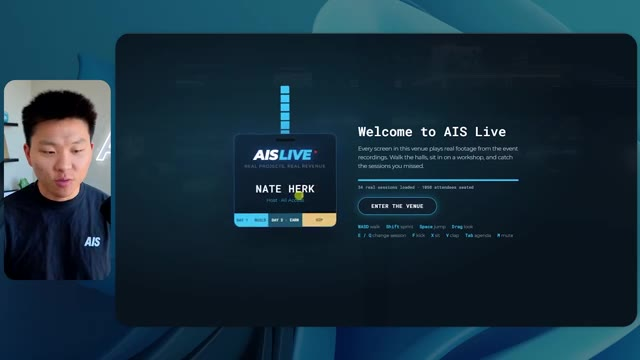
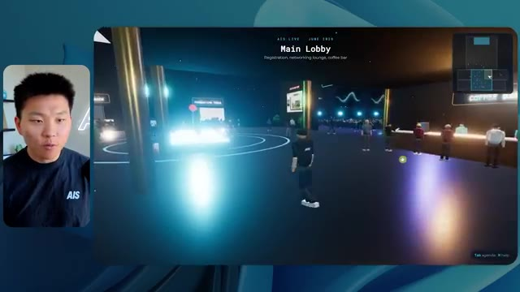
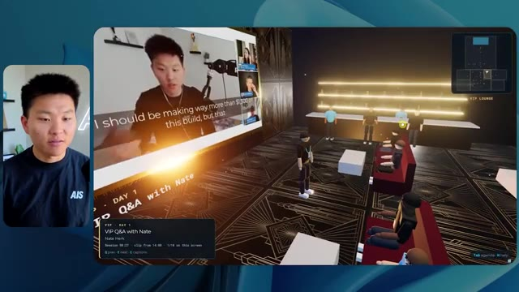
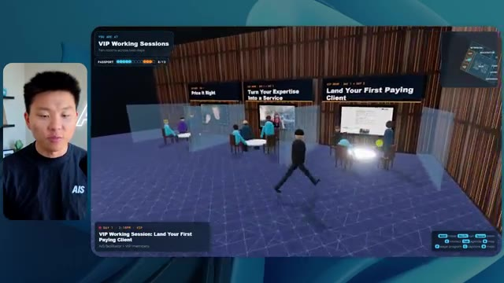
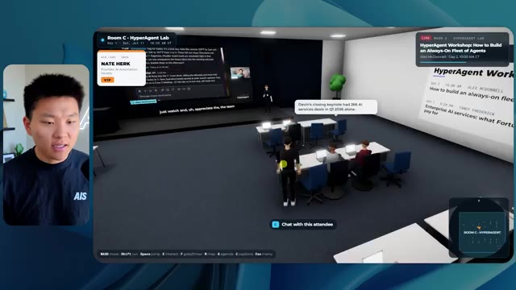
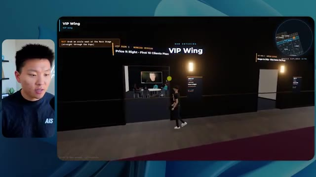
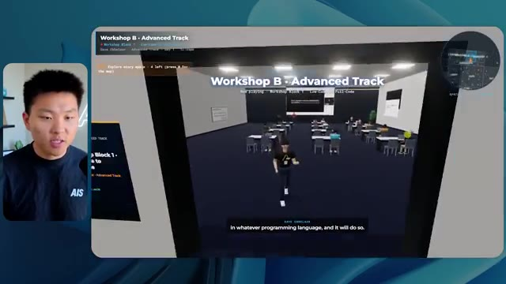
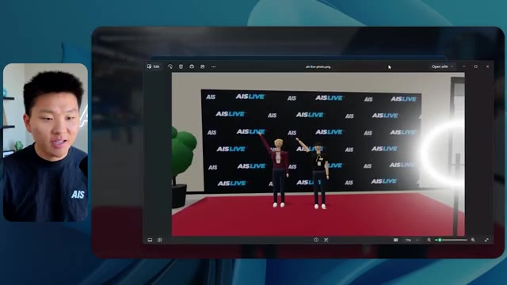

# 🎬 I Tested GPT 5.5 vs Opus 4.7: What You Need to Know

> **Chaîne** : [Nate Herk | AI Automation](https://www.youtube.com/@nateherk/featured)  
> **Lien YouTube** : [https://www.youtube.com/watch?v=WX4rp-vP3zo](https://www.youtube.com/watch?v=WX4rp-vP3zo)  
> **Date de publication** : 20260423  
> **Durée** : 00:19:33  
> **Identifiant vidéo** : `WX4rp-vP3zo`  
> **Transcription & Analyse** : `whisper-v3-large-turbo+gemini-3.5-flash-lite`  

---

## 📌 Synthèse Exécutive & Outils

### 💡 Résumé

Dans cette vidéo issue de la chaîne de Nate Herk, l'analyse se penche sur l'évaluation comparative d'**Opus 5.5** d'Anthropic soumis à différents niveaux d'effort (de "bas" à "ultra code") pour réaliser une tâche d'ingénierie logicielle et de génération de mondes virtuels complexes. À partir d'un prompt unique et ambitieux — transformer un dossier Frame.io de 105 gigaoctets d'enregistrements vidéo d'un événement virtuel (« AIS Live ») en un monde 3D interactif et explorable à la troisième personne — Nate met à l'épreuve les capacités d'agents IA autonomes. L'expérience exige non seulement la structuration d'un espace virtuel réaliste avec des pistes, des salles et des scènes, mais aussi l'intégration de ressources dynamiques et le respect de critères stricts de design et de physique.

Les résultats démontrent des divergences drastiques selon le niveau d'effort configuré. Le niveau « bas » génère rapidement une ébauche fonctionnelle en près de 17 minutes pour un coût API estimé à 3,91 $, mais pèche par des incohérences visuelles majeures, des bugs d'affichage et l'absence d'éléments de branding personnalisés, tout en accomplissant 22 vérifications autonomes sans poser la moindre question. À l'inverse, le niveau « moyen » élève significativement la qualité globale de l'expérience après un temps d'exécution d'une heure et 13 minutes (pour 12,44 $ d'API et 490 000 jetons) : le monde virtuel intègre fidèlement la palette de couleurs de la marque, propose des PNJ (personnages non-joueurs) animés, des flux vidéo fonctionnels dans les différentes salles d'ateliers et des zones thématiques immersives comme un salon VIP.

L'analyse met ainsi en lumière l'arbitrage critique entre la granularité des ressources informatiques allouées et le rendu final de l'automatisation. Elle souligne l'efficacité des modèles d'Anthropic pour concevoir des applications web interactives complexes à partir de consignes textuelles d'envergure, tout en posant la problématique récurrente du déploiement en production, transition habilement résolue par des solutions d'hébergement intégrées.

### 🛠️ Outils, Modèles & Logiciels Présentés

* **Opus 5.5** : Le modèle d'intelligence artificielle phare d'Anthropic, reconnu pour son intelligence, son coût abordable et sa polyvalence dans les tâches de développement et d'automatisation complexes.
* **Claude Code** : L'outil de développement et d'assistance par ligne de commande d'Anthropic utilisé pour orchestrer la création et la manipulation du code.
* **Hostinger (Connecteur Hostinger)** : L'extension gratuite pour les éditeurs de code (VS Code, Cursor) présentée comme sponsor, permettant d'importer directement son compte d'hébergement pour simplifier la mise en ligne des produits finis.
* **Frame.io** : La plateforme cloud collaborative utilisée pour stocker et structurer les 105 gigaoctets d'enregistrements vidéo de l'événement virtuel AIS Live.
* **Cursor / VS Code** : Les environnements de développement intégrés (IDE) mentionnés pour l'écriture et le déploiement de code assisté par IA.

### 🔑 Points Clés & Enseignements Stratégiques

* **Impact direct du niveau d'effort sur la qualité** : La variation des niveaux d'effort modifie radicalement le rendu d'un agent IA ; le passage du niveau bas au niveau moyen transforme une maquette grossière et boguée en un produit soigné, respectueux de la charte graphique.
* **Autonomie décisionnelle des agents** : Même sur des tâches hautement complexes nécessitant des dizaines de vérifications dans le navigateur (22 à 23 cycles de test), les modèles Opus 5.5 exécutent les directives sans solliciter l'utilisateur (zéro question posée), démontrant une forte autonomie exécutive.
* **Arbitrage temps/coût/ressources** : Un niveau d'effort supérieur multiplie le temps de traitement par plus de quatre (passant de 16 min 43 s à 1 h 13 min) et triple le coût estimé par API (de 3,91 $ à 12,44 $), un investissement justifié par le gain qualitatif et fonctionnel.
* **Intégration de données brutes massives** : L'agent est capable d'analyser et d'exploiter un volume considérable de données non structurées (105 Go de vidéos sur Frame.io) pour alimenter dynamiquement un environnement virtuel contextuel (ordre du jour, ateliers, scènes principales).
* **Rendu contextuel et respect du branding** : Les niveaux d'effort plus élevés permettent à l'IA d'assimiler les directives de marque (palettes de couleurs, logos, identité visuelle d'AIS Live) pour produire un résultat professionnel et personnalisé plutôt qu'un template générique.
* **Dynamisme des environnements générés** : Au-delà d'un simple site statique, l'ingénierie poussée permet d'injecter des flux vidéo fonctionnels, des PNJ interactifs réactifs et des éléments de gamification (exploration à la troisième personne, mini-cartes synchronisées).
* **Gestion des limites logicielles de l'IA** : Malgré la puissance d'Opus 5.5, certains artefacts visuels subsistent (disparition de personnages, positionnement approximatif d'éléments graphiques), rappelant la nécessité de phases de raffinement itératif.
* **Alignement avec les recommandations officielles** : L'expérimentation confirme la stratégie préconisée par Anthropic dans ses guides de prompt engineering : démarrer par un niveau d'effort modéré (moyen) avant d'ajuster (à la hausse ou à la baisse) en fonction de la complexité réelle de la tâche.
* **Résolution du « dernier kilomètre » du développement** : L'automatisation par IA résout brillamment la conception et le code d'applications, mais nécessite des outils de connectivité directe (tels que les extensions d'hébergement intégrées aux IDE) pour combler le fossé vers le déploiement en production.

---

## ⏱️ Chronologie & Transcription Complète Audio & Visuelle (Mot pour Mot)

### ⏱️ `[00:00:00 - 00:00:20]` | Segment #01

**🔊 Audio (Transcription Intégrale Mot pour Mot en Français) :**
> Opus 5.5, Opus 5.5, Opus 5.5, Opus 5.5, Opus 5.5. Ce modèle est littéralement partout et pour de très bonnes raisons. Il est intelligent, il est bon marché, il a un goût extraordinaire, c'est un modèle d'IA incroyable. Mais avec chaque modèle d'IA, vous avez le choix de l'effort, que ce soit bas, moyen, haut, extra, max ou code ultra.

**👁️ Analyse Visuelle d'Écran (gemini-3.5-flash-lite) :**
**Interface & Outils** : Interface de type réseau social (Twitter/X).

**Contenu textuel & Code** : Publication sur le impact de l'IA sur les créatifs techniques avec un visuel de rendu 3D.

**Action / Démonstration** : Illustration visuelle du sujet abordé par le présentateur concernant les performances et la disruption engendrée par les modèles d'IA.

*⏱️ 00:00:05 — Capture d'écran montrant un tweet ou une publication sur les réseaux sociaux avec une vidéo intégrée affichant un paysage tropical en 3D.*

---

### ⏱️ `[00:00:20 - 00:00:38]` | Segment #02

**🔊 Audio (Transcription Intégrale Mot pour Mot en Français) :**
> Donc dans cette vidéo, j'ai donné exactement le même prompt à Opus 5.5 et je l'ai exécuté sur chaque niveau d'effort et nous allons comparer les résultats. Nous allons examiner la qualité de toutes les différentes sorties réelles, mais nous allons aussi examiner combien de temps chacun d'eux a fonctionné, combien cela nous a coûté si c'était une facturation par API, le total des jetons, combien de vérifications ils ont exécutées, et combien de questions ils m'ont réellement posées tout au long du processus.

**👁️ Analyse Visuelle d'Écran (gemini-3.5-flash-lite) :**
**Interface & Outils** : Interface web de tableau de bord ou d'outil d'analyse.

**Contenu textuel & Code** : Tableau comparatif affichant les différents niveaux d'effort de Opus 5.5 avec des lignes de métriques (Run time, API cost, Total tokens, Checks, Questions asked).

**Action / Démonstration** : Présentation de la structure de comparaison des performances et des coûts selon les niveaux d'effort.

*⏱️ 00:00:29 — Capture d'un tableau comparatif avec les niveaux d'effort (Low, Medium, High, Extra, Max, Ultracode) et des métriques (Run time, API cost, Total tokens, etc.).*

---

### ⏱️ `[00:00:39 - 00:00:58]` | Segment #03

**🔊 Audio (Transcription Intégrale Mot pour Mot en Français) :**
> Et les résultats que nous avons obtenus ne sont pas du tout ce à quoi je m'attends, donc j'ai hâte de partager cela avec vous les gars. Ne perdons pas de temps et allons directement à celui-ci. D'accord, alors plongeons directement dans celui-ci. Je veux commencer simplement en vous montrant le prompt réel que nous avons utilisé, que nous avons donné à chacun de ces différents agents. Je vais aller dans les fichiers ici, et nous allons ouvrir ce fichier markdown de prompt, et je vais vous montrer ce que nous avons obtenu. Voici donc le slash objectif que j'ai alimenté.

**👁️ Analyse Visuelle d'Écran (gemini-3.5-flash-lite) :**
**Interface & Outils** : Interface graphique d'un outil de développement assisté par IA / éditeur de code avec panneau de discussion et gestion de worktrees.

**Contenu textuel & Code** : Message de l'assistant IA invitant à démarrer une tâche (« Hi Nate. This worktree has the effort-test task queued in PROMPT.md : build a walkable third-person 3D world... »).

**Action / Démonstration** : Navigation et présentation de l'interface de l'outil de développement IA avant de lancer ou d'expliquer le prompt.

*⏱️ 00:00:48 — Interface d'une application de développement avec un assistant IA (style éditeur de code/terminal), montrant une conversation sur un projet de monde 3D et le présentateur en incrustation vidéo à gauche.*

---

### ⏱️ `[00:00:58 - 00:01:34]` | Segment #04

**🔊 Audio (Transcription Intégrale Mot pour Mot en Français) :**
> J'ai dit, tu dois me créer un monde en 3D qui est une conférence tech réaliste dans laquelle je peux me promener en vue à la troisième personne. Tu vas regarder ce dossier, qui contient mes éléments d'enregistrement d'événements provenant d'AIS Live. Et ce dossier est un dossier Frame.io de 105 gigaoctets d'enregistrements vidéo. C'était un événement entièrement virtuel. Tout a été enregistré et tous les enregistrements sont juste ici. J'ai dit, ton objectif est de prendre cet événement et de le transformer en un monde 3D explorable qui me donne l'impression d'être réellement allé à une vraie conférence en personne avec différentes salles, différentes pistes, différentes scènes, bla, bla, bla. N'hésite pas à utiliser key.ai si tu as besoin de générer des images ou des vidéos. Et tu peux aussi utiliser tout ce qui se trouve dans mon projet Herc 2, qui est comme mon système d'exploitation IA. J'ai dit,

**👁️ Analyse Visuelle d'Écran (gemini-3.5-flash-lite) :**
**Interface & Outils** : Éditeur de code (VS Code / interface similaire) et interface web Frame.io

**Contenu textuel & Code** : Texte du prompt demandant la création d'un monde 3D interactif basé sur un dossier d'enregistrements d'événements de 105 Go.

**Action / Démonstration** : Présentation du prompt initial et du dossier Frame.io contenant les ressources de la conférence virtuelle AIS Live.

*⏱️ 00:01:07 — Un éditeur de texte affichant le fichier PROMPT.md avec les instructions détaillées pour créer le monde 3D.*

*⏱️ 00:01:16 — Une interface web Frame.io montrant un dossier d'une taille de 105.69 Go contenant les enregistrements d'événements AIS Live.*

*⏱️ 00:01:25 — Un retour à l'éditeur de texte sur le fichier PROMPT.md, illustrant la consigne donnée à l'IA.*

---

### ⏱️ `[00:01:34 - 00:02:08]` | Segment #05

**🔊 Audio (Transcription Intégrale Mot pour Mot en Français) :**
> tu seras jugé sur la créativité, le design, la physique et la sensation générale lorsque j'explorerai le monde en 3D que tu as construit. Et c'était fondamentalement la fin des instructions. Donc, comme vous pouvez le voir sur ce côté gauche, j'ai exécuté cela à travers tous les différents niveaux d'effort. Commençons par le niveau bas et progressons jusqu'à l'ultra code. Très bien. Nous avons donc ici le résultat du niveau bas. Ouvrons ceci et jetons un œil. Nous avons donc AIS Live, le sommet des services IA enfin en personne, et nous avons pu cliquer partout. Tout d'abord, cela ne fait pas très personnalisé. Genre, ce n'is pas le logo d'AIS Live. Ce n'est même pas nos couleurs. Donc je n'aime pas trop ça, mais entrons ici. D'accord. C'est beaucoup trop lumineux. Euh, nous avons une carte en haut à droite. Nous avons une ville par ici. Je ne peux pas dire quelle ville c'est

**👁️ Analyse Visuelle d'Écran (gemini-3.5-flash-lite) :**
**Interface & Outils** : Application de chat / agent IA (semblable à Cursor ou interface de développement)

**Contenu textuel & Code** : Texte du prompt : "Hi Nate. This worktree has the effort-test task queued in PROMPT.md : build a walkable third-person 3D world of the AIS Live conference... I haven't started it. Should I begin, or did you have something else in mind?"

**Action / Démonstration** : Sélection d'un niveau d'effort et saisie d'un message dans la zone de texte pour valider le démarrage de la tâche.

*⏱️ 00:01:42 — Interface d'une application d'agent IA montrant un panneau latéral avec différents niveaux d'effort de test ('Hello', 'Extra', 'High', 'Max', 'Ultracode', 'Medium', 'Low') et une zone de discussion principale avec un message concernant la création d'un monde 3D.*

---

### ⏱️ `[00:02:08 - 00:02:40]` | Segment #06

**🔊 Audio (Transcription Intégrale Mot pour Mot en Français) :**
> c'est. D'accord. C'est Chicago, ce qui est plutôt cool parce que vous savez, j'habite à Chicago, mais bref, en haut à droite, nous pouvons voir une carte. Nous avons un hall d'accueil. Nous avons un hall d'exposition. Nous avons la scène principale du salon VIP. La carte montre également où se trouve chaque autre personne et cela se synchronise en direct. Nous pouvons donc voir l'enregistrement. Nous pouvons voir le premier jour, la keynote de l'agent hyper, le débriefing en direct. Cool. Donc ça connaît réellement l'ordre du jour et puis il y a le deuxième jour. Donc il a trouvé ça, c'est bien. Nous avons ces petites boules ici que je peux espérer projeter d'un coup de pied. D'accord. Le visage, oh, regardez ça. Si je vais par ici, toutes les personnes disparaissent tout simplement. Très mauvais. Très mauvais. D'accord. Alors voyons voir. Est-ce que je peux sprinter ? D'accord.

**👁️ Analyse Visuelle d'Écran (gemini-3.5-flash-lite) :**
**Interface & Outils** : Application ou plateforme virtuelle interactive en 3D avec mini-carte de navigation et affichage informatif.

**Contenu textuel & Code** : Textes descriptifs d'un événement, programme de conférences (Day 1 - schedule) et indications géographiques virtuelles.

**Action / Démonstration** : Navigation et exploration d'un espace virtuel 3D interactif représentant un salon ou une conférence en ligne.

*⏱️ 00:02:16 — Vue d'un environnement virtuel 3D avec un avatar et une carte de navigation en haut à droite indiquant le hall d'exposition et la zone de retrait des badges.*

*⏱️ 00:02:24 — Vue du hall d'entrée virtuel montrant un panneau affichant le programme du premier jour (DAY 1) avec les différentes sessions et présentateurs.*

*⏱️ 00:02:32 — Vue du hall d'exposition virtuel (EXPO HALL) avec des avatars et des éléments graphiques lumineux au sol et au centre.*

---

### ⏱️ `[00:02:40 - 00:03:04]` | Segment #07

**🔊 Audio (Transcription Intégrale Mot pour Mot en Français) :**
> Je peux aller un peu plus vite. Je vais d'abord aller par ici. Il y a des produits promotionnels, euh, certifiés AIS plus glido. D'accord. Donc il y a les vrais stands qu'on avait dans l'événement virtuel. On avait des stands. Donc c'est plutôt cool. Un petit endroit pour prendre des photos. Salle C. En ce moment, nous avons Tangy Frederick qui anime un atelier. D'accord. Mais ce n'est pas une vidéo. Comme vous pouvez le voir, c'est juste une image. Elle ne bouge pas. Donc c'est juste une image. Ces gens sont en train de disparaître. Ce doivent être des fantômes. Allons par ici vers la salle A.

**👁️ Analyse Visuelle d'Écran (gemini-3.5-flash-lite) :**
**Interface & Outils** : Environnement virtuel 3D (plateforme de type métavers ou événement virtuel interactif).

**Contenu textuel & Code** : Éléments graphiques 3D, panneaux d'affichage virtuels avec texte et instructions, mini-carte de navigation.
[CONSIDERATIONS] Navigation et exploration de l'espace virtuel par un avatar.

**Action / Démonstration** : Explications face caméra et démonstration conceptuelle.

---

### ⏱️ `[00:03:04 - 00:03:30]` | Segment #08

**🔊 Audio (Transcription Intégrale Mot pour Mot en Français) :**
> Nous avons Liberty White. D'accord. Très cool. Vos 30 premiers jours en automatisation. Encore une fois, c'est juste une image fixe et les gens ont des bugs d'affichage. Donc ce n'est pas très bien ici. Je vais aller sur la scène principale et voir ce que nous avons. D'accord, cool. Donc nous avons une scène d'apparence principale. Les gens ont des bugs d'affichage. Vraiment grave. Ce n'est vraiment pas terrible. Notre vidéo est en fait en train de bouger. Genre, j'ai vu mon visage ici et j'ai vu celui de Devin, mais maintenant ils ont disparu. Donc je ne sais pas ce qui s'est passé. D'accord. Ça ressemble plutôt à un diaporama. Rien n'est encore vraiment diffusé. Bref, entrons ici.

**👁️ Analyse Visuelle d'Écran (gemini-3.5-flash-lite) :**
**Interface & Outils** : Environnement virtuel 3D interactif (type metaverse/plateforme de conférence virtuelle).

**Contenu textuel & Code** : Affichage des salles de réunion virtuelles, écrans de présentation de l'AI Services Summit et avatars des participants.

**Action / Démonstration** : Exploration et navigation en 3D d'un espace de conférence virtuel par l'animateur.

*⏱️ 00:03:11 — Vue dans une salle virtuelle "Workshop Room A" montrant un avatar dans un espace 3D minimaliste.*

*⏱️ 00:03:17 — Navigation de l'avatar dans une grande salle de conférence virtuelle (Main Stage) remplie d'avatars assis.*

*⏱️ 00:03:24 — Vue de face de la scène principale "AIS LIVE - AI Services Summit" avec des écrans de présentation géants.*

---

### ⏱️ `[00:03:30 - 00:03:58]` | Segment #09

**🔊 Audio (Transcription Intégrale Mot pour Mot en Français) :**
> Nous avons plus de stands. Nous avons hyper agent. Nous avons Claude Code. Nous avons plus de gadgets. La salle B est celle de Dave Ebelor. Je suppose que c'est exactement la même chose. Nous avons du café. Et ensuite, je suppose le salon VIP, accès VIP seulement. C'est plutôt cool, mais il ne se passe vraiment rien ici. Cet écran est bien trop lumineux. D'accord. Donc je pense que vous comprenez l'ambiance que nous obtenons ici d'Opus 5.5 à faible effort. Et c'est là que les choses deviennent intéressantes. Combien de temps pensez-vous que cela a duré ? Combien de temps ? Celui-ci a duré 16 minutes et 43 secondes. Combien pensez-vous que cela a coûté ?

**👁️ Analyse Visuelle d'Écran (gemini-3.5-flash-lite) :**
**Interface & Outils** : Application de tableau blanc / interface comparative (Opus 5.5 Efforts)

**Contenu textuel & Code** : Tableau avec les colonnes Low, Medium, High, Extra, Max, Ultracode et lignes Run time, API cost, Total tokens, Checks, Questions asked.

**Action / Démonstration** : Navigation et présentation des différents niveaux d'effort et de performance de l'outil.

*⏱️ 00:03:51 — Interface de tableau blanc ou d'application montrant un tableau comparatif avec les niveaux 'Low', 'Medium', 'High', 'Extra', 'Max', 'Ultracode' et des métriques telles que Run time, API cost, Total tokens.*

---

### ⏱️ `[00:03:58 - 00:04:26]` | Segment #10

**🔊 Audio (Transcription Intégrale Mot pour Mot en Français) :**
> 3,91 dollars si c'était une facturation par API. J'utilise évidemment mon abonnement ici, mais nous allons juste calculer cela en facturation API. Le nombre total de tokens était de 191 000. Il a fait 22 vérifications. Donc la vérification, 22 fois il a ouvert le navigateur et a exécuté différentes sortes de vérifications. Donc 22 catégories de vérifications. Et combien de questions m'a-t-il posé ? Il m'a posé un total de zéro question tout au long de cette invite de commande « slash goal ». D'accord. Alors, ouvrons l'effort moyen et voyons ce que nous avons. D'accord, c'est parti. Effort moyen. Nous avons Nate Herc. Nous avons mon badge. C'est de la marque AI's Life.

**👁️ Analyse Visuelle d'Écran (gemini-3.5-flash-lite) :**
**Interface & Outils** : Tableau blanc ou application de dessin/diagramme (style Excalidraw ou similaire) avec une vue incrustée de la caméra du présentateur.

**Contenu textuel & Code** : Tableau avec les lignes 'Run time', 'API cost', 'Total tokens', 'Checks', 'Questions asked' et les colonnes 'Low', 'Medium', 'High', 'Ex'. Valeurs affichées pour 'Low' : 16m 43s, $3.91, 191.3K.

**Action / Démonstration** : Présentation des résultats d'analyse et des coûts API associés à l'exécution de l'agent.

*⏱️ 00:04:05 — Tableau comparatif affichant les métriques d'exécution d'un agent IA pour le niveau 'Low' : Run time (16m 43s), API cost ($3.91), Total tokens (191.3K), Checks et Questions asked, avec le présentateur à gauche.*

---

### ⏱️ `[00:04:26 - 00:04:46]` | Segment #11

**🔊 Audio (Transcription Intégrale Mot pour Mot en Français) :**
> Donc ça a déjà l'air un tout petit peu mieux. On dirait nos palettes de couleurs qui ont utilisé nos directives de marque. Premier jour de construction, deuxième jour de gain, VIP. Cool. D'accord. Je vais entrer dans le lieu. D'accord. Waouh. Donc une ambiance un peu similaire. C'est en arrière-plan. Ça ne ressemble pas à Chicago, n'est-ce pas ? Non, ça ressemble à, honnêtement, ça ressemble à une ville inventée. Quoi qu'il en soit, c'est drôle qu'ils aient décidé de faire ça. Voyons si je peux bouger un peu plus vite. Oh, waouh.

**👁️ Analyse Visuelle d'Écran (gemini-3.5-flash-lite) :**
**Interface & Outils** : Application web interactive / Plateforme virtuelle 3D 'AIS Live'

**Contenu textuel & Code** : Écran de bienvenue, badge virtuel personnalisé, contrôles de navigation (WASD, Shift, Espace), et vue de l'espace virtuel 3D.

**Action / Démonstration** : Navigation et exploration de l'interface de l'application et entrée dans le lieu virtuel.

*⏱️ 00:04:31 — Interface web de l'application 'AIS Live' montrant un écran d'accueil avec un badge nominatif virtuel au nom de Nate Herk et des options de navigation.*

*⏱️ 00:04:41 — Vue dans l'espace virtuel 3D de l'application 'AIS Live' montrant des avatars et un environnement intérieur avec vue sur une ville la nuit.*

---

### ⏱️ `[00:04:46 - 00:05:21]` | Segment #12

**🔊 Audio (Transcription Intégrale Mot pour Mot en Français) :**
> Les gens interagissent avec moi. Regardez. Si je m'approche de ce type, il vient de lever le bras. Bon, maintenant il ne veut plus du tout avoir affaire à moi. Mais tous ces petits robots ici doivent prendre des décisions. Je ne sais pas s'ils utilisent Jev. C'est sûr que non. Je ne le lui ai pas dit. En fait, ma clé Jev est à l'arrière. Je ne sais pas. Peut-être qu'il l'a utilisée. Quoi qu'il en soit, nous pouvons voir ici que nous avons la salle d'atelier C, le laboratoire des agents. Sympa. Donc celui-ci est réellement en train de fonctionner. Vous pouvez voir qu'il s'agit d'une vraie vidéo diffusée par Tangy. Tout le monde ici est en train de travailler sur un ordinateur portable. Ils ne buguent pas. C'est plutôt cool. De plus, mon badge est sur ma poitrine, ce qui est plutôt cool. Je peux venir par ici. Nous avons une carte en haut à droite, comme vous pouvez le voir, mais je peux venir par ici. Nous avons un

**👁️ Analyse Visuelle d'Écran (gemini-3.5-flash-lite) :**
**Interface & Outils** : Application de monde virtuel / simulation 3D en ligne

**Contenu textuel & Code** : Environnement virtuel en 3D avec des personnages et des interfaces de session

**Action / Démonstration** : Exploration d'un espace virtuel 3D avec des avatars interagissant dans un environnement de type métavers ou laboratoire d'agents

---

### ⏱️ `[00:05:21 - 00:05:47]` | Segment #13

**🔊 Audio (Transcription Intégrale Mot pour Mot en Français) :**
> hall d'exposition. C'est là que nous avons le stand Glido. Et ça diffuse en ce moment. Oui, ça diffuse la vidéo de nous en train de parler de Glido. Ça diffuse la vidéo d'Ed et moi parlant de notre programme de certification. Nous avons le logo AIS Plus ici à l'arrière, qui est un peu mal placé. Ce sont les diapositives des conférenciers et les points clés. Alors wow, toutes ces ressources que nous avons distribuées après l'événement sont également toutes affichées juste là. Nous pouvons voir que nous avons un projecteur de communauté. Donc c'est Aiden qui parle de son contrat qu'il a décroché et c'est diffusé en direct. Ces gens regardent.

**👁️ Analyse Visuelle d'Écran (gemini-3.5-flash-lite) :**
**Interface & Outils** : Environnement virtuel 3D (type metaverse ou plateforme événementielle virtuelle).

**Contenu textuel & Code** : Aucun code source ni terminal, uniquement des éléments graphiques d'interface d'exposition virtuelle et des diapositives textuelles.

**Action / Démonstration** : Navigation et exploration d'un espace d'exposition virtuel par des avatars.

---

### ⏱️ `[00:05:47 - 00:06:21]` | Segment #14

**🔊 Audio (Transcription Intégrale Mot pour Mot en Français) :**
> Ils sont plutôt engagés. Nous avons l'hyper agent. C'était, c'est ce que je voulais dire. Si vous avez vu ces gens lever les bras en disant bonjour, c'était plutôt drôle. Regardez, regardez, le voilà qui recommence. Bref. D'accord. Où suis-je maintenant ? Maintenant, je suis dans le hall principal. Nous avons un bar à café. Nous avons un grand logo, qui est le vrai logo. C'est trop lumineux, mais nous avons le logo. Nous pouvons voir si nous pouvons entrer ici dans le parcours fondation. Nous avons Sabrina Romanov et Liberty White. Donc différentes formations juste là. Nous pouvons entrer dans cette salle. C'est le parcours avancé. Alors qu'est-ce qui se passe ici. Nous avons Dave Ebelar et Saman qui parlent de différentes choses là-dedans. Et maintenant, allons jeter un œil à la scène principale. Oh, attendez, il y a une vidéo de moi là-haut. Est-ce que c'est genre un VIP

**👁️ Analyse Visuelle d'Écran (gemini-3.5-flash-lite) :**
**Interface & Outils** : Environnement virtuel 3D / Plateforme d'événement en ligne.

**Contenu textuel & Code** : Interface de métavers ou espace de conférence virtuel avec mini-carte et indicateurs de navigation.

**Action / Démonstration** : Navigation et déplacement d'un avatar à travers le hall principal et les salles d'un événement virtuel.

*⏱️ 00:05:55 — Vue d'un monde virtuel interactif (style salon ou conférence en ligne) avec un avatar dans le "Main Lobby".*

*⏱️ 00:06:04 — L'avatar se déplace vers une salle de conférence virtuelle remplie d'autres avatars assistant à une présentation.*

*⏱️ 00:06:12 — Vue en mouvement montrant plusieurs avatars interagissant dans l'espace virtuel du hall et des zones adjacentes.*

---

### ⏱️ `[00:06:21 - 00:06:50]` | Segment #15

**🔊 Audio (Transcription Intégrale Mot pour Mot en Français) :**
> section ? Ouais, on ira voir ça dans une minute. Mais bref, voici la scène principale. Ça a l'air vraiment, vraiment chouette. On a une grande scène. On a genre quatre personnes assises ici. On a les trois écrans d'Alex là-haut avec hyper agent. Est-ce que j'ai le droit de monter sur scène ? Oh, et ça me laisse monter sur scène. D'accord. C'est plutôt sympa. Bon, les gars, faisons un selfie. Laissez-moi prendre tout le monde en arrière-plan. Venez par ici. Bref, c'est vraiment, vraiment cool. Toutes les places ne sont pas occupées, par contre. Donc il faut qu'on travaille là-dessus. Mais bref, je vais y retourner en courant pour voir ce que c'était que cette section VIP. D'accord. Salon VIP. J'ai l'impression que c'est comme un aéroport ou un truc du genre.

**👁️ Analyse Visuelle d'Écran (gemini-3.5-flash-lite) :**
**Interface & Outils** : Environnement virtuel 3D de conférence / plateforme de type metaverse.

**Contenu textuel & Code** : Interface utilisateur affichant "Hyperagent Keynote" avec des informations de session.

**Action / Démonstration** : Navigation et déplacement d'un avatar dans l'espace virtuel 3D de la conférence.

---

### ⏱️ `[00:06:51 - 00:07:14]` | Segment #16

**🔊 Audio (Transcription Intégrale Mot pour Mot en Français) :**
> OK, super. Donc maintenant, nous avons les sessions VIP ici. Une foire aux questions VIP avec la lecture vidéo en direct de Nate juste ici. C'est vraiment, vraiment super. Et nous avons comme un bar ou quelque chose comme ça. Génial. Je dirais que c'est un très bon résultat. Maintenant, en ce qui concerne les statistiques ici, celle-ci a pris une heure et 13 minutes à s'exécuter. Cela nous aurait coûté 12 dollars et 44 cents. Elle a utilisé 490 000 jetons et a fait 23 vérifications.

**👁️ Analyse Visuelle d'Écran (gemini-3.5-flash-lite) :**
**Interface & Outils** : Application virtuelle 3D / Navigateur web

**Contenu textuel & Code** : Session VIP Q&A with Nate, métriques de streaming et vidéo en direct.

**Action / Démonstration** : Présentation du salon VIP virtuel et des fonctionnalités de diffusion en direct.

*⏱️ 00:06:56 — Capture d'écran montrant une application virtuelle 3D (salon VIP) avec un écran de lecture vidéo en direct de Nate et des avatars d'utilisateurs.*

---

### ⏱️ `[00:07:14 - 00:07:48]` | Segment #17

**🔊 Audio (Transcription Intégrale Mot pour Mot en Français) :**
> Et il nous a posé un total de zéro question une fois de plus. Très bien, passons à élevé. C'était déjà un résultat plutôt correct et Anthropic eux-mêmes dans leur vidéo « comment prompter Opus 5.5 », ou désolé, pas une vidéo, un article. Ils ont dit de commencer simplement par moyen et de l'augmenter ou de le réduire si nécessaire. C'était donc un résultat moyen. Passons à élevé et voyons ce que nous avons obtenu. Rapidement les gars, je dois prendre une seconde pour vous parler du sponsor de la vidéo d'aujourd'hui, Hostinger. Donc ces deux modèles viennent de me créer une version fonctionnelle de la même chose. Et maintenant je suis exactement là où je finis toujours, avec un produit fini sur mon ordinateur portable et aucun moyen rapide de le mettre en ligne. Et c'est le fossé que comble le connecteur de Hostinger. C'est une extension gratuite.

**👁️ Analyse Visuelle d'Écran (gemini-3.5-flash-lite) :**
**Interface & Outils** : Interface de tableau de bord / application web et éditeur de code avec assistant IA.

**Contenu textuel & Code** : Tableau comparatif des performances d'Opus 5.5 (temps d'exécution, coût API, tokens, questions posées) et prompt de génération pour un calculateur ROI.

**Action / Démonstration** : Présentation des résultats comparatifs selon les différents niveaux de configuration et analyse des performances de l'IA.

*⏱️ 00:07:22 — Un tableau comparatif montrant les métriques pour différents niveaux d'effort (Low, Medium, High, Extra) incluant le temps d'exécution, le coût API, les tokens et les questions posées.*

*⏱️ 00:07:39 — Une interface de développement avec un éditeur de code et un panneau de chat montrant un prompt pour construire un calculateur de ROI.*

---

### ⏱️ `[00:07:48 - 00:08:23]` | Segment #18

**🔊 Audio (Transcription Intégrale Mot pour Mot en Français) :**
> pour votre éditeur qui importe votre compte Hostinger dans ce sur quoi vous êtes déjà en train de coder. Donc VS Code, Cursor, Cloud Code, Codex, vous l'nommez. Vous vous connectez une seule fois en un seul clic, et à partir de là, votre agent peut déployer le site, y pointer un domaine, configurer les enregistrements DNS, et vérifier votre VPS sans que vous n'ayez jamais à quitter l'éditeur. Donc, peu importe celui de ces outils que vous finissez par préférer, la chose qu'il a construite est à quelques minutes d'une vraie URL sur un hébergement géré. Connector est gratuit sur chaque formule d'hébergement, donc si vous avez toujours besoin de l'hébergement en dessous, prenez la formule illimitée avec le lien dans la description et utilisez le code NATEHERK pour 10 % de réduction. Cela vient également avec un domaine gratuit et un e-mail professionnel pour l'année. Et c'est toujours le moyen le moins cher que j'ai trouvé pour obtenir quelque chose

**👁️ Analyse Visuelle d'Écran (gemini-3.5-flash-lite) :**
**Interface & Outils** : Interface de gestion Hostinger (MCP) et interface de Claude Code

**Contenu textuel & Code** : Panneau "Manage Hostinger from your IDE" avec statut "Connected" via OAuth et liste des outils disponibles (Websites, Domains, Subscriptions, Email Marketing).

**Action / Démonstration** : Connexion du compte Hostinger à l'éditeur en un seul clic pour permettre à l'agent de gérer les sites et domaines.

*⏱️ 00:07:57 — Interface montrant la connexion du compte Hostinger à l'IDE et les outils disponibles (Websites, Domains, etc.) avec Claude Code à côté.*

---

### ⏱️ `[00:08:23 - 00:08:47]` | Segment #19

**🔊 Audio (Transcription Intégrale Mot pour Mot en Français) :**
> vous avez construit sur une vraie URL. Donc revenons à la vidéo. D'accord. Encore une fois, très, très marqué par la marque. C'est un écran de chargement encore meilleur que le précédent. Nous avons ce petit effet sympa en arrière-plan. Nous avons le logo. Nous allons entrer dans le lieu. D'accord. Nous y voilà. Ça a l'air plutôt bien. Nous commençons à l'extérieur et vous pouvez voir que nous avons ces drapeaux pour tous les intervenants, Wyatt, Casper, Alex, Ed, Aiden, Sabrina, Liberty. C'est plutôt cool. Nous avons des blocs en direct ici.

**👁️ Analyse Visuelle d'Écran (gemini-3.5-flash-lite) :**
**Interface & Outils** : Application web interactive en 3D / environnement virtuel hébergé.

**Contenu textuel & Code** : Interface utilisateur avec bannières d'événements, instructions de touches, mini-carte et indicateurs de progression.

**Action / Démonstration** : Navigation et exploration de l'espace virtuel 3D de la conférence.

*⏱️ 00:08:29 — Écran de chargement et d'accueil de l'application 'AIS LIVE' avec logo, description et instructions de contrôle (WASD, Mouse, etc.).*

*⏱️ 00:08:35 — Vue de l'environnement virtuel 3D (AIS Live Plaza) montrant un personnage joueur et des avatars au milieu d'une place urbaine moderne au crépuscule.*

*⏱️ 00:08:41 — Progression dans l'environnement virtuel 3D montrant des bannières verticales avec des noms de conférenciers au niveau de l'AIS Live Plaza.*

---

### ⏱️ `[00:08:47 - 00:09:23]` | Segment #20

**🔊 Audio (Transcription Intégrale Mot pour Mot en Français) :**
> Il a pris cette photo de moi, votre hôte, Nate Herc, John, Dave, Nate Herc. Voilà. D'accord. Les portes. Génial. Ce sont des portes coulissantes automatiques en verre. J'adore ça. Nous pouvons voir l'enregistrement VIP. Nous pouvons voir l'admission générale (GA). Nous pouvons venir ici et nous pouvons découvrir l'expo avec différents stands, le projecteur sur la communauté. Vous pouvez aussi voir qu'en haut à gauche, j'ai un passeport. Donc c'est comme, ça montrera combien d'endroits j'ai visités. Tout cela est une lecture réelle. Nous avons un mur de ressources avec tous les différents conférenciers. Ils ont aussi une session de réseautage par ici. Donc je vais venir très vite et voir de quoi il s'agit. Nous avons donc le bar à cold brew AIS. Nous avons différents membres de la communauté qui ont été mis en avant ou en lumière.

**👁️ Analyse Visuelle d'Écran (gemini-3.5-flash-lite) :**
**Interface & Outils** : Application ou plateforme virtuelle 3D interactive (metaverse/événement virtuel).

**Contenu textuel & Code** : Environnement 3D interactif avec interface de navigation et bannières informatives d'un événement virtuel.

**Action / Démonstration** : Navigation et exploration d'un environnement virtuel en 3D par l'utilisateur.

*⏱️ 00:08:56 — Vue d'un espace virtuel 3D de type événement, avec un avatar de joueur se déplaçant vers la zone d'enregistrement "VIP CHECK-IN" et "REGISTRATION GA".*

*⏱️ 00:09:05 — Navigation dans l'espace virtuel 3D montrant l'Expo Hall et des stands de présentation interactifs.*

*⏱️ 00:09:14 — Déplacement dans le hall d'enregistrement virtuel en 3D entouré d'autres avatars de participants.*

---

### ⏱️ `[00:09:23 - 00:09:56]` | Segment #21

**🔊 Audio (Transcription Intégrale Mot pour Mot en Français) :**
> On a l'aile VIP. Attends, quoi ? Récupère un bracelet. Oh, je dois vraiment aller chercher le bracelet. D'accord. Laisse-moi m'enregistrer rapidement. Le bracelet est déjà mis. Attends, quoi ? D'accord. Oh, d'accord. Maintenant, les portes se sont ouvertes pour moi. Cool. Je peux entrer ici. Oh, ça mène juste à la scène principale. Salon VIP. Il y a une séance de questions-réponses en cours. Ça a l'air très cool. Je veux dire, je suis très impressionné par la façon dont il est capable de faire ça. Waouh. D'accord. Donc c'est vraiment bien. Ce qu'on a fait, c'est qu'on a eu des salles de réunion VIP avec différentes personnes. Tu peux voir qu'il y a différentes salles, différents membres de l'équipe AIS qui participent à des trucs. C'est vraiment cool. C'est très cool. C'est un VIP bien meilleur

**👁️ Analyse Visuelle d'Écran (gemini-3.5-flash-lite) :**
**Interface & Outils** : Environnement virtuel en ligne 3D (type Gather.town ou métavers similaire).

**Contenu textuel & Code** : Interfaces d'espaces virtuels affichant des indications textuelles (« Registration Concourse », « VIP Lounge », « VIP Working Sessions ») et des indicateurs de progression.

**Action / Démonstration** : Navigation et exploration de l'espace virtuel par l'avatar du présentateur.

*⏱️ 00:09:32 — Vue d'un espace virtuel 3D avec un avatar se déplaçant dans la zone de réception et d'inscription (« Registration Concourse »).*

*⏱️ 00:09:40 — Vue de la zone VIP (« VIP Lounge ») avec des avatars assis et un écran affichant une visioconférence.*

*⏱️ 00:09:48 — Vue des sessions de travail VIP (« VIP Working Sessions ») avec différents ateliers comme « Land Your First Paying Client ».*

---

### ⏱️ `[00:09:56 - 00:10:30]` | Segment #22

**🔊 Audio (Transcription Intégrale Mot pour Mot en Français) :**
> expérience que ce qui a été montré dans la première partie. D'accord. After party VIP. Regardez ça. On a une piste de danse. On a tous ces éléments ici. On a la lecture de l'after party VIP juste ici. Et il y a une estrade de DJ. C'est trop marrant. Il y a un petit bug ici, un petit glitch ici, mais c'est génial. Oh, cool. Donc quand je suis ici sur la scène principale, on a des sous-titres. Vous pouvez voir juste ici au bas de mon écran, on a ces sous-titres de Wyatt qui est en train de parler ici. On a des lumières. On a le panel. Très cool. Belle scène principale. Je vais aller par ici. On peut aller à la fondation,

**👁️ Analyse Visuelle d'Écran (gemini-3.5-flash-lite) :**
**Interface & Outils** : Application web virtuelle en 3D (type Gather ou métavers).

**Contenu textuel & Code** : Environnement virtuel 3D interactif avec avatars, écrans vidéo en direct et interface de conférence.

**Action / Démonstration** : Navigation et exploration d'un espace virtuel de conférence en 3D.

*⏱️ 00:10:04 — Vue d'un espace virtuel interactif 3D avec des avatars d'utilisateurs sur une piste de danse (« VIP After-Party »).*

*⏱️ 00:10:13 — Vue élargie de l'after-party virtuel avec un écran géant affichant des flux vidéo de participants et des avatars dansant.*

*⏱️ 00:10:21 — Vue de la scène principale (« Main Stage ») dans l'environnement virtuel avec un public assis et une présentation en cours.*

---

### ⏱️ `[00:10:30 - 00:11:06]` | Segment #23

**🔊 Audio (Transcription Intégrale Mot pour Mot en Français) :**
> avancé, et les parcours d'entreprise par ici. Alors voyons voir. Nous avons l'anatomie de trois vraies transactions. Nous avons hyper agent. Nous avons les évaluations avec Nate et Ed ici. Nous avons Dave qui intervient dans les trucs avancés. C'est vraiment bien. Je veux dire, évidemment, chacun, chacun de ces résultats jusqu'à présent, bas était correct. Moyen était meilleur. Élevé a été encore meilleur. Voyons si cette tendance se poursuit et allons voir ce que cela nous a coûté. Donc, élevé a fonctionné pendant une heure et sept minutes. Donc un peu plus rapide que moyen, cela nous aurait coûté 16 dollars et 31 cents. Il a utilisé un demi-million de jetons, 509 000. Il a fait 22 vérifications. Et il nous a aussi demandé, enfin, non, je me trompais. Ce

**👁️ Analyse Visuelle d'Écran (gemini-3.5-flash-lite) :**
**Interface & Outils** : Tableau de bord de métriques / application web de tableau comparatif.

**Contenu textuel & Code** : Tableau avec des métriques de performance et de coût (Run time, API cost, Total tokens, Checks, Questions asked) pour différents niveaux d'effort (Low, Medium, High, Extra).

**Action / Démonstration** : Présentation des résultats comparatifs et analyse des coûts et des performances d'exécution.

*⏱️ 00:10:57 — Image 3 montre un tableau comparatif avec les colonnes Low, Medium, High et Extra détaillant le temps d'exécution, le coût API, les tokens et les vérifications.*

---

### ⏱️ `[00:11:06 - 00:11:25]` | Segment #24

**🔊 Audio (Transcription Intégrale Mot pour Mot en Français) :**
> l'un m'a posé une question et spoiler, c'était le seul qui nous a posé une question tout au long de tout ça. Alors voyons, il nous en reste trois : extra, max et ultra code. Laissez-moi ouvrir extra et nous verrons ce qu'on a. D'accord. Donc celui-ci a l'air plutôt bien. Je dirais honnêtement que jusqu'à présent, l'écran de chargement haut était le meilleur. Celui qu'on vient juste de voir, mais bref, entrons dans le live d'AIS.

**👁️ Analyse Visuelle d'Écran (gemini-3.5-flash-lite) :**
**Interface & Outils** : Interface web de tableau de bord / canevas de métriques (type Opus 5.5 Efforts).

**Contenu textuel & Code** : Tableau de données avec des lignes "Run time", "API cost", "Total tokens", "Checks", "Questions asked" et des colonnes Low, Medium, High, Extra.

**Action / Démonstration** : Le présentateur commente les résultats et s'apprête à ouvrir les détails du mode 'Extra'.

*⏱️ 00:11:11 — Tableau comparatif affichant les métriques de différents modes (Low, Medium, High, Extra) incluant le temps d'exécution, le coût API, le total des tokens, les vérifications et les questions posées.*

---

### ⏱️ `[00:11:26 - 00:11:51]` | Segment #25

**🔊 Audio (Transcription Intégrale Mot pour Mot en Français) :**
> Whoa. D'accord. Donc on a comme de petits extraits sonores. Je peux discuter avec des gens. Le panneau sur la guerre des outils a réglé quelques débats pour moi. Sympa. Bonne perspective là-bas. On est dehors à nouveau. On a ces différentes bannières, bien qu'elles soient toutes les mêmes. Elles n'indiquent pas du genre les noms de différentes personnes. Donc grand logo AIS Live. L'aile des ateliers est par ici. Et passons par les portes coulissantes en verre et voyons ce qu'on a. Donc on a le café AIS. La carte est en bas à droite, et elle n'est pas très descriptive.

**👁️ Analyse Visuelle d'Écran (gemini-3.5-flash-lite) :**
**Interface & Outils** : Application web 3D / Métavers virtuel.

**Contenu textuel & Code** : Environnement virtuel interactif en 3D avec avatars, bannières et mini-carte.

**Action / Démonstration** : Exploration d'un monde virtuel 3D avec un avatar et interaction avec l'environnement.

*⏱️ 00:11:32 — Vue en jeu montrant le présentateur à gauche et un environnement virtuel 3D de type métavers avec un avatar en plein air et des bannières publicitaires.*

*⏱️ 00:11:38 — Poursuite de la navigation de l'avatar dans l'environnement virtuel 3D montrant l'extérieur d'un centre de convention numérique.*

*⏱️ 00:11:45 — L'avatar s'approche de l'entrée principale du bâtiment virtuel de la convention, avec un effet lumineux.*

---

### ⏱️ `[00:11:51 - 00:12:26]` | Segment #26

**🔊 Audio (Transcription Intégrale Mot pour Mot en Français) :**
> J'aime bien comment les autres cartes nous ont dit quoi, genre où étaient les choses, mais celle-ci a l'air très professionnelle. On peut voir ici c'est la scène principale. Allons y faire un tour rapide. Ils ont tous ces ballons qui volent partout, ce que je trouve assez marrant. Les ballons de plage AIS. On me voit là-haut en train de parler. Je crois que j'introduisais l'un des jours. Continuons par ici vers la salle d'atelier sur ce côté gauche. D'accord. Donc ici nous avons le Hyper Agent Theater. Nous avons cette session sponsorisée ici par Hyper Agent, mais ça nous montre aussi ce qui va se passer ici. C'est vraiment marrant qu'on puisse discuter avec des gens. Salmon a créé un commercial vocal en direct. La salle "The Price is Right" était comble. Est-ce que tu as récupéré le guide du compagnon VIP ? C'est trop marrant. Nous avons le parcours avancé dans

**👁️ Analyse Visuelle d'Écran (gemini-3.5-flash-lite) :**
**Interface & Outils** : Application web d'événement virtuel 3D (type espace virtuel interactif avec avatars)

**Contenu textuel & Code** : Environnement 3D virtuel interactif, avatars d'utilisateurs, interface de chat et mini-carte de navigation

**Action / Démonstration** : Exploration et navigation en vue à la troisième personne dans un monde virtuel 3D d'événement en ligne

*⏱️ 00:12:00 — Le présentateur navigue dans une scène virtuelle 3D représentant une grande salle de conférence avec une scène principale et un écran géant.*

*⏱️ 00:12:09 — Vue de l'avatar du présentateur dans un hall virtuel d'un événement en ligne, entouré d'autres avatars d'utilisateurs.*

*⏱️ 00:12:17 — L'avatar du présentateur se déplace dans un couloir virtuel d'une plateforme d'événement virtuel.*

---

### ⏱️ `[00:12:26 - 00:12:58]` | Segment #27

**🔊 Audio (Transcription Intégrale Mot pour Mot en Français) :**
> ici. Encore une fois, nous avons la lecture en direct. Est-ce que c'est la lecture en direct ? Oh, d'accord. Ça a commencé une fois que je suis entré, mais je peux prendre place. Oh la la. Je peux regarder ça. Je peux me lever. Je veux m'asseoir au premier rang. C'est plutôt cool. C'est très bien. J'aime bien ça. Et vous savez ce que j'ai remarqué jusqu'à présent ? Le personnage que j'incarne me ressemble un peu. Je pense qu'il s'est inspiré de mes photos de profil ou quelque chose comme ça. Quoi qu'il en soit, nous avons Sabrina ici, l'animatrice de la salle ici, prenez n'importe quel siège libre. D'accord, super. Et j'ai vraiment aimé la fonctionnalité pour s'asseoir. C'est assez marrant. Genre, on pourrait vraiment assister à cet atelier et participer. Bref, ça nous montre les intervenants. Ça nous montre les

**👁️ Analyse Visuelle d'Écran (gemini-3.5-flash-lite) :**
**Interface & Outils** : Environnement de conférence virtuel (métavers/plateforme d'événement en ligne), interface web de gestion/workflow.

**Contenu textuel & Code** : Titres de sessions : "Workshop Block 2 : Advanced Build a Voice AI Sales Rep" et "Foundation: Build Your First AI Content Engine".

**Action / Démonstration** : Navigation et immersion dans une salle d'apprentissage virtuelle pour assister à un atelier technique.

*⏱️ 00:12:34 — Vue d'une salle de conférence virtuelle (Advanced Track) avec des avatars d'utilisateurs assis et un écran géant affichant une interface de travail.*

*⏱️ 00:12:42 — Vue d'une salle de conférence virtuelle (Foundation Track) avec des avatars et un écran géant affichant une interface de création de contenu IA.*

*⏱️ 00:12:50 — Vue en plongée de la salle virtuelle montrant l'écran principal affichant une plateforme web de gestion de projet avec des fenêtres vidéo d'intervenants.*

---

### ⏱️ `[00:12:58 - 00:13:31]` | Segment #28

**🔊 Audio (Transcription Intégrale Mot pour Mot en Français) :**
> agenda. Il y a un petit tapis rouge ici pour prendre quelques photos. On peut prendre la pose. Oh, waouh. C'est plutôt cool. Bibliothèque de ressources, obtenez la certification AIS Plus, Glido, Hyper Agent, AIS Plus, trois vraies affaires. Génial. Je veux dire, je dirais vraiment que jusqu'à présent, chacune est meilleure. Et on n'a même pas encore vérifié la section VIP, le salon VIP. Montons ici très vite. J'espère que je pourrai entrer. Sympa. On a la réinitialisation des outils. Ce sont les différentes salles dans lesquelles nous pouvons aller. Donc encore une fois, je pourrais prendre la feuille de calcul et je pourrais essayer de comprendre comment tarifer mes trucs. C'est tellement cool. C'est vraiment mieux que le précédent où on a juste fait en quelque sorte

**👁️ Analyse Visuelle d'Écran (gemini-3.5-flash-lite) :**
**Interface & Outils** : Plateforme événementielle virtuelle 3D (type Gather Town ou environnement similaire).

**Contenu textuel & Code** : Signalétiques : "Expo Hall", "Hyperagent Title Sponsor", "VIP Lounge", "Workshops", et questions stratégiques business ("What's your gut floor number?", "Price It Right worksheet").

**Action / Démonstration** : Navigation et exploration de l'environnement virtuel, interaction avec des stands et participation à une session de travail en petit groupe (avatars assis).

*⏱️ 00:13:07 — Vue d'une salle d'exposition virtuelle (Expo Hall) avec des stands de sponsors comme AIS+, Hyperagent et Glaido.*

*⏱️ 00:13:15 — Hall d'entrée virtuel d'un événement avec des escaliers, des zones "VIP Lounge" et des signalétiques de workshops.*

*⏱️ 00:13:23 — Vue intérieure d'un salon VIP virtuel où des avatars sont assis autour d'une table avec des questions de réflexion affichées à l'écran.*

---

### ⏱️ `[00:13:31 - 00:13:59]` | Segment #29

**🔊 Audio (Transcription Intégrale Mot pour Mot en Français) :**
> genre, j'ai regardé des trucs. Génial. Je peux aller derrière le bar et venir ici. C'est très bien. Bon. Alors, en ce qui concerne les statistiques, celui-ci a tourné pendant une heure et demie. Il a coûté 25,92 dollars. Je ne sais pas pourquoi je dis point 25, 92 cents. C'était 733 000 jetons et 34 vérifications. Il a donc eu le plus grand nombre de vérifications de loin jusqu'à présent. Et il ne nous a posé zéro question. J'ai hâte de voir ce qu'on a obtenu ici de max et ultra code. D'accord. Voici les écrans de chargement de max, ennuyeux, mais c'est dans l'esprit de la marque et il y a notre logo.

**👁️ Analyse Visuelle d'Écran (gemini-3.5-flash-lite) :**
**Interface & Outils** : Application de tableau blanc ou d'édition de diagrammes (type Excalidraw ou similaire).

**Contenu textuel & Code** : Colonnes « Medium » (1h 13m, $12.44, 419.2K), « High » (1h 7m, $16.31, 509.3K), « Extra » (1h 31m) et colonnes vides pour « Max » et « Ultracode ».

**Action / Démonstration** : Le présentateur commente les statistiques de performance et de coût pour chaque niveau d'effort affiché à l'écran.

*⏱️ 00:13:38 — Tableau comparatif sous forme de tableau ou graphique montrant différents niveaux d'effort (« Medium », « High », « Extra », « Max », « Ultracode ») avec des durées, des coûts et des métriques de jetons.*

---

### ⏱️ `[00:14:00 - 00:14:35]` | Segment #30

**🔊 Audio (Transcription Intégrale Mot pour Mot en Français) :**
> Donc c'était bien. J'aime bien. On va continuer et entrer dans AIS live. Ooh, petite animation sympa ici qui nous fait entrer. Encore une fois, le personnage me ressemble. Ils m'ont tous ressemblé. Je veux dire, en quelque sorte, on est assis en arrière-plan. Ça ressemble à Chicago. Comme je l'mentionnais plus tôt, beaucoup de ceux-ci jouent des sons et je n'inclus pas cela parce que ce serait très distrayant pour vous d'essayer d'écouter ce qui se passe en même temps que je parle. Il y a donc une légère musique dans tout ça. Je déteste la façon dont il marche. Cette marche est vraiment, vraiment mauvaise. Je veux dire, la marche, ouais, je n'aime pas du tout ça. Ce n'est donc pas génial. Mais à part ça, entrons et explorons. Remarquez ces ombres quand j'entre, elles changent vraiment, je ne sais pas trop pourquoi,

**👁️ Analyse Visuelle d'Écran (gemini-3.5-flash-lite) :**
**Interface & Outils** : Environnement virtuel 3D interactif (plateforme web de type métavers ou événement virtuel)

**Contenu textuel & Code** : Interface utilisateur avec mini-carte en bas à droite, panneaux d'information en haut à droite, et commandes de déplacement en bas.

**Action / Démonstration** : Navigation et exploration de l'espace virtuel 3D par le présentateur.

---

### ⏱️ `[00:14:35 - 00:15:11]` | Segment #31

**🔊 Audio (Transcription Intégrale Mot pour Mot en Français) :**
> Mais de toute façon, on peut discuter avec des gens ici aussi. Le stand de Hyperagent est juste là où on entre dans l'exposition. Tout va bien. Bon, super. Je peux continuer à cliquer sur E pour faire changer ce qu'ils disent. On a les conférenciers juste ici. Ça a l'air plutôt bien. Bien qu'on ait vraiment eu la photo de profil de tout le monde. Donc je ne sais pas trop pourquoi ce n'est pas inclus là. On voit des gens prendre des photos juste ici. J'adore ça. Et ça enregistre une petite photo. Bon. La carte n'est pas non plus super, genre elle ne me donne pas une super explication de ce qui se passe, mais j'aime bien ces stands. Ils sont cool. Je pense que ces stands sont les meilleurs que j'aie vus jusqu'à présent. Genre, ils ont juste une belle apparence. Ils ont des représentants. Il y a de superbes diaporamas derrière eux. Ouais. Ces stands sont sympas. Bon. On a un petit théâtre principal

**👁️ Analyse Visuelle d'Écran (gemini-3.5-flash-lite) :**
**Interface & Outils** : Application web virtuelle en 3D (Metaverse/Salon virtuel).

**Contenu textuel & Code** : Environnement virtuel 3D avec avatars, panneaux de signalétique et mini-carte de navigation.

**Action / Démonstration** : Navigation et exploration dans l'espace virtuel du salon à l'aide des contrôles à l'écran.

*⏱️ 00:14:44 — Vue principale de l'espace virtuel de réception avec les avatars et écrans de présentation des conférenciers.*

*⏱️ 00:14:53 — Déplacement de l'avatar dans le hall virtuel près du stand Hyperagent avec une bulle de dialogue affichée.*

*⏱️ 00:15:02 — Entrée dans le hall d'exposition virtuel montrant les différents stands (Evals Lab, Enterprise AI).*

---

### ⏱️ `[00:15:11 - 00:15:35]` | Segment #32

**🔊 Audio (Transcription Intégrale Mot pour Mot en Français) :**
> qui se passe par ici. C'est Casper. Bien que pourquoi est-ce que ça ne joue pas ? J'ai l'impression que ça devrait jouer, non ? Comme dans les autres, ils étaient toujours en train de jouer. On peut parler à d'autres personnes par ici. Le café est gratuit. Blabla. Amy Simpson, Matt Wolf. Sympa. D'accord. C'est juste la zone de réseautage dans laquelle nous sommes en ce moment, mais on peut voir en haut à droite. On peut aussi voir ce qui est en direct sur la scène principale en ce moment. C'est un panel de guerre des outils. Alors allons par ici. Nous avons Devin, Cole, Dave et Russ qui discutent ici. Nous avons en quelque sorte de l'audiovisuel, des trucs de lumière qui se passent par ici.

**👁️ Analyse Visuelle d'Écran (gemini-3.5-flash-lite) :**
**Interface & Outils** : Application web de simulation 3D / métavers (environnement virtuel de conférence).

**Contenu textuel & Code** : Interface utilisateur virtuelle affichant des halls d'exposition, des écrans de présentation et une mini-carte de navigation.

**Action / Démonstration** : Exploration et navigation d'un avatar dans un espace virtuel 3D de conférence.

---

### ⏱️ `[00:15:36 - 00:15:55]` | Segment #33

**🔊 Audio (Transcription Intégrale Mot pour Mot en Français) :**
> Passons la scène principale à ce qui compte vraiment en ce moment. Je peux donc changer de sujet. Cool. Je viens donc de passer à moi et Matt. On peut passer à l'anatomie de trois vraies affaires. C'est plutôt cool. La scène a l'air bien. On a un petit panneau sympa ici. Je peux monter sur la scène ? Sympa. Sympa. Bon, je ne peux pas aller trop loin, en fait. Bon, tout le monde, laissez-moi prendre le selfie. Tout le monde vient là-dedans. Je peux aussi m'asseoir dans le public par ici et juste profiter de la session.

**👁️ Analyse Visuelle d'Écran (gemini-3.5-flash-lite) :**
**Interface & Outils** : Application web 3D / Plateforme d'événement virtuel (style Gather Town / Meta-monde) et webcam du présentateur.

**Contenu textuel & Code** : Interface utilisateur virtuelle affichant des commandes de déplacement (WASD, Shift, Espace), un mini-carte en bas à droite et des écrans de retransmission de vidéoconférence.

**Action / Démonstration** : Navigation et déplacement d'un avatar 3D dans un auditorium virtuel pour monter sur scène.

---

### ⏱️ `[00:15:55 - 00:16:14]` | Segment #34

**🔊 Audio (Transcription Intégrale Mot pour Mot en Français) :**
> Très cool, très cool. OK, allons par ici. Je vois une section à l'étage. C'est marrant comme ils choisissent tous de mettre la section VIP à l'étage. Je veux dire, je ne déteste pas ça. Oh la la, ils ont un escalator. Pas possible. Je vais discuter avec ce type sur l'escalator. Glenn a 15 ans d'expérience en agence. Ses trucs de "land and expand" étaient en or. Du beau travail, Glenn. Cool, donc je vais... je n'arrive même pas à dépasser ce type, par contre.

**👁️ Analyse Visuelle d'Écran (gemini-3.5-flash-lite) :**
**Interface & Outils** : Application web virtuelle 3D interactive (environnement d'événement virtuel)

**Contenu textuel & Code** : Interface utilisateur virtuelle avec mini-carte, indications de navigation (WASD) et bulles de dialogue d'avatar

**Action / Démonstration** : Navigation et déplacement d'un avatar virtuel vers l'étage VIP en utilisant l'escalator

*⏱️ 00:16:00 — Le présentateur navigue dans une application virtuelle 3D représentant un hall d'accueil d'événement.*

*⏱️ 00:16:04 — L'avatar s'approche d'un escalator menant au niveau VIP dans l'environnement virtuel.*

*⏱️ 00:16:09 — L'avatar monte sur l'escalator derrière un autre participant virtuel et une bulle de dialogue s'affiche.*

---

### ⏱️ `[00:16:14 - 00:16:48]` | Segment #35

**🔊 Audio (Transcription Intégrale Mot pour Mot en Français) :**
> Oh, j'ai dû sauter par-dessus lui. D'accord, niveau VIP, badge requis. Oh mon Dieu. Tu te moques de moi ? Je dois aller chercher mon badge. D'accord, super. Maintenant, ça montre que je suis un vrai VIP et je peux aller ici dans la section VIP. On a de petites sessions de travail sympas par ici, qu'on peut rejoindre. Je me demande si ça va me laisser m'asseoir ici. Je peux juste discuter. Est-ce que je peux participer ? Ça ne me laisse pas m'asseoir et participer. C'est pas grave. On a la salle de crise des prix. Oh, ça pourrait être l'after-party. Allons voir ce qui se passe par ici. Ou alors je dois juste entrer par ici. D'accord. C'est bizarre. Je devais juste entrer par ici. Cet after-party n'est pas aussi cool que l'autre. Mais bref, allons voir ce qui se passe par ici.

**👁️ Analyse Visuelle d'Écran (gemini-3.5-flash-lite) :**
**Interface & Outils** : Environnement de conférence virtuelle 3D (Metaverse événementiel).

**Contenu textuel & Code** : Interface utilisateur affichant le badge "VIP", mini-carte, liste des participants, et bulles de conversation (chats).

**Action / Démonstration** : Navigation et exploration de l'espace virtuel par l'avatar pour accéder aux zones restreintes VIP.

*⏱️ 00:16:23 — Vue à la troisième personne de l'avatar du présentateur dans un hall d'accueil virtuel moderne, devant un escalier.*

*⏱️ 00:16:31 — Vue de l'intérieur d'une salle de conférence virtuelle où des avatars discutent autour d'une table avec des bulles de texte.*

*⏱️ 00:16:39 — Vue intérieure d'un espace lounge virtuel avec des écrans d'affichage muraux, illustrant l'accès à une zone VIP.*

---

### ⏱️ `[00:16:48 - 00:17:07]` | Segment #36

**🔊 Audio (Transcription Intégrale Mot pour Mot en Français) :**
> dans les ateliers. D'accord. Ce n'était pas bien. Regardez ça. On peut tout voir et j'ai juste eu un bug et maintenant boum. Donc ce n'est pas bon. Je dirais qu'globalement, je veux dire, vous captez l'ambiance de comment ça fonctionne, mais je dirais que celui d'avant, qui était, je crois, élevé, j'aimais mieux celui-là. Je ne peux pas m'asseoir dans ces chaises non plus. Ouais. Donc je n'aime pas la marche dans celui-ci.

**👁️ Analyse Visuelle d'Écran (gemini-3.5-flash-lite) :**
**Interface & Outils** : Environnement virtuel de conférence/métavers (simulation d'événement en ligne).

**Contenu textuel & Code** : Textes informatifs sur l'écran : "Anatomy of Three Real Deals", "Room C - HyperAgent Lab", "How to build an always-on fleet of agents".

**Action / Démonstration** : Navigation et exploration de l'espace virtuel par l'avatar, interaction potentielle avec le contenu de l'atelier.

*⏱️ 00:16:53 — L'avatar du présentateur se déplace dans un couloir virtuel d'un centre de conférence.*

*⏱️ 00:16:57 — L'avatar arrive devant l'entrée de la "ROOM C" dans l'environnement virtuel.*

*⏱️ 00:17:02 — Vue intérieure de la "Room C - HyperAgent Lab" avec des avatars assis et une présentation projetée.*

---

### ⏱️ `[00:17:07 - 00:17:43]` | Segment #37

**🔊 Audio (Transcription Intégrale Mot pour Mot en Français) :**
> Je n'aime pas trop l'ambiance et il y a quelques bugs. Donc, jusqu'à présent, si nous voulons regarder notre liste, j'aime extra extra, c'était celui que j'aimais le plus jusqu'à présent. Mais de toute façon, celui-ci était au maximum. Celui-ci était au maximum juste ici. Voyons donc combien de temps cela a duré : deux heures et 28 minutes. Ça a donc duré longtemps, 50 dollars et 38 cents, 1,18 million de jetons. Il a donc atteint une compaction et a dû s'auto-compacter. Et puis il a fait 51 vérifications. L'a-t-il vraiment fait, cependant ? Parce qu'il y avait beaucoup de bugs là-dedans. Et de toute façon, celui-ci ne nous a posé zéro question. Donc, jusqu'à présent, chaque fois, c'est pratiquement devenu plus cher et ça a pris plus de temps, à part ici. Mais ceux-ci fondamentalement

**👁️ Analyse Visuelle d'Écran (gemini-3.5-flash-lite) :**
**Interface & Outils** : Tableau de données interactif au sein d'une application de type canevas (probablement Obsidian Canvas ou similaire).

**Contenu textuel & Code** : Tableau avec colonnes : Medium, High, Extra, Max, Ultracode ; lignes de données incluant des durées (ex: 1h 31m), des coûts (ex: $25.92) et des valeurs numériques de performance.

**Action / Démonstration** : Présentation comparative des résultats obtenus par différents modèles d'IA pour évaluer leur efficacité.

*⏱️ 00:17:16 — Un tableau comparatif des performances de différents modèles nommé "Opus 5.5 Efforts", affichant des métriques comme le temps, le coût, et d'autres indicateurs pour les options Medium, High, Extra, Max et Ultracode.*

---

### ⏱️ `[00:17:43 - 00:18:17]` | Segment #38

**🔊 Audio (Transcription Intégrale Mot pour Mot en Français) :**
> took like very similar amount of time, but every time it's used more tokens because they've been thinking more. And then, you know, those tokens are going to cost more. But anyways, let's move on to the final one, which is ultra code. So we would really hope that this one is the best one. So let's hop into this local host and see what we've got. Okay, cool. Look at this badge. It's a nice badge host all access. We've got a nice little visual right here. We'll go ahead and enter AIS Live. Cool. Okay. Welcome in, Nate. I like the walking. It feels realistic. I like the logo, although it's missing the little red dot that makes it look like live. The map in the top right

**👁️ Analyse Visuelle d'Écran (gemini-3.5-flash-lite) :**
**Interface & Outils** : Application de tableau blanc (type Miro ou équivalent) montrant un tableau comparatif, avec la pastille vidéo du présentateur en incrustation à gauche.

**Contenu textuel & Code** : Données chiffrées de performance : temps (1h 7m à 2h 28m), coûts ($16.31 à $50.38) et tokens (509.3K à 1.18M) pour les configurations High, Extra et Max, avec Ultracode en cours de présentation.

**Action / Démonstration** : Le présentateur commente le tableau de comparaison des performances et introduit la colonne 'Ultracode'.

*⏱️ 00:17:52 — Tableau comparatif affichant les métriques de performance pour différents niveaux d'effort (High, Extra, Max, Ultracode), incluant le temps d'exécution, le coût en dollars et le nombre de tokens.*

---

### ⏱️ `[00:18:17 - 00:18:49]` | Segment #39

**🔊 Audio (Transcription Intégrale Mot pour Mot en Français) :**
> est un peu mieux étiqueté, donc je peux voir ce qui se passe. Je vais entrer ici et récupérer mon bracelet VIP très rapidement. D'accord, super. Ça me dit aussi quoi faire. Donc en haut à gauche, il est écrit de scanner à la porte VIP sur le mur est du hall. Donc je crois que l'est serait par là, n'est-ce pas ? Ne jamais manger de gaufres détrempées. Ouais. Ailes VIP, scanner le bracelet. D'accord, cool. Maintenant, je suis dans la section VIP. Je peux voir ces différentes pièces. La réinitialisation des outils. Une vidéo en direct est diffusée. Je peux voir les sous-titres juste là de ce dont il est question. Ça joue aussi les sons, mais je ne vous passe tout simplement pas l'audio les gars parce que je ne veux pas vous submerger.

**👁️ Analyse Visuelle d'Écran (gemini-3.5-flash-lite) :**
**Interface & Outils** : Application virtuelle 3D (environnement web de conférence ou métavers).

**Contenu textuel & Code** : Interface utilisateur virtuelle affichant des instructions textuelles de navigation (« Scan in at the VIP gate ») et des indications de zones.

**Action / Démonstration** : Navigation et exploration de l'espace virtuel par le présentateur (entrée dans la zone VIP et la salle de réunion).

---

### ⏱️ `[00:18:50 - 00:19:08]` | Segment #40

**🔊 Audio (Transcription Intégrale Mot pour Mot en Français) :**
> Once again, this one's working with Cody and Mustafa in there. That's awesome. Live video. The video doesn't play until you walk in though. So honestly, I think that's a good call. As soon as I walk in though, the video starts. Nice. Nice touch. All these rooms. Awesome. Yeah. I mean, this feels very premium. Here's a pricing war room. Let's hop in here. Me and John in there.

**👁️ Analyse Visuelle d'Écran (gemini-3.5-flash-lite) :**
**Interface & Outils** : Application web ou plateforme virtuelle 3D interactive

**Contenu textuel & Code** : Environnement virtuel 3D interactif avec affichage du titre de la zone ('VIP Wing'), mini-carte en haut à droite, et salles de réunion affichant des flux vidéo en direct.

**Action / Démonstration** : Navigation d'un avatar dans le monde virtuel et exploration des différentes salles de réunion.

*⏱️ 00:18:54 — Capture d'écran montrant l'interface d'un espace virtuel 3D (metaverse/plateforme événementielle en ligne) où un avatar se déplace dans un couloir virtuel nommé 'VIP Wing' avec des salles de réunion interactives.*

---

### ⏱️ `[00:19:08 - 00:19:42]` | Segment #41

**🔊 Audio (Transcription Intégrale Mot pour Mot en Français) :**
> And then we have nice the after party. This after party is not as busy yet. And we have more beach balls for some reason, but this after party is cool. I mean, it gives us the good vibe and there's the playback right here of our after party Q and a, this is all live as well. Sweet. Okay. Let's head into the main stage. It's also prompting me to grab an aisle seat at the main stage, which is straight through the expo. So actually let's go through the expo first. What are you building. There's a lot of people talking about different things over here. Wow. There's also like a little, a basketball thing. Can I throw it? I can. Do I have to look up to throw it up? Okay.

**👁️ Analyse Visuelle d'Écran (gemini-3.5-flash-lite) :**
**Interface & Outils** : Environnement virtuel 3D / plateforme de métavers.

**Contenu textuel & Code** : Éléments visuels d'un monde virtuel interactif (avatars, panneaux, mini-carte).

**Action / Démonstration** : Navigation et exploration d'un espace virtuel interactif.

---

### ⏱️ `[00:19:42 - 00:20:08]` | Segment #42

**🔊 Audio (Transcription Intégrale Mot pour Mot en Français) :**
> Well, not great. But anyways, we have an AIS plus booth. We have the Glido booth. Is that playing live? Yeah, that definitely is playing live. Nice. We have the hyper agent booth. We have other stuff over here. Okay, cool. I'm going to go into the main stage and see if we can grab an aisle seat. As soon as we walk in, everything starts playing. We've got a very nice stage vibe. How do I grab an aisle seat though. There we go. I had to find the right one. Grab the aisle seat. There's no one on the stage, which is weird. I liked when they had people on the stage in the past versions.

**👁️ Analyse Visuelle d'Écran (gemini-3.5-flash-lite) :**
**Interface & Outils** : Environnement virtuel 3D interactif (plateforme d'événement en ligne).

**Contenu textuel & Code** : Éléments textuels d'interface utilisateur contextuelle (indications de navigation, noms de stands et de sessions).

**Action / Démonstration** : Navigation et exploration de l'environnement virtuel 3D vers la scène principale.

---

### ⏱️ `[00:20:08 - 00:20:31]` | Segment #43

**🔊 Audio (Transcription Intégrale Mot pour Mot en Français) :**
> Prenons un petit selfie. Bref, il y a moi et Pat là-haut. Pat est habillé comme un ouvrier du bâtiment. Comme vous pouvez le voir, nous faisions un petit appel de découverte simulé dans cet exemple. Je vais revenir par l'expo et nous allons aller ici vers l'aile de l'atelier et juste vérifier si ces salles sont fondamentalement exactement les mêmes qu'elles devraient l'être. Maintenant, je ne peux plus vraiment discuter avec les gens. Je le pouvais avant, dans les versions précédentes, discuter avec les gens, ce que je trouvais être une très belle attention. Et nous avons l'atelier d'une piste de base. Est-ce que je peux m'asseoir ?

**👁️ Analyse Visuelle d'Écran (gemini-3.5-flash-lite) :**
**Interface & Outils** : Environnement virtuel 3D en ligne (type metaverse / plateforme virtuelle).

**Contenu textuel & Code** : Aucun code, terminal ou prompt visible, uniquement l'interface graphique de navigation virtuelle 3D.

**Action / Démonstration** : Navigation et déplacement à travers le monde virtuel entre la scène principale, l'Expo Hall et l'aile de l'atelier.

---

### ⏱️ `[00:20:32 - 00:21:04]` | Segment #44

**🔊 Audio (Transcription Intégrale Mot pour Mot en Français) :**
> Je ne peux pas m'asseoir. Je ne sais pas. Nous avons Liberty qui parle en ce moment et elle est en train de parler et nous pouvons l'entendre. Donc c'est bien, mais ça ne me laisse pas m'asseoir. Et regardez ça. Je deviens assez instable juste ici. Ça buguait de la façon dont je marchais. Ça ne voulait pour ainsi dire pas me laisser marcher. Ce n'est pas bon. Pareil. Nous avons cette piste avancée là-dedans. Super. Donc dans l'ensemble, ils ont une ambiance très similaire. Je dirai que je suis impressionné par la façon dont ils ont été capables de raconter une histoire à partir de ce que nous faisions. Bibliothèque de points clés des intervenants. D'accord. C'est cool. Je ne pense pas que nous ayons vu ça depuis différents endroits, mais ce sont comme les ressources et ça montre des trucs sympas. Oh, waouh. Je

**👁️ Analyse Visuelle d'Écran (gemini-3.5-flash-lite) :**
**Interface & Outils** : Environnement virtuel 3D interactif de type métavers / plateforme de conférence en ligne.

**Contenu textuel & Code** : Interface d'un événement virtuel avec des titres de salles, des mini-cartes, des objectifs d'exploration et des sous-titres de dialogue.

**Action / Démonstration** : Exploration et déplacement de l'avatar du présentateur à l'intérieur des différentes salles de l'événement virtuel.

*⏱️ 00:20:40 — Vue d'un environnement virtuel 3D de type espace de travail 'Workshop A - Foundation Track' avec des avatars interactifs.*

*⏱️ 00:20:48 — Navigation dans la salle virtuelle 'Workshop B - Advanced Track' montrant des tables de classe et des participants modélisés en 3D.*

*⏱️ 00:20:56 — Exploration de la section 'Speaker Takeaways Library' dans le monde virtuel avec affichage de sous-titres et d'éléments de conférence.*

---

### ⏱️ `[00:21:04 - 00:21:41]` | Segment #45

**🔊 Audio (Transcription Intégrale Mot pour Mot en Français) :**
> peut réellement ouvrir toutes ces choses et nous pouvons prendre des photos ici même aussi. Sympathique. Prendre une photo. Je peux aussi l'enregistrer. Genre, je peux vraiment télécharger ceci. Et maintenant nous avons cette photo que nous venons de prendre à cet événement en direct de l'AIS. Très bien. Eh bien, je pense qu'il est temps pour moi de tirer quelques conclusions, mais voyons d'abord ce que cette exécution nous a coûté. Cela a pris une heure et 35 minutes. C'était donc beaucoup plus rapide que max. Cela n'a coûté que 18 dollars et 69 cents. Waouh. C'était donc un peu plus cher que high, moins cher que extra et beaucoup moins cher que max. Cela a également utilisé 606 000 jetons et effectué 42 vérifications avec zéro question. Maintenant, une autre chose intéressante à noter est que tout

**👁️ Analyse Visuelle d'Écran (gemini-3.5-flash-lite) :**
**Interface & Outils** : Visionneuse d'images Windows / Application de visualisation de photos.

**Contenu textuel & Code** : Fichier image nommé "ais-live-photo.png" affichant des avatars virtuels.

**Action / Démonstration** : Présentation d'une photo capturée lors de l'événement en direct de l'AIS.

*⏱️ 00:21:13 — Visionneuse d'images affichant une photo prise lors d'un événement virtuel (AIS LIVE), montrant des avatars sur un tapis rouge devant un panneau de fond aux logos "AIS LIVE".*

---

### ⏱️ `[00:21:41 - 00:22:13]` | Segment #46

**🔊 Audio (Transcription Intégrale Mot pour Mot en Français) :**
> ces exécutions, aucune d'entre elles n'a utilisé de sous-agent. J'ai vérifié et je me suis assuré qu'aucune d'entre elles n'avait utilisé de sous-agents. Elles ne voulaient déléguer aucun travail, ce qui était intéressant. Donc ces jetons sont ce qui a été reflété à l'intérieur de cette session. Évidemment, comme je l'ai dit, celle-ci a dépassé, vous savez, 950 000, donc, ou quelle que soit la fenêtre de compaction. Je ne la laisse généralement jamais monter aussi haut, mais comme c'était un objectif global et que je n'étais pas impliqué, celle-ci a dû se compacter, mais le reste d'entre elles ont simplement tourné dans cette session unique. Et ce sont les statistiques globales. Et aussi, très rapidement, à propos des trucs d'UltraCode, les gars, je ne sais pas si vous l'avez remarqué, mais quand j'ai fait tourner UltraCode ces derniers temps, ça a juste fait bizarre. Ça a semblé un peu buggé. J'ai, à quelques reprises, je l'ai fait tourner

**👁️ Analyse Visuelle d'Écran (gemini-3.5-flash-lite) :**
**Interface & Outils** : Tableau de bord ou application web présentant les résultats de benchmarks d'IA (intitulé "Opus 5.5 Efforts").

**Contenu textuel & Code** : Un tableau de données avec les métriques : "Run time" (de 16m 43s à 2h 28m), "API cost" (de $3.91 à $50.38), "Total tokens" (de 191.3K à 1.18M), "Checks" (de 22 à 51) et "Questions asked" (0 ou 1).

**Action / Démonstration** : L'orateur commente les résultats chiffrés des différentes exécutions du modèle d'IA affichées dans le tableau.

*⏱️ 00:21:49 — Un tableau comparatif montrant les performances, les coûts d'API, le nombre de jetons, les vérifications et les questions posées selon différents niveaux d'effort (Low, Medium, High, Extra, Max, Ultracode), présenté par l'orateur à l'écran.*

---

### ⏱️ `[00:22:13 - 00:22:34]` | Segment #47

**🔊 Audio (Transcription Intégrale Mot pour Mot en Français) :**
> et à me dire, est-ce que ça tourne vraiment sur UltraCode ? Il a fait pas mal de vérifications de plus que ces autres, mais pour une raison quelconque, ça ne me semblait tout simplement pas correct, car essentiellement, ce qu'est UltraCode, c'est un effort supplémentaire, et puis c'est juste comme utiliser des flux de travail plus dynamiques afin de faire les choses. Et donc, à travers toutes mes recherches dans les journaux de session et même quand je regardais cette chose se construire dans UltraCode, il ne lançait aucun de ces flux de travail dynamiques et j'ai essayé cela plusieurs fois.

**👁️ Analyse Visuelle d'Écran (gemini-3.5-flash-lite) :**
**Interface & Outils** : Tableau de bord de comparaison de modèles ou d'efforts d'IA (intitulé "Opus 5.5 Efforts").

**Contenu textuel & Code** : Tableau de données avec colonnes Low, Medium, High, Extra, Max, Ultracode et lignes Run time, API cost, Total tokens, Checks, Questions asked.

**Action / Démonstration** : Analyse et affichage des données comparatives des différents niveaux d'effort et d'Ultracode.

*⏱️ 00:22:18 — Un tableau comparatif montrant les performances de différents niveaux d'effort (Low, Medium, High, Extra, Max, Ultracode) avec des métriques telles que le temps d'exécution, le coût API, le nombre total de tokens, les vérifications et les questions posées.*

---

### ⏱️ `[00:22:35 - 00:23:00]` | Segment #48

**🔊 Audio (Transcription Intégrale Mot pour Mot en Français) :**
> Donc, je ne sais pas si c'est un bug actuellement dans le harnais CloudCode ou si c'est juste avec Opus 5.5, c'est un peu pire avec UltraCode en ce moment ou quelque chose comme ça, mais dans les deux cas, ce sont les niveaux d'effort globaux réels et tout cela semble tout à fait logique quand on examine un peu leur progression. Jetons donc un œil à ceci. Coût maximum par rapport au coût minimum, nous avons eu 12,9 fois sur l'exécution la moins chère par rapport à l'exécution la plus chère, ce qui, je crois, allait de 3,98 $ à 50,38 $.

**👁️ Analyse Visuelle d'Écran (gemini-3.5-flash-lite) :**
**Interface & Outils** : Application web ou tableau de bord interactif affichant un tableau de données analytiques.

**Contenu textuel & Code** : Tableau avec les colonnes : Low (Run time: 16m 43s, API cost: $3.91, Tokens: 191.3K, Checks: 22), Medium, High, Extra, Max, et Ultracode.

**Action / Démonstration** : Présentation comparative des différents niveaux d'effort et de leurs métriques d'exécution.

*⏱️ 00:22:41 — Un tableau comparatif affichant les performances, les coûts d'API, le nombre de tokens et de vérifications pour différents niveaux d'effort (Low, Medium, High, Extra, Max, Ultracode) avec le présentateur incrusté à gauche.*

---

### ⏱️ `[00:23:01 - 00:23:19]` | Segment #49

**🔊 Audio (Transcription Intégrale Mot pour Mot en Français) :**
> Donc c'était le minimum et le maximum. En ce qui concerne les vérifications maximales par rapport au minimum, nous avons eu un multiple de 2,3. Le total pour les six était de 127 dollars et ultra code était de 18,69 dollars. Examinons la vitesse par rapport au coût ici. Laissez-moi donc dézoomer un peu pour que nous puissions voir tout cela. Sur l'axe des X, nous avons le temps d'exécution. Sur l'axe des Y, nous avons le coût.

**👁️ Analyse Visuelle d'Écran (gemini-3.5-flash-lite) :**
**Interface & Outils** : Interface web de test d'effort (Opus Effort Test) avec des cartes de métriques chiffrées.

**Contenu textuel & Code** : Texte et métriques : "12.9x Max cost vs Low", "2.3x Max checks vs Low", "$18.69 Ultracode cost, 42 checks", "$127.65 Total across all six".

**Action / Démonstration** : Présentation des résultats comparatifs de coûts et vérifications entre différents niveaux d'effort sur Claude Opus.

*⏱️ 00:23:05 — Capture d'écran montrant le présentateur à gauche et une interface affichant les résultats d'un test d'effort d'Opus avec des métriques de coût et de performance.*

---

### ⏱️ `[00:23:19 - 00:23:42]` | Segment #50

**🔊 Audio (Transcription Intégrale Mot pour Mot en Français) :**
> Donc j'ai l'impression que le mieux serait en bas à gauche, mais pas vraiment. Donc de toute façon, vous pouvez voir que low était bon marché et rapide. Max était lent et cher. Mais ce genre de graphique a généralement du sens. Plus vous y mettez d'efforts, plus ça va coûter cher et plus ça va prendre un peu plus de temps. C'est logique. Maintenant, voyons la croissance par rapport à low. Nous avons le temps d'exécution en bleu, les coûts d'API en orange, les jetons en vert, et les vérifications en or jaunâtre, moutarde.

**👁️ Analyse Visuelle d'Écran (gemini-3.5-flash-lite) :**
**Interface & Outils** : Interface web d'analyse de tests (Opus Effort Test).

**Contenu textuel & Code** : Graphique à dispersion représentant le temps d'exécution en abscisse et le coût en API en ordonnée, avec des points nommés Low, Medium, High, Extra, Ultracode et Max.

**Action / Démonstration** : Le présentateur commente le graphique et survole le point 'Low' qui affiche les détails : 16m 43s - $3.91 - 191.3K tokens - 22 checks.

*⏱️ 00:23:25 — Capture d'écran montrant un graphique de comparaison intitulé 'Speed vs cost' (vitesse versus coût) avec une infobulle détaillée sur le point 'Low'.*

---

### ⏱️ `[00:23:42 - 00:24:01]` | Segment #51

**🔊 Audio (Transcription Intégrale Mot pour Mot en Français) :**
> Et d'ailleurs, la raison pour laquelle UltraCode apparaît comme ça, c'est parce qu'il utilise réellement un niveau d'effort supplémentaire. Il est simplement incité et il utilise plutôt des flux de travail dynamiques et des choses comme ça, ce qui fait que, vous savez, cela a du sens parce qu'il utilisait essentiellement un supplément sous le capot. C'est aussi pourquoi Claude l'a étiqueté ici en orange. Bref, si nous continuons plus bas ici, cela a généralement du sens, n'est-ce pas ?

**👁️ Analyse Visuelle d'Écran (gemini-3.5-flash-lite) :**
**Interface & Outils** : Interface web de test et de visualisation de données (tableaux de bord/graphiques).

**Contenu textuel & Code** : Graphique linéaire comparant le coût d'API (12.9x), le temps d'exécution (8.9x), les tokens (6.2x) et les vérifications (2.3x) en fonction du niveau d'effort, incluant une catégorie 'Ultracode'.

**Action / Démonstration** : Analyse comparative et présentation visuelle des performances et des coûts selon le niveau d'effort appliqué.

*⏱️ 00:23:47 — Capture d'écran montrant un graphique de résultats intitulé 'Growth relative to Low' avec les métriques 'Run time', 'API cost', 'Tokens' et 'Checks' selon différents niveaux d'effort (Low, Medium, High, Extra, Max, Ultracode).*

---

### ⏱️ `[00:24:02 - 00:24:21]` | Segment #52

**🔊 Audio (Transcription Intégrale Mot pour Mot en Français) :**
> À mesure que le niveau d'effort augmente, encore une fois, ces métriques vont augmenter. Le temps d'exécution, les coûts d'API, les jetons et les vérifications. C'est la même chose ici avec le temps d'exécution. Cela nous donne simplement des graphiques linéaires individuels maintenant pour chacune de ces différentes métriques, comme le coût d'API, les vérifications, le total des jetons, le coût par vérification, et tous les chiffres au même endroit. Donc, des données plutôt cool.

**👁️ Analyse Visuelle d'Écran (gemini-3.5-flash-lite) :**
**Interface & Outils** : Interface web de tableau de bord ou d'application de test.

**Contenu textuel & Code** : Graphique linéaire comparant quatre métriques : Run time (8.9x), API cost (12.9x), Tokens (6.2x) et Checks (2.3x) en fonction des niveaux d'effort (Low, Medium, High, Extra, Max, Ultracode).

**Action / Démonstration** : Le présentateur commente l'évolution des courbes montrant l'augmentation des coûts, du temps d'exécution et des jetons à mesure que le niveau d'effort augmente.

*⏱️ 00:24:06 — Capture d'écran montrant un graphique de résultats intitulé 'Opus Effort Test' comparant l'impact du niveau d'effort sur différentes métriques (temps d'exécution, coût API, jetons, vérifications).*

---

### ⏱️ `[00:24:21 - 00:24:40]` | Segment #53

**🔊 Audio (Transcription Intégrale Mot pour Mot en Français) :**
> Je dirais que rien ici n'est trop choquant. Ce qui m'a le plus choqué, ce sont ces résultats. Mes deux principaux candidats étaient "high", qui est celui-ci, et "extra", qui est celui-ci. Je dois donc retourner ici et me rappeler ce que j'en pensais. J'ai vraiment aimé cette sensation. Celui-ci donne aussi simplement l'impression d'être le plus fluide. La physique était agréable. La porte coulissante en verre était agréable. Je n'ai pas vraiment remarqué beaucoup de bugs dans celui-ci, ce qui est ce que j'ai vraiment aimé.

**👁️ Analyse Visuelle d'Écran (gemini-3.5-flash-lite) :**
**Interface & Outils** : Application web interactive / Plateforme virtuelle 3D (RingCentral)

**Contenu textuel & Code** : Interface utilisateur affichant 'AIS LIVE', des instructions de déplacement clavier/souris (WASD, SHIFT, E, etc.) et une carte de localisation.

**Action / Démonstration** : Exploration et navigation dans l'espace virtuel interactif de l'événement.

*⏱️ 00:24:26 — Écran d'accueil de l'application virtuelle 'AIS LIVE' montrant le logo, les dates de l'événement et les instructions de contrôle.*

*⏱️ 00:24:31 — Vue immersive 3D d'une place virtuelle ('AIS Live Plaza') avec des avatars d'utilisateurs et des bannières informatives.*

*⏱️ 00:24:35 — Navigation de l'avatar à travers la place virtuelle avec des éléments de menu en bas à droite et un panneau de statut en haut à gauche.*

---

### ⏱️ `[00:24:40 - 00:25:13]` | Segment #54

**🔊 Audio (Transcription Intégrale Mot pour Mot en Français) :**
> Je ne me rappelle pas si celui-ci était un de ceux où, oh, je ne pouvais pas parler aux gens en revanche. Je pouvais juste traverser tout droit à travers eux. Je ne pouvais pas m'asseoir dans celui-ci non plus. Voici un autre petit truc visuel où je fais essentiellement juste traverser tout droit ce mur. Donc je n'adore pas ça. Mais je pense, est-ce que c'était celui où je pouvais m'asseoir dans ces sessions ? Non. D'accord. Donc je ne pense pas que c'was mon gagnant alors. Celui-ci est super haut. Je pense que c'est le gagnant. Ouais. Je pense que c'était celui que j'aimais le plus. J'ai adoré toute cette ambiance. J'ai adoré que je pouvais clavarder avec les gens. C'était définitivement celui où nous pouvions venir ici et nous pouvions nous asseoir où nous voulions, prendre un siège, nous lever. Je pouvais lire ces trois offres et je pouvais clavarder avec eux. J'ai aussi réalisé qu'il y avait de petites sections pour simuler des appels de découverte ici aussi.

**👁️ Analyse Visuelle d'Écran (gemini-3.5-flash-lite) :**
**Interface & Outils** : Application web interactive "AIS LIVE" (espace virtuel 3D).

**Contenu textuel & Code** : Interface utilisateur virtuelle, écrans de conférence, avatars d'utilisateurs et contrôles de déplacement.

**Action / Démonstration** : Exploration et navigation dans l'espace virtuel 3D avec les avatars.

*⏱️ 00:24:48 — Vue dans l'espace virtuel 3D "AIS LIVE" montrant des avatars et une interface de navigation.*

*⏱️ 00:25:05 — Navigation d'un avatar dans le hall virtuel avec retransmission vidéo sur grand écran.*

---

### ⏱️ `[00:25:13 - 00:25:51]` | Segment #55

**🔊 Audio (Transcription Intégrale Mot pour Mot en Français) :**
> Nous avons des objets publicitaires et des sacs, ce qui est de la vraie physique. J'aime bien ça. C'était celui où l'on pouvait s'asseoir partout. Oui, j'ai vraiment, vraiment aimé celui-là. Bien que je pense que le seul inconvénient de celui-ci était qu'il n'y avait pas vraiment d'after-party VIP, parce que je crois que c'était le salon. Et je pense que c'était la seule partie de la section VIP, c'est-à-dire ces différentes pièces dans lesquelles on pouvait entrer et s'asseoir. Mais à part ça, il n'offrait pas une super expérience VIP par rapport à certains des autres que nous avons vus. Donc mon gagnant ici va définitivement être Extra. Extra a fait un travail phénoménal. Sa durée était d'environ la moitié et son coût de la moitié de celui de Max. Donc Max, je pense, était tout simplement bien trop cher pour pas assez de qualité. Je pense que les points forts étaient corrects. Ça pouvait,

**👁️ Analyse Visuelle d'Écran (gemini-3.5-flash-lite) :**
**Interface & Outils** : Environnement virtuel 3D et tableau de bord de métriques "Opus 5.5 Efforts".

**Contenu textuel & Code** : Métriques de performance, temps d'exécution (Run time), coûts d'API (API cost), nombre de tokens et questions posées.
[DESC_IMAGE_3] Analyse comparative des différents niveaux d'effort (Low, Medium, High, Extra, Max, Ultracode) pour un modèle IA.

**Action / Démonstration** : Explications face caméra et démonstration conceptuelle.

*⏱️ 00:25:23 — Vue à la première personne d'un environnement virtuel en 3D représentant un couloir ("West Concourse").*

*⏱️ 00:25:32 — Vue d'un espace de réunion virtuel ("VIP Lounge") avec des avatars assis autour d'une table et un écran affichant du contenu textuel.*

*⏱️ 00:25:42 — Tableau comparatif des performances et coûts de modèles IA intitulé "Opus 5.5 Efforts" montrant les durées d'exécution et les coûts d'API.*

---

### ⏱️ `[00:25:51 - 00:26:25]` | Segment #56

**🔊 Audio (Transcription Intégrale Mot pour Mot en Français) :**
> avec peut-être une ou deux invites supplémentaires, j'en suis arrivé là où je l'aimais vraiment. Mais pour un objectif de niveau slash, Extra a fourni un résultat incroyable ici. Je n'ai pas adoré Medium. Et pour une grande partie de mon travail intellectuel et de ce que je fais, Medium fonctionne très bien. Mais pour cette tâche en particulier, j'avais besoin de beaucoup de raisonnement. Il devait passer au peigne fin des tonnes de choses. Il devait passer au peigne fin des tonnes de vidéos. Il devait trouver beaucoup de choses à l'intérieur de mes projets. Il devait créer une expérience et raconter une histoire à partir de tout cela. Je pense qu'Extra a fait un travail phénoménal. En général, cependant, j'ai aimé beaucoup de ces résultats, mais Extra est celui avec lequel je voudrais commencer dès maintenant. Si je voulais vraiment faire de cette application et de cet univers quelque chose de super, super poli et cool, je commencerais par le résultat d'Extra et probablement

**👁️ Analyse Visuelle d'Écran (gemini-3.5-flash-lite) :**
**Interface & Outils** : Application web ou tableau de bord de benchmark (Opus 5.5 Efforts)

**Contenu textuel & Code** : Tableau avec les colonnes Low, Medium, High, Extra, Max, Ultracode et les lignes Run time, API cost, Total tokens, Checks, Questions asked.

**Action / Démonstration** : Le présentateur commente et compare les résultats des différents niveaux d'effort affichés dans le tableau.

*⏱️ 00:26:00 — Un tableau comparatif montrant les performances de différents niveaux d'effort (Low, Medium, High, Extra, Max, Ultracode) avec des métriques comme le temps d'exécution, le coût API, les tokens totaux et les vérifications.*

---

### ⏱️ `[00:26:25 - 00:26:37]` | Segment #57

**🔊 Audio (Transcription Intégrale Mot pour Mot en Français) :**
> continuez à itérer avec Extra. Donc de toute façon, les gars, c'était l'expérience. J'espère que vous avez trouvé cela instructif. J'espère que vous avez appris quelque chose de nouveau. Et si c'est le cas, veuillez lui donner un j'aime. Cela m'aide énormément. Et comme toujours, je vous remercie d'être arrivés jusqu'à la fin de la vidéo, et je vous verrai sur la prochaine. Merci, tout le monde.

**👁️ Analyse Visuelle d'Écran (gemini-3.5-flash-lite) :**
**Interface & Outils** : Aucun

**Contenu textuel & Code** : Aucun

**Action / Démonstration** : Le présentateur s'adresse directement au public pour conclure la vidéo.

---

