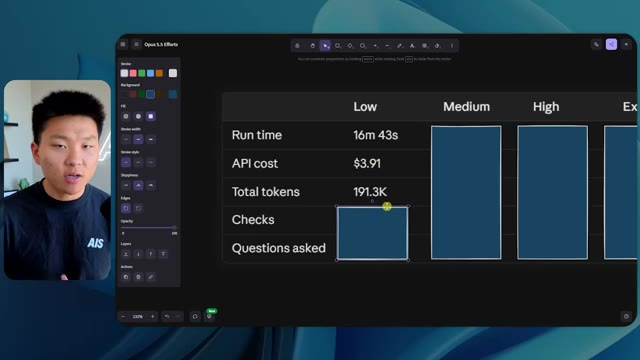
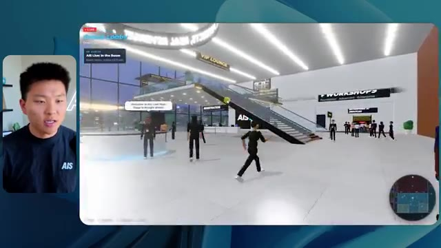
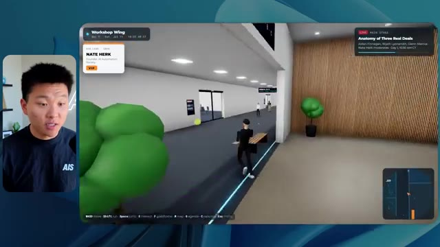

# 🎬 Claude Code + Playwright Automates Literally Anything

> **Chaîne** : [Nate Herk | AI Automation](https://www.youtube.com/@nateherk/featured)  
> **Lien YouTube** : [https://www.youtube.com/watch?v=J-6pnl5DQg8](https://www.youtube.com/watch?v=J-6pnl5DQg8)  
> **Date de publication** : 20260425  
> **Durée** : 00:18:50  
> **Identifiant vidéo** : `J-6pnl5DQg8`  
> **Transcription & Analyse** : `whisper-v3-large-turbo+gemini-3.5-flash-lite`  

---

## 📌 Synthèse Exécutive & Outils

### 💡 Résumé

La vidéo de la chaîne Nate Herk | AI Automation explore l'utilisation combinée de **Claude Code** et de **Playwright** couplée au modèle **Opus 5.5** d'Anthropic pour automatiser la génération d'un monde 3D explorable à la troisième personne. À partir d'un dossier brut de 105 gigaoctets de ressources vidéo issues d'un événement virtuel (AIS Live), l'objectif confié à l'agent IA était de recréer une conférence technologique physique réaliste, dotée d'une identité visuelle marquée, d'une physique, d'un agenda fonctionnel et de flux vidéo dynamiques. 

Pour évaluer les capacités de raisonnement et d'exécution du modèle, Nate Herk a soumis exactement le même prompt d'objectif à Opus 5.5 à travers différents niveaux d'effort (faible, moyen, élevé, etc.). Les résultats démontrent une évolution spectaculaire de la qualité : le niveau faible produit un prototype sommaire aux textures approximatives et aux bugs d'affichage prononcés (temps de 16m43s pour 3,91 $), tandis que le niveau moyen livre une application web 3D interactive nettement plus aboutie, intégrant la bonne charte graphique, des PNJ animés, des flux vidéo en direct fonctionnels et des espaces thématiques complets (salon VIP, scènes principales, ateliers), pour un coût de 12,44 $ et une durée d'une heure et treize minutes.

Cette expérimentation met en lumière l'autonomie remarquable des agents de codage modernes, capables d'exécuter des dizaines de vérifications autonomes via des navigateurs automatisés (Playwright) sans nécessiter d'intervention humaine ou de questions de clarification tout au long du processus. Elle illustre également le fossé classique du développement logiciel assisté par IA : passer d'un prototype fonctionnel impressionnant sur la machine locale au déploiement en production, une friction opérationnelle que de nouveaux outils d'intégration cherchent désormais à combler.

### 🛠️ Outils, Modèles & Logiciels Présentés

* **Claude Code** : Outil de développement en ligne de commande propulsé par l'IA d'Anthropic, utilisé ici pour piloter la génération complète du code du projet 3D.
* **Playwright** : Framework d'automatisation de navigateur web employé par les agents IA pour effectuer des vérifications visuelles et fonctionnelles en direct du rendu 3D.
* **Opus 5.5** : Modèle d'intelligence artificielle d'Anthropic hautement performant, testé à travers ses différents niveaux d'effort pour comparer ses capacités de raisonnement et de production de code.
* **Anthropic** : Entreprise créatrice de la suite de modèles Claude et des standards d'ingénierie prompt appliqués dans cette expérimentation.
* **Frame.io** : Solution de stockage et de gestion cloud exploitée pour héberger et analyser la source des 105 gigaoctets de données vidéo de l'événement.
* **Herc 2** : Système d'exploitation IA propriétaire du créateur, servant de réservoir de ressources et d'écosystème global pour les agents.
* **Hostinger** : Sponsor de la vidéo et fournisseur d'outils de déploiement via une extension gratuite pour éditeur de code facilitant la mise en ligne des applications générées.

### 🔑 Points Clés & Enseignements Stratégiques

* **Impact des niveaux d'effort sur la qualité** : Ajuster les niveaux d'effort (faible vs moyen) modifie radicalement la complexité, la précision visuelle et la robustesse du code généré par un agent IA à partir du même prompt.
* **Autonomie opérationnelle des agents** : À travers les différents tests, les agents ont démontré une capacité totale à exécuter des tâches complexes de bout en bout sans poser la moindre question de clarification à l'utilisateur.
* **Boucles de rétroaction visuelle automatisées** : L'utilisation de Playwright pour effectuer des dizaines de vérifications de rendu (22 à 23 cycles par session) permet à l'IA d'inspecter son propre travail à travers un navigateur.
* **Équivalence coût-bénéfice de l'API** : Les tests quantitatifs révèlent des investissements mesurables (de ~3,91 $ à 12,44 $ en équivalent API) pour des durées d'exécution comprises entre 16 minutes et plus d'une heure, pour un résultat équivalent à des jours de développement humain.
* **Gestion de la volumétrie de données lourdes** : L'exploitation directe de 105 Go de ressources vidéo (provenant de Frame.io) démontre la viabilité de l'ingestion de grands ensembles de données non structurées par les workflows d'agents.
* **Respect de l'identité de marque** : Les niveaux d'effort bas échouent à appliquer la charte graphique, tandis que les niveaux supérieurs intègrent avec succès les palettes de couleurs, logos et directives spécifiques de l'entreprise.
* **Dynamisme et interactivité des environnements** : Le passage d'un effort faible (images statiques, bugs d'affichage, personnages fantômes) à un effort moyen permet d'obtenir des flux vidéo en direct fonctionnels, des PNJ animés et une navigation fluide.
* **Recommandations méthodologiques officielles** : Suivant les préconisations d'Anthropic, il est stratégiquement optimal de débuter les prompts complexes au niveau "moyen", puis d'ajuster itérativement à la hausse ou à la baisse selon les besoins de performance.
* **Le défi du déploiement en production** : La génération locale d'un produit fini sophistiqué met en évidence le besoin critique de connecteurs et d'extensions d'édition (comme l'intégration Hostinger) pour combler le fossé vers la mise en ligne rapide.
* **Complexité architecturale implicite** : Demander la création d'un monde 3D explorable avec physique, cartes de synchronisation en direct et intégration multimédia teste les limites de la génération de code full-stack par les grands modèles de langage.

---

## ⏱️ Chronologie & Transcription Complète Audio & Visuelle (Mot pour Mot)

### ⏱️ `[00:00:00 - 00:00:20]` | Segment #01

**🔊 Audio (Transcription Intégrale Mot pour Mot en Français) :**
> Opus 5,5, Opus 5,5, Opus 5,5, Opus 5,5, Opus 5,5. Ce modèle est littéralement partout et pour de très bonnes raisons. Il est intelligent, il est bon marché, il a un goût incroyable, c'est un modèle d'IA incroyable. Mais avec chaque modèle d'IA, vous avez le choix de l'effort, que ce soit faible, moyen, élevé, extra, max ou ultra code.

**👁️ Analyse Visuelle d'Écran (gemini-3.5-flash-lite) :**
**Interface & Outils** : Navigateur web affichant un réseau social (X/Twitter).

**Contenu textuel & Code** : Publication sur X avec un tweet et une vidéo intégrée représentant un environnement 3D tropical.

**Action / Démonstration** : Affichage d'un exemple d'application ou de génération visuelle par IA sur les réseaux sociaux pour illustrer le sujet.

*⏱️ 00:00:05 — Capture d'écran montrant un post sur les réseaux sociaux (X/Twitter) affichant une vidéo de paysage généré par IA et un texte sur la perturbation des créatifs techniques.*

---

### ⏱️ `[00:00:20 - 00:00:38]` | Segment #02

**🔊 Audio (Transcription Intégrale Mot pour Mot en Français) :**
> Donc dans cette vidéo, j'ai donné exactement le même prompt à Opus 5,5 et je l'ai exécuté sur tous les niveaux d'effort possibles, et nous allons comparer les résultats. Nous examinerons la qualité de tous les différents résultats réels, mais nous allons également voir combien de temps chacun d'eux a pris pour s'exécuter, combien cela nous a coûté si c'était facturé par l'API, le total des jetons, combien de vérifications ils ont exécutées, et combien de questions ils m'ont réellement posées tout au long du processus.

**👁️ Analyse Visuelle d'Écran (gemini-3.5-flash-lite) :**
**Interface & Outils** : Interface web de tableau de bord / canevas de comparaison.

**Contenu textuel & Code** : Tableau avec les colonnes Low, Medium, High, Extra, Max, Ultracode et les lignes Run time, API cost, Total tokens, Checks, Questions asked.

**Action / Démonstration** : Présentation du tableau comparatif des différents niveaux d'effort du modèle.

*⏱️ 00:00:29 — Tableau comparatif sur une interface web intitulé 'Opus 5.5 Efforts' montrant différents niveaux d'effort (Low, Medium, High, Extra, Max, Ultracode) et métriques (Run time, API cost, Total tokens, Checks, Questions asked).*

---

### ⏱️ `[00:00:39 - 00:00:58]` | Segment #03

**🔊 Audio (Transcription Intégrale Mot pour Mot en Français) :**
> Et les résultats que nous avons obtenus ne sont pas du tout ce à quoi je m'attends, donc j'ai hâte de partager cela avec vous les gars. Ne perdons pas de temps et allons directement à celui-ci. D'accord, alors plongeons directement dans celui-ci. Je veux commencer simplement en vous montrant le prompt réel que nous avons utilisé, que nous avons donné à chacun de ces différents agents. Je vais aller dans les fichiers ici, et nous allons ouvrir ce fichier markdown de prompt, et je vais vous montrer ce que nous avons obtenu. Voici donc le slash objectif que j'ai alimenté.

**👁️ Analyse Visuelle d'Écran (gemini-3.5-flash-lite) :**
**Interface & Outils** : Interface de l'application de développement / assistant IA (style interface de chat avec panneau latéral de navigation et sélecteur de modèle "Opus 5.5 Ultracode").

**Contenu textuel & Code** : Message de l'assistant IA demandant si l'on doit commencer la tâche : "Hi Nate. This worktree has the effort-test task queued in PROMPT.md : build a walkable third-person 3D world...".

**Action / Démonstration** : Présentation de l'interface de travail et du prompt initial de l'agent IA avant exécution.

*⏱️ 00:00:48 — Interface d'une application de type assistant IA / éditeur (mode sombre) montrant une conversation avec un prompt concernant la création d'un monde 3D, avec la vidéo du présentateur incrustée dans un coin.*

---

### ⏱️ `[00:00:58 - 00:01:34]` | Segment #04

**🔊 Audio (Transcription Intégrale Mot pour Mot en Français) :**
> J'ai dit, tu dois me créer un monde 3D qui est une conférence tech réaliste dans laquelle je peux me promener en vue à la troisième personne. Tu vas regarder ce dossier, qui contient mes ressources d'enregistrement d'événements d'AIS Live. Et ce dossier est un dossier Frame.io de 105 gigaoctets d'enregistrements vidéo. C'était un événement complètement virtuel. Tout a été enregistré et tous les enregistrements sont juste ici. J'ai dit, ton objectif est de prendre cet événement et de le transformer en un monde 3D explorable qui me donne l'impression d'être réellement allé à une vraie conférence en personne avec différentes salles, différentes pistes, différentes scènes, bla, bla, bla. N'hésite pas à utiliser key.ai si tu as besoin de générer des images ou des vidéos. Et tu peux aussi utiliser tout le reste à l'intérieur de mon projet Herc 2, qui est comme mon système d'exploitation IA. J'ai dit,

**👁️ Analyse Visuelle d'Écran (gemini-3.5-flash-lite) :**
**Interface & Outils** : Éditeur de code (VS Code ou similaire) et interface web Frame.io.

**Contenu textuel & Code** : Instructions textuelles du prompt demandant la création d'un monde 3D interactif et lien vers un dossier Frame.io de 105 Go.

**Action / Démonstration** : Présentation du prompt initial et des ressources d'enregistrement vidéo pour la génération du monde virtuel.

*⏱️ 00:01:07 — Un éditeur de code affichant le fichier PROMPT.md contenant les instructions pour créer un monde 3D de conférence tech.*

*⏱️ 00:01:16 — Une interface Frame.io montrant un dossier d'enregistrements d'événements AIS Live d'une taille de 105,69 Go.*

*⏱️ 00:01:25 — Un retour à l'éditeur de code affichant les détails du prompt principal pour le projet 3D.*

---

### ⏱️ `[00:01:34 - 00:02:08]` | Segment #05

**🔊 Audio (Transcription Intégrale Mot pour Mot en Français) :**
> vous serez jugé sur la créativité, le design, la physique et la sensation générale lorsque j'explorerai le monde 3D que vous avez construit. Et c'était fondamentalement la fin des instructions. Donc comme vous pouvez le voir sur ce côté gauche, j'ai exécuté ceci à travers tous les différents niveaux d'effort. Commençons par le niveau bas et progressons jusqu'au code ultra. Très bien. Donc ici nous avons le résultat du niveau bas. Ouvrons ceci et jetons un coup d'œil. Donc nous avons AIS Live, le sommet des services IA en personne enfin, et nous avons pu cliquer partout. Tout d'abord, cela ne fait pas très "marqué" [fidèle à la marque]. Genre, ce n'is pas le logo d'AIS Live. Ce ne sont même pas nos couleurs. Donc je n'aime pas trop ça, mais entrons ici. D'accord. C'est beaucoup trop lumineux. Euh, nous avons une carte en haut à droite. Nous avons une ville ici en arrière-plan. Je ne peux pas dire quelle ville c'est.

**👁️ Analyse Visuelle d'Écran (gemini-3.5-flash-lite) :**
**Interface & Outils** : Interface web d'assistant IA / éditeur conversationnel

**Contenu textuel & Code** : Texte de prompt concernant la construction d'un monde 3D ("build a walkable third-person 3D world of the AIS Live conference...") et réponse de l'agent demandant si le travail doit commencer.

**Action / Démonstration** : Navigation et sélection des différents niveaux de test (Hello, Extra, High, Max, Ultracode, Medium, Low) dans l'interface de l'agent.

*⏱️ 00:01:42 — Capture d'écran montrant le présentateur à gauche et l'interface d'un assistant IA sur le panneau principal de droite, avec une liste de sessions et de niveaux de test ("Hello", "Extra", "High", "Max", "Ultracode", "Medium", "Low") affichée dans la barre latérale.*

---

### ⏱️ `[00:02:08 - 00:02:40]` | Segment #06

**🔊 Audio (Transcription Intégrale Mot pour Mot en Français) :**
> C'est. D'accord. C'est Chicago, ce qui est plutôt cool parce que vous savez, j'habite à Chicago, mais bref, en haut à droite, nous pouvons voir une carte. Nous avons un hall d'accueil. Nous avons un hall d'exposition. Nous avons un salon VIP sur la scène principale. La carte montre également où se trouve chaque autre personne et cela se synchronise en direct. Nous pouvons donc voir l'enregistrement. Nous pouvons voir le premier jour, la keynote de l'hyper agent, le débriefing en direct. Cool. Donc ça connaît réellement l'ordre du jour et puis il y a le deuxième jour. Donc il a trouvé ça, c'est bien. Nous avons ces petites boules ici que je peux espérer botter. D'accord. Le visage, oh, regardez ça. Si je vais par ici, toutes les personnes disparaissent tout simplement. Très mauvais. Très mauvais. D'accord. Alors voyons voir. Est-ce que je peux sprinter ? D'accord.

**👁️ Analyse Visuelle d'Écran (gemini-3.5-flash-lite) :**
**Interface & Outils** : Application web de conférence virtuelle interactive avec carte de navigation miniature.

**Contenu textuel & Code** : Carte interactive de l'événement, programme du premier jour (Day 1), zones virtuelles (Main Stage, Expo Hall, Lobby, VIP Lounge).

**Action / Démonstration** : Navigation et exploration des différentes zones de l'événement virtuel avec l'avatar.

*⏱️ 00:02:16 — Vue dans l'espace virtuel montrant la zone de retrait des badges avec des avatars.*

*⏱️ 00:02:24 — Vue dans le hall d'accueil (Lobby) de l'événement virtuel avec le programme du jour affiché.*

*⏱️ 00:02:32 — Vue dans le hall d'exposition (Expo Hall) de l'événement virtuel avec divers avatars et éléments lumineux.*

---

### ⏱️ `[00:02:40 - 00:03:04]` | Segment #07

**🔊 Audio (Transcription Intégrale Mot pour Mot en Français) :**
> Je peux aller un peu plus vite. Je vais d'abord aller par ici. Il y a des produits promotionnels, euh, certifié AIS plus glido. D'accord. Donc il y a les vrais stands qu'on avait dans l'événement virtuel. On avait des stands. Donc c'est plutôt cool. Un petit endroit pour prendre des photos. La salle C. En ce moment, nous avons Tangy Frederick qui anime un atelier. D'accord. Mais ce n'est pas une vidéo. Comme vous pouvez voir, c'est juste une image. Elle ne bouge pas. C'est donc juste une image. Ces gens sont en train de disparaître. Ce doivent être des fantômes. Allons par ici dans la salle A.

**👁️ Analyse Visuelle d'Écran (gemini-3.5-flash-lite) :**
**Interface & Outils** : Application virtuelle 3D / environnement virtuel de type salon en ligne.

**Contenu textuel & Code** : Texte sur écran virtuel 3D montrant des étapes d'intégration d'API et tutoriels.

**Action / Démonstration** : Navigation et exploration de l'espace virtuel par le présentateur.

---

### ⏱️ `[00:03:04 - 00:03:30]` | Segment #08

**🔊 Audio (Transcription Intégrale Mot pour Mot en Français) :**
> Nous avons Liberty White. D'accord. Très cool. Vos 30 premiers jours en automatisation. Encore une fois, c'est juste une image fixe et les gens ont des bugs d'affichage. Donc ce n'est pas très bien ici. Je vais aller sur la scène principale et voir ce que nous avons. D'accord, cool. Donc nous avons une scène d'apparence principale. Les gens ont des bugs d'affichage. Vraiment grave. Ce n'est vraiment pas terrible. Notre vidéo est en fait en train de bouger. Comme j'ai vu mon visage ici et j'ai vu celui de Devin, mais maintenant ils ont disparu. Donc je ne sais pas trop ce qui s'est passé. D'accord. On dirait que c'est plutôt un diaporama. Rien n'est vraiment lu pour l'instant. Quoi qu'il en soit, entrons ici.

**👁️ Analyse Visuelle d'Écran (gemini-3.5-flash-lite) :**
**Interface & Outils** : Environnement virtuel 3D / plateforme de type métaverse.

**Contenu textuel & Code** : Éléments graphiques et interface utilisateur de navigation virtuelle (cartes, textes de présentation d'ateliers).

**Action / Démonstration** : Navigation et déplacement d'un avatar dans un espace de conférence virtuel.

---

### ⏱️ `[00:03:30 - 00:03:58]` | Segment #09

**🔊 Audio (Transcription Intégrale Mot pour Mot en Français) :**
> Nous avons plus de stands. Nous avons hyper agent. Nous avons Claude Code. Nous avons plus de gadgets publicitaires. La salle B, c'est Dave Ebelor. Je suppose que c'est exactement la même chose. Nous avons du café. Et puis, je suppose le salon VIP, accès VIP seulement. C'est plutôt cool, mais il ne se passe vraiment rien ici. Cet écran est bien trop lumineux. D'accord. Donc je pense que vous comprenez l'ambiance que nous obtenons ici avec Opus 5.5 en effort faible. Et c'est là que les choses deviennent intéressantes. À combien est-ce que vous pensez que cela a tourné ? Combien de temps ? Celui-ci a duré 16 minutes et 43 secondes. Combien est-ce que vous pensez que cela a coûté ?

**👁️ Analyse Visuelle d'Écran (gemini-3.5-flash-lite) :**
**Interface & Outils** : Interface web de tableau comparatif (Opus 5.5 Efforts) et interface de monde virtuel 3D (Spatial.io ou équivalent).

**Contenu textuel & Code** : Tableau comparatif des performances et coûts selon le niveau d'effort (Low à Ultracode).

**Action / Démonstration** : Présentation des différents niveaux de performance et d'effort pour le modèle Opus 5.5.

*⏱️ 00:03:51 — Capture d'écran montrant un tableau de comparaison intitulé 'Opus 5.5 Efforts' avec différentes métriques (Run time, API cost, Total tokens, Checks, Questions asked) selon les niveaux (Low, Medium, High, Extra, Max, Ultracode).*

---

### ⏱️ `[00:03:58 - 00:04:26]` | Segment #10

**🔊 Audio (Transcription Intégrale Mot pour Mot en Français) :**
> 3,91 dollars si c'eût été une facturation par API. J'utilise évidemment mon abonnement ici, mais nous allons simplement calculer cela en facturation par API. Le nombre total de jetons était de 191 000. Il a effectué 22 vérifications. Donc la vérification, 22 fois il a ouvert le navigateur et a exécuté différentes sortes de vérifications. Donc 22 catégories de vérifications. Et combien de questions m'a-t-il posées ? Il m'a posé un total de zéro question tout au long de cette invite de commande d'objectif. D'accord. Alors ouvrons l'effort moyen et voyons ce que nous avons. D'accord, c'est parti. Effort moyen. Nous avons Nate Herc. Nous avons mon badge. C'est de la marque AI's life.

**👁️ Analyse Visuelle d'Écran (gemini-3.5-flash-lite) :**
**Interface & Outils** : Application de tableau blanc / mindmapping (type Excalidraw) avec un panneau de configuration latéral.

**Contenu textuel & Code** : Tableau avec des lignes : Run time, API cost, Total tokens, Checks, Questions asked, et des colonnes : Low, Medium, High, Ex.

**Action / Démonstration** : Le présentateur explique et commente les résultats chiffrés du tableau montrant le coût API et les jetons utilisés.

*⏱️ 00:04:05 — Tableau comparatif affichant les métriques de performance et de coût pour le niveau "Low" (Run time: 16m 43s, API cost: $3.91, Total tokens: 191.3K, Checks, Questions asked).*

---

### ⏱️ `[00:04:26 - 00:04:46]` | Segment #11

**🔊 Audio (Transcription Intégrale Mot pour Mot en Français) :**
> Alors ça a déjà l'air un petit peu mieux. Ça ressemble à nos palettes de couleurs qui ont utilisé nos directives de marque. Premier jour, construction, deuxième jour, gain, VIP. Cool. D'accord. Je vais entrer dans le lieu. D'accord. Waouh. Une ambiance similaire, en somme. C'est en arrière-plan. Ça ne ressemble pas à Chicago, hein ? Non, ça ressemble à, honnêtement, ça ressemble à une ville imaginaire. Quoi qu'il en soit, c'est marrant qu'ils aient décidé de faire ça. Voyons si je peux avancer un peu plus vite. Oh, waouh.

**👁️ Analyse Visuelle d'Écran (gemini-3.5-flash-lite) :**
**Interface & Outils** : Application web interactive / Plateforme virtuelle 3D (AIS Live)

**Contenu textuel & Code** : Page de connexion/accueil avec badge utilisateur, options de contrôle clavier et interface 3D de type métavers.
[DESC_IMAGE_2] Navigation et exploration de l'environnement virtuel 3D après avoir cliqué sur 'Enter the Venue'.

**Action / Démonstration** : Explications face caméra et démonstration conceptuelle.

*⏱️ 00:04:31 — Interface web d'accueil 'Welcome to AIS Live' avec un badge de profil au nom de Nate Herk et un bouton 'Enter the Venue'.*

*⏱️ 00:04:41 — Vue en 3D immersive à l'intérieur du lieu virtuel interactif avec des avatars de type jeu vidéo et une vue sur une ville de nuit.*

---

### ⏱️ `[00:04:46 - 00:05:21]` | Segment #12

**🔊 Audio (Transcription Intégrale Mot pour Mot en Français) :**
> Les gens interagissent avec moi. Regardez. Si je m'approche de ce type, il vient de lever le bras. Bon, maintenant il ne veut plus du tout avoir affaire à moi. Mais tous ces petits robots ici doivent prendre des décisions. Je ne sais pas s'ils utilisent Jev. C'est sûr que non. Je ne le lui ai pas dit. En fait, ma clé Jev est à l'arrière. Je ne sais pas. Peut-être qu'il l'a utilisée. Quoi qu'il en soit, nous pouvons voir ici que nous avons la salle d'atelier C, le laboratoire des agents. Sympa. Donc celui-ci est réellement en cours d'exécution. Vous pouvez voir qu'il s'agit d'une vraie vidéo lue par Tangy. Tout le monde ici est en train de travailler sur un ordinateur portable. Ils ne buguent pas. C'est plutôt cool. De plus, mon badge est sur ma poitrine, ce qui est plutôt cool. Je peux venir par ici. Nous avons une carte en haut à droite, comme vous pouvez le voir, mais je peux venir par ici. Nous avons un

**👁️ Analyse Visuelle d'Écran (gemini-3.5-flash-lite) :**
**Interface & Outils** : Environnement virtuel 3D / plateforme de métavers ou de simulation.

**Contenu textuel & Code** : Aucun code source, terminal ou interface de développement n'est affiché.

**Action / Démonstration** : Navigation et exploration de mondes virtuels 3D animés.

---

### ⏱️ `[00:05:21 - 00:05:47]` | Segment #13

**🔊 Audio (Transcription Intégrale Mot pour Mot en Français) :**
> hall d'exposition. C'est ici que nous avons le stand Glido. Et ça diffuse en ce moment. Oui, ça diffuse la vidéo de nous en train de parler de Glido. Ça diffuse la vidéo d'Ed et moi parlant de notre programme de certification. Nous avons le logo AIS Plus juste ici, qui est un peu mal placé. Ce sont les diapositives des conférenciers et les points clés. Donc wow, ce sont toutes les ressources que nous avons distribuées après l'événement. Elles sont toutes affichées là également. Nous pouvons voir que nous avons un coup de projecteur sur la communauté. C'est donc Aiden qui parle de son contrat qu'il a décroché et c'est diffusé en direct. Ces gens regardent.

**👁️ Analyse Visuelle d'Écran (gemini-3.5-flash-lite) :**
**Interface & Outils** : Environnement virtuel 3D (type métavers / plateforme d'événements virtuels).

**Contenu textuel & Code** : Écrans virtuels affichant des diaporamas, des logos "AIS+ Certified" et des informations textuelles sur des sessions de formation.

**Action / Démonstration** : Navigation et visite guidée à l'intérieur d'un hall d'exposition virtuel en 3D.

---

### ⏱️ `[00:05:47 - 00:06:21]` | Segment #14

**🔊 Audio (Transcription Intégrale Mot pour Mot en Français) :**
> Ils sont plutôt engagés. On a un hyper agent. C'était, c'est ce que je voulais dire. Si vous avez vu ces gens lever les mains pour dire bonjour, c'était plutôt marrant. Regardez, regardez, le voilà qui recommence. Bref. Bon. Où est-ce que je suis maintenant ? Maintenant, je suis dans le hall principal. On a un bar à café. On a un grand logo, qui est le vrai logo. C'est trop lumineux, mais on a le logo. On peut voir si on peut entrer ici dans le parcours fondation. On a Sabrina Romanov et Liberty White. Donc différentes formations juste là. On peut entrer dans cette salle. C'est le parcours avancé. Alors qu'est-ce qui se passe ici. On a Dave Ebelar et Saman qui parlent de différentes choses là-dedans. Et maintenant, allons jeter un œil à la scène principale. Oh, attendez, il y a une vidéo de moi là-haut. C'est du genre VIP

**👁️ Analyse Visuelle d'Écran (gemini-3.5-flash-lite) :**
**Interface & Outils** : Environnement virtuel 3D en ligne (plateforme d'événement virtuel type metaverse).

**Contenu textuel & Code** : Interface utilisateur d'un monde virtuel avec mini-carte en haut à droite, texte "Main Lobby" et options de navigation.

**Action / Démonstration** : Navigation et déplacement d'un avatar à l'intérieur d'un hall virtuel d'exposition.

---

### ⏱️ `[00:06:21 - 00:06:50]` | Segment #15

**🔊 Audio (Transcription Intégrale Mot pour Mot en Français) :**
> section ? Ouais, on ira voir ça dans une minute. Mais bref, voici la scène principale. Ça a l'air vraiment, vraiment chouette. On a une grande scène. On a genre quatre personnes assises ici. On a les trois écrans d'Alex là-haut avec hyper agent. Est-ce que j'ai le droit de monter sur scène ? Oh, et il me laisse monter sur scène. D'accord. C'est plutôt sympa. Bon, les gars, faisons un selfie. Laissez-moi prendre tout le monde en arrière-plan. Venez par ici. Bref, c'est vraiment, vraiment cool. Toutes les places ne sont pas occupées, par contre. Donc il faut qu'on travaille là-dessus. Mais bref, je vais y retourner en courant pour voir ce que c'était que cette section VIP. D'accord. Salon VIP. J'ai l'impression que c'est comme un aéroport ou un truc du genre.

**👁️ Analyse Visuelle d'Écran (gemini-3.5-flash-lite) :**
**Interface & Outils** : Environnement virtuel 3D / plateforme métavers d'événement en ligne.

**Contenu textuel & Code** : Interface utilisateur affichant "Hyperagent Keynote", nom du présentateur et mini-carte de l'auditorium.

**Action / Démonstration** : Exploration visuelle d'un monde virtuel interactif hébergeant une conférence en direct.

---

### ⏱️ `[00:06:51 - 00:07:14]` | Segment #16

**🔊 Audio (Transcription Intégrale Mot pour Mot en Français) :**
> OK, super. Donc maintenant nous avons les sessions VIP ici. Une session de questions-réponses VIP avec Nate, lecture vidéo en direct juste ici. C'est vraiment, vraiment très cool. Et nous avons comme un bar ou quelque chose comme ça. Génial. Je dirais que c'est un très bon résultat. Maintenant, en ce qui concerne les statistiques ici, celle-ci a pris une heure et 13 minutes à s'exécuter. Cela nous aurait coûté 12 dollars et 44 cents. Elle a utilisé 490 000 jetons et elle a effectué 23 vérifications.

**👁️ Analyse Visuelle d'Écran (gemini-3.5-flash-lite) :**
**Interface & Outils** : Application virtuelle 3D / Navigateur web et interface de tableau de bord (Opus 5.5 Efforts).

**Contenu textuel & Code** : Métriques de performance (Run time: 16m 43s, API cost: $3.91, Total tokens: 191.3K, Checks: 22).

**Action / Démonstration** : Navigation et présentation d'une application virtuelle 3D suivie d'un tableau de bord de métriques.

*⏱️ 00:06:56 — Capture montrant un espace virtuel 3D avec des avatars, un écran géant affichant une session vidéo en direct, et le présentateur dans un encadré à gauche.*

*⏱️ 00:07:02 — Capture montrant un tableau de bord analytique nommé 'Opus 5.5 Efforts' affichant des métriques comme le temps d'exécution, le coût API et le nombre de tokens.*

---

### ⏱️ `[00:07:14 - 00:07:48]` | Segment #17

**🔊 Audio (Transcription Intégrale Mot pour Mot en Français) :**
> Et il nous a posé un total de zéro question une fois de plus. Très bien, passons à "élevé". C'était déjà un résultat plutôt correct et Anthropic eux-mêmes dans leur vidéo, ou désolé, pas une vidéo, un article sur comment prompter Opus 5.5, ils ont dit de commencer simplement par "moyen" et d'ajuster à la hausse ou à la baisse si nécessaire. C'était donc un résultat "moyen". Passons à "élevé" et voyons ce que nous avons obtenu. Très rapidement, les gars, je dois prendre une seconde pour vous parler du sponsor de la vidéo d'aujourd'hui, Hostinger. Donc, ces deux modèles viennent de me construire une version fonctionnelle de la même chose. Et maintenant, je me retrouve exactement là où je finis toujours, avec un produit fini sur mon ordinateur portable et aucun moyen rapide de le mettre en ligne. Et c'est le fossé que le connecteur d'Hostinger comble. C'est une extension gratuite

**👁️ Analyse Visuelle d'Écran (gemini-3.5-flash-lite) :**
**Interface & Outils** : Tableau blanc numérique (Image 1) et éditeur de code Cursor avec intégration d'agent IA (Image 2).

**Contenu textuel & Code** : Image 1 : Statistiques de performance (ex: "Medium" avec 1h13m, 12.44$, 419.2K tokens). Image 2 : Prompt détaillé pour construire une calculatrice ROI en fichier HTML unique, ainsi que les logs de réflexion de l'agent ("Ruminating...", "Thinking...").

**Action / Démonstration** : Présentation comparative des métriques de coût et d'efficacité de l'IA (Image 1) et démonstration de la génération d'un outil web par un agent IA (Image 2).

*⏱️ 00:07:22 — Un tableau comparatif affiché dans une interface de type tableau blanc, détaillant les performances d'Opus 5.5 selon différents niveaux ("Low", "Medium", "High", "Extra") en termes de temps d'exécution, coût API, jetons et questions posées.*

*⏱️ 00:07:39 — Capture d'écran de l'interface de développement Cursor avec un volet de discussion IA à droite, affichant le prompt de création d'une calculatrice de retour sur investissement (ROI) et l'état d'avancement de l'agent.*

---

### ⏱️ `[00:07:48 - 00:08:23]` | Segment #18

**🔊 Audio (Transcription Intégrale Mot pour Mot en Français) :**
> pour votre éditeur qui intègre votre compte Hostinger dans l'outil de programmation que vous utilisez déjà. Que ce soit VS Code, Cursor, Cloud Code, Codex, et j'en passe. Vous vous connectez une seule fois en un seul clic, et à partir de là, votre agent peut déployer le site, y pointer un domaine, configurer les enregistrements DNS et vérifier votre VPS sans que vous n'ayez jamais à quitter l'éditeur. Ainsi, peu importe celui de ces outils que vous finirez par préférer, ce qu'il a construit n'est qu'à quelques minutes d'une vraie URL sur un hébergement géré. Connector est gratuit avec chaque formule d'hébergement, donc si vous avez toujours besoin de l'hébergement en dessous, profitez de la formule illimitée avec le lien dans la description et utilisez le code NATEHERK pour 10 % de réduction. Cela inclut également un domaine gratuit et un e-mail professionnel pour l'année. Et c'est toujours le moyen le plus économique que j'ai trouvé pour obtenir un

**👁️ Analyse Visuelle d'Écran (gemini-3.5-flash-lite) :**
**Interface & Outils** : Interface de gestion Hostinger (extension IDE), Claude Code.

**Contenu textuel & Code** : Statut "Connected" (via OAuth), version Node.js 24.13.0, liste des permissions d'accès aux outils Hostinger (Websites, Domains, Subscriptions & Payments, Email Marketing).

**Action / Démonstration** : Démonstration de l'état connecté d'une intégration permettant la gestion de services Hostinger directement depuis l'environnement de développement.

*⏱️ 00:07:57 — Une interface de configuration montrant la connexion réussie entre Hostinger et un IDE, avec une liste d'outils disponibles (Websites, Domains, Subscriptions, Email Marketing) et une fenêtre Claude Code ouverte sur la droite.*

---

### ⏱️ `[00:08:23 - 00:08:47]` | Segment #19

**🔊 Audio (Transcription Intégrale Mot pour Mot en Français) :**
> tu as construit sur une vraie URL. Donc revenons à la vidéo. D'accord. Encore une fois, très, très thématisé par la marque. C'est un écran de chargement encore meilleur que le précédent. Nous avons ce petit effet sympa en arrière-plan. Nous avons le logo. Nous allons entrer dans le lieu. D'accord. Nous y voilà. Ça a l'air plutôt bien. Nous commençons à l'extérieur et vous pouvez voir que nous avons ces drapeaux pour tous les intervenants, Wyatt, Casper, Alex, Ed, Aiden, Sabrina, Liberty. C'est plutôt cool. Nous avons des blocs en direct ici.

**👁️ Analyse Visuelle d'Écran (gemini-3.5-flash-lite) :**
**Interface & Outils** : Plateforme événementielle virtuelle 3D (type métavers) accessible via navigateur ou client dédié.

**Contenu textuel & Code** : Menus d'aide aux commandes (WASD, Mouse, Shift, E, P), barre de progression "Passport 1/13", et noms de speakers (Alex McDonnell, Wyatt Lyonsmith).

**Action / Démonstration** : Navigation et exploration de l'environnement virtuel 3D après avoir cliqué sur "Enter the venue".

*⏱️ 00:08:29 — Écran de chargement et d'accueil de la plateforme "AIS LIVE" avec les contrôles de navigation et le bouton "Enter the venue".*

*⏱️ 00:08:35 — Vue immersive dans l'espace virtuel "AIS Live Plaza" avec un personnage joueur, des bâtiments en arrière-plan et une interface de mini-carte.*

*⏱️ 00:08:41 — Progression dans l'environnement 3D montrant des bannières verticales avec des noms de conférenciers et le menu de contrôle en bas à droite.*

---

### ⏱️ `[00:08:47 - 00:09:23]` | Segment #20

**🔊 Audio (Transcription Intégrale Mot pour Mot en Français) :**
> Il a pris cette photo de moi, votre hôte, Nate Herc, John, Dave, Nate Herc. Voilà. OK. Les portes. Génial. Ce sont des portes coulissantes automatiques en verre. J'adore ça. On peut voir l'enregistrement VIP. On peut voir l'admission générale. On peut venir par ici et on peut découvrir l'expo avec différents stands, le projecteur sur la communauté. Vous pouvez aussi voir qu'en haut à gauche, j'ai un passeport. Donc c'est du genre, ça va montrer combien d'endroits j'ai visités. Tout cela est une lecture réelle. Nous avons un mur de ressources avec tous les différents intervenants. Ils ont aussi une session de networking par ici. Donc je vais venir très vite et voir de quoi il s'agit. Nous avons donc le bar à cold brew AIS. Nous avons différents membres de la communauté qui ont été mis en avant ou en lumière.

**👁️ Analyse Visuelle d'Écran (gemini-3.5-flash-lite) :**
**Interface & Outils** : Application web interactive en 3D / Environnement virtuel de conférence en ligne.

**Contenu textuel & Code** : Interface utilisateur virtuelle affichant les zones d'enregistrement (VIP Check-in, Registration GA), les plans et le statut de progression (Passport).

**Action / Démonstration** : Exploration interactive de l'environnement virtuel 3D par le présentateur et navigation entre les différentes zones de la conférence.

*⏱️ 00:08:56 — Vue principale du hall virtuel de conférence avec les comptoirs d'enregistrement et la scène principale.*

*⏱️ 00:09:05 — Navigation dans le hall d'exposition virtuel montrant des stands d'information et des éléments interactifs.*

*⏱️ 00:09:14 — Déplacement d'avatars dans l'espace virtuel de la conférence en 3D.*

---

### ⏱️ `[00:09:23 - 00:09:56]` | Segment #21

**🔊 Audio (Transcription Intégrale Mot pour Mot en Français) :**
> On a l'aile VIP. Attends, quoi ? Récupère un bracelet. Oh, je dois vraiment aller chercher le bracelet. D'accord. Laisse-moi m'enregistrer rapidement. Le bracelet est déjà mis. Attends, quoi ? D'accord. Oh, d'accord. Maintenant, les portes se sont ouvertes pour moi. Cool. Je peux entrer ici. Oh, ça mène juste à la scène principale. Salon VIP. Il y a une séance de questions-réponses en cours. Ça a l'air très cool. Je veux dire, je suis très impressionné par la façon dont il est capable de faire ça. Waouh. D'accord. Donc c'est vraiment bien. Ce qu'on a fait, c'est qu'on a eu des salles de réunion VIP avec différentes personnes. Tu peux voir qu'il y a différentes salles, différents membres de l'équipe AIS qui vont dans des trucs. C'est vraiment cool. C'est très cool. C'est un VIP bien meilleur

**👁️ Analyse Visuelle d'Écran (gemini-3.5-flash-lite) :**
**Interface & Outils** : Application de métavers / monde virtuel 3D interactif (Gather ou similaire).

**Contenu textuel & Code** : Interface de navigation en ligne montrant des salles VIP, des sessions de travail et des statuts de participants.

**Action / Démonstration** : Navigation et exploration d'un environnement virtuel 3D par le présentateur.

*⏱️ 00:09:32 — Vue d'un espace virtuel 3D (Registration Concourse) avec des avatars et une interface affichant des informations de navigation.*

*⏱️ 00:09:40 — Vue de la VIP Lounge dans le monde virtuel 3D avec un écran montrant une visioconférence du présentateur.*

*⏱️ 00:09:48 — Vue de l'espace VIP Working Sessions avec plusieurs salles virtuelles dédiées à différentes thématiques (Price It Right, Land Your First Paying Client).*

---

### ⏱️ `[00:09:56 - 00:10:30]` | Segment #22

**🔊 Audio (Transcription Intégrale Mot pour Mot en Français) :**
> expérience que ce qui a été montré dans la première partie. D'accord. After party VIP. Regardez ça. On a une piste de danse. On a tous ces éléments ici. On a la lecture de l'after party VIP juste ici. Et il y a une estrade de DJ. C'est trop marrant. Il y a un petit bug ici, un petit glitch ici, mais c'est génial. Oh, cool. Donc quand je suis ici sur la scène principale, on a des sous-titres. Vous pouvez voir juste ici en bas de mon écran, on a ces sous-titres de Wyatt qui est en train de parler là-haut. On a des lumières. On a le panel. Très cool. Belle scène principale. Je vais aller par ici. On peut aller à la fondation,

**👁️ Analyse Visuelle d'Écran (gemini-3.5-flash-lite) :**
**Interface & Outils** : Application web virtuelle en 3D (metaverse / événement virtuel).

**Contenu textuel & Code** : Interface d'événement virtuel avec avatars, écrans de flux vidéo en direct, menus de navigation et mini-carte.

**Action / Démonstration** : Navigation et visite guidée à travers les différents espaces virtuels de la plateforme par le présentateur.

*⏱️ 00:10:04 — Vue rapprochée d'une plateforme virtuelle en 3D représentant une after-party VIP avec piste de danse et avatars animés.*

*⏱️ 00:10:13 — Vue plus large de l'after-party virtuelle avec des participants représentés par des avatars et des écrans vidéo au fond.*

*⏱️ 00:10:21 — Vue d'une autre zone de la plateforme virtuelle appelée 'Main Stage' avec des spectateurs assis et une grande scène.*

---

### ⏱️ `[00:10:30 - 00:11:06]` | Segment #23

**🔊 Audio (Transcription Intégrale Mot pour Mot en Français) :**
> avancé, et les parcours d'entreprise ici. Alors voyons voir. Nous avons l'anatomie de trois vraies transactions. Nous avons hyper agent. Nous avons les évals avec Nate et Ed ici. Nous avons Dave qui intervient sur les trucs avancés. C'est vraiment sympa. Je veux dire, évidemment, chacun, chacun de ces résultats jusqu'à présent, bas était correct. Moyen était meilleur. Élevé a été encore meilleur. Voyons si cette tendance se poursuit et allons voir ce que cela nous a coûté. Donc, élevé a fonctionné pendant une heure et sept minutes. Donc un peu plus rapide que moyen, cela nous aurait coûté 16 dollars et 31 cents. Il a utilisé un demi-million de tokens, 509 000. Il a fait 22 vérifications. Et il nous a aussi demandé, enfin, non, je me trompais. C'est

**👁️ Analyse Visuelle d'Écran (gemini-3.5-flash-lite) :**
**Interface & Outils** : Application de tableau blanc ou d'édition de notes / design (type Excalidraw ou similaire).

**Contenu textuel & Code** : Tableau comparatif : Run time (16m 43s à 1h 13m), API cost ($3.91 à $16.31), Total tokens (191.3K à 419.2K), Checks et Questions asked.

**Action / Démonstration** : Présentation des résultats d'évaluation et de performance selon différents niveaux d'effort.

*⏱️ 00:10:57 — Image 3 : Tableau comparatif nommé 'Opus 5.5 Efforts' affichant les coûts API, le temps d'exécution et les tokens pour différents niveaux de réglage (Low, Medium, High, Extra).*

---

### ⏱️ `[00:11:06 - 00:11:25]` | Segment #24

**🔊 Audio (Transcription Intégrale Mot pour Mot en Français) :**
> l'un m'a posé une question et, divulgâcheur, c'était le seul qui nous a posé une question pendant tout ça. Donc voyons voir, il nous en reste trois : extra, max et ultra code. Laissez-moi ouvrir extra et nous verrons ce que nous avons. D'accord. Donc celui-ci a l'air plutôt bien. Je dirais honnêtement que jusqu'à présent, l'écran de chargement haut était le meilleur. Celui que nous venons de voir, mais bref, entrons dans le direct d'AIS.

**👁️ Analyse Visuelle d'Écran (gemini-3.5-flash-lite) :**
**Interface & Outils** : Tableau comparatif sur une interface web ou un tableau blanc numérique.

**Contenu textuel & Code** : Tableau de données : Run time (16m 43s, 1h 13m, 1h 7m), API cost ($3.91, $12.44, $16.31), Total tokens (191.3K, 419.2K, 509.3K), Checks (22, 23, 22), Questions asked (0, 0, 1), et une colonne "Extra" en cours d'ouverture.

**Action / Démonstration** : Le présentateur présente et ouvre la colonne "Extra" du tableau comparatif.

*⏱️ 00:11:11 — Un tableau comparatif montrant les métriques de différents niveaux d'effort ("Low", "Medium", "High", "Extra") avec le présentateur incrusté à gauche.*

---

### ⏱️ `[00:11:26 - 00:11:51]` | Segment #25

**🔊 Audio (Transcription Intégrale Mot pour Mot en Français) :**
> Whoa. D'accord. Donc on a comme de petits extraits sonores. Je peux discuter avec des gens. Le panneau sur la guerre des outils a réglé quelques débats pour moi. Sympa. Bonne perspective là-bas. On est dehors à nouveau. On a ces différentes bannières, bien qu'elles soient toutes les mêmes. Elles n'affichent pas de noms de personnes différents. Donc grand logo AIS Live. L'aile des ateliers est par ici. Et franchissons les portes coulissantes en verre pour voir ce qu'on a. Donc on a le café AIS. La carte est en bas à droite, et elle n'est pas très descriptive.

**👁️ Analyse Visuelle d'Écran (gemini-3.5-flash-lite) :**
**Interface & Outils** : Application ou plateforme virtuelle 3D / metaverse dans un navigateur web.

**Contenu textuel & Code** : Environnement virtuel interactif 3D avec des avatars, des bannières "AIS LIVE", un mini-carte en bas à droite et un affichage "Convention Plaza".

**Action / Démonstration** : Exploration et déplacement d'un avatar à travers un espace de convention virtuel en 3D.

*⏱️ 00:11:32 — Vue d'un monde virtuel en 3D (style metaverse) montrant un avatar se déplaçant sur une place publique près de bâtiments et de bannières publicitaires.*

*⏱️ 00:11:38 — Poursuite de la navigation dans l'environnement virtuel 3D avec l'avatar qui marche vers des zones d'exposition et des bannières de convention.*

*⏱️ 00:11:45 — L'avatar s'approche de l'entrée principale lumineuse d'un grand hall d'exposition virtuel (Convention Plaza).*

---

### ⏱️ `[00:11:51 - 00:12:26]` | Segment #26

**🔊 Audio (Transcription Intégrale Mot pour Mot en Français) :**
> J'aime bien comment les autres cartes nous ont dit quoi, genre où étaient les choses, mais celle-ci a l'air très professionnelle. On peut voir ici c'est la scène principale. Allons y faire un tour rapidement. Ils ont tous ces ballons qui volent partout, ce qui je trouve est plutôt marrant. Les ballons de plage AIS. On me voit là-haut en train de parler. Je crois que j'étais en train de présenter l'un des jours. Continuons par ici vers la salle d'atelier sur ce côté gauche. D'accord. Donc ici nous avons le théâtre Hyper Agent. Nous avons cette session sponsorisée ici par Hyper Agent, mais ça nous montre aussi ce qui va s'y passer. C'est vraiment marrant qu'on puisse discuter avec les gens. Salmon a construit un représentant commercial vocal en direct. La salle "Le Juste Prix" était comble. Tu as pris le guide du compagnon VIP ? C'est trop marrant. On a le parcours avancé en

**👁️ Analyse Visuelle d'Écran (gemini-3.5-flash-lite) :**
**Interface & Outils** : Environnement virtuel 3D de type métaverse / plateforme de conférence en ligne (AIS Live).

**Contenu textuel & Code** : Interface utilisateur virtuelle montrant des avatars 3D, des bannières de salles (« Main Stage », « Workshops », « Enterprise AI Services »), des mini-maps et des bulles de texte interactives.

**Action / Démonstration** : Navigation et exploration de différentes zones d'une plateforme de conférence virtuelle 3D par l'utilisateur.

*⏱️ 00:12:00 — Le présentateur navigue dans une scène principale virtuelle en 3D avec un public assis et un écran géant affichant une retransmission vidéo.*

*⏱️ 00:12:09 — Vue de l'avatar du présentateur dans un hall virtuel d'événements 3D (Grand Lobby) avec des zones d'ateliers et des participants.*

*⏱️ 00:12:17 — L'avatar du présentateur se déplace dans un couloir virtuel d'un espace de conférence 3D avec des bulles de discussion.*

---

### ⏱️ `[00:12:26 - 00:12:58]` | Segment #27

**🔊 Audio (Transcription Intégrale Mot pour Mot en Français) :**
> ici. Encore une fois, nous avons la lecture en direct. Est-ce que c'est la lecture en direct ? Oh, d'accord. Ça a commencé une fois que je suis entré, mais je peux m'asseoir. Oh la la. Je peux regarder ça. Je peux me lever. Je veux m'asseoir au premier rang. C'est plutôt cool. C'est très bien. J'aime ça. Et tu sais ce que j'ai remarqué jusqu'à présent ? Le personnage que j'incarne me ressemble un peu. Je pense qu'il s'est inspiré de mes photos de profil ou quelque chose comme ça. Bref, nous avons Sabrina ici, l'animatrice de la salle ici, prenez n'importe quel siège libre. D'accord, cool. Et j'ai vraiment aimé la fonctionnalité pour s'assoir. C'est plutôt marrant. Genre, on pourrait vraiment assister à cet atelier et participer. Bref, ça nous montre les intervenants. Ça nous montre les

**👁️ Analyse Visuelle d'Écran (gemini-3.5-flash-lite) :**
**Interface & Outils** : Plateforme de conférence virtuelle 3D (type métavers), interface de création de contenu IA.

**Contenu textuel & Code** : Interface utilisateur avec des paramètres de configuration pour "Build Your First AI Content Engine", éléments de navigation de la conférence (Map, Agenda).

**Action / Démonstration** : Navigation et interaction de l'utilisateur (avatar) au sein de l'espace de conférence virtuel pour assister à un atelier technique.

*⏱️ 00:12:34 — Vue d'une salle de conférence virtuelle dans un environnement de type métavers, avec des avatars assis devant un écran géant affichant un logiciel.*

*⏱️ 00:12:42 — Vue de la salle de conférence virtuelle (track "Foundation"), montrant l'écran de projection affichant une interface de construction d'AI Content Engine.*

*⏱️ 00:12:50 — Gros plan sur l'écran de la salle virtuelle montrant une interface logicielle avec une vidéo en direct incrustée et des flux de données.*

---

### ⏱️ `[00:12:58 - 00:13:31]` | Segment #28

**🔊 Audio (Transcription Intégrale Mot pour Mot en Français) :**
> programme. Il y a un petit tapis rouge ici pour prendre des photos. On peut prendre la pose. Oh, waouh. C'est plutôt cool. Bibliothèque de ressources, devenir certifié AIS Plus, Glido, Hyper Agent, AIS Plus, trois vraies affaires. Génial. Je veux dire, je dirais vraiment que jusqu'à présent, chacune est meilleure. Et on n'a même pas encore vu la section VIP, le salon VIP. Montons ici très vite. J'espère que je pourrai entrer. Sympa. On a la réinitialisation des outils. Ce sont les différentes pièces où l'on peut aller. Donc encore une fois, je pourrais prendre la feuille d'exercices et je pourrais essayer de comprendre comment tarifer mes trucs. C'est tellement cool. C'est vraiment mieux que le précédent où l'on a juste

**👁️ Analyse Visuelle d'Écran (gemini-3.5-flash-lite) :**
**Interface & Outils** : Plateforme d'événement virtuel (environnement type metaverse/simulation d'événement en ligne).

**Contenu textuel & Code** : Textes affichés dans le hall : "Expo Hall", "Hyperagent Title Sponsor", "Glaido". Texte dans le salon VIP : "What's your gut floor number?", "If you doubled your rate, what would change?", "Read the 'Price It Right' worksheet".

**Action / Démonstration** : Navigation et exploration de l'environnement virtuel, interaction avec les stands et participation à une session de travail dans le salon VIP.

*⏱️ 00:13:07 — Vue d'ensemble d'un hall d'exposition virtuel avec des stands de sponsors (AIS+, Hyperagent, Glaido) où des avatars circulent.*

*⏱️ 00:13:15 — Hall d'entrée virtuel spacieux montrant des escaliers, une zone de réception et une signalétique indiquant "Workshops".*

*⏱️ 00:13:23 — Intérieur d'un salon VIP virtuel où des avatars sont assis autour d'une table avec des panneaux de texte affichant des questions de réflexion professionnelle.*

---

### ⏱️ `[00:13:31 - 00:13:59]` | Segment #29

**🔊 Audio (Transcription Intégrale Mot pour Mot en Français) :**
> genre regardé des trucs. Génial. Je peux aller derrière le bar et venir ici. C'est très bien. Bon. Alors, en ce qui concerne les statistiques, celui-ci a duré une heure et demie. Il a coûté 25,92 dollars. Je ne sais pas pourquoi je dis point 25, 92 cents. C'était 733 000 jetons et 34 vérifications. Il a donc eu le plus grand nombre de vérifications jusqu'à présent, de loin. Et il ne nous a posé aucune question. J'ai hâte de voir ce qu'on a obtenu ici de max et ultra code. D'accord. Voici les écrans de chargement de max, ennuyeux, mais c'est dans l'esprit de la marque et il y a notre logo.

**👁️ Analyse Visuelle d'Écran (gemini-3.5-flash-lite) :**
**Interface & Outils** : Logiciel de dessin ou d'annotation de type tableau blanc (ex: Eraser.io ou similaire).

**Contenu textuel & Code** : Tableau présentant pour chaque modèle : la durée (ex: 1h 31m pour Extra), le coût en dollars (ex: $12.44, $16.31), le nombre de jetons (ex: 419.2K, 509.3K) et le nombre de vérifications/actions.

**Action / Démonstration** : Le présentateur illustre visuellement les performances des différents modèles Opus 5.5 via un graphique comparatif.

*⏱️ 00:13:38 — Un tableau de bord comparatif intitulé "Opus 5.5 Efforts" affichant des métriques de performance pour différents niveaux de modèles (Medium, High, Extra, Max, Ultracode).*

---

### ⏱️ `[00:14:00 - 00:14:35]` | Segment #30

**🔊 Audio (Transcription Intégrale Mot pour Mot en Français) :**
> Donc c'était bien. J'aime bien ça. On va continuer et entrer dans AIS live. Oh, une jolie petite animation ici qui nous fait entrer. Une fois de plus, le personnage me ressemble. Ils m'ont tous ressemblé. Enfin, en quelque sorte, on a... assis en arrière-plan. Ça ressemble à Chicago. Comme je l'ai mentionné plus tôt, beaucoup de ces séquences jouent des sons et je ne l'inclus pas parce que ce serait très distrayant pour vous d'essayer d'écouter ce qui se passe tout en m'écoutant parler. Donc il y a comme une légère musique dans tout ça. Je déteste la façon dont il marche. Cette démarche est vraiment, vraiment mauvaise. Je veux dire, la démarche, ouais, je n'aime pas du tout ça. Donc ce n'est pas génial. Mais à part ça, entrons et explorons. Remarquez ces ombres quand j'entre, elles changent vraiment brusquement. Je ne sais pas trop pourquoi,

**👁️ Analyse Visuelle d'Écran (gemini-3.5-flash-lite) :**
**Interface & Outils** : Application ou plateforme virtuelle 3D (AIS live) avec affichage vidéo incrusté de la webcam.

**Contenu textuel & Code** : Environnement virtuel 3D interactif avec avatars, interface de type jeu vidéo, mini-carte et bannières informatives (Day 2, panels, etc.).

**Action / Démonstration** : Exploration et navigation en temps réel dans un monde virtuel 3D par le présentateur.

*⏱️ 00:14:08 — Vue d'un monde virtuel 3D (Arrival Plaza) avec un avatar de personnage et des bâtiments urbains en arrière-plan, accompagné de la webcam du présentateur à gauche.*

*⏱️ 00:14:17 — Poursuite de la navigation dans l'environnement virtuel 3D, montrant un avatar se déplaçant sur une place pavée près de bâtiments modernes.*

*⏱️ 00:14:26 — L'avatar se rapproche de l'entrée d'un grand bâtiment vitré dans l'univers virtuel 3D, tandis que le présentateur commente la scène.*

---

### ⏱️ `[00:14:35 - 00:15:11]` | Segment #31

**🔊 Audio (Transcription Intégrale Mot pour Mot en Français) :**
> mais bref, on peut discuter avec des gens ici aussi. Le stand Hyperagent est juste là où l'on entre dans l'exposition. Tout va bien. D'accord, super. Je peux continuer à cliquer sur E pour faire changer ce qu'ils disent. Nous avons les conférenciers juste ici. Ça a l'air plutôt bien. Bien que nous avions définitivement la photo de profil de tout le monde. Je ne sais donc pas pourquoi ce n'est pas inclus là. On voit des gens prendre des photos juste ici. J'adore ça. Et ça sauvegarde une petite photo. D'accord. La carte n'est pas non plus super, genre ne me donne pas une super explication de ce qui se passe, mais j'aime ces stands. Ils sont cool. Je pense que ces stands sont les meilleurs que j'ai vu jusqu'à présent. Genre, ils ont juste l'air bien. Ils ont des représentants. Il y a de superbes diapositives derrière eux. Ouais. Ces stands sont cool. D'accord. Nous avons un petit théâtre en vedette

**👁️ Analyse Visuelle d'Écran (gemini-3.5-flash-lite) :**
**Interface & Outils** : Application web interactive de salon virtuel 3D (AIS Live)

**Contenu textuel & Code** : Environnement 3D, avatars, panneaux d'information des stands, mini-carte et commandes de déplacement (WASD)

**Action / Démonstration** : Exploration et navigation dans un événement virtuel en ligne avec un avatar 3D.

*⏱️ 00:14:44 — Vue d'un espace d'exposition virtuel 3D avec des avatars d'utilisateurs et des panneaux d'affichage des conférenciers.*

*⏱️ 00:14:53 — Navigation dans l'espace virtuel 3D avec des avatars regroupés autour d'une table haute et une photo d'ambiance incrustée.*

*⏱️ 00:15:02 — Entrée dans le hall d'exposition virtuel montrant différents stands thématiques comme Evals Lab et Enterprise AI.*

---

### ⏱️ `[00:15:11 - 00:15:35]` | Segment #32

**🔊 Audio (Transcription Intégrale Mot pour Mot en Français) :**
> qui se passe par ici. C'est Casper. Bien que, pourquoi est-ce que ça ne se lit pas ? J'ai l'impression que ça devrait se lire, non ? Comme dans les autres, ils étaient toujours en train de jouer. On peut parler à d'autres personnes par ici. Le café est gratuit. Blah, blah, blah. Amy Simpson, Matt Wolf. Sympa. D'accord. C'est juste la zone de réseautage où nous sommes en ce moment, mais nous pouvons voir en haut à droite. Nous pouvons aussi voir ce qui est en direct sur la scène principale en ce moment. C'est un panel sur la guerre des outils. Alors allons par ici. Nous avons Devin, Cole, Dave et Russ qui discutent ici. Nous avons en quelque sorte de l'audiovisuel, des petits trucs qui se passent par ici.

**👁️ Analyse Visuelle d'Écran (gemini-3.5-flash-lite) :**
**Interface & Outils** : Environnement virtuel 3D interactif (plateforme d'événement en ligne de type Gather ou similaire).

**Contenu textuel & Code** : Interface de navigation 3D avec affichage de statistiques et panneaux d'événements virtuels.

**Action / Démonstration** : Exploration d'un monde virtuel 3D lors d'une session de networking en ligne.

---

### ⏱️ `[00:15:36 - 00:15:55]` | Segment #33

**🔊 Audio (Transcription Intégrale Mot pour Mot en Français) :**
> Passons la scène principale à ce qui importe vraiment en ce moment. Je peux donc changer de sujet. Cool. Je viens donc de basculer sur moi et Matt. On peut passer à l'anatomie de trois vraies transactions. C'est plutôt cool. La scène a l'air bien. On a un petit panneau sympa ici. Je peux monter sur la scène ? Sympa. Sympa. Bon, je ne peux pas aller trop loin, en fait. Bon tout le monde, laissez-moi prendre un selfie. Tout le monde vient là-dedans. Je peux aussi m'asseoir dans le public par ici et juste profiter de la session.

**👁️ Analyse Visuelle d'Écran (gemini-3.5-flash-lite) :**
**Interface & Outils** : Application de monde virtuel 3D (type Gather Town ou salon virtuel personnalisé)

**Contenu textuel & Code** : Interface utilisateur virtuelle avec commandes de déplacement et affichage de la scène principale "Anatomy of Three Real Deals"

**Action / Démonstration** : Navigation et déplacement de l'avatar dans l'environnement virtuel 3D de la conférence

---

### ⏱️ `[00:15:55 - 00:16:14]` | Segment #34

**🔊 Audio (Transcription Intégrale Mot pour Mot en Français) :**
> Très cool, très cool. OK, allons par ici. Je vois une section à l'étage. C'est marrant comme ils choisissent tous de mettre la section VIP à l'étage. Je veux dire, je ne déteste pas ça. Oh la la, ils ont un escalator. Pas possible. Je vais discuter avec ce type sur l'escalator. Glenn a 15 ans d'expérience en agence. Ses trucs de "land and expand" étaient en or. Du beau travail, Glenn. Cool, donc je vais... je n'arrive même pas à passer devant ce type, par contre.

**👁️ Analyse Visuelle d'Écran (gemini-3.5-flash-lite) :**
**Interface & Outils** : Environnement virtuel 3D interactif (plateforme événementielle en ligne)

**Contenu textuel & Code** : Interface utilisateur avec mini-carte, commandes de déplacement (WASD), et informations sur la session en direct en haut à droite.

**Action / Démonstration** : Navigation et exploration de l'espace virtuel 3D, déplacement de l'avatar vers l'étage VIP.

*⏱️ 00:16:00 — Vue dans l'espace virtuel 3D montrant l'avatar du présentateur marchant dans le hall principal près d'un grand escalier.*

*⏱️ 00:16:04 — L'avatar s'approche d'un escalator menant au niveau VIP dans l'environnement virtuel 3D de l'événement.*

*⏱️ 00:16:09 — L'avatar monte sur l'escalator derrière un autre participant virtuel, avec une bulle de dialogue affichant les informations sur Glenn.*

---

### ⏱️ `[00:16:14 - 00:16:48]` | Segment #35

**🔊 Audio (Transcription Intégrale Mot pour Mot en Français) :**
> Oh, j'ai dû sauter par-dessus lui. D'accord, niveau VIP, badge requis. Oh mon Dieu. Tu te moques de moi ? Je dois aller chercher mon badge. D'accord, cool. Maintenant, ça montre que je suis un vrai VIP et je peux aller ici dans la section VIP. Nous avons de petites sessions de travail sympas là-bas, auxquelles nous pouvons participer. Je me demande si ça va me laisser m'asseoir ici. Je peux juste discuter. Est-ce que je peux participer ? Ça ne me laisse pas m'asseoir et participer. C'est pas grave. Nous avons la "War Room" sur la tarification. Oh, ça pourrait être l'after-party. Allons voir ce qui se passe par ici. Ou peut-être que je dois juste entrer par ici. D'accord. C'est bizarre. Je devais juste entrer par ici. Cet after-party n'est pas aussi cool que l'autre. Mais bref, allons voir ce qui se passe par ici.

**👁️ Analyse Visuelle d'Écran (gemini-3.5-flash-lite) :**
**Interface & Outils** : Espace virtuel 3D en ligne de type métavers ou plateforme de conférence virtuelle.

**Contenu textuel & Code** : Interface utilisateur de navigation 3D avec mini-carte, badges VIP et affichage du planning des conférences.

**Action / Démonstration** : Exploration et navigation interactive de l'avatar de l'orateur dans l'espace virtuel.

---

### ⏱️ `[00:16:48 - 00:17:07]` | Segment #36

**🔊 Audio (Transcription Intégrale Mot pour Mot en Français) :**
> dans les ateliers. D'accord. Ce n'était pas bien. Regardez ça. On peut tout voir et je viens de bugger et maintenant boum. Donc ce n'est pas bon. Je dirais qu'globalement, je veux dire, vous captez l'ambiance de comment ça fonctionne, mais je dirais que celui d'avant, qui était, je crois, élevé, je préférais celui-là. Je ne peux pas m'asseoir dans ces chaises non plus. Ouais. Donc je n'aime pas la marche dans celui-ci.

**👁️ Analyse Visuelle d'Écran (gemini-3.5-flash-lite) :**
**Interface & Outils** : Application web de salon/conférence virtuelle 3D (type Gather Town ou similaire)

**Contenu textuel & Code** : Environnement virtuel 3D avec avatars, panneaux d'information, mini-carte et interfaces de chat/interaction.

**Action / Démonstration** : Navigation et déplacement d'un avatar dans un espace virtuel 3D interactif.

*⏱️ 00:16:53 — Vue d'un avatar virtuel explorant un couloir de salon virtuel avec une interface de conférence en ligne.*

*⏱️ 00:16:57 — L'avatar s'approche de l'entrée d'une salle de conférence (Room C) dans l'espace virtuel.*

*⏱️ 00:17:02 — L'avatar entre dans la salle de conférence virtuelle (HyperAgent Lab) où se trouvent d'autres participants et une présentation sur écran géant.*

---

### ⏱️ `[00:17:07 - 00:17:43]` | Segment #37

**🔊 Audio (Transcription Intégrale Mot pour Mot en Français) :**
> Je n'aime pas trop l'ambiance et il y a quelques bugs. Donc, jusqu'à présent, si nous voulons regarder notre liste, j'aime extra extra, c'était celui que j'aimais le plus jusqu'à présent. Mais de toute façon, celui-ci était au maximum. Celui-ci était au maximum juste ici. Voyons donc combien de temps cela a duré, deux heures et 28 minutes. Ça a donc duré longtemps, 50 dollars et 38 cents, 1,18 million de jetons. Il a donc réellement atteint une phase de compactage et a dû s'auto-compacter. Et puis il a fait 51 vérifications. L'a-t-il vraiment fait, cependant ? Parce qu'il y avait beaucoup de bugs là-dedans. Et de toute façon, celui-ci ne nous a posé zéro question. Donc, jusqu'à présent, chaque fois, c'est pratiquement devenu plus cher et ça a pris plus de temps, à part ici. Mais ceux-ci fondamentalement

**👁️ Analyse Visuelle d'Écran (gemini-3.5-flash-lite) :**
**Interface & Outils** : Application web ou tableau de bord d'analyse.

**Contenu textuel & Code** : Tableau comparatif contenant des colonnes Medium (1h 13m, $12.44, 419.2K, 23, 0), High (1h 7m, $16.31, 509.3K, 22, 1), Extra (1h 31m, $25.92, 733.7K, 34, 0), ainsi que les colonnes Max et Ultracode.

**Action / Démonstration** : Le présentateur commente et compare les différentes options du tableau en se concentrant sur les performances et les coûts.

*⏱️ 00:17:16 — Un tableau comparatif montrant différentes options (Medium, High, Extra, Max, Ultracode) avec des métriques de temps, de coût et de performance, tandis que le présentateur apparaît dans une incrustation vidéo à gauche.*

---

### ⏱️ `[00:17:43 - 00:18:17]` | Segment #38

**🔊 Audio (Transcription Intégrale Mot pour Mot en Français) :**
> a pris à peu près le même laps de temps, mais à chaque fois, il a utilisé plus de jetons parce qu'il a davantage réfléchi. Et puis, vous savez, ces jetons vont coûter plus cher. Mais bref, passons au dernier, qui est Ultra Code. Donc on espère vraiment que celui-ci sera le meilleur. Alors allons sur ce localhost et voyons ce qu'on a. D'accord, super. Regardez ce badge. C'est un joli badge "host all access". On a un petit visuel sympa juste ici. On va continuer et entrer "AIS Live". Cool. D'accord. Bienvenue, Nate. J'aime bien la marche, ça fait réaliste. J'aime le logo, même s'il lui manque le petit point rouge qui donne l'impression que c'est en direct. La carte en haut à droite

**👁️ Analyse Visuelle d'Écran (gemini-3.5-flash-lite) :**
**Interface & Outils** : Tableau blanc ou application de notes et espace virtuel 3D.

**Contenu textuel & Code** : Tableau comparatif chiffré des différents modes d'exécution d'un modèle d'IA.

**Action / Démonstration** : Présentation comparative des métriques de performance et de coût des différents niveaux de configuration d'IA.

*⏱️ 00:17:52 — Tableau comparatif affichant les performances de différents niveaux (High, Extra, Max, Ultracode) avec des durées, des coûts en dollars et le nombre de jetons.*

---

### ⏱️ `[00:18:17 - 00:18:49]` | Segment #39

**🔊 Audio (Transcription Intégrale Mot pour Mot en Français) :**
> est un petit peu mieux étiqueté, donc je peux voir ce qui se passe. Je vais venir ici et récupérer mon bracelet VIP très rapidement. D'accord, sympa. Ça me dit aussi quoi faire. Donc en haut à gauche, il est écrit de scanner au portail VIP sur le mur est du hall. Donc je crois que l'est serait par ici, non ? Ne mange jamais de gaufres détrempées. Ouais. Ailes VIP, scanner le bracelet. D'accord, cool. Maintenant, je suis dans la section VIP. Je peux voir ces différentes salles. L'outil a été réinitialisé. Une vidéo en direct est diffusée. Je suis capable de voir les sous-titres juste là de ce dont on est en train de parler. Ça diffuse aussi les sons, mais je ne diffuse tout simplement pas l'audio pour vous les gars parce que je ne veux pas submerger.

**👁️ Analyse Visuelle d'Écran (gemini-3.5-flash-lite) :**
**Interface & Outils** : Environnement virtuel 3D interactif (type métaverse/plateforme d'événement virtuel) et webcam du présentateur.

**Contenu textuel & Code** : Interface utilisateur virtuelle avec indications textuelles ("Registration & Lobby", "VIP Wing", "VIP Room 5") et mini-carte.

**Action / Démonstration** : Navigation d'un avatar à travers un espace virtuel d'événement en ligne pour accéder à des zones VIP.

---

### ⏱️ `[00:18:50 - 00:19:08]` | Segment #40

**🔊 Audio (Transcription Intégrale Mot pour Mot en Français) :**
> Encore une fois, celui-ci fonctionne avec Cody et Mustafa là-dedans. C'est génial. Vidéo en direct. La vidéo ne se lance pas tant qu'on n'entre pas, par contre. Donc, honnêtement, je pense que c'est un bon choix. Dès que j'entre, par contre, la vidéo démarre. Sympa. Belle attention. Toutes ces pièces. Génial. Ouais. Je veux dire, ça fait très haut de gamme. Voici une salle de guerre des prix. Allons dedans. Moi et John là-dedans.

**👁️ Analyse Visuelle d'Écran (gemini-3.5-flash-lite) :**
**Interface & Outils** : Interface web d'un espace virtuel interactif / monde 3D.

**Contenu textuel & Code** : Environnement virtuel 3D représentant une aile VIP avec des salles de travail, des avatars et des écrans vidéo en direct.

**Action / Démonstration** : Navigation d'un avatar dans un espace virtuel 3D pour entrer dans une salle de réunion.

*⏱️ 00:18:54 — Capture d'écran montrant le présentateur à gauche et une simulation virtuelle en 3D (« VIP Wing ») où un avatar évolue dans un espace numérique avec des écrans vidéo et des salles de réunion.*

---

### ⏱️ `[00:19:08 - 00:19:42]` | Segment #41

**🔊 Audio (Transcription Intégrale Mot pour Mot en Français) :**
> Et ensuite nous avons l'after-party sympa. Cet after-party n'est pas encore aussi animé. Et nous avons plus de ballons de plage pour une raison quelconque, mais cet after-party est cool. Je veux dire, ça nous donne une bonne ambiance et il y a la rediffusion juste ici de notre questions-réponses de l'after-party, tout cela est en direct aussi. Génial. D'accord. Dirigeons-nous vers la scène principale. Cela m'invite aussi à prendre une place côté allée à la scène principale, qui se trouve tout droit à travers l'expo. Donc en fait, allons d'abord à travers l'expo. Qu'est-ce que vous construisez ? Il y a beaucoup de gens qui parlent de différentes choses par ici. Waouh. Il y a aussi genre un petit truc de basketball. Est-ce que je peux le lancer ? Je peux. Est-ce que je dois regarder en haut pour le lancer vers le haut ? D'accord.

**👁️ Analyse Visuelle d'Écran (gemini-3.5-flash-lite) :**
**Interface & Outils** : Environnement virtuel 3D / Plateforme métavers interactive.

**Contenu textuel & Code** : Interface d'exploration virtuelle montrant les différentes salles et zones d'un événement en ligne.

**Action / Démonstration** : Navigation et exploration de l'espace virtuel par l'animateur montrant l'after-party.

*⏱️ 00:19:17 — Vue d'un espace virtuel 3D représentant une after-party avec des avatars, des ballons et un écran vidéo.*

---

### ⏱️ `[00:19:42 - 00:20:08]` | Segment #42

**🔊 Audio (Transcription Intégrale Mot pour Mot en Français) :**
> Eh bien, pas terrible. Mais bref, nous avons un stand AIS plus. Nous avons le stand Glido. Est-ce que ça diffuse en direct ? Oui, ça diffuse bel et bien en direct. Sympa. Nous avons le stand de l'hyper agent. Nous avons d'autres trucs par ici. OK, super. Je vais aller sur la scène principale et voir si on peut choper une place côté allée. Dès qu'on entre, tout se met à jouer. On a une très bonne ambiance de scène. Comment faire pour choper une place côté allée, par contre. Voilà. Il a fallu que je trouve la bonne. Choper la place côté allée. Il n'y a personne sur scène, ce qui est bizarre. J'aimais bien quand il y avait du monde sur scène dans les versions précédentes.

**👁️ Analyse Visuelle d'Écran (gemini-3.5-flash-lite) :**
**Interface & Outils** : Environnement virtuel 3D interactif (plateforme d'événement en ligne).

**Contenu textuel & Code** : Navigation dans un espace d'exposition virtuel avec des bannières textuelles 'Expo Hall' et 'Main Stage'.
[DESC_IMAGE_3] Exploration de l'espace virtuel, navigation des stands vers la scène principale.

**Action / Démonstration** : Navigation et déplacement de l'avatar de l'utilisateur vers la scène principale.

*⏱️ 00:19:48 — Vue de l'Expo Hall virtuel montrant différents stands (AIS plus, Glido, hyper agent) avec des avatars d'utilisateurs.*

*⏱️ 00:19:55 — Vue d'ensemble de la scène principale (Main Stage) dans l'environnement virtuel avec un public assis et des écrans géants.*

*⏱️ 00:20:01 — Gros plan sur la zone 'Main Stage' où l'utilisateur s'installe pour assister à une session en direct.*

---

### ⏱️ `[00:20:08 - 00:20:31]` | Segment #43

**🔊 Audio (Transcription Intégrale Mot pour Mot en Français) :**
> Prenons un rapide selfie. Bref, il y a moi et Pat là-haut. Pat est habillé comme un ouvrier du bâtiment. Comme vous pouvez le voir, nous faisions une petite simulation d'appel de découverte dans cet exemple. Je vais revenir par l'expo et nous allons aller ici dans l'aile de l'atelier et simplement vérifier si ces rooms sont fondamentalement exactement les mêmes qu'elles devraient l'être. Maintenant, je ne peux plus vraiment discuter avec des gens. Avant, je pouvais, dans les versions précédentes, discuter avec des gens, ce que je trouvais vraiment très sympa. Et nous avons l'atelier parcours fondation. Est-ce que je peux m'asseoir ?

**👁️ Analyse Visuelle d'Écran (gemini-3.5-flash-lite) :**
**Interface & Outils** : Application ou plateforme virtuelle 3D interactive (AIS Live) avec mini-carte et avatars.

**Contenu textuel & Code** : Environnement virtuel 3D multi-utilisateurs affichant le hall d'exposition et des zones de conférence.
[DESC_IMAGE_1]

**Action / Démonstration** : Navigation à l'intérieur du monde virtuel et présentation des différentes zones de l'événement.

*⏱️ 00:20:14 — Le présentateur commente une vue de la scène principale d'une plateforme virtuelle en 3D (AIS Live) montrant des avatars d'utilisateurs et un grand écran.*

*⏱️ 00:20:20 — Navigation dans la salle d'exposition virtuelle (Expo Hall) où l'on aperçoit des avatars d'utilisateurs et des panneaux indicateurs.*

*⏱️ 00:20:25 — Déplacement dans l'aile de l'atelier (Workshop Wing) de l'espace virtuel 3D avec des avatars en train d'interagir.*

---

### ⏱️ `[00:20:32 - 00:21:04]` | Segment #44

**🔊 Audio (Transcription Intégrale Mot pour Mot en Français) :**
> Je ne peux pas m'asseoir. Je ne sais pas. Nous avons Liberty qui parle en ce moment et elle est en train de parler et nous pouvons l'entendre. Donc c'est bien, mais ça ne me laisse pas m'asseoir. Et regardez ça. Je deviens assez instable juste ici. Ça buguait de la façon dont je marchais. Ça ne voulait pour ainsi dire pas me laisser marcher. Ce n'est pas bon. Pareil. On a cette piste avancée dedans. Génial. Donc globalement, ils ont une ambiance très similaire. Je dirai que je suis impressionné par la façon dont ils ont été capables de raconter une histoire à partir de ce que nous faisions. Bibliothèque de points clés des intervenants. D'accord. C'est cool. Je ne pense pas qu'on ait vu ça depuis différents endroits, mais ce sont comme les ressources et ça montre des trucs sympas. Oh, waouh. Je

**👁️ Analyse Visuelle d'Écran (gemini-3.5-flash-lite) :**
**Interface & Outils** : Application web de monde virtuel interactif en 3D (type Gather.town ou similaire).

**Contenu textuel & Code** : Navigation dans un espace virtuel avec des panneaux d'information, cartes miniatures et sous-titres de discussion.

**Action / Démonstration** : Exploration et déplacement d'un avatar à travers différentes salles thématiques du monde virtuel.

*⏱️ 00:20:40 — Image montrant l'interface d'un monde virtuel interactif (Workshop A - Foundation Track) avec un avatar explorant une salle de conférence.*

*⏱️ 00:20:48 — Image montrant la transition dans un autre espace du monde virtuel nommé "Workshop B - Advanced Track" avec des rangées de bureaux et des avatars.*

*⏱️ 00:20:56 — Image montrant un espace virtuel nommé "Speaker Takeaways Library" avec des tableaux et des participants représentés par des avatars.*

---

### ⏱️ `[00:21:04 - 00:21:41]` | Segment #45

**🔊 Audio (Transcription Intégrale Mot pour Mot en Français) :**
> peut réellement ouvrir toutes ces choses et nous pouvons prendre des photos ici même aussi. Sympathique. Prendre une photo. Je peux aussi l'enregistrer. Genre, je peux vraiment télécharger ceci. Et maintenant nous avons cette photo que nous venons de prendre à cet événement en direct de l'AIS. Très bien. Eh bien, je pense qu'il est temps pour moi de tirer quelques conclusions, mais voyons d'abord ce que cette exécution nous a coûté. Cela a pris une heure et 35 minutes. C'était donc beaucoup plus rapide que max. Cela n'a coûté que 18 dollars et 69 cents. Waouh. C'était donc un peu plus cher que high, moins cher que extra et beaucoup moins cher que max. Cela a également utilisé 606 000 jetons et 42 vérifications avec zéro question. Maintenant, une autre chose intéressante à noter est que tous les

**👁️ Analyse Visuelle d'Écran (gemini-3.5-flash-lite) :**
**Interface & Outils** : Visionneuse d'images Windows et application de dessin/diagramme web.

**Contenu textuel & Code** : Photo d'un événement virtuel aux couleurs d'AIS LIVE avec des avatars sur un tapis rouge.

**Action / Démonstration** : Présentation de la photo téléchargée et prise lors de l'événement en direct.

*⏱️ 00:21:13 — Visionneuse d'images affichant une photo prise lors d'un événement en direct avec des avatars sur fond 'AIS LIVE'.*

---

### ⏱️ `[00:21:41 - 00:22:13]` | Segment #46

**🔊 Audio (Transcription Intégrale Mot pour Mot en Français) :**
> ces exécutions, aucune d'entre elles n'a utilisé de sous-agent. J'ai vérifié et je me suis assuré qu'aucune d'elles n'avait utilisé de sous-agents. Elles ne voulaient déléguer aucun travail, ce qui était intéressant. Donc ces jetons sont ce qui a été reflété à l'intérieur de cette session. Évidemment, comme je l'ai dit, celle-ci a dépassé, vous savez, 950 000, donc, ou peu importe quelle est la fenêtre de compaction. Je ne la laisse généralement jamais monter aussi haut, mais comme c'était un objectif « slash » et que je n'étais pas impliqué, celle-ci a dû se compacter, mais les autres ont simplement tourné dans cette seule session. Et ce sont les statistiques globales. Et aussi, très rapidement concernant le truc UltraCode, les gars, je ne sais pas si vous l'avez remarqué, mais quand j'ai fait tourner UltraCode ces derniers temps, ça a juste fait bizarre. Ça a l'air un peu buggé. À quelques reprises, je l'ai fait tourner

**👁️ Analyse Visuelle d'Écran (gemini-3.5-flash-lite) :**
**Interface & Outils** : Application de tableau ou interface web de présentation de données avec incrustation vidéo du présentateur.

**Contenu textuel & Code** : Un tableau de données quantitatives : Run time (de 16m 43s à 2h 28m), API cost ($3.91 à $50.38), Total tokens (191.3K à 1.18M), Checks (22 à 51), Questions asked (principalement 0 avec un 1).

**Action / Démonstration** : Le présentateur commente et analyse les résultats chiffrés du tableau comparatif des différents niveaux d'exécution de l'agent.

*⏱️ 00:21:49 — Tableau comparatif affichant les performances selon différents niveaux d'effort (Low, Medium, High, Extra, Max, Ultracode) avec le temps d'exécution, le coût API, le nombre total de tokens, les vérifications et les questions posées.*

---

### ⏱️ `[00:22:13 - 00:22:34]` | Segment #47

**🔊 Audio (Transcription Intégrale Mot pour Mot en Français) :**
> et je me suis dit, est-ce que ça tourne vraiment sur UltraCode ? Ça a fait pas mal de vérifications de plus que ces autres, mais pour une raison quelconque, ça ne me semblait pas correct, parce qu'essentiellement, ce qu'est UltraCode, c'est un effort supplémentaire, et ensuite c'est juste comme utiliser des flux de travail plus dynamiques afin de faire les choses. Et donc à travers toutes mes recherches dans les journaux de session et même quand je regardais ce truc se construire dans UltraCode, ça ne lançait aucun de ces flux de travail dynamiques et j'ai essayé plusieurs fois.

**👁️ Analyse Visuelle d'Écran (gemini-3.5-flash-lite) :**
**Interface & Outils** : Application de tableau de bord ou outil d'analyse (titre "Opus 5.5 Efforts").

**Contenu textuel & Code** : Tableau de données chiffrées comparant les niveaux d'effort, avec notamment 42 checks et 606.2K tokens pour le mode Ultracode.

**Action / Démonstration** : Analyse et présentation visuelle des résultats comparatifs des différents modes d'exécution.

*⏱️ 00:22:18 — Un tableau comparatif montrant les performances de différents niveaux d'effort (Low, Medium, High, Extra, Max, Ultracode) avec des métriques comme Run time, API cost, Total tokens, Checks, et Questions asked.*

---

### ⏱️ `[00:22:35 - 00:23:00]` | Segment #48

**🔊 Audio (Transcription Intégrale Mot pour Mot en Français) :**
> Donc je ne sais pas si c'est un bogue en ce moment dans le harnais de CloudCode ou si c'est juste avec Opus 5,5, c'est un tout petit peu pire avec UltraCode en ce moment ou quelque chose comme ça, mais dans les deux cas, ce sont les niveaux d'effort globaux réels et tout cela semble tout à fait logique quand on regarde un peu la façon dont ils progressent. Jetez donc un œil à ceci. Coût maximal par rapport au coût minimal, nous avions 12,9 fois sur l'exécution la moins chère par rapport à l'exécution la plus chère, qui, je crois, allait de 3,98 dollars à 50,38 dollars.

**👁️ Analyse Visuelle d'Écran (gemini-3.5-flash-lite) :**
**Interface & Outils** : Application de tableau de bord ou tableau blanc interactif affichant un tableau de métriques.

**Contenu textuel & Code** : Tableau avec des colonnes de niveaux d'effort et des lignes de métriques (Run time, API cost, Total tokens, Checks, Questions asked).

**Action / Démonstration** : Présentation des résultats de performance et de coûts associés aux différents niveaux d'effort des modèles d'IA.

*⏱️ 00:22:41 — Tableau comparatif des niveaux d'effort (Low, Medium, High, Extra, Max, Ultracode) affichant le temps d'exécution, le coût API, le nombre total de tokens, les vérifications et les questions posées.*

---

### ⏱️ `[00:23:01 - 00:23:19]` | Segment #49

**🔊 Audio (Transcription Intégrale Mot pour Mot en Français) :**
> Donc c'était le minimum et le maximum. En ce qui concerne les vérifications maximales par rapport au minimum, nous avons eu un multiple de 2,3. Le total pour les six était de 127 dollars et l'ultra code était de 18,69 dollars. Examinons la vitesse par rapport au coût ici. Laissez-moi donc dézoomer un peu pour que nous puissions voir tout cela. Sur l'axe des X, nous avons le temps d'exécution. Sur l'axe des Y, nous avons le coût.

**👁️ Analyse Visuelle d'Écran (gemini-3.5-flash-lite) :**
**Interface & Outils** : Application web / Tableau de bord analytique "Opus Effort Test".

**Contenu textuel & Code** : Texte explicatif : "Six sessions ran the same prompt at different effort settings..." et quatre cartes de métriques : "12.9x Max cost vs Low", "2.3x Max checks vs Low", "$18.69 Ultracode cost, 42 checks", "$127.65 Total across all six".

**Action / Démonstration** : Présentation des résultats comparatifs des différents niveaux d'effort sur un test d'IA.

*⏱️ 00:23:05 — Capture d'écran montrant le présentateur à gauche et un tableau de bord analytique à droite affichant les résultats d'un test d'effort Opus avec plusieurs métriques (coût, vérifications, Ultracode).*

---

### ⏱️ `[00:23:19 - 00:23:42]` | Segment #50

**🔊 Audio (Transcription Intégrale Mot pour Mot en Français) :**
> Donc j'ai l'impression que le mieux serait en bas à gauche, mais pas vraiment. Donc de toute façon, vous pouvez voir que low était bon marché et rapide. Max était lent et cher. Mais ce genre de graphique a généralement du sens. Plus vous augmentez l'effort, plus ça va coûter cher et un peu plus de temps d'exécution. C'est logique. Voyons maintenant la croissance par rapport à low. Nous avons donc le temps d'exécution en bleu, les coûts de l'API en orange, les jetons en vert, et les vérifications en or jaunâtre, moutarde.

**👁️ Analyse Visuelle d'Écran (gemini-3.5-flash-lite) :**
**Interface & Outils** : Interface web de test d'effort affichant un graphique de dispersion (scatter plot).

**Contenu textuel & Code** : Graphique "Speed vs cost" comparant le temps d'exécution (Run time) et le coût de l'API ($) avec des points pour Low, Medium, High, Extra, Ultracode et Max.

**Action / Démonstration** : Le présentateur commente le graphique de performance et survole le point "Low" pour afficher les détails (16m 43s - $3.91 - 191.3K tokens - 22 checks).

*⏱️ 00:23:25 — Un graphique montrant la vitesse par rapport au coût (Speed vs cost) avec différentes sessions étiquetées comme Low, Medium, High, Extra, Ultracode et Max.*

---

### ⏱️ `[00:23:42 - 00:24:01]` | Segment #51

**🔊 Audio (Transcription Intégrale Mot pour Mot en Français) :**
> Et d'ailleurs, la raison pour laquelle UltraCode apparaît comme ça, c'est parce qu'il utilise réellement un niveau d'effort supplémentaire. Il est simplement incité et il utilise plutôt des flux de travail dynamiques et des choses comme ça, ce qui fait que, vous savez, cela a du sens parce qu'il utilisait essentiellement un effort supplémentaire sous le capot. C'est aussi pourquoi Claude l'a marqué ici en orange. Quoi qu'il en soit, si nous continuons plus bas ici, cela a généralement du sens, n'est-ce pas ?

**👁️ Analyse Visuelle d'Écran (gemini-3.5-flash-lite) :**
**Interface & Outils** : Interface web de test et de visualisation de données (graphique de performances)

**Contenu textuel & Code** : Graphique intitulé 'Growth relative to Low' avec des courbes pour Run time, API cost, Tokens et Checks, échelonnées de Low à Ultracode.

**Action / Démonstration** : Le présentateur commente le graphique de performance illustrant l'utilisation des niveaux d'effort supplémentaires et d'Ultracode.

*⏱️ 00:23:47 — Un graphique montrant la croissance relative par rapport au niveau 'Low' de différents paramètres (Run time, API cost, Tokens, Checks) en fonction du niveau d'effort, avec une infobulle sur 'Extra' et 'Ultracode' affiché sur l'axe des x.*

---

### ⏱️ `[00:24:02 - 00:24:21]` | Segment #52

**🔊 Audio (Transcription Intégrale Mot pour Mot en Français) :**
> À mesure que le niveau d'effort augmente, encore une fois, ces métriques vont augmenter. Le temps d'exécution, les coûts d'API, les jetons et les vérifications. C'est la même chose ici avec le temps d'exécution. Cela nous donne en quelque sorte des graphiques linéaires individuels maintenant pour chacune de ces différentes métriques, comme le coût d'API, les vérifications, le total des jetons, le coût par vérification, et tous les chiffres au même endroit. Des données plutôt cool, donc.

**👁️ Analyse Visuelle d'Écran (gemini-3.5-flash-lite) :**
**Interface & Outils** : Interface web de tableau de bord ou de rapport analytique (titre 'Opus Effort Test').

**Contenu textuel & Code** : Graphiques linéaires comparant 'API cost', 'Run time', 'Tokens' et 'Checks' sur une échelle allant de 'Low' à 'Max' / 'Ultracode'.

**Action / Démonstration** : Le présentateur explique les courbes de croissance des métriques selon le niveau d'effort.

*⏱️ 00:24:06 — Un graphique montrant la croissance relative de différentes métriques (coût API, temps d'exécution, tokens, vérifications) en fonction du niveau d'effort, avec le présentateur visible à gauche.*

---

### ⏱️ `[00:24:21 - 00:24:40]` | Segment #53

**🔊 Audio (Transcription Intégrale Mot pour Mot en Français) :**
> Je dirais que rien ici n'est trop choquant. Ce qui m'a le plus choqué, ce sont ces résultats. Mes deux principaux concurrents étaient High, qui est celui-ci, et Extra, qui est celui-ci. Je dois donc retourner ici et me souvenir de ce que j'ai pensé d'eux. J'ai vraiment aimé cette sensation. Celui-ci donne aussi simplement l'impression d'être le plus fluide. La physique était agréable. La porte coulissante en verre était agréable. Je n'ai pas vraiment remarqué beaucoup de bugs dans celui-ci, ce qui est ce que j'ai vraiment aimé.

**👁️ Analyse Visuelle d'Écran (gemini-3.5-flash-lite) :**
**Interface & Outils** : Navigateur web / application virtuelle 3D (AIS Live)

**Contenu textuel & Code** : Interface utilisateur d'un événement virtuel en 3D avec contrôles clavier/souris et bannières interactives.

**Action / Démonstration** : Navigation et exploration d'un espace virtuel 3D interactif.

*⏱️ 00:24:26 — Écran d'accueil de la plateforme virtuelle 'AIS LIVE' avec options de navigation et bouton d'entrée.*

*⏱️ 00:24:31 — Vue en monde virtuel 3D (AIS Live Plaza) avec des avatars et des indications de contrôles à l'écran.*

*⏱️ 00:24:35 — Navigation dans la place virtuelle 3D avec un avatar en vue subjective arrière et des bannières d'événements.*

---

### ⏱️ `[00:24:40 - 00:25:13]` | Segment #54

**🔊 Audio (Transcription Intégrale Mot pour Mot en Français) :**
> Je ne me rappelle plus si celui-ci était un de ceux où, oh, je ne pouvais pas parler aux gens par contre. Je pouvais juste traverser tout droit à travers eux. Je ne pouvais pas m'asseoir dans celui-ci non plus. Voici un autre petit truc visuel où je fais essentiellement juste traverser tout droit ce mur. Donc je n'aime pas trop ça. Mais je pense, est-ce que c'était celui où je pouvais m'asseoir dans ces sessions ? Non. D'accord. Donc je ne pense pas que c'était mon gagnant alors. Celui-ci est super haut. Je pense que c'est le gagnant. Ouais. Je pense que c'était celui que j'aimais le plus. J'adorais toute cette ambiance. J'adorais le fait que je pouvais discuter avec les gens. C'était définitivement celui où nous pouvions venir ici et nous pouvions nous asseoir où nous voulions, prendre un siège, nous lever. Je pouvais lire ces trois offres et je pouvais discuter avec eux. J'ai aussi réalisé qu'il y avait de petites sections pour simuler des appels de découverte ici aussi.

**👁️ Analyse Visuelle d'Écran (gemini-3.5-flash-lite) :**
**Interface & Outils** : Application web 3D / Navigateur (Plateforme événementielle AIS Live)

**Contenu textuel & Code** : Environnement virtuel 3D, avatars, interface de navigation, tableau des sessions ("Main Stage")

**Action / Démonstration** : Navigation et exploration d'un monde virtuel 3D avec des avatars de type jeu vidéo

*⏱️ 00:24:48 — Vue d'un monde virtuel 3D (AIS Live) montrant un avatar naviguant dans un espace intérieur avec des personnages non-joueurs (PNJ).*

*⏱️ 00:25:05 — Vue de l'avatar du présentateur marchant dans le lobby principal virtuel de la plateforme AIS Live face à une grande scène.*

---

### ⏱️ `[00:25:13 - 00:25:51]` | Segment #55

**🔊 Audio (Transcription Intégrale Mot pour Mot en Français) :**
> Nous avons des produits dérivés et des sacs cabas, ce qui est de la vraie physique. J'aime bien ça. C'était celui où l'on pouvait s'asseoir partout. Oui, j'ai vraiment, vraiment aimé celui-là. Bien que je pense que le seul inconvénient de celui-ci, c'était qu'il n'y avait pas vraiment d'after-party VIP, parce que je crois que c'était le salon. Et je pense que c'était la seule partie de la section VIP, qui consistait en ces différentes pièces dans lesquelles on pouvait entrer et s'asseoir. Mais à part ça, il n'offrait pas une super expérience VIP comparé à certains des autres que nous avons vus. Donc mon gagnant ici va définitivement être Extra. Extra a fait un travail phénoménal. Cela représentait environ la moitié de la durée et la moitié du coût de Max. Donc Max, je pense, était tout simplement bien trop cher pour pas assez de bonnes choses. Je pense que les points forts étaient corrects. Ça aurait pu,

**👁️ Analyse Visuelle d'Écran (gemini-3.5-flash-lite) :**
**Interface & Outils** : Logiciel de visualisation de données ou plateforme collaborative type diagramme/tableau.

**Contenu textuel & Code** : Tableau chiffré : Run time, API cost, Total tokens, Checks, Questions asked pour différents modes (Low, Medium, High, Extra, Max, Ultracode).

**Action / Démonstration** : Analyse et comparaison des coûts et performances de différents modèles ou configurations d'agents IA dans un tableau.

*⏱️ 00:25:42 — Tableau comparatif de performance nommé "Opus 5.5 Efforts" présentant les coûts, temps d'exécution et tokens selon différents niveaux.*

---

### ⏱️ `[00:25:51 - 00:26:25]` | Segment #56

**🔊 Audio (Transcription Intégrale Mot pour Mot en Français) :**
> avec peut-être une ou deux invites de plus, arrivé à un point où je l'aimais vraiment. Mais pour un objectif de niveau slash, Extra a fourni un résultat extraordinaire ici. Je n'ai pas adoré Medium. Et pour une grande partie de mon travail intellectuel et de ce que je fais, Medium fonctionne très bien. Mais pour cette tâche en particulier, j'avais besoin de beaucoup de raisonnement. Il devait passer au peigne fin des tonnes de choses. Il devait passer au peigne fin des tonnes de vidéos. Il devait trouver beaucoup de choses à l'intérieur de mes projets. Il devait créer une expérience et raconter une histoire à partir de tout cela. Je pense qu'Extra a fait un travail phénoménal. En général, cependant, j'ai aimé beaucoup de ces résultats, mais Extra est celui avec lequel je voudrais commencer dès maintenant. Si je voulais vraiment en faire une application et un univers super, super léchés et cool, je commencerais par le résultat d'Extra et probablement

**👁️ Analyse Visuelle d'Écran (gemini-3.5-flash-lite) :**
**Interface & Outils** : Application de prise de notes de type tableau blanc interactif (similaire à Obsidian Canvas ou équivalent).

**Contenu textuel & Code** : Un tableau de données comparant "Run time", "API cost", "Total tokens", "Checks" et "Questions asked" pour les niveaux Low, Medium, High, Extra, Max et Ultracode.

**Action / Démonstration** : Le présentateur commente les résultats chiffrés du tableau pour justifier sa préférence pour le niveau "Extra" par rapport au niveau "Medium".

*⏱️ 00:26:00 — Tableau comparatif des performances de différents niveaux de configuration d'Opus 5.5 (Low, Medium, High, Extra, Max, Ultracode) affiché dans une interface de prise de notes.*

---

### ⏱️ `[00:26:25 - 00:26:37]` | Segment #57

**🔊 Audio (Transcription Intégrale Mot pour Mot en Français) :**
> Continuez à itérer avec Extra. Quoi qu'il en soit, les gars, c'était l'expérience. J'espère que vous avez trouvé cela instructif. J'espère que vous avez appris quelque chose de nouveau. Et si c'est le cas, s'il vous plaît, laissez un j'aime. Ça m'aide énormément. Et comme toujours, j'apprécie le fait que vous soyez allés jusqu'à la fin de la vidéo, et on se retrouve dans la prochaine. Merci à tous.

**👁️ Analyse Visuelle d'Écran (gemini-3.5-flash-lite) :**
**Interface & Outils** : Aucune interface visible.

**Contenu textuel & Code** : Aucun contenu technique affiché.

**Action / Démonstration** : Le présentateur conclut la vidéo en parlant à la caméra.

---

