# 🎬 Claude Design 2 HOUR COURSE (Beginner to Pro)

> **Chaîne** : [Nate Herk | AI Automation](https://www.youtube.com/@nateherk/featured)  
> **Lien YouTube** : [https://www.youtube.com/watch?v=ovabeVoWrA0](https://www.youtube.com/watch?v=ovabeVoWrA0)  
> **Date de publication** : 20260430  
> **Durée** : 01:57:56  
> **Identifiant vidéo** : `ovabeVoWrA0`  
> **Transcription & Analyse** : `whisper-v3-large-turbo+gemini-3.5-flash-lite`  

---

## 📌 Synthèse Exécutive & Outils

### 💡 Résumé
Dans cette vidéo intitulée **Claude Design 2 HOUR COURSE (Beginner to Pro)**, Nate Herk décortique les capacités pratiques d'automatisation et de développement propulsées par les modèles de pointe.

### 🛠️ Outils, Modèles & Logiciels Présentés
- **Opus 5.5 & Claude Code** : Modèles d'ingénierie et agents de codage autonome.

### 🔑 Points Clés & Enseignements Stratégiques
- Optimiser le niveau d'effort et le raisonnement des modèles IA pour des résultats industriels.
- Automatiser les cycles de création logicielle de bout en bout.

---

## ⏱️ Chronologie & Transcription Complète Audio & Visuelle (Mot pour Mot)

### ⏱️ `[00:00:00 - 00:00:21]` | Segment #01

**🔊 Audio (Transcription Intégrale Mot pour Mot en Français) :**
> Claude Design is one of the most powerful design tools that I've ever used because it makes everything insanely consistent, branded, and professional, and all you have to do is use your natural language. So in this masterclass, I'm going to take you from a complete beginner, maybe you've never even opened up Claude Design before, all the way to an expert who can ship websites, videos, app demos, prototypes, whatever you want to do with Claude Design.

**👁️ Analyse Visuelle d'Écran (gemini-3.5-flash-lite) :**
**Interface & Outils** : Aucune interface logicielle réelle (code, terminal ou éditeur) n'est présente ; il s'agit uniquement de diapositives de présentation graphiques.

**Contenu textuel & Code** : Texte marketing : "Import your team's design system", "FROM IDEA TO ANYTHING", "BEGINNER", "EXPERT", "GENERATE ANYTHING".

**Action / Démonstration** : Aucune manipulation logicielle ou démonstration technique n'est effectuée.

---

### ⏱️ `[00:00:21 - 00:00:39]` | Segment #02

**🔊 Audio (Transcription Intégrale Mot pour Mot en Français) :**
> I'm going to show you guys the full process of me actually coming up with a company Building the branding building the logo building the guidelines and then creating a pitch deck a website mobile app prototype and a launch video And we're going to do all of this step-by-step in cloud design and it is super simple and it's a lot of fun I'm, also going to be throughout the video talking about how do you actually get your money's worth?

**👁️ Analyse Visuelle d'Écran (gemini-3.5-flash-lite) :**
**Interface & Outils** : Outil de conception "Cloud Design" (type plateforme de prototypage collaboratif).

**Contenu textuel & Code** : - Image 1 : Espace de travail "Tally Landing Page", options "Design System", "Add screenshot", et zone de dépôt de fichier "Tally Animation.mp4".
- Image 2 : Slide n°10 d'un Pitch Deck intitulée "Where Tally sits.", incluant un graphique positionnant Tally face à des concurrents (Mint, YNAB, Copilot, etc.) avec le commentaire : "Empty quadrants are usually empty for a reason."

**Action / Démonstration** : Présentation du processus de conception itératif, montrant d'abord l'interface de travail pour la page d'atterrissage, puis le contenu détaillé d'une slide spécifique d'un pitch deck analysant le positionnement sur le marché.

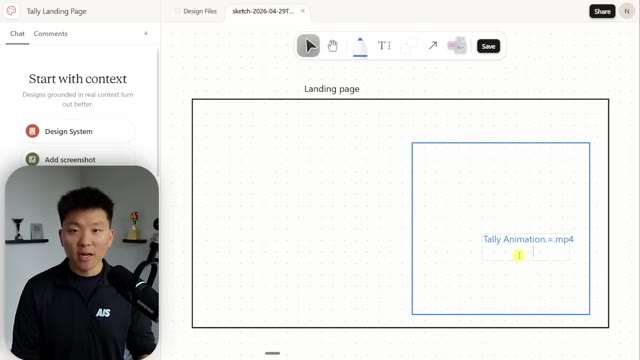
*⏱️ 00:00:25 — Interface de conception web montrant un espace de travail vierge pour la "Landing Page" avec une option d'intégration de fichier média "Tally Animation.mp4".*

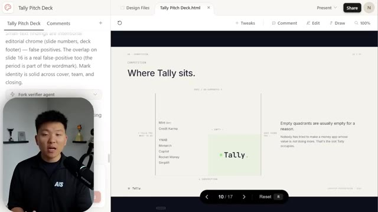
*⏱️ 00:00:30 — Aperçu d'une slide de présentation appelée "Tally Pitch Deck" montrant une analyse concurrentielle sous forme de matrice (graphique à quatre quadrants) positionnant l'application "Tally".*

---

### ⏱️ `[00:00:39 - 00:00:58]` | Segment #03

**🔊 Audio (Transcription Intégrale Mot pour Mot en Français) :**
> And how do you make sure that you're not going through your cloud design session limit? Really quick i've been playing around with this tool every day since it came out And i'm just going to be showing you guys everything that I know about how to get the most out of it There's timestamps down below. Make sure you save this one so you can come back and jump around whenever you need. And let's not waste any time and just get straight into this video. Well, let's just go ahead and jump right in.

**👁️ Analyse Visuelle d'Écran (gemini-3.5-flash-lite) :**
**Interface & Outils** : Interface web de type "Design System AI" (potentiellement v0.dev ou similaire).

**Contenu textuel & Code** : Champs de saisie pour "Link code on GitHub", "Link code from your computer", et aperçu visuel des styles typographiques "MASTER AI AUTOMATION".

**Action / Démonstration** : Importation de ressources techniques pour entraîner ou guider l'IA, et visualisation du système de design généré.

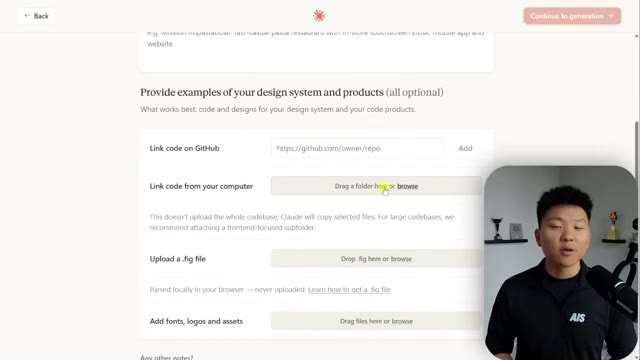
*⏱️ 00:00:44 — Interface de configuration pour importer des ressources (GitHub, dossiers locaux, fichiers .fig) dans l'outil de génération de design.*

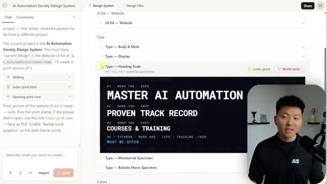
*⏱️ 00:00:53 — Tableau de bord d'un "Design System" montrant les styles typographiques (titres H1, H2, H3) et la structure du projet avec une zone de chat latérale.*

---

### ⏱️ `[00:00:58 - 00:01:18]` | Segment #04

**🔊 Audio (Transcription Intégrale Mot pour Mot en Français) :**
> So Claude Design, this is going to be super fun. What is it? It is basically a separate product. So it's almost like you've got your Claude Chat, you've got co-work, you've got Claude Code. This is a different app within sort of the Anthropic ecosystem called Claude Design. And it's specifically made for people to work on designing things, whether that is websites or slide decks or, you know, prototypes.

**👁️ Analyse Visuelle d'Écran (gemini-3.5-flash-lite) :**
**Interface & Outils** : Claude Design (interface web propriétaire d'Anthropic).

**Contenu textuel & Code** : Menus de sélection pour créer des projets (Prototype, Slide deck, From template), choix entre "Wireframe" et "High fidelity", et liste de projets comme "AI Automation Society Design System", "First Agent Promo", "AIS Website".

**Action / Démonstration** : Navigation dans l'interface utilisateur de Claude Design pour démarrer un nouveau projet ou accéder aux créations existantes.

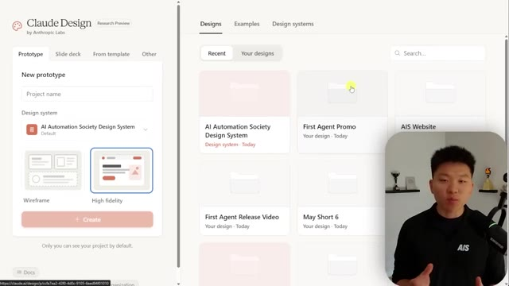
*⏱️ 00:01:03 — Interface de l'application web "Claude Design by Anthropic Labs", affichant un tableau de bord avec une zone de création de nouveau prototype à gauche et une liste de projets récents à droite.*

---

### ⏱️ `[00:01:19 - 00:01:42]` | Segment #05

**🔊 Audio (Transcription Intégrale Mot pour Mot en Français) :**
> A lot of people, when this was released, was calling it the Figma killer. You can share design systems across your team. You can export designs from Cloud Design into Cloud Code or to Canva or as Zips or as HTML. So we're going to be diving into all of that today. So we're going to be looking at sort of three different acts, different stuff going to be going on. We're going to be starting with foundations. So looking at what's actually going on inside of Cloud Design getting set up, we're going to do some builds.

**👁️ Analyse Visuelle d'Écran (gemini-3.5-flash-lite) :**
**Interface & Outils** : Claude Design (interface web de prototypage) et présentation de cours (diapositives type plateforme éducative).

**Contenu textuel & Code** : Noms de projets visibles (AI Automation Society Design System, First Agent Promo, AIS Website) et contenu pédagogique sur la gestion des agents et du workflow de design.

**Action / Démonstration** : Navigation dans l'interface de gestion de projets dans l'image 1, et présentation du programme structuré du cours dans l'image 2.

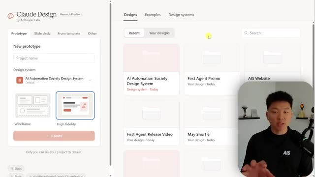
*⏱️ 00:01:24 — Interface de l'application "Claude Design" affichant le tableau de bord des projets récents et le menu de création d'un nouveau prototype (choix entre wireframe et haute fidélité).*

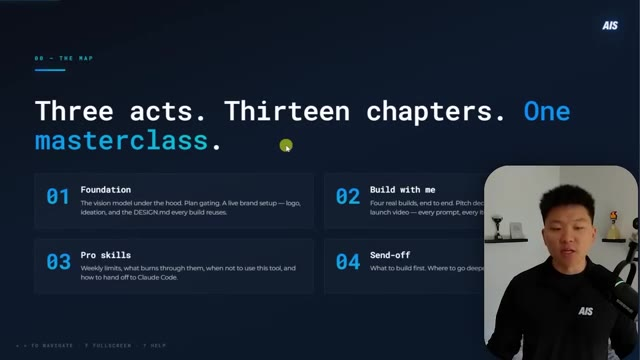
*⏱️ 00:01:36 — Diapositive de présentation structurée intitulée "00 - THE MAP" détaillant le plan d'une masterclass divisée en quatre sections (Foundation, Build with me, Pro skills, Send-off).*

---

### ⏱️ `[00:01:42 - 00:02:17]` | Segment #06

**🔊 Audio (Transcription Intégrale Mot pour Mot en Français) :**
> So I'm going to go through some real scenarios. We're basically going to set up a brand together. So I'm going to show you guys how I ideated on a new brand, a new business, and then I used a combination of Claude Design and some other tools in order to really bring that brand to life. We're also going to be going over some really important habits and the ways that you can get the most out of Claude Design without burning through your session limit. Because the important thing about Claude Design to note is that it is a separate limit than your regular Claude or Claude code usage. You can see we've got our current session, we've got all models, we've got Sonnet only. And then we have a Claude Design specific limit. So we have to really be careful because we

**👁️ Analyse Visuelle d'Écran (gemini-3.5-flash-lite) :**
**Interface & Outils** : Interface de gestion de compte / paramètres de plateforme IA (Anthropic Console / Claude).

**Contenu textuel & Code** : Statistiques de consommation d'utilisation : "Plan usage limits" (15% used), "All models" (14% used), "Sonnet only" (2% used), "Claude Design" (4% used), et "Daily included routine runs" (1/15).

**Action / Démonstration** : Consultation du tableau de bord de suivi de consommation et des limites d'utilisation de l'API/outils d'IA.

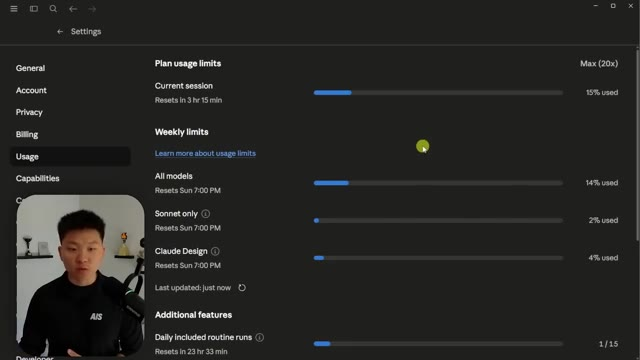
*⏱️ 00:02:08 — Interface des paramètres utilisateur affichant les limites d'utilisation (Plan usage limits) pour différents modèles IA, dont Claude Design.*

---

### ⏱️ `[00:02:17 - 00:02:51]` | Segment #07

**🔊 Audio (Transcription Intégrale Mot pour Mot en Français) :**
> don't want to just blow through this if we're not using it efficiently. So I'm going to talk a lot about that in this masterclass as well. And then we'll talk about what comes next. But this is going to be really cool. I'm going to take you guys on a full journey, like I said, of building a brand. So anyways, just to get started off here, what is Claude Design and what is Opus 4.7? So here was the release blog from Anthropic about Claude Design on April 17th, 2026. Today, we're launching Claude Design, a new Anthropic Labs product that lets you collaborate with Claude to create polished visual work like designs, prototypes, slides, one-pagers, and more. You can even use it to create animations and videos, which I'm going to show you of course today,

**👁️ Analyse Visuelle d'Écran (gemini-3.5-flash-lite) :**
**Interface & Outils** : Navigateur web affichant le site officiel d'Anthropic (blog/annonces) et une plateforme de présentation interactive.

**Contenu textuel & Code** : Texte descriptif sur le plan de la masterclass et annonce textuelle du lancement de "Claude Design" propulsé par "Claude Opus 4.7".

**Action / Démonstration** : Présentation du plan de formation et démonstration de l'annonce officielle d'un nouvel outil de design assisté par IA.

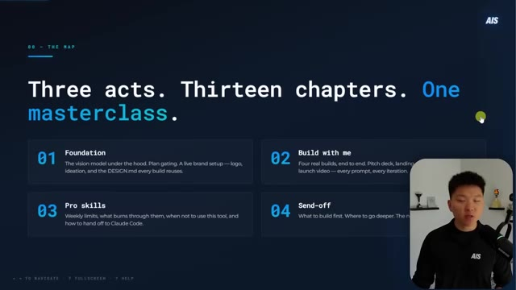
*⏱️ 00:02:25 — Diapositive de présentation titrée "Three acts. Thirteen chapters. One masterclass" détaillant les quatre sections du programme (Foundation, Build with me, Pro skills, Send-off).*

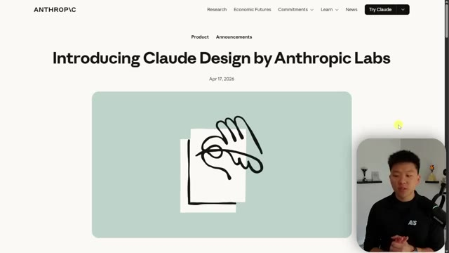
*⏱️ 00:02:34 — Page web d'annonce officielle intitulée "Introducing Claude Design by Anthropic Labs" présentant le nouveau produit.*

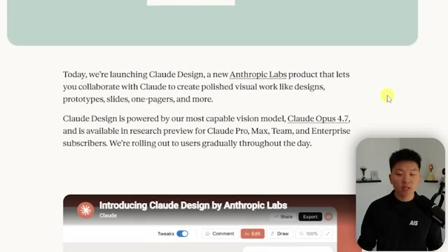
*⏱️ 00:02:42 — Suite de la page web montrant le paragraphe d'introduction de "Claude Design" et un aperçu partiel de son interface utilisateur avec des outils de modification.*

---

### ⏱️ `[00:02:51 - 00:03:26]` | Segment #08

**🔊 Audio (Transcription Intégrale Mot pour Mot en Français) :**
> but it is just really powerful. It's also being powered by their most capable vision model, which is their most recent model, Claude Opus 4.7. And once again, you're not starting from scratch because you can import your current brand assets, your current websites, your current apps, and you can create design systems around those so that every single thing you build in the future feels branded with the colors, the font, everything. Collaborate with Claude to create polished visual work, a vision model backed design surface. And it's really interesting because this thing is pretty much powered by Opus 4.7. You have the ability inside of Claude Design to switch which model you use, which I'll talk about as well, because you do want to be a little bit strategic.

**👁️ Analyse Visuelle d'Écran (gemini-3.5-flash-lite) :**
**Interface & Outils** : Interface de présentation de produit / Slides web.

**Contenu textuel & Code** : Texte technique listant les capacités du modèle : "Vision 2,576 px", "Released April 16, 2026", "API Price $5 in / $25 out".

**Action / Démonstration** : Présentation informative et théorique sur les spécifications techniques du moteur d'IA derrière l'outil.

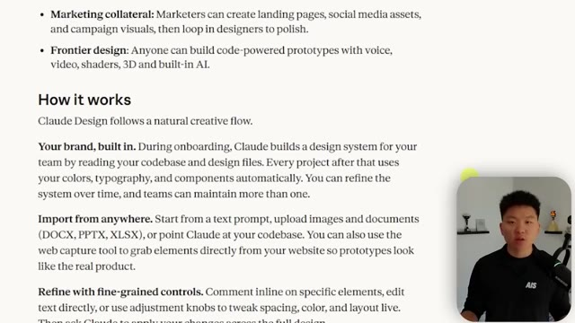
*⏱️ 00:03:00 — Page web présentant le fonctionnement de "Claude Design", détaillant les fonctionnalités d'importation de codebase et de design system.*

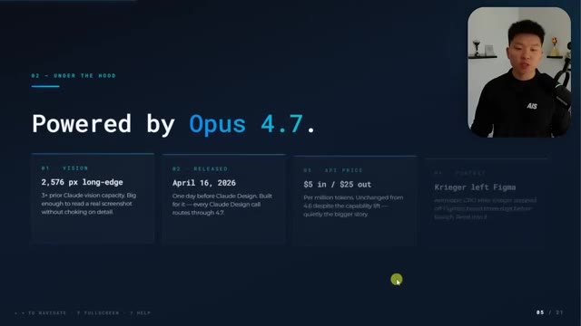
*⏱️ 00:03:17 — Diapositive technique intitulée "Under the hood" détaillant les capacités du modèle Opus 4.7 (Vision, date de sortie, prix API).*

---

### ⏱️ `[00:03:26 - 00:03:59]` | Segment #09

**🔊 Audio (Transcription Intégrale Mot pour Mot en Français) :**
> But Opus 4.7 has the best vision. And Claude Design does something really cool where it basically validates and it looks and uses its eyes to see what's going on on the page to make sure that it mess anything up. Cloud Design was released pretty much the day after Opus 4.7 was released, which was pretty cool. And obviously, if you're using Opus 4.7, it goes through tokens quicker. It's more expensive than using a model like Sonnet or Haiku. So you have to be strategic there. And something else that's pretty interesting is Krieger left Figma pretty much right before the announcement of Cloud Design. And Krieger was on Figma's board and is now Anthropix's CPO. So

**👁️ Analyse Visuelle d'Écran (gemini-3.5-flash-lite) :**
**Interface & Outils** : Présentation de type slides (format web).

**Contenu textuel & Code** : Texte technique : "Powered by Opus 4.7", "Vision: 2,576 px long-edge", "Released: April 16, 2026", "API Price: $5 in / $25 out", "Context: Krieger left Figma".

**Action / Démonstration** : Présentation informative des caractéristiques techniques du modèle IA lors de la vidéo.

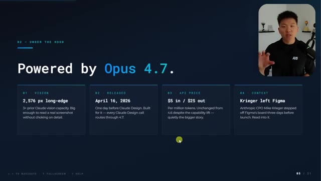
*⏱️ 00:03:34 — Une diapositive de présentation technique détaillant les spécifications de "Opus 4.7", incluant ses capacités de vision, sa date de sortie, le coût de l'API et un contexte sur le départ de Mike Krieger de chez Figma.*

---

### ⏱️ `[00:03:59 - 00:04:34]` | Segment #10

**🔊 Audio (Transcription Intégrale Mot pour Mot en Français) :**
> that's also kind of interesting to think about, like, where are these tools headed? But anyways, let's go ahead and get set up and figure out what actually is going on. But first, let's just talk about how to get set up. So you have to be on a paid plan for this. This is available for pro users, max users, and team and enterprise users as well. So if you're on the free plan, you will have to upgrade in order to test out Claude Design. You're also going to be getting more usage as your plan increases, obviously. So if you're paying more per month, you're going to get more of that Claude Design usage, as you can see right here. And I'm pretty sure that this is a weekly reset. So if you hit the limit, you have to either wait until it resets, or you could go ahead and purchase some

**👁️ Analyse Visuelle d'Écran (gemini-3.5-flash-lite) :**
**Interface & Outils** : Diapositive de présentation (probablement créée avec un outil de présentation de type slide deck moderne).

**Contenu textuel & Code** : Tableau présentant les différents paliers d'abonnement : Free (non inclus), Pro (20$/mois), Max 5x (100$/mois), Max 20x (200$/mois) et Team/Enterprise. Une note textuelle en bas indique : "Most viewers will be on Pro."

**Action / Démonstration** : Le présentateur explique les exigences d'abonnement nécessaires pour accéder aux outils dont il va parler.

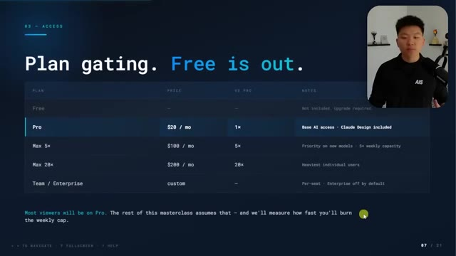
*⏱️ 00:04:07 — Une diapositive de présentation affichant un tableau comparatif des plans tarifaires avec le titre "Plan gating. Free is out."*

---

### ⏱️ `[00:04:34 - 00:04:54]` | Segment #11

**🔊 Audio (Transcription Intégrale Mot pour Mot en Français) :**
> extra usage, which would just be, you know, coming out of your actual balance. And as you can see, I've been using a ton of this extra usage because if you're not careful, you hit the limit pretty quick, but that has helped me learn what helps me, you know, manage that limit better. So I'm going to be sharing all that with you guys today. Okay. So let's actually go ahead, open up Claude Design and let's start, you know, building a brand and I'll show you guys what I've been up to.

**👁️ Analyse Visuelle d'Écran (gemini-3.5-flash-lite) :**
**Interface & Outils** : Interface de gestion de compte Claude / Application web de présentation.

**Contenu textuel & Code** : - Image #1 : Statistiques d'usage, limite de dépenses mensuelle (1000$), solde actuel (35,78$), option "Extra usage" activée.
- Image #2 : Tableau comparatif des plans d'accès incluant prix et capacités (1x, 5x, 20x).

**Action / Démonstration** : Le présentateur explique la gestion des limites d'utilisation de l'IA et les coûts associés aux différents plans de tarification.

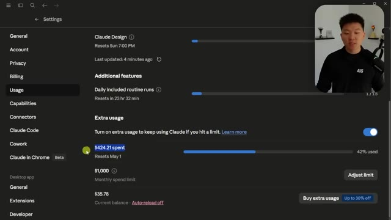
*⏱️ 00:04:39 — Vue des paramètres d'utilisation de Claude affichant le suivi des dépenses ("Extra usage") avec un montant de 424,21 $ déjà consommé sur une limite mensuelle de 1 000 $.*

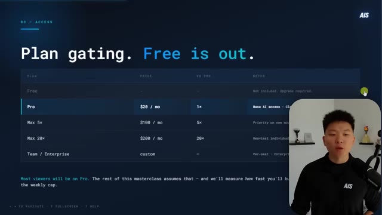
*⏱️ 00:04:49 — Diapositive de présentation titrée "Plan gating. Free is out." détaillant les différents paliers d'abonnement (Free, Pro, Max 5x, Max 20x, Team/Enterprise) avec leurs coûts associés.*

---

### ⏱️ `[00:04:54 - 00:05:30]` | Segment #12

**🔊 Audio (Transcription Intégrale Mot pour Mot en Français) :**
> So if you're in your regular chat in Claude on the web, you'll see over here on this left-hand side, we've got this little button that says design. So that's what you're going to want to click on, or you could just Google Cloud Design. And that's going to pull up an actual separate app, which looks like this. And this is kind of the interface that we're going to be working out of for Cloud Design. Now, a few things you're going to notice. There's kind of this thing on the left hand side, which is how you launch a new project. You can see that we have prototype. We can choose between wireframe and high fidelity. We have slide decks that we can create. We have different templates or other. On the right hand side, we have all of my previous designs or design systems that I've built. We also have a bunch of examples to look through. So organic loaders, we can take

**👁️ Analyse Visuelle d'Écran (gemini-3.5-flash-lite) :**
**Interface & Outils** : Navigateur web (page en cours de chargement).

**Contenu textuel & Code** : Aucun contenu informatif, code ou interface logicielle n'est visible en dehors de la barre de chargement.

**Action / Démonstration** : Le navigateur est en train de charger l'application ou le site "Claude Design".

---

### ⏱️ `[00:05:30 - 00:06:01]` | Segment #13

**🔊 Audio (Transcription Intégrale Mot pour Mot en Français) :**
> some inspiration from, we can look at tech streaming, we can look at things like a globe and some shaders. So there's ways right here to basically just use this prompt and inject that into a project that you want to work on. And then of course, you can look at your design systems, which we will talk about as well, because this is the first thing that I want you guys to do when you get into cloud design. Now, building a design system is kind of token intensive, but it is in the long run going to save you because then everything you build, for example, my AI Automation Society design system, everything that I build will have this branding, the logos, the typography, the colors.

**👁️ Analyse Visuelle d'Écran (gemini-3.5-flash-lite) :**
**Interface & Outils** : Application web Claude Design (Research Preview).

**Contenu textuel & Code** : Descriptif textuel de prompts pour des composants UI (chargement organique, streaming de texte) et sélecteur de système de design "AI Automation Society Design System".

**Action / Démonstration** : Le curseur survole le bouton "Use this prompt" pour activer l'utilisation du modèle de design sélectionné.

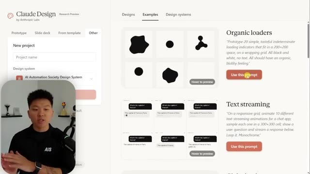
*⏱️ 00:05:38 — Interface web "Claude Design" présentant une bibliothèque d'exemples de design (Organic loaders, Text streaming) avec des boutons pour injecter des prompts dans des projets.*

---

### ⏱️ `[00:06:01 - 00:06:23]` | Segment #14

**🔊 Audio (Transcription Intégrale Mot pour Mot en Français) :**
> But you don't wanna go crazy building like five different design systems. You just wanna start with one and then iterate from there. So if I open up this design system real quick to show you guys, what's in here is, like I said, everything about my UI, my brand. So it's got my website. It can look through the different fonts, the colors, the way that our buttons are, the way that our little banners are, and it knows everything about this website.

**👁️ Analyse Visuelle d'Écran (gemini-3.5-flash-lite) :**
**Interface & Outils** : Claude Design (outil de conception assistée par IA d'Anthropic).

**Contenu textuel & Code** : Navigation dans les systèmes de design, rendu visuel d'une page d'accueil (Landing Page) avec typographie, boutons "Join Free Community", statistiques communautaires et métadonnées de projet.

**Action / Démonstration** : Navigation et démonstration du système de design (Design System) appliqué au branding de la marque.

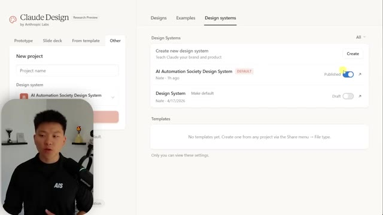
*⏱️ 00:06:07 — Interface "Claude Design" affichant la liste des "Design systems" créés, avec le projet "AI Automation Society Design System" sélectionné comme actif.*

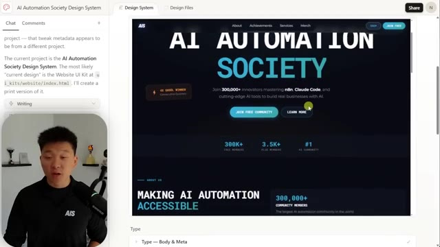
*⏱️ 00:06:18 — Visualisation du rendu de l'interface du site web "AI Automation Society" au sein de l'outil Claude Design, accompagnée d'un panneau latéral de discussion textuelle.*

---

### ⏱️ `[00:06:23 - 00:06:43]` | Segment #15

**🔊 Audio (Transcription Intégrale Mot pour Mot en Français) :**
> and it used this to basically create typography. So it knows our brand. It knows like, you know, when to use primary, when to use secondary. It also knows colors. So accents and gradients, our neutrals, also our primary colors. It understands spacing. So we have these little glows behind buttons. We also like to have like, you know, different sizing and different types of shapes.

**👁️ Analyse Visuelle d'Écran (gemini-3.5-flash-lite) :**
**Interface & Outils** : Application de gestion de design système / documentation de projet (type plateforme de collaboration de design).

**Contenu textuel & Code** : Spécifications CSS incluant les familles de polices (Montserrat, Roboto Mono), les codes hexadécimaux de couleurs, les valeurs de tracking, et les définitions de box-shadow pour les effets de "glow".

**Action / Démonstration** : Navigation et présentation des composants documentés du design système pour illustrer la conformité de l'IA aux standards de marque de l'entreprise.

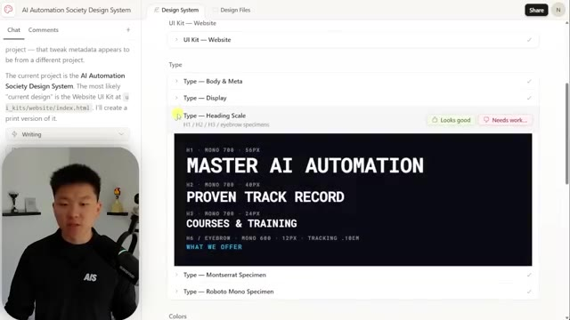
*⏱️ 00:06:28 — Interface de documentation "Design System" affichant la section "Type" avec une hiérarchie de titres (H1, H2, H3, H6).*

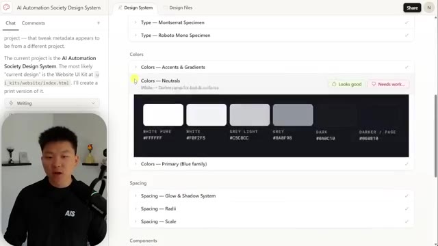
*⏱️ 00:06:33 — Interface de documentation "Design System" affichant la section "Colors" avec une palette de nuances neutres (du blanc au noir profond).*

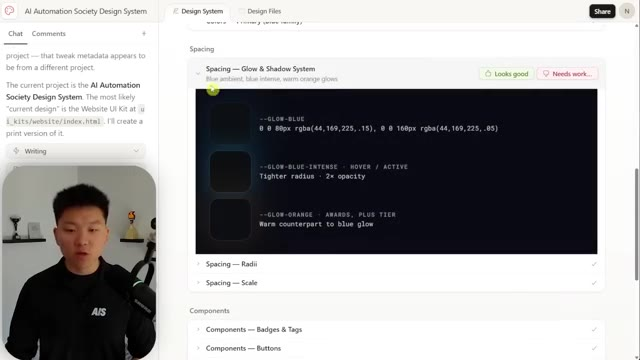
*⏱️ 00:06:38 — Interface de documentation "Design System" détaillant les variables CSS pour les effets de lueur ("Glow & Shadow System").*

---

### ⏱️ `[00:06:43 - 00:07:17]` | Segment #16

**🔊 Audio (Transcription Intégrale Mot pour Mot en Français) :**
> And similarly with components, which I think is awesome. Look, it has all of these badges. It has all these tags. It understands what our buttons should look like, what our cards should look like. It understands all of this. and this is all translated into our websites, our videos, our slide decks, our landing pages, whatever we want to build. Now we don't have to repeat this. And that is why this is so awesome because this can be shared across your team. If you're on a team plan, everyone in your organization will be able to access this design system, which means consistent visuals, whether that's internally or externally, LinkedIn posts, whatever it is, it will always be consistent,

**👁️ Analyse Visuelle d'Écran (gemini-3.5-flash-lite) :**
**Interface & Outils** : Application web de Design System (interface type Claude Projects/Artifacts).

**Contenu textuel & Code** : Structure hiérarchique du Design System : composants UI, variables de marque (Brand), typographie et état de publication.

**Action / Démonstration** : Navigation et démonstration de la documentation interactive d'un système de design généré par IA.

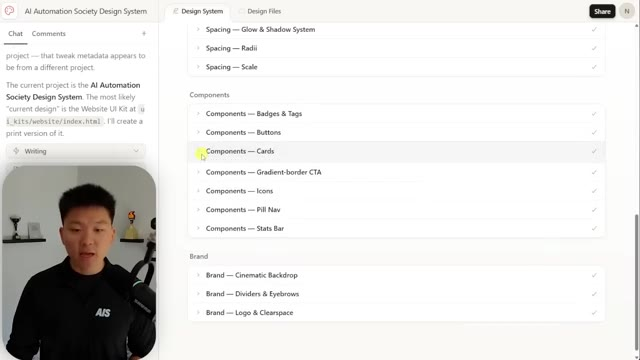
*⏱️ 00:06:52 — Interface de gestion du Design System montrant une liste hiérarchique de composants (Badges, Tags, Buttons, Cards, Icons).*

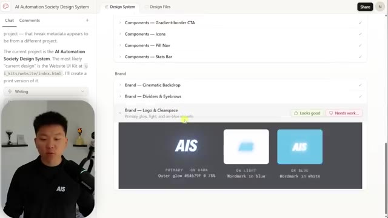
*⏱️ 00:07:00 — Détail de la section "Brand" avec les variations visuelles du logo AIS (sur fond sombre, clair et bleu) avec les spécifications techniques.*

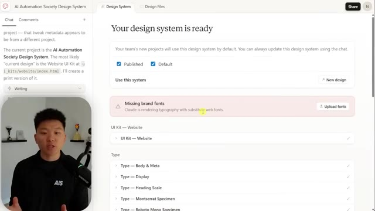
*⏱️ 00:07:09 — Panneau de statut "Your design system is ready" affichant les options de publication et une alerte concernant des polices de caractères manquantes.*

---

### ⏱️ `[00:07:17 - 00:07:51]` | Segment #17

**🔊 Audio (Transcription Intégrale Mot pour Mot en Français) :**
> which is really important. You can also go ahead and download this as a zip, as a PDF, as an HTML, and you can put that into Cloud Code, or you can bring that into Canva, or you can even give it to ChatGBT's new image model. Whatever you want to do with it, you can take this and bring it somewhere else. So that is why this is the first thing that I want you to do when you get into Cloud Design. So let me show you guys how we're going to set this up. What I did here is for my AI Automation Society design system, it was easy because I already had a brand. I was able to give it my logo. I was able to give it the GitHub repository of my website and my website URL.

**👁️ Analyse Visuelle d'Écran (gemini-3.5-flash-lite) :**
**Interface & Outils** : Interface web de type "Design System" (similaire à des outils comme v0.dev ou Framer).

**Contenu textuel & Code** : Menu d'exportation affichant les options : "Download project as .zip", "Export as PDF", "Export as PPTX", "Send to Canva", "Export as standalone HTML" et "Handoff to Claude Code".

**Action / Démonstration** : Le présentateur illustre les options d'exportation et d'intégration du design système généré vers d'autres plateformes.

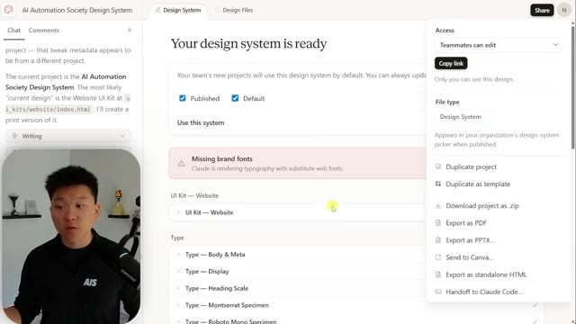
*⏱️ 00:07:26 — Interface d'une application de design montrant un menu d'exportation ouvert, permettant de télécharger ou d'exporter un système de design.*

---

### ⏱️ `[00:07:52 - 00:08:24]` | Segment #18

**🔊 Audio (Transcription Intégrale Mot pour Mot en Français) :**
> And it was able to scrape through all the stuff that we already had existing and turn that into a brand design system. Now, if you're not in that boat and you're starting from scratch, then it's a little bit different because you have to figure out, okay, what is my design system? What are our colors? What are our typography? And what's the feel? So that's kind of the scenario that we're going through today. So what I did is I came into Claude and I said, hey, I need to create a brand. I'm working on a project where I'm going to create a new brand and we're going to create a pitch deck, a logo, brand guidelines, website, all this kind of stuff. So help me figure out a good brand concept that I can use so it feels consistent. So this is basically just me

**👁️ Analyse Visuelle d'Écran (gemini-3.5-flash-lite) :**
**Interface & Outils** : Application web "Claude Design" (interface de design assistée par IA) et interface de discussion type chatbot (Opus 4.7).

**Contenu textuel & Code** : Liste de projets de design (Image 1) et prompt détaillé demandant de l'aide pour définir un concept de marque cohérent pour divers supports (Image 2).

**Action / Démonstration** : Navigation dans la bibliothèque de designs créés par l'utilisateur (Image 1) et saisie/lecture d'un prompt stratégique pour la création d'une charte graphique (Image 2).

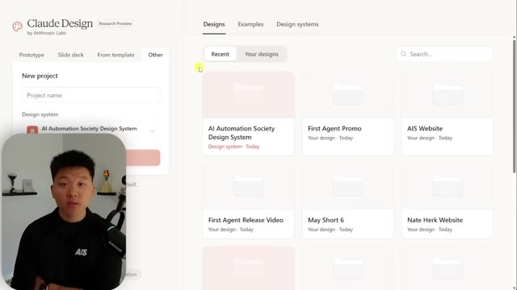
*⏱️ 00:08:00 — Interface utilisateur de "Claude Design" affichant un tableau de bord de gestion de projets de design avec plusieurs fichiers récents comme "AI Automation Society Design System".*

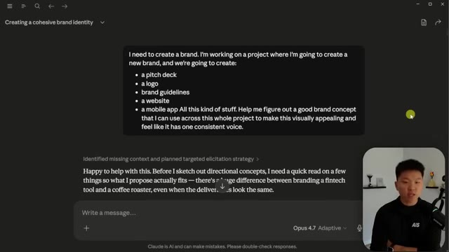
*⏱️ 00:08:16 — Interface de chat avec une IA ("Opus 4.7 Adaptive") où l'utilisateur soumet une requête pour créer une identité de marque complète (pitch deck, logo, guide, site web, app).*

---

### ⏱️ `[00:08:24 - 00:09:00]` | Segment #19

**🔊 Audio (Transcription Intégrale Mot pour Mot en Français) :**
> brainstorming with Claude. And the reason I'm doing this in chat is once again, because we don't want to eat through our Claude design limit. We only want to use Claude design when we're actually ready, when we have an idea and we're ready to move forward with that plan. So don't ever brainstorm in Claude design. There's just no point. You get way more usage over here. So anyways, it starts to sketch out. It asked me some questions and it starts to give me a few concepts of like, you know, what the type will look like and what the logo could look like and you know, the vibe and the colors. So it gave me a couple and I liked this one. So I said, okay, cool. Let's kind of move forward with Tally and let's, let's build out some more of this brand. So I said, okay, let's run with

**👁️ Analyse Visuelle d'Écran (gemini-3.5-flash-lite) :**
**Interface & Outils** : Interface web de Claude.ai (modèle Opus 4.7).

**Contenu textuel & Code** : Prompt de l'utilisateur détaillant les besoins en branding (pitch deck, logo, site web, app) et réponse de l'IA proposant le concept "Orbit" avec codes couleurs (ex: F4F1EA, 1A1A1A, EBA547, 6B6B6B).

**Action / Démonstration** : Démonstration du processus de brainstorming et de conception d'identité de marque via l'interface conversationnelle de Claude.

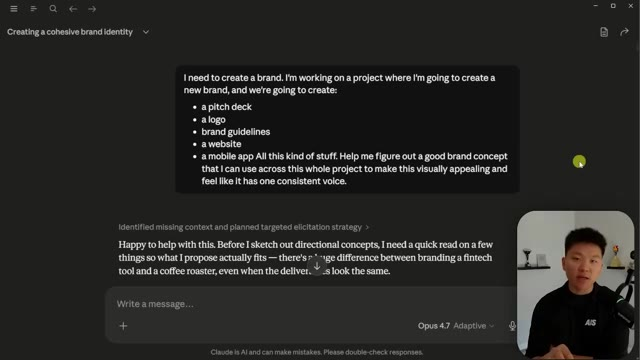
*⏱️ 00:08:33 — Interface de discussion avec Claude où l'utilisateur demande une aide pour définir une identité de marque cohérente pour un nouveau projet.*

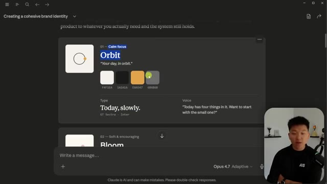
*⏱️ 00:08:51 — Réponse de Claude présentant des concepts de marque (nom, palette de couleurs hexadécimales, typographie et ton de voix) pour un projet intitulé "Orbit".*

---

### ⏱️ `[00:09:00 - 00:09:33]` | Segment #20

**🔊 Audio (Transcription Intégrale Mot pour Mot en Français) :**
> Tally. I want you to build a brand around this. What's the product we're selling? Who does it appeal to? What's the mission? What's the offer? And I just said, figure all of that out for me. Now, obviously you're going to weigh in a little bit more if you're building a real business or if you've already got something in the works, but this is just me showing you guys how we can ideate with Claude. And what it did is it created this whole brand concept. So it created, you know, the product, the audience, it created some avatars as well, the mission, positioning, brand pillars, voice and tone. So a lot of like conceptual stuff about the brand and the promise, but then it also got into some important stuff down here, like the visual identity. So we've

**👁️ Analyse Visuelle d'Écran (gemini-3.5-flash-lite) :**
**Interface & Outils** : Claude AI (interface web, modèle Opus 4.7).

**Contenu textuel & Code** : Texte détaillé sur le positionnement de marque "Tally", incluant des réflexions sur la voix de la marque, les prochaines étapes de design (logo, pitch deck, site web) et des spécifications typographiques précises pour une interface utilisateur.

**Action / Démonstration** : Navigation et consultation d'un document de spécification de marque généré par l'IA au sein de l'interface de travail Claude.

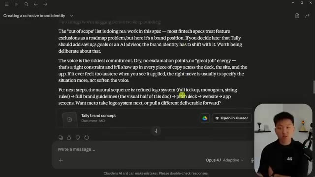
*⏱️ 00:09:08 — Interface de l'outil Claude (Opus 4.7) affichant un document intitulé "Tally brand concept" contenant des directives stratégiques sur l'identité de marque et les étapes de développement.*

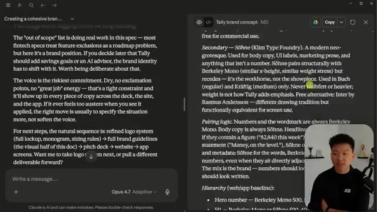
*⏱️ 00:09:16 — Interface de Claude en mode écran divisé montrant le document "Tally brand concept" avec des détails techniques sur la typographie (Söhne, Berkeley Mono) et la hiérarchie visuelle pour une application fintech.*

---

### ⏱️ `[00:09:33 - 00:09:58]` | Segment #21

**🔊 Audio (Transcription Intégrale Mot pour Mot en Français) :**
> got a color palette with four main colors, and that's really important to give to our design system. Obviously it also went into some typography. So our primary font, as well as our secondary font and some other logic with like, you know, the way that we do our hierarchy in our hero section and different things like that. So if I was to give this concept to claw design, it would build a really, really nice website for us in one shot, just because it already has so much info right here.

**👁️ Analyse Visuelle d'Écran (gemini-3.5-flash-lite) :**
**Interface & Outils** : Interface web de Claude.ai (mode projet/artefact).

**Contenu textuel & Code** : Texte documentant la palette de couleurs (#7CD968, #8C8579, etc.) et les polices de caractères ("Berkeley Mono" pour le primaire, "Söhne" pour le secondaire) avec des justifications liées à l'identité visuelle de marque.

**Action / Démonstration** : Le présentateur illustre ses propos sur la définition du système de design (design system) en se référant au document affiché dans l'interface de l'IA.

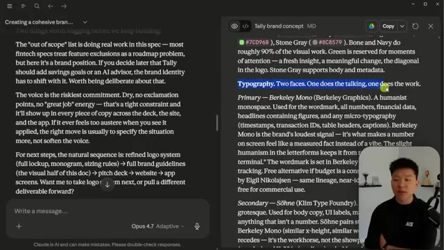
*⏱️ 00:09:39 — Une interface de chat avec IA (Claude) affichant un document intitulé "Tally brand concept" qui détaille la charte graphique, les codes couleurs et les choix typographiques du projet.*

---

### ⏱️ `[00:09:58 - 00:10:32]` | Segment #22

**🔊 Audio (Transcription Intégrale Mot pour Mot en Français) :**
> And then after it created that, I said, yep, let's ideate on the logo as well. So how can it fit the overall vibe? And it gave me a few different options. It gave me this cross with the three or sorry, four tallies and then the fifth and the text. And it gave me a few other variations. I ultimately ended up saying that I like this logo, but I like having the green dot, the green period at the end of the word. So I basically went with a hybrid of this and this. And then I basically asked for like a full typography, almost like a mini brand guidelines thing. So it gave us this logo, it gave us this typography, and it just showed us what this could look like. So the brand

**👁️ Analyse Visuelle d'Écran (gemini-3.5-flash-lite) :**
**Interface & Outils** : Interface web de Claude.ai (modèle Opus 4.7) dans un navigateur.

**Contenu textuel & Code** : Texte généré par l'IA détaillant des concepts de branding, des descriptions de logos (The cross, The period, The level) et des recommandations typographiques.

**Action / Démonstration** : Défilement (scroll) dans la fenêtre de discussion pour examiner les différentes itérations créatives proposées par l'agent IA.

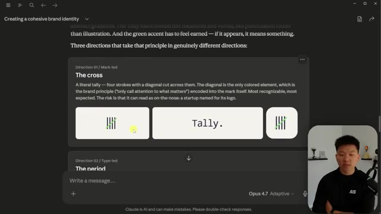
*⏱️ 00:10:06 — L'interface de Claude affiche une proposition de design de marque intitulée "The cross", montrant un logo basé sur des traits de comptage (tally) avec une barre diagonale verte.*

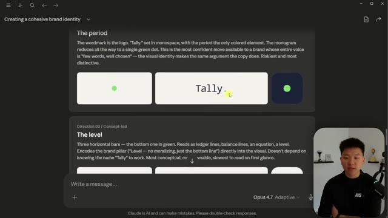
*⏱️ 00:10:15 — L'interface de Claude présente une autre proposition intitulée "The period", centrée sur une typographie monospace avec un point vert final, ainsi qu'une ébauche pour "The level".*

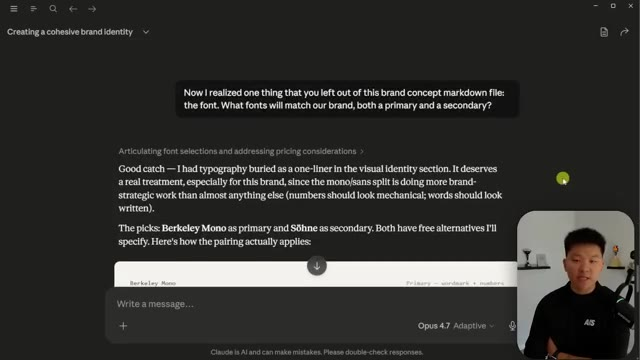
*⏱️ 00:10:24 — L'interface de Claude affiche la réponse à un prompt concernant le choix des polices de caractères, recommandant "Berkeley Mono" et "Söhne" pour l'identité de marque.*

---

### ⏱️ `[00:10:32 - 00:11:04]` | Segment #23

**🔊 Audio (Transcription Intégrale Mot pour Mot en Français) :**
> is really starting to come to life a little bit now. And we're probably in a much better spot to be able to actually create a design system out of this at this point. So back in Cloud Design, I'm going to click on design systems up here, and I'm going to go ahead and click on create a new design system. Now, real quick, just for context, let's take a look at where we're at as far as our usage. So in Cloud Design, we are at 4% of our usage, and I'm on the 20x max plan, so 200 bucks a month. Let's see how much this design system creation eats up out of our design. Now, it won't

**👁️ Analyse Visuelle d'Écran (gemini-3.5-flash-lite) :**
**Interface & Outils** : Claude (interface de chat et menu des paramètres).

**Contenu textuel & Code** : Texte descriptif sur l'identité visuelle de Tally, spécifications typographiques, et barres de progression des limites d'usage des modèles (Opus, Sonnet).

**Action / Démonstration** : Consultation et lecture de la documentation de design système générée, puis vérification des paramètres de compte/usage.

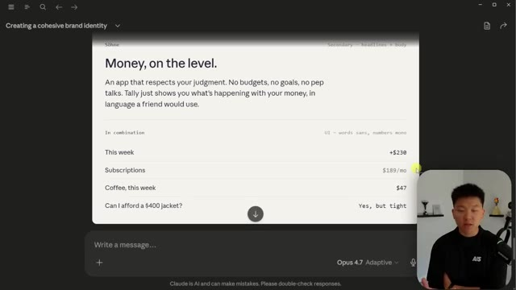
*⏱️ 00:10:40 — Interface de discussion Claude affichant une maquette textuelle pour l'application "Tally" avec des exemples de design typographique.*

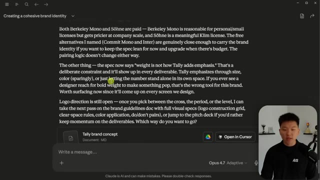
*⏱️ 00:10:48 — Interface de discussion Claude présentant des directives de design (spec) sur les choix de polices et la gestion des graisses (font weight) pour le projet Tally.*

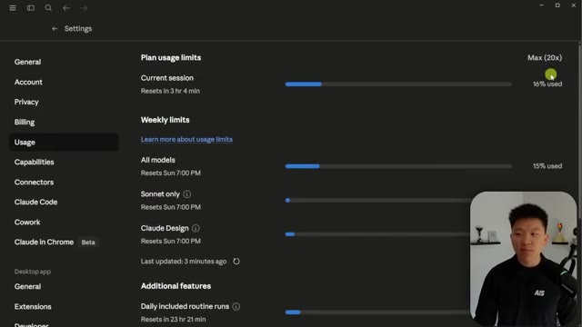
*⏱️ 00:10:56 — Menu des paramètres de l'application Claude montrant les limites d'utilisation (usage limits) et le suivi de consommation des modèles IA.*

---

### ⏱️ `[00:11:04 - 00:11:23]` | Segment #24

**🔊 Audio (Transcription Intégrale Mot pour Mot en Français) :**
> be as much as, you know, if you were importing a bunch of code bases because you can link in folders and files and GitHub repos. So the more that you import right now, the more usage is going to take up obviously, but still let's just see what this does. So company name and blurb. Well, the name of the company is Tally and let's just take a look at what our blurb is going to be.

**👁️ Analyse Visuelle d'Écran (gemini-3.5-flash-lite) :**
**Interface & Outils** : Interface utilisateur web (probablement l'interface de création de projet de Claude ou d'un outil similaire).

**Contenu textuel & Code** : Champs de saisie : "Link code on GitHub", "Link code from your computer" (glisser-déposer), "Upload a .fig file" (Figma), "Add fonts, logos and assets".

**Action / Démonstration** : L'utilisateur visualise les options disponibles pour configurer son projet en important des sources de données externes avant la génération.

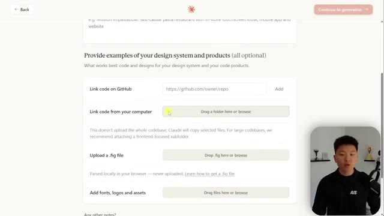
*⏱️ 00:11:09 — Interface web d'un outil de développement IA permettant d'importer des ressources de design et de code (GitHub, fichiers locaux, Figma, assets).*

---

### ⏱️ `[00:11:23 - 00:11:55]` | Segment #25

**🔊 Audio (Transcription Intégrale Mot pour Mot en Français) :**
> I'm probably just going to go ahead and grab the mission of our company. So I'm just going to grab this. Okay. We don't have a GitHub repo at the moment. We don't have any code, but we do have some assets to import. So I'm going to go ahead and add the Tally logo. And I also want to add this file. So I'm actually just going to download this as hopefully markdown. Yeah. So we've got our brand concept. And you can also see if you already had a Figma project that you wanted to bring over, you could import that right here. So any other notes for now, we're just going to leave it like this. I think the one thing that we might want to call out is we haven't built a website yet.

**👁️ Analyse Visuelle d'Écran (gemini-3.5-flash-lite) :**
**Interface & Outils** : Interface web de Claude.ai (Projet/Generation setup).

**Contenu textuel & Code** : Documentation textuelle sur la marque "Tally" (mission, positionnement, directives de design) et liste de fichiers importés (assets images et document Markdown).

**Action / Démonstration** : L'utilisateur configure l'environnement de génération de Claude en important des actifs de marque (logos et fichiers de concept) pour guider la création du projet.

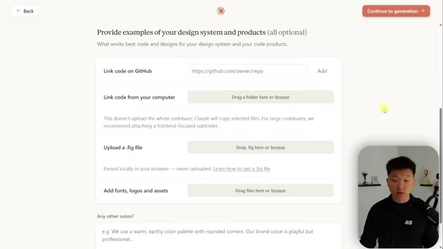
*⏱️ 00:11:31 — Interface de configuration initiale de Claude demandant des exemples de système de design et des actifs de code.*

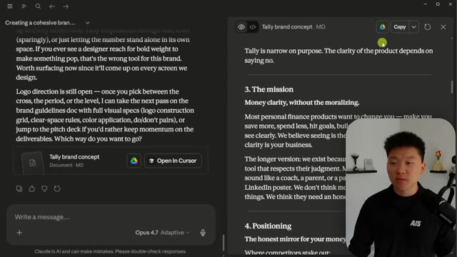
*⏱️ 00:11:39 — Interface de chat avec Claude (Opus 4.7) affichant le contenu d'un document Markdown nommé "Tally brand concept".*

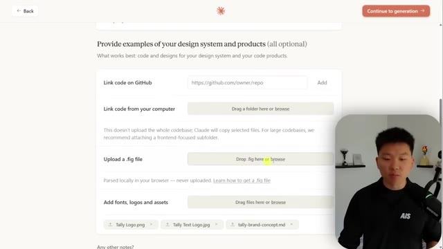
*⏱️ 00:11:47 — Interface de configuration de Claude mise à jour avec les fichiers "Tally Logo.png", "Tally Text Logo.jpg" et "tally-brand-concept.md" importés.*

---

### ⏱️ `[00:11:55 - 00:12:30]` | Segment #26

**🔊 Audio (Transcription Intégrale Mot pour Mot en Français) :**
> So we don't know what our buttons and what our feel is going to look like. So if you wanted to add any notes about that, you could. So I'm just going to add a real quick sentence. I'm going to say when we're building out assets like a website or things like that, I want the buttons to feel very modern. I want them to have sort of like a slight glow behind them. And I just want it to feel very polished. Now that's not really a very good prompt. Like that's pretty vague, but just adding a little bit more context there. And let's go ahead and click continue to generation. This will take about five minutes. So I'm going to hit generate and I will check back in with you guys

**👁️ Analyse Visuelle d'Écran (gemini-3.5-flash-lite) :**
**Interface & Outils** : Interface web d'un outil de développement assisté par IA (interface style Claude).

**Contenu textuel & Code** : Formulaire avec des champs pour : "Link code on GitHub", "Link code from your computer", "Upload a .fig file", "Add fonts, logos and assets", et un champ textuel "Any other notes?".

**Action / Démonstration** : Le présentateur explique comment ajouter des notes spécifiques sur le design (boutons, style visuel) dans le champ "Any other notes" avant de lancer la génération.

*⏱️ 00:12:04 — Une capture d'écran de l'interface de configuration de projet d'un agent IA (probablement Claude), montrant les options pour importer du code, des fichiers Figma, et des ressources graphiques, avec une zone de texte pour ajouter des instructions supplémentaires en bas de page.*

---

### ⏱️ `[00:12:30 - 00:12:51]` | Segment #27

**🔊 Audio (Transcription Intégrale Mot pour Mot en Français) :**
> once we get this wrapped up. Actually, I lied. While this is loading, I did want to show you guys something else that you could look at doing. So ChatGBT's new image model, Image 2, is really solid. You know, you could have taken some of the, you know, information from here and some of the colors and stuff that we had built. And you could also ideate with ChatGBT a little bit to see what those images or the logos and stuff could look like.

**👁️ Analyse Visuelle d'Écran (gemini-3.5-flash-lite) :**
**Interface & Outils** : Application de développement assisté par IA (probablement interface type Canvas/Artifacts liée à Claude ou outil similaire).

**Contenu textuel & Code** : Spécifications textuelles de branding pour une application financière ("Tally") et état de progression de la génération de composants UI.

**Action / Démonstration** : Exécution d'un script d'automatisation pour le design système et affichage des spécifications de produits et des éléments d'interface utilisateur générés par l'IA.

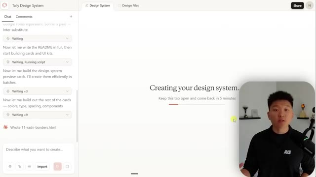
*⏱️ 00:12:35 — Interface d'un agent IA en cours de génération automatique d'un système de design nommé "Tally Design System", affichant l'avancement des étapes de création (README, cards, UI kits).*

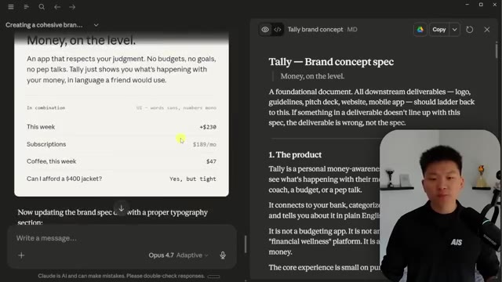
*⏱️ 00:12:46 — Interface de l'outil "Opus 4.7" montrant la spécification d'un concept de marque pour "Tally" avec un aperçu de l'interface utilisateur financière sur la gauche et la documentation textuelle sur la droite.*

---

### ⏱️ `[00:12:51 - 00:13:18]` | Segment #28

**🔊 Audio (Transcription Intégrale Mot pour Mot en Français) :**
> So I basically said, hey, I need a professional and minimalistic logo for this brand. I said what the brand is. I talked about the audience a little bit and sort of the palette. and it gave me this as the first version, which is pretty cool. You know, we've got the little green mark right there. And then I also asked for more of an icon-based one and it gave me this. So I didn't love this one. I really just like the actual tally marks that Claude initially came up with, but that is another thing to think about is that GPT Image 2 is pretty solid at helping you build some of this stuff.

**👁️ Analyse Visuelle d'Écran (gemini-3.5-flash-lite) :**
**Interface & Outils** : ChatGPT (interface web).

**Contenu textuel & Code** : Prompt de design : "Primary: Tally Sam... Palette: Bone, Navy, Signal Green, Stone Gray" et requête de suivi : "That is a great text based logo. Create another one that is more of our icon."

**Action / Démonstration** : Génération et affichage de propositions visuelles (logos) par l'IA en réponse aux instructions textuelles de l'utilisateur.

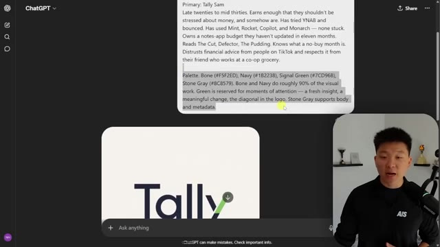
*⏱️ 00:12:58 — Interface ChatGPT affichant un prompt détaillé définissant une audience cible et une palette de couleurs, suivi d'une proposition de logo textuel "Tally" avec une touche verte.*

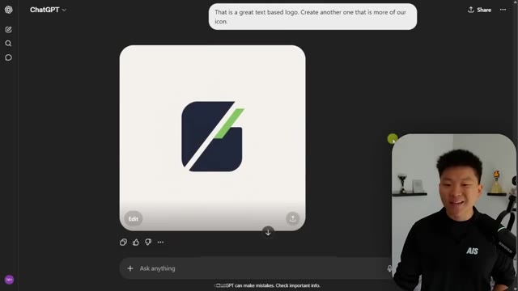
*⏱️ 00:13:04 — Interface ChatGPT affichant une nouvelle itération de logo générée sous forme d'icône abstraite en bleu marine et vert, en réponse à une demande de l'utilisateur.*

---

### ⏱️ `[00:13:18 - 00:13:37]` | Segment #29

**🔊 Audio (Transcription Intégrale Mot pour Mot en Français) :**
> And I'll show you something else as well, which we will come back to later after we've sort of built out our website with this brand. But I actually just built my brand guidelines for AI Automation Society with GPT Image 2. So I gave it the logo and I said, hey, this is basically like what our brand is. Here's some variations. Here's our color palette. Here's our typography. And it created this for me.

**👁️ Analyse Visuelle d'Écran (gemini-3.5-flash-lite) :**
**Interface & Outils** : ChatGPT (Interface web).

**Contenu textuel & Code** : - Description textuelle de la marque : spécifications du logo, typographie, effets de lumière (glow), règles d'espacement.
- Détails techniques des couleurs : Blue (#37bdf8), White (#ffffff), Dark Blue (#07121c) avec leurs équivalences RVB et CMJN.

**Action / Démonstration** : Le présentateur illustre l'utilisation de l'IA pour générer et structurer une documentation de charte graphique complète à partir d'un logo.

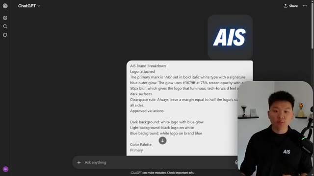
*⏱️ 00:13:23 — Capture d'écran de l'interface ChatGPT affichant les directives de marque (Brand Breakdown) pour "AI Automation Society" (AIS).*

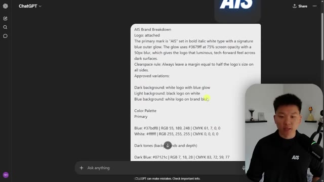
*⏱️ 00:13:32 — Suite de la réponse de ChatGPT détaillant la palette de couleurs (codes hexadécimaux, RVB et CMJN) pour la charte graphique.*

---

### ⏱️ `[00:13:38 - 00:14:10]` | Segment #30

**🔊 Audio (Transcription Intégrale Mot pour Mot en Français) :**
> And it's really good. This is the actual official one that we're using internally. However, you can see it messed up some of the font. Now it is pretty good with text in general. You can see all the other font is fine, but because it was trying to pull in Roboto Mono and was trying to pull in Monsterat, it messed it up a little bit. So even when I said, hey, you know, that didn't work. Oops, I can't get out of this. Even when I said, hey, that didn't work. And I tried to have it do it again. It just didn't work. And honestly, I was like, you know what, that's fine. I'm just going to throw this into Canva. And I'm just going to go ahead and grab the fonts and just put it in myself. So not a huge deal. It might have trouble with certain

**👁️ Analyse Visuelle d'Écran (gemini-3.5-flash-lite) :**
**Interface & Outils** : ChatGPT (Web UI).

**Contenu textuel & Code** : Guide d'identité visuelle (branding) incluant des spécifications techniques pour les polices "Roboto Mono Medium" et "Montserrat Light". Prompt : "Some of the text in the typography section, specifically the alphabet in the Roboto Mono Medium and the MonsterRat Lite font, the letters are misformed. Make sure this is all English typography."

**Action / Démonstration** : Le créateur montre le résultat généré par l'IA et soumet une requête de correction pour résoudre les défauts d'affichage des polices de caractères dans le guide visuel.

*⏱️ 00:13:46 — Interface ChatGPT affichant un "Futuristic tech brand identity guide" complet (logo, palette de couleurs, typographie, iconographie).*

*⏱️ 00:14:02 — Interface de conversation ChatGPT montrant un prompt utilisateur demandant de corriger les erreurs de police dans la section typographique.*

---

### ⏱️ `[00:14:10 - 00:14:32]` | Segment #31

**🔊 Audio (Transcription Intégrale Mot pour Mot en Français) :**
> fonts. But as far as like the spacing and everything that did here, this looks really good. So like I said, we're going to do one of these with Tally with the brand that we're building right now a little bit later on in this video. So don't panic if you're like, how do you do this? I want to do this. It's going to be simple and I'll show you. Okay. But looking back at our design system, we've got some stuff to look at here. So Claude is still working, but you can start giving feedback.

**👁️ Analyse Visuelle d'Écran (gemini-3.5-flash-lite) :**
**Interface & Outils** : - Canva (pour la charte graphique)
- Tally (pour la gestion du design system)

**Contenu textuel & Code** : - Image 1 : Guides de style, codes couleurs hexadécimaux/RGB, exemples de typographie et variations de logo.
- Image 2 : Interface de revue de design, tâches ("Updated todos"), et notification système "Missing brand fonts".

**Action / Démonstration** : - Présentation et validation d'une charte graphique existante (Canva) puis démonstration de la mise en œuvre de ce système de design au sein de la plateforme Tally.

*⏱️ 00:14:15 — Interface de Canva affichant une charte graphique complète ("AIS Brand Guidelines") détaillée avec le logo, la palette de couleurs, la typographie (Roboto Mono et Montserrat) et les éléments visuels.*

*⏱️ 00:14:26 — Interface de l'application Tally montrant un "Design System" en cours de développement, avec une section de revue de projet et une alerte concernant des polices de caractères manquantes.*

---

### ⏱️ `[00:14:32 - 00:15:04]` | Segment #32

**🔊 Audio (Transcription Intégrale Mot pour Mot en Français) :**
> It's missing the brand fonts, which is totally fine. You could upload them if you want, but it's also going to be able to pull them out. As you can see down here, it's got type, but we see the brand mark. So we have the mark, the word, and the tagline. You can see this got a little bit messed up. The tally should be going across all four. Claude design has been historically bad with logos. For some reason, it tries to change them a little bit, which is not great, obviously. So I'm going to say no, that needs work. The logo is not appearing as it should. I dropped in a PNG

**👁️ Analyse Visuelle d'Écran (gemini-3.5-flash-lite) :**
**Interface & Outils** : Interface web de type « Design System » sous Claude (ou outil similaire d'IA générative de design).

**Contenu textuel & Code** : Alertes de système ("Missing brand fonts"), sections "Brand mark" et "Type" (Mono, Sans, The Mix), et rendu visuel du logo Tally.

**Action / Démonstration** : Revue et validation des éléments de la charte graphique de la marque Tally générés par l'IA.

*⏱️ 00:14:40 — Interface de gestion de design system affichant une notification d'avertissement pour polices manquantes et la prévisualisation des actifs de marque « Tally » (marque, nom, tagline, palette).*

---

### ⏱️ `[00:15:04 - 00:15:41]` | Segment #33

**🔊 Audio (Transcription Intégrale Mot pour Mot en Français) :**
> of a logo, and you should just keep it exactly as is. There's no reason to change that. So that's a little feedback I'm going to do. I'm also going to say everything else that looks good, the colors and the font is fine, but the icon logo is not correct. So we'll submit that. Same thing here. I mean, these all, like, from a color scheme perspective, I don't mind it, but it just doesn't look right. And this is something that, like I said, Cloud Design has been doing historically bad. Same feedback here. The logo has been changed. The colors look good, but the logo cannot be changed from the original PNG that I gave you. I'm going to shoot off that feedback as

**👁️ Analyse Visuelle d'Écran (gemini-3.5-flash-lite) :**
**Interface & Outils** : Interface de travail de conception (type Canvas/Design System) utilisée pour le développement piloté par IA.

**Contenu textuel & Code** : Commentaires textuels de l'utilisateur : "The logo is not appearing as it should. I dropped in a PNG of a logo, and you should just keep it exactly as is."

**Action / Démonstration** : Revue et correction itérative d'éléments graphiques (logo/brand mark) au sein d'un système de design généré.

*⏱️ 00:15:13 — L'interface affiche un module de revue "Brand mark" où le présentateur demande une correction sur le logo "Tally" via une zone de saisie texte.*

*⏱️ 00:15:22 — L'écran montre la section "Logo construction" avec trois variantes de logo sur différents fonds (bone, navy) et un commentaire sur la couleur de la diagonale.*

*⏱️ 00:15:31 — L'interface affiche le champ "Describe what you'd prefer..." dans la section "Logo construction", permettant d'envoyer des instructions de correction détaillées à l'IA.*

---

### ⏱️ `[00:15:41 - 00:16:06]` | Segment #34

**🔊 Audio (Transcription Intégrale Mot pour Mot en Français) :**
> well. See, this one looks good. This is the actual logo that I believe we uploaded. So I'm going to go ahead and say this one does look good. These also look good. That's great. And I like the way that this looks as well. So you're basically just going to keep going through this design system to make sure that all of these look great and the way that you actually want your brand to look. And definitely spend some time here because like I said, this is going to be your design.md, your spec for everything that you build in the future.

**👁️ Analyse Visuelle d'Écran (gemini-3.5-flash-lite) :**
**Interface & Outils** : Claude.ai (Artifacts/Design System interface).

**Contenu textuel & Code** : Spécifications visuelles du système de design : logo, palettes de couleurs hexadécimales (ex: #FBF9F5, #182238, #7CD968) et typographie.

**Action / Démonstration** : Revue interactive et validation ("Looks good") des éléments du système de design générés par l'IA dans l'interface de discussion.

*⏱️ 00:15:47 — Interface Claude montrant la section "Logo construction" d'un système de design avec des aperçus de logo sur fonds "Bone" et "Navy".*

*⏱️ 00:15:53 — Interface Claude montrant la section "Color scales" avec des échantillons de couleurs (Bone, Navy, Signal) et leurs codes hexadécimaux respectifs.*

---

### ⏱️ `[00:16:06 - 00:16:26]` | Segment #35

**🔊 Audio (Transcription Intégrale Mot pour Mot en Français) :**
> Videos, promos, landing pages, everything. So this is looking much better. I'm starting to become more confident in what we're building with this design system. So I'm just going to keep approving stuff or giving feedback and I'll check in with you guys once we have our finished design system. All right, so we're getting all of this pretty much finished up. And what you'll notice here is on the left-hand side, we can see that Claude is verifying.

**👁️ Analyse Visuelle d'Écran (gemini-3.5-flash-lite) :**
**Interface & Outils** : Interface web de gestion de Design System (type outil de collaboration IA/UI).

**Contenu textuel & Code** : Spécifications typographiques (Inter - Sans, poids 400/500), exemples de textes (H1, H2, Body), et un panneau latéral de commentaires sur des problèmes de transparence de fichiers PNG et de correspondance de couleurs CSS (#F5F2ED).

**Action / Démonstration** : Revue et validation des composants du design system, avec des indicateurs « Looks good » ou « Needs work » pour les éléments typographiques.

*⏱️ 00:16:11 — Une interface de plateforme de design system (probablement Claude Projects ou interface similaire) présentant une page intitulée « Tally Design System » avec des recommandations de typographie et des retours sur des éléments visuels.*

---

### ⏱️ `[00:16:26 - 00:16:47]` | Segment #36

**🔊 Audio (Transcription Intégrale Mot pour Mot en Français) :**
> And this is it actually looking at what it built to make sure that everything looks all right. As you can see, it's kind of going down through the different elements. Now, this is for us to review. So here it's even mocked up what a landing page could look like. And you can see that all of this feels very on brand. We've got the text-based logo on the top left. And we can scroll down and see the way that it uses our different colors with these little cards and stuff like that.

**👁️ Analyse Visuelle d'Écran (gemini-3.5-flash-lite) :**
**Interface & Outils** : Outil de génération de design system et de landing page (probablement l'interface de Claude Projects/Artifacts).

**Contenu textuel & Code** : Texte de la conversation de l'IA demandant une révision du système de design, et rendu visuel d'un site web promotionnel pour l'application "Tally".

**Action / Démonstration** : Revue et validation par l'utilisateur du design system et de la maquette de la landing page générés automatiquement par l'IA.

*⏱️ 00:16:31 — Interface de l'outil "Tally Design System" affichant une notification "Missing brand fonts" et un aperçu en cours de génération de la landing page.*

*⏱️ 00:16:37 — Visualisation finale de la landing page "Tally" générée par l'IA, incluant le design du site web et un aperçu mobile avec des boutons d'interaction "Looks good" ou "Needs work".*

---

### ⏱️ `[00:16:47 - 00:17:22]` | Segment #37

**🔊 Audio (Transcription Intégrale Mot pour Mot en Français) :**
> I think that this feels really nice. I love the way that this is looking. I'm going to say looks good. And I like this mobile app sort of preview that looks good too. And what it did is it created a bunch of these different things. So obviously our marketing for our like UI kit, right? But it came through and it also thought about the buttons, which I thought was cool. We've got these different buttons that it can use and the way that they highlight when they're, you know, when you put your mouse over it or when you click, it's got a bit of a drop shadow with a glow. We've also got these input fields. We've got icons where the icons go down here. We've got these that it's going to use. So now we have just some really cool elements that we can always have consistent

**👁️ Analyse Visuelle d'Écran (gemini-3.5-flash-lite) :**
**Interface & Outils** : Interface web "Tally Design System" (probablement intégrée à Claude ou un outil similaire).

**Contenu textuel & Code** : Liste des composants générés : "UI Kit - Marketing" (Marketing site), "UI Kit - App" (Mobile app), et styles typographiques (Mono, Sans, The Mix). Notification indiquant "Missing brand fonts" et "Your design system is ready".

**Action / Démonstration** : Présentation du résultat final d'un système de design généré par IA, montrant les différentes sections créées automatiquement.

*⏱️ 00:16:56 — Interface de l'outil "Tally Design System" affichant la finalisation d'un système de design avec des sections pour le marketing et l'application mobile.*

---

### ⏱️ `[00:17:22 - 00:17:43]` | Segment #38

**🔊 Audio (Transcription Intégrale Mot pour Mot en Français) :**
> with our brand. So all of this looks good. And I'm going to go ahead and say that we're good to move on. So I've published this. I could make this my default if I want to. I'm not going to do that right now, but we could go ahead and now use this design system to build whatever we want. You can also click on design files up here at the top. And this is where we can see different assets, like the things that we've uploaded, different previews that it's generated and different documents.

**👁️ Analyse Visuelle d'Écran (gemini-3.5-flash-lite) :**
**Interface & Outils** : Claude (interface web de création de projets/design systems)

**Contenu textuel & Code** : Interface utilisateur indiquant "Your design system is ready", options "Published" (coché) et "Default" (décoché), bouton "New design", et sections UI Kit (Marketing, App) et Type (Mono, Sans).

**Action / Démonstration** : Le système de design a été publié avec succès par l'utilisateur, permettant désormais de générer de nouveaux projets basés sur ces paramètres.

*⏱️ 00:17:27 — Interface de l'application Claude montrant le système de design « Tally Design System » avec l'état « Published » activé et une notification d'avertissement pour les polices manquantes.*

---

### ⏱️ `[00:17:43 - 00:18:04]` | Segment #39

**🔊 Audio (Transcription Intégrale Mot pour Mot en Français) :**
> And this is what we could go ahead and export. If we wanted to bring in a design system and actually give it to a Cloud Code project, we could give it to Cloud Code. And then it would also be able to use the same design system. So that is where this is super powerful. Okay, so now if we go back to the home screen, you'll notice if we wanted to create a new project, we could click on our Tally design system instead of our AI automation society design system.

**👁️ Analyse Visuelle d'Écran (gemini-3.5-flash-lite) :**
**Interface & Outils** : Claude Design (Research Preview par Anthropic Labs).

**Contenu textuel & Code** : Liste de fichiers de design, documents markdown (SKILL.md, README.md), fichiers CSS, et sélecteurs de projets/systèmes de design.

**Action / Démonstration** : Navigation dans l'arborescence des fichiers de design pour gérer les ressources contextuelles utilisées par l'IA dans le projet.

*⏱️ 00:17:48 — Interface de "Tally Design System" dans Claude Design montrant la structure des dossiers (assets, preview, ui_kits) et des fichiers (colors_and_type.css, README.md).*

*⏱️ 00:17:59 — Tableau de bord principal de "Claude Design" affichant la création d'un nouveau projet avec sélection du système de design et divers projets récents (Tally, AIS Website).*

---

### ⏱️ `[00:18:04 - 00:18:23]` | Segment #40

**🔊 Audio (Transcription Intégrale Mot pour Mot en Français) :**
> We could also go ahead and not use one if we want, but that's why we just built the Tally one. But real quick, let's go ahead and go to my usage. We are at 10%. So on a $200 a month plan for Macs, that design system took about 6% of my session limit already. Now, that's really not too bad. If you're on a pro, it's obviously going to eat more.

**👁️ Analyse Visuelle d'Écran (gemini-3.5-flash-lite) :**
**Interface & Outils** : Interface web "Claude Design" (by Anthropic Labs).

**Contenu textuel & Code** : - Image 1 : Noms de projets ("Tally Design System", "AI Automation Society Design System"), choix entre "Wireframe" et "High fidelity".
- Image 2 : Statistiques d'utilisation : "Plan usage limits", "Weekly limits", "All models" (15%), "Sonnet only" (2%), "Claude Design" (10%), "Daily included routine runs" (1/15).

**Action / Démonstration** : Le présentateur navigue dans l'interface de création de prototypes, puis bascule vers le tableau de bord des paramètres pour vérifier la consommation des crédits liés à l'utilisation de l'outil Claude Design.

*⏱️ 00:18:09 — Interface principale de "Claude Design" montrant une galerie de prototypes et la configuration pour créer un nouveau projet avec le "Tally Design System".*

*⏱️ 00:18:13 — Page de paramètres "Usage" affichant les limites de consommation du plan (barres de progression) pour les différents modèles et fonctionnalités, dont "Claude Design" à 10%.*

---

### ⏱️ `[00:18:23 - 00:18:52]` | Segment #41

**🔊 Audio (Transcription Intégrale Mot pour Mot en Français) :**
> But keep in mind, we didn't give it a ton. If you were giving it a whole code base or GitHub repo to search through and scrape through, it would have eaten more. So be selective about what you give your cloud design. You saw how well it did with just Markdown and a pretty vague idea. So it really just needs you know key elements like the colors the logo the typography And if you already have some buttons and things like that You don't actually need to give it an entire github repo unless there's really important info in there So think about that when you're building your design system. Okay, so we kind of started to build our brand, right?

**👁️ Analyse Visuelle d'Écran (gemini-3.5-flash-lite) :**
**Interface & Outils** : Interface web de Claude Design (Anthropic Labs)

**Contenu textuel & Code** : Image 1 : Statistiques d'utilisation (16% pour la session, 15% modèles, 2% Sonnet, 10% Claude Design). Image 2 : Liste de projets ("Tally Design System", "AI Automation Society Design System", "AIS Website", etc.)

**Action / Démonstration** : Navigation dans les paramètres de compte pour vérifier la consommation des crédits, puis retour sur l'interface de gestion des projets de design.

*⏱️ 00:18:30 — Interface des paramètres d'utilisation de Claude affichant les limites de consommation des modèles et des outils.*

*⏱️ 00:18:37 — Tableau de bord principal de l'application "Claude Design" listant les différents projets et systèmes de design créés.*

---

### ⏱️ `[00:18:52 - 00:19:10]` | Segment #42

**🔊 Audio (Transcription Intégrale Mot pour Mot en Français) :**
> We took a concept from claude we were brainstorming we ideated a little bit We created our logo we created all that and now we essentially have a design system We have a design md that we could export anywhere and a design md that we can use for any of our future projects So let's actually get started here. What do we want to build first? Well, we're going to go through the full journey.

**👁️ Analyse Visuelle d'Écran (gemini-3.5-flash-lite) :**
**Interface & Outils** : Logiciel de présentation (type Slide/Deck).

**Contenu textuel & Code** : Texte structuré en 4 points : 01 Concept, 02 Ideate (mentionnant "Claude Design"), 03 Logo, 04 DESIGN.md (décrit comme "Codify the system as a markdown file").

**Action / Démonstration** : Le présentateur explique visuellement le flux de travail utilisé pour transformer une idée conceptuelle en un système de design standardisé.

*⏱️ 00:18:56 — Une diapositive de présentation sombre intitulée "From a vibe to a brand system" présentant les quatre étapes du processus : Concept, Ideate, Logo et DESIGN.md, avec le présentateur en médaillon à droite.*

---

### ⏱️ `[00:19:10 - 00:19:29]` | Segment #43

**🔊 Audio (Transcription Intégrale Mot pour Mot en Français) :**
> So we're basically going to start with a pitch deck, and then we're going to move into like a product landing page. And then we're going to build a mobile app prototype. And then we're going to go live with a launch video at the end. It's all going to feel on brand. And throughout the course of this video, we're going to really bring this brand to life by building all of these elements, all in Claude Design. Real quick, guys, I know we're going over a ton of information in this video.

**👁️ Analyse Visuelle d'Écran (gemini-3.5-flash-lite) :**
**Interface & Outils** : Logiciel de présentation (type diaporama/slides).

**Contenu textuel & Code** : Texte affiché : "ACT 02 • BUILD WITH ME • CH 08 • LIVE BUILD", "Build #3", "Mobile app prototype – interactive".

**Action / Démonstration** : Présentation du plan de cours ou de la feuille de route du projet en cours.

*⏱️ 00:19:15 — Une diapositive de présentation sombre affichant le titre "Build #3" avec la sous-description "Mobile app prototype – interactive", accompagnée d'une fenêtre incrustée montrant le présentateur.*

---

### ⏱️ `[00:19:29 - 00:19:52]` | Segment #44

**🔊 Audio (Transcription Intégrale Mot pour Mot en Français) :**
> So what I wanted to do is break all of this down into a very simple PDF resource guide that you guys can use. And that way you can reference that later if you ever need to look at some stuff I said about, you know, token management or prompting, things like that, rather than having to scrub through the video every time. So if you want to access that completely free resource guide, then head to my free school community. The link for that is down in the description. I'll see you guys over there and let's get back to the video. So let's go ahead and get started with our pitch deck.

**👁️ Analyse Visuelle d'Écran (gemini-3.5-flash-lite) :**
**Interface & Outils** : Logiciel de présentation ou interface web de cours (Masterclass).

**Contenu textuel & Code** : Titre : "CLAUDE DESIGN", Sous-titre : "The complete masterclass", Métadonnées : "3 ACTS", "13 CHAPTERS", "3.5 HOURS", "APRIL 2024".

**Action / Démonstration** : Présentation du contenu et de la structure du guide/masterclass aux spectateurs.

*⏱️ 00:19:35 — Une diapositive de présentation titrée "CLAUDE DESIGN - The complete masterclass" avec le présentateur en médaillon dans le coin inférieur droit.*

---

### ⏱️ `[00:19:53 - 00:20:26]` | Segment #45

**🔊 Audio (Transcription Intégrale Mot pour Mot en Français) :**
> I'm going to go ahead and open up this cloud design and I'm going to go to slide deck. I'm going to make sure to use the tally design system and I'm going to call this tally, oops, tally pitch deck. And we're going to go ahead and click create. Now right here, what do we have? We have basically kind of a lovable like interface. On the right-hand side, we have our preview. We also can see our files. We can do sketches. And the left-hand side is where we will chat with the AI, or we will leave comments and things like that. We will drop files in, that sort of stuff. So it's really

**👁️ Analyse Visuelle d'Écran (gemini-3.5-flash-lite) :**
**Interface & Outils** : Claude Design (Research Preview)

**Contenu textuel & Code** : Formulaire de création de projet : champ "New slide deck" avec "Tall" saisi, sélection du "Tally Design System" dans le menu déroulant, et bouton "+ Create". Grille de projets visibles : "Tally Design System", "AI Automation Society Design System", "AIS Website", etc.

**Action / Démonstration** : Le présentateur est en train de configurer un nouveau "Slide deck" en nommant le fichier et en sélectionnant un système de design spécifique avant de cliquer sur le bouton "Create".

*⏱️ 00:20:01 — Interface de l'outil "Claude Design" affichant le panneau latéral de création d'un nouveau "Slide deck", avec le champ de texte en cours de saisie pour nommer le projet, ainsi qu'une grille de projets existants sur la droite et le présentateur en médaillon.*

---

### ⏱️ `[00:20:26 - 00:20:58]` | Segment #46

**🔊 Audio (Transcription Intégrale Mot pour Mot en Français) :**
> interesting for this use case, all I'm going to do is I'm going to drop in the brand concept markdown file, which if you guys remember was basically just this markdown doc that we were looking at earlier that Claude generated. And it has all the information about the business and sort of like the mission and the avatar. And all of this information is really all that I need in order to make this actual pitch deck. And if it has any questions, that's the thing is Claude Design will also iterate with you and it will ask you things to make sure that it understands your end goal. Now, one thing that I might recommend doing is if you're not very clear on what you

**👁️ Analyse Visuelle d'Écran (gemini-3.5-flash-lite) :**
**Interface & Outils** : Interface de chat Claude (Opus 4.7), éditeur de documents Markdown, interface d'outil de design collaboratif.

**Contenu textuel & Code** : Textes sur l'identité de marque (Tally), spécifications conceptuelles, noms de fichiers (tally-brand-concept.md), liste de projets.

**Action / Démonstration** : Consultation de documents de branding, importation de fichiers de projet dans un espace de travail collaboratif pour créer un "Pitch Deck".

*⏱️ 00:20:34 — Interface de discussion Claude affichant une conversation détaillée sur l'identité de marque "Tally" avec des recommandations stratégiques.*

*⏱️ 00:20:42 — Interface scindée montrant à gauche la suite de la conversation et à droite le document "Tally — Brand concept spec" ouvert pour référence.*

*⏱️ 00:20:50 — Interface de l'application de design montrant une zone de dépôt de fichiers ("uploads") et une liste de documents importés dont "tally-brand-concept.md".*

---

### ⏱️ `[00:20:58 - 00:21:26]` | Segment #47

**🔊 Audio (Transcription Intégrale Mot pour Mot en Français) :**
> want to be communicated in your pitch deck is don't waste time, like I said, brainstorming here. Go over to Claude and brainstorm in this environment. Say, hey, I want to build a pitch deck. Here's a little bit about, you know, information about my business. Help me lay out this pitch deck. Help me understand the structure of it. And then take that file or, you know, copy and paste whatever it gives you there, and then bring that back into Claude Design and move forward with the actual creation. So you can see the little inputs here are to make a deck. We have the Tally Design System, and we also have the Tally brand concept markdown file.

**👁️ Analyse Visuelle d'Écran (gemini-3.5-flash-lite) :**
**Interface & Outils** : Interface web de Claude.ai (mode Projet/Artifacts).

**Contenu textuel & Code** : - Image 1 : Texte de réflexion sur l'identité de marque ("The voice is the riskiest commitment"), suggestion d'étapes de développement.
- Image 2 : Liste de fichiers joints ("Tally Design System", "tally-brand-concept.md") et champ de saisie : "Make a deck".

**Action / Démonstration** : Organisation de la documentation de marque et préparation de la génération automatique d'un pitch deck via une interface IA contextuelle.

*⏱️ 00:21:05 — Interface de discussion Claude affichant une conversation sur la création d'un concept de marque ("Tally brand concept"), avec un volet de prévisualisation du document à droite et le présentateur en médaillon.*

*⏱️ 00:21:19 — Interface de projet de design (potentiellement Claude Projects ou outil similaire) montrant des fichiers importés (Tally Design System, Tally brand concept) et une zone de prompt pour générer un "pitch deck".*

---

### ⏱️ `[00:21:26 - 00:21:59]` | Segment #48

**🔊 Audio (Transcription Intégrale Mot pour Mot en Français) :**
> Now, I did realize though, before I actually give this to Claude Design, I maybe do wanna do a little bit more market research. So I'm gonna open up Claude again. I'm going to come into this chat where we already have all this context and I'm just gonna ask it to help me structure that. So what I wanna do now with Tally is I want to create a pitch deck for an investor presentation, you know, and I want to basically explain what Tally is and why I believe in it and also look at the market and see why it is a good investment and why people might want to,

**👁️ Analyse Visuelle d'Écran (gemini-3.5-flash-lite) :**
**Interface & Outils** : Interface web Claude (claude.ai) avec prévisualisation de fichier Markdown.

**Contenu textuel & Code** : Texte du document discutant de la stratégie de marque "Tally" (identité de marque, ton de voix, roadmap incluant logo, guidelines, pitch deck, site web et application).

**Action / Démonstration** : Le présentateur consulte la conversation précédente dans Claude pour structurer les prochaines étapes de la recherche de marché.

*⏱️ 00:21:35 — Interface divisée en deux colonnes : à gauche la zone de chat Claude avec l'historique de la conversation, à droite un document Markdown intitulé "Tally brand concept" affiché en prévisualisation, avec le présentateur visible en incrustation dans le coin inférieur droit.*

---

### ⏱️ `[00:22:00 - 00:22:32]` | Segment #49

**🔊 Audio (Transcription Intégrale Mot pour Mot en Français) :**
> you know, come on the tally team and the vision that we're pushing for. You know, we want to get them to be bought in. So with the brand concept spec that you already have for me, build on top of that with a pitch deck sort of structure and also do any research about the market and the strategy for actually getting tally to a place where it's starting to adopt a lot of users. So it started doing some research for me, which is great. But then it actually said that it wanted to actually build the deck. So I had to stop it. And I said, you don't need to build the deck. Just give me markdown outline so that I can put this research into Cloud Design and then it can do it. So I

**👁️ Analyse Visuelle d'Écran (gemini-3.5-flash-lite) :**
**Interface & Outils** : Interface web de Claude.ai (utilisant le modèle Opus 4.7).

**Contenu textuel & Code** : - Image #1 : Texte décrivant les options de logo (croix, point, niveau) et la proposition de créer des guidelines visuelles ou un pitch deck.
- Image #2 : Commande utilisateur : "You don't need to build the deck; just give me a markdown outline for this and include the key information and research that you found."

**Action / Démonstration** : Interaction entre l'utilisateur et l'IA pour ajuster la stratégie de création de contenu : passage d'une génération de fichier technique (pptxgenjs) à la rédaction d'un plan stratégique textuel en Markdown.

*⏱️ 00:22:08 — L'interface de Claude (modèle Opus 4.7) montre une discussion sur un document intitulé "Tally brand concept" avec des options pour définir la direction de la marque.*

*⏱️ 00:22:24 — L'interface de Claude montre une interruption d'exécution, suivie d'un prompt utilisateur demandant un plan structuré en Markdown plutôt qu'une génération de fichier de présentation.*

---

### ⏱️ `[00:22:32 - 00:23:07]` | Segment #50

**🔊 Audio (Transcription Intégrale Mot pour Mot en Français) :**
> want you guys to be thinking about AI as a specialized tool. And even if you're using AI, meaning like Cloud, how can you have a separate chat for each individual type of request? How can you make each session as specialized and specific as possible to give you better outputs? Because in this case, we're using Claude right now for the research and to create us like the markdown outline, but then we're going to bring that into design to actually do the design. I think even outside of the scope of this masterclass today, that's just a really important mindset when you're using AI tools. Okay. So now we have our pitch deck outline. This is pretty comprehensive. There's

**👁️ Analyse Visuelle d'Écran (gemini-3.5-flash-lite) :**
**Interface & Outils** : Interface web de Claude.ai

**Contenu textuel & Code** : Prompt utilisateur : "You don't need to build the deck; just give me a markdown outline for this deck and include the key information and research that you found." ; Statut de l'IA : "Drafting substantive markdown outline with embedded research citations"

**Action / Démonstration** : L'IA est en train de générer un plan structuré en markdown basé sur des recherches préalables pour une présentation sur l'identité de marque.

*⏱️ 00:22:41 — Une interface de chat Claude (modèle Opus 4.7) affichant une requête utilisateur demandant un plan markdown pour une présentation, avec une notification d'activité de l'IA en cours.*

---

### ⏱️ `[00:23:07 - 00:23:40]` | Segment #51

**🔊 Audio (Transcription Intégrale Mot pour Mot en Français) :**
> a ton of slides here, and I'm just going to go ahead and copy this. And now what's cool is that was basically the heavy lifting. So the idea is hopefully that is going to make it so that cloud design doesn't actually eat as much of our session limit than it would have if we just dropped in hey build me a pitch deck so i have dropped you in a tally dash brand dash concept markdown file and that just has some overall information about our business tally and you know like the mission and the positioning and i'm also going to paste in some information about how we want to structure

**👁️ Analyse Visuelle d'Écran (gemini-3.5-flash-lite) :**
**Interface & Outils** : Interface web de Claude.ai (ou outil de création de design assisté par IA).

**Contenu textuel & Code** : Liste de fichiers importés : "Make a deck", "Tally Design System (design system)", "tally-brand-concept.md". Champ de saisie : "Describe what you want to create...".

**Action / Démonstration** : Chargement préalable de fichiers de référence et de systèmes de design pour optimiser les limites de session de l'IA lors de la génération.

*⏱️ 00:23:15 — Capture d'écran de l'interface de travail de Claude (ou outil similaire) montrant le chargement de fichiers de contexte pour un projet intitulé "Tally Pitch Deck".*

---

### ⏱️ `[00:23:40 - 00:24:12]` | Segment #52

**🔊 Audio (Transcription Intégrale Mot pour Mot en Français) :**
> this pitch deck you don't have to follow it to a t but there's a lot of important research and information in there that I want you to use in this pitch deck as if we're trying to convince investors to invest into our business. So when I just pasted in that stuff, it came through as the text right here. So I'm just going to clarify the 372 lines of pasted text that you see is the information about the pitch deck structure. So I'm going to shoot this off and we're going to go ahead and see what we get. If you guys are curious about how I'm able to just talk and the text appears, then check out the tool in the description. I'm using a tool called Glido and I'm actually a

**👁️ Analyse Visuelle d'Écran (gemini-3.5-flash-lite) :**
**Interface & Outils** : Interface web d'application de création de pitch deck (probablement basée sur Anthropic Claude ou un outil similaire).

**Contenu textuel & Code** : Fichiers chargés dans le prompt : "Make a deck", "Tally Design System (design system)", "tally-brand-concept.md". Champ de saisie : "Describe what you want to create...".

**Action / Démonstration** : Préparation de la génération d'un deck de présentation en important du contexte textuel et des systèmes de design pour l'IA.

*⏱️ 00:23:48 — Interface de l'outil de création "Tally Pitch Deck" montrant une zone de chat avec des fichiers joints (design system et documents) et une zone d'importation de fichiers.*

---

### ⏱️ `[00:24:12 - 00:24:47]` | Segment #53

**🔊 Audio (Transcription Intégrale Mot pour Mot en Français) :**
> part of the Glido team now because it is significantly faster and more private than Whisper. And I think that there's a lot more agendic stuff that we're going to be doing with it, which I'm very excited about. So definitely go check out Glido. Windows support is coming very, very soon. So while this is running, I also wanted to just bring your attention real quick to this stuff down here. So this is where you could change the model. You can see by default, you're going to be on Opus 4.7. You could switch back to Opus 4.6. You could even use Opus 3. I don't think I will, but you could also go to Haiku and Sonnet. And so for the most part, when we're doing sort of like the initial planning and we're starting out, I'm pretty much always going to be

**👁️ Analyse Visuelle d'Écran (gemini-3.5-flash-lite) :**
**Interface & Outils** : Interface web de Glido avec un panneau de chat latéral pour l'agent et une zone de gestion de fichiers/projets.

**Contenu textuel & Code** : Historique de discussion de l'agent : "I'll dig into the brand concept and design system, then build this deck. Let me start by exploring what's available." et des logs d'actions (Reading, Listing files).

**Action / Démonstration** : L'agent IA exécute des tâches d'exploration de fichiers et de lecture de ressources pour préparer la création d'un "Pitch Deck".

*⏱️ 00:24:21 — Une interface de travail collaborative (probablement Glido) montrant un agent IA nommé "Claude" en train d'analyser des fichiers de projet et un kit UI pour concevoir une présentation.*

---

### ⏱️ `[00:24:47 - 00:25:19]` | Segment #54

**🔊 Audio (Transcription Intégrale Mot pour Mot en Français) :**
> using Opus 4.7 here. When I may be doing some tweaks and feedback later, that's where I would, you know, reduce the model to Sonnet or Haiku for the little iterations and things. But especially once you've really nailed the way that you have your design system and the way that you like your landing pages or decks to be built, you could very likely get to a spot where you're just using sonnet all the time. Once you feel comfortable with the flow and with the outputs that you're getting, especially if you're using Claude on the front to actually do the help with like strategy, because you can use Opus here and you can figure out the outline of what you want. And then just

**👁️ Analyse Visuelle d'Écran (gemini-3.5-flash-lite) :**
**Interface & Outils** : Interface web de développement/design (probablement Bolt.new).

**Contenu textuel & Code** : Liste de fichiers incluant des dossiers ("assets", "uploads") et des fichiers de configuration ("colors_and_type.css", "deck-stage.js"). Champ de saisie prompt en bas à gauche.

**Action / Démonstration** : Navigation dans la structure des dossiers du projet et saisie textuelle dans le champ "Describe what you want to create...".

*⏱️ 00:24:55 — Capture d'écran de l'interface de l'outil de création de présentation (Bolt.new ou similaire) affichant la structure de fichiers du projet "Tally Pitch Deck".*

---

### ⏱️ `[00:25:19 - 00:25:45]` | Segment #55

**🔊 Audio (Transcription Intégrale Mot pour Mot en Français) :**
> say, Hey, sonnet inside of Claude design, take this information and just throw it on a deck for me. And that's how you're going to be able to stretch your limit a lot farther. Okay. So this is done. I did do one round of feedback, but I want to show you guys why. And I want to show you guys some other important things. So this was our prompt. It started to read everything and dig into it, right? It planned out the structure. And then what happened is it started building it out and it was able to verify and look at stuff. So you can see here, it says the verify agent check completed.

**👁️ Analyse Visuelle d'Écran (gemini-3.5-flash-lite) :**
**Interface & Outils** : Claude.ai (Artifacts / interface de génération de projets).

**Contenu textuel & Code** : - Image #1 : Liste de titres de diapositives (The market, Pricing, Go-to-market, etc.) et fichiers de projet (colors_and_type.css, deck-stage.js).
- Image #2 : Historique de chat mentionnant "372 lines of pasted text" et la consigne "Make a deck" ainsi que le rendu visuel de la première diapositive ("Tally - Money, on the level").

**Action / Démonstration** : Le présentateur utilise l'IA pour transformer des données textuelles brutes en une présentation visuelle (pitch deck) structurée via l'interface Artifacts de Claude.

*⏱️ 00:25:25 — Interface de l'outil Claude (Artifacts) montrant une structure de projet avec des dossiers (assets, uploads) et des fichiers (colors_and_type.css, deck-stage.js).*

*⏱️ 00:25:32 — Interface de l'outil Claude affichant une présentation "Pitch Deck" pour la marque "Tally" avec un historique de chat sur la gauche détaillant l'utilisation de texte copié-collé (372 lignes).*

---

### ⏱️ `[00:25:45 - 00:26:23]` | Segment #56

**🔊 Audio (Transcription Intégrale Mot pour Mot en Français) :**
> Now, what that means is it was looking at each slide visually to see what happened. And it said, okay, let me fix slide six because there was this wrong. And let me fix slide 10 because this was wrong. So then it fixed them. And you can see that it was able to run the verifier agent. Now I did have a little bit of feedback to give. So I said, Hey, the logo is wrong here, blah, blah, blah. And once again, it's able to view the stuff. So it took a screenshot, it looked at it, and then it was able to fix it. So that's super, super cool. But now let's take a look at what we got. So we have Tally, money on the level. We've got the nice Navy background with the regular font here and the logo. So let's continue on. I'm going to use the arrow keys here. Most finance apps want to

**👁️ Analyse Visuelle d'Écran (gemini-3.5-flash-lite) :**
**Interface & Outils** : Application de création de diapositives pilotée par IA (type Tally Pitch Deck / interface web propriétaire).

**Contenu textuel & Code** : Journal de logs de l'agent IA détaillant les actions : "Editing x2", "rebuild slide 10", "Verifier agent check completed", et analyses de texte sur les faux positifs.

**Action / Démonstration** : Exécution d'un "Verifier agent" qui analyse visuellement les diapositives pour valider et corriger automatiquement la mise en page (ex: positionnement des labels, taille des éléments).

*⏱️ 00:25:54 — Interface d'édition de présentation montrant le journal d'activité d'un agent IA listant les corrections effectuées sur les diapositives 6 et 10.*

*⏱️ 00:26:13 — Interface montrant l'analyse de l'agent IA sur la diapositive de couverture, avec des commentaires sur les résultats de vérification (faux positifs détectés).*

---

### ⏱️ `[00:26:23 - 00:26:46]` | Segment #57

**🔊 Audio (Transcription Intégrale Mot pour Mot en Français) :**
> change you. Tally shows, Tally just shows you what's happening. Okay. And you can see in the bottom left, we've got the logo, both the icon and the text, which is pretty nice. The category lectures, people don't want a lecture. They want a clear picture. 20 million mint active users at peak. More, the replacements compete on more, more AI, more features, more coaching. And about 50% of fintech app users churn within their first year. So then it goes over some converging trends.

**👁️ Analyse Visuelle d'Écran (gemini-3.5-flash-lite) :**
**Interface & Outils** : Interface de présentation de type "pitch deck" avec des onglets de navigation (Design Files, Tally Pitch Deck.html).

**Contenu textuel & Code** : Texte de présentation : "The category lectures. People don't want a lecture. They want a clear picture. 20M Mint active users at peak... ~50% Of fintech app users churn within their first year."

**Action / Démonstration** : Le présentateur illustre ses propos en pointant du doigt les éléments visuels de la présentation pour souligner la clarté du design et des données affichées.

*⏱️ 00:26:28 — Gros plan sur une diapositive de présentation montrant le logo de "Tally" en bas à gauche, soulignant l'identité visuelle de la marque.*

*⏱️ 00:26:34 — Diapositive de présentation complète intitulée "The category lectures", détaillant des statistiques sur les utilisateurs actifs et le taux de désabonnement (churn) des applications fintech.*

---

### ⏱️ `[00:26:46 - 00:27:06]` | Segment #58

**🔊 Audio (Transcription Intégrale Mot pour Mot en Français) :**
> It goes over three things. Connect your bank, get your Sunday digest, run an affordability check. The weekly is the product. So there is some sort of mobile app here. Once a week, Sunday morning, you get this sort of report. Interesting. And as you can see, it's sort of going through the pitch. Now, obviously we don't want this to be super wordy because this is a pitch deck.

**👁️ Analyse Visuelle d'Écran (gemini-3.5-flash-lite) :**
**Interface & Outils** : Interface de présentation/design (probablement une plateforme de gestion de projet ou de design comme Figma ou un outil similaire de consultation de documents).

**Contenu textuel & Code** : Texte de présentation : "The Weekly is the product. One Sunday morning email. 30 seconds. Plain English. No app to open. No decisions to make." incluant une interface mobile affichant un solde de +$230 et des détails de dépenses hebdomadaires.

**Action / Démonstration** : Navigation au sein d'un pitch deck (diapositive 6 sur 17) pour illustrer la proposition de valeur de l'application Tally.

*⏱️ 00:26:51 — Une capture d'écran montrant une présentation (pitch deck) pour le produit "Tally". La diapositive met en avant le concept "The Weekly is the product" avec une maquette d'interface mobile affichant un résumé financier hebdomadaire.*

---

### ⏱️ `[00:27:06 - 00:27:38]` | Segment #59

**🔊 Audio (Transcription Intégrale Mot pour Mot en Français) :**
> There's going to be someone speaking over all this stuff. So we don't want it to be too distracting, but it's feeling very on brand. Everything is consistent with our font, our colors, our logo, stuff like that. And then we get into some of this other stuff that Claude design wouldn't have probably done by itself. This is some of the research that regular Claude was able to pull in for us. So things about like the market and the gap. And basically this is where you start to convince the investors to invest. I thought this slide was really nice, a really nice visual interpretation of where Tally solves a gap that the current other tools don't solve. And I'm not

**👁️ Analyse Visuelle d'Écran (gemini-3.5-flash-lite) :**
**Interface & Outils** : Navigateur web (outil de création de documents/présentations de type Claude ou similaire).

**Contenu textuel & Code** : Contenu textuel d'une diapositive de présentation comparant les fonctionnalités ("We do" vs "We don't") pour un produit nommé "Tally", incluant des annotations sur les choix de design et de marque.

**Action / Démonstration** : Présentation visuelle du design et de la structure textuelle du pitch deck, illustrant la cohérence de la marque mentionnée dans l'audio.

*⏱️ 00:27:14 — Une interface de présentation de type "pitch deck" ouverte dans un navigateur, affichant une diapositive intitulée "What we don't do is the product", avec une barre latérale de commentaires à gauche.*

---

### ⏱️ `[00:27:38 - 00:28:12]` | Segment #60

**🔊 Audio (Transcription Intégrale Mot pour Mot en Français) :**
> saying that this is the best launch strategy for a SaaS product. I'm not saying that this is even a hundred percent accurate because I didn't, you know, I didn't validate this yet. I just built up this brand in like the past 10 minutes, but this is what it can start to do. It can start to tell a story for you. $8 a month, one plan, no tears. How we get there. So phase one, phase two, and phase three over the course of three years, it looks like. And from beta to $3 million ARR right here. So as you can see, this is where you would also put in some information about the founder. We got the logo here changed. We got some other hires that are being planned.

**👁️ Analyse Visuelle d'Écran (gemini-3.5-flash-lite) :**
**Interface & Outils** : Éditeur de documents de présentation en ligne (type Gamma ou interface de design basée sur le web).

**Contenu textuel & Code** : Un graphique de positionnement montrant "Tally" face à des concurrents comme Mint, Credit Karma, YNAB, Monarch, Copilot, Rocket Money et Simplifi, accompagné d'une analyse textuelle.

**Action / Démonstration** : Visualisation d'une diapositive de présentation qui illustre la stratégie de positionnement du produit SaaS Tally sur le marché financier.

*⏱️ 00:27:47 — Interface de présentation de type "pitch deck" montrant une diapositive comparative intitulée "Where Tally sits" avec un graphique de positionnement sur le marché.*

---

### ⏱️ `[00:28:13 - 00:28:47]` | Segment #61

**🔊 Audio (Transcription Intégrale Mot pour Mot en Français) :**
> And yeah, for a first pass, I think that this is really, really good. Obviously what you do here now is you would start to iterate a little bit. So there's lots of ways that we can iterate. we can click on edit and that would let us actually edit things ourselves. So I could, maybe I don't want to call this a founding designer. Maybe we want to just call this the founding graphic designer. And I could go ahead and do that. And what's important here is when you make these changes, Claude applies them. But what this does is it helps you actually be more specific on your changes and it will save you session. It will save you tokens in the long run, because if you wanted to prompt all this by natural language, you could, which is awesome,

**👁️ Analyse Visuelle d'Écran (gemini-3.5-flash-lite) :**
**Interface & Outils** : Outil de conception et d'édition web interactif (similaire à un éditeur de type "Canvas" ou "Framer").

**Contenu textuel & Code** : Propriétés typographiques (Font: Inter, Size: 26px, Weight: 500, Color: #1b2238) et édition du texte "Founding graphic designer".

**Action / Démonstration** : Sélection d'un élément textuel pour modification des attributs visuels et mise en file d'attente d'une mise à jour via l'IA (Claude).

*⏱️ 00:28:21 — Interface de conception web montrant une diapositive "Tally Pitch Deck" avec une liste de postes à pourvoir et un logo.*

*⏱️ 00:28:30 — Utilisation du mode édition sur la diapositive, avec un panneau latéral affichant les propriétés CSS (police, taille, espacement) de l'élément texte sélectionné.*

*⏱️ 00:28:39 — Interface après modification, affichant une notification "Queued for Claude — will apply on exit" en haut à droite, confirmant la prise en compte du changement.*

---

### ⏱️ `[00:28:47 - 00:29:14]` | Segment #62

**🔊 Audio (Transcription Intégrale Mot pour Mot en Français) :**
> but there's more room for error there. Whereas here we can actually click on the exact specific element that we want. We could change the sizing. We could change the color and we can be more specific by doing the actual edits. What else we can do is we can use the draw. So let's say we don't want, um, I don't know, maybe we want this logo to be bigger. So I would draw a circle around this and then I could just type and say, I want this to be larger. And then I could send that off.

**👁️ Analyse Visuelle d'Écran (gemini-3.5-flash-lite) :**
**Interface & Outils** : Tally (ou plateforme de design/édition assistée par IA type "Tally Pitch Deck").

**Contenu textuel & Code** : Propriétés CSS (font, size: 26px, weight: 500, color: #1b2238) et messages de l'IA concernant la modification des rôles ("Founding engineer", "Head of growth").

**Action / Démonstration** : Modification manuelle des styles CSS d'un élément sélectionné dans la première image, et interaction avec un workflow de feedback IA dans la seconde image.

*⏱️ 00:28:54 — L'interface présente une vue de conception d'une slide avec un panneau latéral à droite permettant de modifier précisément les propriétés CSS (typographie, taille, couleur, espacement, opacité).*

*⏱️ 00:29:01 — L'interface affiche un espace de travail collaboratif avec un panneau de chat à gauche où l'IA demande des clarifications sur le contenu, et une barre d'outils en bas pour annoter ou cliquer sur les éléments.*

---

### ⏱️ `[00:29:14 - 00:29:34]` | Segment #63

**🔊 Audio (Transcription Intégrale Mot pour Mot en Français) :**
> And what that does is it injects that drawing. Oh wait, it said it couldn't capture it. What happened? Okay, let me try that again. I could circle the logo down here. You can't see it because this thing covered it up. And then I could just say, I want this to be larger. And when I send that off, it basically injects that screenshot into the chat right here.

**👁️ Analyse Visuelle d'Écran (gemini-3.5-flash-lite) :**
**Interface & Outils** : Application web collaborative de conception de documents/slides (type outil d'édition IA).

**Contenu textuel & Code** : Historique de discussion dans la barre latérale ("Done — row 02 now reads 'Founding engineer'"), onglet de fichier "Tally Pitch Deck.html", et outils de dessin/commentaire dans la barre d'outils supérieure.

**Action / Démonstration** : Le présentateur interagit avec l'interface pour apporter des modifications en temps réel sur le rendu visuel du document.

*⏱️ 00:29:19 — Interface d'édition "Tally Pitch Deck" montrant une zone de chat sur la gauche avec des échanges sur la modification d'un document et un canevas de prévisualisation à droite.*

---

### ⏱️ `[00:29:34 - 00:29:55]` | Segment #64

**🔊 Audio (Transcription Intégrale Mot pour Mot en Français) :**
> And so it knows what I just circled and it sees the comment that I left. It's a little bit buggy down here, unfortunately. And now we'll go ahead and actually implement that change. So it says, the user circled the small tally mark inside the, interesting. Okay. So that actually didn't work. It seems like, yeah, that didn't work here. The draw might be a little bit buggy right now. Keep in mind, this is in research preview.

**👁️ Analyse Visuelle d'Écran (gemini-3.5-flash-lite) :**
**Interface & Outils** : Interface web d'édition de documents/slides avec panneau latéral d'interaction IA.

**Contenu textuel & Code** : Analyse de l'IA : "Looking at the drawing — the user circled the small Tally mark inside the founder portrait placeholder. They want it bigger / more prominent." suivie d'un état de recherche "Searching for 'Head of growth'".

**Action / Démonstration** : L'agent IA interprète une modification visuelle annotée par l'utilisateur sur une slide et tente d'exécuter un changement de design.

*⏱️ 00:29:39 — Interface d'édition de présentation "Tally Pitch Deck" où un agent IA analyse une annotation manuscrite (un cercle vert) autour d'une icône sur une diapositive.*

---

### ⏱️ `[00:29:56 - 00:30:24]` | Segment #65

**🔊 Audio (Transcription Intégrale Mot pour Mot en Français) :**
> So you might see a bug like that. I, in the past have been using draw and it's been working fine, but that's just another example of like, maybe you don't even need to draw because if it's a specific element, just highlight it. You know, if I wanted this to be bigger, why don't I just grab this and make it bigger myself? You know, draw is probably more useful for something that doesn't actually have an actual like div tag or an actual element. So let's say, you know, maybe we want to go to like the last slide and let's say this background was like a gradient or something.

**👁️ Analyse Visuelle d'Écran (gemini-3.5-flash-lite) :**
**Interface & Outils** : Logiciel de création de contenu web/présentation avec panneau de contrôle latéral et outils d'interaction IA.

**Contenu textuel & Code** : Texte de logs IA ("Searching", "Editing", "Bumped the mark..."), propriétés CSS (Font: JetBrains Mono, Size: 20px, Weight: 700).

**Action / Démonstration** : Le présentateur démontre l'utilisation de l'IA pour modifier des éléments visuels (taille, typographie, positionnement) au sein d'une interface de design.

*⏱️ 00:30:03 — Interface de modification de deck de présentation avec un panneau latéral montrant les actions de l'IA (recherche et édition) et un aperçu du document "Tally Pitch Deck".*

*⏱️ 00:30:10 — Interface de design affichant un panneau de propriétés CSS détaillé à droite (typo, taille, box) pour modifier finement les éléments sélectionnés.*

*⏱️ 00:30:17 — Interface de l'outil de design avec la barre d'outils "Draw" activée en bas, permettant de sélectionner ou dessiner sur des zones spécifiques de la page.*

---

### ⏱️ `[00:30:25 - 00:31:00]` | Segment #66

**🔊 Audio (Transcription Intégrale Mot pour Mot en Français) :**
> Maybe there's a really weird, the gradient's too dark right here. And I would circle this and say, hey, can you make this section a little lighter? That's probably a better use case of the draw compared to drawing around something that actually exists as an actual element. And what's cool here, Kind of interesting each one of these tally marks is its own individual component that we could change Which is kind of interesting. I could change the color of just this one if I wanted to so that is pretty nice I'm, not going to do that. I want to Make sure I don't do that change, but that's pretty cool. Now that's a little bit annoying There's not like a reset button unfortunately, so we're like an undo

**👁️ Analyse Visuelle d'Écran (gemini-3.5-flash-lite) :**
**Interface & Outils** : Interface web de conception et d'édition de fichiers "Tally Pitch Deck.html".

**Contenu textuel & Code** : Propriétés d'édition SVG : Fill (#f5f2ed), Stroke (none), Stroke W (1), Opacity (1), Dimensions (Width: 9px, Height: 84px).

**Action / Démonstration** : Suppression d'un dessin annoté dans la première image, puis sélection et ajustement des propriétés d'un élément SVG spécifique dans la seconde.

*⏱️ 00:30:33 — Une interface d'édition de design web avec un panneau de confirmation "Discard drawing?" au centre de l'écran, superposé sur une diapositive "Tally Pitch Deck".*

*⏱️ 00:30:42 — L'interface de design montrant la modification d'un élément graphique (logo Tally) avec des propriétés SVG (Fill, Stroke, Width, Height) affichées dans la colonne de droite.*

---

### ⏱️ `[00:31:00 - 00:31:24]` | Segment #67

**🔊 Audio (Transcription Intégrale Mot pour Mot en Français) :**
> So if I wanted to change this back I would have to grab the actual color from there and come into here and then change that and now I could edit that and it would fix, but that was a little bit like, I think that there should definitely be like an undo button or maybe I'm just missing that. And then we have the ability to add tweaks, which is pretty cool. This basically just means that we could change the way that the slides actually look and we could do this rather than prompting, we could just do it in an interface.

**👁️ Analyse Visuelle d'Écran (gemini-3.5-flash-lite) :**
**Interface & Outils** : Application de design assistée par IA (type Galileo AI ou outil de design collaboratif similaire).

**Contenu textuel & Code** : Propriétés CSS/SVG (Fill color, Stroke, Width/Height) dans l'image 1 ; logs d'édition de l'IA (recherche, modification des dimensions d'éléments) dans l'image 2.

**Action / Démonstration** : Manipulation des propriétés graphiques d'un élément SVG dans l'image 1 ; processus d'itération et de correction des modifications effectuées par l'IA dans l'image 2.

*⏱️ 00:31:06 — Interface d'édition de design web affichant les propriétés d'un élément SVG (couleur de remplissage, dimensions) avec une barre latérale active.*

*⏱️ 00:31:18 — Interface de la plateforme montrant un historique de modifications par l'IA et une zone de texte pour soumettre de nouvelles instructions de design.*

---

### ⏱️ `[00:31:24 - 00:31:58]` | Segment #68

**🔊 Audio (Transcription Intégrale Mot pour Mot en Français) :**
> Let me show you. This looks really nice. There are some slides that might feel just a little bit bland though. So I might wanna be able to add some more color or just a bit more of our brand feel on top. So could you give me a couple different tweaks that I could play around with for this whole slide deck? And what I like about this is there are some moments where if you're not super creative You might just feel kind of stuck But what you can do is you can let claw design be the creative one You can say hey give me a bunch of tweaks Let me play around with things and that will let you actually figure out what you like or what you don't like Okay, so now we have our tweaks available

**👁️ Analyse Visuelle d'Écran (gemini-3.5-flash-lite) :**
**Interface & Outils** : Application de création de documents/présentations basée sur l'IA (Canvas type).

**Contenu textuel & Code** : Texte du prompt : "This looks really nice. There are some slides that might feel just a little bit bland, though. I might want to be able to add some more color or just a bit more of our brand feel on top. Could you give me a couple different tweaks that I could play around with for this whole slide deck?"

**Action / Démonstration** : L'utilisateur soumet une requête en langage naturel à l'IA pour améliorer le design et l'identité visuelle de la présentation.

*⏱️ 00:31:32 — Interface d'édition de présentation montrant une diapositive "The people on the bet" avec une liste de membres d'équipe, et un panneau latéral de chat avec l'IA.*

*⏱️ 00:31:41 — La même interface montrant une diapositive de couverture "Tally" (logo et slogan) après une mise à jour, avec le prompt utilisateur visible dans le panneau de chat.*

---

### ⏱️ `[00:31:58 - 00:32:31]` | Segment #69

**🔊 Audio (Transcription Intégrale Mot pour Mot en Français) :**
> Meaning I can click on this toggle and we see some different things that we can change So the first one that we'll take a look at is the cover We could go ahead and change it from default to bold mark Which means that this would be bigger and that would be bigger. We could also do word mark only which would give us this And I mean, I honestly like the bold mark. So this was the default. I like how it's a little bit bigger like that Now let's take a look at what else we have. We have texture of the background So we could do a dot grid which honestly i'm not really seeing I think the dots are just like They're very very light. We could also do a hairline, which is kind of just like a graph paper background

**👁️ Analyse Visuelle d'Écran (gemini-3.5-flash-lite) :**
**Interface & Outils** : Interface web d'outil de présentation/création de diapositives basée sur le navigateur (type plateforme de design ou éditeur de slides).

**Contenu textuel & Code** : Panneau latéral "Tweaks" comprenant les sections : BACKGROUND (Texture: None/Dot grid), ACCENT (Style: Default/Vivid green), COVER (Style: Default/Bold mark/Wordmark only) et SLIDE CHROME (Style: Default/Minimal/Emphasized).

**Action / Démonstration** : Navigation entre les diapositives de la présentation et démonstration des options de personnalisation visuelle dans le menu contextuel "Tweaks".

*⏱️ 00:32:06 — Interface d'édition de présentation "Tally Pitch Deck" affichant un menu "Tweaks" avec des réglages de style, incluant une section "COVER" où l'option "Bold mark" est sélectionnée.*

*⏱️ 00:32:23 — Interface identique sur une autre diapositive, montrant le menu "Tweaks" avec le réglage "Texture" défini sur "Dot grid" et le réglage "COVER" toujours sur "Bold mark".*

---

### ⏱️ `[00:32:31 - 00:32:52]` | Segment #70

**🔊 Audio (Transcription Intégrale Mot pour Mot en Français) :**
> I don't know if you guys can see we've got like that sort of grid, which adds a little bit of texture, which is nice. But my favorite, honestly, is this warm haze where we kind of got the green up here, a little bit of orange. And this, I think just looks very, very nice. It gives it some more depth. And I don't know if I would have thought to prompt Cloud Design to do this. So this is one of those scenarios where, especially behind this app, I think that this warm haze looks really, really nice.

**👁️ Analyse Visuelle d'Écran (gemini-3.5-flash-lite) :**
**Interface & Outils** : Outil de conception de présentation web (apparente à une plateforme de création pilotée par IA avec panneau de contrôle latéral).

**Contenu textuel & Code** : Panneau de réglages "Tweaks" : options "Texture" (None, Dot grid, Hairline, Warm haze), options "Accent" (Default, Vivid green, + Warm), et prévisualisation d'une diapositive avec texte de présentation.

**Action / Démonstration** : Démonstration de la personnalisation visuelle en temps réel des diapositives, en basculant entre différents styles de textures et effets de dégradé coloré ("warm haze").

*⏱️ 00:32:36 — Interface d'édition de présentation "Tally Pitch Deck" affichant un panneau "Tweaks" latéral permettant de configurer la texture, l'accentuation et le style visuel des diapositives.*

*⏱️ 00:32:47 — Aperçu du rendu final d'une diapositive de présentation avec un effet visuel "warm haze" (brume chaude) dégradé et des éléments textuels optimisés pour une application financière.*

---

### ⏱️ `[00:32:53 - 00:33:30]` | Segment #71

**🔊 Audio (Transcription Intégrale Mot pour Mot en Français) :**
> We've also got an accent, so we could do vivid green, which it looks like it just changes. All I saw was this thing. If I go default, that goes away. Vivid green adds that little hash. mark or whatever that's called m dash i don't know warm i'm not really seeing what that's doing maybe we have to go to like a different page to see what the warm would do so you definitely have to kind of click through to see what's actually going on or you could ask cloud design as well but i like the vivid green so we'll stick with that and then we have the slide chrome it can be default it can be minimal or it can be emphasized and i'm really only seeing the difference here so the slide number in the top left minimal takes that away and emphasized makes

**👁️ Analyse Visuelle d'Écran (gemini-3.5-flash-lite) :**
**Interface & Outils** : Application web de design/édition de présentation (type outil de prototypage ou plateforme SaaS de présentation).

**Contenu textuel & Code** : Panneau de configuration "Tweaks" avec des options comme "Texture" (None, Dot grid, Hairline, Warm haze), "Accent" (Default, Vivid green, Warm), et "Cover" (Default, Bold mark, Wordmark only).

**Action / Démonstration** : Le curseur de la souris survole l'option "Warm" dans la section "Accent" du panneau de configuration pour modifier le style visuel de la présentation en temps réel.

*⏱️ 00:33:02 — Interface de personnalisation de design nommée "Tweak" ouverte sur un projet intitulé "Tally Pitch Deck", affichant divers paramètres de style (Background, Accent, Cover, Slide Chrome).*

---

### ⏱️ `[00:33:30 - 00:33:56]` | Segment #72

**🔊 Audio (Transcription Intégrale Mot pour Mot en Français) :**
> it a bit of a darker color. And I think that for this sake, we want to just leave this on default. I like it as default. So there's other tweaks we could add, of course, but right now this is where we're sitting. And I like how we were able to just play around with a few different things and see what we like. So at this point, let's say we're good with the copy. We're good with the way this looks. We would go ahead and we could either present it right from here, or we could go ahead and invite our teammates to it. We could duplicate it. We could create a template. We could export it.

**👁️ Analyse Visuelle d'Écran (gemini-3.5-flash-lite) :**
**Interface & Outils** : Application web de création de présentations avec interface de contrôle de style (Tweaks).

**Contenu textuel & Code** : Menu de paramètres de design : Texture (None, Dot grid, Hairline, Warm haze), Style (Default, Vivid green, Bold mark, Minimal, Emphasized).

**Action / Démonstration** : Modification des paramètres de design via le menu "Tweaks" puis retour à la vue principale de la présentation.

*⏱️ 00:33:36 — Interface d'édition de présentation "Tally Pitch Deck" affichant un menu flottant "Tweaks" permettant de personnaliser le design (Background, Accent, Cover, Slide Chrome).*

*⏱️ 00:33:43 — Interface de visualisation du projet "Tally Pitch Deck" montrant la page de garde avec le logo Tally sur un fond sombre, incluant des contrôles de navigation de diapositives.*

---

### ⏱️ `[00:33:56 - 00:34:16]` | Segment #73

**🔊 Audio (Transcription Intégrale Mot pour Mot en Français) :**
> We could give it to Cloud Code. Whatever we want to do now with this pitch deck, we can do. Okay, so that was our first project that we did together. That was the startup pitch deck. Let's say now, what do we need is a product landing page. We are going to build out just a real simple one-page landing page for this product. But real quick, before we do that, I want to do a quick usage check.

**👁️ Analyse Visuelle d'Écran (gemini-3.5-flash-lite) :**
**Interface & Outils** : Présentation de type diaporama ou interface de cours en ligne.

**Contenu textuel & Code** : Texte affiché : "ACT #2 - BUILD WITH ME - CH 06 - LIVE BUILD", "Build #1", "Startup pitch deck - investor ready."

**Action / Démonstration** : Le présentateur est en train de parler et de clore la section sur le « pitch deck » avant de passer à l'étape suivante.

---

### ⏱️ `[00:34:16 - 00:34:49]` | Segment #74

**🔊 Audio (Transcription Intégrale Mot pour Mot en Français) :**
> Let's see where we are with our Cloud Design usage after setting up our design and building this pitch deck. We are now at 32% used, so just keep that in mind. but what we're going to do now is we're going to build a landing page and the good news once again is we already have what we need for the most part because we have this whole brand concept guide and this is basically going to be a lot of the copy that goes into our website so let's go back into cloud design we're going to go we're going to start a new prototype and what i want to show you guys is how the wire framing works so i'm going to click on wireframe i'm going to change this to

**👁️ Analyse Visuelle d'Écran (gemini-3.5-flash-lite) :**
**Interface & Outils** : Interface utilisateur de Claude Design (version Research Preview).

**Contenu textuel & Code** : Affichage des taux d'utilisation de l'API/services (23%, 15%, 2%, 32%) et liste des projets comme "Tally Pitch Deck" et "AI Automation Society Design System".

**Action / Démonstration** : Vérification des quotas d'utilisation avant de procéder à la création d'une nouvelle page de destination (landing page) à partir des ressources existantes.

*⏱️ 00:34:25 — Vue du tableau de bord des paramètres de compte montrant la consommation actuelle des limites hebdomadaires, avec une mise en évidence du paramètre "Claude Design" à 32%.*

*⏱️ 00:34:41 — Interface de "Claude Design" affichant la bibliothèque des projets, avec une option de création pour un nouveau "Slide deck" et le système de design sélectionné.*

---

### ⏱️ `[00:34:49 - 00:35:25]` | Segment #75

**🔊 Audio (Transcription Intégrale Mot pour Mot en Français) :**
> our tally design system and I'm going to call this our landing page mock-ups because what we're going to do here is before we start designing and actually building our website we're going to do a wireframe to see kind of a canopy of different approaches different styles that we could take so I'm going to click create and we're going to start to prompt this thing on what we want so I'm going to do the same thing once again where I drop in the brand concept and I am going to just start to ideate here. I'm going to say, so we have a product called Tally and that's the design system that you're looking at. I also just dropped in our brand concepts markdown file, which is attached

**👁️ Analyse Visuelle d'Écran (gemini-3.5-flash-lite) :**
**Interface & Outils** : Claude Design (par Anthropic Labs).

**Contenu textuel & Code** : Noms de projets ("Landing Page Mock-ups"), sélections de fichiers contextuels ("Tally Design System", "tally-brand-concept.md"), zone de saisie de prompt "Describe what you want to create...".

**Action / Démonstration** : Configuration du nouveau projet de design et ajout de ressources contextuelles pour guider l'IA dans la génération des maquettes.

*⏱️ 00:34:58 — Interface de création d'un nouveau projet dans "Claude Design", permettant de nommer le prototype et de sélectionner un "Design System" (ici Tally) ainsi que le type de rendu (Wireframe ou High fidelity).*

*⏱️ 00:35:16 — Interface de gestion de projet "Claude Design" avec une barre latérale de chat active où sont attachés plusieurs contextes : un wireframe, le design system Tally, et un fichier markdown de concept de marque.*

---

### ⏱️ `[00:35:25 - 00:35:45]` | Segment #76

**🔊 Audio (Transcription Intégrale Mot pour Mot en Français) :**
> right there. And the point of this project is a wireframe project. I want you to give me a bunch of different concepts, a bunch of different mock-ups of how our landing page could be set up. We will probably have a hero section. We will have some specs. We will have our pricing. We will have some testimonials. You can fill all of this in with mock data.

**👁️ Analyse Visuelle d'Écran (gemini-3.5-flash-lite) :**
**Interface & Outils** : Interface web Claude.ai (Projets).

**Contenu textuel & Code** : Liste de fichiers joints au prompt : "Wireframe", "Tally Design System", "tally-brand-concept.md". Champ de saisie : "Describe what you want to create...".

**Action / Démonstration** : Préparation du prompt pour générer des maquettes de landing page en utilisant des fichiers de conception et de marque comme contexte.

*⏱️ 00:35:30 — Capture d'écran de l'interface de Claude.ai montrant un projet nommé "Landing Page Mockups" avec des fichiers joints pour le contexte.*

---

### ⏱️ `[00:35:45 - 00:36:19]` | Segment #77

**🔊 Audio (Transcription Intégrale Mot pour Mot en Français) :**
> The point of this right now is to help me figure out the theme, the style. How should the website feel? How should it look? Who are we appealing to? What is the journey of the website? What are the different colors? Dark mode or light mode? Or how do we make it feel modern? How do we make it feel on brand? So what I want is just a few different concepts so that we can actually take this wireframe into a different project to build us our landing page. So this step isn't absolutely crucial. If we dropped all of this into a regular high fidelity project and said, hey, build me a website, I'm very confident that it would look amazing. And I'm very confident that we could take

**👁️ Analyse Visuelle d'Écran (gemini-3.5-flash-lite) :**
**Interface & Outils** : Claude AI (Projects feature)

**Contenu textuel & Code** : Liste de fichiers attachés incluant "Wireframe", "Tally Design System" et "tally-brand-concept.md", avec une zone de texte "Describe what you want to create...".

**Action / Démonstration** : Préparation du contexte de projet en téléversant des ressources de design pour orienter la génération de la landing page par l'IA.

*⏱️ 00:35:54 — Interface de l'outil Claude Projects utilisée pour définir le contexte d'une page de destination (Landing Page Mockups), avec des options pour ajouter des fichiers de design, des captures d'écran et une base de code.*

---

### ⏱️ `[00:36:19 - 00:36:38]` | Segment #78

**🔊 Audio (Transcription Intégrale Mot pour Mot en Français) :**
> the tweaks and change it the way we want. But sometimes it's nice to be able to look at a ton of different concepts. Maybe also when we're doing something like building a mobile app, we would want to do something like this as well. And what's nice here is it's going to ask us a lot of questions. So how many distinct concepts should I sketch? Let's just go ahead and do three. Wireframe fidelity. These are pre-design.

**👁️ Analyse Visuelle d'Écran (gemini-3.5-flash-lite) :**
**Interface & Outils** : Interface de conception web assistée par IA (probablement une plateforme de prototypage type v0 ou similaire).

**Contenu textuel & Code** : Questions interactives : "How many distinct concepts should I sketch?" (3, 5, 7+) et "Wireframe fidelity" (Sketchy, Clean, Mid-fi).

**Action / Démonstration** : L'utilisateur est invité à interagir avec l'IA en sélectionnant des paramètres de configuration pour orienter la génération automatique des maquettes.

*⏱️ 00:36:24 — Interface de travail montrant un projet de création de landing page avec un agent nommé "Claude" analysant des fichiers dans un dossier "uploads".*

*⏱️ 00:36:33 — Interface affichant un questionnaire interactif généré par l'IA pour définir le nombre de concepts de design et le niveau de fidélité des wireframes.*

---

### ⏱️ `[00:36:38 - 00:36:56]` | Segment #79

**🔊 Audio (Transcription Intégrale Mot pour Mot en Français) :**
> How rough do you want them to be? Sketchy hand-drawn vibe, clean wireframe, mid-fi, or mix? I'm going to go ahead and do mid-fi. I think that's going to give us a better feel. Which vibes and directions should I explore? I'll cover at least three. I'm just going to go ahead and say decide for me.

**👁️ Analyse Visuelle d'Écran (gemini-3.5-flash-lite) :**
**Interface & Outils** : Interface de type agent IA (Claude ou plateforme similaire).

**Contenu textuel & Code** : Texte affichant des choix de fidélité : "Sketchy / hand-drawn", "Clean wireframe", "Mid-fi (real type + bone/navy palette)", et des directions créatives comme "Editorial / printed-page" ou "Software-doc / spec-sheet".

**Action / Démonstration** : L'utilisateur (ou l'IA) met en surbrillance l'option "Mid-fi" dans le cadre d'un processus de définition de projet de design.

*⏱️ 00:36:43 — Une interface de chat avec une IA (probablement Claude) affichant des options de configuration pour des maquettes de landing page, incluant des choix de fidélité de wireframe et de directions créatives.*

---

### ⏱️ `[00:36:56 - 00:37:23]` | Segment #80

**🔊 Audio (Transcription Intégrale Mot pour Mot en Français) :**
> I don't want to give the input there. I want it to be creative. Then it's also asking light or dark. We're going to go ahead and do mostly light with one dark concept. What stands in for imagery? app screenshots. I'm just going to go ahead and say decide for me once again. And beyond all of these, what else do we want? Probably FAQ, probably, yeah, sure. A founder note, a comparison table would be great. And a sample of the weekly privacy data. Yeah, sure. All of this stuff is good.

**👁️ Analyse Visuelle d'Écran (gemini-3.5-flash-lite) :**
**Interface & Outils** : Interface web d'outil de conception assistée par IA (type plateforme de workflow ou générateur de design).

**Contenu textuel & Code** : Options de choix : "Light or dark?" (avec "Mostly light, one dark concept" sélectionné) et "What stands in for imagery?" avec plusieurs options proposées (App screenshots, Big numbers, etc.).

**Action / Démonstration** : L'utilisateur est en train de configurer les préférences de design pour une génération de landing page par l'IA.

*⏱️ 00:37:03 — Une interface de configuration de projet ou de questionnaire interactif avec l'IA, où l'utilisateur choisit des paramètres de design (clair/sombre) et de type d'imagerie pour des maquettes de landing page.*

---

### ⏱️ `[00:37:24 - 00:38:00]` | Segment #81

**🔊 Audio (Transcription Intégrale Mot pour Mot en Français) :**
> So you can see this is helping us get more refined on our goal. Now, of course, you could do this mock-up section in a regular Cloud Chat. There's nothing wrong with that. It would do something very similar to what we did earlier, right? Where it was giving me these different mock-ups and giving us different visualizations of what we could do. And honestly, from a token perspective, that's your better call. But I definitely just wanted to show you guys what this wireframe can look like. And for the rest of these, I'm honestly just going to say decide for me for all of them so we can see what we're going to get with minimal input. So I'm going to shoot this off and let's see what we get. All right. So this has finished up. We've got three different styles.

**👁️ Analyse Visuelle d'Écran (gemini-3.5-flash-lite) :**
**Interface & Outils** : Claude.ai (Projects interface)

**Contenu textuel & Code** : Spécifications de marque ("Tally - Money, on the level"), questions sur le Call-to-Action (CTA), le public cible, et les paramètres de configuration des wireframes.

**Action / Démonstration** : Navigation et interaction au sein d'un projet Claude pour définir les paramètres d'un workflow de génération de maquettes.

*⏱️ 00:37:33 — Interface de Claude Projects affichant un questionnaire structuré sur la conception d'une page de destination ("Landing Page Mockups").*

*⏱️ 00:37:42 — Interface de Claude Projects montrant à gauche un résumé de la marque "Tally" et à droite le document technique "Tally brand concept spec" (Markdown).*

*⏱️ 00:37:51 — Suite du questionnaire dans Claude Projects concernant les réglages du panneau "Tweaks" et les notes de conception pour les wireframes.*

---

### ⏱️ `[00:38:00 - 00:38:18]` | Segment #82

**🔊 Audio (Transcription Intégrale Mot pour Mot en Français) :**
> We've got the honest mirror. We've got the receipt ledger and we've got quiet night. So this basically gives us like a board, you know, kind of like a Figma or, you know, even like a Google stitch that we're able to like zoom in, pan around and comment on things, edit things. So let's just take a look at this first one. We've got kind of the light bone background.

**👁️ Analyse Visuelle d'Écran (gemini-3.5-flash-lite) :**
**Interface & Outils** : Application de design collaborative type Figma ou outil de prototypage web.

**Contenu textuel & Code** : Texte descriptif des concepts de design : "B - Receipt / Ledger", "C - Quiet Night", et aperçu visuel des maquettes de pages web ("Money, on the level").

**Action / Démonstration** : Navigation et zoom arrière (pan/zoom) sur le canevas pour visualiser différents artboards de maquettes de site web.

*⏱️ 00:38:04 — Interface de type tableau blanc (canvas) présentant des concepts de design pour une page de destination nommée "Tally". Le présentateur est visible en médaillon en bas à droite.*

*⏱️ 00:38:09 — Vue dézoomée du même canvas montrant plusieurs variantes de design (artboards) côte à côte. Le présentateur est visible en médaillon en bas à gauche.*

---

### ⏱️ `[00:38:18 - 00:38:53]` | Segment #83

**🔊 Audio (Transcription Intégrale Mot pour Mot en Français) :**
> We've got a big hero section. Honestly, this interface is just a little bit like wonky. You see if I open it up full screen, I'm able to like get in there a little bit because now I could actually scroll down and see the full journey of what's going on in this site. So that's actually a lot better to be able to look at it like that. So here's that first one. We can see the hero section, the weekly, we can see the scope and like a comparison table versus others, which is pretty cool. And then looks like a note from the team, all that kind of stuff. And then if we go over to that last one, this was more of the dark mode. So this looks very similar to that first version, except for, I think the only difference really is the dark mode. I mean, I think there's a few

**👁️ Analyse Visuelle d'Écran (gemini-3.5-flash-lite) :**
**Interface & Outils** : Outil de conception de maquettes (type Figma) avec un panneau latéral d'édition textuelle à gauche.

**Contenu textuel & Code** : Maquettes de design web, tableaux comparatifs de fonctionnalités, notes sur les concepts de marketing et structure de page d'atterrissage.

**Action / Démonstration** : Navigation et défilement à travers différents concepts de design pour visualiser l'interface utilisateur de l'application Tally.

*⏱️ 00:38:27 — Vue en plein écran d'une maquette de page d'atterrissage "Tally" affichant une section financière avec des indicateurs de revenus et un bouton d'appel à l'action.*

*⏱️ 00:38:45 — Vue en plein écran d'une autre section de la maquette "Tally" présentant un tableau comparatif "Vs. the others" et une section de témoignages clients.*

---

### ⏱️ `[00:38:53 - 00:39:31]` | Segment #84

**🔊 Audio (Transcription Intégrale Mot pour Mot en Français) :**
> other changes, but this is basically something that we could now take into the next section to build our landing page. Let's see what's down here though. We have what you're choosing between. We're choosing between the mode being light bone, light bone or dark Navy. We have a different type of voice, whether that's, you know, editorial documentation or modern fintech. We've got imagery, we've got page length, and we've got different audiences that we're going towards. If you guys remember in our original spec over here, we had two different types of audiences. We had Sam, and then we also had freelance Frankie. So it's pretty cool that it was able to take that into account and it shows us which website is kind of appealing to which of our avatars. This one could

**👁️ Analyse Visuelle d'Écran (gemini-3.5-flash-lite) :**
**Interface & Outils** : Logiciel de design/prototypage (type Figma/Notion) et éditeur de texte Markdown (type Obsidian/Cursor).

**Contenu textuel & Code** : Image 1 : Tableau comparatif (Mode, Voice, Imagery, Page length, Audience tilt, Risk). Image 2 : Texte descriptif sur l'audience cible ("Who Tally is not for") et palette de couleurs Tally.

**Action / Démonstration** : Analyse et présentation des choix stratégiques de branding et de structure de page pour le projet Tally.

*⏱️ 00:39:03 — Une matrice de décision sous forme de tableau comparant trois concepts de design (Honest Mirror, Receipt, Quiet Night) pour une page de destination.*

*⏱️ 00:39:22 — Un document Markdown dans une interface de type éditeur (probablement une application d'IA comme Cursor ou similaire) détaillant le concept de marque "Tally" avec une palette de couleurs et une analyse de l'audience cible.*

---

### ⏱️ `[00:39:31 - 00:39:58]` | Segment #85

**🔊 Audio (Transcription Intégrale Mot pour Mot en Français) :**
> feel preachy, this could feel cold, this could feel generic. So we could continue to iterate on here and take one of these that we like into the next section of actually building us a landing page. Now to be honest, for this specific use case, I think that was probably a waste of my session limit. I think maybe this would have been better to do a wireframe for planning out like a full funnel, you know, maybe where you've got page one, page two, page three, and you know, like you're, you're actually visualizing out the journey. I think that could have been more useful.

**👁️ Analyse Visuelle d'Écran (gemini-3.5-flash-lite) :**
**Interface & Outils** : Interface web de conception collaborative (type outil de prototypage ou environnement de travail basé sur le cloud).

**Contenu textuel & Code** : Maquettes visuelles de pages web (layouts, typographie, tableaux comparatifs) et prompts textuels de l'utilisateur pour générer/sauvegarder les fichiers HTML.

**Action / Démonstration** : Revue des concepts de design générés et manipulation pour enregistrer le résultat final en tant que fichier HTML autonome.

*⏱️ 00:39:38 — Interface de conception montrant trois concepts de landing page pour "Tally" disposés sur un canevas, avec une barre latérale présentant des notes textuelles détaillées sur les options de design.*

*⏱️ 00:39:52 — Interface de conception identique montrant les options de sauvegarde "Save as standalone HTML" dans la barre latérale, avec l'historique de discussion de l'IA (Claude) visible en dessous.*

---

### ⏱️ `[00:39:59 - 00:40:31]` | Segment #86

**🔊 Audio (Transcription Intégrale Mot pour Mot en Français) :**
> I think also if you're designing like an actual desktop app or a mobile app and doing a wireframe could have been better as well. We've used it actually for helping figure out like some of the branding for different logos and different packaging. So that was pretty helpful. But when it comes to just designing a landing page, I think you're probably better off to actually just do that in high fidelity right away. But I just wanted to show you guys that concept. So what I did is I just exported this as HTML. So if I just open this up, let's see what that looks like in HTML. So it basically just gives us that exact thing that we could scroll through and look at.

**👁️ Analyse Visuelle d'Écran (gemini-3.5-flash-lite) :**
**Interface & Outils** : Interface web Claude (Artifacts/Preview).

**Contenu textuel & Code** : Maquettes de sites web (wireframes et design final sombre), barre latérale avec l'historique de lecture/traitement du fichier ("Tally Landing Page Concepts.html"), et options d'exportation ("Save as standalone HTML").

**Action / Démonstration** : Visualisation des différentes itérations de design d'une page de destination générées par l'IA.

*⏱️ 00:40:07 — Capture d'écran de l'interface de Claude (Artifacts) montrant plusieurs variantes de maquettes de landing page pour "Tally".*

---

### ⏱️ `[00:40:31 - 00:41:06]` | Segment #87

**🔊 Audio (Transcription Intégrale Mot pour Mot en Français) :**
> I wonder if it lets us still open that up. So yeah, we basically just have this project now as HTML. But anyways, what I'm going to do now is we are going to just basically start fresh. So I'm going to switch over to a new one. We're going to do tally. We're going to do high fidelity. And this is going to be the tally landing page. So that was a waste of time. That was a waste of my session. Let's see how much we actually used here that used 41. I think we're at 34 before. So it used about 7%. So definitely a waste of 7% of my session, but I'm glad that I still showed you guys that. Okay. So let's go ahead and create this landing page. Now, what I want to do here

**👁️ Analyse Visuelle d'Écran (gemini-3.5-flash-lite) :**
**Interface & Outils** : Claude Design (Research Preview)

**Contenu textuel & Code** : Spécifications techniques (No JS-only resource references, HTML attributes) et paramètres d'utilisation du plan (Plan usage limits).

**Action / Démonstration** : Navigation dans l'interface de création de projet pour initialiser une nouvelle maquette "High fidelity" nommée "Tally".

*⏱️ 00:40:40 — Interface de "Claude Design" affichant des maquettes de pages d'atterrissage (Landing Page) nommées "Tally" avec un panneau latéral décrivant les spécifications techniques du projet.*

*⏱️ 00:40:49 — Interface de "Claude Design" montrant le menu de création d'un nouveau prototype où l'utilisateur sélectionne l'option "High fidelity".*

---

### ⏱️ `[00:41:06 - 00:41:41]` | Segment #88

**🔊 Audio (Transcription Intégrale Mot pour Mot en Français) :**
> and what I'm going to show you guys is something pretty cool. I want to add a little bit of an animated element to the background. So what I went ahead and did is I took our logo and I went to cling and I went to make a video. I gave it a start frame as the bone background blank, the end frame as our logo. And then I basically said that I wanted to animate this. So I said, you know, I'm not going to read this prompt, but if you guys want to read it, I will just kind of slowly scroll right here so you can see. But basically what we get is this output where it looks like the actual logo is being kind of like hand drawn in and then the tally mark goes across. So I thought this would be cool to have sort of like on the right

**👁️ Analyse Visuelle d'Écran (gemini-3.5-flash-lite) :**
**Interface & Outils** : KIE API (web interface pour Kling AI)

**Contenu textuel & Code** : Prompt détaillé : "A minimalist logo animation on a soft cream/off-white background. The frame starts completely empty. Four vertical dark navy tally marks appear one at a time..."

**Action / Démonstration** : Configuration des images de référence (start/end frames), saisie du prompt textuel, réglage de la durée de la vidéo et exécution de la génération via le bouton "Run".

*⏱️ 00:41:15 — Interface de l'application KIE API montrant le modèle de génération vidéo "kling-3.0" avec les champs d'entrée pour le "Start Frame" (blanc) et le "End Frame" (barres verticales).*

*⏱️ 00:41:23 — Interface KIE API affichant le champ de prompt détaillé décrivant l'animation du logo, avec un aperçu vidéo généré montrant les barres verticales barrées par une ligne diagonale.*

*⏱️ 00:41:32 — Interface KIE API montrant les paramètres de génération, incluant la durée fixée à 6 secondes et le bouton de lancement "Run".*

---

### ⏱️ `[00:41:41 - 00:42:11]` | Segment #89

**🔊 Audio (Transcription Intégrale Mot pour Mot en Français) :**
> hand side of the hero section, just kind of playing on an endless loop in the background. So I've downloaded this and we're going to make sure that that is implemented into this part of the website. So what I'm going to do is I'm going to go to my downloads. I'm going to grab that animation and I'm going to put that in right here. You can see it's being attached as tally animation.mp4. It should already have access to our logos and everything else that we need. I'm also going to give it that brand concept doc because that has some important stuff about the positioning and the pricing. But before we actually build this, I do want to do one thing. I want to do a sketch.

**👁️ Analyse Visuelle d'Écran (gemini-3.5-flash-lite) :**
**Interface & Outils** : Claude.ai (Interface Artifacts / Projects)

**Contenu textuel & Code** : Zone de saisie avec le texte "Describe what you want to create...", boutons "Design System", "Add screenshot", "Attach codebase", "Drag in a Figma file", et balises contextuelles ("Hi-fi design", "Interactive prototype").

**Action / Démonstration** : Chargement (upload) d'un fichier de design ou d'animation dans l'interface pour servir de contexte au développement du site web.

*⏱️ 00:41:48 — Interface de l'outil Claude (Projets/Artifacts) affichant une zone de travail vide avec une invitation à démarrer un projet ou glisser des fichiers pour fournir du contexte.*

*⏱️ 00:41:56 — Interface de Claude montrant une notification "Uploading 1 file" en haut à droite, suite à l'action de glisser-déposer un fichier dans l'espace de travail.*

---

### ⏱️ `[00:42:11 - 00:42:31]` | Segment #90

**🔊 Audio (Transcription Intégrale Mot pour Mot en Français) :**
> So I'm going to click on new sketch. I'm going to grab a square and I'm just going to give an overall kind of 16 by nine landing page. So this is the overall site. So this is our landing page. And the reason I'm doing this is because I want to align with Claude on the way that this is going to work before it actually starts trying to build.

**👁️ Analyse Visuelle d'Écran (gemini-3.5-flash-lite) :**
**Interface & Outils** : Interface web de Claude (fonction Canvas/Design).

**Contenu textuel & Code** : Zone de dessin avec une barre d'outils de création (formes, texte, sélection) et un cadre rectangulaire au format 16:9 représentant une page d'atterrissage (landing page).

**Action / Démonstration** : Le présentateur est en train de tracer manuellement un rectangle sur le canvas pour définir la structure globale de sa future landing page afin de servir de base de travail à l'IA.

*⏱️ 00:42:16 — L'interface de design d'un outil de prototypage (probablement Claude.ai dans sa fonction Canvas/Artifacts) montrant un espace de travail vierge sur fond pointillé avec un cadre rectangulaire 16:9 dessiné au centre.*

---

### ⏱️ `[00:42:31 - 00:42:49]` | Segment #91

**🔊 Audio (Transcription Intégrale Mot pour Mot en Français) :**
> Because what I want to do is you guys saw this video, right? It is kind of a, I think it's a square aspect ratio, like one by one. So I want this to appear on the hero section, but I don't want it to be covered by text. So what I'm gonna do is try to do my best like one by one ratio thing.

**👁️ Analyse Visuelle d'Écran (gemini-3.5-flash-lite) :**
**Interface & Outils** : KIE API (générateur vidéo IA) et outil de conception de wireframe/design type "Tally".

**Contenu textuel & Code** : Interface utilisateur avec champs de prompt, réglages de paramètres vidéo et prévisualisation de contenu généré par IA.

**Action / Démonstration** : Le présentateur explique la nécessité d'adapter le ratio d'aspect de la vidéo générée pour qu'elle s'intègre correctement dans la mise en page (hero section) sans être masquée par du texte.

*⏱️ 00:42:36 — Interface de génération vidéo KIE API affichant un résultat de vidéo de "tally mark" au format carré (1:1).*

*⏱️ 00:42:40 — Interface de conception de page web (type wireframe/tableau blanc) utilisée pour définir la structure du "hero section" avec un cadre rectangulaire.*

---

### ⏱️ `[00:42:50 - 00:43:09]` | Segment #92

**🔊 Audio (Transcription Intégrale Mot pour Mot en Français) :**
> And inside of that, I'm gonna mark this as the tally animation.mp4, which is what this shows up as on the left-hand side right there. And then what we'll do is we'll grab another square and we can just make this one green. And this will actually be like the hero text section. So I can just label this as the hero.

**👁️ Analyse Visuelle d'Écran (gemini-3.5-flash-lite) :**
**Interface & Outils** : Outil de wireframing/conception (type Excalidraw ou similaire).

**Contenu textuel & Code** : Zone de texte avec l'inscription "Tally Anim" à l'intérieur d'un cadre rectangulaire, avec une barre d'outils de dessin au-dessus.

**Action / Démonstration** : L'utilisateur est en train d'annoter ou de nommer un élément graphique dans son schéma de landing page.

*⏱️ 00:42:54 — Interface de conception avec un canevas blanc sur lequel un utilisateur dessine un rectangle contenant le texte "Tally Anim".*

---

### ⏱️ `[00:43:10 - 00:43:45]` | Segment #93

**🔊 Audio (Transcription Intégrale Mot pour Mot en Français) :**
> text and maybe like if I do one more hero subtext and then what I can also do is we probably want to have some sort of nav bar up top so I'll just grab orange and I'll just do this and I'll go ahead and grab one more text and I'll just say like the logo can go in the top left corner and then maybe we have like a nav sections and then maybe on the right hand side we have like a call to action over here. So now I'm able to sort of give it just a better rough outline of what we want. And the

**👁️ Analyse Visuelle d'Écran (gemini-3.5-flash-lite) :**
**Interface & Outils** : Outil de prototypage ou de tableau blanc numérique (type FigJam ou équivalent intégré).

**Contenu textuel & Code** : Un schéma minimaliste de page d'accueil avec des cadres rectangulaires, les mentions "Hero text" et "Hero subtext", et un espace réservé pour une animation ("Tally Animation.mp4"). Une palette de couleurs et des outils de dessin sont visibles en haut.

**Action / Démonstration** : Le présentateur manipule les outils de dessin sur le canevas pour structurer la mise en page (navbar, logo, zones de texte).

*⏱️ 00:43:18 — Une interface de conception de type tableau blanc (canvas) montrant un wireframe de landing page en cours de création.*

---

### ⏱️ `[00:43:45 - 00:44:20]` | Segment #94

**🔊 Audio (Transcription Intégrale Mot pour Mot en Français) :**
> sketch is being referenced down here, right there. Sketch, you know, April 29, 2026, napkin, whatever. So at this point, I feel more comfortable about giving it a plan that it's able to kind of more of one shot. So I'm going to start talking here. Okay. So we want to design a landing page for Tally, which is our product. I've given you a sketch attached in this chat, and that's kind of the way I'm imagining this hero section, at least looking for our website. I'm imagining a nav bar up the top. I'm imagining hero text and hero subtext on the left side of the screen.

**👁️ Analyse Visuelle d'Écran (gemini-3.5-flash-lite) :**
**Interface & Outils** : Outil de conception type V0 ou interface de prototypage IA (Canvas).

**Contenu textuel & Code** : Wireframe représentant une structure de landing page (en-tête, section hero avec texte/sous-texte). Liste de fichiers importés : "Tally Design System", "Tally Animation.mp4", "tally-brand-concept.md" et un fichier "napkin" (sketch).

**Action / Démonstration** : Préparation de la consigne textuelle pour l'IA dans la zone de saisie "Describe what you want to create..." en utilisant les contextes visuels et techniques attachés.

*⏱️ 00:43:53 — Interface de conception collaborative affichant un wireframe basse fidélité d'une landing page pour "Tally", avec une barre latérale listant des fichiers de contexte attachés.*

---

### ⏱️ `[00:44:20 - 00:44:44]` | Segment #95

**🔊 Audio (Transcription Intégrale Mot pour Mot en Français) :**
> And I'm imagining the tally animation.mp4 on the right side of the hero section. But what's important is that the tally animation, the color is the bone color. So I want the whole background of the site to be bone, at least for the hero section. So it looks like it naturally and seamlessly fits in to the rest of the hero section. So we'll also have hero text. We'll have hero subtext.

**👁️ Analyse Visuelle d'Écran (gemini-3.5-flash-lite) :**
**Interface & Outils** : Outil de conception web ou tableau blanc type "Napkin" ou interface IA intégrée.

**Contenu textuel & Code** : Schéma filaire (wireframe) structuré de page d'accueil, liste de fichiers importés incluant "Tally Animation.mp4" et "Tally Design System".

**Action / Démonstration** : Le présentateur explique la mise en page de la section hero tout en interagissant avec l'outil de maquettage pour définir les emplacements visuels.

*⏱️ 00:44:26 — Interface de conception avec un wireframe de landing page en cours d'édition, montrant des blocs pour le logo, les sections de navigation, le CTA, le texte de la section hero et un emplacement réservé à droite pour "Tally Animation".*

---

### ⏱️ `[00:44:44 - 00:45:09]` | Segment #96

**🔊 Audio (Transcription Intégrale Mot pour Mot en Français) :**
> And then as we scroll down, I want you to design the other sections of this site using our tally design system and using the tally brand concept markdown file that I gave you. You can fill all of this in with mock data at the moment. And if you have any questions, feel free to ask. So that is what I'm going to do for the initial prompt. We're going to shoot that off. We're using Opus 4.7 and I'll check in with you guys when we get any questions or if we have some sort of POC.

**👁️ Analyse Visuelle d'Écran (gemini-3.5-flash-lite) :**
**Interface & Outils** : Outil de prototypage visuel et de design génératif (tldraw/Napkin).

**Contenu textuel & Code** : Wireframe simplifié comportant les mentions "Logo", "Nav sections", "CTA", "Hero text", "Hero subtext". Dans la zone de chat, plusieurs fichiers de contexte sont chargés : "Tally Design System", "Tally Animation.mp4", et "tally-brand-concept.md".

**Action / Démonstration** : Le présentateur explique comment utiliser le système de design Tally et le fichier conceptuel markdown pour concevoir les sections de la page en remplissant les éléments avec des données fictives.

*⏱️ 00:44:50 — Interface de l'outil Napkin (tldraw) montrant un wireframe de page d'atterrissage (Landing page) avec une barre de navigation, une section Hero divisée en deux colonnes, et une zone de chat contextuelle à gauche.*

---

### ⏱️ `[00:45:10 - 00:45:30]` | Segment #97

**🔊 Audio (Transcription Intégrale Mot pour Mot en Français) :**
> All right. So here's what we got. I think it looks pretty nice. I can sort of tell that the color of the background doesn't perfectly match the color of, you know, the video background. You know, it's a little bit off, but for the most part, it's not bad. What we could do is we could actually make sure we get the exact hex codes and match them if we want it to really be seamless.

**👁️ Analyse Visuelle d'Écran (gemini-3.5-flash-lite) :**
**Interface & Outils** : Outil de design collaboratif/éditeur de design (type Figma ou outil similaire avec panneau de commentaires).

**Contenu textuel & Code** : Commentaires techniques détaillant les ajustements de design : "Background to match", "wrap the nav + hero in a hero-zone container", usage de jetons (tokens) pour la couleur "paper".

**Action / Démonstration** : Revue de l'interface utilisateur pour corriger un décalage de couleur entre le fond de la section hero et le fond de la vidéo, afin d'assurer une transition fluide.

*⏱️ 00:45:15 — Interface de conception web montrant une page d'atterrissage pour "Tally" avec une colonne latérale de commentaires et notes techniques sur le choix des couleurs (background/paper) et la structure du code.*

---

### ⏱️ `[00:45:30 - 00:45:50]` | Segment #98

**🔊 Audio (Transcription Intégrale Mot pour Mot en Français) :**
> but as a first pass, the concept, I like the idea of having this animated and it got it right based on my sketch. You know, the hero text, the subtext, we've got the video over here, we've got the nav bar with the logo, the nav and the CTAs over here. So that looks all very nice. As we scroll down, we start to get some elements now that Claude Design built in itself without me having to ask.

**👁️ Analyse Visuelle d'Écran (gemini-3.5-flash-lite) :**
**Interface & Outils** : Figma (ou outil de design similaire avec panneau de commentaires latéral).

**Contenu textuel & Code** : Maquette de page d'atterrissage (landing page) incluant le titre "Money, on the level.", des boutons d'appel à l'action (CTA) et des commentaires textuels sur le côté gauche concernant l'ajustement du fond et de la section hero.

**Action / Démonstration** : Présentation du résultat du design généré basé sur un croquis initial, avec des annotations techniques pour les futures modifications visuelles.

*⏱️ 00:45:35 — Interface de conception web montrant une page d'accueil nommée "Tally" avec une barre de navigation, un titre hero et un espace réservé pour une vidéo.*

---

### ⏱️ `[00:45:50 - 00:46:09]` | Segment #99

**🔊 Audio (Transcription Intégrale Mot pour Mot en Français) :**
> So we've got like connects via Plaid, 256 bit encryption, read only access, no data resold, iOS and Android. Some nice things that we want on a sliding banner. We have four steps. None of them are homework. So we can see connected bank. I like how it shows the average setup time. So how easy it is to actually get this stuff plugged in and set up.

**👁️ Analyse Visuelle d'Écran (gemini-3.5-flash-lite) :**
**Interface & Outils** : Figma

**Contenu textuel & Code** : Texte de la page : "Connects via Plaid", "256-bit encryption", "Read-only access", "No data resold, ever", "iOS & Android", "Works with 12,000+". Détails étape 1 : "Connect a bank. 30 seconds via Plaid. Read-only. We never see your password."

**Action / Démonstration** : Navigation et présentation des éléments de design sur la maquette de la landing page.

*⏱️ 00:45:55 — Interface de conception web montrant une landing page pour "Tally" avec une bannière défilante des caractéristiques de sécurité et une section "Four steps. None of them homework".*

---

### ⏱️ `[00:46:09 - 00:46:39]` | Segment #100

**🔊 Audio (Transcription Intégrale Mot pour Mot en Français) :**
> I really like with the sample weekly, we can see that it says like Sunday 27th. But as we scroll, this stays locked, but this keeps moving. And that gives it sort of like a dynamic feel, which I really like. You can also see that it's throwing in our green accent, which is really nice. And as we continue to scroll down, we get more green accents. We get more copy here. I do think it would be nice to maybe switch up the color like if this one was navy And then this one was bone and then this one was navy again just to give a bit more of like, you know Structured sections, but I like the way that this navy one looks sort of like that, right?

**👁️ Analyse Visuelle d'Écran (gemini-3.5-flash-lite) :**
**Interface & Outils** : Figma (outil de design UI/UX)

**Contenu textuel & Code** : Maquette de page web "Tally" avec données financières (Money in/out), date (Sun, Apr 27), et commentaires de révision technique sur le design.

**Action / Démonstration** : Démonstration visuelle de l'interaction de défilement (scrolling) où la date reste fixe tandis que le contenu financier défile, illustrant une intention de conception pour une expérience utilisateur dynamique.

*⏱️ 00:46:17 — Une vue de l'interface de design Figma montrant une page de destination pour "Tally". À gauche, un panneau de commentaires sur le développement, et au centre, une maquette de page avec un calendrier ("SUN 27") fixé à gauche et un contenu dynamique défilant à droite, mettant en avant un bilan financier hebdomadaire avec un accent vert.*

---

### ⏱️ `[00:46:39 - 00:47:12]` | Segment #101

**🔊 Audio (Transcription Intégrale Mot pour Mot en Français) :**
> Like I like the the difference there and I like this call to action with the actual logo and this button sticks out really nice So as a first pass, I think that this looks really really good Now same thing i'm going to do here is say hey I like this give me a bunch of tweaks. Let's play around with some stuff Okay, so we got these tweaks back now. I would zoom this in a bit more I guess i'll do this much But the reason I didn't was because earlier I was this zoomed in and the video was going down there So let's do 125 but anyways We can do some tone things. So right now the background is warm to match the video We could also switch this to dark and obviously that would change the video

**👁️ Analyse Visuelle d'Écran (gemini-3.5-flash-lite) :**
**Interface & Outils** : Outil de design/développement web interactif (probablement une application de prototypage de landing page).

**Contenu textuel & Code** : - Image #1 : Liste de transactions financières avec montants et dates. 
- Image #2 : Panneau de contrôle "Tweaks" avec des paramètres pour le ton ("Warm"), la texture, la mise en page ("split", "stacked"), la police ("sans", "mono") et des réglages de bordures.

**Action / Démonstration** : Navigation dans l'interface pour visualiser un rapport financier, suivie de l'ouverture du menu de personnalisation pour ajuster dynamiquement les éléments graphiques et la structure de la page.

*⏱️ 00:46:47 — Interface de conception web montrant un rapport financier détaillé avec une liste de dépenses (loyer, épicerie, abonnements) dans le corps de page.*

*⏱️ 00:46:56 — Interface de conception web "Tally" avec un panneau latéral de "Tweaks" (ajustements) permettant de modifier en temps réel la mise en page, la typographie et les détails visuels.*

---

### ⏱️ `[00:47:12 - 00:47:47]` | Segment #102

**🔊 Audio (Transcription Intégrale Mot pour Mot en Français) :**
> So that's why I don't want to do that. So we'll go back to warm For texture we can do subtle noise. I don't really see too much of a change there. It's a bit too subtle We could do a dot grid. Once again, I'm not sure how much of a change I'm seeing there. We could do ledger lines. I'm definitely seeing those ledger lines. And it's interesting because if you can tell, it doesn't look like those are fixed to a section. They kind of are like an absolute ledger line, which kind of adds a lot of like 3D depth, which I think is kind of cool. We can also do graph paper or we could do paper fiber. I kind of like the paper fiber and that really shows the depth.

**👁️ Analyse Visuelle d'Écran (gemini-3.5-flash-lite) :**
**Interface & Outils** : Outil de conception web ou plateforme de prototypage (type Figma/Framewor/Design tool).

**Contenu textuel & Code** : Menu "Tweaks" avec un menu déroulant pour la texture ("Dot grid" sélectionné), ainsi que des options pour le ton ("Warm"), la mise en page ("split", "stacked", "video-left"), la police ("sans", "mono") et la taille du titre.

**Action / Démonstration** : L'utilisateur teste différentes options de texture dans le panneau "Tweaks" pour modifier le rendu visuel de la landing page.

*⏱️ 00:47:21 — Interface de conception web montrant un menu latéral "Tweaks" avec des options de personnalisation stylistique (Texture, Tone) sur une page nommée "Tally Landing Page".*

---

### ⏱️ `[00:47:47 - 00:48:19]` | Segment #103

**🔊 Audio (Transcription Intégrale Mot pour Mot en Français) :**
> Okay. Yeah. Let's say I like the paper fiber texture strength. Okay. Here's where we could make that stronger or weaker So if I go back to like the dot grid Now we can definitely see the dot actually, you know what I might like the dot more I like the strong dot background. So we'll stick with that. We could add a vignette Uh, I don't really think we need that Okay, so for the hero layout we could do split we could do stacked we can do video left I don't like that we're gonna stick with split the headline font. We could go. Nope. I like the sans headline size We could change We could change the text right here. So money on the level or it could just be money

**👁️ Analyse Visuelle d'Écran (gemini-3.5-flash-lite) :**
**Interface & Outils** : Éditeur de design/prototypage web (type Figma ou outil propriétaire de design).

**Contenu textuel & Code** : Paramètres de personnalisation : "Texture" réglée sur "Dot grid", "Texture strength" à 100%, options de mise en page (split, stacked), choix de polices (sans, mono) et détails de marque.

**Action / Démonstration** : Le présentateur ajuste dynamiquement les paramètres de texture (Dot grid) et de design de la page d'accueil en temps réel dans le panneau "Tweaks".

*⏱️ 00:47:55 — Interface de conception web montrant une page de destination "Tally" avec un panneau de configuration "Tweaks" sur la droite permettant d'ajuster les propriétés visuelles comme la texture et la mise en page.*

---

### ⏱️ `[00:48:19 - 00:48:56]` | Segment #104

**🔊 Audio (Transcription Intégrale Mot pour Mot en Français) :**
> Yay, um, we could change the video frame. So none hairline border corner ticks card plate I'm, just gonna leave this as flush. I think that that looks the best an ornament dot What is an ornament dot? Let's turn that off. Okay. So ornament dot it's basically just like a A caption of what we're seeing i'm gonna leave that there We can also get into what the accent should be so for like these colors up here If I changed this to a different color, it would change that. However, I did like the default. So I'm not sure if I'm going to get that perfect where it was. It was right about there. We could change the intensity, the tally mark watermark. Where is that? I assume that's going to be

**👁️ Analyse Visuelle d'Écran (gemini-3.5-flash-lite) :**
**Interface & Outils** : Outil de conception ou plateforme de design/édition web (type Framer ou outil propriétaire).

**Contenu textuel & Code** : Menu de configuration "Tweaks" affichant des options de style : layout, police (sans/mono), taille, cadre vidéo, "ornament dot", couleurs d'accentuation, et bascules pour diverses sections de la page.

**Action / Démonstration** : Le présentateur ajuste dynamiquement les paramètres de style de la landing page en temps réel, modifiant l'apparence visuelle du cadre vidéo et des composants de la page.

*⏱️ 00:48:29 — Interface de conception web avec un panneau de réglages "Tweaks" à droite permettant de personnaliser les éléments de mise en page (frame, polices, accents) d'une landing page pour l'application "Tally".*

---

### ⏱️ `[00:48:56 - 00:49:15]` | Segment #105

**🔊 Audio (Transcription Intégrale Mot pour Mot en Français) :**
> somewhere down here, right? Like where is there going to be currently a watermark? Ah, I found it right here. That's pretty cool. You see how as you, as you scroll down, you see this in the background. I mean, I think that's awesome. I'm going to leave that ledger numerals. So I'm assuming each section has some sort of number right here.

**👁️ Analyse Visuelle d'Écran (gemini-3.5-flash-lite) :**
**Interface & Outils** : Outil de design/prototypage web (type Figma ou éditeur propriétaire de landing page).

**Contenu textuel & Code** : Menu "Tweaks" avec des options comme "Headline font", "Video frame", "Accent color", et des commutateurs pour "Tally mark watermark" et "Ledger numerals".

**Action / Démonstration** : Le présentateur manipule le menu "Tweaks" pour activer ou ajuster des éléments de design, notamment le "Tally mark watermark".

*⏱️ 00:49:01 — Interface de conception web avec une fenêtre contextuelle "Tweaks" ouverte, permettant de modifier les paramètres visuels d'une landing page (Tally).*

---

### ⏱️ `[00:49:15 - 00:49:35]` | Segment #106

**🔊 Audio (Transcription Intégrale Mot pour Mot en Français) :**
> You can see three and that gets turned off. I'm going to keep that on. And then we can do, you know, we can change the sections. So the sample weekly, if I turn that off, it just completely removes that section. But all of these I like. So those are the tweaks that we were able to make. And if we wanted even more, we could go ahead and ask for more. But I think that this looks really solid as just a first pass.

**👁️ Analyse Visuelle d'Écran (gemini-3.5-flash-lite) :**
**Interface & Outils** : Figma (ou outil de prototypage similaire).

**Contenu textuel & Code** : Menu de réglages avec options de mise en page (split, stacked, video-left), réglages typographiques, et une liste de sections activables/désactivables via des interrupteurs (Marquee strip, Sample weekly, What we don't do, FAQ).

**Action / Démonstration** : Démonstration de la modification en temps réel du design d'une page web en activant ou désactivant des sections spécifiques via le panneau de contrôle "Tweaks".

*⏱️ 00:49:20 — Interface de conception web avec un panneau latéral de configuration "Tweaks" permettant d'ajuster dynamiquement les éléments de la page "Tally Landing Page".*

---

### ⏱️ `[00:49:35 - 00:50:07]` | Segment #107

**🔊 Audio (Transcription Intégrale Mot pour Mot en Français) :**
> I'll go ahead and click on present and I'll do it in this tab so we can get the full screen experience. Now there is a bit of a gap here and I think that it should probably be more flush like this, but that'd be a really easy fix We would be able to do the edits or we'd be able to do the draw and we build it iterate in order to make this better But yeah, I like the feel of it, you know for basically a one-shot prompt maybe, you know, two or three iterations We're already at a spot where this is really good. It feels on brand It matches our pitch deck. It matches our brand guidelines And anytime we wanted to make another sub page or you know a certain promotion or a different landing page we would be able to

**👁️ Analyse Visuelle d'Écran (gemini-3.5-flash-lite) :**
**Interface & Outils** : Navigateur web affichant le site internet de l'application Tally.

**Contenu textuel & Code** : Texte promotionnel : "Money, yay!", "A finance app that just shows you what's happening", "Four steps. None of them homework".

**Action / Démonstration** : Démonstration de l'interface utilisateur du site Tally avec navigation entre les sections et focus sur le design minimaliste.

*⏱️ 00:49:43 — Page d'accueil du site web "Tally" avec un titre "Money, yay!" et un graphique illustrant une barre de comptage barrée.*

*⏱️ 00:49:51 — Section "How it works" du site web "Tally" listant les étapes de configuration du service financier.*

---

### ⏱️ `[00:50:07 - 00:50:41]` | Segment #108

**🔊 Audio (Transcription Intégrale Mot pour Mot en Français) :**
> keep this style. And I really like this watermark, how it only stays on that background. If we go into Navy, we don't get it, but it comes right back. I think that adds a lot of depth and a lot of texture that I really actually enjoy on the site. So at this point, if we wanted to be able to take this and push that onto our live domain, we would basically take this, we would export it to CloudCode. So we would just copy this command into CloudCode and then we'd push it onto our GitHub and then push that into Vercel. Or we could just export it as HTML, or we could download this product as a zip and get that onto a Vercel or, you know, wherever we want to host that,

**👁️ Analyse Visuelle d'Écran (gemini-3.5-flash-lite) :**
**Interface & Outils** : Interface de design web (type outil de prototypage), panneau de contrôle "Tweaks", fenêtre de commande Claude Code.

**Contenu textuel & Code** : URL d'API Anthropic pour le design, commande d'implémentation "Implement: Tally Landing Page.html", paramètres de style (Tone, Texture, Layout).

**Action / Démonstration** : Interaction avec le panneau de réglages et copie de la commande pour un agent de codage local (Claude Code).

*⏱️ 00:50:24 — Interface de conception web avec un panneau de configuration "Tweaks" latéral permettant de modifier le style visuel du site.*

*⏱️ 00:50:32 — Fenêtre contextuelle "Claude Code" ouverte au-dessus de l'interface de design, affichant une commande pour implémenter le fichier de design.*

---

### ⏱️ `[00:50:41 - 00:51:16]` | Segment #109

**🔊 Audio (Transcription Intégrale Mot pour Mot en Français) :**
> however we want. And I'm not going to show you guys that right now. I'm later in this video, there's going to be a section where we do another full build and we actually get it into cloud code and we push it. So if you want to see that, how that works right now, just kind of scrub over to that section and then you can hop back. But there's so many different things you can do here with this sort of website. So the video that you're going to watch later, I actually do a live build of this website, which is kind of similar, right? We have an animated video on this right hand side. You can see with that. And then we scroll down and we get the different elements that fit our brand. And then I also built this website, kind of the same feel, right?

**👁️ Analyse Visuelle d'Écran (gemini-3.5-flash-lite) :**
**Interface & Outils** : Claude Design (plateforme de prototypage de sites web par Anthropic).

**Contenu textuel & Code** : Panneaux de réglages "Tweaks" avec des options comme le ton (Warm), la texture (Dot grid), la mise en page (Split/Stacked), et des listes de projets de design.

**Action / Démonstration** : Exploration et édition interactive de prototypes de pages web au sein de l'interface Claude Design.

*⏱️ 00:50:50 — Interface de conception web montrant la page "Tally Landing Page" avec un panneau latéral de configuration "Tweaks" pour ajuster le style, la typographie et la mise en page.*

*⏱️ 00:50:59 — Tableau de bord principal de "Claude Design" affichant une galerie de projets de design récents sous forme de tuiles (Tally, Lull, etc.).*

*⏱️ 00:51:07 — Interface de conception web montrant la page "Lull Website" avec son éditeur de paramètres dédié à gauche permettant de modifier les éléments visuels du site.*

---

### ⏱️ `[00:51:16 - 00:51:36]` | Segment #110

**🔊 Audio (Transcription Intégrale Mot pour Mot en Français) :**
> And we've got, this was built once again in Claude Design. And then we also did this one, which I've iterated upon a little bit, but I was able to use Claude Design to put a video in the background. And this one is more of a parallax scrolling effect rather than having it be an endless loop. And it's just as simple as saying, Hey, I want to have this video be on the background.

**👁️ Analyse Visuelle d'Écran (gemini-3.5-flash-lite) :**
**Interface & Outils** : Navigateur web affichant une landing page interactive.

**Contenu textuel & Code** : Texte affiché : "UNLEASH THE AI SOCIETY", "Join 330,000+ innovators mastering n8n, Claude Code...", ainsi que des compteurs de statistiques.

**Action / Démonstration** : Démonstration de l'effet de parallaxe au défilement (scrolling) sur une page web avec intégration vidéo en arrière-plan.

*⏱️ 00:51:21 — Interface web d'un site communautaire ("AI Society") avec un design sombre, un arrière-plan vidéo animé, et un encart central semi-transparent contenant du texte et des boutons d'appel à l'action.*

*⏱️ 00:51:26 — La même interface web où l'encart central a disparu suite à un défilement, révélant davantage l'arrière-plan avec des éléments flottants stylisés (îles volantes) et des lignes lumineuses.*

---

### ⏱️ `[00:51:36 - 00:52:08]` | Segment #111

**🔊 Audio (Transcription Intégrale Mot pour Mot en Français) :**
> I want it to be parallax scrolling. I want it to be smooth as the user scrolls down or scrolls up. The video should play in that order. And we have these 3d dynamic sort of glass morphism cards as well. And I was able to pull some inspiration for all of this kind of stuff from a few different sites that I wanted to show you guys real quick. So the first one is motion sites. This one has a lot of cool backgrounds and elements that are animated. And this is actually the exact one I pulled inspiration from for my AI Automation Society website. And you can actually just copy the prompt and give that prompt to Cloud Design and it will recreate it for you. So I could have

**👁️ Analyse Visuelle d'Écran (gemini-3.5-flash-lite) :**
**Interface & Outils** : Sites web de design (Motionsites, Design Rocket), interfaces basées sur des bibliothèques de prompts et des composants UI modernes.

**Contenu textuel & Code** : Textes promotionnels, statistiques de réussite (4X Skool Games Winner), titres de projets web et codes de réduction.

**Action / Démonstration** : Le présentateur navigue entre différents exemples de design pour illustrer ses concepts de défilement parallaxe et d'esthétique glass morphism.

*⏱️ 00:51:44 — Une interface web au design sombre mettant en avant le succès de la communauté avec des compteurs de statistiques et des cartes de style "glass morphism".*

*⏱️ 00:51:52 — La page d'accueil de la plateforme "Motionsites" présentant une bibliothèque de templates de sites web avec des visuels modernes.*

*⏱️ 00:52:00 — Une fenêtre modale affichant l'aperçu du projet "Urban Jungle", montrant une mise en page typographique élégante sur un fond végétal.*

---

### ⏱️ `[00:52:08 - 00:52:41]` | Segment #112

**🔊 Audio (Transcription Intégrale Mot pour Mot en Français) :**
> copied this prompt and I could have said, hey, build me this website, but use our tally design spec. And it would have just done it. It would have been super cool. We would have obviously had to give it a background video to play, but it could have just done that. And then there's also tons of other ones as you see, which you can use for inspiration. There's also other sites like godly.website, which has basically an on the scroll of more inspiration. There's also something like awards with three W's. There are tons of different sites that you can use for inspiration. And then when you really want to get more granular, you can use something like 21st.dev, which has a bunch

**👁️ Analyse Visuelle d'Écran (gemini-3.5-flash-lite) :**
**Interface & Outils** : Plateforme de design de sites web type bibliothèque de templates ou générateur UI.

**Contenu textuel & Code** : Designs d'interfaces web, typographies, éléments graphiques de Hero section, et boutons d'action (Copy Prompt/Link).

**Action / Démonstration** : Navigation et survol des différents modèles de sites web pour illustrer la capacité de génération de design.

*⏱️ 00:52:16 — Une fenêtre modale en surimpression présentant une maquette de landing page intitulée "Urban Jungle" avec un design moderne et végétal.*

*⏱️ 00:52:25 — Une bibliothèque de modèles de sites web (grid layout) affichant divers designs de landing pages et sections "hero" avec des styles visuels variés.*

*⏱️ 00:52:33 — Une galerie de prévisualisation de templates de sites web minimalistes et typographiques, organisée sous forme de grille interactive.*

---

### ⏱️ `[00:52:41 - 00:53:14]` | Segment #113

**🔊 Audio (Transcription Intégrale Mot pour Mot en Français) :**
> of components. So if I go to the components, we can see that we have like announcements and you could pull an individual element by copying the prompt and put that into your website. You could also get some animated backgrounds like these pills or like, you know, that background path or these different like animations and things. You could also grab borders and buttons and, you know, different things that you want to put. So once again, all of this kind of stuff is going to be good for you to go get some inspiration from. And the coolest part about all of this, you know, agentic coding and AI website building is that these are all basically just prompts.

**👁️ Analyse Visuelle d'Écran (gemini-3.5-flash-lite) :**
**Interface & Outils** : Plateforme web "21st" (bibliothèque de composants UI/UX).

**Contenu textuel & Code** : Menus de navigation (Featured, Newest, Backgrounds, Announcements), options de copie de prompts, aperçus de composants visuels.

**Action / Démonstration** : Navigation et exploration de différents types de composants graphiques et d'interface utilisateur au sein de la plateforme.

*⏱️ 00:52:49 — Interface de la plateforme 21st montrant un composant "Upgrade Banner" avec une option pour copier le prompt.*

*⏱️ 00:52:58 — Vue de la bibliothèque de composants "Backgrounds" sur 21st, avec plusieurs options de fonds animés.*

*⏱️ 00:53:06 — Navigation dans la section "Hero" de la bibliothèque de composants 21st montrant une grille de design.*

---

### ⏱️ `[00:53:15 - 00:53:51]` | Segment #114

**🔊 Audio (Transcription Intégrale Mot pour Mot en Français) :**
> You can copy them and put them straight into your own site. So definitely look at some of these sites and play around with how they work. Okay. So real quick, before we move on to the next section, which is going to be building a mobile app prototype, let's just build a quick brand guidelines for this, for this brand. So this project is super trained on our website and our guidelines. So what I'm going to say is, can you please output just a text-based version of these brand guidelines? I want you to include things like the logo and the spacing and the fonts and the colors and the typography and just be as specific as you can about the way that the

**👁️ Analyse Visuelle d'Écran (gemini-3.5-flash-lite) :**
**Interface & Outils** : Claude.ai (Interface Artifacts / Web Preview).

**Contenu textuel & Code** : Texte descriptif incluant des consignes de design (ex: "Accent intensity", "Tally mark watermark", "Ledger numerals") et le contenu textuel de la landing page (titre "Money, yay!", sections "Connect a bank", "Skip the setup", etc.).

**Action / Démonstration** : Navigation et démonstration visuelle d'un prototype de page web généré par une IA au sein de l'environnement Claude.

*⏱️ 00:53:24 — Interface de l'outil Claude (Artifacts) affichant une page d'accueil pour l'application "Tally" avec des directives de design dans la barre latérale.*

*⏱️ 00:53:42 — Interface de l'outil Claude (Artifacts) montrant la suite de la page d'accueil "Tally" avec une liste numérotée expliquant le fonctionnement du service.*

---

### ⏱️ `[00:53:51 - 00:54:28]` | Segment #115

**🔊 Audio (Transcription Intégrale Mot pour Mot en Français) :**
> buttons are, about the way that the accents work. Give me a full text breakdown of everything that's important to know about the guidelines for design when it comes to this specific brand. And so the reason that I'm doing this is because I want to be able to take this guidelines in text and give that to OpenAI GBT Image 2 and have it create with us one of those brand guideline docs that you saw earlier, like when we did this for AI Automation Society. Now, what you could do if you don't want to do this in your design session limit, which is probably wise, would be to export this as, you know, a zip or HTML or export this in some way where you can see all of the individual elements. Because

**👁️ Analyse Visuelle d'Écran (gemini-3.5-flash-lite) :**
**Interface & Outils** : Interface web (type éditeur de design avec intégration IA Claude).

**Contenu textuel & Code** : Le panneau latéral contient des instructions de design : "A few combos I'd try first: warm + paper fiber at ~25% + corners frame; bone + ledger lines at ~30% + mono headline; dark + watermark + signal accent at 60%." La zone de prévisualisation montre des étapes numérotées : "01 Connect a bank", "02 Skip the setup", "03 Get a Sunday note."

**Action / Démonstration** : Analyse des directives de style de la marque par l'IA dans le panneau de chat pour appliquer les combinaisons de textures, couleurs et accents à la page d'atterrissage.

*⏱️ 00:54:00 — Interface de conception web montrant une page de "Tally Landing Page" avec un panneau latéral de chat IA (Claude) contenant des directives de design et une prévisualisation de mise en page.*

---

### ⏱️ `[00:54:28 - 00:55:01]` | Segment #116

**🔊 Audio (Transcription Intégrale Mot pour Mot en Français) :**
> as you know, in the files, this is what everything is. This is what we need in order to make the actual brand guidelines. So if you exported this as a zip and then you had Claude analyze it or you at OpenAI, analyze it, and then turn that into a design guidelines, you know, PDF, then that would work just as well. But for the sake of the demo, I'm just going to do this in complete natural language just because right now it's a bit quicker. And let's go ahead and do a quick cloud design usage update. We are at 51% used so far after the first demos that we've been working on today

**👁️ Analyse Visuelle d'Écran (gemini-3.5-flash-lite) :**
**Interface & Outils** : Interface de développement type "Project Files" / Chat IA intégré (semblable à Google IDX ou Cursor).

**Contenu textuel & Code** : Structure de fichiers d'un projet web : dossiers de ressources, fichiers HTML, composants JSX, fichiers CSS (styles.css, colors_and_type.css). Texte de prompt : "Can you please output just a text-based version of these brand guidelines?..."

**Action / Démonstration** : Navigation dans l'arborescence des fichiers du projet pour préparer l'analyse par l'IA des éléments visuels du site (logo, police, couleurs).

*⏱️ 00:54:37 — Une interface de développement web (probablement un environnement de type IDX ou éditeur Cloud) montrant une structure de projet avec des dossiers (assets, components, scraps, uploads) et des fichiers (Tally Landing Page.html, tweaks-panel.jsx, styles.css). À gauche, un panneau de chat avec une requête adressée à Claude pour générer des directives de design (brand guidelines) basées sur ces fichiers.*

---

### ⏱️ `[00:55:01 - 00:55:22]` | Segment #117

**🔊 Audio (Transcription Intégrale Mot pour Mot en Français) :**
> in this video. All right. So it came back with a pretty large breakdown here. Let me just go ahead and go all the way to the top and copy this. You can see this is very, very holistic. It really didn't skip anything. I'm gonna go ahead and copy all of this. I'm going to bring this over to ChatGPT. I'm gonna click on create image and I'm gonna paste this in.

**👁️ Analyse Visuelle d'Écran (gemini-3.5-flash-lite) :**
**Interface & Outils** : Éditeur de design/code basé sur le web (semblable à un outil de documentation de design système ou un environnement de développement assisté par IA).

**Contenu textuel & Code** : Spécifications CSS pour composants (hauteur, padding, border-radius) et liste de variables CSS (tokens de design).

**Action / Démonstration** : L'utilisateur sélectionne et surligne du texte (spécifications techniques) pour le copier, probablement afin de l'intégrer dans un autre outil comme ChatGPT.

*⏱️ 00:55:06 — Interface affichant les spécifications techniques de composants UI (Inputs) avec des détails de style CSS.*

*⏱️ 00:55:16 — Interface affichant la section "FILE TOKENS" avec une liste exhaustive de variables CSS sélectionnées par l'utilisateur.*

---

### ⏱️ `[00:55:22 - 00:55:41]` | Segment #118

**🔊 Audio (Transcription Intégrale Mot pour Mot en Français) :**
> And then I'm also going to grab the Tally logo, the text, or sorry, the icon one, which is right there. And I'm grabbing the text-based version of the logo. And yeah, I think we should be good. I'm just gonna say I've attached two logos, the icon version and the text version. And then I've attached the brand guidelines in text.

**👁️ Analyse Visuelle d'Écran (gemini-3.5-flash-lite) :**
**Interface & Outils** : ChatGPT (interface web).

**Contenu textuel & Code** : Nom de fichier "Tally — Brand Guidel..." affiché dans la barre de saisie, barre de chargement circulaire active.

**Action / Démonstration** : Chargement de fichiers (guide de marque) dans l'interface de conversation pour analyse par l'IA.

*⏱️ 00:55:26 — Interface de ChatGPT montrant le téléchargement en cours d'un fichier intitulé "Tally — Brand Guidel..." dans la zone de prompt.*

---

### ⏱️ `[00:55:41 - 00:56:03]` | Segment #119

**🔊 Audio (Transcription Intégrale Mot pour Mot en Français) :**
> And what I want you to do is create me basically a one pager for the Tally brand guidelines. So I'm gonna shoot that off and hopefully we get something back on the first pass that we don't have to fix. But if we do have to fix some font stuff, it's not a huge deal. All right, so here's what we got for Tally. You can see that it decided to make it vertical instead of, or yeah, vertical instead of horizontal, which is completely fine.

**👁️ Analyse Visuelle d'Écran (gemini-3.5-flash-lite) :**
**Interface & Outils** : ChatGPT (Interface web).

**Contenu textuel & Code** : - Prompt : "I've attached two logos, the icon version and the text version, and then I've attached the brand guidelines in text. What I want you to do is create me basically a one-pager for the Tally brand guidelines."
- Fichiers joints : "Tally — Brand Guidel...", images du logo Tally.
- Résultat : Fichier image affichant une fiche technique complète de branding ("Tally Brand Guidelines Poster").

**Action / Démonstration** : Chargement de fichiers sources (logos et textes) dans ChatGPT suivi de la génération automatique d'une fiche récapitulative de charte graphique.

*⏱️ 00:55:47 — L'interface de chat ChatGPT montre le téléchargement d'un fichier nommé "Tally — Brand Guidel..." et de deux images contenant le logo de la marque Tally.*

*⏱️ 00:55:52 — L'interface de chat affiche le prompt envoyé par l'utilisateur demandant à l'IA de créer une "one-pager" (page unique) des directives de la marque Tally à partir des fichiers joints.*

*⏱️ 00:55:57 — Visualisation du résultat généré par l'IA : un document structuré de type "Brand Guidelines" pour Tally, présenté dans l'interface de visionneuse d'images de ChatGPT.*

---

### ⏱️ `[00:56:03 - 00:56:35]` | Segment #120

**🔊 Audio (Transcription Intégrale Mot pour Mot en Français) :**
> If we wanted to change it to landscape, we could. I don't necessarily need to right now, but let's go ahead and take a look at this. So we have the logo up top. We've got the icon. We've got the word mark, the name. We have the logo here with spacing, which all looks good. So far, as I'm looking through all of the text, nothing seems to be off. I like how it has the don't. It says don't recolor, don't remove the period, don't do this, don't rotate, don't do that. We've got all of our color scheme stuff. So bone, we've got navy, We've got the green signals.

**👁️ Analyse Visuelle d'Écran (gemini-3.5-flash-lite) :**
**Interface & Outils** : ChatGPT (visualisation de document image/PDF).

**Contenu textuel & Code** : Détails de la charte graphique : logo (icône à 5 barres), "wordmark" (Tally.), règles d'utilisation, codes couleurs (Signal Green, Bone), et typographie (Berkeley Mono).

**Action / Démonstration** : Le présentateur passe en revue les éléments visuels de la marque et discute de la mise en page (landscape vs portrait).

*⏱️ 00:56:11 — Une page de "Brand Guidelines" (charte graphique) pour la marque "Tally" affichée à l'intérieur de l'interface de ChatGPT.*

---

### ⏱️ `[00:56:36 - 00:56:54]` | Segment #121

**🔊 Audio (Transcription Intégrale Mot pour Mot en Français) :**
> It's also giving us some different mapping things here. We've got the typography, which all looks good, I think. Berkeley Mono, free substitute. There's maybe a little thing off right there, but it's not too bad. And we also have this secondary font, which all looks good.

**👁️ Analyse Visuelle d'Écran (gemini-3.5-flash-lite) :**
**Interface & Outils** : ChatGPT (Web UI)

**Contenu textuel & Code** : Spécifications techniques de design : "4. TYPOGRAPHY", "TYPEFACES", "PRIMARY - BERKELEY MONO", "SECONDARY - SÖHNE", "TYPE SCALE", "UI & ICONS".

**Action / Démonstration** : Consultation et analyse visuelle d'un guide de style de marque dans une fenêtre de prévisualisation d'image intégrée à ChatGPT.

*⏱️ 00:56:40 — Une vue de l'interface de ChatGPT affichant un document de charte graphique détaillant les choix typographiques (Berkeley Mono, Inter), l'échelle de type et les principes d'icônes.*

---

### ⏱️ `[00:56:54 - 00:57:17]` | Segment #122

**🔊 Audio (Transcription Intégrale Mot pour Mot en Français) :**
> We've got spacing and layout and we've got UI and icons right there. So you may not like this. You may want to iterate on it a little bit, but I think that this is pretty incredible. that you can just generate this that quickly. If you needed to make some custom tweaks, you could take this into Canva and change a few things. Or of course, right here, you could say, hey, I want this to be less wordy or make it landscape or whatever you wanna do here.

**👁️ Analyse Visuelle d'Écran (gemini-3.5-flash-lite) :**
**Interface & Outils** : Interface web de ChatGPT (vue de prévisualisation de fichier).

**Contenu textuel & Code** : Documentation de design system : logos, palettes de couleurs (Signal Green, Bone, Navy), typographie (Berkeley Mono), règles d'espacement et exemples d'interface utilisateur (UI).

**Action / Démonstration** : Présentation comparative de deux itérations de design générées par l'IA, illustrant la progression de la mise en page et de la structure du contenu visuel.

*⏱️ 00:57:00 — Une vue détaillée des directives de marque ("Brand Guidelines") pour le système Tally, affichant la section "The Name", "The Logo" et "Color" dans une interface de prévisualisation ChatGPT.*

*⏱️ 00:57:05 — Une vue d'ensemble améliorée ("Version 2") de la charte graphique de Tally incluant les sections Logo, Don't, Color, Typography, Spacing & Layout, et UI & Icons dans une interface de prévisualisation ChatGPT.*

---

### ⏱️ `[00:57:17 - 00:57:45]` | Segment #123

**🔊 Audio (Transcription Intégrale Mot pour Mot en Français) :**
> But this image model is really good at building stuff like this. And you might be asking, okay, well, why would I even do that if I already have my design system in Cloud Design? And it's a good question because you can export the design system and you can give it to Cloud Code or even codex or whatever you want. But maybe, you know, sometimes it's just nice to have an internal one-page document that you can just look at and kind of get some inspiration from, or even maybe you need to send it to an external vendor or a designer or something like that.

**👁️ Analyse Visuelle d'Écran (gemini-3.5-flash-lite) :**
**Interface & Outils** : Interface web d'assistant de génération de code / système de design.

**Contenu textuel & Code** : Liste de variables CSS personnalisées (ex: `--bone`, `--navy-2`, `--fs-hero`, `--dur-slow`) et une arborescence de fichiers comprenant 'assets', 'components', 'styles.css' et 'colors_a...'.

**Action / Démonstration** : Présentation du système de design (Design System) et des directives de style pour la génération de composants via un modèle IA.

*⏱️ 00:57:24 — Interface d'un outil de conception (type v0.dev ou plateforme similaire) affichant une liste de "File Tokens" CSS et une structure de fichiers projet, avec le présentateur en médaillon.*

---

### ⏱️ `[00:57:45 - 00:58:08]` | Segment #124

**🔊 Audio (Transcription Intégrale Mot pour Mot en Français) :**
> So it's nice to have, and it also takes like two minutes, so why not? But let's go ahead and move on to this next section. So what we're gonna do now is we've done a pitch deck, we have created our landing page, and now we wanna build a prototype of the mobile app. So this is another scenario where I'm gonna be doing the brainstorming inside of actual Claude rather than in Claude design.

**👁️ Analyse Visuelle d'Écran (gemini-3.5-flash-lite) :**
**Interface & Outils** : Claude Design (par Anthropic Labs).

**Contenu textuel & Code** : Options de création de projet : saisie du nom, sélection du "AI Automation Society Design System", choix du mode de rendu (Wireframe ou High fidelity), et bouton "Create".

**Action / Démonstration** : Préparation du démarrage d'un nouveau projet de prototype d'application mobile au sein de l'interface Claude Design.

*⏱️ 00:58:02 — Interface de "Claude Design" montrant le panneau de configuration pour créer un nouveau prototype d'application avec le choix entre "Wireframe" et "High fidelity".*

---

### ⏱️ `[00:58:08 - 00:58:28]` | Segment #125

**🔊 Audio (Transcription Intégrale Mot pour Mot en Français) :**
> So I said, literally just this, give me a full spec for a mobile app. I want this to be a requirement doc and I want to turn this text-based request into a live high fidelity breakdown of how the app should look and feel. So it gives us all of this information. You can see this is a massive, massive doc. I mean, this is pretty large.

**👁️ Analyse Visuelle d'Écran (gemini-3.5-flash-lite) :**
**Interface & Outils** : Claude.ai (modèle Opus 4.7), éditeur Markdown intégré.

**Contenu textuel & Code** : Document "Tally mobile app spec" au format Markdown. Le texte détaille les besoins fonctionnels et de design : structure de navigation (3 onglets), recommandations pour les icônes (Phosphor Icons), gestion des abonnements, et détails sur les vues (sheets) de l'application.

**Action / Démonstration** : Le présentateur illustre l'utilisation d'un LLM pour générer des documents de spécifications techniques complets et structurés (Design Handoff) à partir de prompts textuels.

*⏱️ 00:58:13 — Interface de Claude (Opus 4.7) affichant un document de spécification technique pour une application mobile, avec une barre latérale droite détaillant les exigences de design.*

*⏱️ 00:58:23 — Interface de Claude (Opus 4.7) montrant la suite du document de spécification technique, incluant des détails sur la gestion des abonnements et une option pour ouvrir le projet dans Cursor.*

---

### ⏱️ `[00:58:29 - 00:59:03]` | Segment #126

**🔊 Audio (Transcription Intégrale Mot pour Mot en Français) :**
> It's pretty comprehensive. So I'm assuming that this is going to have a lot of data. Now this is going to use a bit more input tokens on the way in, in order to, you know, have Cloud Design process it. But I think that it's worth it because those input tokens are not as expensive as Cloud outputting tokens and going down the wrong path. So we're going to go ahead and just skip the wireframe in this case. We're going to go high fidelity. We're going to call this Tally App Layout. Actually, we're just going to go Tally App Design. And I'm also going to make sure I say that this is for a mobile app, not for a desktop app. We're going to make sure that

**👁️ Analyse Visuelle d'Écran (gemini-3.5-flash-lite) :**
**Interface & Outils** : Claude (interface de chat), Claude Design (outil de prototypage par Anthropic).

**Contenu textuel & Code** : Texte de spécification technique pour application mobile, options de configuration de projet (Design system, AI Automation Society), liste de projets (Tally Design System, Tally Landing Page, etc.).

**Action / Démonstration** : Consultation et revue d'un cahier des charges de design, suivi d'une navigation dans l'interface de gestion de projets de l'outil Claude Design.

*⏱️ 00:58:37 — Interface de discussion Claude affichant une spécification détaillée pour une application mobile "Tally", incluant des recommandations sur les livrables de design et le choix de la plateforme.*

*⏱️ 00:58:46 — Interface de "Claude Design" (Research Preview) permettant de créer de nouveaux prototypes (wireframe ou haute fidélité) et listant les projets récents comme "Tally Design System".*

---

### ⏱️ `[00:59:03 - 00:59:37]` | Segment #127

**🔊 Audio (Transcription Intégrale Mot pour Mot en Français) :**
> we switch our design system to Tally design system. And let's go ahead and get started. So I'm going to first of all, just paste in that whole spec, which was 804 lines. And I think that's basically it. I mean, I think I'm just going to say, I just dropped you in 804 lines of a mobile app spec, and you already have access to our Tally design system. Go ahead and build this out. If there's any questions that you have about this, then feel free to shoot. Otherwise, I will check in with you when you're done. So that is my amazing prompt engineering that you guys just witnessed or heard. And now

**👁️ Analyse Visuelle d'Écran (gemini-3.5-flash-lite) :**
**Interface & Outils** : Galileo AI (interface web)

**Contenu textuel & Code** : Liste des éléments chargés dans le contexte : "Hi-fi design", "Interactive prototype", "Tally Design System", et "Pasted text (804 lines)".

**Action / Démonstration** : L'utilisateur a importé le design system et le texte de spécification (804 lignes) dans l'outil avant de lancer la génération.

*⏱️ 00:59:12 — Interface de l'application Galileo AI affichant un projet intitulé "Tally Mobile App Design" avec le panneau de chat en bas à gauche contenant les spécifications chargées.*

---

### ⏱️ `[00:59:37 - 01:00:09]` | Segment #128

**🔊 Audio (Transcription Intégrale Mot pour Mot en Français) :**
> I'll check in with you guys when something interesting happens. All right. So Claude does have some questions for us. How much of the spec should I build? I want to do all screens, I think. Yeah, let's just go all screens. Presentation format, design, canvas, all screens laid out side by side in iOS frames. I like that. How interactive should this be? Yeah, I want this to be interactive. Variations and tweaks, light and dark mode toggle, two to three layout takes of this, variations of everything. Yeah, let's just go for a lot of those. Should the ask sheet actually

**👁️ Analyse Visuelle d'Écran (gemini-3.5-flash-lite) :**
**Interface & Outils** : Interface de travail type "Claude Projects" ou interface de développement assisté par IA.

**Contenu textuel & Code** : Questions de l'agent sur l'étendue du projet ("How much of the spec should I build?") et le format de présentation ("Presentation format"), avec des choix cliquables comme "All screens, hi-fi" et "Design canvas".

**Action / Démonstration** : Interaction avec l'agent IA pour définir les paramètres du projet d'application mobile avant le début du développement.

*⏱️ 00:59:45 — Interface de discussion avec l'agent IA Claude proposant des options de spécifications pour la construction d'une application mobile nommée "Tally".*

---

### ⏱️ `[01:00:09 - 01:00:29]` | Segment #129

**🔊 Audio (Transcription Intégrale Mot pour Mot en Français) :**
> think? Wire to Claude, natural language in, real answer out. I can wire it to call Claude with context about a fake user or just hard code clever answers to the suggestion chips. We're going to just go ahead and hard code stuff for now, but it's nice because this is kind of giving you a nice idea of what could happen once you actually build out the backend of this app.

**👁️ Analyse Visuelle d'Écran (gemini-3.5-flash-lite) :**
**Interface & Outils** : Application de développement/conception web (interface type chat LLM avec onglets "Design Files" et "Questions").

**Contenu textuel & Code** : Questions posées à l'utilisateur : "Should the Ask sheet actually 'think'?", "How real should the fake data feel?", "How many insights on The Weekly?". Boutons de suggestions comme : "Wire it to Claude - natural language in, real answer out", "Hard-coded answers for the suggestion chips".

**Action / Démonstration** : Démonstration du processus de configuration d'un agent IA où l'utilisateur interagit avec des choix pré-définis pour orienter le comportement de l'assistant dans le design d'une application mobile.

*⏱️ 01:00:14 — Interface de travail en écran scindé montrant une conversation avec une IA (Claude) à gauche et une liste de questions de configuration de projet avec des "suggestion chips" à droite.*

---

### ⏱️ `[01:00:29 - 01:01:05]` | Segment #130

**🔊 Audio (Transcription Intégrale Mot pour Mot en Français) :**
> How real should the fake data feel? We're just going to go with, yeah, reasonable is fine. How many insights on the weekly? Three is good. Flowchart visual treatment. So I think you guys understand the points of how this works. It's going to help get very clear on the vision before it starts building. Okay. So this just came back. You can see the agent is still going through and verifying to make sure that everything is looking all right. But we've got all of these tasks have been done. So let me just kind of go over here and zoom out a little bit. And we can take a look at what we have on this board. You can see that this is a full mock-up of all of the different kind of like scenes and sections that we'd be having in this app. And what else is cool is you can see

**👁️ Analyse Visuelle d'Écran (gemini-3.5-flash-lite) :**
**Interface & Outils** : Outil de conception de type "Canvas" ou plateforme de prototyping web (potentiellement une application type V0, Cursor ou logiciel de design type Figma/Framer).

**Contenu textuel & Code** : Spécifications techniques de design, choix de navigation (Welcome, Connect, Setup), variantes de graphiques (in/out), et listes d'états d'application (Subscriptions, Transactions, Settings).

**Action / Démonstration** : Démonstration du processus itératif de conception d'une application mobile via un assistant IA, où les choix de l'utilisateur (clics sur les options) définissent les prochains composants à générer.

*⏱️ 01:00:38 — Interface de conception d'application mobile affichant des options de personnalisation pour les "Flow chart", "Onboarding fidelity" et "Tab bar treatment".*

*⏱️ 01:00:47 — Aperçu de prototypes d'interface utilisateur pour une application financière appelée "Tally", montrant les modes clair et sombre d'un tableau de bord.*

*⏱️ 01:00:56 — Vue d'ensemble d'une grille de design système montrant de multiples variations d'écrans d'application mobile pour l'application "Tally".*

---

### ⏱️ `[01:01:05 - 01:01:40]` | Segment #131

**🔊 Audio (Transcription Intégrale Mot pour Mot en Français) :**
> that the verifier agent apparently found something and it's fixing what it found. So let's just still continue to go and look through this. So each of these individual components, we could go ahead and move around it looks like. We could also open them up full screen if we wanted to scroll down and you can see that they're interactive. So I know this might be a little tough. Let's actually just open this up full screen in this tab. So what's really cool is as we open them up, we're not just being able to look at them, but we can actually click on the buttons. You can see that we could come in here and type. We could use this button, which asks about like what we can afford, which is pretty cool. We can open up one of these expenses and we can see the different elements of

**👁️ Analyse Visuelle d'Écran (gemini-3.5-flash-lite) :**
**Interface & Outils** : Outil de prototypage d'interface (similaire à Cursor/V0 ou un outil de design web).

**Contenu textuel & Code** : Designs d'interfaces d'application mobile bancaire (états light/dark, flux de transactions, interface de chat/requête "Ask").

**Action / Démonstration** : Navigation et bascule entre la vue d'ensemble des composants et l'affichage plein écran d'un prototype spécifique.

*⏱️ 01:01:13 — Interface de conception d'une application mobile "Tally" affichant plusieurs variantes d'écrans de dashboard financier.*

*⏱️ 01:01:22 — Visualisation plein écran du premier prototype mobile "light", focalisée sur la liste des transactions.*

*⏱️ 01:01:31 — Visualisation plein écran du prototype mobile affichant une interface de réponse textuelle "Ask" avec le message "Yes, but tight".*

---

### ⏱️ `[01:01:40 - 01:02:05]` | Segment #132

**🔊 Audio (Transcription Intégrale Mot pour Mot en Français) :**
> design throughout the app and how this would actually function. We could mark this as cash. We could hide from totals. This is pretty nice. We can also switch between the different sections. So here's home, here's flow. We can see how these aren't actually functional right now, but that's what the way the buttons would work, but we can expand all this stuff, which is just really awesome. We also have a dark mode. And then we also have one that's already open on the weekly. Let's see what else we got down here. We have the onboarding flow.

**👁️ Analyse Visuelle d'Écran (gemini-3.5-flash-lite) :**
**Interface & Outils** : Logiciel de design Figma (ou outil de prototypage UI similaire).

**Contenu textuel & Code** : Maquettes d'application mobile : historique de transactions bancaires, soldes hebdomadaires, détails d'abonnements et boutons de navigation (Home, Flow, Settings).

**Action / Démonstration** : Présentation des différentes déclinaisons visuelles et de la structure de l'interface utilisateur de l'application "Tally".

*⏱️ 01:01:46 — Interface d'une application mobile nommée "Tally" affichant une liste de transactions récentes et des abonnements, avec le présentateur en médaillon.*

*⏱️ 01:01:59 — Vue d'ensemble de trois variantes de design (clair, sombre et résumé hebdomadaire) pour l'interface de l'application mobile "Tally".*

---

### ⏱️ `[01:02:05 - 01:02:37]` | Segment #133

**🔊 Audio (Transcription Intégrale Mot pour Mot en Français) :**
> So I don't know if there's too much to scroll through here, but basically you get started with an honest look at your money and then you connect your bank account and then there's three quick questions to answer as you can see right here one notification a week you can allow notifications that looks really nice with a little drop shadow and then it basically starts organizing everything and setting up your app it's also giving me some variations for the actual hero now what you'll notice here is that the app is pretty bland like it's basically the um the bone color all the way throughout which i don't really love i mean it has a nice polished feel and the elements look

**👁️ Analyse Visuelle d'Écran (gemini-3.5-flash-lite) :**
**Interface & Outils** : Figma (outil de prototypage et design d'interface).

**Contenu textuel & Code** : Maquettes d'écrans d'application mobile : processus de connexion bancaire, configuration des notifications hebdomadaires, et affichages de rapports financiers (transactions, soldes, revenus).

**Action / Démonstration** : Navigation et présentation des interfaces utilisateur conçues pour une application de gestion budgétaire.

*⏱️ 01:02:13 — Vue d'ensemble d'un plan de travail de conception UI (Figma) présentant les écrans de processus d'intégration (onboarding) d'une application financière mobile.*

*⏱️ 01:02:21 — Gros plan sur l'écran final du processus d'intégration ("First run") invitant l'utilisateur à voir le résumé de sa semaine.*

*⏱️ 01:02:29 — Vue détaillée de maquettes UI comparant trois variantes de mise en page pour un tableau de bord financier nommé "The Weekly".*

---

### ⏱️ `[01:02:37 - 01:03:02]` | Segment #134

**🔊 Audio (Transcription Intégrale Mot pour Mot en Français) :**
> decent, but I don't love how bland and how dry the whole site feels. But this is super cool. All of the different elements that it's able to show us on this app, especially considering we basically just gave it one prompt. It's even showing us what the notifications would look like on their iOS device. And we can see some more dark mode changes down here. So once again, I'm really going to heavily lean on Claude Design's creativity and the tweaks feature.

**👁️ Analyse Visuelle d'Écran (gemini-3.5-flash-lite) :**
**Interface & Outils** : Logiciel de conception UI/UX (probablement v0.dev ou similaire).

**Contenu textuel & Code** : Maquettes d'interfaces mobiles (UI) financières avec graphiques, notifications iOS simulées et thèmes clair/sombre.

**Action / Démonstration** : Navigation et démonstration visuelle des différents états et rendus graphiques générés automatiquement à partir d'un prompt.

*⏱️ 01:02:44 — Interface de conception d'application montrant des graphiques financiers ("Flow - chart treatments") dans un environnement mobile sur fond clair.*

*⏱️ 01:02:50 — Aperçu de notifications Push simulées sur des écrans d'iPhone (verrouillés), illustrant l'intégration système de l'application générée.*

*⏱️ 01:02:56 — Présentation de la variante "Dark mode" de l'interface mobile, affichant des tableaux de bord financiers et une liste de gestion d'abonnements.*

---

### ⏱️ `[01:03:03 - 01:03:23]` | Segment #135

**🔊 Audio (Transcription Intégrale Mot pour Mot en Français) :**
> I think that these look really good from like a structural point of view. I like these, but what I've noticed as I scroll down, as I scroll through, is that it's very bland. You know, the onboarding feels very dry. The home variations of the hero section, everything about it is just very bone. There's not many accents. There's not much, you know, depth.

**👁️ Analyse Visuelle d'Écran (gemini-3.5-flash-lite) :**
**Interface & Outils** : Interface de conception web/logiciel de prototypage (type v0.dev ou outil de design similaire).

**Contenu textuel & Code** : Maquettes UI haute fidélité pour une application mobile nommée "Tally", incluant des composants de type bouton, formulaires et listes de transactions.

**Action / Démonstration** : Navigation et défilement vertical dans l'interface de prototypage pour analyser la structure et le design des écrans.

*⏱️ 01:03:08 — Interface de design affichant plusieurs variantes d'un écran d'accueil d'application mobile financière avec des soldes affichés.*

*⏱️ 01:03:13 — Interface de design montrant le flux d'onboarding de l'application (connexion bancaire, questions rapides, notifications).*

---

### ⏱️ `[01:03:23 - 01:03:56]` | Segment #136

**🔊 Audio (Transcription Intégrale Mot pour Mot en Français) :**
> It doesn't feel very dynamic. Could you just upgrade this a little bit? You know, make some polished changes, give it some more texture, and give me a bunch of things that we can tweak in order to play around with what we want the final design of this app to look like. Awesome. So we got a few things that we can play around with here as far as tweaks go Let's start with the accent color. So we've obviously got green as the main we could also do Terra we could do amber we could do indigo we could do rose I mean, I think green probably fits the best with the accent. So we'll keep that as green We could use the accents more so quiet medium or loud. I think that I like medium

**👁️ Analyse Visuelle d'Écran (gemini-3.5-flash-lite) :**
**Interface & Outils** : Application de design web (type outil de prototypage assisté par IA, potentiellement généré via Vercel v0 ou similaire).

**Contenu textuel & Code** : Panneau de configuration "Tweaks" avec des options comme « Accent color », « Hero scale », « Card style », « Tab bar » et « Paper texture ».

**Action / Démonstration** : Démonstration de la personnalisation visuelle de l'application en temps réel via le panneau latéral de paramètres de design.

*⏱️ 01:03:31 — Interface de conception montrant une série de maquettes pour une application mobile (Tally), incluant les flux d'onboarding, avec une fenêtre de log de processus IA sur la gauche.*

*⏱️ 01:03:40 — Interface de conception affichant des variantes de design pour l'écran d'accueil et un panneau de réglages « Tweaks » permettant de modifier dynamiquement l'apparence de l'application.*

---

### ⏱️ `[01:03:56 - 01:04:18]` | Segment #137

**🔊 Audio (Transcription Intégrale Mot pour Mot en Français) :**
> It's got a bit of a little bit of a like gradient within the text We could add some more texture whether that is paper or grain Hero scale could be increased or decreased. I think big is fine. The tally mark I really do like. You can see right here in the background, we've got like the tally. It's not really being spaced the right way. Like if it was shifted over a little bit more, I think that that would look good, which we can obviously tweak.

**👁️ Analyse Visuelle d'Écran (gemini-3.5-flash-lite) :**
**Interface & Outils** : Outil de prototypage web/conception d'interface utilisateur (type outil de design interactif).

**Contenu textuel & Code** : Panneau de contrôle "Tweaks" avec des options pour : Accent color, Paper texture, Hero scale, Tally mark, In/out rhythm, Card style, Subscriptions card, Tab bar, et Button glow.

**Action / Démonstration** : Le présentateur manipule le panneau "Tweaks" pour ajuster en temps réel les propriétés visuelles (texture papier, épaisseur des marques de pointage) du prototype de l'application "Tally".

*⏱️ 01:04:02 — Interface de conception d'application mobile affichant trois variantes d'écrans financiers avec un panneau "Tweaks" latéral permettant d'ajuster dynamiquement les réglages de texture, d'échelle et de style (réglage actuel sur "paper").*

*⏱️ 01:04:13 — Interface de conception montrant une mise à jour visuelle des prototypes mobiles avec le réglage "Tally mark" activé sur "bold", modifiant l'affichage des éléments graphiques en arrière-plan des interfaces.*

---

### ⏱️ `[01:04:19 - 01:04:39]` | Segment #138

**🔊 Audio (Transcription Intégrale Mot pour Mot en Français) :**
> The card style, lifted flat paper. Let's go somewhere where we can actually see those cards. I found one where it's talking about the cards right here. So these can be flat, they can be lifted, or they can be paper. It's kind of hard to tell actually like that, but you can sort of see the difference when you're zoomed out a little bit more. I like lifted for sure. Subscriptions can be either plain right here or it can be a bar and I like the bar better.

**👁️ Analyse Visuelle d'Écran (gemini-3.5-flash-lite) :**
**Interface & Outils** : Outil de prototypage ou plateforme de design web (type Figma ou application de design custom).

**Contenu textuel & Code** : Panneau de configuration "Tweaks" avec des options pour : "Card style" (flat, lifted, paper), "Hero scale", "Tally mark", "Tab bar", "Tab pulse" et "Button glow". Affiche également trois variantes de design pour une interface mobile de suivi budgétaire.

**Action / Démonstration** : Le présentateur explique les différences visuelles entre les styles de cartes applicables à l'interface de l'application mobile en utilisant le panneau "Tweaks" pour illustrer les changements en temps réel.

*⏱️ 01:04:24 — Interface de conception d'application mobile montrant des variations de styles de cartes (flat, lifted, paper) et un panneau de configuration "Tweaks" latéral.*

---

### ⏱️ `[01:04:39 - 01:05:15]` | Segment #139

**🔊 Audio (Transcription Intégrale Mot pour Mot en Français) :**
> So there's lots of little things that we can tweak, but also let's say we wanted to change a few things like pretty specifically. So I'm gonna try the draw function again. I'm gonna go ahead and draw right here and basically just say the, you know, iPhone time and battery are covering up some of the UI, which is not good. So that's one of those where I don't think this is a specific element that we would have been able to edit ourselves or move and drag. So using the draw

**👁️ Analyse Visuelle d'Écran (gemini-3.5-flash-lite) :**
**Interface & Outils** : Outil de prototypage ou de revue de design (type web).

**Contenu textuel & Code** : Maquettes d'applications mobiles montrant des statistiques financières (ex: "+$230", "+$690"), avec une barre de menu "Draw" activée pour annoter les éléments d'interface.

**Action / Démonstration** : Le présentateur utilise la fonction "Draw" pour annoter visuellement les éléments de l'interface (notamment la zone de l'heure et du niveau de batterie du simulateur iPhone) afin de signaler une correction.

*⏱️ 01:04:48 — Interface de conception mobile "Tally Mobile App" affichant des maquettes d'écrans avec une barre d'outils d'annotation active en bas de page.*

---

### ⏱️ `[01:05:15 - 01:05:37]` | Segment #140

**🔊 Audio (Transcription Intégrale Mot pour Mot en Français) :**
> here should hopefully work better. You can see that this has been applied with our circle there. But I guess it actually designed these elements as part of this mockup, but it didn't realize that it shouldn't probably have them overlap, which is interesting. The other thing is the watermark. You know, I really do like this, but it just feels like it is kind of off the edge of the page. So I'm going to give some feedback about that too, but they really need to fix this bug.

**👁️ Analyse Visuelle d'Écran (gemini-3.5-flash-lite) :**
**Interface & Outils** : Logiciel de conception de type tableau blanc interactif (semblable à Figma ou outil similaire intégré à un agent IA).

**Contenu textuel & Code** : Maquettes d'application mobile, instructions de design, retours textuels sur le chevauchement des éléments d'interface ("The user circled the status bar area..."), panneau de paramètres de style (background, font).

**Action / Démonstration** : Analyse visuelle d'une maquette d'application mobile par l'utilisateur, mise en évidence de problèmes de superposition d'éléments (design flaw) et ajout d'annotations graphiques sur l'interface.

*⏱️ 01:05:20 — Interface de conception montrant des maquettes d'application mobile pour iPhone, où les éléments de l'interface (barre d'état, encoche) chevauchent le contenu textuel "this week" et "NET FLOW".*

*⏱️ 01:05:32 — Interface montrant une annotation manuelle sous forme de cercle rouge autour d'un élément graphique, avec un panneau latéral affichant les retours et instructions de l'agent Claude.*

---

### ⏱️ `[01:05:37 - 01:06:11]` | Segment #141

**🔊 Audio (Transcription Intégrale Mot pour Mot en Français) :**
> When you draw and you start typing that give feedback, you like can't see the actual note. It gets stuck down there and that's pretty annoying. So I just made a couple of tweaks. You can see it was able to fix this issue right here. It also fixed the logo and bumped it over to the left a little bit more. And you can definitely tell that after that first iteration, it's been, you know, spruced up a little bit. Like the onboarding, I think looks better. It has a little bit more depth and it feels more polished, but there's still a long way to go. And you know, it's going to take more than 30 minutes to actually design a full app. And I'm not going to be able to show you guys that in this masterclass, because iteration is the name of the game, because even

**👁️ Analyse Visuelle d'Écran (gemini-3.5-flash-lite) :**
**Interface & Outils** : Application de design web (type outil de prototypage interactif ou environnement de développement assisté par IA, possiblement une interface propriétaire type v0.dev ou similaire).

**Contenu textuel & Code** : Panneau latéral affichant des logs techniques : "Editing x3", "Now let me check the existing .t-onb-mark styles...", "Replaced the tally watermark with a proper SVG glyph".

**Action / Démonstration** : Démonstration visuelle de corrections d'UI : ajustement de la position d'un logo (décalé vers la gauche) et résolution d'un bug d'affichage de notes interactives lors de la saisie.

*⏱️ 01:05:46 — Interface de conception d'application mobile montrant deux variantes (clair/sombre) d'un écran financier affichant le solde "+$230", avec un panneau latéral à gauche listant les étapes de développement et les modifications de code.*

*⏱️ 01:05:54 — Interface de conception montrant une vue d'ensemble du parcours utilisateur "Onboarding" et des variations de la page d'accueil, avec le même panneau de suivi de développement à gauche.*

---

### ⏱️ `[01:06:11 - 01:06:45]` | Segment #142

**🔊 Audio (Transcription Intégrale Mot pour Mot en Français) :**
> as you start to develop the backend and as you, you know, actually put, you know, your first 500 to a thousand users going through, you're still going to be making changes. You're still going to be getting feedback and changing things. Like for example, if I was clicking in here through the settings, first of all, I don't like that icon for settings. I don't know why it wouldn't just be gear. And also like these things are coming through wrong. Like they're all out of bounds, the toggle's out of bounds, the text is out of bounds. So there's a lot of little bugs and things like that, that we're still going to need to fix. But when you think about how much context we just dumped in to Claude Design, you know, like 800 plus lines, and we get this to start. And now

**👁️ Analyse Visuelle d'Écran (gemini-3.5-flash-lite) :**
**Interface & Outils** : Outil de conception et de prototypage d'interface utilisateur (probablement Figma).

**Contenu textuel & Code** : Maquettes d'application mobile "Tally" avec des vues de tableau de bord financier (soldes, flux sortants) et des sections de configuration de compte.

**Action / Démonstration** : Démonstration visuelle d'un flux de navigation dans une application pour illustrer l'importance de l'itération et du retour utilisateur lors du développement.

*⏱️ 01:06:20 — Vue d'ensemble d'un outil de design (type Figma) présentant plusieurs écrans d'une application mobile financière nommée "Tally".*

*⏱️ 01:06:28 — Gros plan sur l'interface d'un écran de réglages (settings) d'application mobile montrant la gestion des comptes bancaires et des notifications.*

*⏱️ 01:06:36 — Retour à la vue globale de l'interface de prototypage avec le curseur survolant l'écran de réglages pour illustrer le flux de navigation.*

---

### ⏱️ `[01:06:45 - 01:07:22]` | Segment #143

**🔊 Audio (Transcription Intégrale Mot pour Mot en Français) :**
> we just have to actually take the time to QA and go through and make those changes. But this is really starting to bring something to life. If you think about where we started at the beginning of this video, we basically just had a very, very vague idea. And now we have, you know, our pitch deck, our website, and we're starting to bring the app concept to life. And also, honestly, most of the app, I think that the dark mode looks better. I think that the green is a little bit more dynamic here. And I think that the shadows and like the watermark, and I think that other elements will just actually kind of appear in a more aesthetic way throughout the rest of the app. So I'd probably from here, you know, maybe take these dark mode concepts and I'd keep iterating on this version

**👁️ Analyse Visuelle d'Écran (gemini-3.5-flash-lite) :**
**Interface & Outils** : Logiciel de design et prototypage (type Figma ou outil de collaboration similaire avec volet de commentaires/versioning à gauche).

**Contenu textuel & Code** : Commentaires techniques sur le design : "tally-five glyph that's clean and intentional", "convert the watermark to SVG", "check the existing styles to ensure they don't conflict with the new SVG-based mark".

**Action / Démonstration** : Revue et itération de design de l'UI d'une application mobile, incluant des ajustements graphiques et une mise à jour des composants SVG.

*⏱️ 01:06:54 — Interface de conception montrant des écrans d'application mobile pour un service de gestion financière appelé "Tally".*

*⏱️ 01:07:03 — Interface de conception affichant deux variantes de tableaux de bord financiers (mode sombre vs mode clair) avec des graphiques de dépenses.*

*⏱️ 01:07:12 — Interface de conception présentant une grille de multiples variantes de mises en page ("three layout takes") pour l'écran "The Weekly".*

---

### ⏱️ `[01:07:22 - 01:07:57]` | Segment #144

**🔊 Audio (Transcription Intégrale Mot pour Mot en Français) :**
> of the app. But this is another good example of showing you how Claude Design is able to give you all of these different mock-ups on a board. Let's do another quick check on our actual usage here. All right, so after everything that we've done so far today, we are at 85% of our Claude Design limit has been used up. Okay, so let me walk you guys through a different journey real quick of what I did when I first hopped into Claude Design. So I built my design system for AI Automation Society. And then I was able to have it help me build the AIS website. And then from there, I pretended, okay, what if we're having a promotion for, you know, like a first agent type of workshop.

**👁️ Analyse Visuelle d'Écran (gemini-3.5-flash-lite) :**
**Interface & Outils** : Claude Design (Anthropic Labs), interface de spécification technique.

**Contenu textuel & Code** : Spécifications techniques d'application mobile, indicateurs de consommation d'API/usage IA, liste de projets de design (Tally, Landing Pages, etc.).

**Action / Démonstration** : Navigation dans l'interface de Claude Design, vérification des limites de quotas d'utilisation de l'outil et consultation de documents de conception.

*⏱️ 01:07:31 — Interface de travail affichant une spécification technique pour une application mobile (Tally) sous forme de document Markdown.*

*⏱️ 01:07:39 — Page de paramètres "Usage" montrant les quotas de consommation, avec une mise en évidence de 85% d'utilisation pour "Claude Design".*

*⏱️ 01:07:48 — Tableau de bord "Claude Design" présentant une galerie de projets de design, mockups et systèmes de design organisés sous forme de cartes.*

---

### ⏱️ `[01:07:57 - 01:08:16]` | Segment #145

**🔊 Audio (Transcription Intégrale Mot pour Mot en Français) :**
> So then I used that design spec and I gave it some information about this promotion, which is a fake promotion, but I gave it information and it built me this landing page, which feels exactly like our website, which was great. Right. I think if I wasn't zoomed in weird, it would, it would format a little bit better, but then we had this landing page, which feels exactly like our website.

**👁️ Analyse Visuelle d'Écran (gemini-3.5-flash-lite) :**
**Interface & Outils** : Interface de développement/design web assistée par IA (type V0 ou outil similaire intégré dans un navigateur).

**Contenu textuel & Code** : Texte du prompt/logs d'IA visible dans la barre latérale gauche : "Copying, Editing... Generating HTML", références à des fichiers SVG et bundles de code. Contenu textuel de la page web sur le thème "AI Automation Society".

**Action / Démonstration** : Le présentateur démontre le résultat généré par l'IA à partir d'un design spec, affichant une landing page fonctionnelle et stylisée.

*⏱️ 01:08:02 — Vue d'une interface de création de page web assistée par IA montrant le haut de la landing page avec un titre "YOUR FIRST AI AGENT", un compte à rebours et des boutons d'action.*

*⏱️ 01:08:11 — Vue de la même interface montrant la section des profils d'audience cible (Beginner, Builder, Operator) et le titre de la section "YOUR INSTRUCTOR".*

---

### ⏱️ `[01:08:16 - 01:08:50]` | Segment #146

**🔊 Audio (Transcription Intégrale Mot pour Mot en Français) :**
> And then from there I was like, okay, cool. What else can we do here? Let's actually make a release video for this promo So then I threw that into here and look what we got if I start this from the beginning I mean, this is really impressive. We've got animations. We've got motion graphics What if you could build an agent this weekend your first ai agent? The bar comes in in an animated way. There's a scrolling banner at the bottom. These load in really nice And we also have this little terminal style animation, which is super cool We see text coming in and we see all these animations and elements coming in Now all of this is actually you know, it has all the context of the website

**👁️ Analyse Visuelle d'Écran (gemini-3.5-flash-lite) :**
**Interface & Outils** : Interface de création/visualisation de projet (potentiellement un outil de design ou de documentation type Notion ou plateforme de prototypage web).

**Contenu textuel & Code** : Texte technique à gauche mentionnant "FFmpeg", "h264 MP4", "URL param", et des options de services comme "rotato.app" et "Browserless". Vidéo à droite affichant le texte animé "WHAT IF YOU COULD".

**Action / Démonstration** : Lecture d'une vidéo promotionnelle générée montrant des effets de motion graphics.

*⏱️ 01:08:25 — Une interface de prévisualisation vidéo ("First Agent Release Video") montrant une séquence animée textuelle "WHAT IF YOU COULD" avec une barre de lecture en bas, intégrée dans un panneau latéral à côté d'un document texte technique.*

---

### ⏱️ `[01:08:50 - 01:09:21]` | Segment #147

**🔊 Audio (Transcription Intégrale Mot pour Mot en Français) :**
> So it was able to make this accurate But also this is definitely something you could throw on your socials in order to promote this You know promotion So what we're going to do now is the fourth and final thing that we're doing as far as this live build is we're going to make a launch video for Tally now when I did this one that you guys just saw all I did was I just told it to do it and it just animated the html But what we're able to do To make this even better is we're able to use something called hyperframes which I've actually made a lot of videos about on my channel so far, Cloud Code and Hyperframes, to create animations that look like this.

**👁️ Analyse Visuelle d'Écran (gemini-3.5-flash-lite) :**
**Interface & Outils** : Claude Design (Anthropic Labs)

**Contenu textuel & Code** : Interface utilisateur de création de designs, liste de projets, prévisualisation de contenu vidéo promotionnel, texte affiché : "WHAT IF YOU COULD BUILD AN AI AGENT".

**Action / Démonstration** : Le présentateur navigue dans l'interface de Claude Design pour sélectionner et éditer un projet de vidéo promotionnelle pour un agent IA.

*⏱️ 01:08:58 — Interface de Claude Design montrant le projet "First Agent Release Video" avec un lecteur vidéo au centre affichant une animation promotionnelle sur les agents IA.*

*⏱️ 01:09:06 — Tableau de bord principal de Claude Design affichant une grille de projets récents, incluant "First Agent Release Video" et "Tally Design System".*

---

### ⏱️ `[01:09:21 - 01:09:39]` | Segment #148

**🔊 Audio (Transcription Intégrale Mot pour Mot en Français) :**
> I mean, it's basically just being able to use the AI to write the HTML and then have it animated and be able to have it rendered. So like, for example, this launch video from Heyjen, who created Hyperframes, was built in Cloud Design using Hyperframes. You know, so if we just click through here, you can see the way it's able to animate stuff.

**👁️ Analyse Visuelle d'Écran (gemini-3.5-flash-lite) :**
**Interface & Outils** : Plateforme X (anciennement Twitter) affichant des contenus de démonstration sur Claude Design et HyperFrames.

**Contenu textuel & Code** : Texte technique mentionnant : "Claude Design can create HyperFrames videos", "npx hyperframes render", et un exemple de prompt utilisateur : "Generate a 5 second cinematic intro vid".

**Action / Démonstration** : Présentation par le narrateur des tweets illustrant l'automatisation de la création de vidéos via l'IA, de la génération de code HTML au rendu final.

*⏱️ 01:09:26 — Une capture d'écran de l'interface X (Twitter) montrant une publication de Bin Liu sur "Claude Design" et sa capacité à générer des vidéos HyperFrames.*

*⏱️ 01:09:30 — Une capture d'écran de l'interface X montrant une publication de HeyGen expliquant le processus "npx hyperframes render" pour transformer des designs en MP4.*

*⏱️ 01:09:35 — Une capture d'écran de l'interface X montrant un exemple de prompt "Generate a 5 second cinematic intro vid" utilisé dans le flux de travail de création vidéo.*

---

### ⏱️ `[01:09:40 - 01:09:58]` | Segment #149

**🔊 Audio (Transcription Intégrale Mot pour Mot en Français) :**
> It's amazing. So all we have to do is go grab this skill right here, which I will link in the description of this video. and I'm just going to go ahead and download this raw file. This is going to download it as markdown. You can see a cloud design hyperframes. So we're going to go into cloud design. We're going to open up a new project. I'm going to click on from template and I'm going to click on animation.

**👁️ Analyse Visuelle d'Écran (gemini-3.5-flash-lite) :**
**Interface & Outils** : GitHub (navigateur web), Application web "Tally Design System" (interface de génération d'IA).

**Contenu textuel & Code** : Documentation technique sur "Claude Design + HyperFrames" (utilisation de HTML/CSS et GSAP) et interface de gestion de "Design System" incluant des composants d'UI Kit et des styles de typographie.

**Action / Démonstration** : Présentation de ressources pour le workflow de design assisté par IA, incluant la lecture de documentation technique et l'affichage d'un système de design généré par une IA.

*⏱️ 01:09:44 — Visualisation du dépôt GitHub "Hyperframes" affichant le fichier markdown de documentation "Claude Design + HyperFrames".*

*⏱️ 01:09:54 — Interface d'une application web de design système nommée "Tally Design System" générée par une IA, avec un panneau de chat à gauche et les détails du système à droite.*

---

### ⏱️ `[01:09:59 - 01:10:31]` | Segment #150

**🔊 Audio (Transcription Intégrale Mot pour Mot en Français) :**
> This is going to be tally launch video. And we're going to change the design system, of course, to tally design system. And we're going to create that. Now what I'm going to do is I'm going to grab that skill right there. So that markdown file, and I'm basically just going to say the goal of this project is to you know make an animation i want you to make a launch video for tally so you have tally design system i'm also going to give you the tally brand concept which i just dropped in as another markdown file and then you have the claw design hyper frames markdown

**👁️ Analyse Visuelle d'Écran (gemini-3.5-flash-lite) :**
**Interface & Outils** : Claude.ai (Interface de projet/design)

**Contenu textuel & Code** : Zone de saisie de prompt avec les tags "Animated video" et "Tally Design System (design system)" déjà ajoutés en tant que références.

**Action / Démonstration** : Préparation d'une requête pour générer un design basé sur le système de design Tally.

*⏱️ 01:10:07 — Interface de Claude (mode Design/Projets) montrant la configuration d'un projet intitulé "Tally Launch Video" avec des fichiers importés.*

---

### ⏱️ `[01:10:31 - 01:10:51]` | Segment #151

**🔊 Audio (Transcription Intégrale Mot pour Mot en Français) :**
> file which is going to teach you how to actually create the motion graphics and render out this animation or this sorry animated video so that's what we want we're targeting a landscape video We're hoping for maybe, you know, 20 to 30 seconds of fast paced information. The ultimate goal is to announce tally, announce what it does.

**👁️ Analyse Visuelle d'Écran (gemini-3.5-flash-lite) :**
**Interface & Outils** : Claude Design (interface web)

**Contenu textuel & Code** : Liste de fichiers joints : "Animated video", "Tally Design System", "claude-design-hyperframes.md", "tally-brand-concept.md". Champ de saisie : "Describe what you want to create...".

**Action / Démonstration** : Préparation du projet et importation des ressources de design pour générer une vidéo animée via l'agent IA.

*⏱️ 01:10:36 — Interface de l'outil Claude Design affichant un projet intitulé "Tally Launch Video" avec des fichiers importés pour la création d'une vidéo animée.*

---

### ⏱️ `[01:10:51 - 01:11:11]` | Segment #152

**🔊 Audio (Transcription Intégrale Mot pour Mot en Français) :**
> And, you know, at the end, a big call to action for people to sign up and start their free trial. So that's what I want you to do here. So that is my prompt. And I'm going to go ahead and shoot that off. We'll see if we get any questions. But otherwise, I will just show you guys that finished output and see what it looks like. Okay, so we got a 25 second video. Let's give it a quick watch. Tally money on the level.

**👁️ Analyse Visuelle d'Écran (gemini-3.5-flash-lite) :**
**Interface & Outils** : Claude Design (interface web).

**Contenu textuel & Code** : Image 1 : Liste de fichiers joints (Animated video, Tally Design System, etc.). Image 2 : Liste de "Caveats" techniques concernant les polices (JetBrains Mono/Inter) et l'absence de piste audio.

**Action / Démonstration** : Le présentateur s'apprête à envoyer un prompt pour générer la vidéo finale (image 1) puis montre le résultat final généré dans l'interface (image 2).

*⏱️ 01:10:56 — Interface de l'outil Claude Design avec une zone de saisie de prompt active en bas à gauche.*

*⏱️ 01:11:06 — Interface de prévisualisation (preview.html) dans Claude Design affichant des notes techniques et un lecteur vidéo intégré.*

---

### ⏱️ `[01:11:11 - 01:11:44]` | Segment #153

**🔊 Audio (Transcription Intégrale Mot pour Mot en Français) :**
> no budget no goals no envelopes no coach no streaks no pep talks it just shows you what happened little swirl out animation i like that um weekly can i afford a 400 jacket yes but tight rent hints in eight days eight dollars per month or 72 bucks a year tally okay so it's nice i like the cta at the end it feels on brand obviously but it's very bland right like it's not very engaging. I wish there were more dynamic elements and claw design with hyperframe should be able to

**👁️ Analyse Visuelle d'Écran (gemini-3.5-flash-lite) :**
**Interface & Outils** : Outil de prototypage ou plateforme de développement web (type HyperFrames/StackBlitz).

**Contenu textuel & Code** : Texte affiché : « It just shows you what happened. Connect a bank. Get a 30-second Sunday digest. That's the product. » et notes sur les polices « JetBrains Mono / Inter ».

**Action / Démonstration** : Présentation de la maquette logicielle (« Tally Launch Video ») et visualisation du résultat final en mode prévisualisation.

*⏱️ 01:11:20 — Interface de prévisualisation web montrant une landing page minimaliste avec le texte « It just shows you what happened » et une barre latérale listant des notes techniques sur les polices et l'audio.*

---

### ⏱️ `[01:11:44 - 01:12:19]` | Segment #154

**🔊 Audio (Transcription Intégrale Mot pour Mot en Français) :**
> make things a little bit more dynamic. So we're going to definitely make some iterations here. The logic of all this is good, but let's make this more fast paced. Let's keep our audience's attention. Let's make it engaging. Let's add certain elements, you know, more animations, more motion graphics. There should be more going on on screen than just a couple of bullet points coming up. That's boring. Tell a story here, make this exciting. You know, it's a big day. We're launching an app and we are inviting people to be a part of the journey. And so that's what I think is so cool about all this kind of stuff is as humans, we're very good at knowing what we want

**👁️ Analyse Visuelle d'Écran (gemini-3.5-flash-lite) :**
**Interface & Outils** : Navigateur web (interface de prévisualisation de projet type Figma ou outil de design/développement).

**Contenu textuel & Code** : Texte technique mentionnant : "Caveats", "Fonts are JetBrains Mono / Inter", "Drop licensed .woff2 files", et "No audio track included".

**Action / Démonstration** : Le présentateur discute de l'optimisation et de la dynamique de la vidéo affichée dans le lecteur intégré.

*⏱️ 01:11:53 — Interface de prévisualisation web montrant des instructions techniques sur une vidéo en cours de traitement dans le panneau latéral.*

---

### ⏱️ `[01:12:19 - 01:12:52]` | Segment #155

**🔊 Audio (Transcription Intégrale Mot pour Mot en Français) :**
> and we're knowing when we don't like something, but we don't always know the vehicle to get there. So what you just saw me do is as if I was talking to like, you know, a human video editor or someone like that, right? Like I'm telling the end goal and I'm just hoping that Claude Opus 4.7 is able to understand and translate my request of like more engaging, tell a story. I'm hoping that it's able to translate those kind of high level vague ideas that are a little bit more emotional into something objective, into actual code that we can render out. So let's see what we get back. All

**👁️ Analyse Visuelle d'Écran (gemini-3.5-flash-lite) :**
**Interface & Outils** : Interface de collaboration/conception type FigJam ou outil de prototypage web.

**Contenu textuel & Code** : Texte d'un prompt adressé à "Claude" concernant des directives de montage vidéo : "You're right — let me crank the energy way up while keeping the brand discipline. More motion, more on-screen activity, faster cuts...".

**Action / Démonstration** : Le présentateur démontre comment il communique des instructions d'édition vidéo complexes à une IA, traitant l'agent comme un monteur humain.

*⏱️ 01:12:27 — Une capture d'écran montrant une interface de collaboration type "Canvas" ou "Figma" où une discussion avec l'IA est affichée à gauche, et une zone de prévisualisation vidéo est présente à droite, avec le présentateur en incrustation.*

---

### ⏱️ `[01:12:52 - 01:13:24]` | Segment #156

**🔊 Audio (Transcription Intégrale Mot pour Mot en Français) :**
> right. So the agent is still verifying, but let's go ahead and give it a watch. Wow. I mean, that's already much better. That was pretty cool. I like that. An app that doesn't try to change you. It just shows you what happened. Very nice. I like that fade out. I still like this scene. Can I afford a $400 jacket? Yes. That's way more engaging. Found a few you forgot. Okay. So there's a little bit of an issue with like the pacing on some of the stuff. It's very quick, but overall, I mean, that is so much better. And another small, small issue is it keeps doing this thing with the logo.

**👁️ Analyse Visuelle d'Écran (gemini-3.5-flash-lite) :**
**Interface & Outils** : Interface web de type outil de prototypage ou plateforme d'édition collaborative (type Cursor ou environnement de prévisualisation Claude).

**Contenu textuel & Code** : Texte technique décrivant des "Three shader transitions" et une interface utilisateur affichant une tarification SaaS ("$8 / month").

**Action / Démonstration** : Démonstration du rendu final généré par l'IA à partir des instructions textuelles, illustrant l'intégration réussie des transitions visuelles.

*⏱️ 01:13:00 — Interface de prévisualisation web montrant un panneau latéral avec des instructions textuelles sur des transitions shader et une zone de rendu principale vide.*

*⏱️ 01:13:16 — La même interface après exécution, affichant désormais une page de tarification avec le prix "$8 / month" et des détails d'abonnement.*

---

### ⏱️ `[01:13:24 - 01:13:58]` | Segment #157

**🔊 Audio (Transcription Intégrale Mot pour Mot en Français) :**
> If you guys saw here at the end, that logo isn't right. And it keeps doing this with Tally. So that is one of the major flaws I've noticed with Cloud Design so far is it messes up the logo. Luckily, with my AIS logo, it's just the letters AIS and it never messes that up. But if your logo is more of an icon and there's some like delicate detail things in there like this slash, it might mess it up, which is kind of annoying. But usually when you correct it, it's able to fix it. But it does use more tokens to do that. But I mean, at this point, can you imagine and think about how long would this have taken you to hand this off to a designer or for you to go ahead and animate yourself

**👁️ Analyse Visuelle d'Écran (gemini-3.5-flash-lite) :**
**Interface & Outils** : Outil de prévisualisation de design web (Cloud Design platform) et interface de gestion de projet.

**Contenu textuel & Code** : Notes textuelles sur des transitions shader ("cinematic-zoom", "cross-warp-morph", "light-leak") et aperçu visuel du site web "Tally" avec un logo corrompu.

**Action / Démonstration** : Démonstration du défaut de rendu graphique de l'outil Cloud Design lors de la génération du logo de la marque Tally.

*⏱️ 01:13:33 — Interface de prévisualisation web montrant le logo de "Tally" mal rendu par l'IA, avec un panneau latéral contenant des commentaires techniques sur des transitions vidéo.*

---

### ⏱️ `[01:13:58 - 01:14:22]` | Segment #158

**🔊 Audio (Transcription Intégrale Mot pour Mot en Français) :**
> Like that is incredible. And all I had to do was say, tell me a story. So I love this. And at this point, what do you do? So you can't actually export this. You can't render it right here as an MP4, but you've got options. You could hand it off to Cloud Code and Cloud Code could render it. You could do the same thing with a zip file or the HTML, but also for like a 25 second video, you could also just make this full screen and then just screen record it.

**👁️ Analyse Visuelle d'Écran (gemini-3.5-flash-lite) :**
**Interface & Outils** : Interface de développement ou d'édition web intégrée (type Canvas/Cursor avec prévisualisation).

**Contenu textuel & Code** : Texte technique mentionnant : "Three shader transitions (the calm ones - cinematic-zoom, cross-warp-morph, light-leak) at the three energy peaks" et des instructions de durée pour Claude Code.

**Action / Démonstration** : Le présentateur explique les limitations de l'outil concernant l'exportation MP4 directe et suggère d'utiliser Claude Code pour le rendu.

*⏱️ 01:14:04 — Une interface de plateforme de développement web ou d'édition de contenu montrant une prévisualisation vidéo dans un onglet nommé "preview.html". À gauche, un panneau affiche des notes techniques sur les transitions de shaders (cinematic-zoom, cross-warp-morph, light-leak) et des instructions de timing.*

---

### ⏱️ `[01:14:22 - 01:14:40]` | Segment #159

**🔊 Audio (Transcription Intégrale Mot pour Mot en Français) :**
> Like that's also an option you have. So I'm sure at some point they're gonna add like a native MP4 render in this platform. But right now you've got a couple other options if you actually want to be able to use the video. But I absolutely love that the first couple seconds. I love that animation. That is just a scroll stopper for sure.

**👁️ Analyse Visuelle d'Écran (gemini-3.5-flash-lite) :**
**Interface & Outils** : Navigateur web / Plateforme de design Tally.

**Contenu textuel & Code** : Spécifications techniques du projet : "Brand discipline kept intact", "Three shader transitions (the calm ones - cinematic-zoom, cross-warp-morph, light-leak)".

**Action / Démonstration** : Le présentateur commente l'interface de prévisualisation et les capacités de rendu du logiciel.

*⏱️ 01:14:36 — Interface de la plateforme de design/développement "Tally" montrant une zone de prévisualisation vidéo ("preview.html") et un panneau latéral contenant des notes de spécifications de design.*

---

### ⏱️ `[01:14:40 - 01:15:14]` | Segment #160

**🔊 Audio (Transcription Intégrale Mot pour Mot en Français) :**
> Now, another pretty important thing to be aware of is how Claude actually uses your tokens. Right here, you can see it says, start a new chat to save 110,000 tokens of context. This uses your rate limits more effectively. So if you were to wanna keep iterating and iterating and iterating, it probably would be smarter to export that HTML and open up a new project and continue to make some changes there. Because we've talked so much in here that this is going to pollute this window, and it's going to make us use more and more of our sessions. So that is just something that you want to keep in mind. If you're planning on iterating on a certain project over and over

**👁️ Analyse Visuelle d'Écran (gemini-3.5-flash-lite) :**
**Interface & Outils** : Interface web de Claude.ai et prévisualisation de projet web.

**Contenu textuel & Code** : Texte affiché dans le chat : "Start a new chat to save 110k tokens of context. This uses your rate limits more effectively." et boutons "New chat" / "Continue here".

**Action / Démonstration** : Le présentateur explique l'importance de la gestion du contexte des jetons (tokens) lors des itérations répétées avec l'IA.

*⏱️ 01:14:49 — L'interface de chat de Claude est affichée à gauche, montrant une invite système suggérant de démarrer une nouvelle session pour économiser 110 000 jetons de contexte, tandis qu'à droite, une prévisualisation web d'un projet de design est présentée.*

---

### ⏱️ `[01:15:14 - 01:15:51]` | Segment #161

**🔊 Audio (Transcription Intégrale Mot pour Mot en Français) :**
> and over and shooting more messages and more messages and more messages, that would also be a reason why people are finding that they're just running through their limit in 20 minutes or something. And I want to show you guys something else that's really cool. So we're using a tool called Hyperframes, right? So Hyperframes is kind of the framework that we just gave Cloud Design to understand how to create these HTML graphics and stuff. Without Hyperframes, Cloud Design could still do it. Don't get me wrong. But Hyperframes just has a lot of elements and makes it a little bit better. So Hyperframes has a really cool catalog where you can look through different things and you could just copy the code into Cloud Design. So we've got like a follow notification.

**👁️ Analyse Visuelle d'Écran (gemini-3.5-flash-lite) :**
**Interface & Outils** : Hyperframe (interface web d'édition et de prévisualisation).

**Contenu textuel & Code** : Texte technique relatif aux transitions "shader", durées de scènes, recommandations pour "Claude Code", et une boîte de dialogue proposant de démarrer un nouveau chat pour économiser 110k jetons de contexte.

**Action / Démonstration** : L'interface affiche un état de projet en cours avec une suggestion de gestion de contexte IA pour optimiser les limites d'utilisation.

*⏱️ 01:15:23 — Interface de l'outil Hyperframe affichant un éditeur de projet avec des notes de design et une alerte sur la limite de jetons (tokens).*

---

### ⏱️ `[01:15:51 - 01:16:14]` | Segment #162

**🔊 Audio (Transcription Intégrale Mot pour Mot en Français) :**
> We've got a Mac OS notification. We've got all these things. We've got different transitions like a chromatic radial split. We've got a cross warp morph. We've got a glitch. We've got all these different elements that we can pull in. And what's really cool is that Cloud Design can search the web and it can look at GitHub repos and it can do stuff like that. So what I did is I pulled in this one called the app showcase where we have three different mobile phones come out and there's some sort of animation within each.

**👁️ Analyse Visuelle d'Écran (gemini-3.5-flash-lite) :**
**Interface & Outils** : Application Web Cloud Design (portail de composants/transitions).

**Contenu textuel & Code** : Liste latérale des effets (Social Overlays, Shader Transitions comme "Cross Warp Morph", "Glitch", etc.), documentation technique de "Chromatic Radial Split" et zone de prévisualisation vidéo.

**Action / Démonstration** : Navigation dans le catalogue de transitions et sélection de l'effet "Chromatic Radial Split".

*⏱️ 01:15:57 — Interface utilisateur de Cloud Design montrant un catalogue de transitions graphiques (Shader Transitions) avec une démonstration visuelle de la transition "Chromatic Radial Split".*

---

### ⏱️ `[01:16:15 - 01:16:35]` | Segment #163

**🔊 Audio (Transcription Intégrale Mot pour Mot en Français) :**
> And all I literally did was I took the URL of this exact website, this page we're looking at. I gave it to Cloud. and it fetched it. So it looked at the page, it browsed the GitHub repo, and it was able to pull those elements in, and then I told it to add another scene in this video. If you guys remember, it was 25 seconds, now it's 30 seconds, so it came through and it iterated on the way that the phone needed to go in there.

**👁️ Analyse Visuelle d'Écran (gemini-3.5-flash-lite) :**
**Interface & Outils** : Interface de création web (type plateforme de design ou éditeur de composants).

**Contenu textuel & Code** : Historique de discussion avec Claude montrant des logs d'exécution : "Fetching page, Browsing GitHub repo", et une analyse technique mentionnant "app-showcase block", "1920x1080 / 5.5s sub-composition" et "GSAP timeline".

**Action / Démonstration** : L'IA explique l'analyse d'un dépôt GitHub et propose l'intégration d'une nouvelle scène (hero scene) dans le projet de vidéo de lancement.

*⏱️ 01:16:20 — Une interface de développement web intégrant une fenêtre de discussion avec l'IA Claude sur la gauche et un panneau de prévisualisation vidéo sur la droite.*

---

### ⏱️ `[01:16:35 - 01:17:00]` | Segment #164

**🔊 Audio (Transcription Intégrale Mot pour Mot en Français) :**
> I had to prompt it one more time to fix it, but now if we go about halfway through and I'll play this, watch this new scene that we just got with the mobile phones. Right here, your money in your pocket, all of those phones animate, and we get a little bit of a bounce with a glow. So it was just a really nice animation and a really cool scene that I was able to add in here super easily because I was able to leverage one of those catalogs that already exist.

**👁️ Analyse Visuelle d'Écran (gemini-3.5-flash-lite) :**
**Interface & Outils** : Éditeur de design/code (semblable à Figma ou environnement de développement web avec prévisualisation).

**Contenu textuel & Code** : Analyse mathématique de positionnement d'éléments (translateX, index Z, largeur des téléphones) et rendu d'une interface utilisateur présentant des abonnements récurrents.

**Action / Démonstration** : Débogage et ajustement des propriétés CSS/animation pour corriger l'alignement visuel des éléments de l'interface.

*⏱️ 01:16:41 — Interface de prévisualisation montrant une analyse de code sur la gauche et un rendu de design de landing page sur la droite.*

---

### ⏱️ `[01:17:00 - 01:17:19]` | Segment #165

**🔊 Audio (Transcription Intégrale Mot pour Mot en Français) :**
> Even maybe if I didn't copy in that code or the URL and have Cloud Design pull it, then that catalog still has a lot of good stuff for inspiration. So I definitely wanted to show you guys that Cloud Design can fetch pages, can search the web, and that catalog has some pretty cool gems in there. So now we have our launch video.

**👁️ Analyse Visuelle d'Écran (gemini-3.5-flash-lite) :**
**Interface & Outils** : Interface de design et de révision de code (potentiellement un outil comme v0.dev ou une plateforme de collaboration web intégrée).

**Contenu textuel & Code** : Analyse textuelle sur le positionnement CSS : "the visual issue is likely that the center phone is at translateX(-180)... Phone width 360, gap should be 380". Visualisation d'une interface mobile avec le slogan "Your money, in your pocket."

**Action / Démonstration** : Le présentateur illustre le résultat visuel d'une conception web tout en analysant les propriétés CSS (z-index, marges) nécessaires pour corriger l'alignement des éléments graphiques.

*⏱️ 01:17:05 — Une interface de prévisualisation web montrant trois maquettes de smartphones côte à côte, avec un volet de commentaires sur la gauche contenant une analyse technique du code CSS (calculs de `translateX`).*

---

### ⏱️ `[01:17:19 - 01:17:56]` | Segment #166

**🔊 Audio (Transcription Intégrale Mot pour Mot en Français) :**
> I swear I didn't plan this, but those four builds, including setting up the design MD or the design system, took about 95% of my cloud design. So almost all the way, we were still able to get pretty far. Obviously, none of that is like perfectly polished to the point where we'd go live with everything, but it just gives you a little bit of an idea of how far that will get you. But I mean, in the past, you know, a couple hours or so, we were able to take absolutely nothing, you know, a very rough idea of a brand. And we turned that into an actual concept, an actual business idea, a logo, brand guidelines, a design spec. We built a pitch deck. We built a landing page. We built a mobile

**👁️ Analyse Visuelle d'Écran (gemini-3.5-flash-lite) :**
**Interface & Outils** : Interface utilisateur de la plateforme Anthropic (Console/Paramètres) ; Présentation visuelle (type slides/PDF).

**Contenu textuel & Code** : Image #1 : Statistiques d'utilisation des modèles d'IA avec "Claude Design" mis en évidence à 95%. Image #2 : Texte structuré listant les étapes de création d'un système de marque, incluant la documentation "DESIGN.md".

**Action / Démonstration** : Image #1 : Consultation des limites d'utilisation de l'API/modèle. Image #2 : Illustration du workflow de développement de marque utilisé par le créateur.

*⏱️ 01:17:28 — Interface des paramètres d'utilisation de Claude (Anthropic), montrant une barre de progression indiquant que le quota "Claude Design" est utilisé à 95%.*

*⏱️ 01:17:47 — Diapositive de présentation intitulée "From a vibe to a brand system", détaillant un processus en 4 étapes : Concept, Ideate, Logo et DESIGN.md.*

---

### ⏱️ `[01:17:56 - 01:18:17]` | Segment #167

**🔊 Audio (Transcription Intégrale Mot pour Mot en Français) :**
> app prototype, and we built a launch video, all with our natural language inside of Cloud Design. Now from here, what else do I want to talk about? So four moves that compound. The first one is to reference, don't describe. So give real screenshots of things. Give real specific advice. You know, highlight the elements you want to change. Make the changes yourself. Draw things. Add the tweaks.

**👁️ Analyse Visuelle d'Écran (gemini-3.5-flash-lite) :**
**Interface & Outils** : Logiciel de présentation ou plateforme de cours en ligne.

**Contenu textuel & Code** : Texte affiché : "ACT 02 - BUILD WITH ME - CH 09 - LIVE BUILD", "Build #4", "Launch video - the ship-day reveal."

**Action / Démonstration** : Présentation du chapitre 9 portant sur la création d'une vidéo de lancement.

*⏱️ 01:18:01 — Une diapositive de présentation sombre affichant le titre "Build #4" avec le sous-titre "Launch video - the ship-day reveal.", accompagnée d'une vignette vidéo du présentateur dans le coin inférieur droit.*

---

### ⏱️ `[01:18:17 - 01:18:36]` | Segment #168

**🔊 Audio (Transcription Intégrale Mot pour Mot en Français) :**
> being as specific as possible with your prompting is what's going to help you. And that's also why maybe doing a lot of your planning inside of regular Claude and then bringing that refined plan into Claude design is going to help you out a lot. We've also got, don't use defaults. You know, that's where you get the AI slop. And that's why we have things like, you know, front end design within Claude.

**👁️ Analyse Visuelle d'Écran (gemini-3.5-flash-lite) :**
**Interface & Outils** : Diapositive de présentation (format style slide deck/site web interactif).

**Contenu textuel & Code** : Texte affiché : "Four moves that compound." suivi de 4 points : 1. Reference, don't describe; 2. Ban the defaults; 3. Lock the system first (DESIGN.md before the artifact); 4. Iterate in chunks.

**Action / Démonstration** : Présentation théorique illustrant les meilleures pratiques de "prompting" pour l'utilisation des outils IA.

*⏱️ 01:18:21 — Une diapositive de présentation sombre intitulée "10 - PROMPTING PATTERNS" listant quatre stratégies pour l'optimisation des prompts avec Claude : "Reference, don't describe", "Ban the defaults", "Lock the system first", et "Iterate in chunks", avec le présentateur visible dans une fenêtre en incrustation à droite.*

---

### ⏱️ `[01:18:36 - 01:18:55]` | Segment #169

**🔊 Audio (Transcription Intégrale Mot pour Mot en Français) :**
> We have all these other things that we can do. But if you're not giving it your own spin on the copy, your own design system, obviously, then it's going to feel way more generic. And that's what leads us into number three, which is to just do the design system first. Don't go build five, but build one, build it well, and share it with your team so that everything feels consistent. And you can obviously iterate on that.

**👁️ Analyse Visuelle d'Écran (gemini-3.5-flash-lite) :**
**Interface & Outils** : Logiciel de présentation (type diaporama).

**Contenu textuel & Code** : Texte listant quatre règles : 1) Reference, don't describe ; 2) Ban the defaults ; 3) Lock the system first (DESIGN.md before the artifact) ; 4) Iterate in chunks.

**Action / Démonstration** : Le présentateur expose le troisième point, soulignant l'importance de définir un système de design avant de générer des artefacts pour éviter la dérive des itérations.

*⏱️ 01:18:40 — Une diapositive de présentation sombre affichant quatre conseils stratégiques pour le prompt engineering ("Four moves that compound"), avec le présentateur en médaillon sur la droite.*

---

### ⏱️ `[01:18:55 - 01:19:14]` | Segment #170

**🔊 Audio (Transcription Intégrale Mot pour Mot en Français) :**
> If later you have a different type of button that you wanna switch out, just switch it out in your design system. If you end up changing your logo or your colors, just switch it out. And then what I would say is to iterate in chunks. I found it best that if you try to make Claude make like five changes in one prompt, it kind of loses track of those and it doesn't do a great job.

**👁️ Analyse Visuelle d'Écran (gemini-3.5-flash-lite) :**
**Interface & Outils** : Logiciel de présentation (type Pitch ou PowerPoint).

**Contenu textuel & Code** : Texte affiché : "Four moves that compound." suivi des points 01 à 04 détaillant les meilleures pratiques pour interagir avec Claude dans un flux de travail de développement.

**Action / Démonstration** : Présentation pédagogique des principes de prompting pour la génération de code et d'interfaces.

*⏱️ 01:19:00 — Une diapositive de présentation sombre intitulée "Four moves that compound" énumérant quatre stratégies de prompting : 1. Reference, don't describe, 2. Ban the defaults, 3. Lock the system first, 4. Iterate in chunks. Le présentateur apparaît en médaillon dans le coin inférieur droit.*

---

### ⏱️ `[01:19:14 - 01:19:47]` | Segment #171

**🔊 Audio (Transcription Intégrale Mot pour Mot en Français) :**
> So iterate one Feature at a time. So let's talk about some limits. What's going on here? Obviously the more you pay The more usage you're going to have So if you would have been on pro or max 5x and you were trying to follow along with exactly what I did in this Masterclass, you would have hit your limit much quicker than I did because i'm on the 200 a month plan Now a lot of people are complaining about how fast they're eating up their limits Here's what some people are saying. I burned 80 of my weekly pro budget on one web page 95% of my quota is gone after a single design system iteration and yes, I will admit

**👁️ Analyse Visuelle d'Écran (gemini-3.5-flash-lite) :**
**Interface & Outils** : Présentation de diapositives.

**Contenu textuel & Code** : Le graphique compare trois niveaux : Pro (1x, 20 $/mois), Max 5x (5x, 100 $/mois) et Max 20x (20x, 200 $/mois), avec une note textuelle précisant qu'Anthropic publie le multiplicateur mais pas le nombre exact d'artefacts hebdomadaires.

**Action / Démonstration** : Présentation théorique des limites d'utilisation de l'API/service IA par le présentateur.

*⏱️ 01:19:22 — Une diapositive de présentation expliquant les niveaux de capacité (multiplicateurs) des abonnements Anthropic.*

---

### ⏱️ `[01:19:47 - 01:20:12]` | Segment #172

**🔊 Audio (Transcription Intégrale Mot pour Mot en Français) :**
> The usage is a lot less than I would have hoped But there are a lot of things to play with a lot of levers to pull I've already talked about a lot of these throughout the whole video, you know talking about little things that we could do I also don't know why this is referencing me. I did not tweet that but anyways Those are a lot of the tips that I went over and I didn't even show you guys how you can switch the model You know, we didn't do anything besides opus 4.7 so far but you can definitely play around with Sonnet and Haiku to make little tweaks as well.

**👁️ Analyse Visuelle d'Écran (gemini-3.5-flash-lite) :**
**Interface & Outils** : Diapositive de présentation (format Slide deck).

**Contenu textuel & Code** : Quatre témoignages utilisateurs : 
1) "Burned 80% of my weekly Pro budget building one interactive webpage."
2) "95% of weekly quota gone after a single design-system iteration. It's a plaything."
3) "Even on Max, two or three full prompts can exhaust the weekly allowance."
4) "The five-minute output is incredible. The other 23 hours and 55 minutes you can't use it again." (@NATEHERK - TWITTER - APRIL 2026)

**Action / Démonstration** : Présentation de retours d'expérience négatifs sur les limites d'utilisation (usage burn) des abonnements IA.

*⏱️ 01:19:53 — Une diapositive de présentation intitulée "What heavy users are actually saying" montrant quatre citations d'utilisateurs critiques concernant l'épuisement rapide des quotas de budget/prompts sur un service IA (probablement Claude Pro).*

---

### ⏱️ `[01:20:12 - 01:20:37]` | Segment #173

**🔊 Audio (Transcription Intégrale Mot pour Mot en Français) :**
> Now I'm about to hop into a different segment where I do another live build and I talk about some other things as well. And at the end of that, we go into some more stuff about how to make your session last even longer. But a lot of the stuff that I've shown, like I said, is just the mindset shift of cloud design is separate usage. So only use cloud design if you specifically need cloud design. So when not to use cloud design, well, if your work falls into these buckets, you might just burn your quota and it's just not worth it.

**👁️ Analyse Visuelle d'Écran (gemini-3.5-flash-lite) :**
**Interface & Outils** : Présentation (type slide deck).

**Contenu textuel & Code** : Textes citant des retours utilisateurs sur l'épuisement rapide des quotas hebdomadaires (ex: "Burned 80% of my weekly Pro budget", "95% of weekly quota gone after a single design-system iteration").

**Action / Démonstration** : Présentation orale des points de vue des utilisateurs concernant les limitations d'usage des outils d'IA.

*⏱️ 01:20:19 — Une diapositive de présentation titrée "What heavy users are actually saying" affichant quatre témoignages d'utilisateurs sur les limites de quota des modèles d'IA.*

---

### ⏱️ `[01:20:37 - 01:20:57]` | Segment #174

**🔊 Audio (Transcription Intégrale Mot pour Mot en Français) :**
> So here are some things that I listed down here. But what else I was thinking about too is, you know, when you get to the point where cloud design has been used up, well, you can move that into cloud code, of course, because you can take that design spec, bring that into cloud code, and now you're just burning through a different session. So you're not even eating into any of the cloud design limit.

**👁️ Analyse Visuelle d'Écran (gemini-3.5-flash-lite) :**
**Interface & Outils** : Logiciel de présentation (type Slide/Deck).

**Contenu textuel & Code** : Texte listant des limitations : "Production code Figma", "Design-token-strict UI work", "Multi-page IA", "Hero photography or stock image gen", "File-based collaboration", "Iteration cycles longer than 1-2 prompts". Le bloc de droite recommande d'utiliser "<= 2 prompts".

**Action / Démonstration** : Le présentateur explique les limites d'utilisation de Claude Design avant de transitionner vers "Cloud code".

*⏱️ 01:20:42 — Une diapositive de présentation intitulée "Where Claude Design quietly fails", listant les cas d'utilisation déconseillés pour Claude Design.*

---

### ⏱️ `[01:20:57 - 01:21:18]` | Segment #175

**🔊 Audio (Transcription Intégrale Mot pour Mot en Français) :**
> And sometimes you might get to a point where there's something that actually would be easier to iterate upon in a manual way. So for example, let's say this was a static site, right? or let's say you were trying to create like some sort of poster or a PDF. If you were wrestling with Claude Code, trying to get the logo to look right on here, why not just do that in Canva, you know?

**👁️ Analyse Visuelle d'Écran (gemini-3.5-flash-lite) :**
**Interface & Outils** : Navigateur web / Éditeur de design intégré.

**Contenu textuel & Code** : Texte technique sur la discipline de marque, les transitions de shaders, les durées de scènes et les recommandations d'ajustement pour Claude Code.

**Action / Démonstration** : Revue des spécifications de design et prévisualisation d'un prototype web en cours de développement.

*⏱️ 01:21:08 — Interface de prévisualisation web montrant un projet ("Tally Launch Video") avec un panneau latéral de commentaires détaillés sur les transitions et le style, et un aperçu du rendu final à droite.*

---

### ⏱️ `[01:21:18 - 01:21:39]` | Segment #176

**🔊 Audio (Transcription Intégrale Mot pour Mot en Français) :**
> Why not just replace that in Canva because it would take you five seconds, whereas here it would take you probably a few minutes and it would also take you, it would eat tokens, right? So like AI is great and you wanna use it, but sometimes it's just easier and quicker to just go do it manually. And if you get to a spot where you can already export it to PowerPoint and make your tweaks or export it to Figma or Canva, then just do it.

**👁️ Analyse Visuelle d'Écran (gemini-3.5-flash-lite) :**
**Interface & Outils** : Interface web de développement/design (probablement un outil de type Claude Artifacts ou similaire) et logiciel de présentation (type slides).

**Contenu textuel & Code** : Image 1 : Instructions de design sur les transitions shader et la discipline de marque. Image 2 : Liste de points critiques comme "Design-token-strict UI work" et la recommandation d'utiliser au maximum 2 prompts.

**Action / Démonstration** : Le présentateur illustre les limites de l'IA dans les processus de design itératifs, prônant le retour à des outils manuels quand l'IA devient trop coûteuse en tokens.

*⏱️ 01:21:23 — Interface de prévisualisation de projet "Tally Launch Video" montrant des notes textuelles de design à gauche et un aperçu visuel d'une interface web à droite.*

*⏱️ 01:21:34 — Diapositive de présentation intitulée "Where Claude Design quietly fails", listant des scénarios où l'usage de l'IA est inefficace ou sur-utilisé.*

---

### ⏱️ `[01:21:40 - 01:22:00]` | Segment #177

**🔊 Audio (Transcription Intégrale Mot pour Mot en Français) :**
> So from here, what I want you guys to think about is when does Cloud Design fit into your workflow and what elements do you already have that you can use Cloud Design to make better or make more consistent? So pick a real artifact that you want to ship, write your own design.md or your design guidelines. And then after you've done some iteration inside of Cloud Design, then bring it somewhere else.

**👁️ Analyse Visuelle d'Écran (gemini-3.5-flash-lite) :**
**Interface & Outils** : Présentation de type diaporama (probablement Keynote ou Slide) sur fond sombre.

**Contenu textuel & Code** : Texte affiché : "Build something this week. Make Claude Design earn its rent." Liste des étapes : 01. Pick a real artifact you'd actually ship this week, 02. Write a DESIGN.md you can reuse on three projects, 03. Hand it to Claude Code, ship the page, 04. Subscribe - next: the Claude Code masterclass.

**Action / Démonstration** : Le présentateur conclut la session en donnant des directives pratiques pour inciter l'audience à passer à l'action et utiliser les outils présentés.

*⏱️ 01:21:45 — Une diapositive de présentation contenant les étapes d'action recommandées pour appliquer le concept de "Cloud Design" avec Claude Code, avec le présentateur visible en médaillon en haut à droite.*

---

### ⏱️ `[01:22:00 - 01:22:19]` | Segment #178

**🔊 Audio (Transcription Intégrale Mot pour Mot en Français) :**
> Bring it to Cloud Code, bring it to Figma, whatever you want to do. Now, this last section that we're about to hop into is going to be another live build. But this time at the end, we're actually going to bring it into cloud code. We're gonna sync it to a GitHub repo and we're gonna have that automatically sync to Vercel so we can put that on a real domain. So from a design perspective, it's very similar to what we've been doing throughout the, you know, earlier in this video.

**👁️ Analyse Visuelle d'Écran (gemini-3.5-flash-lite) :**
**Interface & Outils** : Présentation de style web (diapositives).

**Contenu textuel & Code** : Texte affiché : "Build something this week. Make Claude Design earn its rent." Suivi d'une liste : "01 Pick a real artifact you'd actually ship this week", "02 Write a DESIGN.md you can reuse on three projects", "03 Hand it to Claude Code, ship the page", "04 Subscribe - next: the Claude Code masterclass".

**Action / Démonstration** : Présentation théorique du plan d'action pour la suite de la vidéo, invitant à utiliser Claude Code pour déployer un projet.

*⏱️ 01:22:04 — Une diapositive de présentation montrant une liste d'étapes de travail pour un projet de développement, avec Nate Herk en vignette vidéo à droite.*

---

### ⏱️ `[01:22:19 - 01:22:38]` | Segment #179

**🔊 Audio (Transcription Intégrale Mot pour Mot en Français) :**
> But at the end, we're adding on some extra elements if you wanna make these things live. And then once again, I'm gonna cover some other things about how to make your session last longer. So I'll see you guys over in this next section. So in just 20 minutes, I was able to transform my AI Automation Society website from this to this, where now, as I start to scroll, we go on this journey.

**👁️ Analyse Visuelle d'Écran (gemini-3.5-flash-lite) :**
**Interface & Outils** : Site web (Landing page de la communauté AI Automation Society).

**Contenu textuel & Code** : Texte promotionnel : "AI AUTOMATION SOCIETY", "Join 300,000+ innovators mastering n8n, Claude Code", statistiques de la communauté ("300K+ FREE MEMBERS", "#1 AI COMMUNITY").

**Action / Démonstration** : Présentation de la plateforme communautaire et de ses ressources éducatives sur les outils d'automatisation.

*⏱️ 01:22:33 — Capture d'écran de la page d'accueil du site web "AI Automation Society" avec le présentateur incrusté en bas à droite.*

---

### ⏱️ `[01:22:38 - 01:22:57]` | Segment #180

**🔊 Audio (Transcription Intégrale Mot pour Mot en Français) :**
> We go through this scene where we have these different cards that pop up and you can see they're kind of 3D, they're interactive. And as we keep scrolling, we're going more through the journey. We've got this next slide. We keep going here. We've got this one, everything you need to master air automation. And you can see that this is a much more interactive and polished feel than the way that it used to be. We've got the final call to action to join the movement.

**👁️ Analyse Visuelle d'Écran (gemini-3.5-flash-lite) :**
**Interface & Outils** : Site web interactif "AI Automation Society" (AIS).

**Contenu textuel & Code** : Textes marketing : "300,000+ Community Members", "Everything You Need To Master AI Automation", "Take Your Automation To The Next Level".

**Action / Démonstration** : Défilement (scrolling) à travers les différentes sections de la page d'atterrissage du site web pour présenter les services de la communauté.

*⏱️ 01:22:43 — Interface web "AI Automation Society" affichant des statistiques communautaires (300 000+ membres) et des cartes interactives.*

*⏱️ 01:22:47 — Section "What We Offer" du site web détaillant les ressources : cours, forum communautaire, ateliers et outils.*

*⏱️ 01:22:52 — Section "Plus Membership" du site web présentant les avantages de l'abonnement premium (formation avancée, support prioritaire, mastermind).*

---

### ⏱️ `[01:22:57 - 01:23:15]` | Segment #181

**🔊 Audio (Transcription Intégrale Mot pour Mot en Français) :**
> And you can see we've kind of went through the journey of like an evolution of technology, which I just think was super, super cool. And what you'll notice is I was able to take the brand feel and the vibe and the colors and all of the copy. And I was able to just move it over really easily. So it has all the same important information, but it's just a much more interactive feel.

**👁️ Analyse Visuelle d'Écran (gemini-3.5-flash-lite) :**
**Interface & Outils** : Site web de la communauté "AI Automation Society" (ais.com).

**Contenu textuel & Code** : Texte marketing : "AI AUTOMATION SOCIETY", "Join 300,000+ innovators mastering n8n, Claude Code", "4X SKOOL GAMES WINNER".

**Action / Démonstration** : Démonstration visuelle du design, du branding et des accomplissements de la communauté pour illustrer l'évolution et le sérieux du projet.

*⏱️ 01:23:02 — Page d'accueil du site "AI Automation Society" (AIS) avec un slogan centré et une image de fond sombre.*

*⏱️ 01:23:06 — Section principale du site AIS présentant le nom de la communauté et des statistiques sur les membres.*

*⏱️ 01:23:11 — Section "Achievements" du site affichant les récompenses "4X Skool Games Winner" avec une photo d'équipe et un classement.*

---

### ⏱️ `[01:23:16 - 01:23:49]` | Segment #182

**🔊 Audio (Transcription Intégrale Mot pour Mot en Français) :**
> And then 20 minutes later, I was able to do the exact same thing with my personal website. Here you can see it's got sort of like dark vibes. It's got a bunch of statistics. It's got different things that I'm up to. And I just kind of transformed it to be a little bit more dynamic. You can see it's me sitting on some floating island in the middle of space and I'm working on a computer. But as we scroll down, we have the same elements. We have the same copy We have the same feel but now it just has a lot more depth and it just feels a lot more polished So what i'm gonna show you guys today is how we set up websites like this using claw design We can have different elements We can have different feels and everything is designed in a way that is just way more engaging and professional

**👁️ Analyse Visuelle d'Écran (gemini-3.5-flash-lite) :**
**Interface & Outils** : Navigateur web (site personnel) et éditeur/générateur d'interface web (type v0.dev ou outil de génération AI).

**Contenu textuel & Code** : Contenu textuel et visuel du site : statistiques de réseaux sociaux (LinkedIn, YouTube), badges de récompenses (Skool Games, n8n), et interface de console de génération AI avec logs techniques sur la gauche de l'écran #2.

**Action / Démonstration** : Démonstration de la transformation dynamique d'un site web et affichage des résultats de performance/statistiques communautaires.

*⏱️ 01:23:24 — Vue d'ensemble du site web personnel du présentateur avec une interface sombre présentant des sections de statistiques et des récompenses ("Honors & Awards").*

*⏱️ 01:23:41 — Interface de développement web (semblable à v0 ou Cursor) affichant un aperçu dynamique du site "AIS" avec une section mise en avant sur les "4X Skool Games Winner".*

---

### ⏱️ `[01:23:49 - 01:24:22]` | Segment #183

**🔊 Audio (Transcription Intégrale Mot pour Mot en Français) :**
> And i've been trying a lot of different things here. You can see i've already eaten through my design Quota and i've already spent over two hundred dollars in extra usage just playing around with the stuff So not only am I going to show you guys the tips and the tricks that i've learned But i'm also going to go over some important stuff like how do you actually not drain your limit faster? And how do you get the most out of what you're doing here? I don't want to waste any time today Let's just go ahead and get straight into the video All right So i'm about to show you guys everything you need to do step by step to take an idea from your brain Onto an actual website and deployed so that other people can actually view it and access it Okay, so let's say you want to transform a website

**👁️ Analyse Visuelle d'Écran (gemini-3.5-flash-lite) :**
**Interface & Outils** : Interface utilisateur Anthropic Console (Billing/Usage), Google Docs, Navigateur web (site web lifestyle).

**Contenu textuel & Code** : Détails de consommation de quotas API, titres de présentation sur les systèmes de limites d'utilisation de Claude, contenu textuel d'un site web.

**Action / Démonstration** : Présentation du tableau de bord financier de l'utilisateur, énumération des points clés de la vidéo, démonstration d'une interface web épurée.

*⏱️ 01:23:57 — Interface de facturation et d'utilisation ("Usage") montrant les quotas de Claude Design et une dépense supplémentaire de 225,37 $.*

*⏱️ 01:24:06 — Document Google Docs listant le plan de la vidéo intitulé "Claude Design" avec 6 points de discussion.*

*⏱️ 01:24:14 — Page web sombre du site "lull" affichant une interface minimaliste avec trois sections nommées "Pour", "Stir" et "Sit".*

---

### ⏱️ `[01:24:22 - 01:24:46]` | Segment #184

**🔊 Audio (Transcription Intégrale Mot pour Mot en Français) :**
> All you would really want to do is if this has some sort of code base and github or cloud code or wherever this actually lives You can basically just grab that GitHub repo or you can grab the folder with all of the contents and just give it to Claude Design. So that's kind of like the first method. The other method is, what if you just have an idea? And what if you just need to build a website from scratch? Well, let me show you what I'm doing here in side of actual Claude Chat in order to give us an example to build together today.

**👁️ Analyse Visuelle d'Écran (gemini-3.5-flash-lite) :**
**Interface & Outils** : Interface web d'Anthropic (Claude AI).

**Contenu textuel & Code** : Prompt utilisateur demandant une inspiration pour le design d'un site web, suivi d'une réponse de l'IA détaillant le concept de marque "Lull" (boisson relaxante).

**Action / Démonstration** : Démonstration de l'utilisation de l'IA pour générer une stratégie de marque et une spécification de site web avant la phase de codage.

*⏱️ 01:24:40 — Interface de chat avec l'IA (Claude) affichant une discussion sur la conception de marque pour un produit nommé "Lull".*

---

### ⏱️ `[01:24:46 - 01:25:22]` | Segment #185

**🔊 Audio (Transcription Intégrale Mot pour Mot en Français) :**
> So I said, I want to build a website using Claude Design. And I'm looking for some inspiration on the type of website that I should build. What is the product or service that we're offering? And what should the hero section and actual copy be like? help me basically build a brand and give me the spec for this. So it came up with this idea of having a nightly wind down drink, one scoop of magnesium glycinate, blah, blah, blah. But the brand is called Lull and it gives me the positioning and the voice, visual identity, and what the site should look like. So that's awesome. And then I come back and I say, cool, I want to create a video that will play in the background of the hero section and it will just be on an endless loop. I need the video to fit the vibe and I want it to have a wow factor so that

**👁️ Analyse Visuelle d'Écran (gemini-3.5-flash-lite) :**
**Interface & Outils** : Interface de type chatbot (probablement Claude) avec le présentateur en incrustation vidéo (PIP) à droite.

**Contenu textuel & Code** : - Image #1 : Texte décrivant "The brand: Lull", une boisson pour le soir à base de magnésium et L-théanine.
- Image #2 : Texte sur le "Positionnement et voix" de la marque, ciblant les fondateurs et créatifs de 28-40 ans.
- Image #3 : Prompt utilisateur demandant une idée de vidéo de fond "loopable" et réponse de l'IA sur un concept de mug en céramique sombre.

**Action / Démonstration** : Le présentateur interagit avec l'IA pour définir l'identité visuelle et textuelle d'un site web fictif, en faisant défiler les réponses générées à l'écran.

*⏱️ 01:24:55 — Interface de discussion IA affichant une proposition de marque nommée "Lull", un produit de boisson relaxante, avec une analyse conceptuelle détaillée.*

*⏱️ 01:25:04 — Suite de la réponse IA détaillant le positionnement, la voix de la marque et la cible démographique pour le produit "Lull".*

*⏱️ 01:25:13 — Interface de discussion IA montrant une nouvelle requête utilisateur sur la création d'une vidéo de fond pour une section hero, suivie du concept généré par l'IA.*

---

### ⏱️ `[01:25:22 - 01:25:54]` | Segment #186

**🔊 Audio (Transcription Intégrale Mot pour Mot en Français) :**
> when people go to the website, they're like, oh, wow, this is professional. There should not be any text, but it should also have room where we could insert a block for the hero text and the subtext. So what I'm asking it for is an image prompt for the background and then a video prompt to animate that. So it spits out an image prompt right here. So basically the theme, the concept is a dark ceramic mug with a warm liquid inside. And then just kind of having that be, you know, steaming in the background, which would give it a nice feel and it will fit the vibe of like, you know, sleepy time tea or whatever this is supposed to be. So it gives me the image prompt and I'm going to go over to

**👁️ Analyse Visuelle d'Écran (gemini-3.5-flash-lite) :**
**Interface & Outils** : ChatGPT (Interface web).

**Contenu textuel & Code** : Texte du prompt utilisateur : "I want to create a video that will play in the background of the hero section... I need a video idea that will fit the vibe...". Réponse de l'IA : "The concept: A dark ceramic mug... Image prompt (start frame + end frame): Cinematic still-life photograph...".

**Action / Démonstration** : Consultation de l'historique d'une conversation avec une IA pour concevoir une stratégie visuelle de site web.

*⏱️ 01:25:30 — Une capture d'écran de l'interface de ChatGPT montrant le prompt détaillé de l'utilisateur demandant la création d'une vidéo de fond pour une section "hero" de site web.*

*⏱️ 01:25:38 — La réponse générée par l'IA dans ChatGPT, détaillant un concept de design visuel (mug avec vapeur) et le prompt d'image associé.*

---

### ⏱️ `[01:25:54 - 01:26:26]` | Segment #187

**🔊 Audio (Transcription Intégrale Mot pour Mot en Français) :**
> key.ai, I'm using nano banana two. So I drop in the image prompts right here. I make sure that it's a 16 by nine ratio. And then I get this image, which as you can see is basically just a mug with some sort of liquid. This is where we put the hero text and the subtext, which is nice. And then it's steaming. And then I take this image and I go back into a different tab and key. And I go to cdance 2.0 and I put that image in as the first frame and the last frame. And I go ahead and I grab that prompts down here for the video prompts in order to animate the image.

**👁️ Analyse Visuelle d'Écran (gemini-3.5-flash-lite) :**
**Interface & Outils** : Plateforme web KIE API (playground de génération d'images et vidéos).

**Contenu textuel & Code** : Prompts détaillés en anglais pour la génération de visuels cinématiques ("Cinematic still-life photograph", "Locked-off camera") et paramètres de contrôle de génération.

**Action / Démonstration** : Démonstration du workflow de génération d'actifs visuels (image vers vidéo) via l'interface API et réglage des paramètres de boucle.

*⏱️ 01:26:02 — Interface de la plateforme "KIE API" montrant un champ de saisie de prompt textuel détaillant une scène de tasse de café et une zone de chargement d'image.*

*⏱️ 01:26:18 — Interface de "KIE API" configurée pour la génération de vidéo, avec deux cadres d'images (first/last frame) et un prompt technique pour une boucle vidéo de 8 secondes.*

---

### ⏱️ `[01:26:26 - 01:26:46]` | Segment #188

**🔊 Audio (Transcription Intégrale Mot pour Mot en Français) :**
> The key thing here is that the camera isn't moving. It's basically just a still frame or a still video of this coffee or whatever it is being animated. So here's what this looks like. As you can see, it's just steaming and it looks really nice. Now imagine this is the background of a website when you've got text over here. Could look pretty nice. Okay, so now we have those initial elements.

**👁️ Analyse Visuelle d'Écran (gemini-3.5-flash-lite) :**
**Interface & Outils** : Claude (interface de chat), KIE API (plateforme de génération vidéo).

**Contenu textuel & Code** : Prompt détaillé décrivant les spécificités de l'animation : "Locked-off camera", "Steam", "Liquid surface", "Light", instructions pour un effet de boucle sans couture.

**Action / Démonstration** : Démonstration de la configuration d'un prompt pour la génération de vidéo par IA afin d'obtenir un rendu statique avec des éléments animés subtils.

*⏱️ 01:26:31 — Interface de discussion (type Claude) affichant un prompt détaillé pour animer une image fixe d'une tasse de café.*

*⏱️ 01:26:36 — Interface de la plateforme "KIE API" permettant de télécharger des images de référence et de générer une vidéo à partir d'un prompt textuel.*

---

### ⏱️ `[01:26:46 - 01:27:05]` | Segment #189

**🔊 Audio (Transcription Intégrale Mot pour Mot en Français) :**
> I'm gonna open up Cloud Design and I'm gonna go ahead and do a new prototype. And we're gonna start with a high fidelity prototype. I'm not going to use a design system because in this case, we're kind of starting our own new brand. And maybe we can build a design system around this later. But for now, I'm just going to go ahead and say none. And we're going to call this Lowell website because that's the name of the brand. So I'm going to hit create.

**👁️ Analyse Visuelle d'Écran (gemini-3.5-flash-lite) :**
**Interface & Outils** : Claude Design (Research Preview par Anthropic Labs)

**Contenu textuel & Code** : Menu de création de nouveau projet, choix entre "Wireframe" et "High fidelity", et liste des designs précédents (AI Automation Society, Nate Herk Website, etc.).

**Action / Démonstration** : Le curseur de la souris survole l'option "High fidelity" pour sélectionner le type de prototype avant de lancer la création.

*⏱️ 01:26:51 — Interface de Claude Design montrant une fenêtre contextuelle "New prototype" avec la sélection de l'option "High fidelity" et une galerie de projets récents.*

---

### ⏱️ `[01:27:05 - 01:27:39]` | Segment #190

**🔊 Audio (Transcription Intégrale Mot pour Mot en Français) :**
> And what it's going to do is it's going to spin up this little lovable like interface. If we wanted to, we could start with a sketch over here. So we could literally come in here and say, okay, you know, here's going to be our website. This is where, oh, I wanted another square. this is where we're going to have like the main video so it'll be the background of the hero and i could come in here and say like this is the um hero background video and then we want another box over here which will be like the hero text and subtext hero text and then i'll come

**👁️ Analyse Visuelle d'Écran (gemini-3.5-flash-lite) :**
**Interface & Outils** : Application web de design/prototypage (type canvas/whiteboard).

**Contenu textuel & Code** : Zone de travail "sketch-2026-04-21", outils de dessin (sélecteur, stylo, texte, formes), palette de couleurs et options "Design System" ou "Add screenshot".

**Action / Démonstration** : Le présentateur prépare l'interface pour réaliser un croquis manuel de la structure d'un site web.

*⏱️ 01:27:14 — Une interface de conception collaborative montrant une zone de dessin blanche avec des outils de croquis en haut et un panneau latéral de configuration de projet nommé "Lull Website".*

---

### ⏱️ `[01:27:39 - 01:28:12]` | Segment #191

**🔊 Audio (Transcription Intégrale Mot pour Mot en Français) :**
> down here and just say hero subtext we could also probably want like some sort of nav bar up top So this is like, you know, the logo might be over here Oops, that's not how you spell logo and then we could also have like, you know Shop or something like that And so this is just a way for us to sort of visually Get on the same page as Claude And then of course you can see down here It would be looking at the sketch So let's just go ahead and keep this for now Obviously if you have a better vision You can put some more time and attention into this You could also lay out the rest of your site down here too

**👁️ Analyse Visuelle d'Écran (gemini-3.5-flash-lite) :**
**Interface & Outils** : Napkin (plateforme de prototypage assistée par IA).

**Contenu textuel & Code** : Annotations textuelles sur le canevas : "Hero Text", "Hero subtext", "Hero Background Video". Zone de saisie : "Describe what you want to create...".

**Action / Démonstration** : Le présentateur manipule le canevas pour définir la structure de la page d'accueil (wireframing) tout en décrivant verbalement l'ajout d'éléments d'interface utilisateur (logo, barre de navigation).

*⏱️ 01:27:47 — Interface de conception web montrant un wireframe minimaliste avec des espaces réservés pour le logo, une barre de navigation, un texte principal (Hero Text), un sous-texte et une zone pour une vidéo d'arrière-plan.*

*⏱️ 01:28:04 — Interface de chat avec un outil de génération IA, incluant des options pour importer des fichiers Figma ou des captures d'écran, et une zone de saisie pour décrire les besoins de création.*

---

### ⏱️ `[01:28:12 - 01:28:32]` | Segment #192

**🔊 Audio (Transcription Intégrale Mot pour Mot en Français) :**
> And then you can add like notes and stuff But for now let's just leave it like that And what I'm going to do now is I'm going to drag in that actual MP4 that we got from CDance. You can see that it's uploading the file and it's right here. Now this was an eight second video. It's not going to let you upload videos that are like 30 seconds long. There's a cap and I believe it's around 30 or 40 megabytes.

**👁️ Analyse Visuelle d'Écran (gemini-3.5-flash-lite) :**
**Interface & Outils** : Interface web Lull Website.

**Contenu textuel & Code** : Options de contexte : "Design System", "Add screenshot", "Attach codebase", "Drag in a Figma file". Zone de saisie de texte "Describe what you want to create...".

**Action / Démonstration** : Le présentateur s'apprête à glisser-déposer un fichier MP4 dans l'espace de travail pour fournir du contexte à l'IA.

*⏱️ 01:28:17 — Interface de l'outil Lull Website montrant la zone de dépôt de fichiers et le panneau de chat latéral.*

---

### ⏱️ `[01:28:32 - 01:28:50]` | Segment #193

**🔊 Audio (Transcription Intégrale Mot pour Mot en Français) :**
> So just keep that in mind. I've gotten away with uploading 15 second videos. I tried a 20 second video and it worked, but just keep that in mind. So now what I want to do is Claude already did all the hard, heavy lifting for us. If I come back all the way up here, it basically gave us the brand and all of this stuff with a visual identity, the different sections, the footer.

**👁️ Analyse Visuelle d'Écran (gemini-3.5-flash-lite) :**
**Interface & Outils** : Claude.ai (interface web de chat et d'analyse de documents).

**Contenu textuel & Code** : Image 1 : Liste de fichiers (Hi-8 design, interactive prototype, Sleep Background.mp4). Image 2 : Texte descriptif de la marque "Lull" incluant positionnement, voix, et spécifications de produit (supplément pour le sommeil).

**Action / Démonstration** : Image 1 : Préparation du contexte par l'utilisateur via l'ajout de fichiers multimédias. Image 2 : Revue et sélection (surlignage) du texte généré par l'IA concernant le branding du projet.

*⏱️ 01:28:36 — Interface de l'outil Claude montrant le panneau latéral de gestion de projet avec des fichiers importés (vidéos/designs) en attente de traitement contextuel.*

*⏱️ 01:28:45 — Interface de chat Claude affichant un document de spécification de marque détaillée ("Lull") surligné par l'utilisateur, montrant le travail de conception déjà effectué par l'IA.*

---

### ⏱️ `[01:28:50 - 01:29:12]` | Segment #194

**🔊 Audio (Transcription Intégrale Mot pour Mot en Français) :**
> And you can see that it also has colors and stuff. So I'm going to take this. I'm going to go back into Cloud Design. And I'm just going to paste that in. And that gets pasted in as a little bit of an artifact because it was a long bit of text. So now I just explain what I wanted to do. Hey, Cloud Design, I've given you a couple things. I've got a sketch, which is just my basically idea for the hero section.

**👁️ Analyse Visuelle d'Écran (gemini-3.5-flash-lite) :**
**Interface & Outils** : Outil de développement/conception "Cloud Design" (interface web).

**Contenu textuel & Code** : Liste de fichiers attachés (Hi-Fi design, prototype, vidéo, napkin) et un long pavé de texte descriptif sur la marque "Lull" (produit de sommeil, positionnement, identité visuelle).

**Action / Démonstration** : Copier-coller d'un long texte de description de projet en tant que contexte dans l'outil avant de soumettre une instruction à l'IA.

*⏱️ 01:28:56 — Interface de l'outil Cloud Design (type artefact) montrant une zone de chat avec divers fichiers déjà joints et un champ de saisie vide pour décrire le projet.*

*⏱️ 01:29:01 — Même interface, mais avec un bloc de texte volumineux (73 lignes) ajouté comme artefact contextuel dans le champ de saisie du projet.*

---

### ⏱️ `[01:29:12 - 01:29:43]` | Segment #195

**🔊 Audio (Transcription Intégrale Mot pour Mot en Français) :**
> There's gonna be a lot of little sections beneath which you will be on your own to figure out what that should look like I've given you the sleep background dot mp4 This is a video that I want you to be playing on an endless loop in the background And you should see that the hero text will be on the left side compared to that And then I pasted in 23 lines of text Which is kind of the brand identity the feel for the website and how you should write the copy and just go ahead and write all the copy for For now we can make tweaks later Okay, so i'm gonna paste that in I'm gonna go ahead and shoot that off.

**👁️ Analyse Visuelle d'Écran (gemini-3.5-flash-lite) :**
**Interface & Outils** : Claude.ai (Interface Artifacts / Projet)

**Contenu textuel & Code** : Liste de fichiers joints : "Hi-fi design", "Interactive prototype", "sketch...napkin", et "Sleep Background.mp4". Zone de texte : "Describe what you want to create."

**Action / Démonstration** : Préparation du prompt pour générer la section du site web utilisant la vidéo fournie comme arrière-plan.

*⏱️ 01:29:20 — Interface de l'outil Claude Artifacts montrant le chargement de fichiers contextuels (dont "Sleep Background.mp4") dans la barre de saisie du chat.*

---

### ⏱️ `[01:29:43 - 01:30:04]` | Segment #196

**🔊 Audio (Transcription Intégrale Mot pour Mot en Français) :**
> If you guys are curious about how I'm doing voice to text, check the description for the tool. I'm using extra usage by the way, but it's gonna start to build this out. And if it has any specific questions for us, it will come back and it will ask those questions. But right now it looks like it's just gonna run. And also keep in mind, this is right now using Claude Opus 4.7. So honestly, like the planning phase, I like to use Opus 4.7.

**👁️ Analyse Visuelle d'Écran (gemini-3.5-flash-lite) :**
**Interface & Outils** : Interface web de Claude.ai (Projets/Workbench).

**Contenu textuel & Code** : Prompt utilisateur détaillant des instructions de design (sketch, vidéo de fond, copy de marque), réponse de Claude confirmant l'analyse des fichiers, et barre latérale de gestion des fichiers (dossiers "scraps" et "uploads").

**Action / Démonstration** : L'agent IA est en train d'analyser les fichiers fournis (sketch et vidéo) pour commencer à structurer la mise en page de la section "hero" du site web.

*⏱️ 01:29:48 — Interface de travail de Claude (Projet/Artefact) montrant une interaction entre l'utilisateur et l'IA pour la conception d'un site web, avec le présentateur en médaillon.*

---

### ⏱️ `[01:30:04 - 01:30:23]` | Segment #197

**🔊 Audio (Transcription Intégrale Mot pour Mot en Français) :**
> If we wanted to later make some iterations and we wanted to do other things, we could bump the model down. But keep in mind, this is going to use Opus 4.7, which is the most expensive model that is publicly available to us right now. But I love how we still have the feel of Claude over here because it's telling us what it's thinking. We can see what it's doing. It makes a to-do list. So it's very easy for us to just check in on how it's going and where we are.

**👁️ Analyse Visuelle d'Écran (gemini-3.5-flash-lite) :**
**Interface & Outils** : Interface propriétaire d'un outil de développement/conception type Claude.ai ou plateforme similaire.

**Contenu textuel & Code** : Liste de modèles sélectionnables : Claude Haiku 4.5, Claude Opus 4.7 (coché), Claude Sonnet 4.6, Claude Opus 3, Claude Opus 4.6, Claude Sonnet 4.5. Texte sur le design système (choix des polices comme Cormorant Garamond et Instrument Sans).

**Action / Démonstration** : Sélection du modèle d'IA utilisé pour générer ou itérer sur la conception du site web.

*⏱️ 01:30:09 — Interface de travail type "Canvas" ou éditeur de projet avec un panneau de chat à gauche affichant des réflexions sur la typographie et un sélecteur de modèle IA ouvert en bas à gauche.*

---

### ⏱️ `[01:30:24 - 01:30:57]` | Segment #198

**🔊 Audio (Transcription Intégrale Mot pour Mot en Français) :**
> It's creating a design system here. So we've got kind of a color palette. We've got text right here. And it's honestly best practice, especially when you're getting used to Claude design, to just watch what it's doing and go ahead and stop it if it's going down the wrong path. Because if it's going down the wrong path, it's going to build stuff. And that's going to use a lot of your session limit. so you might as well stop it and kind of refresh or Recorrect it before it wastes all that time now all this is running. I want to show you guys The way that I was able to get some other inspiration There's this really cool site called motion sites.ai and shout out to My guy aiden he showed me the site and I was like, this is awesome

**👁️ Analyse Visuelle d'Écran (gemini-3.5-flash-lite) :**
**Interface & Outils** : Interface de design web (probablement un environnement de type Claude Artifacts ou outil de prototypage assisté par IA).

**Contenu textuel & Code** : Texte détaillé décrivant le processus de sélection de polices (Newsreader, Playfair Display, Cormorant Garamond, Instrument Sans) et une arborescence de fichiers ("Assets", "Scraps", "Uploads").

**Action / Démonstration** : L'IA est en train de documenter et de itérer sur un système de design (design system) pour un site web.

*⏱️ 01:30:32 — Une interface de chat IA en cours de génération de design, affichant des réflexions sur les choix typographiques (polices) et une structure de dossiers de fichiers.*

---

### ⏱️ `[01:30:57 - 01:31:29]` | Segment #199

**🔊 Audio (Transcription Intégrale Mot pour Mot en Français) :**
> So the way this works is you can basically look at backgrounds and you can look at actual other sites for inspiration So what you'll notice here if you guys remember my version of ai automation society So this website where we have this kind of scene in the background and as we scroll through we have these visual cards It's like a journey for the pov of the actual end user I was inspired by this one. So if I open this up, you can see this is a scroll journey It's got these 3d dynamic elements in the cards and I was able to literally just copy this prompt And I gave this to cloud design and I said, hey, this is a cool concept

**👁️ Analyse Visuelle d'Écran (gemini-3.5-flash-lite) :**
**Interface & Outils** : Navigateur web (plateforme de templates de sites web type Framer ou bibliothèque de design).

**Contenu textuel & Code** : Modèles de pages web, textes promotionnels ("Take your automation to the next level"), menus de navigation et visuels de landing pages.

**Action / Démonstration** : Présentation des interfaces et des modèles de sites web utilisés comme sources d'inspiration pour le projet "AI Automation Society".

*⏱️ 01:31:05 — Une bibliothèque de modèles de sites web ("Landing Pages") présentée sous forme de grille, servant d'inspiration pour le design.*

*⏱️ 01:31:13 — La page d'accueil du site "AI Automation Society" montrant une interface épurée avec un bouton d'appel à l'action "JOIN FREE".*

*⏱️ 01:31:21 — Une fenêtre modale en surimpression présentant le modèle de site "Urban Jungle", avec un texte promotionnel centré sur le design végétal.*

---

### ⏱️ `[01:31:29 - 01:31:47]` | Segment #200

**🔊 Audio (Transcription Intégrale Mot pour Mot en Français) :**
> I want you to replace the background image with or sorry not the background image I want you to replace the background video with this background video and I dropped in mine and I said, I want you to update all of the copy and the brand colors and feel to my brand. And then I gave it in like a design system. So that's basically all I had to do to turn my A Automation Society into this.

**👁️ Analyse Visuelle d'Écran (gemini-3.5-flash-lite) :**
**Interface & Outils** : Générateur de site web / Landing Page AI (type V0 ou similaire).

**Contenu textuel & Code** : Titres promotionnels ("UNLEASH THE FULL POWER"), texte descriptif sur la transformation urbaine, menus de navigation (Home, About, Services, Contact) et logos de services tiers (Webflow, Zendesk, etc.).

**Action / Démonstration** : Démonstration de l'itération et de la personnalisation d'une interface web générée par IA selon des consignes de branding.

*⏱️ 01:31:33 — Interface d'un générateur de site web montrant une page de destination intitulée "Urban Jungle" avec une image de fond végétale.*

*⏱️ 01:31:38 — La même interface affichant un titre stylisé "UNLEASH THE FULL POWER" superposé à l'image de fond végétale.*

*⏱️ 01:31:43 — La même interface affichant un bloc de texte descriptif centré sur un fond vert olive avec des logos de plateformes technologiques en bas.*

---

### ⏱️ `[01:31:48 - 01:32:07]` | Segment #201

**🔊 Audio (Transcription Intégrale Mot pour Mot en Français) :**
> And there's so many other ones. Most of these are free. I am on the paid plan, which is literally just 99 bucks for life. So that's pretty cool. But some of these are gonna be premiums. Some of these are gonna be free. But like I said, you basically just find the ones you like, find the ones that fit your brand, hit copy, give that to Claw Design and it will recreate it. and then you're able to just tweak from there.

**👁️ Analyse Visuelle d'Écran (gemini-3.5-flash-lite) :**
**Interface & Outils** : Site web MotionSites (plateforme de templates de design IA).

**Contenu textuel & Code** : Galerie de vignettes graphiques, titres de modèles (ex: "WISA Space", "Urban Jungle"), et boutons "Copy" pour copier les éléments de design.

**Action / Démonstration** : Navigation/scrolling vertical dans une bibliothèque de ressources visuelles pour la conception de sites web.

*⏱️ 01:31:52 — Page d'accueil du site MotionSites affichant une galerie de modèles de sites web générés par IA.*

*⏱️ 01:31:57 — Vue défilante de la bibliothèque de composants et designs "Hero Section" de MotionSites.*

*⏱️ 01:32:02 — Suite du catalogue présentant divers templates de landing pages (Prisma, Securify, Crypto Wealth, etc.).*

---

### ⏱️ `[01:32:07 - 01:32:28]` | Segment #202

**🔊 Audio (Transcription Intégrale Mot pour Mot en Français) :**
> And then if I go to backgrounds, you can see that there's just a bunch of backgrounds that we can look at. So for some reason, it's not registering that I'm a premium member, but either way, let's say we really like this background. I could copy this. If I open up a new tab and paste that in, it basically just gives me that animation, which I could obviously go ahead and download and then display behind the text on my website, behind the different sections on my website.

**👁️ Analyse Visuelle d'Écran (gemini-3.5-flash-lite) :**
**Interface & Outils** : Navigateur web (plateforme de fonds d'écran animés).

**Contenu textuel & Code** : Galerie d'images, vignettes de prévisualisation, titres de ressources ("Cosmic Drift", "Ember Glow", "Silk Ripple"), icônes de cadenas Premium et options "Copy URL".

**Action / Démonstration** : Navigation dans une bibliothèque de médias et sélection d'un élément pour l'affichage en plein écran.

*⏱️ 01:32:12 — Interface web affichant une galerie de vignettes de fonds d'écran animés avec le titre "JAW-DROPPING ANIMATED BACKGROUNDS".*

*⏱️ 01:32:17 — Suite de la galerie de fonds d'écran, montrant des options supplémentaires comme "Cosmic Drift" ou "Ember Glow" avec des verrous "Premium".*

*⏱️ 01:32:23 — Vue en plein écran d'un fond animé spécifique représentant une structure végétale fleurie, après sélection dans l'interface.*

---

### ⏱️ `[01:32:28 - 01:32:46]` | Segment #203

**🔊 Audio (Transcription Intégrale Mot pour Mot en Français) :**
> Considering that most of the stuff here is free, head over to Motion Sites and just play around. It's gonna give you some inspiration and there's a lot of cool elements in here that you can work in. So also like if you guys remember my Nate Herc one, I'm sitting here on a floating island and I'm working on who knows what. And I was inspired by some of these. You know, this one was kind of an abyss. This one was someone working.

**👁️ Analyse Visuelle d'Écran (gemini-3.5-flash-lite) :**
**Interface & Outils** : Navigateur web affichant une bibliothèque de ressources multimédias et le portfolio personnel de Nate Herk.

**Contenu textuel & Code** : Textes informatifs sur les assets visuels (noms, statuts "Premium" ou gratuit, option "Copy URL") et éléments textuels de la landing page ("AI Automation Made Easy").

**Action / Démonstration** : Navigation et exploration au sein d'une plateforme de ressources visuelles pour trouver des éléments graphiques.

*⏱️ 01:32:32 — Une grille de vignettes représentant divers visuels animés ou artistiques avec des titres comme "Aurora Waves" ou "Solar Drift" sur une plateforme web.*

*⏱️ 01:32:37 — Capture d'écran du site web personnel de Nate Herk montrant une page d'accueil avec une animation en arrière-plan d'une personne sur une île flottante.*

*⏱️ 01:32:42 — Continuation du défilement de la bibliothèque de ressources visuelles avec des éléments comme "Liquid Motion", "Neon Flux" et "Dark Matter".*

---

### ⏱️ `[01:32:46 - 01:33:05]` | Segment #204

**🔊 Audio (Transcription Intégrale Mot pour Mot en Français) :**
> So I'm not necessarily recommending you just copy these elements and put it on your site. You certainly can, but this is just a good way to sort of get a little creative and get some inspiration. Okay, but we are back in Claude Design now. And what we have is we have our first iteration, which, I mean, this looks awesome. Like this text, lol, this text right here, This all feels very on brand.

**👁️ Analyse Visuelle d'Écran (gemini-3.5-flash-lite) :**
**Interface & Outils** : Navigateur web (bibliothèque de visuels) et interface de création web (Claude Design).

**Contenu textuel & Code** : Image 1 : Galerie de visuels (Void Pulse, Solar Flare, etc.). Image 2 : Code et instructions de design (choix typographiques : Newsreader, IBM Plex Sans) et prévisualisation du site "Lull".

**Action / Démonstration** : Navigation dans une banque d'inspiration visuelle, puis démonstration de l'itération d'un design de site web généré par IA.

*⏱️ 01:32:51 — Une bibliothèque de ressources graphiques ou de fonds d'écran animés sous forme de grille de vignettes.*

*⏱️ 01:32:55 — L'interface de conception web "Claude Design" affichant en temps réel le rendu d'un site web ("Lull") à droite et le volet de discussion/code associé à gauche.*

---

### ⏱️ `[01:33:05 - 01:33:24]` | Segment #205

**🔊 Audio (Transcription Intégrale Mot pour Mot en Français) :**
> We can see here that as we scroll down, the image is a little bit dynamic, or sorry, not the image, I keep saying image. The video is a little bit dynamic. I think this all looks, I mean, just amazing. It feels very on brand. We keep going down and we can see, we get some background, we get some context as far as like what the product, the problem that it solves. And this is incredible.

**👁️ Analyse Visuelle d'Écran (gemini-3.5-flash-lite) :**
**Interface & Outils** : Editeur de design collaboratif type Figma ou outil de prototypage web.

**Contenu textuel & Code** : Texte marketing : "The end of the day, properly", "You're not bad at sleeping. You're bad at stopping", détails sur les ingrédients et la mission de la marque.

**Action / Démonstration** : Navigation et démonstration visuelle du rendu dynamique du site web lors d'un défilement vertical.

*⏱️ 01:33:10 — Interface de conception web montrant une landing page sombre pour une marque appelée "Lull" avec un titre accrocheur et une image de tasse de boisson chaude.*

*⏱️ 01:33:15 — Même interface que la précédente, affichant la section "Hero" du site web de la marque Lull avec le bouton d'appel à l'action "Start the ritual".*

*⏱️ 01:33:19 — Vue défilée vers le bas de la page web, révélant une section de contenu textuel structuré sur deux colonnes avec une typographie élégante.*

---

### ⏱️ `[01:33:24 - 01:33:54]` | Segment #206

**🔊 Audio (Transcription Intégrale Mot pour Mot en Français) :**
> Just once again, all of this was generated by Claude. The idea, the design, the prompts, not the actual images and videos, but the prompts. And I love this. Now, what's really cool about this and a great way to save tokens is that you can just iterate right here. You know, if you put this prompt into Cloud Code, you would maybe get something that visually looks like this. But in order to go back and forth and make tweaks, you would have to like take some awkward screenshots or you would have to be very specific. But right here, what we can do is we can add comments. I could basically just click on something and we can change how it works.

**👁️ Analyse Visuelle d'Écran (gemini-3.5-flash-lite) :**
**Interface & Outils** : Éditeur de design web / Plateforme de génération de sites (type Claude artifacts ou outil de prototypage assisté par IA).

**Contenu textuel & Code** : Liste de tâches de design dans la barre latérale gauche (ex: "04 - The formula", "05 - The morning after") et rendu visuel du site web dans la zone principale.

**Action / Démonstration** : Navigation ou défilement vertical à travers les différentes sections d'une maquette de site web générée par IA.

*⏱️ 01:33:31 — Interface de développement web montrant une section détaillée d'une page produit ("Lull") avec des descriptions techniques d'ingrédients (Magnesium Glycinate, L-Theanine).*

*⏱️ 01:33:39 — Interface de développement web affichant la section "hero" d'un site web, avec une image de tasse fumante et le slogan "The end of the day, properly.".*

---

### ⏱️ `[01:33:54 - 01:34:14]` | Segment #207

**🔊 Audio (Transcription Intégrale Mot pour Mot en Français) :**
> So for example, the how it works button. Let's say I wanted to make this a different color, maybe like the gold color. Go ahead and make this button the color of the comma in the hero text. Make it a gold accent. And so now I can just say, hey, send this to Claude. And it gets the exact comment about the exact element that I was referring to. So it's not going to get confused.

**👁️ Analyse Visuelle d'Écran (gemini-3.5-flash-lite) :**
**Interface & Outils** : Navigateur web / Outil de prototypage avec fonctionnalité de commentaires IA intégrée.

**Contenu textuel & Code** : Zone de saisie de commentaire "Describe the issue or suggestion..." avec un bouton "Send to Claude".

**Action / Démonstration** : Le présentateur illustre le processus de soumission d'un feedback à l'IA pour modifier l'apparence d'un bouton ("How it works") du site web.

*⏱️ 01:33:59 — Interface de conception web avec une fenêtre de commentaire ouverte au-dessus de la prévisualisation du site "Lull", permettant d'envoyer des instructions textuelles à Claude.*

---

### ⏱️ `[01:34:15 - 01:34:40]` | Segment #208

**🔊 Audio (Transcription Intégrale Mot pour Mot en Français) :**
> We can also do edits straight in line. So if I came here and I was like, okay, I don't want this em dash that looks very AI. I could just delete it. And then I could just close that out. And it's going to make that change for us because I was just able to edit it right there. So I can change the text. I could even, you guys noticed, change the size. So if I wanted this all to be a little bit smaller, I could just come in here and I could just go, okay, make that 15 or make that 10. And it's going to change it right in real time. And then Claude just makes the change for us.

**👁️ Analyse Visuelle d'Écran (gemini-3.5-flash-lite) :**
**Interface & Outils** : Interface de développement et de design web "Claude" (probablement Claude Artifacts ou un outil d'édition IA similaire).

**Contenu textuel & Code** : Code source HTML/CSS sous-jacent (non affiché directement mais contrôlé par l'interface) et propriétés typographiques (Instrument Sans, 17px, couleur #d8d2c6).

**Action / Démonstration** : Édition directe et interactive du texte et du style de la page web, avec une assistance via une interface de chat IA pour automatiser les changements de design.

*⏱️ 01:34:21 — Interface de conception web avec une fenêtre d'édition en direct montrant une landing page pour un produit appelé "lull". Un panneau latéral de style CSS affiche les propriétés typographiques.*

*⏱️ 01:34:27 — Interface de type chatbot intégrée à gauche (Claude) affichant l'historique des modifications apportées au design de la page web, avec le rendu visuel à droite.*

*⏱️ 01:34:34 — Même interface que l'image #1, affichant les détails des propriétés CSS (police, taille, couleur) de l'élément de texte sélectionné sur la page web.*

---

### ⏱️ `[01:34:40 - 01:35:04]` | Segment #209

**🔊 Audio (Transcription Intégrale Mot pour Mot en Français) :**
> You can also draw. So like right here, let's say I don't love the way that the video just kind of ends so abruptly. I can just kind of make a circle around this and then I can type and just say, I don't like how this ends. So abruptly add a transition overlay or gradient so it feels smoother.

**👁️ Analyse Visuelle d'Écran (gemini-3.5-flash-lite) :**
**Interface & Outils** : Éditeur de prévisualisation web avec outils d'annotation intégrés (type outil de design ou de revue de code).

**Contenu textuel & Code** : Interface utilisateur du site web "Lull" (titre : "day, properly"), panneau de chat avec Claude montrant des modifications (ex: "How it works button is now ember/gold").

**Action / Démonstration** : Le présentateur démontre l'outil de dessin pour annoter directement sur la prévisualisation visuelle du site web afin de demander une correction de transition.

*⏱️ 01:34:46 — Interface de prévisualisation et d'annotation de site web incluant une barre d'outils interactive "Draw" en bas et un panneau de discussion latéral avec l'IA.*

---

### ⏱️ `[01:35:04 - 01:35:38]` | Segment #210

**🔊 Audio (Transcription Intégrale Mot pour Mot en Français) :**
> And I shoot that off by hitting send. Now when I do the drawing thing, the little comments get stuck down there. So sometimes it's hard to see. That's just kind of a UI bug. Once again, this is in research preview. So little kinks will get ironed out, but that's a really nice feature to be able to just draw. Okay. that that button changed colors. I like that. Everything else that we have changed has been changed. And it hopefully you can see it added a little line here. So that's not exactly what I wanted. I would iterate a little bit. I was kind of hoping for sort of like a gradient transition, but either way, at least it knew exactly what I was referring to. Okay. So anyways, at this point,

**👁️ Analyse Visuelle d'Écran (gemini-3.5-flash-lite) :**
**Interface & Outils** : Environnement de développement web intégré (type outil de prototypage IA/Claude Code).

**Contenu textuel & Code** : Logs d'exécution de l'agent : "<8388grep>", "Searching <B. Reading >3", et commentaires textuels concernant la structure du site et les ajustements de design (transition, polices, couleurs).

**Action / Démonstration** : L'agent IA analyse les fichiers du site, exécute des commandes de recherche dans le code et applique des modifications de contenu textuel et de mise en page en réponse aux instructions utilisateur.

*⏱️ 01:35:12 — Interface de développement web montrant une section de site e-commerce avec le titre "You're not bad at sleeping". Le panneau latéral gauche affiche un historique d'interactions avec un agent IA (Claude) pour des modifications de texte.*

*⏱️ 01:35:21 — Affichage de la section "Hero" du site web avec un visuel de tasse de café. Le panneau latéral contient un journal d'activité de l'agent effectuant des recherches (grep) et planifiant des modifications de design.*

*⏱️ 01:35:29 — Visualisation du rendu mis à jour du site web montrant l'ajout d'un nouvel élément de transition sous le titre principal. Le panneau latéral affiche les logs détaillés de l'IA traitant la demande de modification.*

---

### ⏱️ `[01:35:38 - 01:35:57]` | Segment #211

**🔊 Audio (Transcription Intégrale Mot pour Mot en Français) :**
> we would read through all the copy and we would iterate. And like I said, I think that this looks pretty solid, but now if you are not someone who's creative, you might be like, okay, what do I even add? If you are someone who's creative, you're probably going to have a lot of features that you want to add. And at that point you'll iterate, make some changes, make some prompts, but let's say you just want to know what else is possible. And you want to see what Claude can come up with.

**👁️ Analyse Visuelle d'Écran (gemini-3.5-flash-lite) :**
**Interface & Outils** : Éditeur de code assisté par IA (probablement Cursor ou un outil similaire intégrant une prévisualisation "Live Canvas").

**Contenu textuel & Code** : Le panneau de gauche contient des logs techniques (grep, searching) et des instructions textuelles de design (ajout d'éléments de transition, gestion des espacements, révision du copy).

**Action / Démonstration** : Itération sur le design d'une landing page : l'IA interprète des instructions textuelles pour modifier dynamiquement la structure et le contenu visuel du site.

*⏱️ 01:35:42 — Interface de développement type "Canvas" affichant la prévisualisation d'une page web au design minimaliste et sombre, avec un panneau de chat à gauche détaillant des modifications éditoriales.*

*⏱️ 01:35:47 — La même interface après une mise à jour du contenu, montrant une nouvelle section intitulée "One thing, done well" intégrée dynamiquement à la page.*

---

### ⏱️ `[01:35:57 - 01:36:30]` | Segment #212

**🔊 Audio (Transcription Intégrale Mot pour Mot en Français) :**
> Watch this. You come into here. This is a really great iteration one. I want to see what else is possible. I want to see how this website could be improved. So just add a bunch of things that I can tweak and put those on there for me, different colors, different sliders, different panels, and just give me a bunch of things to play with. And this is one of the biggest benefits and things that I love about Claude Design, even compared to other website builders, is that we have this tweaks panel right here. Right now we have none, but it's going to add a bunch of tweaks that we can just play with in real time. And that way we're able to see, okay, I love this, don't like this so much.

**👁️ Analyse Visuelle d'Écran (gemini-3.5-flash-lite) :**
**Interface & Outils** : Outil de développement web assisté par IA (probablement un environnement type Replit ou un éditeur de site basé sur un agent).

**Contenu textuel & Code** : Historique de chat détaillant des ajustements de design (hero-meta, ajout d'un élément d'intermède, typographie, espacement). Le site affiche une page d'accueil moderne au thème sombre pour une marque de bien-être ("Lull").

**Action / Démonstration** : L'agent IA documente ses modifications itératives sur le code source tout en mettant à jour dynamiquement le rendu visuel du site web dans la fenêtre de droite.

*⏱️ 01:36:05 — Interface de développement web en temps réel avec un panneau de chat à gauche affichant l'historique des modifications et une prévisualisation du site web "Lull" à droite.*

---

### ⏱️ `[01:36:30 - 01:37:06]` | Segment #213

**🔊 Audio (Transcription Intégrale Mot pour Mot en Français) :**
> And it has helped me feel a lot more creative in times when I'm kind of sitting there lacking inspiration. Real quick, guys, I know we're going to be going over a lot of information today. So I'm going to throw in everything that we're talking about here, all of the different things to keep in mind, into a free resource guide that you can access for completely free by joining my free school community. As you can see, join the free community. This will take you to AI Automation Society. You will go into the classroom and inside of all YouTube resources, you will be able to find everything. The document that I'm referring to, and I'm also going to include basically the zip file of this website. If you guys want to extract it and understand how it works and how the scrolling animations work, you can dive into it and you can let Claude Code or Claude

**👁️ Analyse Visuelle d'Écran (gemini-3.5-flash-lite) :**
**Interface & Outils** : Navigateur web (site web de la communauté "AI Society").

**Contenu textuel & Code** : Texte affiché : "UNLEASH THE AI SOCIETY", "Join 300,000+ innovators mastering n8n, Claude Code, and cutting-edge AI tools".

**Action / Démonstration** : Navigation sur le site web pour illustrer la présentation de la communauté.

*⏱️ 01:36:39 — Page d'accueil du site "AI Society" affichant le slogan "UNLEASH THE AI SOCIETY" avec le présentateur en médaillon.*

*⏱️ 01:36:57 — Même vue que l'image 1, montrant l'interface communautaire "AI Society" et les outils mentionnés (n8n, Claude Code).*

---

### ⏱️ `[01:37:06 - 01:37:26]` | Segment #214

**🔊 Audio (Transcription Intégrale Mot pour Mot en Français) :**
> Design dive into it. But it's really quite simple. Like I said, I basically just said, hey, here's the video. But instead of just playing it, I want you to only associate each frame with like a scroll position so that as I scroll down or up, the video goes forward or reverses. So anyways, let's get back to the video. Okay. So our tweaks are here and you can see on this right-hand side, we have a ton of things that we could play with, which is just going to be so cool.

**👁️ Analyse Visuelle d'Écran (gemini-3.5-flash-lite) :**
**Interface & Outils** : Navigateur web (sites AIS et éditeur de design Lull).

**Contenu textuel & Code** : Textes promotionnels sur l'IA, statistiques de membres, panneaux de configuration UI avec sélection de polices (Cormorant, DM Serif) et palettes de couleurs.

**Action / Démonstration** : Démonstration d'une interface web dynamique où les réglages dans le panneau latéral modifient instantanément le rendu visuel du site principal.

*⏱️ 01:37:21 — Interface de conception web "Lull Website" montrant un éditeur visuel avec un panneau de réglages (palettes, typographie, espacements) à droite.*

---

### ⏱️ `[01:37:26 - 01:37:57]` | Segment #215

**🔊 Audio (Transcription Intégrale Mot pour Mot en Français) :**
> So let's start up at the top. We have a palette. So this was the default. We could also go to more of a blue or more of a brown and more of a green or whatever these is. I'm sure you guys can't tell a ton, but the colors here are changing. Now you can see more. The background is changing. We can get sort of like a green. We can get more of a brown. We have more of a light mode here. So this would let you play around with what you think fits the brand the best. And obviously I don't like this because the hero looks weird. So we could tweak that. I kind of like the brown, but anyways, what else? We have the accent hue. So we can change this. You see how the hue was kind of like a gold.

**👁️ Analyse Visuelle d'Écran (gemini-3.5-flash-lite) :**
**Interface & Outils** : Navigateur web affichant un outil de design et de personnalisation de site web (type éditeur de layout en temps réel).

**Contenu textuel & Code** : Menu "Tweaks" incluant des sélecteurs de palette (carrés de couleurs), curseurs de teinte, choix de polices ("Cormorant", "DM Serif") et réglages de taille de titre.

**Action / Démonstration** : Démonstration interactive du changement dynamique des styles visuels (couleurs et thèmes) sur une page web par l'utilisateur.

*⏱️ 01:37:34 — Interface de prévisualisation web "Lull" avec un panneau latéral "Tweaks" affichant des options de personnalisation de design (palette, teinte, typographie).*

*⏱️ 01:37:42 — La même interface web affichant une page de contenu textuel avec un arrière-plan aux tons clairs/beiges suite à une modification de thème.*

*⏱️ 01:37:49 — Retour à la vue initiale sur l'interface "Lull" avec le menu "Tweaks" actif et une sélection de couleur sombre dans la palette.*

---

### ⏱️ `[01:37:58 - 01:38:18]` | Segment #216

**🔊 Audio (Transcription Intégrale Mot pour Mot en Français) :**
> We can change this to see what other colors might look good with our main color scheme. For now, I really liked the default, which was kind of over here, more of like a golden bronze. So we'll keep it there. We have the text as well. So I can switch this around or sorry, not the text, the font, and I could play with different fonts to see what I actually like. And we can see where else it changes. So it looks like this is changing kind of the primary font everywhere.

**👁️ Analyse Visuelle d'Écran (gemini-3.5-flash-lite) :**
**Interface & Outils** : Outil de développement web/prototypage avec panneau de contrôle "Tweaks" (Palette, Accent Hue, Display Serif, Headline size).

**Contenu textuel & Code** : Menu de configuration avec options de typographie (Cormorant, DM Serif, Newsreader, Caslon) et curseurs de réglage de teinte (Accent Hue) et de taille de titre (Headline 112px).

**Action / Démonstration** : Manipulation en temps réel des paramètres de design du site web via le panneau "Tweaks" pour ajuster l'esthétique visuelle (couleur d'accentuation dorée sélectionnée).

*⏱️ 01:38:03 — Interface d'édition web "Lull" montrant un panneau latéral "Tweaks" avec des options de personnalisation de palette de couleurs, de sélection de police (Display Serif) et de réglage de taille de police, avec le présentateur en médaillon dans le coin inférieur gauche.*

---

### ⏱️ `[01:38:18 - 01:38:38]` | Segment #217

**🔊 Audio (Transcription Intégrale Mot pour Mot en Français) :**
> This is kind of more of a secondary, but this is changing the main text everywhere. We could also see the headline slider. So this can make it bigger or smaller and we can play around with the way that it wraps and everything. So that's nice. The headline could be right in all uppercase. It could be lowercase, which actually I like. I'm gonna keep it all lowercase. And then we can change the actual text right here. Of course, the hero layout we could play around with.

**👁️ Analyse Visuelle d'Écran (gemini-3.5-flash-lite) :**
**Interface & Outils** : Editeur web interactif avec panneau de contrôle de style en temps réel (type prototype de design système).

**Contenu textuel & Code** : Paramètres de typographie (Cormorant, DM Serif, Newsreader, Caslon), curseur de taille de titre (112px, 98px), options de casse (As written, lowercase, UPPERCASE) et champs de saisie pour le texte du titre ("Hero headline copy").

**Action / Démonstration** : Manipulation interactive des styles visuels du site web via le panneau "TWEAKS" pour ajuster dynamiquement la mise en page et la typographie.

*⏱️ 01:38:23 — Interface web montrant un panneau latéral "TWEAKS" permettant de personnaliser la palette de couleurs, la police de caractères (Display Serif) et la taille du titre (Headline) d'un site web.*

*⏱️ 01:38:33 — Interface web montrant le panneau "TWEAKS" avec les options de casse du texte ("Headline case") sélectionnées sur "UPPERCASE", ainsi que les réglages de disposition du titre ("Hero layout").*

---

### ⏱️ `[01:38:38 - 01:39:13]` | Segment #218

**🔊 Audio (Transcription Intégrale Mot pour Mot en Français) :**
> Obviously I don't want it centered. We want it left aligned because we made the video that way. So we're going to keep that But hopefully you guys are starting to understand what i'm talking about now We have sort of like this overlay we can play around with we have the video dim that we can play around with I'm sure you guys unfortunately, you can't really see I wish that they could move Like I wish you could drag this tweak slider anywhere, but i'm sure that'll come We have something called section rhythm, which I probably have to scroll down to see what that is Okay, so this is basically just like the gaps between the sections So we could make that smaller or larger. We have the ritual card style. I'm not sure where the rituals are here they are. So flat, bordered, or big numerals. I think I like the big numerals. So yeah, I'm sure

**👁️ Analyse Visuelle d'Écran (gemini-3.5-flash-lite) :**
**Interface & Outils** : Éditeur web de type plateforme de prototypage/design.

**Contenu textuel & Code** : Panneau de configuration "TWEAKS" avec curseurs de réglage pour l'opacité vidéo, le grain, et des sélecteurs de style pour les éléments de la page.

**Action / Démonstration** : Le curseur "Grain Overlay" est en cours de manipulation par l'utilisateur pour ajuster l'effet visuel sur la page.

*⏱️ 01:38:47 — Interface d'édition web montrant une page "Lull" avec un panneau latéral "TWEAKS" permettant d'ajuster les réglages visuels (Video Dim, Grain Overlay, Section Rhythm).*

---

### ⏱️ `[01:39:13 - 01:39:48]` | Segment #219

**🔊 Audio (Transcription Intégrale Mot pour Mot en Français) :**
> you guys get the point by now. We're able to just play around with the tweaks. And of course, we could just hit reset, which would reset everything. So there's really nothing to lose here. Actually making tweaks and then saving those changes is going to save you more time and also more of your session limit than if you're just having a conversation back and forth with Claude. Because we all know how that can go if you just shoot off prompt after prompt after prompt after prompt. Because also think about the fact that if you were doing this in Claude code and you had all these tweaks that you wanted to play with. This is basically like, Hey, I wonder what it would look like if the background was blue. And then you would have to go submit the prompt. Cloud code would change the background. It would put it on a localhost. And then you'd look at it and be like,

**👁️ Analyse Visuelle d'Écran (gemini-3.5-flash-lite) :**
**Interface & Outils** : Editeur web interactif avec panneau de configuration dynamique intégré.

**Contenu textuel & Code** : Paramètres de design : Hero layout (Left, Centered, Right), réglages de curseurs pour "Video dim" et "Grain overlay", sélection de palettes, réglage de teinte "Accent hue" et sélection de polices (Cormorant, DM Serif, etc.).

**Action / Démonstration** : Démonstration de la personnalisation en temps réel de l'interface du site web via le panneau "Tweaks" situé à droite de l'écran.

*⏱️ 01:39:22 — Interface de prévisualisation web montrant un panneau latéral "TWEAKS" permettant d'ajuster la mise en page (Hero layout), l'opacité vidéo et le grain de l'image.*

*⏱️ 01:39:39 — Interface de prévisualisation web avec le panneau "TWEAKS" ouvert, affichant les options de sélection de palette de couleurs, le réglage de la teinte (Accent hue) et le choix de la police (Display serif).*

---

### ⏱️ `[01:39:48 - 01:40:24]` | Segment #220

**🔊 Audio (Transcription Intégrale Mot pour Mot en Français) :**
> I actually don't like that. So then you would have to like revert back to the old version. And so that could potentially be two prompts. Whereas here we can see so much stuff and test it out in a way that doesn't actually make us send more prompts and send more prompts. Now, one thing I noticed is I don't think there's like a revert button in lovable. You can just like revert back to previous prompts, which is nice. I don't see that here. But once again, this ability to do tweaks saves us from having to do a lot of reverts because we can say, hmm, I wonder what it might look like if the font was changed. Or I wonder what it might look like if the spacing between sections was smaller. And then if you don't like it, it's as simple as just not doing it. So once

**👁️ Analyse Visuelle d'Écran (gemini-3.5-flash-lite) :**
**Interface & Outils** : Environnement de développement ou outil de conception web basé sur le chat (possiblement un outil propriétaire utilisant Claude comme moteur).

**Contenu textuel & Code** : Journal de modifications, instructions système pour l'agent, options de personnalisation "Tweaks" (Palette, Accent hue, Display serif, Headline size).

**Action / Démonstration** : Itération sur le design du site "Lull", utilisation du panneau "Tweaks" pour ajuster dynamiquement les composants visuels, et saisie de commandes dans le chat.

*⏱️ 01:39:57 — Interface de conception web avec une barre latérale "Chat" à gauche listant les modifications apportées par l'agent et un panneau de configuration "Tweaks" à droite.*

*⏱️ 01:40:06 — Interface de conception web affichant une discussion où l'agent confirme l'ajout d'un élément d'intermission éditoriale, avec le panneau de réglages "Tweaks" visible à droite.*

*⏱️ 01:40:15 — Interface de conception web où l'utilisateur a effacé l'historique du chat, avec le panneau "Tweaks" affichant des options de personnalisation pour la typographie et la mise en page.*

---

### ⏱️ `[01:40:24 - 01:40:47]` | Segment #221

**🔊 Audio (Transcription Intégrale Mot pour Mot en Français) :**
> you're good with the tweaks, you just turn that off. If you made any changes, it would just go ahead and start making those changes for you. And now what's awesome is you have this project set whether you're doing this in Cloud Design or in Cloud Code, you can keep iterating because you understand the idea of how do you get a dynamic element like this? Or how do you do one of those scroll things where you just tell it that as you're scrolling, you want it to play the frames backwards or forwards?

**👁️ Analyse Visuelle d'Écran (gemini-3.5-flash-lite) :**
**Interface & Outils** : Éditeur de design web (probablement un environnement de développement assisté par IA ou outil de prototypage).

**Contenu textuel & Code** : Panneau de configuration avec des options comme "Hero layout", "Video dim", "Section rhythm", et "Price slider" sur l'image 1 ; texte promotionnel pour une communauté sur l'image 2.

**Action / Démonstration** : Présentation d'une interface utilisateur interactive permettant de modifier dynamiquement des éléments de design et de contenu via des contrôles IA.

*⏱️ 01:40:30 — Interface de conception web montrant un site appelé "Lull" avec un panneau latéral de réglages (tweaks) à gauche pour ajuster la mise en page, la typographie et les éléments visuels.*

*⏱️ 01:40:41 — Landing page du site "AIS" affichant une fenêtre modale centrale intitulée "JOIN THE MOVEMENT" avec un bouton d'appel à l'action "JOIN FREE COMMUNITY".*

---

### ⏱️ `[01:40:47 - 01:41:07]` | Segment #222

**🔊 Audio (Transcription Intégrale Mot pour Mot en Français) :**
> So let's say we have this that we love, and maybe down here, we wanna have like, maybe a video of someone sleeping, that would be really creepy. But now if you basically just break the website into sections, so the hero section, okay, cool. Section one, what can we do to section one to make this cool? Maybe we just add like a dynamic background where there's like shooting stars or something like that.

**👁️ Analyse Visuelle d'Écran (gemini-3.5-flash-lite) :**
**Interface & Outils** : Outil de design/développement web interactif avec panneau de configuration latéral.

**Contenu textuel & Code** : Menu d'options de personnalisation : "Hero layout", "Video dim", "Section rhythm", "Ritual card style", "Interstitial band" et "Price slider".

**Action / Démonstration** : Le présentateur commente la structure du site et suggère l'ajout d'une vidéo dans une section pour améliorer le rendu visuel.

*⏱️ 01:40:52 — Interface de conception web montrant un site appelé "Lull" avec un éditeur de style sur la gauche et le rendu du site en mode sombre sur la droite.*

---

### ⏱️ `[01:41:07 - 01:41:29]` | Segment #223

**🔊 Audio (Transcription Intégrale Mot pour Mot en Français) :**
> And then section three, maybe we have like a little dynamic video of someone stirring coffee, you know? We can just kind of keep taking it section by section. And that way it's not so overwhelming of, oh my gosh, I have to build a whole website. Just take it section by section and just use these principles. Use Claude to help you think of, okay, for section two, help me figure out like right here, where, what type of video should I have?

**👁️ Analyse Visuelle d'Écran (gemini-3.5-flash-lite) :**
**Interface & Outils** : Interface de prototypage web (type V0 ou outil de design génératif) et interface web de Claude.ai.

**Contenu textuel & Code** : Image 1 : Options de configuration comme "Hero layout", "Video dim", "Section rhythm", "Ritual card style". Image 2 : Prompt de demande de création de marque et réponse détaillée décrivant le concept "Lull" (boisson de nuit).

**Action / Démonstration** : Le présentateur explique comment construire un site section par section via une interaction avec l'IA et des réglages de design granulaires.

*⏱️ 01:41:13 — Interface de conception web montrant le site "Lull" avec un panneau de contrôle latéral pour ajuster les paramètres du design (layout, curseurs de grain, rythme de section).*

*⏱️ 01:41:24 — Interface de chat Claude (Opus 4.7) où le présentateur interagit avec l'IA pour définir le branding et les spécifications techniques du site "Lull".*

---

### ⏱️ `[01:41:29 - 01:41:48]` | Segment #224

**🔊 Audio (Transcription Intégrale Mot pour Mot en Français) :**
> Or what type of elements should I have? And then, okay, cool, make me the prompts. And then I'll go into key and I'll make the images, I'll make the videos, and then I'll bring them back into Cloud. And you'll just keep iterating. And I think you'll find that it's really, really fun. You have the fundamentals, you understand how the tool works, and now you keep going. But now you're at the point where, let's say you're good with this website.

**👁️ Analyse Visuelle d'Écran (gemini-3.5-flash-lite) :**
**Interface & Outils** : KIE API (générateur d'images/médias IA) et éditeur de site web/outil de prototypage UI avec interface de contrôle latérale.

**Contenu textuel & Code** : Prompt détaillé pour une photographie culinaire cinématographique dans l'image #1 ; structure de site web "Lull" avec des réglages de design et des détails sur des ingrédients (Magnesium Glycinate) dans l'image #2.

**Action / Démonstration** : Génération et affichage d'un visuel via API dans l'image #1 ; itération et ajustement des composants visuels d'une page web dans l'image #2.

*⏱️ 01:41:34 — Interface de "KIE API" affichant un champ de saisie de prompt textuel à gauche et le résultat d'une image générée (tasse de café sur une table) à droite, avec un indicateur de temps de génération de 46,8 secondes.*

*⏱️ 01:41:38 — Interface de prévisualisation web nommée "Lull Website", montrant une mise en page moderne avec une barre latérale de configuration des éléments de design (Hero layout, sliders, style de cartes).*

---

### ⏱️ `[01:41:48 - 01:42:07]` | Segment #225

**🔊 Audio (Transcription Intégrale Mot pour Mot en Français) :**
> You know, you could also click on present. You could open it up. You could make sure it feels good. You could make sure the buttons are linking to the right spots. And then what do you do next? Well, what we wanna do is we want to get this into Cloud Code so we can push it into a GitHub repository and so that we can push that GitHub repository to Vercel. So if that makes no sense to you at all, I'm gonna explain it all, so don't worry.

**👁️ Analyse Visuelle d'Écran (gemini-3.5-flash-lite) :**
**Interface & Outils** : Navigateur web affichant le site "Lull".

**Contenu textuel & Code** : Interface utilisateur d'un site e-commerce (marque Lull) : menus "the ritual", "what's in it", "journal", "SHOP - $48".

**Action / Démonstration** : Présentation visuelle et démonstration de la navigation/du rendu final du site web généré par l'IA pour vérification du design.

*⏱️ 01:41:53 — Vue d'un site web au design moderne avec une typographie élégante, montrant une section intitulée "Three minutes of ceremony".*

*⏱️ 01:41:57 — Vue du même site web montrant une image illustrative d'une tasse de boisson chaude avec de la vapeur, le titre "The end of the day" et un bouton "How it works".*

---

### ⏱️ `[01:42:07 - 01:42:26]` | Segment #226

**🔊 Audio (Transcription Intégrale Mot pour Mot en Français) :**
> What we're gonna do first is we're gonna click on share and we're just gonna go ahead and download this product as a zip file or a zip folder. So I'm gonna download it as zip. You could also just hit handoff to Cloud Code, which would give you a command. You would copy this, give it to Cloud Code, and then it would be able to pull everything in. Today, this morning, I've been having issues with this command. It's been getting a 404 error.

**👁️ Analyse Visuelle d'Écran (gemini-3.5-flash-lite) :**
**Interface & Outils** : Interface de conception web (type interface de prototypage IA/Cloud) et fenêtre contextuelle de transfert vers Claude Code.

**Contenu textuel & Code** : URL de design API Anthropic et commande : "Fetch this design file, read its readme, and implement the relevant aspects of the design".

**Action / Démonstration** : Sélection de l'option de téléchargement ou transfert vers l'agent Claude Code pour implémentation automatique.

*⏱️ 01:42:12 — Interface de conception web avec un menu déroulant ouvert proposant l'option "Download project as zip" et "Handoff to Claude Code".*

*⏱️ 01:42:17 — Fenêtre contextuelle "Send to local coding agent" affichant une ligne de commande en cours de génération pour Claude Code.*

*⏱️ 01:42:21 — Fenêtre contextuelle mise à jour avec la commande complète générée et le bouton "Copy command" actif.*

---

### ⏱️ `[01:42:26 - 01:42:59]` | Segment #227

**🔊 Audio (Transcription Intégrale Mot pour Mot en Français) :**
> So it's worked in the past. This will probably work by the time you see this video, but that's also an option. But the other option is you just grab the zip file All right So here's that zip file i'm going to go ahead and extract all and I actually want to place this into a folder So i've already created a folder on my desktop and it is called lull website So i'm going to click into lull website and i'm going to select that folder to extract it into It kind of sounded like I was saying lull website as if website was a wrapper like lull website But now we have lull website. And this is the folder that we want to open up inside of Cloud Code. So here I am,

**👁️ Analyse Visuelle d'Écran (gemini-3.5-flash-lite) :**
**Interface & Outils** : Explorateur de fichiers Windows (Windows File Explorer).

**Contenu textuel & Code** : Noms de dossiers et fichiers : "Lull Website.zip", "assets", "scraps", "uploads", "Lull Website.html".

**Action / Démonstration** : Extraction et organisation de fichiers compressés vers un répertoire spécifique sur le disque local.

*⏱️ 01:42:34 — L'explorateur de fichiers Windows affiche le dossier "Downloads" avec plusieurs fichiers compressés (.zip) visibles.*

*⏱️ 01:42:42 — Une fenêtre contextuelle de sélection de destination s'ouvre pour choisir l'emplacement de stockage des fichiers extraits.*

*⏱️ 01:42:51 — L'explorateur de fichiers affiche le contenu du dossier "Lull Website" fraîchement extrait, montrant des sous-dossiers et un fichier HTML.*

---

### ⏱️ `[01:42:59 - 01:43:34]` | Segment #228

**🔊 Audio (Transcription Intégrale Mot pour Mot en Français) :**
> I'm using it in the VS Code IDE, and I'm going to go ahead and open up that project. Okay, so now that we are in here, we're going to open up Cloud Code, and we're going to get started. You can see basically over here what we have is we have the background video, we have scraps, which was our sketch, and we have the uploads, and we have the HTML. So this is basically our full project from Cloud Design, but now it's inside of Cloud Code. And I'm literally just going to say, hey, this is a website project for our brand called Lull. All I want you to do is push this to a GitHub repository, push it to a private repository, and call it whatever you want.

**👁️ Analyse Visuelle d'Écran (gemini-3.5-flash-lite) :**
**Interface & Outils** : Visual Studio Code (VS Code).

**Contenu textuel & Code** : Arborescence du projet visible : dossiers "assets", "scraps", "uploads" et le fichier "Lull Website.html". Un onglet "Claude Code" est actif dans la zone d'édition.

**Action / Démonstration** : Le présentateur présente l'ouverture du projet de site web dans l'environnement VS Code avant de démarrer l'utilisation de l'outil Cloud Code/Claude Code.

*⏱️ 01:43:08 — Capture d'écran de l'interface de Visual Studio Code affichant la structure de fichiers d'un projet intitulé "LULL WEBSITE" dans la barre latérale gauche.*

---

### ⏱️ `[01:43:35 - 01:43:54]` | Segment #229

**🔊 Audio (Transcription Intégrale Mot pour Mot en Français) :**
> And because I've already used GitHub with my Cloud Code, it's going to be able to just push it, and it's going to be able to create that repo. But if you've never done this before, all you want to do is go to github.com. It's free to create an account. You're going to log in. And then basically, you just need to connect this to your Cloud Code. So if you ask Cloud Code to connect it, it'll say, sure, just let me pull up the authorization page.

**👁️ Analyse Visuelle d'Écran (gemini-3.5-flash-lite) :**
**Interface & Outils** : VS Code (avec extension Claude Code), Google Chrome, GitHub (interface web).

**Contenu textuel & Code** : Commande de prompt dans Claude Code : "Push Lull website to private GitHub repo", code source du site "Lull Website", flux d'activité GitHub.

**Action / Démonstration** : Le présentateur démontre l'automatisation de la gestion de versions (Git) via un agent IA, puis navigue vers GitHub pour vérifier ou configurer un dépôt.

*⏱️ 01:43:40 — Interface de VS Code montrant l'utilisation de Claude Code pour automatiser la publication d'un site web sur GitHub.*

*⏱️ 01:43:44 — Page d'accueil du moteur de recherche Google affichée dans un navigateur web.*

*⏱️ 01:43:49 — Tableau de bord utilisateur GitHub affichant les dépôts récents, le flux d'activités et les dépôts suivis.*

---

### ⏱️ `[01:43:54 - 01:44:30]` | Segment #230

**🔊 Audio (Transcription Intégrale Mot pour Mot en Français) :**
> You'll have to sign in. And now Cloud Code can talk to your GitHub, push changes, create repositories, things like that. And then the second piece of this is you're gonna need to create an account at Vercel. So Vercel is basically just a place for you to host and deploy your web apps and your websites. So it should look like this. And when you sign up for Vercel, you can sign up with your GitHub account, which makes it super easy because then you can just sync a GitHub repo to Vercel. Because if you think about it, when you have a GitHub repository, all this is basically is is its folders and its files and its code. And GitHub stores them. So what you need to do is you need to get that code somewhere on the web. And that's what Vercel does. And there you go. Super

**👁️ Analyse Visuelle d'Écran (gemini-3.5-flash-lite) :**
**Interface & Outils** : Vercel (plateforme de déploiement), GitHub (dépôt de code).

**Contenu textuel & Code** : Noms de projets, statistiques d'utilisation (Edge Requests, Data Transfer), liste des fichiers dans un dépôt Git, métadonnées des commits.

**Action / Démonstration** : Navigation entre la gestion de l'hébergement web sur Vercel et la gestion du code source sur GitHub pour illustrer le déploiement d'applications.

*⏱️ 01:44:12 — Tableau de bord Vercel affichant la liste des projets hébergés ("seedance-demo", "nateherk-com", "ai-automation-society-website") et les statistiques d'utilisation.*

*⏱️ 01:44:21 — Interface GitHub affichant le dépôt "Herk-2.0" avec la structure des fichiers et les derniers commits.*

---

### ⏱️ `[01:44:30 - 01:44:53]` | Segment #231

**🔊 Audio (Transcription Intégrale Mot pour Mot en Français) :**
> easy. I didn't have to do anything. It says your website is now a GitHub repo. I can follow this link to open it up. And this is the actual repository that we just pulled in from Cloud Design. Now, honestly, before we push this, we probably should have made sure that it worked. So make sure that the website actually works as expected and open it up in a local host for me to view. Now I'm actually glad that I had to do this because you'll notice I said local host. So what does that mean?

**👁️ Analyse Visuelle d'Écran (gemini-3.5-flash-lite) :**
**Interface & Outils** : GitHub (navigateur web), Éditeur de code (VS Code/Cursor avec interface de chat IA).

**Contenu textuel & Code** : Commandes Git (`git commit`, `gh repo create`), journaux de sortie de console montrant les fichiers poussés, et URL du dépôt GitHub.

**Action / Démonstration** : Démonstration de l'automatisation de la mise en ligne d'un projet local vers un dépôt GitHub privé via un agent IA.

*⏱️ 01:44:36 — L'interface web de GitHub affichant le dépôt "lull-website" nouvellement créé, montrant la structure des dossiers et l'invitation à ajouter un fichier README.*

*⏱️ 01:44:42 — L'interface de l'éditeur de code (probablement Cursor ou VS Code avec Claude intégré) montrant le journal d'exécution de l'agent IA qui a automatisé la création et le push du dépôt Git.*

---

### ⏱️ `[01:44:54 - 01:45:23]` | Segment #232

**🔊 Audio (Transcription Intégrale Mot pour Mot en Français) :**
> Local host is just a local host that will basically display our website. And so if this comes back with something like local host 3000, if you tried to give someone that URL, it wouldn't open up for them. It would open up whatever they have running on their own local host 3000, which could be nothing. I actually saw some funny tweets where it was like a beginner getting into Cloud Code saying, look at this awesome web app I built. And they sent out the localhost URL and everyone was, obviously they couldn't open it. So here is the localhost. It opened up our website.

**👁️ Analyse Visuelle d'Écran (gemini-3.5-flash-lite) :**
**Interface & Outils** : Visual Studio Code (avec une extension d'agent IA intégrée, probablement une interface de type CLI/Chat).

**Contenu textuel & Code** : Le prompt de l'utilisateur demande de pousser le projet "Lull" sur GitHub et de le servir localement. L'historique des actions de l'agent montre : "Read" sur le fichier HTML, une commande "Grep" pour scanner les dépendances (assets/uploads), et l'état "Hatching..." (en cours).

**Action / Démonstration** : L'agent IA analyse le code source du site web et vérifie les dépendances des fichiers médias (images/vidéos) avant de préparer le déploiement local.

*⏱️ 01:45:01 — Une vue de l'interface de l'éditeur VS Code avec une fenêtre de chat d'agent IA active, montrant les étapes de réflexion et d'exécution de l'agent sur un projet de site web.*

---

### ⏱️ `[01:45:23 - 01:45:56]` | Segment #233

**🔊 Audio (Transcription Intégrale Mot pour Mot en Français) :**
> You can see we have the video playing. We have all of the text coming in dynamically. So everything is basically being transferred over from Cloud Design over to Cloud Code seamlessly, no issues. And now that this is actually a GitHub repo, let's connect this to Vercel to put it on the web so that I could actually give you a URL and you could view my website. So back in Vercel, You guys are going to be shocked at how easy this is. You click on add new, you click on add new project. And then right here, because I'm signed in with my GitHub repo or my GitHub account, I basically just click on this website and I say import. It's looking through my projects. It's

**👁️ Analyse Visuelle d'Écran (gemini-3.5-flash-lite) :**
**Interface & Outils** : Navigateur web (site vitrine, plateforme Vercel).

**Contenu textuel & Code** : Interface utilisateur de Vercel pour l'importation de dépôts GitHub, liste de projets personnels incluant "lull-website".

**Action / Démonstration** : Démonstration du résultat fonctionnel (site déployé) suivie de la préparation du déploiement via l'intégration Vercel et GitHub.

*⏱️ 01:45:31 — Une vue de démonstration montrant le rendu final d'un site web au design minimaliste (marque "lull") avec du texte dynamique affiché à l'écran.*

*⏱️ 01:45:48 — L'interface Vercel montrant la page "New Project" avec une liste de dépôts GitHub (dont "lull-website") prêts à être importés pour déploiement.*

---

### ⏱️ `[01:45:56 - 01:46:31]` | Segment #234

**🔊 Audio (Transcription Intégrale Mot pour Mot en Français) :**
> going to pull in this project. And then I basically just say deploy. This will take maybe 60 seconds and then it'll give us an actual URL for our website. Now, the cool part about this is if you ever make changes to your site, you basically now have a practice environment and a real environment. So if I'm on my local host here, you know, and I'm working inside of Cloud Code and I'm doing things, basically what happens is I can make changes and I can iterate, but only I will see these changes. So if I wanted to change the copy or if I wanted to change the background video, but then once we're good with those changes, I come back into here and I say, hey, Cloud Code, push all of

**👁️ Analyse Visuelle d'Écran (gemini-3.5-flash-lite) :**
**Interface & Outils** : Plateforme de déploiement web (type Vercel) et navigateur web affichant le site en production.

**Contenu textuel & Code** : "Deployment started 1s ago...", "Build Logs", "Deployment Summary", "Assigning Custom Domains", "Initial commit: lull website - abfc55". Texte marketing du site : "The end of the day, properly."

**Action / Démonstration** : Déploiement automatisé d'un projet vers une URL publique et consultation du résultat final.

*⏱️ 01:46:05 — Interface de déploiement d'une plateforme cloud (type Vercel) montrant la progression d'un projet nommé "lull website".*

*⏱️ 01:46:14 — Interface web du site "Lull" finalisé et en ligne, affichant une page d'accueil élégante et sobre.*

---

### ⏱️ `[01:46:31 - 01:47:04]` | Segment #235

**🔊 Audio (Transcription Intégrale Mot pour Mot en Français) :**
> these changes to GitHub. And then when the changes come to GitHub and they come over here, Vercel automatically grabs that and deploys it to the live site. So you have a very clean separation between what you're practicing with and changes that you might want to make. And then saying, hey, cool. We love this. Push that public. And then Vercel will grab it. And then it will be live in like 30 seconds later. So anyways, congratulations. You just deployed a new project on Vercel. I'm going to go ahead and click on continue to the dashboard. And now we have an actual domain. So this is a, you know, lol-website.vercel.app. And if I open this up,

**👁️ Analyse Visuelle d'Écran (gemini-3.5-flash-lite) :**
**Interface & Outils** : GitHub (navigateur web), Vercel (plateforme de déploiement).

**Contenu textuel & Code** : Structure de fichiers GitHub (assets, scraps, uploads) ; Commande shell : `npx plugins add vercel/vercel-plugin`.

**Action / Démonstration** : Présentation de l'intégration entre le dépôt de code sur GitHub et la plateforme de déploiement Vercel.

*⏱️ 01:46:40 — Interface GitHub affichant le dépôt "lull-website" contenant les fichiers du projet.*

*⏱️ 01:46:56 — Interface de configuration Vercel proposant l'installation d'un "Coding Agent Plugin" via une commande npx.*

---

### ⏱️ `[01:47:04 - 01:47:37]` | Segment #236

**🔊 Audio (Transcription Intégrale Mot pour Mot en Français) :**
> aha okay so when i open this up it says 404 not found so what do we do here you go back into cloud code and you say so i just pushed that to github and then i synced that to versell to host it on the web and when i opened it up it gave me this error message what does this mean how do i fix this do you need any more info from me in order to actually help me fix this it was able to find the cause right away for cell serves this from the root of your repo by default but the repo has a different path instead. So that's why I can't find anything. So the fix is it needs to rename

**👁️ Analyse Visuelle d'Écran (gemini-3.5-flash-lite) :**
**Interface & Outils** : VS Code avec l'extension Claude Code.

**Contenu textuel & Code** : Log de commande Bash : `cd "C:/Users/nateh/OneDrive/Desktop/Lull Website" && git mv "Lull Website.html" "index.html" && git status --short`.

**Action / Démonstration** : L'agent IA identifie le problème de nommage de fichier et exécute une commande Git pour renommer "Lull Website.html" en "index.html" afin de résoudre le déploiement sur Vercel.

*⏱️ 01:47:12 — Interface VS Code affichant un log d'exécution montrant que le serveur local Python fonctionne et sert le fichier "Lull Website.html" sur le port 8765.*

*⏱️ 01:47:29 — Interface VS Code où l'agent IA analyse l'erreur "404 Not Found" sur Vercel, expliquant que le fichier doit être nommé "index.html" pour être détecté automatiquement à la racine.*

---

### ⏱️ `[01:47:37 - 01:48:10]` | Segment #237

**🔊 Audio (Transcription Intégrale Mot pour Mot en Français) :**
> Lul website to index.html. And then look, it pushed those changes to GitHub. So if I now go to the GitHub repo, which was this one, and I give this a refresh, we should see here that we have two commits, which means that we've made two different pushes. So we've made a change. And then what happens if I go back to Vercel, so back here, you can already see the website is now rendering properly. And if I also click on deployments, we can see once again, that we have a change that was made one minute ago, which was renaming to index.html. So now I could click on this domain and I could see that we actually have our real site just the way that we saw it on our local host.

**👁️ Analyse Visuelle d'Écran (gemini-3.5-flash-lite) :**
**Interface & Outils** : GitHub, Vercel (plateforme de déploiement cloud).

**Contenu textuel & Code** : Noms des dépôts, IDs de commits (ex: abfc55e, abde433), messages de commit ("Rename to index.html"), statuts de déploiement ("Ready").

**Action / Démonstration** : Navigation dans le workflow de déploiement CI/CD : vérification des commits sur GitHub, puis suivi de la mise à jour automatique des déploiements sur Vercel après un renommage de fichier.

*⏱️ 01:47:45 — Interface GitHub montrant le dépôt "lull-website" avec les fichiers initiaux et une invitation à ajouter un fichier README.*

*⏱️ 01:47:53 — Interface Vercel affichant les détails d'un déploiement spécifique ("52T4ICsA4") avec le statut "Ready" et les liens vers les domaines associés.*

*⏱️ 01:48:01 — Interface Vercel listant l'historique des déploiements, mettant en évidence le dernier commit "Rename to index.html so Vercel..." et le déploiement précédent.*

---

### ⏱️ `[01:48:10 - 01:48:33]` | Segment #238

**🔊 Audio (Transcription Intégrale Mot pour Mot en Français) :**
> And everything should be coming through properly because we've made that fix. Now, one other quick thing I wanted to talk about when it comes to actually deploying your site is that you built this to be optimized for a laptop or for a computer. So if you come into your site on the local host before you deploy it and you hit F12 or you just open up your developer console, you can click this button right here to switch to mobile view.

**👁️ Analyse Visuelle d'Écran (gemini-3.5-flash-lite) :**
**Interface & Outils** : Navigateur web affichant une landing page de commerce électronique.

**Contenu textuel & Code** : Design UI moderne avec un fond sombre, typographie élégante, image d'une tasse de boisson chaude, menu de navigation (the ritual, what's in it, journal) et bouton d'appel à l'action "Start the ritual".

**Action / Démonstration** : Présentation visuelle du site web développé localement avant son déploiement.

*⏱️ 01:48:16 — Capture d'écran montrant la page d'accueil du site web "Lull" (produit de bien-être) affichée dans un navigateur, avec le présentateur en incrustation vidéo en bas à droite.*

---

### ⏱️ `[01:48:33 - 01:48:53]` | Segment #239

**🔊 Audio (Transcription Intégrale Mot pour Mot en Français) :**
> So this is actually what we'd be seeing if I open up the site on mobile, which obviously is not good. So you would need to go back and iterate a little bit and tell Cloud Code to optimize this for mobile. Maybe we want the image to be, I keep saying image, maybe we want the video to be kind of down here instead. Or maybe we just want the font to be displayed in one line and then have more stuff down here.

**👁️ Analyse Visuelle d'Écran (gemini-3.5-flash-lite) :**
**Interface & Outils** : Chrome DevTools (mode responsive design avec simulation mobile).

**Contenu textuel & Code** : Rendu de la page d'accueil d'un site e-commerce ("lull") avec bouton d'achat, texte descriptif et mise en page optimisée pour smartphone ; interface de la console de développement visible à droite.

**Action / Démonstration** : Démonstration du rendu visuel médiocre d'un site web sur mobile, justifiant le besoin d'une itération via un assistant de codage.

*⏱️ 01:48:38 — Une vue divisée montrant à gauche le rendu mobile d'un site web (marque "lull") et à droite les outils de développement (Chrome DevTools) avec le présentateur incrusté en bas à droite.*

---

### ⏱️ `[01:48:53 - 01:49:14]` | Segment #240

**🔊 Audio (Transcription Intégrale Mot pour Mot en Français) :**
> So that is something to think about. you need to be thinking about how will this actually look if I'm on a mobile device compared to if I am on my computer or even like a tablet and stuff like that. So the point being, Cloud Design and Cloud Code don't automatically optimize for mobile, but if you tell it you need to optimize for mobile, it will certainly help you figure out the way to restructure it.

**👁️ Analyse Visuelle d'Écran (gemini-3.5-flash-lite) :**
**Interface & Outils** : Google Chrome DevTools (mode responsive, onglet Console).

**Contenu textuel & Code** : Vue mobile simulée du site web "lull" (dimensions 590x857px) et panneau de console de débogage.

**Action / Démonstration** : Test de réactivité (responsiveness) d'une page web pour vérifier l'affichage sur appareil mobile.

*⏱️ 01:48:58 — Interface des outils de développement (DevTools) de Chrome affichant une prévisualisation "Responsive" d'un site web e-commerce ("lull") avec le présentateur en incrustation à droite.*

---

### ⏱️ `[01:49:14 - 01:49:33]` | Segment #241

**🔊 Audio (Transcription Intégrale Mot pour Mot en Français) :**
> And you can do all that without having it actually impact the way that it appears on the web, on your computer version. So just something else I wanted to make sure you guys were aware of. And you can see right here that we're using a .versell.app domain. So if you wanted to change this, you would just have to bring in your own custom domain. It takes maybe five minutes and you can just talk to Claude to figure out how to do that.

**👁️ Analyse Visuelle d'Écran (gemini-3.5-flash-lite) :**
**Interface & Outils** : Vercel Dashboard (Plateforme de déploiement cloud).

**Contenu textuel & Code** : URL de déploiement "lull-website-j2b2w05a0-nateherks-projects.vercel.app" et domaine "lull-website.vercel.app".

**Action / Démonstration** : Navigation dans l'interface de gestion de projet Vercel pour illustrer le déploiement en direct et la configuration des domaines.

*⏱️ 01:49:23 — Interface du tableau de bord Vercel affichant les détails d'un déploiement de production pour le projet "lull-website", incluant l'URL de domaine en .vercel.app.*

---

### ⏱️ `[01:49:33 - 01:50:07]` | Segment #242

**🔊 Audio (Transcription Intégrale Mot pour Mot en Français) :**
> It's super simple. But let's hop into some of this other stuff now and dive a little bit deeper into how to get the most out of Claude Design. So Claude Design is its own product. It kind of feels like what they did with Claude Cowork, how they basically packaged up different workflows and different functionality into something that's a little bit more accessible. Because everything that Claude Design does, you could easily do in Cloud Code, but not everyone wants to. And they're keeping all of this in the same environment. It's built on top of Cloud Opus 4.7, which has much more advanced vision capabilities than the previous models did. But of course, the Opus 4.7 model does come at

**👁️ Analyse Visuelle d'Écran (gemini-3.5-flash-lite) :**
**Interface & Outils** : Présentation (diapositives)

**Contenu textuel & Code** : Texte structuré : "Claude Design", "1. What It Is", "Launched April 17, 2026", "Available at claude.ai/design", "Built on Claude Opus 4.7", "Generates prototypes, slides, landing pages...", "NOT free".

**Action / Démonstration** : Le présentateur expose les points théoriques et administratifs sur le fonctionnement de Claude Design.

*⏱️ 01:49:41 — Une diapositive de présentation listant les caractéristiques clés de "Claude Design", incluant sa date de lancement, le modèle sous-jacent (Opus 4.7), ses fonctionnalités et ses conditions d'accès.*

---

### ⏱️ `[01:50:07 - 01:50:26]` | Segment #243

**🔊 Audio (Transcription Intégrale Mot pour Mot en Français) :**
> a bit of a cost. So keep that in mind. You can build prototypes, you can build slides, you can build landing pages, animated promos, so much stuff with design. Obviously today, we mainly looked at websites, but there's a lot you can do. And in order to use it, you have to be on a paid plan. You cannot be on a free plan. So let's talk about the two meter system. First of all, Claude Design has its own weekly quota.

**👁️ Analyse Visuelle d'Écran (gemini-3.5-flash-lite) :**
**Interface & Outils** : Logiciel de présentation ou éditeur de documents de type Notion ou Obsidian.

**Contenu textuel & Code** : Texte informatif listant les fonctionnalités de Claude Design (prototypes, slides, landing pages) et les prérequis tarifaires (Pro, Max, Team, Enterprise).

**Action / Démonstration** : Le présentateur passe en revue les points clés du fonctionnement et des limitations de Claude Design.

*⏱️ 01:50:12 — Présentation sous forme de liste à puces détaillée sur "Claude Design", incluant sa date de lancement, les capacités du modèle et les conditions d'utilisation payantes.*

---

### ⏱️ `[01:50:26 - 01:50:48]` | Segment #244

**🔊 Audio (Transcription Intégrale Mot pour Mot en Français) :**
> So if I go back into my usage, you can see you have a current session for your plan. You have all models, you have Sonnet only, and you have your own Claude Design usage. And this is what I blew through pretty quick. And so what do the burn rates look like? People have been complaining that they're getting their session eaten up really quick. So if you're on 20 bucks a month, after one big website and one big design system, you might already be almost done.

**👁️ Analyse Visuelle d'Écran (gemini-3.5-flash-lite) :**
**Interface & Outils** : Interface web de gestion de compte Claude (Settings > Usage) et éditeur de texte/notes de recherche.

**Contenu textuel & Code** : Détails des limites hebdomadaires ("Weekly limits"), pourcentages de consommation par modèle, et analyse comparative des coûts/quotas entre les plans Pro, Max 5x et Max 20x.

**Action / Démonstration** : Navigation dans les paramètres pour illustrer l'épuisement rapide des quotas ("Claude Design" à 100%) et explication théorique des stratégies de consommation des jetons par niveau d'abonnement.

*⏱️ 01:50:32 — Interface des paramètres d'utilisation de Claude affichant les jauges de consommation pour "All models", "Sonnet only", et "Claude Design" (atteint à 100%).*

*⏱️ 01:50:37 — Document textuel (type Notion ou Obsidian) expliquant le fonctionnement du système de quotas ("The Two-Meter System") et les taux d'épuisement ("Plan burn rates") selon les différents paliers d'abonnement.*

---

### ⏱️ `[01:50:48 - 01:51:07]` | Segment #245

**🔊 Audio (Transcription Intégrale Mot pour Mot en Français) :**
> If you're on the max five times plan, then you're gonna have maybe four to five series prompts and you might be able to hit the limit pretty quick. And then if you're on the 20X plan, which I'm on, I was able to build probably a few different video projects and a few different websites. And then I started to get really close to the end of my limit. So what actually drains your limits the fastest? Well, there are a few things.

**👁️ Analyse Visuelle d'Écran (gemini-3.5-flash-lite) :**
**Interface & Outils** : Application de prise de notes ou présentation type Notion/Google Docs.

**Contenu textuel & Code** : Texte structuré sur les quotas de Claude Design : "The Two-Meter System", "Plan burn rates" (détails des coûts et de la consommation des limites par plan), et instruction pour suivre l'usage dans "Settings > Usage".

**Action / Démonstration** : Présentation informative expliquant les limites d'utilisation de Claude Design aux utilisateurs selon leur plan d'abonnement.

*⏱️ 01:50:53 — Une diapositive de présentation listant les détails du "Two-Meter System" de Claude Design, incluant les quotas hebdomadaires, les taux d'utilisation par plan (Pro, Max 5x, Max 20x, Team) et des conseils de suivi dans les paramètres. Le présentateur est visible en médaillon dans le coin inférieur droit.*

---

### ⏱️ `[01:51:08 - 01:51:32]` | Segment #246

**🔊 Audio (Transcription Intégrale Mot pour Mot en Français) :**
> First of all, if you do every single thing with 4.7, then you're obviously gonna be eating more tokens than if you were on Sonnet or even Haiku for some very minor changes. I personally haven't done this myself. I haven't really jumped into the wireframes. I always just started with a high fidelity, but I have seen some people on X talking about that if you do the wireframe first, you're able to basically convert it better to high fidelity with less iteration.

**👁️ Analyse Visuelle d'Écran (gemini-3.5-flash-lite) :**
**Interface & Outils** : Logiciel de présentation (type Notion ou Google Slides).

**Contenu textuel & Code** : Liste de points techniques sur l'optimisation des modèles (Opus vs Sonnet), l'utilisation des wireframes, l'intégration d'URLs pour les systèmes de design, l'utilisation d'outils d'édition inline (canvas/comment) et la gestion des threads contextuels longs.

**Action / Démonstration** : Présentation structurée des meilleures pratiques pour économiser les ressources d'utilisation de l'IA.

*⏱️ 01:51:14 — Une diapositive de présentation listant des conseils pour optimiser la consommation de limites (tokens/usage) lors de l'utilisation de Claude, sous le titre "What Drains Your Limit Fastest".*

---

### ⏱️ `[01:51:32 - 01:52:06]` | Segment #247

**🔊 Audio (Transcription Intégrale Mot pour Mot en Français) :**
> And obviously that makes sense. I mean, if you're in Cloud Code, I always talk about how the planning phase is so important. So get clear on your idea, give as much context upfront as far as like a sketch and maybe like that Cloud spec that we saw earlier in the live example. This information was able to make it so much easier for cloud design to build what we wanted on the first try Rather than having to iterate so much because that's where you're going to burn a lot of tokens Also setting up a design system without a url in general though design systems will eat a lot. So if I go back to the App and I go into like creating a design system, which if I went right here

**👁️ Analyse Visuelle d'Écran (gemini-3.5-flash-lite) :**
**Interface & Outils** : Interface Web Claude (Anthropic), Présentation PDF/Document textuel.

**Contenu textuel & Code** : Conseils sur l'usage des modèles (Opus vs Sonnet), importance des wireframes, optimisation des prompts par URL, gestion des threads et identité visuelle (codes hexadécimaux comme #0E1116, #F3EEE4, etc.).

**Action / Démonstration** : Le présentateur explique les meilleures pratiques pour optimiser les limites d'utilisation de l'IA (Claude) lors de phases de conception de design de marque.

*⏱️ 01:51:41 — Une liste à puces intitulée "3. What Drains Your Limit Fastest" détaillant des stratégies d'optimisation pour l'utilisation de modèles IA, avec le présentateur en médaillon.*

*⏱️ 01:51:49 — Une interface web de type "Claude Project" affichant des consignes de branding détaillées (positionnement, voix, identité visuelle avec codes couleurs hexadécimaux) et une barre de limite d'utilisation.*

*⏱️ 01:51:57 — La même liste à puces que l'image 1, avec la troisième ligne "Design system setup without a URL..." mise en surbrillance en bleu pour accentuer le point crucial.*

---

### ⏱️ `[01:52:06 - 01:52:38]` | Segment #248

**🔊 Audio (Transcription Intégrale Mot pour Mot en Français) :**
> What this does is it lets you set up a system for your brand So your name you can put in a github repo you can put in other folders other files and other logos and assets. And it will create you basically a template so that if you ever want to make anything, videos, slides, websites, you can create it with that brand. So for example, I made one with AI Automation Society, which is what you see right here. So every time I use this design system, it's going to make everything with that typography, with those colors, with that background, the color scheme, all that kind of stuff. Now, when you create a design system, once you put in

**👁️ Analyse Visuelle d'Écran (gemini-3.5-flash-lite) :**
**Interface & Outils** : Interface web de configuration (probablement liée à Claude/Anthropic).

**Contenu textuel & Code** : Champs de saisie pour "Link code on GitHub", "Link code from your computer", "Upload a .fig file", "Add fonts, logos and assets", ainsi qu'une zone de texte pour des notes additionnelles.

**Action / Démonstration** : L'utilisateur est en train de configurer son système de design en ajoutant des sources de données pour alimenter l'IA.

*⏱️ 01:52:14 — Interface web d'un outil de configuration de projet IA permettant d'importer des ressources de marque (GitHub, dossiers locaux, fichiers Figma, assets graphiques).*

---

### ⏱️ `[01:52:38 - 01:52:56]` | Segment #249

**🔊 Audio (Transcription Intégrale Mot pour Mot en Français) :**
> all this information, it has to ingest it and it has to create that actual spec. And this can eat a decent amount of tokens because it's going to take like 10 to 15 minutes. Now, what's interesting is if you actually export this, you can put that into Cloud Code and you can get all of that value already. If you come into your design system, you can see the type of information that's in here.

**👁️ Analyse Visuelle d'Écran (gemini-3.5-flash-lite) :**
**Interface & Outils** : Interface web d'outil de génération IA (probablement Claude ou une plateforme similaire intégrée).

**Contenu textuel & Code** : Formulaire de saisie : "Set up your design system", champs de saisie pour le nom de l'entreprise/design system, intégration GitHub, importation de dossiers locaux et fichiers .fig (Figma).

**Action / Démonstration** : Configuration des ressources de projet (code source ou designs) pour permettre à l'IA d'ingérer les informations nécessaires à la génération de spécifications techniques.

*⏱️ 01:52:42 — Interface web montrant la configuration d'un "Design System" avec des champs pour lier GitHub, importer un dossier local ou un fichier Figma. Le présentateur est visible en médaillon en bas à droite.*

*⏱️ 01:52:47 — Identique à l'image 1, avec le présentateur visible en médaillon en bas à gauche, poursuivant ses explications sur l'ingestion de données pour créer une spécification technique.*

---

### ⏱️ `[01:52:56 - 01:53:16]` | Segment #250

**🔊 Audio (Transcription Intégrale Mot pour Mot en Français) :**
> You can iterate on it, but you can actually go ahead and share this with your team, but you could also just download this as a zip and then you could give that zip to Cloud Code, sort of like we did earlier. And now you could say, hey, this is the design system for AI Automation Society. Help me build some other stuff. And you could do that then in Cloud Code as well. It's really nothing new. The whole concept of having like a design system or a design MD, it's not a new concept.

**👁️ Analyse Visuelle d'Écran (gemini-3.5-flash-lite) :**
**Interface & Outils** : Interface web d'outil de design IA (type Claude Artifacts ou plateforme similaire).

**Contenu textuel & Code** : Le document liste les composants du "AI Automation Society Design System" (UI Kit, Typographie, Couleurs, Espacements). Le menu contextuel propose des options : "Download project as .zip", "Export as PDF", "Export as PPTX", "Send to Canva", et "Handoff to Claude Code".

**Action / Démonstration** : Le présentateur explique les options de partage et d'exportation du système de design, notamment le téléchargement en .zip pour l'utiliser ensuite avec Claude Code.

*⏱️ 01:53:01 — Une interface de plateforme de design généré par IA affichant un "Design System" complet avec un menu déroulant d'options d'exportation ouvert sur la droite.*

---

### ⏱️ `[01:53:16 - 01:53:34]` | Segment #251

**🔊 Audio (Transcription Intégrale Mot pour Mot en Français) :**
> It's just kind of the way that it's packaged up here in Claude design makes it a lot easier. And then of course, like I showed you guys, the ability to tweak stuff in the canvas. We talked about this, right? Being inside of a project and using tweaks and using, you know, the comments and the edits, that's going to be more precise and it's going to give Claude a better idea of what you actually want to change.

**👁️ Analyse Visuelle d'Écran (gemini-3.5-flash-lite) :**
**Interface & Outils** : Claude Design (interface web propriétaire).

**Contenu textuel & Code** : Panneau de configuration (Tweaks) incluant : Palette, Accent hue, Display serif, Headline size, Hero layout, Video dim, Section rhythm, etc.

**Action / Démonstration** : Présentation des outils de personnalisation (tweaks) d'un prototype de site web via une interface de conception assistée par IA.

*⏱️ 01:53:30 — Éditeur Claude Design ouvert sur le projet "Lull Website", affichant le rendu visuel du site, un panneau de configuration des "Tweaks" à gauche et des options d'édition/commentaires en haut à droite.*

---

### ⏱️ `[01:53:34 - 01:54:09]` | Segment #252

**🔊 Audio (Transcription Intégrale Mot pour Mot en Français) :**
> So then it doesn't go down the wrong path and waste your time and your session. And then just think about the fact that you might get into some really, really long threads. I haven't proven this for a fact, but just based on the way that Claude uses tokens, what I found is that if you are in a project, right, and it's getting really, really long, and you're still not getting where you want, maybe you want to export this and then open up a fresh session. And you're kind of not really starting at square one again. You're iterating upon something that's already been built and you're making some changes, but now you have fresh context, because this is likely all starting to pollute the context window and it might be leading

**👁️ Analyse Visuelle d'Écran (gemini-3.5-flash-lite) :**
**Interface & Outils** : Présentation PowerPoint/Slide et interface web de développement de site web avec panneau de contrôle latéral (type "Claude Canvas" ou outil de prototypage).

**Contenu textuel & Code** : Image 1 : Liste de conseils incluant l'utilisation de Sonnet 4.6, les wireframes A/B, l'import d'URL et la gestion des longs fils de discussion. Image 2 : Liste de paramètres de style (palette, typographie, mise en page, sliders).

**Action / Démonstration** : Image 1 : Présentation théorique des stratégies d'optimisation. Image 2 : Démonstration pratique d'une interface de réglages pour la génération ou l'édition d'une interface utilisateur web.

*⏱️ 01:53:43 — Une diapositive de présentation listant les meilleures pratiques pour optimiser l'utilisation de Claude et éviter d'épuiser les limites de messages ("What Drains Your Limit Fastest").*

*⏱️ 01:53:52 — L'interface web d'un projet de conception de site web (Lull Website) affichant une prévisualisation visuelle à droite et une liste d'options de personnalisation dans le panneau latéral.*

---

### ⏱️ `[01:54:09 - 01:54:38]` | Segment #253

**🔊 Audio (Transcription Intégrale Mot pour Mot en Français) :**
> to some rot and it might be leading to tokens becoming uncashed. And then you're basically just processing them again. So that's something to keep in mind. Now you could also come in here and do a slash clear and it says, Hey, cleared, we're ready for the next instruction. So that's something else to also play around with, but I can't say with certainty that that actually clears all of this from the context window. I haven't seen for sure yet. So, okay. So best practices to stretch limits. We kind of already talked a lot about that. I just showed you guys the zip export when you're zipping either your actual project or a design system. We talked about model by stage.

**👁️ Analyse Visuelle d'Écran (gemini-3.5-flash-lite) :**
**Interface & Outils** : Navigateur web (outil de prototypage de design), éditeur de texte/présentation (pour le support de cours).

**Contenu textuel & Code** : Liste d'options de personnalisation (Palette, Accent hue, Display serif, Headline size), instructions de workflow IA (ZIP export hack, utilisation de Claude Code, comparaison des modèles Opus 4.7 et Sonnet 4.6).

**Action / Démonstration** : Démonstration de la personnalisation en temps réel d'une interface web par un agent, suivie d'un exposé théorique sur l'optimisation des coûts et de l'usage des tokens.

*⏱️ 01:54:16 — Interface de prévisualisation web "Lull Website" avec un panneau latéral de configuration pour personnaliser le design (palette, police, mise en page).*

*⏱️ 01:54:24 — Interface similaire à la précédente, affichant les options de "Tweaks" pour modifier dynamiquement les éléments visuels du site web via un agent IA.*

*⏱️ 01:54:31 — Présentation textuelle sous forme de liste structurée détaillant les "Best Practices to Stretch Limits" pour l'optimisation de tokens dans les workflows IA.*

---

### ⏱️ `[01:54:38 - 01:54:57]` | Segment #254

**🔊 Audio (Transcription Intégrale Mot pour Mot en Français) :**
> So maybe you can use Opus 4.7 at the beginning to plan a little bit, or when you need some really legit changes, but switch over to Sonnet 4.6. I was on Sonnet 4.6 for a lot of a different build and it was able to generate the video and it was able to create the animations and create the slide decks. And it was working just fine. I think at the end of the day, like Sonnet 4.6 is really good.

**👁️ Analyse Visuelle d'Écran (gemini-3.5-flash-lite) :**
**Interface & Outils** : Logiciel de présentation (type Notion ou Google Slides)

**Contenu textuel & Code** : Texte structuré : "The ZIP export hack", répartition des rôles des modèles IA ("Opus 4.7: design system generation...", "Sonnet 4.6: wireframes..."), et "Workflow that saves the most tokens" avec 6 conseils stratégiques.

**Action / Démonstration** : Le présentateur illustre les bonnes pratiques de gestion de workflow entre différents modèles LLM pour optimiser les coûts et l'efficacité des designs.

*⏱️ 01:54:43 — Une diapositive de présentation listant les "Best Practices to Stretch Limits" pour l'utilisation de modèles IA, incluant une astuce d'export ZIP, une répartition des tâches par modèle (Opus 4.7 vs Sonnet 4.6) et des conseils pour économiser des tokens.*

---

### ⏱️ `[01:54:58 - 01:55:32]` | Segment #255

**🔊 Audio (Transcription Intégrale Mot pour Mot en Français) :**
> And if you are super clear and super specific about what you want, then you could probably get a lot of the way done with Sonic 4.6. So it's definitely worth testing out. And then some other real quick tips, one visual dimension per prompt. So don't try to throw in a mega prompt with, hey, change X, Y, Z, A, B, C, D, E, F, and G. Now I know that some people might disagree with this because sometimes in Cloud Code, you want to send off one big prompt so that it can create its to-do list and it can start to iterate. But what I've found here is that when I ask for multiple different big changes in one prompt, it only actually does like one or two of them well. And the rest of

**👁️ Analyse Visuelle d'Écran (gemini-3.5-flash-lite) :**
**Interface & Outils** : Présentation de diapositives (Slide deck).

**Contenu textuel & Code** : Texte listant des recommandations stratégiques : "The ZIP export hack", "Model by stage" (Opus 4.7 vs Sonnet 4.6), et "Workflow that saves the most tokens" (avec des conseils comme "One visual dimension per prompt").

**Action / Démonstration** : Présentation théorique et pédagogique des bonnes pratiques d'optimisation pour l'utilisation de l'IA générative dans un workflow de design.

*⏱️ 01:55:06 — Une diapositive de présentation listant les "Best Practices to Stretch Limits" pour l'utilisation de modèles IA dans le design, incluant des conseils sur le "ZIP export hack" et la répartition des tâches par modèle.*

---

### ⏱️ `[01:55:32 - 01:56:09]` | Segment #256

**🔊 Audio (Transcription Intégrale Mot pour Mot en Français) :**
> them just kind of get disregarded. So I've found more success. And when I talk about being efficient with my prompting, I found more success doing one main big change per prompt. It's also good to do negatives. So tell it what you don't want. Tell it if you don't want these fonts or if you don't want these color schemes, that way you don't have to correct it later. You can also reference real things. So saying something like linear 2023 with higher density, rather than just saying, hey, make this clean or make this minimalistic. Obviously pointing and commenting on things and drawing on things, and then asking for prototypes, flows, demos. And then of course, you can go ahead and export that entire HTML. You could export it to Figma. You could export it to

**👁️ Analyse Visuelle d'Écran (gemini-3.5-flash-lite) :**
**Interface & Outils** : Diaporama de présentation (format texte).

**Contenu textuel & Code** : Conseils stratégiques : utilisation de "Claude Code", segmentation des prompts par dimension visuelle, rejet des styles par défaut (fonts Inter/Roboto, dégradés YC), et références à des produits réels comme "Linear 2023".

**Action / Démonstration** : Le présentateur expose une méthodologie d'ingénierie de prompt pour maximiser l'efficacité des jetons et la qualité du design généré par IA.

*⏱️ 01:55:41 — Présentation textuelle listant les meilleures pratiques pour optimiser les limites des modèles IA, avec un accent sur le workflow de génération de designs.*

*⏱️ 01:55:50 — Suite de la présentation affichant les détails du "Workflow that saves the most tokens", incluant des recommandations sur les polices et la structure des prompts.*

---

### ⏱️ `[01:56:09 - 01:56:44]` | Segment #257

**🔊 Audio (Transcription Intégrale Mot pour Mot en Français) :**
> Canva. You could export it to PowerPoint. You can get it out of there and then make the tweaks you need to if you don't actually need to use Cloud Design for things that you could do pretty easily and pretty quickly by hand. So some other things to keep in mind, file uploads. So I have been able to upload MP4s like you guys have seen. I've been able to edit some videos, but there is a cap and I think it might be 30 megabytes. It might be 40. It might be a little more, but if you try to go and upload like a five minute video, it's probably not going to let you. There also might've just been a bug because this is in research preview and because everyone's using it, but for the most part, you can upload lots of different assets. And the more things that you're able to upload

**👁️ Analyse Visuelle d'Écran (gemini-3.5-flash-lite) :**
**Interface & Outils** : Logiciel de présentation (type Notion ou Google Slides).

**Contenu textuel & Code** : Texte structuré listant : "The ZIP export hack", "Model by stage", "Workflow that saves the most tokens", "Accepts as input" (liste des formats supportés : URL, GitHub, .fig, .woff, .ttf, .png, .svg, .docx, .pptx, .xlsx, fichiers jusqu'à 30MB).

**Action / Démonstration** : Le présentateur explique les meilleures pratiques pour maximiser l'efficacité de l'utilisation des outils d'IA et détaille les capacités d'importation de fichiers dans son workflow.

*⏱️ 01:56:17 — Présentation sous forme de liste à puces décrivant des stratégies d'optimisation de jetons (tokens) pour la génération de designs par IA, incluant l'utilisation de fichiers ZIP et la sélection de modèles (Opus 4.7 vs Sonnet 4.6).*

*⏱️ 01:56:26 — Diapositive détaillant les types de fichiers acceptés en entrée pour l'automatisation, incluant des URLs, des dépôts GitHub, des fichiers Figma, des polices et divers formats bureautiques.*

---

### ⏱️ `[01:56:44 - 01:57:18]` | Segment #258

**🔊 Audio (Transcription Intégrale Mot pour Mot en Français) :**
> right away, the more context it's going to have, and the less you're going to have to repeat yourself and fix things. And then here are just some other quick limitations to flag. Not going to read all these off because I feel like I've hit on a lot of these already, but take a quick pause if you want to look at this. And like I said, that free doc that I drop in the community will have a lot more of this kind of stuff as well. All right. So that is going to do it for today. Now, what you can do next is watch this video right up here where I talk about other website hacks and specifically in Cloud Code, because what might happen is if you burn through your limit in Cloud Design, but you want to keep iterating, you want to keep building,

**👁️ Analyse Visuelle d'Écran (gemini-3.5-flash-lite) :**
**Interface & Outils** : Présentation PowerPoint/Keynote (Image 1) ; Interface web de site vitrine (Image 2).

**Contenu textuel & Code** : Liste de limitations techniques : « Research preview », « No drag-and-drop », « Browser only », « Multi-screen consistency drops », « Not a Figma replacement », et note de performance « Opus 4.7 tokenizes about 35% faster ».

**Action / Démonstration** : Le présentateur explique les limites fonctionnelles de l'outil pendant qu'il projette la liste récapitulative.

*⏱️ 01:56:52 — Une diapositive de présentation listant les points 3 à 6 concernant l'utilisation de l'outil, avec un accent particulier sur la section « Limitations to Flag » incluant des détails techniques sur Opus 4.7.*

---

### ⏱️ `[01:57:18 - 01:57:51]` | Segment #259

**🔊 Audio (Transcription Intégrale Mot pour Mot en Français) :**
> just do what I showed you. Export your Cloud Design project, get it into Cloud Code. And now you can just keep working on cloud code because you have more usage and then just wait till your usage resets on design and then take it back into design. But that is going to do it for today's masterclass. I hope that you guys enjoyed. And if you did, please give it a like. It helps me out a ton. Don't forget to join my free school community if you want to check out the resource guide from this video, as well as every other free resource that I've ever given out on YouTube. Once again, that is completely free to join. So go ahead and consider subscribing if this helped and check out a ton of the other videos on my channel where I break down very similar stuff. So as always, I

**👁️ Analyse Visuelle d'Écran (gemini-3.5-flash-lite) :**
**Interface & Outils** : Navigateur web (site AIS) et logiciel de présentation (Masterclass).

**Contenu textuel & Code** : Texte promotionnel : "JOIN THE MOVEMENT", "300,000+ innovators are building real businesses with n8n, Claude Code, and cutting-edge AI". Titres : "CLAUDE DESIGN", "3 ACTS, 13 CHAPTERS, 3.5 HOURS".

**Action / Démonstration** : Navigation sur la page de destination de la communauté AIS et présentation de l'introduction de la masterclass.

*⏱️ 01:57:26 — Interface web du site "AIS" affichant une fenêtre modale incitant à rejoindre une communauté, mentionnant n8n et Claude Code.*

*⏱️ 01:57:35 — Écran de titre d'une présentation ou formation intitulée "CLAUDE DESIGN: The complete masterclass", avec une incrustation vidéo du présentateur.*

---

### ⏱️ `[01:57:51 - 01:57:55]` | Segment #260

**🔊 Audio (Transcription Intégrale Mot pour Mot en Français) :**
> I appreciate you guys making it to the end of the video and I will see you all in the next one. Thanks everyone.

**👁️ Analyse Visuelle d'Écran (gemini-3.5-flash-lite) :**
**Interface & Outils** : Page de présentation web statique.

**Contenu textuel & Code** : Texte marketing : "MASTERCLASS", "NATE HERK", "APRIL 2024", "CLAUDE DESIGN", "The complete masterclass", "3 ACTS", "13 CHAPTERS", "3.5 HOURS".

**Action / Démonstration** : Aucune, il s'agit d'un écran de clôture de présentation de formation.

---

