# 🎬 Build & Sell Claude Code Operating Systems (2+ Hour Course)

> **Chaîne** : [Nate Herk | AI Automation](https://www.youtube.com/@nateherk/featured)  
> **Lien YouTube** : [https://www.youtube.com/watch?v=bCljOfCH8Ms](https://www.youtube.com/watch?v=bCljOfCH8Ms)  
> **Date de publication** : 20260501  
> **Durée** : 02:33:21  
> **Identifiant vidéo** : `bCljOfCH8Ms`  
> **Transcription & Analyse** : `whisper-v3-large-turbo+gemini-3.5-flash-lite`  

---

## 📌 Synthèse Exécutive & Outils

### 💡 Résumé
Dans cette vidéo d'introduction à la chaîne *Nate Herk | AI Automation*, Nate présente la conception, l'architecture et le déploiement d'un « Système d'Exploitation IA » (AI OS) s'exécutant directement au sein d'environnements de développement avancés comme *Claude Code*. S'appuyant sur son expérience d'entrepreneur ayant scalé une agence d'automatisation à plus de 100 000 $ par mois et dirigeant l'une des plus grandes communautés IA mondiales (350 000 membres), il démontre comment centraliser la gestion de fichiers, de communications et de processus complexes au sein d'une couche intelligente unifiée. L'objectif est de s'affranchir de la fatigue contextuelle (« work about work ») inhérente au passage incessant d'une application SaaS à une autre.

La démonstration technique met en lumière l'approche agnostique des outils : Nate explique comment concevoir une couche durable et pérenne, capable d'être transférée en quelques minutes d'un environnement à un autre (de *Claude Code* vers *Codex* ou *Anti-Gravity*). À travers des cas d'usage concrets — comme la mise à jour massive de liens de suivi sur des centaines de vidéos YouTube — la vidéo illustre l'efficacité d'agents capables d'interagir directement avec la structure des données et l'historique d'un utilisateur, redéfinissant ainsi les standards de productivité individuelle et organisationnelle.

### 🛠️ Outils, Modèles & Logiciels Présentés
* **Claude Code** : Environnement de développement et d'exécution principal utilisé comme couche d'interaction centrale pour piloter l'OS IA et manipuler les fichiers.
* **Anthropic (Modèles / Opus 5.5)** : Fournisseur technologique sous-jacent et génération de modèles de pointe alimentant les capacités de raisonnement des agents autonomes.
* **Codex** : Outil alternatif de développement et d'IA générative testé en direct pour démontrer la portabilité et l'interopérabilité de l'OS IA.
* **Anti-Gravity** : Environnement émergent d'ingénierie et d'automatisation mentionné comme cible potentielle de portage de l'infrastructure logicielle.
* **N8N** : Ancien outil central d'automatisation de flux de travail, pris en exemple de brique technologique supplantée par des approches plus natives basées sur les agents.

### 🔑 Points Clés & Enseignements Stratégiques
* **L'OS IA comme couche unifiée** : Un système d'exploitation IA s'intercale entre l'utilisateur et ses ressources (fichiers, communications, applications), agissant comme une interface intelligente douée de mémoire contextuelle et de capacités d'action directe.
* **Élimination du « Work About Work »** : L'IA surmonte la limite cognitive humaine en retrouvant instantanément des fichiers ou des informations éparpillés (Slack, e-mails, feuilles de calcul) grâce à sa compréhension globale du contexte.
* **La règle des « Quatre C »** : L'efficacité d'un bon système repose sur la combinaison optimale du *Context* (contexte), des *Connections* (connexions), des *Capabilities* (capacités) et du *Cadence* (rythme d'exécution).
* **Indépendance vis-à-vis des outils (Tool Agnostic)** : Les outils, SDK et API évoluent ou disparaissent tous les six mois ; il est donc crucial de concevoir une architecture durable qui se concentre sur les flux sous-jacents plutôt que sur les interfaces éphémères.
* **Portabilité des agents** : Un OS IA bien architecturé doit pouvoir être transféré d'un écosystème à un autre (de Claude Code vers Codex) en quelques minutes, garantissant la pérennité des investissements techniques.
* **Le triptyque des 3 M (Mindset, Method, Machine)** : Cette méthodologie structure la réflexion globale : le *Mindset* (l'état d'esprit) façonne la vision, la *Method* (la méthode) qualifie l'automatisation, et la *Machine* matérialise l'infrastructure technique.
* **Le "Default Shift" (Le réflexe par défaut)** : Face à toute tâche répétitive ou fastidieuse, le réflexe immédiat ne doit plus être l'exécution manuelle, mais l'évaluation de la manière dont l'IA peut en automatiser au moins 30 % à 75 %.
* **La décomposition fonctionnelle (Function Breakdown)** : Un projet complexe (comme l'automatisation complète d'une chaîne YouTube) doit être fragmenté en micro-tâches unitaires et réutilisables (idéation, script, packaging, description) pour rendre l'automatisation accessible et progressive.
* **La règle de la curiosité face au code** : Ne jamais consommer une sortie IA passivement (effet distributeur automatique). Traiter l'IA comme un mentor en lui posant des questions sur ses choix de conception (« Pourquoi as-tu fait cela ? Que se passe-t-il en cas d'erreur ? ») pour éviter l'écueil du "Dark Code".
* **La courbe de productivité en U inversé** : Tout déploiement d'un OS IA entraîne une baisse temporaire de productivité (environ -20 % les premiers jours) due à la phase d'adaptation et d'apprentissage, un phénomène normal qu'il ne faut pas laisser dicter l'abandon du projet.

---

## ⏱️ Chronologie & Transcription Complète Audio & Visuelle (Mot pour Mot)

### ⏱️ `[00:00:00 - 00:00:20]` | Segment #01

**🔊 Audio (Transcription Intégrale Mot pour Mot en Français) :**
> By the end of this video, you're going to know exactly how to build your own AI operating system, even if you've never even opened up Cloud Code before or some sort of tool like that. I'm even going to be giving you guys for completely free the entire setup guide. So literally all you have to do is download that, follow along with what I do in the video, and you'll be up and running. If you guys don't know who I am, my name is Nate. I've been deep into the AI game for almost two years now.

**👁️ Analyse Visuelle d'Écran (gemini-3.5-flash-lite) :**
**Interface & Outils** : Présentation ou face-caméra explicatif sans interface logicielle partagée.

**Contenu textuel & Code** : Explications orales et mise en contexte méthodologique.

**Action / Démonstration** : Explications face caméra et démonstration conceptuelle.

---

### ⏱️ `[00:00:20 - 00:00:41]` | Segment #02

**🔊 Audio (Transcription Intégrale Mot pour Mot en Français) :**
> I scaled my last AI automation agency to over $100,000 a month, and then I sold it. I'm currently now running one of the largest AI communities in the world. We just hit 350,000 members and this is a free community. I also run this YouTube channel and a lot of you guys have been asking me how I upload so many videos and how I stay consistent. It's because of my AI operating system and I want to give you guys access to the exact same thing that I use.

**👁️ Analyse Visuelle d'Écran (gemini-3.5-flash-lite) :**
**Interface & Outils** : Plateforme de communauté en ligne (Skool), Navigateur Web (YouTube Studio/Channel Dashboard).

**Contenu textuel & Code** : Liste de posts communautaires, métriques de fréquentation, titres de vidéos YouTube sur l'IA (Claude Code, OpenAI, Playwright).

**Action / Démonstration** : Navigation au sein d'une interface de gestion de communauté et consultation d'un catalogue de vidéos sur une chaîne YouTube.

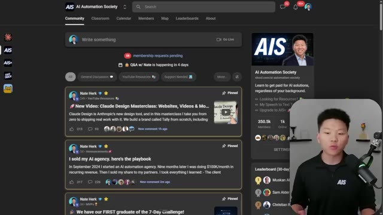
*⏱️ 00:00:25 — Interface de la plateforme Skool affichant la communauté "AI Automation Society" avec les posts épinglés et le profil du présentateur.*

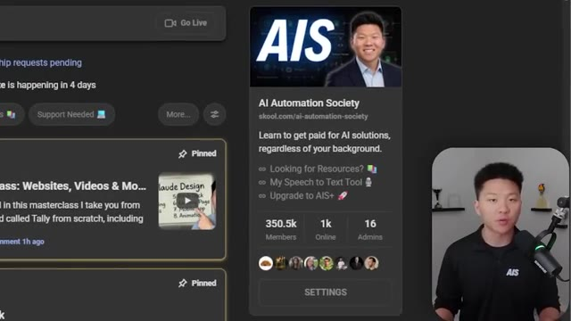
*⏱️ 00:00:31 — Gros plan sur le panneau latéral droit de l'interface Skool affichant les statistiques de la communauté (350.5k membres, 1k en ligne).*

*⏱️ 00:00:36 — Capture d'écran de l'interface YouTube du présentateur montrant une grille de vidéos récentes centrées sur l'IA et Claude Code.*

---

### ⏱️ `[00:00:41 - 00:01:01]` | Segment #03

**🔊 Audio (Transcription Intégrale Mot pour Mot en Français) :**
> So let's not waste any time and just get straight into this one. I'm super pumped. Here we go. So first of all, like what is an operating system? The first thing you might think of is like, okay, my Mac OS or my Windows iOS or my Apple iPhone iOS. It's basically the layer between you and your computer or your phone. it's where everything lives. It has your files, your apps, your contacts.

**👁️ Analyse Visuelle d'Écran (gemini-3.5-flash-lite) :**
**Interface & Outils** : Présentation ou face-caméra explicatif sans interface logicielle partagée.

**Contenu textuel & Code** : Explications orales et mise en contexte méthodologique.

**Action / Démonstration** : Explications face caméra et démonstration conceptuelle.

---

### ⏱️ `[00:01:02 - 00:01:20]` | Segment #04

**🔊 Audio (Transcription Intégrale Mot pour Mot en Français) :**
> You know, it's the screen that you're looking at. And it's not really something that you think about too much because it just works and it lives there all the time. But now we're getting into this world where AI is taking over everything and it's seeping into everything. And now that I have an operating system inside of Cloud Code, it is my OS, but now it has agents on top of it. It has intelligence on top of it.

**👁️ Analyse Visuelle d'Écran (gemini-3.5-flash-lite) :**
**Interface & Outils** : Présentation ou face-caméra explicatif sans interface logicielle partagée.

**Contenu textuel & Code** : Explications orales et mise en contexte méthodologique.

**Action / Démonstration** : Explications face caméra et démonstration conceptuelle.

---

### ⏱️ `[00:01:20 - 00:01:39]` | Segment #05

**🔊 Audio (Transcription Intégrale Mot pour Mot en Français) :**
> So I'm really not exaggerating when I say that I could spend an entire workday with just Cloud Code open and I could still do everything I need to. And I would still be more productive than people that are clicking around in all of the different apps. So when we add intelligence on top of our operating system, we have an AI that can see all of our files, all of our communication, everything important going on in the business.

**👁️ Analyse Visuelle d'Écran (gemini-3.5-flash-lite) :**
**Interface & Outils** : Présentation ou face-caméra explicatif sans interface logicielle partagée.

**Contenu textuel & Code** : Explications orales et mise en contexte méthodologique.

**Action / Démonstration** : Explications face caméra et démonstration conceptuelle.

---

### ⏱️ `[00:01:39 - 00:02:13]` | Segment #06

**🔊 Audio (Transcription Intégrale Mot pour Mot en Français) :**
> And not only can it see it, but it can also interact with it. And not only can it interact with it, but it can also remember it better than you can because you're a human and you use a brain and you forget things. But the AI not only has better memory, but it can pull things from the exact source and it can find it quicker than you can. Think about how much time you've spent on work about work, which is basically just the idea of searching for things. Your coworker drops you a file. You forget if that was in Slack or an email. You're looking for an old Google sheet that you knew you were working on last month, but now you can't find it because you worked on 15 more since then. But AI could find that instantly and grab it for you because it has all of the context.

**👁️ Analyse Visuelle d'Écran (gemini-3.5-flash-lite) :**
**Interface & Outils** : Présentation (Slides/Deck)

**Contenu textuel & Code** : Texte affiché : "Now imagine that layer is intelligent.", listant des fonctionnalités comme la gestion du contexte, des connexions et la construction d'un système sur "Claude Code".

**Action / Démonstration** : Présentation théorique du concept d'AIOS par le présentateur.

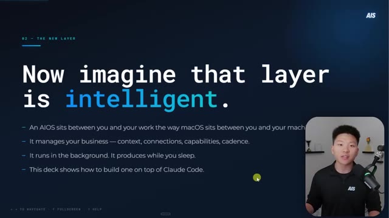
*⏱️ 00:01:48 — Une diapositive de présentation sombre intitulée "02 - THE NEW LAYER" expliquant le concept d'un AIOS (AI Operating System) qui s'exécute en arrière-plan pour gérer les processus métier, avec le présentateur incrusté en bas à droite.*

---

### ⏱️ `[00:02:13 - 00:02:47]` | Segment #07

**🔊 Audio (Transcription Intégrale Mot pour Mot en Français) :**
> It has all of the connections. It has all of the capabilities and it has the right cadence. So the combination of those four C's is everything that you need really to manage your business. And you can get it to the point where it truly runs in the background for you. Now, you guys have heard me say CloudCode, and obviously there's some other tools that we're going to be talking about today, but what's really important in this space is that you're building things to be tool agnostic, because the tools change every six months. Those of you guys that have been with me for a long time on this channel, you know that last year I was all in on NNN, and I've made the full pivot to CloudCode because I've realized I'm just way more productive with CloudCode. I really don't think

**👁️ Analyse Visuelle d'Écran (gemini-3.5-flash-lite) :**
**Interface & Outils** : Diapositive de présentation (type Slide deck) avec incrustation vidéo du présentateur.

**Contenu textuel & Code** : Texte affiché : "Now imagine that layer is intelligent." Suivi de points clés sur l'AIOS : gestion du business (contexte, connexions, capacités, cadence), exécution en arrière-plan et mention de "Claude Code".

**Action / Démonstration** : Présentation conceptuelle et théorique du framework de travail pour l'automatisation IA.

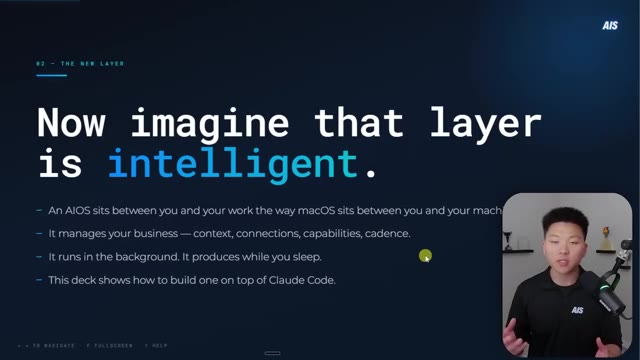
*⏱️ 00:02:22 — Une diapositive de présentation sombre intitulée "02 - THE NEW LAYER" expliquant le concept d'un "AIOS" (système d'exploitation IA) intelligent qui s'exécute en arrière-plan.*

---

### ⏱️ `[00:02:47 - 00:03:06]` | Segment #08

**🔊 Audio (Transcription Intégrale Mot pour Mot en Français) :**
> that I could have built this sort of AI operating system in NNN. I just don't think I could have the way that I can do it in Cloud Code. Models will be replaced. API endpoints might be deprecated. SDKs might be deprecated. Things will just happen. But we're going to be building this in a way that is very future-proof because I'm going to change the way that you think. I'm going to change the way that you decide how to do things.

**👁️ Analyse Visuelle d'Écran (gemini-3.5-flash-lite) :**
**Interface & Outils** : Logiciel de présentation (type Slide Deck).

**Contenu textuel & Code** : Texte à l'écran : "Tools change every six months.", "Models will be replaced. SDKs will be deprecated. Names will rebrand.", "What survives: how you THINK, how you DECIDE, how you BUILD.", "This deck teaches the durable layer underneath the tool churn."

**Action / Démonstration** : Présentation théorique illustrant la philosophie de développement logiciel durable face à l'évolution rapide de l'IA.

*⏱️ 00:02:52 — Une diapositive de présentation sombre intitulée "03 - WHY A FRAMEWORK" affichant le texte "Tools change every six months" avec une liste à puces expliquant la pérennité des méthodes de conception face à l'obsolescence des outils technologiques, avec le présentateur en médaillon.*

---

### ⏱️ `[00:03:07 - 00:03:26]` | Segment #09

**🔊 Audio (Transcription Intégrale Mot pour Mot en Français) :**
> I'm going to change the way that you build this AIOS so it can survive whatever happens. Just yesterday, I took my AIOS and I moved it over to Codex just to make sure that everything was good. And it took Codex about two minutes to get adjusted. And now I have two different AIOSs, Cloud Code and Codex. And if I need to put it in anti-gravity or if I need to throw it into the other new kid on the block, I can do so.

**👁️ Analyse Visuelle d'Écran (gemini-3.5-flash-lite) :**
**Interface & Outils** : Logiciel de présentation (type Slide Deck).

**Contenu textuel & Code** : Texte explicatif sur l'obsolescence des outils ("Models will be replaced", "SDKs will be deprecated") et la nécessité d'une réflexion durable.

**Action / Démonstration** : Présentation théorique illustrant la philosophie derrière la structure de l'AIOS.

---

### ⏱️ `[00:03:26 - 00:03:46]` | Segment #10

**🔊 Audio (Transcription Intégrale Mot pour Mot en Français) :**
> So I'm going to be teaching you the durable layer that sits underneath all these tools and all these different buzzwords. Okay, so there's two main frameworks that we're going to be talking about today. The first one is more of a high-level framework around the way that I think about AI, and it's called the three M's of AI. We've got the mindset, the method, and the machine. All right, so here is my three M's doc that I'm going to be reading over today.

**👁️ Analyse Visuelle d'Écran (gemini-3.5-flash-lite) :**
**Interface & Outils** : Logiciel de présentation (type diaporama/slides).

**Contenu textuel & Code** : Texte sur diapositive : Titres "Tools change every six months" et "The Three Ms of AI", avec des définitions textuelles sous chaque concept.

**Action / Démonstration** : Présentation orale d'un cadre théorique par le locuteur sans démonstration d'outils techniques.

---

### ⏱️ `[00:03:46 - 00:04:19]` | Segment #11

**🔊 Audio (Transcription Intégrale Mot pour Mot en Français) :**
> I'm not going to read every single word because that would take too long, but I will drop this doc in my free school community. The link is down in the description. I have all of the other resources that I've ever shared on YouTube in there as well for free. So if you want to check it out in deeper, go there. But I wanted to spend some time here because the mindset and all of these frameworks I built out in a way that it's really important for you to think about not only when you're setting up your AIOS, but also as you use it every day and also as you scale it up and also as you start to, you know, bring it into other areas of your business. Because right now we're focusing on you personally. But now that you've got this set up, your business is set up better

**👁️ Analyse Visuelle d'Écran (gemini-3.5-flash-lite) :**
**Interface & Outils** : Navigateur web (page de documentation/ressources).

**Contenu textuel & Code** : Texte pédagogique structuré autour de concepts comme "The Default Shift", "The Function Breakdown" et "The Curiosity Rule", ainsi qu'une note introductive sur la courbe de productivité ("20% productivity dip").

**Action / Démonstration** : Présentation statique d'un document de ressources utilisé par le créateur pour illustrer sa méthodologie.

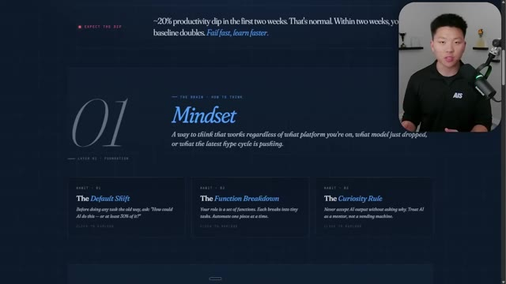
*⏱️ 00:03:54 — Une page web au design sombre affichant une section intitulée "Mindset", organisée en sous-parties ("The Default Shift", "The Function Breakdown", "The Curiosity Rule") avec du texte explicatif sur la méthodologie de travail avec l'IA.*

---

### ⏱️ `[00:04:19 - 00:04:39]` | Segment #12

**🔊 Audio (Transcription Intégrale Mot pour Mot en Français) :**
> to be more AI ready and your employees and your coworkers are as well. So it's really important. So there's three habits I wanted to touch on. The first one is the default shift. Basically the idea of, you know, before you do any task, just ask yourself, how could AI do this? Or at least how could AI do 30% of it? Because the truth is AI is not going to do everything a hundred percent.

**👁️ Analyse Visuelle d'Écran (gemini-3.5-flash-lite) :**
**Interface & Outils** : Présentation ou face-caméra explicatif sans interface logicielle partagée.

**Contenu textuel & Code** : Explications orales et mise en contexte méthodologique.

**Action / Démonstration** : Explications face caméra et démonstration conceptuelle.

---

### ⏱️ `[00:04:39 - 00:05:12]` | Segment #13

**🔊 Audio (Transcription Intégrale Mot pour Mot en Français) :**
> It might be able to do 75 or 50%, but that's still a huge win. And that is a productivity gain. So here's a real example. The other day I needed to update over 300 YouTube video descriptions, tracking links. And the old me would have just been like, man, this sucks, but I just have to do it. And I would have manually clicked into each video, change the link, and then clicked in the next video and just done that probably would have taken me an hour. But the new me, my default is, okay, I don't want to do that manually. Let me just brainstorm with cloud code and let me figure out how do I actually make that happen? Whether that's an API or whether that's an MCP or whether

**👁️ Analyse Visuelle d'Écran (gemini-3.5-flash-lite) :**
**Interface & Outils** : Application de prise de notes ou éditeur de texte type Obsidian/Notion.

**Contenu textuel & Code** : Texte explicatif sur l'utilisation de l'IA ("How could AI do this?"), suivi d'un exemple concret : l'utilisation de "Claude Code" pour automatiser la mise à jour de 300+ descriptions de vidéos YouTube via l'API YouTube Data.

**Action / Démonstration** : Le contenu présente une réflexion stratégique sur l'automatisation des flux de travail plutôt qu'une exécution technique directe.

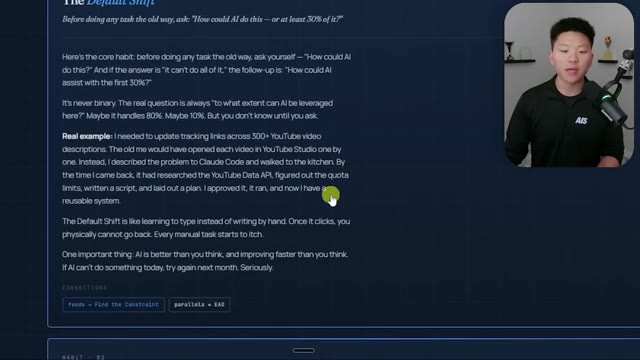
*⏱️ 00:04:48 — Une capture d'écran montrant une note textuelle explicative intitulée "The Default Shift", détaillant une méthodologie de travail avec l'IA pour automatiser des tâches répétitives, avec le présentateur en médaillon dans le coin supérieur droit.*

---

### ⏱️ `[00:05:12 - 00:05:49]` | Segment #14

**🔊 Audio (Transcription Intégrale Mot pour Mot en Français) :**
> that is maybe even having to just do a browser automation script. But the point is my default shift is so stubborn now where if anything sounds boring or repetitive, I'm not going to do it. I'm going to use my AI OS to do it. That's habit number one. Habit number two is the function breakdown. Understanding that your role is a set of functions. Everything you do is broken into a tiny task and you can just automate one piece of that at a time. So an example, okay, if I had to think about how can I automate an entire YouTube video, that's a very tall task, but break down the pieces that go into a YouTube video. Ideation is usually step one. And then you've got your scripting or, you know,

**👁️ Analyse Visuelle d'Écran (gemini-3.5-flash-lite) :**
**Interface & Outils** : Présentation ou face-caméra explicatif sans interface logicielle partagée.

**Contenu textuel & Code** : Explications orales et mise en contexte méthodologique.

**Action / Démonstration** : Explications face caméra et démonstration conceptuelle.

---

### ⏱️ `[00:05:49 - 00:06:21]` | Segment #15

**🔊 Audio (Transcription Intégrale Mot pour Mot en Français) :**
> your building or your slide creation. And then you've got packaging, titles and thumbnails, and you've got descriptions and you've got, you know, comment replies. That is a huge job. But when you break that into little things, oh, I can definitely automate ideation or at least 95% of it. I can definitely automate scripting. I can definitely automate the slide deck creations for my videos. And when you have that mindset of just breaking it into little pieces, baby steps, it becomes way more achievable. So in this example, if this is the full flow of automating a YouTube video, you just have all these little chunks. And as you slowly over time, automate

**👁️ Analyse Visuelle d'Écran (gemini-3.5-flash-lite) :**
**Interface & Outils** : Interface de prise de notes ou de gestion de connaissances de type Notion.

**Contenu textuel & Code** : Texte pédagogique détaillant le concept de décomposition d'un processus complexe (ex: création d'une vidéo YouTube) en micro-tâches automatisables individuellement, avec des tags de connexion en bas de page.

**Action / Démonstration** : Présentation conceptuelle et théorique à l'appui du discours sur l'automatisation des flux de travail.

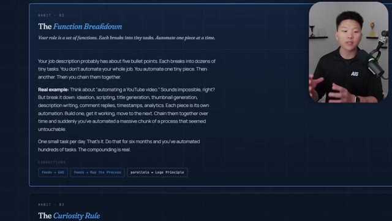
*⏱️ 00:05:57 — Une capture d'écran montrant une présentation textuelle structurée sur fond sombre intitulée "The Function Breakdown", expliquant la méthodologie de découpage des tâches pour l'automatisation.*

---

### ⏱️ `[00:06:21 - 00:06:54]` | Segment #16

**🔊 Audio (Transcription Intégrale Mot pour Mot en Français) :**
> more and more chunks, you get to a place where you're, you know, now you've automated like 80% of a YouTube video and each of these chunks is repeatable. So maybe this is like the, you know, slide deck chunk. Okay. What if we have a different process? Let's just say we're now doing like, you know, we're doing like meeting prep or something. Well, guess what? We can go ahead and grab this chunk and just move it over here. And we can just fit this into this puzzle, wherever it goes. So all of these little chunks and baby steps that you're taking are reusable. And that mindset shift is very important to have. And then habit number three,

**👁️ Analyse Visuelle d'Écran (gemini-3.5-flash-lite) :**
**Interface & Outils** : Outil de diagramme/tableau blanc numérique (type Excalidraw ou similaire).

**Contenu textuel & Code** : Schéma visuel composé de blocs rectangulaires contenant les textes : "YouTube video", "chunk", "slide", et "Mee".

**Action / Démonstration** : Manipulation interactive d'un schéma : renommage et réorganisation de blocs textuels pour expliquer un processus d'automatisation.

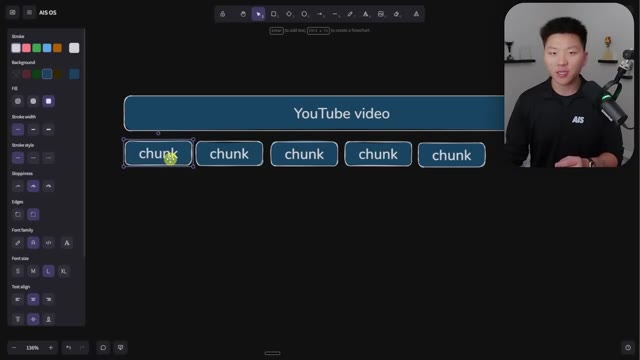
*⏱️ 00:06:29 — Le présentateur utilise un outil de dessin sur tableau blanc pour illustrer la décomposition d'un projet "YouTube video" en plusieurs blocs nommés "chunk".*

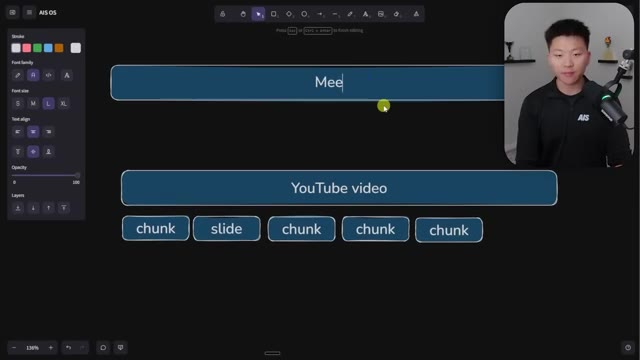
*⏱️ 00:06:37 — Le présentateur modifie le schéma en renommant l'un des blocs en "slide" et en ajoutant un nouveau bloc textuel au-dessus intitulé "Mee" (probablement le début de "Meeting").*

---

### ⏱️ `[00:06:54 - 00:07:24]` | Segment #17

**🔊 Audio (Transcription Intégrale Mot pour Mot en Français) :**
> we've got the curiosity rule. Never accept AI output without asking why. Treat AI as a mentor, not a vending machine. There's basically this idea of dark code because so many people nowadays are using AI to write code, which means they don't truly understand what each line or each block of code is doing. And not that you have to be able to read Python or whatever it is, but it is very important to at least understand why did you build this? And if X happened, what would happen to the code? You know what I mean? So the whole idea of being curious is asking those sorts of questions.

**👁️ Analyse Visuelle d'Écran (gemini-3.5-flash-lite) :**
**Interface & Outils** : Présentation ou face-caméra explicatif sans interface logicielle partagée.

**Contenu textuel & Code** : Explications orales et mise en contexte méthodologique.

**Action / Démonstration** : Explications face caméra et démonstration conceptuelle.

---

### ⏱️ `[00:07:24 - 00:07:44]` | Segment #18

**🔊 Audio (Transcription Intégrale Mot pour Mot en Français) :**
> Why did you design it this way? What happens if someone, you know, submits an invoice that's empty and this code is supposed to handle filled out invoices. And the other piece of curiosity is if you don't know if something's possible to be automated or automated with AI, then just ask. Okay, so moving on to method, this is really, really important, but we're gonna come back to this a little bit later once we've kind of got everything set up.

**👁️ Analyse Visuelle d'Écran (gemini-3.5-flash-lite) :**
**Interface & Outils** : Application de présentation ou éditeur de texte type Notion/Obsidian.

**Contenu textuel & Code** : Texte explicatif sur le principe de curiosité face à l'IA : "Never accept AI output without asking why", "Treat AI as a mentor, not a vending machine", ainsi que deux boutons en bas : "parallels = Validation Chain" et "parallels = Kill Switch".

**Action / Démonstration** : Présentation théorique illustrant le concept de "dark code" et l'importance de comprendre ses automatisations.

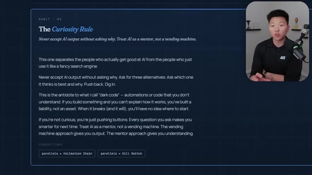
*⏱️ 00:07:29 — Une diapositive de présentation sombre affichant une section intitulée "The Curiosity Rule", expliquant la philosophie consistant à traiter l'IA comme un mentor plutôt que comme un distributeur automatique.*

---

### ⏱️ `[00:07:45 - 00:08:18]` | Segment #19

**🔊 Audio (Transcription Intégrale Mot pour Mot en Français) :**
> But this basically just talks about, okay, how do you actually decide what's worth automating and how much of it you automate? So there's some more information here about that kind of stuff. And then the last M stands for machine. And this, once again, gets a little bit more technical. all of this you guys will be able to dive into later but we will revisit some of the stuff later on in this course so those are the three m's a couple of the key highlights that we already hit on it's never binary the question is never will ai do this for me the question is to what extent can i leverage ai here 30 60 maybe it's zero but it's very unlikely that it's zero every task on

**👁️ Analyse Visuelle d'Écran (gemini-3.5-flash-lite) :**
**Interface & Outils** : Présentation de type dashboard/documentation web sur fond sombre.

**Contenu textuel & Code** : Schéma décisionnel intitulé « Default to the lowest level that works » (L0 à L4), tableau « The Three Buckets » (More Customers, More Value, Less Costs), et section « Machine » expliquant les principes de construction et d'opération d'automatisation.

**Action / Démonstration** : Le présentateur illustre les concepts théoriques d'automatisation à travers les slides informatives affichées à l'écran.

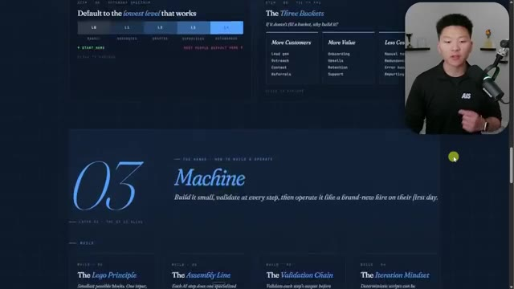
*⏱️ 00:07:53 — Une présentation structurée sous forme de dashboard sur fond sombre, détaillant le concept de « Machine » (étape 03) avec des sous-sections sur le « Lego Principle », « Assembly Line », « Validation Chain » et « Iteration Mindset ».*

---

### ⏱️ `[00:08:18 - 00:08:50]` | Segment #20

**🔊 Audio (Transcription Intégrale Mot pour Mot en Français) :**
> your plate has a leverage percentage you just have to find it and mindset isn't motivation it's the lens that finds the percentage. The other one is treat AI as a mentor, not a vending machine. Vending machines take a coin and they give you something, but mentors ask you questions. They push you back. They make you sharper. They encourage you. They give you ideas. And that is the relationship that you want to have with AI, not a vending machine. And then of course, we just talked about how your job is essentially a tree of tasks and thinking about it like that makes big, vague, overwhelming ideas more realistic. So another thing that's really

**👁️ Analyse Visuelle d'Écran (gemini-3.5-flash-lite) :**
**Interface & Outils** : Présentation ou face-caméra explicatif sans interface logicielle partagée.

**Contenu textuel & Code** : Explications orales et mise en contexte méthodologique.

**Action / Démonstration** : Explications face caméra et démonstration conceptuelle.

---

### ⏱️ `[00:08:50 - 00:09:19]` | Segment #21

**🔊 Audio (Transcription Intégrale Mot pour Mot en Français) :**
> important from the three Ms is that productivity drops before it climbs. And I don't want you to get overwhelmed and just give up because you think it's too hard to build an AI OS. It is not. So think about this, a solo operator, and they're trying to build an AI OS and they're doing a 30 day sprint. This bar basically represents like productivity, right? So baseline, they are not using AI hardly at all. They're being maybe 60% productive. Day three, they're slowing down.

**👁️ Analyse Visuelle d'Écran (gemini-3.5-flash-lite) :**
**Interface & Outils** : Présentation ou face-caméra explicatif sans interface logicielle partagée.

**Contenu textuel & Code** : Explications orales et mise en contexte méthodologique.

**Action / Démonstration** : Explications face caméra et démonstration conceptuelle.

---

### ⏱️ `[00:09:19 - 00:09:41]` | Segment #22

**🔊 Audio (Transcription Intégrale Mot pour Mot en Français) :**
> They're noticeably getting out less output because they're trying to adjust to this new way of living. And that's just how things work. Whenever you make a change, you typically are going to expect a 20% decrease in productivity. And let me actually just draw this out because I think it'll be easier to demonstrate. So if we just real quick go and draw a graph, then let me show you what this means.

**👁️ Analyse Visuelle d'Écran (gemini-3.5-flash-lite) :**
**Interface & Outils** : Présentation ou face-caméra explicatif sans interface logicielle partagée.

**Contenu textuel & Code** : Explications orales et mise en contexte méthodologique.

**Action / Démonstration** : Explications face caméra et démonstration conceptuelle.

---

### ⏱️ `[00:09:42 - 00:10:02]` | Segment #23

**🔊 Audio (Transcription Intégrale Mot pour Mot en Français) :**
> So let's say your business is operating like this. This is a steady line. Now, if you decide to make a change, you have to basically be okay with the fact that this change might decrease your productivity by about 20%. So this is the sort of like negative 20% gap you're seeing. The question is, is this change worth it?

**👁️ Analyse Visuelle d'Écran (gemini-3.5-flash-lite) :**
**Interface & Outils** : Présentation ou face-caméra explicatif sans interface logicielle partagée.

**Contenu textuel & Code** : Explications orales et mise en contexte méthodologique.

**Action / Démonstration** : Explications face caméra et démonstration conceptuelle.

---

### ⏱️ `[00:10:02 - 00:10:35]` | Segment #24

**🔊 Audio (Transcription Intégrale Mot pour Mot en Français) :**
> Will this change ultimately result in more than a 20% dip? Because up here, what you might be getting with an AIOS is a 50% gain. So is the dip in 20% worth the 50% upside? Yes, because you're getting an additional 30%. Now on top of that, you also have the idea of a learning curve So if I can just go ahead and draw another little graph real quick And why am I being so boring? Let's actually use a color So the learning curve people think that learning is linear like this and it's just really not learning is exponential

**👁️ Analyse Visuelle d'Écran (gemini-3.5-flash-lite) :**
**Interface & Outils** : Tableau blanc numérique / outil de dessin à l'écran.

**Contenu textuel & Code** : Courbe de performance avec annotations manuscrites : ".20%" associé à une flèche vers le bas pour illustrer la baisse, et "50%" associé à une flèche vers le haut pour illustrer le gain potentiel de l'AIOS.

**Action / Démonstration** : Le présentateur utilise ce support visuel pour expliquer le rapport risque/bénéfice lors de l'adoption d'un système AIOS.

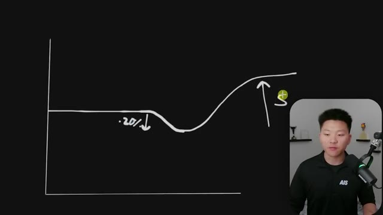
*⏱️ 00:10:11 — Un graphique dessiné à la main sur fond noir illustrant une courbe de performance : une baisse initiale de 20% suivie d'une remontée avec un gain final de 50%.*

---

### ⏱️ `[00:10:35 - 00:11:12]` | Segment #25

**🔊 Audio (Transcription Intégrale Mot pour Mot en Français) :**
> But what does that mean? It means that when you start to learn something new You basically are kind of below the linear line that you would have been if you were just doing it the old way but because of the exponentialness the exponential nature of learning you will pass that mark it's just that it's going to take you a few days to get there maybe this is day one maybe this is day two and maybe on day three you break even but by day four and five you're way ahead of where you would have been if you just kept doing it the same way so this gap is where people sort of tend to give up or get overwhelmed because they realize they're being less productive so those two things are

**👁️ Analyse Visuelle d'Écran (gemini-3.5-flash-lite) :**
**Interface & Outils** : Présentation ou face-caméra explicatif sans interface logicielle partagée.

**Contenu textuel & Code** : Explications orales et mise en contexte méthodologique.

**Action / Démonstration** : Explications face caméra et démonstration conceptuelle.

---

### ⏱️ `[00:11:12 - 00:11:44]` | Segment #26

**🔊 Audio (Transcription Intégrale Mot pour Mot en Français) :**
> really important for you guys to understand, don't give up. You get through it and then you start to see all the gains. And now you are being five X more productive, 10 X more productive. I've seen that with myself. I've seen that with my team. It is an incredible thing to actually witness. And by the time you're two weeks in, you won't even recognize how productive you're being. And you can't even imagine if someone took away your AIOS and you had to go back to the old way, you would want to cry. Okay. So now let's get onto the second sort of framework here. And this one is called the four C's. This one is more specific to the way that we set up our operating system.

**👁️ Analyse Visuelle d'Écran (gemini-3.5-flash-lite) :**
**Interface & Outils** : Présentation PowerPoint ou outil de diaporama (type Pitch ou Canva).

**Contenu textuel & Code** : Texte théorique sur la courbe d'apprentissage de l'IA ("The J-Curve", "The Four Cs").

**Action / Démonstration** : Le présentateur explique les concepts théoriques de productivité face à la caméra, aucune démonstration technique ou logicielle n'est effectuée.

---

### ⏱️ `[00:11:44 - 00:12:19]` | Segment #27

**🔊 Audio (Transcription Intégrale Mot pour Mot en Français) :**
> And this is kind of the way that I'm calling the AIS OS, the AI Automation Society Operating System, because we've basically just been getting everyone to do it in this way. And it is the AI Automation Society way. So what goes into that four C's? We've got context. What AI knows about you, your team, your tools, your voice, your business, your money. And then we've got connections. So what data can it reach? Cloud code on its own can't really do anything besides search the web, but your business data, especially the important business data you need, isn't available publicly on the web. So you have to give it connections to all of your different tools and all of the

**👁️ Analyse Visuelle d'Écran (gemini-3.5-flash-lite) :**
**Interface & Outils** : Logiciel de présentation (type Slide deck / Notion).

**Contenu textuel & Code** : Texte structuré listant les 4 composants : 1. Context (ce que l'IA sait de vous), 2. Connections (données live), 3. Capabilities (production d'artefacts), 4. Cadence (exécution autonome).

**Action / Démonstration** : Présentation conceptuelle du framework "AI Automation Society Operating System" par le présentateur.

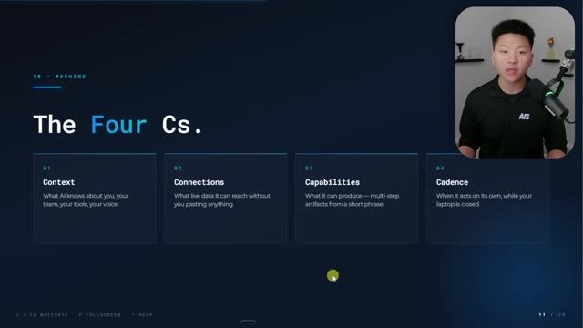
*⏱️ 00:11:53 — Une diapositive de présentation sombre intitulée "The Four Cs" détaillant les piliers de l'AIS OS : Context, Connections, Capabilities et Cadence.*

---

### ⏱️ `[00:12:19 - 00:12:38]` | Segment #28

**🔊 Audio (Transcription Intégrale Mot pour Mot en Français) :**
> different databases where your actual important data lives. And then we have capabilities. What can it produce? What can it do with that data? You know, it has to be useful in some way, not just a knowledge source. And then we have the final C, cadence, when it acts on its own while you sleep and while your laptop is closed. And all of these build on top of each other.

**👁️ Analyse Visuelle d'Écran (gemini-3.5-flash-lite) :**
**Interface & Outils** : Présentation ou face-caméra explicatif sans interface logicielle partagée.

**Contenu textuel & Code** : Explications orales et mise en contexte méthodologique.

**Action / Démonstration** : Explications face caméra et démonstration conceptuelle.

---

### ⏱️ `[00:12:38 - 00:13:02]` | Segment #29

**🔊 Audio (Transcription Intégrale Mot pour Mot en Français) :**
> You can't have cadence without connections. You can't have capability without context. And you have to go in this order, one, two, three, four. And I'm gonna show you guys your exact path to get from one to four today. The whole idea is that if you opened up a new Cloud Chat right now or a new Cloud Code session, how much would it know about you if you asked a question? So test it, ask a question and see, does this answer like a teammate or like an executive assistant?

**👁️ Analyse Visuelle d'Écran (gemini-3.5-flash-lite) :**
**Interface & Outils** : Présentation ou face-caméra explicatif sans interface logicielle partagée.

**Contenu textuel & Code** : Explications orales et mise en contexte méthodologique.

**Action / Démonstration** : Explications face caméra et démonstration conceptuelle.

---

### ⏱️ `[00:13:02 - 00:13:34]` | Segment #30

**🔊 Audio (Transcription Intégrale Mot pour Mot en Français) :**
> Or is this answering like a stranger who just met you five seconds ago. So here is the four C's of an AIOS. And once again, the important part is that tools change every six months, maybe even quicker, but the platform that we're doing right now and the foundation that we're building is going to be able to move across whatever happens. And I think you guys understand what we're getting at here. We're setting up our context, which is basically the brain, making sure it knows our business. We're setting up the connections to make sure that it can touch things, whether that is an MCP or an API or a CLI or, you know, whatever it is, we're setting up the connections. The capabilities is that it actually knows how to do things.

**👁️ Analyse Visuelle d'Écran (gemini-3.5-flash-lite) :**
**Interface & Outils** : Présentation (slide de cours/formation).

**Contenu textuel & Code** : Texte affiché : "The Four Cs of an AI OS", "Tools change every six months...", et les quatre piliers : "01 Context", "02 Connections", "03 Capabilities", "04 Cadence".

**Action / Démonstration** : Le présentateur explique la structure théorique des "4 C" d'un système d'exploitation IA tout en pointant ou en commentant les éléments visuels affichés.

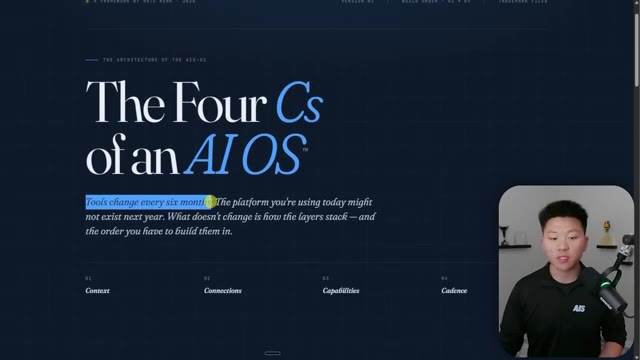
*⏱️ 00:13:10 — Une diapositive de présentation sombre présentant le cadre conceptuel "The Four Cs of an AI OS" avec une explication textuelle sur l'évolution des outils et une section dédiée aux quatre piliers en bas de page.*

---

### ⏱️ `[00:13:34 - 00:13:52]` | Segment #31

**🔊 Audio (Transcription Intégrale Mot pour Mot en Français) :**
> You have a bunch of SOPs probably already in your business. Can you now give those SOPs to your operating system so that it can do it just as well and just as consistently as one of your employees does it manually right now? And then of course the cadence where it gets really, really cool and it starts to feel more like a 24-7 AI employee for you.

**👁️ Analyse Visuelle d'Écran (gemini-3.5-flash-lite) :**
**Interface & Outils** : Présentation ou face-caméra explicatif sans interface logicielle partagée.

**Contenu textuel & Code** : Explications orales et mise en contexte méthodologique.

**Action / Démonstration** : Explications face caméra et démonstration conceptuelle.

---

### ⏱️ `[00:13:53 - 00:14:17]` | Segment #32

**🔊 Audio (Transcription Intégrale Mot pour Mot en Français) :**
> And those are the four C's of our AI operating system. And we're going to be talking about how you can actually test if you have those things in place. and we have a skill inside of the template I'm gonna give you guys where you can run an audit and just make sure that you're good and you can find opportunities to add more connections or add more capabilities and things like that. But for example, if you have connections into your calendar and your tasks and your CRM and your inbox, it should be able to grab all that and help you out.

**👁️ Analyse Visuelle d'Écran (gemini-3.5-flash-lite) :**
**Interface & Outils** : Logiciel de présentation (type diaporama).

**Contenu textuel & Code** : Texte structuré : "Live data in. Multi-step artifacts out." avec quatre points numérotés : 1. Connections (what's live), 2. In-place test (What's on my plate today?), 3. Capabilities (what comes out), 4. In-place test (Type seven words. Receive a finished artifact).

**Action / Démonstration** : Présentation théorique du cadre méthodologique (framework) des 4 piliers de l'automatisation IA par le présentateur.

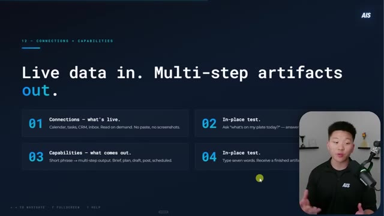
*⏱️ 00:13:59 — Une diapositive de présentation sombre détaillant les deux premiers piliers ("Connections" et "Capabilities") du système d'exploitation IA, avec des tests intégrés pour chacun.*

---

### ⏱️ `[00:14:18 - 00:14:40]` | Segment #33

**🔊 Audio (Transcription Intégrale Mot pour Mot en Français) :**
> You could ask like, hey, what's on my plate today or help me plan my day. And it would be able to read through everything, look at your calendar and help you block off things based on your priorities and based on maybe previous conversations you've been having in that week. And with the capabilities, instead of having to drop in like a full, you know, two paragraph brief for what you want, you can basically say, Hey, we need a quarter three report and I need it by the end of the day.

**👁️ Analyse Visuelle d'Écran (gemini-3.5-flash-lite) :**
**Interface & Outils** : Diapositive de présentation (style deck/slide).

**Contenu textuel & Code** : Le texte présente les points suivants : "01 Connections - what's live" (calendrier, CRM, inbox), "02 In-place test" (exemple : "What's on my plate today?"), "03 Capabilities - what comes out" (planification, rédaction) et "04 In-place test" (génération d'artéfacts).

**Action / Démonstration** : Le présentateur explique les capacités de l'agent IA à lire des données en temps réel depuis divers outils et à générer des résultats structurés sans copier-coller.

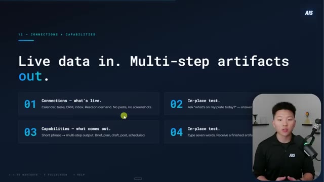
*⏱️ 00:14:23 — Une diapositive de présentation sombre intitulée "Live data in. Multi-step artifacts out." décrivant le fonctionnement d'un système d'automatisation par IA via quatre étapes clés (connexions, tests, capacités).*

---

### ⏱️ `[00:14:40 - 00:15:00]` | Segment #34

**🔊 Audio (Transcription Intégrale Mot pour Mot en Français) :**
> And it will be able to go do that because it understands your SOP for that. It understands all the business data and there's going to be less follow-up, less back and forth, less of you micromanaging it. So here's a quick snapshot of the pillars, what you might want to do to test, what you would see and kind of be like, okay, this is good. This was a pass. and what you might see and be like, okay, this failed.

**👁️ Analyse Visuelle d'Écran (gemini-3.5-flash-lite) :**
**Interface & Outils** : Support visuel de présentation (type diaporama/slides).

**Contenu textuel & Code** : Texte structuré sous forme de liste et de tableau comparatif sur les fonctionnalités et les critères d'évaluation des systèmes d'automatisation IA.

**Action / Démonstration** : Présentation théorique du cadre d'évaluation (framework) pour valider l'efficacité d'un agent IA en situation réelle.

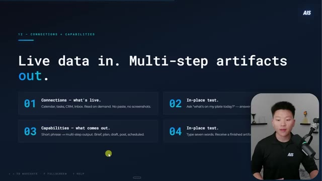
*⏱️ 00:14:45 — Diapositive de présentation intitulée "Live data in. Multi-step artifacts out." détaillant quatre piliers de l'automatisation par l'IA (Connections, In-place test, Capabilities, In-place test).*

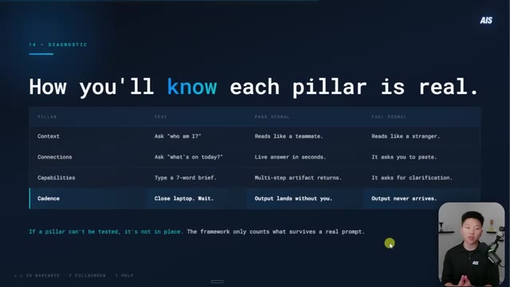
*⏱️ 00:14:50 — Diapositive de présentation intitulée "How you'll know each pillar is real." présentant un tableau diagnostique avec les piliers (Context, Connections, Capabilities, Cadence) et leurs signaux de réussite ou d'échec respectifs.*

---

### ⏱️ `[00:15:00 - 00:15:24]` | Segment #35

**🔊 Audio (Transcription Intégrale Mot pour Mot en Français) :**
> I need to do some work on this pillar. So hopefully this is all starting to click. I'm not trying to hammer this home too hard, but context, connections, capabilities, and cadence. Okay, so now you have to actually start to get this into Cloud Code somehow. So what I want you guys to do is think about these different buckets, right? There's actually kind of seven tier one buckets, but they kind of fit into these groups of ops, comms, data, and planning.

**👁️ Analyse Visuelle d'Écran (gemini-3.5-flash-lite) :**
**Interface & Outils** : Présentation de type diaporama (logiciel de slides) utilisée comme support visuel par le présentateur.

**Contenu textuel & Code** : - Image 1 : Tableau comparatif "Diagnostic" avec colonnes "Pillar", "Test", "Pass Signal" et "Fail Signal".
- Image 2 : Liste numérotée des piliers métier : 01 Ops (calendrier, tâches), 02 Comms (Slack, Gmail), 03 Data (CRM, tableurs, KPIs), 04 Planning (objectifs, projets).

**Action / Démonstration** : Le présentateur utilise ces supports visuels pour structurer son explication théorique sur la mise en place d'un framework d'automatisation IA, avant de passer à l'implémentation technique.

*⏱️ 00:15:06 — Une diapositive de présentation détaillant les "piliers" d'un système IA (Context, Connections, Capabilities, Cadence) avec leurs tests de validation, signaux de succès et d'échec associés.*

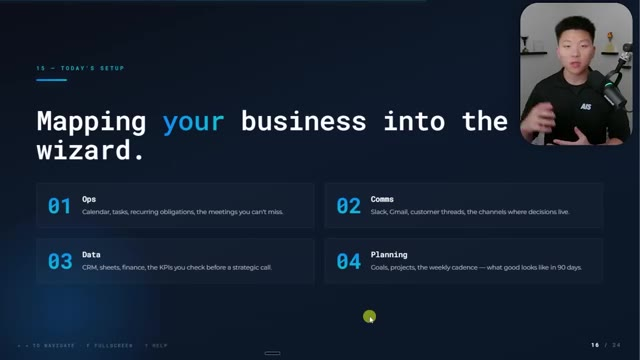
*⏱️ 00:15:12 — Une diapositive intitulée "Mapping your business into the wizard" présentant quatre domaines opérationnels : Ops, Comms, Data et Planning.*

---

### ⏱️ `[00:15:24 - 00:15:59]` | Segment #36

**🔊 Audio (Transcription Intégrale Mot pour Mot en Français) :**
> So what I want you to do right now is I want you to grab a piece of paper or a Google Doc or come into an ExcalJaw or a mirror board or whatever you want to do. And just kind of layer out these seven things. We've got revenue, customer, calendar, comms, tasks, meetings, and knowledge. And the cloud code template I'm going to give you guys is trained on these seven things. But before we get into that, I think it's really important to just kind of sketch this out on paper. You know, do it in your head first before you jump into the whole onboarding of the AIOS, or you might forget some stuff. And if you do forget some stuff,

**👁️ Analyse Visuelle d'Écran (gemini-3.5-flash-lite) :**
**Interface & Outils** : Excalidraw (tableau blanc virtuel).

**Contenu textuel & Code** : Liste des 7 piliers : Revenue, Customer, Calendar, Comms, Tasks, Meetings, Knowledge, avec une colonne "Me" sur la gauche.

**Action / Démonstration** : Présentation visuelle et structuration d'un framework d'automatisation d'entreprise.

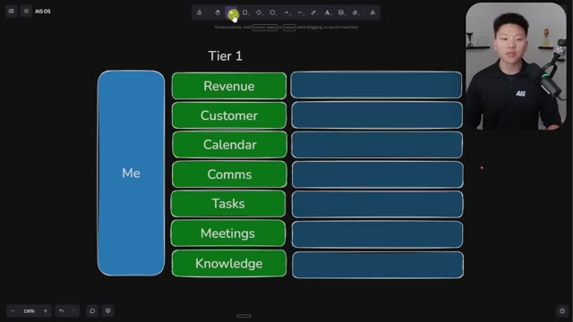
*⏱️ 00:15:33 — Un tableau blanc numérique montrant un schéma de workflow "Tier 1" listant sept catégories opérationnelles alignées verticalement (Revenue, Customer, Calendar, Comms, Tasks, Meetings, Knowledge).*

---

### ⏱️ `[00:15:59 - 00:16:24]` | Segment #37

**🔊 Audio (Transcription Intégrale Mot pour Mot en Français) :**
> it's absolutely no big deal. Like I said, I've been playing around with so many different AI operating systems over the past multiple months, and I've changed it a lot. I've evolved it a lot. I've had to restart before. And it's kind of funny because, you know, I think the term AI operating system is very new and it's kind of ambiguous. And a lot of people probably have a different idea of what that means. You know, I think first I built out an executive assistant And the executive assistant has kind of evolved into my AIOS.

**👁️ Analyse Visuelle d'Écran (gemini-3.5-flash-lite) :**
**Interface & Outils** : Excalidraw (tableau blanc interactif)

**Contenu textuel & Code** : Liste de modules opérationnels : Revenue, Customer, Calendar, Comms, Tasks, Meetings, Knowledge.

**Action / Démonstration** : Présentation visuelle de la structure théorique ou du workflow d'un "AI Operating System" pour illustrer l'organisation des données de l'utilisateur.

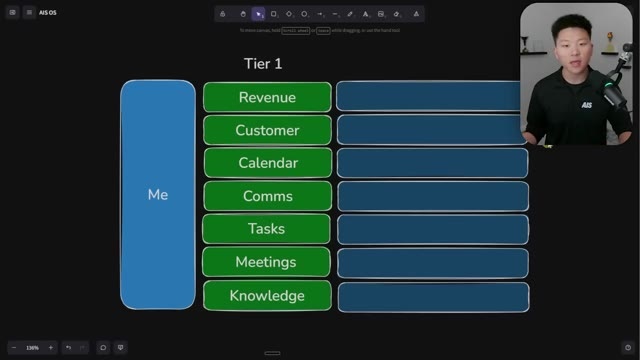
*⏱️ 00:16:05 — Schéma conceptuel sur un tableau blanc numérique présentant une architecture "Tier 1" pour un système d'exploitation IA, avec une colonne centrale "Me" connectée à diverses catégories fonctionnelles (Revenue, Customer, Calendar, etc.).*

---

### ⏱️ `[00:16:24 - 00:16:48]` | Segment #38

**🔊 Audio (Transcription Intégrale Mot pour Mot en Français) :**
> But a lot of people have also been throwing around the term like second brain. And I think a second brain is a very great start to building an AIOS. So there's a lot of these things that you might have heard. And this is just kind of my take on an AIOS, which is why I'm calling it the AISOS. So anyways, you sit here. And these are the tier one things that you should be thinking about as far as on your month to month.

**👁️ Analyse Visuelle d'Écran (gemini-3.5-flash-lite) :**
**Interface & Outils** : Application de tableau blanc numérique de type Excalidraw ou Obsidian Canvas.

**Contenu textuel & Code** : Liste de catégories : Revenue, Customer, Calendar, Comms, Tasks, Meetings, Knowledge, organisée sous le titre "Tier 1".

**Action / Démonstration** : Présentation visuelle de l'architecture du système "AISOS" (AI Operating System) pour structurer les flux de travail et les données.

*⏱️ 00:16:30 — Capture d'écran montrant le présentateur à gauche et un schéma conceptuel intitulé "Tier 1" à droite sur un tableau blanc numérique. Le schéma liste sept catégories opérationnelles (Revenue, Customer, Calendar, Comms, Tasks, Meetings, Knowledge) associées à des blocs vides.*

---

### ⏱️ `[00:16:48 - 00:17:08]` | Segment #39

**🔊 Audio (Transcription Intégrale Mot pour Mot en Français) :**
> What are you looking at? What are you tracking? We're tracking revenue. We're communicating with customers. We're making sure they're happy. We're obviously having things come through on our calendar. We're communicating with people both internally or on meetings down here or externally. And we have project management. We have tasks. We have things to prioritize. And we have general knowledge.

**👁️ Analyse Visuelle d'Écran (gemini-3.5-flash-lite) :**
**Interface & Outils** : Logiciel de tableau blanc numérique type Whimsical ou Miro.

**Contenu textuel & Code** : Un diagramme divisé en deux colonnes : la colonne de gauche liste des catégories clés ("Revenue", "Customer", "Calendar", "Comms", "Tasks", "Meetings", "Knowledge") et la colonne de droite contient des emplacements vides pour le développement futur des processus.

**Action / Démonstration** : Le présentateur explique visuellement le cadre conceptuel ("AIS OS") de son système en pointant les différentes catégories qui permettent de suivre la performance et les opérations de l'entreprise.

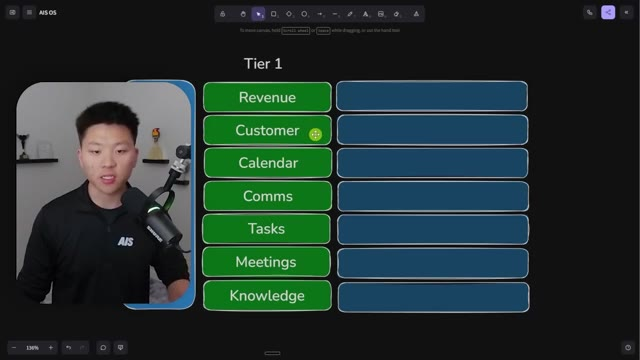
*⏱️ 00:16:53 — Une capture d'écran montrant une interface de tableau blanc collaboratif utilisée par le présentateur pour structurer les piliers opérationnels d'un système appelé "AIS OS".*

---

### ⏱️ `[00:17:09 - 00:17:35]` | Segment #40

**🔊 Audio (Transcription Intégrale Mot pour Mot en Français) :**
> So when you start to think of each of these layers, it helps you figure out the connections you may need and the tools you may need. So that's what this phase is for. That's what this section is about. So revenue. Let me just show you guys what I wrote here. I wrote School, Stripe, and QuickBooks. These are the places that I'm actually checking pretty frequently to see how many members we have, to see how much revenue we're growing, to see our promotions, to see how those are working, to look at QuickBooks, to look at our P&L, to look at our expenses.

**👁️ Analyse Visuelle d'Écran (gemini-3.5-flash-lite) :**
**Interface & Outils** : Outil de tableau blanc collaboratif ou diagramme type Excalidraw ou Miro.

**Contenu textuel & Code** : Liste de catégories métier : "Revenue", "Customer", "Calendar", "Comms", "Tasks", "Meetings", et "Knowledge", avec des espaces vides à remplir à droite de chaque étiquette.

**Action / Démonstration** : Le présentateur explique la structure de son système d'automatisation en pointant les différentes couches (layers) pour identifier les outils et connexions nécessaires.

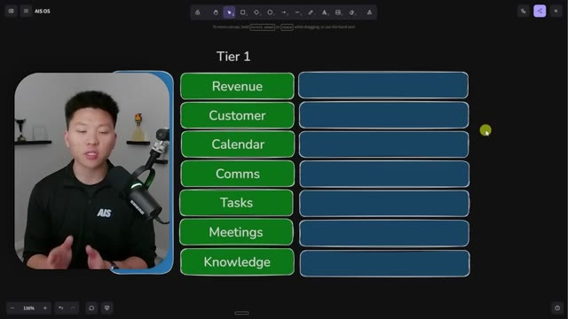
*⏱️ 00:17:15 — Capture d'écran montrant le présentateur dans un encadré à gauche et une interface de diagramme organisationnel (canvas) avec une colonne de catégories opérationnelles ("Tier 1").*

---

### ⏱️ `[00:17:36 - 00:17:57]` | Segment #41

**🔊 Audio (Transcription Intégrale Mot pour Mot en Français) :**
> These are the places where I'm frequently checking to make sure my business is doing well, that we have runway, and that we're growing healthily. And then you have customer. What does that look like for you? Do you have a SaaS product? Do you have like a brick and mortar? Where do you have your CRM? Where do you have information about your customer and where do you provide them value? So for me, I thought of the two biggest ones that I'm checking, which are school and YouTube.

**👁️ Analyse Visuelle d'Écran (gemini-3.5-flash-lite) :**
**Interface & Outils** : Logiciel de tableau blanc interactif (type Excalidraw ou Miro).

**Contenu textuel & Code** : Liste de catégories professionnelles : "Revenue" (associé à Skool, Stripe, Quickbooks), "Customer", "Calendar", "Comms", "Tasks", "Meetings", "Knowledge".

**Action / Démonstration** : Présentation visuelle des outils de gestion métier par l'orateur pour structurer les opérations d'une entreprise.

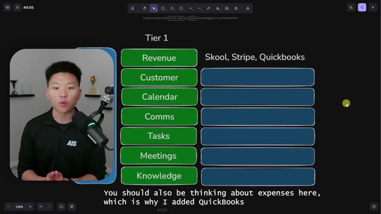
*⏱️ 00:17:41 — Capture d'écran montrant un tableau de bord visuel organisé en colonnes sur un outil de type tableau blanc, illustrant les piliers opérationnels d'une entreprise (Tier 1).*

---

### ⏱️ `[00:17:57 - 00:18:16]` | Segment #42

**🔊 Audio (Transcription Intégrale Mot pour Mot en Français) :**
> And so as you start to think about these different sources, these are where your connections are gonna come from. And you wanna start to think about how can I make sure that Cloud Code can talk to school, Stripe, and QuickBooks or school and YouTube? Every single one of these tools will have some way to connect the data to an AI system. We're living in 2026, it's possible.

**👁️ Analyse Visuelle d'Écran (gemini-3.5-flash-lite) :**
**Interface & Outils** : Présentation ou face-caméra explicatif sans interface logicielle partagée.

**Contenu textuel & Code** : Explications orales et mise en contexte méthodologique.

**Action / Démonstration** : Explications face caméra et démonstration conceptuelle.

---

### ⏱️ `[00:18:16 - 00:18:49]` | Segment #43

**🔊 Audio (Transcription Intégrale Mot pour Mot en Français) :**
> Some might have MCP servers, some might not. Some have API documentation, Some may not, but there is a way I promise you even if you have to spin up a browser automation Which i've made a video about before you can get through in some way. Okay, so let's keep going calendar This one was pretty easy for me Basically just google workspace my google calendar Everything lives there. Even if people booking through calendly, even if someone you know Does something on my click up calendar it all syncs to google workspace. So all I need there is one simple tool For comms. I have two main ones I guess three actually that I thought of so obviously google workspace for my

**👁️ Analyse Visuelle d'Écran (gemini-3.5-flash-lite) :**
**Interface & Outils** : Présentation ou face-caméra explicatif sans interface logicielle partagée.

**Contenu textuel & Code** : Explications orales et mise en contexte méthodologique.

**Action / Démonstration** : Explications face caméra et démonstration conceptuelle.

---

### ⏱️ `[00:18:49 - 00:19:24]` | Segment #44

**🔊 Audio (Transcription Intégrale Mot pour Mot en Français) :**
> email. I've got ClickUp, which is where we do pretty much all of our internal communication. And then I've got Slack, which is where we communicate with a lot of our vendors because sometimes they throw us in their Slack space or, you know, whatever the case is. So I need to make sure that my AIOS has visibility into all of those sources so it can pull data from there if it needs to. And then we have tasks. So pretty much our project management mainly lives in ClickUp for our internal projects, our internal tasks, our deadlines, our prioritization. And then we also of Notion because sometimes we're working with vendors on different projects and things like that. And maybe they're using Notion, which is pretty common. And as you're going through and

**👁️ Analyse Visuelle d'Écran (gemini-3.5-flash-lite) :**
**Interface & Outils** : Présentation ou face-caméra explicatif sans interface logicielle partagée.

**Contenu textuel & Code** : Explications orales et mise en contexte méthodologique.

**Action / Démonstration** : Explications face caméra et démonstration conceptuelle.

---

### ⏱️ `[00:19:24 - 00:19:59]` | Segment #45

**🔊 Audio (Transcription Intégrale Mot pour Mot en Français) :**
> filling this out, you don't have to get it all perfect on the first try. You're probably going to forget a few things, but that's okay. You know, start small, start with the most important core things that you use the most, and then you build up from there. So meetings, I use Fireflies at the moment, and that's really important for my cloud code to be able to look at those transcripts and see what meetings I've had, because it can help me, like I said, plan things or respond to an email better or make action items better. And then finally we have knowledge. And this one might seem a little bit more ambiguous, but just think about where else is important information that doesn't live in these sources that you've already talked about. And so for me, I was thinking, okay,

**👁️ Analyse Visuelle d'Écran (gemini-3.5-flash-lite) :**
**Interface & Outils** : Obsidian Canvas.

**Contenu textuel & Code** : Liste de catégories et d'outils associés : Revenue (Skool, Stripe, Quickbooks), Customer (Skool, YouTube), Calendar (GWS), Comms (GWS, ClickUp, Slack), Tasks (ClickUp, Notion). Les lignes "Meetings" et "Knowledge" sont vides.

**Action / Démonstration** : Le présentateur explique la structure de son système de gestion d'entreprise ("AIS OS") tout en remplissant les catégories de sa "stack" technologique.

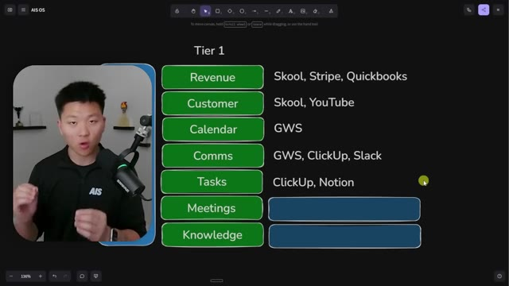
*⏱️ 00:19:33 — Une capture d'écran de l'interface Obsidian Canvas affichant un schéma de "Tier 1" listant les outils technologiques par catégorie. Le présentateur est visible dans une fenêtre à gauche.*

---

### ⏱️ `[00:19:59 - 00:20:35]` | Segment #46

**🔊 Audio (Transcription Intégrale Mot pour Mot en Français) :**
> YouTube transcripts, because up here I was mainly thinking of like, you know, my YouTube comments or my analytics, but right here I'm thinking, okay, YouTube transcripts. I want all of my knowledge from YouTube videos in cloud code somehow. And then I thought about Google workspace, of course, because I have tons of Google Docs, tons of Google Sheets, tons of just like things in my drive, even videos that I want Cloud Code to be able to access. And then local files, which is pretty easy. You don't really have to do anything to connect that. But I've got a ton of local files that Cloud Code has helped me organize and move around and sometimes even send to people. Now, as you start to look at these different tools, think about this. You know, I joke around with

**👁️ Analyse Visuelle d'Écran (gemini-3.5-flash-lite) :**
**Interface & Outils** : Présentation ou face-caméra explicatif sans interface logicielle partagée.

**Contenu textuel & Code** : Explications orales et mise en contexte méthodologique.

**Action / Démonstration** : Explications face caméra et démonstration conceptuelle.

---

### ⏱️ `[00:20:35 - 00:21:08]` | Segment #47

**🔊 Audio (Transcription Intégrale Mot pour Mot en Français) :**
> people that if someone wanted to get ahold of me or if someone had a question for me, they would actually be better off asking my executive assistant because my executive assistant is also linked to all of these sources of data. So it has all the knowledge I have, but it has a perfect memory and it never sleeps. So if you can look at these sources and be like, okay, cool. If someone was able to talk to an AI agent that had all of this data and it could answer the majority of questions that my team or that, you know, you know, some, a customer might ask me, then we're probably in a good spot to go ahead and get started. And if there's other

**👁️ Analyse Visuelle d'Écran (gemini-3.5-flash-lite) :**
**Interface & Outils** : Présentation ou face-caméra explicatif sans interface logicielle partagée.

**Contenu textuel & Code** : Explications orales et mise en contexte méthodologique.

**Action / Démonstration** : Explications face caméra et démonstration conceptuelle.

---

### ⏱️ `[00:21:08 - 00:21:30]` | Segment #48

**🔊 Audio (Transcription Intégrale Mot pour Mot en Français) :**
> things that come to mind when you sort of do that, you know, mental test, then just chuck it down into the right category. And once you get to a point where you feel good about what these tools look like, now what we need to do is we're going to get started building our AIOS. So the very first thing that I want you to do is go to my free school community. The link for that is down in the description and join this community. Your membership will get approved as quick as we can.

**👁️ Analyse Visuelle d'Écran (gemini-3.5-flash-lite) :**
**Interface & Outils** : Présentation ou face-caméra explicatif sans interface logicielle partagée.

**Contenu textuel & Code** : Explications orales et mise en contexte méthodologique.

**Action / Démonstration** : Explications face caméra et démonstration conceptuelle.

---

### ⏱️ `[00:21:30 - 00:22:05]` | Segment #49

**🔊 Audio (Transcription Intégrale Mot pour Mot en Français) :**
> And then once you're in here, you're going to go to the classroom and you're going to go to all YouTube resources, and you're going to go in there and download the different resources for this video. You're going to need a GitHub repo, and you're going to need those other docs that I talked about, but you need that to get started. And then we're going to be doing this inside of Claude Code. And the way that I like to use Claude Code is in VS Code. You could also do the desktop app if you choose, but pretty much in all my YouTube videos, I like to use VS Code, and that's what we're going to be using in today's tutorial. It's completely free to download. It is just an IDE, and then we're able to open up Claude code inside of it. So I'm using VS Code today, Google

**👁️ Analyse Visuelle d'Écran (gemini-3.5-flash-lite) :**
**Interface & Outils** : Présentation ou face-caméra explicatif sans interface logicielle partagée.

**Contenu textuel & Code** : Explications orales et mise en contexte méthodologique.

**Action / Démonstration** : Explications face caméra et démonstration conceptuelle.

---

### ⏱️ `[00:22:05 - 00:22:41]` | Segment #50

**🔊 Audio (Transcription Intégrale Mot pour Mot en Français) :**
> Visual Studio Code, download it. And then the next step is you need to be able to connect your Claude accounts. And you do have to have a paid Claude account in order to use Claude code. You can do the 17 bucks a month plan, or I guess it would be 20 on monthly, but you can start here. And if you're hitting your limits really quick and you want to scale up, then scale up. It's not a big deal. All right. So once you've done those two things, you're going to open up Visual Studio code and it will look like this. Now what you're going to do first is you're going to install the Claude code extension. So on this left-hand side, go over to this button, click on extensions, and then you're going to type in Claude code. And once that pops up right here, you're basically

**👁️ Analyse Visuelle d'Écran (gemini-3.5-flash-lite) :**
**Interface & Outils** : Présentation ou face-caméra explicatif sans interface logicielle partagée.

**Contenu textuel & Code** : Explications orales et mise en contexte méthodologique.

**Action / Démonstration** : Explications face caméra et démonstration conceptuelle.

---

### ⏱️ `[00:22:41 - 00:23:16]` | Segment #51

**🔊 Audio (Transcription Intégrale Mot pour Mot en Français) :**
> just going to install this extension. Once you install that, it's going to prompt you to log in. And that is where you'll log in with your paid Claude subscription. Once you get that set up, you're going to see this button in the top, right, which looks like Anthropics logo. And you're going to go ahead and just click on that. And what that does is it opens up this little Claude code agent. And this is very similar to the way you would chat with Claude or ChatGPT on the web. You know, you have a little chat box here. You can say hello. And this is going to call on Claude Opus 4.7, and it's going to respond to you. It's super simple. Now what we have to do is we have to open up a project to work in. So open up your file explorer, go to your desktop

**👁️ Analyse Visuelle d'Écran (gemini-3.5-flash-lite) :**
**Interface & Outils** : Présentation ou face-caméra explicatif sans interface logicielle partagée.

**Contenu textuel & Code** : Explications orales et mise en contexte méthodologique.

**Action / Démonstration** : Explications face caméra et démonstration conceptuelle.

---

### ⏱️ `[00:23:16 - 00:23:50]` | Segment #52

**🔊 Audio (Transcription Intégrale Mot pour Mot en Français) :**
> or your documents or wherever you want to have your AIOS main folder and just create a new folder. Just call it aios or you know, whatever you want and create that folder on your File Explorer and then you're gonna go up to this top left hand Explore button and it says you have not yet opened a folder What you have to do is just open up that folder and that is basically our working directory or the project that we're working in right now So you're gonna click on open folder and open up that one that you just created So I just opened up one called aios demo yours should look exactly like this because there's nothing yet in that folder

**👁️ Analyse Visuelle d'Écran (gemini-3.5-flash-lite) :**
**Interface & Outils** : Présentation ou face-caméra explicatif sans interface logicielle partagée.

**Contenu textuel & Code** : Explications orales et mise en contexte méthodologique.

**Action / Démonstration** : Explications face caméra et démonstration conceptuelle.

---

### ⏱️ `[00:23:50 - 00:24:15]` | Segment #53

**🔊 Audio (Transcription Intégrale Mot pour Mot en Français) :**
> So all I'm gonna do now is I'm gonna close out of everything. I'm gonna double click Open up cloud code and now what we have is on the right hand side We have our agent and on the left hand side we have our files So right now obviously there are no files in here Now what you're gonna do next is you're gonna go to my free school community and you're gonna grab the link to the github repo And you're going to grab the URL from it and then you're just gonna message Claude and you're gonna say hey Can you clone this github repo into this current project?

**👁️ Analyse Visuelle d'Écran (gemini-3.5-flash-lite) :**
**Interface & Outils** : Présentation ou face-caméra explicatif sans interface logicielle partagée.

**Contenu textuel & Code** : Explications orales et mise en contexte méthodologique.

**Action / Démonstration** : Explications face caméra et démonstration conceptuelle.

---

### ⏱️ `[00:24:16 - 00:24:42]` | Segment #54

**🔊 Audio (Transcription Intégrale Mot pour Mot en Français) :**
> It's going to go ahead and search the web for it and then it is going to pull it in and you're going to see a bunch of folders and files pop up on the left-hand side right here. It's going to ask you if it's okay to allow this command and you're just gonna go ahead and click yes, allow git clone. And what you can see is now that it has been cloned, we have a bunch of these different files over here. So you can see that we have a .cloud folder, we have a archives folder, we have a context folder, decisions folder, a references folder, and then we have all of these other files right down here.

**👁️ Analyse Visuelle d'Écran (gemini-3.5-flash-lite) :**
**Interface & Outils** : Présentation ou face-caméra explicatif sans interface logicielle partagée.

**Contenu textuel & Code** : Explications orales et mise en contexte méthodologique.

**Action / Démonstration** : Explications face caméra et démonstration conceptuelle.

---

### ⏱️ `[00:24:42 - 00:25:02]` | Segment #55

**🔊 Audio (Transcription Intégrale Mot pour Mot en Français) :**
> So let me real quick take a second to familiarize with what we're actually looking at. The .cloud folder. This is kind of like your overall project guide, I guess, dot Claude. What's in here right now is we only have a folder inside of this called skills, which is why we have this little breakdown. And this is basically where all of our skills are going to go in the future.

**👁️ Analyse Visuelle d'Écran (gemini-3.5-flash-lite) :**
**Interface & Outils** : Présentation ou face-caméra explicatif sans interface logicielle partagée.

**Contenu textuel & Code** : Explications orales et mise en contexte méthodologique.

**Action / Démonstration** : Explications face caméra et démonstration conceptuelle.

---

### ⏱️ `[00:25:03 - 00:25:24]` | Segment #56

**🔊 Audio (Transcription Intégrale Mot pour Mot en Français) :**
> Now, what is a skill? A skill is basically just something that gives you six arms. No, I'm just kidding. But it's basically a file inside of Claude code and it's like a recipe. So let's say you had a skill for building a LinkedIn post or writing a LinkedIn post. What do you do every single time you want to write a LinkedIn post? Maybe you do research and then you generate a graphic and then you write the copy and then you review it and then you post it.

**👁️ Analyse Visuelle d'Écran (gemini-3.5-flash-lite) :**
**Interface & Outils** : Présentation ou face-caméra explicatif sans interface logicielle partagée.

**Contenu textuel & Code** : Explications orales et mise en contexte méthodologique.

**Action / Démonstration** : Explications face caméra et démonstration conceptuelle.

---

### ⏱️ `[00:25:24 - 00:25:59]` | Segment #57

**🔊 Audio (Transcription Intégrale Mot pour Mot en Français) :**
> So how annoying would that be to explain every single time to CloudCode that you want to do those five steps when instead you could just package those into a skill and then say, hey, CloudCode, write me a LinkedIn post. It would read your skill document and then it would go do everything. So it gives you more predictable outputs, higher quality. So thinking of it like a recipe is a really good analogy because also let's say you've build this skill or recipe, and it comes out not the way you want it. And then you realize, okay, next time we do this, I need to add like one more egg so that the, you know, brownies are cakier or whatever. Then you just update the skill, say, hey, instead of one egg, do two eggs. And then

**👁️ Analyse Visuelle d'Écran (gemini-3.5-flash-lite) :**
**Interface & Outils** : Présentation ou face-caméra explicatif sans interface logicielle partagée.

**Contenu textuel & Code** : Explications orales et mise en contexte méthodologique.

**Action / Démonstration** : Explications face caméra et démonstration conceptuelle.

---

### ⏱️ `[00:25:59 - 00:26:20]` | Segment #58

**🔊 Audio (Transcription Intégrale Mot pour Mot en Français) :**
> next time you say, hey, run the skill, it's better. So the skills will ever be evolving if you want them to, and it's going to help out a lot. So if we open up this folder, you can see that I already have given you three skills in here. We have one called audit. We have one called level up, and we have one called onboard. So in just a sec, we're gonna run the onboarding skill to get you fully onboarded into this AIOS.

**👁️ Analyse Visuelle d'Écran (gemini-3.5-flash-lite) :**
**Interface & Outils** : Présentation ou face-caméra explicatif sans interface logicielle partagée.

**Contenu textuel & Code** : Explications orales et mise en contexte méthodologique.

**Action / Démonstration** : Explications face caméra et démonstration conceptuelle.

---

### ⏱️ `[00:26:20 - 00:26:41]` | Segment #59

**🔊 Audio (Transcription Intégrale Mot pour Mot en Français) :**
> But let's take a look at what skills actually are. So inside of the level up folder, we have a skill.md. And this skill.md, as you can see, is a very simple markdown file that explains what the skill does. We have a name, we have a description, we have what the skill does, and we have what the skill does not. And then we say like, okay, here's what you do every time the user actually runs the skill.

**👁️ Analyse Visuelle d'Écran (gemini-3.5-flash-lite) :**
**Interface & Outils** : Présentation ou face-caméra explicatif sans interface logicielle partagée.

**Contenu textuel & Code** : Explications orales et mise en contexte méthodologique.

**Action / Démonstration** : Explications face caméra et démonstration conceptuelle.

---

### ⏱️ `[00:26:42 - 00:27:00]` | Segment #60

**🔊 Audio (Transcription Intégrale Mot pour Mot en Français) :**
> Phase one is the interview. Phase two is the method interview. Phase three is blah, blah, blah. It's basically just an SOP. And what's really cool about that is let's say you have an SOP for onboarding a client. You could give CloudCode that SOP and give it the right connections to onboard a client and say, hey, can you turn this SOP into a skill?

**👁️ Analyse Visuelle d'Écran (gemini-3.5-flash-lite) :**
**Interface & Outils** : Présentation ou face-caméra explicatif sans interface logicielle partagée.

**Contenu textuel & Code** : Explications orales et mise en contexte méthodologique.

**Action / Démonstration** : Explications face caméra et démonstration conceptuelle.

---

### ⏱️ `[00:27:00 - 00:27:22]` | Segment #61

**🔊 Audio (Transcription Intégrale Mot pour Mot en Français) :**
> And then boom, you've essentially got an automation for onboarding a client. But anyways, I don't wanna get ahead of myself or can start to confuse you guys. Let's just actually keep going down real quick. What else we've got in this project? So we've got an archives folder, which is where Claude will put old documents or things that you don't need. We've got a context folder, which is where Claude will put different context files about your business, about you personally, about maybe the way that you like to communicate.

**👁️ Analyse Visuelle d'Écran (gemini-3.5-flash-lite) :**
**Interface & Outils** : Présentation ou face-caméra explicatif sans interface logicielle partagée.

**Contenu textuel & Code** : Explications orales et mise en contexte méthodologique.

**Action / Démonstration** : Explications face caméra et démonstration conceptuelle.

---

### ⏱️ `[00:27:23 - 00:27:42]` | Segment #62

**🔊 Audio (Transcription Intégrale Mot pour Mot en Français) :**
> Everything that it needs to know about you and your business, it can start to organize inside of this context folder. We've got decisions. It's gonna keep a log of important things that you guys have decided to do together. And then we've got references. And this one right here has a markdown file about the three Ms of AI. Now, this is a really good place to start. And I built this template so it's kind of hackable.

**👁️ Analyse Visuelle d'Écran (gemini-3.5-flash-lite) :**
**Interface & Outils** : Présentation ou face-caméra explicatif sans interface logicielle partagée.

**Contenu textuel & Code** : Explications orales et mise en contexte méthodologique.

**Action / Démonstration** : Explications face caméra et démonstration conceptuelle.

---

### ⏱️ `[00:27:42 - 00:28:16]` | Segment #63

**🔊 Audio (Transcription Intégrale Mot pour Mot en Français) :**
> over time, what's going to happen is you're going to build more and more files. There's going to be more folders. There's going to be different things. You might have projects. You might have quarterly folders that can evolve. And that is completely fine. The important thing is that Claude understands what the folders mean and what type of stuff goes in them. And that kind of stuff gets defined in a file called the Claude.md. The Claude.md is basically the master prompt for this project. So right here, it says, okay, blanks name operating system. You are Nate's personal AIOS. Your job is to be their thought partner, help them think, decide, and ship faster

**👁️ Analyse Visuelle d'Écran (gemini-3.5-flash-lite) :**
**Interface & Outils** : Présentation ou face-caméra explicatif sans interface logicielle partagée.

**Contenu textuel & Code** : Explications orales et mise en contexte méthodologique.

**Action / Démonstration** : Explications face caméra et démonstration conceptuelle.

---

### ⏱️ `[00:28:16 - 00:28:44]` | Segment #64

**🔊 Audio (Transcription Intégrale Mot pour Mot en Français) :**
> on this priority. And there's a lot of placeholders here that are going to get filled out as you start to grow this project. Now you can see there's a section here called your skills, which is important because it has to understand when to invoke what skill. And then we also have where things live. So context, references, connections. And as you add more folders and files on the left-hand side, you're going to just want to make sure that your clause.md file is getting updated as well. So the Claude actually understands where things live. So there's more information in the Claude.md file.

**👁️ Analyse Visuelle d'Écran (gemini-3.5-flash-lite) :**
**Interface & Outils** : Présentation ou face-caméra explicatif sans interface logicielle partagée.

**Contenu textuel & Code** : Explications orales et mise en contexte méthodologique.

**Action / Démonstration** : Explications face caméra et démonstration conceptuelle.

---

### ⏱️ `[00:28:44 - 00:29:04]` | Segment #65

**🔊 Audio (Transcription Intégrale Mot pour Mot en Français) :**
> I'm not going to read it all right now. And this is another one of those files that evolves every day. My Claude.md file in my project has probably been updated two times a day for the past multiple months because I keep adding new things or I keep taking things away. So none of this is set in stone. Don't stress yourself out. As you learn more, your project is going to grow and learn more too.

**👁️ Analyse Visuelle d'Écran (gemini-3.5-flash-lite) :**
**Interface & Outils** : Présentation ou face-caméra explicatif sans interface logicielle partagée.

**Contenu textuel & Code** : Explications orales et mise en contexte méthodologique.

**Action / Démonstration** : Explications face caméra et démonstration conceptuelle.

---

### ⏱️ `[00:29:04 - 00:29:39]` | Segment #66

**🔊 Audio (Transcription Intégrale Mot pour Mot en Français) :**
> And then what else we have down here are just a few other markdown files that are important. you know, we've got some connections here that are going to get filled out. We've got some expansions that can help you figure out, okay, once you finish Nate's tutorial that you're watching right now, what do you do from here? How do you make this better? So those are just some other files that are in here and I don't want to read all of them out, but hopefully that little overview gave you at least a bit more comfort of what you're looking at. So now let's actually go ahead and get onboarded. So I'm going to just going to say in natural language, all right, I just cloned this repo. I want to set up my AI operating system. My name is Nate. Can you help me get onboarded

**👁️ Analyse Visuelle d'Écran (gemini-3.5-flash-lite) :**
**Interface & Outils** : Présentation ou face-caméra explicatif sans interface logicielle partagée.

**Contenu textuel & Code** : Explications orales et mise en contexte méthodologique.

**Action / Démonstration** : Explications face caméra et démonstration conceptuelle.

---

### ⏱️ `[00:29:39 - 00:30:01]` | Segment #67

**🔊 Audio (Transcription Intégrale Mot pour Mot en Français) :**
> into this project? And if you say anything like that, it should understand to invoke that onboard skill. And the cool thing about Cloud Code is you can basically see what it's doing. So it said, okay, I'm going to read the project's onboarding doc to see how I can set you up. And we can see that it's reading things. You know, we can see the exact files that it's actually reading. And then it says, okay, welcome, Nate. The repo comes with an onboard skill that does exactly this.

**👁️ Analyse Visuelle d'Écran (gemini-3.5-flash-lite) :**
**Interface & Outils** : Présentation ou face-caméra explicatif sans interface logicielle partagée.

**Contenu textuel & Code** : Explications orales et mise en contexte méthodologique.

**Action / Démonstration** : Explications face caméra et démonstration conceptuelle.

---

### ⏱️ `[00:30:02 - 00:30:21]` | Segment #68

**🔊 Audio (Transcription Intégrale Mot pour Mot en Français) :**
> It's a seven question interview that scaffolds your day one file set. Since the skill was just cloned, let me read it and then I'll walk you through it. So this is where it starts that onboard questionnaire. The first question is, who are you, what do you sell and who do you sell it to? So keep in mind, because I'm just doing this as a demo for you guys, my answers are gonna be pretty short.

**👁️ Analyse Visuelle d'Écran (gemini-3.5-flash-lite) :**
**Interface & Outils** : Présentation ou face-caméra explicatif sans interface logicielle partagée.

**Contenu textuel & Code** : Explications orales et mise en contexte méthodologique.

**Action / Démonstration** : Explications face caméra et démonstration conceptuelle.

---

### ⏱️ `[00:30:21 - 00:30:40]` | Segment #69

**🔊 Audio (Transcription Intégrale Mot pour Mot en Français) :**
> They're gonna be kind of vague. But for you, I would really spend some time here and give it context. You know, obviously it's not the end of the world because you can continuously iterate, but I would definitely spend some time here and give it more than just a couple sentences. Give it a few paragraphs. And what makes it even easier is if you use a voice dictation tool. So the one I use is linked in the description.

**👁️ Analyse Visuelle d'Écran (gemini-3.5-flash-lite) :**
**Interface & Outils** : Présentation ou face-caméra explicatif sans interface logicielle partagée.

**Contenu textuel & Code** : Explications orales et mise en contexte méthodologique.

**Action / Démonstration** : Explications face caméra et démonstration conceptuelle.

---

### ⏱️ `[00:30:40 - 00:31:00]` | Segment #70

**🔊 Audio (Transcription Intégrale Mot pour Mot en Français) :**
> It's called Glido. You might see that right here, I'm actually using Whisperflow, but I have fully switched over to Glido and I am an official member of the Glido team now. I just believe in that product much more. It's faster, it's private, it's way more agentic. So if you guys are looking for a voice tool and you wanna support, then definitely check out Glido. Windows support is coming very soon. All right, so my name is Nate. I run a AI automation YouTube channel.

**👁️ Analyse Visuelle d'Écran (gemini-3.5-flash-lite) :**
**Interface & Outils** : Présentation ou face-caméra explicatif sans interface logicielle partagée.

**Contenu textuel & Code** : Explications orales et mise en contexte méthodologique.

**Action / Démonstration** : Explications face caméra et démonstration conceptuelle.

---

### ⏱️ `[00:31:00 - 00:31:36]` | Segment #71

**🔊 Audio (Transcription Intégrale Mot pour Mot en Français) :**
> I've got a free community and a paid community, and we're working on building out some other different types of programs. And our offer is basically just, we're teaching people how to learn AI automation, regardless of their background. We're helping them figure out how they can get a career, or we're helping them figure out how they can get clients. And that is pretty much the type of person that we're currently appealing to. Okay. So that is the short paragraph that I'm going with for now. Now it's going to save that to the intake file, which is great and that is actually this one right here. So as you answer it's going to save these answers right here. So as you can see question one was who are you and this is what I answered

**👁️ Analyse Visuelle d'Écran (gemini-3.5-flash-lite) :**
**Interface & Outils** : Présentation ou face-caméra explicatif sans interface logicielle partagée.

**Contenu textuel & Code** : Explications orales et mise en contexte méthodologique.

**Action / Démonstration** : Explications face caméra et démonstration conceptuelle.

---

### ⏱️ `[00:31:36 - 00:32:10]` | Segment #72

**🔊 Audio (Transcription Intégrale Mot pour Mot en Français) :**
> with pretty much right here and then it's going to keep going down the list and asking us these questions and it's going to keep filling in our answers here so it can reference them later. So anyways let's keep going. Question two is to paste one or two things that you've written recently. Don't edit them. Paste them verbatim and the reason it's doing this is because it wants to understand the way that you speak, the way that you talk. So I'm going to go grab one LinkedIn post and one school post, and I'm going to drop them right here in the chat. All right. So I'm dropping in those two posts. Now think about as far as like the way that you would want this to understand your writing styles. If you wanted it to just be LinkedIn, then you should say, Hey, these are

**👁️ Analyse Visuelle d'Écran (gemini-3.5-flash-lite) :**
**Interface & Outils** : Présentation ou face-caméra explicatif sans interface logicielle partagée.

**Contenu textuel & Code** : Explications orales et mise en contexte méthodologique.

**Action / Démonstration** : Explications face caméra et démonstration conceptuelle.

---

### ⏱️ `[00:32:10 - 00:32:44]` | Segment #73

**🔊 Audio (Transcription Intégrale Mot pour Mot en Français) :**
> both LinkedIn posts. Or maybe you wanted to give it, Hey, these are two emails I sent to clients. These are two emails I sent to my team. I have different types of communication based on who I'm talking to. And that's completely fine. You can give it that information. The more the merrier. Anyways, question three, what are your two to three biggest priorities for the next 90 days? So I'm just going to make up a few different priorities here. You would obviously give whatever you're really working on for Q3 or for Q2. What is your current sprint? What are some milestones that you're currently working towards? So I don't think that you guys really want to watch me answer these next couple of questions. So go ahead and finish all seven,

**👁️ Analyse Visuelle d'Écran (gemini-3.5-flash-lite) :**
**Interface & Outils** : Présentation ou face-caméra explicatif sans interface logicielle partagée.

**Contenu textuel & Code** : Explications orales et mise en contexte méthodologique.

**Action / Démonstration** : Explications face caméra et démonstration conceptuelle.

---

### ⏱️ `[00:32:45 - 00:33:19]` | Segment #74

**🔊 Audio (Transcription Intégrale Mot pour Mot en Français) :**
> and then I'll meet you back here when you're done with that. Okay. So it now comes back and it says that day one is done. Your AIOS knows who you are, what you sell, what matters this quarter, and how you sound. So today you could say, what should I focus on this week? Actually, let's just try. What should I focus on this week? And we'll see what it says. Tomorrow it says you can pick one tool from your connections and wire it up. And then on day seven, you can run your audit to see your four C's score. So if you really want to take it slow, you can do that, but we're going to keep moving forward and we're going to start setting up some other things as well today. But as I ask

**👁️ Analyse Visuelle d'Écran (gemini-3.5-flash-lite) :**
**Interface & Outils** : Présentation ou face-caméra explicatif sans interface logicielle partagée.

**Contenu textuel & Code** : Explications orales et mise en contexte méthodologique.

**Action / Démonstration** : Explications face caméra et démonstration conceptuelle.

---

### ⏱️ `[00:33:19 - 00:33:54]` | Segment #75

**🔊 Audio (Transcription Intégrale Mot pour Mot en Français) :**
> it. What should I focus on this week? Obviously it knows because we just had this conversation, but what's important is that it's pulling from these files. It's in the context folder right here. And we have these new three files that were added. We have about business. We have about me and we have priorities. And it just read from those two together in order to see that we have AIS live on July 11th. We have our new program in development and team management and making sure that we can keep tasks on track and everything like that. And then it says, if I had to pick one thing for Monday, it would be the AIS live speaker lineup. And where could the default shift

**👁️ Analyse Visuelle d'Écran (gemini-3.5-flash-lite) :**
**Interface & Outils** : Présentation ou face-caméra explicatif sans interface logicielle partagée.

**Contenu textuel & Code** : Explications orales et mise en contexte méthodologique.

**Action / Démonstration** : Explications face caméra et démonstration conceptuelle.

---

### ⏱️ `[00:33:54 - 00:34:29]` | Segment #76

**🔊 Audio (Transcription Intégrale Mot pour Mot en Français) :**
> apply here? To what extent could AI be leveraged on this task? So as you guys see, like I said, I've trained this thing to be your mentor, not just saying, okay, here's what you should do, or here's what I found, but trying to train your mindset to actually shift. So you're starting to think about this exact type of question and multiple other questions that come with using an AI OS first. Remember, your goal should be, how can I do everything I need to do right in here, right in VS Code? I know I have my Chrome tab open right here, so if I needed to go in here and click around, I could. But how could I try to be as productive as possible just in this interface?

**👁️ Analyse Visuelle d'Écran (gemini-3.5-flash-lite) :**
**Interface & Outils** : Présentation ou face-caméra explicatif sans interface logicielle partagée.

**Contenu textuel & Code** : Explications orales et mise en contexte méthodologique.

**Action / Démonstration** : Explications face caméra et démonstration conceptuelle.

---

### ⏱️ `[00:34:29 - 00:35:01]` | Segment #77

**🔊 Audio (Transcription Intégrale Mot pour Mot en Français) :**
> That is the default shift. It's the whole cliche of, you know, like you only get out what you put in. So yeah, if you don't really commit to using this, then you're not going to feel the ROI of the AI OS. Let's take a quick peek inside of these. These are all just markdown files. So like about business, if I open this up, we can see that it has access to our offer, our ICP, it has our services, and it has our revenue model. This is obviously very, very vague at the moment. It's very minimal, but remember over time, as you make decisions, as you launch new offers, as you, you know, make

**👁️ Analyse Visuelle d'Écran (gemini-3.5-flash-lite) :**
**Interface & Outils** : Présentation ou face-caméra explicatif sans interface logicielle partagée.

**Contenu textuel & Code** : Explications orales et mise en contexte méthodologique.

**Action / Démonstration** : Explications face caméra et démonstration conceptuelle.

---

### ⏱️ `[00:35:01 - 00:35:36]` | Segment #78

**🔊 Audio (Transcription Intégrale Mot pour Mot en Français) :**
> pivots, this will continue to evolve. Same thing with the about me doc. So right here, it just knows a little bit about me and about some of my top pains, but I could also give it some more actual context about me. I could tell it my age, where I went to college, you know, what I like to do with my free time. I can give it more data here. And then of course we have the priorities doc and this one will always evolve. I think the best way to be doing this would be at the start of every quarter. You know, our business, we work in quarterly sprints. Not everyone does that. Maybe you work in two week sprints or maybe you work in, you know, yearly sprints, whatever it is, but find a cadence that you want to give to your AIOS. So it knows the big milestones that you're

**👁️ Analyse Visuelle d'Écran (gemini-3.5-flash-lite) :**
**Interface & Outils** : Présentation ou face-caméra explicatif sans interface logicielle partagée.

**Contenu textuel & Code** : Explications orales et mise en contexte méthodologique.

**Action / Démonstration** : Explications face caméra et démonstration conceptuelle.

---

### ⏱️ `[00:35:36 - 00:36:10]` | Segment #79

**🔊 Audio (Transcription Intégrale Mot pour Mot en Français) :**
> working towards. And it makes it really easy because for us inside of ClickUp is where we have all of our milestones for that quarter. So really the better way for me to tell my AIOS about my priorities would just be to say, Hey, go to the ClickUp workspace called, you know, Q2 OTAs and just read everything. And those are our priorities for this quarter. And that's where you guys are starting to understand the value of the connections because right now this thing only knows what we've told it because, you know, that's the source of truth for it. But once we start to connect it to all of these things that we kind of sketched out earlier, once we connect it

**👁️ Analyse Visuelle d'Écran (gemini-3.5-flash-lite) :**
**Interface & Outils** : Présentation ou face-caméra explicatif sans interface logicielle partagée.

**Contenu textuel & Code** : Explications orales et mise en contexte méthodologique.

**Action / Démonstration** : Explications face caméra et démonstration conceptuelle.

---

### ⏱️ `[00:36:10 - 00:36:42]` | Segment #80

**🔊 Audio (Transcription Intégrale Mot pour Mot en Français) :**
> to these, it won't have to keep asking us questions because the default will be instead of asking Nate for answers, I will just go look in school or I will just go pull the data from QuickBooks or I will just use my GWS tool. That is what it's able to start to do. All right, so let's say that's where we're at now. I'm going to go ahead and do a slash clear, which basically just clears the conversation and I'm going to pretend it's the next day, okay? Hey, good morning. It's day two and I now want to start to actually connect you to things. You know, what are the most important things that I could start to connect you to so you can get more context about my business and we can just start to grow

**👁️ Analyse Visuelle d'Écran (gemini-3.5-flash-lite) :**
**Interface & Outils** : Présentation ou face-caméra explicatif sans interface logicielle partagée.

**Contenu textuel & Code** : Explications orales et mise en contexte méthodologique.

**Action / Démonstration** : Explications face caméra et démonstration conceptuelle.

---

### ⏱️ `[00:36:42 - 00:37:16]` | Segment #81

**🔊 Audio (Transcription Intégrale Mot pour Mot en Français) :**
> your database of data that you get to access. Now, if you already know, okay, like ClickUp, Google, Fireflies, those are the three most important things, then you can start wiring that up right now. But you can also have a conversation with it. You can be curious, you can ask it what it thinks, and you can start to, you know, just kind of layer on top of each other, the different connections. Now, when you think about an actual connection, if you're not technical, don't worry about it because all that happens is you say, Hey, I have ClickUp. Go do research for me and figure out how to connect ClickUp. And it just does it. The one thing you

**👁️ Analyse Visuelle d'Écran (gemini-3.5-flash-lite) :**
**Interface & Outils** : Présentation ou face-caméra explicatif sans interface logicielle partagée.

**Contenu textuel & Code** : Explications orales et mise en contexte méthodologique.

**Action / Démonstration** : Explications face caméra et démonstration conceptuelle.

---

### ⏱️ `[00:37:16 - 00:37:45]` | Segment #82

**🔊 Audio (Transcription Intégrale Mot pour Mot en Français) :**
> will probably have to do is you're going to be the one that has to go grab the API key and you're going to have to give Cloud Code the API key so it can actually access your stuff. It's basically just a password. So what this came back and said, good morning, day two, this is the exact right move. I looked at your connections doc, and I can see your priority order. So here's the three things that you can do together. ClickUp for tasks, ownerships, and deadlines, and DMs and channels, fireflies for all of your meetings, and then Slack to get communication from other vendors.

**👁️ Analyse Visuelle d'Écran (gemini-3.5-flash-lite) :**
**Interface & Outils** : Présentation ou face-caméra explicatif sans interface logicielle partagée.

**Contenu textuel & Code** : Explications orales et mise en contexte méthodologique.

**Action / Démonstration** : Explications face caméra et démonstration conceptuelle.

---

### ⏱️ `[00:37:46 - 00:38:20]` | Segment #83

**🔊 Audio (Transcription Intégrale Mot pour Mot en Français) :**
> Now, I actually disagree with this priority, probably because I didn't give it enough insight. I think ClickUp is definitely number one for us. And then for me, number two would be like my Google workspace. But anyways, let's just start with ClickUp so I can show you guys how that works. It is a massive tool for us, obviously. All right. So one other thing that you can think about when it comes to ClickUp or Gmail or Slack or whatever it is that you're giving your agent access to is that you don't have to give it access as you because your account probably has full permissions. It can see every space. It can download all the data. It can write whatever it

**👁️ Analyse Visuelle d'Écran (gemini-3.5-flash-lite) :**
**Interface & Outils** : Présentation ou face-caméra explicatif sans interface logicielle partagée.

**Contenu textuel & Code** : Explications orales et mise en contexte méthodologique.

**Action / Démonstration** : Explications face caméra et démonstration conceptuelle.

---

### ⏱️ `[00:38:20 - 00:38:53]` | Segment #84

**🔊 Audio (Transcription Intégrale Mot pour Mot en Français) :**
> wants. In some cases, you probably do want that. But in other cases, why not just create an account for your AI OS. What I did here is I created an account called UpIt AI. And now I give my UpIt AI API key to CloudCode rather than my own personal API key. And you can do this for all of your other tools as well. Maybe you want to get a separate API key inside of QuickBooks and you only want to give it read access. You know, you can do certain things like that to restrict the ability of the AI to make sure you don't have a situation,

**👁️ Analyse Visuelle d'Écran (gemini-3.5-flash-lite) :**
**Interface & Outils** : Présentation ou face-caméra explicatif sans interface logicielle partagée.

**Contenu textuel & Code** : Explications orales et mise en contexte méthodologique.

**Action / Démonstration** : Explications face caméra et démonstration conceptuelle.

---

### ⏱️ `[00:38:54 - 00:39:12]` | Segment #85

**🔊 Audio (Transcription Intégrale Mot pour Mot en Français) :**
> like I forget which company it was, but I just saw some news article where an AI deleted like a really big database. And you just want to make sure that that doesn't happen. So per API key or per account, you can set different permissions. So think about that. And what else that means is if you have a bunch of different AI agents, each of them can have their own API key.

**👁️ Analyse Visuelle d'Écran (gemini-3.5-flash-lite) :**
**Interface & Outils** : Présentation ou face-caméra explicatif sans interface logicielle partagée.

**Contenu textuel & Code** : Explications orales et mise en contexte méthodologique.

**Action / Démonstration** : Explications face caméra et démonstration conceptuelle.

---

### ⏱️ `[00:39:13 - 00:39:47]` | Segment #86

**🔊 Audio (Transcription Intégrale Mot pour Mot en Français) :**
> And if they're spending money on that platform, whether that's a research platform or just an AI model, you can then see which automation is using how much money. So think about the way that you separate out your permissions and your keys. But anyways, this is my up at AI account of ClickUp. What I would do here is I would go to up here in the settings. I would click on settings. I would go to the ClickUp API. And now I would just copy this token. And this is what I need to be able to give to CloudCode. And once it does that, it can access ClickUp. Now, obviously before that, it's going to say, hey, can we connect the ClickUp MCP?

**👁️ Analyse Visuelle d'Écran (gemini-3.5-flash-lite) :**
**Interface & Outils** : Présentation ou face-caméra explicatif sans interface logicielle partagée.

**Contenu textuel & Code** : Explications orales et mise en contexte méthodologique.

**Action / Démonstration** : Explications face caméra et démonstration conceptuelle.

---

### ⏱️ `[00:39:47 - 00:40:07]` | Segment #87

**🔊 Audio (Transcription Intégrale Mot pour Mot en Français) :**
> Or how do you want to do this? A lot of these AI models are going to want to default to using an MCP server. As you can see here, how would you prefer to wire it? MCP server. It's the fastest if one exists for ClickUp. I don't like using MCP servers because basically what happens when you do that is it gives you access to every single function and every single endpoints that's possible.

**👁️ Analyse Visuelle d'Écran (gemini-3.5-flash-lite) :**
**Interface & Outils** : Présentation ou face-caméra explicatif sans interface logicielle partagée.

**Contenu textuel & Code** : Explications orales et mise en contexte méthodologique.

**Action / Démonstration** : Explications face caméra et démonstration conceptuelle.

---

### ⏱️ `[00:40:07 - 00:40:28]` | Segment #88

**🔊 Audio (Transcription Intégrale Mot pour Mot en Français) :**
> But you always don't need all of them. And also having a bunch of MCP servers loaded into your project actually eats more tokens. So what I prefer to do is API endpoints. So here's what I'm gonna say. And this is what you should probably say to all of the different integrations that you need to connect. I want to use ClickUp's API because it's more token efficient than having the MCB server.

**👁️ Analyse Visuelle d'Écran (gemini-3.5-flash-lite) :**
**Interface & Outils** : Présentation ou face-caméra explicatif sans interface logicielle partagée.

**Contenu textuel & Code** : Explications orales et mise en contexte méthodologique.

**Action / Démonstration** : Explications face caméra et démonstration conceptuelle.

---

### ⏱️ `[00:40:28 - 00:40:46]` | Segment #89

**🔊 Audio (Transcription Intégrale Mot pour Mot en Français) :**
> So what I want you to do is do research on ClickUp's documentation about all the different API endpoints. It would probably be helpful for you to set up a reference guide, a markdown file inside of this project that has all of the endpoints stored so that later, if you need to use a different one, you don't have to go do research again.

**👁️ Analyse Visuelle d'Écran (gemini-3.5-flash-lite) :**
**Interface & Outils** : Présentation ou face-caméra explicatif sans interface logicielle partagée.

**Contenu textuel & Code** : Explications orales et mise en contexte méthodologique.

**Action / Démonstration** : Explications face caméra et démonstration conceptuelle.

---

### ⏱️ `[00:40:46 - 00:41:15]` | Segment #90

**🔊 Audio (Transcription Intégrale Mot pour Mot en Français) :**
> You can just reference that file. But anyways, go to research about that, and then create me a .env file, and I will give you my ClickUp API key in that file. So let me just kind of like translate what I meant by that. It's going to look up the ClickUp API documentation. So if I search ClickUp API documentation, it's basically going to find all of this, and it's going to look through it. Because there's different endpoints to get a token, or to create a task comment, or to, you know, make a list, or to remove things from a list.

**👁️ Analyse Visuelle d'Écran (gemini-3.5-flash-lite) :**
**Interface & Outils** : Présentation ou face-caméra explicatif sans interface logicielle partagée.

**Contenu textuel & Code** : Explications orales et mise en contexte méthodologique.

**Action / Démonstration** : Explications face caméra et démonstration conceptuelle.

---

### ⏱️ `[00:41:15 - 00:41:37]` | Segment #91

**🔊 Audio (Transcription Intégrale Mot pour Mot en Français) :**
> every single function has a different endpoint. And every single time that Claude would need to do something in ClickUp, it would have to come research it. But instead, if we just let it research all of this once and then save it as a Markdown file, Markdown is really easy for AIs to read. It's also very cheap for them to read. So now we have our own sort of database of every single possible ClickUp function, and we have that stored locally.

**👁️ Analyse Visuelle d'Écran (gemini-3.5-flash-lite) :**
**Interface & Outils** : Présentation ou face-caméra explicatif sans interface logicielle partagée.

**Contenu textuel & Code** : Explications orales et mise en contexte méthodologique.

**Action / Démonstration** : Explications face caméra et démonstration conceptuelle.

---

### ⏱️ `[00:41:37 - 00:41:57]` | Segment #92

**🔊 Audio (Transcription Intégrale Mot pour Mot en Français) :**
> So that is the research that Claude Code is doing as we speak, and it is going to save that for later. Now, what is a .env file? The .env file is basically just a secret file, right? So this is what it looks like. This is where you're going to store all your secrets. So we will input a ClickUp API token and a team ID.

**👁️ Analyse Visuelle d'Écran (gemini-3.5-flash-lite) :**
**Interface & Outils** : Présentation ou face-caméra explicatif sans interface logicielle partagée.

**Contenu textuel & Code** : Explications orales et mise en contexte méthodologique.

**Action / Démonstration** : Explications face caméra et démonstration conceptuelle.

---

### ⏱️ `[00:41:57 - 00:42:33]` | Segment #93

**🔊 Audio (Transcription Intégrale Mot pour Mot en Français) :**
> Now, the reason why we have a .env is because it's a .env and it gets excluded from anytime we do a public push to a repo or anything like that. So it basically just means that we are protecting this API key. It's much more secure for you to paste in your API key into the .env rather than, you know, giving it in the chat history. You know, sometimes it might say, hey, you know, just drop in your API key and I'll set it up. Don't do that. Just tell it to create the .env with a placeholder. And then it's so simple for you to go into ClickUp, copy this, and then you would literally just paste it right here, hit save, and now CloudCode can use it.

**👁️ Analyse Visuelle d'Écran (gemini-3.5-flash-lite) :**
**Interface & Outils** : Présentation ou face-caméra explicatif sans interface logicielle partagée.

**Contenu textuel & Code** : Explications orales et mise en contexte méthodologique.

**Action / Démonstration** : Explications face caméra et démonstration conceptuelle.

---

### ⏱️ `[00:42:34 - 00:42:56]` | Segment #94

**🔊 Audio (Transcription Intégrale Mot pour Mot en Français) :**
> And if you ever get confused about where you find your API key or how any of this works, just ask CloudCo to do the research and it will figure it out for you 99% of the time. Also guys, I realized that I switched over this mode to bypass permissions. So there's basically different modes in CloudCo. What I like to do typically is start on plan mode if I'm gonna build like a skill or I need help brainstorming.

**👁️ Analyse Visuelle d'Écran (gemini-3.5-flash-lite) :**
**Interface & Outils** : Présentation ou face-caméra explicatif sans interface logicielle partagée.

**Contenu textuel & Code** : Explications orales et mise en contexte méthodologique.

**Action / Démonstration** : Explications face caméra et démonstration conceptuelle.

---

### ⏱️ `[00:42:57 - 00:43:17]` | Segment #95

**🔊 Audio (Transcription Intégrale Mot pour Mot en Français) :**
> But if you're on edit automatically and you're trying to do something like research like you just saw, it might stop constantly and say, hey, can I do this web fetch? Can I do this? Can I do this? And if you get annoyed of that, you can switch to auto mode. or you can also switch to bypass permissions. So auto mode uses a little bit more tokens because it basically uses an AI to analyze what am I about to do?

**👁️ Analyse Visuelle d'Écran (gemini-3.5-flash-lite) :**
**Interface & Outils** : Présentation ou face-caméra explicatif sans interface logicielle partagée.

**Contenu textuel & Code** : Explications orales et mise en contexte méthodologique.

**Action / Démonstration** : Explications face caméra et démonstration conceptuelle.

---

### ⏱️ `[00:43:17 - 00:43:38]` | Segment #96

**🔊 Audio (Transcription Intégrale Mot pour Mot en Français) :**
> Is this safe? If it's safe, I'm just gonna go ahead and do it. But if I'm doing something like a delete or if I'm doing something like a push or anything that might be a little bit risky, then I'm gonna stop and ask Nate or I'm gonna stop and ask the user. Bypass permissions just says, okay, you can go do everything. I have never had an issue with bypass permissions. It's deleted things, sure, but only when I've asked it to.

**👁️ Analyse Visuelle d'Écran (gemini-3.5-flash-lite) :**
**Interface & Outils** : Présentation ou face-caméra explicatif sans interface logicielle partagée.

**Contenu textuel & Code** : Explications orales et mise en contexte méthodologique.

**Action / Démonstration** : Explications face caméra et démonstration conceptuelle.

---

### ⏱️ `[00:43:38 - 00:43:59]` | Segment #97

**🔊 Audio (Transcription Intégrale Mot pour Mot en Français) :**
> but you do run that risk of full autonomy. So just wanted to at least let you guys know about that. The way that you can enable bypass permissions is if you go to the settings down here and you click on settings and you type in Claude, and then you can see right here, allow dangerously skip permissions. If you turn that on, you should now be able to see this option, but you could always just use auto if you're scared.

**👁️ Analyse Visuelle d'Écran (gemini-3.5-flash-lite) :**
**Interface & Outils** : Présentation ou face-caméra explicatif sans interface logicielle partagée.

**Contenu textuel & Code** : Explications orales et mise en contexte méthodologique.

**Action / Démonstration** : Explications face caméra et démonstration conceptuelle.

---

### ⏱️ `[00:43:59 - 00:44:23]` | Segment #98

**🔊 Audio (Transcription Intégrale Mot pour Mot en Français) :**
> And then eventually if you feel more confident, you can switch to bypass, but that's why you might've seen that down there. Okay, so it says that ClickUp is wired. It says that we have a full v2 reference. So if I come into the references, we have a ClickUp API markdown file. And if I look in here, this is a very comprehensive doc. It is pretty long. So if Cloud Code does use this, it's gonna have to read all of these lines, but it has all the endpoints.

**👁️ Analyse Visuelle d'Écran (gemini-3.5-flash-lite) :**
**Interface & Outils** : Présentation ou face-caméra explicatif sans interface logicielle partagée.

**Contenu textuel & Code** : Explications orales et mise en contexte méthodologique.

**Action / Démonstration** : Explications face caméra et démonstration conceptuelle.

---

### ⏱️ `[00:44:24 - 00:44:56]` | Segment #99

**🔊 Audio (Transcription Intégrale Mot pour Mot en Français) :**
> And now it has basically full understanding of how to use ClickUp. So let's go ahead and check it. It says, do you want me to run a test per assignee workload snapshot right now? It will see who's holding what across all 17 people. I'm just gonna go ahead and say, sure. And we're going to see if it's able to use my API key that I gave it, use the team ID that I gave it and use the right endpoints to find that information. And the cool thing is as you're testing out these different endpoints or these different skills, if it hits a mistake, it's going to fix itself. But what else is good about that is it found an edge case because every time that it

**👁️ Analyse Visuelle d'Écran (gemini-3.5-flash-lite) :**
**Interface & Outils** : Présentation ou face-caméra explicatif sans interface logicielle partagée.

**Contenu textuel & Code** : Explications orales et mise en contexte méthodologique.

**Action / Démonstration** : Explications face caméra et démonstration conceptuelle.

---

### ⏱️ `[00:44:56 - 00:45:31]` | Segment #100

**🔊 Audio (Transcription Intégrale Mot pour Mot en Français) :**
> fails, it learns and it can update something. So if this fails, I'm going to say, okay, update the API doc so that next time you do this, it never happens again. Or if you were, if this was running a skill right now, like let's say we ran a skill called team check-in, I would say, okay, can you go update the skill with the issue that you just ran into, how you fixed it, and to make sure that you never ever run into that issue ever again. So honestly, think of a failure as a good thing because it gave you more data about what not to ever do again. Another one of those super healthy Nate mindset shifts. Okay, so I'm not going to show you exactly what's on the screen right now.

**👁️ Analyse Visuelle d'Écran (gemini-3.5-flash-lite) :**
**Interface & Outils** : Présentation ou face-caméra explicatif sans interface logicielle partagée.

**Contenu textuel & Code** : Explications orales et mise en contexte méthodologique.

**Action / Démonstration** : Explications face caméra et démonstration conceptuelle.

---

### ⏱️ `[00:45:31 - 00:46:01]` | Segment #101

**🔊 Audio (Transcription Intégrale Mot pour Mot en Français) :**
> I'm going to have like a blur over this or a box over this because I don't want you guys to know what I'm up to. But all of this is legit. This is exactly what's going on in our ClickUp. And at the end of this, you guys can't see, I'll show you this line, but it says the three things worth doing. It gives me a number one, which is definitely seems like I should probably check up with this person right now. We have number two and number three, which all make sense in the context of my business right now. So that is proof that that's working. Let's do one more quick thing.

**👁️ Analyse Visuelle d'Écran (gemini-3.5-flash-lite) :**
**Interface & Outils** : Présentation ou face-caméra explicatif sans interface logicielle partagée.

**Contenu textuel & Code** : Explications orales et mise en contexte méthodologique.

**Action / Démonstration** : Explications face caméra et démonstration conceptuelle.

---

### ⏱️ `[00:46:02 - 00:46:22]` | Segment #102

**🔊 Audio (Transcription Intégrale Mot pour Mot en Français) :**
> I'm going to go ahead and just do a slash clear. Actually, I'm just going to open up a new tab and I'm going to say, shoot Nate a message in ClickUp. Actually, I don't know why I'm not speaking. ClickUp and just say, hey, YouTube, making sure that this is working. Okay. So this will be interesting to see if it decides to use a channel or if it decides to just go ahead and DM me directly.

**👁️ Analyse Visuelle d'Écran (gemini-3.5-flash-lite) :**
**Interface & Outils** : Présentation ou face-caméra explicatif sans interface logicielle partagée.

**Contenu textuel & Code** : Explications orales et mise en contexte méthodologique.

**Action / Démonstration** : Explications face caméra et démonstration conceptuelle.

---

### ⏱️ `[00:46:24 - 00:46:42]` | Segment #103

**🔊 Audio (Transcription Intégrale Mot pour Mot en Français) :**
> But what is it doing? It's reading the connections doc and then it's reading the ClickUp reference doc. And then it is going to shoot me off a message. Now, there's one thing that I would say here that you might wanna consider is if you have like a couple main API endpoints that you hit, you probably wanna put those somewhere that makes a little bit more sense.

**👁️ Analyse Visuelle d'Écran (gemini-3.5-flash-lite) :**
**Interface & Outils** : Présentation ou face-caméra explicatif sans interface logicielle partagée.

**Contenu textuel & Code** : Explications orales et mise en contexte méthodologique.

**Action / Démonstration** : Explications face caméra et démonstration conceptuelle.

---

### ⏱️ `[00:46:43 - 00:47:08]` | Segment #104

**🔊 Audio (Transcription Intégrale Mot pour Mot en Français) :**
> So for example, we don't want it to read every single time that entire doc because that could just waste tokens. But what's interesting is, let's take the example of the team check-in. Whenever we run the team check-in, we could say, okay, when you ran that, what endpoints did you use? And it would say, I used endpoints X, Y, and Z. Okay, put endpoints X, Y, and Z in the skill file so you don't have to look at the full API documentation whenever you want to do that specific skill.

**👁️ Analyse Visuelle d'Écran (gemini-3.5-flash-lite) :**
**Interface & Outils** : Présentation ou face-caméra explicatif sans interface logicielle partagée.

**Contenu textuel & Code** : Explications orales et mise en contexte méthodologique.

**Action / Démonstration** : Explications face caméra et démonstration conceptuelle.

---

### ⏱️ `[00:47:08 - 00:47:29]` | Segment #105

**🔊 Audio (Transcription Intégrale Mot pour Mot en Français) :**
> So I hope you guys are starting to understand here why it's a little bit difficult to give you like a step-by-step playbook for setting up your own AIOS because everyone runs their business differently. Everyone has different connections. But I'm trying to give you guys the way that I think about the mindset of setting this kind of stuff up. So anyways, it decided to create me a task.

**👁️ Analyse Visuelle d'Écran (gemini-3.5-flash-lite) :**
**Interface & Outils** : Présentation ou face-caméra explicatif sans interface logicielle partagée.

**Contenu textuel & Code** : Explications orales et mise en contexte méthodologique.

**Action / Démonstration** : Explications face caméra et démonstration conceptuelle.

---

### ⏱️ `[00:47:29 - 00:47:49]` | Segment #106

**🔊 Audio (Transcription Intégrale Mot pour Mot en Français) :**
> So it didn't completely understand what I wanted. So in my ClickUp, my real Nate ClickUp, not the UpIt AI version, I got a task here and the task says, hey, YouTube, making sure this is working. And it assigned the task to me. So it misunderstood my request a little bit. I was hoping it would send me an actual DM, but we can see here that it was able to create a task and assign it to me.

**👁️ Analyse Visuelle d'Écran (gemini-3.5-flash-lite) :**
**Interface & Outils** : Présentation ou face-caméra explicatif sans interface logicielle partagée.

**Contenu textuel & Code** : Explications orales et mise en contexte méthodologique.

**Action / Démonstration** : Explications face caméra et démonstration conceptuelle.

---

### ⏱️ `[00:47:49 - 00:48:09]` | Segment #107

**🔊 Audio (Transcription Intégrale Mot pour Mot en Français) :**
> So at least it understands that. And really what I was trying to prove to you guys there is that it was able to use a different endpoint as well. That is ClickUp. Now, before we set up another one and before we talk about some other stuff, I wanted to show you guys these skills that I have built in. So the first one is called audit. So I'm just gonna go ahead and do slash audit to show you guys what this skill actually does.

**👁️ Analyse Visuelle d'Écran (gemini-3.5-flash-lite) :**
**Interface & Outils** : Présentation ou face-caméra explicatif sans interface logicielle partagée.

**Contenu textuel & Code** : Explications orales et mise en contexte méthodologique.

**Action / Démonstration** : Explications face caméra et démonstration conceptuelle.

---

### ⏱️ `[00:48:10 - 00:48:37]` | Segment #108

**🔊 Audio (Transcription Intégrale Mot pour Mot en Français) :**
> This is basically going to judge your AIOS. It's going to look at the four Cs. So context, connections, capabilities, and cadence. And it's gonna tell you what you might be missing. And it's gonna tell you what you need to set up. So right here, it says, okay, I'm running the four Cs audit. Let me scan the project structure. And it's gonna come back with a grade. And this is really great because if you're getting overwhelmed with what you should be doing, just run slash audit and see where the gaps are and kind of help plan out your next steps from there.

**👁️ Analyse Visuelle d'Écran (gemini-3.5-flash-lite) :**
**Interface & Outils** : VS Code (éditeur de code) avec interface de chat intégrée.

**Contenu textuel & Code** : Commandes `/clear`, `/audit`, et le message du système : "Running the Four Cs audit. Let me scan the project structure." avec le statut "Actualizing...".

**Action / Démonstration** : Le présentateur exécute la commande `/audit` pour lancer l'analyse des "Four Cs" (context, connections, capabilities, cadence) sur la structure du projet.

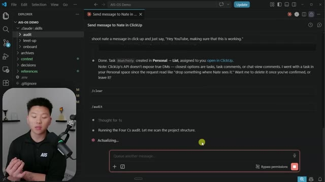
*⏱️ 00:48:17 — Interface de VS Code montrant l'arborescence du projet AIS-OS à gauche et une fenêtre de chat avec Claude exécutant une commande d'audit (/audit).*

---

### ⏱️ `[00:48:37 - 00:49:00]` | Segment #109

**🔊 Audio (Transcription Intégrale Mot pour Mot en Français) :**
> Okay. So April 30th audit, we got 54.5 out of a hundred and we're currently, you know, we literally just got this set up. So honestly, I think this is being pretty generous with context. I mean, 18 out of 25, it could definitely get a lot better connections. We're at 16 out of 25. It could get a ton better. so maybe we need to tweak this actual audit a little bit because we only have one connection and that's ClickUp.

**👁️ Analyse Visuelle d'Écran (gemini-3.5-flash-lite) :**
**Interface & Outils** : VS Code (avec une extension de type interface conversationnelle ou agent IA intégrée).

**Contenu textuel & Code** : Tableau de bord d'audit : Context (18/25), Connections (16.5/25), Capabilities (10/25), Cadence (10/25). Section "Strengths" détaillant l'intégration API de ClickUp.

**Action / Démonstration** : Le présentateur commente les résultats de l'audit affichés à l'écran, soulignant la générosité du score actuel par rapport à la mise en place récente du système.

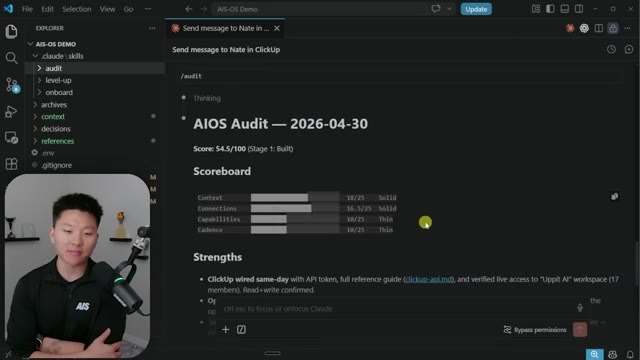
*⏱️ 00:48:43 — L'écran montre une interface VS Code affichant un rapport d'audit système nommé "AIOS Audit" daté du 30 avril 2026, avec un score global de 54.5/100.*

---

### ⏱️ `[00:49:01 - 00:49:23]` | Segment #110

**🔊 Audio (Transcription Intégrale Mot pour Mot en Français) :**
> Mais l'idée, c'est que ça va commencer à passer en revue vos forces et vos faiblesses. Donc ClickUp a été connecté le jour même. D'accord, peut-être que c'est relatif parce que c'est genre, d'accord, le premier jour, ce n'est pas trop mal. Le fichier connections.md est complet. Nous avons ClickUp, Fireflies, Gmail, Slack et les revenus. Mais voici les trois principales lacunes et elles sont classées par effet de levier. Donc le domaine de niveau un est mince, ce qui signifie que seulement un des sept domaines de niveau un est accessible.

**👁️ Analyse Visuelle d'Écran (gemini-3.5-flash-lite) :**
**Interface & Outils** : VS Code (avec une extension de type Claude AI / chat intégré)

**Contenu textuel & Code** : Commande `/audit`, tableau de scores (Context 18/25, Connections 16.5/25, Capabilities 10/25, Cadence 10/25), section "Strengths" détaillant la connexion de ClickUp, et section "Top 3 Gaps".

**Action / Démonstration** : Affichage des résultats de l'audit du système (AIS-OS) évaluant les forces et faiblesses des intégrations.

*⏱️ 00:49:06 — Un écran de VS Code affichant un rapport d'audit au format Markdown dans un panneau de chat, avec un tableau de bord (Scoreboard), les forces identifiées du système et les lacunes (Top 3 Gaps). Le présentateur apparaît dans une incrustation vidéo en bas à gauche.*

---

### ⏱️ `[00:49:23 - 00:49:43]` | Segment #111

**🔊 Audio (Transcription Intégrale Mot pour Mot en Français) :**
> Donc, si nous repensons à ceci, là où vous avez travaillé, nous en avions sept, n'est-ce pas ? Revenu, client, calendrier, communications, tâches, réunions, connaissances. Et nous n'avons branché que ClickUp. C'est donc un peu de communications, un peu de tâches, mais toujours pas là où nous voulons être. Donc, cela dit, pourquoi Fireflies est le suivant ? Ensuite, nous n'avons pas de déclencheur récurrent ou de cadence, ce qui est le quatrième C, nous y reviendrons plus tard.

**👁️ Analyse Visuelle d'Écran (gemini-3.5-flash-lite) :**
**Interface & Outils** : Outil de diagramme type tableau blanc et éditeur de code VS Code.

**Contenu textuel & Code** : Schéma d'architecture des 7 domaines métiers et rapport d'audit textuel avec des recommandations d'intégration (Fireflies, ClickUp).

**Action / Démonstration** : Présentation conceptuelle d'une architecture d'automatisation puis visualisation du code source et des audits de l'agent.

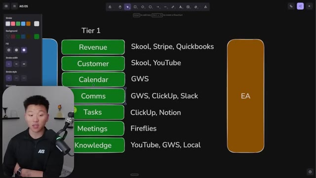
*⏱️ 00:49:28 — Un schéma ou diagramme interactif montrant les sept catégories de données (Revenue, Customer, Calendar, Comms, Tasks, Meetings, Knowledge) associées à différents outils et un assistant exécutif (EA).*

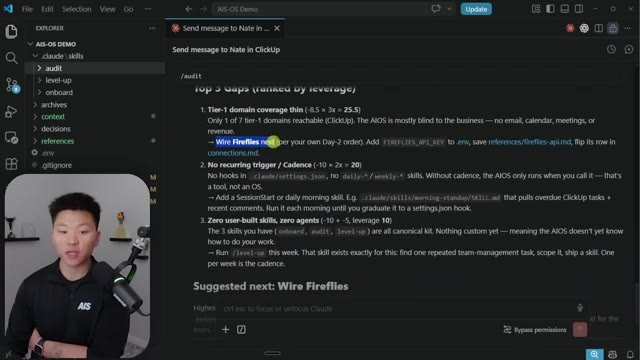
*⏱️ 00:49:38 — Une interface d'éditeur de code (VS Code ou Cursor) affichant des notes d'audit d'IA (Top 3 Gaps) concernant les intégrations et les compétences du système.*

---

### ⏱️ `[00:49:44 - 00:50:03]` | Segment #112

**🔊 Audio (Transcription Intégrale Mot pour Mot en Français) :**
> Et zéro compétence créée par l'utilisateur et zéro agent. Donc c'est vraiment là qu'on obtient beaucoup d'effet de levier, c'est quand vous arrivez dans cet AIOS et que vous construisez vos propres compétences personnalisées par-dessus tout le reste. Maintenant, en parlant de compétences personnalisées, allons-y et exécutons aussi cette autre. Celle-ci s'appelle level up. Donc je vais y aller et faire un slash et je vais faire la compétence level up.

**👁️ Analyse Visuelle d'Écran (gemini-3.5-flash-lite) :**
**Interface & Outils** : VS Code (éditeur de code)

**Contenu textuel & Code** : Arborescence de fichiers montrant les dossiers `audit`, `level-up`, `onboard`, et texte de chat expliquant les points « Zero user-built skills, zero agents » et « Suggested next: Wire Fireflies ».

**Action / Démonstration** : Le présentateur explique les concepts liés à la création de compétences personnalisées dans l'AIOS tout en montrant l'éditeur.

*⏱️ 00:49:48 — Vue de l'éditeur de code VS Code affichant un dossier `.claude\skills` dans l'explorateur et une interface de chat Claude avec un récapitulatif textuel et des consignes d'audit.*

---

### ⏱️ `[00:50:03 - 00:50:23]` | Segment #113

**🔊 Audio (Transcription Intégrale Mot pour Mot en Français) :**
> Et je n'avais en fait pas réalisé que ça suggérait ça. Ça a dit, hé, ce sont des lacunes structurelles pour explorer les lacunes de capacités, ce qui est ce que votre AIOS pourrait faire qu'il ne peut pas encore faire, exécutez le niveau supérieur après cet audit. Et aussi vous pouvez voir que ça dit, est-ce que tu veux que je sauvegarde ceci ? Donc chacun de vos audits peut être sauvegardé afin que vous puissiez voir comment vous améliorez réellement votre AIOS au fil du temps.

**👁️ Analyse Visuelle d'Écran (gemini-3.5-flash-lite) :**
**Interface & Outils** : VS Code

**Contenu textuel & Code** : Texte de l'audit d'IA mentionnant 'Structural gaps only. To explore CAPABILITY gaps, what your AIOS could DO that it can't yet, run /level-up after this audit' et la commande `/level-up`.

**Action / Démonstration** : Le présentateur explique les suggestions de l'audit d'IA et la commande pour combler les lacunes de capacités.

*⏱️ 00:50:08 — L'éditeur de code VS Code affichant un panneau de chat d'IA montrant les résultats d'un audit de compétences et suggérant d'exécuter la commande `/level-up`.*

---

### ⏱️ `[00:50:24 - 00:50:46]` | Segment #114

**🔊 Audio (Transcription Intégrale Mot pour Mot en Français) :**
> Cette mise à niveau va essentiellement analyser votre entreprise, vos connexions, tout ce que vous faites. Et elle pourrait même vous poser des questions, mais elle va vous montrer certains domaines où vous pourriez simplement perfectionner vos compétences. Donc, elle dit : en tirant parti de votre pile, vous avez pour principale difficulté de gérer votre équipe. Vous avez des priorités pour le deuxième trimestre. Vous avez des choses qui sont réalisables maintenant, et vous avez des choses qui sont réalisables bientôt. Donc, voici ce que vous devriez faire : répondez à ces questions de la manière qui vous semble la plus naturelle.

**👁️ Analyse Visuelle d'Écran (gemini-3.5-flash-lite) :**
**Interface & Outils** : VS Code (éditeur de code avec panneau explorateur et panneau principal de terminal ou de rendu markdown interactif).

**Contenu textuel & Code** : Commande `/level-up`, texte daté au 30 avril 2026, listant les priorités et la pile technique (« Top pain », « Q2 priorities », « Reachable now », « Reachable soon »), suivi de « Phase 1 — Mindset (find the candidate) » et du statut « Wandering... ».

**Action / Démonstration** : Exécution d'un script ou d'un prompt d'évaluation de compétences et d'analyse d'entreprise nommé '/level-up' affichant les phases de questionnement interactif.

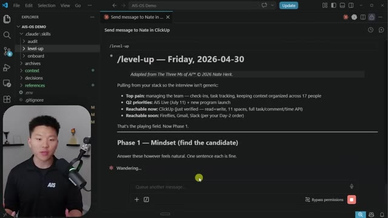
*⏱️ 00:50:29 — Capture d'écran montrant l'éditeur VS Code avec une vue sur l'arborescence du projet et un fichier markdown affichant une interface de chat interactive exécutant la commande '/level-up'.*

---

### ⏱️ `[00:50:46 - 00:51:05]` | Segment #115

**🔊 Audio (Transcription Intégrale Mot pour Mot en Français) :**
> Une seule phrase suffit. Raconte-moi ta semaine dernière. Qu'as-tu fait plus de trois fois ? De la corvée. Y a-t-il eu quelque chose qui a semblé manuel, ennuyeux ou du copier-coller ? Le test du stagiaire intelligent. Quelque chose où tu t'es dit qu'un stagiaire intelligent pourrait absolument s'en charger, mais que tu as fini par faire toi-même parce que l'expliquer aurait pris plus de temps. Contrainte. Si 500 nouveaux membres de la communauté arrivaient lundi, qu'est-ce qui lâcherait en premier ?

**👁️ Analyse Visuelle d'Écran (gemini-3.5-flash-lite) :**
**Interface & Outils** : VS Code avec un panneau de discussion ou de documentation textuelle.

**Contenu textuel & Code** : Texte listant des questions de type "Frequency", "Drudgery", "Smart-intern test", "Constraint" et "Growth lever".

**Action / Démonstration** : Affichage des critères d'évaluation pour identifier les tâches à automatiser par l'IA.

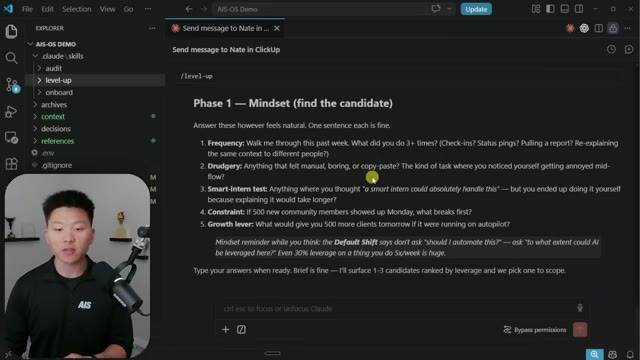
*⏱️ 00:50:51 — Capture d'écran montrant l'interface d'un éditeur de code avec un panneau affichant un questionnaire de réflexion (Phase 1 — Mindset) sur les tâches automatisables, pendant que le présentateur apparaît en bas à gauche.*

---

### ⏱️ `[00:51:06 - 00:51:28]` | Segment #116

**🔊 Audio (Transcription Intégrale Mot pour Mot en Français) :**
> Et levier de croissance. Qu'est-ce qui vous apporterait 500 clients de plus demain si cela fonctionnait en pilotage automatique ? Donc, si vous répondez à ces cinq questions, il est absolument impossible que vous soyez bloqué. Il est absolument impossible que vous pensiez, je ne sais pas quoi ajouter à mon AIOS. Je ne sais pas comment améliorer cela. Chaque fois que vous répondez à ces cinq questions, cela trouvera une opportunité pour vous d'automatiser quelque chose, de bâtir une compétence à partir de quelque chose, de connecter autre chose.

**👁️ Analyse Visuelle d'Écran (gemini-3.5-flash-lite) :**
**Interface & Outils** : Visual Studio Code avec interface de chat pour assistant IA (Claude / extension de développement) et explorateur de fichiers.

**Contenu textuel & Code** : Le prompt '/level-up' affichant la 'Phase 1 — Mindset (find the candidate)' avec 5 questions numérotées : Frequency, Drudgery, Smart-intern test, Constraint, et Growth lever.

**Action / Démonstration** : Présentation du questionnaire textuel destiné à évaluer les opportunités d'automatisation et de levier de croissance par l'IA.

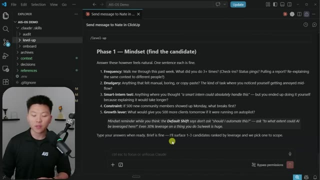
*⏱️ 00:51:11 — Un éditeur de code de type VS Code affichant un assistant IA avec les 5 questions sur le 'Mindset' (Phase 1) pour identifier des leviers d'automatisation, avec la vidéo du présentateur en incrustation (PIP) dans le coin inférieur gauche.*

---

### ⏱️ `[00:51:28 - 00:51:48]` | Segment #117

**🔊 Audio (Transcription Intégrale Mot pour Mot en Français) :**
> Et c'est pourquoi j'ai conçu ces deux compétences pour aller ensemble, l'audit et la montée en niveau, afin de m'assurer que vous vous améliorez constamment et que vous ne vous sentiez jamais seul et que vous ne vous sentiez jamais bloqué avec votre AIOS. Donc je ne vais pas taper ça tout de suite. Je ne vais pas répondre à ça parce que nous avons beaucoup de travail à faire par nous-mêmes. Mais je veux vous montrer quelque chose que j'ai fait récemment avec Cloud Code et Google Workspace. Donc je vis dans Google Workspace, n'est-ce pas ?

**👁️ Analyse Visuelle d'Écran (gemini-3.5-flash-lite) :**
**Interface & Outils** : VS Code

**Contenu textuel & Code** : Commande `/level-up`, questions de la Phase 1 sur le "Mindset" (Frequency, Drudgery, Smart-intern test, Constraint, Growth lever)

**Action / Démonstration** : Affichage de l'interface de skill "level-up" dans l'éditeur de code pendant l'explication du présentateur.

*⏱️ 00:51:33 — Vue de VS Code avec le panneau latéral ouvert montrant les dossiers .claude/skills (audit, level-up, onboard) et le panneau principal affichant une interface de chat avec un prompt /level-up et les questions de la Phase 1 (Mindset). Le présentateur apparaît dans un encadré en bas à gauche.*

---

### ⏱️ `[00:51:49 - 00:52:08]` | Segment #118

**🔊 Audio (Transcription Intégrale Mot pour Mot en Français) :**
> Tout ce que je fais se trouve à peu près là-dedans, à part ClickUp. Et ce qui s'est passé, c'est que je me suis rendu compte que dans toute mon entreprise, tout le monde avait créé tellement de Google Docs différents et tellement de Google Sheets différents. Et nous avions des feuilles de suivi partout. Et la recherche Google est horrible. C'est absolument horrible. J'ai donc pu connecter Cloud Code à la CLI GWS.

**👁️ Analyse Visuelle d'Écran (gemini-3.5-flash-lite) :**
**Interface & Outils** : Visual Studio Code (avec extension ou intégration Claude).

**Contenu textuel & Code** : Un prompt structuré intitulé "/level-up" posant 5 questions stratégiques sur l'optimisation des flux de travail (fréquence, tâches manuelles, délégation à une IA, contraintes de scalabilité, leviers de croissance).

**Action / Démonstration** : Le présentateur illustre l'utilisation d'une interface de chat intégrée dans son éditeur de code pour interagir avec une IA qui aide à structurer et automatiser les processus internes de son entreprise.

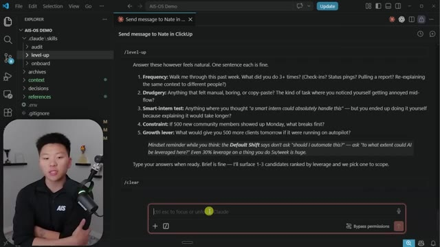
*⏱️ 00:51:54 — Une capture d'écran de l'éditeur VS Code montrant une interface de discussion avec l'agent Claude, utilisée pour le processus de "level-up" ou d'audit interne.*

---

### ⏱️ `[00:52:08 - 00:52:31]` | Segment #119

**🔊 Audio (Transcription Intégrale Mot pour Mot en Français) :**
> C'est un seul outil et il vous donne accès à tout dans l'environnement GWS. Je vais donc vous montrer exactement comment configurer cela dans une petite seconde. Mais j'ai pu faire des choses vraiment cool. Laissez-moi donc vous montrer quelques-unes de ces choses cool que j'ai pu faire. Si je vais dans mes feuilles de calcul, j'ai cette base de données vidéo qui contient toutes mes vidéos. Elle contient la miniature, le titre, un lien vers celles-ci, un résumé, et toutes les ressources qui sont associées à cette vidéo.

**👁️ Analyse Visuelle d'Écran (gemini-3.5-flash-lite) :**
**Interface & Outils** : Visual Studio Code (VS Code), Google Chrome, Google Sheets.

**Contenu textuel & Code** : Dans VS Code : un prompt intitulé "Send message to Nate in ClickUp" contenant 5 questions stratégiques (Frequency, Drudgery, Smart-intern test, Constraint, Growth lever). Dans Sheets : liste de vidéos sur "Claude Code", "Agentic AI workflows" et "Nano Banana 2".

**Action / Démonstration** : Le présentateur illustre ses outils d'automatisation et de gestion de contenu en passant d'un éditeur de code à une base de données collaborative.

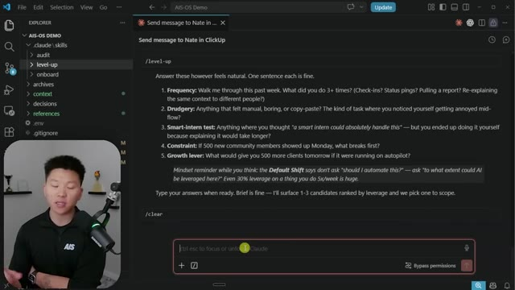
*⏱️ 00:52:14 — Interface VS Code ouverte avec un fichier de prompt structuré pour une interaction avec un agent IA (Claude).*

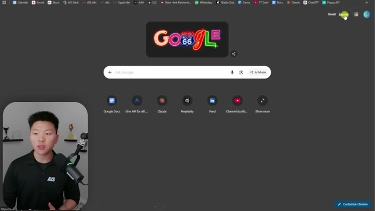
*⏱️ 00:52:20 — Page d'accueil du navigateur Google Chrome avec une barre de recherche et des raccourcis d'applications.*

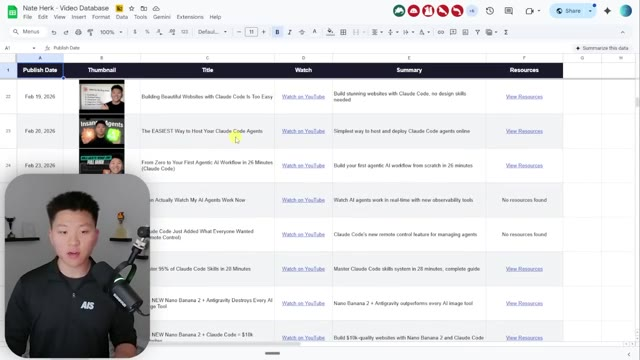
*⏱️ 00:52:26 — Feuille de calcul Google Sheets organisée en base de données, listant des titres de vidéos YouTube et des ressources associées.*

---

### ⏱️ `[00:52:32 - 00:53:08]` | Segment #120

**🔊 Audio (Transcription Intégrale Mot pour Mot en Français) :**
> Et voici maintenant ma base de données de vidéos. Et je ne fais pas cela manuellement. Chaque fois que je publie une vidéo, la vidéo est récupérée, les ressources sont récupérées, puis une ligne est mise à jour ici. Et j'ai construit ceci parce que cela était capable de parcourir tout mon disque. Cela pouvait trouver toutes mes vidéos YouTube. C'était une connexion différente. C'était l'API de données YouTube. Mais bref, cela pouvait tout trouver. Et puis cela pouvait trouver toutes mes ressources. Et ensuite, cela pouvait simplement tout mettre ici. Super, super puissant. Un autre exemple. Nous avons ce document assez massif sur notre événement en direct AIS et il y a des créneaux de prise de parole et il y a, vous savez, différents horaires et il y a différentes choses de prospection. Et il y a beaucoup de données ici. Et j'ai fondamentalement dit, hé, Claude Code, va lire ceci

**👁️ Analyse Visuelle d'Écran (gemini-3.5-flash-lite) :**
**Interface & Outils** : Google Sheets (Image 1), Google Docs (Image 2).

**Contenu textuel & Code** : Tableau répertoriant les titres de vidéos (ex: "Claude Design Just Became Unstoppable"), dates, résumés de workflow IA, et liens hypertexte vers des ressources.

**Action / Démonstration** : Présentation d'une base de données automatisée qui centralise et met à jour les métadonnées et ressources de chaque nouvelle vidéo publiée, sans intervention manuelle.

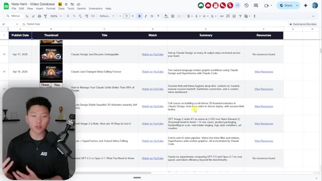
*⏱️ 00:52:41 — Une feuille Google Sheets organisée comme base de données automatisée pour des vidéos, affichant des colonnes pour la date de publication, les miniatures, les titres, des liens YouTube, des résumés détaillés et des ressources associées.*

---

### ⏱️ `[00:53:08 - 00:53:27]` | Segment #121

**🔊 Audio (Transcription Intégrale Mot pour Mot en Français) :**
> document. Je lui ai donné le lien vers ceci. Il a ouvert le document dans Google Drive. Il a tout lu. Et ensuite j'ai dit, crée-moi une base de données, une feuille de suivi. Et il a créé cette feuille Google Sheets parce qu'il a analysé tout ce qui se passait dans ce document et il a été capable d'étiqueter tout le monde. Il a fait en sorte que tout cela ait des menus déroulants avec un code couleur. Il a assigné ces tâches à tout le monde.

**👁️ Analyse Visuelle d'Écran (gemini-3.5-flash-lite) :**
**Interface & Outils** : Google Docs

**Contenu textuel & Code** : Document texte nommé 'AIS_Live_Event_Agenda_v4' avec des sections structurées et un plan dans le volet latéral gauche.

**Action / Démonstration** : Présentation du document Google Drive analysé par l'IA pour générer ensuite une feuille de suivi.

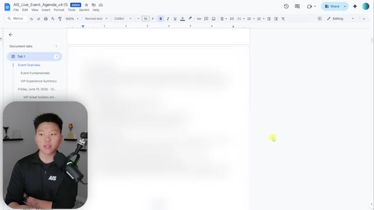
*⏱️ 00:53:13 — Un document Google Docs ouvert intitulé 'AIS_Live_Event_Agenda_v4' avec un panneau latéral de navigation, et la vidéo du présentateur incrustée en bas à gauche.*

---

### ⏱️ `[00:53:27 - 00:53:47]` | Segment #122

**🔊 Audio (Transcription Intégrale Mot pour Mot en Français) :**
> Il a simplement pu tout faire pour moi. Et cela m'aurait pris tellement de temps à faire manuellement. Une autre chose que j'ai pu faire, c'est que j'ai genre toutes mes vidéos YouTube stockées en local, et il a pu chercher là-dedans, tout organiser, tout dater, puis tout importer sur Drive. Et ensuite, il a tout supprimé en local. Et maintenant, ce que je pourrais faire, c'est lui faire organiser tout ça dans différents dossiers en fonction de la date.

**👁️ Analyse Visuelle d'Écran (gemini-3.5-flash-lite) :**
**Interface & Outils** : Google Drive (interface web avec fonctionnalité "Ask Gemini")

**Contenu textuel & Code** : Liste de fichiers vidéo (ex: "Codex review - 2026-03-30.mp4", "Paperclip - 2026-03-28.mp4") organisés par nom, propriétaire (me), date de modification et taille.

**Action / Démonstration** : Démonstration de l'organisation automatique de fichiers multimédias importés sur le cloud, illustrant l'intégration de l'IA (Gemini) pour la gestion documentaire.

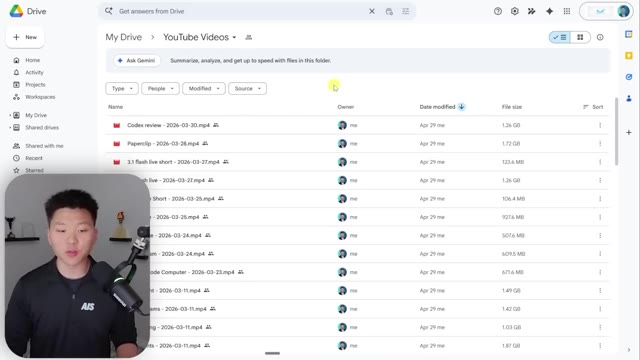
*⏱️ 00:53:32 — Une capture d'écran montrant l'interface Google Drive organisée avec un dossier nommé "YouTube Videos", où les fichiers vidéo sont listés avec des dates et des tailles de fichiers uniformisées.*

---

### ⏱️ `[00:53:47 - 00:54:07]` | Segment #123

**🔊 Audio (Transcription Intégrale Mot pour Mot en Français) :**
> Donc ça peut simplement vous aider à organiser les choses, à déplacer les choses, à créer des choses. Et tout cela se trouvant dans mon Google Drive, dans un Google Drive d'entreprise partagé, c'est génial parce que ça peut trouver les choses instantanément. Et tous les autres membres de mon équipe, j'étais en mode : « Hé les gars, est-ce que vous pouvez utiliser la CLI GWS rapidement ? Et est-ce que vous pouvez parcourir tout ce que vous avez déjà construit pour l'entreprise ? »

**👁️ Analyse Visuelle d'Écran (gemini-3.5-flash-lite) :**
**Interface & Outils** : Google Drive (interface web)

**Contenu textuel & Code** : Liste de fichiers vidéo (.mp4) avec leurs propriétaires, dates de modification et tailles, ainsi que l'option 'Ask Gemini'.

**Action / Démonstration** : Le présentateur navigue dans son Google Drive pour montrer l'organisation et le stockage des fichiers vidéo de l'équipe.

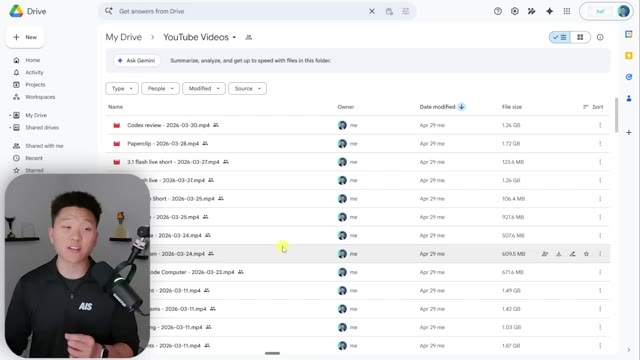
*⏱️ 00:53:52 — Capture d'écran montrant l'interface de Google Drive avec le dossier 'YouTube Videos' ouvert, contenant une liste de fichiers vidéo, et le présentateur visible en incrustation dans le coin inférieur gauche.*

---

### ⏱️ `[00:54:07 - 00:54:39]` | Segment #124

**🔊 Audio (Transcription Intégrale Mot pour Mot en Français) :**
> Et est-ce que tu peux le mettre dans le Drive partagé ? Et maintenant, tous nos agents IA sont capables d'interagir avec toutes ces choses tellement mieux. Donc la CLI GWS est une énorme avancée. Malheureusement, si vous utilisez par exemple Microsoft et que c'est votre environnement principal, la CLI GWS ne vous sera probablement pas très utile. Je suis sûr qu'il existe quelque chose de différent pour l'environnement de Microsoft que vous devriez utiliser, mais je vais vous lancer un court extrait sur la façon de configurer la CLI GWS et un peu plus d'informations à ce sujet. Donc si cela ne vous attire pas ou ne vous intéresse pas, ou si vous l'avez déjà configurée, n'hésitez pas à passer la partie suivante, mais je vais lancer cet extrait très rapidement. Google vient tout juste de sortir ce que certains sont déjà

**👁️ Analyse Visuelle d'Écran (gemini-3.5-flash-lite) :**
**Interface & Outils** : Google Drive, VS Code, interface de Claude Code

**Contenu textuel & Code** : Liste de fichiers .mp4 dans Google Drive ; instructions de prompt /level-up et /clear dans VS Code avec une liste de questions sur l'automatisation et l'effet de levier de l'IA.

**Action / Démonstration** : Navigation dans le dossier Google Drive partagé et visualisation d'un prompt d'agent conversationnel dans l'éditeur de code.

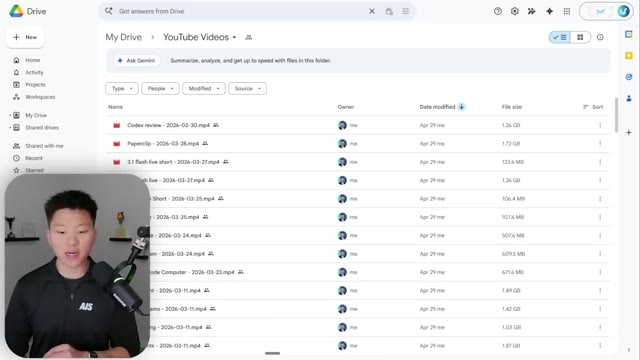
*⏱️ 00:54:15 — Interface Google Drive affichant une liste de fichiers vidéo avec le présentateur incrusté en bas à gauche.*

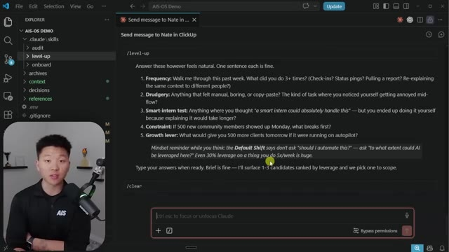
*⏱️ 00:54:23 — Éditeur VS Code avec l'interface de Claude Code affichant des instructions de prompt (/level-up) et l'arborescence du projet.*

---

### ⏱️ `[00:54:39 - 00:55:15]` | Segment #125

**🔊 Audio (Transcription Intégrale Mot pour Mot en Français) :**
> qu'on appelle la CLI Workspace la plus puissante d'Internet. Donc si vous avez une tonne de choses qui se trouvent dans l'environnement Google, tout comme moi, alors vous allez adorer ceci parce que maintenant, n'importe lequel de mes projets de code cloud peut accéder à tout. Et tout ce que j'ai eu à faire, c'est installer une seule chose simple. Donc ici, vous pouvez voir, j'ai dit : « que peux-tu faire avec GWS », qui est la CLI Google Workspace. Donc elle peut rechercher, lister, téléverser, télécharger, déplacer, copier, partager, n'importe quoi dans mon Google Drive. Elle peut tout faire dans mon Gmail. Elle peut tout faire dans mon agenda. Elle peut tout faire avec Google Docs. Même chose avec Sheets. Même chose avec Slides. Et elle a aussi des recettes de flux de travail à plusieurs étapes. Donc ce sont fondamentalement

**👁️ Analyse Visuelle d'Écran (gemini-3.5-flash-lite) :**
**Interface & Outils** : Visual Studio Code, extension Claude Code, explorateur de fichiers

**Contenu textuel & Code** : Arborescence du projet "HERK-2" incluant des dossiers comme .claude, archives, brand-assets, context, decisions, projects, references, scripts, et interface de discussion Claude Code avec une zone de saisie de texte.

**Action / Démonstration** : Navigation dans l'explorateur de fichiers du projet et utilisation de l'interface Claude Code intégrée dans l'éditeur.

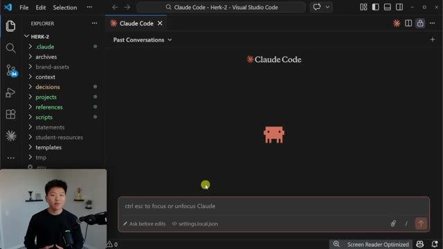
*⏱️ 00:54:48 — Vue de l'éditeur Visual Studio Code affichant l'interface de l'extension Claude Code avec l'explorateur de projets à gauche, tandis que le présentateur apparaît en incrustation vidéo en bas à gauche.*

---

### ⏱️ `[00:55:15 - 00:55:49]` | Segment #126

**🔊 Audio (Transcription Intégrale Mot pour Mot en Français) :**
> comme des compétences. Ce sont des modèles de chaînes de commandes pour des tâches courantes, comme la création de documents à partir de modèles, la lecture de données de feuilles de calcul et la création d'un document de rapport, la recherche de temps libre et la planification d'une réunion. Et il y en a plus d'une centaine que cela possède réellement. Donc, dès la sortie de la boîte, lorsque vous donnez à Cloud Code la CLI GWS, vous pouvez tout faire à travers n'oubliez quel outil et vous avez également accès à plus d'une centaine de compétences. Donc, je ne sais pas combien de fois vous avez essayé d'utiliser quelque chose comme Cloud ou NNN pour vous fabriquer un document Google Doc et vous faites cela via une API et cela finit simplement par ressembler à quelque chose comme ça. Cela ressemble littéralement à du Markdown brut et c'est évidemment horrible. Et parfois, pour aller avec une vidéo YouTube, je fais des guides de ressources qui ressemblent à ça,

**👁️ Analyse Visuelle d'Écran (gemini-3.5-flash-lite) :**
**Interface & Outils** : Visual Studio Code et Google Docs

**Contenu textuel & Code** : Documentation des scripts gws CLI listant des workflows automatisés (création de doc, lecture de feuille, planification de réunion) et documentation de l'API Google Calendar.

**Action / Démonstration** : Présentation des capacités d'automatisation multi-étapes de l'assistant IA et visualisation d'une documentation technique.

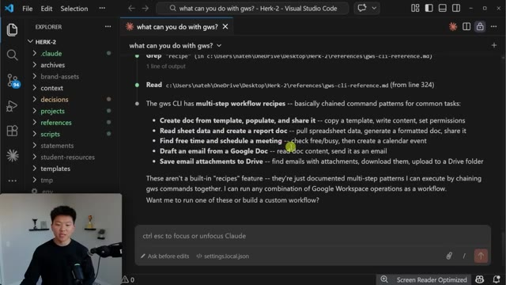
*⏱️ 00:55:24 — Visual Studio Code affichant un document markdown avec la liste des "multi-step workflow recipes" pour l'outil CLI gws.*

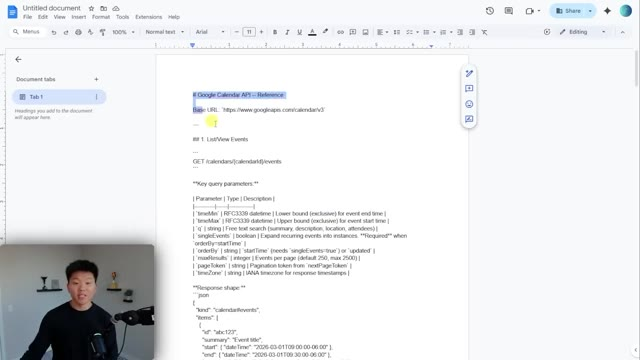
*⏱️ 00:55:41 — Google Docs affichant une page de référence pour l'API Google Calendar avec des spécifications d'endpoints et des structures JSON.*

---

### ⏱️ `[00:55:50 - 00:56:17]` | Segment #127

**🔊 Audio (Transcription Intégrale Mot pour Mot en Français) :**
> mais évidemment, elles doivent être formatées. J'ai comme un en-tête ici et j'ai des liens et différentes choses dans ce format. Mais maintenant, je peux littéralement prendre le lien d'une vidéo YouTube. Je peux le déposer dans Cloud Code et dire, crée-moi un guide de ressources YouTube. Il va aller récupérer cette transcription de la vidéo. Et maintenant, ce qu'il fait, c'est qu'il crée le document Google Doc, non pas via un appel API, non pas via MCP, mais via une commande bash, ce qui signifie qu'il exécute littéralement une commande de terminal afin de parler à Google et de le créer. Donc, il vient effectivement de créer le document.

**👁️ Analyse Visuelle d'Écran (gemini-3.5-flash-lite) :**
**Interface & Outils** : Visual Studio Code (éditeur de code)

**Contenu textuel & Code** : Prompt utilisateur avec un lien YouTube et exécution d'une commande yt-dlp pour télécharger la transcription via l'outil Claude Code.

**Action / Démonstration** : Le système traite le lien YouTube pour générer un guide de ressources à partir de la transcription.

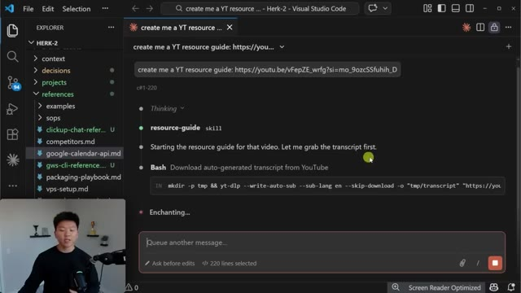
*⏱️ 00:56:03 — Interface de Visual Studio Code montrant Claude Code en train de traiter une commande avec un lien YouTube.*

---

### ⏱️ `[00:56:17 - 00:56:45]` | Segment #128

**🔊 Audio (Transcription Intégrale Mot pour Mot en Français) :**
> Voici l'ID. Et maintenant, il va le remplir avec ce dont j'ai besoin. Et maintenant, il a terminé ceci. Il m'a donné le lien. Je vais cliquer dessus et nous pouvons voir, boum, nous avons un véritable guide de ressources. Il a l'image insérée ici en haut comme en-tête. Il a un lien qui renvoie directement vers ma chaîne YouTube. Il détaille le marché, l'automatisation traditionnelle. Il passe en revue tout cela et possède même mon appel à l'action en bas, comme vous pouvez le voir après toutes ces lignes horizontales pour rejoindre le groupe Plus. C'était donc évidemment juste un exemple rapide, mais il y a tellement d'avantages différents ici en utilisant cette interface de ligne de commande (CLI) de l'espace de travail. Le premier est que vous avez une seule interface.

**👁️ Analyse Visuelle d'Écran (gemini-3.5-flash-lite) :**
**Interface & Outils** : Google Docs (interface web)

**Contenu textuel & Code** : Document texte titré 'How to Build $10,000 Agentic Workflows' avec des sections comme 'The Agentic AI Market' et 'Market Size and Growth'

**Action / Démonstration** : Affichage et consultation du document de ressources généré automatiquement par l'agent IA.

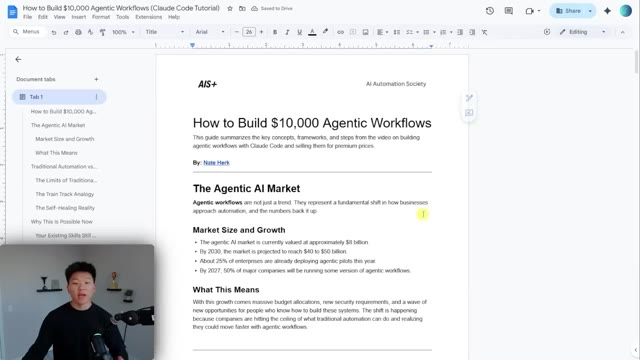
*⏱️ 00:56:24 — Un document Google Docs généré automatiquement présentant le guide de ressources intitulé 'How to Build $10,000 Agentic Workflows', avec le présentateur en incrustation vidéo dans le coin inférieur gauche.*

---

### ⏱️ `[00:56:45 - 00:57:05]` | Segment #129

**🔊 Audio (Transcription Intégrale Mot pour Mot en Français) :**
> Donc en gros, comme je l'ais dit, c'était une CLI GWS à laquelle CloudCode a désormais accès, et elle peut accéder à mon Gmail, mon Drive, Docs, Sheets, Calendar, Admin, et plus encore. Elle est aussi axée sur le JSON en premier avec des réponses structurées. Notre agent IA est donc vraiment, vraiment bon pour travailler avec. Nous avons une découverte automatique, ce qui signifie que la CLI va pratiquement toujours rester à jour automatiquement, avec pratiquement zéro maintenance parce que nous nous authentifions et ensuite nous sommes prêts à démarrer.

**👁️ Analyse Visuelle d'Écran (gemini-3.5-flash-lite) :**
**Interface & Outils** : Schéma conceptuel au style "sketchnote" (diagramme de mindmapping)

**Contenu textuel & Code** : Diagramme détaillant les composants clés : "One Interface" (Gmail, Drive, Docs, Sheets, Cal), "JSON-First" (Structured responses), "Auto-Discovery", "Zero Maintenance", "Built-in Skills", et "Low Overhead".

**Action / Démonstration** : Présentation visuelle et explication des avantages et caractéristiques de l'outil GWS CLI intégré à Claude Code.

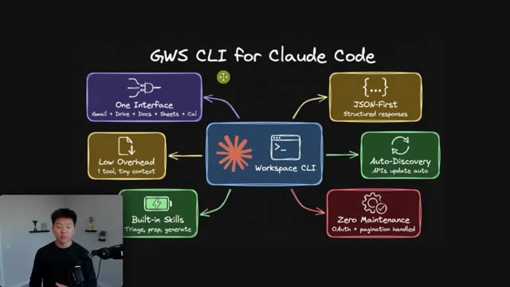
*⏱️ 00:56:50 — Schéma explicatif illustrant l'architecture et les fonctionnalités de la "GWS CLI for Claude Code", avec le présentateur visible en incrustation vidéo dans le coin inférieur gauche.*

---

### ⏱️ `[00:57:06 - 00:57:32]` | Segment #130

**🔊 Audio (Transcription Intégrale Mot pour Mot en Français) :**
> Il intègre des compétences pour le tri, pour la préparation, pour les générations. Comme je l'ai dit, il y a une centaine d'autres et ce n'est pas beaucoup de surcharge parce que c'est pratiquement juste un seul outil. Ce n'est pas la même chose que d'avoir tous ces points de terminaison API différents ou toutes ces configurations MCP et ces outils différents qui prendraient plus de contexte. Mais je sais que vous vous demandez probablement : qu'est-ce qu'un CLI ? Cela signifie interface de ligne de commande. Et ce à quoi nous sommes habituellement habitués, c'est une interface graphique, ou une interface utilisateur graphique, où nous pouvons voir des boutons, nous pouvons voir des champs de formulaire, et nous pouvons cliquer sur des éléments. Et c'est ainsi que nous naviguons.

**👁️ Analyse Visuelle d'Écran (gemini-3.5-flash-lite) :**
**Interface & Outils** : Présentation visuelle / Schéma conceptuel dessiné (style Excalidraw / style tableau blanc).

**Contenu textuel & Code** : Texte du schéma : "GWS CLI for Claude Code", "One Interface", "Low Overhead", "Built-in Skills", "Zero Maintenance", "Auto-Discovery", "JSON-First".

**Action / Démonstration** : Le présentateur explique l'architecture et les avantages de l'outil GWS CLI pour Claude Code en s'appuyant sur le diagramme.

*⏱️ 00:57:12 — Schéma explicatif intitulé "GWS CLI for Claude Code" détaillant les caractéristiques de l'outil autour du "Workspace CLI".*

---

### ⏱️ `[00:57:33 - 00:58:06]` | Segment #131

**🔊 Audio (Transcription Intégrale Mot pour Mot en Français) :**
> Mais les ordinateurs naviguent plutôt par le texte, par les commandes et en tapant. C'est donc vraiment tout ce qu'est une interface en ligne de commande (CLI). Et c'est un produit Google Workspace open source. Et évidemment, c'est complètement gratuit. Je laisserai donc un lien vers ce dépôt GitHub dans la description si vous voulez y jeter un œil et en lire davantage. Mais je vais également passer en revue quelques-uns des détails clés ici même. La première chose que je voulais vous montrer, c'est que si vous descendez ici dans les compétences, c'est là qu'on peut réellement voir tous les différents types de « recettes », comme ils les appellent, pour des flux de travail complexes pré-conçus dont il dispose. Comme vous pouvez le voir, créer des événements à partir de Sheets, créer des présentations, créer un espace Meet, étiqueter et archiver des e-mails. Il y en a tellement de différents

**👁️ Analyse Visuelle d'Écran (gemini-3.5-flash-lite) :**
**Interface & Outils** : Navigateur web (GitHub)

**Contenu textuel & Code** : Dépôt GitHub "googleworkspace/cli" avec des dossiers tels que agent, changeset, claude, gemini, et divers fichiers de compétences (skills).

**Action / Démonstration** : Présentation et exploration du code source du dépôt GitHub du projet Google Workspace CLI.

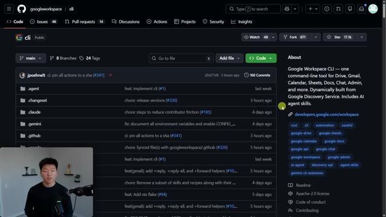
*⏱️ 00:57:41 — Vue du dépôt GitHub pour le projet Google Workspace CLI, montrant la structure des dossiers et la description du projet.*

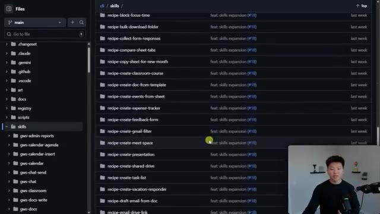
*⏱️ 00:57:58 — Navigation dans le dossier 'skills' du dépôt GitHub Google Workspace CLI, affichant divers dossiers de recettes de scripts.*

---

### ⏱️ `[00:58:06 - 00:58:27]` | Segment #132

**🔊 Audio (Transcription Intégrale Mot pour Mot en Français) :**
> des modèles que vous pourriez utiliser à partir de cette bibliothèque pré-construite. Maintenant, si nous continuons à faire défiler vers le bas, ce que vous remarquerez également, c'est qu'ici même, il est indiqué qu'il ne s'agit pas d'un produit Google officiellement pris en charge. Maintenant, cela ne veut pas dire que ce n'est pas sûr. C'est un produit Google réel, mais la raison pour laquelle il n'est pas officiellement pris en charge est qu'en ce moment, c'est plutôt une sorte de version bêta open source. C'est en quelque sorte un terrain de jeu pour développeurs plutôt qu'un logiciel soutenu par une entreprise.

**👁️ Analyse Visuelle d'Écran (gemini-3.5-flash-lite) :**
**Interface & Outils** : Navigateur web affichant GitHub

**Contenu textuel & Code** : Documentation README du projet CLI Google Workspace avec la commande d'installation npm et la note de non-responsabilité officielle.

**Action / Démonstration** : Le présentateur fait défiler la page de documentation du dépôt GitHub pour présenter les avertissements et les instructions d'installation.

*⏱️ 00:58:11 — Capture d'écran montrant le README d'un dépôt GitHub pour une CLI Google Workspace, avec une note de non-responsabilité indiquant qu'il ne s'agit pas d'un produit Google officiel, et le présentateur visible en incrustation vidéo en bas à droite.*

---

### ⏱️ `[00:58:27 - 00:59:03]` | Segment #133

**🔊 Audio (Transcription Intégrale Mot pour Mot en Français) :**
> Et vous pouvez voir ici qu'il est également indiqué que ce produit est en cours de développement actif. Attendez-vous à des changements majeurs alors que nous avançons vers la version 1.0. Donc, cet outil est déjà vraiment performant dès sa sortie et il ne va faire que s'améliorer. Et vous pouvez voir, comme je l'ai dit, lorsque Google Workspace ajoute des points de terminaison d'API ou des méthodes, GWS les récupère automatiquement. Vous feriez donc aussi bien de l'intégrer dans Cloud Code dès maintenant et de commencer à vous y habituer. Bon. Je viens juste de le désinstaller afin de pouvoir vous guider étape par étape sur son fonctionnement réel. C'est super simple. Ce que je fais, c'est que je copie essentiellement le lien vers ce dépôt GitHub, comme vous pouvez le voir, et je vais simplement le donner à Cloud Code en lui disant, hé, je veux installer cette CLI GWS, lis la documentation

**👁️ Analyse Visuelle d'Écran (gemini-3.5-flash-lite) :**
**Interface & Outils** : Visual Studio Code, Navigateur web (GitHub)

**Contenu textuel & Code** : Fichier README.md du projet gws, interface de l'extension Claude Code dans VS Code, liste des dossiers du dépôt GitHub googleworkspace/cli

**Action / Démonstration** : Navigation et présentation de la documentation et de l'interface de développement d'outils d'IA.

*⏱️ 00:58:36 — Vue du fichier README du dépôt GitHub du projet gws (Google Workspace CLI) montrant la description et l'avertissement sur le développement actif.*

*⏱️ 00:58:45 — Interface de l'éditeur Visual Studio Code affichant l'extension Claude Code avec un champ de saisie de prompt et le logo caractéristique.*

*⏱️ 00:58:54 — Page principale du dépôt GitHub googleworkspace/cli listant les dossiers du projet et les tags de description.*

---

### ⏱️ `[00:59:03 - 00:59:21]` | Segment #134

**🔊 Audio (Transcription Intégrale Mot pour Mot en Français) :**
> et m'aider à tout installer ce que j'ai besoin d'installer. Et ensuite, nous allons nous configurer. Donc, cela va essentiellement faire toutes les recherches pour moi. Et ensuite, tout ce que j'ai à faire, c'est de suivre ses instructions. Donc, il a lu la documentation. Il regarde ce que nous avons déjà installé. Il a essentiellement vu que j'avais déjà certains des prérequis. Donc, si vous ne les avez pas, vous devrez les installer. Et ensuite, il m'a dit que nous devions installer l'interface en ligne de commande.

**👁️ Analyse Visuelle d'Écran (gemini-3.5-flash-lite) :**
**Interface & Outils** : Visual Studio Code / Claude Code (Interface de terminal/chat intégré)

**Contenu textuel & Code** : URL GitHub (https://github.com/googleworkspace/cli), un prompt utilisateur demandant d'installer le GWS CLI en lisant la documentation, et les statuts « Thinking... » et « Synthesizing... » affichés par l'agent IA.

**Action / Démonstration** : L'agent IA analyse le dépôt GitHub et prépare les instructions d'installation pour l'utilisateur.

*⏱️ 00:59:07 — Capture d'écran de l'éditeur Visual Studio Code montrant une interface d'assistant IA (Claude Code) en train de lire la documentation d'un dépôt GitHub et de synthétiser les informations.*

---

### ⏱️ `[00:59:21 - 00:59:42]` | Segment #135

**🔊 Audio (Transcription Intégrale Mot pour Mot en Français) :**
> Donc il a fait ça. Et maintenant nous avons deux options. Donc la première est d'installer G Cloud CLI pour que nous ayons une configuration et une authentification automatiques, ou nous pourrions le faire manuellement en créant notre propre projet et tout le tintouin. Allons-y donc et essayons l'option A. D'accord, je pensais que ce serait juste une commande simple qu'il exécuterait et qu'ensuite nous serions bons, mais c'est en fait un truc en plus à installer. Revenons donc en arrière et essayons le manuel et je vais juste vous montrer, je suppose, la manière la plus difficile.

**👁️ Analyse Visuelle d'Écran (gemini-3.5-flash-lite) :**
**Interface & Outils** : Visual Studio Code (avec une vue web ou un fichier markdown intégré) et incrustation vidéo (webcam du présentateur).

**Contenu textuel & Code** : Texte explicatif : "gcloud isn't installed. You have two options: Option A: Install gcloud (recommended -- makes setup automatic)... Option B: Manual setup (no gcloud needed)". Liens vers cloud.google.com et console.cloud.google.com.

**Action / Démonstration** : Le présentateur présente et commente les deux options d'installation et de configuration de l'outil Google Cloud CLI dans l'éditeur de code.

*⏱️ 00:59:26 — Capture d'écran de l'éditeur Visual Studio Code montrant une documentation sur l'installation de gcloud avec deux options (Option A et Option B), ainsi qu'une incrustation vidéo du présentateur en bas à gauche.*

---

### ⏱️ `[00:59:42 - 01:00:02]` | Segment #136

**🔊 Audio (Transcription Intégrale Mot pour Mot en Français) :**
> D'accord, donc je vais aller sur ce lien, aller sur notre console Google Cloud et assurez-vous d'être connecté avec le bon compte en haut à droite. Et je vais simplement créer un nouveau projet juste pour vous montrer à quoi cela ressemble. Donc nouveau projet, je vais appeler celui-ci Claude Code GWS, et nous allons simplement créer ce projet. Donc ça se lance en ce moment même, comme vous pouvez le voir.

**👁️ Analyse Visuelle d'Écran (gemini-3.5-flash-lite) :**
**Interface & Outils** : Console Google Cloud (interface web)

**Contenu textuel & Code** : Nom du projet : Claude Code, ID du projet : claude-code-488413, numéro de projet : 901862950074, et accès rapide aux services (IAM & Admin, Billing, Compute Engine, etc.).

**Action / Démonstration** : Navigation et affichage du tableau de bord d'un nouveau projet créé sur la console Google Cloud.

*⏱️ 00:59:47 — Capture d'écran de la console Google Cloud affichant la page d'accueil d'un nouveau projet nommé 'Claude Code', avec un encart vidéo du présentateur en bas à gauche.*

---

### ⏱️ `[01:00:02 - 01:00:23]` | Segment #137

**🔊 Audio (Transcription Intégrale Mot pour Mot en Français) :**
> Et maintenant qu'il a été créé, je vais le sélectionner pour que nous soyons à l'intérieur. Et ensuite, je vais aller ici et taper APIs et services, cliquez dessus. Et nous devons configurer notre écran de consentement OAuth. Je vais donc cliquer dessus et il va dire, commencer, cliquez dessus. Nous devons donner un nom à notre application et ensuite nous devons choisir un public. Je vais donc simplement faire interne parce que j'en ai seulement besoin pour l'instant pour ma propre organisation.

**👁️ Analyse Visuelle d'Écran (gemini-3.5-flash-lite) :**
**Interface & Outils** : Google Cloud Console (Interface web)

**Contenu textuel & Code** : Barre de recherche avec la requête "api gateway" et une liste de résultats comprenant "APIs & Services", "Credentials", "Enabled APIs & services".

**Action / Démonstration** : Le présentateur recherche "APIs & Services" dans la console Google Cloud pour configurer l'écran de consentement OAuth.

*⏱️ 01:00:08 — Capture d'écran de l'interface Google Cloud montrant la barre de recherche ouverte avec le terme "api gateway" tapé et les résultats suggérant "APIs & Services".*

---

### ⏱️ `[01:00:23 - 01:00:57]` | Segment #138

**🔊 Audio (Transcription Intégrale Mot pour Mot en Français) :**
> Si vous voulez faire de l'externe, ça va essentiellement vous demander de faire des tests ou de publier. Et si vous faites des tests, assurez-vous simplement d'ajouter votre e-mail en tant qu'utilisateur de test. Et ensuite, tout ce que vous avez à faire après avoir entré vos informations de contact, c'est de cliquer sur "Je suis d'accord". Et puis vous procédez à la création. Maintenant, une fois que cela a été fait, vous allez aller créer un ID client. Je vais donc retourner dans les API et services. Je vais aller dans "Identifiants" et ensuite je vais procéder à la création d'un identifiant, un ID client. Ici, nous allons choisir une application de bureau. Je vais simplement appeler ceci "Gws" et cliquer sur "Créer", et maintenant nous avons notre ID client et notre secret client.

**👁️ Analyse Visuelle d'Écran (gemini-3.5-flash-lite) :**
**Interface & Outils** : Google Cloud Console (Google Auth Platform)

**Contenu textuel & Code** : Options "App Information", "Audience" avec les choix "Internal" et "External", ainsi que la section "Contact Information".

**Action / Démonstration** : Sélection ou configuration du type d'audience pour l'authentification de l'application.

*⏱️ 01:00:31 — Interface de configuration de projet Google Cloud montrant les options de type d'audience (interne ou externe) pour l'authentification Google.*

---

### ⏱️ `[01:00:57 - 01:01:18]` | Segment #139

**🔊 Audio (Transcription Intégrale Mot pour Mot en Français) :**
> Et donc ce que vous allez faire, c'est télécharger ceci sous forme de fichier JSON. Maintenant, vous pouvez voir ici qu'il est dit de télécharger ce fichier et de l'enregistrer dans votre dossier global.config slash Gws. Donc en gros, si vous ne trouvez pas ceci, dites simplement : « Hé, est-ce que tu peux me donner le chemin complet ? » et ensuite vous pourrez le coller dans votre Finder ou votre Explorateur de fichiers et cela vous y amènera. Ça ressemblera probablement à quelque chose comme ça et ensuite vous glissez simplement cet élément d'identification.

**👁️ Analyse Visuelle d'Écran (gemini-3.5-flash-lite) :**
**Interface & Outils** : Visual Studio Code, navigateur web intégré.

**Contenu textuel & Code** : Instructions d'installation (Option A et Option B) avec la ligne surlignée concernant le téléchargement et l'enregistrement du fichier JSON sous `~/.config/gws/client_secret.json`.

**Action / Démonstration** : Le curseur pointe sur l'instruction de sauvegarde du fichier de configuration JSON pour Google Workspace CLI.

*⏱️ 01:01:02 — Vue de l'éditeur Visual Studio Code affichant une page GitHub de Google Workspace CLI avec les instructions d'installation et de configuration, tandis que le présentateur apparaît en médaillon en bas à gauche.*

---

### ⏱️ `[01:01:18 - 01:01:38]` | Segment #140

**🔊 Audio (Transcription Intégrale Mot pour Mot en Français) :**
> J'ai appelé le mien client_underscore_secret et Cloud Code va pouvoir regarder ça globalement maintenant. Et donc ce que vous remarquerez, c'est qu'on n'a pas encore activé ces API dans ce projet. L1aissez-moi donc vous montrer ce qui se passe sans ça. Donc ça dit que la dernière étape est d'exécuter GWS auth login. Donc je viens de dire, hé, j'ai terminé l'option B. Les identifiants s'appellent client_underscore_secret et ensuite je lui ai dit d'exécuter l'auth login.

**👁️ Analyse Visuelle d'Écran (gemini-3.5-flash-lite) :**
**Interface & Outils** : Visual Studio Code / Navigateur intégré / Interface CLI

**Contenu textuel & Code** : Documentation GitHub sur les options d'installation et de configuration (Option A : gcloud, Option B : Manuel avec création de projet GCP, activation des API Drive/Gmail/Calendar/Sheets/Docs/Slides, écran de consentement OAuth, téléchargement du JSON vers `~/.config/gws/client_secret.json`, et exécution de `gws auth login`).

**Action / Démonstration** : Le présentateur survole le texte de documentation pour expliquer les étapes de configuration manuelle et la gestion du fichier secret d'authentification.

*⏱️ 01:01:23 — Vue de l'éditeur Visual Studio Code affichant une page web de documentation GitHub contenant des instructions de configuration pour Google Workspace CLI, avec le présentateur visible en incrustation dans le coin inférieur gauche.*

---

### ⏱️ `[01:01:38 - 01:01:58]` | Segment #141

**🔊 Audio (Transcription Intégrale Mot pour Mot en Français) :**
> Donc cela devrait essentiellement vous ouvrir un onglet. Mais si ce n'est pas le cas, vous pouvez lui demander de vous donner cette URL afin que vous puissiez réellement vous authentifier. Donc vous choisiriez essentiellement votre compte que vous voulez utiliser. Et ensuite, vous devez juste essentiellement confirmer qu'il peut accéder à toutes ces différentes choses, comme vous pouvez le voir. Et puis, quand vous appuyez sur autoriser, vous devriez être correctement authentifié. Après cela, il va revenir et dire, ok, super, laissez-moi voir si tout fonctionne.

**👁️ Analyse Visuelle d'Écran (gemini-3.5-flash-lite) :**
**Interface & Outils** : Visual Studio Code, Claude (assistant IA), navigateur web.

**Contenu textuel & Code** : URL OAuth Google affichée par Claude et invite de commande demandant de s'authentifier.

**Action / Démonstration** : L'utilisateur récupère l'URL d'authentification auprès de l'agent et s'authentifie via le navigateur.

*⏱️ 01:01:43 — Interface de VS Code montrant l'assistant Claude fournissant une URL d'authentification Google OAuth suite au prompt de l'utilisateur.*

*⏱️ 01:01:53 — Une page web blanche montrant le message de fin d'authentification "You may now close this window.".*

---

### ⏱️ `[01:01:59 - 01:02:17]` | Segment #142

**🔊 Audio (Transcription Intégrale Mot pour Mot en Français) :**
> Maintenant, ça n'a pas été parfait du premier coup à chaque fois. Mais si vous faites juste un petit va-et-vient, en disant, hé, ça n'a pas fonctionné. Hé, voilà ce que je vois. Il sera capable de vous y amener. Ça va être votre meilleur ami pour quelque chose comme ça, parce qu'rappelez-vous qu'il peut lire toute la documentation réelle. Et maintenant, il dit que l'authentification fonctionne, mais nous devons activer ces API dans nos projets Google Cloud.

**👁️ Analyse Visuelle d'Écran (gemini-3.5-flash-lite) :**
**Interface & Outils** : Visual Studio Code (avec une extension de type Claude Code ou outil d'agent IA intégré).

**Contenu textuel & Code** : Historique de commande bash `gws auth logout` avec en sortie JSON : `"message": "Logged out. All credentials and token caches removed."`. Une zone de saisie "Queue another message..." est présente en bas.

**Action / Démonstration** : Exécution d'une commande de déconnexion (logout) pour réinitialiser les identifiants d'authentification via l'outil d'IA.

*⏱️ 01:02:03 — Interface de VS Code montrant un échange avec un assistant IA, affichant des commandes bash et une confirmation de déconnexion.*

---

### ⏱️ `[01:02:17 - 01:02:35]` | Segment #143

**🔊 Audio (Transcription Intégrale Mot pour Mot en Français) :**
> Donc en gros, il suffit de cliquer pour ouvrir ceux-là un par un, et tout ce que vous avez à faire, c'est de cliquer sur Activer. C'est donc super simple. Vous avez juste à faire ça, comme je l'ai dit, pour tous ces différents services que vous voulez réellement pouvoir utiliser. C'est donc pour ça que j'ai fait ça sur un nouveau projet, parce que je voulais simplement que vous voyiez ça. Mais si vous en avez déjà un qui a tout ça d'activé, alors vous pouvez simplement utiliser ce projet et générer cet identifiant client OAuth.

**👁️ Analyse Visuelle d'Écran (gemini-3.5-flash-lite) :**
**Interface & Outils** : Google Cloud Console (Interface web)

**Contenu textuel & Code** : Informations sur l'API Google Drive (Google Enterprise API), description de la ressource, onglets Vue d'ensemble, Documentation, Support et Produits associés.

**Action / Démonstration** : Consultation de la page de l'API Google Drive pour l'activer ou vérifier ses détails.

*⏱️ 01:02:21 — Page de détails du produit Google Drive API sur la console Google Cloud, avec le présentateur visible en incrustation vidéo en bas à gauche.*

---

### ⏱️ `[01:02:35 - 01:03:12]` | Segment #144

**🔊 Audio (Transcription Intégrale Mot pour Mot en Français) :**
> Et voilà. Vous pouvez voir que ça fonctionne. « Peux-tu trouver mon Google Doc que j'ai créé en avril 2025 ? » Et j'ai directement extrait les liens vers ces cinq documents parce qu'évidemment, c'était une demande très vague. Et maintenant, nous pouvons agir à peu près n'importe où dans Google Workspace très simplement avec ce CLI. Mais comme je l'ai dit, je viens tout juste de configurer cela aujourd'hui et j'ai énormément joué avec dans mon projet d'assistant exécutif, et c'est vraiment génial. Il peut littéralement tout faire. Donc ici, je lui demande de récupérer mes e-mails non lus d'aujourd'hui et, en fonction de ce qu'il sait sur mon entreprise et mes priorités, de leur attribuer un score. Et si le score de priorité est inférieur à cinq, de le marquer simplement comme non lu automatiquement. Très bien, donc ici vous pouvez voir qu'il a dit : « 30 e-mails non lus récupérés. Voici mon score de priorité basé sur le contexte de votre entreprise. » Et alors que je...

**👁️ Analyse Visuelle d'Écran (gemini-3.5-flash-lite) :**
**Interface & Outils** : Visual Studio Code, extension Claude Code

**Contenu textuel & Code** : Liste de 5 Google Docs (Intro to Process Mapping, Identifying Workflow Triggers, etc.) avec liens et la question « Which one were you looking for? »

**Action / Démonstration** : L'assistant présente les résultats d'une recherche de documents Google Workspace suite à une requête utilisateur.

*⏱️ 01:02:44 — Visual Studio Code affichant la réponse de l'assistant Claude Code listant 5 Google Docs créés en avril 2025 avec leurs liens respectifs.*

---

### ⏱️ `[01:03:12 - 01:03:47]` | Segment #145

**🔊 Audio (Transcription Intégrale Mot pour Mot en Français) :**
> faites défiler vers le bas, vous pouvez voir qu'il obtient différentes évaluations. Et d'après ce que je vois en ce moment, ça a l'air plutôt bien en fait. Alors j'ai commencé à jouer avec Google Slides parce que j'utilise Gamma en ce moment. Mais à un moment donné, je pourrais imaginer que si ça devient assez bon, je n'aurais plus besoin de Gamma. Et c'est une option gratuite par rapport à l'abonnement Gamma. J'ai donc dû me créer une présentation et c'était correct. J'ai inclus mes directives de marque. J'ai inclus mon logo. Et j'ai dit, Hé, est-ce que tu peux voir ça ? Tu as créé ça en utilisant Google Slides et c'est correct, mais il y a des choses bizarre que j'ai besoin que tu corriges. Alors il a répondu et a dit, je ne peux pas voir les diapos. Je sais juste comment les créer de manière programmatique. C'est pourquoi il peut y avoir des erreurs d'espacement et tout ça. Donc ensuite, je lui ai pour ainsi dire simplement donné accès aux outils de développement de Chrome

**👁️ Analyse Visuelle d'Écran (gemini-3.5-flash-lite) :**
**Interface & Outils** : Visual Studio Code (avec une extension d'IA intégrée type Claude Dev/Cline).

**Contenu textuel & Code** : Un prompt demandant si l'IA peut visualiser des Google Slides, suivi de la réponse honnête de l'IA expliquant qu'elle ne "voit" pas les slides mais les génère par calculs mathématiques (coordonnées x/y, police), ce qui cause les erreurs de mise en page.

**Action / Démonstration** : Consultation de l'historique des échanges entre l'utilisateur et l'IA dans l'éditeur pour déboguer le processus de création de slides.

*⏱️ 01:03:21 — L'interface de l'éditeur Visual Studio Code affichant une conversation avec un agent IA (probablement Claude) concernant la génération de Google Slides, avec le présentateur en médaillon dans le coin inférieur droit.*

---

### ⏱️ `[01:03:47 - 01:04:24]` | Segment #146

**🔊 Audio (Transcription Intégrale Mot pour Mot en Français) :**
> pour qu'il puisse ouvrir la page, faire une capture d'écran, l'examiner. Et ensuite, nous avons élaboré un plan pour ajouter une validation visuelle à cette compétence de création de Google Slides. Donc maintenant, vous pouvez voir qu'au fur et à mesure qu'il avance, il prend effectivement des captures d'écran et il peut ensuite apporter des corrections en se basant sur celles-ci. Ensuite, après avoir tout corrigé, il dit, d'accord, super. J'ai mis à jour la compétence. Jetez-y un œil maintenant. Donc je vais ouvrir ce lien. Cela m'amène à Google Slides où j'ai cette présentation. Elle utilise en quelque sorte mes couleurs de marque. Le logo est en haut à droite, n'est-ce pas ? Et ensuite, au fil des diapositives, nous pouvons également voir que l'espacement est un peu meilleur. Ce n'est toujours pas parfait, évidemment, mais nous avons ici des images personnalisées qui ont été générées avec Nano Banana 2. Et même les images sont en quelque sorte fidèles à la marque avec cette palette de couleurs orange et bleue.

**👁️ Analyse Visuelle d'Écran (gemini-3.5-flash-lite) :**
**Interface & Outils** : VS Code (avec extension Claude Code), Navigateur web (Google Slides).

**Contenu textuel & Code** : Journal d'exécution : "Chrome-devtools [take_screenshot]", chemin du fichier de sauvegarde "slides-test2.png", et confirmation de lecture du fichier par l'agent.

**Action / Démonstration** : L'agent IA navigue sur Google Slides, exécute une capture d'écran pour valider visuellement le chargement de la présentation, puis affiche le résultat final de la présentation dans l'interface de navigation.

*⏱️ 01:03:56 — Interface de VS Code montrant l'interaction avec Claude Code qui exécute une commande de capture d'écran sur une page Google Slides.*

*⏱️ 01:04:05 — Interface de Google Slides affichant la présentation "Agentic Workflows: The Future of AI" résultant de l'automatisation.*

---

### ⏱️ `[01:04:24 - 01:04:49]` | Segment #147

**🔊 Audio (Transcription Intégrale Mot pour Mot en Français) :**
> Comme vous pouvez le voir, nous avons celui-ci avec le framework WAT. Nous avons cette diapositive et elle se termine même par l'appel à l'action pour la communauté School gratuite. Donc juste pour voir ce qui se passe d'autre, je vais dire, jetez un œil au jeu de diapositives et faites un autre audit. Comment pourriez-vous améliorer cette compétence à l'avenir ? Donc ça va continuer, ouvrir un onglet, comme vous venez de le voir, ça va prendre des images. Ça va faire défiler les différentes diapositives et les capturer. Et comme vous pouvez le voir ici, il est maintenant écrit prendre une capture d'écran. Et maintenant, il lit cette capture d'écran juste là.

**👁️ Analyse Visuelle d'Écran (gemini-3.5-flash-lite) :**
**Interface & Outils** : VS Code, Google Slides

**Contenu textuel & Code** : Arborescence de projet VS Code (dossiers .claude, references, scripts, templates) et présentation Google Slides "Agentic Workflows: The Future of AI Automation".

**Action / Démonstration** : Navigation et affichage des diapositives de présentation au sein de l'environnement de développement.

*⏱️ 01:04:37 — Éditeur VS Code avec une fenêtre de navigateur automatisée ouverte affichant un écran noir de test.*

*⏱️ 01:04:43 — Éditeur VS Code affichant une fenêtre de navigateur contenant la présentation Google Slides "Agentic Workflows".*

---

### ⏱️ `[01:04:50 - 01:05:10]` | Segment #148

**🔊 Audio (Transcription Intégrale Mot pour Mot en Français) :**
> Maintenant, ça vient de passer à la diapositive suivante et ça va parcourir et examiner chaque diapositive. Et ensuite, ça va revenir avec un plan. Et on pourrait probablement faire un flux visuel et de validation similaire avec la création de Google Docs également. Donc maintenant, vous pouvez voir que c'est presque sur cette dernière diapositive. Et j'espère que ça va corriger cette dernière diapositive parce que ce que vous pouvez voir ici, c'est que l'espacement est vraiment mauvais en bas. Donc vous pouvez voir que c'est revenu avec un audit.

**👁️ Analyse Visuelle d'Écran (gemini-3.5-flash-lite) :**
**Interface & Outils** : VS Code, Google Slides, Chrome DevTools

**Contenu textuel & Code** : Commandes de test automatisé Chrome (`press_key`, `take_screenshot`), explorateur de fichiers du projet HERK-2, interface de Google Slides.

**Action / Démonstration** : Navigation automatisée à travers les diapositives Google Slides par un script ou un agent IA.

*⏱️ 01:04:55 — Vue d'un éditeur VS Code avec une fenêtre de navigateur affichant une présentation Google Slides (« Agentic Workflows ») sur la diapositive n°2, et le présentateur en bas à droite.*

*⏱️ 01:05:00 — Vue de VS Code montrant des journaux d'exécution de Chrome-devtools avec des commandes comme « press_key » et « take_screenshot », en parallèle de Google Slides montrant la diapositive n°7.*

---

### ⏱️ `[01:05:10 - 01:05:29]` | Segment #149

**🔊 Audio (Transcription Intégrale Mot pour Mot en Français) :**
> Il est revenu avec quelques améliorations futures. Et une chose que j'ai remarquée, c'est que comme j'avais réduit la fenêtre, ses captures d'écran étaient probablement de moins bonne qualité. Il a donc dit que les captures d'écran en mode présentation seraient probablement meilleures. Mais de toute façon, je voulais juste vous donner un petit aperçu de la façon dont vous pouvez utiliser l'interface de ligne de commande GWS, mais aussi l'utiliser avec d'autres outils pour rendre la fonctionnalité encore plus puissante.

**👁️ Analyse Visuelle d'Écran (gemini-3.5-flash-lite) :**
**Interface & Outils** : Visual Studio Code

**Contenu textuel & Code** : Texte de retour concernant les captures d'écran en mode présentation ("Presentation mode screenshots").

**Action / Démonstration** : Le présentateur explique les suggestions d'amélioration fournies par l'outil concernant la qualité des captures d'écran.

*⏱️ 01:05:15 — Vue de l'éditeur Visual Studio Code affichant des instructions et retours textuels, avec une incrustation vidéo du présentateur dans le coin inférieur droit.*

---

### ⏱️ `[01:05:29 - 01:05:47]` | Segment #150

**🔊 Audio (Transcription Intégrale Mot pour Mot en Français) :**
> Alors, rappelez-vous simplement que c'est très nouveau. Il y a beaucoup de gens sur Twitter en ce moment qui disent que c'est incroyablement surpuissant. Il y a aussi beaucoup de gens qui disent que ça a juste l'air un peu capricieux. Jusqu'à présent pour moi, ça a été plutôt génial. Tout ce que je lui ai demandé de faire, de trouver ou de programmer, peu importe ce que c'est, il l'a fait de manière presque parfaite. Mais il y a certaines personnes qui disent qu'il leur demande de se ré-authentifier plusieurs fois.

**👁️ Analyse Visuelle d'Écran (gemini-3.5-flash-lite) :**
**Interface & Outils** : Présentation graphique / Schéma explicatif style tableau blanc.

**Contenu textuel & Code** : Schéma montrant les composants de Google Workspace CLI ('gws') connectés à Gmail, Calendar, Docs, Sheets, Chat, Admin, AI Skills, Discovery API, Drive, etc., avec le présentateur visible en incrustation dans le coin inférieur droit.

**Action / Démonstration** : Présentation visuelle de l'architecture et des fonctionnalités de l'outil Google Workspace CLI par le présentateur.

*⏱️ 01:05:34 — Schéma explicatif illustrant l'architecture et les connexions de Google Workspace CLI (gws) avec différents services et outils.*

---

### ⏱️ `[01:05:47 - 01:06:06]` | Segment #151

**🔊 Audio (Transcription Intégrale Mot pour Mot en Français) :**
> Donc si c'est un peu frustrant, je suppose qu'il faut garder à l'esprit que ça ne fera que s'améliorer et qu'on n'en est même pas encore à la version un. Donc je vous recommande vraiment de venir sur ce GitHub, de lire à ce sujet, mais plus important encore, d'installer ce truc dans votre configuration de code cloud et de juste commencer à l'utiliser, l'utiliser, l'utiliser. Bon, alors on a les bases de notre configuration AOS. On a pratiquement relié notre contexte.

**👁️ Analyse Visuelle d'Écran (gemini-3.5-flash-lite) :**
**Interface & Outils** : Navigateur web (GitHub) et outils de schématisation (diagrammes).

**Contenu textuel & Code** : Noms de fichiers de projet open-source, structure de répertoires GitHub et diagrammes architecturaux.
[DESC_IMAGE_3] Navigation dans le code source du dépôt GitHub du projet et présentation des concepts visuels.

**Action / Démonstration** : Explications face caméra et démonstration conceptuelle.

*⏱️ 01:05:52 — Schéma conceptuel du Google Workspace CLI montrant les différentes intégrations (Gmail, Calendar, Docs, Sheets, Chat, Admin, etc.) connectées à l'outil gws.*

*⏱️ 01:05:57 — Vue d'un dépôt GitHub montrant l'arborescence des fichiers du projet (src, templates, .env.example, Cargo.toml, README.md, etc.) et les informations de version.*

*⏱️ 01:06:01 — Schéma d'architecture d'AIOS avec les composants principaux affichés : Context, Connections, Capabilities et Cadence.*

---

### ⏱️ `[01:06:06 - 01:06:37]` | Segment #152

**🔊 Audio (Transcription Intégrale Mot pour Mot en Français) :**
> Nous avons pratiquement lié les connexions LinkedIn. Au moins, nous comprenons maintenant que nous avons examiné toutes ces choses. Nous comprenons comment nous pourrions aller consulter la documentation. Nous comprenons comment nous pourrions récupérer nos clés API et tout le reste. Et nous comprenons comment tout connecter. Et maintenant, nous en sommes arrivés à ce stade où nous voulons continuer à monter de niveau et à gravir les échelons des quatre C. Donc, la prochaine chose à penser, ce sont les capacités. Maintenant, quand je dis capacités, qu'est-ce que je veux dire pour la plupart ? Je veux dire principalement la création de compétences. Les compétences sont ces recettes réutilisables dont nous avons parlé et qui vous aident à faire les choses plus efficacement.

**👁️ Analyse Visuelle d'Écran (gemini-3.5-flash-lite) :**
**Interface & Outils** : Tableau blanc numérique / outil de mindmapping (type Excalidraw ou Miro)

**Contenu textuel & Code** : Schéma d'architecture AIOS et liste des intégrations par catégorie (Skool, Stripe, GWS, ClickUp, Slack, Notion, Fireflies)

**Action / Démonstration** : Le présentateur explique l'architecture globale du système et les connexions entre les différents modules.

*⏱️ 01:06:14 — Schéma montrant les catégories 'Tier 1' (Revenue, Customer, Calendar, Comms, Tasks, Meetings, Knowledge) et leurs intégrations logicielles associées.*

*⏱️ 01:06:21 — Schéma conceptuel d'architecture 'AIOS' montrant les composants principaux : Context, Connections, Capabilities, Cadence.*

---

### ⏱️ `[01:06:37 - 01:07:01]` | Segment #153

**🔊 Audio (Transcription Intégrale Mot pour Mot en Français) :**
> Et donc tout ce que je fais de manière régulière, vous savez, à chaque fois que je dois récupérer mes statistiques YouTube, à chaque fois que je dois faire le point avec l'équipe, à chaque fois que je dois créer une présentation, toutes ces choses-là, j'ai créé des compétences pour cela dans mon AIOS. Si j'ai besoin de créer des images, si j'ai besoin de créer une publication LinkedIn, toutes ces choses sont des compétences que j'ai développées au fil du temps parce que je me suis lancé le défi de tout faire, de faire autant que possible à l'intérieur de mon cloud code.

**👁️ Analyse Visuelle d'Écran (gemini-3.5-flash-lite) :**
**Interface & Outils** : Outil de tableau blanc / mindmapping (type Obsidian Canvas ou Miro) avec interface sombre.

**Contenu textuel & Code** : Schéma montrant le nœud central "AIOS" relié à quatre sous-blocs : Context, Connections, Capabilities, Cadence.

**Action / Démonstration** : Le présentateur explique l'architecture et les composants clés de son système AIOS tout en illustrant la structure sur le schéma.

*⏱️ 01:06:43 — Schéma conceptuel représentant le système AIOS et ses quatre piliers connectés par des flèches : Context, Connections, Capabilities et Cadence, avec le présentateur en médaillon dans le coin inférieur gauche.*

---

### ⏱️ `[01:07:01 - 01:07:35]` | Segment #154

**🔊 Audio (Transcription Intégrale Mot pour Mot en Français) :**
> Donc, développer des compétences, développer des compétences personnalisées pour vos procédures opérationnelles standard spécifiques, vos flux de travail spécifiques, vos tâches spécifiques. Vous vous souvenez de ce dont nous avons parlé tout à l'heure ? Chacune de vos tâches peut être découpée en morceaux, et tous ces morceaux et cette chose plus vaste dans l'ensemble peuvent tous être transformés en compétence. Donc, ce que je veux que vous fassiez maintenant, c'est de prendre un morceau de papier et de penser que c'est un lundi matin. Vous vous réveillez, vous vous installez à votre bureau, vous êtes prêt à travailler. Qu'est-ce que vous faites ? Notez ce que vous faites un lundi. Et puis, malheureusement, faites comme si c'était mardi. Vous allez à votre bureau, notez ce que vous faites un mardi. Et pendant que vous faites cela

**👁️ Analyse Visuelle d'Écran (gemini-3.5-flash-lite) :**
**Interface & Outils** : Outil de diagrammes et de mind-mapping (type Excalidraw ou similaire).

**Contenu textuel & Code** : Textes conceptuels sur l'organisation de flux de travail et les piliers d'un système d'exploitation IA (AIOS).

**Action / Démonstration** : Le présentateur illustre visuellement la décomposition modulaire de workflows complexes en éléments exploitables par l'IA.

*⏱️ 01:07:09 — Interface de diagramme montrant le découpage d'une tâche "YouTube video" en plusieurs sous-unités ("chunk" et "slide").*

*⏱️ 01:07:18 — Organigramme structurel affichant "AIOS" au centre avec des branches vers "Context", "Connections", "Capabilities" et "Cadence".*

---

### ⏱️ `[01:07:35 - 01:08:01]` | Segment #155

**🔊 Audio (Transcription Intégrale Mot pour Mot en Français) :**
> tout au long de la semaine, tandis que vous faites cela à la fin de chaque jour, regardez ce que vous faites. Entourez les choses qui sont répétées. Entourez les choses que vous voyez apparaître de manière cohérente. Entourez les choses que vous détestez faire. Et toutes ces choses que vous avez entourées sont des choses avec lesquelles vous devriez venir dans Cloud Code et dire, hé, j'ai ce processus. Vous savez, chaque lundi, je dois organiser tous les différents tickets que nous avons reçus pendant le week-end. Et je dois les étiqueter et les classifier. Et ensuite, je dois les acheminer vers la bonne équipe. Et ensuite, je dois faire un suivi auprès d'eux tout au long de la semaine.

**👁️ Analyse Visuelle d'Écran (gemini-3.5-flash-lite) :**
**Interface & Outils** : Outil de tableau blanc / mind mapping (ex: Excalidraw, Miro)

**Contenu textuel & Code** : Schéma avec les boîtes 'AIOS', 'Context', 'Connections', 'Capabilities' et 'Cadence'.

**Action / Démonstration** : Le présentateur explique l'organisation structurelle de l'automatisation.

*⏱️ 01:07:42 — Un diagramme conceptuel sur fond sombre représentant l'architecture 'AIOS' avec des blocs de texte reliés par des flèches, et la vidéo incrustée du présentateur en bas à gauche.*

---

### ⏱️ `[01:08:01 - 01:08:25]` | Segment #156

**🔊 Audio (Transcription Intégrale Mot pour Mot en Français) :**
> Je déteste faire ça. Tu peux m'aider à transformer ceci en compétence ? Bien sûr. Laisse-moi te poser cinq ou six questions pour m'assurer que je comprends ce que tu veux. Et construisons une compétence ensemble. Et c'est exactement comme ça que tu commences à ajouter de plus en plus de capacités à ton agent. Donc, afin d'avoir une meilleure compréhension des compétences, je vais lancer une vidéo dans laquelle je détaille un bon nombre de celles que j'utilise, comment elles fonctionnent, et comment tu penses à leur construction et à leur amélioration au fil du temps.

**👁️ Analyse Visuelle d'Écran (gemini-3.5-flash-lite) :**
**Interface & Outils** : Application de tableau blanc ou de mindmapping en ligne (type Excalidraw ou Miro)

**Contenu textuel & Code** : Schéma avec les blocs : "AIOS" au sommet, relié à "Context", "Connections", "Capabilities", et "Cadence".

**Action / Démonstration** : Le présentateur explique les concepts et la structure d'AIOS en pointant les éléments du schéma.

*⏱️ 01:08:07 — Un schéma heuristique ou mindmap sur fond sombre montrant les composants d'AIOS avec des boîtes pour Context, Connections, Capabilities et Cadence, avec le présentateur en médaillon en bas à gauche.*

---

### ⏱️ `[01:08:25 - 01:08:58]` | Segment #157

**🔊 Audio (Transcription Intégrale Mot pour Mot en Français) :**
> C'est super cool. C'est le plus grand déblocage au sein d'un AIOS. Donc je vous vois dans cette vidéo. Je n'ai vraiment jamais été aussi productif que je le suis en ce moment grâce aux compétences de Claude. Cette image résume vraiment bien la situation. J'ai l'impression de travailler sur plusieurs ordinateurs différents et sur plusieurs tâches différentes en même temps sans sacrifier la qualité. Cela se résume à un seul mot simple et c'est le levier. Avec les compétences de Claude ou n'importe quelles compétences d'agent d'ailleurs, vous avez beaucoup plus de levier que si vous faisiez cela par vous-même. Donc dans cette vidéo, je vais décortiquer ce que sont les compétences, comment elles fonctionnent, et comment vous pouvez en construire de très, très bonnes même si vous n'avez jamais entendu parler du concept ou si vous n'avez jamais construit une seule compétence auparavant.

**👁️ Analyse Visuelle d'Écran (gemini-3.5-flash-lite) :**
**Interface & Outils** : Présentation visuelle (illustrations graphiques et incrustation vidéo du présentateur).

**Contenu textuel & Code** : Texte humoristique 'Me with Claude Skills' et plan du cours sur les compétences ('What they are', 'How they work', 'Build really good ones').

**Action / Démonstration** : Présentation du sujet par le créateur.

---

### ⏱️ `[01:08:58 - 01:09:19]` | Segment #158

**🔊 Audio (Transcription Intégrale Mot pour Mot en Français) :**
> Alors sautons dans une démo en direct rapidement et c'est parti. Très bien, nous voilà donc dans Cloud Code dans mon projet Herc2, qui est en quelque sorte juste comme mon assistant personnel. Maintenant, si tout ça par ici a l'air intimidant, ne vous inquiétez pas pour ça pour l'instant. Concentrez-vous simplement sur ce que je demande réellement à l'agent de faire. J'ai donc cette compétence que j'ai appelée Morning Coffee qui m'aide à planifier ma journée chaque matin. Donc ce n'est pas le matin en ce moment, mais je vais lancer ceci pour que vous puissiez voir comment ça fonctionne.

**👁️ Analyse Visuelle d'Écran (gemini-3.5-flash-lite) :**
**Interface & Outils** : Visual Studio Code / Extension Claude Code

**Contenu textuel & Code** : Explorateur de fichiers du projet Herc-2 à gauche (.claude, archives, context, projects, etc.), et interface de Claude Code à droite avec une zone de saisie de prompt (« Ctrl esc to focus... »).

**Action / Démonstration** : Présentation de l'environnement de développement et de l'interface de l'assistant Claude Code dans l'éditeur.

*⏱️ 01:09:03 — Interface de Visual Studio Code affichant l'extension Claude Code pour le projet Herc-2, avec une barre de discussion en bas et le présentateur visible en médaillon.*

---

### ⏱️ `[01:09:19 - 01:09:38]` | Segment #159

**🔊 Audio (Transcription Intégrale Mot pour Mot en Français) :**
> Alors, pendant que Cloud Code s'en occupe, ce que je vais faire, c'est ouvrir un autre agent. Et dans celui-ci, je lui demande d'effectuer un point de situation sur tous mes projets et engagements pour voir comment les choses évoluent. J'en ouvre un autre pour me créer un diagramme Excalidraw sur la différence entre les modèles d'IA locaux et les modèles propriétaires. Et faisons-en juste un de plus qui va scraper les commentaires de mes vidéos YouTube récentes et me donner une analyse sur ce que je dois améliorer.

**👁️ Analyse Visuelle d'Écran (gemini-3.5-flash-lite) :**
**Interface & Outils** : Visual Studio Code, extension Claude Code.

**Contenu textuel & Code** : "Run a pulse check on all of our projects and weekly commitments to check in on how things are progressing and if there are any roadblocks."

**Action / Démonstration** : Le présentateur saisit un prompt dans l'agent Claude Code pour analyser l'état d'avancement des différents projets.

*⏱️ 01:09:24 — Interface de VS Code montrant l'extension Claude Code en cours d'utilisation avec un prompt de point de situation sur les projets.*

---

### ⏱️ `[01:09:38 - 01:10:11]` | Segment #160

**🔊 Audio (Transcription Intégrale Mot pour Mot en Français) :**
> Donc ce que vous voyez en ce moment, ce sont quatre agents différents qui s'exécutent en parallèle pour faire des choses pour moi. Et ça m'a pris probablement 30 secondes pour leur demander de faire ça. Et parce que j'ai créé toutes ces compétences, tous ces agents ont tout le contexte sur mon entreprise, sur ce qui se passe avec nos projets, sur ma chaîne YouTube. Ils ont littéralement tout ce dont ils ont besoin. Et maintenant, tous ces agents ont terminé. Voici mon café du matin du 26 février. J'avais trois choses sur le calendrier. Donc ce qu'il va faire, c'est qu'il va regarder mon ClickUp. Il va voir ce que j'ai d'autre cette semaine et regarder mes tâches, puis m'aider à planifier le reste de ma journée. Donc c'est le plan qu'il a suggéré. Tout ce que j'aurais à faire, c'est de dire oui, et il bloquerait tout pour moi. Et pour moi, c'est énorme parce que je n'ai pas de décision

**👁️ Analyse Visuelle d'Écran (gemini-3.5-flash-lite) :**
**Interface & Outils** : Visual Studio Code avec une disposition en grille de fenêtres de chat/agents multiples, explorateur de fichiers sur le panneau de gauche.

**Contenu textuel & Code** : Textes de prompts et de tâches en cours d'exécution dans chaque volet (ex: récupération de données ClickUp, requêtes API curl, génération de diagrammes Excalidraw, scraping de commentaires).

**Action / Démonstration** : Exécution simultanée de quatre agents IA en parallèle pour automatiser différentes tâches dans l'éditeur de code.

*⏱️ 01:09:46 — Capture d'écran montrant l'interface de Visual Studio Code divisée en quatre volets (grid 2x2) où quatre agents IA différents s'exécutent en parallèle, avec le présentateur visible en incrustation dans le coin inférieur gauche.*

---

### ⏱️ `[01:10:11 - 01:10:45]` | Segment #161

**🔊 Audio (Transcription Intégrale Mot pour Mot en Français) :**
> de fatigue quant à ce sur quoi je dois travailler. Le deuxième agent est revenu avec un point de situation à deux jours de la fin du mois. Voici où tout en est. Donc évidemment, je vais flouter tout cela, mais en gros, cela me met à jour sur toutes les différentes initiatives principales que nous menons ce mois-ci et ce trimestre, et s'assure que tout est sur les rails. Et juste ici, vous pouvez voir qu'il y a quelques éléments dont je dois faire le suivi manuellement. Et cela aurait pu passer entre les mailles du filet parce que je suis tellement occupé à faire des vidéos YouTube, si je n'avais pas cet assistant personnel pour faire le point avec moi en utilisant cette compétence. Le troisième agent est revenu et a terminé le diagramme Excalidraw, et je l'ai collé et ça ressemble à ça. Donc si j'avais besoin de faire une vidéo là-dessus, je n'aurais pas eu à prendre sur mon propre temps pour créer cette visualisation. Donc pour l'analyse des commentaires,

**👁️ Analyse Visuelle d'Écran (gemini-3.5-flash-lite) :**
**Interface & Outils** : Visual Studio Code

**Contenu textuel & Code** : Arborescence du projet dans l'explorateur (dossiers contextes, scripts, templates, CLAUDE.md) et contenu flouté d'un fichier de point de situation.

**Action / Démonstration** : Affichage et consultation du rapport d'état généré par le deuxième agent pour le suivi des initiatives.

*⏱️ 01:10:19 — Capture d'écran de l'éditeur Visual Studio Code montrant l'arborescence du projet HERK-2 avec des dossiers comme .claude, archives, projects, et un fichier de rapport d'agent flouté dans la zone d'édition principale.*

---

### ⏱️ `[01:10:45 - 01:11:17]` | Segment #162

**🔊 Audio (Transcription Intégrale Mot pour Mot en Français) :**
> C'est revenu et nous pouvons voir tous les commentaires, toutes les vues et les éléments que je dois aborder soit dans de futures vidéos, soit dans les commentaires. On a un peu de confusion. On a des sujets de coûts que je dois traiter. Il faut qu'on arrête de présenter des exemples simplistes dans les vidéos d'outils. On dirait bien que vous voulez vraiment voir des trucs sur Anti-Gravity. Je vous promets que ça arrivera bientôt. Et puis, nous avons les trois priorités principales. Donc, cela fait maintenant environ six minutes que j'enregistre cette vidéo. Pensez simplement à cela : si j'avais fait ces quatre choses moi-même, à quel point j'aurais dû faire des changements de contexte et combien de temps cela m'aurait pris. D'accord. Donc, maintenant que vous avez vu une vraie démonstration et qu'avec un peu de chance vous êtes un peu enthousiastes à l'idée d'en apprendre plus sur les compétences cloud si vous ne les avez pas encore utilisées.

**👁️ Analyse Visuelle d'Écran (gemini-3.5-flash-lite) :**
**Interface & Outils** : Visual Studio Code (VS Code).

**Contenu textuel & Code** : Un fichier Markdown intitulé "Scrape the comments from..." contenant une liste d'actions à entreprendre pour améliorer le contenu de la chaîne. Les points abordés incluent la nécessité de clarifier les coûts et les limites de contexte des outils (comme Claude Pro), et l'arrêt des démonstrations simplistes ("toy examples") au profit de résolutions de problèmes métier réels. Des commentaires spécifiques d'utilisateurs sont cités.

**Action / Démonstration** : Le présentateur passe en revue son plan de travail dans VS Code, en soulignant les retours de la communauté concernant la transparence sur les outils payants et la qualité des cas d'usage présentés dans ses vidéos.

*⏱️ 01:10:53 — Une capture d'écran montrant l'interface de VS Code où le présentateur utilise un document Markdown pour récapituler les retours des spectateurs et planifier ses prochaines actions éditoriales.*

---

### ⏱️ `[01:11:18 - 01:11:54]` | Segment #163

**🔊 Audio (Transcription Intégrale Mot pour Mot en Français) :**
> Qu'est-ce que c'est réellement ? Donc les compétences sont des instructions réutilisables. Vous les écrivez une seule fois, vous les enregistrez en tant que compétence, vous pouvez les déclencher à tout moment, et vous allez obtenir des résultats beaucoup plus cohérents parce qu'elles suivent ce même processus à chaque fois. Donc ce visuel ici était en fait une image générée par IA que j'ai utilisée avec une compétence. C'était celle-ci ici dans mon cloud code appelée Excalibraw visuals. Mais parfois avec les images générées par IA, elles n'orthographient pas correctement les mots. Comme vous pouvez le voir ici, tout est gâché. Tout cela est gâché. J'en ai donc aussi une, comme vous l'avez vu dans la démo, pour créer des diagrammes Excalajaw. Et celle-ci crée le véritable Excalajaw que je pourrais déplacer et modifier, et les mots sont toujours parfaits parce qu'il s'agit en fait simplement de saisie. Et ces deux compétences

**👁️ Analyse Visuelle d'Écran (gemini-3.5-flash-lite) :**
**Interface & Outils** : Visual Studio Code

**Contenu textuel & Code** : Arborescence de fichiers du projet montrant les dossiers de compétences dans `.claude/skills/` (carousel, competitor-analysis, course-reviewer, excalidraw-diagram, excalidraw-visuals, idea-mining, instagram-carousel, linkedin-post, morning-coffee, packaging, pulse-check, skill-builder).

**Action / Démonstration** : Navigation dans l'explorateur de fichiers de VS Code pour montrer l'organisation des dossiers de compétences sous le dossier `.claude`.

*⏱️ 01:11:36 — Interface de Visual Studio Code affichant l'explorateur de fichiers avec un dossier '.claude/skills' contenant de nombreux sous-dossiers de compétences.*

---

### ⏱️ `[01:11:54 - 01:12:26]` | Segment #164

**🔊 Audio (Transcription Intégrale Mot pour Mot en Français) :**
> m'ont à eux seuls fait gagner tellement de temps. Et ce que je vais faire, d'ailleurs, pour vous tous, dans ma communauté gratuite School — le lien est dans la description — j'ai ajouté une nouvelle section de cours appelée "compétences d'agents", où je vais simplement balancer un tas de ces compétences que vous pourrez aller récupérer tout à fait gratuitement. Donc avant de plonger là-dedans aujourd'hui, juste rapidement, pourquoi devriez-vous vous en soucier ? Et il y a trois grandes raisons. Vous pouvez être beaucoup plus productif en tant que personne parce que vous pouvez automatiser des choses comme vous venez de me voir le faire. Et vous pouvez légitimement bâtir un système personnel qui peut faire presque n'importe quoi pour vous. La deuxième, c'est le levier d'équipe. Vous pouvez donc transformer des procédures opérationnelles standard existantes en automatisations très, très facilement. Et si vous construisez quelque chose de nouveau, il n'y a pas que vous qui pouvez l'utiliser,

**👁️ Analyse Visuelle d'Écran (gemini-3.5-flash-lite) :**
**Interface & Outils** : Plateforme communautaire School (UI web).

**Contenu textuel & Code** : Noms des cours (Start Here, n8n Templates, Claude Code, Agent Skills) et diagramme logique avec les étapes "Personal Productivity", "Team Leverage" et "Monetization".

**Action / Démonstration** : Présentation visuelle de la nouvelle section de formation et du raisonnement stratégique lié au développement de compétences en IA.

*⏱️ 01:12:02 — Interface de la plateforme "School" affichant les différents modules de cours de la communauté "AI Automation Society", incluant la section "Agent Skills".*

*⏱️ 01:12:10 — Schéma explicatif illustrant la valeur des compétences en automatisation à travers trois piliers : productivité personnelle, levier d'équipe et monétisation.*

---

### ⏱️ `[01:12:26 - 01:12:59]` | Segment #165

**🔊 Audio (Transcription Intégrale Mot pour Mot en Français) :**
> mais toute votre organisation le peut. Ainsi, tout le monde, en tant que groupe, devient beaucoup plus productif, ce qui se traduira presque sans aucun doute par la croissance de l'entreprise. Et aussi la monétisation. Nous entrons dans ce nouveau monde où les compétences connaissent un grand moment et où vous êtes en mesure de capitaliser sur beaucoup de ces choses. Maintenant, je ne dis pas que cela va être un modèle économique viable pendant très, très longtemps, vous ne devriez donc pas compter dessus, mais c'est quelque chose dont il faut être conscient. Tout comme lorsque les gens vendaient des modèles de montage et de flux de travail et des choses comme ça. Mais encore une fois, cela se résume à un seul mot, qui est l'effet de levier. Ce n'est pas juste de la théorie. C'est quelque chose que nous voyons avec nos clients. C'est quelque chose que nous voyons en interne dans ma propre entreprise. Cette rapidité de travail que nous sommes capables

**👁️ Analyse Visuelle d'Écran (gemini-3.5-flash-lite) :**
**Interface & Outils** : Logiciel de présentation graphique / tableau blanc interactif type Excalidraw ou similaire.

**Contenu textuel & Code** : Texte et icônes représentant les concepts de productivité personnelle, de levier d'équipe et de monétisation, avec la formule finale 'Skills = Leverage'.

**Action / Démonstration** : Le présentateur utilise ce diagramme pour expliquer l'évolution de l'utilisation de l'IA et de l'automatisation au sein d'une organisation.

*⏱️ 01:12:34 — Schéma explicatif intitulé 'Why should you care?' illustrant trois étapes : Personal Productivity, Team Leverage et Monetization.*

---

### ⏱️ `[01:12:59 - 01:13:19]` | Segment #166

**🔊 Audio (Transcription Intégrale Mot pour Mot en Français) :**
> à accomplir en ce moment semble fou, mais cela va devenir normal. Et si vous ne pouvez pas faire cela, vous devenez instantanément beaucoup trop lent et beaucoup trop cher pour l'entreprise, et ils pourraient ne pas vous garder. En fait, nous faisons une priorité de nous assurer que tous nos employés utilisent le code cloud. Parce que maintenant, j'ai toutes ces compétences différentes que je peux simplement exécuter avec une simple commande slash ou un simple prompt en langage naturel et obtenir en un jour l'équivalent d'une semaine de travail.

**👁️ Analyse Visuelle d'Écran (gemini-3.5-flash-lite) :**
**Interface & Outils** : Éditeur de code / Explorateur de fichiers

**Contenu textuel & Code** : Arborescence de répertoires sous .claude/skills : carousel, competitor-analysis, course-reviewer, excalidraw-diagram, idea-mining, linkedin-post, packaging, etc.

**Action / Démonstration** : Navigation ou affichage de l'arborescence des compétences du projet IA (dossier skills).

*⏱️ 01:13:14 — Arborescence de fichiers d'un projet de développement (dossier .claude avec des compétences/skills) et incrustation du présentateur.*

---

### ⏱️ `[01:13:20 - 01:13:39]` | Segment #167

**🔊 Audio (Transcription Intégrale Mot pour Mot en Français) :**
> Parce qu'encore une fois, une seule personne peut trouver la meilleure façon de faire quelque a chose et la transformer en une compétence que toute l'équipe peut utiliser. Mais ils ne génèrent pas seulement du texte. Ce sont fondamentalement des automatisations. Ils peuvent exécuter des scripts. Ils peuvent appeler des API. Ils peuvent créer des choses. Ils peuvent avoir des sous-agents. Et ils peuvent également être appelés par des agents. C'est donc véritablement de l'automatisation par IA. Et pour vraiment bien faire passer le message, ce sont fondamentalement des procédures opérationnelles standardisées pour vos agents IA.

**👁️ Analyse Visuelle d'Écran (gemini-3.5-flash-lite) :**
**Interface & Outils** : Présentation vidéo avec diagrammes et illustrations animées de type dessin à la main.

**Contenu textuel & Code** : Texte du schéma décrivant les capacités des compétences (Run Scripts, Call APIs, Chain Workflows, Hit External Tools, Create Files, Spin Up Sub-Agents).
[DESC_IMAGE_1] Explication visuelle du fonctionnement d'une compétence d'IA transformée en recette reproductible.
[DESC_IMAGE_2] Démonstration conceptuelle des automatisations possibles au-delà de la simple génération de texte.

**Action / Démonstration** : Explications face caméra et démonstration conceptuelle.

*⏱️ 01:13:25 — Schéma explicatif dessiné à la main illustrant comment une compétence (« skill ») standardise une tâche pour toute l'équipe (avec le présentateur incrusté en bas à gauche).*

*⏱️ 01:13:30 — Schéma conceptuel illustrant les fonctionnalités des « Claude Skills » (exécuter des scripts, appeler des API, lancer des sous-agents, créer des fichiers, etc.).*

---

### ⏱️ `[01:13:40 - 01:14:00]` | Segment #168

**🔊 Audio (Transcription Intégrale Mot pour Mot en Français) :**
> De la même manière que vous formeriez un employé humain en le laissant lire un manuel de procédure pour comprendre le processus, et qu'ensuite il serait capable de le faire. Vous formez simplement un agent avec cela. Vous lui donnez la compétence, il la lit, et ensuite il le fait. Et le plus cool là-dedans, c'est que plus vous utilisez la compétence, plus elle devient de plus en plus performante. Alors, nous avons parlé de bon nombre de ces avantages, n'est-ce pas ? Mais qu'est-ce qu'une compétence, au juste ? Eh bien, c'est juste un dossier qui se trouve quelque part dans votre projet.

**👁️ Analyse Visuelle d'Écran (gemini-3.5-flash-lite) :**
**Interface & Outils** : Présentation visuelle sous forme de schémas explicatifs et d'illustrations graphiques.

**Contenu textuel & Code** : Texte et schémas sur le concept de "Skills = SOPs for AI Agents" et le chemin de fichier `.claude/skills/skill-name/SKILL.md`.

**Action / Démonstration** : Le présentateur explique conceptuellement comment les compétences sont structurées et fournies aux agents IA sous forme de manuels de procédure (SOP).

*⏱️ 01:13:45 — Schéma explicatif comparant la formation d'un employé humain (via un manuel SOP) à l'enseignement d'un agent IA (via un fichier de compétences SKILL.md).*

*⏱️ 01:13:55 — Illustration montrant qu'une compétence se résume à un dossier, avec le chemin d'accès `.claude/skills/skill-name/SKILL.md`.*

---

### ⏱️ `[01:14:00 - 01:14:20]` | Segment #169

**🔊 Audio (Transcription Intégrale Mot pour Mot en Français) :**
> L'exemple le plus courant se trouvera probablement dans votre dossier .cloud barre oblique skills barre oblique nom de la compétence. et ensuite vous avez quelque chose comme un fichier skill point MD ou un fichier Markdown. Donc juste ici dans mon projet Herc2, vous pouvez voir en haut, nous avons point cloud. J'ouvre point cloud, nous avons agents, règles et compétences. Pour l'instant, nous parlons simplement des compétences. Si j'ouvre cela, nous pouvons voir toutes les différentes compétences que j'ai créées.

**👁️ Analyse Visuelle d'Écran (gemini-3.5-flash-lite) :**
**Interface & Outils** : Visual Studio Code

**Contenu textuel & Code** : Explorateur de fichiers montrant le dossier `.claude`, `archives`, `brand-assets`, `context`, `decisions`, `projects`, `.env`, `.gitignore`, `CLAUDE.md`.

**Action / Démonstration** : Navigation dans l'arborescence des dossiers du projet pour montrer l'emplacement du dossier .claude.

*⏱️ 01:14:10 — Capture d'écran de l'éditeur de code Visual Studio Code affichant l'explorateur de fichiers du projet "HERK-2" avec le dossier `.claude` en surbrillance.*

---

### ⏱️ `[01:14:20 - 01:14:39]` | Segment #170

**🔊 Audio (Transcription Intégrale Mot pour Mot en Français) :**
> Donc disons, par exemple, la compétence du diagramme Excalibur. Si je clique dessus, nous avons un skill.md. Et quand j'ouvre cela, vous pouvez voir que nous avons le nom de la compétence, la description, et ensuite nous avons le flux de travail réel. Première étape, comprendre le concept. Deuxième étape, planifier la mise en page. Troisième étape, générer des éléments. Et cette compétence entière apprend fondamentalement à mon agent comment construire ces diagrammes Excalibraw pour moi.

**👁️ Analyse Visuelle d'Écran (gemini-3.5-flash-lite) :**
**Interface & Outils** : Visual Studio Code (VS Code)

**Contenu textuel & Code** : Fichier Markdown (`SKILL.md`) contenant les métadonnées YAML (`name: excalidraw-diagram`, `description`) et la section `## Workflow` avec l'étape 1 ("Understand the concept") et l'étape 2 ("Plan the layout mentally").

**Action / Démonstration** : Navigation dans l'arborescence des fichiers du projet pour ouvrir et consulter la structure et le contenu d'une compétence (skill) Claude.

*⏱️ 01:14:25 — Vue de l'explorateur de fichiers VS Code montrant le dossier `.claude/skills/excalidraw-diagram/SKILL.md` avec le fichier Markdown ouvert dans l'éditeur.*

*⏱️ 01:14:30 — Gros plan sur le contenu du fichier SKILL.md affichant le workflow de la compétence avec les étapes "Understand the concept" et "Plan the layout mentally".*

---

### ⏱️ `[01:14:39 - 01:15:07]` | Segment #171

**🔊 Audio (Transcription Intégrale Mot pour Mot en Français) :**
> Donc, comme je l'ai dit, c'est l'anatomie de la compétence. Nous avons le front matter, qui se trouve en quelque sorte entre ces deux lignes pointillées. Et c'est dans quelque chose appelé YAML, dont vous n'avez pas besoin de vous soucier de ce que cela signifie. C'est juste la façon dont c'est en quelque sorte indiqué, un peu comme votre markdown, votre JSON ou Python. Maintenant, ici haut, nous aurons un nom et une description, qui disent à Claude Code quel est le nom de la compétence et ce que fait la compétence. Donc, comme vous pouvez le voir, celle-ci s'appelle Excalibraw-diagram et il y a une brève description de ce qu'elle fait réellement ou du moment où il faut l'utiliser.

**👁️ Analyse Visuelle d'Écran (gemini-3.5-flash-lite) :**
**Interface & Outils** : Éditeur de code / Visualisation de code Markdown et YAML.

**Contenu textuel & Code** : Code source montrant le frontmatter YAML avec `name: excalidraw-diagram`, `description:...` et les sections de workflow (Step 1, Step 2).

**Action / Démonstration** : Le présentateur explique l'anatomie d'un fichier de compétence (`SKILL.md`) en comparant un schéma conceptuel et un exemple de code réel.

*⏱️ 01:14:46 — Schéma explicatif intitulé "Anatomy of a SKILL.md" montrant à gauche un diagramme conceptuel découpé en "Frontmatter (YAML)" et "Instructions (Markdown)", et à droite un exemple de code source pour un fichier de compétence.*

---

### ⏱️ `[01:15:07 - 01:15:41]` | Segment #172

**🔊 Audio (Transcription Intégrale Mot pour Mot en Français) :**
> Et ensuite, nous avons les règles étape par étape qui sont fondamentalement les instructions. Et c'est ce que Claude fait réellement une fois qu'il a décidé que c'est la bonne compétence pour le travail. Maintenant, ce qui est intéressant avec les compétences, c'est que parfois vous avez besoin de beaucoup plus de données. Donc par exemple, disons que nous rédigeons une publication LinkedIn. Nous avons une compétence pour cela, n'est-ce pas ? Mais ce qui doit être inclus dans la compétence, c'est parfois d'autres informations comme le ton de la voix d'une entreprise ou peut-être votre propre ton de voix sur LinkedIn, un avatar cible, les priorités actuelles, un logo peut-être. Il y a d'autres choses que vous voulez intégrer dans une compétence en plus des simples instructions étape par étape qui l'amélioreront. Donc la question est de savoir où

**👁️ Analyse Visuelle d'Écran (gemini-3.5-flash-lite) :**
**Interface & Outils** : Tableau blanc numérique / outil de mindmapping illustré

**Contenu textuel & Code** : Schéma avec les bulles 'Write a LinkedIn post', 'That matches a skill...', la fiche 'linkedin-post' (Name of the dish, Ingredients, Steps, What you get) et la liste latérale (Company tone of voice, Target avatar, Current priorities, Logo, Etc).

**Action / Démonstration** : Le présentateur explique visuellement la structure d'une compétence IA sous forme de recette avec ses ingrédients et étapes.

*⏱️ 01:15:16 — Schéma explicatif illustrant le fonctionnement d'une compétence (skill) pour un post LinkedIn, avec un utilisateur, un robot et une fiche détaillée des étapes et ingrédients.*

---

### ⏱️ `[01:15:41 - 01:16:16]` | Segment #173

**🔊 Audio (Transcription Intégrale Mot pour Mot en Français) :**
> où vont ces choses ? Eh bien, il y a généralement deux options, mais fondamentalement, tant que vous pointez vers le bon chemin dans le skill.md, tout va bien. Laissez-moi donc vous expliquer ce que je veux dire par là, et ensuite je vous montrerai ce que je veux dire par là. La première option est donc de faire en sorte que ce soit autonome. Ainsi, dans votre point cloud slash skills slash nom de la compétence, vous pouvez avoir le skill.md, vous pouvez avoir vos scripts directement là, et vous pouvez avoir vos références directement là. Ou l'option B, c'est qu'ils ne soient pas directement imbriqués juste sous cette compétence. Nous avons donc ici point cloud slash skills slash infographie et le skill.md, et nous avons toujours nos scripts et nos références dans le même projet, mais ce n'est tout simplement pas imbriqué.

**👁️ Analyse Visuelle d'Écran (gemini-3.5-flash-lite) :**
**Interface & Outils** : Présentation graphique / diagramme explicatif.

**Contenu textuel & Code** : Arborescences de dossiers montrant l'Option A (.claude/skills/infographic/) et l'Option B (my-project/ avec scripts et references déportés).

**Action / Démonstration** : Le présentateur explique les deux options de structuration des fichiers pour les skills Claude.

*⏱️ 01:15:50 — Schéma explicatif intitulé 'Where Do Supporting Files Go?' comparant l'Option A (Self-Contained) et l'Option B (Stored Elsewhere) pour l'organisation des fichiers de compétences.*

---

### ⏱️ `[01:16:16 - 01:16:50]` | Segment #174

**🔊 Audio (Transcription Intégrale Mot pour Mot en Français) :**
> directement sous cette compétence. Et donc je sais que ça n'a peut-être aucun sens. Alors laissez-moi vous montrer exactement ce que je veux dire par là. D'accord. Donc ici, nous avons une compétence appelée « idea mining » (exploration d'idées). Et donc ce qui se passe ici, c'est essentiellement utilisé lorsque quelqu'un demande des idées de contenu, des idées de vidéos, quoi faire ensuite, ou pour lancer une exploration d'idées. Et donc ici, je lui ai donné un peu de contexte, n'est-ce pas ? Ma chaîne a ce nombre d'abonnés. Elle concerne l'automatisation par IA. Mes piliers de contenu sont les agents NN, RAG, Cloud Code, l'IA vocale. Et ensuite, ce que je lui ai donné, c'est un tas de références. Je lui ai donné des données de chaîne, qui est youtubechannel.md. Je lui ai également donné les données brutes, qui sont un fichier JSON. Je lui ai donné une liste de concurrents pour moi, et je lui ai donné un vrai

**👁️ Analyse Visuelle d'Écran (gemini-3.5-flash-lite) :**
**Interface & Outils** : Visual Studio Code (VS Code)

**Contenu textuel & Code** : Fichier Markdown structuré avec un front-matter (nom, description), des phrases déclencheurs ("Trigger Phrases") telles que "idea mining", "content ideas", et une section contexte sur la chaîne de Nate Herk.

**Action / Démonstration** : Navigation dans l'arborescence des fichiers du projet vers le dossier de compétence "idea-mining" et affichage du contenu de configuration de la compétence.

*⏱️ 01:16:24 — L'éditeur de code VS Code affichant un fichier Markdown de compétence nommé SKILL.md pour la fonctionnalité "idea-mining", avec le présentateur visible en incrustation vidéo dans le coin inférieur gauche.*

---

### ⏱️ `[01:16:50 - 01:17:24]` | Segment #175

**🔊 Audio (Transcription Intégrale Mot pour Mot en Français) :**
> script pour exécuter une analyse sur ma chaîne YouTube. Et donc dans ce cas, ce que vous pouvez voir, c'est que j'ai opté pour l'option B, où je stocke ces fichiers de référence et ces scripts, non pas directement imbriqués dans cette compétence. Donc en gros, à quoi cela pourrait ressembler, c'est qu'au sein de la compétence elle-même, nous pourremmo avoir un dossier appelé, vous savez, références. Nous pourrions aussi avoir un dossier ici appelé scripts. Et ensuite, au sein de ces deux sous-dossiers, nous pourrions avoir d'autres éléments comme, vous savez, dans les références, je pourrais avoir des données de chaîne. Et dans les scripts, je pourrais avoir youtube-analysis.js ou .py, peu importe ce que c'est.

**👁️ Analyse Visuelle d'Écran (gemini-3.5-flash-lite) :**
**Interface & Outils** : Visual Studio Code

**Contenu textuel & Code** : Arborescence de fichiers `.claude/skills/idea-mining/` et contenu Markdown du fichier `SKILL.md` décrivant le contexte, les chemins des données (`references/youtube-channel.md`, `scripts/analyze-youtube.py`) et les instructions d'exécution.

**Action / Démonstration** : Navigation dans l'explorateur de fichiers de l'éditeur et explication de la structure du projet.

*⏱️ 01:17:07 — Éditeur de code Visual Studio Code affichant l'arborescence des fichiers du projet et le contenu d'un fichier SKILL.md.*

---

### ⏱️ `[01:17:24 - 01:17:56]` | Segment #176

**🔊 Audio (Transcription Intégrale Mot pour Mot en Français) :**
> En gros, l'idée est qu'peu importe où se trouvent réellement ces fichiers de référence ou ces scripts, tant que vous pointez vers le bon endroit dans le fichier MD. Donc dans mon cas, là où ils se trouvent réellement, c'est dans un dossier différent. Donc ici, pour les données de la chaîne, je descendrais tout simplement jusqu'aux références. Et ensuite, je pourrais aller directement ici, youtube channel.md. Donc Cloud Code lit la compétence et il est ensuite capable de trouver ceci s'il en a besoin. C'est la même chose pour les scripts. Il descendrait ici jusqu'aux scripts, puis il trouverait analyze youtube.py et il l'importerait simplement s'il en avait besoin. Donc j'espère que vous me suivez. De la façon dont vous souhaitez le configurer, cela fonctionne. Et je pense

**👁️ Analyse Visuelle d'Écran (gemini-3.5-flash-lite) :**
**Interface & Outils** : Visual Studio Code

**Contenu textuel & Code** : Fichier SKILL.md contenant les sections Context et Optional Focus avec des chemins relatifs vers des fichiers de données (youtube-channel.md, competitors.md) et des scripts (analyze_youtube.py).

**Action / Démonstration** : Le présentateur explique comment pointer vers les bons emplacements de fichiers de référence et de scripts depuis le fichier Markdown.

*⏱️ 01:17:32 — Visualisation du code markdown SKILL.md dans l'éditeur VS Code, affichant les chemins relatifs vers les fichiers de référence et scripts, avec la vidéo du présentateur en bas à gauche.*

---

### ⏱️ `[01:17:56 - 01:18:30]` | Segment #177

**🔊 Audio (Transcription Intégrale Mot pour Mot en Français) :**
> c'est la chose la plus écrasante à propos de Cloud Code en ce moment, c'est que tout le monde utilise des architectures de dossiers différentes. Mais ne vous inquiétez pas les gars, je maîtrise totalement le sujet. J'ai créé une compétence appelée skill builder et celle-ci, je vais l'offrir gratuitement une fois de plus dans ma communauté FreeSchool juste ici. Et tout ce que vous aurez à faire, c'est de charger le skill builder et ensuite il vous aidera à construire tout ce dont vous avez besoin. Et je vais vous montrer une démonstration en direct de cela dans quelques minutes ici. Donc le fichier skill.md est le cerveau proprement dit et les fichiers de support sont les outils qu'il peut utiliser. Cela ne signifie pas qu'à chaque fois que la compétence est invoquée, tous ces fichiers de référence seront appelés. Et juste au cas où vous vous poseriez la question, si vous avez regardé certains de mes

**👁️ Analyse Visuelle d'Écran (gemini-3.5-flash-lite) :**
**Interface & Outils** : Visual Studio Code (éditeur de code).

**Contenu textuel & Code** : Fichier Markdown (SKILL.md) contenant des métadonnées et des instructions pour l'analyse de chaîne YouTube (contexte, piliers de contenu, données de chaîne, script d'analyse Python) et arborescence de dossiers de compétences (.claude/skills).

**Action / Démonstration** : Navigation dans l'arborescence des dossiers du projet dans VS Code pour montrer l'organisation des compétences personnalisées de Cloud Code.

*⏱️ 01:18:05 — Vue de l'éditeur Visual Studio Code montrant l'arborescence des dossiers .claude/skills avec le dossier idea-mining ouvert et le fichier SKILL.md affiché dans le panneau principal, tandis que le présentateur apparaît en bas à gauche.*

---

### ⏱️ `[01:18:30 - 01:19:03]` | Segment #178

**🔊 Audio (Transcription Intégrale Mot pour Mot en Français) :**
> précédentes vidéos de Cloud Code où nous avons utilisé le framework WAT pour créer des automatisations, c'est très, très, très similaire. Dans ce framework, le W, les workflows, étaient les fichiers markdown des procédures opérationnelles standardisées. C'est fondamentalement la compétence. Les outils étaient les scripts Python réels. Et ce sont fondamentalement juste les scripts que vous pourriez écrire ou les références que vous ajouteriez. Donc, si vous avez déjà construit des trucs avec WAT, vous allez acquérir des compétences super, super rapidement. Le truc cool avec les compétences, c'est que vous n'avez pas besoin de toutes les construire. Évidemment, lorsque vous travaillez avec CloudCode et que vous constatez que vous faites des choses de manière répétitive, vous pouvez aller de l'avant et créer une compétence pour cela. Mais il y a une bibliothèque officielle de compétences provenant d'Anthropic. Il y a une communauté de

**👁️ Analyse Visuelle d'Écran (gemini-3.5-flash-lite) :**
**Interface & Outils** : Diapositive de présentation textuelle (style tableau blanc).

**Contenu textuel & Code** : Texte expliquant la structure d'une "skill" : un fichier Markdown pour les instructions, et des fichiers de support (scripts API, modèles d'images, documentation de référence) pour les outils. Citation : "The SKILL.md is the brain. The supporting files are the tools it uses."

**Action / Démonstration** : Le présentateur explique la théorie derrière le framework WAT et la distinction entre le fichier logique (Markdown) et les fichiers d'exécution.

*⏱️ 01:18:38 — Une diapositive explicative sur fond blanc présentant le concept de "SKILL" (compétence) au sein du framework, avec le présentateur en médaillon en bas à gauche.*

---

### ⏱️ `[01:19:03 - 01:19:39]` | Segment #179

**🔊 Audio (Transcription Intégrale Mot pour Mot en Français) :**
> tout le monde qui met ses compétences en open source et les distribue. Et il y a un marché où vous pouvez partager et vendre ou, vous savez, télécharger des compétences de personnes. Et ensuite, vous prendriez cette compétence ou essentiellement un prompt et vous y ajouteriez votre propre touche. Une seule chose que je dirais, c'est de faire attention et de s'assurer que personne n'essaie, vous savez, de vous donner une compétence qui a une intention malveillante là-dedans. Et toutes ces compétences peuvent fonctionner sur différents produits. Donc Cursor, Anti-Gravity, Codex, parce que c'est tellement basé sur du Markdown et que c'est essentiellement juste un prompt, des tonnes de modèles d'IA différents peuvent les utiliser. D'accord, alors comment Claude sait-il quand utiliser une compétence ? Eh bien, il y a deux façons de les déclencher en fait. La première est que vous pouvez être explicite, ce qui fondamentalement

**👁️ Analyse Visuelle d'Écran (gemini-3.5-flash-lite) :**
**Interface & Outils** : Présentation visuelle / Schéma explicatif style tableau blanc

**Contenu textuel & Code** : Texte du diagramme : « You Don't Have to Build Them All », « Official Library », « Community », « Marketplaces » (SkillsMP.com), dossier `.claude/skills/`, et « Works in 30+ tools » (Claude Code, Cursor, Gemini CLI, Copilot).

**Action / Démonstration** : Explication schématique de la centralisation et du partage des compétences open source et commerciales pour les assistants IA.

*⏱️ 01:19:12 — Schéma explicatif illustrant l'écosystème de compétences pré-construites (« Official Library », « Community », « Marketplaces ») convergent vers un dossier de configuration `.claude/skills/` compatible avec de nombreux outils.*

---

### ⏱️ `[01:19:39 - 01:20:14]` | Segment #180

**🔊 Audio (Transcription Intégrale Mot pour Mot en Français) :**
> ce qui signifie que vous pouvez utiliser une commande oblique et dire le nom de la compétence, et cela va simplement déclencher directement cette compétence. Ou cela pourrait simplement être en langage naturel. Donc, si j'avais une compétence de publication pour une école, je pourrais dire barre oblique ecole tiret publication. Ou je pourrais en langage naturel dire simplement, hé, aide-moi à écrire une publication sur l'école concernant X. Claude trouverait cette compétence puis l'invoquerait. Donc, lorsque vous demandez à Claude de faire quelque chose, il va d'abord lire le fichier Cloud point md, il va analyser votre requête, et il va rechercher parmi les compétences et voir laquelle de mes compétences aide avec cette requête. S'il en trouve une, il l'invoquera, mais s'il ne trouve rien, alors il va fondamentalement utiliser simplement ses connaissances générales. Donc, chaque requête que vous donnez à CloudCode ne va pas nécessairement invoquer une compétence. Maintenant, vraiment un

**👁️ Analyse Visuelle d'Écran (gemini-3.5-flash-lite) :**
**Interface & Outils** : Diagramme explicatif dessiné à la main avec incrustation vidéo du présentateur en bas à gauche.

**Contenu textuel & Code** : Schéma textuel détaillant le fonctionnement du déclenchement des compétences (« Two Ways to Trigger a Skill » et « How Does Claude Know When to Use a Skill? »).

**Action / Démonstration** : Présentation visuelle et explication schématique du fonctionnement des compétences de Claude.

*⏱️ 01:19:48 — Schéma explicatif montrant les deux façons de déclencher une compétence dans Claude : de manière explicite (via une commande barre oblique) et en langage naturel.*

*⏱️ 01:19:56 — Diagramme illustrant les étapes de traitement d'une requête par Claude pour savoir si une compétence spécialisée doit être chargée (chemin A) ou si les connaissances générales suffisent (chemin B).*

---

### ⏱️ `[01:20:14 - 01:20:50]` | Segment #181

**🔊 Audio (Transcription Intégrale Mot pour Mot en Français) :**
> une partie importante de cela est de comprendre comment les compétences restent légères, parce que si vous avez utilisé Cloud Code, vous savez que la gestion du contexte est un problème énorme. Et si vous aviez toutes ces compétences à parcourir et que toutes ces compétences font, je ne sais pas, des centaines et des centaines de lignes, alors si Cloud Code cherchait à travers tout cela à chaque fois, cela consommerait certainement une tonne de vos tokens. Donc ce qui est utilisé est quelque chose appelé le chargement de contexte progressif, ce qui signifie fondamentalement que nous avons trois niveaux. Le niveau un est la recherche initiale, où Cloud Code cherche seulement le nom et la description. Donc juste ici vous pouvez voir, disons que nous demandons un diagramme ExcalJaw. Il chercherait fondamentalement à travers toutes les compétences, mais il ne lirait que le frontmatter YAML. Donc il

**👁️ Analyse Visuelle d'Écran (gemini-3.5-flash-lite) :**
**Interface & Outils** : Visual Studio Code et schéma explicatif visuel au format diagramme.

**Contenu textuel & Code** : Fichier Markdown SKILL.md contenant des métadonnées YAML (name, description) et des instructions de workflow étape par étape pour la génération de diagrammes.

**Action / Démonstration** : Explication de l'architecture de gestion et de chargement progressif du contexte des compétences pour optimiser l'utilisation des tokens par l'IA.

*⏱️ 01:20:23 — Vue de l'éditeur Visual Studio Code montrant l'arborescence des compétences (skills) et le fichier de configuration SKILL.md pour excalidraw-diagram, avec le présentateur en médaillon.*

*⏱️ 01:20:32 — Schéma explicatif illustrant le chargement progressif du contexte (Progressive Context Loading) en trois niveaux (Startup, Triggered, On Demand) avec le présentateur en bas à gauche.*

---

### ⏱️ `[01:20:50 - 01:21:22]` | Segment #182

**🔊 Audio (Transcription Intégrale Mot pour Mot en Français) :**
> lisez le nom et la description. Et typiquement, ce "front matter" ne fera que, vous savez, peut-être environ une centaine de tokens. Donc ça reste très léger. Et ensuite, en descendant au niveau deux, disons que ça identifie, ok, super. C'est la bonne compétence pour la tâche. Alors ça exécuterait le fichier skill.md complet et ça lirait tout. Et c'est donc à ce moment-là que ça commencerait réellement à comprendre ce qui se passe dans la compétence. Et cela pourrait aller de mille à quelques milliers de tokens. Et puis le niveau trois, c'est encore une fois, une prise de décision, charger les fichiers supplémentaires uniquement en cas de besoin. Donc si j'ai besoin de regarder des scripts, des références ou des modèles, ou si je dois intégrer

**👁️ Analyse Visuelle d'Écran (gemini-3.5-flash-lite) :**
**Interface & Outils** : Présentation vidéo avec schéma conceptuel illustré (diagramme dessiné à la main/style sketch).

**Contenu textuel & Code** : Extraits de code markdown (`SKILL.md`), diagramme "Progressive Context Loading" avec les niveaux 1 (~100 tokens), 2 (~1,000-3,000 tokens) et 3 (scripts/, references/, templates/), ainsi qu'une arborescence de fichiers `brand-assets` et `context`.

**Action / Démonstration** : Le présentateur explique l'architecture à trois niveaux du chargement progressif du contexte pour optimiser l'utilisation des tokens par l'agent IA.

*⏱️ 01:20:58 — Schéma explicatif du chargement progressif du contexte montrant trois niveaux (Startup, Triggered, On Demand) avec des extraits de code Markdown associés.*

*⏱️ 01:21:14 — Suite du schéma avec l'apparition d'un volet d'arborescence de fichiers sur la droite illustrant les dossiers de ressources et de contexte.*

---

### ⏱️ `[01:21:22 - 01:21:54]` | Segment #183

**🔊 Audio (Transcription Intégrale Mot pour Mot en Français) :**
> certains éléments de marque ou plus de contexte, je ne vais le faire que si leurs requêtes spécifiques l'exigent. Et donc j'espère que maintenant vous commencez à comprendre un peu mieux ce qui se cache sous le capot, ce qui se passe réellement lorsque vous demandez à Claude Code de faire quelque chose pour vous. Et vous pouvez toujours aller dans la documentation de Claude Code et aller dans la section des compétences et simplement lire la façon dont tout cela fonctionne. C'est vraiment, vraiment simple. Sur le document lui-même, il vous dira, assurez-vous simplement de garder le fichier skill.md en dessous de 500 lignes. Déplacez le matériel de référence détaillé vers des fichiers séparés. Et donc je sais que cela peut sembler être juste beaucoup d'informations qui vous sont lancées. Laissez-moi donc simplement contextualiser tout cela et

**👁️ Analyse Visuelle d'Écran (gemini-3.5-flash-lite) :**
**Interface & Outils** : Documentation web (Claude Code Docs) et schémas explicatifs illustrés.

**Contenu textuel & Code** : Documentation sur les compétences Claude Code, structure des fichiers SKILL.md, dossiers de référence et scripts.
[DESC_IMAGE_3] Explication de la structure des fichiers et du chargement conditionnel des compétences dans Claude Code.

**Action / Démonstration** : Explications face caméra et démonstration conceptuelle.

*⏱️ 01:21:30 — Schéma explicatif illustrant le chargement progressif du contexte (Progressive Context Loading) en trois niveaux, avec des exemples de dossiers et de fichiers de configuration.*

*⏱️ 01:21:38 — Documentation officielle de Claude Code affichée dans un navigateur web, décrivant comment étendre Claude avec des compétences (skills) et des commandes personnalisées.*

*⏱️ 01:21:46 — Schéma technique montrant l'arborescence d'un dossier de compétence .claude/skills/skool-post/ avec SKILL.md, les références et les scripts.*

---

### ⏱️ `[01:21:54 - 01:22:16]` | Segment #184

**🔊 Audio (Transcription Intégrale Mot pour Mot en Français) :**
> ralentir le rythme et vous rassurer. Vous n'allez jamais, au grand jamais, écrire une compétence parfaite du premier coup. La façon dont je construis mes compétences, c'est que je fais en sorte que Cloud Code fasse quelque chose avec moi. Je le guide à travers les étapes, vous savez, à chaque fois. Et puis, quand nous avons terminé, si nous sommes allés du point A au point B, je dis, super, c'est quelque chose que je fais une fois par jour. Transformons cela en compétence. Pose-moi d'autres questions afin que nous puissions nous assurer que tu as toutes les informations dont tu as besoin.

**👁️ Analyse Visuelle d'Écran (gemini-3.5-flash-lite) :**
**Interface & Outils** : Schéma/diagramme illustratif affiché à l'écran.

**Contenu textuel & Code** : Texte du diagramme : "The Feedback Cycle", "Invoke Skill", "Watch Agent Work (identifies patterns & errors)", "Give Feedback", "Loop Back".

**Action / Démonstration** : Le présentateur explique le processus itératif de création de compétences et de guidage de l'agent.

*⏱️ 01:22:00 — Schéma explicatif illustrant le cycle de rétroaction (The Feedback Cycle) avec les étapes : Invoke Skill, Watch Agent Work, Give Feedback et Loop Back.*

---

### ⏱️ `[01:22:17 - 01:22:38]` | Segment #185

**🔊 Audio (Transcription Intégrale Mot pour Mot en Français) :**
> Et encore une fois, je vais vous montrer comment ouvrir un tout nouveau projet et configurer une compétence à partir de zéro afin que vous comprenais le processus complet. Mais je devais d'abord vous donner un peu de contexte. Maintenant, nous avons cette chose appelée le cycle de rétroaction, ce qui signifie fondamentalement que vous invoquez la compétence, vous regardez réellement l'agent travailler, vous donnez des commentaires, et ensuite il corrige la compétence et puis vous le faites à nouveau. Et donc les deux ou trois premières fois que vous exécutez une compétence, vous pouvez avoir l'impression, eh, cela semble très généré par l'IA.

**👁️ Analyse Visuelle d'Écran (gemini-3.5-flash-lite) :**
**Interface & Outils** : Logiciel de présentation ou tableau blanc numérique (whiteboard).

**Contenu textuel & Code** : Schéma circulaire illustrant les étapes du cycle de rétroaction d'un agent IA.

**Action / Démonstration** : Le présentateur explique le concept du cycle de rétroaction avant de montrer la création d'un projet de zéro.

*⏱️ 01:22:22 — Un diagramme explicatif dessiné à la main montrant le cycle de rétroaction (The Feedback Cycle) avec quatre étapes : Invoke Skill, Watch Agent Work, Give Feedback et Loop Back.*

---

### ⏱️ `[01:22:38 - 01:22:58]` | Segment #186

**🔊 Audio (Transcription Intégrale Mot pour Mot en Français) :**
> Mais au moment où vous avez exécuté cette compétence 10, 20, 30 fois, à chaque fois, elle s'améliore. Et c'est pourquoi il est en fait important de regarder l'agent travailler les premières fois, parce que c'est ainsi que vous êtes capable d'identifier des opportunités pour l'accélérer et économiser des jetons en faisant des choses comme ça. Voici donc un exemple de la compétence de contrôle d'état que nous avons exécutée plus tôt. Maintenant, cette compétence est invoquée lorsque je demande un contrôle d'état ou que je vérifie les engagements.

**👁️ Analyse Visuelle d'Écran (gemini-3.5-flash-lite) :**
**Interface & Outils** : VS Code et schémas explicatifs illustrant l'optimisation des flux d'IA.

**Contenu textuel & Code** : Fichier Markdown structurant les métadonnées et la description d'une compétence d'agent ("pulse-check"), avec des instructions contextuelles sur les OTAs.

**Action / Démonstration** : Explication de l'optimisation des processus d'agents IA pour réduire la consommation de tokens et accélérer l'exécution.

*⏱️ 01:22:43 — Schéma circulaire illustrant 'The Feedback Cycle' avec les étapes Invoke Skill, Watch Agent Work, Give Feedback et Loop Back.*

*⏱️ 01:22:48 — Comparatif entre 'The Slow Way' (appel API ClickUp via MCP, lent, 500 tokens, peut échouer) et 'The Fast Way' (lecture directe de references/clickup-ids.md, instantané, 50 tokens).*

*⏱️ 01:22:53 — Éditeur VS Code affichant un fichier de configuration de compétence 'SKILL.md' pour l'agent IA (pulse-check).*

---

### ⏱️ `[01:22:59 - 01:23:25]` | Segment #187

**🔊 Audio (Transcription Intégrale Mot pour Mot en Français) :**
> Et ce qu'il fait, c'est qu'il lit un peu de contexte sur le fonctionnement des agences de voyage en ligne, ce qui est important pour qu'il comprenne à chaque fois qu'il lit cette compétence, raison pour laquelle je l'ai mis ici plutôt que dans un fichier de référence. Et ce qu'il doit faire, c'est effectuer une recherche en direct sur mon ClickUp pour comprendre ce qui se passe. Donc ce que j'ai fait, c'est que j'ai codé en dur ces identifiants de liste parce que lorsque je l'observais, je me suis rendu compte qu'à chaque fois qu'il faisait cela, il appelait le MCP de ClickUp et il rassemblait toutes ces listes et il cherchait et analysait les résultats, puis il extrayait l'identifiant.

**👁️ Analyse Visuelle d'Écran (gemini-3.5-flash-lite) :**
**Interface & Outils** : Visual Studio Code / Excalidraw

**Contenu textuel & Code** : Fichier Markdown décrivant les compétences d'un agent IA (How OTAs Work, contexte, identifiants de tâches masqués).

**Action / Démonstration** : Explication du code markdown définissant le contexte opérationnel des agences de voyage en ligne (OTAs) pour l'agent.

*⏱️ 01:23:05 — Vue de VS Code montrant le fichier SKILL.md avec la section expliquant comment fonctionnent les OTAs.*

---

### ⏱️ `[01:23:25 - 01:23:59]` | Segment #188

**🔊 Audio (Transcription Intégrale Mot pour Mot en Français) :**
> Et cela prenait tellement de temps et cela me coûtait une tonne de jetons. Alors j'ai réalisé que ce sera toujours la même chose. Pourquoi est-ce que je ne donne pas simplement, dans le document de compétence, la liste des identifiants ? Et maintenant, il sait comment faire cela instantanément à chaque fois et il ne gaspille pas tous ces jetons. Et en plus de cela, je sais que faire des recherches dans ClickUp peut consommer beaucoup de temps et de jetons. J'ai donc construit un sous-agent spécialisé à qui, dans cette compétence, je dis : hé, délègue au sous-agent de recherche ClickUp avec cette requête afin de faire toute cette recherche pour ne pas faire exploser ta propre fenêtre de contexte. Tout cela est géré là-bas, et ensuite tu obtiens seulement l'information dont tu as besoin. Il y a donc beaucoup de choses avancées que vous pouvez faire pour gérer votre contexte. Je ne vais pas

**👁️ Analyse Visuelle d'Écran (gemini-3.5-flash-lite) :**
**Interface & Outils** : Tableau blanc interactif (Excalidraw) et éditeur de code (Visual Studio Code).

**Contenu textuel & Code** : Schéma d'architecture comparative et fichier de configuration Markdown (SKILL.md) avec des requêtes et des identifiants de tâches ClickUp.

**Action / Démonstration** : Comparaison visuelle des méthodes d'optimisation de requêtes d'agents et affichage du code source du document de compétence.

*⏱️ 01:23:34 — Schéma comparatif illustrant 'The Slow Way' (appel API lourd et coûteux en jetons) face à 'The Fast Way' (lecture directe d'un fichier de références d'identifiants).*

*⏱️ 01:23:42 — Éditeur VS Code affichant un document de compétences (SKILL.md) contenant des instructions pour déléguer des tâches à un agent avec des identifiants spécifiques.*

---

### ⏱️ `[01:23:59 - 01:24:30]` | Segment #189

**🔊 Audio (Transcription Intégrale Mot pour Mot en Français) :**
> de plonger dans tout cela dès maintenant. Nous nous concentrons simplement sur les compétences, mais je voulais juste vous donner un petit aperçu de ce qui est possible dans les fichiers skill.md. Un autre bon exemple de la nécessité d'un document de référence de ce type se trouve dans ma compétence de constructeur de compétences. J'utilise évidemment ceci lorsque je crée de nouvelles compétences, que j'optimise des compétences, que j'audite la qualité des compétences, des choses de ce genre. Et une grande partie de l'inspiration que j'en ai tirée venait, bien sûr, directement de la documentation de Cloud Code elle-même sur la façon d'utiliser, de construire et d'optimiser réellement des compétences. Et donc, lorsque je concevais cela, je regardais l'agent exécuter la compétence et je me suis rendu compte qu'il effectue une recherche à chaque fois.

**👁️ Analyse Visuelle d'Écran (gemini-3.5-flash-lite) :**
**Interface & Outils** : Visual Studio Code et navigateur web affichant la documentation de Claude Code.

**Contenu textuel & Code** : Fichier Markdown structuré avec du frontmatter YAML pour définir un skill (`skill-builder`), et instructions sur la création de répertoires avec `mkdir -p ~/.claude/skills/explain-code`.

**Action / Démonstration** : Navigation dans l'arborescence des fichiers de configuration des compétences et consultation de la documentation officielle.

*⏱️ 01:24:07 — Visual Studio Code affichant un fichier SKILL.md de configuration pour Claude Code, avec le présentateur en médaillon.*

*⏱️ 01:24:23 — La documentation officielle de Claude Code sur le web montrant comment créer sa première compétence et structurer le fichier SKILL.md.*

---

### ⏱️ `[01:24:30 - 01:25:03]` | Segment #190

**🔊 Audio (Transcription Intégrale Mot pour Mot en Français) :**
> Il fait une recherche sur le web et il parcourt tout le document, même si j'ai juste besoin d'un tout petit peu d'information. Donc ce que j'ai décidé de faire, c'est de lui dire de scraper tout ça en gros, et ensuite je lui ai donné un reference.md, qui est en gros la documentation. Donc j'ai mon skill.md, et ce qu'il fait, c'est qu'il fait référence à ce fichier complet s'il en a besoin. Mais vraiment, l'idée principale que j'essaie de faire passer ici, c'est que traiter des fichiers markdown pour votre agent est tellement plus rapide et moins cher que de faire réellement des appels API ou des requêtes HTTP, vous savez, exécuter des fonctions et lire des tonnes et des tonnes de tokens. Donc l'objectif est que vos compétences arriveront à un

**👁️ Analyse Visuelle d'Écran (gemini-3.5-flash-lite) :**
**Interface & Outils** : Visual Studio Code et diagramme explicatif illustré (type Excalidraw).

**Contenu textuel & Code** : Fichier SKILL.md montrant la structure d'un skill Claude Code et diagramme comparatif de performances d'exécution.

**Action / Démonstration** : Le présentateur explique l'optimisation des requêtes en utilisant un fichier de référence local plutôt qu'une recherche API lente.

*⏱️ 01:24:39 — Vue de VS Code affichant un fichier Markdown de documentation pour les skills Claude Code, avec le présentateur en médaillon.*

*⏱️ 01:24:55 — Diagramme comparatif illustrant "The Slow Way" (lent, API, parsing) face à "The Fast Way" (rapide, fichier de référence local en markdown).*

---

### ⏱️ `[01:25:03 - 01:25:38]` | Segment #191

**🔊 Audio (Transcription Intégrale Mot pour Mot en Français) :**
> endroit où vous pouvez les invoquer, vous concentrer sur autre chose pendant 10, 15 minutes ou peu importe, et ensuite revenir et obtenir un résultat fini qui est vraiment, vraiment bon. Mais les premières fois que vous testez une compétence, je pense que c'est une très bonne idée de rester simplement assis là à la regarder et à voir ce qu'elle fait. Et beaucoup de gens m'ont demandé, du genre, comment savez-vous quand créer une compétence ? Eh bien, faites simplement votre travail. Et si vous vous rendez compte un jour que vous avez déjà fait quelque chose, ou que vous avez instruit quelque chose différemment, comme je dis à mon Claude de ne pas utiliser de tirets cadratins. D'accord, eh bien, c'est probablement une bonne idée de mettre ça dans le prompt, n'est-ce pas ? Donc, si vous vous surprenez un jour à faire un processus ou à répéter des prompts, c'est probablement un bon cas d'usage pour créer une compétence autour de cela.

**👁️ Analyse Visuelle d'Écran (gemini-3.5-flash-lite) :**
**Interface & Outils** : Présentation visuelle / Diagrammes conceptuels dessinés à la main.

**Contenu textuel & Code** : Schémas conceptuels expliquant le cycle de rétroaction (The Feedback Cycle) et la décision de créer une compétence (When to Build a Skill).
[DESC_IMAGE_2] Explication théorique sous forme de schéma pour guider l'utilisateur sur la création et l'utilisation de compétences d'IA.

**Action / Démonstration** : Explications face caméra et démonstration conceptuelle.

*⏱️ 01:25:12 — Schéma circulaire illustrant "The Feedback Cycle" avec les étapes : Invoke Skill, Watch Agent Work, Give Feedback, et Loop Back.*

*⏱️ 01:25:21 — Arbre de décision intitulé "When to Build a Skill" avec des critères comme "Repeated task?" et "Want consistent output?".*

---

### ⏱️ `[01:25:38 - 01:25:57]` | Segment #192

**🔊 Audio (Transcription Intégrale Mot pour Mot en Français) :**
> Parce que les compétences n'ont pas besoin d'être complexes. Elles peuvent littéralement n'être qu'un fichier Markdown de 50 lignes. Très bien, nous allons donc nous lancer dans la création en direct d'une compétence à partir de zéro. Mais ce que je voulais faire rapidement, c'est passer en revue le cadre de création de compétences en six étapes. La première est donc le nom et le déclencheur. Comment ça s'appelle ? Et le langage naturel qui permettrait fondamentalement de l'activer.

**👁️ Analyse Visuelle d'Écran (gemini-3.5-flash-lite) :**
**Interface & Outils** : Présentation avec diagramme illustré

**Contenu textuel & Code** : Organigramme décisionnel ('Repeated task?', 'Want consistent output?', 'Build a Skill!') et exemples de compétences (Social posts, Reports, Automations).

**Action / Démonstration** : Le présentateur explique les critères permettant de déterminer quand il est nécessaire de créer une compétence IA.

*⏱️ 01:25:43 — Un diagramme explicatif illustré intitulé 'When to Build a Skill' avec des conditions de décision sous forme d'organigramme, et le présentateur visible en incrustation vidéo dans le coin inférieur gauche.*

---

### ⏱️ `[01:25:57 - 01:26:18]` | Segment #193

**🔊 Audio (Transcription Intégrale Mot pour Mot en Français) :**
> Numéro deux, c'est l'objectif. Donc en une seule phrase, qu'est-ce que cette compétence va accomplir à la fin ? Quel sera le résultat ? Numéro trois, c'est le cœur du sujet. C'est le processus étape par étape. Si vous deviez faire quelque chose manuellement, qu'est-ce que vous faites exactement et dans quel ordre ? Qu'est-ce que vous regardez ? Et quelles décisions prenez-vous ? Numéro quatre, ce sont les fichiers de référence. De quel contexte avez-vous besoin ? Avez-vous besoin d'images ? Avez-vous besoin de comprendre les projets actuels, les priorités actuelles ?

**👁️ Analyse Visuelle d'Écran (gemini-3.5-flash-lite) :**
**Interface & Outils** : Présentation vidéo avec schéma graphique et incrustation du présentateur en bas à gauche.

**Contenu textuel & Code** : Texte du framework en 6 étapes colorées : 1. Name + Trigger, 2. Goal, 3. Step-by-Step Process, 4. Reference Files, 5. Rules, 6. Self-Improvement.

**Action / Démonstration** : Le présentateur explique l'étape 2 (Goal) et l'étape 3 du framework de construction de compétences.

*⏱️ 01:26:03 — Schéma explicatif intitulé 'The 6-Step Skill Building Framework' détaillant les 6 étapes de création de compétences pour agents IA (Name + Trigger, Goal, Step-by-Step Process, Reference Files, Rules, Self-Improvement).*

---

### ⏱️ `[01:26:18 - 01:26:37]` | Segment #194

**🔊 Audio (Transcription Intégrale Mot pour Mot en Français) :**
> Avez-vous besoin de guides de style ? De quoi avez-vous besoin pour bien faire le travail ? Le numéro cinq, ce sont les règles. Pensez à ce qui pourrait mal tourner, et ensuite l'agent peut vous aider à intégrer des garde-fous et des contraintes autour de cela. Et puis le numéro six, c'est un peu comme après l'avoir construit, c'est simplement la boucle d'auto-amélioration. Et après la construction en direct, je vais parler des tests et des itérations, et de ce que vous devez faire pour les rendre vraiment, vraiment bons.

**👁️ Analyse Visuelle d'Écran (gemini-3.5-flash-lite) :**
**Interface & Outils** : Présentation visuelle / Schéma graphique style dessin à main levée

**Contenu textuel & Code** : Les 6 étapes du framework : 1. Name + Trigger, 2. Goal, 3. Step-by-Step Process, 4. Reference Files, 5. Rules, 6. Self-Improvement.

**Action / Démonstration** : Le présentateur explique le framework en parcourant visuellement les différentes étapes affichées à l'écran.

*⏱️ 01:26:23 — Schéma explicatif intitulé "The 6-Step Skill Building Framework" détaillant les étapes de création de compétences pour agents IA.*

---

### ⏱️ `[01:26:37 - 01:27:01]` | Segment #195

**🔊 Audio (Transcription Intégrale Mot pour Mot en Français) :**
> Mais pour l'instant, c'est le cadre de développement des compétences en six étapes. Passons à une création en direct. D'accord, nous voici donc dans Visual Studio Code, qui est l'endroit où j'aime utiliser Cloud Code. Si vous n'avez pas Visual Studio Code, allez simplement sur un navigateur, tapez VS Code, puis allez le télécharger. C'est à cela que cela ressemblera si c'est la première fois que vous utilisez Cloud Code ici. Il vous suffit d'aller dans les extensions sur le côté gauche, de taper cloud code, puis de l'installer et enfin de vous connecter avec votre abonnement payant Anthropic.

**👁️ Analyse Visuelle d'Écran (gemini-3.5-flash-lite) :**
**Interface & Outils** : Visual Studio Code, Navigateur web

**Contenu textuel & Code** : Page d'accueil VS Code, site de téléchargement VS Code, panneau des extensions VS Code montrant l'extension Claude Code.
[COMPILATION] Navigation dans les menus et recherche/affichage des extensions liées à Claude Code.

**Action / Démonstration** : Explications face caméra et démonstration conceptuelle.

*⏱️ 01:26:43 — Page d'accueil de Visual Studio Code avec des options de démarrage rapide et des guides de prise en main.*

*⏱️ 01:26:49 — Page web officielle de téléchargement de Visual Studio Code affichant le titre "The open source AI code editor".*

*⏱️ 01:26:55 — Interface de Visual Studio Code montrant le panneau des extensions avec "Claude Code for VS Code" installé par Anthropic.*

---

### ⏱️ `[01:27:01 - 01:27:26]` | Segment #196

**🔊 Audio (Transcription Intégrale Mot pour Mot en Français) :**
> Maintenant, après ça, vous allez cliquer sur ce bouton en haut à gauche et ça va afficher cette petite chose qui dit que vous n'avez pas encore ouvert de dossier. Ce que vous devez faire, c'est ouvrir un projet dans lequel travailler. Vous pouvez donc soit en ouvrir un sur lequel vous travaillez déjà, soit aller de l'avant et créer un nouveau dossier, puis l'ouvrir. Pour les besoins de la démo, je viens d'ouvrir un nouveau dossier vide appelé un tas de compétences et je vais vous montrer exactement quoi faire. La première étape est donc d'aller dans ma communauté School gratuite, lien dans la description, d'aller dans la classe des compétences d'agent et de télécharger le dossier du créateur de compétences.

**👁️ Analyse Visuelle d'Écran (gemini-3.5-flash-lite) :**
**Interface & Outils** : Visual Studio Code / Navigateur Web (plateforme communautaire AI Automation Society)

**Contenu textuel & Code** : Interface vide de VS Code avec les options de raccourcis clavier et messages d'accueil.

**Action / Démonstration** : Présentation de l'interface de VS Code montrant qu'aucun dossier n'est ouvert.

*⏱️ 01:27:07 — L'interface de Visual Studio Code affichant le panneau d'exploration avec le message « No folder opened » et les boutons « Open Folder » et « Clone Repository ».*

---

### ⏱️ `[01:27:27 - 01:27:49]` | Segment #197

**🔊 Audio (Transcription Intégrale Mot pour Mot en Français) :**
> Une fois que vous avez ces fichiers prêts, la première chose que l'on veut faire, c'est de configurer cet espace de travail rapidement. Initialiser ce projet avec une simple structure point claude slash skills. Super, donc comme vous pouvez le voir, ça s'est configuré. Nous avons un point claude, nous avons un dossier skills. Et ce que je vais faire, c'est que dans ce dossier skill, je vais créer un nouveau dossier appelé skill tiré du 6 builder et appuyer sur entrée.

**👁️ Analyse Visuelle d'Écran (gemini-3.5-flash-lite) :**
**Interface & Outils** : Visual Studio Code avec l'extension Claude Code

**Contenu textuel & Code** : Champ de saisie avec le texte indicatif "ctrl esc to focus or unfocus Claude", option "Bypass permissions" et référence au fichier SKILL.md.

**Action / Démonstration** : Initialisation ou configuration de l'espace de travail pour interagir avec l'assistant Claude Code dans l'éditeur.

*⏱️ 01:27:32 — Interface de VS Code affichant l'extension Claude Code avec un champ de saisie de prompt en bas et une incitation à utiliser le fichier SKILL.md.*

---

### ⏱️ `[01:27:49 - 01:28:10]` | Segment #198

**🔊 Audio (Transcription Intégrale Mot pour Mot en Français) :**
> Et ensuite, je vais prendre ces deux fichiers de ma communauté scolaire, le fichier de référence et le fichier markdown, et je vais les placer directement ici. Donc maintenant, nous avons ce générateur de compétences configuré avec le fichier de référence et le markdown de la compétence réelle. Je lui demande s'il peut voir cette nouvelle compétence que je viens d'ajouter. Il répond, oui, je peux la voir. Et je vais fondamentalement juste dire, super, exécutons cette compétence pour en construire une nouvelle ensemble. Donc maintenant, vous pouvez voir ce qu'il a fait, c'est qu'il est en train de lire la compétence en ce moment même.

**👁️ Analyse Visuelle d'Écran (gemini-3.5-flash-lite) :**
**Interface & Outils** : Visual Studio Code

**Contenu textuel & Code** : Arborescence de fichiers du projet, avec notamment les fichiers reference.md, SKILL.md et example.md sous le dossier de compétences.

**Action / Démonstration** : Navigation et affichage de l'arborescence des fichiers du projet dans l'éditeur.

*⏱️ 01:27:54 — L'éditeur de code Visual Studio Code ouvert sur le projet A Bunch of Skills, montrant l'arborescence des fichiers avec le dossier .claude/skills/skill-builder contenant reference.md, SKILL.md et example.md.*

---

### ⏱️ `[01:28:11 - 01:28:29]` | Segment #199

**🔊 Audio (Transcription Intégrale Mot pour Mot en Français) :**
> Voici les instructions que nous avons vues juste ici. Comme vous le savez, puisque c'est ainsi que fonctionnent les compétences, il commence à lire ceci. C'est parti. J'ai créé cette compétence pour vous poser réellement des questions afin qu'il soit beaucoup plus facile pour vous de communiquer ce que vous voulez. La première chose est donc : quel problème essayez-vous de résoudre ? Ce que nous voulons faire, c'est de la création de contenu. Parce que dans cette compétence, ce que je veux faire, c'est créer des infographies personnalisées à l'image de la marque.

**👁️ Analyse Visuelle d'Écran (gemini-3.5-flash-lite) :**
**Interface & Outils** : Visual Studio Code

**Contenu textuel & Code** : Fichier Markdown contenant la définition d'une compétence (Skill) pour Claude Code, avec des métadonnées YAML en en-tête (name: skill-builder, description) et des sections textuelles expliquant son rôle.

**Action / Démonstration** : Le présentateur présente le contenu et la structure du fichier SKILL.md utilisé pour créer et optimiser des compétences personnalisées.

*⏱️ 01:28:15 — Un éditeur de code affichant un fichier Markdown nommé SKILL.md dans un dossier skill-builder lié à Claude Code, avec le présentateur visible en incrustation vidéo dans le coin inférieur gauche.*

---

### ⏱️ `[01:28:30 - 01:28:53]` | Segment #200

**🔊 Audio (Transcription Intégrale Mot pour Mot en Français) :**
> Quel genre de contenu la compétence crée-t-elle ? Quel est le cas d'utilisation ou le flux de travail spécifique ? Et je vais en fait simplement choisir « autre » pour ceci. Et je vais dire des infographies éducatives. Maintenant, il demande comment nous devrions déclencher cette compétence. Donc, est-ce qu'il veut du langage naturel ou est-ce qu'on veut simplement utiliser des commandes oblique ? Et je vais juste dire que les deux conviennent. Et maintenant, nous passons au processus étape par étape, ce qui est vraiment important parce qu'à ce stade, nous ne lui avons pas dit quelle pile technologique nous voulons réellement utiliser ni rien d'autre sur notre entreprise.

**👁️ Analyse Visuelle d'Écran (gemini-3.5-flash-lite) :**
**Interface & Outils** : Visual Studio Code avec un panneau latéral d'exploration de fichiers et une modale interactive au centre.

**Contenu textuel & Code** : Menu de sélection de contenu avec les options de type de contenu et le bouton « Submit answers ».

**Action / Démonstration** : Le curseur sélectionne l'option « Other » pour répondre à la question posée par l'assistant IA dans l'éditeur.

*⏱️ 01:28:36 — Vue de l'éditeur Visual Studio Code montrant une interface de questionnaire contextuel (« AskUserQuestion ») avec plusieurs options de sélection (Long-form written content, Social media content, Marketing copy, Other) et un champ de texte actif.*

---

### ⏱️ `[01:28:53 - 01:29:13]` | Segment #201

**🔊 Audio (Transcription Intégrale Mot pour Mot en Français) :**
> Alors, guide-moi à travers ce qui devrait se passer du déclencheur jusqu'à la sortie. Et il a quelques bonnes suppositions, mais ce que je vais faire, c'est choisir « autre » et expliquer cela de la manière dont je veux que ce soit construit. Je te dirai ce que je veux comme infographie. Tu créeras un concept. Tu feras une requête à key.ai pour utiliser Nano Banana afin de générer le plan, ou désolé, pour générer l'image.

**👁️ Analyse Visuelle d'Écran (gemini-3.5-flash-lite) :**
**Interface & Outils** : Visual Studio Code

**Contenu textuel & Code** : Menu de sélection avec des choix de processus ('Ask topic -> Outline -> Generate', 'Other' avec champ de saisie 'Type your answer').

**Action / Démonstration** : Sélection de l'option 'Other' pour spécifier un flux personnalisé.

*⏱️ 01:28:58 — Interface de VS Code montrant un menu déroulant d'options avec l'option 'Other' sélectionnée et un champ de saisie actif, ainsi que le présentateur en médaillon.*

---

### ⏱️ `[01:29:13 - 01:29:46]` | Segment #202

**🔊 Audio (Transcription Intégrale Mot pour Mot en Français) :**
> Et tu regarderas aussi les directives de marque que je te donne pour que tout ce qui est créé suive mes couleurs de marque, ma typographie et des choses comme ça. Le format de sortie que je veux vraiment est un PNG, et pas tout ce truc-là. Est-ce que cela doit être conversationnel ou du genre "lance et oublie" ? Je vais simplement opter pour "lance et oublie". Très bien. Alors, comment fonctionne l'intégration clé AI nano banana ? Est-ce un appel API ? Ouais. On va tout simplement utiliser un appel API. Et dans ces options, tu pourrais littéralement dire, je ne sais pas, essayons différentes choses. Tu sais, aide-moi à déterminer ce qui est le mieux. Ça demande où résident ces éléments de marque. Donc je vais les mettre dans un dossier et où l'infographie PNG générée doit-elle être enregistrée ?

**👁️ Analyse Visuelle d'Écran (gemini-3.5-flash-lite) :**
**Interface & Outils** : Visual Studio Code (VS Code) avec un panneau de configuration interactif intégré.

**Contenu textuel & Code** : Arborescence de fichiers (.claude/skills/skill-builder/SKILL.md) et options de processus d'assistant interactif ('Process', 'Output format', 'Interaction') avec un champ de saisie 'Type your answer...'.

**Action / Démonstration** : Configuration des compétences d'automatisation et sélection interactive des options de génération.

*⏱️ 01:29:21 — Capture d'écran de l'éditeur VS Code montrant l'arborescence du projet 'A Bunch of Skills' avec les fichiers de configuration de compétences Claude, et une interface de dialogue interactive avec des options de processus, de format de sortie et un champ de saisie pour répondre aux questions de l'assistant.*

---

### ⏱️ `[01:29:46 - 01:30:10]` | Segment #203

**🔊 Audio (Transcription Intégrale Mot pour Mot en Français) :**
> Ouais, bien sûr. Créons un nouveau dossier appelé projets et mettons-les tous dedans. Comme ça, ça va garder notre projet bien organisé aussi. Donc maintenant, ça demande des directives de marque. J'ai créé ce dossier et j'y ai mis notre palette de couleurs ainsi que le logo AIS actuel. J'ai mis à la fois nos directives de marque AIS et le logo AIS. Je veux m'assurer que dans le coin supérieur gauche de chaque infographie créée, le logo AIS apparaît exactement comme je vous l'ai donné.

**👁️ Analyse Visuelle d'Écran (gemini-3.5-flash-lite) :**
**Interface & Outils** : Visual Studio Code (éditeur de code avec panneau latéral d'extension IA/Claude)

**Contenu textuel & Code** : Arborescence du projet sous '.claude/skills/skill-builder/' et historique de conversation avec l'assistant mentionnant 'Thinking', 'AskUserQuestion' et des directives de marque.

**Action / Démonstration** : L'assistant IA analyse les fichiers du projet et interagit avec l'utilisateur pour structurer les directives de marque et les compétences.

*⏱️ 01:29:52 — Vue de l'interface de Visual Studio Code montrant l'arborescence des fichiers du projet sur la gauche et une conversation avec l'assistant IA dans un panneau latéral ou un terminal intégré sur la droite.*

---

### ⏱️ `[01:30:10 - 01:30:30]` | Segment #204

**🔊 Audio (Transcription Intégrale Mot pour Mot en Français) :**
> Mais je pense que vous avez compris l'idée ici. Je vais répondre à quelques questions de plus et ensuite je vous montrerai simplement quand nous aurons un résultat. Et maintenant que nous avons fait cela, ce que vous pouvez voir, c'est que ça va créer la compétence. Ça va créer la superposition de logo. Ça va créer un fichier markdown de référence justificatif pour tous les détails de l'API dont elle va avoir besoin. Donc c'est super. Ça va enregistrer la compétence dans Claude.md et ça va consigner ses décisions.

**👁️ Analyse Visuelle d'Écran (gemini-3.5-flash-lite) :**
**Interface & Outils** : Visual Studio Code avec extension de chat IA (type Claude / Cline) et terminal intégré.

**Contenu textuel & Code** : Arborescence de fichiers montrant les dossiers .claude/skills/skill-builder et brand-assets, ainsi qu'une liste de tâches à accomplir (SKILL.md, script Python d'overlay, etc.) et une commande `ls`.

**Action / Démonstration** : L'assistant IA met à jour la liste des tâches (Todos) et exécute des commandes dans le projet pour créer la nouvelle compétence.

*⏱️ 01:30:15 — Vue de l'éditeur Visual Studio Code montrant l'arborescence du projet et une interface de chat avec des tâches en cours de réalisation (Update Todos) et une exécution de commande Bash listant les compétences.*

---

### ⏱️ `[01:30:31 - 01:31:01]` | Segment #205

**🔊 Audio (Transcription Intégrale Mot pour Mot en Français) :**
> Très bien. Donc, il a entièrement créé la compétence. Il a créé tous ces fichiers pour nous. Nous devons juste lui fournir une clé, une clé API, pour pouvoir réellement exécuter ceci. D'accord. Donc, j'ai entré ma clé API et ensuite j'ai dit : teste-la avec une infographie sur les compétences de Claude. C'est tout. Aucun autre contexte. Il a invoqué la compétence juste ici et nous allons voir ce qui se passe. D'accord, c'est vraiment intéressant. Donc, ce qu'il fait, c'est qu'il génère l'image et ensuite il va simplement superposer le logo. Donc, ce sera beaucoup plus cohérent que de donner à l' générateur d'images par IA, Nano Banana, mon logo. Donc, je ne lui avais même pas dit de faire ça. Voyons à quoi ça ressemble.

**👁️ Analyse Visuelle d'Écran (gemini-3.5-flash-lite) :**
**Interface & Outils** : Visual Studio Code (éditeur de code).

**Contenu textuel & Code** : Explorateur de fichiers à gauche montrant le dossier `.claude/skills/skill-builder` et les instructions affichées dans l'éditeur (nécessité d'une clé API, installation de Python et Pillow), suivies du message de l'utilisateur : "done. test it out with an infographic about claude skills."

**Action / Démonstration** : Affichage des instructions de configuration de la compétence et de la validation de la clé API par l'utilisateur.

*⏱️ 01:30:38 — Vue de l'éditeur de code VS Code avec un panneau latéral montrant la structure des dossiers et un terminal intégré affichant les instructions d'utilisation d'une compétence Claude ainsi qu'un prompt utilisateur.*

---

### ⏱️ `[01:31:01 - 01:31:38]` | Segment #206

**🔊 Audio (Transcription Intégrale Mot pour Mot en Français) :**
> Bon. Eh bien, je n'aime pas trop ça. Nous allons simplement y retourner et lui demander de modifier certaines choses. Le logo en haut à gauche n'est pas terrible. Je vous ai donné un logo avec un fond transparent, donc il devrait simplement être superposé par-dessus et nous devrions pouvoir voir l'arrière-plan derrière. L'infographie en elle-même est correcte, mais je veux en fait que ceux-ci aient toujours un format d'image de un par un. D'accord. J'ai donc fait quelques suggestions et il va réessayer et mettre à jour sa compétence. Nous verrons donc si c'est mieux. Très bien. Deuxième exécution de la compétence, voyons si c'est mieux. Très bien, voilà. Nous avons le logo en haut. Nous avons compétences cloud code, flux de travail IA personnalisé, déclencheur d'invite de commande, front-matter, déclencheurs de configuration, délégation d'agent IA,

**👁️ Analyse Visuelle d'Écran (gemini-3.5-flash-lite) :**
**Interface & Outils** : Visual Studio Code (éditeur de code et interface de chat IA intégrée).

**Contenu textuel & Code** : Explorateur de fichiers avec les dossiers .claude, skills, brand-assets, projets, et texte explicatif de l'assistant IA détaillant les corrections sur le logo et le format d'image.

**Action / Démonstration** : Examen du résultat visuel de l'infographie générée et lecture du retour de l'assistant IA concernant la correction de la transparence du logo.

*⏱️ 01:31:10 — Visual Studio Code affichant un fichier image généré (claude-skills.png) représentant un diagramme infographique sur les skills Claude Code, avec le présentateur en médaillon vidéo en bas à gauche.*

*⏱️ 01:31:29 — Visual Studio Code affichant l'interface de discussion avec l'assistant de code expliquant les modifications apportées (utilisation d'alpha_composite pour la transparence du logo), avec le présentateur en bas à gauche.*

---

### ⏱️ `[01:31:38 - 01:31:58]` | Segment #207

**🔊 Audio (Transcription Intégrale Mot pour Mot en Français) :**
> document de sortie. Donc gardez à l'esprit, tout ce que nous avons dit, c'était de créer une infographie sur les compétences cloud. Et c'était le deuxième essai. À chaque fois que nous faisons ce cycle, rappelez-vous que nous avons parlé du retour d'information, nous le regarderions essentiellement à nouveau, donnerions plus de retours, et puis continuerions. Et après avoir exécuté ceci probablement cinq ou six fois de plus, ce serait vraiment, vraiment bien. Et puis à chaque fois que je demande une infographie, elle sera cohérente.

**👁️ Analyse Visuelle d'Écran (gemini-3.5-flash-lite) :**
**Interface & Outils** : Visual Studio Code et application de tableau blanc/diagramme en ligne.

**Contenu textuel & Code** : Diagrammes explicatifs sur les workflows personnalisés d'IA et le cycle de rétroaction (Feedback Cycle).

**Action / Démonstration** : Présentation et explication visuelle des infographies de workflows et du cycle de rétroaction par le créateur.

*⏱️ 01:31:43 — Visual Studio Code affichant l'explorateur de fichiers d'un projet et une infographie circulaire détaillée sur les compétences et workflows de Claude Code.*

*⏱️ 01:31:48 — Interface de dessin ou de tableau blanc montrant un diagramme cyclique intitulé "The Feedback Cycle" avec les étapes Invoke Skill, Watch Agent Work, Give Feedback et Loop Back.*

*⏱️ 01:31:53 — Visual Studio Code affichant l'explorateur de fichiers d'un projet et une infographie circulaire détaillée sur les compétences et workflows de Claude Code.*

---

### ⏱️ `[01:31:58 - 01:32:23]` | Segment #208

**🔊 Audio (Transcription Intégrale Mot pour Mot en Français) :**
> Et juste pour vous montrer ce qui a réellement été construit, si nous ouvrons la compétence de création d'infographies, nous avons la compétence elle-même. Nous avons donc les métadonnées juste ici, le nom, la description. Nous avons ce que fait la compétence. Nous avons le contexte. C'est donc ici que cela renvoie aux directives de la marque et aux logos réels. Nous avons le flux de travail étape par étape juste ici. Et nous pouvons voir juste ici pour une référence d'API complète et les paramètres, consultez simplement le fichier Markdown pour n'avoir pas à aller chercher sur le web et à parcourir un tas de jetons.

**👁️ Analyse Visuelle d'Écran (gemini-3.5-flash-lite) :**
**Interface & Outils** : Visual Studio Code

**Contenu textuel & Code** : Fichier Markdown (SKILL.md) contenant des métadonnées YAML ('name: infographic-builder', 'description: Use when creating an infographic...'), une section '## What This Skill Does' et une section '## Context' listant les fichiers de référence.

**Action / Démonstration** : Le présentateur présente et commente le code du fichier de configuration de la compétence d'infographie.

*⏱️ 01:32:04 — Capture d'écran de l'éditeur Visual Studio Code montrant le fichier SKILL.md de la compétence 'infographic-builder' avec ses métadonnées, sa description et son contexte, et la webcam du présentateur incrustée en bas à gauche.*

---

### ⏱️ `[01:32:23 - 01:32:42]` | Segment #209

**🔊 Audio (Transcription Intégrale Mot pour Mot en Français) :**
> Vous pouvez simplement lire ce fichier markdown. Très bien. Donc, nous avons parlé de beaucoup de choses sur les compétences aujourd'hui et nous venons d'en créer une en direct. Donc, ce dont je veux parler maintenant, c'est vraiment de savoir comment combler l'écart entre une compétence efficace à 90 % et la rendre pratiquement à 100 %. Donc, les tests, l'itération et le débogage. Il y a différents symptômes et il y a différentes solutions. Donc, passons simplement cette liste en revue une par une.

**👁️ Analyse Visuelle d'Écran (gemini-3.5-flash-lite) :**
**Interface & Outils** : Schéma visuel / Diapositive pédagogique (style graphique dessiné à la main).

**Contenu textuel & Code** : Tableau de correspondance 'SYMPTOM' vers 'FIX' : Wrong steps -> Edit SKILL.md instructions, Missing tone -> Add a reference file, Same mistake -> Add a rule, Struggles with tool -> Create a tool reference doc, Works but could get better -> Add self-improvement instructions, Skill not triggering -> Check the YAML, Skill triggers too often -> disable-model-invocation: true.

**Action / Démonstration** : Présentation du guide de dépannage des compétences d'IA par le présentateur en incrustation vidéo en bas à gauche.

*⏱️ 01:32:28 — Un schéma explicatif intitulé 'Skill Debugging Guide' mettant en relation des symptômes de dysfonctionnement de compétences (en rouge) avec leurs solutions correctives (en vert).*

---

### ⏱️ `[01:32:42 - 01:33:06]` | Segment #210

**🔊 Audio (Transcription Intégrale Mot pour Mot en Français) :**
> Le premier symptôme pourrait être qu'il effectue les mauvaises étapes ou dans le mauvais ordre. Eh bien, vous lui diriez simplement de modifier les instructions du skill.md. Vous pourriez avoir un manque de ton, de style ou de contexte. Dans ce cas, vous allez ajouter des fichiers de référence. Et bien sûr, ceux-ci doivent être correctement pointés dans le skill.md. Vous pourriez avoir la même erreur qui se répète encore et encore. Ensuite, vous allez ajouter une règle. S'il a du mal avec un outil ou un MCP ou s'il continue de chercher les mêmes choses, créez alors une sorte de document de référence pour cela.

**👁️ Analyse Visuelle d'Écran (gemini-3.5-flash-lite) :**
**Interface & Outils** : Présentation vidéo avec diagramme schématique (style dessin manuscrit)

**Contenu textuel & Code** : Tableau de correspondance : 'Wrong steps / wrong order' -> 'Edit SKILL.md instructions', 'Missing tone / style / context' -> 'Add a reference file', 'Same mistake keeps happening' -> 'Add a rule', 'Struggles with a tool / MCP' -> 'Create a tool reference doc', 'Works but could get better' -> 'Add self-improvement instructions', 'Skill not triggering' -> 'Check the YAML', 'Skill triggers too often' -> 'disable-model-invocation: true'.

**Action / Démonstration** : Présentation du guide de débogage pour les compétences d'IA, associant chaque problème à sa solution corrective.

*⏱️ 01:32:48 — Un schéma explicatif intitulé 'Skill Debugging Guide' avec une liste de symptômes en rouge reliés par des flèches à des solutions en vert, tandis que le présentateur apparaît en médaillon dans le coin inférieur gauche.*

---

### ⏱️ `[01:33:06 - 01:33:32]` | Segment #211

**🔊 Audio (Transcription Intégrale Mot pour Mot en Français) :**
> Si ça fonctionne bien, mais que ça pourrait être encore mieux, cela signifie simplement que vous devez y aller en force. Vous devez simplement l'exécuter encore et encore et encore et continuer à pinailler sur ce qu'il fait de mal. Ou peut-être pas de mal, mais ce qui pourrait être amélioré. Si la compétence ne se déclenche pas, alors vérifiez le YAML et assurez-vous qu'elle est suffisamment spécifique. Si la compétence se déclenche trop souvent, essayez peut-être de désactiver l'appel de modèle. Et c'est quelque chose que vous pouvez voir dans la documentation de Claude, qui vous donne fondamentalement le contrôle pour savoir si la compétence peut uniquement être invoquée par le langage naturel, ou uniquement par la commande oblique directement, ou les deux.

**👁️ Analyse Visuelle d'Écran (gemini-3.5-flash-lite) :**
**Interface & Outils** : Graphique de type diagramme de flux/tableau de bord explicatif.

**Contenu textuel & Code** : Le schéma liste les correspondances suivantes : "Wrong steps" -> "Edit SKILL.md", "Missing tone" -> "Add a reference file", "Same mistake" -> "Add a rule", "Struggles with a tool/MCP" -> "Create a tool reference doc", "Works but could get better" -> "Add self-improvement instructions", "Skill not triggering" -> "Check the YAML", "Skill triggers too often" -> "disable-model-invocation: true".

**Action / Démonstration** : Présentation théorique d'une méthodologie de débogage et d'amélioration continue des capacités d'un agent IA.

*⏱️ 01:33:13 — Un schéma intitulé "Skill Debugging Guide" présentant une liste de problèmes courants (SYMPTOM) associés à leurs solutions correspondantes (FIX) pour l'optimisation d'agents IA.*

---

### ⏱️ `[01:33:33 - 01:33:53]` | Segment #212

**🔊 Audio (Transcription Intégrale Mot pour Mot en Français) :**
> Donc, comme je l'ai dit, si vous voulez voir des choses plus avancées, n'hésitez vraiment pas à consulter la documentation elle-même. Mais à ce stade, nous avons couvert presque tout sur ces compétences. Une chose sur laquelle je voudrais attirer votre attention, c'est la référence au front matter lui-même, parce que nous avons vu le nom et la description, ce qui est ce qui est requis à chaque fois, mais il y a plein d'autres choses que vous pouvez y ajouter. Voici le « disable model invocation » comme nous venons de le voir, mais vous pouvez aussi lui fournir des outils autorisés.

**👁️ Analyse Visuelle d'Écran (gemini-3.5-flash-lite) :**
**Interface & Outils** : Navigateur web affichant la documentation de Claude Code Docs.

**Contenu textuel & Code** : Texte de documentation technique sur l'extension des fonctionnalités de Claude via des fichiers de compétences (SKILL.md) et des commandes slash.

**Action / Démonstration** : Le présentateur commente la documentation et navigue visuellement dans le sommaire à droite (section "Frontmatter reference").

*⏱️ 01:33:38 — Capture d'écran montrant la documentation officielle de Claude Code ("Extend Claude with skills") avec une incrustation vidéo du présentateur en bas à gauche.*

---

### ⏱️ `[01:33:53 - 01:34:28]` | Segment #213

**🔊 Audio (Transcription Intégrale Mot pour Mot en Français) :**
> Vous pouvez également lui donner un indice d'argument. Vous pouvez lui donner un modèle spécifique à utiliser. Vous pouvez donner un contexte spécifique. Vous pouvez lui donner des hooks. Vous pouvez lui donner un agent spécifique, et tout cela vous permet donc d'être vraiment, vraiment granulaire sur la compétence exacte et la façon dont vous voulez qu'elle soit utilisée, mais ne vous laissez pas submerger. Vous n'arrivez vraiment à ce point-là qu'une fois que vous avez exécuté la compétence une tonne de fois. Maintenant, une autre chose que je dois aborder très rapidement, c'est : où se trouvent réellement les compétences ? Parce que ce que nous avons vu jusqu'à présent, c'est simplement de les construire directement dans notre dossier point cloud slash skills. Mais lorsque vous faites cela, elles n'existent que dans ce projet spécifique. Ainsi, que ce soit mon heart two ou mon, vous savez, celui qu'on vient de lancer, si j'allais dans un dossier différent, cette compétence ne serait plus

**👁️ Analyse Visuelle d'Écran (gemini-3.5-flash-lite) :**
**Interface & Outils** : Documentation web et schéma explicatif

**Contenu textuel & Code** : Tableau des paramètres de configuration et chemins d'accès des dossiers .claude/skills/

**Action / Démonstration** : Le présentateur explique les différentes options de configuration pour étendre Claude avec des compétences.

*⏱️ 01:34:02 — Documentation officielle de Claude Code montrant un tableau avec les paramètres de configuration des compétences (argument-hint, disable-model-invocation, user-invocable, allowed-tools, model, context, agent, hooks).*

*⏱️ 01:34:11 — Schéma explicatif dessiné à la main montrant l'emplacement des dossiers de compétences (.claude/skills/ pour le projet et ~/.claude/skills/ pour tous les projets).*

---

### ⏱️ `[01:34:28 - 01:34:54]` | Segment #214

**🔊 Audio (Transcription Intégrale Mot pour Mot en Français) :**
> accessible par notre code cloud. Mais vous pouvez également créer des compétences qui sont en fait globales. Et vous faites cela en le faisant dans un répertoire différent, dans votre sorte de répertoire personnel global. Et cela est essentiellement indiqué par le petit tilde juste ici. Et donc cela signifie que chaque produit que vous utilisez dans CloudCode, peu importe où vous êtes, cette compétence existera. Donc par exemple, j'ai une compétence de design front-end qui est installée globalement de sorte que peu importe où je suis, si j'ai besoin de faire du design front-end, elle est simplement capable de l'utiliser.

**👁️ Analyse Visuelle d'Écran (gemini-3.5-flash-lite) :**
**Interface & Outils** : Schéma graphique explicatif de type whiteboard / présentation.

**Contenu textuel & Code** : Texte du diagramme : "Where Do Skills Live?", ".claude/skills/ (This project only)", "~/.claude/skills/ (Every project)", et "~ = your home directory".

**Action / Démonstration** : Le présentateur explique la différence d'emplacement et de portée entre les compétences locales (projet) et globales (~).

*⏱️ 01:34:35 — Schéma explicatif illustrant l'emplacement des compétences avec deux niveaux : le dossier de projet (.claude/skills/) et le répertoire personnel global (~/.claude/skills/).*

---

### ⏱️ `[01:34:54 - 01:35:27]` | Segment #215

**🔊 Audio (Transcription Intégrale Mot pour Mot en Français) :**
> Et juste au cas où vous voudriez voir les choses d'une manière différente, en ce moment ce que nous faisons c'est que nous avons nos projets, n'est-ce pas ? Donc Herc2, et ensuite nous avons .cloud et ensuite dans .cloud nous avons des compétences et ensuite votre compétence et puis votre fichier MD, vos références, peu importe, et ensuite peut-être une autre compétence. Mais si c'était global, vous ne leisseriez peut-être pas vraiment apparaître dans votre projet. Il serait simplement dans votre répertoire personnel global. Donc la raison pour laquelle vous pourriez vouloir faire cela, c'est s'il y a quelque chose de très spécifique à vous, à votre entreprise, à vos flux de travail que vous voulez appliquer à absolument chaque produit quoi qu'il arrive, peut-être le contexte de votre entreprise, les projets de votre entreprise, votre ton, peu importe, alors vous pouvez l'installer globalement à la place.

**👁️ Analyse Visuelle d'Écran (gemini-3.5-flash-lite) :**
**Interface & Outils** : Présentation visuelle / Schéma explicatif

**Contenu textuel & Code** : Arborescences de dossiers montrant my-project/src/, package.json, .claude/skills/my-skill/SKILL.md d'un côté, et ~/.claude/skills/my-skill/SKILL.md de l'autre.

**Action / Démonstration** : Le présentateur explique la différence d'arborescence et de portée entre les compétences spécifiques à un projet et les compétences globales.

*⏱️ 01:35:02 — Schéma comparatif illustrant la structure des dossiers pour les compétences de projet (Project Skills) versus les compétences globales (Global Skills), avec le présentateur en médaillon dans le coin inférieur gauche.*

---

### ⏱️ `[01:35:27 - 01:35:49]` | Segment #216

**🔊 Audio (Transcription Intégrale Mot pour Mot en Français) :**
> Très bien, super. Donc maintenant que vous comprenez un peu mieux les compétences et que vous avez hâte de commencer à en construire, le dernier élément des quatre C est la cadence. Et qu'est-ce que cela veut dire, la cadence ? Pour moi, la cadence signifie plusieurs choses. Cela signifie que puisque vous pouvez désormais éteindre votre ordinateur portable et que les choses continuent de tourner, vous devez déterminer les différents déclencheurs et vous devez déterminer ce que sont les choses que je devrais réellement configurer selon une certaine cadence.

**👁️ Analyse Visuelle d'Écran (gemini-3.5-flash-lite) :**
**Interface & Outils** : Outil de mind-mapping / tableau blanc interactif (ex: Excalidraw ou similaire) avec incrustation vidéo de l'orateur.

**Contenu textuel & Code** : Diagramme montrant le bloc central 'AIOS' relié à quatre blocs : Context, Connections, Capabilities et Cadence.

**Action / Démonstration** : Le présentateur explique la structure des 4 piliers d'AIOS en pointant le dernier composant 'Cadence'.

*⏱️ 01:35:33 — Schéma conceptuel sur un tableau blanc virtuel illustrant les quatre piliers de l'architecture AIOS, avec le dernier élément 'Cadence' sélectionné par le présentateur.*

---

### ⏱️ `[01:35:49 - 01:36:14]` | Segment #217

**🔊 Audio (Transcription Intégrale Mot pour Mot en Français) :**
> Que cela signifie que vous vouliez qu'une compétence tourne en arrière-plan, ou que vous vouliez avoir une automatisation déterministe réelle qui tourne en arrière-plan, ou que cela signifie que vous voulez avoir une sorte de tableau de bord avec des données en direct à travers toutes vos différentes connexions et que vous voulez avoir un seul endroit propre pour regarder tout cela. Alors laissez-moi aborder beaucoup de ces choses que je viens de mentionner et la façon dont vous pouvez commencer à travailler dans un rythme autour de ces choses. Donc l'une des tout premières choses que vous pouvez faire, c'est que vous avez ce projet AIOS, n'est-ce pas ?

**👁️ Analyse Visuelle d'Écran (gemini-3.5-flash-lite) :**
**Interface & Outils** : Outil de tableau blanc / mind mapping (toile de canevas numérique)

**Contenu textuel & Code** : Diagramme hiérarchique avec les blocs : AIOS, Context, Connections, Capabilities, Cadence

**Action / Démonstration** : Le présentateur explique l'architecture d'AIOS en pointant ou commentant le schéma des différentes composantes.

*⏱️ 01:35:55 — Schéma conceptuel sur fond sombre montrant l'architecture centrale "AIOS" connectée à quatre modules : Context, Connections, Capabilities et Cadence, avec le présentateur en médaillon dans le coin inférieur gauche.*

---

### ⏱️ `[01:36:15 - 01:36:48]` | Segment #218

**🔊 Audio (Transcription Intégrale Mot pour Mot en Français) :**
> Tu devrais probablement mettre ceci sur un dépôt GitHub. Tu peux le garder complètement privé. C'est tout à fait correct, mais tu devrais probablement le mettre sur GitHub. Maintenant, si tu te demandes ce qu'est GitHub, laisse-moi t'expliquer cela rapidement. Donc en gros, tout ce que tu construis dans CloudCode est un ensemble de dossiers et de fichiers, n'est-ce pas ? Donc dans cet exemple, nous avons l'AIOS avec notre, tu sais, notre fichier readme, notre Cloud, nous avons nos références, nous avons notre point Cloud avec nos compétences. C'est fondamentalement ce qu'est ton projet en fin de compte. Et tout cela est stocké localement. Ce qui signifie que si tu as un ordinateur portable sur lequel tu travailles là-dessus, et qu'ensuite tu ouvres

**👁️ Analyse Visuelle d'Écran (gemini-3.5-flash-lite) :**
**Interface & Outils** : Outil de mindmapping/schéma en ligne avec incrustation vidéo du présentateur.

**Contenu textuel & Code** : Arborescence du projet AIOS : README.md, CLAUDE.md, EXPANSIONS.md, aios-intake.md, connections.md, context/, references/, decisions/, .claude/skills/ (onboard, audit, level-up).

**Action / Démonstration** : Présentation de la structure de fichiers et des composants fondamentaux du système AIOS.

*⏱️ 01:36:23 — Diagramme conceptuel centré sur AIOS avec des branches connectées à Context, Connections, Capabilities, Cadence, avec le présentateur en médaillon.*

*⏱️ 01:36:31 — Affichage de l'arborescence des fichiers du projet AIOS sous le diagramme, montrant les répertoires et fichiers de configuration (README.md, CLAUDE.md, .claude/skills/, etc.).*

---

### ⏱️ `[01:36:48 - 01:37:21]` | Segment #219

**🔊 Audio (Transcription Intégrale Mot pour Mot en Français) :**
> votre deuxième ordinateur portable, ils ne se synchroniseront pas. Vous n'aurez cela que sur un seul ordinateur portable. Donc GitHub est fondamentalement un endroit pour vous permettre de télécharger vos dossiers et fichiers et fondamentalement votre base de code. Donc si vous mettez ceci dans un dépôt GitHub, abréviation de référentiel, alors vous pouvez fondamentalement juste extraire ce dépôt. Donc si vous vous souvenez au début de cette vidéo, lorsque vous avez cloné mon dépôt, c'est parce que je l'avais téléchargé là pour que n'importe qui puisse aller le cloner. Vous pouvez donc en télécharger un en privé, ce qui signifie que personne d'autre ne peut y toucher, mais vous le pouvez parce que vous avez un accès de connexion, n'est-ce pas ? Donc maintenant, si vous ouvrez votre autre ordinateur portable,

**👁️ Analyse Visuelle d'Écran (gemini-3.5-flash-lite) :**
**Interface & Outils** : Application de tableau blanc / diagramme en ligne (type Excalidraw) avec affichage d'une arborescence de fichiers.

**Contenu textuel & Code** : Arborescence du dossier AIS-OS (README.md, CLAUDE.md, EXPANSIONS.md, LICENSE, .gitignore, aios-intake.md, connections.md, context/, references/, decisions/, archives/, .claude/skills/) et le mot « GitHub » dans une boîte bleue.

**Action / Démonstration** : Le présentateur explique le rôle de GitHub comme espace de stockage centralisé pour la base de code et les dossiers du projet.

*⏱️ 01:36:56 — Un schéma explicatif montrant le concept de GitHub relié à l'arborescence des fichiers du projet AIS-OS, avec la vidéo du présentateur incrustée en bas à gauche.*

---

### ⏱️ `[01:37:21 - 01:37:54]` | Segment #220

**🔊 Audio (Transcription Intégrale Mot pour Mot en Français) :**
> Vous pouvez intégrer ce dépôt GitHub et continuer à travailler. Vous avez ainsi votre système d'exploitation IA où que vous soyez. Mais la deuxième chose que vous pouvez faire en plus de cela, c'est que vous pouvez réellement utiliser ce dépôt GitHub avec Cloud Code sur le cloud, ou un agent OpenClaw, ou un agent Hermes, ou n'importe lequel de ces autres frameworks d'agents que vous voulez utiliser, un codex même. Vous pourriez le brancher sur n'importe quel autre harnais d'IA. Donc si vous vouliez pouvoir utiliser votre OS d'IA quand vous êtes, vous savez, hors de la ville, ou si vous êtes sur la route et que vous n'avez pas votre ordinateur portable avec vous, vous pourriez le connecter à comme

**👁️ Analyse Visuelle d'Écran (gemini-3.5-flash-lite) :**
**Interface & Outils** : Tableau blanc numérique / Mindmap et arborescence de fichiers Markdown

**Contenu textuel & Code** : Structure du dépôt AIS-OS avec des fichiers comme README.md, CLAUDE.md, EXPANSIONS.md, et des dossiers context/, references/, decisions/, .claude/skills/

**Action / Démonstration** : Présentation de la structure des fichiers du dépôt GitHub et de l'intégration avec les compétences de Claude

*⏱️ 01:37:30 — Capture d'écran montrant le présentateur dans un encadré en bas à gauche et un tableau blanc numérique avec un bloc 'GitHub' et l'arborescence des fichiers du dépôt AIS-OS.*

---

### ⏱️ `[01:37:54 - 01:38:17]` | Segment #221

**🔊 Audio (Transcription Intégrale Mot pour Mot en Français) :**
> ClickUp. Vous pourriez le connecter à Telegram parce que vous pourriez mettre, vous savez, Claude code sur un VPS, ou vous pourriez le faire tourner sur un Mac mini ou quelque chose comme ça. Il y a différentes manières d'avoir accès à votre AIOS 24 heures sur 24 et 7 jours sur 7. Vous savez, vous pourriez utiliser, comme je l'ai dit, un agent Hermes ou un agent open claw également, mais c'est une chose que vous pouvez faire. Comme ça, vous avez toujours votre AIOS avec vous, peu importe où vous êtes. Maintenant, que pouvez-vous faire d'autre ? Vous pouvez réellement commencer à planifier ces tâches.

**👁️ Analyse Visuelle d'Écran (gemini-3.5-flash-lite) :**
**Interface & Outils** : Tableau blanc interactif (type Miro ou FigJam)

**Contenu textuel & Code** : Arborescence de fichiers du projet AIS-OS : README.md, CLAUDE.md, EXPANSIONS.md, aios-intake.md, connections.md, context/, references/, decisions/, archives/, et .claude/skills/ avec ses sous-dossiers (onboard, audit, level-up).

**Action / Démonstration** : Présentation de la structure des dossiers et fichiers de configuration du système d'exploitation IA (AIS-OS).

*⏱️ 01:38:00 — Capture d'écran montrant le présentateur dans un encadré en bas à gauche et un tableau blanc interactif présentant l'arborescence des fichiers du système AIS-OS.*

---

### ⏱️ `[01:38:17 - 01:38:52]` | Segment #222

**🔊 Audio (Transcription Intégrale Mot pour Mot en Français) :**
> Vous pouvez commencer à planifier toutes vos capacités. Donc toutes vos compétences, vous pouvez les faire s'exécuter toutes les heures. Vous pouvez les faire s'exécuter tous les lundis à 6 heures du matin. Vous pouvez même les faire déclencher par une sorte de, vous savez, webhook. Ce sont donc les choses que vous pouvez examiner ensuite. Maintenant, vous vous souvenez tout à l'heure, j'ai mentionné que vous pouviez également utiliser l'application de bureau de Claude parce qu'dans Claude, vous avez du code, vous avez du co-travail, et vous avez aussi du chat dans le cloud. Et vous pouvez utiliser le code de Claude ici même dans l'application de bureau, et vous pouvez exécuter votre AIOS sans problème. Je préfère juste VS Code. Mais ce qui est cool ici, c'est que vous avez des routines. Et quand vous avez des routines, elles peuvent être soit locales, soit

**👁️ Analyse Visuelle d'Écran (gemini-3.5-flash-lite) :**
**Interface & Outils** : Application AIOS / Interface web interactive et diagramme conceptuel

**Contenu textuel & Code** : Diagramme avec le bloc principal AIOS relié à Context, Connections, Capabilities, Cadence ; interface de gestion de sessions (« Transcribe video using OpenAI Whisper », « Notification responses »).

**Action / Démonstration** : Présentation des différents composants architecturaux d'AIOS et de la planification des tâches (cadence).

*⏱️ 01:38:26 — Schéma conceptuel d'AIOS avec des blocs représentant l'architecture et ses fonctionnalités (Context, Connections, Capabilities, Cadence).*

*⏱️ 01:38:34 — Interface d'une application d'agents IA (AIOS) avec des sessions actives et des options de menu latéral.*

---

### ⏱️ `[01:38:52 - 01:39:13]` | Segment #223

**🔊 Audio (Transcription Intégrale Mot pour Mot en Français) :**
> peuvent être distantes. La différence ici est qu'une routine locale doit s'exécuter avec l'application de bureau ouverte. Mais une routine cloud peut s'exécuter avec votre application de bureau fermée et avec votre ordinateur éteint. Comme vous pouvez le voir, les routines locales ne s'exécutent que lorsque votre ordinateur est réveillé. Mais sur mon forfait, qui est le forfait maximum à 200 balles par mois, je ne peux avoir que 15 routines cloud distantes par jour.

**👁️ Analyse Visuelle d'Écran (gemini-3.5-flash-lite) :**
**Interface & Outils** : Application de bureau (Interface de gestion de routines d'automatisation)

**Contenu textuel & Code** : Liste des routines configurées (Skool wins engagement, AI news roundup, Notification responses, etc.) avec des badges 'Local' ou 'Remote', et une note sur l'utilisation du cloud.

**Action / Démonstration** : Navigation et présentation des différentes routines locales et cloud par le présentateur.

*⏱️ 01:38:57 — Interface d'une application montrant la section des routines avec les options 'Local' et 'Remote', ainsi que le présentateur en bas à gauche.*

---

### ⏱️ `[01:39:13 - 01:39:46]` | Segment #224

**🔊 Audio (Transcription Intégrale Mot pour Mot en Français) :**
> Et vous pouvez même ouvrir le calendrier et voir, d'accord, aujourd'hui c'est jeudi. Voici toutes les routines que j'ai programmées pour un jeudi. Vendredi, voici toutes les routines que j'ai programmées pour un vendredi. Et c'est là que vous commencez vraiment à mettre en place une belle cadence de choses qui se produisent réellement pendant que vous dormez, ce qui est tout simplement absolument génial. Et ce qui est cool avec celles-ci, c'est qu'elles exécutent réellement des compétences. Donc par exemple, ceci est ma tâche planifiée ou routine d'engagement des victoires sur School. Ce qui se passe, c'est que la première instruction ici est d'exécuter la compétence d'engagement des victoires. Donc une routine injecte fondamentalement simplement ceci dans une vraie discussion Claude.

**👁️ Analyse Visuelle d'Écran (gemini-3.5-flash-lite) :**
**Interface & Outils** : Interface de gestion de routines / application de bureau sombre avec panneau latéral.

**Contenu textuel & Code** : Liste des routines planifiées (Bull - Daily summary, Notification responses, Pre-market research, etc.) et instructions textuelles pour une routine ("Run the /wins-engagement skill...").
[DESC_IMAGE_1] Navigation dans le calendrier des routines automatisées.
[DESC_IMAGE_2] Affichage des paramètres et des instructions d'une tâche planifiée.

**Action / Démonstration** : Explications face caméra et démonstration conceptuelle.

*⏱️ 01:39:21 — Vue d'un calendrier affichant les routines programmées par jour (jeudi 30, vendredi 1er, etc.) avec le présentateur en médaillon.*

*⏱️ 01:39:38 — Détail d'une routine spécifique nommée "Skool wins engagement" avec sa description, son statut actif et les instructions détaillées.*

---

### ⏱️ `[01:39:46 - 01:40:05]` | Segment #225

**🔊 Audio (Transcription Intégrale Mot pour Mot en Français) :**
> Ça n'exécute pas une sorte de, tu sais, script Python sur le cloud. Ça exécute une vraie session Claude, de la même manière que si je copiais ce prompt exact ici même et que je le déposais dans mon système d'exploitation IA, ça ferait la même chose. Alors laissez-moi juste vous montrer rapidement aujourd'hui à 10 h, quand ça s'est exécuté, ça l'a fait comme ça. Ça a inséré ce prompt exact. Ça a exécuté la compétence appelée « wins engagement ».

**👁️ Analyse Visuelle d'Écran (gemini-3.5-flash-lite) :**
**Interface & Outils** : Application de gestion de routines / système d'exploitation IA

**Contenu textuel & Code** : Description de la routine "Skool wins engagement", statut actif, récurrence quotidienne à 10h00, et instructions textuelles détaillant les étapes (changer de répertoire, exécuter un script Python de scraping, analyser le JSON et rédiger des commentaires).

**Action / Démonstration** : Affichage et explication de la configuration d'une routine automatisée exécutant des instructions textuelles.

*⏱️ 01:39:51 — Interface d'une application d'automatisation montrant une routine configurée pour interagir avec des publications de communauté Skool, avec le présentateur incrusté en bas à gauche.*

---

### ⏱️ `[01:40:05 - 01:40:39]` | Segment #226

**🔊 Audio (Transcription Intégrale Mot pour Mot en Français) :**
> Et ensuite vous pouvez voir ici, Cloud Code a fondamentalement exécuté la compétence, trouvé tous les résultats, et ensuite il a tout exécuté pour moi dans ma communauté scolaire. C'est donc en gros le niveau d'ensemble, un aspect vraiment sympa des routines. Je vais lancer un extrait ici juste pour approfondir un peu plus les routines cloud, parce que je pense qu'il est très important de les comprendre. Et il y a quelques pièges où, si vous ne regardez pas cette vidéo, vous risquez de vous retrouver bloqué. Je vais donc passer cette vidéo très rapidement et ensuite vous serez de nouveau ici avec moi. CloudCode nous a enfin apporté des routines, ce qui signifie fondamentalement que vous pouvez injecter un prompt dans CloudCode, mais qu'il peut s'exécuter sur le Web. Votre ordinateur portable n'a donc pas besoin de rester ouvert.

**👁️ Analyse Visuelle d'Écran (gemini-3.5-flash-lite) :**
**Interface & Outils** : Interface web ou application de développement / agent IA (type Cloud Code ou similaire) avec panneau latéral et zone de chat.

**Contenu textuel & Code** : Un prompt textuel détaillant les étapes d'exécution : 1. Changement de répertoire vers le dossier du projet, 2. Exécution du script de scraping Python pour récupérer les 10 publications récentes, 3. Analyse de la sortie JSON et filtrage, 4. Rédaction de commentaires personnalisés.

**Action / Démonstration** : Le curseur de la souris survole le bouton "Code" dans le panneau supérieur gauche de l'interface, tandis que le prompt d'automatisation est affiché dans le corps principal.

*⏱️ 01:40:14 — Interface d'une application d'assistant de code avec un panneau latéral de navigation, un fil de discussion montrant un prompt d'automatisation et le présentateur visible dans un encart vidéo en bas à gauche.*

---

### ⏱️ `[01:40:39 - 01:41:05]` | Segment #227

**🔊 Audio (Transcription Intégrale Mot pour Mot en Français) :**
> Et je suis tellement enthousiaste à ce sujet. J'ai déjà commencé à l'utiliser. J'ai migré mes automatisations là-bas, mais il y a beaucoup de petits pièges. Je suis donc ici pour vous expliquer exactement comment vous pouvez réellement configurer ces automatisations pour qu'elles fonctionnent. Donc aujourd'hui, le 14 avril, Cloud a tweeté, désormais en version préliminaire de recherche, les routines dans CloudCode. Vous configurez une routine une seule fois, ce qui équivaut fondamentalement à un prompt, et elle peut s'exécuter selon un calendrier, à partir d'un appel API ou en réponse à un événement. Et elle s'exécute sur l'infrastructure web d'Anthropic. C'est donc génial. Vous pouvez donc appeler une routine à partir d'une API.

**👁️ Analyse Visuelle d'Écran (gemini-3.5-flash-lite) :**
**Interface & Outils** : Interface web de X (Twitter) affichant un tweet avec une capture d'interface de configuration de routines Claude.

**Contenu textuel & Code** : Texte du tweet : 'Now in research preview: routines in Claude Code. Configure a routine once (a prompt, a repo, and your connectors), and it can run on a schedule, from an API call, or in response to an event...'

**Action / Démonstration** : Le présentateur commente l'annonce des routines de Claude Code visible à l'écran.

*⏱️ 01:40:45 — Capture d'écran montrant un message sur le réseau social X (anciennement Twitter) posté par le compte officiel de Claude (@claudeai), annonçant la fonctionnalité 'routines in Claude Code' avec une image d'interface de configuration de routine.*

---

### ⏱️ `[01:41:05 - 01:41:37]` | Segment #228

**🔊 Audio (Transcription Intégrale Mot pour Mot en Français) :**
> Vous pouvez faire en sorte que des événements GitHub le déclenchent, ou ils peuvent être planifiés, ce qui ressemble aux automatisations planifiées que nous avons déjà, mais maintenant ils s'exécutent sur le web. Vous pouvez donc vraiment les créer depuis n'importe où. Vous pouvez le faire ici même en tant que déclencheur planifié pour exécuter des agents distants planifiés, ce qui se trouve dans le terminal. Vous pourriez aussi aller sur Claude AI slash code. Vous pourriez donc le faire sur le web. Et ici même, vous voyez, j'ai trois routines basées sur le web ici même. Ou ce que je vais vous montrer aujourd'hui, les gars, c'est de le faire simplement dans l'application de bureau. Parce qu'ici même, si je vais dans mes tâches planifiées, vous pouvez voir que j'en ai, comme ces quatre-là qui sont locales. Et ensuite, j'ai ces quatre-là qui s'exécutent à l'intérieur d'un référentiel GitHub. Ce sont donc les distantes. Si je vais

**👁️ Analyse Visuelle d'Écran (gemini-3.5-flash-lite) :**
**Interface & Outils** : Visual Studio Code / Terminal (Claude Code)

**Contenu textuel & Code** : Commande `/schedule` entrée dans le terminal Claude Code (v2.1.107) avec des options d'autocomplétion affichées, ainsi que la liste des dossiers du projet dans l'explorateur latéral.

**Action / Démonstration** : Saisie de la commande `/schedule` pour configurer ou gérer des agents distants planifiés.

*⏱️ 01:41:13 — Interface de Visual Studio Code affichant un terminal intégré avec Claude Code et la commande `/schedule`.*

---

### ⏱️ `[01:41:37 - 01:41:56]` | Segment #229

**🔊 Audio (Transcription Intégrale Mot pour Mot en Français) :**
> ici et cliquer sur une nouvelle tâche, c'est ici que nous pourrions configurer une nouvelle tâche locale ou une nouvelle tâche distante. C'est très similaire. Vous configurez le nom, vous configurez ce que le cloud doit faire, et c'est le prompt réel. Donc je parlerai de ça plus en détail dans un instant, mais ensuite vous configureriez votre modèle, votre dépôt et votre environnement cloud. Vous définissez la cadence, toutes les heures, tous les jours, les jours de semaine.

**👁️ Analyse Visuelle d'Écran (gemini-3.5-flash-lite) :**
**Interface & Outils** : Application de gestion de tâches d'IA avec un panneau latéral de configuration et une incrustation vidéo du présentateur en bas à droite.

**Contenu textuel & Code** : Formulaire de création de tâche : champ "Name", champ de description du prompt ("Describe what Claude should do in each session"), options de planification (Hourly, Daily, Weekdays, Weekly, Custom), et paramètres de connecteurs.

**Action / Démonstration** : Le présentateur explique la configuration d'une nouvelle tâche distante en montrant les différents champs du formulaire à l'écran.

*⏱️ 01:41:42 — Interface de configuration d'une nouvelle tâche distante (New remote task) avec des champs pour le nom, le prompt décrivant l'action de Claude, le choix du dépôt GitHub, et la fréquence d'exécution.*

---

### ⏱️ `[01:41:56 - 01:42:17]` | Segment #230

**🔊 Audio (Transcription Intégrale Mot pour Mot en Français) :**
> Je pense que le minimum est d'une fois par heure. Genre, tu ne pourrais pas le faire toutes les 10 minutes ou un truc comme ça, mais ce n'est quand même pas mal du tout. C'est ici que tu pourrais configurer tous tes connecteurs. Donc si tu as besoin de connecter Slack ou Gmail ou peu importe ce que c'est, tu peux les connecter juste ici. Mais tu peux aussi simplement utiliser tes points de terminaison API habituels avec tes clés API. Et puis bien sûr, tu as tes permissions. Tu peux donc choisir comment Claude doit se comporter.

**👁️ Analyse Visuelle d'Écran (gemini-3.5-flash-lite) :**
**Interface & Outils** : Interface web d'automatisation (app.n8n ou similaire).

**Contenu textuel & Code** : Options de planification ("Hourly", "Daily", "Weekdays", "Weekly", "Custom"), champ "Time" réglé sur "09:00 AM", et section "Connectors" avec le bouton "Add connector".

**Action / Démonstration** : Le présentateur explique la configuration des fréquences d'exécution et la gestion des intégrations (connecteurs) pour une session spécifique.

*⏱️ 01:42:01 — Une fenêtre modale de configuration de session dans une application d'automatisation IA, montrant les paramètres de planification (fréquence, heure) et la section de gestion des connecteurs.*

---

### ⏱️ `[01:42:17 - 01:42:43]` | Segment #231

**🔊 Audio (Transcription Intégrale Mot pour Mot en Français) :**
> Maintenant, la seule chose à propos de ceux-ci, c'est qu'ils sont conçus pour être un prompt à exécution unique. Tu n'es pas là. Donc tu veux probablement t'assurer qu'il n'a jamais à s'arrêter et à te poser des questions. Sinon, quel est l'intérêt de l'automatisation ? Donc comme je l'ai dit, il y a des tonnes de choses à creuser ici, et je ne vais pas essayer de vous ennuyer les gars, mais une partie de ceci est vraiment importante parce que quand j'ai configuré ça pour la première fois, mes automatisations ne se migraient pas simplement pour fonctionner. Je vais donc vous raconter les problèmes que j'ai rencontrés et, espérons-le, répondre à tout ce que vous avez besoin de savoir pour n'avoir pas à aller dans les commentaires et poser ces questions courantes.

**👁️ Analyse Visuelle d'Écran (gemini-3.5-flash-lite) :**
**Interface & Outils** : Interface web de gestion de tâches automatisées et Google Docs.

**Contenu textuel & Code** : Formulaire de création de tâche distante et plan de cours ou guide de référence sur les routines Claude Code.

**Action / Démonstration** : Configuration d'une tâche planifiée quotidienne et présentation du plan du guide de référence.

*⏱️ 01:42:24 — Interface de configuration d'une nouvelle tâche distante (New remote task) montrant les options de planification (Hourly, Daily, Weekdays, Weekly) et de permissions.*

*⏱️ 01:42:30 — Document de référence Google Docs intitulé "Claude Code Routines" présentant les différentes sections du guide (What It Is, How It Works, CLAUDE.md, etc.).*

---

### ⏱️ `[01:42:44 - 01:43:18]` | Segment #232

**🔊 Audio (Transcription Intégrale Mot pour Mot en Français) :**
> Je peux simplement y répondre ici pour vous. Donc, laissez-moi juste, tout d'abord, très rapidement, vous montrer ce que j'ai testé. La première chose que je voulais tester, c'était si je venais ici et que je créais une nouvelle routine pour simplement envoyer un message à mon ClickUp. Évidemment, cela n'a aucune valeur, mais je voulais juste voir comment cela fonctionnait. Parce que ce que je voulais faire, c'était voir si je pouvais faire cela sans ajouter mon connecteur ClickUp. Et j'ai effectivement réussi à déclencher cela, mais cela n'a pas fonctionné tout de suite. Donc, laissez-moi vous montrer ce sur quoi je suis tombé. Donc, la façon dont cela fonctionne, c'est que vous avez besoin d'un dépôt GitHub pour y synchroniser cela afin que cela puisse réellement s'exécuter. Donc, cela va cloner mon projet Herc2 ici même sur le web. Cela va pouvoir lire mon cloud.md. Cela va

**👁️ Analyse Visuelle d'Écran (gemini-3.5-flash-lite) :**
**Interface & Outils** : Interface web de type "Agent Cloud" (probablement l'interface de gestion d'agents de Claude/Anthropic).

**Contenu textuel & Code** : - Titre : "Testing ClickUp API"
- Instructions : "Send a message in the internal automations channel in my ClickUp that says 'Just testing that these remote tasks work and the credentials work'".
- Fréquence : "Runs daily at 9:00 AM CDT"
- Historique : Liste d'exécutions manuelles réussies ("Today at 1:08 PM", etc.).

**Action / Démonstration** : Le présentateur démontre la configuration d'une tâche planifiée (cron job) pour tester la connectivité API entre l'agent IA et ClickUp.

*⏱️ 01:42:52 — Interface de gestion de tâches automatisées affichant les détails d'une routine nommée "Testing ClickUp API" avec un historique des exécutions.*

*⏱️ 01:43:01 — Fenêtre modale de configuration d'une routine dans l'outil, montrant les options de planification (Daily) et la section pour ajouter des connecteurs (intégrations).*

*⏱️ 01:43:09 — Retour à la vue principale de la routine "Testing ClickUp API", confirmant l'état actif et les instructions définies pour l'automatisation vers ClickUp.*

---

### ⏱️ `[01:43:18 - 01:43:49]` | Segment #233

**🔊 Audio (Transcription Intégrale Mot pour Mot en Français) :**
> être capable de lire mes scripts et mes compétences. Et ensuite, après avoir fini le travail, en gros, il détruit simplement ce petit clone GitHub dans le cloud. Mais comme vous le savez, on ne pousse pas ses secrets sur GitHub parce que si vous voyez ici, mon projet Herc2, ceci est mon fichier .env avec toutes mes clés API. Et c'est listé dans le gitignore, ce qui dit en gros : « hé, quand tu pousses sur GitHub, tu n'inclus pas ces fichiers ». Donc ce que ça veut dire, c'est qu'ici, si cela ne regarde que votre dépôt GitHub, il n'y a pas de .env. Alors, comment faites-vous pour intégrer vos clés API dans cette routine qui s'exécute sur le web ?

**👁️ Analyse Visuelle d'Écran (gemini-3.5-flash-lite) :**
**Interface & Outils** : Interface web d'automatisation avec un volet latéral de navigation et une vue détaillée des tâches programmées.

**Contenu textuel & Code** : Titre « Testing ClickUp API », dépôt lié « nateherkai/Herk-2.0 », instructions textuelles pour l'automatisation ClickUp et historique des exécutions (Runs).

**Action / Démonstration** : Visualisation d'une tâche programmée et de sa configuration liée au dépôt GitHub du projet Herc2.

*⏱️ 01:43:26 — Interface d'une application de gestion de tâches automatisées affichant les détails d'une tâche de test de l'API ClickUp liée au dépôt GitHub nateherkai/Herk-2.0.*

---

### ⏱️ `[01:43:50 - 01:44:22]` | Segment #234

**🔊 Audio (Transcription Intégrale Mot pour Mot en Français) :**
> Eh bien, ce que vous faites, c'est qu'à l'intérieur de cette tâche planifiée, vous avez un environnement cloud. Donc si je clique sur celui-ci, vous pouvez voir que celui-ci s'appelle Nate Hurt Cloud. Alors si j'ouvre les paramètres, que voyez-vous ? Vous avez le nom de cet environnement cloud, vous avez l'accès réseau et vous avez les variables d'environnement. Donc, c'est juste ici que je mets ma clé API YouTube, ma clé API ClickUp, n'importe laquelle des autres clés API auxquelles j'ai besoin de donner accès à cet environnement cloud. Et puis l'autre chose que vous devez faire, c'est que vous devez regarder les niveaux d'accès parce que, juste ici, vous pouvez voir que celui-ci est sur « full », mais par défaut ce sera sur « trusted » je crois. Et cela signifie que vous ne pouvez que

**👁️ Analyse Visuelle d'Écran (gemini-3.5-flash-lite) :**
**Interface & Outils** : Application de gestion de tâches planifiées (interface web de type dashboard d'automatisation IA)

**Contenu textuel & Code** : Formulaire de modification de tâche : Nom "Testing ClickUp API", prompt décrivant l'envoi d'un message, sélection de l'environnement "Nate Herk Cloud", options de planification (Hourly, Daily, Weekdays, Weekly, Custom), et paramètres de temps (09:00 AM).

**Action / Démonstration** : Le présentateur explique la configuration d'une tâche planifiée connectée à un environnement cloud spécifique dans l'application.

*⏱️ 01:43:58 — Interface montrant la fenêtre de configuration 'Edit scheduled task' avec un environnement cloud nommé 'Nate Herk Cloud' et le présentateur en médaillon en bas à droite.*

---

### ⏱️ `[01:44:22 - 01:44:55]` | Segment #235

**🔊 Audio (Transcription Intégrale Mot pour Mot en Français) :**
> télécharger des packages à partir de sources vérifiées d'Anthropic. Et quand nous en parlerons plus tard, j'aurai un lien sur lequel vous pourrez aller tous les voir. Vous pouvez même faire du sur-mesure si vous vouliez autoriser des domaines spécifiques qui ne sont pas sur cette liste. Mais pour que ClickUp fonctionne dans ce cas, j'ai dû passer sur « complet ». Parce que quand je suis passé sur « de confiance », ça a dit : hé, en fait on ne peut pas faire ça. Mais quand j'ai changé cela pour « complet », ça m'a permis d'envoyer un message à mon ClickUp. Et c'est ainsi que j'ai obtenu ce message juste ici qui dit : juste un test pour vérifier que les tâches à distance fonctionnent et que les identifiants fonctionnent. Donc en gros, quand celles-ci s'exécutent, tout ce que vous avez ici comme instructions est ce qui est envoyé en prompt. Et c'est exactement de la même manière que fonctionnent les tâches planifiées en local. Donc juste ici, vous pouvez voir que je dis

**👁️ Analyse Visuelle d'Écran (gemini-3.5-flash-lite) :**
**Interface & Outils** : Interface web de Claude Code / environnement de développement cloud.

**Contenu textuel & Code** : Options de sécurité réseau : None, Trusted, Full, Custom.

**Action / Démonstration** : Sélection de l'option de configuration réseau pour l'environnement cloud.

*⏱️ 01:44:31 — Fenêtre modale de configuration des paramètres d'environnement cloud montrant les options d'accès réseau avec le menu déroulant ouvert.*

---

### ⏱️ `[01:44:55 - 01:45:14]` | Segment #236

**🔊 Audio (Transcription Intégrale Mot pour Mot en Français) :**
> envoyer un message dans le canal ClickUp interne. Et juste ici, la chose exacte qu'il dit était envoyer un message dans le canal ClickUp interne. Donc, pensez à une tâche planifiée ou à une routine comme si vous tapiez essentiellement une invite, puis quelqu'un venait sur votre ordinateur portable et la tapait pour vous. C'est donc exactement le même type d'interaction que lorsque vous parlez à Cloud Code.

**👁️ Analyse Visuelle d'Écran (gemini-3.5-flash-lite) :**
**Interface & Outils** : Interface web d'agent IA (avec panneau latéral gauche pour les sessions et les tâches planifiées).

**Contenu textuel & Code** : Prompt utilisateur : « Send a message in the internal automations channel in my ClickUp that says "just testing that these remote tasks work and the credentials work" ». Logs de l'agent indiquant la recherche des outils ClickUp, l'identification du canal et la confirmation d'envoi du message.

**Action / Démonstration** : Exécution d'une requête test pour interagir avec l'API ClickUp et envoyer un message dans un canal interne spécifique via l'assistant IA.

*⏱️ 01:45:00 — Interface d'une application d'agent IA montrant une session de test de l'API ClickUp avec un prompt textuel et les logs d'exécution de l'agent.*

---

### ⏱️ `[01:45:14 - 01:45:33]` | Segment #237

**🔊 Audio (Transcription Intégrale Mot pour Mot en Français) :**
> Mais c'est pour cela que, encore une fois, vous voulez vous assurer que c'est suffisamment spécifique pour qu'il puisse essentiellement le faire du premier coup. D'accord, alors allons un peu plus en profondeur maintenant. Ce que j'ai essayé de faire, c'est que j'en ai fait un autre, avec lequel je voulais qu'il soit capable d'utiliser l'API YouTube Data afin de récupérer des commentaires YouTube pour moi et de me donner une petite analyse dans ClickUp ou peu importe. Donc voici le prompt que j'ai dit, n'est-ce pas ?

**👁️ Analyse Visuelle d'Écran (gemini-3.5-flash-lite) :**
**Interface & Outils** : Interface web d'automatisation / application de gestion de tâches avec menu latéral et encadré vidéo du présentateur en bas à droite.

**Contenu textuel & Code** : Liste des tâches programmées : "Skool wins engagement", "AI news roundup", "Notification responses", "Youtube comment replies", "Testing Skool Wins", et "Testing YT Comment".

**Action / Démonstration** : Navigation et présentation du tableau de bord des tâches planifiées pour illustrer la création de spécifications d'automatisation.

*⏱️ 01:45:19 — Interface d'une application d'automatisation affichant un tableau de bord des tâches planifiées ("Scheduled tasks") avec une vue en grille des différentes automatisations locales en cours.*

---

### ⏱️ `[01:45:33 - 01:45:52]` | Segment #238

**🔊 Audio (Transcription Intégrale Mot pour Mot en Français) :**
> Analyse 50 de mes commentaires les plus récents sur YouTube et donne-moi un bref résumé sous forme de liste à puces. Ma clé API YouTube est disponible en tant que variable d'environnement. Utilise-la directement depuis l'environnement. Ne cherche pas de fichier .env. Parce que ce qui se passe, c'est que dans ton dépôt, n'est-ce pas ? Donc dans ce projet Herc2, quand je lance normalement ceci, il récupère toutes mes clés API à partir du fichier .env.

**👁️ Analyse Visuelle d'Écran (gemini-3.5-flash-lite) :**
**Interface & Outils** : Interface web d'un outil d'automatisation / agents IA.

**Contenu textuel & Code** : Titre : 'Testing YT Comments', instructions textuelles pour l'IA : 'Analyze 50 of my most recent comments from YouTube and give me a quick three to five bullet point rundown...', et dépôt GitHub associé 'nateherkai/Herk-2.0'.

**Action / Démonstration** : Affichage d'une tâche planifiée avec un bouton 'Run now' et l'historique des exécutions précédentes.

*⏱️ 01:45:38 — Interface d'une application d'automatisation montrant une tâche planifiée intitulée 'Testing YT Comments' avec des instructions textuelles pour analyser les commentaires YouTube via une clé API en variable d'environnement, et une vidéo du présentateur en bas à droite.*

---

### ⏱️ `[01:45:53 - 01:46:12]` | Segment #239

**🔊 Audio (Transcription Intégrale Mot pour Mot en Français) :**
> Et peut-être qu'il lit le fichier clod.md et réalise que c'est là que beaucoup d'entre eux résident. Donc par défaut, il va peut-être essayer de regarder dans le fichier .env et il ne sera pas assez intelligent pour le deviner. Et donc pour ClickUp, c'était bon et il l'a deviné. Mais pour une raison quelconque avec celui de YouTube, il ne l'a pas fait. J'ai donc dû lui dire explicitement, hé, regarde dans la variable d'environnement plutôt que dans le fichier .env.

**👁️ Analyse Visuelle d'Écran (gemini-3.5-flash-lite) :**
**Interface & Outils** : Visual Studio Code / Terminal Claude Code CLI

**Contenu textuel & Code** : Commandes disponibles dans le terminal Claude Code commençant par /sche, /schedule, /claude-api, /pulse-check, /n8n-workflow-patterns, /codex:rescue, /rewind. Dans l'explorateur de fichiers, on aperçoit notamment .env, .gitignore, CLAUDE.md et CLAUDE.local.md.

**Action / Démonstration** : Navigation ou exécution de commandes dans le terminal intégré de Claude Code au sein de l'éditeur.

*⏱️ 01:45:58 — Interface de Visual Studio Code affichant l'explorateur de fichiers à gauche et un terminal intégré exécutant Claude Code v2.1.107, avec le présentateur visible en incrustation vidéo dans le coin inférieur droit.*

---

### ⏱️ `[01:46:12 - 01:46:31]` | Segment #240

**🔊 Audio (Transcription Intégrale Mot pour Mot en Français) :**
> Donc vous pouvez voir que la première fois que je l'ai exécuté, à 12 h 41, je n'avais pas dit ça et il n'a pas pu le faire. Il a dit du genre, hé, je ne trouve pas ça, j'obtiens une erreur. Et j'ai même essayé de le lui dire ici et cela n'a toujours pas fonctionné. Mais ensuite, lors de cette toute récente exécution, lorsque j'ai un peu mis à jour le prompt, il a pu le récupérer immédiatement en utilisant la clé API. Et maintenant, j'ai une routine à distance qui fonctionnerait.

**👁️ Analyse Visuelle d'Écran (gemini-3.5-flash-lite) :**
**Interface & Outils** : Interface web d'un outil de développement ou d'agent IA (type application de chat/code).

**Contenu textuel & Code** : Historique d'exécution affichant "API is returning 403 errors. Let me check the key situation." et le prompt utilisateur : "I put my keys that you need to get YouTube data in the Claude environment variables. Look there."

**Action / Démonstration** : L'agent analyse les erreurs de l'API YouTube, constate l'absence de clé dans le fichier .env, utilise le cache local des commentaires et réagit aux instructions de l'utilisateur concernant les variables d'environnement.

*⏱️ 01:46:16 — Interface d'une application d'agent IA montrant l'historique d'exécution d'un script d'analyse de commentaires YouTube et une bulle de prompt de l'utilisateur.*

---

### ⏱️ `[01:46:31 - 01:46:50]` | Segment #241

**🔊 Audio (Transcription Intégrale Mot pour Mot en Français) :**
> Évidemment, je dois mettre ça à jour. Je vais migrer mes autres automatisations, mais c'était juste à des fins de test. Et puis une autre que je fais, c'est que j'ai quelques automatisations ici, qui ouvrent essentiellement un navigateur en utilisant l'interface en ligne de commande de Playwright, et ça fait des trucs dans ma communauté School parce qu'il n'y a pas d'API publiquement accessible. On a un peu trouvé une façon de l'automatiser sans utiliser de navigateur.

**👁️ Analyse Visuelle d'Écran (gemini-3.5-flash-lite) :**
**Interface & Outils** : Interface web d'assistant IA (mode Code).

**Contenu textuel & Code** : Prompt utilisateur : "Analyze 50 of my most recent comments from YouTube and give me a quick three to five bullet point rundown..." et réponses de l'agent listant les commentaires du dernier cours ou de la dernière vidéo.

**Action / Démonstration** : L'agent IA analyse l'API YouTube pour extraire et résumer les commentaires récents de la chaîne du créateur.

*⏱️ 01:46:36 — Interface d'une application d'IA (similaire à Claude ou Cursor) montrant une session active intitulée "Testing YT Comments" avec un prompt d'analyse de commentaires YouTube et la webcam du présentateur en bas à droite.*

---

### ⏱️ `[01:46:51 - 01:47:15]` | Segment #242

**🔊 Audio (Transcription Intégrale Mot pour Mot en Français) :**
> Je ne vais pas vraiment me plonger là-dedans tout de suite, mais ce que je voulais vous raconter à ce sujet, c'est que j'ai essayé en gros de déplacer cette publication d'engagement SchoolWins, ou désolé, cette automatisation, dans une session distante. J'ai donc copié exactement les mêmes instructions qui se trouvaient dans ma tâche planifiée habituelle. Et ensuite, j'ai juste ajouté ce petit extrait à la fin. Mais ce qui s'est passé, c'est que ça ne fonctionnait pas parce que, en gros, ça disait, hé, vous savez, comme quand vous faites ça, ça lance un navigateur, mais il n'y a pas de cookies parce que tout cela s'exécute à distance.

**👁️ Analyse Visuelle d'Écran (gemini-3.5-flash-lite) :**
**Interface & Outils** : Application web ou de bureau (tableau de bord de tâches planifiées)

**Contenu textuel & Code** : Cartes de tâches : "Skool wins engagement", "AI news roundup", "Notification responses", "Youtube comment replies", "Testing Skool Wins", etc. Menu latéral avec "New session", "Search", "Scheduled", "Dispatch", "Customize".

**Action / Démonstration** : Le curseur survole la carte de tâche "Skool wins engagement".

*⏱️ 01:46:57 — Interface d'une application de gestion de tâches automatisées affichant plusieurs cartes de tâches programmées, dont "Skool wins engagement".*

---

### ⏱️ `[01:47:16 - 01:47:40]` | Segment #243

**🔊 Audio (Transcription Intégrale Mot pour Mot en Français) :**
> Et tout ce que j'ai à regarder, c'est le dépôt GitHub. Je ne peux pas regarder les cookies locaux, vous savez, que nous avons utilisés lors des dernières sessions de cette automatisation. Et donc, il ne semble pas que cela puisse fonctionner, car encore une fois, il n'a accès à rien de tout cela. Donc, si je voulais faire une automatisation de ce genre, je devrais utiliser un point de terminaison qui accepte une authentification sous forme de véritables cookies, d'un en-tête, ou, vous savez, d'une clé API, car chacune de ces exécutions sera sans état.

**👁️ Analyse Visuelle d'Écran (gemini-3.5-flash-lite) :**
**Interface & Outils** : Interface web d'agent IA / plateforme d'automatisation

**Contenu textuel & Code** : Logs d'exécution indiquant une erreur : "The scraper returned a session error — no auth/skool_state.json found."

**Action / Démonstration** : L'agent tente d'exécuter un workflow de scraping mais échoue en raison de l'absence du fichier d'état de session requis.

*⏱️ 01:47:22 — Interface d'une application d'agent IA montrant l'exécution d'un workflow avec un message d'erreur concernant l'absence d'un fichier de session d'authentification, avec le présentateur visible en incrustation.*

---

### ⏱️ `[01:47:40 - 01:48:06]` | Segment #244

**🔊 Audio (Transcription Intégrale Mot pour Mot en Français) :**
> Et après l'exécution, le clone GitHub est simplement supprimé. Maintenant, l'exception à cela, c'est si l'automatisation modifie quelque chose dans votre base de code ou effectue une révision. Si elle fait cela, elle créera une nouvelle branche pour vous ou vous fournira une sorte de résultat et ne se contentera pas de supprimer tout ce qu'elle vient de faire. Mais pour une automatisation comme celle-ci, elle le supprimerait tout simplement. Mais j'espère qu'après avoir vu ces exemples, vous avez maintenant la capacité d'intervenir et d'apporter quelques modifications si nécessaire afin de vous assurer que vos automatisations s'exécutent.

**👁️ Analyse Visuelle d'Écran (gemini-3.5-flash-lite) :**
**Interface & Outils** : Application web d'IA et d'automatisation (onglet Code), avec panneau latéral de planification et zone de chat.

**Contenu textuel & Code** : Instructions pour exécuter la compétence "wins-engagement", incluant des commandes de répertoire et l'exécution du script de scraping Python.

**Action / Démonstration** : Affichage des étapes d'exécution et initialisation d'une session de test d'automatisation.

*⏱️ 01:47:46 — Interface d'une application d'automatisation affichant les instructions d'exécution d'un script Python avec une fenêtre vidéo du présentateur en bas à droite.*

---

### ⏱️ `[01:48:06 - 01:48:27]` | Segment #245

**🔊 Audio (Transcription Intégrale Mot pour Mot en Français) :**
> Et ce que je veux dire par là, c'est que vous comprenez que ce doit être un prompt très spécifique. C'est ainsi que vous changez le modèle. Vous devez avoir un dépôt GitHub. Vous pouvez modifier les paramètres de vos environnements cloud ici même. Vous définissez le calendrier, vous ajoutez tous les connecteurs dont vous pourriez avoir besoin, ce qui serait honnêtement un peu plus facile si vous ajoutiez simplement un connecteur Slack. Et ensuite, vous pouvez définir vos permissions ici. Maintenant, l'autre chose à garder à l'esprit, c'est que vous avez des limites.

**👁️ Analyse Visuelle d'Écran (gemini-3.5-flash-lite) :**
**Interface & Outils** : Interface web d'automatisation d'IA / outil de gestion de tâches distantes.

**Contenu textuel & Code** : Formulaire de configuration incluant un champ de description, le choix du modèle (Opus 4.6), un bouton pour lier un dépôt GitHub, et des options de planification (Hourly, Daily, Weekdays, Weekly, Custom) réglées sur 09:00 AM.

**Action / Démonstration** : Le présentateur montre la configuration d'une tâche planifiée en sélectionnant les paramètres de l'environnement cloud et le dépôt GitHub.

*⏱️ 01:48:11 — Interface de création d'une nouvelle tâche distante (New remote task) avec un champ de nom, de description du prompt pour Claude, de sélection de dépôt GitHub, et de planification horaire/quotidienne.*

---

### ⏱️ `[01:48:27 - 01:48:48]` | Segment #246

**🔊 Audio (Transcription Intégrale Mot pour Mot en Français) :**
> Donc si je viens ici dans mes paramètres, vous pouvez voir que si je vais dans mon utilisation, nous avons nos limites de session habituelles, nos limites de modèle. Mais pour les fonctionnalités supplémentaires, nous avons des exécutions de routines quotidiennes incluses. Et je n'en ai encore exécuté aucune sur le planning réel. Je les ai juste testées. Mais nous sommes à zéro sur 15. Je ne pourrais donc avoir que 15 automatisations s'exécutant avec des routines par jour, car je suis sur le forfait maximum à 200 dollars par mois.

**👁️ Analyse Visuelle d'Écran (gemini-3.5-flash-lite) :**
**Interface & Outils** : Interface web des paramètres de Claude

**Contenu textuel & Code** : Barres de progression affichant l'utilisation des modèles ('All models', 'Sonnet only') et les exécutions de routines quotidiennes ('Daily included routine runs 0/15').

**Action / Démonstration** : Navigation dans le panneau des paramètres pour consulter les quotas d'utilisation et les fonctionnalités supplémentaires.

*⏱️ 01:48:32 — Capture d'écran montrant les paramètres d'utilisation de Claude avec les limites de session et la section 'Additional features' indiquant les exécutions de routines quotidiennes.*

---

### ⏱️ `[01:48:49 - 01:49:21]` | Segment #247

**🔊 Audio (Transcription Intégrale Mot pour Mot en Français) :**
> Vos limites seraient moindres si vous êtes sur Pro. Je pense peut-être trois ou peut-être cinq. J'ai cette information un peu plus tard. Mais c'juste quelque chose à garder à l'esprit. Très bien, alors plongeons un peu plus dans les détails ici qui pourraient répondre à certaines questions que vous avez, je pense que c'est assez clair à ce stade ce que c'est, je vais vous donner tout ce document ainsi que tout le reste dont j'ai parlé dans ma communauté School gratuite. Le lien pour cela est dans la description. Donc certaines choses que je ne couvrirai peut-être pas, si vous voulez en lire plus à ce sujet, alors allez simplement récupérer cette ressource gratuite. Donc nous savons ce que c'est, je pense que nous savons comment ça marche, n'est-ce pas ? Genre, vous définissez une routine qui est un prompt, vous connectez un dépôt GitHub.

**👁️ Analyse Visuelle d'Écran (gemini-3.5-flash-lite) :**
**Interface & Outils** : Logiciel de présentation ou document texte avec liste à puces.

**Contenu textuel & Code** : Titre : "Claude Code Routines". Points : "What It Is", "How It Works", "CLAUDE.md Makes Routines Smart", "Three Trigger Types", "How This Compares to What Already Existed", "Environments", "Network Access: Trusted vs Full".

**Action / Démonstration** : Le présentateur introduit les sujets clés concernant les routines de Claude Code.

*⏱️ 01:48:57 — Une diapositive de présentation intitulée "Claude Code Routines" listant différents points de discussion, avec la webcam du présentateur en incrustation (PiP) dans le coin inférieur droit.*

---

### ⏱️ `[01:49:21 - 01:49:54]` | Segment #248

**🔊 Audio (Transcription Intégrale Mot pour Mot en Français) :**
> Vous pourriez également le déclencher par des API ou par une action GitHub, puis vous pouvez connecter vos connecteurs. Et fondamentalement, cela agit comme si vous parliez à votre propre code cloud. En raison du fait que cela fonctionne à partir d'un dépôt cloné, cela va lire automatiquement le fichier cloud.md à chaque fois. Donc, si vous avez un projet massif, comme un projet Herc 2, par exemple, avec énormément de contexte et énormément de choses, vous ne voulez peut-être pas mettre ce dépôt dans le cloud pour qu'il soit exécuté en routine, car il y a beaucoup de contexte dans ce cloud.md et dans tout ce dépôt GitHub qui n'importe peut-être pas pour cette automatisation.

**👁️ Analyse Visuelle d'Écran (gemini-3.5-flash-lite) :**
**Interface & Outils** : Logiciel de présentation de diapositives / Slides textuelles.

**Contenu textuel & Code** : Texte explicatif décrivant le fonctionnement des routines Claude Code : définition d'une routine, clonage du dépôt GitHub, exécution dans un environnement cloud isolé, et création d'une branche préfixée 'claude/'.

**Action / Démonstration** : Le présentateur explique la logique de fonctionnement des routines à partir des points affichés à l'écran.

*⏱️ 01:49:29 — Une diapositive de présentation listant le fonctionnement de « Claude Code Routines », avec le présentateur incrusté en bas à droite.*

---

### ⏱️ `[01:49:54 - 01:50:13]` | Segment #249

**🔊 Audio (Transcription Intégrale Mot pour Mot en Français) :**
> Il vaut donc peut-être mieux configurer un dépôt GitHub spécifique par routine planifiée. Mais bien sûr, selon les bonnes pratiques de Cloud.md, il faut y consigner les informations importantes, car tout cela va épuiser les limites de vos sessions Cloud Code exactement de la même manière que si vous ouvriez Cloud Code pour discuter directement avec lui.

**👁️ Analyse Visuelle d'Écran (gemini-3.5-flash-lite) :**
**Interface & Outils** : Page web de documentation (éditeur de notes/markdown ou site web).

**Contenu textuel & Code** : Texte présentant "CLAUDE.md Makes Routines Smart", des listes à puces sur les standards de codage, et une astuce concernant les sous-dossiers.

**Action / Démonstration** : Le présentateur explique la documentation affichée à l'écran concernant les bonnes pratiques d'utilisation de CLAUDE.md.

*⏱️ 01:49:58 — Une page de documentation textuelle expliquant le fonctionnement de CLAUDE.md et ses instructions contextuelles, avec le présentateur en médaillon dans le coin inférieur droit.*

---

### ⏱️ `[01:50:13 - 01:50:32]` | Segment #250

**🔊 Audio (Transcription Intégrale Mot pour Mot en Français) :**
> Donc encore une fois, trois types de déclencheurs : programmation, API, ce qui, je pense, est vraiment cool. Vous pouvez avoir une autre automatisation qui fait une requête POST vers une sorte de routine. Et puis bien sûr, GitHub. Vous pouvez donc faire en sorte que cela se déclenche automatiquement en quelque sorte sur un webhook basé sur de nouvelles PR, de nouveaux pushs, de nouveaux problèmes, de nouvelles versions, des choses comme ça. Alors, comment cela se compare-t-il à ce qui existe déjà ?

**👁️ Analyse Visuelle d'Écran (gemini-3.5-flash-lite) :**
**Interface & Outils** : Page web de documentation / navigateur.

**Contenu textuel & Code** : Texte explicatif sur les types de déclencheurs : "Schedule - Cron-based", "API - POST to a dedicated endpoint with a bearer token", et "GitHub - Reacts to repo events".

**Action / Démonstration** : Le présentateur explique les différents types de déclencheurs de routines en parcourant la documentation.

*⏱️ 01:50:18 — Une page de documentation listant les trois types de déclencheurs (Schedule, API, GitHub) avec le présentateur visible en incrustation dans le coin inférieur droit.*

---

### ⏱️ `[01:50:32 - 01:50:50]` | Segment #251

**🔊 Audio (Transcription Intégrale Mot pour Mot en Français) :**
> Nous avons les routines, qui sont la nouvelle fonctionnalité. Nous avons des tâches planifiées pour le bureau. Et puis nous avons quelque chose comme simplement une commande de boucle oblique. Donc les routines s'exécutent sur le cloud d'Anthropic et ces deux autres s'exécutent sur votre machine. Avez-vous besoin que la machine soit allumée ? Non pour les routines. C'est énorme. Mais pour les tâches planifiées de bureau et pour la boucle, vous avez besoin que votre machine soit allumée. Avez-vous besoin d'une session ouverte ?

**👁️ Analyse Visuelle d'Écran (gemini-3.5-flash-lite) :**
**Interface & Outils** : Document de présentation ou page web avec tableau comparatif.

**Contenu textuel & Code** : Tableau avec des critères tels que "Runs on", "Needs machine on", "Needs open session", "Survives restarts", "Local file access", "Permission prompts", "Min interval".

**Action / Démonstration** : Le présentateur explique les différences de fonctionnement entre l'exécution sur le cloud d'Anthropic (Routines) et sur la machine locale (Desktop Scheduled Tasks et /loop).

*⏱️ 01:50:36 — Un tableau comparatif montrant les différences entre les trois types de déclencheurs : Routines (NEW), Desktop Scheduled Tasks, et /loop.*

---

### ⏱️ `[01:50:50 - 01:51:10]` | Segment #252

**🔊 Audio (Transcription Intégrale Mot pour Mot en Français) :**
> Non, c'est la même chose pour les trois. Est-ce qu'ils survivent aux redémarrages ? Les deux premiers oui, mais pas la boucle. Celle-ci doit vivre au sein d'une session spécifique. Accès aux fichiers locaux, non, pour les routines car cela fonctionne à partir du dépôt GitHub. Et pour les deux suivants, oui, vous avez un accès aux fichiers locaux. Les invites d'autorisation avec les routines, c'est totalement autonome. Et pour ces deux-là, ils sont configurables.

**👁️ Analyse Visuelle d'Écran (gemini-3.5-flash-lite) :**
**Interface & Outils** : Document de présentation ou tableau comparatif affiché à l'écran.

**Contenu textuel & Code** : Tableau avec des critères de comparaison : Runs on, Needs machine on, Needs open session, Survives restarts, Local file access, Permission prompts, Min interval.

**Action / Démonstration** : Le présentateur explique et pointe du doigt les différentes caractéristiques de chaque type de déclencheur dans le tableau.

*⏱️ 01:50:55 — Un tableau comparatif montrant les différences entre trois types de déclencheurs : Routines, Desktop Scheduled Tasks, et /loop. Le curseur met en évidence la ligne 'Survives restarts'.*

---

### ⏱️ `[01:51:10 - 01:51:29]` | Segment #253

**🔊 Audio (Transcription Intégrale Mot pour Mot en Français) :**
> Et puis les routines à intervalle minimal sont d'une heure. Et ces deux-là peuvent toutes les deux, pourraient tourner toutes les minutes si vous voulez. Bon, alors parlons des environnements. Évidemment, votre fichier .env est ignoré par git à moins que vous ne le poussiez dans le dépôt GitHub. Vous savez, en fin de compte, si vous le poussez dans un dépôt privé, ça va probablement, mais vous devez faire vraiment, vraiment attention parce qu'ensuite, vous savez, il y a l'historique.

**👁️ Analyse Visuelle d'Écran (gemini-3.5-flash-lite) :**
**Interface & Outils** : Document de présentation ou page web avec un tableau comparatif.

**Contenu textuel & Code** : Tableau comparatif avec les lignes : Runs on, Needs machine on, Needs open session, Survives restarts, Local file access, Permission prompts, Min interval.

**Action / Démonstration** : Le présentateur explique les différences de fonctionnement et d'intervalles entre les routines cloud et les tâches locales.

*⏱️ 01:51:15 — Un tableau comparatif montrant les différences entre les types de déclencheurs (Routines, Desktop Scheduled Tasks, et /loop), avec le présentateur visible en incrustation vidéo dans le coin inférieur droit.*

---

### ⏱️ `[01:51:29 - 01:51:52]` | Segment #254

**🔊 Audio (Transcription Intégrale Mot pour Mot en Français) :**
> Et si d'autres personnes, vous savez, finissent par collaborer dessus, vous ne voulez tout simplement pas faire ça. Donc vous voulez mettre vos clés d'API dans la variable d'environnement, comme je vous l'ai montré les gars plus tôt. Vous voulez regarder l'accès réseau, que ce soit complet ou de confiance ou aucun ou personnalisé et potentiellement quelques scripts de configuration. Donc ce n'est pas quelque chose que je vous ai montré les gars encore. Si vous créez une nouvelle tâche distante, vous pouvez faire un script de configuration, qui est fondamentalement juste un script qui s'exécutera lorsque cette nouvelle session se lancera avant que le code cloud ne démarre.

**👁️ Analyse Visuelle d'Écran (gemini-3.5-flash-lite) :**
**Interface & Outils** : Navigateur web / Documentation textuelle Notion ou similaire

**Contenu textuel & Code** : Documentation sur les "Environments" détaillant les variables d'environnement, l'accès réseau et la gestion des clés API dans Claude.

**Action / Démonstration** : Le présentateur explique la configuration des variables d'environnement et de l'accès réseau pour les scripts et routines d'IA.

*⏱️ 01:51:35 — Page de documentation textuelle listant les options de configuration des environnements pour les routines (variables d'environnement, accès réseau, scripts d'installation).*

---

### ⏱️ `[01:51:52 - 01:52:11]` | Segment #255

**🔊 Audio (Transcription Intégrale Mot pour Mot en Français) :**
> Donc si vous avez besoin d'installer des paquets ou quoi que ce soit de ce genre. D'accord, alors quelle est la différence entre de confiance et complet ? Donc de confiance accède uniquement aux services vérifiés et connus d'Anthropic, que je pensais avoir liés juste ici, mais je viens de le lier là. Cela vous montre essentiellement tous les différents domaines qui sont autorisés. Donc juste ici, vous pouvez voir que nous avons les services d'Anthropic, nous avons le contrôle de version.

**👁️ Analyse Visuelle d'Écran (gemini-3.5-flash-lite) :**
**Interface & Outils** : Navigateur web affichant une documentation technique.

**Contenu textuel & Code** : Texte détaillant les différences entre Trusted et Full (accès réseau, services vérifiés GitHub/Anthropic, risques et proxys de sécurité).

**Action / Démonstration** : Le présentateur commente les différences de sécurité et d'accès réseau entre les différents environnements.

*⏱️ 01:51:57 — Page de documentation montrant la comparaison des accès réseau entre les modes 'Trusted' et 'Full' pour les environnements.*

*⏱️ 01:52:07 — Page de documentation expliquant le fonctionnement du proxy de sécurité et les restrictions réseau associées.*

---

### ⏱️ `[01:52:12 - 01:52:30]` | Segment #256

**🔊 Audio (Transcription Intégrale Mot pour Mot en Français) :**
> Nous avons aussi des plateformes cloud comme Google, des trucs comme ça juste ici. Ce sont celles qui sont en quelque sorte déjà vérifiées. Alors, quel est le risque d'y aller à fond ? Eh bien, si Claude lit du contenu malveillant lors d'une exécution, il pourrait théoriquement être piégé pour envoyer des données vers un serveur externe. Et avec Trusted, cette requête sortante serait bloquée.

**👁️ Analyse Visuelle d'Écran (gemini-3.5-flash-lite) :**
**Interface & Outils** : Documentation technique web (probablement la documentation officielle d'un agent IA ou d'un framework d'automatisation).

**Contenu textuel & Code** : Texte technique détaillant les niveaux d'accès "Trusted" (accès restreint) et "Full" (accès illimité), incluant les risques potentiels d'exfiltration de données si Claude traite du contenu malveillant (ex: PR compromise, dépendance vérolée).

**Action / Démonstration** : Navigation et présentation par le locuteur des risques de sécurité inhérents aux configurations d'accès réseau pour les agents IA.

*⏱️ 01:52:16 — Une capture d'écran de la documentation technique listant diverses catégories de configuration comme "Cloud services and monitoring" et "Model Context Protocol".*

*⏱️ 01:52:21 — Une section de documentation expliquant les risques liés aux niveaux d'accès réseau ("Trusted vs Full"), avec une mise en surbrillance sur le risque de sécurité lié à l'exécution de contenu malveillant par Claude.*

---

### ⏱️ `[01:52:30 - 01:52:49]` | Segment #257

**🔊 Audio (Transcription Intégrale Mot pour Mot en Français) :**
> Maintenant, le risque pratique pour les dépôts privés où vous contrôlez les entrées est très faible, mais je voulais absolument au moins le reconnaître. Donc les connecteurs, c'est différent du simple ajout de votre clé API. C'est plutôt du genre des connecteurs que vous ajouteriez à votre chat Claude actuel ou comme Claude Cowork, où vous vous connectez via OAuth à des trucs comme Slack ou ClickUp ou des choses comme ça. Voici quelques détails de sécurité.

**👁️ Analyse Visuelle d'Écran (gemini-3.5-flash-lite) :**
**Interface & Outils** : Document texte ou présentation de notes (type Notion ou Markdown) avec incrustation vidéo.

**Contenu textuel & Code** : Texte explicatif sur le réseau : "Network Access: Trusted vs Full", "Trusted - Can only reach known/vetted services", "Full - Can make outbound requests to anything", et la section "Connecteurs" en bas.

**Action / Démonstration** : Le présentateur explique les différences de sécurité et de gestion des accès réseau entre les modes de confiance.

*⏱️ 01:52:35 — Une diapositive de présentation listant les concepts de sécurité réseau Trusted vs Full, avec le présentateur incrusté en bas à droite.*

---

### ⏱️ `[01:52:49 - 01:53:11]` | Segment #258

**🔊 Audio (Transcription Intégrale Mot pour Mot en Français) :**
> Je ne vais pas entrer dans les détails à ce sujet. Vous pourriez aussi faire un peu plus de recherches et télécharger ce document. Mais bien sûr, il y a certaines choses à garder à l'esprit, comme vos déclencheurs d'API ou ce qui se passe avec vos dépôts GitHub et les branches. Car encore une fois, tout va s'exécuter en tant que vous. Donc si vous ne testez pas ces routines avant de simplement les lancer toutes les heures ou quelque chose comme ça, vous devez juste réfléchir à ce qui pourrait se passer sans les autorisations et ce genre de choses.

**👁️ Analyse Visuelle d'Écran (gemini-3.5-flash-lite) :**
**Interface & Outils** : Document texte / page web de documentation.

**Contenu textuel & Code** : Texte listant les points de sécurité : Branch safety, API trigger protection, If a token leaks, Daily run cap, et Everything runs as you.

**Action / Démonstration** : Le présentateur explique les consignes de sécurité relatives aux branches Git et aux déclencheurs d'API.

*⏱️ 01:52:54 — Document text affiché à l'écran détaillant les aspects de sécurité, notamment la gestion des branches et la protection des déclencheurs d'API.*

---

### ⏱️ `[01:53:11 - 01:53:30]` | Segment #259

**🔊 Audio (Transcription Intégrale Mot pour Mot en Français) :**
> Limites et quotas. Il semble donc que sur la version Pro, vous puissiez faire cinq exécutions par jour. Sur Mac, vous pouvez en faire 15 par jour. Et sur Team et Enterprise, vous pouvez faire 25 routines par jour. Si vous atteignez la limite, les organisations pour lesquelles l'utilisation supplémentaire est activée peuvent la dépasser grâce à une facturation à l'usage. Ensuite, nous avons l'intervalle de planification minimum, qui est d'une heure. Et il y a aussi des limites de ressources.

**👁️ Analyse Visuelle d'Écran (gemini-3.5-flash-lite) :**
**Interface & Outils** : Document textuel / Présentation web

**Contenu textuel & Code** : Texte listant les quotas : 'Daily run cap by plan: Pro: 5 runs/day, Max: 15 runs/day, Team: 25 runs/day, Enterprise: 25 runs/day' ainsi que d'autres détails sur les ressources.

**Action / Démonstration** : Le présentateur commente la section relative aux limites et quotas d'exécution quotidienne des routines.

*⏱️ 01:53:16 — Capture d'écran montrant une page de documentation textuelle listant les limites et quotas par plan (Pro, Max, Team, Enterprise), avec le présentateur visible en incrustation vidéo dans le coin inférieur droit.*

---

### ⏱️ `[01:53:30 - 01:53:52]` | Segment #260

**🔊 Audio (Transcription Intégrale Mot pour Mot en Français) :**
> Donc, chacune de ces routines dans le cloud tourne sur quatre vCPU, 16 Go de RAM et 30 Go d'espace disque. Donc encore une fois, demandez-vous simplement : est-ce que vous mettez un dépôt GitHub absolument massif dans le cloud en ce moment même pour l'exécuter ? Cela pourrait simplement être du gaspillage de ressources sans aucune raison. Alors, qu'est-ce qui persiste par opposition à ce qui est détruit ? Les branches du cloud sont poussées vers votre dépôt GitHub et la session reste également.

**👁️ Analyse Visuelle d'Écran (gemini-3.5-flash-lite) :**
**Interface & Outils** : Document de documentation web ou éditeur de texte.

**Contenu textuel & Code** : Texte listant les limites et quotas : 'Daily run cap by plan', 'Resource limits per run: 4 vCPUs, 16 GB RAM, 30 GB disk', 'Token budget'.

**Action / Démonstration** : Le présentateur commente les spécifications techniques et les limites des ressources cloud affichées à l'écran.

*⏱️ 01:53:36 — Une page de documentation présentant les détails de sécurité, les limites et les quotas des routines cloud, avec une incrustation vidéo du présentateur en bas à droite.*

---

### ⏱️ `[01:53:52 - 01:54:12]` | Segment #261

**🔊 Audio (Transcription Intégrale Mot pour Mot en Français) :**
> Donc, comme vous avez pu le voir, si je viens ici et que je regarde toutes ces tâches, je peux voir toutes les exécutions passées et je peux aller les consulter pour voir si quelque chose ne va pas. Mais l'environnement cloud réel qui est cloné sera détruit. En gros, la règle générale ici est que si quelque chose est local ou si le code du cloud ne peut pas l'atteindre dans votre dépôt GitHub ou via une API, alors cela ne fonctionnera pas.

**👁️ Analyse Visuelle d'Écran (gemini-3.5-flash-lite) :**
**Interface & Outils** : Interface web de gestion de tâches et document texte explicatif.

**Contenu textuel & Code** : Instructions de scripts d'automatisation (commandes Python, ClickUp, configuration de tâches planifiées) et texte de documentation ("What Persists vs What Gets Destroyed").

**Action / Démonstration** : Présentation de l'interface de gestion des tâches planifiées et explication du fonctionnement de la persistance des données cloud.

*⏱️ 01:53:57 — Interface web montrant les tâches planifiées ("Scheduled tasks") avec les détails d'exécution et le code associé dans une application cloud.*

*⏱️ 01:54:02 — Page de documentation textuelle listant les éléments persistants et détruits après chaque exécution d'une routine automatisée.*

---

### ⏱️ `[01:54:12 - 01:54:31]` | Segment #262

**🔊 Audio (Transcription Intégrale Mot pour Mot en Français) :**
> Nous avons déjà parlé un peu de la rédaction de bons prompts, mais vous voulez vraiment qu'ils soient plus spécifiques. Par exemple, avec mon automatisation programmée ici, c'est beaucoup plus spécifique, n'est-ce pas ? J'ai une compétence que je veux qu'il exécute. Je lui donne l'ordre des opérations, mais quelque chose de plus semblable à celui des commentaires YouTube, ce n'est pas ce que vous voudriez y mettre à moins que vous ne définissiez une compétence pour simplement le laisser s'exécuter.

**👁️ Analyse Visuelle d'Écran (gemini-3.5-flash-lite) :**
**Interface & Outils** : Interface web d'automatisation (type outil de planification d'IA ou agent)

**Contenu textuel & Code** : Instructions numérotées contenant des commandes CLI pour exécuter des scripts Python (`cd ... && python scripts/post_comment.py` et `notify_clickup.py`) ainsi que le formatage des messages.

**Action / Démonstration** : Le présentateur montre l'ordre des opérations spécifique configuré dans son automatisation planifiée.

*⏱️ 01:54:17 — Interface d'une automatisation programmée montrant les instructions étape par étape avec des commandes Python et des paramètres de planification.*

---

### ⏱️ `[01:54:31 - 01:54:55]` | Segment #263

**🔊 Audio (Transcription Intégrale Mot pour Mot en Français) :**
> Parce qu'encore une fois, c'est censé être un prompt unique. Vous voulez donc vous assurer qu'il réussit du premier coup. D'accord, alors pourquoi est-ce si excitant ? Et pourquoi est-ce que cela dépasse l'automatisation normale ? Parce que nous conservons en fait le cadre agentique. Vous savez, quand je parle du cadre WAT, où nous avons des flux de travail, des agents et des outils, lorsque nous poussons réellement ces automatisations vers le cloud, et que c'est juste, vous savez, en quelque sorte un script Python, nous perdons la partie agentique.

**👁️ Analyse Visuelle d'Écran (gemini-3.5-flash-lite) :**
**Interface & Outils** : Page web / Document de présentation (type Notion ou Google Docs)

**Contenu textuel & Code** : Texte intitulé 'Why This Benefits Normal Automation' comparant l'automatisation classique (n8n, Zapier) aux routines basées sur Claude Code et listant les avantages du raisonnement agentique.

**Action / Démonstration** : Présentation visuelle des concepts théoriques et avantages des routines IA.

*⏱️ 01:54:37 — Page de documentation textuelle expliquant pourquoi les routines surpassent l'automatisation classique, avec le présentateur en médaillon dans le coin inférieur droit.*

---

### ⏱️ `[01:54:55 - 01:55:16]` | Segment #264

**🔊 Audio (Transcription Intégrale Mot pour Mot en Français) :**
> Nous envoyons seulement, en réalité, les outils et le flux de travail. Mais dans ce cas, nous gardons le WA et le T qui fonctionnent tous les deux ensemble parce que l'agent regarde, vous savez, CloudMD, il regarde ses scripts, et il détermine quoi faire. Et s'il rencontre des erreurs en cours d'exécution, il s'auto-corrigera. Et si vous le configurez de la bonne manière, il sera capable pour ainsi dire de laisser une trace mnésique et il peut laisser, vous savez, des mises à jour.

**👁️ Analyse Visuelle d'Écran (gemini-3.5-flash-lite) :**
**Interface & Outils** : Page web ou éditeur de texte de documentation, avec incrustation vidéo du présentateur.

**Contenu textuel & Code** : Texte explicatif sur les limites des automatisations classiques (n8n, Zapier) par rapport aux routines agentiques, listant les avantages comme la correction d'erreurs et la résolution de problèmes contextuelle.

**Action / Démonstration** : Le présentateur explique les concepts théoriques et les avantages des routines basées sur l'IA par rapport aux automatisations traditionnelles.

*⏱️ 01:55:00 — Capture d'écran montrant une page de documentation textuelle avec les sections 'Why This Beats Normal Automation' et 'The catch: test everything first', avec le présentateur en médaillon vidéo incrusté en bas à droite.*

---

### ⏱️ `[01:55:17 - 01:55:36]` | Segment #265

**🔊 Audio (Transcription Intégrale Mot pour Mot en Français) :**
> Même si chaque exécution est sans état, vous pouvez quand même faire en sorte qu'elles s'améliorent continuellement. Et très rapidement, faisons un speedrun de ces questions fréquentes. Ai-je besoin de connaître la syntaxe cron ? Non. Vous pouvez simplement planifier en langage naturel, super facilement. Peut-il accéder à mes fichiers locaux ? Non. Il obtient seulement ce qui se trouve dans votre dépôt GitHub ou vos API. Quel modèle utilise-t-il ? Vous pouvez choisir n'importe lequel des modèles, comme vous l'avez vu.

**👁️ Analyse Visuelle d'Écran (gemini-3.5-flash-lite) :**
**Interface & Outils** : Document texte ou page de notes (type Notion).

**Contenu textuel & Code** : Texte explicatif comparant les automatisations classiques (n8n, Zapier) et les routines Claude Code (auto-correction, résolution de problèmes).

**Action / Démonstration** : Le présentateur explique les avantages de l'utilisation de routines par rapport aux automatisations traditionnelles.

---

### ⏱️ `[01:55:37 - 01:56:00]` | Segment #266

**🔊 Audio (Transcription Intégrale Mot pour Mot en Français) :**
> Pouvez-vous le regarder travailler en temps réel ? Oui, vous pouvez cliquer sur Exécuter maintenant, puis vous pouvez évidemment le voir s'exécuter juste là. De la même manière que vous le feriez dans Claude. Vous pouvez même lui parler une fois que c'est terminé ou l'interrompre, puis continuer. Peut-il utiliser mon service MCP ? Oui, c'est ce que sont les connecteurs. Est-ce que des coéquipiers peuvent utiliser mes routines ? Non. Celles-ci appartiennent à votre compte individuel. Vous pourrez peut-être les partager si vous êtes sur un forfait d'équipe, mais je n'ai pas encore testé cela moi-même. Quel est le coût ?

**👁️ Analyse Visuelle d'Écran (gemini-3.5-flash-lite) :**
**Interface & Outils** : Navigateur web affichant une page textuelle de type FAQ ou documentation.

**Contenu textuel & Code** : Texte de foire aux questions abordant des sujets tels que les déclencheurs cron, l'accès aux fichiers locaux, les modèles d'IA, l'utilisation en temps réel et les serveurs MCP.

**Action / Démonstration** : Le présentateur commente les points de la FAQ tout en gesticulant face à la caméra.

*⏱️ 01:55:43 — Une page de FAQ affichée à l'écran avec une foire aux questions sur les fonctionnalités d'automatisation, avec le présentateur en médaillon dans le coin inférieur droit.*

---

### ⏱️ `[01:56:00 - 01:56:35]` | Segment #267

**🔊 Audio (Transcription Intégrale Mot pour Mot en Français) :**
> C'est juste votre utilisation d'abonnement normale. Donc gardez cela à l'esprit. Que se passe-t-il lorsqu'une exécution échoue ? Chacune d'entre elles sera stockée dans votre historique. Vous pouvez donc aller voir pourquoi elles ont échoué. Vous pourriez peut-être même faire en sorte qu'à la fin de chaque routine, elle dise, hé, si cela échoue, envoie-moi simplement un message Slack pour me le faire savoir, des choses comme ça. Et puis-je tester une exécution avant de la mettre en ligne ? Oui. En fait, vous devriez la tester plusieurs fois avant qu'elle ne soit en ligne. Vous allez simplement dans la routine, vous appuyez sur exécuter maintenant, et ensuite elle apparaîtra comme étant en cours d'exécution. Et puis vous la regardez simplement, vous savez, vous la regardez suivre son ordre d'opérations et vous pouvez intervenir et vous pouvez l'aider à se corriger afin d'avoir l'assurance qu'une fois qu'elle aura envoyé le prompt la prochaine fois, vous n'aurez plus du tout à intervenir.

**👁️ Analyse Visuelle d'Écran (gemini-3.5-flash-lite) :**
**Interface & Outils** : Interface web de Claude / Documentation FAQ

**Contenu textuel & Code** : Texte de la FAQ sur le comportement en cas d'échec d'exécution et prompt d'analyse de commentaires YouTube.

**Action / Démonstration** : Présentation des détails techniques sur la gestion des erreurs et démonstration d'une session active.

*⏱️ 01:56:09 — Page de FAQ affichant les questions sur les exécutions ratées, les coûts et le partage des routines.*

*⏱️ 01:56:26 — Interface de Claude montrant une session en cours avec l'analyse de commentaires YouTube et le résumé des résultats.*

---

### ⏱️ `[01:56:35 - 01:56:57]` | Segment #268

**🔊 Audio (Transcription Intégrale Mot pour Mot en Français) :**
> Cloud Code peut désormais vous rappeler de faire des choses, vérifier des choses de manière proactive pour vous, et travailler pendant des jours d'affilée sans que vous n'ayez jamais à le toucher ou à devoir donner la moindre instruction. Donc ici, vous pouvez dire, je viens de dire, rappelle-moi à 10h23 de vérifier mon projet. Il va de l'avant et utilise un outil Cron Create pour définir ce rappel. Et voilà. 10h23 vient de sonner. Je n'y ai pas touché.

**👁️ Analyse Visuelle d'Écran (gemini-3.5-flash-lite) :**
**Interface & Outils** : Visual Studio Code (VS Code) avec l'extension Claude Code.

**Contenu textuel & Code** : Texte affichant les capacités de l'outil et prompt utilisateur : "remind me at 10:23 am to check on my project."

**Action / Démonstration** : Saisie d'une instruction de rappel temporel dans l'interface de l'agent IA.

*⏱️ 01:56:40 — Interface de VS Code affichant Claude Code avec du texte superposé listant les fonctionnalités : 1) Remind you to do things, 2) Check on things.*

*⏱️ 01:56:46 — Interface de VS Code avec Claude Code montrant une invite de commande saisie : "remind me at 10:23 am to check on my project."*

---

### ⏱️ `[01:56:57 - 01:57:16]` | Segment #269

**🔊 Audio (Transcription Intégrale Mot pour Mot en Français) :**
> Et ça a juste dit, hé, Nate, c'est le rappel pour vérifier ton projet. Donc, je viens de lancer celui-ci qui dit, toutes les 10 minutes, vérifie mon ClickUp pour voir s'il y a de nouveaux développements sur notre projet. Il utilise la compétence Loop, comme vous pouvez le voir, qui est une nouvelle compétence intégrée. Et il crée une tâche cron pour toutes les 10 minutes. Et maintenant, cela s'exécuterait pendant les trois prochains jours toutes les 10 minutes jusqu'à ce que je lui dise d'arrêter. Et cela n'a pas besoin d'être toutes les 10 minutes.

**👁️ Analyse Visuelle d'Écran (gemini-3.5-flash-lite) :**
**Interface & Outils** : Visual Studio Code

**Contenu textuel & Code** : "every ten minutes, check my clickup to see if there's any new developments on our project Greengrass."

**Action / Démonstration** : Saisie et envoi du prompt à l'agent IA dans l'éditeur.

*⏱️ 01:57:02 — Interface de VS Code montrant un prompt d'agent IA avec le texte de la requête sur ClickUp et le présentateur visible dans un encadré vidéo en bas à gauche.*

---

### ⏱️ `[01:57:16 - 01:57:41]` | Segment #270

**🔊 Audio (Transcription Intégrale Mot pour Mot en Français) :**
> Cela pourrait être toutes les heures. Cela pourrait être toutes les cinq minutes. Cela pourrait être n'importe quel intervalle que vous voulez. Et tout cela grâce à la fonctionnalité ou compétence récemment publiée, Loop, qui est une nouvelle façon puissante de planifier des tâches récurrentes jusqu'à trois jours à la fois. Et c'est tellement drôle parce que moins de 12 heures avant que cela ne soit annoncé, les tâches planifiées dans Cloud Code ont également été annoncées. Donc, d'emblée, ces deux fonctionnalités peuvent sembler être exactement la même chose, mais elles sont en fait super différentes dans leur fonctionnement et elles ont des cas d'utilisation différents.

**👁️ Analyse Visuelle d'Écran (gemini-3.5-flash-lite) :**
**Interface & Outils** : Navigateur web (X/Twitter) et schéma visuel explicatif.

**Contenu textuel & Code** : Texte du tweet sur /loop et diagramme conceptuel des boucles de tâches récurrentes.

**Action / Démonstration** : Présentation des cas d'usage et du concept de la fonctionnalité Loop pour l'automatisation.

*⏱️ 01:57:22 — Capture d'écran d'un tweet de Boris Cherny présentant la fonctionnalité /loop sur X (anciennement Twitter).*

*⏱️ 01:57:35 — Schéma explicatif illustrant les différentes tâches possibles avec Loop Tasks (Remind Later, Poll Deploy, Watch Build, Babysit PR).*

---

### ⏱️ `[01:57:41 - 01:58:04]` | Segment #271

**🔊 Audio (Transcription Intégrale Mot pour Mot en Français) :**
> Donc dans la vidéo d'aujourd'hui, je vais décomposer tout cela et vous dire tout ce que vous devez savoir à ce sujet. Et d'ailleurs, si vous n'avez pas regardé ma nouvelle vidéo sur les tâches planifiées, allez jeter un œil juste ici. Et ensuite, revenez sur celle-ci. Très bien, donc comme vous venez de le voir dans la démonstration rapide, nous avons maintenant la possibilité d'utiliser des boucles, ce qui signifie que nous pouvons dire quelque chose comme slash boucle toutes les cinq minutes, vérifier le déploiement, ou nous pouvons simplement le dire en langage naturel, ce qui est génial parce que cela invoque la compétence de boucle et crée ensuite cette tâche cron directement ici dans Cloud Code.

**👁️ Analyse Visuelle d'Écran (gemini-3.5-flash-lite) :**
**Interface & Outils** : Présentation visuelle / Schéma de workflow.

**Contenu textuel & Code** : Texte : "/loop in Claude Code - Schedule Recurring Prompts", avec un diagramme montrant les étapes : Parse Interval, Cron Scheduled, et Auto Runs.

**Action / Démonstration** : Explication du mécanisme de planification de tâches récurrentes par l'orateur.

*⏱️ 01:57:47 — Schéma explicatif illustrant le fonctionnement de la commande /loop dans Claude Code pour planifier des prompts récurrents.*

---

### ⏱️ `[01:58:04 - 01:58:23]` | Segment #272

**🔊 Audio (Transcription Intégrale Mot pour Mot en Français) :**
> Et vous remarquerez que c'est dans mon VS Code. C'est donc disponible dans votre terminal, dans l'application de bureau Cloud Code, dans les extensions VS Code, où que ce soit. C'est simplement une partie essentielle de Cloud Code maintenant. Donc si vous ne voyez pas cela, assurez-vous simplement de mettre à jour votre extension ou de mettre à jour Cloud Code. Et cela vous permet de configurer des intervalles de boucle ou des rappels. Donc des rappels comme vous avez vu lors de cette première démo, j'ai juste dit, hé, à cette heure-ci, dis-moi juste ceci.

**👁️ Analyse Visuelle d'Écran (gemini-3.5-flash-lite) :**
**Interface & Outils** : Visual Studio Code / Schéma conceptuel

**Contenu textuel & Code** : Code JSON de configuration d'une tâche cron (`"cron": "*/10 * * * *"`, `"prompt": "Check ClickUp..."`) et diagramme de workflow.

**Action / Démonstration** : Configuration d'une tâche récurrente et présentation conceptuelle des boucles de tâches par l'animateur.

*⏱️ 01:58:09 — Interface VS Code affichant une conversation avec un assistant IA, montrant la création d'une tâche planifiée (CronCreate) pour vérifier ClickUp toutes les dix minutes.*

*⏱️ 01:58:18 — Schéma explicatif sur fond noir illustrant le concept de « Loop Tasks » avec plusieurs processus interconnectés (Remind Later, Poll Deploy, Babysit PR, Watch Build).*

---

### ⏱️ `[01:58:23 - 01:58:44]` | Segment #273

**🔊 Audio (Transcription Intégrale Mot pour Mot en Français) :**
> Et dans cette session, il affichera un message sans que vous ne le déclenchiez. Ou vous pouvez définir des intervalles. Vous pourriez donc dire toutes les deux heures, vous pourriez dire toutes les 30 minutes, quel que soit cet intervalle que vous souhaitez. Et ce qui est génial, c'est que tout se fait dans la même session. Donc, si je laisse cette session ouverte, toutes les 10 minutes, il vérifiera tout ici, ce qui signifie qu'il est capable de lire en continu ce qui s'est passé dans la précédente et il voit en continu ce que nous faisons.

**👁️ Analyse Visuelle d'Écran (gemini-3.5-flash-lite) :**
**Interface & Outils** : VS Code (avec extension d'agent IA intégrée).

**Contenu textuel & Code** : - Schéma "/loop Intervals" : syntaxes "/loop 30m", "/loop ... every 2h", "/loop ...". 
- Interface VS Code : `CronCreate`, objet JSON avec `cron: "*/10 * * * *"` et le `prompt` associé pour vérifier le projet "Greengrass".

**Action / Démonstration** : Démonstration technique de la configuration d'un job récurrent (Cron) via une interface de discussion avec un agent IA, illustrant la création d'une boucle automatisée.

*⏱️ 01:58:29 — Schéma explicatif sur fond noir détaillant la syntaxe "/loop" pour définir des intervalles de temps (ex: 30m, 2h) et le comportement par défaut.*

*⏱️ 01:58:34 — Capture de VS Code montrant l'utilisation de la commande "CronCreate" via une interface IA pour automatiser une vérification récurrente toutes les 10 minutes sur ClickUp.*

---

### ⏱️ `[01:58:45 - 01:59:04]` | Segment #274

**🔊 Audio (Transcription Intégrale Mot pour Mot en Français) :**
> Maintenant, évidemment, il y a des avantages et des inconvénients, mais je voulais juste souligner cela. Le gros inconvénient étant votre contexte, en vous assurant que si quelque chose se déclenche toutes les 10 minutes, vous n'allez pas obtenir un énorme rapport, puis toutes les 10 minutes, vous obtenez juste plus de jetons, plus de jetons, et ensuite la dégradation du contexte. C'est fondamentalement programmer un prompt que vous enisseriez ici et qui s'exécuterait ensuite, ce qui signifie que vous pouvez faire une boucle de compétences.

**👁️ Analyse Visuelle d'Écran (gemini-3.5-flash-lite) :**
**Interface & Outils** : Visual Studio Code avec extension Claude et webcam du présentateur en bas à gauche.

**Contenu textuel & Code** : Configuration cron "*/10 * * * *" pour vérifier ClickUp sur le projet Greengrass, affichage du résumé de planification de la tâche (Job ID 3a196c23).

**Action / Démonstration** : Configuration et programmation d'une tâche récurrente par l'assistant IA avec indication de la cadence et de la commande d'annulation.

*⏱️ 01:58:49 — Capture d'écran de l'éditeur Visual Studio Code montrant une interaction avec Claude qui planifie une tâche répétitive toutes les 10 minutes (cron job).*

---

### ⏱️ `[01:59:04 - 01:59:38]` | Segment #275

**🔊 Audio (Transcription Intégrale Mot pour Mot en Français) :**
> Donc, si vous voulez que toutes les 20 minutes, par exemple, s'exécute une compétence appelée "examiner la PR", vous pouvez lui dire de l'exécuter toutes les 20 minutes. Elle l'exécuterait, elle attendrait 20 minutes, puis elle le referait. Et bien sûr, vous pourriez utiliser de véritables commandes avec barre oblique pour invoquer à la fois la boucle et la compétence. Ou vous pourriez simplement dire : toutes les 20 minutes, exécute ma compétence d'examen de PR. Et bien sûr, il y a la fonction de rappel unique. Donc, à 15 heures ou dans 45 minutes, rappelle-moi de faire ceci ou de vérifier cela. Et le cloud va essentiellement fixer cette heure, il va créer cette tâche cron et, une fois que ce sera fait, il va simplement s'effacer. Donc, qu'il s'agisse de : hé, à 16h30, rappelle-moi que je dois aller faire ceci ou, toutes les heures, rappelle-moi juste de me lever et de...

**👁️ Analyse Visuelle d'Écran (gemini-3.5-flash-lite) :**
**Interface & Outils** : Présentation vidéo avec diagramme schématique animé (style dessin à la main sur fond noir).

**Contenu textuel & Code** : Texte du diagramme : "Loop a Command", "/loop 20m /review-pr 1234", "every 20 minutes, run my review pr skill".

**Action / Démonstration** : Explication visuelle du fonctionnement d'une tâche récurrente programmée (boucle) exécutant périodiquement une compétence d'IA.

*⏱️ 01:59:12 — Schéma explicatif illustrant une boucle de commande avec Claude Code ("Loop a Command"). Le diagramme montre le cycle : définition d'une boucle de 20 minutes, déclenchement d'une commande de révision de PR, exécution, attente de 20 minutes, et répétition.*

---

### ⏱️ `[01:59:38 - 02:00:16]` | Segment #276

**🔊 Audio (Transcription Intégrale Mot pour Mot en Français) :**
> Détournez les yeux de mon écran pendant cinq minutes, il peut faire ça. Très bien. Donc, il y a quelques choses que je voulais que vous compreniez sur la façon dont cela fonctionne réellement. Alors, jouons un peu. Hé, à 10h40, peux-tu s'il te plaît me rappeler de sortir les poubelles ? Cool. Donc, ce que ça va faire, c'est que ça va utiliser l'outil de création cron et ça va créer cette planification pour me rappeler de sortir les poubelles. Et ce que vous pouvez voir ici, c'est le prompt réel. Donc, à cet intervalle, qui est juste la façon dont cron fonctionne, ça va essentiellement envoyer un prompt dans cette fenêtre qui dit de rappeler à Nate de sortir les poubelles. Vous pouvez voir le paramètre recurring égal à faux. Maintenant, bien sûr, la clé est que si la session est fermée, alors ce cron va automatiquement être supprimé.

**👁️ Analyse Visuelle d'Écran (gemini-3.5-flash-lite) :**
**Interface & Outils** : Visual Studio Code, extension ou interface Claude Code

**Contenu textuel & Code** : Texte d'aide "ctrl esc to focus or unfocus Claude" et champ de saisie avec l'option "Ask before edits".

**Action / Démonstration** : Le présentateur présente l'interface de Claude Code dans VS Code avant de faire une démonstration de commande vocale ou textuelle.

*⏱️ 01:59:48 — Interface de Claude Code intégrée dans Visual Studio Code, affichant une zone de chat avec le logo de Claude et un champ de saisie de texte en bas.*

---

### ⏱️ `[02:00:16 - 02:00:36]` | Segment #277

**🔊 Audio (Transcription Intégrale Mot pour Mot en Français) :**
> Donc maintenant, quelque chose d'intéressant, je vais ouvrir une nouvelle session et je vais dire : "Hé, est-ce que toutes les heures tu peux juste me rappeler ? J'ai besoin d'étirer mon cou." Et je vais envoyer celle-ci et nous allons voir en quoi celle-ci est un peu différente. Parce qu'une fois de plus, cela crée un cron, nous avons un prompt. Et vous pouvez voir que dans celui-ci, nous n'avons pas le "recurring equals false". Nous savons juste que ce cron va se déclencher toutes les heures.

**👁️ Analyse Visuelle d'Écran (gemini-3.5-flash-lite) :**
**Interface & Outils** : Visual Studio Code, interface Claude Code

**Contenu textuel & Code** : Invite de saisie de prompt de l'extension Claude Code affichant une instruction en cours de traitement ou de préparation.

**Action / Démonstration** : Le présentateur ouvre une nouvelle session pour saisir un prompt lié à une tâche de rappel.

*⏱️ 02:00:21 — Interface de l'outil Claude Code au sein de VS Code avec un champ de saisie de prompt en bas.*

---

### ⏱️ `[02:00:36 - 02:00:56]` | Segment #278

**🔊 Audio (Transcription Intégrale Mot pour Mot en Français) :**
> Mais ces tâches de boucle ou ces tâches de planificateur sont par session. Donc ces deux onglets sont deux sessions différentes. Donc si je venais dans cette session et que je disais, peux-tu s'il te plaît me dire toutes les tâches de boucle planifiées que nous avons aujourd'hui ? Il va utiliser un outil appelé cron list, et il ne peut voir que celle de 10h40 pour sortir les poubelles. Il ne peut pas voir la tâche qui existe dans cette session parce qu'elles sont indépendantes et elles sont séparées.

**👁️ Analyse Visuelle d'Écran (gemini-3.5-flash-lite) :**
**Interface & Outils** : Visual Studio Code avec une extension d'agent IA intégrée.

**Contenu textuel & Code** : Un bloc JSON d'entrée pour "CronCreate" spécifiant un cron "40 10 7 3 *" et un prompt "Remind Nate: Take out the garbage!". La réponse de l'agent confirme : "Scheduled one-shot task cfd5779f... Session-only (not written to disk, dies when Claude exits)".

**Action / Démonstration** : L'agent IA confirme la programmation d'un rappel unique lié à la session active, visible dans l'historique du chat.

*⏱️ 02:00:41 — Interface de VS Code montrant une interaction avec un agent IA (probablement Claude) qui a créé une tâche planifiée unique via un outil nommé "CronCreate".*

---

### ⏱️ `[02:00:56 - 02:01:29]` | Segment #279

**🔊 Audio (Transcription Intégrale Mot pour Mot en Français) :**
> Maintenant, une chose intéressante à remarquer est que cette session n'a pas réellement invoqué l'outil de boucle. L'outil de boucle lui indique essentiellement comment configurer des tâches cron et comment utiliser la création de cron. Donc si vous ne voyez pas de boucle, ne vous inquiétez pas, il le fait toujours réellement dans une boucle. C'est juste une question de formulation. Donc si j'ouvrais une nouvelle session, voyons si j'appelle réellement l'outil de boucle ici. Donc je fais boucle et ensuite je dis simplement, vous savez, vérifiez mon ClickUp. Celle-ci va par défaut, je crois, à 10 minutes si vous ne spécifiez pas de temps. Et il se pourrait qu'il invoque la compétence de boucle puisque nous l'avons effectivement appelé, mais il semble qu'il ne l'ait pas fait parce qu'il sait exactement

**👁️ Analyse Visuelle d'Écran (gemini-3.5-flash-lite) :**
**Interface & Outils** : Visual Studio Code avec l'extension Claude Code.

**Contenu textuel & Code** : - Image 1 : Prompt "every ten minutes, check my clickup to see if there's any new developments on our project Greengrass" avec statut "loop skill" et "Thinking".
- Image 2 : Indication "CronCreate tool input" dans la zone de saisie.

**Action / Démonstration** : - Image 1 : L'agent traite une demande répétitive impliquant l'utilisation d'une boucle (loop).
- Image 2 : L'agent utilise l'outil de création de tâche cron pour planifier une exécution récurrente.

*⏱️ 02:01:05 — Interface Claude Code dans VS Code affichant une requête utilisateur sur la vérification de ClickUp et l'exécution de l'outil "loop".*

*⏱️ 02:01:13 — Interface Claude Code dans VS Code affichant l'état de repos ("Claude Code") avec une icône de petit personnage et l'utilisation de l'outil "CronCreate".*

---

### ⏱️ `[02:01:29 - 02:02:01]` | Segment #280

**🔊 Audio (Transcription Intégrale Mot pour Mot en Français) :**
> ce qu'il a déjà besoin de faire. Donc, l'idée c'est que tout ce qui compte, c'est que le cron soit créé. Peu importe parfois qu'il invoque la compétence loop ou non. Et ensuite, si vous vouliez annuler l'une de ces tâches, tout ce que vous auriez à faire, c'est soit de fermer le terminal, soit simplement de dire : « En fait, je n'en ai plus besoin. Vas-y, annule-la. » Et cela invoque une compétence cron différente appelée cron delete. Elle envoie l'ID de la tâche, et maintenant, c'est annulé. Et une dernière chose à garder à l'esprit, c'est que dans VS Code, si vous fermez un onglet et que vous rouvrez simplement cette conversation, cela tuera tout de même ces crons. Vous venez donc de voir comment pratiquement tout cela fonctionnait.

**👁️ Analyse Visuelle d'Écran (gemini-3.5-flash-lite) :**
**Interface & Outils** : Visual Studio Code avec extension Claude Code, et une webcam incrustée en bas à gauche.

**Contenu textuel & Code** : Un bloc de code JSON illustrant un outil "CronCreate" avec un paramètre cron "23 * * * *" et un prompt "Remind Nate to stretch his neck. Keep it short and casual.", ainsi qu'un message de confirmation indiquant "Scheduled recurring job 38068772 (Every hour at :23)".

**Action / Démonstration** : L'assistant exécute la création de la tâche cron pour planifier des rappels réguliers.

*⏱️ 02:01:37 — Vue de l'interface de l'éditeur Visual Studio Code montrant l'exécution d'un outil de création de tâche cron via Claude Code, avec le présentateur en médaillon dans le coin inférieur gauche.*

---

### ⏱️ `[02:02:01 - 02:02:22]` | Segment #281

**🔊 Audio (Transcription Intégrale Mot pour Mot en Français) :**
> Nous avons cron create pour planifier. Nous avons cron list pour les lister. Et ensuite nous avons cron delete pour les annuler. Et tout cela peut être invoqué avec du langage naturel, ce qui est génial. Passons donc maintenant à certaines des limitations. Et ensuite, je vais les comparer à la fonctionnalité de tâches planifiées réelle. La première grande limitation est donc que nous avons une expiration de boucle de trois jours, ce qui est fondamentalement juste pour des raisons de sécurité. Cela nettoie automatiquement les choses si vous avez oublié que vous aviez toutes ces boucles en cours d'exécution.

**👁️ Analyse Visuelle d'Écran (gemini-3.5-flash-lite) :**
**Interface & Outils** : Diagramme explicatif dessiné à la main.

**Contenu textuel & Code** : Texte du diagramme : "Managing tasks/loops", "Ask Claude", "CronCreate Schedule", "CronList List All", "CronDelete Cancel by ID", "3-Day Loop Expiry", "Auto-cleanup for safety", "Auto-Delete Self-cleans".

**Action / Démonstration** : Le présentateur explique le fonctionnement des commandes cron et les limitations temporelles associées aux boucles.

*⏱️ 02:02:06 — Schéma explicatif illustrant la gestion des tâches et des boucles avec les fonctions CronCreate, CronList et CronDelete invoquées par langage naturel via Ask Claude.*

*⏱️ 02:02:11 — Schéma explicatif sur l'expiration des boucles sur 3 jours avec nettoyage automatique de sécurité (Auto-Delete) et l'alternative d'utiliser des tâches de bureau.*

---

### ⏱️ `[02:02:22 - 02:02:55]` | Segment #282

**🔊 Audio (Transcription Intégrale Mot pour Mot en Français) :**
> Donc une fois que vous créez une boucle, elle a fondamentalement un minuteur de trois jours dessus. Elle peut tourner le premier jour, elle peut tourner le deuxième jour, et ensuite le troisième jour, elle peut tourner jusqu'à ce dernier déclenchement, et ensuite elle se supprimera automatiquement. Et si vous voulez quelque chose de plus long que trois jours, alors vous feriez simplement soit recréer cette boucle, soit cela indique probablement que vous devriez simplement transformer ceci en une tâche planifiée légitime. Maintenant, l'autre chose que vous pouvez faire, c'est que si vous voulez désactiver complètement la planification, donc peut-être que dans votre formulation naturelle, cela crée accidentellement tous ces crons, vous pourriez aller dans vos variables d'environnement et simplement désactiver cela. Et cela serait probablement capable de vous aider à comprendre cela. Donc les autres choses ici sont que si vous fermez le terminal, vos tâches

**👁️ Analyse Visuelle d'Écran (gemini-3.5-flash-lite) :**
**Interface & Outils** : Présentation vidéo avec diagrammes explicatifs illustrés sous forme de schéma dessiné à la main (style sketch/whiteboard).

**Contenu textuel & Code** : Textes et diagrammes décrivant le fonctionnement d'un minuteur d'expiration de boucle sur 3 jours et la variable d'environnement CLAUDE_CODE_DISABLE_CRON=1.

**Action / Démonstration** : Le présentateur explique le fonctionnement et la durée de vie des boucles automatisées ainsi que les méthodes pour les désactiver.

*⏱️ 02:02:30 — Schéma explicatif sur fond noir illustrant le cycle de vie d'une boucle de 3 jours (« 3-Day Loop Expiry »), avec la création de la tâche, les exécutions les jours 1 et 2, le dernier déclenchement le jour 3, et la suppression automatique (« Auto-Delete »).*

*⏱️ 02:02:47 — Schéma explicatif sur fond noir détaillant la désactivation du planificateur (« Disable Scheduler ») via la variable d'environnement CLAUDE_CODE_DISABLE_CRON=1, entraînant la suppression des outils cron, des boucles et l'arrêt des tâches.*

---

### ⏱️ `[02:02:55 - 02:03:31]` | Segment #283

**🔊 Audio (Transcription Intégrale Mot pour Mot en Français) :**
> ont disparues. Ça n'a pas de rattrapage. Donc les tâches planifiées, si vous ouvriez votre application de bureau et que vous en aviez manqué un paquet, cela se rattraperait automatiquement. Ça, ça ne fait pas ça. Et il n'y a pas de persistance, ce qui signifie qu'après vos trois jours et si vous vouliez refaire cette même boucle, ce serait une nouvelle session. Mais évidemment, il y a des tonnes de choses que vous pouvez faire ici avec la gestion du contexte et la lecture de différents fichiers afin de bricoler en quelque sorte votre propre solution. Donc maintenant que toutes les fonctionnalités ont été expliquées et que vous avez vu une démo, je pense que vous comprenez probablement un peu mieux la différence entre la boucle et les tâches planifiées, mais passons rapidement en revue quelques-uns des points clés. La boucle a votre expiration de trois jours. Tout est fait au sein d'une seule session et

**👁️ Analyse Visuelle d'Écran (gemini-3.5-flash-lite) :**
**Interface & Outils** : Présentation vidéo avec infographies illustrées style tableau blanc (whiteboard).

**Contenu textuel & Code** : Texte et icônes explicatifs sur les limites des boucles et des tâches (3-day expiry, session-scoped, no catch-up, disk-stored, long-lived).

**Action / Démonstration** : Le présentateur explique les limites techniques des sessions et des tâches planifiées en s'appuyant sur les schémas graphiques.

*⏱️ 02:03:04 — Schéma explicatif illustrant les limites des sessions (« Session Limits ») avec trois contraintes : « Stops on Exit », « No Catch-up » et « No Persistence ».*

*⏱️ 02:03:22 — Tableau comparatif sous forme de schéma illustré contrastant les fonctions de type « /loop » et les tâches planifiées (« Scheduled Tasks »).*

---

### ⏱️ `[02:03:31 - 02:04:06]` | Segment #284

**🔊 Audio (Transcription Intégrale Mot pour Mot en Français) :**
> il n'y a pas de rattrapage. C'est fondamentalement une fonction de type aide-moi maintenant ou aide-moi sur ce projet pour aujourd'hui. Les tâches planifiées sont stockées sur disque, elles ont une longue durée de vie, elles ont un rattrapage, et ce sont des fonctions quotidiennes, hebdomadaires, mensuelles qui peuvent s'exécuter indéfiniment. Bien sûr, pour les deux options cependant, le terminal ou, vous savez, l'application doit être ouverte. Et celle-ci n'est actuellement disponible que dans l'application de bureau, mais vu la vitesse à laquelle Anthropic livre des choses, peut-être qu'au moment où vous regardez cette vidéo, les tâches planifiées sont déjà sorties pour le terminal et les extensions également. De la même manière que la boucle est disponible dans le code cloud partout. Donc en gros, c'est une question simple. Avez-vous besoin

**👁️ Analyse Visuelle d'Écran (gemini-3.5-flash-lite) :**
**Interface & Outils** : Diagramme explicatif présenté sous forme de dessin schématique.

**Contenu textuel & Code** : Comparaison entre `/loop` (3-day expiry, session-scoped, no catch-up, Help me NOW) et `Scheduled Tasks` (Disk-stored, long-lived, 7-day catch-up, Daily / weekly).

**Action / Démonstration** : Le présentateur explique les différences conceptuelles et techniques entre les boucles interactives et les tâches planifiées de longue durée.

*⏱️ 02:03:40 — Schéma comparatif illustrant les différences entre "/loop" et "Scheduled Tasks" avec leurs caractéristiques respectives.*

---

### ⏱️ `[02:04:06 - 02:04:40]` | Segment #285

**🔊 Audio (Transcription Intégrale Mot pour Mot en Français) :**
> aide dès maintenant sur un projet ou est-ce que vous avez besoin d'aide pour quelque chose tous les jours ou chaque semaine ? Et c'est comme ça que vous décidez si vous utilisez la nouvelle fonction de boucle ou si vous utilisez des tâches planifiées. Je pensais donc terminer rapidement en donnant quelques moyens peut-être pratiques de réellement utiliser les boucles plutôt que quelque chose de planifié. Donc peut-être que toute la journée vous attendez un e-mail très urgent. Il suffit de configurer Cloud Code pour vérifier cet e-mail toutes les cinq minutes. Et s'il y est, il peut automatiquement vous le faire savoir. Peut-être que vous travaillez sur un déploiement et que vous voulez juste extraire cela et vérifier toutes les heures environ si tout fonctionne bien. Peut-être que vous avez une échéance prévue à la fin de la semaine et que vous avez besoin d'un sprint de trois jours pour faire le point constamment avec l'équipe et vérifier auprès de

**👁️ Analyse Visuelle d'Écran (gemini-3.5-flash-lite) :**
**Interface & Outils** : Présentation visuelle (diapositive style infographie).

**Contenu textuel & Code** : Texte et icônes représentant six méthodes d'utilisation de la fonction loop : Urgent Alerts, Poll Deploys, Stay on Track, Test & Iterate, Watch Logs, et Track Changes.

**Action / Démonstration** : Le présentateur explique les différentes façons d'utiliser la fonction de boucle pour l'automatisation.

*⏱️ 02:04:14 — Une diapositive de présentation intitulée "6 Ways to Use /loop" listant six cas d'usage différents.*

---

### ⏱️ `[02:04:40 - 02:05:12]` | Segment #286

**🔊 Audio (Transcription Intégrale Mot pour Mot en Français) :**
> progrès. Peut-être que vous testez et itérez. Peut-être que vous surveillez les journaux. Peut-être que vous suivez les modifications. Il y a tellement de cas d'utilisation différents ici. Il y a tellement de façons différentes d'utiliser la boucle, d'interroger un agent, d'avoir des fichiers différents, d'utiliser des compétences différentes. Et c'est vraiment, vraiment cool la façon dont vous pouvez potentiellement configurer ces choses. Très bien. Donc maintenant vous comprenez les routines, que ce soit une routine locale ou une routine cloud, vous comprenez comment vous pouvez les configurer. Vous transformez essentiellement une compétence en un calendrier. Vous remarquez le motif, vous identifiez le déclencheur, vous l'associez à une routine, et ensuite vous commencez à avoir plus de cadence. Et je vais parler de cela dans quelques diapos de plus, alors donnez-moi une seconde. Mais il y a d'autres choses que vous

**👁️ Analyse Visuelle d'Écran (gemini-3.5-flash-lite) :**
**Interface & Outils** : Présentation de diapositives avec incrustation vidéo du présentateur.

**Contenu textuel & Code** : Texte explicatif sur l'utilisation de /loop et la transition vers des routines automatisées.

**Action / Démonstration** : Présentation théorique des différents cas d'usage de la boucle et de l'automatisation.

---

### ⏱️ `[02:05:12 - 02:05:47]` | Segment #287

**🔊 Audio (Transcription Intégrale Mot pour Mot en Français) :**
> on peut commencer à faire ici aussi. Vous pouvez commencer à visualiser un petit peu votre système. Donc si j'ouvre Obsidian rapidement, est-ce que vous vous souvenez de quand j'ai parlé d'intégrer toutes mes transcriptions YouTube dans mon AIOS pour qu'il puisse répondre à des questions à leur sujet et qu'il sache quels outils j'ai utilisés et quelles vidéos j'ai faites et tout ce genre de choses ? Ça, c'est juste moi qui visualise tous les fichiers Markdown, toutes mes transcriptions. Et j'ai utilisé en quelque sorte cette idée de wiki LLM Carpathia pour pouvoir visualiser cela et pour pouvoir voir les connexions entre chaque vidéo, chaque outil, la façon dont ils sont référencés, la façon dont ils se rapportent les uns aux autres. Et c'est vraiment, vraiment super pour moi de pouvoir

**👁️ Analyse Visuelle d'Écran (gemini-3.5-flash-lite) :**
**Interface & Outils** : Obsidian (Graph View et explorateur de fichiers)

**Contenu textuel & Code** : Nœuds interconnectés représentant des notes et concepts liés à l'IA, au code et aux transcriptions YouTube, avec une liste de fichiers « youtube-... » dans la barre latérale.

**Action / Démonstration** : Navigation et affichage visuel du graphe de connaissances dans Obsidian pour illustrer l'intégration des transcriptions.

*⏱️ 02:05:21 — Vue globale du graphe de connexions (Graph View) dans Obsidian, montrant une constellation de nœuds reliés entre eux, avec une liste de fichiers de transcriptions YouTube dans le panneau de gauche et la webcam du présentateur dans l'encart supérieur droit.*

---

### ⏱️ `[02:05:47 - 02:06:17]` | Segment #288

**🔊 Audio (Transcription Intégrale Mot pour Mot en Français) :**
> visualisez-le. Maintenant, le fait qu'Obsidian me donne cette couche visuelle ne change rien fondamentalement à la façon dont mon AIOS utilise réellement les données, et est capable de les regarder, de leur parler et de les modifier. Mais parfois, il est agréable de pouvoir disposer de cette couche visuelle par-dessus. Donc, si vous êtes intéressés pour savoir comment vous pouvez transformer tout votre contexte professionnel, toutes vos transcriptions de réunions, toutes vos transcriptions de vidéos YouTube en un truc visuel comme ça en utilisant le LLM Wiki, alors je vais enchaîner sur une vidéo juste ici où j'explique exactement comment configurer cela.

**👁️ Analyse Visuelle d'Écran (gemini-3.5-flash-lite) :**
**Interface & Outils** : Obsidian

**Contenu textuel & Code** : Graphe de connexions avec de nombreux nœuds et liens, et une barre latérale listant des fichiers (dossier raw avec des notes de vidéos YouTube).

**Action / Démonstration** : Visualisation de la structure des données sous forme de graphe relationnel.

*⏱️ 02:05:54 — Vue graphique (Graph view) interactive d'Obsidian montrant un réseau de nœuds interconnectés représentant des fichiers de données.*

---

### ⏱️ `[02:06:17 - 02:06:43]` | Segment #289

**🔊 Audio (Transcription Intégrale Mot pour Mot en Français) :**
> Si vous n'êtes pas intéressé, passez simplement cette partie de la vidéo. Mais si vous l'êtes, allez-y et regardez-la. Ce que vous voyez en ce moment, ce sont 36 de mes vidéos YouTube les plus récentes, organisées dans un véritable système de connaissances qui a du sens. Et dans la vidéo d'aujourd'hui, je vais vous montrer comment vous pouvez configurer cela en cinq minutes. C'est super, super facile. Vous pouvez voir ici comment nous avons ces différents nœuds et ces différents motifs qui émergeant. Et à mesure que nous faisons un zoom avant, nous pouvons voir ce que chacun de ces petits points représente. Donc par exemple, voici l'une de mes vidéos, des flux de travail agentiques à 10 000 dollars.

**👁️ Analyse Visuelle d'Écran (gemini-3.5-flash-lite) :**
**Interface & Outils** : Obsidian (ou application de prise de notes similaire avec vue en graphe)

**Contenu textuel & Code** : Arborescence de fichiers ("raw", "wiki", "comparisons", "concepts", "people", "sources", "techniques", "tools") et graphe visuel de nœuds interconnectés représentant des notes.

**Action / Démonstration** : Navigation et visualisation de la structure du système de connaissances basé sur les vidéos YouTube.

*⏱️ 02:06:24 — Vue graphique (Graph view) d'un système de gestion de connaissances sous forme de graphe de notes interconnectées, avec l'arborescence des dossiers à gauche et la vidéo du présentateur incrustée dans le coin inférieur gauche.*

---

### ⏱️ `[02:06:43 - 02:07:17]` | Segment #290

**🔊 Audio (Transcription Intégrale Mot pour Mot en Français) :**
> On peut voir qu’il y a des tags, il y a le lien de la vidéo, il y a le fichier brut, et ça donne une explication de ce dont traite cette vidéo et quels sont les points clés. Et le truc le plus cool, c’est que je peux suivre les liens retour pour aller là où je veux. Il y a un lien retour pour le framework WAT. Il y a un lien retour pour Claude Code. Il y a un lien retour pour tous ces différents outils que j'ai mentionnés comme Perplexity, Visual Studio Code, Nano Banana, N8N. Ça a aussi des techniques comme le framework WAT ou le mode de contournement des permissions ou le point de contrôle de révision humaine. Donc, à mesure que cela continue de se remplir, nous pouvons commencer à voir des schémas et des relations entre chaque outil ou chaque compétence ou chaque serveur MCP dont j'ai pu parler

**👁️ Analyse Visuelle d'Écran (gemini-3.5-flash-lite) :**
**Interface & Outils** : Obsidian (application de prise de notes)

**Contenu textuel & Code** : Document Markdown structuré avec des listes à puces contenant des résumés sur les workflows d'agents IA, les outils mentionnés (claude-code, visual-studio-code) et des liens hypertextes internes.

**Action / Démonstration** : Le présentateur commente la structure des notes, les points clés et la navigation par liens hypertextes.

*⏱️ 02:06:52 — Capture d'écran montrant l'interface d'une application de notes de type Obsidian affichant un document de synthèse structuré avec des sections 'Key Takeaways' et 'Tools Mentioned', avec le présentateur visible en incrustation vidéo dans le coin inférieur gauche.*

---

### ⏱️ `[02:07:17 - 02:07:37]` | Segment #291

**🔊 Audio (Transcription Intégrale Mot pour Mot en Français) :**
> à propos dans une vidéo YouTube. Et je peux simplement l'interroger d'une manière vraiment efficace maintenant que nous avons configuré ce système réel. Et le truc fou, c'est que j'ai dit : Hé, Claude Code, va chercher les transcriptions de mes vidéos récentes et organise tout. Je n'ai littéralement pas eu à faire de création manuelle de relations ici. Il a tout compris tout seul. Et puis juste ici, j'en ai un beaucoup plus petit, mais c'est plutôt mon cerveau personnel.

**👁️ Analyse Visuelle d'Écran (gemini-3.5-flash-lite) :**
**Interface & Outils** : Obsidian (Graph View)

**Contenu textuel & Code** : Nœuds interconnectés et étiquetés (concepts, outils, techniques) issus de l'organisation des transcriptions.

**Action / Démonstration** : Exploration visuelle du graphe de connaissances généré automatiquement par l'IA.

*⏱️ 02:07:22 — Vue graphique d'un wiki Obsidian montrant un réseau complexe de nœuds interconnectés liés aux transcriptions de vidéos.*

---

### ⏱️ `[02:07:38 - 02:08:01]` | Segment #292

**🔊 Audio (Transcription Intégrale Mot pour Mot en Français) :**
> Donc ça, c'est des choses qui se passent dans ma vie personnelle. C'est des choses qui se passent avec Up at AI ou ma chaîne YouTube ou mes différentes entreprises et mes employés et nos initiatives du deuxième trimestre et des choses comme ça. C'est plutôt mon propre second cerveau. Donc j'ai un second cerveau ici et ensuite j'ai un système de connaissances YouTube basiquement et je pourrais combiner ceux-ci ou je pourrais les garder séparés et je peux juste continuer à construire plus de systèmes de connaissances et les brancher tous dans d'autres agents IA dont j'ai besoin pour avoir ce contexte.

**👁️ Analyse Visuelle d'Écran (gemini-3.5-flash-lite) :**
**Interface & Outils** : Obsidian (mode sombre)

**Contenu textuel & Code** : Nœuds reliés représentant des dossiers et des fichiers du wiki (upat-ai, youtube-channel, index-personal, index-business, etc.)

**Action / Démonstration** : Navigation et visualisation des connexions entre les notes du second cerveau.

*⏱️ 02:07:43 — Vue graphique (Graph view) d'un second cerveau montrant les connexions entre différentes notes et projets (entreprises, YouTube, équipe).*

---

### ⏱️ `[02:08:01 - 02:08:23]` | Segment #293

**🔊 Audio (Transcription Intégrale Mot pour Mot en Français) :**
> C'est juste super cool. Donc Andre Karpathy vient de publier ce petit post sur les bases de connaissances de LLM, et en expliquant ce qu'il a fait avec elles. Et en seulement quelques jours, ça a eu énormément de succès sur X. Faisons donc un rapide récapitulatif, et ensuite je vais vous montrer comment vous pouvez configurer ça en gros en cinq minutes. C'est beaucoup plus simple que vous ne le pensez. Quelque chose que je trouve très utile ces derniers temps, c'est d'utiliser les LLM pour construire des bases de connaissances personnelles pour différents sujets d'intérêt de recherche.

**👁️ Analyse Visuelle d'Écran (gemini-3.5-flash-lite) :**
**Interface & Outils** : Application web X (anciennement Twitter) affichée dans un navigateur.

**Contenu textuel & Code** : Texte du post d'Andrej Karpathy intitulé "LLM Knowledge Bases" expliquant l'utilisation des LLM pour créer des bases de connaissances personnelles sous forme de fichiers markdown.

**Action / Démonstration** : Le présentateur présente et commente à l'écran la publication d'Andrej Karpathy sur X concernant l'utilisation des LLM pour la gestion des connaissances.

*⏱️ 02:08:12 — Capture d'écran du flux X montrant le post complet d'Andrej Karpathy sur les "LLM Knowledge Bases" avec le nom de l'auteur et sa photo de profil visibles en haut.*

---

### ⏱️ `[02:08:24 - 02:08:44]` | Segment #294

**🔊 Audio (Transcription Intégrale Mot pour Mot en Français) :**
> Donc, il y a différentes étapes. La première partie est l'ingestion de données. Il intègre fondamentalement des documents source, donc il prend fondamentalement un PDF et le met dans CloudCode, et ensuite CloudCode fait le reste. Il utilise Obsidian comme environnement de développement, donc ce n'est vraiment rien de très révolutionnaire. Obsidian vous permet simplement de visualiser vos fichiers Markdown. Mais par exemple, ce projet Obsidian ici avec toutes ces histoires de transcription YouTube, il se trouve en fait juste ici.

**👁️ Analyse Visuelle d'Écran (gemini-3.5-flash-lite) :**
**Interface & Outils** : Obsidian

**Contenu textuel & Code** : Arborescence de fichiers (raw, wiki avec sous-dossiers comparisons, concepts, people, sources, techniques, tools) et vue graphique de notes interconnectées.

**Action / Démonstration** : Visualisation du graphe de connaissances interconnecté dans Obsidian.

*⏱️ 02:08:39 — Vue graphique en réseau d'Obsidian montrant l'arborescence des dossiers à gauche et un diagramme de connexions nodales au centre.*

---

### ⏱️ `[02:08:44 - 02:09:05]` | Segment #295

**🔊 Audio (Transcription Intégrale Mot pour Mot en Français) :**
> C'est exactement la même chose. Voici les transcriptions YouTube brutes. Et voici ce wiki que je vous ai montré avec les différents dossiers pour ce que CloudCo a fait avec mes transcriptions YouTube. Et ensuite, il y a une phase de questions-réponses où vous pouvez essentiellement poser des questions sur YouTube ou sur la recherche. Et il peut parcourir l'ensemble du wiki d'une manière beaucoup plus efficace. Et il peut vous donner des réponses qui sont super intelligentes.

**👁️ Analyse Visuelle d'Écran (gemini-3.5-flash-lite) :**
**Interface & Outils** : Visual Studio Code, Claude Code CLI, Interface web (X/Twitter)

**Contenu textuel & Code** : Arborescence de fichiers Markdown du projet de wiki, interface de terminal Claude Code v2.1.92, et publication textuelle expliquant le workflow Obsidian / LLM.

**Action / Démonstration** : Navigation dans l'arborescence des dossiers de VS Code et affichage d'un post expliquant la structure du wiki et les options de questions-réponses.

*⏱️ 02:08:49 — Vue de Visual Studio Code montrant l'arborescence des dossiers du wiki des transcriptions YouTube avec Claude Code actif dans le terminal intégré.*

*⏱️ 02:08:54 — Interface d'un réseau social affichant un post textuel détaillé sur l'utilisation d'Obsidian comme interface frontend pour interagir avec le wiki généré par LLM.*

---

### ⏱️ `[02:09:05 - 02:09:29]` | Segment #296

**🔊 Audio (Transcription Intégrale Mot pour Mot en Français) :**
> Il a dit ici : « Je pensais que je devais chercher des chiffons sophistiqués, mais le LLM s'est montré plutôt bon pour auto-maintenir les fichiers d'index et de brèves résumés de tous les documents. Et il lit toutes les données importantes associées assez facilement à cette petite échelle. » Donc, en ce moment, il fait environ cent articles et environ un demi-million de mots. Il y a donc quelques autres choses que nous aborderons plus tard, mais le résumé en bref est que vous donnez des données brutes à Cloud Code, il les compare, il les organise, puis il les place aux bons endroits avec des relations.

**👁️ Analyse Visuelle d'Écran (gemini-3.5-flash-lite) :**
**Interface & Outils** : Interface web de X (anciennement Twitter) affichée à l'écran.

**Contenu textuel & Code** : Texte du post expliquant l'utilisation d'Obsidian et d'un agent LLM pour maintenir automatiquement les fichiers d'index et les résumés. Une portion de texte est surlignée en bleu.

**Action / Démonstration** : Le présentateur commente ou lit le contenu textuel affiché à l'écran concernant l'automatisation du wiki.

*⏱️ 02:09:11 — Capture d'écran montrant une publication sur les réseaux sociaux (X / Twitter) avec du texte en anglais expliquant l'utilisation d'Obsidian comme interface et de LLM pour maintenir un wiki.*

---

### ⏱️ `[02:09:29 - 02:10:02]` | Segment #297

**🔊 Audio (Transcription Intégrale Mot pour Mot en Français) :**
> Et ensuite, vous pouvez l'interroger sur n'importe quoi. Et il peut vous aider à identifier où il y a des lacunes dans ce nœud ou dans cette relation, et il peut aller faire des recherches pour combler les lacunes. Très bien, alors pourquoi est-ce important ? Parce que les chats IA normaux sont éphémères, ce qui signifie que la connaissance disparaît après la conversation. Mais cette méthode, qui utilise le wiki LLM de Carpathie, fait fructifier les connaissances comme des intérêts dans une banque. Les gens sur X le qualifient de révolutionnaire parce que cela donne enfin à l'impression que l'IA est un collègue infatigable qui se souvient réellement de tout et qui reste organisé. C'est aussi super simple. Il vous faudra cinq minutes pour l'installer. Je vais vous montrer les gars. Vous n'avez pas besoin d'une base de données vectorielle sophistiquée, d'intégrations ou de complexité

**👁️ Analyse Visuelle d'Écran (gemini-3.5-flash-lite) :**
**Interface & Outils** : Interface de présentation diaporama (slides) avec le logo AIS en haut à droite.

**Contenu textuel & Code** : Points clés textuels expliquant que les chats IA normaux sont éphémères tandis que la méthode de Karpathy permet d'accumuler la connaissance.

**Action / Démonstration** : Le présentateur explique les concepts clés et l'importance de la persistance de la mémoire des agents IA par rapport aux sessions de chat classiques.

*⏱️ 02:09:46 — Diapositive de présentation avec le titre "Why is this a big deal?" listant les avantages d'un système persistant par rapport aux chats IA éphémères.*

---

### ⏱️ `[02:10:02 - 02:10:38]` | Segment #298

**🔊 Audio (Transcription Intégrale Mot pour Mot en Français) :**
> infrastructure. C'est littéralement juste un dossier avec des fichiers Markdown. C'est tout. Vous avez littéralement juste un coffre en haut. Donc dans cet exemple, il s'appelle mon wiki. Vous avez un dossier brut où vous mettez toutes les choses et ensuite vous avez un dossier wiki, qui est ce que le LLM prend de votre brut et met dans le wiki. Donc ici, vous avez toutes les pages du wiki, qu'il va créer, mais vous avez aussi un index et vous avez un journal. Donc par exemple, dans mon coffre de transcriptions YouTube, voici l'index, vous pouvez voir que j'ai tous ces différents outils, sur lesquels je pourrais évidemment cliquer et cela m'amènerait directement à cette page. Ou après cela, j'ai toutes les différentes techniques, les équipes d'agents, les sous-agents, les modes de permission, le cadre WAT. Et ensuite, nous avons différents concepts,

**👁️ Analyse Visuelle d'Écran (gemini-3.5-flash-lite) :**
**Interface & Outils** : Schéma explicatif (Image 1) et Obsidian (Image 2).

**Contenu textuel & Code** : Arborescence de fichiers Markdown avec les dossiers raw/, wiki/, index.md, log.md et CLAUDE.md (Image 1) ; note structurée sur Pinecone avec tags, URL, sources et métadonnées (Image 2).

**Action / Démonstration** : Présentation de l'architecture du dossier wiki et démonstration de la structure des notes Markdown dans Obsidian.

*⏱️ 02:10:11 — Schéma représentant l'arborescence des fichiers du LLM Wiki (`my-wiki/`) avec le dossier brut, le dossier wiki et le fichier CLAUDE.md.*

*⏱️ 02:10:29 — Interface de Obsidian montrant une note sur "Pinecone" avec des propriétés et un aperçu textuel, ainsi que l'arborescence des dossiers à gauche.*

---

### ⏱️ `[02:10:38 - 02:11:11]` | Segment #299

**🔊 Audio (Transcription Intégrale Mot pour Mot en Français) :**
> Les serveurs MCP, RAG, Vibe coding. On a toutes ces sources différentes, qui sont, vous savez, les vidéos YouTube. Et ensuite, quand j'ai des personnes ou quand j'ai des comparatifs, ils sont intégrés ici dans l'index. Et puis on a aussi un journal, qui est l'historique des opérations. Donc dans ce cas, dans le projet YouTube, le journal n'est pas énorme parce que j'ai seulement exécuté un énorme lot des 36 vidéos YouTube initiales. Mais maintenant, à chaque fois que j'en ai une, je dis, hé, tu peux intégrer la nouvelle vidéo YouTube dans le wiki ? Et ensuite, on verra à chaque fois qu'on met ça à jour. Et puis bien sûr, vous avez besoin de votre claw.md pour expliquer comment le projet fonctionne et comment faire des recherches à travers les éléments et comment, vous savez,

**👁️ Analyse Visuelle d'Écran (gemini-3.5-flash-lite) :**
**Interface & Outils** : Visual Studio Code (éditeur de texte / environnement de développement)

**Contenu textuel & Code** : Fichiers du wiki (index, log, overview) et liens hypertextes vers des sujets comme "remote-control", "pixel-agents", "first-agentic-workflow", etc.

**Action / Démonstration** : Navigation dans l'arborescence du projet et affichage du contenu du fichier index.md.

*⏱️ 02:10:46 — Interface de VS Code montrant un fichier index.md d'un wiki avec une liste de liens vers des vidéos et des sections People et Comparisons, ainsi qu'une incrustation vidéo du présentateur en bas à droite.*

---

### ⏱️ `[02:11:11 - 02:11:30]` | Segment #300

**🔊 Audio (Transcription Intégrale Mot pour Mot en Français) :**
> mettre à jour les choses. C'est également très important d'un point de vue des coûts, de l'efficacité des jetons et de la valeur à long terme. Un utilisateur de X a transformé 383 fichiers éparpillés et plus de 100 transcriptions de réunions en un wiki compact et a réduit l'utilisation des jetons de 95 % lors de ses requêtes avec Claude. Et évidemment, la gestion et l'efficacité des jetons sont un sujet de conversation majeur en ce moment et le seront toujours.

**👁️ Analyse Visuelle d'Écran (gemini-3.5-flash-lite) :**
**Interface & Outils** : Présentation vidéo avec diapositive PowerPoint / Keynote

**Contenu textuel & Code** : Texte à l'écran : "Why is this a big deal? • Token efficiency + long-term value. One X user turned 383 scattered files + 130 meeting transcripts into a compact wiki and dropped token usage by ~95% when querying with Claude."

**Action / Démonstration** : Le présentateur explique les avantages de l'efficacité des jetons et de la réduction des coûts en convertissant des documents en un wiki compact.

*⏱️ 02:11:15 — Diapositive de présentation avec le titre "Why is this a big deal?" et un texte explicatif sur l'efficacité des jetons et la réduction de l'utilisation de jetons avec Claude, avec le présentateur en médaillon vidéo.*

---

### ⏱️ `[02:11:30 - 02:11:49]` | Segment #301

**🔊 Audio (Transcription Intégrale Mot pour Mot en Français) :**
> L'autre truc vraiment génial avec ça, c'est qu'il n'y a pas vraiment de dépôt GitHub à aller copier ou de configuration compliquée. Tu dis littéralement juste : « Hé, Claude Code, lis cette idée d'Andre Karpathy et implémente-la ». Et les gens sur X disent maintenant que c'est ainsi que seront faits les logiciels et produits d'agents IA de 2026. Tu lui donnes juste une idée de haut niveau et il se charge de la construire.

**👁️ Analyse Visuelle d'Écran (gemini-3.5-flash-lite) :**
**Interface & Outils** : Présentation visuelle (diapositive avec texte) et incrustation vidéo du présentateur.

**Contenu textuel & Code** : Texte de la diapositive : "Why is this a big deal? • Idea files > code. Karpathy's follow-up post today emphasized sharing high-level 'idea files' (prompts/specs) instead of code. • Your agent's job is to implement and customize. This is blowing up because it fits the new agent era perfectly. PRs become 'prompt requests.'"

**Action / Démonstration** : Le présentateur explique les concepts clés liés aux fichiers d'idées et au rôle des agents IA.

*⏱️ 02:11:35 — Diapositive de présentation textuelle intitulée "Why is this a big deal?" avec des points clés sur les fichiers d'idées d'Andre Karpathy, avec une vidéo incrustée du présentateur en bas à droite.*

---

### ⏱️ `[02:11:49 - 02:12:22]` | Segment #302

**🔊 Audio (Transcription Intégrale Mot pour Mot en Français) :**
> Et Karpathy a même dit, hé, vous savez, j'ai laissé ce prompt vague pour que vous puissiez le personnaliser. Et je vais vous montrer dans mes deux coffres différents en ce moment les façons dont cela a changé un petit peu les choses en fonction du contexte et de la compréhension de ce à quoi le produit sert réellement. D'accord, donc c'était le tweet d'origine que je viens de vous montrer. Et ensuite il a fait un suivi et a dit, hé, celui-ci est devenu viral. Donc voici l'idée au format résumé. Donc si vous ouvrez ceci, c'est fondamentalement juste une autre explication de l'idée centrale de la façon dont cela fonctionne et pourquoi l'architecture indexe tout ce genre de choses et au fait, c'est la partie où il dit hé, c'est laissé vague pour que vous puissiez le pirater et le personnaliser pour votre propre projet. Donc nous allons y revenir dans une seconde.

**👁️ Analyse Visuelle d'Écran (gemini-3.5-flash-lite) :**
**Interface & Outils** : Navigateur web (Twitter/X, page web de documentation)

**Contenu textuel & Code** : Publication de @karpathy sur X parlant de "idea files" et de gists GitHub, ainsi qu'une documentation détaillée sur des astuces pour Obsidian et des outils CLI.

**Action / Démonstration** : Navigation et défilement sur les pages web pour illustrer les propos du présentateur sur les prompts et les spécifications de Karpathy.

*⏱️ 02:12:06 — Capture d'écran d'un tweet d'Andrej Karpathy expliquant le concept de l'ère des agents LLM et du partage de fichiers d'idées ("idea files").*

*⏱️ 02:12:14 — Capture d'écran d'une page de documentation textuelle listant des astuces et conseils sur l'utilisation d'outils comme Obsidian, les extensions web clipper et la gestion de wikis.*

---

### ⏱️ `[02:12:22 - 02:12:43]` | Segment #303

**🔊 Audio (Transcription Intégrale Mot pour Mot en Français) :**
> Mais le premier prérequis qu'on va faire, ce n'est pas nécessaire mais j'aime bien avoir une jolie petite interface pour voir les relations, c'est qu'on va aller sur Obsidian et le télécharger. Donc si vous allez simplement sur obsidian.md, vous pouvez voir que c'est un outil complètement gratuit et vous allez aller le télécharger. Donc juste pour votre système d'exploitation, téléchargez-le et ensuite ouvrez l'assistant et ouvrez l'application.

**👁️ Analyse Visuelle d'Écran (gemini-3.5-flash-lite) :**
**Interface & Outils** : 

**Contenu textuel & Code** : 

**Action / Démonstration** : 

---

### ⏱️ `[02:12:43 - 02:13:05]` | Segment #304

**🔊 Audio (Transcription Intégrale Mot pour Mot en Français) :**
> Donc, lorsque vous ouvrez l'application, elle ressemblera à ceci. Et ce que nous allons faire ici, c'est que nous allons créer un nouveau coffre. Donc en bas, vous pouvez voir que j'ai HercBrain et j'ai des transcriptions YouTube. Je vais juste l'agrandir un peu. Je vais aller dans Gérer les coffres. Je vais en créer un nouveau. Et maintenant, nous devons juste lui donner un nom. Donc je vais juste appeler celui-ci coffre de démonstration. Et vous allez choisir un emplacement où vous voulez le mettre. Donc je le mets simplement sur mon bureau et je vais procéder à la création de ce coffre.

**👁️ Analyse Visuelle d'Écran (gemini-3.5-flash-lite) :**
**Interface & Outils** : Obsidian

**Contenu textuel & Code** : Nœuds et liens textuels représentant un second cerveau (graph view avec des notes comme 'claude-code', 'ai-automation', etc.)

**Action / Démonstration** : Navigation et visualisation de la structure des notes dans l'application Obsidian.

*⏱️ 02:12:48 — Vue graphique (Graph view) d'Obsidian montrant un réseau complexe de notes interconnectées avec le présentateur dans un encart vidéo en bas à droite.*

---

### ⏱️ `[02:13:05 - 02:13:24]` | Segment #305

**🔊 Audio (Transcription Intégrale Mot pour Mot en Français) :**
> Ensuite, ce que vous allez faire, c'est aller là où vous aimez exécuter Cloud Code. Donc dans ce cas, je le fais dans VS Code et j'ouvre ce dossier. Donc demo vault, nous obtenons un obsidian et ensuite nous obtenons un welcome.md. Donc je vais ouvrir Cloud. Donc je vais le faire dans mon terminal. Je vais exécuter Cloud. Et ces derniers temps, j'ai préféré utiliser mon terminal pour Cloud. J'aime le faire à l'intérieur de VS Code.

**👁️ Analyse Visuelle d'Écran (gemini-3.5-flash-lite) :**
**Interface & Outils** : Visual Studio Code

**Contenu textuel & Code** : Explorateur de fichiers montrant un dossier "demo vault" contenant un dossier ".obsidian" et un fichier "Welcome.md".

**Action / Démonstration** : Ouverture du dossier de projet dans l'éditeur de code.

*⏱️ 02:13:10 — L'éditeur Visual Studio Code affichant le dossier "demo vault" avec le dossier ".obsidian" et le fichier "Welcome.md", avec la webcam du présentateur en bas à droite.*

---

### ⏱️ `[02:13:24 - 02:13:42]` | Segment #306

**🔊 Audio (Transcription Intégrale Mot pour Mot en Français) :**
> Mais la raison est simplement parce que j'aime voir la ligne d'état et j'ai un tout petit peu plus de fonctionnalités. Donc de toute façon, maintenant que nous avons Cloud Code d'ouvert, voici ce que nous allons faire. Nous allons retourner sur le wiki du LLM que nous avons eu d'Andre Karpathy. Nous allons copier tout ça. Et nous allons retourner dans Cloud Code et ensuite simplement le coller dedans.

**👁️ Analyse Visuelle d'Écran (gemini-3.5-flash-lite) :**
**Interface & Outils** : Visual Studio Code, terminal Claude Code et navigateur web.
[DESC_IMAGE_2] Texte du wiki LLM d'Andre Karpathy avec des explications sur la curation de sources et l'utilisation de modèles d'IA.

**Contenu textuel & Code** : Explications orales et mise en contexte méthodologique.

**Action / Démonstration** : Navigation entre l'éditeur de code (terminal Claude Code) et la page web du wiki LLM.

*⏱️ 02:13:29 — Interface de VS Code affichant Claude Code v2.1.92 dans un terminal intégré avec le modèle Opus 4.6.*

*⏱️ 02:13:38 — Navigateur web affichant un document texte (wiki LLM) sur fond sombre avec des sections textuelles détaillées et des commentaires d'utilisateurs.*

---

### ⏱️ `[02:13:42 - 02:14:01]` | Segment #307

**🔊 Audio (Transcription Intégrale Mot pour Mot en Français) :**
> Voici donc le prompt de Karpathy qui va générer tout ce dont nous avons besoin. Et ensuite, avant de l'envoyer, nous insérons ceci, que vous pouvez capturer d'écran et ensuite simplement intégrer dans le vôtre. Mais je dis : tu es désormais mon agent wiki LLM. Implémente ce fichier d'idées exact comme mon second cerveau complet. Guide-moi étape par étape. Crée le schéma Cloud.MD, bla, bla, bla.

**👁️ Analyse Visuelle d'Écran (gemini-3.5-flash-lite) :**
**Interface & Outils** : Visual Studio Code, Claude Code CLI, Explorateur de fichiers Obsidian

**Contenu textuel & Code** : `Claude Code v2.1.92`, `Welcome back Nate!`, `Opus 4.6 (1M context)`, `[Pasted text #1 +62 lines]`, invite de commande avec curseur clignotant.

**Action / Démonstration** : Le présentateur colle un texte long (le prompt de Karpathy) dans l'interface de Claude Code à l'intérieur de VS Code.

*⏱️ 02:13:47 — Interface de Visual Studio Code affichant l'outil Claude Code v2.1.92 dans un terminal intégré avec un texte collé de 62 lignes.*

---

### ⏱️ `[02:14:01 - 02:14:19]` | Segment #308

**🔊 Audio (Transcription Intégrale Mot pour Mot en Français) :**
> Donc ceci lui indique simplement ce qu'il doit faire avec cette idée que nous venons juste d'obtenir de Carpathie. Donc de toute façon, sur la droite, nous avons ce code cloud en cours d'exécution. Et sur la gauche, nous avons notre coffre Obsidian. Et vous pouvez voir qu'il vient juste de créer ces deux dossiers. Il a donc créé le brut et il a créé le wiki, comme vous pouvez le voir. Maintenant, par défaut, il a jeté dedans quatre dossiers. Il a jeté analyse, concepts, entités et sources.

**👁️ Analyse Visuelle d'Écran (gemini-3.5-flash-lite) :**
**Interface & Outils** : Visual Studio Code, Obsidian, Terminal intégré (Opus 4.6 CLI)

**Contenu textuel & Code** : Fichier Markdown explicatif, prompt d'agent LLM Wiki, commandes Bash de création de dossiers (`mkdir -p`)

**Action / Démonstration** : Initialisation de la structure des dossiers et génération du deuxième cerveau dans Obsidian par l'agent IA.

*⏱️ 02:14:05 — Vue unique de Visual Studio Code affichant un fichier Markdown avec une invite (prompt) et le terminal en bas.*

*⏱️ 02:14:10 — Affichage en écran partagé montrant à gauche le coffre Obsidian (demo vault) et à droite l'éditeur VS Code avec l'exécution de commandes Bash.*

---

### ⏱️ `[02:14:20 - 02:14:39]` | Segment #309

**🔊 Audio (Transcription Intégrale Mot pour Mot en Français) :**
> Une fois que nous commençons à y insérer des éléments, nous pouvons interagir avec pour voir si c'est réellement de cette façon que nous voulons procéder ou non. Parce que c'est intéressant. Dans mon propre type de second cerveau, le wiki est littéralement composé de fichiers markdown. Il n'y a aucune structure. Et dans certains cas, c'est une bonne chose. Karpathy a d'ailleurs dit, parfois j'aime faire au plus simple et au plus plat, ce qui signifie pas de sous-dossiers et pas un tas de sur-organisation.

**👁️ Analyse Visuelle d'Écran (gemini-3.5-flash-lite) :**
**Interface & Outils** : Application de type gestionnaire de notes / Knowledge Base (interface sombre rappelant Obsidian)

**Contenu textuel & Code** : Nœuds et liens interconnectés représentant différentes notes et thématiques, avec le panneau latéral gauche affichant une structure de dossiers (raw, wiki, CLAUDE)

**Action / Démonstration** : Navigation et visualisation de la structure de liens et de l'interconnexion des fichiers markdown dans le second cerveau de l'intervenant

*⏱️ 02:14:25 — Vue graphique (Graph view) d'un système de gestion de notes ou wiki montrant un réseau complexe de nœuds interconnectés.*

---

### ⏱️ `[02:14:40 - 02:15:08]` | Segment #310

**🔊 Audio (Transcription Intégrale Mot pour Mot en Français) :**
> Mais ensuite, vous avez vu dans ma transcription YouTube qu'il y avait différents sous-dossiers. Et je pense qu'dans ce cas-là, ça a en fait beaucoup plus de sens. Mais vous pouvez voir qu'il a continué et qu'il a créé un fichier claw.md, il a créé un index et un journal, puis quelques dossiers différents dans notre wiki. Mais maintenant, il dit : hé, allons-y et essayons. Déposez votre première source dans le dossier raw et dites-moi de l'ingérer. Bon, alors je suis sur ce site web appelé AI 2027, si vous n'avez pas lu ça auparavant, c'est une lecture plutôt intéressante, alors allez y jeter un œil, et maintenant, disons que je veux intégrer ça dans mon coffre, ce que je pourrais faire, c'est simplement copier toute la page, n'est-ce pas ?

**👁️ Analyse Visuelle d'Écran (gemini-3.5-flash-lite) :**
**Interface & Outils** : Obsidian (ou éditeur de notes markdown) et VS Code avec un terminal d'assistant IA.

**Contenu textuel & Code** : Arborescence de fichiers (raw, wiki, analyses, concepts, entities, sources, CLAUDE.md, index, log) et instructions textuelles de l'assistant.

**Action / Démonstration** : Navigation dans un espace de travail Obsidian et visualisation de la structure de dossiers générée par l'agent.

*⏱️ 02:14:47 — Vue partagée montrant l'arborescence des dossiers à gauche, un graphique de liens au milieu, et une interface de terminal/assistant sur la droite.*

---

### ⏱️ `[02:15:08 - 02:15:43]` | Segment #311

**🔊 Audio (Transcription Intégrale Mot pour Mot en Français) :**
> Et ça pourrait juste paraître un peu bizarre ou alors on peut simplement se procurer une extension Obsidian qui nous permet en gros de prendre des articles directement depuis le web et de les mettre directement dans notre coffre super facilement. Donc recherchez cette extension appelée Obsidian Web Clipper, vous iriez l'ajouter à Chrome. Donc ensuite, quand vous êtes dans l'article que vous voulez, vous cliquez en gros sur vos extensions, vous ouvrez Obsidian Web Clipper, et ensuite vous pouvez juste le balancer dans votre coffre. Et puis juste ici, vous allez vouloir régler ceci sur raw parce que c'est le dossier réel dans lequel il va le mettre. Donc vous pouvez aller de l'avant et cliquer sur ajouter à Obsidian, ouvrir Obsidian. Et puis maintenant, vous pouvez voir dans ma section raw, nous avons cette source AI 2027 avec le titre, la source, et ce n'est pas super,

**👁️ Analyse Visuelle d'Écran (gemini-3.5-flash-lite) :**
**Interface & Outils** : Navigateur web affichant une page internet avec le panneau d'extension Obsidian Web Clipper actif.

**Contenu textuel & Code** : Métadonnées de l'article (titre 'AI 2027', source URL, auteur, date, description) et aperçu du contenu textuel dans le panneau de l'extension.

**Action / Démonstration** : Utilisation de l'extension Obsidian Web Clipper pour capturer et importer directement un article web vers le coffre Obsidian.

*⏱️ 02:15:25 — Page web 'AI 2027' sur laquelle le panneau latéral de l'extension Obsidian Web Clipper est ouvert, montrant les métadonnées de l'article et le bouton violet 'Add to Obsidian'.*

---

### ⏱️ `[02:15:43 - 02:16:18]` | Segment #312

**🔊 Audio (Transcription Intégrale Mot pour Mot en Français) :**
> super peuplé pour l'instant parce que le LLM et Cloud Code vont s'en charger. Donc voici notre fichier. Je vais ouvrir Cloud Code et dire, génial. Je viens de balancer un article intitulé AI 2027 dans le dossier brut, est-ce que tu peux aller de l'avant et l'ingérer ? Il pourrait te poser quelques questions. Il pourrait aussi être utile, avant de commencer à ingérer des trucs, de dire, Hé, au fait, ce projet est spécifiquement pour mon second cerveau. Donc des choses personnelles, des choses professionnelles, peu importe, ou c'est juste un projet de recherche. C'est ici que je vais te balancer tous les articles et toutes les choses que je veux apprendre et toutes les choses que je sais. Il y a donc différentes façons de configurer le projet comme vous l'avez vu avec le mien, un pour YouTube, un juste pour le second cerveau personnel. Donc maintenant, quoi

**👁️ Analyse Visuelle d'Écran (gemini-3.5-flash-lite) :**
**Interface & Outils** : Éditeur Markdown/Obsidian (fenêtre de gauche) et interface de terminal Claude Code (fenêtre de droite).

**Contenu textuel & Code** : Texte de l'article 'AI 2027' et instructions de l'assistant Claude Code demandant de déposer une source dans le dossier `raw/`.

**Action / Démonstration** : Le présentateur montre l'organisation des fichiers et l'interface de l'assistant IA prête pour l'ingestion d'un article.

*⏱️ 02:15:52 — Vue d'écran partagée montrant à gauche un éditeur de type Obsidian avec le contenu de l'article 'AI 2027', et à droite un panneau de terminal/assistant Claude Code interactif invitant à déposer une source dans le dossier raw.*

---

### ⏱️ `[02:16:18 - 02:16:54]` | Segment #313

**🔊 Audio (Transcription Intégrale Mot pour Mot en Français) :**
> ce qu'il est en train de faire, c'est qu'il va lire cet article, puis il va déterminer où est-ce que je dois découper tout cela dans le wiki ? Il ne va pas seulement créer un seul fichier MD pour ceci. Il pourrait en créer cinq ou il pourrait en créer dix. Et il va y avoir des relations entre chacune des différentes sections qu'il crée. Donc, il fait en quelque sorte sa propre méthode de découpage. Maintenant, une chose que je veux mentionner très rapidement, c'est qu'avec cette extension, si vous allez ici et que vous ouvrez les options pour celle-ci, vous pouvez voir que vous pouvez réellement changer l'endroit où, par défaut, les dossiers sont déposés, ce qui se trouve dans la section de l'emplacement. Par défaut, cela va aller dans un endroit appelé clippings, mais allez simplement changer cela pour raw. D'accord. Donc ici, il est revenu avec toutes ces questions, n'est-ce pas ? Il a dit, voici mes

**👁️ Analyse Visuelle d'Écran (gemini-3.5-flash-lite) :**
**Interface & Outils** : VS Code / Claude Code CLI, Obsidian

**Contenu textuel & Code** : "Awesome. I just threw an article called AI 2027 into the raw. Can you please go ahead and ingest that?" et "Big article. Let me read it in sections."

**Action / Démonstration** : L'agent Claude Code analyse et lit par sections un article long stocké au format brut.

*⏱️ 02:16:27 — VS Code ouvert avec un fichier Markdown 'AI 2027.md' et le terminal Claude Code montrant la lecture d'un article en sections.*

---

### ⏱️ `[02:16:54 - 02:17:30]` | Segment #314

**🔊 Audio (Transcription Intégrale Mot pour Mot en Français) :**
> les points clés de cet article, blabla, et maintenant il va vous demander, qu'est-ce que vous voulez souligner dans cet article ? Quel est votre objectif ? Quel niveau de détail voulez-vous ? Quel est votre plan ? Donc je vais simplement dire, je veux que ce soit extrêmement approfondi. C'est ma passion de voir où va aller l'intelligence artificielle. Et tout ce projet, soit dit en passant, que vous configurez dans ce coffre, va fondamentalement être juste mon endroit pour verser de la recherche sur l'IA. Alors aidez-moi à garder tout cela organisé afin que je puisse l'interroger et que je puisse relier mes pensées. C'est donc juste un exemple rapide de ce à quoi cela pourrait ressembler pour vous de lui donner un peu plus de contexte pour continuer à construire votre projet. Je vais donc basculer ici vers la vue graphique parce que je pense que ce sera

**👁️ Analyse Visuelle d'Écran (gemini-3.5-flash-lite) :**
**Interface & Outils** : Obsidian / Éditeur Markdown (gauche), VS Code avec extension de chat IA (droite), webcam du présentateur.

**Contenu textuel & Code** : Texte interactif d'un agent posant des questions sur le niveau de détail souhaité pour la création de pages wiki (concepts techniques, scénario géopolitique, niveau de granularité).

**Action / Démonstration** : Affichage des questions posées par l'agent IA à l'utilisateur concernant la génération du contenu du wiki.

*⏱️ 02:17:03 — Vue partagée montrant un éditeur de type Obsidian ou outil de prise de notes à gauche et une interface de chat IA (probablement Claude dans VS Code) à droite, avec le présentateur incrusté en bas à droite.*

---

### ⏱️ `[02:17:30 - 02:18:05]` | Segment #315

**🔊 Audio (Transcription Intégrale Mot pour Mot en Français) :**
> C'est intéressant de voir qu'en commençant à parcourir et à créer ces différents fichiers wiki, il va continuer et créer toutes ces relations et nous pourrons les observer en temps réel. Très bien, il est donc en train de créer toutes les pages wiki maintenant et vous pouvez voir qu'il a dit qu'il allait en faire environ 25 parce qu'il y a tellement de choses qui se passent dans l'article original sur l'IA 2027. D'accord, notre première page vient d'apparaître ici et une deuxième vient d'arriver. Et maintenant vous pouvez comprendre, vous commencez à voir où vous avez des plaques tournantes ou simplement de petits nœuds individuels. C'est donc un pôle majeur, quelqu'un nommé Eli, quelqu'un nommé Thomas, Daniel, et vous pouvez voir toutes les différentes relations ici avec des choses comme la gouvernance de l'IA, avec des choses comme OpenBrain,

**👁️ Analyse Visuelle d'Écran (gemini-3.5-flash-lite) :**
**Interface & Outils** : VS Code et vue graphe Obsidian

**Contenu textuel & Code** : Texte de l'agent affichant le plan d'ingestion et les tâches de création de pages wiki ("Writing source summary...", "Create entity pages for people", etc.)

**Action / Démonstration** : L'agent IA crée automatiquement des fichiers wiki et établit des relations visibles dans le graphe en temps réel.

*⏱️ 02:17:39 — Vue partagée montrant à gauche un graphe de relations en cours de construction et à droite l'éditeur VS Code avec un agent en train de rédiger des pages wiki.*

---

### ⏱️ `[02:18:06 - 02:18:40]` | Segment #316

**🔊 Audio (Transcription Intégrale Mot pour Mot en Français) :**
> Superhuman Coder. D'accord, donc cet import a pris environ 10 minutes. Donc parfois il faut être un peu patient avec, vous savez, le fait qu'il lise tout et organise tout, mais il fait un travail colossal, bien sûr. Quand j'ai importé les 36 transcriptions YouTube par lot, cela a pris environ 14 minutes, donc ça dépend un peu. Mais il a créé 23 pages de wiki. Nous avons la source, nous avons six personnes, cinq organisations et une page de systèmes d'IA. Différents concepts, donc technique, alignement et géopolitique, puis une analyse, et ensuite il pose des questions à ce sujet afin de pouvoir aider à établir les relations et à améliorer encore la structure. Maintenant, voyons

**👁️ Analyse Visuelle d'Écran (gemini-3.5-flash-lite) :**
**Interface & Outils** : VS Code et Obsidian (Graph view)

**Contenu textuel & Code** : Ingest complete. Here's the full report: Ingest Report: AI 2027, 23 wiki pages created from a single source, Entités (12 pages)

**Action / Démonstration** : Affichage du rapport d'importation des données et visualisation du réseau sémantique généré.

*⏱️ 02:18:14 — Vue partagée montrant à gauche un graphe de connaissances interconnecté (Graph view) et à droite l'éditeur VS Code avec un rapport d'importation de données textuelles et le présentateur en médaillon.*

---

### ⏱️ `[02:18:40 - 02:19:08]` | Segment #317

**🔊 Audio (Transcription Intégrale Mot pour Mot en Français) :**
> ouvrons cela un tout petit peu plus en profondeur et voyons ce qu'il a réellement fait ici avec tout ça. Donc nous avons, ça c'est la source avec toutes les relations principales. Donc à mesure que nous commençons à ajouter d'autres articles, nous verrons d'autres grands types de nœuds. Et peut-être que dans certains cas, nous aurons des relations entre, par exemple, la mise à l'échelle du calcul avec différents articles que nous téléchargeons également. Donc voyons voir, si je clique dans la source principale, nous pouvons voir les tags qu'elle a obtenus. Nous pouvons voir les auteurs et nous pouvons cliquer un peu partout. Donc voici un lien vers OpenAI. D'accord. Qu'est-ce qu'OpenAI ? Voici des références dans AI 2027.

**👁️ Analyse Visuelle d'Écran (gemini-3.5-flash-lite) :**
**Interface & Outils** : Application de prise de notes Obsidian (Graph view) avec un panneau latéral à gauche.

**Contenu textuel & Code** : Graphe de relations interconnectées avec des étiquettes telles que 'compute-scaling', 'ai-governance', 'openbrain', 'anthropic', et 'ai-job-displacement'.

**Action / Démonstration** : Présentation du graphe de connaissances montrant les relations principales autour de la source centrale.

*⏱️ 02:18:47 — Vue graphique (Graph view) dans Obsidian montrant un nœud central 'src-ai-2027' relié à de nombreux sous-nœuds thématiques.*

---

### ⏱️ `[02:19:08 - 02:19:39]` | Segment #318

**🔊 Audio (Transcription Intégrale Mot pour Mot en Français) :**
> Voici quelques autres connexions avec OpenAI, comme les spécifications de modèle. D'accord, nous sommes dans les spécifications de modèle, jetons un coup d'œil. Nous pouvons voir d'autres choses sur les spécifications de modèle, et nous pourrions aussi aller voir comment fonctionne le modèle de psychologie des LLM. C'est donc vraiment, vraiment super, toutes les relations que nous obtenons. Et encore une fois, tout ce que nous regardons a été tiré d'un seul article, et automatiquement organisé et relié. La question maintenant est donc de savoir ce que nous faisons à partir d'ici ? Est-ce qu'on l'interroge à l'intérieur de cet environnement ? Est-ce qu'on l'interroge depuis un autre endroit ? Et cela dépend entièrement de la façon dont vous voulez utiliser ceci. Donc par exemple, avec mon projet YouTube, je vais probablement juste garder ça ici.

**👁️ Analyse Visuelle d'Écran (gemini-3.5-flash-lite) :**
**Interface & Outils** : Obsidian (éditeur de notes et wiki personnel)

**Contenu textuel & Code** : Page de wiki intitulée "model-spec" abordant les échecs des spécifications (How the Spec Fails), le modèle de psychologie LLM, et une section "Connections" avec des liens vers ai-alignment, llm-psychology, agent-models, alignment-techniques et openai.

**Action / Démonstration** : Le présentateur navigue dans une base de connaissances pour présenter les concepts liés aux spécifications de modèles d'IA.

*⏱️ 02:19:16 — Capture d'écran montrant l'interface d'un éditeur de notes (Obsidian) avec une page sur les spécifications de modèles ("model-spec") et ses connexions.*

---

### ⏱️ `[02:19:40 - 02:20:12]` | Segment #319

**🔊 Audio (Transcription Intégrale Mot pour Mot en Français) :**
> Et chaque fois que je veux poser des questions sur YouTube, ou si je veux transformer ceci en une sorte de site web, je peux simplement le faire d'ici. Ou si j'en ai besoin, je peux pointer un projet différent vers ce dossier, puisque tout est là. Et il peut parcourir le wiki, il peut lire l'index, et il sait comment tout cela fonctionne. Parce que vous pouvez lui donner le fichier claw.md, afin qu'il comprenne aussi le projet. Donc, par exemple, dans celui-ci, qui est juste mon deuxième cerveau, où nous avons toutes les différentes choses comme, je dépose mes enregistrements de réunion, je dépose, vous savez, les résumés des canaux ClickUp et des choses comme ça. C'est quelque chose que je veux utiliser dans mon assistant exécutif. Donc ce que j'ai fait dans mon assistant exécutif ici appelé Herc2, si je vais à ceci

**👁️ Analyse Visuelle d'Écran (gemini-3.5-flash-lite) :**
**Interface & Outils** : Visual Studio Code, terminal intégré Claude Code.

**Contenu textuel & Code** : Arborescence de dossiers (wiki, index.md, log.md, CLAUDE.md) et interface de ligne de commande Claude Code avec message de bienvenue et commande `/clear`.

**Action / Démonstration** : Le présentateur montre l'utilisation de Claude Code directement dans VS Code avec l'accès au dossier du projet.

*⏱️ 02:19:48 — Interface de Visual Studio Code affichant l'explorateur de fichiers à gauche et Claude Code (v2.1.92) intégré dans l'éditeur, avec la commande `/clear` entrée.*

---

### ⏱️ `[02:20:12 - 02:20:47]` | Segment #320

**🔊 Audio (Transcription Intégrale Mot pour Mot en Français) :**
> cloud.md, vous pouvez voir que nous avons un chemin de wiki. Donc chaque fois que vous avez besoin de lire des choses sur moi et mon entreprise que vous n'avez pas déjà, vous iriez fondamentalement dans mon coffre HercBrain. Vous iriez dans ce répertoire et ensuite vousisseriez par lire le wiki. Vous pouvez lire le cache chaud, que je vais expliquer dans une petite seconde. Vous pouvez lire l'index, vous pouvez lire le sous-index de domaine, et ensuite vous pouvez aussi simplement faire une recherche dans tout ceci. Et j'ai dit, ne lisez pas le wiki à moins d'en avoir réellement besoin. Voici quelques choses que vous pourriez faire pour lesquelles vous n'avez pas besoin d'aller lire le wiki. Et tout ceci est la connaissance de mon entreprise. Maintenant, si vous vous souvenez, si vous regardez ma vidéo sur la configuration d'un assistant de direction, j'avais l'habitude de faire cela avec des fichiers de contexte à l'intérieur de ce projet. Et quand j'ai changé

**👁️ Analyse Visuelle d'Écran (gemini-3.5-flash-lite) :**
**Interface & Outils** : Visual Studio Code

**Contenu textuel & Code** : # Nate Herk's Executive Assistant\n## Knowledge Base\n**Wiki path:** `C:\Users\nateh\OneDrive\Desktop\Herk Brain\wiki\`\n1. **Hot cache first.** Read `_hot.md`

**Action / Démonstration** : Le présentateur explique le protocole de récupération d'informations et le chemin d'accès au wiki dans le fichier CLAUDE.md.

*⏱️ 02:20:21 — L'éditeur VS Code affichant le fichier CLAUDE.md avec les instructions de la base de connaissances et le chemin du wiki 'Herk Brain', tandis que le présentateur apparaît en bas à droite.*

---

### ⏱️ `[02:20:47 - 02:21:20]` | Segment #321

**🔊 Audio (Transcription Intégrale Mot pour Mot en Français) :**
> passer à cette méthode, j'ai réellement constaté une réduction des jetons que j'appelais effectivement dans ce projet. Donc, le truc avec le cache chaud, n'est-ce pas ? Je n'avais pas vraiment ça dans ma configuration pour YouTube. Donc si je vais sur YouTube, vous pouvez voir qu'il n'y a pas de cache chaud. Mais si je vais dans le cerveau de Herc dans le wiki, vous pouvez voir qu'il y a un hot.md juste ici. Et c'est fondamentalement juste un cache d'environ 500 mots ou 500 caractères qu'il sauvegarde, ce qui revient à dire : quelle est la chose la plus récente que Nate vient de me donner ou dont nous avons parlé ? Dans le contexte de mon assistant exécutif, c'est vraiment utile. Vous savez, ça m'évite peut-être d'avoir à parcourir différentes pages du wiki, mais dans quelque chose comme la vidéo YouTube

**👁️ Analyse Visuelle d'Écran (gemini-3.5-flash-lite) :**
**Interface & Outils** : Visual Studio Code.

**Contenu textuel & Code** : Le fichier Markdown décrit un protocole de gestion de base de connaissances : "1. **Hot cache first.** Read `_hot.md` (~500 tokens). Contains active threads and key numbers. Resolves most queries." ainsi que des instructions pour le "Master index", le "Domain sub-index" et le "Grep fallback".

**Action / Démonstration** : Le présentateur explique et pointe visuellement la section concernant l'utilisation du "Hot cache" pour optimiser la consommation de jetons.

*⏱️ 02:20:55 — L'éditeur Visual Studio Code affiche le contenu du fichier "CLAUDE.md" détaillant un protocole de récupération de connaissances pour un assistant exécutif.*

---

### ⏱️ `[02:21:20 - 02:21:57]` | Segment #322

**🔊 Audio (Transcription Intégrale Mot pour Mot en Français) :**
> projet de transcription, je n'ai pas vraiment besoin d'un cache chaud. Donc une autre chose à laquelle j'ai fait allusion, mais que je n' vraiment pas abordée, c'est l'idée du linting. Karpathy dit donc qu'il exécute des contrôles de santé LLM sur le wiki pour trouver des données incohérentes, imputer des données manquantes avec des recherches sur le web, trouver des connexions intéressantes pour de nouveaux candidats à des articles, des choses comme ça. Donc ça vous aide fondamentalement à exécuter un lint, vous savez, chaque jour, chaque semaine, quand vous voulez, ce qui aide à s'assurer que tout est évolutif et structuré de la bonne manière. Et il pourrait même revenir et dire, hé, je ne comprends pas totalement ceci. Pouvez-vous me donner plus d'infos ou pouvez-vous récupérer d'autres articles qui pourraient m'aider ici. Donc maintenant, la dernière question à ce sujet que je voulais aborder est : est-ce que cela tue

**👁️ Analyse Visuelle d'Écran (gemini-3.5-flash-lite) :**
**Interface & Outils** : Plateforme X (anciennement Twitter) affichée dans un navigateur web.

**Contenu textuel & Code** : Texte du post mentionnant : "Linting: I've run some LLM 'health checks' over the wiki to e.g. find inconsistent data, impute missing data...".

**Action / Démonstration** : Le présentateur illustre ses propos en affichant le post original d'Andrej Karpathy décrivant sa méthodologie de maintenance de données via LLM.

*⏱️ 02:21:29 — Capture d'écran montrant un message (post) sur X (anciennement Twitter) détaillant le concept de "linting" pour les bases de connaissances via LLM.*

---

### ⏱️ `[02:21:57 - 02:22:30]` | Segment #323

**🔊 Audio (Transcription Intégrale Mot pour Mot en Français) :**
> Recherche sémantique RAG ? Et la réponse est non, mais en quelque sorte oui. Et tout dépend de l'objectif du projet et de l'objectif du contexte, de la quantité de contexte dont vous disposez. Voici donc un tableau très rapide que j'ai demandé à mon code Claude de fabriquer. J'étais dans mon cerveau Herc où j'ai déversé un tas d'informations sur les connaissances de Karpathy en matière de LLM. Et j'ai juste dit, hé, peux-tu s'il te plaît expliquer les connaissances de Karpathy aussi simplement que possible, les garder super concises, et les comparer à la recherche sémantique RAG typique. Il a donc trouvé l'idée de Karpathy. Au lieu d'une base de données, vous donnez simplement au LLM des fichiers Markdown bien organisés,

**👁️ Analyse Visuelle d'Écran (gemini-3.5-flash-lite) :**
**Interface & Outils** : Visual Studio Code et présentation graphique

**Contenu textuel & Code** : Tableau comparatif (LLM Wiki vs. RAG) et code Markdown pour la gestion de la mémoire (_hot.md)

**Action / Démonstration** : Présentation comparative des méthodes de recherche sémantique et affichage de fichiers de configuration du projet.

*⏱️ 02:22:05 — Tableau comparatif entre LLM Wiki et RAG montrant les critères de qualité, coût, maintenance et passage à l'échelle.*

*⏱️ 02:22:13 — Interface VS Code affichant un fichier Markdown explicatif nommé _hot.md lié à l'organisation du wiki et de la mémoire contextuelle.*

---

### ⏱️ `[02:22:30 - 02:23:04]` | Segment #324

**🔊 Audio (Transcription Intégrale Mot pour Mot en Français) :**
> et il compare ça ici au RAG de recherche sémantique réel. Donc en fait, autant que je le lise directement à partir d'ici. Donc il trouve ça en lisant des index et suit des liens plutôt que d'utiliser une recherche de similarité. Donc on obtient une compréhension plus profonde des relations parce que ce sont des liens plutôt que de simplement dire, hé, ces morceaux ont l'air similaires. En ce qui concerne l'infrastructure, c'est littéralement juste du markdown. Donc comme je l'ai dit, vous n'avez même pas besoin d'Obsidian. Vous avez juste besoin de ces fichiers markdown. Alors qu'avec la recherche sémantique, vous avez besoin d'un modèle d'embedding. Vous avez besoin d'une base de données vectorielle et d'un pipeline de découpage en morceaux. Le coût ici est pratiquement gratuit. Votre seul coût sera les jetons. Alors qu'ici, vous pourriez avoir des calculs et un stockage continus. Et pour la maintenance,

**👁️ Analyse Visuelle d'Écran (gemini-3.5-flash-lite) :**
**Interface & Outils** : Visual Studio Code (éditeur de texte/code).

**Contenu textuel & Code** : Tableau comparant deux méthodes de gestion de connaissances : "Karpathy Knowledge Wiki" (basé sur la lecture d'index et de liens) vs "Semantic Search RAG" (basé sur le calcul de similarité vectorielle). Le tableau détaille les différences sur la compréhension des relations, l'infrastructure, le coût, la maintenance et les faiblesses.

**Action / Démonstration** : Le présentateur illustre visuellement la différence conceptuelle entre une approche structurée par liens et une approche classique par recherche de similarité vectorielle lors de sa démonstration.

*⏱️ 02:22:38 — Une capture d'écran de l'interface VS Code montrant un tableau comparatif dans un fichier Markdown entre le "Karpathy Knowledge Wiki" et le "Semantic Search RAG".*

---

### ⏱️ `[02:23:04 - 02:23:37]` | Segment #325

**🔊 Audio (Transcription Intégrale Mot pour Mot en Français) :**
> vous exécutez simplement un linter. Vous nettoyez les choses. Vous ajoutez plus d'articles. Vous lui donnez plus de contexte au lieu d'avoir à ré-incorporer des éléments lorsque les choses changent. Mais pour l'instant, la faiblesse, bien sûr, du LLM Knowledge Wiki est que cela ne s'échelonne pas massivement à l'échelle des entreprises, n'est-ce pas ? Parce que ce n'est qu'un tas de fichiers. Et c'est là que le coût deviendra probablement de plus en plus élevé par rapport à l'utilisation de quelque chose comme la recherche sémantique standard ou un graphe de connaissances ou LightRag ou tout autre outil existant pour cela. Donc ici, vous pouvez voir que si vous avez des centaines de pages avec de bons index, vous vous en sortez bien avec Wikigraph. Mais si vous atteigniez des millions de documents, alors vous voudrez

**👁️ Analyse Visuelle d'Écran (gemini-3.5-flash-lite) :**
**Interface & Outils** : Visual Studio Code

**Contenu textuel & Code** : Tableau comparatif Markdown affichant les critères (How it finds info, Understands relationships, Infrastructure, Cost, Maintenance, Weakness) avec la ligne Weakness surlignée ("Doesn't scale to millions of docs").

**Action / Démonstration** : Présentation et explication du tableau comparatif sur le Knowledge Wiki par rapport au RAG traditionnel.

*⏱️ 02:23:12 — Capture d'écran de VS Code montrant un tableau comparatif entre le Karpathy Knowledge Wiki et le Semantic Search RAG.*

---

### ⏱️ `[02:23:37 - 02:23:58]` | Segment #326

**🔊 Audio (Transcription Intégrale Mot pour Mot en Français) :**
> pour faire en fait un pipeline RAG plus traditionnel, du moins pour l'instant avec l'état actuel des modèles et tout ce qu'on sait en ce moment en avril 2026. Ok, génial. Donc c'était pour la partie Obsidian. Maintenant, parlons de ce que vous pouvez faire d'autre avec les artéfacts de Claude, puisque vous avez toutes ces connexions différentes, n'est-ce pas ? Vous en êtes arrivés au point où vous avez tout un tas de choses connectées.

**👁️ Analyse Visuelle d'Écran (gemini-3.5-flash-lite) :**
**Interface & Outils** : Logiciel de présentation / Slides de cours

**Contenu textuel & Code** : Tableau comparatif des méthodes RAG vs Wiki Graph et plan d'architecture des systèmes d'IA

**Action / Démonstration** : Le présentateur explique les différences conceptuelles et architecturales entre l'utilisation d'un wiki LLM et un pipeline RAG traditionnel.

*⏱️ 02:23:43 — Un tableau comparatif entre 'LLM Wiki' et 'RAG' détaillant des critères comme la qualité de récupération, le coût, la maintenance et la mise à l'échelle.*

*⏱️ 02:23:48 — Une diapositive de présentation intitulée 'See your system' listant quatre points clés dont Obsidian et Claude artifacts.*

---

### ⏱️ `[02:23:58 - 02:24:18]` | Segment #327

**🔊 Audio (Transcription Intégrale Mot pour Mot en Français) :**
> Donc vous pourriez avoir, vous savez, votre tableau de bord scolaire connecté, vos informations Stripe, vos trucs YouTube, vos tâches ClickUp. Mais et si vous voulez pouvoir avoir un endroit visuel pour voir ces choses ? Parce que, vous savez, encore une fois, nous avons maintenant potentiellement une visualisation de nos données, ou désolé, pas de nos données, mais genre de nos connaissances. Mais et si nous voulons une visualisation de nos données ?

**👁️ Analyse Visuelle d'Écran (gemini-3.5-flash-lite) :**
**Interface & Outils** : Tableau blanc / outil de mindmapping et application Obsidian (vue graphique).

**Contenu textuel & Code** : Schéma d'architecture des données d'entreprise (Tier 1) et graphe de connaissances interconnecté.

**Action / Démonstration** : Le présentateur explique la structure visuelle des données et des connexions entre les différents outils et plateformes.

*⏱️ 02:24:03 — Un schéma conceptuel (workflow/architecture) montrant les connexions de données entre différentes catégories ('Revenue', 'Customer', 'Calendar', 'Comms', 'Tasks', 'Meetings', 'Knowledge') et divers outils ('Skool', 'Stripe', 'YouTube', 'GWS', 'ClickUp', 'Notion', 'Fireflies') avec le présentateur en médaillon.*

*⏱️ 02:24:13 — Une vue graphique en réseau (Graph view) dans une application de type Obsidian, affichant un grand nombre de nœuds et de connexions interconnectés avec la liste des fichiers sur le panneau de gauche.*

---

### ⏱️ `[02:24:18 - 02:24:37]` | Segment #328

**🔊 Audio (Transcription Intégrale Mot pour Mot en Français) :**
> Eh bien, vous pourriez tout à fait créer tout cela sur mesure. Mais la première étape, je pense, serait simplement d'exploiter les Artifacts de Claude et de voir ce que vous pouvez déjà faire. Donc, encore une fois, je suis dans l'application de bureau. Je vais aller sur Cowork, qui est la section du milieu. Et je vais cliquer sur Live Artifacts. Et vous pouvez voir ici que j'ai trois tableaux de bord différents. J'ai un tableau de bord Fireflies. J'ai un tableau de bord Weekly Commitments.

**👁️ Analyse Visuelle d'Écran (gemini-3.5-flash-lite) :**
**Interface & Outils** : Application de bureau (interface personnalisée avec menu latéral incluant Routines, Live artifacts, Dispatch).

**Contenu textuel & Code** : Listes de routines automatisées et aperçus de tableaux de bord interactifs (Live artifacts).

**Action / Démonstration** : Navigation dans l'application de bureau pour accéder à la section Cowork et aux Live artifacts.

*⏱️ 02:24:28 — Interface de l'application de bureau affichant la section des routines automatisées avec une liste de tâches planifiées (Skool wins engagement, AI news roundup, etc.).*

*⏱️ 02:24:32 — Interface de l'application montrant la section "Live artifacts" avec des tableaux de bord dynamiques (Weekly Commitments Dashboard, Quickbooks Dashboard).*

---

### ⏱️ `[02:24:37 - 02:25:00]` | Segment #329

**🔊 Audio (Transcription Intégrale Mot pour Mot en Français) :**
> Et j'ai un tableau de bord QuickBooks. Donc par exemple, je vais cliquer sur le tableau de bord QuickBooks. Je ne vais pas vous montrer ces données, évidemment, mais ce que cela fait, c'est que dès que j'ouvre ce tableau de bord, cela fait un appel à QuickBooks et cela commence à récupérer ces données et à les alimenter avec de vraies analyses. Et donc maintenant, j'ai cet endroit vraiment simple dans mon environnement cloud où je peux réellement voir notre chiffre d'affaires, nos dépenses, notre bénéfice net, notre encaisse disponible.

**👁️ Analyse Visuelle d'Écran (gemini-3.5-flash-lite) :**
**Interface & Outils** : Interface web d'agent / tableau de bord (mode sombre avec menu latéral).

**Contenu textuel & Code** : Menus de navigation incluant « New task », « Projects », « Scheduled », « Live artifacts », « QuickBooks Dashboard » et « Fireflies Dashboard ».

**Action / Démonstration** : Le présentateur clique et ouvre le tableau de bord QuickBooks pour récupérer les données.

*⏱️ 02:24:43 — Interface de l'application montrant le menu latéral avec l'élément « QuickBooks Dashboard » sélectionné et le tableau de bord flouté au centre, tandis que le présentateur apparaît en médaillon vidéo en haut à droite.*

---

### ⏱️ `[02:25:00 - 02:25:20]` | Segment #330

**🔊 Audio (Transcription Intégrale Mot pour Mot en Français) :**
> Je peux voir les tendances. Je peux même obtenir une analyse détaillée de notre trésorerie par une IA, et elle se projette dans l'avenir et fait un peu d'analyse financière. Je peux voir toutes ces informations ici même. Je pourrais aussi faire cela pour mes engagements hebdomadaires. Donc je regarde, en ce moment, cela extrait des données de ClickUp et les organise pour me montrer les tâches, le pourcentage d'achèvement, ce qui est àrisqué, et les personnes avec qui je pourrais avoir besoin de faire un suivi.

**👁️ Analyse Visuelle d'Écran (gemini-3.5-flash-lite) :**
**Interface & Outils** : Application web de productivité et d'IA "Cowork"

**Contenu textuel & Code** : Menus de navigation (New task, Projects, Scheduled, Live artifacts, Dispatch, QuickBooks Dashboard, Fireflies Dashboard)

**Action / Démonstration** : Navigation et présentation des tableaux de bord financiers et de gestion des tâches générés par l'IA

*⏱️ 02:25:05 — Interface de l'application Cowork affichant le menu latéral de gestion (Live artifacts, QuickBooks Dashboard) avec le présentateur en incrustation.*

*⏱️ 02:25:10 — Navigation dans les tableaux de bord et artefacts de l'application Cowork floutés pour des raisons de confidentialité.*

*⏱️ 02:25:15 — Vue sur les sections d'engagements hebdomadaires et de tableaux de bord dans l'interface Cowork.*

---

### ⏱️ `[02:25:21 - 02:25:40]` | Segment #331

**🔊 Audio (Transcription Intégrale Mot pour Mot en Français) :**
> Donc encore une fois, c'est juste une autre façon pour moi de visualiser toutes ces données. Et vous pouvez les configurer avec des artefacts super, super rapidement. Vous venez juste dans Claude Cowork. Vous cliqueriez sur un nouvel artefact. Et cela commence fondamentalement juste une nouvelle conversation avec Claude. Et ça dit, ok, hé, construisons-vous un tableau de bord. Qu'est-ce que vous voulez voir ? Quels serveurs MCP pouvons-nous connecter ? Quels autres connecteurs avons-nous accès ?

**👁️ Analyse Visuelle d'Écran (gemini-3.5-flash-lite) :**
**Interface & Outils** : Application web Claude Cowork (panneau latéral avec sections New task, Projects, Scheduled, Live artifacts, Dispatch, Customize ; zone de chat avec Opus 4.7)

**Contenu textuel & Code** : Texte du prompt visible : "Explain what live artifacts are in Cowork, then look at my connectors (MCP servers), and ask me a few questions to figure out what kind of live artifact would be most useful for me." et statut "Authenticating..."

**Action / Démonstration** : Saisie et envoi d'un prompt pour initialiser un nouvel artefact dynamique (live artifact) dans Claude Cowork.

*⏱️ 02:25:35 — Interface de Claude Cowork affichant une invite de commande (prompt) pour créer un nouvel artefact "live", avec le statut "Authenticating...".*

---

### ⏱️ `[02:25:40 - 02:26:02]` | Segment #332

**🔊 Audio (Transcription Intégrale Mot pour Mot en Français) :**
> Créons-vous une visualisation. Maintenant, c'est vraiment bien, mais ce n'est pas parfait. Et en fin de compte, là où vous pourriez vouloir aller, c'est d'utiliser Cloud Code pour vous construire un véritable tableau de bord qui non seulement présente, bon, votre QuickBooks est celui-ci et votre ClickUp est celui-là, mais peut-être que vous voulez un tableau de bord pour tout voir. Parce que si vous avez tous ces connecteurs, ne serait-il pas génial d'avoir simplement un seul tableau de bord pour votre entreprise où vous pourriez regarder toutes ces choses ?

**👁️ Analyse Visuelle d'Écran (gemini-3.5-flash-lite) :**
**Interface & Outils** : Application de tableau blanc / mindmapping (type Excalidraw ou similaire).

**Contenu textuel & Code** : Schéma d'architecture "Tier 1" listant les métriques et outils connectés (Revenue, Customer, Calendar, Comms, Tasks, Meetings, Knowledge).

**Action / Démonstration** : Le présentateur explique les différents niveaux et composants de visualisation et d'organisation du système.

*⏱️ 02:25:57 — Schéma de architecture de données "Tier 1" montrant les flux entre "Me", les différentes catégories (Revenue, Customer, Calendar, Comms, Tasks, Meetings, Knowledge) reliées à leurs outils (Skool, Stripe, QuickBooks, YouTube, GWS, ClickUp, Slack, Notion, Fireflies) et "EA".*

---

### ⏱️ `[02:26:03 - 02:26:24]` | Segment #333

**🔊 Audio (Transcription Intégrale Mot pour Mot en Français) :**
> Ouais, ce serait génial. Mais ça demande un tout petit peu plus de configuration parce qu'évidemment il faut synchroniser toutes les données, mais ensuite il faut créer une sorte de rythme de rafraîchissement. Peut-être que vous voulez que chaque nuit, toutes ces données soient rafraîchies. Peut-être que vous voulez que ça se rafraîchisse toutes les 25 minutes. Il faudrait concevoir cette logique et il faudrait la configurer sous forme de routine ou alors il faudrait confier ça à quelque chose comme trigger.dev ou modal.

**👁️ Analyse Visuelle d'Écran (gemini-3.5-flash-lite) :**
**Interface & Outils** : Outil de mind mapping / tableau blanc en ligne (type Excalidraw ou similaire) avec une incrustation vidéo du présentateur en haut à droite.

**Contenu textuel & Code** : Schéma d'architecture "Tier 1" reliant "Me" à "EA" à travers des blocs de données (Revenue, Customer, Calendar, Comms, Tasks, Meetings, Knowledge) et leurs intégrations (Skool, Stripe, GWS, ClickUp, Notion, Fireflies, etc.).

**Action / Démonstration** : Le présentateur explique l'architecture des flux de données et la synchronisation entre les différentes plateformes.

*⏱️ 02:26:08 — Schéma conceptuel sur un tableau blanc montrant l'architecture des données (Tier 1) avec différentes catégories (Revenue, Customer, Calendar, etc.) et leurs sources associées.*

---

### ⏱️ `[02:26:24 - 02:26:44]` | Segment #334

**🔊 Audio (Transcription Intégrale Mot pour Mot en Français) :**
> Il y a donc juste un tout petit peu plus de complexité. Il y a plus d'éléments mobiles, mais c'est tout à fait faisable. Et donc, la raison pour laquelle je recommande de commencer par les artefacts, c'est parce que les artefacts, vous pouvez en créer un en cinq minutes. Et si vous créez un artefact et qu'ensuite vous réalisez, ouah, je n'ai même pas consulté ça de toute la semaine, alors pourquoi auriez-vous fait tous ces efforts pour construire votre propre tableau de bord personnalisé ?

**👁️ Analyse Visuelle d'Écran (gemini-3.5-flash-lite) :**
**Interface & Outils** : Logiciel de mindmapping / tableau blanc (ex: Miro ou équivalent) pour l'image 1, et logiciel de présentation (ex: Slides) pour l'image 2.

**Contenu textuel & Code** : Schéma d'architecture de productivité personnelle avec des outils associés (Skool, Stripe, GWS, ClickUp, Notion, Fireflies) et des étapes textuelles sur la visualisation du système.

**Action / Démonstration** : Le présentateur explique l'architecture d'un système d'automatisation IA et les étapes pour visualiser et construire les composants (en commençant par les artefacts).

*⏱️ 02:26:29 — Un diagramme schématique (Tier 1) montrant l'interaction entre "Me", différents blocs fonctionnels (Revenue, Customer, Calendar, Comms, Tasks, Meetings, Knowledge) et "EA".*

*⏱️ 02:26:34 — Une diapositive de présentation intitulée "See your system." listant 4 méthodes : Obsidian, Claude artifacts, Custom dashboard, et The progression.*

---

### ⏱️ `[02:26:45 - 02:27:20]` | Segment #335

**🔊 Audio (Transcription Intégrale Mot pour Mot en Français) :**
> Tu sais, peut-être que tu crées un artefact et tu te dis, waouh, je consulte vraiment ça tous les, tu sais, je consulte ça quatre fois par jour. Je devrais probablement créer mon propre outil personnalisé. Alors tu sais. Donc, un autre des changements d'état d'esprit de Nate est le POC. Que signifie POC ? Preuve de concept. Tu veux construire quelque chose qui soit super facile et assez léger pour prouver oui ou non. Ne perds pas de temps. Ne perds pas d'argent à investir dans quelque et qui n'a peut-être pas encore fait ses preuves. Prouve donc le concept d'abord, de manière légère, économique, construis un artefact cloud. Si tu l'aimes, si le concept est prouvé, alors tu peux consacrer davantage de ressources à la construction d'un outil personnalisé.

**👁️ Analyse Visuelle d'Écran (gemini-3.5-flash-lite) :**
**Interface & Outils** : Présentation de diapositives / Logiciel de slide

**Contenu textuel & Code** : Texte de présentation : "17 - SCALE UP II", "See your system.", et quatre blocs explicatifs détaillant la visualisation des connaissances, les artefacts Claude, les tableaux de bord personnalisés et la progression (POC).

**Action / Démonstration** : Le présentateur explique les différentes étapes de visualisation et de création de tableaux de bord, en insistant sur le passage du POC au sur-mesure.

*⏱️ 02:26:54 — Une diapositive de présentation intitulée "See your system." avec quatre points numérotés : 1. Obsidian - Markdown wiki, 2. Claude artifacts - inline, 3. Custom dashboard, 4. The progression (Out of the box -> POC -> tailored). Le présentateur apparaît dans un encadré vidéo en haut à droite.*

---

### ⏱️ `[02:27:20 - 02:27:46]` | Segment #336

**🔊 Audio (Transcription Intégrale Mot pour Mot en Français) :**
> solution. Parce qu'honnêtement, ce dont je me suis rendu compte, c'est que je n'ai pas vraiment besoin de tant de visualisation de données que ça, du moins dans ce sens-là, en raison du fait que je peux simplement envoyer un message à mon assistant et obtenir des réponses instantanément. Et si jamais je veux générer des tendances et voir ce qui se passe, je dis juste, hé, tu peux extraire les données de ces cinq sources du mois dernier et me générer un tableau de bord ou me générer un rapport ? Parce qu'ainsi je suis capable d'obtenir des choses quand j'en ai besoin à la demande, plutôt que d'avoir à passer du temps à construire et à maintenir une sorte de tableau de bord.

**👁️ Analyse Visuelle d'Écran (gemini-3.5-flash-lite) :**
**Interface & Outils** : Logiciel de présentation (diapositive avec fond sombre et texte stylisé)

**Contenu textuel & Code** : Texte de la diapositive : "17 - SCALE UP II", "See your system.", "01 - Obsidian - Markdown wiki.", "02 - Claude artifacts - inline.", "03 - Custom dashboard.", "04 - The progression."

**Action / Démonstration** : Le présentateur commente la diapositive lors de la présentation vidéo.

*⏱️ 02:27:27 — Une diapositive de présentation intitulée "See your system" avec quatre points clés numérotés de 01 à 04, tandis que le présentateur apparaît dans un encadré vidéo en haut à droite.*

---

### ⏱️ `[02:27:46 - 02:28:21]` | Segment #337

**🔊 Audio (Transcription Intégrale Mot pour Mot en Français) :**
> Très bien, donc maintenant disons que nous sommes dans une très bonne position. Nous avons beaucoup de contexte. Nous avons beaucoup de connexions. Nous avons une tonne de capacités et de rythme. À quoi cela ressemble-t-il au jour le jour et d'une semaine à l'autre ? Eh bien, tout d'abord, essayez évidemment de faire autant de travail que possible directement dans Cloud Code et de ne pas quitter et basculer entre différents onglets et changer de contexte. Mais en plus de cela, parlons de la boucle quotidienne. Donc ce que je commencerais à faire, c'est chaque matin, aller dans Cloud Code et dire, hé, aide-moi à planifier ma journée. Si cela vous aide à planifier votre journée d'une très bonne manière, c'est-à-dire que cela peut examiner vos priorités et parcourir les messages et parcourir votre calendrier, c'est vraiment bien. Continuez à faire cela. Mais si ce n'est pas le cas, notez pourquoi pas. Qu'est-ce qui pourrait

**👁️ Analyse Visuelle d'Écran (gemini-3.5-flash-lite) :**
**Interface & Outils** : Logiciel de mindmapping / outil de présentation graphique interactif sur fond noir.

**Contenu textuel & Code** : Schéma d'architecture AIOS et texte explicatif sur la routine quotidienne (Daily Loop) avec 4 points clés.
[DESC_IMAGE_1] Schéma conceptuel affichant l'architecture AIOS avec ses quatre piliers.
[DESC_IMAGE_2] Diapositive de présentation détaillant les étapes de la boucle quotidienne (Daily Loop).

**Action / Démonstration** : Le présentateur explique les concepts clés d'AIOS et détaille le fonctionnement au jour le jour.

*⏱️ 02:27:55 — Schéma conceptuel sur fond sombre montrant AIOS au centre et quatre branches : Context, Connections, Capabilities et Cadence.*

*⏱️ 02:28:04 — Diapositive de présentation intitulée "Plan the day. Patch tomorrow." détaillant 4 étapes de la boucle quotidienne (Morning brief, Surface what matters, End-of-day pass, Patch tomorrow).*

---

### ⏱️ `[02:28:21 - 02:28:57]` | Segment #338

**🔊 Audio (Transcription Intégrale Mot pour Mot en Français) :**
> ...pourrait lui manquer ? De quel contexte pourrait-il avoir besoin afin de mieux planifier votre journée ? Et puis à la fin de la journée, revenez dessus. Quelles compétences avez-vous utilisées aujourd'hui ? Sur quoi avez-vous dû corriger votre assistant ? Qu'avez-vous dû, vous savez, copier et coller ? Et puis demain, vous pourrez en quelque sorte corriger une partie de tout cela et simplement faire de petites itérations au fur et à mesure. Et puis, d'une semaine à l'autre, bien sûr, vous pouvez utiliser l'audit. Peut-être que chaque vendredi, vous lancez un audit et vous voyez ce que vous devez faire. Pensez au nombre de compétences qui ont été utilisées. Pensez à celles qui ont été utilisées quotidiennement. Si elles sont utilisées si souvent, pourquoi ne pas simplement les automatiser ? Et l'autre chose à laquelle il faut penser, c'est que parfois, lorsque vous décidez réellement « j'ai besoin de créer une automatisation », ce serait peut-être exagéré d'aller

**👁️ Analyse Visuelle d'Écran (gemini-3.5-flash-lite) :**
**Interface & Outils** : Présentation de diapositives avec incrustation vidéo du présentateur.

**Contenu textuel & Code** : Texte de la diapositive détaillant la boucle quotidienne (Daily Loop) : 01 Morning brief, 02 Surface what matters, 03 End-of-day pass, 04 Patch tomorrow.

**Action / Démonstration** : Le présentateur explique la méthodologie de planification quotidienne et d'amélioration continue avec l'assistant IA.

*⏱️ 02:28:30 — Une diapositive de présentation intitulée '18 - DAILY LOOP' avec le texte principal 'Plan the day. Patch tomorrow.' et quatre boîtes détaillant les étapes (Morning brief, Surface what matters, End-of-day pass, Patch tomorrow). Le présentateur apparaît dans un encadré vidéo en haut à droite.*

---

### ⏱️ `[02:28:57 - 02:29:17]` | Segment #339

**🔊 Audio (Transcription Intégrale Mot pour Mot en Français) :**
> avec une compétence agentique. Ce dont vous avez réellement besoin, c'est plutôt d'une automatisation de flux de travail où le "ennuyeux c'est beau", parce que les flux de travail, les flux de travail déterministes, battent les agents IA neuf fois sur dix. La plupart des choses que nous faisions pour les entreprises n'étaient que des automatisations. Nous avons à peine utilisé l'IA parfois et nous ne leur avons presque jamais donné un agent IA entièrement autonome.

**👁️ Analyse Visuelle d'Écran (gemini-3.5-flash-lite) :**
**Interface & Outils** : Présentation avec le conférencier en incrustation vidéo dans le coin supérieur droit.

**Contenu textuel & Code** : Titre 'Boring is beautiful.' et points clés : 'Workflows beat agents nine times out of ten', 'A deterministic 5-step pipeline outperforms a clever autonomous loop', etc.

**Action / Démonstration** : Le présentateur explique les avantages des workflows déterministes par rapport aux agents IA autonomes.

*⏱️ 02:29:02 — Diapositive de présentation affichant le principe de design 'Boring is beautiful' et quatre points clés sur les workflows déterministes.*

---

### ⏱️ `[02:29:17 - 02:29:52]` | Segment #340

**🔊 Audio (Transcription Intégrale Mot pour Mot en Français) :**
> Ce n’était tout simplement vraiment pas nécessaire pour la plupart des processus métier, surtout quand on commence à les décomposer par tâche, vous savez, automatiser un morceau à la fois et vous réaliserez à quel point peu d’IA et à quel point peu d'autonomie sont réellement nécessaires pour chaque morceau individuel d'un processus. Et si vous arrivez à ce point où vous voulez être capable de construire quelque chose qui relève davantage d'un script Python classique ou d'une automatisation déterministe, alors demandez simplement à Cloud Code de vous aider à le construire. Et ensuite, vous pouvez dire, hé, j'ai besoin de pousser ceci dans Trigger.dev ou Modal pour que cela puisse réellement tourner 24h/24 et 7j/7. C'est vraiment, vraiment facile. Cela prend littéralement juste ce langage naturel en

**👁️ Analyse Visuelle d'Écran (gemini-3.5-flash-lite) :**
**Interface & Outils** : Logiciel de mind-mapping/diagramme (type Whimsical ou Miro) pour l'image 1 ; Logiciel de présentation (type Slides ou Pitch) pour l'image 2.

**Contenu textuel & Code** : Image 1 : Blocs nommés "Meeting prep", "YouTube video", "slide" et "chunk". Image 2 : Liste à puces sur les principes de design : "Workflows beat agents", "A deterministic 5-step pipeline outperforms a clever autonomous loop".

**Action / Démonstration** : Image 1 : Manipulation visuelle de blocs pour segmenter un workflow global. Image 2 : Présentation théorique d'un concept de design logiciel.

*⏱️ 02:29:26 — Interface de diagramme de flux illustrant la décomposition de processus métiers ("Meeting prep" et "YouTube video") en petites tâches unitaires appelées "chunks" ou "slides".*

*⏱️ 02:29:35 — Diapositive de présentation titrée "Boring is beautiful" exposant les principes de conception favorisant les workflows déterministes plutôt que les boucles autonomes complexes.*

---

### ⏱️ `[02:29:52 - 02:30:29]` | Segment #341

**🔊 Audio (Transcription Intégrale Mot pour Mot en Français) :**
> pour pouvoir réellement le faire. Donc parlons de certains des critères de réussite auxquels je pense quand j'essaie de comprendre : est-ce que mon AIOS m'apporte réellement de la valeur et est-ce que ça fonctionne ? Et je voulais appeler ça des KPI, mais je ne l'ai pas fait parce que les KPI indiquent généralement qu'il y a quelque chose d'objectif. Il y a une métrique objective que vous recherchez. Et nous ne recherchons pas vraiment de métriques objectives ici, nous recherchons juste des critères de réussite en quelque sorte subjectifs. Donc la première chose, c'est que votre équipe puisse s'adresser à l'AIOS, ce qui signifie qu'en fin de compte, ce serait formidable s'ils pouvaient simplement envoyer un message à votre AIOS au lieu de vous, parce que si l'AIOS sait plus de choses que vous ou a de meilleures

**👁️ Analyse Visuelle d'Écran (gemini-3.5-flash-lite) :**
**Interface & Outils** : Présentation de diapositives / Keynote avec incrustation vidéo du présentateur en haut à droite.

**Contenu textuel & Code** : Texte listant 4 points : 01 Your team reaches out to the AIOS, 02 You stop opening new tabs, 03 Knowledge leaves your head, 04 If two of three are true at 30 days, it took.

**Action / Démonstration** : Le présentateur explique les critères de réussite et de valeur de l'AIOS.

*⏱️ 02:30:02 — Une diapositive de présentation sombre intitulée "You'll know it's working when..." avec quatre critères numérotés de réussite de l'AIOS.*

---

### ⏱️ `[02:30:29 - 02:31:03]` | Segment #342

**🔊 Audio (Transcription Intégrale Mot pour Mot en Français) :**
> mémoire que vous et peut extraire la source exacte et ne dort jamais, il serait en fait plus efficace pour les gens de lui envoyer un message plutôt qu'à vous. Et j'ai commencé à réaliser que lorsque quelqu'un me posait une question, je prenais sa question et je la collais simplement dans mon AIOS, puis je lui renvoyais la réponse car encore une fois, mon AIOS avait plus de données que moi. Numéro deux, c'est que vous arrêtez d'ouvrir de nouveaux onglets. Vous n'avez pas des milliers d'onglets de navigateur ouverts. Vous n'avez pas des milliers d'applications de bureau ouvertes parce que vous faites une grande partie de votre travail directement depuis le code cloud lui-même. Numéro trois, c'est que la connaissance quitte votre tête. Vous arrêtez donc de vous soucier de

**👁️ Analyse Visuelle d'Écran (gemini-3.5-flash-lite) :**
**Interface & Outils** : Logiciel de présentation / Slides web (thème sombre)

**Contenu textuel & Code** : Texte de la diapositive listant les 4 points clés sur l'efficacité du système AIOS.

**Action / Démonstration** : Le présentateur explique les critères permettant de savoir si le système d'IA fonctionne efficacement.

*⏱️ 02:30:37 — Une diapositive de présentation sombre titrée "You'll know it's working when..." avec quatre blocs numérotés décrivant les indicateurs de succès de l'AIOS.*

---

### ⏱️ `[02:31:03 - 02:31:26]` | Segment #343

**🔊 Audio (Transcription Intégrale Mot pour Mot en Français) :**
> beaucoup sur toutes ces petites choses dont vous devez vous souvenir. Vous arrêtez d'avoir un million de post-it partout. Vous avez simplement toutes vos connaissances à l'intérieur de votre système. Il peut vous envoyer des rappels. Il peut s'assurer que vous ne perdez pas le fil des choses et il vous aide de cette façon. Et honnêtement, il peut éliminer une grande partie de votre stress. Et si même seulement deux de ces trois choses sont vraies au cours du premier mois, alors cela a définitivement fonctionné et vous commencez définitivement à obtenir cette croissance exponentielle grâce à la construction d'un AIOS.

**👁️ Analyse Visuelle d'Écran (gemini-3.5-flash-lite) :**
**Interface & Outils** : Logiciel de présentation / diaporama

**Contenu textuel & Code** : Texte listant les quatre indicateurs de succès du système AIOS (Your team reaches out to the AIOS, You stop opening new tabs, Knowledge leaves your head, If two of three are true at 30 days).

**Action / Démonstration** : Le présentateur explique les critères de réussite et les gains de productivité de l'automatisation.

---

### ⏱️ `[02:31:26 - 02:31:59]` | Segment #344

**🔊 Audio (Transcription Intégrale Mot pour Mot en Français) :**
> Et encore une fois, je voulais insister là-dessus une dernière fois. C'est personnel. Genre, tout le but de la création de ce cours était pour votre profit personnel, pour votre productivité personnelle. C'est génial de pouvoir se dire, bon, toute mon équipe doit adopter ça, ou je veux commencer à enseigner aux autres comment faire. C'est super, mais vous devez commencer par vous-même. Vous ne pouvez pas mettre à l'échelle un système si vous n'avez pas vécu dedans vous-même. Vous ne pouvez pas aider votre équipe à se connecter à toutes ces différentes sources de données si vous ne vous y êtes pas connecté vous-même. Et une fois que vous aurez configuré votre propre AIOS personnel, toute votre entreprise pourra commencer à se construire autour de votre AIOS. Une entreprise où

**👁️ Analyse Visuelle d'Écran (gemini-3.5-flash-lite) :**
**Interface & Outils** : Diapositive de présentation (PowerPoint ou outil similaire)

**Contenu textuel & Code** : Texte principal : "Personal first. Then everything else." suivi de plusieurs puces explicatives sur la mise à l'échelle des systèmes IA.

**Action / Démonstration** : Le présentateur explique les concepts de la diapositive en parlant à la caméra.

---

### ⏱️ `[02:31:59 - 02:32:32]` | Segment #345

**🔊 Audio (Transcription Intégrale Mot pour Mot en Français) :**
> chaque opérateur qui exécute un système d'exploitation IA personnel est une entreprise qui est vraiment prête pour l'IA et toutes les données sont prêtes pour l'IA. Parce que, réfléchissez-y. Si je n'avais pas réalisé que je devais tout faire via mon espace de travail Google, je n'aurais pas réalisé l'avantage d'avoir un lecteur partagé. Et je n'aurais pas été capable de communiquer à tout le monde d'utiliser GWS CLI pour mettre toutes leurs affaires dans le lecteur partagé et organisées. Et maintenant, nous en bénéficions tous. Très bien. Donc, ça fait beaucoup trop longtemps que je suis là à vous parler. J'espère vraiment que vous avez apprécié. J'espère que cela vous a donné une certaine structure et que cela vous rend vraiment enthousiaste quant à ce que vous pouvez réellement faire et

**👁️ Analyse Visuelle d'Écran (gemini-3.5-flash-lite) :**
**Interface & Outils** : Logiciel de présentation de diapositive avec incrustation vidéo (PiP) du présentateur.

**Contenu textuel & Code** : Texte à puces sur la stratégie d'intégration de l'IA : 'You can't scale a system you haven't lived in.', 'The personal AIOS is the proof-of-concept for the company AIOS.', 'A company where every operator runs a personal AIOS is a company that's actually AI-ready.', 'Skipping this step is why AI transformations stall at the slide deck.'

**Action / Démonstration** : Le présentateur explique les concepts théoriques liés à l'adoption d'un système d'exploitation IA personnel (AIOS) avant de l'appliquer à l'échelle de l'entreprise.

---

### ⏱️ `[02:32:32 - 02:33:08]` | Segment #346

**🔊 Audio (Transcription Intégrale Mot pour Mot en Français) :**
> où vous pouvez mener cette chose. Si vous n'avez pas d'outil de dictée vocale actuel, veuillez aller télécharger Glido. Je vois en fait un avenir très proche où nous aurons plutôt un système d'exploitation vocal où je pourrais jeter ma souris et mon clavier et je pourrais simplement parler à Claude Code à l'intérieur de mon iOS. J'ai donc mon système d'exploitation vocal qui alimente mon système d'exploitation IA et je suis littéralement juste assis ici, vous savez, je suis juste allongé dans le lit, à parler toute la journée et le travail se fait. Donc, si vous voulez soutenir et si vous avez besoin d'un outil vocal, allez voir Glido. Le lien est dans la description, mais c'est tout pour aujourd'hui. J'espère vraiment que vous avez apprécié. Et maintenant que vous êtes installés dans un environnement où vous utilisez Claude Code beaucoup plus, espérons-le, vous allez devoir commencer sérieusement à penser à la gestion du contexte.

**👁️ Analyse Visuelle d'Écran (gemini-3.5-flash-lite) :**
**Interface & Outils** : Logiciel de présentation de diapositives.

**Contenu textuel & Code** : Texte à puces concernant la stratégie d'adoption de l'IA (« You can't scale a system you haven't lived in », « The personal AIOS is the proof-of-concept »).

**Action / Démonstration** : Le présentateur commente la diapositive sur la mise en place d'un système d'exploitation personnel basé sur l'IA.

---

### ⏱️ `[02:33:08 - 02:33:20]` | Segment #347

**🔊 Audio (Transcription Intégrale Mot pour Mot en Français) :**
> Donc je vous recommande vivement de regarder cette vidéo ensuite, où je parle de la façon de vous assurer de ne pas atteindre votre limite de session très, très rapidement. Et je vous retrouve là-bas. Comme toujours, merci d'avoir regardé cette vidéo jusqu'à la fin et à la prochaine. Merci tout le monde.

**👁️ Analyse Visuelle d'Écran (gemini-3.5-flash-lite) :**
**Interface & Outils** : Logiciel de présentation de diapositive.

**Contenu textuel & Code** : Texte sur la thèse de mise à l'échelle de l'IA personnelle (Personal AIOS).

**Action / Démonstration** : Présentation de conclusion.

---

