# 🎬 I Tried 100+ Claude Code Skills. These 6 Are The Best

> **Chaîne** : [Nate Herk | AI Automation](https://www.youtube.com/@nateherk/featured)  
> **Lien YouTube** : [https://www.youtube.com/watch?v=eRS3CmvrOvA](https://www.youtube.com/watch?v=eRS3CmvrOvA)  
> **Date de publication** : 20260503  
> **Durée** : 00:13:39  
> **Identifiant vidéo** : `eRS3CmvrOvA`  
> **Transcription & Analyse** : `whisper-v3-large-turbo+gemini-3.5-flash-lite`  

---

## 📌 Synthèse Exécutive & Outils

### 💡 Résumé

Après plus de 400 heures d'immersion approfondie dans l'écosystème de développement propulsé par Claude Code, Nate Herk dresse un constat sans appel : les entreprises et les clients ne recherchent pas des compétences artificielles excessivement complexes ou des démonstrations de force spectaculaires, mais des solutions robustes, ennuyeuses dans leur simplicité, mais redoutablement efficaces. Le véritable enjeu est de concevoir des agents hautement performants au coût de jetons le plus bas possible. À travers des cas d'usage concrets traversant des secteurs aussi variés que l'immobilier, les services techniques (CVC), le coaching ou le marketing, la vidéo démontre que la standardisation des processus de développement et d'automatisation repose sur un écosystème de compétences structurées et réutilisables.

L'analyse technique met en lumière l'importance capitale d'encadrer le comportement des agents conversationnels pour éviter les écueils classiques du code bâclé, de la dérive contextuelle et de la perte de rigueur en cours de session. En combinant des outils de méta-génération comme le *Skill Creator* avec des cadres méthodologiques stricts inspirés des pratiques de développement senior (tels que *Superpowers* et *GSD*), les développeurs et agences d'automatisation peuvent compresser drastiquement les courbes d'apprentissage et minimiser les cycles de débogage. L'objectif ultime est d'atteindre un taux de réussite initial avoisinant les 80 %, garantissant ainsi une rentabilité accrue et des livrables de production directement exploitables par des clients professionnels exigeants.

---

### 🛠️ Outils, Modèles & Logiciels Présentés

* **Claude Code** : Environnement de développement en ligne de commande et d'agents IA d'Anthropic servant de socle à toutes les automatisations et manipulations de code présentées.
* **Anthropic** : Entreprise conceptrice des modèles de pointe et des outils de développement sous-jacents, garantissant la sécurité et la puissance de calcul des agents.
* **Opus 5.5 (et Opus 4.7)** : Modèles de langage d'élite d'Anthropic offrant des capacités de raisonnement contextuel avancées et servant de moteur aux revues de code automatisées en cloud.
* **Skill Creator** : Compétence officielle d'Anthropic permettant de générer, tester et regrouper automatiquement de nouvelles compétences ou plugins à partir de simples instructions en langage naturel ou de procédures opérationnelles (SOP).
* **Superpowers** : Compétence et framework communautaire (comptant plus de 150 000 étoiles sur GitHub) qui force Claude à planifier rigoureusement, à travailler en environnement isolé et à rédiger des tests avant le code.
* **GSD (Get Shit Done)** : Plugin de gestion contextuelle et d'ingénierie d'architecture qui déploie des sous-agents dotés de fenêtres de contexte propres pour chaque tâche, évitant ainsi la dégradation des performances.
* **Slash Review & Slash Ultra Review** : Commandes natives intégrées à Claude Code pour effectuer respectivement des revues de code locales et des analyses de sécurité/logique distribuées en mode cloud (bac à sable).

---

### 🔑 Points Clés & Enseignements Stratégiques

1. **Prioriser la simplicité pragmatique** : Les entreprises ne financent pas les gadgets technologiques complexes, mais recherchent des compétences simples qui génèrent des gains de temps, des économies financières et une réduction drastique des erreurs.
2. **Le *Skill Creator* comme usine à méta-compétences** : Plutôt que de coder manuellement des fichiers au format Markdown (`skill.md`) sujets à des erreurs de structure, l'utilisation du créateur de compétences automatise la formalisation des consignes à partir d'un simple dialogue ou de procédures opérationnelles standard (SOP).
3. **Installation globale et portée utilisateur** : Configurer des outils fondamentaux comme le générateur de compétences en mode global permet de les invoquer de manière transparente quel que soit le projet en cours de développement.
4. **Distinction entre Compétence et Plugin** : Une compétence se limite à un paquet textuel (fichier Markdown) guidant les actions de Claude, tandis qu'un plugin intègre des ensembles de compétences, des *hooks* et des serveurs MCP pour modifier en profondeur le comportement sous le capot.
5. **Imposer un processus de développement senior avec *Superpowers*** : Pour contrer le mode d'échec principal de Claude Code (l'écriture impulsive de code non testé), cette méthodologie oblige l'IA à marquer un temps d'arrêt, à planifier l'architecture, à rédiger des tests et à procéder à une double auto-évaluation (conformité et qualité).
6. **L'importance critique de l'assurance qualité (QA)** : Viser un taux de réussite initial de 80 % plutôt que 60 % réduit exponentiellement les cycles de débogage ultérieurs et minimise l'empreinte financière liée à la surconsommation de jetons.
7. **Combattre la « pourriture du contexte » avec *GSD*** : Au fil d'une session longue, les grands modèles oublient les consignes initiales et rognent sur les procédures ; l'utilisation de sous-agents dédiés à chaque tâche préserve une fenêtre de contexte propre et ciblée.
8. **Automatiser la détection de dérive (*Scope Drift*)** : L'ingénierie contextuelle avancée permet de capturer automatiquement les moments où le planificateur omet silencieusement une exigence critique émise au début du cahier des charges.
9. **Le mode autonome pour déléguer les tâches complexes** : Permettre à des agents structurés de planifier, exécuter, valider et progresser de manière autonome libère le développeur de la surveillance constante tout en maintenant des standards de sécurité élevés.
10. **Exploiter la puissance des commandes natives (*Slash Review*)** : L'utilisation systématique des commandes de revue de code intégrées (comme la révision locale ou *Ultra Review* en bac à sable cloud) permet d'analyser la base de code sous des angles multiples (logique, sécurité, performances) sans surcoût de complexité.

---

## ⏱️ Chronologie & Transcription Complète Audio & Visuelle (Mot pour Mot)

### ⏱️ `[00:00:00 - 00:00:20]` | Segment #01

**🔊 Audio (Transcription Intégrale Mot pour Mot en Français) :**
> Après avoir passé 400 heures dans Cloud Code, j'ai remarqué quelque chose. La plupart des gens en ligne développent des compétences sophistiquées pour faire une vidéo cool, mais les entreprises ne veulent pas vraiment de ça. Elles veulent six types de compétences. Elles sont simples, elles sont ennuyeuses, mais elles sont efficaces. Des compétences qui font gagner du temps, de l'argent ou qui éliminent les erreurs. Et le plus fou, c'est que ces six compétences sont celles pour lesquelles les clients paient le plus, car elles vous permettent de créer les meilleurs agents au coût le plus bas.

**👁️ Analyse Visuelle d'Écran (gemini-3.5-flash-lite) :**
**Interface & Outils** : n8n (éditeur de workflow), interface macOS (Dock et fenêtre d'application)

**Contenu textuel & Code** : Champs de configuration et expressions textuelles de mapping n8n, liste des 6 compétences recherchées par les entreprises

**Action / Démonstration** : Configuration d'un nœud de workflow dans n8n et présentation de la liste des compétences essentielles

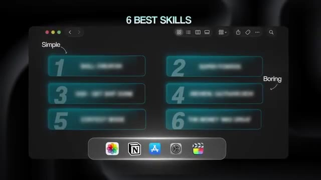
*⏱️ 00:00:10 — Interface graphique sombre présentant une liste numérotée de six éléments floutés titrée '6 BEST SKILLS' avec des annotations 'Simple' et 'Boring'.*

---

### ⏱️ `[00:00:20 - 00:00:38]` | Segment #02

**🔊 Audio (Transcription Intégrale Mot pour Mot en Français) :**
> Donc, dans cette vidéo, je vais vous montrer ce qu'ils sont, pourquoi ils se vendent, et comment vous pouvez les utiliser pour vendre des automatisations par IA. Mais avant de passer au premier, laissez-moi vous montrer comment j'ai découvert tout cela. J'ai travaillé avec des agences immobilières, des entreprises deCVC, des coachs, des agences marketing, et bien plus encore. Et j'ai vu les mêmes schémas dans chaque entreprise. Ce sont des secteurs différents, certes, mais ils font face aux mêmes problèmes. Et ces compétences ne cessent de reparaître encore et encore.

**👁️ Analyse Visuelle d'Écran (gemini-3.5-flash-lite) :**
**Interface & Outils** : AUCUNE

**Contenu textuel & Code** : Texte à l'écran : "HVAC COMPANIES"

**Action / Démonstration** : AUCUNE

*⏱️ 00:00:29 — Image d'illustration montrant des installations industrielles avec le texte incrusté 'HVAC COMPANIES'.*

---

### ⏱️ `[00:00:38 - 00:00:59]` | Segment #03

**🔊 Audio (Transcription Intégrale Mot pour Mot en Français) :**
> Donc, si vous regardez ceci et que vous voulez gagner de l'argent en vendent de l'IA en 2026, ne vous prenez pas trop la tête. Commencez simplement par ce pour quoi les entreprises paient déjà. Très bien, passons à la première compétence. Donc, la première compétence que j'installerais est celle qui permet de construire toutes les autres compétences, et elle s'appelle le créateur de compétences. C'est l'une des compétences officielles d'Anthropic. Vous décrivez fondamentalement ce que vous voulez en simple anglais. Claude rédige la compétence, la teste, l'itère, et la regroupe en quelque chose que vous pouvez utiliser pour toujours.

**👁️ Analyse Visuelle d'Écran (gemini-3.5-flash-lite) :**
**Interface & Outils** : Interface graphique personnalisée de présentation de compétences.

**Contenu textuel & Code** : Liste numérotée de compétences comprenant "SKILL CREATOR" en position 1.
[DESC_IMAGE_3] Présentation orale des compétences à installer pour gagner de l'argent avec l'IA en 2026.

**Action / Démonstration** : Explications face caméra et démonstration conceptuelle.

*⏱️ 00:00:48 — Interface sombre affichant une liste numérotée de compétences avec "1 SKILL CREATOR" en surbrillance.*

---

### ⏱️ `[00:00:59 - 00:01:18]` | Segment #04

**🔊 Audio (Transcription Intégrale Mot pour Mot en Français) :**
> Tu n'as pas besoin de toucher ou de modifier manuellement un fichier skill.empty. Tu n'as pas à te soucier du formatage. Tu parles simplement à Claude comme si tu expliquais le travail à un collègue, et tu repars avec une compétence qui s'exécute de la même manière à chaque fois. Tu pourrais même y glisser une procédure opérationnelle standard (SOP), et il serait capable de la transformer en une compétence réutilisable. Le problème qu'il résout est donc très simple. La plupart des gens qui découvrent Claude Code essaient d'écrire des compétences manuellement, et ils se heurtent immédiatement à un mur.

**👁️ Analyse Visuelle d'Écran (gemini-3.5-flash-lite) :**
**Interface & Outils** : Interface de chat avec mode plan ("Plan mode").

**Contenu textuel & Code** : Zone de saisie de prompt avec options de pièces jointes et mode plan actif.

**Action / Démonstration** : Sélection ou interaction avec un fichier SOP dans l'interface de chat.

*⏱️ 00:01:08 — Interface de chat en mode plan avec un fichier "SOP" sélectionné.*

---

### ⏱️ `[00:01:18 - 00:01:37]` | Segment #05

**🔊 Audio (Transcription Intégrale Mot pour Mot en Français) :**
> Ils ne connaissent pas la structure. Ils ne savent pas ce qui rend une compétence fiable par rapport à une compétence instable. Donc, soit ils abandonnent, soit ils bricolent quelque chose qui se casse dès qu'un client y touche. Donc, le créateur de compétences élimine tout ce mal de tête. Maintenant, honnêtement, ce n'est pas la compétence elle-même qui fait que le client paie. Mais chaque compétence que vous allez vendre à une entreprise de CVC, une agence immobilière, un coach, peu importe, elles découlent toutes de celle-ci.

**👁️ Analyse Visuelle d'Écran (gemini-3.5-flash-lite) :**
**Interface & Outils** : Animation graphique minimaliste sur fond sombre.

**Contenu textuel & Code** : Texte 'SKILL CREATOR' à l'intérieur d'un cercle vert relié par un trait graphique.

**Action / Démonstration** : Affichage du titre 'SKILL CREATOR' illustrant le concept mentionné dans la voix off.

*⏱️ 00:01:33 — Une animation graphique sur fond sombre affichant un cercle vert avec le texte 'SKILL CREATOR'.*

---

### ⏱️ `[00:01:38 - 00:01:58]` | Segment #06

**🔊 Audio (Transcription Intégrale Mot pour Mot en Français) :**
> C'est l'usine qui fabrique le produit. Donc, indirectement, c'est la compétence qui peut aider à rendre tous les autres dollars possibles. Voici donc un exemple simple. Disons qu'une agence immobilière vous dit qu'elle perd des heures chaque semaine à rédiger des descriptions de biens. Sans Skill Creator, vous écririez tout le fichier skill.md, en déterminant les conditions de déclenchement, en le testant encore et encore, et il se bloquera probablement plusieurs fois. Et vous pouvez évidemment arriver à un point où vous avez une bonne compétence fonctionnelle.

**👁️ Analyse Visuelle d'Écran (gemini-3.5-flash-lite) :**
**Interface & Outils** : Application de messagerie sur smartphone, éditeur de code sur écran d'ordinateur.

**Contenu textuel & Code** : Message textuel sur smartphone : "We waste hours every week writing property descriptions".

**Action / Démonstration** : Illustration visuelle du problème évoqué dans la voix off concernant l'agence immobilière.

*⏱️ 00:01:48 — Gros plan sur un écran de smartphone affichant une application de messagerie avec un message illustrant le problème d'une agence immobilière.*

---

### ⏱️ `[00:01:58 - 00:02:21]` | Segment #07

**🔊 Audio (Transcription Intégrale Mot pour Mot en Français) :**
> Mais avec le Skill Creator, vous pouvez simplement l'expliquer de manière plus naturelle, et cela vous aidera à le construire, à le tester et à le regrouper. Cela compresse donc simplement cette courbe d'apprentissage. Pour l'installer, vous pouvez exécuter slash plugin install Skill Creator. Je mettrai la commande complète juste ici et dans la description. Et j'inclurai toutes les commandes réelles dont vous aurez besoin dans la description afin que vous puissiez simplement les copier et les coller. Personnellement, j'ai installé cette compétence globalement sur une portée utilisateur. Ainsi, peu importe le produit sur lequel je travaille réellement, si j'ai besoin de créer une compétence, cela l'invoque automatiquement, et je n'ai même pas du tout à y penser.

**👁️ Analyse Visuelle d'Écran (gemini-3.5-flash-lite) :**
**Interface & Outils** : AUCUNE

**Contenu textuel & Code** : AUCUNE

**Action / Démonstration** : AUCUNE

---

### ⏱️ `[00:02:21 - 00:02:42]` | Segment #08

**🔊 Audio (Transcription Intégrale Mot pour Mot en Français) :**
> Très bien, donc une petite chose avant d'aborder le reste. Vous allez m'entendre utiliser le mot compétence tout au long de cette vidéo, mais techniquement, certains d'entre eux sont des plugins. Une compétence est fondamentalement un paquet que vous installez qui apprend à Claude comment faire un travail spécifique mieux. C'est le fichier markdown, mais un plugin est un plus grand paquet autour de cette compétence parce qu'il peut contenir plusieurs autres compétences, plus des choses supplémentaires comme des hooks ou des serveurs MCP, et tout cela change la façon dont Claude Code se comporte sous le capot à cause de ce plugin.

**👁️ Analyse Visuelle d'Écran (gemini-3.5-flash-lite) :**
**Interface & Outils** : Schémas graphiques animés (infographie).

**Contenu textuel & Code** : Schémas conceptuels illustrant la différence entre 'SKILL' (Markdown) et 'PLUGIN' (ensemble de compétences et hooks).

**Action / Démonstration** : Explication visuelle et schématique des concepts de compétences et de plugins pour Claude.

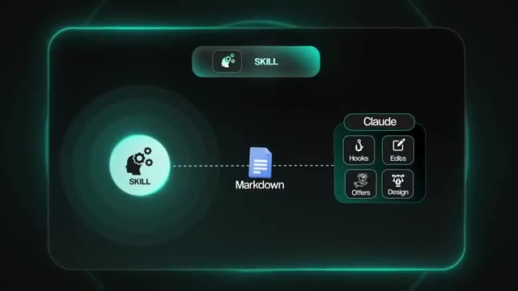
*⏱️ 00:02:31 — Schéma explicatif montrant qu'un 'SKILL' est basé sur un fichier Markdown qui alimente Claude avec différentes capacités (Hooks, Edits, Offers, Design).*

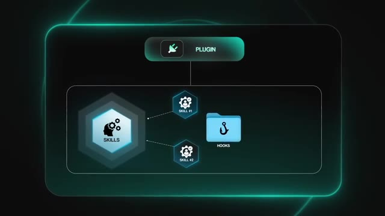
*⏱️ 00:02:37 — Schéma explicatif montrant qu'un 'PLUGIN' englobe plusieurs éléments, notamment des compétences multiples ('SKILL #1', 'SKILL #2') et des dossiers ('HOOKS').*

---

### ⏱️ `[00:02:42 - 00:03:03]` | Segment #09

**🔊 Audio (Transcription Intégrale Mot pour Mot en Français) :**
> Aussi, parce que je sais que vous allez le dire dans les commentaires, je ne suis pas un avatar IA. C'est vraiment moi qui vous parle ici. Mais bref, pour cette vidéo, je vais appeler certaines de ces compétences ainsi, car le point n'est pas la catégorie technique. C'est que chacune d'entre elles rend Claude meilleur dans son travail. Bref, la prochaine compétence s'appelle super-pouvoirs. Et celle-ci donne littéralement à Claude des super-pouvoirs. C'est un super nom. Elle force Claude à travailler de la même manière qu'un développeur senior travaille.

**👁️ Analyse Visuelle d'Écran (gemini-3.5-flash-lite) :**
**Interface & Outils** : Application ou interface de présentation logicielle (type Notion ou tableau de bord).

**Contenu textuel & Code** : Texte affichant « 2 SUPER POWERS », « 4 » et « 6 ».

**Action / Démonstration** : Navigation ou affichage d'une liste de sections ou fonctionnalités.

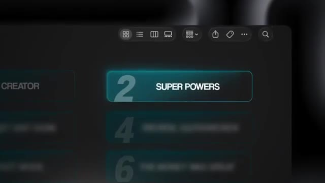
*⏱️ 00:02:58 — Gros plan sur une interface graphique sombre affichant une liste numérotée avec l'élément « 2 SUPER POWERS » en surbrillance.*

---

### ⏱️ `[00:03:03 - 00:03:24]` | Segment #10

**🔊 Audio (Transcription Intégrale Mot pour Mot en Français) :**
> C'est-à-dire qu'au lieu de se lancer et d'écrire du code immédiatement, Claude va désormais prendre du recul et planifier l'ensemble du projet au préalable. Il travaille dans un environnement isolé afin que rien ne vienne perturber votre projet principal. Il écrit des tests avant d'écrire du code. Il réfléchit, et il examine son propre travail en deux étapes. Une première fois pour vérifier s'il correspond réellement aux spécifications, et une seconde fois pour la qualité du code. Le problème qu'il résout est le principal mode d'échec lorsque les gens utilisent Cloud Code, à savoir un code bâclé ou fait à la hâte.

**👁️ Analyse Visuelle d'Écran (gemini-3.5-flash-lite) :**
**Interface & Outils** : Graphique ou infographie animée représentant des compétences logicielles.

**Contenu textuel & Code** : Étiquettes et icônes représentant "TESTS" et "BRAINSTORMS" liées par une ligne de connexion.

**Action / Démonstration** : Illustration visuelle du processus de planification et de test de l'IA.

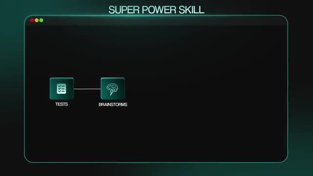
*⏱️ 00:03:13 — Une infographie stylisée avec l'en-tête "SUPER POWER SKILL" montrant des icônes reliées pour "TESTS" et "BRAINSTORMS".*

---

### ⏱️ `[00:03:24 - 00:03:46]` | Segment #11

**🔊 Audio (Transcription Intégrale Mot pour Mot en Français) :**
> Vous demandez quelque chose, Cloud fonce pour l'écrire, et en surface ça a l'air bien, mais ensuite, quand vous commencez à l'exécuter et à l'utiliser, tout s'effondre. Ou pire, votre client l'exécute et tout s'effondre. Donc SuperPower ralentit juste assez Cloud pour qu'il réfléchisse vraiment au problème, et il ne laisse pas Cloud sauter des étapes. Donc vraiment, n'importe quel projet où vous construisez des logiciels ou des automatisations qui vont réellement être mis en production a besoin de cette compétence. Une entreprise de CVC payant pour un système de répartition, une agence marketing payant pour un outil de reporting personnalisé.

**👁️ Analyse Visuelle d'Écran (gemini-3.5-flash-lite) :**
**Interface & Outils** : Terminal de commande (Claude CLI / CLI sous macOS)

**Contenu textuel & Code** : Commande `claude --dangerously-skip-permissions` et détails de configuration Next.js, tests et composants UI.
[ACtion] Exécution de Claude CLI dans le terminal pour configurer et vérifier le projet.

**Action / Démonstration** : Explications face caméra et démonstration conceptuelle.

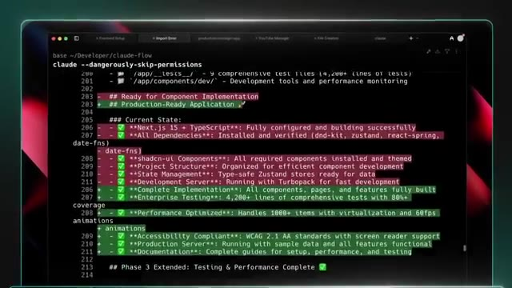
*⏱️ 00:03:29 — Capture d'écran montrant un terminal de ligne de commande avec l'outil Claude CLI affichant le statut de déploiement et des tests.*

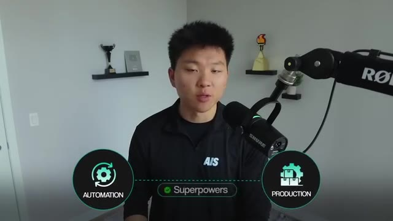
*⏱️ 00:03:40 — Le présentateur face caméra avec un graphique incrusté montrant la liaison entre Automatisation et Production via l'option Superpowers.*

---

### ⏱️ `[00:03:46 - 00:04:06]` | Segment #12

**🔊 Audio (Transcription Intégrale Mot pour Mot en Français) :**
> Ces clients se fichent du nombre de lignes de code que vous avez écrites. Ils veulent que le système fonctionne quand leur entreprise en dépend. Sans un framework comme Superpowers, Claude pourrait écrire toute l'automatisation d'un seul coup et rater un cas particulier. Mais avec Superpowers, Claude peut planifier les choses. Il peut écrire les tests. Il peut trouver des scénarios de cas particuliers, et il peut combler ces lacunes avant même que cela n'atteigne votre client. Maintenant, il n'est pas réaliste de dire qu'il sera toujours capable de tout faire du premier coup.

**👁️ Analyse Visuelle d'Écran (gemini-3.5-flash-lite) :**
**Interface & Outils** : Interface web de Claude Code illustrée sur un écran d'ordinateur portable.

**Contenu textuel & Code** : Prompt utilisateur : "Create a "Superpower" skill for writing high-converting property descriptions." et boutons d'actions (Plan it out..., Tests it..., Finding edge case, Catching gaps...).

**Action / Démonstration** : Saisie d'un prompt pour créer une compétence d'automatisation et affichage des étapes méthodologiques de validation.

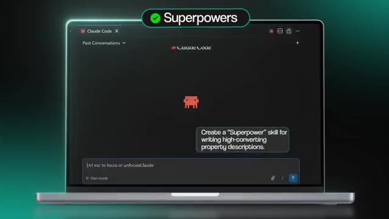
*⏱️ 00:03:56 — Interface de Claude Code affichant une conversation avec une invite utilisateur demandant de créer une compétence "Superpower".*

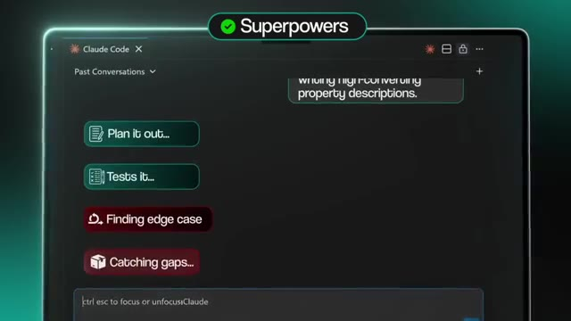
*⏱️ 00:04:01 — Interface de Claude Code montrant des boutons d'options pour structurer l'exécution (Plan, Tests, Edge cases, Gaps).*

---

### ⏱️ `[00:04:06 - 00:04:25]` | Segment #13

**🔊 Audio (Transcription Intégrale Mot pour Mot en Français) :**
> En fin de compte, lorsque vous construisez, une grande partie de votre travail consiste à faire du QA, c'est-à-dire de l'assurance qualité. Et lors de votre premier essai, si vous pouvez arriver à peu près à 80 % du résultat plutôt qu'à seulement 60 %, c'est une victoire. Moins de cycles de débogage signifie moins de temps passé à corriger les choses et des coûts en jetons réduits. C'est également la raison pour laquelle Superpowers est l'une des compétences communautaires les plus populaires qui soient, avec plus de 150 000 étoiles sur GitHub.

**👁️ Analyse Visuelle d'Écran (gemini-3.5-flash-lite) :**
**Interface & Outils** : Navigateur web affichant une page Medium.

**Contenu textuel & Code** : Article Medium intitulé "Claude Code Got 100x Better With Superpowers Skill" parlant de vibe coding et de compétences Claude.

**Action / Démonstration** : Affichage d'un article de blog de référence pour illustrer le sujet sur Claude Code.

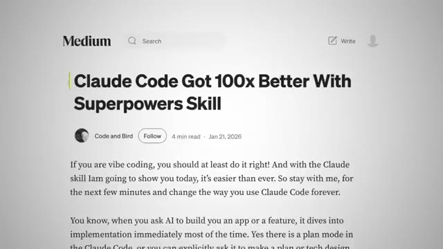
*⏱️ 00:04:20 — Capture d'écran d'un article Medium intitulé "Claude Code Got 100x Better With Superpowers Skill".*

---

### ⏱️ `[00:04:25 - 00:04:45]` | Segment #14

**🔊 Audio (Transcription Intégrale Mot pour Mot en Français) :**
> Donc pour l'installer, exécutez simplement cette commande juste ici. Je l'ai mise dans la description. Et d'ailleurs, j'ai aussi fait une vidéo YouTube complète qui décortique cette compétence de super-pouvoir et parle des jetons qu'elle dépense réellement. Vous pouvez donc aller voir ça juste ici. Très bien. La compétence numéro trois s'appelle GSD, ce qui signifie Get Shit Done. Et si les super-pouvoirs concernent la manière dont Claude écrit du code, alors GSD concerne l'environnement dans lequel Claude écrit réellement ce code.

**👁️ Analyse Visuelle d'Écran (gemini-3.5-flash-lite) :**
**Interface & Outils** : Éditeur de code et lecteur YouTube intégré

**Contenu textuel & Code** : Interface utilisateur montrant du code et des commandes pour gérer un projet de transcriptions YouTube

**Action / Démonstration** : Présentation d'un plugin et d'une démonstration de code pour Claude Code

*⏱️ 00:04:30 — Capture d'écran montrant l'interface d'un éditeur de code et une vidéo YouTube intégrée intitulée 'This One Plugin Just 10x'd Claude Code'.*

---

### ⏱️ `[00:04:45 - 00:05:04]` | Segment #15

**🔊 Audio (Transcription Intégrale Mot pour Mot en Français) :**
> Tout utilisateur de Claude code finit par se heurter à ce mur, n'est-ce pas ? Vous commencez une session. Tout se passe bien. Claude réussit tout. Puis, vers le milieu de votre fenêtre de contexte, les choses commencent à se dégrader. Vous savez, le code devient bâclé. Claude oublie les exigences que vous avez définies au début de la session. Il commence à sauter des étapes, il rogne sur les procédures, et il peut vous dire que les choses sont faites alors qu'elles ne le sont pas. Et c'est essentiellement ce qu'on appelle la pourriture du contexte.

**👁️ Analyse Visuelle d'Écran (gemini-3.5-flash-lite) :**
**Interface & Outils** : Interface graphique animée de workflow ou schéma conceptuel.

**Contenu textuel & Code** : Texte "New session" avec un symbole d'alimentation et une icône d'étoile/étincelle.

**Action / Démonstration** : Illustration visuelle du démarrage d'une nouvelle session d'agent conversationnel.

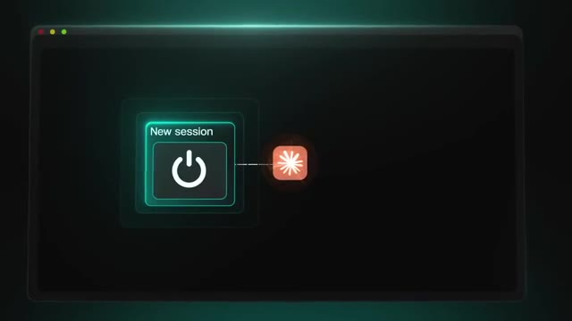
*⏱️ 00:04:50 — Schéma animé représentant une nouvelle session d'IA avec un bouton d'alimentation et une icône reliée.*

---

### ⏱️ `[00:05:04 - 00:05:24]` | Segment #16

**🔊 Audio (Transcription Intégrale Mot pour Mot en Français) :**
> Maintenant, GSD résout ce problème avec l'ingénierie contextuelle. Au lieu de laisser une grande session se dégrader lentement, il génère de nouveaux sous-agents pour chaque tâche, et chacun dispose d'une fenêtre de contexte propre, axée uniquement sur ce qu'il a besoin de savoir. Ainsi, votre session principale reste propre. Chaque tâche bénéficie de toute la puissance de la fenêtre de contexte de Claude au lieu de se contenter des restes. Il intègre également des contrôles de qualité intégrés qui détectent les vrais problèmes pendant l'exécution.

**👁️ Analyse Visuelle d'Écran (gemini-3.5-flash-lite) :**
**Interface & Outils** : Graphisme d'illustration vidéo / Présentation vidéo.

**Contenu textuel & Code** : Texte "Session #1" dans une icône de dossier avec un symbole d'alerte.

**Action / Démonstration** : Explication conceptuelle par le présentateur sans manipulation technique à l'écran.

---

### ⏱️ `[00:05:24 - 00:05:46]` | Segment #17

**🔊 Audio (Transcription Intégrale Mot pour Mot en Français) :**
> La détection de la dérive du périmètre attrape le planificateur lorsqu'il oublie silencieusement une exigence que vous aviez demandée. L'application de la sécurité ancre la vérification à votre modèle de menace. Ce ne sont pas des choses auxquelles vous penseriez à aller vérifier manuellement, surtout si vous n'avez pas de bagage en génie logiciel, ce qui explique précisément pourquoi les automatiser a vraiment de l'importance. Il y a aussi un mode autonome si vous voulez confier un cahier des charges à Claude et simplement vous éloigner. Il planifiera, exécutera, fera des validations et progressera dans tout le projet sans que vous ayez à le surveiller constamment.

**👁️ Analyse Visuelle d'Écran (gemini-3.5-flash-lite) :**
**Interface & Outils** : Incrustations graphiques vidéo et interface de sélection de modes d'assistant IA.

**Contenu textuel & Code** : Textes des options de mode d'interaction avec l'IA et de contrôle de la sécurité/du périmètre.

**Action / Démonstration** : Présentation conceptuelle des fonctionnalités de contrôle de l'IA et sélection visuelle d'un mode d'exécution automatique.

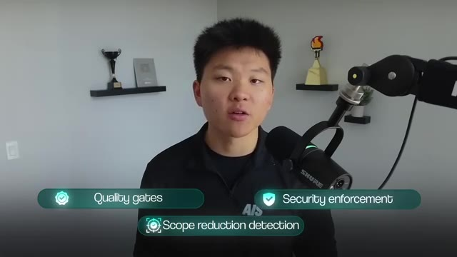
*⏱️ 00:05:30 — Le présentateur parle face caméra avec des incrustations graphiques affichant des termes clés comme 'Quality gates', 'Security enforcement' et 'Scope reduction detection'.*

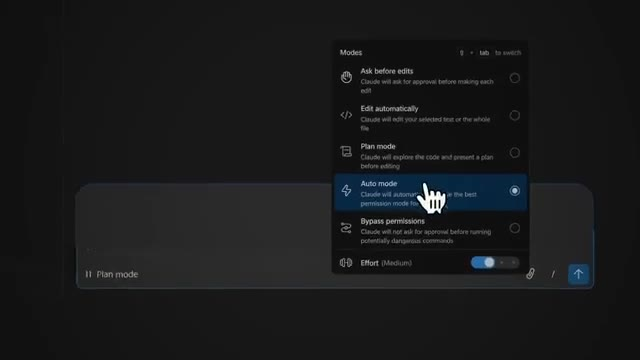
*⏱️ 00:05:40 — Interface sombre montrant un menu déroulant de sélection des modes d'IA ('Ask before edits', 'Edit automatically', 'Plan mode', 'Auto mode', 'Bypass permissions') avec un curseur en forme de main sur 'Auto mode'.*

---

### ⏱️ `[00:05:46 - 00:06:06]` | Segment #18

**🔊 Audio (Transcription Intégrale Mot pour Mot en Français) :**
> Maintenant, une chose sur laquelle je veux être parfaitement clair, c'est que GSD n'est pas vraiment un plugin d'économie de jetons. Tous ces sous-agents consomment des jetons, mais ce qu'il vous fait gagner, ce sont les heures que vous passeriez autrement à refaire un travail que Claude a cassé parce qu'il avait oublié ce que vous aviez demandé au départ. Donc, Superpowers donne à Claude le processus, le plan, le test, la révision, la répétition. GSD donne à Claude le contexte propre pour que le traitement fonctionne réellement à chaque fois.

**👁️ Analyse Visuelle d'Écran (gemini-3.5-flash-lite) :**
**Interface & Outils** : Schéma graphique animé (diapositive de présentation)

**Contenu textuel & Code** : Texte « SUPERPOWERS » et étapes du processus : « Process », « Plan », « Test »

**Action / Démonstration** : Présentation visuelle du workflow des fonctionnalités principales (superpouvoirs) de l'outil GSD.

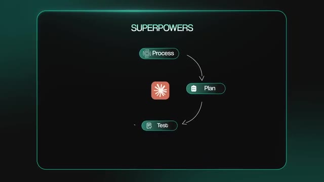
*⏱️ 00:06:01 — Schéma animé affichant le titre « SUPERPOWERS » avec un flux circulaire reliant trois étapes : Process, Plan et Test autour d'une icône centrale.*

---

### ⏱️ `[00:06:06 - 00:06:29]` | Segment #19

**🔊 Audio (Transcription Intégrale Mot pour Mot en Français) :**
> Donc pour l'installer, exécutez simplement cette commande dans votre terminal. Et ensuite, vous pouvez également taper slash gsd-help dans Cloud Code pour voir quelles autres commandes sont disponibles dans ce plugin. D'accord, donc la quatrième n'est pas vraiment une compétence que vous installez. Elle est déjà intégrée dans Cloud Code et la plupart des gens ne l'utilisent tout simplement pas. C'est la commande slash review et son cousin plus puissant slash ultra review. Donc, lorsque vous avez fini d'écrire du code et que vous tapez slash review, Cloud effectue une révision de code structurée sur ce que vous venez de construire.

**👁️ Analyse Visuelle d'Écran (gemini-3.5-flash-lite) :**
**Interface & Outils** : Interface utilisateur graphique personnalisée avec barre de saisie et panneaux de présentation.

**Contenu textuel & Code** : Commandes "/GSD-help", "/REVIEW" et "/ULTRAREVIEW".

**Action / Démonstration** : Illustration visuelle des commandes de l'outil GSD présentées par le créateur.

*⏱️ 00:06:12 — Interface graphique montrant une barre de saisie avec la commande "/GSD-help" affichée dans une infobulle.*

*⏱️ 00:06:23 — Présentation graphique mettant en avant la section "4 SUPER POWERS" avec les commandes "/REVIEW, /ULTRAREVIEW".*

---

### ⏱️ `[00:06:29 - 00:07:04]` | Segment #20

**🔊 Audio (Transcription Intégrale Mot pour Mot en Français) :**
> Il recherche les bugs, les cas limites et les problèmes de conception. Tout ce qu'un reviseur minutieux signalerait. Il s'exécute localement, il est rapide, et il ne vous coûte rien de plus que vos jetons d'utilisation habituels. Et puis nous avons le slash ultra review, qui a été lancé en même temps qu'Opus 4.7. Maintenant, celui-ci, au lieu de s'exécuter localement, télécharge votre branche dans un bac à sable cloud et déploie une flotte d'agents de révision en parallèle. Chaque agent attaquera votre base de code sous un angle différent, la logique, la sécurité, les performances, les cas limites. Et voici la partie qui est vraiment géniale, avant qu'un bug n'apparaisse sur votre liste, il doit être indépendamment reproduit et vérifié. Donc, au lieu d'obtenir un tas de détails de style ou de faux positifs, vous allez obtenir des éléments confirmés.

**👁️ Analyse Visuelle d'Écran (gemini-3.5-flash-lite) :**
**Interface & Outils** : Interface graphique Claude sandbox

**Contenu textuel & Code** : Icône de branche et de boîte avec code source

**Action / Démonstration** : Affichage de l'interface de sandbox pour illustrer l'environnement d'exécution

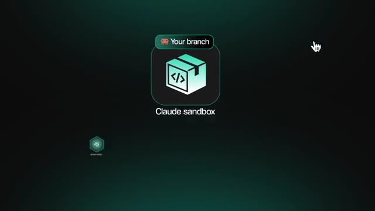
*⏱️ 00:06:46 — Interface graphique montrant un environnement de sandbox Claude avec une icône de boîte de code.*

---

### ⏱️ `[00:07:04 - 00:07:39]` | Segment #21

**🔊 Audio (Transcription Intégrale Mot pour Mot en Français) :**
> des bugs. Concrètement, je veux dire que cela s'intègre à la fin de n'importe quel flux de travail Claude Code. Vous planifiez avec des super-pouvoirs, vous exécutez avec un contexte propre en utilisant GSD, et ensuite, avant de fusionner quoi que ce soit d'important, vous lancez slash ultra review pour attraper les bugs que Claude a manqués tout seul. Quelques éléments à savoir avant de l'exécuter. Vous avez besoin de Claude Code version 2.1.86 ou ultérieure, vous devez être connecté avec un compte Claude. Une simple clé API ne fonctionnera pas et lorsque vous lancez slash ultra review, cela peut prendre, vous savez, 10 à 20 minutes, mais cela s'exécute en arrière-plan afin que vous puissiez continuer à travailler. Vous voudrez utiliser slash review pour un retour rapide sur tout, et vous pouvez utiliser slash ultra review lorsque vous êtes sur le point de fusionner quelque chose qui compte vraiment, comme un gros refactoring ou tout ce qui touche aux paiements ou à l'authentification ou

**👁️ Analyse Visuelle d'Écran (gemini-3.5-flash-lite) :**
**Interface & Outils** : Interface graphique animée de présentation de flux de travail (UI personnalisée).

**Contenu textuel & Code** : Texte affichant les étapes : « Plan SUPERPOWERS », « Execution GSD », « Catch bugs /ULTRAREVIEW » ; ainsi que la mention « Claude code version 2.1.86 or later ».

**Action / Démonstration** : Présentation visuelle structurée des étapes clés du workflow de développement assisté par IA et rappel des prérequis techniques (version du logiciel).

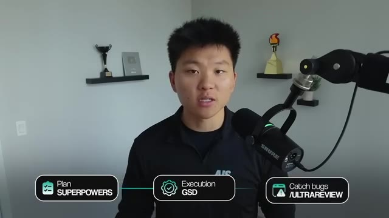
*⏱️ 00:07:12 — Le présentateur s'exprime devant une interface graphique superposée illustrant un flux de travail en trois étapes : planification, exécution (GSD) et revue (Catch bugs /ULTRAREVIEW).*

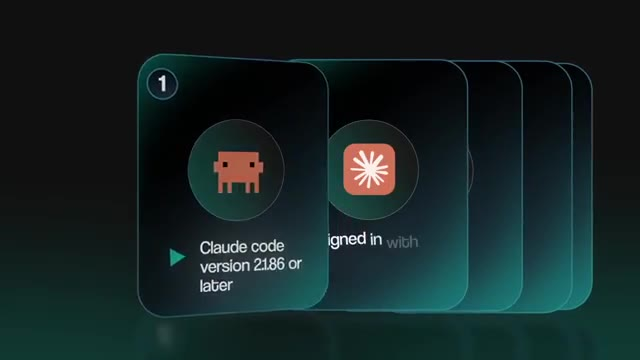
*⏱️ 00:07:21 — Une animation présente une pile de cartes numériques. La première carte affiche le logo de Claude et précise la configuration requise : « Claude code version 2.1.86 or later ».*

---

### ⏱️ `[00:07:39 - 00:07:59]` | Segment #22

**🔊 Audio (Transcription Intégrale Mot pour Mot en Français) :**
> une migration de base de données. Le genre de commit où un bug en production coûte bien plus cher que le temps et les tokens que l'ultra review peut vous coûter. Et aussi un petit avertissement, l'ultra review n'est pas gratuit. Les abonnements pro et max ont droit à trois utilisations gratuites pour essayer. Ça a peut-être changé au moment où vous regardez ceci, mais après ça, ça pourrait coûter entre 5 et 20 dollars par utilisation, selon la taille. Encore une fois, vous n'avez pas besoin d'aller l'installer si vous êtes sur cloud code 2.186 ou une version ultérieure.

**👁️ Analyse Visuelle d'Écran (gemini-3.5-flash-lite) :**
**Interface & Outils** : Vidéo YouTube avec incrustation graphique (overlay).

**Contenu textuel & Code** : Texte incrusté : "/ultrareview" et "Pro & Max plans 3 FREE RUNS".

**Action / Démonstration** : Le présentateur explique les conditions d'utilisation et le coût de la fonctionnalité d'ultra review.

*⏱️ 00:07:49 — Le présentateur en studio avec un encadré graphique superposé en haut à gauche affichant le texte "/ultrareview" et "Pro & Max plans 3 FREE RUNS".*

---

### ⏱️ `[00:08:00 - 00:08:18]` | Segment #23

**🔊 Audio (Transcription Intégrale Mot pour Mot en Français) :**
> Tapez simplement slash review ou slash ultra review dans votre terminal et cela devrait fonctionner. Très bien, ce cinquième plugin est context mode. Voici donc le problème. Chaque appel d'outil que vous effectuez, Claude déverse des données brutes dans votre fenêtre de contexte. Ainsi, un instantané Playwright peut faire 56 kilo-octets. 20 problèmes GitHub peuvent faire 59 kilo-octets. Et après environ 30 minutes de travail réel, 40 % de votre fenêtre de contexte n'est que du superflu.

**👁️ Analyse Visuelle d'Écran (gemini-3.5-flash-lite) :**
**Interface & Outils** : Présentation vidéo / Interface graphique de tutoriel

**Contenu textuel & Code** : Liste numérotée de plugins (Skill Creator, GSD, Context Mode) et diagramme de flux (Tool Call -> Context window 7%)

**Action / Démonstration** : Présentation du 5ème plugin 'Context Mode' et explication de la gestion de la fenêtre de contexte.

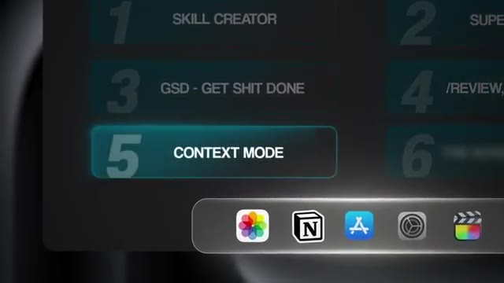
*⏱️ 00:08:04 — Interface graphique listant les plugins avec l'option 5 'Context Mode' en surbrillance.*

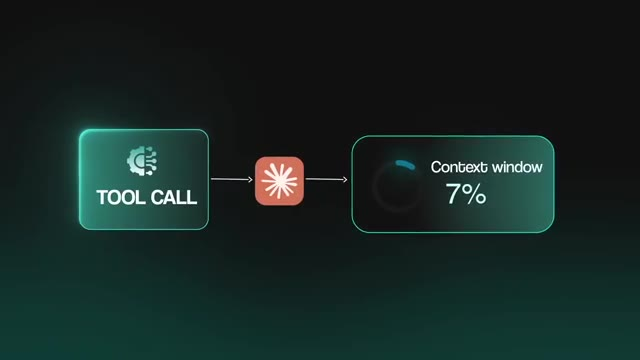
*⏱️ 00:08:09 — Schéma montrant un 'Tool Call' menant à 'Context window 7%'.*

---

### ⏱️ `[00:08:18 - 00:08:39]` | Segment #24

**🔊 Audio (Transcription Intégrale Mot pour Mot en Français) :**
> Journal de sortie, données brutes, vous savez, des choses que vous n'avez jamais réellement besoin que Claude regarde. Et quand Claude manque d'espace et compresse la conversation, il oublie quels fichiers il était en train d'éditer, quelles tâches étaient en cours, et ce que vous lui avez demandé de faire en dernier. Le travail du mode contextuel est donc de résoudre ces deux moitiés de problèmes. D'abord, il empêche les déchets d'entrer. Lorsque Claude exécute une commande ou récupère une URL, le mode contextuel achemine cet appel via un bac à sable.

**👁️ Analyse Visuelle d'Écran (gemini-3.5-flash-lite) :**
**Interface & Outils** : AUCUNE

**Contenu textuel & Code** : AUCUN

**Action / Démonstration** : AUCUNE

---

### ⏱️ `[00:08:39 - 00:08:59]` | Segment #25

**🔊 Audio (Transcription Intégrale Mot pour Mot en Français) :**
> Donc, votre code s'exécute dans un sous-processus isolé, la sortie brute est capturée, et seule la partie dont Claude a réellement besoin revient dans la fenêtre de contexte. Maintenant, selon leurs propres benchmarks, un instantané Playwright de 56 kilooctets devient 299 octets, un journal d'accès de 46 kilooctets devient 155 octets. Ainsi, sur une session complète, 315 kilooctets de sortie brute deviennent cinq kilooctets au total.

**👁️ Analyse Visuelle d'Écran (gemini-3.5-flash-lite) :**
**Interface & Outils** : Graphiques animés et schémas explicatifs de l'interface Claude benchmark.

**Contenu textuel & Code** : Schéma du sandbox isolé avec flux de données et graphique de réduction de la taille des données en kilooctets/octets.

**Action / Démonstration** : Visualisation du fonctionnement de l'isolation du code et de la réduction de la taille du contexte.

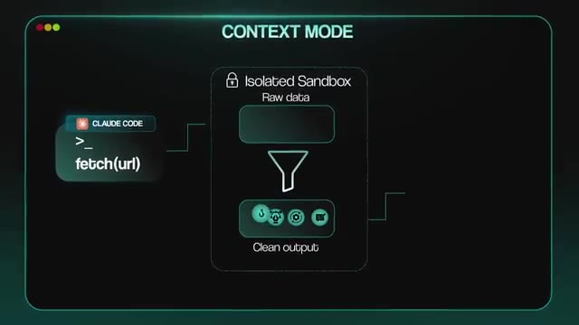
*⏱️ 00:08:44 — Schéma animé illustrant le 'Context Mode' avec un 'Isolated Sandbox' qui filtre les données brutes (Raw data) vers une sortie propre (Clean output).*

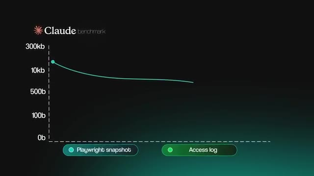
*⏱️ 00:08:49 — Graphique des benchmarks de Claude comparant la taille des données avant et après traitement pour les instantanés Playwright et les journaux d'accès.*

---

### ⏱️ `[00:08:59 - 00:09:18]` | Segment #26

**🔊 Audio (Transcription Intégrale Mot pour Mot en Français) :**
> Cela vient évidemment de leurs benchmarks publiés, et vous pouvez voir vos propres chiffres en exécutant slash context mode deux-points ctx tiré du bas stats à n'importe quel moment. Maintenant, deuxièmement, et c'est la partie dont je ne savais même pas que j'avais besoin avant de l'avoir, le mode contexte suit chaque événement significatif de votre session dans une base de données SQL locale. Chaque fichier que vous modifiez, chaque tâche que vous créez, chaque décision que vous prenez, chaque erreur qui survient.

**👁️ Analyse Visuelle d'Écran (gemini-3.5-flash-lite) :**
**Interface & Outils** : Graphique animé / Diagramme conceptuel

**Contenu textuel & Code** : Texte "SQL DATABASE", "CONTEXT MODE" et icônes associées.

**Action / Démonstration** : Illustration visuelle du mode contextuel et de son interaction avec une base de données.

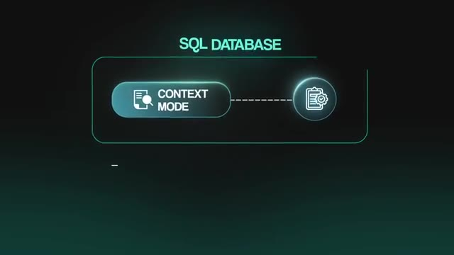
*⏱️ 00:09:13 — Schéma graphique animé illustrant une base de données SQL connectée à un "Context Mode" avec une icône de rapport.*

---

### ⏱️ `[00:09:18 - 00:09:36]` | Segment #27

**🔊 Audio (Transcription Intégrale Mot pour Mot en Français) :**
> Lorsque Claude compresse la conversation, il ne perd rien de tout cela. Le mode contexte reconstruit un instantané de session et le réinjecte. Le modèle reprend donc exactement là où vous vous étiez arrêté, avec vos fichiers, vos tâches et votre dernier prompt intacts. Concrètement, qu'est-ce que cela signifie pour vos projets Claude Code ? Les sessions qui avaient tendance à s'effondrer autour de la marque des 30 minutes durent maintenant trois heures, car vous ne subissez aucun ralentissement.

**👁️ Analyse Visuelle d'Écran (gemini-3.5-flash-lite) :**
**Interface & Outils** : Présentation vidéo avec graphismes animés illustrant le fonctionnement du mode contexte.

**Contenu textuel & Code** : Schéma avec les libellés "SQL DATABASE", "CONTEXT MODE", et "SESSION SNAPSHOT" avec des icônes associées.
[DESC_ACTION_1] Visualisation d'un schéma explicatif montrant comment le mode contexte capture et restaure l'état d'une session.

**Action / Démonstration** : Explications face caméra et démonstration conceptuelle.

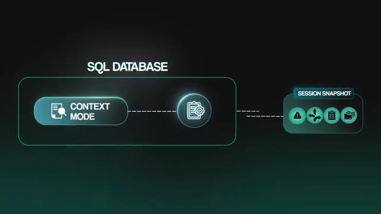
*⏱️ 00:09:23 — Schéma explicatif illustrant le concept de snapshot de session et de mode contexte relié à une base de données SQL.*

---

### ⏱️ `[00:09:36 - 00:09:57]` | Segment #28

**🔊 Audio (Transcription Intégrale Mot pour Mot en Français) :**
> Vous arrêtez de gaspiller des prompts en rappelant à Claude le contexte qu'il avait déjà. Donc pour installer celui-ci sur Claude Code, tapez simplement ces deux commandes juste ici, et ensuite vous redémarrez Claude Code, et c'est fondamentalement tout. Le plugin installe automatiquement le serveur MCP, les hooks et les instructions de routage. Très bien, et maintenant cette dernière compétence s'appelle Claude Mem. Et si le mode contexte garde votre session actuelle propre, alors Claude Mem est ce qui transporte les connaissances à travers toutes vos sessions futures.

**👁️ Analyse Visuelle d'Écran (gemini-3.5-flash-lite) :**
**Interface & Outils** : AUCUNE

**Contenu textuel & Code** : Commandes affichées à l'écran : `/plugin marketplace add mksglu/context-mode` et `/plugin install context-mode@context-mode`.

**Action / Démonstration** : Présentation des commandes d'installation du plugin Context Mode pour Claude Code.

---

### ⏱️ `[00:09:58 - 00:10:17]` | Segment #29

**🔊 Audio (Transcription Intégrale Mot pour Mot en Français) :**
> Claude Code commence chaque nouvelle session à zéro. Vous ouvrez donc une session et vous expliquez le projet pour la cinquième fois ce mois-ci, car chaque nouvelle conversation vous coûte peut-être 10 minutes et des milliers de tokens rien que pour permettre à Claude de se mettre à niveau. Maintenant, vous pouvez essayer de résoudre ce problème avec des éléments tels que vos fichiers Claude.md et vos fichiers de mémoire, qui sont évidemment importants. Et ce sont des fichiers texte brut que vous rédigez pour donner à Claude des instructions de projet persistantes.

**👁️ Analyse Visuelle d'Écran (gemini-3.5-flash-lite) :**
**Interface & Outils** : Interface de chat web avec zone de saisie et bouton d'envoi.

**Contenu textuel & Code** : Texte du message : 'Hey Claude... I'm explaining this for the 5th time please tell me you remember the project context this time 🫠' et 'Plan mode'.

**Action / Démonstration** : Saisie d'un prompt utilisateur dans une interface de conversation avec une IA.

*⏱️ 00:10:02 — Une interface de chat montrant un message adressé à Claude expliquant qu'il s'agit de la 5e fois que le contexte du projet est donné.*

---

### ⏱️ `[00:10:17 - 00:10:44]` | Segment #30

**🔊 Audio (Transcription Intégrale Mot pour Mot en Français) :**
> Et ceux-là fonctionnent, mais vous devez quand même penser à les maintenir à la main. Donc si vous ratez une mise à jour sur l'un de ces fichiers, alors Claude ratera également ce contexte. Donc Claude Mem s'occupe essentiellement de tout cela de manière totalement autonome. Il se connecte au cycle de vie des sessions de Claude et capture automatiquement ce qui s'est passé pendant votre session. Il examinera les modifications de fichiers, les décisions, les corrections de bugs, les commandes, des choses comme ça. Et ensuite, il utilisera le propre SDK d'agent de Claude pour compresser tout cela en résumés sémantiques et stockera le tout dans une base de données SQLite locale avec une recherche vectorielle.

**👁️ Analyse Visuelle d'Écran (gemini-3.5-flash-lite) :**
**Interface & Outils** : Schéma graphique explicatif de type infographie animée.

**Contenu textuel & Code** : Blocs de texte illustrant les étapes : "Hooks into claude session lifecycle" et "2 Captures - Captures the log".

**Action / Démonstration** : Présentation visuelle et schématique du fonctionnement du système d'automatisation de la mémoire pour Claude.

*⏱️ 00:10:30 — Un schéma animé montrant les étapes du fonctionnement de l'outil avec des blocs textuels et des icônes.*

---

### ⏱️ `[00:10:44 - 00:11:03]` | Segment #31

**🔊 Audio (Transcription Intégrale Mot pour Mot en Français) :**
> Donc, lorsque vous ouvrez une nouvelle session, les parties pertinentes sont réinjectées automatiquement. Et cela génère aussi automatiquement des fichiers Claude.md au niveau des dossiers et les met à jour au fur et à mesure que vous travaillez. Ainsi, la documentation de votre projet s'écrit littéralement tout seule pendant que vous codez, et c'est automatisé. Et la partie qui permet réellement d'économiser des jetons, c'est la recherche. Donc, au lieu de verser chaque observation passée dans votre contexte, ClaudeMem utilise un système de recherche à trois couches.

**👁️ Analyse Visuelle d'Écran (gemini-3.5-flash-lite) :**
**Interface & Outils** : Aucune interface logicielle ou de programmation affichée.

**Contenu textuel & Code** : Aucun code source, terminal ou interface n'est présenté.

**Action / Démonstration** : Présentation orale face caméra.

---

### ⏱️ `[00:11:04 - 00:11:22]` | Segment #32

**🔊 Audio (Transcription Intégrale Mot pour Mot en Français) :**
> Il renvoie d'abord un index compact d'observations, et ensuite vous pouvez extraire une chronologie autour de celles qui comptent. Et ce n'est qu'alors qu'il récupère les détails complets pour le transfert dont vous avez besoin. Donc, ce dépôt rapporte environ 10 fois d'économies de jetons sur la récupération par rapport au fait de tout balancer au début de la session. Donc, pratiquement pour tous vos projets Cloud Code, vous arrêtez de payer la taxe de démarrage à chaque nouvelle session.

**👁️ Analyse Visuelle d'Écran (gemini-3.5-flash-lite) :**
**Interface & Outils** : Présentation vidéo avec infographie.

**Contenu textuel & Code** : Texte du schéma : 'Returns a compact index' et 'Pull a focused timeline'.

**Action / Démonstration** : Explication schématique du fonctionnement du dépôt et des économies de jetons.

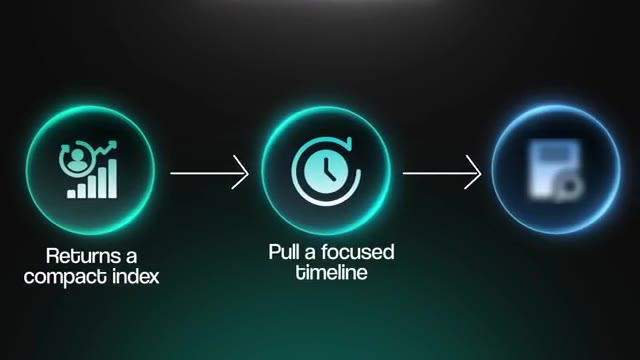
*⏱️ 00:11:08 — Schéma explicatif en trois étapes représentant le processus de traitement des données avec les étapes 'Returns a compact index' et 'Pull a focused timeline'.*

---

### ⏱️ `[00:11:22 - 00:11:41]` | Segment #33

**🔊 Audio (Transcription Intégrale Mot pour Mot en Français) :**
> Vous arrêtez de vous répéter. Vous reprenez un projet que vous n'avez pas touché depuis deux semaines et Claude sait déjà exactement sur quoi vous travaillez, ce que vous avez décidé et où vous vous êtes arrêté. Et comme tout fonctionne localement sur votre machine avec une visionneuse web, vous pouvez réellement voir ce que Claude se rappelle de votre projet et vous pouvez le parcourir vous-même. Maintenant, à l'intérieur de Claude Code, vous pouvez l'installer en utilisant le marché des extensions avec les commandes juste ici à l'écran.

**👁️ Analyse Visuelle d'Écran (gemini-3.5-flash-lite) :**
**Interface & Outils** : Application Claude / Interface utilisateur graphique de gestion de projets

**Contenu textuel & Code** : Liste des projets avec des horodatages ("2 weeks ago", "2 days ago", etc.) et le branding Claude.

**Action / Démonstration** : Navigation et affichage de l'historique des projets au sein de l'interface Claude.

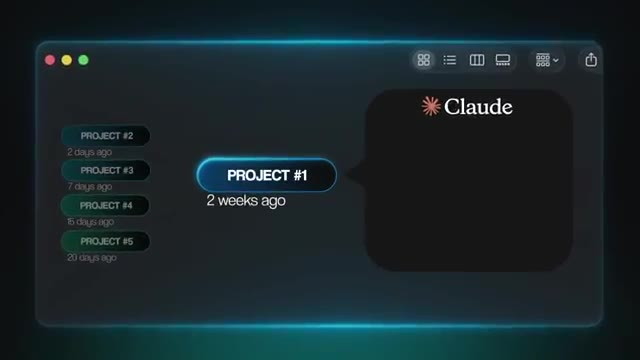
*⏱️ 00:11:27 — Interface graphique de l'application Claude présentant une liste de projets récents classés par date (Project #1, Project #2, etc.) avec le logo Claude.*

---

### ⏱️ `[00:11:41 - 00:12:03]` | Segment #34

**🔊 Audio (Transcription Intégrale Mot pour Mot en Français) :**
> Maintenant, un rapide avertissement du dépôt lui-même. Vous n'avez pas besoin d'exécuter cette commande d'installation NPM. Cela installe uniquement la bibliothèque SDK, et rien ne fonctionne réellement parce que les hooks ne s'enregistrent jamais. Restez donc sur les deux commandes ci-dessus, et voilà, mesdames et messieurs, c'était le numéro six sur notre liste aujourd'hui. Mais très rapidement, parce que je sais que beaucoup d'entre vous font des choses en matière de conception de sites web ou, vous savez, créent des présentations et autres, la compétence bonus numéro sept est la compétence officielle de conception front-end d'Anthropic.

**👁️ Analyse Visuelle d'Écran (gemini-3.5-flash-lite) :**
**Interface & Outils** : Graphique analytique (interface web/dashboard sombre).

**Contenu textuel & Code** : Graphique en barres représentant des statistiques ou des données d'utilisation.

**Action / Démonstration** : Présentation visuelle de données analytiques.

*⏱️ 00:11:57 — Capture d'écran sombre et floue montrant un graphique à barres bleues sur fond noir avec des métriques.*

---

### ⏱️ `[00:12:03 - 00:12:22]` | Segment #35

**🔊 Audio (Transcription Intégrale Mot pour Mot en Français) :**
> Vous l'installez simplement en utilisant la commande à l'écran, et je vous conseille de l'installer globalement. Ainsi, chaque fois que vous faites des choses comme concevoir réellement des éléments dans CloudCode, cela leur donnera un aspect beaucoup moins généré par IA grâce à cette compétence de design front-end. Maintenant, ce genre de chose est également intégré de manière native dans le nouveau produit d'Anthropic Labs appelé Cloud Design. Mais si vous ramenez ce projet dans Cloud Code, vous voudrez utiliser cette compétence.

**👁️ Analyse Visuelle d'Écran (gemini-3.5-flash-lite) :**
**Interface & Outils** : Interface web de l'application Vela.

**Contenu textuel & Code** : Tableau de bord affichant des métriques de contrats (Active Contracts, AI Review Time, Action Items) et une liste de contrats récents.

**Action / Démonstration** : Navigation et présentation visuelle du tableau de bord de l'application Vela générée.

*⏱️ 00:12:12 — Une interface web sombre montrant un tableau de bord d'application nommé "Vela" avec des statistiques et des contrats récents.*

---

### ⏱️ `[00:12:22 - 00:12:57]` | Segment #36

**🔊 Audio (Transcription Intégrale Mot pour Mot en Français) :**
> D'accord, donc maintenant que vous connaissez ces compétences et ce qu'elles font, voici comment les vendre réellement. Parce que je vois tellement de gens qui débutent et qui essaient de vendre le flux de travail en soi, mais vous devez vendre autre chose. Vous devez vendre le résultat. Vous devez vendre le fait de faire économiser 10 heures par semaine au propriétaire d'entreprise, ou de réduire ses erreurs administratives et son erreur humaine. Vous devez vendre les résultats, comme accélérer ses prospects ou lui en obtenir plus, c'est pour cela qu'il veut réellement payer. Donc au lieu de proposer de construire un flux de travail d'IA, vous proposez en fait simplement de gagner du temps, de réduire les coûts et de l'aider à se concentrer sur la génération de plus de profits pour son entreprise. Et il y a en fait une façon simple de commencer à faire cela. Si vous êtes totalement nouveau, n'essayez pas d'utiliser les six tout de suite. Choisissez-en un seul, apprenez-le, créez quelques flux de travail en l'utilisant, et montrez une démo à un propriétaire d'entreprise. Ils ne se soucient pas vraiment

**👁️ Analyse Visuelle d'Écran (gemini-3.5-flash-lite) :**
**Interface & Outils** : Aucune interface logicielle ou de programmation n'est présentée.

**Contenu textuel & Code** : Texte incrusté à l'écran résumant les arguments de vente : Outcome, Saving 10hrs a week, Cutting human error, Better results.

**Action / Démonstration** : Le présentateur explique les concepts de vente en parlant face caméra.

---

### ⏱️ `[00:12:57 - 00:13:31]` | Segment #37

**🔊 Audio (Transcription Intégrale Mot pour Mot en Français) :**
> à propos de votre expérience, ils se soucieront de la valeur de ce que vous leur montrez. Et une fois que vous commencez à comprendre comment ces compétences fonctionnent et comment elles s'assemblent, vous êtes capable de construire de meilleures automatisations plus rapidement et, espérons-le, à moindre coût, ce qui signifie que vous pouvez faire plus de démos, vous pouvez créer plus de contenu. Vous pouvez automatiser davantage de parties de votre propre entreprise. Toute cette expérience va vous aider à communiquer bien mieux la valeur de ce que vous savez aux propriétaires d'entreprise. Je sais donc que nous avons couvert une tonne d'informations dans cette vidéo. J'ai donc tout mis dans un guide de ressources auquel vous pouvez accéder tout à fait gratuitement au sein de ma communauté School gratuite. Vous pouvez consulter cela en utilisant le lien dans la description. Et si vous voulez voir exactement comment je gagne de l'argent en 2026, regardez cette vidéo juste ici. Mais de toute façon, c'est tout pour aujourd'hui. Donc, si

**👁️ Analyse Visuelle d'Écran (gemini-3.5-flash-lite) :**
**Interface & Outils** : Navigateur web affichant la plateforme Skool (skool.com).

**Contenu textuel & Code** : Publications de membres, fils de discussion communautaires, fil d'actualité et classement (Leaderboard) de la communauté Skool.

**Action / Démonstration** : Navigation et présentation de la communauté en ligne Skool par le présentateur.

*⏱️ 00:13:22 — Capture d'écran d'une page web de la communauté Skool (« FREE SKOOL COMMUNITY ») montrant des fils de discussion et des publications d'utilisateurs.*

---

### ⏱️ `[00:13:31 - 00:13:38]` | Segment #38

**🔊 Audio (Transcription Intégrale Mot pour Mot en Français) :**
> Vous avez apprécié ou vous avez appris quelque chose de nouveau, alors s'il vous plaît, mettez un pouce bleu. Ça m'aide énormément. Et comme toujours, je vous remercie d'être arrivés jusqu'à la fin de la vidéo et je vous dis à tous dans la prochaine. Merci tout le monde.

**👁️ Analyse Visuelle d'Écran (gemini-3.5-flash-lite) :**
**Interface & Outils** : YouTube (interface web)

**Contenu textuel & Code** : Titre de la vidéo : "I Tried 100+ Claude Code Skills, These 6 are the Best" et boutons de la plateforme YouTube (abonnement, likes).

**Action / Démonstration** : Le présentateur conclut sa vidéo et invite les spectateurs à laisser un pouce bleu.

---

