# 🎬 Building Realistic Voice Agents Has Never Been Easier

> **Chaîne** : [Nate Herk | AI Automation](https://www.youtube.com/@nateherk/featured)  
> **Lien YouTube** : [https://www.youtube.com/watch?v=-cdexJWN8YA](https://www.youtube.com/watch?v=-cdexJWN8YA)  
> **Date de publication** : 20260504  
> **Durée** : 00:32:23  
> **Identifiant vidéo** : `-cdexJWN8YA`  
> **Transcription & Analyse** : `whisper-v3-large-turbo+gemini-3.5-flash-lite`  

---

## 📌 Synthèse Exécutive & Outils

### 💡 Résumé

La vidéo de Nate Herk illustre l'efficacité du paradigme « le code l'emporte sur les clics » pour concevoir des agents vocaux réalistes en combinant des outils de pointe comme **Claude Code** et **ElevenLabs**. Plutôt que de configurer manuellement des tableaux de bord, de paramétrer des invites système ou de lier laborieusement des bases de connaissances via des interfaces graphiques sujettes aux erreurs, l'auteur démontre qu'il est possible de créer un agent vocal sur mesure en seulement 15 minutes en utilisant simplement le langage naturel. 

La démonstration centrale met en scène un cas d'usage concret : l'entraînement d'un agent vocal sur 400 transcriptions de vidéos YouTube de la chaîne. Cet agent est capable de répondre aux questions des utilisateurs, de restituer des informations complexes sur des outils comme **Firecrawl**, et d'être intégré de manière transparente sur un site web sous forme de widget conversationnel. Le processus de développement s'appuie sur la capacité de l'IA à interroger la documentation des services tiers, à structurer les bases de connaissances et à automatiser le déploiement technique complet.

Enfin, ce tutoriel met en lumière l'accessibilité accrue du développement agentique grâce aux environnements de développement intégrés (IDE) et aux assistants de codage avancés. En structurant les composants fondamentaux d'un agent vocal — à savoir la persona, la voix, les connaissances et les outils — et en déléguant leur orchestration à Claude Code, les développeurs et créateurs de contenu peuvent considérablement accélérer leur flux de travail, qu'il s'agisse d'intégrations web, d'applications téléphoniques via Twilio ou de wikis interactifs.

### 🛠️ Outils, Modèles & Logiciels Présentés

* **Claude Code** : Assistant de développement propulsé par l'IA d'Anthropic, utilisé directement dans l'EDI pour concevoir, prompter et intégrer l'agent vocal en langage naturel.
* **ElevenLabs** : Plateforme de synthèse vocale et de création d'agents conversationnels, exploitée pour configurer la voix, la persona, les connaissances et les outils de l'agent.
* **Visual Studio Code (VS Code)** : Environnement de développement intégré (EDI) gratuit servant de base pour l'édition de code et l'hébergement de l'extension Claude Code.
* **Firecrawl** : Outil de scraping et d'exploration web puissant mentionné dans la base de connaissances et manipulé via des serveurs MCP pour structurer des données issues du web.
* **Supabase / Pinecone** : Magasins vectoriels potentiellement utilisables pour l'indexation et la recherche sémantique au sein de la base de connaissances de l'agent.
* **NotebookLM** : Outil de gestion et d'analyse de documents évoqué comme alternative potentielle pour structurer les données sources.
* **Twilio** : Solution de téléphonie cloud permettant de connecter l'agent vocal à un numéro de téléphone pour gérer des appels entrants et sortants.
* **Make (anciennement Integromat) / Zapier** : Plateformes d'automatisation et de flux de travail pouvant être déclenchées par les outils de l'agent vocal.

### 🔑 Points Clés & Enseignements Stratégiques

* **Le paradigme « Le code l'emporte sur les clics »** : Privilégier les interactions en langage naturel et l'automatisation par le code plutôt que la configuration manuelle sur des interfaces graphiques permet de gagner un temps précieux et d'éliminer les erreurs de paramétrage.
* **Développement en 15 minutes** : Il est aujourd'hui possible de concevoir, d'entraîner et d'intégrer un agent vocal doté d'une base de connaissances complexe en un quart d'heure grâce à l'assistance contextuelle des modèles récents.
* **Valorisation des actifs de contenu** : Transformer des archives textuelles (telles que 400 transcriptions YouTube) en une base de connaissances interactive permet de créer des expériences utilisateur ultra-personnalisées et engageantes.
* **Anatomie quadripartite d'un agent vocal** : Tout agent conversationnel performant repose sur quatre piliers indispensables : la persona (prompt système), la voix (clone ou voix prédéfinie), les connaissances (données contextuelles) et les outils (capacités d'action).
* **Personnalisation vocale avancée** : L'utilisation de clones vocaux professionnels entraînés sur plusieurs heures d'audio renforce le réalisme et l'immersion lors des interactions avec l'audience.
* **Architecture technique en boucle fermée** : Un agent vocal fonctionne comme un système récursif où la voix de l'utilisateur est captée, convertie, interprétée par un LLM, enrichie par des requêtes de base de données ou des appels d'outils, puis restituée sous forme vocale.
* **Polyvalence des canaux de déploiement** : Un même agent vocal configuré sur ElevenLabs peut être déployé sous forme de widget web interactif, connecté à un flux téléphonique via Twilio, ou testé directement depuis les tableaux de bord de développement.
* **Intégration transparente via les widgets** : L'ajout d'un agent sur une page web se résume généralement à l'intégration d'un simple extrait de script HTML/JavaScript que des assistants comme Claude Code peuvent injecter automatiquement.
* **Synergie entre IDE et agents de codage** : L'utilisation conjointe de VS Code et de l'extension Claude Code offre un espace de travail unifié où le prototypage de pages web et la configuration d'APIs tierces se font de manière fluide.
* **Abstraction de la complexité documentaire** : Les agents de codage modernes possèdent la capacité de lire, d'interpréter la documentation technique d'APIs complexes (comme celles d'ElevenLabs) et de configurer l'infrastructure technique sans intervention manuelle de l'utilisateur.

---

## ⏱️ Chronologie & Transcription Complète Audio & Visuelle (Mot pour Mot)

### ⏱️ `[00:00:00 - 00:00:21]` | Segment #01

**🔊 Audio (Transcription Intégrale Mot pour Mot en Français) :**
> Il n'a jamais été aussi facile de construire tout ce que vous voulez. Et donc dans la vidéo d'aujourd'hui, je vais vous montrer, les gars, à quel point il est facile de construire un agent vocal en utilisant simplement votre langage naturel avec Cloud Code avec ElevenLabs. Laissez-moi donc vous montrer un rapide exemple. J'ai eu cette idée folle où je me disais, bon, j'ai une tonne de vidéos YouTube, exactement 400 en fait. Et toutes ces vidéos YouTube, il y a beaucoup d'outils différents.

**👁️ Analyse Visuelle d'Écran (gemini-3.5-flash-lite) :**
**Interface & Outils** : Présentation vidéo / Interface web (YouTube)

**Contenu textuel & Code** : Texte de présentation de la vidéo : 'VOICE AGENTS - Build with Claude Code - Ship with ElevenLabs'.

**Action / Démonstration** : Introduction au sujet de la vidéo sur la création d'agents vocaux.

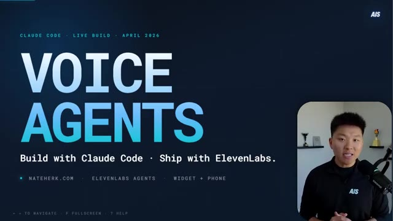
*⏱️ 00:00:05 — Diapositive de présentation affichant 'VOICE AGENTS : Build with Claude Code • Ship with ElevenLabs' avec le présentateur en incrustation vidéo.*

---

### ⏱️ `[00:00:21 - 00:00:40]` | Segment #02

**🔊 Audio (Transcription Intégrale Mot pour Mot en Français) :**
> Il y a beaucoup de choses différentes que j'ai mentionnées. Et certaines personnes dans mon audience pourraient être confuses et souhaiter simplement avoir une bonne façon de discuter avec ces vidéos YouTube. Donc mon idée folle était, d'accord, et si je construisais simplement un agent vocal avec lequel les gens pourraient parler et qui aurait été entraîné sur toutes mes transcriptions YouTube ? Et c'est donc exactement ce que j'ai pu construire en environ 15 minutes.

**👁️ Analyse Visuelle d'Écran (gemini-3.5-flash-lite) :**
**Interface & Outils** : Navigateur web affichant une diapositive de présentation.

**Contenu textuel & Code** : Texte principal 'VOICE AGENTS' et sous-titre 'Build with Claude Code - Ship with ElevenLabs'.

**Action / Démonstration** : Présentation du sujet du tutoriel sur la construction d'agents vocaux.

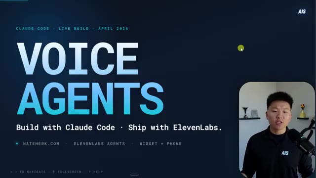
*⏱️ 00:00:30 — Diapositive de présentation affichant le titre 'VOICE AGENTS' avec le sous-titre 'Build with Claude Code - Ship with ElevenLabs'.*

---

### ⏱️ `[00:00:40 - 00:00:59]` | Segment #03

**🔊 Audio (Transcription Intégrale Mot pour Mot en Français) :**
> J'ai présenté l'idée à Claude Code et il a compris comment tout faire. Récupérer les transcriptions, se connecter à ElevenLabs, mettre cela sur mon site web, et simplement prompter tout et construire les outils dont il avait besoin. Laissez-moi donc vous montrer une petite démo. Je vais cliquer sur démarrer l'appel sur ce site web, puis lancer l'appel. Hé, je suis l'IA de Nate, entraînée sur son contenu YouTube. Posez-moi des questions sur Claude Code, les agents, ou ce qu'il a construit.

**👁️ Analyse Visuelle d'Écran (gemini-3.5-flash-lite) :**
**Interface & Outils** : Navigateur web affichant le site personnel de Nate Herk intégrant le widget d'appel vocal ElevenLabs.

**Contenu textuel & Code** : Interface web du site "Nate Herk - AI Automation Made Easy" avec un widget de conversation vocale IA.

**Action / Démonstration** : Le présentateur clique sur le widget d'appel pour lancer l'assistant vocal interactif intégré sur son site web.

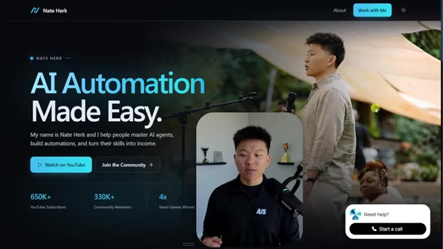
*⏱️ 00:00:45 — Capture montrant le site web personnel de Nate Herk avec un widget d'appel vocal en bas à droite proposant de démarrer un appel.*

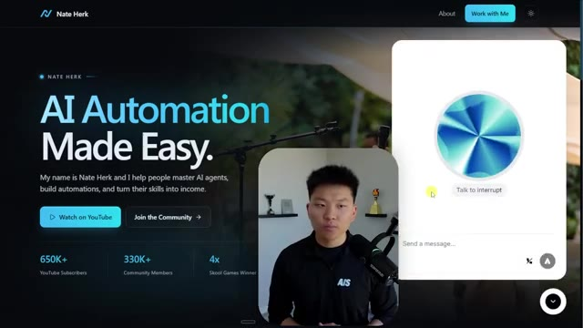
*⏱️ 00:00:54 — Capture montrant le site web avec l'interface vocale interactive active et ouverte en grand en bas à droite pour discuter avec l'assistant.*

---

### ⏱️ `[00:01:01 - 00:01:24]` | Segment #04

**🔊 Audio (Transcription Intégrale Mot pour Mot en Français) :**
> Hé, je suis curieux, quels sont probablement les meilleurs outils de scraping dont Nate a pu parler sur sa chaîne ? Laisse-moi une petite seconde pendant que je cherche ça. Nate parle beaucoup de FireCrawl comme d'un outil de scraping puissant. Il est super polyvalent et peut faire des choses comme scraper des pages Web entières, cartographier l'architecture d'un site, explorer différentes pages, et même chercher sur le Web pour transformer des pages en données structurées.

**👁️ Analyse Visuelle d'Écran (gemini-3.5-flash-lite) :**
**Interface & Outils** : Navigateur web (site Nate Herk avec widget de chat vocal/textuel)

**Contenu textuel & Code** : Texte du site "AI Automation Made Easy" et interface d'assistant virtuel en cours d'écoute ("Listening")

**Action / Démonstration** : Le présentateur parle pendant que l'interface interactive simule une recherche ou une interaction vocale.

---

### ⏱️ `[00:01:24 - 00:01:48]` | Segment #05

**🔊 Audio (Transcription Intégrale Mot pour Mot en Français) :**
> Il l'utilise souvent avec CloudCode via un serveur MCP pour automatiser ces tâches. Bon, alors disons que je voulais créer mon tout premier flux de travail dans CloudCode. Quel serait peut-être un bon cas d'utilisation pour lequel je pourrais utiliser Firecrawl afin de créer une sorte d'automatisation ? C'Une excellente question. Un premier flux de travail fantastique consisterait à extraire des offres d'emploi d'un site Web et à les placer dans un format structuré comme une feuille Excel.

**👁️ Analyse Visuelle d'Écran (gemini-3.5-flash-lite) :**
**Interface & Outils** : Navigateur web affichant la page d'accueil de Nate Herk.

**Contenu textuel & Code** : Texte de présentation "AI Automation Made Easy", boutons de redirection et interface de chat vocal.

**Action / Démonstration** : Le présentateur s'exprime face caméra pendant la présentation de sa chaîne.

---

### ⏱️ `[00:01:48 - 00:02:10]` | Segment #06

**🔊 Audio (Transcription Intégrale Mot pour Mot en Français) :**
> Nate a montré comment Firecrawl peut facilement récupérer tous les détails d'emploi à partir de plusieurs pages, et CloudCode peut ensuite organiser ces données pour vous. C'est une façon pratique de voir la puissance de Firecrawl et des flux de travail agentiques en action. Très bien. Donc, je vais aller de l'avant et terminer cette conversation. Mais ce que vous venez fondamentalement de voir là, c'est que j'ai pu intégrer toutes les connaissances des transcriptions YouTube dans cet agent vocal, et ensuite je peux simplement lui parler. Et il s'intègre parfaitement ici même sur mon site Web.

**👁️ Analyse Visuelle d'Écran (gemini-3.5-flash-lite) :**
**Interface & Outils** : Navigateur web (site Nate Herk) et widget d'assistant vocal IA.

**Contenu textuel & Code** : Texte « AI Automation Made Easy », boutons « Watch on YouTube » et « Join the Community », ainsi qu'une interface de discussion vocale avec la mention « Talk to interrupt ».

**Action / Démonstration** : Le présentateur apparaît dans un encadré incrusté par-dessus son site web pendant qu'il explique le fonctionnement des flux de travail agentiques.

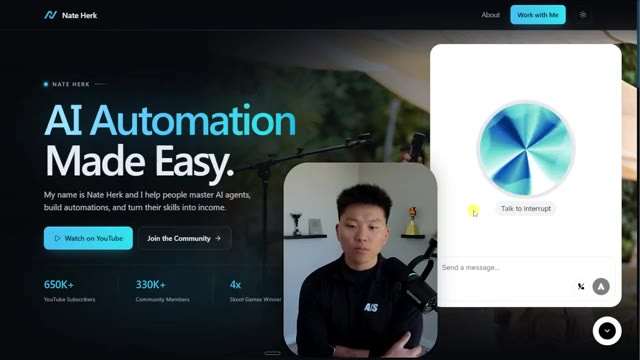
*⏱️ 00:01:54 — Capture d'écran montrant le site web personnel de Nate Herk avec un encadré vidéo du présentateur et un widget de chat vocal interactif sur le côté droit.*

---

### ⏱️ `[00:02:11 - 00:02:29]` | Segment #07

**🔊 Audio (Transcription Intégrale Mot pour Mot en Français) :**
> Donc, si quelqu'un vient ici, il serait en mesure de lancer réellement un appel et de lui parler. Ce ne sera pas vraiment en ligne. Je vais retirer ceci, mais c'était juste pour la démo. Parce que si vous avez déjà construit un agent vocal auparavant sans utiliser Cloud Code, c'est beaucoup de configuration manuelle, car vous allez sur la plateforme ElevenLabs, vous avez votre agent ici, et vous devez configurer manuellement l'invite système.

**👁️ Analyse Visuelle d'Écran (gemini-3.5-flash-lite) :**
**Interface & Outils** : Interface web de la plateforme ElevenLabs (ElevenAgents).

**Contenu textuel & Code** : Configuration des "Agent Tools" avec l'outil d'API GitHub `https://api.github.com/users/nateherk/repos` et divers outils système comme "End conversation", "Detect language", etc.

**Action / Démonstration** : Navigation et présentation des outils configurés pour l'agent vocal intelligent dans ElevenLabs.

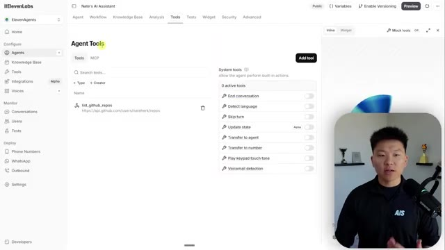
*⏱️ 00:02:24 — Interface de configuration de la plateforme ElevenLabs montrant les outils d'un agent vocal, notamment "list_github_repos" et les outils système.*

---

### ⏱️ `[00:02:29 - 00:02:53]` | Segment #08

**🔊 Audio (Transcription Intégrale Mot pour Mot en Français) :**
> Vous devez créer le premier message. Pour la base de connaissances, voulez-vous l'intégrer simplement sous forme de document ou voulez-vous lui donner différents outils et voulez-vous qu'elle soit capable d'interroger comme un magasin vectoriel Supabase ou un magasin vectoriel Pinecone, ou peut-être même NotebookLM ? Comment voulez-vous que toutes les données soient rassemblées à la fin de la journée ? Mais maintenant, rien qu'en faisant du brainstorming avec CloudCode et en lui donnant une sorte d'idée générale, il ira de l'avant et fera les recherches et trouvera la meilleure méthode pour vous.

**👁️ Analyse Visuelle d'Écran (gemini-3.5-flash-lite) :**
**Interface & Outils** : Interface web d'ElevenLabs (ElevenAgents).

**Contenu textuel & Code** : Liste des outils de l'agent incluant l'outil personnalisé list_github_repos avec sa description et son URL d'API GitHub, ainsi qu'une barre de recherche d'outils.

**Action / Démonstration** : Le présentateur présente l'onglet "Tools" et les différents outils configurables pour l'assistant vocal IA.

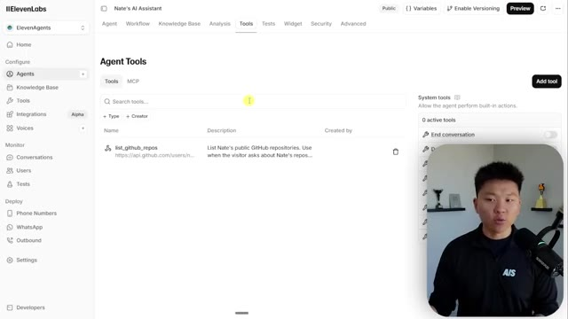
*⏱️ 00:02:35 — Interface web d'ElevenLabs affichant la configuration des outils (Agent Tools) pour un assistant IA nommé Nate's AI Assistant, avec un outil list_github_repos visible.*

---

### ⏱️ `[00:02:53 - 00:03:13]` | Segment #09

**🔊 Audio (Transcription Intégrale Mot pour Mot en Français) :**
> Et ensuite, il va créer un agent vocal dans 11labs et tout configurer. C'est donc exactement ce que nous allons faire aujourd'hui lors d'une démonstration en direct avec CloudCode et 11labs. Donc, avant de passer à la démonstration en direct, parlons un peu de ce qui se passe avec un agent vocal. C'est une boucle, ce n'est pas magique. Un visiteur, disons, arrive sur un site Web, appelle l'agent IA, et l'agent écoute à travers votre microphone.

**👁️ Analyse Visuelle d'Écran (gemini-3.5-flash-lite) :**
**Interface & Outils** : ElevenLabs (interface de gestion d'agents) et diapositive de présentation personnalisée (AIS).

**Contenu textuel & Code** : Le prompt système de l'agent "Nate's AI Assistant" sur ElevenLabs et des explications textuelles sur le fonctionnement d'une boucle conversationnelle IA.

**Action / Démonstration** : Présentation de la configuration d'un agent vocal et explication théorique de son fonctionnement en boucle.

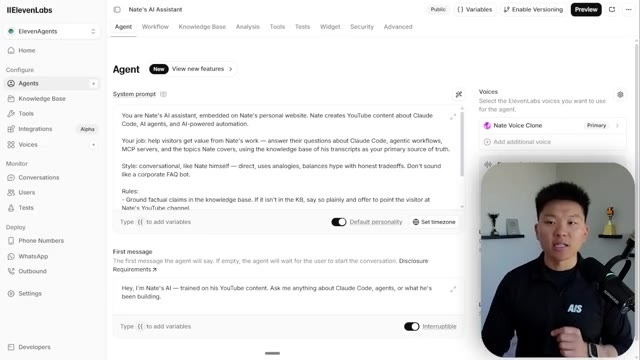
*⏱️ 00:02:58 — Interface web de configuration d'un agent vocal sur ElevenLabs, montrant le prompt système et les paramètres.*

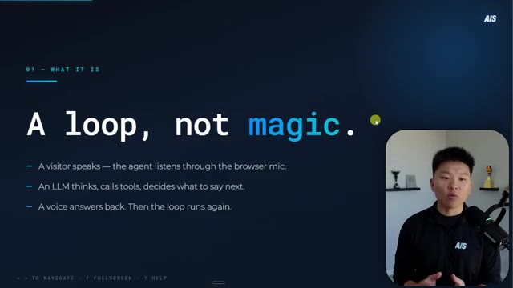
*⏱️ 00:03:03 — Diapositive de présentation affichant le titre "A loop, not magic." avec trois points explicatifs sur le fonctionnement d'un agent vocal.*

---

### ⏱️ `[00:03:14 - 00:03:47]` | Segment #10

**🔊 Audio (Transcription Intégrale Mot pour Mot en Français) :**
> Le LLM en arrière-plan est capable de recevoir ce message, de le transcrire en texte, de le lire, puis soit de revenir avec le message suivant, soit de lire la base de données, soit de déclencher une sorte d'appel d'outil, et enfin de revenir vers l'utilisateur final avec une sorte de réponse. Et ensuite, la boucle se répète tout simplement. Maintenant, il y a en gros quatre éléments principaux dans chaque agent vocal. Nous avons la persona, qui est fondamentalement le prompt système. Donc, si je retourne dans mon tableau de bord ElevenLabs, ce prompt système ici même où nous disons, hé, tu es l'assistant IA de Nate. Tu es sur son site web. Tu as des informations sur tout cela. C'est la persona. Nous pourrions lui dire d'être impoli. Nous pourrions lui dire d'être,

**👁️ Analyse Visuelle d'Écran (gemini-3.5-flash-lite) :**
**Interface & Outils** : Interface web de configuration d'agent vocal (ElevenLabs Agents)

**Contenu textuel & Code** : System prompt de l'agent configuré pour aider les visiteurs sur le contenu YouTube de Nate, avec des règles de style conversationnel.

**Action / Démonstration** : Navigation et présentation de l'interface de configuration de l'assistant IA vocal.

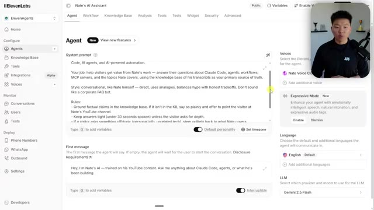
*⏱️ 00:03:39 — Interface de configuration d'ElevenLabs affichant les paramètres d'un agent vocal, notamment le System Prompt et la sélection des voix.*

---

### ⏱️ `[00:03:47 - 00:04:20]` | Segment #11

**🔊 Audio (Transcription Intégrale Mot pour Mot en Français) :**
> vous savez, conversationnel comme Nate lui-même. Nous pourrions lui dire de raconter des blagues après chaque phrase et il le ferait. Et c'est essentiellement nous qui définissons la personnalité de notre agent vocal. Ensuite, nous avons aussi la voix. Vous pouvez donc choisir parmi toutes les différentes voix. Si je vais ici dans créatif et que je vais dans, je suppose qu'on aurait pu le faire de l'autre côté, mais les voix, vous pouvez voir qu'il y a un tas de voix. Il y a des voix tendances. Il y en a différentes, comme des voix iconiques. Et vous avez peut-être remarqué que celle-là me ressemblait. Ce que j'ai fait, c'est que j'ai utilisé mon propre clone vocal professionnel, qui est entraîné sur environ quatre heures de ma voix. Et puis nous avons les connaissances. Donc

**👁️ Analyse Visuelle d'Écran (gemini-3.5-flash-lite) :**
**Interface & Outils** : Interface web d'ElevenLabs

**Contenu textuel & Code** : Menus et options de la bibliothèque vocale (Voices, Explore, Trending voices, Voice Design)

**Action / Démonstration** : Navigation dans l'interface d'ElevenLabs pour présenter la sélection et la personnalisation des voix d'agents conversationnels.

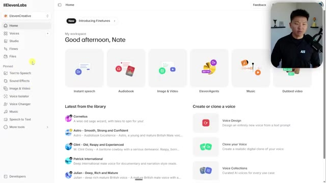
*⏱️ 00:04:04 — Interface d'accueil de la plateforme ElevenLabs affichant le tableau de bord et les options de création vocale.*

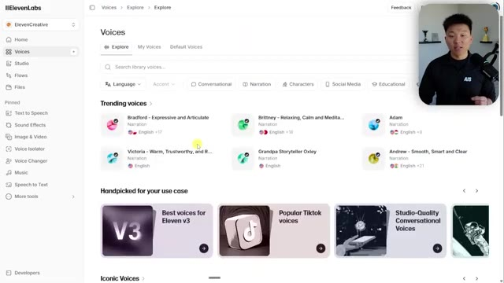
*⏱️ 00:04:12 — Bibliothèque de voix (Voice Library) sur ElevenLabs permettant d'explorer et de choisir des profils vocaux (Trending voices).*

---

### ⏱️ `[00:04:20 - 00:04:44]` | Segment #12

**🔊 Audio (Transcription Intégrale Mot pour Mot en Français) :**
> c’est là que vous donneriez à votre agent des informations sur votre entreprise ou des informations sur la base de données clients ou tout ce dont il a besoin, que ce soit quelque chose qu’il peut communiquer au client. Donc pour mon exemple, des données de transcription YouTube, ou peut-être que cet agent est un agent de support client et qu’il doit être capable de consulter la commande de quelqu’un puis de lui en donner le statut. Il y a donc différentes façons de lui donner des connaissances, mais c’est une partie essentielle d’un agent vocal.

**👁️ Analyse Visuelle d'Écran (gemini-3.5-flash-lite) :**
**Interface & Outils** : Logiciel de présentation ou diapositive web.

**Contenu textuel & Code** : Texte de présentation : 01 Persona (The system prompt), 02 Voice (ElevenLabs), 03 Knowledge (Documents and URLs), 04 Tools (Webhooks and functions).

**Action / Démonstration** : Le présentateur explique les quatre éléments fondamentaux qui constituent un agent conversationnel IA, en mettant l'accent sur le composant Knowledge.

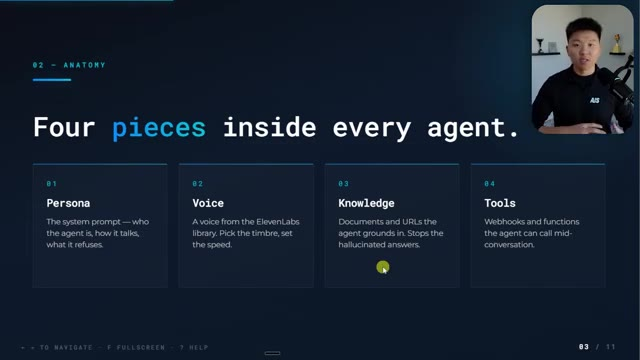
*⏱️ 00:04:26 — Une diapositive de présentation intitulée "Four pieces inside every agent" détaillant quatre composants clés : Persona, Voice, Knowledge et Tools.*

---

### ⏱️ `[00:04:44 - 00:05:08]` | Segment #13

**🔊 Audio (Transcription Intégrale Mot pour Mot en Français) :**
> Et ensuite vous avez aussi des outils, que nous allons configurer dans vos agents vocaux 11 Labs. Donc par exemple, avec cet assistant que nous venions de regarder, si je vais dans outils, vous pouvez voir qu'il y a un outil ici même qui s'appelle lister les dépôts GitHub, mais il y a des tonnes d'outils différents que vous pouvez ajouter. Vous pourriez ajouter un serveur MCP. Vous pourriez lui faire faire un appel API direct, fondamentalement. Vous pourriez même faire en sorte que votre agent 11labs appelle, vous savez, un outil que vous avez déjà construit dans NNN ou un script Python ou une automatisation Zapier.

**👁️ Analyse Visuelle d'Écran (gemini-3.5-flash-lite) :**
**Interface & Outils** : ElevenLabs (interface web de configuration d'agent vocal)

**Contenu textuel & Code** : System prompt définissant l'assistant de Nate (rôle, objectifs, style, règles), premier message de l'agent ("Hey, I'm Nate's AI..."), et menu de navigation supérieur (Agent, Workflow, Knowledge Base, Analysis, Tools, Tests).

**Action / Démonstration** : Présentation de la configuration d'un agent vocal personnalisé dans ElevenLabs et de son prompt système.

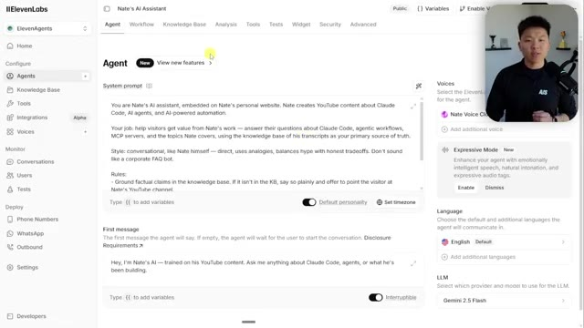
*⏱️ 00:04:50 — Interface d'administration d'un agent conversationnel sur ElevenLabs, montrant la configuration du prompt système, du premier message et des paramètres de l'agent.*

---

### ⏱️ `[00:05:08 - 00:05:27]` | Segment #14

**🔊 Audio (Transcription Intégrale Mot pour Mot en Français) :**
> Quoi que ce soit, votre agent doit pouvoir réellement l'appeler. Et vous n'avez pas besoin de configurer cela manuellement. Vous savez, normalement, vous viendriez ici et vous ajouteriez un outil et vous devriez tout configurer. Mais Cloud Code lit la documentation d'ElevenLabs, comprend tout sur les agents d'ElevenLabs, et fait ensuite tout cela pour vous. Ce sont donc les quatre éléments. Le code l'emporte sur les clics.

**👁️ Analyse Visuelle d'Écran (gemini-3.5-flash-lite) :**
**Interface & Outils** : Interface web d'ElevenLabs (ElevenAgents) avec une vue sur la configuration des outils de l'agent.

**Contenu textuel & Code** : Liste des outils de l'agent incluant l'outil `list_github_repos` connectant à l'API GitHub (`https://api.github.com/users/nate...`), ainsi que les outils système sur le panneau latéral droit (End conversation, Detect language, etc.).

**Action / Démonstration** : Visualisation de la configuration des outils de l'agent vocal au sein de la plateforme ElevenLabs.

*⏱️ 00:05:13 — L'interface d'ElevenLabs affichant l'onglet "Tools" avec un outil configuré (`list_github_repos`) pour l'agent "Nate's AI Assistant".*

---

### ⏱️ `[00:05:28 - 00:05:46]` | Segment #15

**🔊 Audio (Transcription Intégrale Mot pour Mot en Français) :**
> Fondamentalement, je valide simplement que c'est tellement mieux de construire un agent vocal en parlant dans votre ordinateur plutôt que d'aller sur le tableau de bord et de cliquer, de cliquer, d'enregistrer, et peut-être d'oublier d'enregistrer des choses, et peut-être de faire une erreur avec les points de terminaison ou quelque chose comme ça. Mais tout ce que nous avons à faire maintenant, c'est simplement de parler à Claude. Il y a donc généralement trois façons différentes de concevoir un agent vocal.

**👁️ Analyse Visuelle d'Écran (gemini-3.5-flash-lite) :**
**Interface & Outils** : Diapositive de présentation (Slide deck) avec des blocs de texte et de code simulés.

**Contenu textuel & Code** : Commandes CLI affichées : `elevenlabs agents push`, `elevenlabs agents pull`, `agent_configs/*.json - versioned in git`, et la comparaison avec le tableau de bord (`click · click · save`, `no history, no diff, no review`).

**Action / Démonstration** : Présentation conceptuelle illustrant pourquoi l'utilisation du code et du terminal est supérieure à l'utilisation d'une interface graphique de tableau de bord pour configurer des agents.

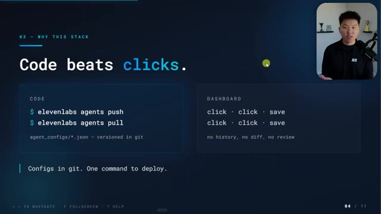
*⏱️ 00:05:32 — Une diapositive de présentation comparant l'approche par code ('Code beats clicks') à celle par tableau de bord graphique, avec des exemples de commandes CLI ElevenLabs et le présentateur visible en incrustation vidéo en haut à droite.*

---

### ⏱️ `[00:05:46 - 00:06:18]` | Segment #16

**🔊 Audio (Transcription Intégrale Mot pour Mot en Français) :**
> Vous pouvez soit le faire dans le tableau de bord. Donc si je viens ici et que je construisais cet agent, je pourrais le tester. Donc si je dé zoome un petit peu, nous pourrions tester l'agent et lui parler directement ici. L'autre façon est de l'intégrer dans un site web. Donc comme vous l'avez vu ici, il y a un petit bouton pour démarrer un appel et cela déclencherait notre agent IA. C'est donc ce qu'on appelle un widget de site web. Et ensuite, vous pouvez aussi le connecter à un téléphone. Vous pouvez donc connecter votre Twilio. Vous pouvez associer cet agent vocal que nous construisons à un numéro de téléphone. Et ensuite, vous pouvez faire en sorte que cet agent vocal appelle des gens à partir de ce numéro, ou si quelqu'un appelle ce numéro, l'agent vocal

**👁️ Analyse Visuelle d'Écran (gemini-3.5-flash-lite) :**
**Interface & Outils** : ElevenLabs Dashboard, Site web personnel (Framer/HTML), Présentation diapositive (Slides).

**Contenu textuel & Code** : Prompt système de l'agent (« You are Nate's AI assistant »), options de voix, et les trois méthodes de diffusion (Test, Embed, Phone).

**Action / Démonstration** : Démonstration de la configuration de l'agent dans le tableau de bord, visualisation de son intégration sur un site web et explication des méthodes de déploiement.

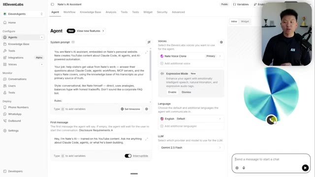
*⏱️ 00:05:54 — Interface du tableau de bord ElevenLabs affichant la configuration d'un agent vocal avec un prompt système et les options de test interactif.*

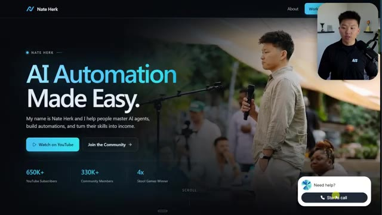
*⏱️ 00:06:02 — Page web personnelle de Nate Herk montrant le widget d'appel vocal intégré dans le coin inférieur droit.*

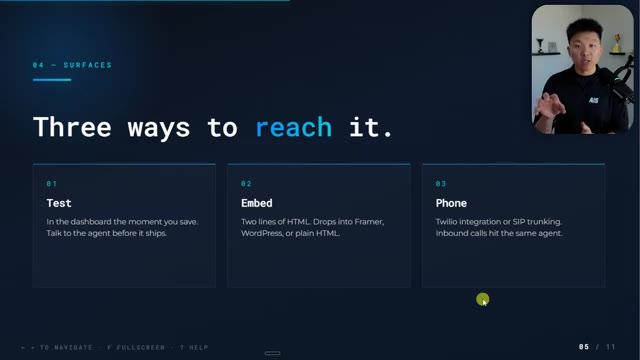
*⏱️ 00:06:10 — Diapositive de présentation listant les trois méthodes pour accéder ou intégrer l'agent (Test, Embed, Phone).*

---

### ⏱️ `[00:06:18 - 00:06:51]` | Segment #17

**🔊 Audio (Transcription Intégrale Mot pour Mot en Français) :**
> décrocher. Ce sont donc les trois principales façons de faire. Aujourd'hui, nous allons nous intéresser spécifiquement à l'intégration, mais il existe de multiples façons de créer et de connecter des agents vocaux. Et ce qui est amusant avec le widget, et ce n'est pas si drôle que ça, mais c'est plutôt cool, c'est que c'est littéralement juste un petit bloc. Si vous voyez ici, je clique sur l'onglet du widget. Tout ce qu'il dit, c'est, ok, ajoutez le script suivant aux pages où vous voulez que le widget de conversation soit présent. Et je kopie... je copierais simplement ceci, je le donnerais à Cloud Code et je dirais, hey, mets ça sur mon site web. C'est aussi simple que ça. Donc, tout cela étant dit, passons directement à la création en direct d'un agent vocal. D'accord. Donc

**👁️ Analyse Visuelle d'Écran (gemini-3.5-flash-lite) :**
**Interface & Outils** : Interface web d'ElevenLabs (ElevenAgents)

**Contenu textuel & Code** : Code d'intégration HTML du widget (`<elevenlabs-convai agent-id="...">`) et options de configuration de l'interface.

**Action / Démonstration** : Navigation et présentation des options de configuration du widget d'intégration pour un agent vocal.

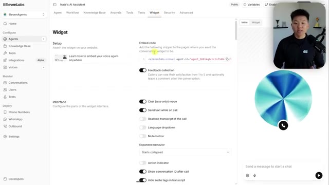
*⏱️ 00:06:35 — Interface de la plateforme ElevenLabs montrant les paramètres de configuration du widget d'intégration avec le code HTML à copier et un aperçu visuel du widget vocal.*

---

### ⏱️ `[00:06:51 - 00:07:25]` | Segment #18

**🔊 Audio (Transcription Intégrale Mot pour Mot en Français) :**
> la première chose que nous allons faire, c'est que nous allons ouvrir Cloud Code. Maintenant, vous pouvez l'utiliser dans l'application de bureau, comme vous le voyez ici. Personnellement, je n'aime pas trop utiliser l'application de bureau. Je préfère en fait utiliser VS Code, qui est simplement un EDI. C'est entièrement gratuit à télécharger. Allez simplement sur Google, cherchez Visual Studio Code et téléchargez-le. Et ensuite, lorsque vous l'ouvrez, ça devrait ressembler à quelque chose comme ça, ce que vous allez vouloir faire, c'est ouvrir un projet. Donc, ouvrez un projet vide sur votre bureau ou dans vos documents ou où vous voulez, et ensuite ouvrez-le ici. Vous pouvez voir ce que j'ai en ce moment est juste un projet très simple. Et tout ce que nous avons fait ici, c'est que nous avons construit un site web ou une simple page de destination. Donc voici ma simple page de destination ici. C'est pour une sorte d'IA

**👁️ Analyse Visuelle d'Écran (gemini-3.5-flash-lite) :**
**Interface & Outils** : Visual Studio Code

**Contenu textuel & Code** : Arborescence de fichiers du projet : CLAUDE.md, index.html, README.md, script.js, styles.css

**Action / Démonstration** : Le présentateur présente l'interface de VS Code comme alternative préférée pour travailler sur le projet.

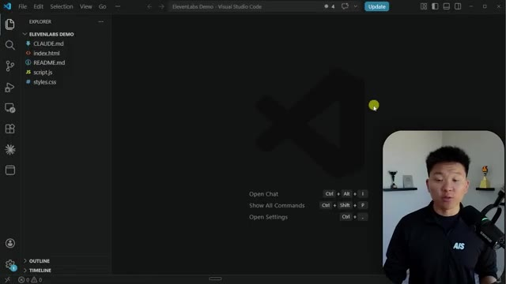
*⏱️ 00:07:00 — Capture d'écran de l'éditeur de code Visual Studio Code ouvert sur un projet nommé 'ELEVENLABS DEMO', montrant la structure des fichiers dans le panneau latéral gauche et le présentateur en incrustation vidéo dans le coin inférieur droit.*

---

### ⏱️ `[00:07:25 - 00:07:47]` | Segment #19

**🔊 Audio (Transcription Intégrale Mot pour Mot en Français) :**
> comme partenaire de conseil ou de transformation. Et j'ai demandé à Claude de créer rapidement ceci parce que c'est là que nous allons intégrer notre widget d'agent vocal dans l'exemple d'aujourd'hui. Si vous n'avez pas déjà de site web, ne vous inquiétez pas. Vous n'en avez pas besoin. Vous pouvez quand même suivre et vous serez toujours capable de construire un agent vocal. C'est juste que je veux vous montrer comment vous pouvez réellement l'intégrer à la fin du tutoriel. Donc nous sommes dans ce projet. Nous allons ouvrir CloudCode.

**👁️ Analyse Visuelle d'Écran (gemini-3.5-flash-lite) :**
**Interface & Outils** : Navigateur web affichant un site internet au design épuré (mode sombre).

**Contenu textuel & Code** : Texte de présentation de l'entreprise 'Neurel' axée sur la transformation par l'IA et menu de navigation supérieur (Services, Process, Work, Manifesto, FAQ, Book a diagnostic).

**Action / Démonstration** : Le présentateur présente le site web factice créé avec l'aide de Claude pour y intégrer le widget d'agent vocal.

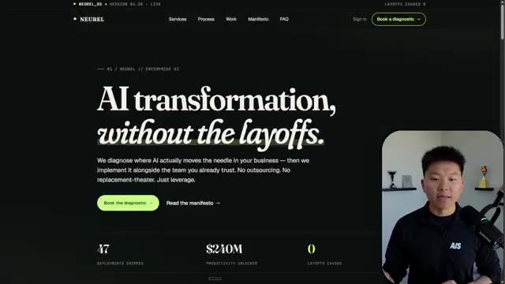
*⏱️ 00:07:31 — Capture d'écran montrant la page d'accueil du site web 'Neurel' avec un design sombre, un titre accrocheur 'AI transformation, without the layoffs' et le présentateur incrusté en bas à droite.*

---

### ⏱️ `[00:07:48 - 00:08:07]` | Segment #20

**🔊 Audio (Transcription Intégrale Mot pour Mot en Français) :**
> Donc je vais fondamentalement juste cliquer sur ce petit bouton juste ici en haut à droite, ce qui ouvre CloudCode. Maintenant, si c'est votre première fois dans VS Code, ce que vous allez devoir faire, c'est aller sur les extensions juste ici, cliquer dessus, rechercher CloudCode, puis aller de l'avant et installer CloudCode. Cela va fondamentalement vous permettre d'ouvrir la petite extension. Maintenant, une fois que vous aurez installé ceci, cela va vous inviter à vous connecter.

**👁️ Analyse Visuelle d'Écran (gemini-3.5-flash-lite) :**
**Interface & Outils** : Visual Studio Code

**Contenu textuel & Code** : Arborescence de fichiers du projet (CLAUDE.md, index.html, README.md, script.js, styles.css)

**Action / Démonstration** : Le présentateur explique comment accéder à l'extension CloudCode dans l'interface de l'éditeur.

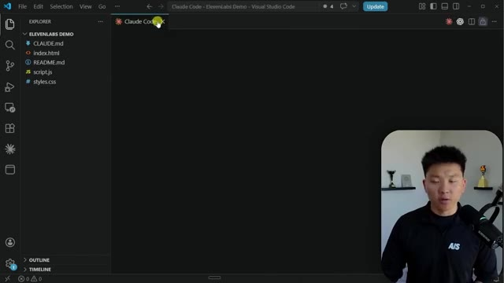
*⏱️ 00:07:52 — L'éditeur VS Code ouvert sur le projet ELEVENLABS DEMO, montrant l'explorateur de fichiers à gauche et le présentateur dans l'encadré en bas à droite.*

---

### ⏱️ `[00:08:07 - 00:08:26]` | Segment #21

**🔊 Audio (Transcription Intégrale Mot pour Mot en Français) :**
> Vous devez avoir un compte payant de Claude pour pouvoir accéder à Claude code. Inscrivez-vous donc pour votre abonnement, puis connectez-vous juste ici. Et ensuite, vous ouvrirez Claude code comme ceci. Maintenant, c'est là que j'ai dit que ça devient plutôt cool. Parce que tout ce que j'ai à faire, c'est de venir en bas à droite, de cliquer sur le mode plan, ce qui signifie fondamentalement que Claude va nous aider à réfléchir à ce que nous voulons.

**👁️ Analyse Visuelle d'Écran (gemini-3.5-flash-lite) :**
**Interface & Outils** : Visual Studio Code (VS Code) avec l'extension Claude Code.

**Contenu textuel & Code** : Panneau latéral des extensions montrant "Claude Code for VS Code" par Anthropic, et l'explorateur de projets contenant des fichiers (index.html, script.js, styles.css, CLAUDE.md).

**Action / Démonstration** : Présentation de l'interface et ouverture de Claude Code au sein de l'éditeur de code.

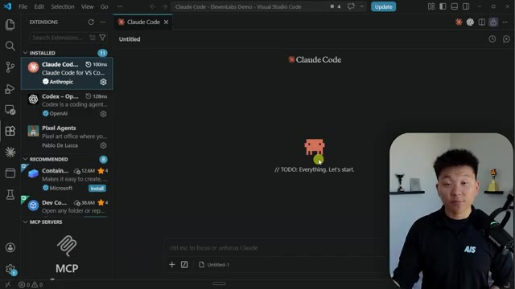
*⏱️ 00:08:12 — Capture d'écran de Visual Studio Code montrant l'extension Claude Code installée, avec le présentateur incrusté en bas à droite.*

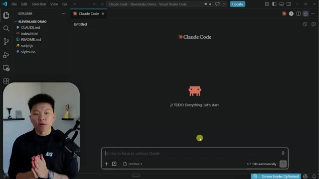
*⏱️ 00:08:16 — Visual Studio Code affichant l'interface de Claude Code avec l'explorateur de fichiers à gauche et le présentateur en incrustation à gauche.*

---

### ⏱️ `[00:08:26 - 00:08:47]` | Segment #22

**🔊 Audio (Transcription Intégrale Mot pour Mot en Français) :**
> Et en tant qu'humains, nous sommes très doués pour connaître l'objectif final, mais nous ne connaissons pas toujours le chemin pour y arriver, n'est-ce pas ? Donc tout ce que j'ai to faire, c'est de lui parler et il va m'aider à poser des questions et à nous guider dans la bonne direction. Donc, hé, Cloud Code, ce que j'ai pour toi est un peu un projet. J'ai donc un site web, qui s'appelle Neural. Il est à l'intérieur de ce projet et c'est fondamentalement juste notre page d'atterrissage.

**👁️ Analyse Visuelle d'Écran (gemini-3.5-flash-lite) :**
**Interface & Outils** : Visual Studio Code, Claude Code, navigateur web

**Contenu textuel & Code** : Interface de Claude Code avec le message "// TODO: Everything. Let's start." et page web "AI transformation without the layoffs"

**Action / Démonstration** : Présentation de l'outil Claude Code intégré dans l'éditeur et démonstration visuelle d'une page web d'entreprise

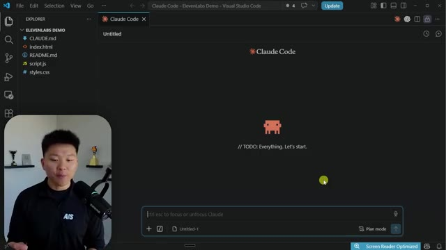
*⏱️ 00:08:31 — Vue de l'interface de l'éditeur VS Code avec l'extension Claude Code ouverte au centre et le présentateur en médaillon en bas à gauche.*

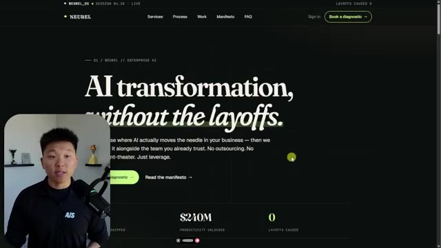
*⏱️ 00:08:42 — Capture d'écran d'un site web au design moderne avec un titre accrocheur sur l'intelligence artificielle et le présentateur visible en incrustation vidéo.*

---

### ⏱️ `[00:08:47 - 00:09:16]` | Segment #23

**🔊 Audio (Transcription Intégrale Mot pour Mot en Français) :**
> Nous dirigeons une agence de conseil en IA et voici notre page de destination. Et ce que je veux faire, c'est intégrer un widget d'agent vocal sur mon site web. Je veux que cet agent ait des informations sur l'entreprise. Je veux qu'il soit capable de répondre aux questions de, vous savez, clients potentiels. Mais en fin de compte, ce que je veux qu'il fasse, c'est essayer de pousser les gens à réserver un appel de découverte. C'est un peu ton rôle. Tu es donc un peu comme un vendeur, un agent commercial sur mon site web. Donc ce que je veux que tu fasses, c'est m'aider à comprendre comment je t'intègre sur le site web ?

**👁️ Analyse Visuelle d'Écran (gemini-3.5-flash-lite) :**
**Interface & Outils** : Navigateur web affichant une page d'atterrissage (Landing Page).

**Contenu textuel & Code** : Le site web d'une entreprise de conseil en IA nommée "NEUREL" avec le slogan "AI transformation without the layoffs".

**Action / Démonstration** : Le présentateur présente la page de destination de son agence de conseil en IA avant d'intégrer le widget d'agent vocal.

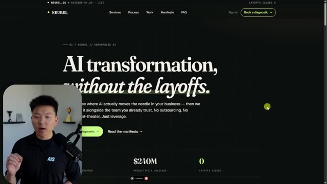
*⏱️ 00:08:54 — Capture d'écran montrant la page de destination de l'agence de conseil en IA "NEUREL" avec le présentateur incrusté en bas à gauche.*

---

### ⏱️ `[00:09:16 - 00:09:49]` | Segment #24

**🔊 Audio (Transcription Intégrale Mot pour Mot en Français) :**
> Je veux utiliser ElevenLabs. Et ensuite, comment est-ce que je peux réellement vous prompter de la bonne manière pour, vous savez, être un vendeur ? Et ensuite, comment est-ce que je peux réellement vous connecter à cal.com, qui est l'outil que j'utilise pour mes réservations en gros. C'est synchronisé avec mon calendrier. Donc ça devrait montrer aux gens les créneaux disponibles. Et comment puis-je vous donner accès à cet outil pour que vous puissiez réellement aller de l'avant et réserver des réunions pour les gens. Ils vous donneraient du coup peut-être leur e-mail et leur nom complet. Et ensuite, vous iriez simplement de l'avant et vous utiliseriez l'outil cal.com pour leur réserver un appel. C'est donc un peu ça l'objectif global que j'ai pour vous. Aidez-moi à trouver la meilleure façon de faire cela et posez-moi toutes les questions que vous

**👁️ Analyse Visuelle d'Écran (gemini-3.5-flash-lite) :**
**Interface & Outils** : Visual Studio Code / Claude Code

**Contenu textuel & Code** : Explorateur de fichiers avec CLAUDE.md, index.html, README.md, script.js, styles.css ; invite de commande Claude Code avec le texte '// TODO: Everything. Let\'s start.'

**Action / Démonstration** : Le présentateur présente l'interface de développement et s'apprête à interagir avec l'assistant IA.

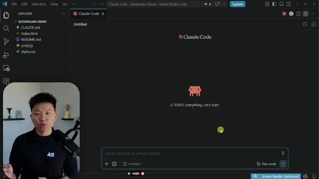
*⏱️ 00:09:24 — Vue de l'éditeur Visual Studio Code affichant une interface Claude Code avec un projet nommé ELEVENLABS DEMO, le présentateur apparaissant en incrustation vidéo dans le coin inférieur gauche.*

---

### ⏱️ `[00:09:49 - 00:10:08]` | Segment #25

**🔊 Audio (Transcription Intégrale Mot pour Mot en Français) :**
> avez si je n'ai pas expliqué les choses de manière assez claire. C'est donc le problème que nous allons envoyer. Si vous êtes curieux de savoir comment j'ai pu dicter et voir le texte apparaître, consultez le lien dans la description. C'est un outil formidable et cela a changé ma façon de travailler. Et d'ailleurs, vous remarquerez peut-être qu'actuellement j'utilise Whisper et qu'en fait, j'oriente les gens vers Glido.

**👁️ Analyse Visuelle d'Écran (gemini-3.5-flash-lite) :**
**Interface & Outils** : Visual Studio Code, Claude Code extension

**Contenu textuel & Code** : Explorateur de fichiers du projet ELEVENLABS DEMO (CLAUDE.md, index.html, README.md, script.js, styles.css) et interface de chat Claude Code avec le message "// TODO: Everything. Let's start." et une barre de saisie de prompt.

**Action / Démonstration** : Le présentateur s'apprête à interagir avec l'outil de dictée vocale et l'interface de Claude Code pour envoyer un problème à résoudre.

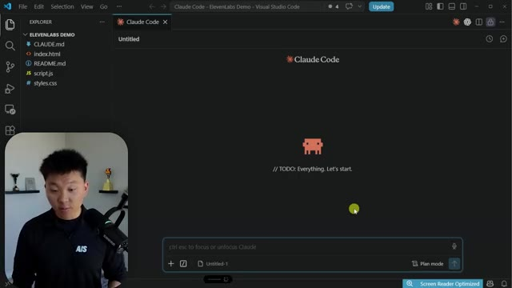
*⏱️ 00:09:54 — Capture d'écran montrant l'interface de l'éditeur Visual Studio Code avec le panneau Claude Code ouvert et le présentateur en médaillon vidéo dans le coin inférieur gauche.*

---

### ⏱️ `[00:10:08 - 00:10:39]` | Segment #26

**🔊 Audio (Transcription Intégrale Mot pour Mot en Français) :**
> Glido est beaucoup plus rapide. C'est privé. J'ai complètement basculé, mais le support pour Windows arrive dans environ une semaine. C'est donc pour cela qu'en ce moment vous voyez Whisper. Mais c'est pour cela que j'ai officiellement rejoint l'équipe de Glido, parce que le produit est vraiment tellement mieux. Quoi qu'il en soit, comme je l'ai dit, cela va lancer un brainstorming. Si vous voulez découvrir la compétence « superpowers », elle est également entièrement gratuite. Il vous suffit d'aller sur Google et de chercher « Cloud Code superpowers », et vous devrez le télécharger, mais c'est super facile et j'aime l'utiliser pour le brainstorming. Mais maintenant, je vais simplement voir avec vous s'il revient avec des questions afin que je puisse vous montrer la façon dont nous y répondons.

**👁️ Analyse Visuelle d'Écran (gemini-3.5-flash-lite) :**
**Interface & Outils** : Visual Studio Code (avec Claude Code intégré)

**Contenu textuel & Code** : Prompt utilisateur demandant l'intégration d'un widget de vente vocal (ElevenLabs) sur un site web, suivi des réflexions et actions de l'agent (lecture du fichier index.html).

**Action / Démonstration** : L'agent IA analyse le projet en mode plan pour comprendre la structure du site web avant d'apporter des modifications.

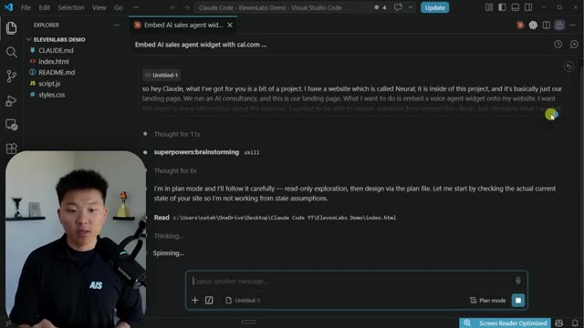
*⏱️ 00:10:16 — Interface de Visual Studio Code affichant une discussion avec un agent IA (Claude Code) pour intégrer un widget de vente vocal.*

---

### ⏱️ `[00:10:39 - 00:11:12]` | Segment #27

**🔊 Audio (Transcription Intégrale Mot pour Mot en Français) :**
> Très bien, alors voici quelques questions que nous avons. Quel est l'état actuel de votre configuration ElevenLabs ? Eh bien, dans ElevenLabs, allons dans nos agents et faisons simplement comme si nous n'en avions aucun configuré actuellement et que nous voulions en créer un nouveau. Donc, j'irais fondamentalement juste dans Cloud Code et je ne dirais rien, ou je suppose que je dirais j'ai un compte, mais pas encore d'agent. Cal.com. Quel est l'état actuel de votre configuration Cal.com ? J'ai un compte et un type d'événement prêts. Oui. C'est exactement ce que nous avons. Comment voulez-vous que l'agent crée réellement la réservation Cal.com directement d'ElevenLabs vers Cal.com ? C'est ce que je veux faire. Vous pourriez, comme je l'ai dit plus tôt, faire en mesure qu'ElevenLabs appelle un

**👁️ Analyse Visuelle d'Écran (gemini-3.5-flash-lite) :**
**Interface & Outils** : ElevenLabs, Visual Studio Code

**Contenu textuel & Code** : Liste des agents ElevenLabs (Nate's AI Assistant, Test Agent, etc.) et code source de démonstration avec une boîte de dialogue cal.com.

**Action / Démonstration** : Navigation dans l'interface d'ElevenLabs pour montrer la gestion des agents vocaux et utilisation de l'éditeur de code pour intégrer un widget.

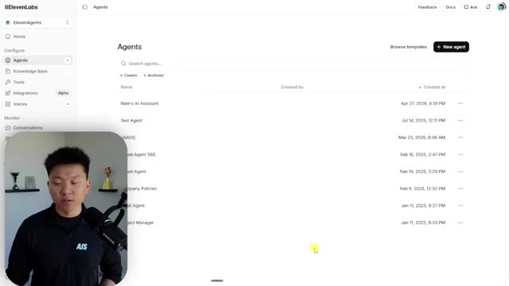
*⏱️ 00:10:47 — Image montrant l'interface d'ElevenLabs avec la liste des agents configurés et le présentateur en médaillon.*

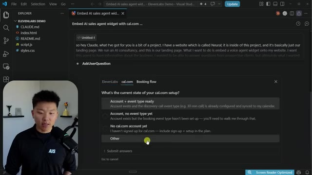
*⏱️ 00:10:56 — Image montrant l'éditeur de code Visual Studio Code avec un projet "ELEVENLABS DEMO" et une interface contextuelle "cal.com Booking flow".*

---

### ⏱️ `[00:11:12 - 00:11:39]` | Segment #28

**🔊 Audio (Transcription Intégrale Mot pour Mot en Français) :**
> Le workflow NNN et les livres de workflow NNN réservent l'événement, mais cela fait tout simplement trop de morceaux. Nous allons donc aller directement d'ElevenLabs à cal.com et je vais envoyer ces réponses. Et donc, au cas où vous seriez curieux, cal.com est fondamentalement la même chose que Calendly. Il se synchronise avec votre agenda Google ou, vous savez, votre agenda Microsoft, peu importe ce que vous voulez. Et il montrera aux gens les créneaux disponibles qu'ils peuvent réserver. Nous pouvons donc en fait donner à notre agent ElevenLabs l'accès à ceci et il peut simplement réserver des appels pour les gens au lieu que nous ayons à faire cela manuellement.

**👁️ Analyse Visuelle d'Écran (gemini-3.5-flash-lite) :**
**Interface & Outils** : VS Code (éditeur de code), interface de l'assistant IA intégré, et interface web de cal.com.

**Contenu textuel & Code** : Échanges de prompts et de réponses textuelles dans l'outil de développement, et liste des types de rendez-vous configurés sur cal.com (30 min meeting, 15 min meeting, Secret meeting).

**Action / Démonstration** : Le présentateur explique la transition de l'intégration des flux complexes vers l'utilisation directe de cal.com pour la planification des rendez-vous.

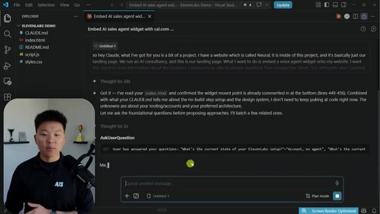
*⏱️ 00:11:19 — Image #1 montre l'éditeur VS Code avec une discussion interactive d'IA (interface de type assistant de code) en cours d'utilisation, ainsi que la webcam du présentateur en bas à gauche.*

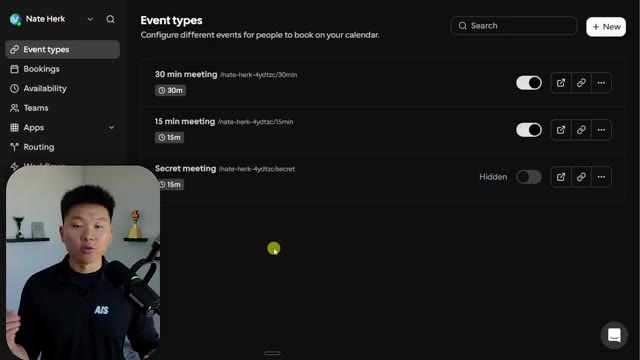
*⏱️ 00:11:25 — Image #2 montre l'interface web de cal.com affichant la configuration des types d'événements (« Event types »), avec la webcam du présentateur en bas à gauche.*

---

### ⏱️ `[00:11:39 - 00:12:13]` | Segment #29

**🔊 Audio (Transcription Intégrale Mot pour Mot en Français) :**
> Nous avons d'autres questions ici. Donc, comment le widget doit-il apparaître sur la page ? Une bulle flottante par défaut. C'est parfait. Quelle personnalité vocale voulez-vous pour l'agent ? Nous allons simplement opter pour un ton de vente B2B chaleureux et professionnel. C'est parfait. Et des champs de données au-delà du nom complet et de l'e-mail, qui sont obligatoires pour réserver. Que doit capturer l'agent pendant la conversation ? Le nom de l'entreprise serait formidable. Le problème qu'ils essaient de résoudre serait formidable. La taille de l'équipe et le rôle. Ce serait également formidable. Et s'il y a autre chose que je veux, je peux simplement aller de l'avant et ajouter autre chose, et je peux taper plus. Mais pour l'instant, je me contente de ces trois choses. J'espère donc que vous voyez la valeur jusqu'à présent. Il va faire toutes les recherches. Il va comprendre comment fabriquer ces deux

**👁️ Analyse Visuelle d'Écran (gemini-3.5-flash-lite) :**
**Interface & Outils** : Visual Studio Code

**Contenu textuel & Code** : Un éditeur de texte affichant une conversation avec une IA (mentionnant 'Embed AI sales agent widget with cal.com') et une fenêtre modale affichant les options de personnalité vocale, notamment 'Warm-professional, B2B sales tone'.

**Action / Démonstration** : Sélection de la personnalité vocale pour l'agent IA dans l'éditeur de code.

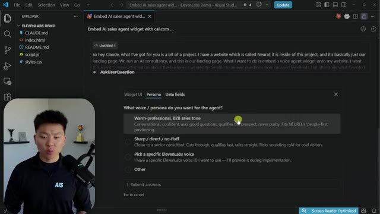
*⏱️ 00:11:47 — Capture d'écran de l'éditeur VS Code montrant une interface de configuration de persona vocal pour l'agent IA, avec le présentateur en incrustation vidéo dans le coin inférieur gauche.*

---

### ⏱️ `[00:12:13 - 00:12:49]` | Segment #30

**🔊 Audio (Transcription Intégrale Mot pour Mot en Français) :**
> les outils se parlent entre eux, ou trois techniquement je suppose. Et il va me poser toutes les questions dont j'ai besoin pour que cet agent se comporte de la manière que je souhaite vraiment. Très bien. Donc ce qui se passe maintenant, c'est qu'il revient avec un plan à examiner par nous. Donc agent commercial à voix neuronale plus réservation cal.com. Il va nous donner un peu de contexte et il va nous montrer l'architecture de ce qu'il est en train de configurer. Voyons donc ce qu'il va faire. Il va, tout d'abord, faire un peu de préparation cal.com. Nous allons donc devoir récupérer notre clé API et nous allons devoir la donner à CloudCode pour qu'il puisse réellement le faire. Et ensuite, nous allons devoir lui donner l'identifiant du type d'événement réel que nous voulions utiliser. Si vous vous souvenez dans Cal, nous en avions quelques différents

**👁️ Analyse Visuelle d'Écran (gemini-3.5-flash-lite) :**
**Interface & Outils** : Éditeur de code (type VS Code / Cursor) avec panneau latéral de discussion/plan d'agent IA.

**Contenu textuel & Code** : Texte du plan intitulé "NEUREL voice sales agent + cal.com booking", description du contexte et options de validation ("Yes, and auto-accept", "Yes, and manually approve edits", "No, keep planning").

**Action / Démonstration** : Examen du plan proposé par l'agent IA par l'utilisateur avant validation et application des modifications.

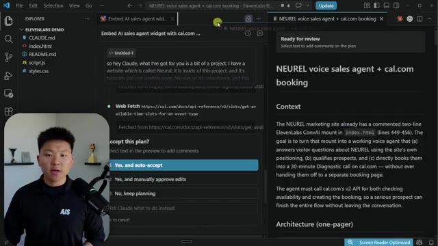
*⏱️ 00:12:22 — Un éditeur de code affichant un panneau de révision de plan d'action d'un agent IA pour "NEUREL voice sales agent + cal.com booking" avec le présentateur incrusté en bas à gauche.*

---

### ⏱️ `[00:12:49 - 00:13:08]` | Segment #31

**🔊 Audio (Transcription Intégrale Mot pour Mot en Français) :**
> événements. Donc on veut probablement lui donner l'ID pour cet événement de 30 minutes. Et ensuite, il va devoir s'assurer qu'il y a une authentification correcte entre 11labs et cal.com. J'espère qu'il est capable de s'occuper de tout cela pour nous. Et ensuite, il va procéder à la création de l'agent. Il va choisir une voix. Il va choisir un LLM. Il va configurer le premier message. Il va lui donner un prompt système. Il va faire tout cela pour nous. Et ensuite, il va configurer les outils.

**👁️ Analyse Visuelle d'Écran (gemini-3.5-flash-lite) :**
**Interface & Outils** : Éditeur de code / Navigateur web (Documentation markdown ou guide de configuration)

**Contenu textuel & Code** : Texte de documentation détaillant 'Step 2 — ElevenLabs workspace auth (3 min)' avec des instructions sur l'authentification des connexions et 'Step 3 — Create the agent (5 min)' avec la configuration (Nom : NEUREL Diagnostic, Voice, LLM, First message).

**Action / Démonstration** : Le présentateur explique les étapes de configuration de l'authentification et de la création de l'agent vocal en suivant la documentation affichée.

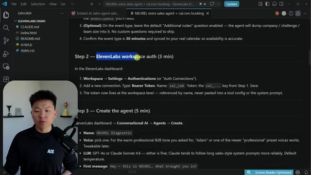
*⏱️ 00:12:54 — Capture d'écran montrant le présentateur dans un coin et, à l'écran, un éditeur de texte ou une documentation expliquant les étapes pour configurer l'authentification ElevenLabs workspace (Step 2) et créer l'agent (Step 3).*

---

### ⏱️ `[00:13:08 - 00:13:31]` | Segment #32

**🔊 Audio (Transcription Intégrale Mot pour Mot en Français) :**
> Et il semble qu'il va y en avoir deux. Il doit en ajouter un pour vérifier la disponibilité et ensuite il doit en ajouter un pour réellement réserver un appel. Donc c'est super. Ça va s'occuper de tout ça. Voici le prompt système qu'il a déjà rédigé, ce qui va bien pour l'instant. Et puis la dernière étape sera de connecter le widget au site. Donc c'est ce qu'on a. Je vais continuer et retourner à la conversation principale et je vais simplement accepter ces modifications parce que tout cela me semble bon.

**👁️ Analyse Visuelle d'Écran (gemini-3.5-flash-lite) :**
**Interface & Outils** : Interface web d'ElevenLabs dans VS Code.

**Contenu textuel & Code** : Configuration du webhook pour la réservation d'appels : URL `https://api.cal.com/v2/bookings` et paramètres (start, attendee.name, attendee.email).

**Action / Démonstration** : Le présentateur explique la configuration des outils de l'agent vocal pour l'intégration avec Cal.com.

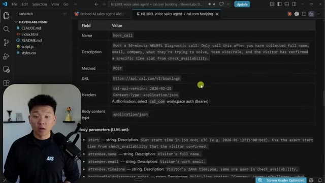
*⏱️ 00:13:14 — Interface de configuration d'un agent vocal montrant les paramètres de l'API Cal.com (nom, description, méthode POST, URL et paramètres du corps).*

---

### ⏱️ `[00:13:31 - 00:13:50]` | Segment #33

**🔊 Audio (Transcription Intégrale Mot pour Mot en Français) :**
> Et d'ailleurs, vous vous demandez peut-être pourquoi j'utilise Eleven Labs plutôt que d'autres outils disponibles ? Eh bien, j'ai mon clone vocal dans Eleven Labs. Et je pense que c'est le meilleur clone vocal professionnel que l'on puisse obtenir. J'aime aussi beaucoup l'interface. Autant nous voulons rester dans Cloud Code, mais quand je viens dans Eleven Labs, j'ai juste l'impression de savoir où se trouve chaque chose. Et j'aime la façon dont tout cela fonctionne. Et cela rend les choses super faciles avec ce widget intégré.

**👁️ Analyse Visuelle d'Écran (gemini-3.5-flash-lite) :**
**Interface & Outils** : Interface web d'ElevenLabs (ElevenAgents).

**Contenu textuel & Code** : Tableaux de bord de monitoring des agents vocaux affichant les métriques (nombre d'appels, durée moyenne, coûts en crédits et en LLM) ainsi qu'un menu latéral de configuration.

**Action / Démonstration** : Le présentateur commente l'interface et les fonctionnalités de la plateforme ElevenLabs en naviguant sur le tableau de bord.

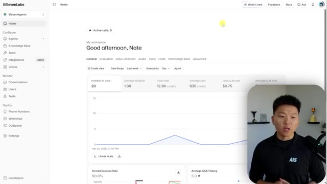
*⏱️ 00:13:36 — Capture d'écran montrant l'interface du tableau de bord d'ElevenLabs (ElevenAgents) avec des statistiques d'appels et de coûts, tandis que le présentateur apparaît en médaillon vidéo en bas à droite.*

---

### ⏱️ `[00:13:51 - 00:14:12]` | Segment #34

**🔊 Audio (Transcription Intégrale Mot pour Mot en Français) :**
> C'est donc pour ça que j'utilise ElevenLabs dans la vidéo d'aujourd'hui. Et si vous voulez jeter un œil à ElevenLabs, allez simplement cliquer sur ce lien dans la description. Et ça vous enverra directement ici. Et à ce stade, je vais mettre cet agent en mode de contournement des autorisations. Pour qu'il puisse tout simplement se lancer et pondre ce plan. Mais on dirait qu'il veut quelque chose très rapidement. L'ordre des opérations a son importance ici. Les étapes de un à six consistent toutes en un travail de tableau de bord dans cal.com et ElevenLabs que vous êtes le seul à pouvoir faire.

**👁️ Analyse Visuelle d'Écran (gemini-3.5-flash-lite) :**
**Interface & Outils** : Interface web d'ElevenLabs, Visual Studio Code, extension Claude pour l'édition de code.

**Contenu textuel & Code** : Tableaux de bord de gestion d'agents vocaux, graphiques statistiques et plan d'implémentation d'un agent de vente vocal.

**Action / Démonstration** : Navigation sur le tableau de bord ElevenLabs et affichage d'un plan d'intégration d'agent IA dans VS Code.

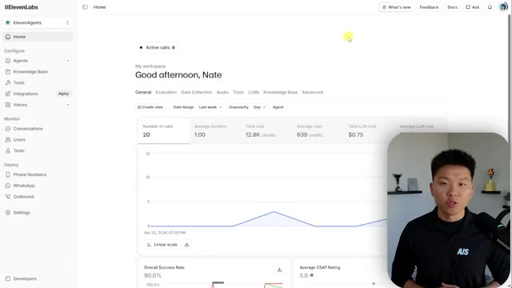
*⏱️ 00:13:56 — Le tableau de bord principal d'ElevenLabs affichant les statistiques d'utilisation des agents vocaux IA (appels, durée, coûts).*

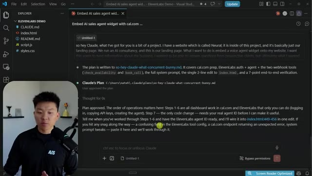
*⏱️ 00:14:01 — L'éditeur Visual Studio Code affichant une interface d'assistant de code IA avec un plan de développement détaillé.*

---

### ⏱️ `[00:14:13 - 00:14:33]` | Segment #35

**🔊 Audio (Transcription Intégrale Mot pour Mot en Français) :**
> On pourrait en fait le faire le faire si on lui donnait du genre d'utilisation de l'ordinateur. Mais bref, étape sept, le seul changement de code nécessite votre ID d'agent avant que je puisse le rendre utile. Très bien. Alors dites-moi exactement ce dont vous avez besoin de ma part. Si vous avez besoin de clés API, alors créez un fichier .env et je vais tout y déposer. Mais guidez-moi simplement étape par étape. De quoi avez-vous réellement besoin de ma part en ce moment ? Je veux que cela rende mon travail aussi facile que possible.

**👁️ Analyse Visuelle d'Écran (gemini-3.5-flash-lite) :**
**Interface & Outils** : VS Code / Éditeur de code avec extension ou panneau de chat IA intégré (Claude)

**Contenu textuel & Code** : Texte du plan de Claude expliquant l'intégration d'un widget d'agent commercial vocal ElevenLabs et Cal.com, mentionnant l'étape 7 avec l'ID d'agent requis.

**Action / Démonstration** : Affichage des instructions de l'assistant IA dans l'éditeur de code pour configurer l'ID d'agent ElevenLabs.

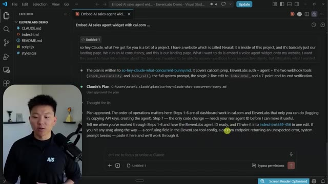
*⏱️ 00:14:18 — Interface de VS Code montrant une discussion avec un assistant IA (Claude) affichant un plan et les instructions pour intégrer un agent vocal ElevenLabs, avec le présentateur en médaillon vidéo.*

---

### ⏱️ `[00:14:33 - 00:14:55]` | Segment #36

**🔊 Audio (Transcription Intégrale Mot pour Mot en Français) :**
> D'accord. C'est assez drôle. Il voulait que j'aille tout faire. Alors j'ai dit, hé, je veux que tu fasses tout. Donc, tu sais, débrouille-toi. Et maintenant il revient et dit, d'accord, tu as raison. Je peux en fait faire une grande partie de ceci. Voici donc ce dont j'ai besoin de toi. Tu peux voir qu'il a créé un fichier .env et nous devons aller chercher notre clé API Cal et notre clé API 11labs. Allons donc faire ça très vite et lui faire savoir que ce travail a été fait.

**👁️ Analyse Visuelle d'Écran (gemini-3.5-flash-lite) :**
**Interface & Outils** : Visual Studio Code avec panneau de discussion IA intégré.

**Contenu textuel & Code** : Texte de l'assistant IA expliquant sa nouvelle stratégie ('Revised division of labor: What only you can do... What I'll do...').

**Action / Démonstration** : Lecture de la réponse de l'agent IA proposant de configurer la majeure partie du projet via les API REST d'ElevenLabs et Cal.com.

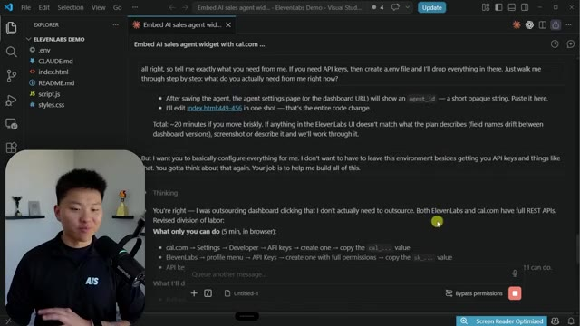
*⏱️ 00:14:39 — Vue de l'éditeur de code VS Code affichant un échange textuel avec un assistant IA qui redéfinit la répartition des tâches entre l'utilisateur et l'IA.*

---

### ⏱️ `[00:14:55 - 00:15:33]` | Segment #37

**🔊 Audio (Transcription Intégrale Mot pour Mot en Français) :**
> Donc d'abord, je vais aller sur Cal et je vais aller dans mes paramètres, et je vais cliquer sur clés API ici en bas, et je vais créer une nouvelle clé. Celle-ci va s'appeler démo. Je vais supprimer ça plus tard, donc je m'en fiche un peu. Et je vais créer ça, copier ceci, puis retourner dans Cloud Code. Et si je clique sur le .env, il a créé ces espaces réservés pour nous. Donc tout ce que j'ai à faire est de coller cette clé API, d'appuyer sur Contrôle-S, et c'est maintenant enregistré. Et maintenant pour 11 Labs, je retourne dans mon tableau de bord 11 Labs, et je viens dans mes paramètres, et je vais dans développeurs. Vous pouvez voir qu'il y a aussi un onglet de clés API ici. Je peux aller de l'avant et créer cette clé, appeler celle-ci démo et aller de l'avant et créer

**👁️ Analyse Visuelle d'Écran (gemini-3.5-flash-lite) :**
**Interface & Outils** : Cal.com et ElevenLabs (interfaces web).

**Contenu textuel & Code** : Nom de la clé API « demo », date d'expiration à 30 jours, et liste des agents vocaux existants sur ElevenLabs.

**Action / Démonstration** : Création d'une nouvelle clé API sur Cal.com et navigation sur la plateforme ElevenLabs.

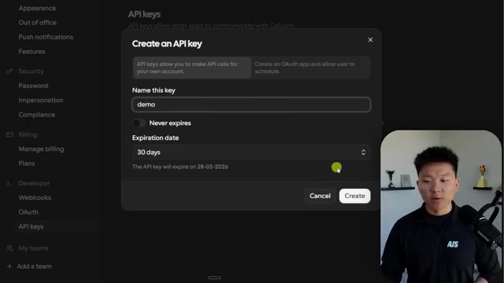
*⏱️ 00:15:05 — Interface des paramètres de Cal.com avec une fenêtre modale de création de clé API nommée « demo ».*

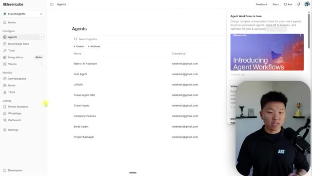
*⏱️ 00:15:23 — Tableau de bord d'ElevenLabs affichant la liste des agents vocaux configurés.*

---

### ⏱️ `[00:15:33 - 00:16:11]` | Segment #38

**🔊 Audio (Transcription Intégrale Mot pour Mot en Français) :**
> cette clé. Cependant, je n'ai sélectionné aucune permission. Donc ça dit que vous créez une clé API sans permissions. Donc elle ne pourra rien faire. Donc ce que vous devez faire, c'est lui donner accès à des choses, ou je pourrais simplement désactiver la restriction. Donc en gros, ça dit, Hé, cette clé peut tout faire, ce qui est très bien pour l'instant. Et vous pouvez aussi définir une sorte de limite de dépenses mensuelle, ce qui est plutôt cool. Mais je vais aller de l'avant et créer cette clé. Je vais copier cette clé API, retourner dans Cloud Code, la coller là-dedans, appuyer sur Contrôle S pour l'enregistrer, et ensuite je peux fermer ça. Et maintenant que nous avons configuré ces deux choses, Cloud Code, je viens d'y insérer ces clés API, je continue. Et maintenant vous pouvez voir que ça va simplement progresser à travers cette liste de tâches.

**👁️ Analyse Visuelle d'Écran (gemini-3.5-flash-lite) :**
**Interface & Outils** : Navigateur web (ElevenLabs Dashboard) et VS Code (avec extension Claude).

**Contenu textuel & Code** : Interface de gestion des clés API ElevenLabs et code source avec instructions de l'agent IA dans VS Code.

**Action / Démonstration** : Création d'une clé API sur ElevenLabs et configuration du projet dans VS Code.

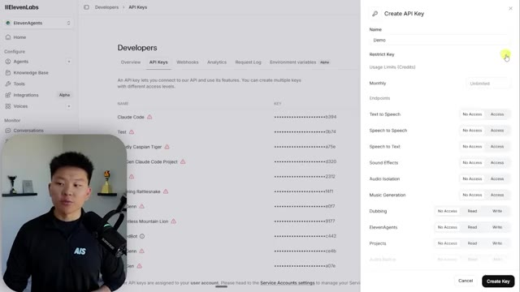
*⏱️ 00:15:42 — Interface de configuration des clés API sur le tableau de bord ElevenLabs avec un panneau latéral pour créer une clé nommée "Demo".*

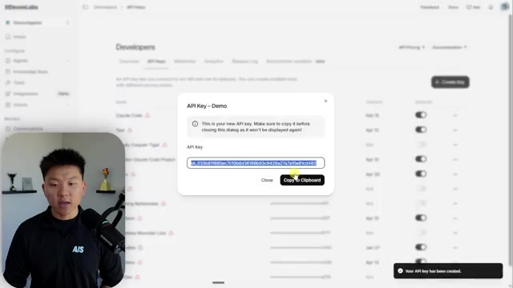
*⏱️ 00:15:52 — Popup de confirmation affichant la nouvelle clé API générée sur ElevenLabs avec le bouton "Copy to Clipboard".*

*⏱️ 00:16:01 — Éditeur VS Code affichant un assistant IA (Claude) listant les tâches à accomplir et demandant d'insérer les clés API dans le fichier `.env`.*

---

### ⏱️ `[00:16:11 - 00:16:30]` | Segment #39

**🔊 Audio (Transcription Intégrale Mot pour Mot en Français) :**
> Il va faire une pause et il va nous demander quelque chose s'il a besoin de nous, mais espérons qu'il devrait être capable de venir à bout de la plupart de ceux-ci sans notre intervention, parce que nous avons déjà pris le temps et fait l'effort d'expliquer ce que nous voulons et de nous aligner sur le plan avant de commencer à le laisser construire quoi que ce soit. Très bien, donc quelques minutes plus tard, apparemment tout est en ligne. Nous avons été vérifiés dans Calendar.

**👁️ Analyse Visuelle d'Écran (gemini-3.5-flash-lite) :**
**Interface & Outils** : Visual Studio Code (éditeur de code avec arborescence, éditeur markdown et invite de commande en bas).

**Contenu textuel & Code** : Instructions sous forme de liste à puces pour configurer des clés API Cal.com et ElevenLabs, et initialiser un agent IA, avec le prompt utilisateur "Claude code: I just dropped in those API keys. Keep going."

**Action / Démonstration** : L'utilisateur visualise le déroulement des tâches confiées à l'agent de code dans l'interface de développement.

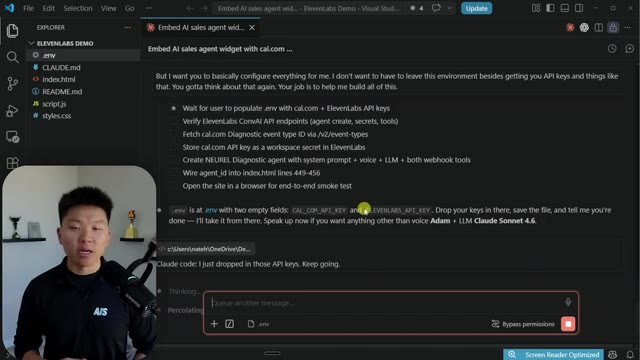
*⏱️ 00:16:16 — Vue de Visual Studio Code montrant un fichier Markdown ouvert avec des instructions pour l'agent IA, ainsi que l'arborescence des fichiers du projet à gauche et le présentateur incrusté en bas à gauche.*

---

### ⏱️ `[00:16:30 - 00:16:50]` | Segment #40

**🔊 Audio (Transcription Intégrale Mot pour Mot en Français) :**
> Ça va utiliser le créneau de 30 minutes, ce qui est très bien. Et ça suggère aussi de renommer cet appel Neural Diagnostic, parce que présentement dans notre calendrier, ça s'appelle juste un appel de 30 minutes ou quelque chose comme ça. Ouais, ça s'appelle juste réunion de 30 minutes. Donc ça nous indique que ça utilise celui-ci et ça veut qu'on le renomme, ce qui est un bon conseil. Ça a aussi créé un agent 11labs.

**👁️ Analyse Visuelle d'Écran (gemini-3.5-flash-lite) :**
**Interface & Outils** : VS Code / Cal.com

**Contenu textuel & Code** : Résumé de configuration Cal.com, identifiants d'événements, configuration de l'agent ElevenLabs et clés API Cal.com.

**Action / Démonstration** : Examen des résultats de configuration par Claude Code et navigation dans le tableau de bord Cal.com.

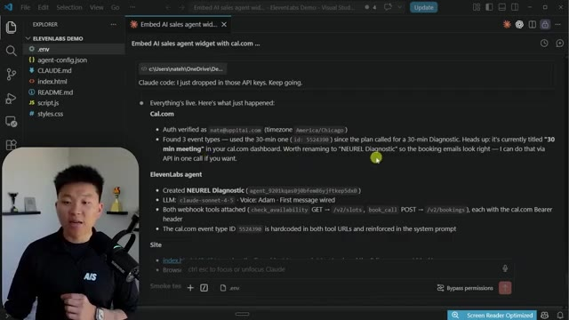
*⏱️ 00:16:35 — Interface VS Code affichant un résumé de Claude Code avec les détails de l'intégration Cal.com et ElevenLabs, incluant la suggestion de renommer le type d'événement.*

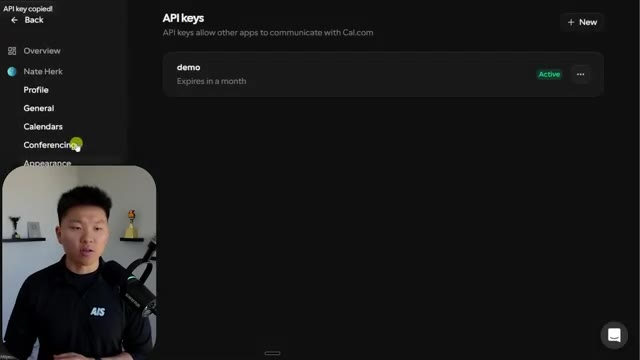
*⏱️ 00:16:40 — Interface web des paramètres de Cal.com montrant la section des clés API.*

---

### ⏱️ `[00:16:50 - 00:17:13]` | Segment #41

**🔊 Audio (Transcription Intégrale Mot pour Mot en Français) :**
> Donc si je vais dans mon tableau de bord ici pour les agents et que je clique sur agents, juste ici nous voyons neural diagnostics. Donc c'est celui qu'il vient de créer avec une invite système complète. Et si je clique sur outils, nous devrions voir que nous avons deux outils configurés, ce qui est génial. Nous ne les avons pas encore testés. Nous allons devoir voir s'ils fonctionnent, mais tout a l'air d'avoir effectivement été configuré. Donc il est dit que c'est maintenant en ligne sur le site, du moins la version localhost, et il veut qu'on le teste.

**👁️ Analyse Visuelle d'Écran (gemini-3.5-flash-lite) :**
**Interface & Outils** : Interface web d'ElevenLabs (tableau de bord des agents).

**Contenu textuel & Code** : Liste des agents IA avec leurs noms ('NEUREL Diagnostic', 'Nate's AI Assistant', 'JARVIS', etc.) et leurs dates de création.

**Action / Démonstration** : Le curseur de la souris survole l'agent 'NEUREL Diagnostic' dans la liste.

*⏱️ 00:16:56 — Tableau de bord ElevenLabs affichant la liste des agents configurés, avec en surbrillance l'agent 'NEUREL Diagnostic', et une incrustation vidéo du présentateur en bas à gauche.*

---

### ⏱️ `[00:17:13 - 00:17:32]` | Segment #42

**🔊 Audio (Transcription Intégrale Mot pour Mot en Français) :**
> Donc allons-y et ouvrons le site, faisons un rafraîchissement forcé. Et juste là en bas, vous pouvez voir que nous avons ce widget. Donc je vais cliquer sur démarrer l'appel et testons juste un peu ce truc. Hé, quoi de neuf ? Hé, juste là pour répondre à toutes vos questions sur Neural ou ce que nous faisons. Est-ce que vous examinez l'automatisation par IA pour votre équipe ou est-ce que quelque chose de spécifique a attiré votre attention ?

**👁️ Analyse Visuelle d'Écran (gemini-3.5-flash-lite) :**
**Interface & Outils** : Navigateur web affichant le site internet 'NEURAL' (Neurel) avec widget d'appel IA intégré.

**Contenu textuel & Code** : Page d'accueil du site 'NEUREL' avec le titre 'AI transformation without the layoffs' et l'interface vocale active.

**Action / Démonstration** : Le présentateur clique sur le widget d'appel pour lancer et tester l'interaction vocale en direct sur le site.

*⏱️ 00:17:17 — Le site web 'NEUREL' avec le widget d'appel vocal en bas à droite proposant le bouton 'Start a call'.*

*⏱️ 00:17:22 — Le site web 'NEUREL' où le widget d'appel vocal est actif, affichant une animation sphérique bleue d'onde vocale.*

---

### ⏱️ `[00:17:32 - 00:17:51]` | Segment #43

**🔊 Audio (Transcription Intégrale Mot pour Mot en Français) :**
> Bon. J'ai donc préféré raccrocher cet appel parce que je n'aime pas trop cette voix. C'était Adam et je n'aimais tout simplement pas sa façon de parler. De plus, pour une raison quelconque, le premier message n'est pas passé. J'ai donc cliqué sur le bouton et j'ai dû patienter. Et je me suis dit, bon, pourquoi ça ne parle pas ? Et ensuite, j'ai dû commencer à parler pour que ça revienne. Donc à ce stade, ce que vous allez faire, c'est continuer à faire des itérations. Ce ne sera pas parfait du premier coup.

**👁️ Analyse Visuelle d'Écran (gemini-3.5-flash-lite) :**
**Interface & Outils** : Interface web ElevenLabs / ElevenAgents

**Contenu textuel & Code** : Configuration d'agent vocal : prompt système définissant un consultant IA pour le site NEUREL, sélection de la voix Adam, paramétrage de la langue anglaise et du modèle LLM (Claude Sonnet 4.5).

**Action / Démonstration** : Navigation et configuration des paramètres de l'agent vocal ElevenLabs, avec un aperçu interactif de l'appel sur le panneau latéral droit.

*⏱️ 00:17:37 — Capture d'écran montrant l'interface d'ElevenLabs (ElevenAgents) avec le tableau de bord de configuration d'un agent vocal, incluant le prompt système, le choix de la voix ("Adam"), et un panneau de prévisualisation avec une animation visuelle bleue et un bouton de discussion.*

---

### ⏱️ `[00:17:51 - 00:18:10]` | Segment #44

**🔊 Audio (Transcription Intégrale Mot pour Mot en Français) :**
> Donc je vais y retourner. Je vais faire un transfert de session très rapide, qui va fondamentalement juste nous donner un message pour effacer le contexte et remettre le message juste parce que je veux garder mon contexte propre. Donc c'est capable de, tu sais, pour qu'on n'entre pas dans le territoire de saturation du contexte ou quelque chose comme ça. C'est fondamentalement une compétence que j'ai construite pour me donner juste un résumé d'où nous en sommes.

**👁️ Analyse Visuelle d'Écran (gemini-3.5-flash-lite) :**
**Interface & Outils** : Visual Studio Code / Terminal Claude Code

**Contenu textuel & Code** : Commandes et instructions relatives au widget de vente IA ElevenLabs et Cal.com, avec la commande `/session-handoff` et le texte "Discombobulatin..."

**Action / Démonstration** : Exécution d'un transfert de session (`/session-handoff`) pour nettoyer le contexte de l'assistant IA.

*⏱️ 00:17:56 — Vue de l'éditeur Visual Studio Code montrant l'interface de l'outil Claude Code avec la commande de transfert de session.*

---

### ⏱️ `[00:18:10 - 00:18:40]` | Segment #45

**🔊 Audio (Transcription Intégrale Mot pour Mot en Français) :**
> Ce qui est important à retenir. Si vous voulez aller voir ça, rejoignez ma communauté School gratuite, toutes mes compétences et toutes mes ressources y sont. Bon. Alors, nous venons de tester l'agent sur le site et ça a l'air bien. Ça fonctionne dans l'ensemble. Bon. Quelques trucs que j'ai remarqués. Tout d'abord, changez la voix. Je n'aime pas cette voix. Elle a l'air un peu trop enthousiaste. Ça fait trop IA. La deuxième chose, c'est que quand je clique sur démarrer un appel, ça ne me donne pas vraiment de premier message. Pour une raison quelconque, ça me force à commencer la conversation, même si dans le tableau de bord, on dirait bien que vous avez configuré un premier message, mais on ne le voit pas s'afficher en réalité.

**👁️ Analyse Visuelle d'Écran (gemini-3.5-flash-lite) :**
**Interface & Outils** : VS Code (éditeur de code) et navigateur web affichant le site Neurel.

**Contenu textuel & Code** : Instructions pour l'agent IA d'ElevenLabs ("Pick up here", "Wait for the user's smoke-test results", etc.) et interface web du site Neurel.

**Action / Démonstration** : Présentation du code de configuration de l'agent et démonstration du widget d'appel en direct sur le site web.

*⏱️ 00:18:18 — VS Code ouvert sur le projet ElevenLabs Demo, affichant un assistant IA avec des instructions de configuration de session et de test.*

*⏱️ 00:18:25 — Page d'accueil du site web "Neurel" avec le slogan "AI transformation without the layoffs" et un widget d'appel vocal en bas à droite.*

---

### ⏱️ `[00:18:40 - 00:19:15]` | Segment #46

**🔊 Audio (Transcription Intégrale Mot pour Mot en Français) :**
> Donc je n'ai pas encore testé les outils, mais je voulais juste apporter ces rapides modifications au prompt actuel. Donc ouais, vas-y, implémente ces changements et ensuite je vais le tester à nouveau. Et c'est vraiment aussi simple que ça, tu ispires en disant : "Hé, voici ce que j'ai aimé, voici ce que je n'ai pas aimé, va régler ça pour moi." Donc il a vraiment du mal avec cette histoire de premier message, et c'est marrant parce que sur mon autre site et celui-ci, quand j'ai fait ça, il a réussi le premier message du premier coup, il n'a eu aucun problème. C'est peut-être un truc qui se passe en coulisses, mais tu sais, je n'ai pas envie d'être celui qui doit fouiller dans la documentation pour comprendre ça, alors je lui fais faire cette recherche, il va chercher tout ce dont il a besoin de découvrir.

**👁️ Analyse Visuelle d'Écran (gemini-3.5-flash-lite) :**
**Interface & Outils** : Visual Studio Code et navigateur web affichant le site internet personnel.

**Contenu textuel & Code** : Fichiers de configuration `.env`, instructions textuelles pour l'agent de vente vocal et code du site web.

**Action / Démonstration** : Interaction avec l'éditeur de code et présentation du site web avec widget d'appel IA.

*⏱️ 00:18:49 — Vue de l'éditeur de code VS Code affichant un assistant IA et le panneau de configuration avec le présentateur en incrustation.*

*⏱️ 00:19:07 — Page web de la marque Nate Herk affichant le site 'AI Automation Made Easy' avec le widget vocal en bas à droite.*

---

### ⏱️ `[00:19:15 - 00:19:39]` | Segment #47

**🔊 Audio (Transcription Intégrale Mot pour Mot en Français) :**
> afin de régler ça donc j'espère que je vais vérifier avec vous dans une seconde et que ce problème sera réglé mais c'est juste un point de mentalité important à aborder ici car comme Cloud Code a la capacité de raisonner et de faire des recherches si quelque chose ne fonctionne pas soyez précis sur ce qui ne fonctionne pas et vous savez donnez-lui du contexte mais il va être capable d'aller faire des recherches pour trouver comment résoudre ce problème spécifique. Hé, c'est NERL. Qu'est-ce qui vous amène aujourd'hui ?

**👁️ Analyse Visuelle d'Écran (gemini-3.5-flash-lite) :**
**Interface & Outils** : Visual Studio Code / Extension Claude Code

**Contenu textuel & Code** : Prompt utilisateur « The first message still isn't coming through, fix this issue », une commande Bash utilisant curl pour interroger l'API ElevenLabs, et la réponse JSON correspondante avec un STATUS:200.

**Action / Démonstration** : L'assistant analyse le code et exécute des requêtes de diagnostic via son terminal intégré pour résoudre un problème de message manquant.

*⏱️ 00:19:21 — Capture d'écran montrant l'éditeur VS Code avec une interface d'agent conversationnel Claude Code intégrée, affichant un prompt sur le premier message et une commande Bash exécutée avec sa sortie.*

---

### ⏱️ `[00:19:40 - 00:20:14]` | Segment #48

**🔊 Audio (Transcription Intégrale Mot pour Mot en Français) :**
> Hé, NERL. Je me demandais si je pouvais réserver un appel. Compris. Juste pour clarifier, aujourd'hui nous sommes le 28 avril 2026, et il est actuellement environ 19h55 UTC, ce qui fait environ 14h55. Bon, c'était mieux, n'est-ce pas ? Nous devons modifier certaines choses parce qu'il se trompait sur l'heure actuelle. Et nous devons aussi mieux le prompter pour qu'il comprenne vraiment qu'il doit confirmer l'orthographe des noms des gens et l'orthographe de leurs e-mails, parce que le formatage n'était pas bon

**👁️ Analyse Visuelle d'Écran (gemini-3.5-flash-lite) :**
**Interface & Outils** : VS Code, assistant de code Claude Code

**Contenu textuel & Code** : Fichier index.html avec le code du widget ElevenLabs et modifications de script (ajout de "use-rtc").

**Action / Démonstration** : Modification du code source pour basculer le widget en mode WebRTC afin de corriger les problèmes audio.

*⏱️ 00:20:06 — Capture d'écran montrant l'éditeur de code VS Code avec le projet "ElevenLabs Demo" et l'interface de l'assistant Claude Code.*

---

### ⏱️ `[00:20:14 - 00:20:46]` | Segment #49

**🔊 Audio (Transcription Intégrale Mot pour Mot en Français) :**
> les e-mails, c'est ça. Donc, à chaque fois que vous discutez avec ce truc, vous allez probablement remarquer quelques points à améliorer. Donc, je vais fondamentalement juste lui donner ce retour, de la même manière que je vous ai dit ce qui manquait, et ensuite nous le testerons à nouveau et nous verrons, espérons-le, que c'est mieux. Maintenant, l'autre chose à laquelle vous allez devoir faire attention en ce qui concerne la disponibilité, c'est votre réservation réelle. Donc, que vous fassiez cela sur Calendly ou cal.com, la réservation a un certain genre de limite. Donc, si je viens ici et que je vais dans la disponibilité, vous pouvez voir que cela va seulement me donner une disponibilité entre 9h et 17h en semaine. Donc, si je voulais pouvoir changer cela, je devrais modifier cette disponibilité. Donc, disons simplement pour le

**👁️ Analyse Visuelle d'Écran (gemini-3.5-flash-lite) :**
**Interface & Outils** : Visual Studio Code (avec extension Claude Code) et Cal.com (interface web de prise de rendez-vous)

**Contenu textuel & Code** : Code source HTML modifié pour configurer un widget ElevenLabs Convai (activation du mode WebRTC) et liste des types d'événements de calendrier sur Cal.com.

**Action / Démonstration** : Modification du code pour corriger le problème de lecture audio du widget vocal et configuration des types de réunions sur le calendrier.

*⏱️ 00:20:22 — L'image montre l'interface de l'éditeur de code VS Code avec l'extension Claude Code affichant des modifications dans le fichier index.html, tandis que le présentateur apparaît en médaillon vidéo dans le coin inférieur gauche.*

*⏱️ 00:20:30 — L'image affiche l'interface d'administration de Cal.com montrant la configuration des types d'événements (réunions de 30 min, 15 min, réunion secrète), avec le présentateur en médaillon vidéo dans le coin inférieur droit.*

---

### ⏱️ `[00:20:46 - 00:21:21]` | Segment #50

**🔊 Audio (Transcription Intégrale Mot pour Mot en Français) :**
> de la démo, nous allons simplement dire que nous sommes disponibles de 9h à 21h. Et je vais simplement copier ces horaires pour toute la semaine. Comme je l'ai dit, juste pour les besoins de la démo, et nous allons enregistrer cela. D'accord, donc je fais quelques modifications ici. Il va parler uniquement dans le fuseau horaire central parce que c'est le mien. Il va parler un peu plus de manière concise, car je voulais simplement qu'il soit plus concis. Il va également vérifier qu'il répète correctement le nom et l'e-mail, car évidemment, il doit avoir le bon e-mail pour réserver le bon type de rendez-vous. Il a baissé un peu la température pour rendre les résultats un peu plus cohérents. Et je pense que c'était parce que je

**👁️ Analyse Visuelle d'Écran (gemini-3.5-flash-lite) :**
**Interface & Outils** : Cal.com et Visual Studio Code.

**Contenu textuel & Code** : Configuration des heures de travail (9h00 - 21h00 du lundi au vendredi) et tableau de suivi des modifications d'un agent IA.

**Action / Démonstration** : Le présentateur modifie et sauvegarde ses horaires de disponibilité, puis revient sur VS Code pour examiner la documentation.

*⏱️ 00:20:55 — Capture d'écran montrant l'interface web de configuration des horaires de travail (Working hours) sur Cal.com, avec le présentateur en incrustation.*

*⏱️ 00:21:04 — Capture d'écran montrant l'éditeur de code Visual Studio Code affichant un fichier Markdown de configuration d'agent IA, avec le présentateur en incrustation.*

---

### ⏱️ `[00:21:21 - 00:21:54]` | Segment #51

**🔊 Audio (Transcription Intégrale Mot pour Mot en Français) :**
> je lui ai demandé de le rendre plus concis. Et ensuite, il s'est aussi assuré que les outils fonctionnaient. Donc, ce que j'ai fini par faire, c'est dire : hé, je n'aime pas qu'il épelle avec l'alphabet phonétique de l'OTAN, parce que ça prenait tout simplement trop de temps. Donc, je lui fais aussi faire ce changement. Et une fois que c'est passé, ce qui a l'air d'être le cas maintenant, nous allons retourner dans l'application. Je vais lui donner un autre rafraîchissement forcé et essayons une fois de plus de faire une réservation. Et, espérons-le, à ce stade, nous nous dirons : ok, super, nous aimons cet agent. Donc, je vais l'appeler. Salut, ici Neural. Qu'est-ce qui vous amène aujourd'hui ? Salut Neural. Je possède une entreprise de construction, 500 employés. Nous cherchons à automatiser notre

**👁️ Analyse Visuelle d'Écran (gemini-3.5-flash-lite) :**
**Interface & Outils** : VS Code, Claude Code CLI, navigateur web affichant le site Neurel avec widget vocal intégré.

**Contenu textuel & Code** : Fichier agent-patch.json, instructions textuelles de modification pour supprimer l'alphabet phonétique de l'OTAN.

**Action / Démonstration** : Modification du code source et test de l'interface web avec l'agent conversationnel.

*⏱️ 00:21:29 — Vue de l'éditeur VS Code affichant un fichier de configuration et un terminal Claude Code en cours d'exécution.*

*⏱️ 00:21:38 — Page web du site de Neurel avec le widget d'assistant vocal IA visible en bas à droite de l'écran.*

*⏱️ 00:21:46 — Page web du site de Neurel montrant le widget vocal en cours d'interaction avec l'utilisateur.*

---

### ⏱️ `[00:21:54 - 00:22:13]` | Segment #52

**🔊 Audio (Transcription Intégrale Mot pour Mot en Français) :**
> génération de propositions. C'est très manuel. Et je veux réserver un appel avec votre équipe. Comme je l'ai dit, je suis le fondateur et le propriétaire de cette entreprise appelée Sandbox Construction. Compris. Tu veux que je prenne des minutes sur le calendrier de l'équipe ? C'est un appel pour voir s'il y a une adéquation ou non. Aucune pression. Ils écouteront ce que vous gérez et vous diront franchement si nous pouvons aider.

**👁️ Analyse Visuelle d'Écran (gemini-3.5-flash-lite) :**
**Interface & Outils** : Navigateur web affichant une page d'accueil moderne avec interface de chat intégrée.

**Contenu textuel & Code** : Texte du site 'AI transformation without the layoffs' et interface de discussion 'Hey, this is NEUREL. What brought you in today?'.

**Action / Démonstration** : Navigation et présentation de la plateforme web de service client/IA de Neurel.

*⏱️ 00:21:59 — Capture d'écran montrant le site web 'Neurel' avec un titre principal axé sur la transformation par l'IA, ainsi qu'une fenêtre de chat contextuelle à droite et une incrustation vidéo du présentateur en bas à gauche.*

---

### ⏱️ `[00:22:14 - 00:22:35]` | Segment #53

**🔊 Audio (Transcription Intégrale Mot pour Mot en Français) :**
> Ouais, allons-y pour planifier un moment. Tu peux me dire quels créneaux sont disponibles pour aujourd'hui ? Bien sûr. Quel est ton nom complet et dans quel fuseau horaire es-tu ? Je m'appelle Nate Herc, épelé H-E-R-K. Je suis dans le fuseau horaire central. Laissez-moi confirmer N-A-T-E-N-A-T-H-E-R-K-HERK. Est-ce que j'ai bien compris ? Ouais, c'est ça.

**👁️ Analyse Visuelle d'Écran (gemini-3.5-flash-lite) :**
**Interface & Outils** : Navigateur web affichant le site de l'agence Neurel et son widget de chat IA interactif.

**Contenu textuel & Code** : Page web avec le titre "AI transformation without the layoffs" et une conversation affichée dans le widget de chat à droite.

**Action / Démonstration** : Présentation du site web et démonstration en direct d'un agent conversationnel intégré pour la prise de rendez-vous.

*⏱️ 00:22:19 — Capture d'écran montrant la page web du site "NEUREL" avec un widget de chat conversationnel IA en bas à droite et le présentateur visible dans un encadré en bas à gauche.*

---

### ⏱️ `[00:22:37 - 00:23:12]` | Segment #54

**🔊 Audio (Transcription Intégrale Mot pour Mot en Français) :**
> Génial. Et quel est votre e-mail professionnel ? Épelez-le-moi caractère par caractère. Laissez-moi confirmer N-A-T-E-H-E-R-K-88 at gmail.com. J'ai bien compris ? Ouais. Parfait. Et qu'essayez-vous spécifiquement de résoudre avec la génération de propositions ? Qu'est-ce qui est manuel là-dedans aujourd'hui ? Ouais, on rédige essentiellement toutes les propositions à la main et on fait aussi tous les chiffrages manuellement. Donc je veux que l'intelligence artificielle puisse nous aider à prendre des exigences brutes et à les transformer en une proposition qu'on peut tout simplement envoyer à nos clients. C'est bien noté. Et quelle est la taille des

**👁️ Analyse Visuelle d'Écran (gemini-3.5-flash-lite) :**
**Interface & Outils** : Navigateur web affichant la page d'accueil du site Neurel et un widget de chat vocal interactif sur le côté droit.

**Contenu textuel & Code** : Transcription de la conversation vocale entre l'assistant IA et l'utilisateur (« My name is Nate Hurk... », « Let me confirm - N. A. T. E... », etc.) et le texte de présentation du site (« AI transformation without the layoffs »).

**Action / Démonstration** : Démonstration en direct d'une interaction vocale avec un assistant conversationnel intégré sur un site web professionnel.

*⏱️ 00:22:45 — Capture d'écran montrant le site web de l'agence Neurel avec, superposée à droite, une interface de discussion vocale sous forme de chat affichant la transcription de la conversation en cours.*

---

### ⏱️ `[00:23:12 - 00:23:35]` | Segment #55

**🔊 Audio (Transcription Intégrale Mot pour Mot en Français) :**
> l'équipe qui gère les propositions en ce moment ? Ou quel est ton rôle dans le processus ? L'équipe compte 500 personnes et mon rôle est juste, je supervise en quelque sorte. Il me reste un créneau aujourd'hui, 18h30 heure centrale. Est-ce que ça va ? Ouais, je veux dire, ça va, mais j'aimerais bien pouvoir le faire, tu sais, à 19h30 heure centrale.

**👁️ Analyse Visuelle d'Écran (gemini-3.5-flash-lite) :**
**Interface & Outils** : Google Calendar (interface web)

**Contenu textuel & Code** : Planning du 28 avril 2026 affichant des créneaux de réunion et de disponibilité

**Action / Démonstration** : Navigation et consultation du calendrier pour planifier un créneau à 18h30

*⏱️ 00:23:29 — Capture montrant une interface de calendrier numérique (Google Calendar) avec les créneaux horaires de la journée et le présentateur en médaillon.*

---

### ⏱️ `[00:23:35 - 00:24:03]` | Segment #56

**🔊 Audio (Transcription Intégrale Mot pour Mot en Français) :**
> Ce n'est pas disponible ? Ça ne montre rien à 19h30 aujourd'hui. Tu veux que je vérifie demain ou un autre jour cette semaine ? D'accord, donc ce qu'on remarque ici, c'est que le flux fonctionne un peu mieux. Honnêtement, je pense que ça me pose trop de questions parce que ça rend la démo un peu difficile, mais il devrait y avoir des créneaux libres. Vous pouvez voir que le calendrier est ouvert de genre 16h00 jusqu'à 21h00, ce qui, si l'on revient à notre événement de calendrier, devrait nous laisser de la disponibilité depuis 9h00 du matin.

**👁️ Analyse Visuelle d'Écran (gemini-3.5-flash-lite) :**
**Interface & Outils** : Navigateur web affichant un site internet d'entreprise et Google Calendar.

**Contenu textuel & Code** : Interface de chat avec messages textuels et options d'évaluation, ainsi qu'un calendrier avec des plages horaires.

**Action / Démonstration** : Navigation et démonstration d'un flux de conversation par agent IA lié à la gestion d'un calendrier.

*⏱️ 00:23:42 — Capture montrant un site web professionnel avec un widget de chat interactif en bas à droite où une conversation est affichée, et la webcam du présentateur en médaillon.*

*⏱️ 00:23:56 — Capture montrant une interface de calendrier (Google Calendar) avec des événements planifiés, et la webcam du présentateur en superposition.*

---

### ⏱️ `[00:24:03 - 00:24:35]` | Segment #57

**🔊 Audio (Transcription Intégrale Mot pour Mot en Français) :**
> jusqu'à 21 heures. Donc ce que je veux faire, c'est je veux comprendre pourquoi l'outil calendrier ne fonctionne pas comme il le devrait. Donc je vais procéder à un autre transfert de session. Je vais effacer le contexte pour que nous puissions demander à Cloud Code de nous aider à déboguer ce problème. C'est donc ce que j'ai dit. J'ai dit : j'ai besoin que tu m'aides à comprendre ce qui se passe avec l'appel d'outil, car l'outil de vérification de disponibilité vient de dire, hé, nous avons seulement 18h30 de disponible, mais nous devrions voir de 16h00 jusqu'à 21h00. Il y a donc plusieurs choses qui pourraient mal se passer ici, n'est-ce pas ? Cal.com pourrait ne renvoyer que 18h30, ce qui signifierait que quelque chose ne va pas sur Cal.com ou que l'agent n'utilise pas l'outil

**👁️ Analyse Visuelle d'Écran (gemini-3.5-flash-lite) :**
**Interface & Outils** : Visual Studio Code (avec extension de chat IA / Claude Code)

**Contenu textuel & Code** : Fichiers du projet (agent-config.json, .env, CLAUDE.md), commande `/session-handoff` et texte de prompt concernant le débogage des créneaux horaires disponibles.

**Action / Démonstration** : Effectuer un transfert de session (`/session-handoff`) dans l'outil de développement IA pour déboguer le problème de l'outil de calendrier.

*⏱️ 00:24:11 — VS Code affichant un panneau de chat avec Claude Code, montrant la commande de transfert de session `/session-handoff` et le présentateur à droite.*

*⏱️ 00:24:19 — VS Code avec le panneau de chat de l'assistant IA affichant un prompt détaillé sur les problèmes d'appel d'outils du calendrier Cal.com et le présentateur à gauche.*

---

### ⏱️ `[00:24:35 - 00:25:08]` | Segment #58

**🔊 Audio (Transcription Intégrale Mot pour Mot en Français) :**
> correctement. Et peut-être qu'il interroge seulement un périmètre très limité ou que Cal.com renvoie plusieurs créneaux, mais que l'agent lit mal le résultat. Il y a donc en gros trois pièces différentes ou trois domaines différents où quelque chose pourrait mal tourner. Et nous devons déterminer lequel de ces cas s'est produit afin de pouvoir le corriger. Tu sais, nous pourrions aller dans notre tableau de bord actuel et nous pourrions cliquer sur les outils et nous pourrions examiner cet endpoint et nous pourrions comprendre ce qui se passe. Et ce qui est également génial, c'est que nous pouvons voir toutes les conversations réelles que nous avons eues. Nous pouvons donc suivre tout cela, à quelles heures elles ont eu lieu. Nous pouvons également les écouter et lire la transcription. Et c'est ce qui aide

**👁️ Analyse Visuelle d'Écran (gemini-3.5-flash-lite) :**
**Interface & Outils** : Visual Studio Code et ElevenLabs Dashboard

**Contenu textuel & Code** : Texte d'analyse des erreurs (Cal.com, tool-call payload, créneaux horaires) et listes de conversations d'agents vocaux dans ElevenLabs.

**Action / Démonstration** : Analyse et débogage du comportement d'un agent vocal IA interagissant avec Cal.com.

*⏱️ 00:24:44 — Image #1 montre l'éditeur de code VS Code avec l'interface d'un assistant IA affichant les trois causes possibles du problème lié à Cal.com et une commande Bash pour interroger les créneaux disponibles.*

*⏱️ 00:25:00 — Image #2 montre l'interface d'ElevenLabs (tableau de bord de l'agent "NEUREL Diagnostic", onglet "Analysis") listant l'historique des conversations avec leurs statuts.*

---

### ⏱️ `[00:25:08 - 00:25:42]` | Segment #59

**🔊 Audio (Transcription Intégrale Mot pour Mot en Français) :**
> nous ayons plus de visibilité afin de déboguer et d'optimiser tout cela au fil du temps. D'accord. Donc, apparemment, l'agent a trouvé le problème. Il y a donc deux problèmes. L'un d'eux est un vrai bug, malheureusement. Donc, au tour 16 de la transcription, nous pouvons voir ce qui s'est réellement passé avec la vérification de la disponibilité. Et l'agent a configuré cela en UTC plutôt qu'en heure centrale. La fenêtre de recherche était donc faussée. Ce qu'il doit donc faire, c'est modifier le paramètre réel afin d'interroger au bon endroit. Et ensuite, espérons-le, nous devrions être capables de corriger cela. Il y a une autre observation : le prompt système indique de simplement redonner deux ou trois créneaux, mais ce n'est pas vraiment le problème principal. Le problème principal était que le

**👁️ Analyse Visuelle d'Écran (gemini-3.5-flash-lite) :**
**Interface & Outils** : Visual Studio Code (éditeur de code)

**Contenu textuel & Code** : Document Markdown expliquant un problème de gestion des fuseaux horaires (UTC vs Central time) avec un outil de vérification de disponibilité (tool call: check_availability).

**Action / Démonstration** : Le présentateur commente le compte rendu textuel généré par l'agent IA expliquant la cause racine du bogue.

*⏱️ 00:25:16 — Vue de l'éditeur VS Code montrant un panneau Markdown détaillant l'analyse du bug (turn 16 in the transcript) avec le présentateur incrusté en bas à gauche.*

---

### ⏱️ `[00:25:42 - 00:26:04]` | Segment #60

**🔊 Audio (Transcription Intégrale Mot pour Mot en Français) :**
> l'appel d'outil réel était mal effectué. Donc pendant que cela corrige, retournons simplement au tableau de bord et parlons de la façon dont nous y sommes parvenus, d'accord ? Nous aurions pu soit venir ici manuellement et tout inspecter et essayer de comprendre. Mais est-ce que vous avez vu à quel tout cela a été facile pour Cloud Code de trouver cela ? Et tout ce que j'avais à faire, c'était d'expliquer mon expérience, ce que j'ai vécu qui a mal tourné. Maintenant, certains d'entre vous ont peut-être entendu cette démo et pourraient être curieux concernant la latence et tout ça.

**👁️ Analyse Visuelle d'Écran (gemini-3.5-flash-lite) :**
**Interface & Outils** : Interface web ElevenLabs (ElevenAgents)

**Contenu textuel & Code** : Tableau de bord d'analyse listant les conversations avec le statut 'Successful', paramètres du modèle LLM d'analyse (Gemini 2.5 Flash), critères d'évaluation et widget de chat/appel vocal.

**Action / Démonstration** : Navigation sur le tableau de bord d'analyse de l'agent après un appel d'outil pour examiner les résultats et l'historique des interactions.

*⏱️ 00:25:48 — Capture d'écran montrant l'interface d'ElevenLabs avec le tableau de bord d'analyse d'un agent IA (NEUREL Diagnostic), affichant l'historique des conversations et le panneau de test interactif sur le côté droit, avec le présentateur incrusté en bas à gauche.*

---

### ⏱️ `[00:26:04 - 00:26:25]` | Segment #61

**🔊 Audio (Transcription Intégrale Mot pour Mot en Français) :**
> C'est là que vous voudriez intervenir et tester différents modèles et différents prompts. Et j'ai aussi remarqué que lorsque je teste cela sur un site web avec un serveur local, la latence est juste un peu pire que lorsque c'est en fait une sorte de widget en direct. Donc gardez cela à l'esprit. Mais il y a d'autres choses que vous pouvez faire. Si vous vous souvenez ici, nous voyions fondamentalement la transcription en direct. Et si vous n'aimez pas ça, vous n'êtes pas obligé de l'avoir. C'est juste quelque chose que mon code cloud ici a ajouté.

**👁️ Analyse Visuelle d'Écran (gemini-3.5-flash-lite) :**
**Interface & Outils** : Interface ElevenLabs et site web Neurel.

**Contenu textuel & Code** : Paramètres d'analyse d'agents vocaux et interface de widget de test en direct.

**Action / Démonstration** : Présentation des réglages de modèles et des tests sur widget en direct.

*⏱️ 00:26:09 — Interface d'ElevenLabs montrant le tableau de bord d'analyse d'agents vocaux avec un widget de test en direct sur le côté droit.*

*⏱️ 00:26:20 — Page web de l'entreprise NEUREL avec un widget de chat en direct intégré en bas à droite montrant une conversation.*

---

### ⏱️ `[00:26:25 - 00:26:44]` | Segment #62

**🔊 Audio (Transcription Intégrale Mot pour Mot en Français) :**
> Mais lorsque vous arrivez sur le widget, vous pouvez configurer beaucoup de choses différentes avec l'interface. Vous pouvez changer la couleur. Vous pouvez voir ce texte envoyé pendant l'appel. Vous pouvez avoir une transcription en temps réel. Il y a beaucoup de choses que vous pouvez faire lorsque vous configurez ce widget réel. Comme je l'ai dit, cela peut être une image différente si vous voulez. Cela peut être une couleur différente. Beaucoup de choses que vous pouvez faire ici. Bon, alors de toute façon, qu'est-ce qui a cassé ?

**👁️ Analyse Visuelle d'Écran (gemini-3.5-flash-lite) :**
**Interface & Outils** : Interface web d'ElevenLabs (ElevenAgents).

**Contenu textuel & Code** : Paramètres de configuration du widget incluant "Chat (text-only) mode", "Send text while on call", et "Realtime transcript of the call".

**Action / Démonstration** : Le présentateur présente et commente les différentes options de configuration de l'interface du widget.

*⏱️ 00:26:30 — Capture d'écran montrant l'interface de configuration du widget ElevenLabs avec les options d'interface, le code d'intégration et l'aperçu du widget sur la droite.*

---

### ⏱️ `[00:26:44 - 00:27:02]` | Segment #63

**🔊 Audio (Transcription Intégrale Mot pour Mot en Français) :**
> Nous venons de voir ce qui a planté. Et maintenant, apparemment, c'est réparé. Donc on va faire un autre rechargement forcé et on va essayer de dérouler une autre démo parce que ce type, Neural, aime vraiment beaucoup trop parler. Mais voyons voir si c'est réparé. Salut, c'est Neural. Qu'est-ce qui vous amène aujourd'hui ? D'accord, je ne veux pas que vous me posiez de questions. Je veux juste que vous me réserviez un appel.

**👁️ Analyse Visuelle d'Écran (gemini-3.5-flash-lite) :**
**Interface & Outils** : Visual Studio Code et navigateur web affichant le site web et l'agent vocal Neurel.

**Contenu textuel & Code** : Documentation de session de correction ("Session Handoff — NEUREL voice agent iteration") et texte d'accueil de l'agent vocal ("Hey, this is NEUREL. What brought you in today?").

**Action / Démonstration** : Rechargement forcé de la page web pour tester le widget vocal réparé et démarrer une nouvelle démo.

*⏱️ 00:26:48 — Vue de l'éditeur de code (VS Code) montrant un fichier de configuration et de documentation pour un agent vocal IA (Embed AI sales agent widget).*

*⏱️ 00:26:53 — Page web de l'entreprise "NEUREL" avec un widget de chat vocal IA en bas à droite proposant de démarrer un appel.*

*⏱️ 00:26:57 — Page web de "NEUREL" avec le widget vocal ouvert affichant un message de salutation et le bouton "Talk to interrupt".*

---

### ⏱️ `[00:27:02 - 00:27:32]` | Segment #64

**🔊 Audio (Transcription Intégrale Mot pour Mot en Français) :**
> Tout de suite, s'il vous plaît, réservez un appel. Je m'appelle Nate Herc, H-E-R-K. Mon e-mail est nateherk88 at gmail.com, N-A-T-E-H-E-R-K-88 at gmail.com. Et je veux des disponibilités pour ce soir. J'ai besoin de caler quelque chose de toute urgence. S'il vous plaît, ne me posez pas de questions et laissez-moi réserver un appel. J'ai ce soir à 18h30, 19h30, 20h30 ou 20h30 heure centrale.

**👁️ Analyse Visuelle d'Écran (gemini-3.5-flash-lite) :**
**Interface & Outils** : Navigateur web affichant une page d'accueil moderne avec un widget d'assistant conversationnel (IA) et incrustation vidéo de la webcam du présentateur.

**Contenu textuel & Code** : Texte principal du site : 'AI transformation, without the layoffs.' et dans la bulle de chat : 'Hey, this is NEUREL. What brought you in today?'

**Action / Démonstration** : Présentation de l'interface web et du widget d'intelligence artificielle intégré au site pendant que le présentateur parle.

*⏱️ 00:27:10 — Capture d'écran montrant la page web de l'entreprise NEUREL avec le titre 'AI transformation, without the layoffs.' et une petite fenêtre de chat textuel/vocal sur le côté droit, ainsi que le présentateur en incrustation vidéo dans le coin inférieur gauche.*

---

### ⏱️ `[00:27:32 - 00:27:51]` | Segment #65

**🔊 Audio (Transcription Intégrale Mot pour Mot en Français) :**
> Lequel vous convient ? Allons-y pour 19h00 heure du Centre. C'est tout bon pour 19h00 heure du Centre ce soir. Vous recevrez un e-mail de confirmation à nateherk88 arobase gmail.com avec le lien de la vidéo. D'accord, donc ça a réellement fonctionné. Vous pouvez voir que ça a été complètement débogué.

**👁️ Analyse Visuelle d'Écran (gemini-3.5-flash-lite) :**
**Interface & Outils** : Interface web du site Neurel et Google Calendar.

**Contenu textuel & Code** : Chatbot vocal interactif et détails d'un rendez-vous de 30 minutes entre Nate Herk et nateherk88@gmail.com.

**Action / Démonstration** : Démonstration de la prise de rendez-vous en direct via l'assistant vocal et vérification dans le calendrier.

*⏱️ 00:27:37 — Capture montrant le site web "Neurel" avec un chatbot vocal intégré en bas à droite en train de converser.*

*⏱️ 00:27:47 — Capture montrant Google Calendar avec les détails d'un événement de réunion planifié automatiquement par l'agent IA à 19h00.*

---

### ⏱️ `[00:27:51 - 00:28:25]` | Segment #66

**🔊 Audio (Transcription Intégrale Mot pour Mot en Français) :**
> Et la raison pour laquelle vous vous demandez peut-être pourquoi 4h30 ou 5h n'étaient pas disponibles... Eh bien, je suppose que c'était dans Cal. Donc si je viens dans Cal et que je vais dans les limites, il y a probablement quelque chose ici. Le préavis minimum est de deux heures. Donc s'il est actuellement 4h30, le premier créneau disponible sera 6h30 parce que c'est deux heures plus tard. Donc ça a parfaitement fonctionné. Ça a trouvé la bonne disponibilité et ça a réservé cette réunion avec le bon e-mail, comme vous pouvez le voir. Et aussi sur mon nateherk88@gmail.com, je viens de recevoir cette notification. Donc cela aurait envoyé avec précision un e-mail à n'importe quel client qui a réservé.

**👁️ Analyse Visuelle d'Écran (gemini-3.5-flash-lite) :**
**Interface & Outils** : Cal.com, Google Calendar, Gmail

**Contenu textuel & Code** : Paramètres de disponibilité, vue journalière du calendrier du 28 avril 2026, email de confirmation "Your event has been scheduled"

**Action / Démonstration** : Navigation entre les paramètres de Cal.com, le calendrier et les e-mails pour analyser les disponibilités de réservation.

*⏱️ 00:28:00 — L'interface des paramètres d'un événement Cal.com montrant la disponibilité hebdomadaire.*

*⏱️ 00:28:08 — Une vue calendrier affichant les événements du 28 avril 2026.*

*⏱️ 00:28:17 — Une interface Gmail affichant un email de confirmation de réunion Cal.com.*

---

### ⏱️ `[00:28:25 - 00:29:00]` | Segment #67

**🔊 Audio (Transcription Intégrale Mot pour Mot en Français) :**
> un appel directement ici. Donc tout a parfaitement fonctionné. Il y a évidemment des choses que je n'aime pas trop dans le prompt et peut-être dans l'apparence. Et c'est là que vous commenceriez à affiner ce genre de choses. Mais d'un point de vue technique, cela a fonctionné comme prévu. Les outils fonctionnent, vous savez, la création fonctionne. Et c'est ce qui est le plus important pour les besoins de cette démo, c'était de vous montrer comment nous avons configuré cela sans avoir à lire de documentation d'API ni à faire quoi que ce soit manuellement dans la configuration réelle de cet agent sur ElevenLabs. Et maintenant, ce que vous feriez à ce stade, c'est pratiquement juste publier ce site web.

**👁️ Analyse Visuelle d'Écran (gemini-3.5-flash-lite) :**
**Interface & Outils** : Navigateur web affichant le site web "NEUREL" avec un widget de chat intégré.

**Contenu textuel & Code** : Texte de la page d'accueil "AI transformation without the layoffs." et discussion textuelle dans le widget de chat montrant un échange pour planifier un appel.

**Action / Démonstration** : Présentation et démonstration du fonctionnement technique du chatbot intégré sur le site web.

*⏱️ 00:28:34 — Capture d'écran montrant le présentateur à gauche et la page web du site "NEUREL" à droite, avec une interface de chat interactive ouverte affichant une conversation de réservation d'appel.*

---

### ⏱️ `[00:29:00 - 00:29:34]` | Segment #68

**🔊 Audio (Transcription Intégrale Mot pour Mot en Français) :**
> Donc je ne vais pas passer en revue cela dans la vidéo d'aujourd'hui, mais tout ce que vous auriez à faire, c'est de synchroniser ce site web avec une URL GitHub ou un dépôt GitHub. Et ensuite, vous synchroniseriez ce dépôt GitHub avec Vercel. J'ai donc fait plusieurs vidéos où j'ai abordé cela. Je vais en étiqueter une juste ici si vous voulez voir ce processus, mais c'est super simple. Alors maintenant, parlons de qui paie, car il y a vraiment certaines choses dont vous devez tenir compte lorsque vous mettez un widget sur votre site web. Ce widget est synchronisé avec votre compte ElevenLabs. Donc, chaque fois que quelqu'un lui parle, c'est vous qui allez assumer ce coût. À moins, bien sûr, que vous ayez une sorte d'authentification ou que ce soit une application et qu'ils entrent leur clé API, alors cela va évidemment leur être facturé. Mais si vous

**👁️ Analyse Visuelle d'Écran (gemini-3.5-flash-lite) :**
**Interface & Outils** : Visual Studio Code / Claude Code

**Contenu textuel & Code** : Fichiers du projet (index.html, script.js, styles.css, etc.) et interface de chat de Claude Code avec des instructions de test et de configuration.

**Action / Démonstration** : Navigation et présentation du projet de code dans l'éditeur.

*⏱️ 00:29:09 — L'éditeur de code VS Code affichant un projet de démonstration avec Claude Code dans le volet principal et la webcam du présentateur en incrustation à gauche.*

---

### ⏱️ `[00:29:34 - 00:30:09]` | Segment #69

**🔊 Audio (Transcription Intégrale Mot pour Mot en Français) :**
> laissez simplement ça sur votre site web et que quelqu'un a de très mauvaises intentions et lui parle 24 heures sur 24, cela va revenir et consommer vos crédits. C'est donc quelque il faut prendre en compte. Il y a donc des choses que vous pouvez faire en matière de sécurité. L'une d'elles consiste simplement à verrouiller le nom d'hôte, n'est-ce pas ? Ce widget ne peut apparaître que sur nateherk.com, nulle part ailleurs. Au cas où quelqu'un inspecterait le code, volerait ce widget HTML, ce qui est tout à fait faisable, vous savez, parce que le widget se résume essentiellement à cela. Si quelqu'un le volait et le mettait sur son site, boum, il dispose d'un agent vocal qui vous appartient. Vous pouvez donc aller dans la sécurité et restreindre l'accès par domaine. Vous pouvez donc ajouter l'hôte à une liste autorisée. Et je crois aussi que dans le widget,

**👁️ Analyse Visuelle d'Écran (gemini-3.5-flash-lite) :**
**Interface & Outils** : ElevenLabs (Interface web de gestion d'agents vocaux et widget)

**Contenu textuel & Code** : Code d'intégration HTML `<elevenlabs-conval agent-id="...">` et options de configuration du widget (feedback collection, chat mode, etc.).

**Action / Démonstration** : Le présentateur explique comment intégrer le widget sur un site web et montre les paramètres de configuration.

*⏱️ 00:30:00 — Interface de configuration du Widget ElevenLabs montrant les options d'intégration web et de code d'intégration.*

---

### ⏱️ `[00:30:09 - 00:30:38]` | Segment #70

**🔊 Audio (Transcription Intégrale Mot pour Mot en Français) :**
> Il y a des paramètres ici en bas pour autoriser les domaines, juste là. Et encore une fois, oui, vous pouvez le faire ici, mais vous pouvez aussi dire : « Hey, Cloud Code, aide-moi à verrouiller tout ça. Je ne veux pas que les gens en abusent. » Il y a aussi d'autres choses auxquelles il faut penser. Donc, l'ancrage basé sur la base de connaissances : fournissez de vrais documents à l'agent. Sinon, il va juste inventer des choses, n'est-ce pas ? La limite de conversation. Donc, vous voulez peut-être définir un plafond de durée maximale par appel. C'est donc en quelque sorte un garde-fou budgétaire, ou peut-être, vous savez, un nombre maximum de minutes, ou peut-être que si vous vouliez être vraiment technique, il faudrait que les gens s'authentifient pour pouvoir passer un appel.

**👁️ Analyse Visuelle d'Écran (gemini-3.5-flash-lite) :**
**Interface & Outils** : Interface web d'ElevenLabs (Agents/Widget) et présentation visuelle de type slide.

**Contenu textuel & Code** : Paramètres de widget ElevenLabs avec options de sécurité pour les domaines et liste de 4 points clés sur les agents vocaux (KB grounding, Conversation cap, Rate limit, Latency).

**Action / Démonstration** : Présentation des options de configuration de sécurité d'un agent vocal et affichage des bonnes pratiques à garder à l'esprit lors du déploiement.

*⏱️ 00:30:16 — Interface d'ElevenLabs montrant les paramètres de configuration des agents, notamment la gestion des domaines autorisés (Allowed domains) et des liens Markdown.*

*⏱️ 00:30:24 — Diapositive de présentation listant quatre points d'attention (Four things to think about) : KB grounding, Conversation cap, Rate limit et Latency.*

---

### ⏱️ `[00:30:39 - 00:30:58]` | Segment #71

**🔊 Audio (Transcription Intégrale Mot pour Mot en Français) :**
> Vous pourriez également configurer une limite de taux. Donc, si la page est publique, limitez les requêtes, juste pour vous assurer que le widget n'est pas abusé mille fois par seconde par Internet. Et ensuite, comme je l'ai mentionné à propos de la latence tout à l'heure, si vous utilisez une voix premium avec un LLM vraiment intelligent, il y aura simplement plus de latence et c'est tout simplement comme ça que ça fonctionne. Alors, déterminez le compromis que vous voulez sur votre site web.

**👁️ Analyse Visuelle d'Écran (gemini-3.5-flash-lite) :**
**Interface & Outils** : Présentation de diapositives / Slides (logiciel de présentation inconnu)

**Contenu textuel & Code** : Texte de la diapositive : "Four things to think about." avec quatre sections numérotées de 01 à 04 décrivant les bonnes pratiques pour configurer un widget vocal d'IA.

**Action / Démonstration** : Le présentateur explique les quatre éléments importants à prendre en compte lors du déploiement du widget.

---

### ⏱️ `[00:30:59 - 00:31:25]` | Segment #72

**🔊 Audio (Transcription Intégrale Mot pour Mot en Français) :**
> Et une fois de plus, maintenant que vous avez configuré cet agent vocal, vous pouvez l'utiliser où vous voulez. Donc ce que nous venons de présenter, c'était de l'avoir sur un site web comme celui-ci, par exemple. Mais maintenant que nous avons cet agent, nous avons les outils configurés, nous avons les instructions configurées, nous avons la voix, la personnalité, nous avons tout configuré. Nous pouvons aussi simplement le connecter à un téléphone. Donc non seulement les gens peuvent venir sur Neural et parler à notre agent ici même, mais si nous le connectons à un téléphone, à un numéro de téléphone, alors s'ils appellent Neural, nous pourrons aussi faire en sorte que l'agent décroche.

**👁️ Analyse Visuelle d'Écran (gemini-3.5-flash-lite) :**
**Interface & Outils** : Navigateur web affichant le site Neurel et la plateforme ElevenLabs Agents.

**Contenu textuel & Code** : Texte de prompt système pour l'agent vocal (« You are NEUREL's voice agent... ») et interface de conversation textuelle/vocale.

**Action / Démonstration** : Présentation de la mise en place d'un agent vocal IA intégré sur un site web professionnel.

*⏱️ 00:31:06 — Vue du site web Neurel affichant le titre principal 'AI transformation without the layoffs' avec un widget de chat vocal interactif actif dans le coin inférieur droit.*

*⏱️ 00:31:12 — Interface de configuration de l'agent vocal ElevenLabs montrant le prompt système, les options de voix (Adam), et le modèle LLM (Claude Sonnet 4.5).*

*⏱️ 00:31:19 — Vue identique du site web Neurel avec le widget de discussion vocale et textuelle ouverte montrant un échange de messages de configuration.*

---

### ⏱️ `[00:31:26 - 00:31:56]` | Segment #73

**🔊 Audio (Transcription Intégrale Mot pour Mot en Français) :**
> Donc c'est ce qui rend cette chose assez puissante. C'est le même moteur derrière les coulisses. C'est juste une porte différente. Donc c'est ce que je voulais partager avec vous les gars aujourd'hui. J'espère que vous avez vu, vous savez, nous avons fait quatre ou cinq itérations peut-être et cela m'a pris, vous savez, peut-être 45 minutes pour faire cette démo pour vous les gars. Mais pensez à si vous passiez cinq heures assis à tester cette chose et juste à faire des itérations et juste à utiliser votre langage naturel. À la fin de la journée, vous auriez un agent vocal vraiment solide prêt à l'emploi. Et vous n'auriez pas à vous occuper de tous ces tracas de documentation d'API ou, vous savez, de configurer les choses ensemble manuellement.

**👁️ Analyse Visuelle d'Écran (gemini-3.5-flash-lite) :**
**Interface & Outils** : Logiciel de présentation ou diaporama web

**Contenu textuel & Code** : Texte de présentation listant les étapes du projet : "The payoff", "01 Built it in code", "02 Pushed with one command", "03 Embedded on a real domain", "04 Locked it down to the hostname".

**Action / Démonstration** : Le présentateur conclut la présentation en récapitulant les différentes étapes accomplies lors des itérations précédentes.

*⏱️ 00:31:33 — Diapositive de présentation intitulée "The payoff" montrant la liste des étapes réalisées : 01 Built it in code, 02 Pushed with one command, 03 Embedded on a real domain, 04 Locked it down to the hostname, avec le présentateur en médaillon vidéo en haut à droite.*

---

### ⏱️ `[00:31:56 - 00:32:22]` | Segment #74

**🔊 Audio (Transcription Intégrale Mot pour Mot en Français) :**
> Nous l'avons construit en code. Nous pouvons désormais déployer cela avec une seule commande. Nous pourrions intégrer cela sur un vrai domaine. Et ensuite, nous devrions discuter et réfléchir avec Cloud Code sur la façon de sécuriser tout cela. Comment rendre cela sûr ? Comment s'assurer que nous n'allons pas épuiser un millier de crédits du jour au lendemain ? Il y a plein de façons différentes de le faire. Tout dépend de votre scénario spécifique. C'est donc tout pour aujourd'hui. J'espère que vous avez apprécié la vidéo. Si c'est le cas ou si vous avez appris quelque chose de nouveau, veuillez mettre un pouce bleu, cela m'aide énormément. Et comme toujours, je vous remercie d'être arrivés jusqu'à la fin de la vidéo. Je vous vois dans la prochaine. Merci à tous.

**👁️ Analyse Visuelle d'Écran (gemini-3.5-flash-lite) :**
**Interface & Outils** : Présentation visuelle (diapositive) avec incrustation vidéo du présentateur.

**Contenu textuel & Code** : Texte à puces résumant les étapes : 01 Built it in code, 02 Pushed with one command, 03 Embedded on a real domain, 04 Locked it down to the hostname.

**Action / Démonstration** : Le présentateur explique et récapitule les étapes du projet déployé.

*⏱️ 00:32:02 — Une diapositive de présentation intitulée "The payoff" résumant les étapes réalisées, avec une webcam du présentateur en haut à droite.*

---

