# 🎬 Higgsfield Just Turned Claude Into a Creative Agency

> **Chaîne** : [Nate Herk | AI Automation](https://www.youtube.com/@nateherk/featured)  
> **Lien YouTube** : [https://www.youtube.com/watch?v=xn6Z5PYyAIE](https://www.youtube.com/watch?v=xn6Z5PYyAIE)  
> **Date de publication** : 20260505  
> **Durée** : 00:35:27  
> **Identifiant vidéo** : `xn6Z5PYyAIE`  
> **Transcription & Analyse** : `whisper-v3-large-turbo+gemini-3.5-flash-lite`  

---

## 📌 Synthèse Exécutive & Outils

### 💡 Résumé
La vidéo de la chaîne Nate Herk | AI Automation explore l'intégration puissante entre le modèle conversationnel Claude d'Anthropic et la plateforme de génération visuelle par IA Higgsfield, démontrant comment transformer un LLM en une véritable agence de création autonome. En connectant l'API via les protocoles MCP (Model Context Protocol) et CLI, l'analyste illustre comment piloter des workflows multimodaux complexes de bout en bout — de la recherche stratégique de marché à la production d'identités de marque, de catalogues produits, de visuels publicitaires et de vidéos dynamiques (UGC, hyper-motion).

À travers des démonstrations pratiques, comme la création ex nihilo de la marque de casques audio « Murmur » ou l'itération rapide sur des campagnes publicitaires à partir d'une simple image de référence, la vidéo prouve qu'il est possible de multiplier par cent la productivité créative. Malgré quelques frictions initiales liées à des faux positifs de modération (contenu sensible) ou à des dérives d'interprétation des prompts, le système démontre une capacité remarquable à s'auto-corriger, à analyser ses propres erreurs de génération et à itérer en temps réel pour produire des assets marketing de qualité professionnelle en quelques minutes.

### 🛠️ Outils, Modèles & Logiciels Présentés
* **Claude (Anthropic)** : L'interface conversationnelle et agentique centrale utilisée pour orchestrer le workflow, concevoir la stratégie de marque et piloter l'automatisation.
* **Claude Code / Claude sur le Web** : L'environnement d'exécution et d'interface utilisateur permettant d'intégrer des connecteurs personnalisés et d'exécuter des requêtes multimodales.
* **Higgsfield** : La plateforme spécialisée dans la génération avancée d'images et de vidéos par IA, connectée à Claude via MCP et CLI.
* **Higgsfield MCP & CLI** : Le protocole et l'interface de commande permettant la communication bidirectionnelle et sécurisée entre Claude et l'écosystème Higgsfield.
* **Studio Marketing Higgsfield** : Un outil intégré au sein de Higgsfield permettant d'appliquer des formats dynamiques (hypermotion, déballage, UGC) à partir d'un produit ou d'un lien.

### 🔑 Points Clés & Enseignements Stratégiques
* **Convergence Agents IA et Multimédia** : L'association d'un LLM de pointe (Claude) et d'une suite de génération visuelle (Higgsfield) via les protocoles MCP permet d'abolir la frontière entre la conception textuelle et la production visuelle.
* **Automatisation de la Chaîne de Valeur Créative** : Il est désormais possible de confier à un agent unique la recherche de marché, la définition du positionnement, l'élaboration de la voix de marque et la génération du catalogue de produits.
* **Effet Multiplicateur de Productivité** : La capacité à concevoir et générer des ressources marketing (photos de produits, publicités Instagram, vidéos UGC) en quelques minutes surpasse largement les méthodes traditionnelles de studio.
* **Intégration Fluide via MCP** : L'utilisation des connecteurs personnalisés et des configurations OAuth simplifie drastiquement le pontage entre les interfaces conversationnelles et les services cloud tiers.
* **Gestion Granulaire des Permissions** : La configuration des connecteurs permet de restreindre ou d'autoriser totalement les actions de l'agent sur le compte tiers, offrant un contrôle de sécurité et d'autonomie ajustable.
* **Importance Cruciale du Prompting de Référence** : Pour éviter que l'IA ne supprime des éléments textuels ou ne modifie excessivement un produit existant, il faut formuler des consignes strictes interdisant toute altération non sollicitée de l'image source.
* **Capacité d'Auto-Correction et de Diagnostic** : Face à des refus de génération (erreurs de contenu sensible), l'agent est capable d'analyser son propre prompt, d'identifier les termes déclencheurs et de réitérer avec succès après nettoyage.
* **Itération Contextuelle Conversationnelle** : Le maintien du contexte permet de corriger des micro-détails (comme la suppression d'en-têtes dupliqués ou l'ajustement d'un format 16:9) par simple instruction textuelle naturelle.
* **Exploitation des Formats Avancés (Hyper-Motion)** : L'utilisation de styles visuels dynamiques spécifiques permet de générer des vidéos captivantes à forte conversion, bien qu'un réglage fin soit parfois nécessaire pour atteindre le style recherché.
* **Construction de Compétences et de Garde-Fous** : La structuration de workflows répétables permet de pénaliser ou d'encadrer les comportements de l'agent afin d'éviter les erreurs récurrentes (comme les blocages de modération) lors des futures exécutions.

---

## ⏱️ Chronologie & Transcription Complète Audio & Visuelle (Mot pour Mot)

### ⏱️ `[00:00:00 - 00:00:19]` | Segment #01

**🔊 Audio (Transcription Intégrale Mot pour Mot en Français) :**
> Donc Higgs Field a accès à tous les meilleurs modèles de génération d'images et de vidéos par IA. Et Claude nous permet de parler à Higgs Field et de créer des compétences et des agents personnalisés et de programmer toutes ces automatisations pour qu'elles s'exécutent pendant que nous dormons. Et lorsque nous combinons ces outils, nous sommes capables d'augmenter réellement notre contenu parce que nous pouvons concevoir des idées et nous pouvons générer cent fois plus vite que ne le pourrait un être humain moyen.

**👁️ Analyse Visuelle d'Écran (gemini-3.5-flash-lite) :**
**Interface & Outils** : Application web de gestion de routines / Google Sheets

**Contenu textuel & Code** : Liste de routines planifiées (Notification responses, Bull - Pre-market research, etc.) et base de données de générations (Speed to sleep, Stay asleep all night, etc.)

**Action / Démonstration** : Présentation des interfaces de planification de tâches automatisées et de structuration des données pour Higgs Field.

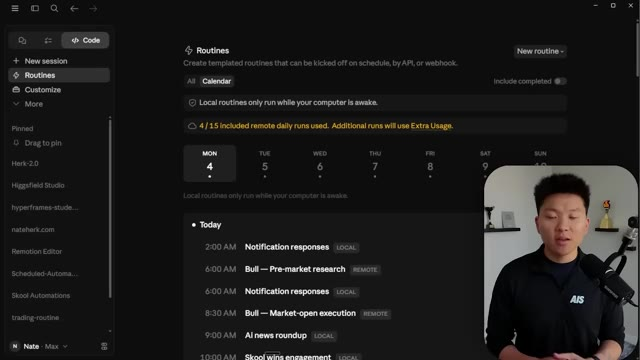
*⏱️ 00:00:05 — Interface d'une application de gestion de routines automatisées montrant un calendrier avec des tâches programmées à différents horaires, avec le présentateur en médaillon.*

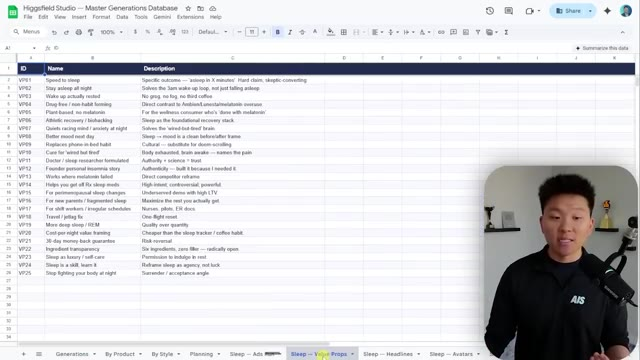
*⏱️ 00:00:14 — Feuille de calcul Google Sheets intitulée "Higgs Field Studio - Master Generations Database" listant des identifiants, noms et descriptions de projets, avec le présentateur en médaillon.*

---

### ⏱️ `[00:00:19 - 00:00:59]` | Segment #02

**🔊 Audio (Transcription Intégrale Mot pour Mot en Français) :**
> Donc, dans la vidéo d'aujourd'hui, je vais vous montrer comment nous sommes capables de transformer Claude en agence créative. Donc, très rapidement, laissez-moi vous montrer quelques exemples que j'ai pu générer en littéralement cinq minutes avec une seule instruction. Je veux dire, ceux-là sont incroyables.

**👁️ Analyse Visuelle d'Écran (gemini-3.5-flash-lite) :**
**Interface & Outils** : Lecteur vidéo intégré avec barre de progression, commandes de lecture et vignette du présentateur en bas à droite.

**Contenu textuel & Code** : Visuels publicitaires générés par IA (casque audio et flacon de produits de santé).

**Action / Démonstration** : Présentation d'exemples de contenus créatifs générés automatiquement par l'IA au début de la vidéo.

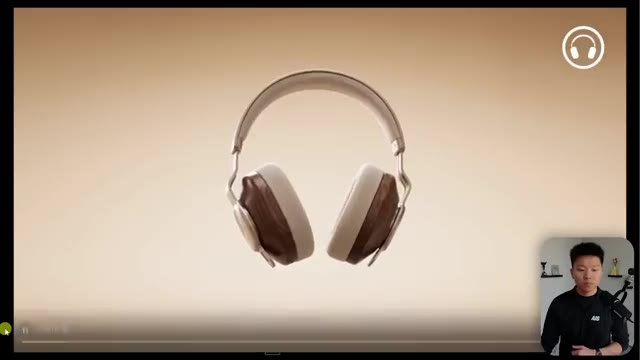
*⏱️ 00:00:29 — Affichage d'une vidéo générée par IA montrant un casque audio haut de gamme en gros plan sur fond neutre, présenté en format paysage.*

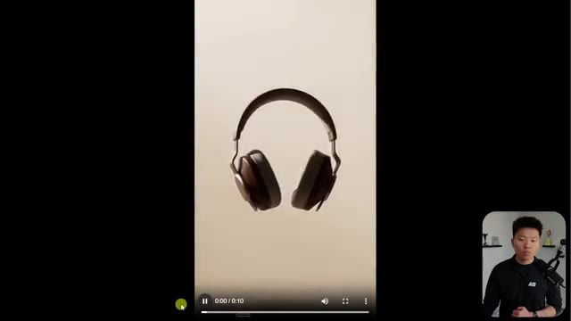
*⏱️ 00:00:39 — Affichage d'une autre vidéo publicitaire générée par IA présentant le même casque audio de type format vertical/Reels sur fond beige.*

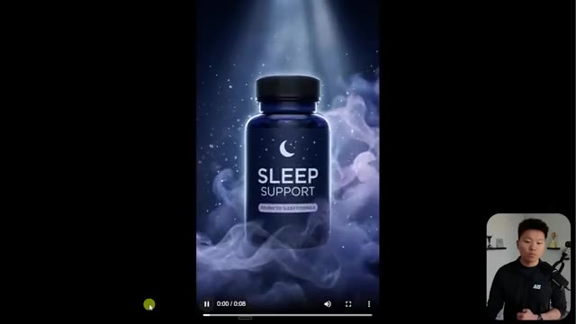
*⏱️ 00:00:49 — Affichage d'un autre exemple de contenu créatif généré par IA montrant une bouteille de complément pour le sommeil ('Sleep Support') dans un décor mystique avec de la fumée.*

---

### ⏱️ `[00:00:59 - 00:01:19]` | Segment #03

**🔊 Audio (Transcription Intégrale Mot pour Mot en Français) :**
> Je pense que celui-ci, le deuxième, est probablement mon préféré. Genre, le zoom sur le produit, les détails, toutes les animations en arrière-plan, la musique. Je veux dire, c'est incroyable. Même ce détail ici, pensez au temps que cela vous aurait pris si vous aviez voulu le monter à la main ou le tourner avec un studio et une actrice payée, cela aurait demandé tellement plus de temps et de ressources.

**👁️ Analyse Visuelle d'Écran (gemini-3.5-flash-lite) :**
**Interface & Outils** : Lecteur vidéo standard intégré au navigateur

**Contenu textuel & Code** : Vidéo promotionnelle générée montrant un casque audio sous différents angles

**Action / Démonstration** : Lecture de la vidéo de démonstration du produit publicitaire

---

### ⏱️ `[00:01:19 - 00:01:53]` | Segment #04

**🔊 Audio (Transcription Intégrale Mot pour Mot en Français) :**
> Et comme je le disais, j'ai pu générer tous ces résultats simplement en parlant à Claude avec un prompt qui ressemblait à peu près à ça. Donc, avant de vous montrer ces conversations et exactement comment j'ai fait, laissez-moi vous montrer comment nous connectons HiggsField à Claude. Donc, si vous n'avez pas de compte HiggsField, allez sur higgsfield.ai et vous pourrez vous inscrire. Vous devrez souscrire à un type d'abonnement ou un autre, mais une fois que vous y êtes, vous voulez essentiellement venir sur cette page qui s'appelle MCP et CLI. Et nous allons, tout d'abord, connecter ceci à Claude sur le web. C'est juste votre chat Claude habituel que vous utilisez probablement depuis des mois maintenant. Vous allez aller dans les paramètres, et vous allez cliquer sur les connecteurs, et vous allez devoir ajouter un connecteur personnalisé. Donc, ici en bas, vous pouvez voir que

**👁️ Analyse Visuelle d'Écran (gemini-3.5-flash-lite) :**
**Interface & Outils** : Interface web de Claude.ai et site web de HiggsField (section MCP & CLI).

**Contenu textuel & Code** : Un prompt demandant à Claude de construire une marque de casque audio de zéro (recherche, branding, catalogue produit, photos, publicité Instagram et vidéo UGC) en utilisant le MCP HiggsField.

**Action / Démonstration** : Le présentateur montre l'interface de configuration pour connecter HiggsField à Claude via le protocole MCP, puis présente le prompt utilisé pour générer les résultats.

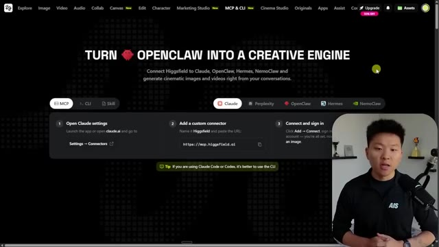
*⏱️ 00:01:36 — Capture montrant le site web de HiggsField dans la section "MCP & CLI", expliquant comment connecter HiggsField à Claude avec un connecteur personnalisé.*

---

### ⏱️ `[00:01:53 - 00:02:20]` | Segment #05

**🔊 Audio (Transcription Intégrale Mot pour Mot en Français) :**
> J'ai Higgs field comme connecteur personnalisé. Alors allez-y et cliquez sur ajouter un connecteur personnalisé. Et vous allez essentiellement appeler ça, vous savez, Higgs field, ou si vous voulez l'appeler autrement, je ne vois vraiment pas pourquoi vous leeriez. Et ensuite, vous allez copier cette commande juste ici et retour dans Claude. Vous allez simplement coller ça dedans, appuyez sur ajouter. Le mien dit que ça ne va pas marcher parce que je l'ai déjà fait, mais le vôtre va se connecter. Et puis essentiellement, ça va vous inviter à vous connecter. Donc vous appuierez sur configurer. Ça va vous amener à l'OAuth de Higgs field. Vous vous connecterez avec le compte que vous venez juste de créer, et ensuite vous aurez maintenant Higgs field prêt à l'emploi.

**👁️ Analyse Visuelle d'Écran (gemini-3.5-flash-lite) :**
**Interface & Outils** : Interface web de configuration des connecteurs Claude (Anthropic).

**Contenu textuel & Code** : Nom du connecteur 'Higgsfield' et champ d'URL du serveur MCP distant.

**Action / Démonstration** : Saisie du nom du connecteur personnalisé Higgsfield dans la boîte de dialogue d'ajout.

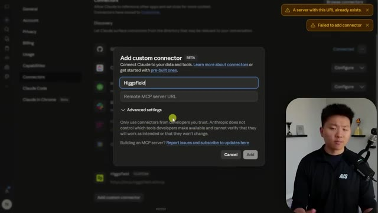
*⏱️ 00:02:00 — Fenêtre modale 'Add custom connector' affichée avec le nom 'Higgsfield' saisi dans le champ dédié.*

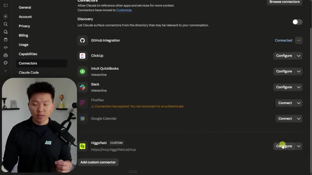
*⏱️ 00:02:13 — Écran des connecteurs montrant la liste des applications intégrées avec le connecteur personnalisé 'Higgsfield' ajouté.*

---

### ⏱️ `[00:02:20 - 00:02:43]` | Segment #06

**🔊 Audio (Transcription Intégrale Mot pour Mot en Français) :**
> Et ensuite, si vous voulez cliquer sur configurer, vous pouvez fondamentalement changer les permissions. Donc si vous vouliez seulement qu'il fasse certaines choses dans votre compte Higgsfield, vous pouvez le limiter à cela. Ou vous pourriez venir ici et vous pouvez simplement dire, hé, toujours tout autoriser. Ça m'est égal. Donc, peu importe comment vous voulez configurer cela. Et maintenant, chaque fois que vous êtes dans un Cloud chat, si vous allez ici et que vous regardez vos connecteurs, vous pouvez voir que Higgsfield est juste là et vous pouvez simplement lui demander de vous créer des images avec ou des vidéos avec ou tout ce que vous voulez faire.

**👁️ Analyse Visuelle d'Écran (gemini-3.5-flash-lite) :**
**Interface & Outils** : Interface web de configuration des connecteurs et permissions d'outils

**Contenu textuel & Code** : Listes d'outils ("Read-only tools", "Write/delete tools", "App-only tools") avec des options de configuration et des boutons radio/permissions.

**Action / Démonstration** : Configuration des permissions d'accès et des outils autorisés pour l'intégration.

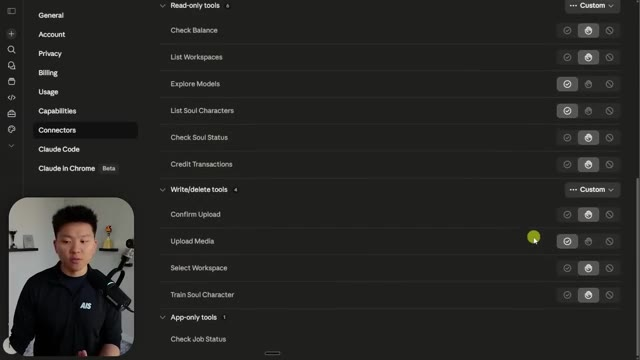
*⏱️ 00:02:26 — Interface de configuration des permissions avec des listes d'outils en lecture seule, écriture/suppression et des options personnalisées.*

---

### ⏱️ `[00:02:44 - 00:03:03]` | Segment #07

**🔊 Audio (Transcription Intégrale Mot pour Mot en Français) :**
> Maintenant, il va être capable de réellement parler à Higgsfield, comme vous pouvez le voir. Donc, juste pour commencer et vous montrer quelques exemples rapides, ce que j'ai dit ici, c'est : « Construis-moi une marque de casque audio à partir de zéro. Je veux que tu fasses des recherches, que tu élabores l'identité de marque, que tu construises le catalogue de produits. Et pour chacun d'eux, je veux que tu génères des ressources : une photo de produit, une publicité Instagram et une vidéo UGC. » Et je lui ai dit d'utiliser le MCP de Higgsfield pour toutes ces générations.

**👁️ Analyse Visuelle d'Écran (gemini-3.5-flash-lite) :**
**Interface & Outils** : Interface web de chat / assistant IA avec la vidéo incrustée du présentateur en bas à gauche.

**Contenu textuel & Code** : Prompt utilisateur : « Build me a headphone brand from scratch. I want you to do research, build the branding, build the product catalog... Use the Higgsfield MCP for all of the generations. » et réponse textuelle de l'IA analysant les tendances du marché.

**Action / Démonstration** : L'assistant IA traite le prompt complexe et commence à rédiger l'étude de marché et la stratégie de marque.

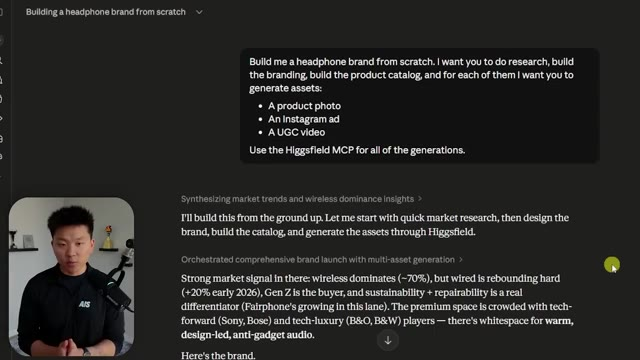
*⏱️ 00:02:48 — Interface web d'un assistant conversationnel montrant un prompt détaillé pour créer une marque de casque audio et les débuts de la réponse de l'IA.*

---

### ⏱️ `[00:03:04 - 00:03:36]` | Segment #08

**🔊 Audio (Transcription Intégrale Mot pour Mot en Français) :**
> Donc oui, ce que nous aurions pu faire, c'est faire toutes ces recherches par nous-mêmes ou prendre toutes ces recherches de Claude, les mettre dans un Google Doc, puis aller sur Higgsfield par nous-mêmes et trouver tous ces différents modèles d'images et de vidéos par IA et générer tout cela dans l'interface. Nous aurions pu faire cela. Mais dans la vidéo d'aujourd'hui, je vous montre comment vous pouvez essentiellement traiter Claude Code ou Claude comme l'interface pour faire tout cela et d'une manière plus cohérente, répétable et automatisée qui va vraiment vous aider à passer à l'échelle bien plus que si vous faisiez tout cela manuellement. Donc, comme vous pouvez le voir, il fait les recherches, il a examiné le mûr, et maintenant il m'a aidé à construire une marque appelée Murmur.

**👁️ Analyse Visuelle d'Écran (gemini-3.5-flash-lite) :**
**Interface & Outils** : Interface web de Higgsfield

**Contenu textuel & Code** : Documentation d'intégration MCP et options de génération d'images/vidéos par IA

**Action / Démonstration** : Navigation sur la plateforme Higgsfield et présentation des fonctionnalités de connexion avec Claude

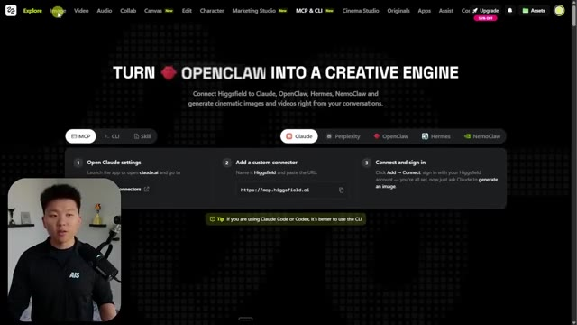
*⏱️ 00:03:12 — Interface web de Higgsfield montrant la page de connexion MCP avec les instructions pour Claude.*

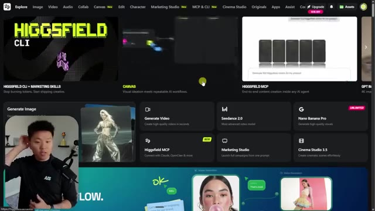
*⏱️ 00:03:20 — Page d'accueil de la plateforme Higgsfield affichant différentes fonctionnalités et outils d'IA.*

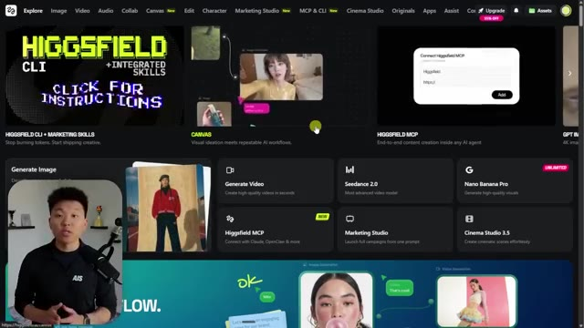
*⏱️ 00:03:28 — Page d'accueil de la plateforme Higgsfield montrant les options de génération d'images et de vidéos.*

---

### ⏱️ `[00:03:36 - 00:04:10]` | Segment #09

**🔊 Audio (Transcription Intégrale Mot pour Mot en Français) :**
> Et nous avons des éléments comme le positionnement, l'acheteur cible, la voix, l'identité visuelle, et tout ce genre de choses. Et cela a créé trois produits différents. Donc un casque circum-auriculaire, qui est le plus cher, nous avons des écouteurs sans fil et nous avons à nouveau des écouteurs filaires à dos ouvert. Et ensuite, ça continue et génère tout le reste. Donc toutes ces images et vidéos que vous êtes sur le point de voir proviennent d'un apport minimal. C'était littéralement juste : Hé, construis-moi une marque et construis ces choses. Et maintenant nous avons cette première photo de notre produit phare, qui a l'air très bien. Nous avons cette publicité Instagram, qui est sortie avec un peu de texte dupliqué pour une raison quelconque. Mais si nous voulions corriger

**👁️ Analyse Visuelle d'Écran (gemini-3.5-flash-lite) :**
**Interface & Outils** : Interface web de documentation ou de gestion de projet (type Notion), incluant des blocs de génération d'images par IA.

**Contenu textuel & Code** : Tableaux de spécifications de produits audio, invites textuelles de génération d'images publicitaires et visuels de produits.

**Action / Démonstration** : Présentation du catalogue de produits et génération d'actifs visuels publicitaires à l'aide d'outils d'IA.

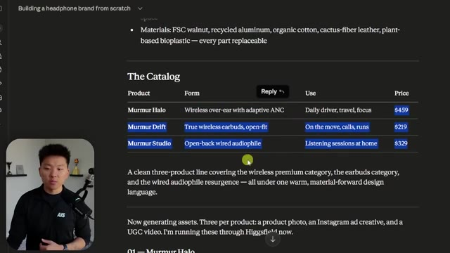
*⏱️ 00:03:45 — Un tableau de catalogue de produits montrant trois modèles de casques et écouteurs (Murmur Halo, Murmur Drift, Murmur Studio) avec leurs prix et spécifications.*

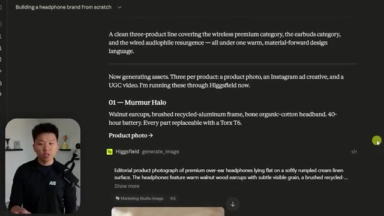
*⏱️ 00:03:53 — Une section détaillant la génération d'actifs visuels avec une invite textuelle pour le produit Murmur Halo via Higgsfield.*

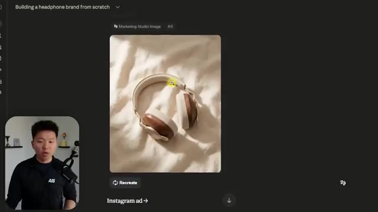
*⏱️ 00:04:01 — L'affichage d'une image générée par IA montrant un casque audio design posé sur un drap crème.*

---

### ⏱️ `[00:04:10 - 00:04:40]` | Segment #10

**🔊 Audio (Transcription Intégrale Mot pour Mot en Français) :**
> que, tout ce qu'on aurait à faire, c'est de dire, ok, modifier. Et ensuite, on peut lui donner une consigne parce qu'il connaît l'image de référence exacte et il sait de quoi on parle. Et je pourrais simplement dire, hé, tu sais, nous avons deux en-têtes différents ici, supprime-un d'entre eux. Donc, tu pourrais itérer très rapidement là-dessus. Et tu pourrais aussi cliquer sur animer. Donc, c'est fondamentalement le même type de consigne. Et on peut dire, hé, transforme ça en une vidéo où, tu sais, les écouteurs tournent en cercle et flottent dans les airs, peu importe ce qu'on veut faire. Donc, voilà pour l'annonce. Et ensuite, nous avons cette vidéo, qui est fondamentalement juste une personne qui écoute de la musique, en les portant et en souriant à la caméra.

**👁️ Analyse Visuelle d'Écran (gemini-3.5-flash-lite) :**
**Interface & Outils** : Interface web d'IA générative (Claude / application personnalisée) avec affichage du présentateur en incrustation.

**Contenu textuel & Code** : Modèle "nano_banana_2", URL de l'image de référence, champ de prompt et options de modèle "Opus 4.7 Adaptive".

**Action / Démonstration** : Modification d'une image existante par l'IA en utilisant une image de référence et un prompt textuel.

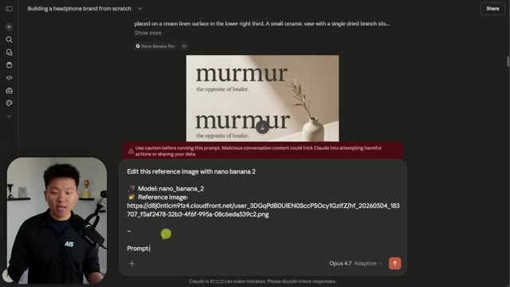
*⏱️ 00:04:17 — Interface web montrant une image de référence avec le texte "murmur" en double et une boîte de prompt pour éditer l'image avec "nano banana 2".*

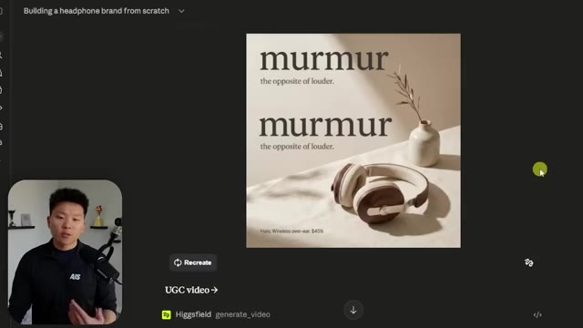
*⏱️ 00:04:32 — Interface web montrant l'image finale générée avec les casques audio, le texte en double "murmur", et les options de recréation ou génération vidéo.*

---

### ⏱️ `[00:04:40 - 00:04:59]` | Segment #11

**🔊 Audio (Transcription Intégrale Mot pour Mot en Français) :**
> Donc vous pouvez voir cependant, que cette vidéo a l'air vraiment bien. Genre, la personne a l'air très réelle. Donc nous avons notre deuxième. Nous avons l'image juste ici. Nous avons la publicité juste ici. Celle-là a l'air beaucoup mieux en fait. Et puis de la même manière, nous avons cette vidéo avec de la musique d'une personne qui en met un dans son oreille et puis sourit à la caméra. Et puis nous avons exactement la même chose pour notre produit final.

**👁️ Analyse Visuelle d'Écran (gemini-3.5-flash-lite) :**
**Interface & Outils** : Interface web de génération de contenu vidéo et publicitaire par IA.

**Contenu textuel & Code** : Textes publicitaires, prompts de génération vidéo ("Vertical 9:16 UGC iPhone-style video..."), options de format Kling 3.0.
[DESC_IMAGE_3] Visualisation et démonstration de créations publicitaires générées par intelligence artificielle.

**Action / Démonstration** : Explications face caméra et démonstration conceptuelle.

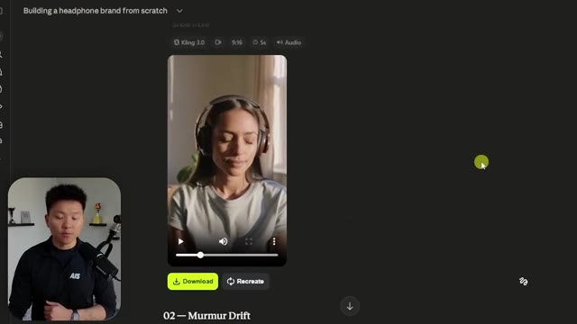
*⏱️ 00:04:45 — Interface web montrant une vidéo verticale générée par IA d'une femme portant un casque audio, avec le titre "Building a headphone brand from scratch".*

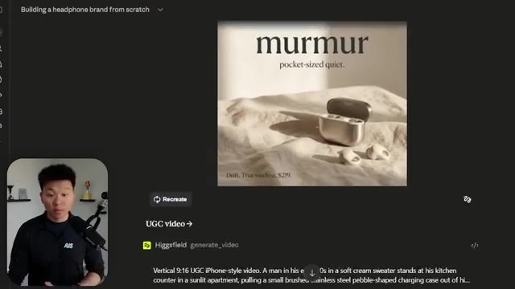
*⏱️ 00:04:49 — Interface web affichant une publicité publicitaire avec une image de produit "murmur - pocket-sized quiet" et un prompt de génération vidéo.*

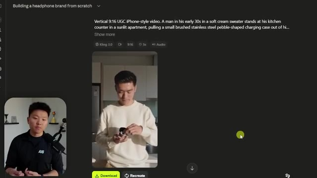
*⏱️ 00:04:54 — Interface web montrant une seconde vidéo UGC verticale générée par IA d'un homme dans un appartement ensoleillé.*

---

### ⏱️ `[00:04:59 - 00:05:24]` | Segment #12

**🔊 Audio (Transcription Intégrale Mot pour Mot en Français) :**
> Nous avons une image, nous avons une publicité, et ensuite nous avons une vidéo de quelqu'un qui utilise le produit, comme vous pouvez le voir. Ensuite, j'ai dit, prenez le halo, qui était le premier, et j'ai dit, utilisez le studio marketing de Higfield pour créer une vidéo de lancement. Donc Higfield a ici un truc vraiment sympa appelé studio marketing, où vous déposez un produit ou un lien vers un produit et vous pouvez même insérer votre propre avatar personnalisé et cela le transforme fondamentalement en un format différent.

**👁️ Analyse Visuelle d'Écran (gemini-3.5-flash-lite) :**
**Interface & Outils** : Interface web de génération de vidéo (Kling 3.0)

**Contenu textuel & Code** : Lecteur vidéo vertical avec boutons 'Download' et 'Recreate'

**Action / Démonstration** : Visionnage de la vidéo générée montrant une personne utilisant le produit publicitaire

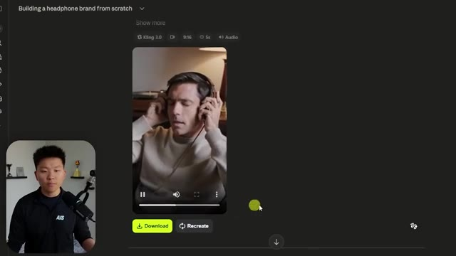
*⏱️ 00:05:06 — Interface web montrant une vidéo générée d'un homme utilisant un casque audio, avec le présentateur en médaillon dans le coin inférieur gauche.*

---

### ⏱️ `[00:05:24 - 00:05:46]` | Segment #13

**🔊 Audio (Transcription Intégrale Mot pour Mot en Français) :**
> Donc l'hypermotion, c'est un peu comme ça. Ça pourrait être un déballage. Vous savez, il y a d'autres styles, il y a l'UGC. Il y a tellement de choses différentes que vous pouvez faire ici pour le marketing. Genre, ces hypermotions sont super, super cool. Je veux dire, regardez ça. Donc je lui ai dit d'utiliser ce format de studio marketing à l'intérieur de Claude juste ici. Donc il regarde le studio marketing, il a trouvé quoi faire, et il revient avec ça.

**👁️ Analyse Visuelle d'Écran (gemini-3.5-flash-lite) :**
**Interface & Outils** : Marketing Studio d'Higgsfield, interface web, assistant Claude 4.7

**Contenu textuel & Code** : Modèles de vidéos marketing (Hyper Motion, UGC, Unboxing, TV Spot) et prompts textuels pour la génération de campagnes publicitaires.

**Action / Démonstration** : Sélection et prévisualisation de différents formats de vidéos publicitaires à l'aide des presets de la plateforme.

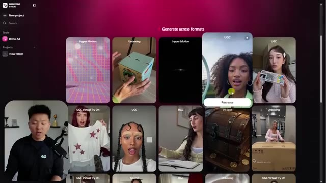
*⏱️ 00:05:30 — Interface d'une application marketing présentant une grille de modèles de vidéos publicitaires (Hyper Motion, Unboxing, UGC).*

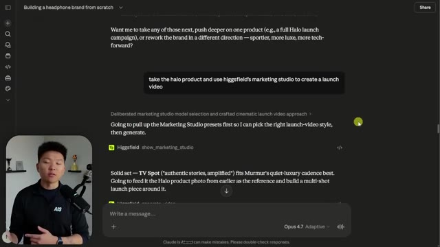
*⏱️ 00:05:40 — Interface d'un assistant conversationnel (Claude) affichant des instructions pour intégrer l'outil Marketing Studio d'Higgsfield.*

---

### ⏱️ `[00:05:47 - 00:06:07]` | Segment #14

**🔊 Audio (Transcription Intégrale Mot pour Mot en Français) :**
> Comme vous pouvez le voir, c'est cool, mais ce n'est pas du tout dans le style hyper motion. C'est très calme. On a cette scène bizarre où la personne touche le casque d'une manière un peu intime. Je ne sais pas trop ce que ça vient faire là, mais bon, ça va, non ? Du tout, je me suis dit, bon, c'est un peu, vous savez, pas vraiment ce qu'on veut. Je veux que tu utilises la variante hyper motion, et je veux que tu rendes ça plus captivant. Et je veux aussi une version 16 par 9.

**👁️ Analyse Visuelle d'Écran (gemini-3.5-flash-lite) :**
**Interface & Outils** : Interface web de type application IA conversationnelle (Claude-like / agent conversationnel).

**Contenu textuel & Code** : Prompt utilisateur : "Generate me a hypermotion variant that's a little bit more engaging. This one was way too calm..."

**Action / Démonstration** : L'utilisateur visualise et discute des résultats de génération vidéo de casques audio au sein d'une interface de chat avec un modèle d'IA.

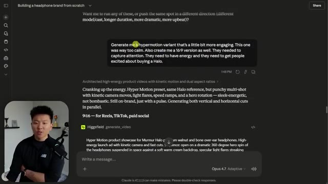
*⏱️ 00:06:02 — Interface de chat montrant un prompt demandant de générer une variante hyper motion plus engageante pour un casque audio.*

---

### ⏱️ `[00:06:07 - 00:06:31]` | Segment #15

**🔊 Audio (Transcription Intégrale Mot pour Mot en Français) :**
> Donc je voulais que ça attire plus l'attention. Et puis c'est là que ça revient et ça nous donne celui-ci, que j'adore absolument. Je pense que celui-ci est bien. Mais ensuite, pour la version 16 par 9, ça a dit que c'était du contenu sensible et ça m'a remboursé mes crédits. Donc j'ai dit, ok, réessaie. Ça a fait exactement la même chose. Et puis finalement, j'ai pu dire, ok, pourquoi ça a été refusé ? Montre-moi le prompt, comprends pourquoi c'est arrivé.

**👁️ Analyse Visuelle d'Écran (gemini-3.5-flash-lite) :**
**Interface & Outils** : Interface web de génération de vidéo (type application IA ou plateforme de workflow).

**Contenu textuel & Code** : Texte de prompt descriptif pour un produit de casque audio ("Hyper Motion product showcase for Murmur Halo..."), tags "Sensitive content" et "Credits refunded".

**Action / Démonstration** : Navigation et affichage des résultats de génération vidéo avec un message de modération de contenu sensible.

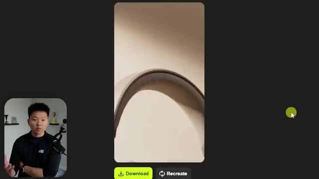
*⏱️ 00:06:13 — Interface web montrant la vidéo générée d'un casque audio avec les boutons de téléchargement et de recréation.*

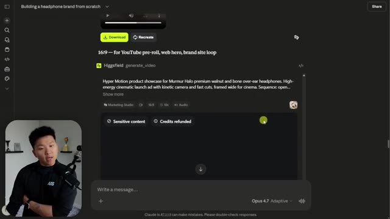
*⏱️ 00:06:19 — Interface web montrant un prompt et un message d'erreur indiquant "Sensitive content" et "Credits refunded".*

---

### ⏱️ `[00:06:31 - 00:06:58]` | Segment #16

**🔊 Audio (Transcription Intégrale Mot pour Mot en Français) :**
> Il m'a lu le prompt. Et puis il a dit, bon, je pense que c'est à cause de ces mots, tu vois, tout ce genre de trucs. Donc je vais me débarrasser de ça. Il le refait. Et ensuite j'ai pu obtenir cette version, que vous avez aussi vue dans l'intro de cette vidéo. Donc ce n'est pas parfait, mais ce qu'on est capable de faire, c'est qu'on est capable de créer des compétences et des trucs autour de ça pour que ça ne se reproduise plus, où on se prend des blocs de contenu sensible. Bon. Alors un autre exemple rapide, je dépose une image. Donc disons qu'on a déjà un produit avec lequel on veut commencer.

**👁️ Analyse Visuelle d'Écran (gemini-3.5-flash-lite) :**
**Interface & Outils** : Application web de génération vidéo IA (style interface de chat avec LLM).

**Contenu textuel & Code** : "Hyper Motion product launch video for Murmur Halo premium walnut and bone over-ear headphones..."

**Action / Démonstration** : Génération et affichage d'une vidéo après modification du prompt pour éviter la censure.

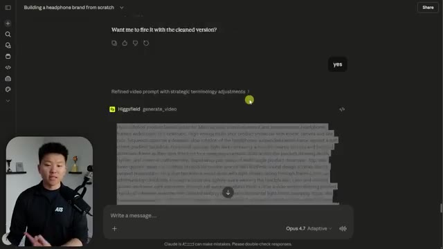
*⏱️ 00:06:38 — Interface montrant un prompt vidéo affiné et nettoyé pour contourner les déclencheurs de modération.*

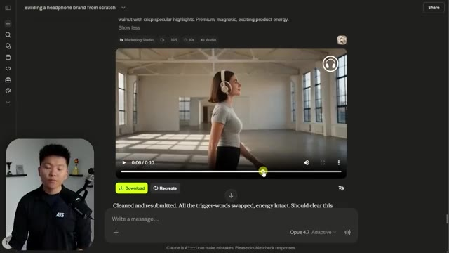
*⏱️ 00:06:45 — Affichage de la vidéo finale générée montrant une femme marchant avec un casque audio dans un espace lumineux.*

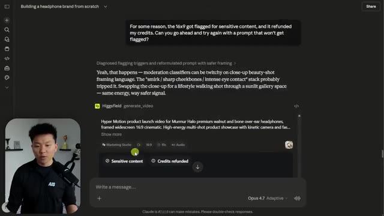
*⏱️ 00:06:51 — Interface montrant un message d'erreur de contenu sensible et le remboursement des crédits associés.*

---

### ⏱️ `[00:06:58 - 00:07:22]` | Segment #17

**🔊 Audio (Transcription Intégrale Mot pour Mot en Français) :**
> Je veux des publicités et des trucs pour ça. Alors je lui demande, tu sais, de me faire quelques publicités prêtes pour Instagram pour ce produit. Et s'il a des questions à poser, alors il m'a posé une chose et je lui ai donné une réponse rapide. Et ensuite, il commence à générer des trucs. Donc voici une image. Maintenant, ce que vous remarquerez, c'est qu'il s'est débarrassé de certains des mots. Donc sur la photo originale, nous avions comme des petites légendes et du sous-texte supplémentaires ici, et il s'en est débarrassé.

**👁️ Analyse Visuelle d'Écran (gemini-3.5-flash-lite) :**
**Interface & Outils** : Application web conversationnelle (style Claude / interface de génération de contenu).

**Contenu textuel & Code** : Prompt utilisateur demandant des publicités Instagram avec le connecteur Higgsfield et réponse textuelle de l'assistant IA.

**Action / Démonstration** : Génération et affichage d'un visuel publicitaire pour le produit à partir des consignes de l'utilisateur.

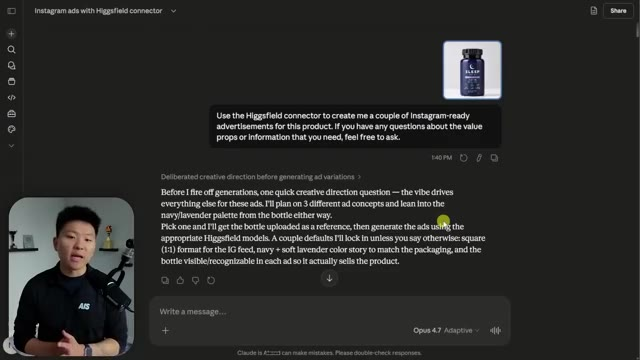
*⏱️ 00:07:04 — Interface d'un assistant conversationnel affichant une réponse avec des propositions de direction créative pour des publicités Instagram.*

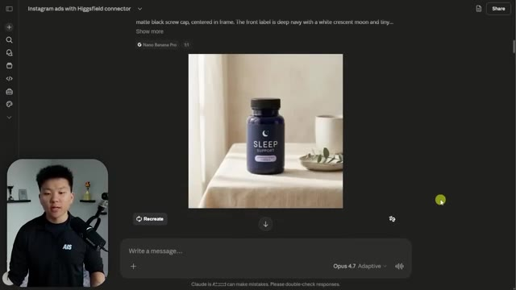
*⏱️ 00:07:10 — Affichage d'une image générée représentant une bouteille de produit « Sleep Support » sur une table dans un cadre chaleureux.*

---

### ⏱️ `[00:07:22 - 00:07:58]` | Segment #18

**🔊 Audio (Transcription Intégrale Mot pour Mot en Français) :**
> Donc, nous devons être plus précis en lui disant de ne pas modifier du tout l'image de référence. C'est très important. Mais bref, c'est une jolie photo. Celle-ci est sympa aussi. C'est un peu plus du genre photo à effets. Et puis nous avons aussi celle-là, qui ressemble un peu à une story Instagram, ce qui n'est pas exactement ce que je cherchais, mais elle a l'air bien en ce qui concerne l'interface et le réalisme. Donc il a dit, Hé, nous en avons une calme. Nous en avons une cinématographique et nous en avons une sorte de réaliste et proche de nous. Donc maintenant, nous sommes capables de continuer à itérer avec ce que nous voulons, mais j'ai dit, ce n'est pas assez bien. J'have besoin que ce soient de vraies publicités prêtes à être diffusées sur différents réseaux sociaux. Et puis il revient. Il nous en génère d'autres. Donc celle-ci a du texte. Il est écrit, arrêtez de compter les moutons, commencez à faire des nuits complètes.

**👁️ Analyse Visuelle d'Écran (gemini-3.5-flash-lite) :**
**Interface & Outils** : Application web avec le connecteur Higgsfield et le modèle d'IA Opus 4.7.

**Contenu textuel & Code** : Image générée représentant une bouteille bleue de 'Sleep Support' entourée de fumée, avec une boîte de dialogue de message en bas et l'appel de fonction 'Higgsfield_generate_image'.

**Action / Démonstration** : Le présentateur commente l'image générée tout en affichant l'interface de l'application.

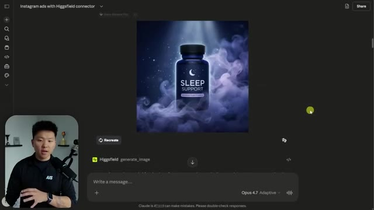
*⏱️ 00:07:31 — Interface web montrant une image générée d'un flacon de produit 'Sleep Support' avec de la fumée, et le présentateur en médaillon en bas à gauche.*

---

### ⏱️ `[00:07:58 - 00:08:17]` | Segment #19

**🔊 Audio (Transcription Intégrale Mot pour Mot en Français) :**
> Ça a un côté un peu cinématique. Celui-là, je l'ai trouvé plutôt cool. Nous avons aussi celui-ci, que j'ai adoré : dormir en 10 minutes, s'endormir plus vite, rester endormi plus longtemps, se réveiller sans tracas. J'adore absolument celui-ci aussi. Et vous pouvez voir qu'avec très peu de consignes, tout ce que j'ai dit, c'est : hé, crée-moi des publicités prêtes pour Instagram. Il comprend les titres et l'espacement. Et je pensais juste que ceux-là avaient l'air vraiment, vraiment bien.

**👁️ Analyse Visuelle d'Écran (gemini-3.5-flash-lite) :**
**Interface & Outils** : Interface web de Higgsfield avec panneau de génération de contenu publicitaire.

**Contenu textuel & Code** : Publicité pour 'SLEEP SUPPORT' avec les mentions 'Asleep in 12 minutes' et options d'édition.

**Action / Démonstration** : Présentation d'un exemple de visuel publicitaire généré par IA et exploration des options d'animation.

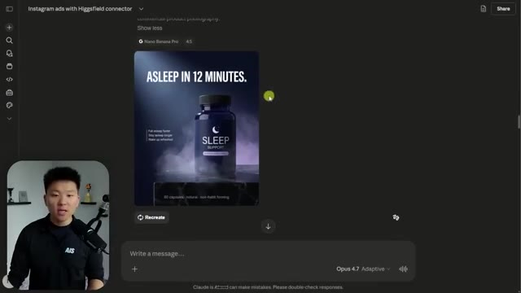
*⏱️ 00:08:02 — Interface web affichant une publicité générée pour un produit de sommeil avec le texte 'ASLEEP IN 12 MINUTES'.*

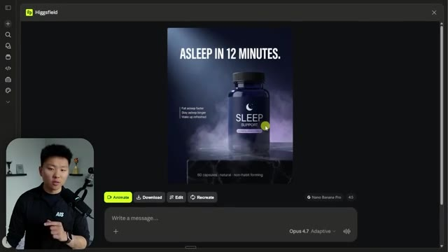
*⏱️ 00:08:07 — Interface de Higgsfield montrant une publicité pour un complément de sommeil avec les options 'Animate', 'Download', 'Edit', 'Recreate'.*

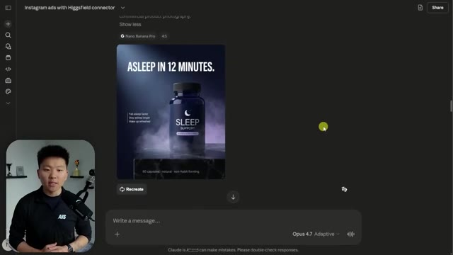
*⏱️ 00:08:12 — Retour à l'affichage standard de l'interface web de la publicité pour le produit de sommeil.*

---

### ⏱️ `[00:08:18 - 00:08:39]` | Segment #20

**🔊 Audio (Transcription Intégrale Mot pour Mot en Français) :**
> Et puis nous en avions un autre ici également. Donc le problème principal est qu'il n'avait pas la bouteille qui apparaissait exactement comme nous le voulions dans l'image de référence, ce qui est un problème assez facile à régler. En voici donc un autre. Vous n'avez pas encore vu celui-ci parce qu'il est beaucoup plus lent et que ce n'est pas exactement le style hyper-mouvement, mais c'est quand même une petite animation sympa. Et puis nous avons aussi celui-ci, qui montre simplement la personne en train de le regarder.

**👁️ Analyse Visuelle d'Écran (gemini-3.5-flash-lite) :**
**Interface & Outils** : Interface web de génération d'images et de vidéos, avec le modèle Opus 4.7.

**Contenu textuel & Code** : Générations visuelles publicitaires pour Instagram avec une bouteille de complément alimentaire.
[DESC_ACTION_1] Le présentateur commente le résultat visuel de l'image générée.

**Action / Démonstration** : Explications face caméra et démonstration conceptuelle.

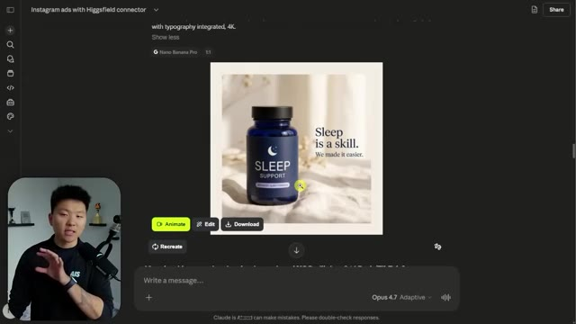
*⏱️ 00:08:23 — Interface web affichant une image générée d'une bouteille de complément "SLEEP SUPPORT" avec le texte "Sleep is a skill", et une incrustation vidéo du présentateur en bas à gauche.*

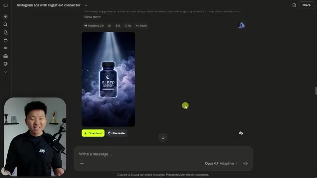
*⏱️ 00:08:28 — Interface web montrant une animation vidéo verticale avec de la fumée et des effets de lumière autour d'une bouteille de "SLEEP SUPPORT".*

---

### ⏱️ `[00:08:39 - 00:08:57]` | Segment #21

**🔊 Audio (Transcription Intégrale Mot pour Mot en Français) :**
> Donc ce sont des vidéos correctes, mais elles ne sont pas prêtes pour faire de la publicité. Donc on a dû être un peu plus précis encore. Donc j'ai dit, donne-m'en une qui soit rythmée et énergique. Elle a des coupes de caméra, elle a des ralentis, elle a des gros plans. Et ensuite on a eu celle que vous avez vue plus tôt, qui était juste ici. Ça m'a pris quelques essais de plus. Et ensuite on a eu celle-ci que vous avez vue dans la démo avec les gélules.

**👁️ Analyse Visuelle d'Écran (gemini-3.5-flash-lite) :**
**Interface & Outils** : Interface web de type assistant IA / LLM (Claude)

**Contenu textuel & Code** : Texte du prompt : "Give me one that is fast-paced and energetic and it has: • camera cuts • slow motion • close-ups..."

**Action / Démonstration** : Affichage d'un prompt dans l'interface de discussion avec les instructions précises pour la génération de vidéos publicitaires.

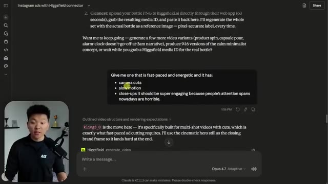
*⏱️ 00:08:43 — Capture d'écran montrant une interface de chat (style Claude) avec un prompt détaillé demandant une vidéo rythmée et énergique avec des coupes de caméra et des ralentis.*

---

### ⏱️ `[00:08:57 - 00:09:30]` | Segment #22

**🔊 Audio (Transcription Intégrale Mot pour Mot en Français) :**
> Je pensais que celui-ci était vraiment, vraiment bon. Donc ce qui est génial avec ça, c'est que vous pouvez prendre une idée très vague de haut niveau. Vous pouvez dire des mots comme engageant, cool, au rythme rapide, des choses qui sont émotionnelles, et Claude fait le travail difficile de conception du prompt, puis envoie le tout au studio marketing de Higgs Field, qui possède un joli modèle pré-entraîné en arrière-plan, et ensuite vous obtenez des trucs comme ça en quelques minutes. Et puis ce que vous pouvez faire, c'est dire : hé, celui-ci était une publicité gagnante, vous savez, ce format, ce style, cette palette de couleurs, je veux tout un tas de versions différentes de celle-ci à tester, et il va simplement analyser, planifier et élaborer une stratégie sur les différentes versions, les différents en-têtes.

**👁️ Analyse Visuelle d'Écran (gemini-3.5-flash-lite) :**
**Interface & Outils** : Interface web d'assistant IA (type Claude Artifacts/Interface de génération).

**Contenu textuel & Code** : Génération de contenu publicitaire vidéo, messages textuels décrivant des variations rapides et dynamiques de vidéos.
[DESC_IMAGE_1] L'utilisateur présente le résultat de la génération d'une publicité vidéo via l'interface IA.
[DESC_IMAGE_2] Affichage en plein écran d'un visuel publicitaire généré pour un produit d'aide au sommeil.

**Action / Démonstration** : Explications face caméra et démonstration conceptuelle.

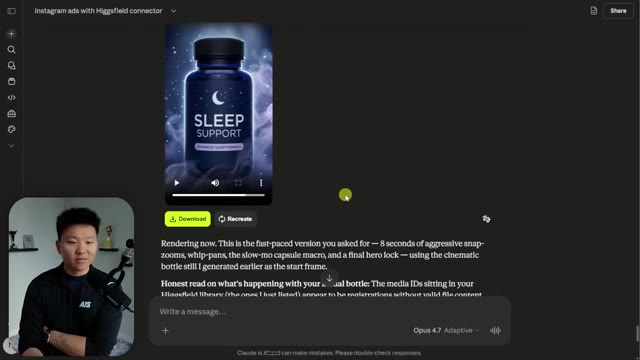
*⏱️ 00:09:06 — Interface web montrant une vidéo générée pour Instagram intitulée 'Instagram ads with Higgsfield connector' avec un aperçu vidéo vertical et une zone de chat.*

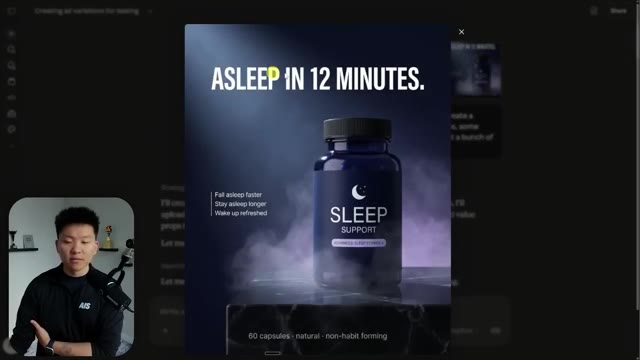
*⏱️ 00:09:22 — Gros plan sur une publicité vidéo générée affichant un flacon de complément alimentaire avec le texte 'ASLEEP IN 12 MINUTES'.*

---

### ⏱️ `[00:09:30 - 00:09:49]` | Segment #23

**🔊 Audio (Transcription Intégrale Mot pour Mot en Français) :**
> et ensuite nous allons simplement tous les fabriquer. Et maintenant, vous avez tellement plus de pièces à tester. Et en fin de compte, une fois que vous avez trouvé votre combinaison gagnante, vous y injectez simplement plus de budget et vous essayez vraiment de faire croître votre produit. D'accord, c'est donc comme ça qu'on fait dans Claude. Vous utilisez le MCP Higgs Build. C'est super facile. C'est génial pour faire un peu de POC là-dedans. Maintenant, il y a beaucoup de choses que nous voulons améliorer.

**👁️ Analyse Visuelle d'Écran (gemini-3.5-flash-lite) :**
**Interface & Outils** : Interface web (semblable à un outil de génération ou un assistant IA type Claude/ChatGPT).

**Contenu textuel & Code** : Texte de prompt pour la génération d'image publicitaire (« Premium sleep supplement product advertisement... ») et image générée affichant une bouteille de complément avec le texte « 7 HOURS. UNINTERRUPTED. ».

**Action / Démonstration** : Visualisation d'une variation d'annonce publicitaire générée par IA pour les tests.

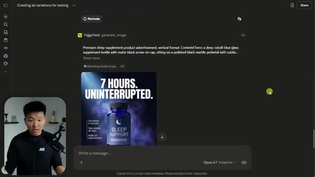
*⏱️ 00:09:35 — Interface web montrant la génération d'une publicité pour un produit de sommeil avec une image générée et un prompt textuel.*

---

### ⏱️ `[00:09:49 - 00:10:08]` | Segment #24

**🔊 Audio (Transcription Intégrale Mot pour Mot en Français) :**
> Le truc des images. On veut plus de contrôle. On veut créer des compétences réutilisables. On veut créer des automatisations. Et c'est là qu'on va passer de Claude à Claude code. Maintenant, n'ayez pas peur. On va utiliser l'application de bureau juste pour le tutoriel d'aujourd'hui. Et tout ce à quoi ça ressemble, c'est Claude. Vous avez un chat et vous avez un projet et vous pouvez développer beaucoup plus de puissance dans cette interface.

**👁️ Analyse Visuelle d'Écran (gemini-3.5-flash-lite) :**
**Interface & Outils** : Application de bureau Claude

**Contenu textuel & Code** : Prompt utilisateur demandant de créer des variations publicitaires à partir d'une image de référence, et liste des sessions actives sur le tableau de bord.

**Action / Démonstration** : Navigation et démonstration de l'interface de bureau Claude pour la gestion des sessions et des prompts d'automatisation.

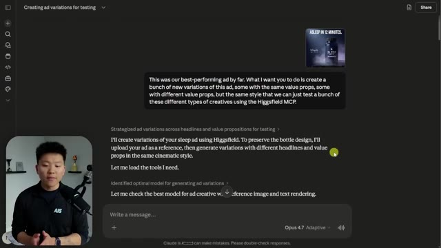
*⏱️ 00:09:54 — Interface de l'application Claude montrant une conversation de création de variations publicitaires avec une image de référence.*

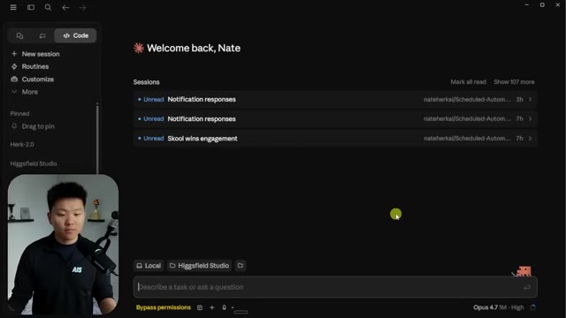
*⏱️ 00:10:03 — Tableau de bord de l'application Claude affichant les sessions récentes, le menu latéral et la barre de saisie pour décrire une tâche.*

---

### ⏱️ `[00:10:08 - 00:10:28]` | Segment #25

**🔊 Audio (Transcription Intégrale Mot pour Mot en Français) :**
> Donc je vais vous montrer comment faire. Donc la première chose que vous allez vouloir faire, c'est que vous allez vouloir ouvrir un dossier vide. Vous allez aller dans votre Finder, où vous voulez l'avoir. Donc où que vous vouliez l'avoir, vous pouvez simplement l'avoir directement sur votre bureau. Vous allez créer un nouveau dossier et appeler ça du genre Higgs Field Marketing Studio ou peu importe comment vous voulez l'appeler. Donc dans mon cas, ça s'appelle Higgs Field Studio. Donc la toute première chose que nous devons faire, c'est de tout configurer.

**👁️ Analyse Visuelle d'Écran (gemini-3.5-flash-lite) :**
**Interface & Outils** : Application web ou interface de bureau d'IA avec un panneau latéral de sessions ("New session", "Routines", "Customize") et une barre de saisie en bas.

**Contenu textuel & Code** : Liste de sessions récentes ("Notification responses", "Skool wins engagement") et champ de texte "Describe a task or ask a question".

**Action / Démonstration** : Le présentateur explique l'utilisation de l'outil tout en affichant l'interface principale de l'application à l'écran.

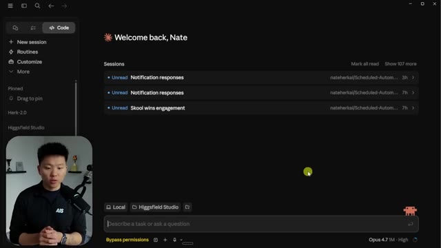
*⏱️ 00:10:13 — Interface d'une application d'IA (semblable à un assistant de type Cursor ou interface de sessions de code) avec le présentateur en médaillon dans le coin inférieur gauche.*

---

### ⏱️ `[00:10:29 - 00:11:01]` | Segment #26

**🔊 Audio (Transcription Intégrale Mot pour Mot en Français) :**
> Donc laissez-moi vous montrer la façon dont je rédigerais un prompt pour configurer ça. J'irais dans Higgsfield. Je vais cliquer sur MCP et CLI. Et quand on fait spécifiquement ça pour Claude, ou si on veut faire ça avec OpenClaw ou Hermes ou peu importe, on veut faire ça avec la CLI au lieu du MCP. Maintenant, la raison étant qu'au final, fonctionnellement, ils peuvent faire à peu près la même chose, mais le MCP a tous ces outils. Donc d'un point de vue des tokens, c'est en fait plus cher d'utiliser un MCP. Et la CLI est juste meilleure pour les agents. Ça va être plus rapide. Ça va être plus efficace. Comme je l'ai dit, nous allons utiliser

**👁️ Analyse Visuelle d'Écran (gemini-3.5-flash-lite) :**
**Interface & Outils** : Navigateur web (site Higgsfield)

**Contenu textuel & Code** : Commandes affichées : `npm install -g @higgsfield/cli`, `higgsfield auth login`, et `npx skills add higgsfield-ai/ski...`

**Action / Démonstration** : Navigation sur l'onglet CLI pour expliquer l'installation et l'authentification de l'outil en ligne de commande.

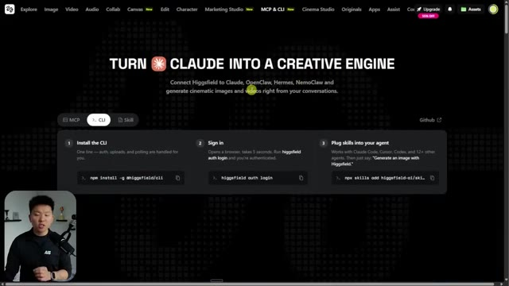
*⏱️ 00:10:37 — Page web de Higgsfield montrant la section MCP & CLI pour connecter l'outil à Claude, OpenClaw, Hermes, etc.*

---

### ⏱️ `[00:11:01 - 00:11:36]` | Segment #27

**🔊 Audio (Transcription Intégrale Mot pour Mot en Français) :**
> l'interface de ligne de commande. Donc tout ce que vous avez à faire, c'est de copier exactement ces trois commandes. Je vais copier ceci. Je vais copier ceci. Et je vais copier ceci. Et je vais aller dans Claude Code et dire, ce projet est essentiellement configuré pour utiliser Higgs Field. Et il va être configuré pour une sorte de studio créatif, un studio marketing. J'ai besoin que tu installes l'interface de ligne de commande de Higgs Field. J'ai besoin que tu exécutes ensuite l'authentification pour moi afin que je me connecte. Et ensuite, j'ai besoin que tu installes les compétences d'agent Higgs Field. Donc voici ci-dessous les trois commandes. Et voilà. Je colle les trois commandes et ensuite je lance le tout. Et ça va vous configurer. Ça va installer l'interface de ligne de commande et ensuite ça va

**👁️ Analyse Visuelle d'Écran (gemini-3.5-flash-lite) :**
**Interface & Outils** : Interface web d'agent IA / application de chat (Claude Code ou interface similaire avec panneau latéral et sessions).

**Contenu textuel & Code** : Sessions récentes affichées ("Notification responses", "Skool wins engagement"), options dans la barre latérale ("New session", "Routines", "Customize", "Higgsfield Studio"), et la zone de saisie "Describe a task or ask a question".

**Action / Démonstration** : Navigation et présentation de l'interface de l'application avant l'utilisation des commandes dans le terminal.

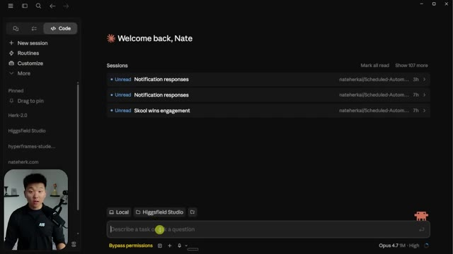
*⏱️ 00:11:10 — Interface sombre d'une application de type assistant ou agent IA avec le message d'accueil "Welcome back, Nate" et un champ de saisie de prompt en bas.*

---

### ⏱️ `[00:11:36 - 00:12:10]` | Segment #28

**🔊 Audio (Transcription Intégrale Mot pour Mot en Français) :**
> on va faire le flux d'authentification. Donc ça va ouvrir un onglet et vous allez simplement vous connecter là où vous avez créé votre compte Higgsfield. Et ensuite, ça va ajouter les compétences de l'agent que vous pourrez utiliser. Maintenant, ici pour moi en particulier, quand il essaie d'installer ceci, il va dire, Hé, ceci existe déjà, mais le vôtre va en fait tout simplement continuer et s'installer. Donc le voici. Il est dit que la CLI fonctionne, maintenant exécution de auth login, ce qui ouvre un navigateur. Et comme vous pouvez le voir juste ici, il me demande en gros simplement si je suis d'accord pour connecter Claude à Hicksfield et vous allez cliquer sur connecter puis vous connecter. Et maintenant vous avez été autorisé et de retour dans Claude, il devrait dire, ok, super. Vous êtes maintenant connecté, je peux voir votre compte et maintenant j'installe les compétences de l'agent. Donc exactement comme vous le voyez juste ici. Maintenant, pendant que ça s'installe, il y a quelque chose que je

**👁️ Analyse Visuelle d'Écran (gemini-3.5-flash-lite) :**
**Interface & Outils** : Interface web / Application de développement (style éditeur d'agent IA)

**Contenu textuel & Code** : npm install -g @higgsfield/cli, higgsfield auth login, npx skills add higgsfield-ai/skills

**Action / Démonstration** : Affichage des commandes d'installation et de la mémoire de l'agent concernant un bug sous Windows avec Git Bash.

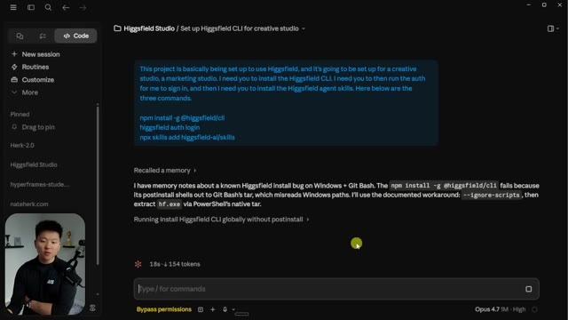
*⏱️ 00:11:45 — Interface d'une application montrant les instructions d'installation de la CLI Higgsfield avec un prompt contenant les commandes npm, higgsfield auth login et npx skills.*

---

### ⏱️ `[00:12:10 - 00:12:43]` | Segment #29

**🔊 Audio (Transcription Intégrale Mot pour Mot en Français) :**
> je veux vous parler, qui est le fait que tout ceci n'est pas magique. Tout ceci vous permet simplement d'automatiser des choses et d'avoir des idées. Donc mon point de vue est que, si vous n'êtes pas un maître rédacteur ou un publicitaire, il pourrait vous être très difficile de créer d'excellents textes publicitaires et des créations de premier ordre. Et c'est pourquoi ce que vous pouvez faire avec Claude, c'est utiliser l'expertise d'autres personnes et l'intégrer pour faire de Claude Code l'expert en la matière ici. Ce n'est donc pas parfait. Vous savez, un maître rédacteur va construire une meilleure automatisation de newsletter que je ne le ferais. Donc ce que vous pouvez faire, c'est dans

**👁️ Analyse Visuelle d'Écran (gemini-3.5-flash-lite) :**
**Interface & Outils** : Interface web de l'outil de développement / assistant de code (type Cursor/Claude) avec une incrustation vidéo du présentateur en bas à gauche.

**Contenu textuel & Code** : Texte technique décrivant l'exécution de commandes (téléchargement de tarball, extraction de hf.exe via PowerShell, authentification et installation des compétences globales).

**Action / Démonstration** : Suivi de l'exécution des commandes d'installation et de configuration de Higgsfield CLI par l'assistant.

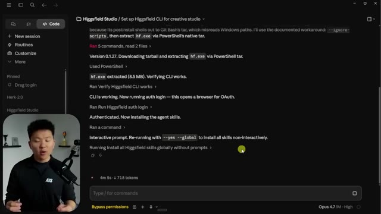
*⏱️ 00:12:19 — Interface d'un assistant de code affichant les étapes d'installation et de configuration de Higgsfield CLI.*

---

### ⏱️ `[00:12:43 - 00:13:07]` | Segment #30

**🔊 Audio (Transcription Intégrale Mot pour Mot en Français) :**
> votre projet, vous pouvez faire un peu de recherche. Donc voici un chat que j'ai fait tout à l'heure juste avant ceci. Et j'ai grossièrement dit : Hé, j'ai besoin que tu fasses une recherche approfondie sur les meilleures stratégies pour faire de la publicité en 2026, en ce qui concerne les publicités organiques sur des plateformes comme TikTok, Meta ou X et ce qui capte l'attention des gens, ce qui convertit et en quoi cela diffère selon la plateforme. Donc je voulais essentiellement qu'il crée un fichier markdown complet appelé masterclass publicitaire qui vivrait dans ce projet.

**👁️ Analyse Visuelle d'Écran (gemini-3.5-flash-lite) :**
**Interface & Outils** : Interface web d'un outil de développement ou d'un assistant IA (Higgsfield Studio / Opus 4.7).

**Contenu textuel & Code** : Texte du prompt demandant une recherche approfondie sur les stratégies publicitaires en 2026 pour TikTok, Meta ou X, ainsi qu'un document de plan nommé 'AdvertisingMasterclass.MD'.

**Action / Démonstration** : Affichage de l'historique d'une conversation avec l'assistant IA et du document de planification généré associé.

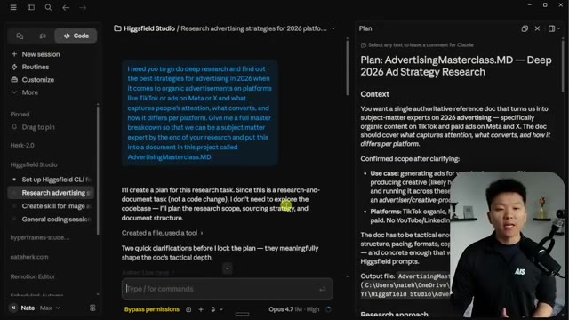
*⏱️ 00:12:49 — Interface d'un assistant IA montrant un historique de chat avec une requête sur les stratégies publicitaires pour 2026 et un panneau latéral affichant un plan détaillé de recherche.*

---

### ⏱️ `[00:13:07 - 00:13:41]` | Segment #31

**🔊 Audio (Transcription Intégrale Mot pour Mot en Français) :**
> Et ensuite, je pourrais faire en sorte que mes agents consultent cela lorsqu'ils ont besoin d'aide pour trouver des idées ou lorsqu'ils ont besoin d'aide pour analyser ce qui se passe avec nos données. Et cela va les aider à nous donner de meilleurs textes et de meilleurs prompts à intégrer dans Higgsfield. Et c'est quelque chose que je fais tout le temps. Chaque fois que je construis différents agents ou automatisations, j'exploite toujours les fils Twitter, les vidéos YouTube, les recherches Perplexity. J'utilise des informations qui existent déjà et qui ont fait leurs preuves, et je les intègre dans mes systèmes. Donc, fondamentalement, cela a fait toutes ces recherches. Cela m'a posé des questions, et ensuite cela m'a donné un fichier markdown complet, qui se trouve maintenant dans ce projet. Comme vous pouvez le voir, advertising masterclass.md,

**👁️ Analyse Visuelle d'Écran (gemini-3.5-flash-lite) :**
**Interface & Outils** : Interface web / application d'assistant IA (type Claude / interface de développement d'agents).

**Contenu textuel & Code** : Prompt utilisateur demandant des recherches approfondies sur les stratégies publicitaires pour 2026 sur les plateformes comme TikTok, Meta et X, ainsi que la réponse de l'agent créant un plan de recherche.

**Action / Démonstration** : L'agent analyse la demande, formule un plan de recherche et prépare la création d'un document de référence stratégique dans le projet Higgsfield Studio.

*⏱️ 00:13:16 — Interface d'un assistant IA avec un panneau de chat à gauche et un panneau de planification/documentation à droite, montrant l'interaction avec l'agent et la création du document AdvertisingMasterclass.MD.*

---

### ⏱️ `[00:13:41 - 00:14:10]` | Segment #32

**🔊 Audio (Transcription Intégrale Mot pour Mot en Français) :**
> il fait 617 lignes. Je pourrais aller de l'avant et l'ouvrir juste ici, et nous pouvons lire ceci, qui est un guide complet pour le contenu organique. Il a été mis à jour pour la dernière fois en mai 2026. Nous avons une feuille de triche. Nous avons différentes plateformes et nous avons un tas d'informations sur la manière dont l'attention est captée. Et maintenant, toutes nos publicités vont, espérons-le, être meilleures parce que nous avons fait un document de recherche comme celui-ci. Mais de toute façon, maintenant nous avons le CLI d'installé. Nous avons été authentifiés et nous avons nos compétences d'installées. Donc nous sommes prêts à commencer à essayer de construire quelques automatisations ici.

**👁️ Analyse Visuelle d'Écran (gemini-3.5-flash-lite) :**
**Interface & Outils** : Interface web / outil de développement avec panneau latéral de navigation.

**Contenu textuel & Code** : Texte du guide organique, règles de ciblage, et logs d'installation de la CLI Higgsfield avec Claude Code.

**Action / Démonstration** : Navigation et affichage du guide de contenu organique et des instructions d'installation des compétences d'agent.

*⏱️ 00:13:48 — Interface d'une application affichant un guide complet pour le contenu organique et une feuille de triche (TL;DR).*

*⏱️ 00:14:03 — Interface affichant les étapes d'installation et de configuration de Higgsfield CLI et des compétences d'agent (Claude Code).*

---

### ⏱️ `[00:14:10 - 00:14:34]` | Segment #33

**🔊 Audio (Transcription Intégrale Mot pour Mot en Français) :**
> D'accord. Donc, j'ai vidé ce chat et voici la première chose que je vous recommanderais de faire. Donc, dans mon champ Higgs, si vous vous souvenez, si je vais dans mes actifs, nous avons déjà une tonne d'actifs générés. Nous avons 45 actifs différents créés. Nous avons quelques produits différents. Nous avons un truc de pilule pour dormir. Nous avons quelques écouteurs différents qui ont été générés, quelques publicités UGC différentes. Donc, voici ce que je veux faire. Allez-y et jetez un œil à tous les actifs que nous avons générés dans le champ Higgs.

**👁️ Analyse Visuelle d'Écran (gemini-3.5-flash-lite) :**
**Interface & Outils** : Interface web de la plateforme de génération d'actifs (type Higgsfield ou similaire).

**Contenu textuel & Code** : Galerie d'images et de vidéos miniatures organisées en grille affichant des visuels publicitaires de produits (bouteilles de compléments alimentaires, casques audio, etc.).

**Action / Démonstration** : Navigation et affichage des actifs générés par l'IA dans l'interface utilisateur.

*⏱️ 00:14:22 — Vue de la galerie d'actifs générés (All assets) dans l'interface de l'application avec de nombreuses images de produits et vidéos.*

*⏱️ 00:14:28 — Vue similaire de la galerie d'actifs (All assets) montrant les créations visuelles et vidéos générées pour les produits.*

---

### ⏱️ `[00:14:35 - 00:15:08]` | Segment #34

**🔊 Audio (Transcription Intégrale Mot pour Mot en Français) :**
> J'ai besoin d'aide pour créer essentiellement un journal de suivi de chaque génération que nous faisons ensemble, juste pour avoir de la visibilité sur nos invites et nos données, nos statistiques et des choses comme ça. Et je veux que tu formules cela dans une feuille Google, quelques onglets si tu en as besoin, mais utilise l'interface en ligne de commande GWS pour créer cette feuille Google et l'organiser en fonction du produit et des invites, ou de la manière qui te semble logique. En fin de compte, ce projet est configuré pour devenir une agence de création principale.

**👁️ Analyse Visuelle d'Écran (gemini-3.5-flash-lite) :**
**Interface & Outils** : Higgsfield Studio (interface web de développement/IA).

**Contenu textuel & Code** : Zone de texte "Type / for commands", option "Bypass permissions" activée, sélecteur de modèle "Opus 4.7 1M - High".

**Action / Démonstration** : Le présentateur s'apprête à entrer une commande pour configurer le journal de suivi dans l'interface de Higgsfield.

*⏱️ 00:14:43 — L'interface principale de l'outil "Higgsfield Studio" avec un champ de saisie vide et le présentateur en médaillon.*

---

### ⏱️ `[00:15:08 - 00:15:30]` | Segment #35

**🔊 Audio (Transcription Intégrale Mot pour Mot en Français) :**
> Donc nous avons besoin d'une base de données où tout est centralisé afin de pouvoir suivre les éléments au fil du temps à mesure que nous augmentons notre volume de contenus créatifs. La raison pour laquelle je veux faire cela, c'est que je veux finalement arriver à un point où nous avons quelque chose comme ça, par exemple. J'ai donc toutes mes générations ici. Nous pouvons voir le produit, nous pouvons voir le style, nous pouvons voir l'image ou la vidéo, le modèle, et nous pouvons voir ce que nous sommes en train de générer.

**👁️ Analyse Visuelle d'Écran (gemini-3.5-flash-lite) :**
**Interface & Outils** : Google Sheets (Image 2)

**Contenu textuel & Code** : Colonnes détaillées : Created, Product, Style, Type, Model, Aspect, Resolution, Duration, Dimensions, Result (URL), Start Image, Job ID.

**Action / Démonstration** : Présentation de la structure de la base de données centralisée utilisée pour le suivi des assets générés par l'IA.

*⏱️ 00:15:25 — Tableau Google Sheets intitulé "Higgsfield Studio — Master Generations Database" listant des métadonnées de contenus créatifs (Date, Produit, Style, Type, Modèle, Aspect, Résolution, liens vers les assets, etc.).*

---

### ⏱️ `[00:15:31 - 00:16:06]` | Segment #36

**🔊 Audio (Transcription Intégrale Mot pour Mot en Français) :**
> Nous pouvons également examiner les résultats et nous pouvons examiner les invites réelles pour tous, ce qui est vraiment important. À partir de là, nous pouvons analyser lesquels de ceux-ci nous aimons le plus ? Lesquels ont réellement le mieux converti ? Lesquels, vous savez, ont eu le meilleur budget ou ont eu la meilleure dépense sur notre compte Meta ou peu importe ce que c'est. Et nous pouvons avoir toutes ces autres statistiques comme par produits, par style, nous pouvons avoir une certaine planification. Et puis, sur la base de toutes ces données, et surtout si vous apportez des données réelles de vos annonces Google ou de vos annonces Meta, ou même simplement de votre compte TikTok ou Instagram, Cloud Code peut les examiner. Il peut utiliser l'expertise sectorielle que vous aviez lors de la recherche, et ensuite il peut planifier les choses. Donc maintenant, il planifie

**👁️ Analyse Visuelle d'Écran (gemini-3.5-flash-lite) :**
**Interface & Outils** : Google Sheets (Tableur en ligne).

**Contenu textuel & Code** : Données structurées sur les campagnes marketing (type, modèle, aspect, résolution, durée) et notes de planning stratégique (concepts, hooks, notes de production).

**Action / Démonstration** : Navigation entre différents onglets du tableur pour analyser la performance et la planification des contenus générés par IA.

*⏱️ 00:15:39 — Vue d'un tableur Google Sheets répertoriant une base de données de générations "Higgsfield Studio" avec des détails sur les produits et styles.*

*⏱️ 00:15:48 — Vue d'un onglet "Style Summary" dans Google Sheets analysant la répartition des styles publicitaires.*

*⏱️ 00:15:57 — Vue d'un onglet "Production Planning" dans Google Sheets contenant une liste d'idées de concepts publicitaires et notes de production.*

---

### ⏱️ `[00:16:06 - 00:16:25]` | Segment #37

**🔊 Audio (Transcription Intégrale Mot pour Mot en Français) :**
> différentes versions de publicités basées sur certaines choses. Nous avons donc différentes propositions de valeur, différents titres, différents avatars, différents styles. Et cela nous donne cette matrice de test où nous avons maintenant une centaine de choses différentes à tester et elles modifient toutes de petites variables différentes. Et en fin de compte, nous pouvons tester beaucoup plus de choses maintenant parce que nous ne sommes pas le goulet d'étranglement de la créativité.

**👁️ Analyse Visuelle d'Écran (gemini-3.5-flash-lite) :**
**Interface & Outils** : Google Sheets

**Contenu textuel & Code** : Base de données de tests publicitaires contenant des propositions de valeur (VP), des titres (Headline) et des tons (Tone) pour différents scénarios.

**Action / Démonstration** : Présentation de la matrice de test publicitaire structurée sous forme de feuille de calcul.

*⏱️ 00:16:11 — Un tableau Google Sheets intitulé "Higgsfield Studio - Master Generations Database" avec des colonnes ID, VP, Headline et Tone, tandis que le présentateur apparaît en médaillon vidéo dans le coin inférieur gauche.*

---

### ⏱️ `[00:16:25 - 00:17:03]` | Segment #38

**🔊 Audio (Transcription Intégrale Mot pour Mot en Français) :**
> Et nous ne sommes pas non plus le goulot d'étranglement de la production, parce que je peux lancer un agent pour générer tout ça. Et ensuite, je peux aller me coucher et je peux me réveiller avec une centaine de textes publicitaires et de créas différents prêts à l'emploi. Et ensuite, vous pouvez aussi avoir un agent qui, chaque semaine, en génère une centaine de plus. Donc vous avez juste cette réserve illimitée de choses à tester, et tout est basé sur les données, pas juste sur des trucs aléatoires. Donc il regardait le tableau principal, qui existe déjà, qui est celui-ci juste ici. Donc je vais simplement aller de l'avant et dire : Hé, je veux en fait juste en créer un tout nouveau. Celui-là était bien, mais je fais juste une démo. Donc je veux que tu le refasses juste pour que je puisse montrer à mon audience à quel point tu es bon pour des choses comme ça. Et si vous les gars

**👁️ Analyse Visuelle d'Écran (gemini-3.5-flash-lite) :**
**Interface & Outils** : Google Sheets, Interface d'agent IA / Chat (style Cursor ou application web dédiée).

**Contenu textuel & Code** : Texte de prompt détaillé pour l'agent IA demandant de structurer les données et d'utiliser le CLI Google Workspace pour créer un Google Sheet ; tableau de données complet répertoriant des tests créatifs.

**Action / Démonstration** : Consultation d'une base de données Google Sheets générée par un agent et visualisation de l'interface de commande/prompt de l'agent IA.

*⏱️ 00:16:35 — Capture d'écran montrant un tableau Google Sheets intitulé "Higgsfield Studio - Master Generations Database", affichant des données structurées sur des tests publicitaires (Avatar, Value Prop, Headline ID, Style, Format, Priority, Hypothesis).*

*⏱️ 00:16:44 — Capture d'écran montrant une interface de chat/agent IA en mode sombre avec le titre "Higgsfield Studio / Untitled", affichant un prompt détaillé demandant de créer un journal de suivi dans Google Sheets pour les actifs générés, ainsi qu'une réponse de l'agent confirmant l'existence de la feuille principale.*

---

### ⏱️ `[00:17:03 - 00:17:30]` | Segment #39

**🔊 Audio (Transcription Intégrale Mot pour Mot en Français) :**
> je n'ai jamais utilisé le GWS CLI auparavant, c'est incroyable. C'est un autre CLI, tout comme ce Higgsfield CLI est un CLI. Et nos agents sont désormais capables de consulter super rapidement Google Sheets, Google Docs, Gmail, Agenda, Drive. Il peut regarder partout. Et c'est beaucoup, beaucoup plus efficace que d'utiliser une multitude de serveurs MCP ou tout un tas d'appels API. Donc si vous n'avez pas encore testé le GWS CLI, c'est une avancée majeure. Je vais publier une vidéo complète juste ici où j'en parle davantage.

**👁️ Analyse Visuelle d'Écran (gemini-3.5-flash-lite) :**
**Interface & Outils** : Interface web Higgsfield Studio / agent conversationnel

**Contenu textuel & Code** : Historique de discussion textuel avec l'agent IA mentionnant la création d'une base de données et de Google Sheets, et un champ de saisie en bas avec le texte "Type / for commands".

**Action / Démonstration** : L'agent IA répond à une instruction de l'utilisateur pour recréer une feuille de calcul Google Sheet pour les besoins d'une démonstration.

*⏱️ 00:17:10 — Interface sombre de Higgsfield Studio montrant une conversation avec un agent IA qui discute de la création d'une nouvelle feuille Google Sheet, avec le présentateur en médaillon en bas à gauche.*

---

### ⏱️ `[00:17:30 - 00:17:58]` | Segment #40

**🔊 Audio (Transcription Intégrale Mot pour Mot en Français) :**
> Bon, alors maintenant, il a récupéré l'ensemble de ces 45 générations, comme vous pouvez le voir. Laissez-moi juste ouvrir cette feuille pour qu'on puisse y jeter un œil. Nous avons toutes les générations ici même. Je vais procéder à la réduction de leur taille. Bon, alors nous avons ces 45 générations. Nous pouvons aussi voir par produit. Nous pouvons voir par style et planification. Donc vraiment, ce que je voulais faire là, c'est juste vous montrer les gars que CloudCode peut maintenant regarder à l'intérieur de HiggsField, voir tout ce que nous avons fait, et non seulement le voir, mais il peut extraire des informations comme l'identifiant de tâche, le statut, le prompt, le format, tout ce genre de choses qui sont vraiment importantes.

**👁️ Analyse Visuelle d'Écran (gemini-3.5-flash-lite) :**
**Interface & Outils** : Google Sheets

**Contenu textuel & Code** : Tableau avec des colonnes telles que Created, Product, Style, Type, Model, Aspect, Resolution, Duration, Dimensions, Result, et Start Image, contenant des données de test.

**Action / Démonstration** : Le présentateur présente la base de données tableur regroupant l'ensemble des générations obtenues.

*⏱️ 00:17:37 — Une feuille de calcul Google Sheets nommée "Higgsfield Studio - Master Generations Database (Demo)" affichant des métadonnées de générations d'images, avec en bas à gauche une incrustation vidéo du présentateur.*

---

### ⏱️ `[00:17:58 - 00:18:19]` | Segment #41

**🔊 Audio (Transcription Intégrale Mot pour Mot en Français) :**
> Je veux dire, pensez au temps que cela vous aurait pris d'aller regarder manuellement tout votre contenu et de l'intégrer dans une sorte de base de données interne. Et puis, bien sûr, c'est là que ça peut aller plus loin et s'appuyer là-dessus. Et ça peut nous donner des tonnes et des tonnes de nouvelles idées pour aller créer encore plus de contenus visuels. Alors allons-y dès maintenant. Je vais réouvrir Cloud Code. Et très rapidement, je vais taper arobase, ce qui va nous permettre de taguer certaines choses.

**👁️ Analyse Visuelle d'Écran (gemini-3.5-flash-lite) :**
**Interface & Outils** : Google Sheets (tableur en ligne).

**Contenu textuel & Code** : Colonnes : Product, Style, Type, Model, Aspect, Resolution, Duration, Dimensions, Result, Start Image, Job ID.

**Action / Démonstration** : Navigation et présentation de la base de données interne contenant les métadonnées et liens du contenu généré.

*⏱️ 00:18:03 — Un tableau Google Sheets servant de base de données de contenu, affichant des métadonnées comme le produit, le style, le modèle et les liens de résultats.*

---

### ⏱️ `[00:18:19 - 00:18:54]` | Segment #42

**🔊 Audio (Transcription Intégrale Mot pour Mot en Français) :**
> Et je vais étiqueter le fichier advertisingmasterclass.md, qui est, vous savez, l'analyse complète. Et je vais dire, très bien, donc je veux que tu examines toutes les différentes générations que nous avons faites. Je veux aussi que tu lises ce document de masterclass publicitaire, et je veux que tu m'aides à trouver un tas de variations différentes que nous pourrions créer. Vous savez, nous avons fait des choses avec différents en-têtes, avec différents styles, avec différents types de contenu, et je veux combiner et assortir un tas de variables différentes afin que nous puissions finalement en tester un certain nombre et y consacrer un bon budget pour voir laquelle d'entre elles génère les meilleures dépenses. Alors faites preuve de créativité ici,

**👁️ Analyse Visuelle d'Écran (gemini-3.5-flash-lite) :**
**Interface & Outils** : Interface utilisateur de type éditeur/assistant IA (probablement Cursor ou une application similaire avec assistant intégré comme Claude Code/Opus).

**Contenu textuel & Code** : Texte décrivant la mise à jour d'un fichier Google Sheets « Higgsfield Studio — Master Generations Database (Demo) », ainsi qu'un champ de saisie en bas avec le fichier « AdvertisingMasterclass.MD ».

**Action / Démonstration** : L'utilisateur configure ou référence le fichier markdown `AdvertisingMasterclass.MD` dans le prompt de l'assistant IA pour analyser les générations publicitaires.

*⏱️ 00:18:28 — Interface d'une application montrant une conversation avec une IA et le résultat textuel de la création d'une base de données Google Sheets (Higgsfield Studio), avec un fichier markdown sélectionné en bas.*

---

### ⏱️ `[00:18:54 - 00:19:27]` | Segment #43

**🔊 Audio (Transcription Intégrale Mot pour Mot en Français) :**
> utilise tes meilleures pratiques et aide-moi à obtenir tout un tas d'idées différentes pour, tu sais, plus de visuels. Et une fois qu'on aura lancé ça avec ce plan, j'aurais probablement dû dire de mettre ça dans l'interface de commande GW, dans ce Google Sheet. J'espère que ça comprend. Si ça a l'air de ne pas comprendre, je vais l'arrêter et dire, au fait, mets ça dans le Google Sheet. Mais c'est bien ce qu'on recherche ici comme livrable. Bon. Alors, on dirait que tout est terminé. J'ai fini par devoir lui dire de le mettre dans le Google Sheet. Ce n'était pas encore si intelligent, mais laisse-moi aller sur la feuille et on verra qu'on a ce nouvel onglet appelé calendrier de création. Et ici, celui-là a l'air

**👁️ Analyse Visuelle d'Écran (gemini-3.5-flash-lite) :**
**Interface & Outils** : Interface web de l'éditeur Higgsfield Studio / Opus 4.7

**Contenu textuel & Code** : Texte du prompt demandant d'analyser les générations publicitaires et de proposer de nouvelles idées créatives, ainsi que le pipeline technique (scripts/categorize.js -> build_values.js -> gws values update).

**Action / Démonstration** : Saisie et affichage d'un prompt d'automatisation IA pour générer des variantes créatives de publicités.

*⏱️ 00:19:02 — Interface d'un assistant IA montrant un espace de travail Higgsfield Studio avec le contenu du document de masterclass publicitaire et le champ de saisie des commandes.*

---

### ⏱️ `[00:19:27 - 00:19:53]` | Segment #44

**🔊 Audio (Transcription Intégrale Mot pour Mot en Français) :**
> meilleur que le précédent. Il ne nous en a pas donné une centaine. On pourrait évidemment dire, Hé, donne-nous une centaine, mais celui-ci a fini par nous en donner quelque part dans les trentaines. Donc ça nous a aussi en quelque sorte montré les priorités. Donc ceux-ci doivent évidemment partir dès que possible. Et puis nous en avons d'autres également pour différents produits. Vous pouvez voir le murmur halo. Nous avons le supplément pour le sommeil. Donc de toute façon, mais maintenant nous avons cette base de données que nous pouvons consulter. Nous pourrions aussi avoir une sorte de statut pour que lorsque nous le faisons générer automatiquement, il puisse les marquer comme traités ou faits ou peu importe ce que c'est.

**👁️ Analyse Visuelle d'Écran (gemini-3.5-flash-lite) :**
**Interface & Outils** : Google Sheets (Tableur)

**Contenu textuel & Code** : Colonnes de données avec des priorités (P0 en rouge, P1 en orange, P2 en vert), produits, angles, archétypes de hooks et formats de contenu.

**Action / Démonstration** : Le présentateur commente le tableau de données et les priorités affichées à l'écran.

*⏱️ 00:19:33 — Un tableur Google Sheets nommé 'Higgsfield Studio - Master Generations Database (Demo)' affichant des priorités (P0, P1, P2) avec des codes couleur, tandis que le présentateur apparaît en médaillon dans le coin inférieur droit.*

---

### ⏱️ `[00:19:53 - 00:20:17]` | Segment #45

**🔊 Audio (Transcription Intégrale Mot pour Mot en Français) :**
> Et ensuite, il va créer les prompts et parler à Higgs Field pour les créer pour nous. Donc ça va être très, très cool. Désolé pour l'éclairage. Je viens de voir, apparemment, une tornade est passée et il fait très sombre. J'allume donc ma petite lumière. D'accord. Donc maintenant que nous avons configuré tous ces exemples, disons que nous voulons générer ces cinq priorités principales. Les lignes 3 à 7, nous allons les générer. Ce que je veux donc que vous fassiez maintenant, c'est créer les prompts pour les lignes 3 à 7.

**👁️ Analyse Visuelle d'Écran (gemini-3.5-flash-lite) :**
**Interface & Outils** : Google Sheets, navigateur web

**Contenu textuel & Code** : Base de données de générations avec des colonnes de priorité, produits, angles, formats (vidéo, image) et concepts visuels.

**Action / Démonstration** : Le présentateur présente une base de données de production de contenu pour Higgsfield.

*⏱️ 00:19:59 — Capture d'écran montrant un tableau Google Sheets intitulé 'Higgsfield Studio - Master Generations Database (Demo)' avec le présentateur en médaillon en bas à droite.*

---

### ⏱️ `[00:20:18 - 00:20:42]` | Segment #46

**🔊 Audio (Transcription Intégrale Mot pour Mot en Français) :**
> Donc ces cinq premiers que vous avez créés. Mais ce que nous devons également faire, ce qui est vraiment important, c'est d'avoir un suivi. J'ai remarqué sur la feuille que vous n'aviez aucune colonne de statut. Ajoutez donc une colonne de statut. Et ce que je veux que vous fassiez, c'est de créer les prompts pour ces cinq-là, d'aller sur Higgs Field et de les générer, puis de les cocher sur la feuille. Une fois qu'ils reviennent et qu'ils sont terminés, comme complets ou en révision ou tout ce que vous voulez y faire, cochez-les simplement afin que nous puissions garder une trace de ce qui se passe.

**👁️ Analyse Visuelle d'Écran (gemini-3.5-flash-lite) :**
**Interface & Outils** : Interface web de type workspace / prise de notes (Higgsfield Studio)

**Contenu textuel & Code** : Tableau avec des intitulés de projets vidéo, une liste de colonnes de priorité (P0/P1/P2) et une barre de commande en bas.

**Action / Démonstration** : Le présentateur explique l'importance d'ajouter un suivi et une colonne de statut sur la feuille de calcul.

*⏱️ 00:20:24 — Interface d'une application montrant un tableau de suivi de contenu textuel (Higgsfield Studio) et le présentateur dans un encart en bas à droite.*

---

### ⏱️ `[00:20:42 - 00:21:01]` | Segment #47

**🔊 Audio (Transcription Intégrale Mot pour Mot en Français) :**
> Donc, coupez simplement ça. Si vous êtes curieux de savoir comment je parle avec ma voix, allez voir l'outil dans la description. Il s'appelle Glido. J'ai officiellement rejoint l'équipe de Glido et je suis super, super excité à ce sujet. Je suis passé de Whisper à Glido. Je crois vraiment en la vision que nous construisons ici. Donc, si vous voulez soutenir et si vous avez besoin d'un outil vocal, allez voir Glido. C'est plus rapide, c'est privé et ça va être beaucoup plus agentique.

**👁️ Analyse Visuelle d'Écran (gemini-3.5-flash-lite) :**
**Interface & Outils** : Interface web d'assistant IA / éditeur de prompts

**Contenu textuel & Code** : Texte de logique prioritaire (P0, P1, P2) et un prompt utilisateur demandant de créer des prompts pour des lignes spécifiques et d'ajouter une colonne de suivi.

**Action / Démonstration** : Affichage de l'interface de travail et des instructions données à l'outil d'IA.

*⏱️ 00:20:47 — Interface d'une application de type assistant IA affichant des instructions et des prompts liés à Higgsfield Studio, avec le présentateur en médaillon en bas à droite.*

---

### ⏱️ `[00:21:01 - 00:21:20]` | Segment #48

**🔊 Audio (Transcription Intégrale Mot pour Mot en Français) :**
> Alors, rejoignez le mouvement. Mais bref, ça va s'élancer vers Higgsfield et je vous retrouverai quand nous aurons récupéré ces publicités pour y jeter un œil. Bon, alors ces cinq-là sont terminés. Je vais aller dans les Google Sheets proprement dits pour qu'on puisse jeter un œil. On peut voir ici qu'il a ajouté une colonne de statut. Il a marqué ceux-ci comme terminés. Nous avons l'URL du résultat. Nous avons l'ID de la tâche. Alors jetons un coup d'œil à juste quelques-uns d'entre eux très rapidement. Bon, alors celui-ci est intéressant.

**👁️ Analyse Visuelle d'Écran (gemini-3.5-flash-lite) :**
**Interface & Outils** : Application web / Interface de code / Google Sheets.
[DESC_IMAGE_1_CONTENT] Texte de prompt détaillé concernant la création de prompts pour des lignes de tableau et le suivi avec Higgsfield, avec la webcam du présentateur.
[DESC_IMAGE_2_CONTENT] Tableau Google Sheets structuré avec des colonnes telles que Priority, Product, Angle, Hook Archetype, Format, Aspect, Type, Concept/Visual, etc., montrant des lignes de données pour « Sleep Supplement ».

**Contenu textuel & Code** : Explications orales et mise en contexte méthodologique.

**Action / Démonstration** : Navigation et affichage des données du tableur Google Sheets liées au projet Higgsfield Studio.

*⏱️ 00:21:06 — Interface d'une application de type LLM ou éditeur avec un panneau de discussion montrant des instructions sur Higgsfield Studio et une webcam du présentateur en bas à droite.*

*⏱️ 00:21:10 — Un tableur Google Sheets nommé « Higgsfield Studio - Master Generations Database (Demo) » affichant des données sur des concepts de publicités et de produits, avec la webcam du présentateur en bas à droite.*

---

### ⏱️ `[00:21:20 - 00:21:39]` | Segment #49

**🔊 Audio (Transcription Intégrale Mot pour Mot en Français) :**
> C'est un peu comme un mème. Vous savez, ça fait 18 mois sans dormir. Donc voilà. Vous pouvez aussi remarquer que l'image ne ressemble pas du tout à notre image de référence. Si vous vous souvenez, je viens par ici. C'était celle-ci. Non, pas celle-ci, désolé. C'était celle-ci. C'est donc honnêtement de ma faute. Je ne lui avais pas demandé de le faire dans le prompt. Nous allons donc devoir refaire un autre tour.

**👁️ Analyse Visuelle d'Écran (gemini-3.5-flash-lite) :**
**Interface & Outils** : Interface web de chat Claude (Opus 4.7 Adaptive).

**Contenu textuel & Code** : Un message utilisateur demandant de créer des variations de publicité à partir d'une image de référence, et la réponse de l'assistant planifiant l'utilisation de Higgsfield MCP.

**Action / Démonstration** : Le présentateur montre l'interface de l'assistant IA discutant de la stratégie de génération de variantes publicitaires.

*⏱️ 00:21:29 — Interface de chat Claude affichant une conversation sur la création de variations publicitaires avec Higgsfield MCP, avec le présentateur en médaillon.*

---

### ⏱️ `[00:21:39 - 00:22:00]` | Segment #50

**🔊 Audio (Transcription Intégrale Mot pour Mot en Français) :**
> Mais regardons très vite ce qu'il nous reste ici, parce que ce que vous remarquerez, c'est que ceux-là ne vont probablement pas être super cohérents. Et c'est parce qu'on fait juste du prompting à l'aveugle. On tire le levier de la machine à sous, qui est l'IA. Et si on n'a pas de directives, si on n'a pas de recettes autour, de compétences, alors ils ne vont pas être super cohérents. Donc celui-là, je ne sais pas ce que c'est.

**👁️ Analyse Visuelle d'Écran (gemini-3.5-flash-lite) :**
**Interface & Outils** : Google Sheets (Higgsfield Studio - Master Generations Database)

**Contenu textuel & Code** : Tableau de données avec colonnes On-Screen Text, CTA, Platform Fit, Notes, Status, Result URL, Job ID.

**Action / Démonstration** : Présentation et analyse d'une base de données de générations de contenu par IA.

*⏱️ 00:21:55 — Capture d'écran d'une base de données sur Google Sheets (Higgsfield Studio) montrant des lignes de prompts, statuts et URL de résultats.*

---

### ⏱️ `[00:22:01 - 00:22:36]` | Segment #51

**🔊 Audio (Transcription Intégrale Mot pour Mot en Français) :**
> Celui-ci, c'est une vidéo, très générique. D'accord, donc ce qui s'est passé, c'est que dans le prompt, je suppose qu'il disait essentiellement, hé, c'est une bouteille bleue. Il y a écrit soutien au sommeil dessus et c'est tout. Donc ça crée juste ces bouteilles qui ont l'air aléatoires de soutien au sommeil. Donc ce que je vais faire, c'est que je vais devoir retourner dans Cloud Code. Je vais glisser l'image réelle. C'est l'image de notre produit réel. C'est un actif qu'on devrait toujours utiliser. Donc quand vous créez ces publicités pour le produit de supplément de sommeil, il doit apparaître tel qu'il est montré dans ce

**👁️ Analyse Visuelle d'Écran (gemini-3.5-flash-lite) :**
**Interface & Outils** : Google Sheets, application de génération vidéo, interface de développement.

**Contenu textuel & Code** : Base de données de production vidéo avec statuts, URLs de résultats, modèles IA utilisés (seedance_2_0, gpt_image_2) et texte à l'écran.

**Action / Démonstration** : Démonstration et analyse des vidéos générées par IA pour le soutien au sommeil.

*⏱️ 00:22:19 — Une vidéo générée montrant un homme fatigué dans une cuisine avec le texte '18 MONTHS. NO SLEEP' et un flacon de complément 'SLEEP SUPPORT', ainsi que le présentateur en médaillon.*

---

### ⏱️ `[00:22:36 - 00:23:04]` | Segment #52

**🔊 Audio (Transcription Intégrale Mot pour Mot en Français) :**
> image de référence à chaque fois. Elle doit apparaître exactement comme ça. Même couleur, même texte. Ne change rien. Et je veux que tu recommences et régénères ces cinq exemples. Rappelle-toi aussi que le but ici, c'est la conversion. Le but est de donner envie à quelqu'un d'acheter notre produit. Alors vas-y, refais ces cinq-là. Maintenant, il est évident qu'on cherche une certaine cohérence, mais ce qui importe, c'est d'avoir un angle différent. Tu sais, celui-ci, c'était la curiosité. Celui-là, c'était le contre-pied.

**👁️ Analyse Visuelle d'Écran (gemini-3.5-flash-lite) :**
**Interface & Outils** : Application web Higgsfield Studio / Interface de chat et de gestion de code

**Contenu textuel & Code** : Tableau listant des hooks publicitaires (Curiosity gap, Contrarian, etc.), des modèles d'IA, des types de médias et des statuts de génération, avec un champ de saisie de commandes en bas.

**Action / Démonstration** : Consultation du tableau de résultats et des mises à jour de la feuille de calcul générée par l'agent.

*⏱️ 00:22:43 — Interface d'une application avec un panneau latéral de sessions de code et un tableau central affichant des données sur des hooks publicitaires, avec la vidéo du présentateur en incrustation en bas à droite.*

---

### ⏱️ `[00:23:04 - 00:23:24]` | Segment #53

**🔊 Audio (Transcription Intégrale Mot pour Mot en Français) :**
> Celui-ci était une rupture de schéma, une question et un flash statistique. C'est donc toute la valeur de pouvoir générer autant de types d'angles différents. Mais ce que vous remarquerez également ici, c'est qu'il a utilisé différents modèles. Il a voulu essayer ces deux-là avec Nano Banana 2. Il a voulu essayer ces deux-là avec GBT Image 2. Nous avons donc beaucoup plus de possibilités avec lesquelles jouer ici. Et c'est évidemment beaucoup plus automatisé.

**👁️ Analyse Visuelle d'Écran (gemini-3.5-flash-lite) :**
**Interface & Outils** : Higgsfield Studio (application web d'IA)

**Contenu textuel & Code** : Tableau avec des colonnes Hook, Model, Type et Result (nano_banana_2, seeddance_2_0, gpt_image_2) et des lignes comme "Curiosity gap — tired-dad UGC", "Contrarian — melatonin rebuke", etc.

**Action / Démonstration** : Présentation des résultats de génération de contenu avec différents modèles IA.

*⏱️ 00:23:09 — Interface d'une application montrant un tableau de génération de contenus avec différents modèles et types de médias.*

---

### ⏱️ `[00:23:24 - 00:23:56]` | Segment #54

**🔊 Audio (Transcription Intégrale Mot pour Mot en Français) :**
> Donc je vais faire le point avec vous quand nous les aurons reçus. Donc je me suis dit que pendant que ça tournait, et désolé si vous entendez le tonnerre ou des camions de pompiers, je ne plaisantais pas à propos de la tornade, je me suis dit que j'allais prendre un petit instant pour parler des compétences. Parce que ce qui s'est passé ici, c'est que l'une d'elles est revenue avec une restriction, tout comme nous l'avons vu tout à l'heure. Et donc ce que nous pouvons faire, c'est commencer à constituer une sorte de base de connaissances sur les prompts qui sont restreints et pourquoi, et ceux qui ne le sont pas, pour que cela ne se produise plus à l'avenir. Alors, qu'est-ce qu'une compétence ? Une compétence est essentiellement une recette pour un agent IA.

**👁️ Analyse Visuelle d'Écran (gemini-3.5-flash-lite) :**
**Interface & Outils** : Application ou interface web "Higgsfield Studio" (éditeur de code / agent IA).

**Contenu textuel & Code** : Texte décrivant l'état de tâches en arrière-plan ("Background task completed...", "Row 5 came back flagged NSFW..."), des logs d'exécution et une barre de saisie en bas avec l'indication "Type / for commands".

**Action / Démonstration** : Suivi et affichage de l'état d'exécution de tâches automatisées en arrière-plan par l'agent IA.

*⏱️ 00:23:32 — Interface d'une application de type assistant de code ou agent IA montrant l'historique d'exécution de tâches en arrière-plan et un panneau de discussion, avec la webcam du présentateur en bas à droite.*

---

### ⏱️ `[00:23:56 - 00:24:19]` | Segment #55

**🔊 Audio (Transcription Intégrale Mot pour Mot en Français) :**
> Donc si quelqu'un disait, hé, est-ce que tu peux me préparer des crêpes aux pépites de chocolat ? Tu sortirais une recette de crêpes aux pépites de chocolat et tu les préparerais. Et la fois suivante, tu sortirais cette même recette et tu préparerais les crêpes et elles seraient exactement pareilles. Mais si tu n'avais pas de recette et que tu devinais un peu les mesures, et que tu devinais l'ordre et la température, tes crêpes sortiraient différentes à chaque fois. Donc, quand nous donnons une compétence à notre agent, cela signifie fondamentalement, d'accord, chaque fois que je veux une publicité Instagram, tu le fais exactement comme ça.

**👁️ Analyse Visuelle d'Écran (gemini-3.5-flash-lite) :**
**Interface & Outils** : Application web de session de code (Higgsfield Studio / interface d'agent IA).

**Contenu textuel & Code** : Journaux de tâches d'arrière-plan avec des messages de statut (ex: 'Background task completed', 'Row 5 came back flagged NSFW'), et une barre de saisie de commandes en bas.

**Action / Démonstration** : Suivi et affichage de l'exécution de commandes et de tâches automatisées en arrière-plan.

*⏱️ 00:24:02 — Interface d'une application de développement affichant des logs d'exécution de tâches en arrière-plan et un panneau de discussion, avec le présentateur incrusté en bas à droite.*

---

### ⏱️ `[00:24:19 - 00:24:53]` | Segment #56

**🔊 Audio (Transcription Intégrale Mot pour Mot en Français) :**
> Et maintenant, tout semble cohérent avec la marque. Tout semble cohérent. Donc si nous intégrons dans une compétence : "Hé, au fait, par le passé, tu as utilisé ces cinq expressions et ces cinq mots, et ça a été, tu sais, fondamentalement signalé. Ne plus jamais utiliser ces cinq mots ou expressions." Et le plus chouette avec les compétences, c'est que chaque fois que tu exécutes ta compétence, cette compétence s'améliore, parce que tu peux exécuter ta compétence et tu peux dire : "D'accord, tu viens de me créer ces cinq publicités avec cette compétence. Je n'aime pas X, Y et Z, mais j'adore A, B et C. Donc mets à jour la compétence pour t'assurer que la prochaine fois, tu sais, c'est mieux." Donc, pendant que cela se termine réellement et que ces générations se produisent

**👁️ Analyse Visuelle d'Écran (gemini-3.5-flash-lite) :**
**Interface & Outils** : Application web / interface de développement Higgsfield Studio avec panneau latéral de sessions et zone de chat.

**Contenu textuel & Code** : Messages de statut de tâches en arrière-plan ("Background task completed", "Row 5 came back flagged NSFW by the safety model"), historique des commandes et champ de saisie en bas ("Type / for commands").

**Action / Démonstration** : Affichage des résultats d'exécution et des messages de journalisation d'un agent traitant des lignes de données, avec détection de contenu sensible (NSFW).

*⏱️ 00:24:27 — Interface d'une application de type assistant de code ou agent IA (Higgsfield Studio) montrant des logs d'exécution de tâches en arrière-plan et le présentateur en incrustation vidéo en bas à droite.*

---

### ⏱️ `[00:24:53 - 00:25:26]` | Segment #57

**🔊 Audio (Transcription Intégrale Mot pour Mot en Français) :**
> Laissez-moi juste vous montrer quelque chose, j'ouvre un nouveau chat dans ce projet et je vais aller sur notre Claude ici. Disons qu'on veut en trouver un qu'on aime vraiment beaucoup, donc en fait, une de mes générations préférées jusqu'à présent était celle-ci. Ce que je peux faire, c'est prendre ce prompt et je peux copier ce prompt. Et je vais essentiellement ce que je vais faire, c'est procéder à l'ingénierie inverse d'une compétence à partir de ce prompt. Donc je vais retourner dans Claude. Je vais coller ce prompt et je vais juste commencer à blablater. Hé Claude. Donc ce prompt que vous regardez juste au-dessus est mon résultat préféré que nous avons

**👁️ Analyse Visuelle d'Écran (gemini-3.5-flash-lite) :**
**Interface & Outils** : Interface web d'assistant IA et application de génération de contenu (Higgsfield / Claude).

**Contenu textuel & Code** : Prompts de génération de contenu publicitaire, texte descriptif pour des casques audio et des produits de soin.

**Action / Démonstration** : Navigation et sélection de blocs de texte et de prompts dans l'interface de l'agent IA.

*⏱️ 00:25:01 — Interface web affichant une conversation avec une IA et l'utilisation de l'outil Higgsfield pour générer des images publicitaires.*

*⏱️ 00:25:09 — Interface web montrant un long prompt détaillé sélectionné en surbrillance bleue pour la génération de vidéos publicitaires avec Higgsfield.*

*⏱️ 00:25:18 — Tableau de bord d'une application avec une barre latérale de navigation et l'affichage d'une session de chat active.*

---

### ⏱️ `[00:25:26 - 00:25:56]` | Segment #58

**🔊 Audio (Transcription Intégrale Mot pour Mot en Français) :**
> obtenu du studio marketing Higgs field. C'était une vidéo de lancement hyper dynamique, au rythme effréné, un peu comme pour notre produit. Et je l'ai adorée. Elle avait des coupes rapides. Elle avait de jolis zooms. Elle avait de jolis détails. Et je veux transformer cela en une compétence qui réside localement à l'intérieur de ce projet dans le dossier point cloud slash skills afin que chaque fois que je demande une vidéo de style hyper dynamique, tu l'utilises et qu'elles soient toujours cohérentes et qu'elles aient toujours ce style. Transforme donc cela en une compétence pour moi.

**👁️ Analyse Visuelle d'Écran (gemini-3.5-flash-lite) :**
**Interface & Outils** : Application web (interface de type IDE cloud / assistant IA)

**Contenu textuel & Code** : Texte descriptif détaillé d'une publicité pour des AirPods Max avec des indications de mouvements de caméra et d'ambiance visuelle.

**Action / Démonstration** : Consultation ou écriture du prompt de description pour la génération vidéo.

*⏱️ 00:25:34 — Interface web d'un assistant de code affichant une session de travail avec du texte descriptif et le présentateur en médaillon.*

---

### ⏱️ `[00:25:59 - 00:26:32]` | Segment #59

**🔊 Audio (Transcription Intégrale Mot pour Mot en Français) :**
> Et c'est pratiquement tout. Je veux dire, évidemment, la compétence ne va pas être parfaite du premier coup. Mais lorsqu'il s'agit réellement de créer la compétence, c'est tout ce que ça demande. Et généralement, la façon dont j'aime les construire, c'est que j'aime jouer avec un tas de résultats, vous savez, peut-être en générer cinq différents. Et puis je choisis celui que j'aime le plus ou les deux ou trois que j'aime le plus et je dis, bon, comment puis-je faire de la rétro-ingénierie d'une compétence à partir de ces résultats ? Et c'est exactement ce que vous venez de me voir faire. D'accord. Donc, ceux-ci devraient être terminés. Maintenant, je vais ouvrir les feuilles et nous allons y jeter un œil. J'espère que maintenant, la chose la plus importante que je cherche vraiment ici, c'est que les images, ou désolé, la photo de notre produit ressemble exactement à ce qu'elle devrait.

**👁️ Analyse Visuelle d'Écran (gemini-3.5-flash-lite) :**
**Interface & Outils** : Application web Higgsfield Studio et Google Sheets

**Contenu textuel & Code** : Description textuelle d'un spot publicitaire pour des écouteurs et tableau de données répertoriant des URLs de résultats et des identifiants de tâches.

**Action / Démonstration** : Navigation et présentation de la base de données de résultats de générations.

*⏱️ 00:26:07 — Interface sombre de type application avec un panneau latéral et un bloc de texte descriptif pour 'Higgsfield Studio'.*

*⏱️ 00:26:24 — Feuille de calcul Google Sheets intitulée 'Higgsfield Studio - Master Generations Database (Demo)' affichant des données de génération.*

---

### ⏱️ `[00:26:32 - 00:26:54]` | Segment #60

**🔊 Audio (Transcription Intégrale Mot pour Mot en Français) :**
> C'est tellement parfait. Celui-ci ressemble exactement à l'image de référence. Celui-ci indique 18 mois, pas de sommeil, puis sept nuits de ça. Essayez-le ce soir, garantie de remboursement de 60 jours. Et cela ressemble à une publicité de style story Instagram. D'après les recherches qu'il a menées, celui-ci correspond en quelque sorte à ce qui se passe et à ce qui devrait convertir. Jetons un coup d'œil à celui-ci ensuite. Nous avons la bouteille de sommeil, qui ressemble exactement à ce qu'elle devrait être, ce qui est parfait.

**👁️ Analyse Visuelle d'Écran (gemini-3.5-flash-lite) :**
**Interface & Outils** : Publicité Instagram / Réseaux sociaux et encadré vidéo du présentateur.

**Contenu textuel & Code** : Texte publicitaire : "18 months. No sleep. Then 7 nights of this.", "Try it tonight - 60-night money-back.", "Tap to shop".

**Action / Démonstration** : Le présentateur commente l'exemple de publicité de style Story Instagram affiché à l'écran.

---

### ⏱️ `[00:26:54 - 00:27:22]` | Segment #61

**🔊 Audio (Transcription Intégrale Mot pour Mot en Français) :**
> Il est écrit que la mélatonine n'est pas égale au sommeil. Essayez la formule. 28 000 parents ne jurent que par la livraison gratuite. Donc, encore une fois, cela ressemble à une sorte de publicité de style story Instagram. Jetons un œil à la vidéo que nous avons ici. D'accord. Donc, une vidéo super courte de cinq secondes. Je n'adore pas celle-ci. Je ne sais pas si elle est super engageante, mais hé, c'était basé sur les recherches que notre agent a faites. Et évidemment, nous testerions celle-ci.

**👁️ Analyse Visuelle d'Écran (gemini-3.5-flash-lite) :**
**Interface & Outils** : Lecteur vidéo affichant une publicité de style story Instagram, avec le présentateur en incrustation (PiP) en bas à droite.

**Contenu textuel & Code** : Texte publicitaire incrusté sur la vidéo : "Melatonin != sleep. Try the formula" et "Better mornings start tonight".

**Action / Démonstration** : Le présentateur analyse et commente une vidéo publicitaire diffusée à l'écran.

---

### ⏱️ `[00:27:22 - 00:27:55]` | Segment #62

**🔊 Audio (Transcription Intégrale Mot pour Mot en Français) :**
> Si ça ne dépense pas bien, on l'arrêterait. Celui-ci est plutôt de style carré. Donc on dirait que c'est seulement une diapositive de carrousel parmi cinq différentes, mais pourquoi suis-je épuisé à 14h même quand je dors huit heures ? Formule de sommeil avancée. Voyons pourquoi. D'accord, c'était donc vraiment la preuve que les bouteilles arrivent enfin comme elles le devraient. Celui-ci a une énorme statistique en haut. On peut donc voir que tout cela était basé sur le texte à l'écran, basé sur l'appel à l'action, basé sur l'adéquation à la plateforme et les notes, et tout le reste sur lequel l'agent a fait des recherches et nous a aidés à concevoir. Maintenant, ce que je veux faire, c'est essayons d'en faire un autre basé sur cette compétence.

**👁️ Analyse Visuelle d'Écran (gemini-3.5-flash-lite) :**
**Interface & Outils** : Google Sheets, application de tableur en ligne

**Contenu textuel & Code** : Tableau de suivi de campagnes publicitaires avec des colonnes telles que Concept/Visual, Hook Line, On-Screen Text, CTA, Platform Fit, Notes, Status.

**Action / Démonstration** : Navigation et présentation de la base de données de générations publicitaires dans le tableur.

*⏱️ 00:27:47 — Capture d'écran montrant un tableur Google Sheets ("Higgsfield Studio - Master Generations Database") répertoriant différentes idées de concepts publicitaires, lignes d'accroche et métadonnées de campagnes.*

---

### ⏱️ `[00:27:55 - 00:28:16]` | Segment #63

**🔊 Audio (Transcription Intégrale Mot pour Mot en Français) :**
> Donc, une fois que cette compétence sera terminée, nous allons essayer de l'invoquer et nous allons essayer de créer une autre vidéo de style hyper motion à partir de cette compétence juste ici. Très bien. Donc, ça nous en a créé une appelée hyper motion video. Maintenant, gardez à l'esprit que lorsque nous avons installé notre CLI Higgs field, nous avons également installé les compétences de l'agent. Donc, même si vous n'avez pas celle-ci et que vous dites : Hé, peux-tu me générer une image ?

**👁️ Analyse Visuelle d'Écran (gemini-3.5-flash-lite) :**
**Interface & Outils** : Application web Higgsfield Studio avec interface de chat pour agent IA.

**Contenu textuel & Code** : Texte de prompt descriptif : "Hyper Motion product showcase for Murmur Halo premium walnut and bone over-ear headphones..." et messages d'état de l'agent.

**Action / Démonstration** : L'agent exécute la vérification d'un fichier de compétence créé ("Running Verify skill file created").

*⏱️ 00:28:00 — Interface de Higgsfield Studio montrant un prompt détaillé pour la création d'une vidéo hyper motion pour un casque audio, avec le présentateur en médaillon dans le coin inférieur droit.*

---

### ⏱️ `[00:28:16 - 00:28:36]` | Segment #64

**🔊 Audio (Transcription Intégrale Mot pour Mot en Français) :**
> Peux-tu m'accorder une vidéo ? Elle devrait automatiquement déclencher ces autres compétences par défaut du champ de Higgs de manière automatique. Mais de toute façon, ce que nous allons faire, c'est que nous devons ouvrir une nouvelle session pour essayer d'utiliser cette compétence. D'accord, maintenant, avant d'utiliser réellement la compétence, je veux vérifier, est-ce qu'elle a sauvegardé notre image de référence ou non ? Donc je vais retourner là-dedans. Je vais cliquer sur les fichiers et je veux voir si nous avons des actifs de marque.

**👁️ Analyse Visuelle d'Écran (gemini-3.5-flash-lite) :**
**Interface & Outils** : Interface web de Higgsfield Studio / assistant de code

**Contenu textuel & Code** : Texte décrivant la création de la compétence : "Skill created at .claude/skills/hyper-motion-video/SKILL.md", ainsi que des instructions sur son utilisation et une zone de commande en bas ("Type / for commands").

**Action / Démonstration** : Affichage des détails d'une compétence (skill) créée pour générer des vidéos Hyper Motion et préparation de la saisie d'une nouvelle commande.

*⏱️ 00:28:21 — Interface de l'application affichant le résultat de la création d'une compétence dans Higgsfield Studio avec le chemin du fichier skill.md et une zone de saisie en bas.*

---

### ⏱️ `[00:28:37 - 00:28:59]` | Segment #65

**🔊 Audio (Transcription Intégrale Mot pour Mot en Français) :**
> Il ne semble pas qu'on en ait. Nous avons un tas de données. En fait, attendez, non, nous en avons, juste ici. Données, ressources, nous avons notre image de bouteille de sommeil. Donc vous ne pouvez pas la voir dans cet aperçu, mais si j'ouvre réellement notre dossier, dans lequel se trouve ce projet, qui est juste ici, notre studio Higgs field, si je vais dans données et si je vais dans ressources, vous pouvez voir qu'il a bien téléchargé ceci comme image de référence, ce qui est génial parce que ce que cela signifie, c'est que dans une nouvelle discussion, je peux la taguer.

**👁️ Analyse Visuelle d'Écran (gemini-3.5-flash-lite) :**
**Interface & Outils** : Interface web de Higgsfield Studio / Éditeur de code.

**Contenu textuel & Code** : Explorateur de fichiers affichant les dossiers 'data', 'scripts' et le fichier 'AdvertisingMasterclass.MD', ainsi qu'un panneau de discussion détaillant la création d'une compétence (skill) pour une vidéo Hyper Motion.

**Action / Démonstration** : Le présentateur navigue dans l'arborescence des fichiers du projet pour localiser les ressources et les données.

*⏱️ 00:28:42 — Interface de l'application Higgsfield Studio avec un panneau de fichiers sur la droite et une zone de chat au centre.*

---

### ⏱️ `[00:28:59 - 00:29:22]` | Segment #66

**🔊 Audio (Transcription Intégrale Mot pour Mot en Français) :**
> Donc ça s'appelait référence bouteille de sommeil, PNG. Donc je peux utiliser ça. Et puis j'espère pouvoir faire une commande oblique pour champ de Higgs. Oh, non, ça ne s'appelait pas champ de Higgs. Ça s'appelait hyper motion. Donc si je fais commande oblique hyper motion, d'accord, je ne le vois pas pour l'instant. Essayons de l'invoquer simplement en langage naturel. Donc je veux que tu utilises la compétence hyper motion et que tu transformes cette image de bouteille de sommeil, qui est l'image de référence que j'ai étiquetée.

**👁️ Analyse Visuelle d'Écran (gemini-3.5-flash-lite) :**
**Interface & Outils** : Application web / interface de gestion de sessions et de code.

**Contenu textuel & Code** : Menu déroulant de recherche affichant des commandes comme "access", "add-broll", "batch", "brainstorming", "claude-api", "codex:setup", etc., avec un champ de saisie "Type to filter" et une liste latérale "Higgsfield Studio".

**Action / Démonstration** : Recherche et filtrage d'une session ou d'une commande dans l'interface de l'application.

*⏱️ 00:29:05 — Interface d'une application avec une liste de sessions et de commandes en cours de recherche, avec le présentateur en médaillon en bas à droite.*

---

### ⏱️ `[00:29:22 - 00:29:42]` | Segment #67

**🔊 Audio (Transcription Intégrale Mot pour Mot en Français) :**
> et je veux que vous créiez une vidéo de style hyper mouvement dans Higgs field en utilisant leur studio marketing. C'est donc tout ce que je vais dire pour une consigne. Je ne vais rien lui donner d'autre. Ce que je surveille ici, c'est de m'assurer que cela invoque réellement la compétence parce que chaque fois que Cloud Code invoque une compétence, il vous le dira. J'espère donc que ce que nous verrons, c'est qu'il en cherche une et qu'il l'appelle réellement.

**👁️ Analyse Visuelle d'Écran (gemini-3.5-flash-lite) :**
**Interface & Outils** : Application web d'IA (interface de type interface de chat ou d'agent)

**Contenu textuel & Code** : Mention de "Welcome back, Nate", des sessions listées comme "Notification responses", et un chemin de fichier "@data/assets/sleep_bottle_reference.png" dans la zone de saisie.

**Action / Démonstration** : Saisie d'une référence d'image et navigation dans l'interface de l'application.

*⏱️ 00:29:27 — Interface web d'une application d'IA montrant un espace de travail avec un panneau latéral et une zone de saisie en bas avec un fichier de référence.*

---

### ⏱️ `[00:29:42 - 00:30:14]` | Segment #68

**🔊 Audio (Transcription Intégrale Mot pour Mot en Français) :**
> Si ce n'est pas le cas, je vais arrêter cette génération. Et en ce moment, il exécute la mauvaise compétence. Il exécute « Higgs field generate ». Ce n'est donc pas celle que nous voulions réellement exécuter. Nous voulions qu'il exécute la compétence « hyper motion ». Donc ce qui se passe, c'est probablement juste parce que nous venons de la créer, donc elle n'a pas encore été enregistrée. Je vais donc aller de l'avant et arrêter cette session très rapidement. Et ce que nous voulons faire, c'est vérifier si cette compétence existe réellement. Je vais donc aller sur notre projet, je vais retourner à la section principale. Les compétences se trouvent dans un dossier point clod. Donc, point clod, compétences, hypermotion video, la compétence existe bel et bien. Je ne sais donc pas exactement pourquoi elle n'a pas été appelée.

**👁️ Analyse Visuelle d'Écran (gemini-3.5-flash-lite) :**
**Interface & Outils** : Interface web d'un outil d'automatisation IA, avec vignette vidéo du présentateur en bas à droite.

**Contenu textuel & Code** : Prompt utilisateur mentionnant '@data/assets/sleep_bottle_reference.png' et la compétence Remotion, avec l'indication 'Running skill /higgsfield-generate'.

**Action / Démonstration** : L'agent IA exécute la compétence 'higgsfield-generate' au lieu de la compétence 'hyper motion' demandée.

*⏱️ 00:29:50 — Interface d'un outil d'IA avec un panneau latéral de sessions et une zone de chat principale montrant l'exécution de la compétence 'higgsfield-generate'.*

---

### ⏱️ `[00:30:14 - 00:30:51]` | Segment #69

**🔊 Audio (Transcription Intégrale Mot pour Mot en Français) :**
> Ouvrons-le rapidement pour y jeter un œil. C'est à quoi ressemble réellement un fichier de compétence, c'est simplement du format Markdown. Il s'appelle « hyper motion video », générer une vidéo de lancement de produit de type « hyper motion » haut de gamme via Higgs field marketing studio, haute énergie, quand l'invoquer, quoi faire, quoi demander avant de générer, en gros le modèle. Voici donc les règles strictes pour cette compétence. Je vais donc peut-être devoir fermer l'application cloud, la rouvrir, et nous devrions alors pouvoir voir la compétence. Très bien. J'ai donc fermé l'application et maintenant que je suis de retour dedans, je peux voir la compétence « hyper motion video ». Et je vais simplement dire : c'est la compétence que je veux que tu utilises réellement. Je me suis aussi rendu compte que ma dictée a corrigé par erreur « hyper motion » en « remotion ».

**👁️ Analyse Visuelle d'Écran (gemini-3.5-flash-lite) :**
**Interface & Outils** : Éditeur de code (type VS Code) avec un panneau latéral et une fenêtre de chat en bas, aux côtés de la vidéo du présentateur dans un encadré.

**Contenu textuel & Code** : Fichier SKILL.md contenant les métadonnées (nom, description avec mots-clés) et le corps du texte expliquant quand et comment invoquer la compétence de génération de vidéos de lancement.

**Action / Démonstration** : Visualisation du contenu d'un fichier de compétence Markdown dans l'éditeur de code.

*⏱️ 00:30:23 — Un fichier au format Markdown affiché dans un éditeur de code, décrivant les instructions et les déclencheurs pour une compétence de génération vidéo « hyper-motion ».*

---

### ⏱️ `[00:30:51 - 00:31:34]` | Segment #70

**🔊 Audio (Transcription Intégrale Mot pour Mot en Français) :**
> Donc c'est pour ça que Claude s'est peut-être un petit peu emmêlé les pinceaux, mais il va regarder l'image. Il va lire la compétence et ensuite on devrait obtenir un résultat plutôt solide. Et parce qu'il a lu la compétence, il a dit, d'accord, une petite question rapide avant que je ne finalise le prompt, est-ce que vous voulez un modèle dans la publicité ? Est-ce que vous voulez que ce soit du contenu généré par les utilisateurs ou est-ce que vous voulez juste que ce soit le produit uniquement ? Et je vais répondre le produit uniquement, et espérons que ce soit bon maintenant. Très bien. L'heure de vérité. C'est fait. Je vais l'ouvrir. Voyons voir ce qu'on a. Waouh. Franchement, c'est incroyablement bien.

**👁️ Analyse Visuelle d'Écran (gemini-3.5-flash-lite) :**
**Interface & Outils** : Interface web de type application d'agent IA / interface de génération de prompts avec un panneau latéral et une vue incrustée de la caméra du présentateur.

**Contenu textuel & Code** : Texte de dialogue de l'IA proposant des options pour une publicité vidéo (version avec modèle ou version produit uniquement) et brouillon de prompt publicitaire.

**Action / Démonstration** : L'assistant IA analyse les instructions et demande une précision à l'utilisateur avant de finaliser le prompt de génération de vidéo.

*⏱️ 00:31:02 — Interface d'une application d'assistant IA montrant une conversation où l'IA pose une question de clarification ("One quick question before I lock the prompt...") sur un projet de vidéo publicitaire pour un produit ("Sleep Support").*

*⏱️ 00:31:24 — Gros plan sur une bouteille de complément alimentaire bleue foncée étiquetée "SLEEP SUPPORT", montrée comme référence visuelle dans le workflow.*

---

### ⏱️ `[00:31:35 - 00:32:11]` | Segment #71

**🔊 Audio (Transcription Intégrale Mot pour Mot en Français) :**
> Je pense, vous savez, évidemment c'est là que je me dis, bon, c'est plutôt mauvais, mais tout ça, je veux dire, ça a suivi la compétence et on serait capable de dire, Hé, j'aime ça. Je n'aime pas ça et tu l'améliores un petit peu, mais je pense que c'est vraiment bien. Je veux dire, j'aime vraiment le rendu. Ça a l'air très réel et ouais, je suis plutôt content de ce résultat. Maintenant, c'est un petit peu regrettable parce que dans l'image de référence, tous les mots apparaissent parfaitement. Ce n'est donc pas un problème avec l'image de référence. C'est un problème avec le modèle qui a généré cette vidéo. Parfois, les modèles gâchent un peu le texte, surtout quand on fait de l'image vers vidéo.

**👁️ Analyse Visuelle d'Écran (gemini-3.5-flash-lite) :**
**Interface & Outils** : Lecteur vidéo et visionneuse d'images avec le flux webcam du présentateur.

**Contenu textuel & Code** : Visuels publicitaires et image de référence pour un produit fictif "Sleep Support".
[DESC_IMAGE_3] Présentation d'éléments visuels et graphiques du produit.

**Action / Démonstration** : Le présentateur commente le rendu visuel de la vidéo publicitaire et l'image de référence du produit générée.

*⏱️ 00:31:44 — Capture d'une vidéo montrant une bouteille de complément alimentaire "Sleep Support" avec un effet visuel lumineux étincelant et la webcam du présentateur en incrustation.*

*⏱️ 00:31:53 — Gros plan sur une vidéo publicitaire d'un produit "Sleep Support" (bouteille violette de capsules) avec la webcam du présentateur en bas à droite.*

*⏱️ 00:32:02 — Visualisation d'une image de référence de bouteille nommée "sleep_bottle_reference.png" dans une visionneuse d'images, avec le présentateur en incrustation.*

---

### ⏱️ `[00:32:11 - 00:32:30]` | Segment #72

**🔊 Audio (Transcription Intégrale Mot pour Mot en Français) :**
> plutôt qu'image à image. Maintenant, une chose à garder à l'esprit, c'est que c'est le pire niveau que les modèles de génération de vidéo par IA n'auront jamais. Chaque jour, chaque mois, ils vont s'améliorer de plus en plus. Donc, en ce moment, c'est le pire niveau qu'ils connaîtront. Mais je me demande tout de même s'il y a certaines choses que l'on pourrait faire dans cette vidéo et dans la formulation des instructions pour la vidéo afin de la rendre un tout petit peu plus précise.

**👁️ Analyse Visuelle d'Écran (gemini-3.5-flash-lite) :**
**Interface & Outils** : Google Sheets

**Contenu textuel & Code** : Tableau de données avec des colonnes de planification, concepts visuels et accroches marketing ("Sleep Supplement").

**Action / Démonstration** : Présentation d'une base de données de production de contenu vidéo publicitaire généré par IA.

*⏱️ 00:32:25 — Capture montrant un tableau de suivi (Google Sheets) intitulé "Higgsfield Studio - Master Generations Database" listant des concepts de vidéos publicitaires.*

---

### ⏱️ `[00:32:31 - 00:32:49]` | Segment #73

**🔊 Audio (Transcription Intégrale Mot pour Mot en Français) :**
> Et je pense que si c'était moi et que j'avais ce résultat et que j'obtenais juste ce genre de qualité mais que les mots ne sortaient pas correctement, alors je me dirais probablement, tu sais quoi ? C'est très bien. Pour nos vidéos qui sont d'une aussi haute qualité, nous allons simplement utiliser une autre couverture d'étiquette, qui est juste le logo et le nom plutôt que toutes les petites métadonnées dont nous n'avons peut-être pas besoin pour l'instant. Donc de toute façon, il y a des façons de contourner le problème.

**👁️ Analyse Visuelle d'Écran (gemini-3.5-flash-lite) :**
**Interface & Outils** : Interface web d'agent / application de développement IA (Higgsfield Studio)

**Contenu textuel & Code** : Historique de discussion textuel détaillant l'exécution de commandes, la vérification de schéma et un lien URL vers un fichier vidéo MP4 généré.

**Action / Démonstration** : Consultation du résultat d'une génération vidéo et des détails de configuration par l'assistant.

*⏱️ 00:32:35 — Interface d'une application de type assistant de code ou IA montrant l'historique d'une conversation de génération vidéo (Higgsfield Studio) avec des liens vers le rendu CloudFront et le présentateur en incrustation.*

---

### ⏱️ `[00:32:49 - 00:33:08]` | Segment #74

**🔊 Audio (Transcription Intégrale Mot pour Mot en Français) :**
> Il y a des façons d'avoir une meilleure attitude positive à ce sujet plutôt que de simplement le détester et de tout qualifier de bouillie d'IA. Et comme cela utilisait Marketing Studio Video, il était dit que cela n'utilisait pas réellement un modèle spécifique. Ça a plutôt utilisé un mélange parce que ça utilisait Marketing Studio. Donc vous ne le choisissez pas directement, à moins de l'avoir exécuté avec une sorte de paramètre.

**👁️ Analyse Visuelle d'Écran (gemini-3.5-flash-lite) :**
**Interface & Outils** : Interface web de Higgsfield Studio / outil de génération vidéo par IA

**Contenu textuel & Code** : Texte de conversation avec l'IA mentionnant 'Marketing Studio', 'hyper_motion', 'tv_spot', et un lien vers une vidéo générée (.mp4).

**Action / Démonstration** : Affichage des résultats d'une génération de vidéo publicitaire par IA avec les paramètres techniques sélectionnés.

*⏱️ 00:32:54 — Interface de Higgsfield Studio montrant un flux de discussion textuel avec l'IA sur la création de vidéos Remotion, avec le présentateur en médaillon en bas à droite.*

---

### ⏱️ `[00:33:08 - 00:33:27]` | Segment #75

**🔊 Audio (Transcription Intégrale Mot pour Mot en Français) :**
> Donc de toute façon, c'est un peu le flux de travail principal, n'est-ce pas ? Nous l'utilisons pour trouver des idées, nous remplissons un tableur, nous marquons des statuts, mais comment commencer réellement à automatiser tout cela ? Eh bien, pensez à ceci. Dans Claude, nous avons la possibilité de configurer ces éléments appelés des routines. Et ce que sont les routines, c'est en gros, selon une cadence définie, l'injection d'une consigne dans Claude Code.

**👁️ Analyse Visuelle d'Écran (gemini-3.5-flash-lite) :**
**Interface & Outils** : Google Sheets, application de bureau Claude (Claude App / Interface d'automatisation).

**Contenu textuel & Code** : Tableau de suivi de production de contenu (colonnes : Priority, Product, Angle, Hook Archetype, Format, Concept/Visual) et liste de routines programmées (Skool wins engagement, AI news roundup, Notification responses).

**Action / Démonstration** : Présentation du flux de travail de gestion des idées sur tableur, puis transition vers la configuration des routines automatisées dans l'application Claude.

*⏱️ 00:33:13 — Un tableur Google Sheets ("Higgsfield Studio - Master Generations Database") affichant des idées de contenu, avec le présentateur en incrustation vidéo dans le coin inférieur droit.*

*⏱️ 00:33:22 — L'interface de l'application Claude montrant la section "Routines" avec une liste de tâches planifiées et automatisées, avec le présentateur en incrustation vidéo dans le coin inférieur droit.*

---

### ⏱️ `[00:33:27 - 00:33:46]` | Segment #76

**🔊 Audio (Transcription Intégrale Mot pour Mot en Français) :**
> Donc ce qu'on vient de faire ici, ça pourrait être une routine. Tout ce qu'on a à faire, c'est de lui donner l'instruction de le faire. Donc dans une routine, ce qu'on pourrait faire, c'est qu'on pourrait en construire une nouvelle qui dit fondamentalement, ok, chaque dimanche, je veux que tu consultes ce Google Sheet et je veux que tu pulles aussi des données d'Instagram ou de là où on publie ces trucs. Et je veux que tu analyses ce qui fonctionne, ce qui ne fonctionne pas.

**👁️ Analyse Visuelle d'Écran (gemini-3.5-flash-lite) :**
**Interface & Outils** : Interface de gestion de routines d'IA et tableur Google Sheets.

**Contenu textuel & Code** : Liste de routines automatisées (Skool wins engagement, AI news roundup, Youtube comment replies) et tableau de données de production vidéo.

**Action / Démonstration** : Présentation de la configuration de routines automatisées et de bases de données de suivi.

*⏱️ 00:33:32 — Interface affichant la liste des "Routines" programmées avec leurs horaires d'exécution.*

*⏱️ 00:33:41 — Tableur Google Sheets nommé "Higgsfield Studio -- Master Generations Database (Demo)".*

---

### ⏱️ `[00:33:46 - 00:34:22]` | Segment #77

**🔊 Audio (Transcription Intégrale Mot pour Mot en Français) :**
> Et ensuite je veux que vous fassiez du remue-méninges et je veux que vous ajoutiez en haut du tableau, 50 nouvelles générations. Donc 50 nouvelles chaque semaine. Et ensuite ce qu'on fait, c'est que disons que c'est un dimanche soir. On pourrait peut-être en avoir un le lundi matin qui est une nouvelle routine. D'accord, le lundi matin, vous allez aller sur le tableau et vous allez choisir 30 vidéos avec un statut vide. Et c'est comme ça qu'on s'assure qu'on ne fait pas de doublons dans les efforts. Donc disons qu'il choisit, vous savez, ces 30, ce n'est pas 30, mais disons qu'il choisit toutes celles-ci parce qu'il n'y a pas de statut réel, il prendrait les 30, il créerait les prompts pour toutes, il les générerait toutes, et ensuite on se réveillerait le lundi matin avec toutes ces vidéos terminées avec des URL.

**👁️ Analyse Visuelle d'Écran (gemini-3.5-flash-lite) :**
**Interface & Outils** : Google Sheets

**Contenu textuel & Code** : Base de données de génération de contenu, tableur avec colonnes Priority, Product, Angle, Hook Archetype, Format, Aspect, Type, Concept / Visual, Hook Line, On-Screen Text, CTA, Platform Fit, Status.

**Action / Démonstration** : Présentation du tableau de suivi des concepts de génération de contenu et d'automatisation créative.

*⏱️ 00:33:55 — Vue d'un tableau Google Sheets nommé 'Higgsfield Studio - Master Generations Database (Demo)' affichant les priorités, produits, angles, formats et concepts visuels de campagnes.*

*⏱️ 00:34:13 — Défilement horizontal et vertical dans le même tableau Google Sheets montrant les colonnes supplémentaires pour les textes à l'écran, appels à l'action (CTA) et statuts.*

---

### ⏱️ `[00:34:22 - 00:34:55]` | Segment #78

**🔊 Audio (Transcription Intégrale Mot pour Mot en Français) :**
> et avec des identifiants de tâches. Et ensuite, nous pourrions le faire monter en charge. Peut-être que nous faisons de la planification chaque dimanche et jeudi, et ensuite peut-être que nous faisons de la génération chaque lundi et vendredi, et peut-être que nous passons de 50 à 100 ou 200. Et c'est ainsi que vous poussez en quelque sorte le système au point où il évolue beaucoup plus vite que vous ne le pourriez en tanthumain, ou même peut-être de multiples humains. Et ensuite, si vous voulez aller encore plus loin, vous pourriez réellement connecter ce pipeline, une fois que vous arrivez à un stade où vous faites confiance aux résultats, à quelque chose comme Potato, ou même peut-être le brancher au gestionnaire de publicités Meta. Et vous commencez à planifier et à publier ces choses automatiquement aussi, parce que vous avez accumulé un ensemble de compétences auxquelles vous faites réellement assez confiance

**👁️ Analyse Visuelle d'Écran (gemini-3.5-flash-lite) :**
**Interface & Outils** : Google Sheets

**Contenu textuel & Code** : Tableau de données contenant des statuts de tâches (« Complete »), des URL de résultats et des identifiants de tâches (« Job ID »).

**Action / Démonstration** : Navigation et présentation des données de la base de tâches et de génération dans le tableur.

*⏱️ 00:34:30 — Un tableau Google Sheets intitulé « Higgsfield Studio - Master Generations Database (Demo) » affichant des colonnes de données telles que CTA, Platform Fit, Notes, Status, Result URL et Job ID, avec le présentateur visible en incrustation vidéo dans le coin inférieur droit.*

---

### ⏱️ `[00:34:55 - 00:35:27]` | Segment #79

**🔊 Audio (Transcription Intégrale Mot pour Mot en Français) :**
> de simplement les laisser tourner de manière autonome. C'est donc un peu l'idée. Et tout le monde va venir ici et tout le monde va faire les choses un tout petit peu différemment, mais c'est vraiment, vraiment simple de configurer vos routines directement ici ou de venir ici et de dire, Hé, je veux que tu me configures une routine à 8h le lundi, fais ceci et cela, parce que tout cela est tout à fait possible avec le langage naturel. Donc si vous voulez creuser un peu plus le sujet des routines, je vais épingler une vidéo complète juste ici où je plonge dans la façon de les configurer et quelques petits pièges qui s'y trouvent, mais c'est tout pour cette vidéo. Donc si vous avez apprécié, n'hésitez pas a mettre un pouce bleu, ça m'aide énormément. Et comme toujours, je vous remercie d'être arrivés jusqu'à la fin de la vidéo et je vous dis à la prochaine. Merci à tous.

**👁️ Analyse Visuelle d'Écran (gemini-3.5-flash-lite) :**
**Interface & Outils** : Application de gestion de routines / plateforme d'automatisation d'IA.

**Contenu textuel & Code** : Liste des routines configurées : 'Skool wins engagement', 'AI news roundup', 'Notification responses', 'Youtube comment replies', 'Bull - Env diagnostic', etc.
[CONSULTATION] Navigation et visualisation du tableau de bord des routines automatisées avec le menu de création d'une routine 'Local' ou 'Remote'.

**Action / Démonstration** : Explications face caméra et démonstration conceptuelle.

*⏱️ 00:35:03 — Interface de gestion des routines affichant la liste des tâches automatisées configurées avec le menu déroulant de création de nouvelle routine ouvert.*

---

