# 🎬 Master 97% of Codex in 1 Hour (full course)

> **Chaîne** : [Nate Herk | AI Automation](https://www.youtube.com/@nateherk/featured)  
> **Lien YouTube** : [https://www.youtube.com/watch?v=3TdD8Qv5Tk8](https://www.youtube.com/watch?v=3TdD8Qv5Tk8)  
> **Date de publication** : 20260506  
> **Durée** : 01:00:59  
> **Identifiant vidéo** : `3TdD8Qv5Tk8`  
> **Transcription & Analyse** : `whisper-v3-large-turbo+gemini-3.5-flash-lite`  

---

## 📌 Synthèse Exécutive & Outils

### 💡 Résumé
Dans cette vidéo intitulée **Maîtrisez 97 % de Codex en 1 heure (cours complet)**, Nate Herk décortique les capacités pratiques d'automatisation et de développement propulsées par les modèles de pointe.

### 🛠️ Outils, Modèles & Logiciels Présentés
- **Opus 5.5 & Claude Code** : Modèles d'ingénierie et agents de codage autonome.

### 🔑 Points Clés & Enseignements Stratégiques
- Optimiser le niveau d'effort et le raisonnement des modèles IA pour des résultats industriels.
- Automatiser les cycles de création logicielle de bout en bout.

---

## ⏱️ Chronologie & Transcription Complète Audio & Visuelle (Mot pour Mot)

### ⏱️ `[00:00:00 - 00:00:36]` | Segment #01

**🔊 Audio (Transcription Intégrale Mot pour Mot en Français) :**
> Donc Codex est une super application absolument incroyable. Je l'ai beaucoup plus utilisée ces derniers temps, et je ne dis pas que j'abandonne Cloud Code. Je les utilise toujours tous les deux régulièrement parce qu'ils sont tous les deux bons pour des choses différentes. Donc dans la vidéo d'aujourd'hui, je vais décortiquer chaque chose importante que vous devez savoir sur Codex pour pouvoir ouvrir l'application pour la première fois et ensuite avoir réellement des automatisations et des sites web terminés et tout ce que vous voulez faire dans Codex qui soient faits d'ici la fin de cette vidéo. Donc que vous n'ayez jamais ouvert un outil comme celui-ci auparavant, ou que vous soyez déjà un peu habitué à utiliser Cloud Code, je vais tout décortiquer aussi simplement que possible. Donc tout d'abord, si vous entrez dans cette catégorie de quelqu'un qui utilise ChatGPT juste sur le web ou qui utilise Claude, vous allez comprendre très rapidement parce que ce que nous regardons ici en ce moment

**👁️ Analyse Visuelle d'Écran (gemini-3.5-flash-lite) :**
**Interface & Outils** : Application de chat IA, Microsoft Excel / Tableur de données

**Contenu textuel & Code** : Texte d'analyse de scripts YouTube, plans de test, tableaux croisés et graphiques statistiques sur les commentaires de la chaîne

**Action / Démonstration** : Navigation et présentation de rapports d'analyse générés par l'IA dans une application et un tableur

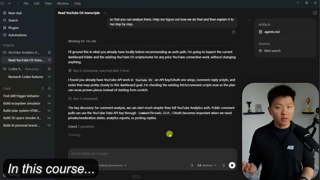
*⏱️ 00:00:09 — Interface d'une application de chat avec un assistant IA montrant des échanges textuels sur l'analyse de scripts YouTube OS.*

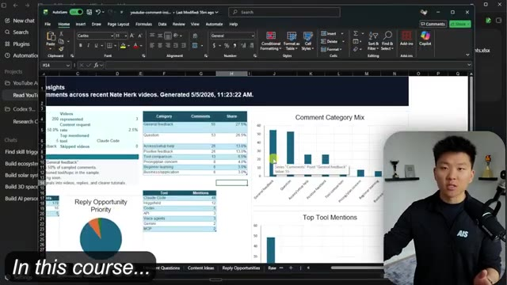
*⏱️ 00:00:18 — Tableau de bord Excel/données affichant des graphiques analytiques sur les commentaires et les mentions d'outils.*

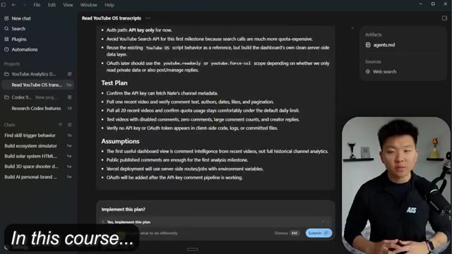
*⏱️ 00:00:27 — Interface de l'application de chat affichant un plan de test détaillé et des options de validation d'implémentation.*

---

### ⏱️ `[00:00:36 - 00:01:01]` | Segment #02

**🔊 Audio (Transcription Intégrale Mot pour Mot en Français) :**
> c'est ChatGPT. Nous avons la possibilité de créer de nouvelles conversations. Nous pouvons rechercher dans les conversations. Nous pouvons avoir différents projets. Nous pouvons avoir toutes nos différentes conversations ici même. Et ensuite, nous parlons au chat juste ici. Et si j'ouvre l'application Codex, qui est ce que nous allons utiliser aujourd'hui pour toute la vidéo, ça a l'air pratiquement exactement pareil. Nous avons des projets sur la gauche. Nous avons des conversations sur la gauche. Et ensuite, nous pouvons parler à ChatGPT juste ici. Nous utilisons ce bouton pour changer de modèle, que nous voulions utiliser GPT 5.5, 5.4, ou d'autres modèles, nous pouvons changer la vitesse.

**👁️ Analyse Visuelle d'Écran (gemini-3.5-flash-lite) :**
**Interface & Outils** : Interface web de ChatGPT

**Contenu textuel & Code** : Menu latéral avec les options "New chat", "Search chats", divers projets (YT Scripter, Skool Helper, etc.) et la zone centrale avec la barre de saisie "Ask anything".

**Action / Démonstration** : Navigation et présentation de l'interface principale de ChatGPT par le présentateur.

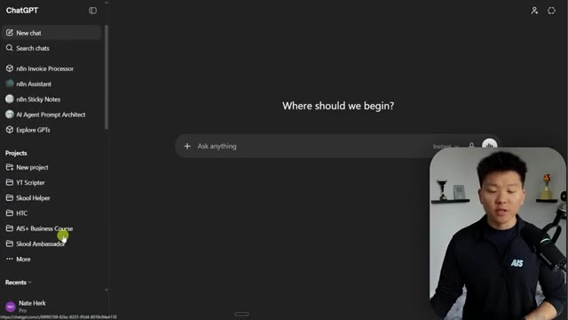
*⏱️ 00:00:42 — Capture d'écran montrant l'interface sombre de ChatGPT avec le panneau latéral affichant les différents chats et projets, tandis que le présentateur apparaît en bas à droite.*

---

### ⏱️ `[00:01:01 - 00:01:22]` | Segment #03

**🔊 Audio (Transcription Intégrale Mot pour Mot en Français) :**
> Et ensuite, nous pouvons également changer l'intelligence. Donc bas, moyen, haut, ou extra haut. Et je vais aborder tout cela un peu plus tard en profondeur. Et c'est aussi très similaire à l'application de bureau Claude Code, où nous avons la possibilité de tchatter avec Claude directement ici. Et ensuite, sur le côté gauche, nous pouvons voir nos tchats et nos projets. C'est donc ça l'interface. Ne soyez pas submergés. Je vais donc vous familiariser tous avec l'interface et passer en revue tous les paramètres que vous devez connaître.

**👁️ Analyse Visuelle d'Écran (gemini-3.5-flash-lite) :**
**Interface & Outils** : Application de bureau Claude Code / interface de chat IA

**Contenu textuel & Code** : Menu contextuel affichant les niveaux d'intelligence ("Low", "Medium", "High", "Extra High", "GPT-5.5", "Speed") et interface de l'application avec un champ de saisie "Describe a task or ask a question".

**Action / Démonstration** : Navigation dans les menus de configuration de l'intelligence et présentation de l'interface de l'application de bureau.

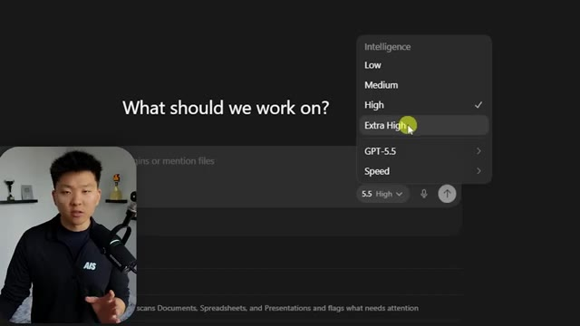
*⏱️ 00:01:06 — Gros plan sur le menu déroulant des réglages d'intelligence de l'application, avec les options Low, Medium, High et Extra High.*

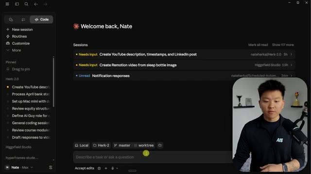
*⏱️ 00:01:12 — Interface principale de l'application de bureau avec le message de bienvenue "Welcome back, Nate" et la liste des sessions récentes.*

---

### ⏱️ `[00:01:22 - 00:01:44]` | Segment #04

**🔊 Audio (Transcription Intégrale Mot pour Mot en Français) :**
> Et ensuite, je vais vous montrer un projet complet du début à la fin, en créant des compétences, en me connectant à des éléments, en créant des automatisations, puis en déployant sur un site Web quelconque. Alors accrochez-vous. Très bien, alors qu'est-ce que c'est réellement que Codex ? Codex est fondamentalement une super application massive. Nous pouvons utiliser ChatGPT, de la même manière que vous lui parlez sur le Web, mais maintenant nous travaillons dans des projets et Codex peut créer des feuilles Excel, lire des feuilles Excel, parcourir tous vos fichiers locaux.

**👁️ Analyse Visuelle d'Écran (gemini-3.5-flash-lite) :**
**Interface & Outils** : Diapositives de présentation graphique (slides).

**Contenu textuel & Code** : Schéma du framework Codex divisé en trois parties : 1. Project + files, 2. Skill + website, 3. Automation + delivery.

**Action / Démonstration** : Présentation théorique du plan du tutoriel et de l'architecture fonctionnelle de Codex.

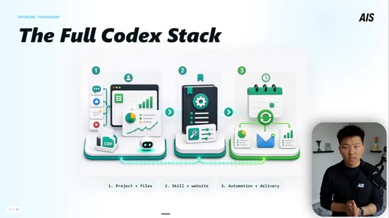
*⏱️ 00:01:33 — Diapositive illustrant 'The Full Codex Stack' avec un diagramme en 3 étapes représentant les projets, compétences et automatisations.*

---

### ⏱️ `[00:01:44 - 00:02:06]` | Segment #05

**🔊 Audio (Transcription Intégrale Mot pour Mot en Français) :**
> Il peut faire pratiquement n'importe quoi sur votre ordinateur, y compris utiliser la souris et le clavier, cliquer partout et automatiser un navigateur. Il nous permet également de créer ces compétences réutilisables. Nous pouvons créer des sites Web, nous pouvons créer des applications, nous pouvons créer des jeux vidéo, et ensuite nous pouvons automatiser et pousser tout ça pour que ça fonctionne réellement pendant que nous dormons chaque nuit. La principale différence ici avec le chat web, c'est que vous ne faites fondamentalement que parler et que vous avez ces connecteurs dans ChatGPT maintenant, de sorte que vous pouvez obtenir un peu plus de fonctionnalités.

**👁️ Analyse Visuelle d'Écran (gemini-3.5-flash-lite) :**
**Interface & Outils** : Diapositives de présentation graphique (PowerPoint ou Keynote) avec incrustation vidéo du présentateur en bas à droite.

**Contenu textuel & Code** : Schémas conceptuels illustrant le fonctionnement de Codex comparé à un chatbot textuel classique.

**Action / Démonstration** : Le présentateur explique les concepts clés du framework Codex en s'appuyant sur des visuels explicatifs.

---

### ⏱️ `[00:02:06 - 00:02:26]` | Segment #06

**🔊 Audio (Transcription Intégrale Mot pour Mot en Français) :**
> Tu peux donner à ce cerveau d'IA un peu plus comme des mains, mais dans Codex, il peut tout faire. C'est l'une de ces choses où Codex peut tout faire que Chat peut faire, mais Chat ne peut pas faire près de tout ce que Codex peut faire, donc autant passer directement à quelque chose comme Codex. Et si tu es curieux de connaître la différence entre Cloud Code et Codex, ce sont des harnais différents, n'est-ce pas ?

**👁️ Analyse Visuelle d'Écran (gemini-3.5-flash-lite) :**
**Interface & Outils** : Présentation vidéo avec diapositive graphique explicative.

**Contenu textuel & Code** : Texte « ChatGPT Gives Answers. Codex Does Work. », illustrations comparatives de interfaces de chat et de systèmes connectés (fichiers, outils, tests), et texte explicatif en bas.

**Action / Démonstration** : Le présentateur explique les différences fonctionnelles et les capacités d'action supérieures de Codex par rapport à un simple chat.

*⏱️ 00:02:11 — Une diapositive de présentation comparant ChatGPT (« ChatGPT Gives Answers ») et Codex (« Codex Does Work ») avec des illustrations graphiques montrant d'un côté un chat simple et de l'autre un environnement complet connecté à divers outils, tandis que le présentateur apparaît dans un encadré en bas à droite.*

---

### ⏱️ `[00:02:26 - 00:02:46]` | Segment #07

**🔊 Audio (Transcription Intégrale Mot pour Mot en Français) :**
> Donc ils fonctionnent fondamentalement d'une manière un peu différente, mais très similaire. Ils utilisent également différents modèles. Donc Claude Code utilise nativement sous le capot Opus, Sonnet et Haiku, et Codex utilise sous le capot les différents modèles ChatGPT. Maintenant, j'ai fait une analyse complète où j'ai réellement testé Opus 4.7 face à GPT 5.5 et j'ai obtenu des résultats vraiment intéressants. Donc si vous voulez regarder cette vidéo ensuite, je vais la marquer juste ici.

**👁️ Analyse Visuelle d'Écran (gemini-3.5-flash-lite) :**
**Interface & Outils** : Tableau de bord analytique et interface web de statistiques.

**Contenu textuel & Code** : Métriques de performance, temps d'exécution, jetons d'entrée/sortie et coûts par expérience pour GPT-5.5 et Opus 4.7.

**Action / Démonstration** : Présentation d'un tableau de bord comparatif des performances de différents modèles d'IA.

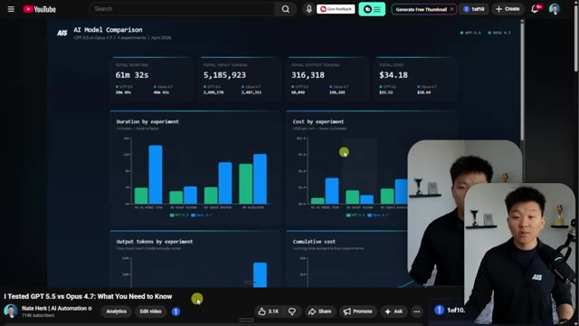
*⏱️ 00:02:41 — Tableau de bord d'analyse comparatif des modèles d'IA affichant des graphiques de performance et de coûts.*

---

### ⏱️ `[00:02:46 - 00:03:07]` | Segment #08

**🔊 Audio (Transcription Intégrale Mot pour Mot en Français) :**
> Je pense vraiment que ça vaut le coup au moins de le survoler rapidement parce qu'en fin de compte, ces modèles ont des forces très différentes, c'est ce que j'ai remarqué après avoir joué avec eux sans arrêt. J'aime vraiment Claude pour son côté exploratoire et de brainstorming, et pour m'aider à être créatif, à réfléchir aux choses et à planifier. Mais ensuite, j'aime vraiment Codex pour son côté pragmatique. Et j'ai l'impression qu'il s'en sort mieux pour suivre mon plan si le plan devient de plus en plus long.

**👁️ Analyse Visuelle d'Écran (gemini-3.5-flash-lite) :**
**Interface & Outils** : Logiciel de présentation / Diapositive (Slide)

**Contenu textuel & Code** : Texte de comparaison : 'Claude: exploratory, creative, great for brainstorming.' et 'Codex: pragmatic, plan-following, strong at execution and review.'

**Action / Démonstration** : Présentation comparative des différents modèles d'IA par le présentateur.

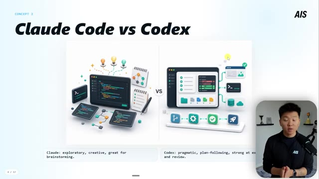
*⏱️ 00:02:51 — Une diapositive de présentation comparant 'Claude Code vs Codex' avec des illustrations et des descriptions textuelles des forces de chaque outil.*

---

### ⏱️ `[00:03:07 - 00:03:31]` | Segment #09

**🔊 Audio (Transcription Intégrale Mot pour Mot en Français) :**
> Et il est vraiment bon pour exécuter. Et il est vraiment bon pour trouver des problèmes et dépanner des choses que parfois Claude, pour une raison quelconque, ne peut pas gérer. Donc je ne suis pas là en train de dire que j'aime Codex plus que Claude Code. Je dis que je les utilise tous les deux et j'en apprends plus sur les deux chaque jour. Et une autre chose que j'aime vraiment à propos de Codex, c'est qu'on peut voir mon petit animal de compagnie ici en bas, dont je vous dirai comment l'obtenir plus tard. Mais cet animal, pendant que vous travaillez, il reste au bas de votre écran et il vous dit sur quoi il travaille.

**👁️ Analyse Visuelle d'Écran (gemini-3.5-flash-lite) :**
**Interface & Outils** : Logiciel de présentation et interface web d'application

**Contenu textuel & Code** : Texte comparatif 'Claude Code vs Codex' et descriptions textuelles des caractéristiques de chaque outil.

**Action / Démonstration** : Le présentateur explique les différences entre les deux outils de développement IA.

---

### ⏱️ `[00:03:31 - 00:03:49]` | Segment #10

**🔊 Audio (Transcription Intégrale Mot pour Mot en Français) :**
> C'est donc vraiment très agréable de pouvoir faire du multitasking et de voir ce qui se passe à l'intérieur de Codex. Et l'animal de compagnie est plutôt drôle. Et c'est bien plus que d'avoir de simple discussions. C'est la capacité d'avoir tout d'organisé sur votre espace de travail. Donc si vous avez regardé ma vidéo récente sur le système d'exploitation Cloud Code ou si vous avez vu ma vidéo sur l'assistant exécutif, c'est mon projet Herc 2, qui est fondamentalement l'endroit où je vis à l'intérieur de Cloud Code.

**👁️ Analyse Visuelle d'Écran (gemini-3.5-flash-lite) :**
**Interface & Outils** : Explorateur de fichiers Windows (Explorateur de dossiers)

**Contenu textuel & Code** : Dossiers de projet : .claude, archives, audits, book, brand-assets, context, decisions, demo, docs, projects, references, scripts, statements, student-resources, templates, tmp, youtube-os.

**Action / Démonstration** : Navigation et affichage de l'arborescence des dossiers locaux d'un espace de travail.

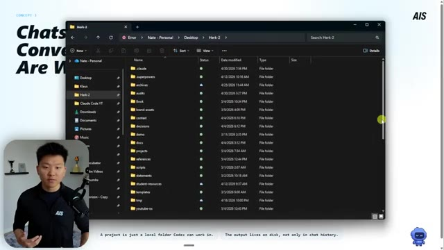
*⏱️ 00:03:45 — Capture d'écran de l'explorateur de fichiers montrant l'organisation des dossiers locaux d'un projet.*

---

### ⏱️ `[00:03:50 - 00:04:14]` | Segment #11

**🔊 Audio (Transcription Intégrale Mot pour Mot en Français) :**
> Et tout cela n'est qu'un ensemble de dossiers et de fichiers. J'ai un tas de fichiers ici. J'ai un tas de dossiers différents. J'ai des paramètres. J'ai des compétences. J'ai des agents. J'ai des projets. J'ai toutes ces choses sur lesquelles je travaille. Et tout cela n'est qu'un ensemble de fichiers locaux, ce qui signifie que je peux avoir des codecs qui fonctionnent à l'intérieur de ce répertoire et qui font tout aussi bien. Tout ce que nous faisons lorsque nous utilisons ces différents modèles, c'est que nous organisons les choses dans une structure, une structure que différentes architectures d'agents peuvent comprendre.

**👁️ Analyse Visuelle d'Écran (gemini-3.5-flash-lite) :**
**Interface & Outils** : Explorateur de fichiers Windows (explorateur de répertoires `.claude`)

**Contenu textuel & Code** : Dossiers et fichiers du projet : agent-memory, agents, plans, rules, skills, worktrees, settings.json, settings.local

**Action / Démonstration** : Navigation dans l'arborescence des dossiers et fichiers de configuration de l'agent Claude.

*⏱️ 00:03:56 — Explorateur de fichiers Windows montrant le contenu du dossier `.claude` avec les sous-dossiers agent-memory, agents, plans, rules, skills, worktrees et des fichiers de configuration JSON, avec le présentateur en médaillon vidéo.*

---

### ⏱️ `[00:04:14 - 00:04:34]` | Segment #12

**🔊 Audio (Transcription Intégrale Mot pour Mot en Français) :**
> Et que vous vouliez utiliser des codecs, du code cloud, Cursor ou OpenClaw, peu importe, ils peuvent tous fonctionner à partir de ce répertoire. Tant que vous avez une sorte d'instructions et de directives sur ce qui se trouve réellement où. Bon, alors en gros, ce que je vais construire avec vous aujourd'hui, c'est un système d'intelligence pour les commentaires YouTube. Donc, nous voulons être capable de récupérer les commentaires YouTube de ma chaîne.

**👁️ Analyse Visuelle d'Écran (gemini-3.5-flash-lite) :**
**Interface & Outils** : Présentation vidéo avec diapositives graphiques.

**Contenu textuel & Code** : Schémas conceptuels et blocs textuels décrivant l'architecture d'un projet d'intelligence sur les commentaires YouTube.

**Action / Démonstration** : Le présentateur explique la différence entre les chats et les projets, puis détaille les étapes de construction d'une application.

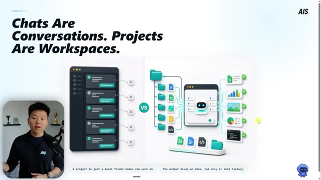
*⏱️ 00:04:19 — Diapositive comparant les chats de conversation et les projets sous forme d'espaces de travail.*

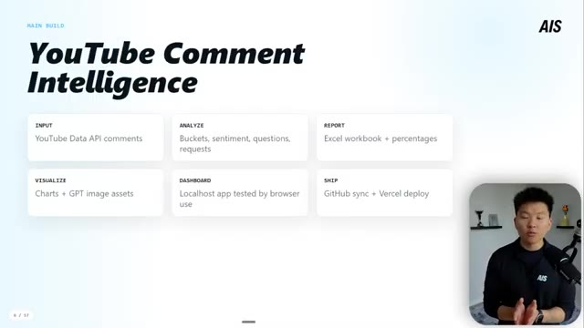
*⏱️ 00:04:29 — Diapositive présentant le projet 'YouTube Comment Intelligence' avec ses différentes étapes (Input, Analyze, Report, Visualize, Dashboard, Ship).*

---

### ⏱️ `[00:04:34 - 00:04:54]` | Segment #13

**🔊 Audio (Transcription Intégrale Mot pour Mot en Français) :**
> Nous voulons pouvoir faire analyser cela. Nous voulons un classeur Excel. Nous voulons une sorte de visualisation de données et nous voulons un tableau de bord qui vit quelque part sur le web pour que je puisse aller le consulter sur mon téléphone si je suis en train de faire une promenade. Et je vais vous montrer comment nous livrons et déployons tout cela. Donc, fondamentalement, de zéro à un projet fonctionnel, c'est ce que je vais vous montrer les gars aujourd'hui. Laissez-moi donc ouvrir l'application Codex et vous montrer comment cela fonctionne.

**👁️ Analyse Visuelle d'Écran (gemini-3.5-flash-lite) :**
**Interface & Outils** : Logiciel de présentation / Slides

**Contenu textuel & Code** : Schéma en 6 blocs : Input (YouTube Data API comments), Analyze (Buckets, sentiment, questions, requests), Report (Excel workbook + percentages), Visualize (Charts + GPT image assets), Dashboard (Localhost app tested by browser use), Ship (GitHub sync + Vercel deploy).

**Action / Démonstration** : Le présentateur explique les différentes étapes et composants du système d'intelligence des commentaires YouTube en pointant le schéma.

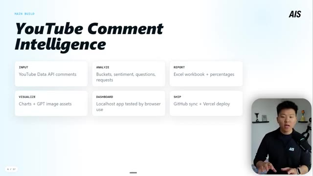
*⏱️ 00:04:39 — Diapositive de présentation montrant l'architecture du projet "YouTube Comment Intelligence" avec six étapes clés.*

---

### ⏱️ `[00:04:54 - 00:05:21]` | Segment #14

**🔊 Audio (Transcription Intégrale Mot pour Mot en Français) :**
> Maintenant, très rapidement, ce que vous devez faire, c'est avoir une sorte d'abonnement ChatGPT. La bonne nouvelle, c'est que si vous êtes sur la version gratuite, vous pouvez quand même essayer Codex. Vous avez un accès limité à Codex, mais je vous recommanderais de passer simplement sur le forfait à 20 dollars par mois pour commencer. Et si vous atteignez vos limites assez rapidement, alors peut-être que vous voudrez passer à la version Pro. Maintenant, ce qui est vraiment bien aussi avec l'abonnement ChatGPT, c'est que vous pouvez le connecter à OpenClaw ou Hermes Agent, ce qui est vraiment, vraiment bien parce que, évidemment, c'est tellement plus cher de payer par jeton plutôt que d'avoir simplement une sorte d'abonnement.

**👁️ Analyse Visuelle d'Écran (gemini-3.5-flash-lite) :**
**Interface & Outils** : Navigateur web affichant le site officiel de ChatGPT (page des prix).

**Contenu textuel & Code** : Tarifs affichés : Free ($0), Go ($8), Plus ($20), Pro ($100), avec le détail des fonctionnalités pour chaque offre (mention de l'accès à Codex pour la version gratuite et élargi pour les autres).

**Action / Démonstration** : Présentation des différentes options d'abonnement disponibles pour l'utilisateur sur le site de ChatGPT.

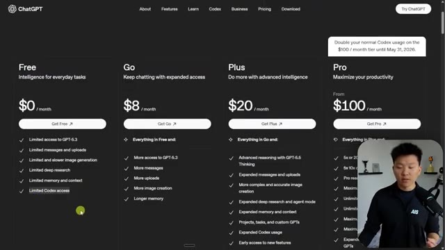
*⏱️ 00:05:01 — Capture d'écran montrant la page des tarifs d'abonnement de ChatGPT avec les différentes formules (Free, Go, Plus, Pro) et leurs fonctionnalités respectives.*

---

### ⏱️ `[00:05:22 - 00:05:42]` | Segment #15

**🔊 Audio (Transcription Intégrale Mot pour Mot en Français) :**
> Et ensuite, vous allez simplement aller sur Codex, puis télécharger l'application pour votre système d'exploitation. C'est de cette façon que nous allons l'utiliser aujourd'hui. En fin de compte, vous obtiendrez des fonctionnalités plus complètes si vous utilisez Codex dans l'extension VS Code ou dans le terminal, mais pour les besoins de la vidéo, utiliser l'application vous mènera déjà très loin dans les deux cas. Il y a juste quelques petits détails que vous devez garder à l'esprit, c'est pourquoi je fais cette vidéo YouTube.

**👁️ Analyse Visuelle d'Écran (gemini-3.5-flash-lite) :**
**Interface & Outils** : Navigateur web (page de téléchargement de Codex) et application de bureau Codex.

**Contenu textuel & Code** : Page de téléchargement de Codex et interface de discussion de l'application de bureau Codex avec des suggestions de projets.

**Action / Démonstration** : Présentation de la page de téléchargement de l'application Codex et affichage de l'interface principale du logiciel.

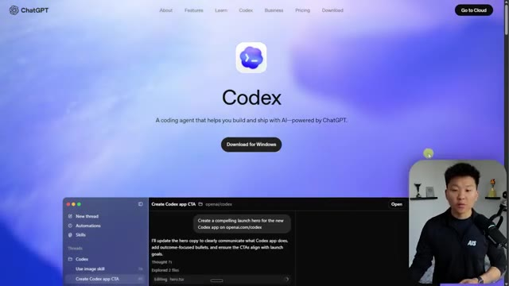
*⏱️ 00:05:27 — Page web de présentation de l'application Codex avec un bouton de téléchargement pour Windows et un aperçu de l'interface en bas à gauche.*

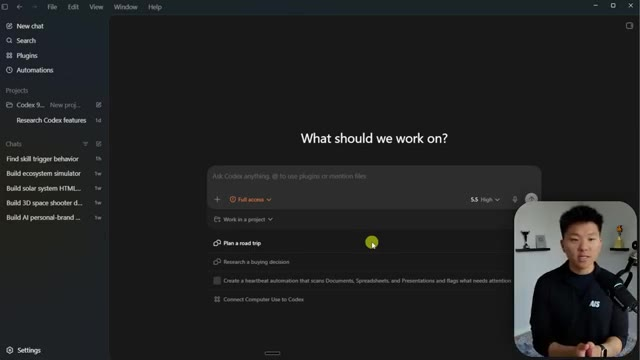
*⏱️ 00:05:32 — Interface principale de l'application Codex avec la barre de recherche et la question "What should we work on?".*

---

### ⏱️ `[00:05:42 - 00:06:17]` | Segment #16

**🔊 Audio (Transcription Intégrale Mot pour Mot en Français) :**
> Très bien, allons-y et commençons. Donc sur le côté gauche, vous pouvez voir que j'ai un projet d'ouvert, et ce projet est en fait la façon dont j'ai construit la présentation que vous regardiez tout à l'heure. Donc cette présentation, je l'ai construite ici même dans ce projet, et vous pouvez voir que comme je suis dans l'application, Codex nous permet fondamentalement de naviguer là-dedans directement dans ce petit navigateur localhost. Et c'est aussi ici que si je disais, hé, est-ce que tu peux utiliser browser use et tester cette présentation pour t'assurer que tout a l'air bien et t'assurer que ça clique et que ça bouge fonctionnellement, alors ça ferait apparaître une souris ici et on la verrait bouger et on la verrait cliquer, ce que je vous montrerai plus tard dans la vidéo. Mais de toute façon, ce que nous allons faire, c'est que nous allons commencer un nouveau projet parce que

**👁️ Analyse Visuelle d'Écran (gemini-3.5-flash-lite) :**
**Interface & Outils** : Interface de l'application Codex et navigateur web affichant une application locale sur localhost.

**Contenu textuel & Code** : Texte de présentation 'Master 95% of Codex' et détails de projets sur le panneau central de l'agent.

**Action / Démonstration** : Navigation et présentation du projet de slides construit à l'aide de l'outil Codex.

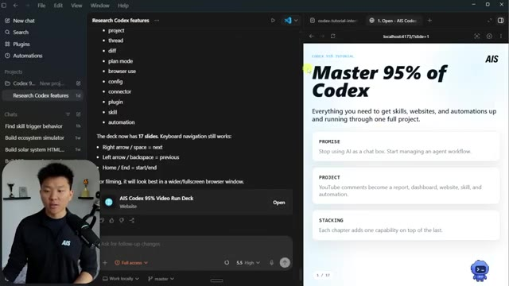
*⏱️ 00:05:51 — Vue d'écran partagée montrant l'interface d'un assistant IA (Codex) sur le panneau central et une présentation web s'affichant sur le navigateur à droite, avec la webcam du présentateur en bas à gauche.*

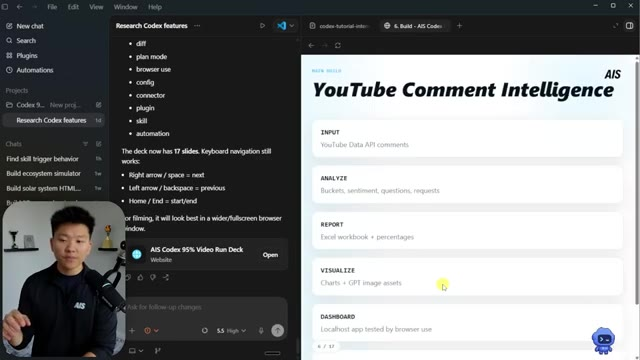
*⏱️ 00:06:00 — Vue similaire montrant la suite de la présentation sur le navigateur à droite avec le titre 'YouTube Comment Intelligence' et l'interface de l'outil Codex à gauche.*

---

### ⏱️ `[00:06:17 - 00:06:53]` | Segment #17

**🔊 Audio (Transcription Intégrale Mot pour Mot en Français) :**
> ici, vous pouvez voir que nous avons une série de discussions aléatoires, qui peuvent toujours faire des choses comme créer des jeux, créer des automatisations et des simulateurs. Mais ce que nous voulons faire, c'est travailler à l'intérieur d'un projet réel, parce que ces discussions, tout livrable que nous créons n'a pas vraiment de foyer, vous savez, il vit juste quelque part au hasard dans nos documents. Mais lorsque nous travaillons sur un certain projet, je peux réellement récupérer le répertoire de travail local. Donc je le copie. Et si je vais dans mon explorateur de fichiers et que je le colle. Maintenant, je suis à l'intérieur du projet réel sur lequel nous travaillons dans codex. Je peux donc voir différents actifs qui vivent dans ce projet, toutes ces images. Je peux voir différents guides et je peux avoir un peu plus d'organisation pour ce projet en cours dans mon

**👁️ Analyse Visuelle d'Écran (gemini-3.5-flash-lite) :**
**Interface & Outils** : Application de développement AI (Codex interface), navigateur web et explorateur de fichiers Windows.

**Contenu textuel & Code** : Tableaux de métriques de tokens, notes textuelles sur 'YouTube Comment Intelligence' et arborescence de dossiers de projet.
[DESC_IMAGE_3] Navigation dans l'arborescence des fichiers du projet via l'explorateur de fichiers.

**Action / Démonstration** : Explications face caméra et démonstration conceptuelle.

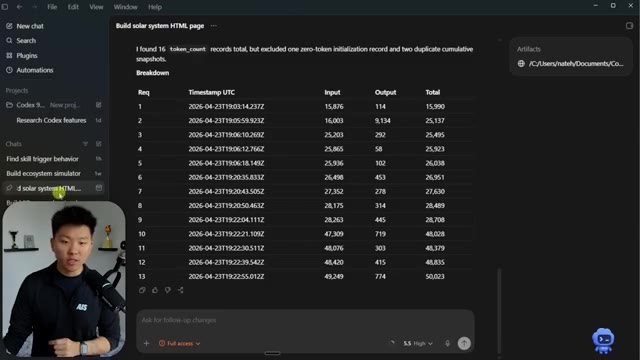
*⏱️ 00:06:26 — Interface d'une application affichant un tableau de données sur les tokens et requêtes avec le présentateur en bas à gauche.*

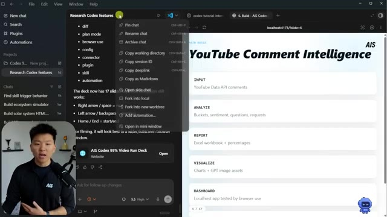
*⏱️ 00:06:35 — Interface avec un menu contextuel ouvert montrant des options de chat et de code, et une application web active à droite.*

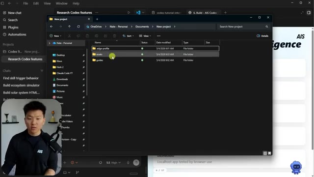
*⏱️ 00:06:44 — Explorateur de fichiers Windows ouvert par-dessus l'interface principale, montrant les dossiers '.edge-profile', 'assets' et 'guides'.*

---

### ⏱️ `[00:06:53 - 00:07:27]` | Segment #18

**🔊 Audio (Transcription Intégrale Mot pour Mot en Français) :**
> entreprise. Très bien. Donc nous allons commencer un nouveau projet. Je vais cliquer sur nouveau chat en haut. Et puis juste ici, vous pouvez voir que je suis à l'intérieur du projet codex 95 %, mais nous allons aller de l'avant et ajouter un nouveau projet. Donc cela va ouvrir un petit explorateur de fichiers par ici. Et ensuite vous choisissez où vous voulez que cela réside. Donc pour cet exemple, je vais aller sur mon bureau. Je vais aller dans un dossier appelé Codex YouTube, et je vais créer un nouveau dossier à l'intérieur de ce dossier appelé simplement YouTube Analytics Demo. Et nous allons aller de l'avant et ouvrir ce dossier et le sélectionner. Et maintenant vous pouvez voir que c'est un nouveau projet ici de ce côté gauche qui

**👁️ Analyse Visuelle d'Écran (gemini-3.5-flash-lite) :**
**Interface & Outils** : Interface de l'application Codex / VS Code.

**Contenu textuel & Code** : Menu contextuel de sélection de projets affichant "Codex 95%", "Add new project", et "Don't work in a project".

**Action / Démonstration** : Le curseur survole l'option "Add new project" pour commencer un nouveau projet.

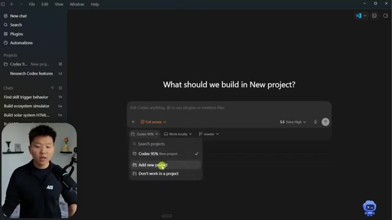
*⏱️ 00:07:01 — Interface de l'application montrant le menu déroulant des projets avec l'option "Add new project" sélectionnée, et la webcam du présentateur en bas à gauche.*

---

### ⏱️ `[00:07:27 - 00:07:59]` | Segment #19

**🔊 Audio (Transcription Intégrale Mot pour Mot en Français) :**
> dans lequel nous allons travailler. Maintenant, ici, vous pouvez voir que j'ai quelque chose qui s'appelle un accès complet. Par défaut, vous ne verrez pas cela. Ce sera simplement réglé sur les autorisations par défaut. Je vais donc lancer une sorte de chat ici et ensuite je vous montrerai comment nous configurons réellement cela. Très rapidement les gars, je sais que nous abordons une tonne d'informations dans cette vidéo, alors ce que j'ai fait, c'est que j'ai rassemblé tout cela dans un guide de ressources PDF complet que vous pourrez utiliser et consulter plus tard. Tout ce que vous avez à faire pour l'obtenir, c'est de rejoindre ma communauté gratuite School. Le lien pour cela se trouve dans la description, et une fois que vous y serez, allez dans la section "classroom" et cliquez sur "all YouTube resources", et vous pourrez y trouver tous mes répertoires, toutes mes compétences, mes guides de ressources, tout ce que j'ai jamais publié ici est complètement

**👁️ Analyse Visuelle d'Écran (gemini-3.5-flash-lite) :**
**Interface & Outils** : Application d'assistant IA (type Claude / interface de chat) et plateforme communautaire Skool (AI Automation Society).

**Contenu textuel & Code** : Champ de texte "Ask Codex anything...", paramètres de permissions ("Default permissions"), et sélecteurs de projets.

**Action / Démonstration** : Présentation de l'interface de l'outil d'IA et de ses options de configuration des permissions par le présentateur.

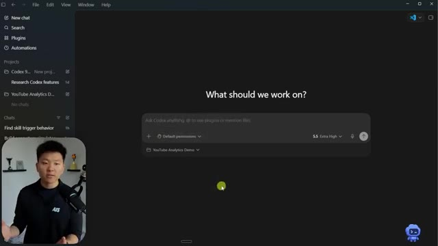
*⏱️ 00:07:35 — Interface sombre d'une application d'assistant IA affichant "What should we work on?" avec une zone de saisie et des options de permissions.*

---

### ⏱️ `[00:07:59 - 00:08:32]` | Segment #20

**🔊 Audio (Transcription Intégrale Mot pour Mot en Français) :**
> gratuit et tout ce que j'ai montré sur YouTube est généralement déposé ici. Rejoignez donc la communauté via le lien dans la description et revenons à la vidéo. Merci les gars. Très bien. La première chose que je veux faire dans ce projet, c'est de faire en sorte qu'il puisse simplement se familiariser avec mon espace de travail et avec qui je suis. Et la façon dont je vais m'y prendre, c'est que j'ai un projet en local. Si je vais sur mon, si je vais sur mon bureau et que je vais dans un projet ici appelé YouTube OS, j'ai genre toutes mes transcriptions juste ici provenant de certaines vidéos YouTube. Donc ce que je vais faire, c'est que je ne vais pas lui donner ce chemin d'accès. Je vais simplement dire : Hé, sur mon bureau, regarde à l'intérieur de mon dossier YouTube OS

**👁️ Analyse Visuelle d'Écran (gemini-3.5-flash-lite) :**
**Interface & Outils** : Interface logicielle (environnement de type assistant IA/éditeur).

**Contenu textuel & Code** : Texte « What should we work on? » et barre de prompt « Ask Codes anything... ».

**Action / Démonstration** : Le présentateur s'apprête à interagir avec l'outil pour commencer le projet.

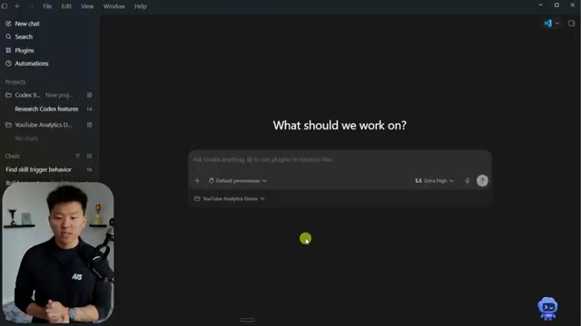
*⏱️ 00:08:07 — Interface de l'application avec un champ de saisie central demandant « What should we work on? » et la vidéo du présentateur incrustée en bas à gauche.*

---

### ⏱️ `[00:08:32 - 00:08:53]` | Segment #21

**🔊 Audio (Transcription Intégrale Mot pour Mot en Français) :**
> et de récupérer 10 de mes transcriptions brutes et de les analyser. C'est juste pour vous montrer à quel point il sera doué pour trouver différents fichiers localement et être capable de les organiser, les déplacer, les supprimer, tout ce que vous voulez. Dans ce cas, je lui dis simplement de les lire. Très bien, donc je veux que tu ailles sur mon bureau et je veux que tu regardes un dossier appelé YouTube OS. Et je veux simplement que tu te familiarises avec moi.

**👁️ Analyse Visuelle d'Écran (gemini-3.5-flash-lite) :**
**Interface & Outils** : Explorateur de fichiers Windows et interface de type VS Code en arrière-plan.

**Contenu textuel & Code** : Liste de dossiers (.claude, .git, .obsidian, processed, raw, wiki) et de fichiers Markdown.

**Action / Démonstration** : Navigation dans l'arborescence des dossiers locaux pour montrer les fichiers de transcriptions brutes.

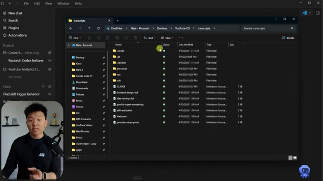
*⏱️ 00:08:37 — Un explorateur de fichiers ouvert dans un dossier nommé "transcripts" sur Windows, avec en médaillon le présentateur dans le coin inférieur gauche.*

---

### ⏱️ `[00:08:53 - 00:09:11]` | Segment #22

**🔊 Audio (Transcription Intégrale Mot pour Mot en Français) :**
> Je fais des vidéos YouTube sur l'automatisation par l'IA et à l'intérieur de ce dossier, j'ai un tas de mes retranscriptions brutes. Je veux donc simplement que tu en lises environ cinq à dix juste pour te familiariser avec le type de contenu que je produis. Tu ne dois faire aucun classement. Je veux juste que tu les lises pour avoir du contexte. Maintenant, ce qui est génial avec ça, c'est que Codex, encore une fois, est un agent qui réside localement.

**👁️ Analyse Visuelle d'Écran (gemini-3.5-flash-lite) :**
**Interface & Outils** : Interface de l'outil de développement / assistant IA (style Codex / VS Code) et webcam du présentateur.

**Contenu textuel & Code** : Texte "What should we work on?", champ de saisie de prompt "Ask Codex anything, @ to use plugins or mention files", avec un dossier attaché "YouTube Analytics Demo".

**Action / Démonstration** : Le présentateur présente l'interface de l'outil de développement et se prépare à interagir avec l'assistant IA en sélectionnant un dossier de retranscriptions.

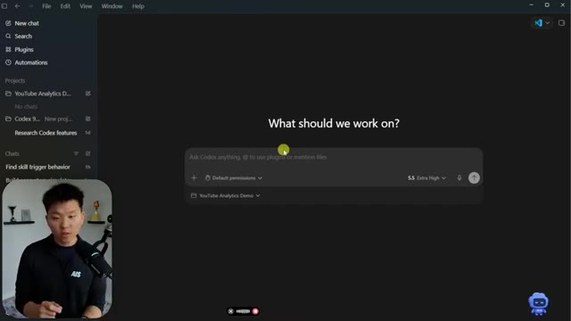
*⏱️ 00:08:58 — Capture d'écran montrant l'interface d'un assistant de code (Codex / éditeur basé sur l'IA) avec le texte "What should we work on?" et le présentateur visible dans un encadré en bas à gauche.*

---

### ⏱️ `[00:09:12 - 00:09:31]` | Segment #23

**🔊 Audio (Transcription Intégrale Mot pour Mot en Français) :**
> Donc, juste parce que ça fonctionne à l'intérieur d'un projet, qui est notre dossier de démonstration YouTube en quelque sorte, cela ne signifie pas que ça ne peut pas naviguer partout ailleurs à l'intérieur de vos fichiers locaux. Et parce que nous lui demandons de le faire, ça va chercher. Juste ici, vous pouvez voir que ça cherche à l'intérieur de mon bureau. Et ensuite, ça va trouver le système d'exploitation YouTube et ça va creuser dans ce dossier.

**👁️ Analyse Visuelle d'Écran (gemini-3.5-flash-lite) :**
**Interface & Outils** : Application de bureau d'assistant IA / Agent intelligent avec panneau latéral de gestion des projets et des chats.

**Contenu textuel & Code** : Prompt utilisateur : "Alright so I want you to go onto my desktop and I want you to look at a folder called 'YouTube OS'. I just want you to familiarize yourself with me. I make YouTube videos on AI automation..."

**Action / Démonstration** : L'agent traite la requête de navigation dans les fichiers locaux du bureau pour lire les transcriptions de vidéos YouTube.

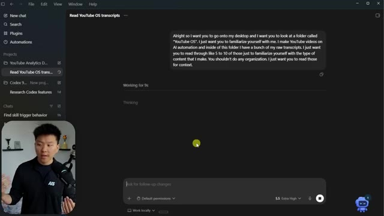
*⏱️ 00:09:17 — Interface d'une application d'assistant IA avec le présentateur incrusté en bas à gauche, montrant un prompt demandant à l'agent d'accéder au bureau et au dossier YouTube OS.*

---

### ⏱️ `[00:09:31 - 00:10:04]` | Segment #24

**🔊 Audio (Transcription Intégrale Mot pour Mot en Français) :**
> et il va continuer à chercher jusqu'à ce qu'il trouve ce qu'il veut. Maintenant, un rapide avertissement, ce n'est pas l'utilisation la plus efficace de Codex ou de vos jetons. Une utilisation plus efficace serait de dire, hé, c'est le dossier juste ici avec toutes mes transcriptions brutes. Je vais copier ce chemin et je vais maintenant donner à Codex ce chemin exact pour qu'il puisse simplement regarder là-dedans au lieu d'avoir à le chercher par lui-même. Mais je voulais juste vous montrer comment il est capable de faire cela, car vous pouvez voir juste ici à l'intérieur de mon dossier de transcriptions, j'en ai un appelé brut et c'est celui que je voulais qu'il regarde. Et juste ici, il est dit qu'il y a deux fichiers, brut puis traité. Donc il ne sait pas

**👁️ Analyse Visuelle d'Écran (gemini-3.5-flash-lite) :**
**Interface & Outils** : Interface de chat/agent IA de type Codex / application de bureau avec historique des discussions et commandes.

**Contenu textuel & Code** : Prompt utilisateur demandant à l'agent d'accéder au dossier 'YouTube OS', réponses textuelles de l'agent expliquant ses actions et exécution de commandes PowerShell/système (`Get-ChildItem`).

**Action / Démonstration** : L'assistant IA analyse le système de fichiers local et parcourt les dossiers pour trouver les transcriptions de vidéos YouTube.

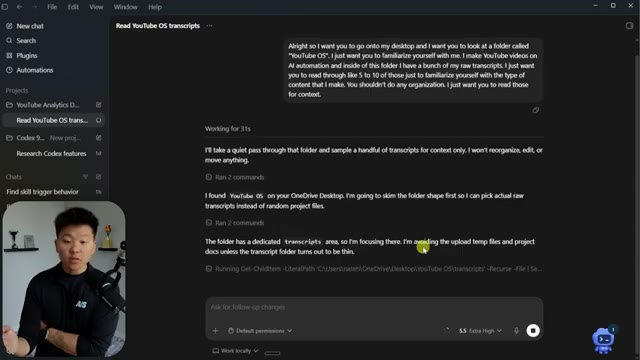
*⏱️ 00:09:39 — Interface d'un assistant IA montrant un prompt demandant d'explorer le dossier 'YouTube OS' sur le bureau pour lire des transcriptions brutes, avec les réponses et les commandes exécutées par l'agent.*

*⏱️ 00:09:56 — Gros plan sur le bas de l'interface de l'assistant IA affichant un chemin de fichier local vers un dossier de transcriptions brut (`C:\Users\nateh\OneDrive\Desktop\YouTube OS\transcripts\raw`).*

---

### ⏱️ `[00:10:04 - 00:10:36]` | Segment #25

**🔊 Audio (Transcription Intégrale Mot pour Mot en Français) :**
> lequel consulter. Bref, plus vous êtes précis dans vos consignes et dans vos indications, mieux c'est. Parlons également, pendant que cela s'exécute, des paramètres du modèle ici. Donc, pour l'instant, vous avez remarqué que nous sommes sur « extra élevé ». Et je dirais que « extra élevé » est probablement exagéré pour ce genre de tâche. La plupart du temps, j'utilise « moyen » pour toute ma planification et mon brainstorming. Et puis, de temps en temps, si je fais un gros projet ou une compétence massive, je passe à « élevé ». Honnêtement, j'utilise à peine « extra élevé » à moins de rencontrer un bug ou un problème qu'il n'est pas capable de résoudre. Bref, il a lu neuf transcriptions, donc il a un peu

**👁️ Analyse Visuelle d'Écran (gemini-3.5-flash-lite) :**
**Interface & Outils** : Interface de l'application de bureau (style Claude Code / Cursor ou assistant de développement) avec un menu contextuel ouvert pour les paramètres de modèle ('Intelligence' : Low, Medium, High, Extra High).

**Contenu textuel & Code** : Texte du chat concernant la lecture de transcriptions YouTube (« The folder has a dedicated transcripts area... ») et menu des paramètres d'intelligence avec le niveau 'Extra High' sélectionné.

**Action / Démonstration** : Le présentateur montre et commente les options de configuration et de paramètres de modèle de l'application (« extra élevé »).

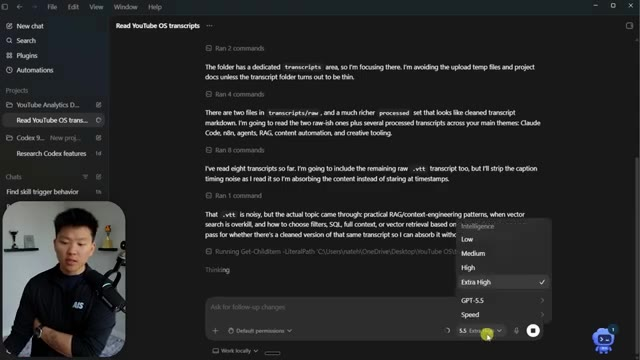
*⏱️ 00:10:12 — Interface d'une application d'assistant IA montrant un fil de discussion avec des blocs de code exécutés ('Ran x commands') et le menu déroulant des paramètres d'intelligence réglé sur 'Extra High'.*

---

### ⏱️ `[00:10:36 - 00:11:00]` | Segment #26

**🔊 Audio (Transcription Intégrale Mot pour Mot en Français) :**
> un peu mieux l'idée maintenant de qui nous sommes. Mais juste pour vous montrer les gars, c'est toujours le dossier dans lequel nous travaillons, la démo YouTube analytics, et il n'y a rien qui existe ici. Donc même s'il sait cela, cette connaissance vit vraiment seulement dans notre mémoire globale de ChatGPT et dans cette fenêtre de chat spécifique. Si j'ouvrais un nouveau chat, il n'aurait probablement plus la connaissance de ceci. Donc ce que je voudrais probablement faire, c'est dire, ce que je veux que tu fasses, c'est de configurer un fichier agents.md.

**👁️ Analyse Visuelle d'Écran (gemini-3.5-flash-lite) :**
**Interface & Outils** : Application de bureau IA, Explorateur de fichiers Windows.

**Contenu textuel & Code** : Texte d'un prompt demandant à l'IA de lire des transcriptions depuis un dossier nommé "YouTube OS" pour se familiariser avec le style et le contenu des vidéos du créateur.

**Action / Démonstration** : L'IA a exécuté la tâche de lecture de 9 fichiers de transcription et résume sa compréhension du contenu et du ton du créateur.

*⏱️ 00:10:42 — Interface d'une application d'intelligence artificielle affichant un historique de discussion et le détail d'un prompt demandant d'analyser des transcriptions de vidéos YouTube, avec une incrustation vidéo du présentateur en bas à gauche et un explorateur de fichiers sur le côté droit.*

---

### ⏱️ `[00:11:01 - 00:11:27]` | Segment #27

**🔊 Audio (Transcription Intégrale Mot pour Mot en Français) :**
> Ceci devrait contenir du contexte sur moi et sur l'objectif de ce projet. En fin de compte, ce que nous allons faire ici, c'est de construire un tableau de bord qui va être déployé sur Vercel et qui va contenir des informations sur ma chaîne ainsi que des analyses concernant les commentaires et des choses de ce genre. C'est donc l'objectif final. Nous allons devoir nous connecter à YouTube. Nous allons devoir récupérer des données. Nous allons configurer des compétences et des automatisations, mais je veux juste que tu nous fasses démarrer ici avec un fichier agents.md rapide. Et maintenant, je vais lancer tout ça.

**👁️ Analyse Visuelle d'Écran (gemini-3.5-flash-lite) :**
**Interface & Outils** : Application de bureau (Interface de type agent IA / assistant avec panneau latéral pour les projets et les chats)

**Contenu textuel & Code** : Prompt utilisateur demandant à l'IA d'analyser le dossier "YouTube OS" et réponse de l'IA résumant le style, le ton et le contenu des vidéos de la chaîne.

**Action / Démonstration** : L'agent IA analyse les fichiers de transcription locaux et confirme avoir assimilé le contexte des vidéos de la chaîne.

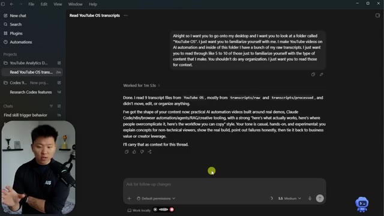
*⏱️ 00:11:07 — Interface d'une application de bureau montrant une conversation avec un agent IA qui a lu les transcriptions de vidéos YouTube.*

---

### ⏱️ `[00:11:27 - 00:12:00]` | Segment #28

**🔊 Audio (Transcription Intégrale Mot pour Mot en Français) :**
> Maintenant, pourquoi avons-nous besoin de créer un fichier agents.md ? Eh bien, si vous venez de CloudCode, vous savez que nous voulons toujours commencer un projet avec un fichier cloud.md. Et c'est simplement agents.md. C'est la même chose, mais Codex attend une terminologie différente. Et ce que fait ce fichier agents, c'est en gros que c'est un document d'intégration. Chaque fois que vous ouvrez un nouveau chat, il va d'abord lire le fichier agents.md, et il va s'organiser avec quel est mon objectif, que fait cet utilisateur, et comment l'aider aussi efficacement que possible ? Ce document a donc été créé. Si je clique sur ouvrir, nous allons pouvoir le lire ici même. Et c'est juste un très

**👁️ Analyse Visuelle d'Écran (gemini-3.5-flash-lite) :**
**Interface & Outils** : Application de bureau (Interface de chat IA type Codex/CloudCode) avec une webcam du présentateur en bas à gauche.

**Contenu textuel & Code** : Prompt utilisateur : "What I want you to do is set up an agents.md file. This should have context about me and about what the goal of this project is..." Réponse de l'agent : "I'll create a lightweight project guide in the current dashboard workspace..."

**Action / Démonstration** : L'assistant IA analyse la demande et commence à rédiger le guide du projet et à créer le fichier agents.md.

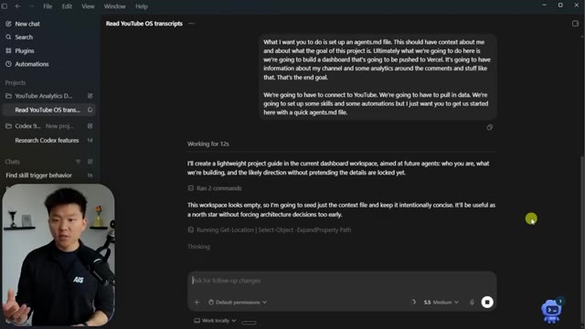
*⏱️ 00:11:35 — Interface d'une application de chat avec un assistant IA, affichant un prompt utilisateur demandant de configurer un fichier agents.md et la réponse en cours de l'agent.*

---

### ⏱️ `[00:12:00 - 00:12:34]` | Segment #29

**🔊 Audio (Transcription Intégrale Mot pour Mot en Français) :**
> simple fichier markdown. C'est le projet juste ici. C'est à propos de Nate. Nate Herc fait ça. C'est l'objectif du projet. C'est la direction du produit. Donc nous lui donnons simplement des informations très importantes qu'il a besoin de connaître sur notre projet. Et vous pouvez voir maintenant, si je fais glisser l'explorateur de fichiers, il a créé ce dossier markdown d'agent, ce qui est exactement ce que nous voulions. Désolé, pas un dossier, un fichier. D'accord. Donc maintenant que c'est fait, je vais aller fermer ça et nous allons commencer. Donc ce que je vais faire, c'est que je vais cliquer sur ce bouton et je vais activer le mode plan. Le mode plan est ce avec quoi j'aime commencer lorsque je crée une sorte de plan. Cela signifie fondamentalement que les codecs ne vont pas réellement exécuter quoi que ce soit.

**👁️ Analyse Visuelle d'Écran (gemini-3.5-flash-lite) :**
**Interface & Outils** : Application de type éditeur de code ou assistant IA avec interface de chat et panneau de prévisualisation de document.

**Contenu textuel & Code** : Fichier 'agents.md' avec les sections 'Product Direction', 'Working Principles' et 'Near-Term Next Steps' détaillant les objectifs d'un tableau de bord YouTube.

**Action / Démonstration** : Affichage et explication du fichier de configuration contextuel 'agents.md' fournissant les informations initiales au projet d'automatisation.

*⏱️ 00:12:08 — Capture d'écran montrant une interface de chat avec un panneau latéral affichant le contenu d'un fichier Markdown 'agents.md' listant la direction du produit, les principes de travail et les prochaines étapes, avec le présentateur incrusté dans le coin inférieur gauche.*

---

### ⏱️ `[00:12:34 - 00:12:58]` | Segment #30

**🔊 Audio (Transcription Intégrale Mot pour Mot en Français) :**
> Ça va juste faire un brainstorming et vous aider à y voir clair sur ce que vous voulez construire avant de le construire pour de vrai. Donc je commence toujours par le mode plan. Maintenant, je vais juste me mettre à blablager. Et d'ailleurs, si vous êtes curieux de connaître l'outil que j'utilise pour la voix vers texte, allez voir dans la description. Il s'appelle Glido. Je suis maintenant un membre officiel de l'équipe Glido, ce qui est super excitant. Je suis entièrement passé de Whisper à Glido parce que c'est plus rapide, c'est plus privé, et c'est un outil beaucoup plus agentique, et on a une vision vraiment cool. Donc allez voir ça dans la description.

**👁️ Analyse Visuelle d'Écran (gemini-3.5-flash-lite) :**
**Interface & Outils** : Interface web de l'application de chat/assistant IA

**Contenu textuel & Code** : Prompt utilisateur détaillant l'objectif de configurer un fichier agents.md pour un tableau de bord analytique YouTube connecté à Vercel, et la réponse de l'assistant confirmant la création du fichier.

**Action / Démonstration** : L'assistant IA a généré un document nommé agents.md pour initialiser le contexte du projet.

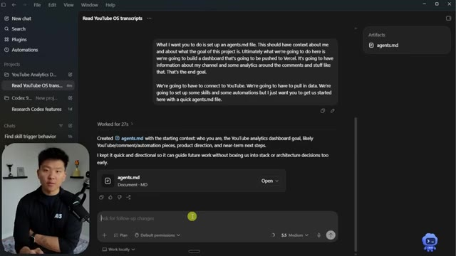
*⏱️ 00:12:40 — Interface d'une application de type assistant IA (style Claude ou Cursor) montrant un prompt initial demandant de créer un fichier agents.md pour un projet de tableau de bord YouTube. Le présentateur apparaît dans une petite fenêtre en bas à gauche.*

---

### ⏱️ `[00:12:58 - 00:13:31]` | Segment #31

**🔊 Audio (Transcription Intégrale Mot pour Mot en Français) :**
> Okay, donc maintenant que vous comprenez ce contexte, le premier obstacle pour nous à surmonter est comment vous connectez-vous réellement à mon YouTube afin de pouvoir récupérer mes données ? Je veux que vous puissiez spécifiquement à ce stade pouvoir récupérer un tas de commentaires afin de pouvoir les analyser. Alors aidez-moi à comprendre comment nous faisons cela et ensuite expliquez-le-moi étape par étape. Et c'est vraiment ça le changement d'état d'esprit avec des outils comme Codex ou Claude Code, c'est que si vous ne savez pas si quelque chose est possible, au lieu de vous dire par défaut oh, je dois aller sur YouTube ou oh, je veux réserver un appel de conseil avec un expert, demandez simplement à Codex ou à Claude Code, demandez-lui de faire des recherches et de vous expliquer les choses. Et c'est fondamentalement comme ça que j'ai appris tout ce que je sais.

**👁️ Analyse Visuelle d'Écran (gemini-3.5-flash-lite) :**
**Interface & Outils** : Application de type chat/assistant IA (interface sombre avec panneau latéral et zone de discussion centrale).

**Contenu textuel & Code** : Un prompt décrivant l'objectif du projet (créer un dashboard déployé sur Vercel avec des analyses de chaîne et des commentaires YouTube) et la réponse de l'agent confirmant la création du fichier "agents.md".

**Action / Démonstration** : L'assistant IA génère un fichier de configuration initial "agents.md" basé sur les instructions textuelles fournies dans le chat.

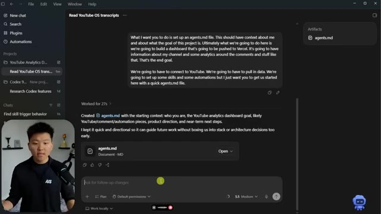
*⏱️ 00:13:06 — Interface d'une application de chat avec un assistant IA montrant la création d'un fichier de contexte "agents.md" pour un projet de tableau de bord YouTube.*

---

### ⏱️ `[00:13:31 - 00:14:06]` | Segment #32

**🔊 Audio (Transcription Intégrale Mot pour Mot en Français) :**
> Donc pendant que ça tourne, je voulais expliquer quelque chose rapidement, qui s'appelle des plugins, des plugins, des serveurs MCP, des compétences, des connecteurs, peu importe comment vous voulez les appeler. On a en quelque sorte cette interface à l'intérieur de Codex pour faire des trucs comme ça. Et ce que vous allez remarquer, c'est qu'il y a tout un tas de plugins différents ici. On a Hugging Face, on a Vercel, on a GitHub, on a Game Studio. On en a tout un tas en bas pour le design, Remotion, Figma, Hyperframes, Canva. On a des trucs pour le style de vie, la productivité. Et ça nous permet fondamentalement de nous connecter à bon nombre des outils qu'on connaît et qu'on adore déjà. Google Drive, Slack, SharePoint, Teams, tout ce dont vous pourriez avoir besoin. Une grande partie de tout ça est disponible ici. Et si vous ne pouvez pas

**👁️ Analyse Visuelle d'Écran (gemini-3.5-flash-lite) :**
**Interface & Outils** : Interface de l'application Codex

**Contenu textuel & Code** : Barre de recherche 'Search plugins', onglets 'Plugins' et 'Skills', et liste de plugins en vedette comme 'Browser Use', 'Spreadsheets' et 'Presentations'.

**Action / Démonstration** : Le présentateur présente l'interface de gestion des plugins et extensions de l'application Codex.

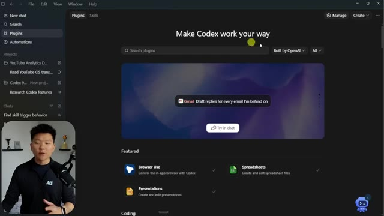
*⏱️ 00:13:40 — Interface de l'application affichant le panneau des plugins et des extensions avec le titre 'Make Codex work your way'.*

---

### ⏱️ `[00:14:06 - 00:14:38]` | Segment #33

**🔊 Audio (Transcription Intégrale Mot pour Mot en Français) :**
> trouvez-le, vous pouvez y aller et chercher. Donc, comme Slack, nous l'avons juste là. Mais regardez, si je cherche YouTube, il n'y a pas de plugin par défaut ici même. Et c'est pourquoi j'ai dû demander à Codex, d'accord, donc il n'y a pas de plugin. Comment est-ce que j'accède réellement aux données YouTube ? Et donc ça revient ici et ça nous pose quelques questions. Ça dit, pour la première étape de l'analyse des commentaires, autour de quel chemin de connexion devons-nous planifier ? Clé API, OAuth, ou les deux ? Je vais simplement suivre sa recommandation car, disons que je ne sais pas ce que je dois faire. Et je vais cliquer sur clé API. Sur quoi la récupération du premier commentaire doit-elle se concentrer ? Je vais juste dire vidéos récentes. Et maintenant, s'il a d'autres questions,

**👁️ Analyse Visuelle d'Écran (gemini-3.5-flash-lite) :**
**Interface & Outils** : Interface application Codex et interface de chat d'assistant IA.

**Contenu textuel & Code** : Barre de recherche de plugins avec la requête "youtube" et options de choix pour l'analyse des commentaires YouTube.

**Action / Démonstration** : Recherche d'un plugin YouTube inexistant et interaction avec les questions posées par l'agent Codex.

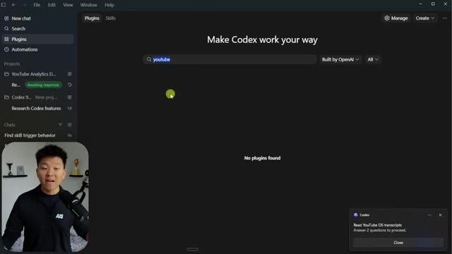
*⏱️ 00:14:14 — Interface de recherche de plugins dans l'application Codex montrant "No plugins found" pour la recherche "youtube".*

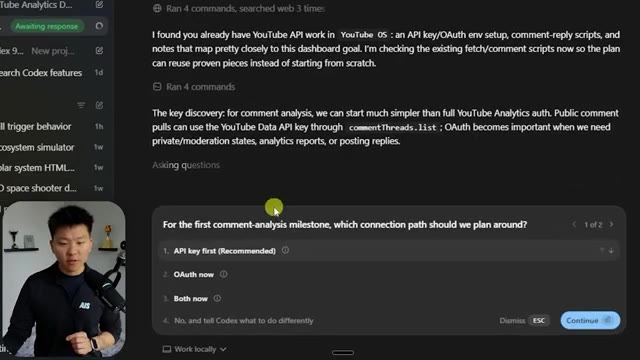
*⏱️ 00:14:22 — Interface de chat de l'assistant Codex affichant une question interactive avec des options de configuration pour l'API YouTube.*

---

### ⏱️ `[00:14:38 - 00:15:14]` | Segment #34

**🔊 Audio (Transcription Intégrale Mot pour Mot en Français) :**
> il va continuer et nous les demander d'abord. Maintenant, une chose que vous remarquerez, c'est que comme il cherchait déjà dans mes autres dossiers et projets, il a trouvé une clé API dans un autre projet, mais je vais quand même vous montrer comment vous feriez la configuration parce qu'il revient ici avec un plan, que nous pouvons lire. Donc ce qu'il veut utiliser, c'est qu'il a trouvé une clé API, donc pas une authentification OAuth complète, et ensuite il doit réellement tout convertir. Donc ce que je vais simplement dire, c'est qu'au lieu de l'implémenter, je vais dire : je suis content que tu aies trouvé cette clé API, mais configurons-en une nouvelle, car dans mon Google Cloud, je veux avoir une clé API séparée pour Codex et une autre séparée pour Cloud Code. Alors allons-y et partons du principe que nous allons en créer une toute nouvelle.

**👁️ Analyse Visuelle d'Écran (gemini-3.5-flash-lite) :**
**Interface & Outils** : Application de bureau avec interface de chat pour agent IA (type Claude ou similaire) et encart vidéo incrusté du présentateur en bas à gauche.

**Contenu textuel & Code** : Texte de l'assistant IA détaillant l'inspection des dossiers locaux, la découverte d'une clé API YouTube existante et un plan intitulé « YouTube Comment Connection Plan ».

**Action / Démonstration** : L'assistant IA analyse l'environnement local, exécute des commandes de recherche et formule un plan d'action pour la configuration de l'API.

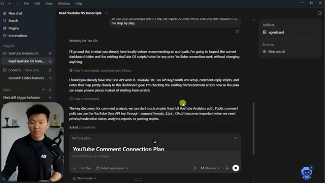
*⏱️ 00:14:47 — Interface d'un assistant IA montrant l'historique des commandes exécutées, la découverte d'une clé API existante et un plan de connexion pour les commentaires YouTube.*

---

### ⏱️ `[00:15:14 - 00:15:44]` | Segment #35

**🔊 Audio (Transcription Intégrale Mot pour Mot en Français) :**
> un à partir de zéro. Et maintenant, je peux envoyer ces modifications. Codex va examiner le plan puis l'éditer. Et une fois que nous serons d'accord sur le plan, nous irons de l'avant et commencerons l'exécution. Donc maintenant, il est revenu et il propose, d'accord, nous allons créer une toute nouvelle clé d'API Google Cloud. Si vous vouliez tout lire étape par étape, vous le pourriez, mais je vais simplement continuer et dire, soumettre, mettre en œuvre le plan. Il y a donc des choses que nous allons devoir faire ici. Nous allons devoir aller dans la console Google Cloud et nous allons devoir créer ce nouveau projet, activer cette API, puis récupérer la clé d'API et ensuite la configurer à l'intérieur de Codex.

**👁️ Analyse Visuelle d'Écran (gemini-3.5-flash-lite) :**
**Interface & Outils** : Interface de chat d'un assistant de programmation IA (style Codex / Agent IDE).

**Contenu textuel & Code** : Texte du plan de test (validation de clé API, récupération de vidéos, pagination, quotas) et message de l'utilisateur demandant une clé API distincte pour Codex et Claude Code.

**Action / Démonstration** : Affichage du plan proposé par l'assistant et saisie d'un retour utilisateur pour modifier les paramètres d'authentification.

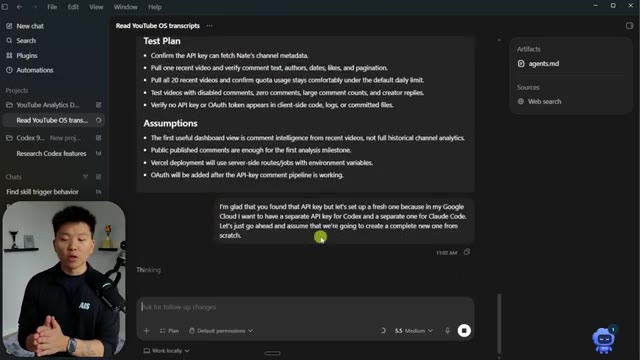
*⏱️ 00:15:21 — Interface d'un outil d'IA affichant un plan de test ("Test Plan") et des hypothèses ("Assumptions") pour un projet de lecture de transcriptions YouTube, avec un message utilisateur demandant la création d'une nouvelle clé API.*

---

### ⏱️ `[00:15:44 - 00:16:02]` | Segment #36

**🔊 Audio (Transcription Intégrale Mot pour Mot en Français) :**
> Donc, si cette partie du tutoriel ne vous intéresse pas beaucoup, que vous ne voulez pas me voir faire la configuration... Peut-être que vous voulez d'abord faire des choses avec les plugins natifs, ce qui est beaucoup plus facile. En général, avec ces plugins, vous vous connectez simplement de la même manière que vous ouvririez Slack pour vous y connecter, ou de la même manière que vous ouvririez Gmail pour vous y connecter. Et c'est beaucoup, beaucoup plus facile. Bon, alors je dois aller sur Google Cloud et tout configurer dans un projet.

**👁️ Analyse Visuelle d'Écran (gemini-3.5-flash-lite) :**
**Interface & Outils** : Application de type interface de chat LLM (style Claude ou ChatGPT) avec panneau latéral et zone de discussion centrale.

**Contenu textuel & Code** : Texte affichant un plan structuré intitulé "Fresh YouTube API Key Setup For Codex" avec des étapes numérotées pour créer un projet Google Cloud et activer l'API YouTube Data v3.

**Action / Démonstration** : Le présentateur explique les étapes de configuration technique affichées à l'écran concernant la création d'une clé API et l'utilisation de plugins.

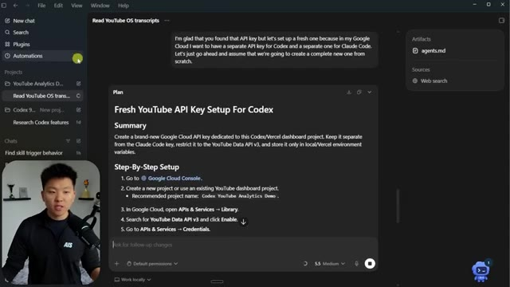
*⏱️ 00:15:48 — Interface d'une application de chat avec un assistant IA affichant un plan détaillé pour configurer une clé API YouTube, avec une incrustation vidéo du présentateur en bas à gauche.*

---

### ⏱️ `[00:16:02 - 00:16:22]` | Segment #37

**🔊 Audio (Transcription Intégrale Mot pour Mot en Français) :**
> Si je ne savais pas exactement comment faire cela, il me dirait étape par étape comme vous l'avez vu dans le plan. Mais ce qu'il va faire, c'est qu'il a créé un autre fichier pour nous. Il a donc créé celui-ci appelé .env.local. Ce que je vais faire, c'est me rendre sur ma console Google Cloud. Je suis connecté avec mon compte YouTube et je vais créer un nouveau projet. Je vais donc appeler celui-ci Codex Demo.

**👁️ Analyse Visuelle d'Écran (gemini-3.5-flash-lite) :**
**Interface & Outils** : Assistant IA (type Codex/CLI) et console Google Cloud dans un navigateur web.

**Contenu textuel & Code** : Blocs de code de configuration d'environnement (.env.local) et interface de gestion de projet Google Cloud (Project ID: youtube-dash-491215).

**Action / Démonstration** : Le présentateur explique comment récupérer les clés API nécessaires depuis la console Google Cloud pour les insérer dans le fichier de configuration créé par l'agent.

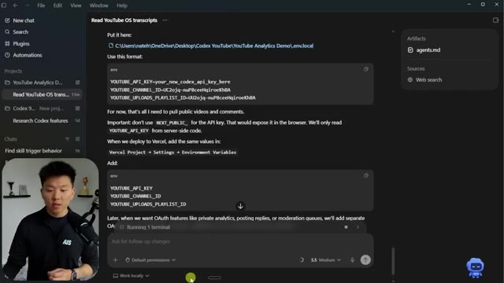
*⏱️ 00:16:07 — Interface d'un assistant IA montrant des instructions pour configurer un fichier .env.local avec les clés API YouTube.*

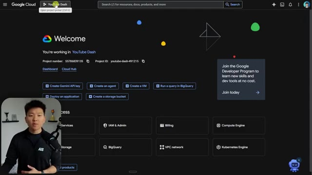
*⏱️ 00:16:17 — Tableau de bord de la console Google Cloud affichant la page d'accueil d'un projet nommé 'YouTube Dash'.*

---

### ⏱️ `[00:16:22 - 00:16:59]` | Segment #38

**🔊 Audio (Transcription Intégrale Mot pour Mot en Français) :**
> Je vais tout simplement créer ce projet. Et une fois qu'il sera lancé, c'est assez simple. Nous devons juste créer une connexion à l'API YouTube Data, et ensuite nous allons créer une clé API. Je vais donc sélectionner ce projet. La première chose que je vais faire est de chercher ici en haut pour YouTube Data et nous allons récupérer l'API YouTube Data v3. Et ensuite, je vais cliquer sur activer et une fois qu'elle aura été activée, ça devrait afficher un nouvel écran qui ressemble à ceci. Et ensuite, je vais aller ici en bas dans identifiants et je vais simplement créer une nouvelle clé API. Donc, créer une clé API. Celle-ci va simplement s'appeler codex YouTube demo. Et ensuite, ici pour les restrictions, je vais simplement taper à nouveau

**👁️ Analyse Visuelle d'Écran (gemini-3.5-flash-lite) :**
**Interface & Outils** : Google Cloud Console (Interface Web)

**Contenu textuel & Code** : Tableau de bord Google Cloud avec le nom du projet "YouTube Dash" et une notification contextuelle de création de projet.

**Action / Démonstration** : Sélection ou confirmation de la création d'un projet Google Cloud nommé "Codex Demo" puis visualisation du tableau de bord.

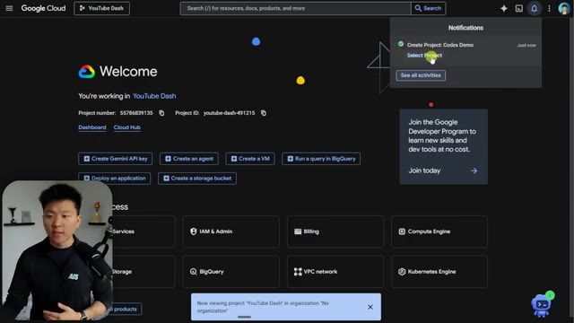
*⏱️ 00:16:32 — Le tableau de bord Google Cloud affichant la création réussie d'un projet avec une notification "Create Project: Codex Demo".*

---

### ⏱️ `[00:16:59 - 00:17:18]` | Segment #39

**🔊 Audio (Transcription Intégrale Mot pour Mot en Français) :**
> sur YouTube. Nous allons vérifier l'API YouTube Data v3, et ensuite nous allons créer cette clé d'API. Et cela me donne cette valeur que je vais copier. Donc je vais la copier. Et ensuite je vais récupérer ce fichier qu'il a créé, le .env.local. Et je vais simplement ouvrir ce fichier très rapidement avec mon bloc-notes. Et c'est ici que je vais placer ma clé d'API YouTube.

**👁️ Analyse Visuelle d'Écran (gemini-3.5-flash-lite) :**
**Interface & Outils** : Google Cloud Console, Explorateur de fichiers Windows.

**Contenu textuel & Code** : Paramètres de restriction d'API Google Cloud et liste des fichiers de projet (`.env.local`, `agents`).

**Action / Démonstration** : Création d'une clé API dans Google Cloud et navigation dans le dossier local du projet.

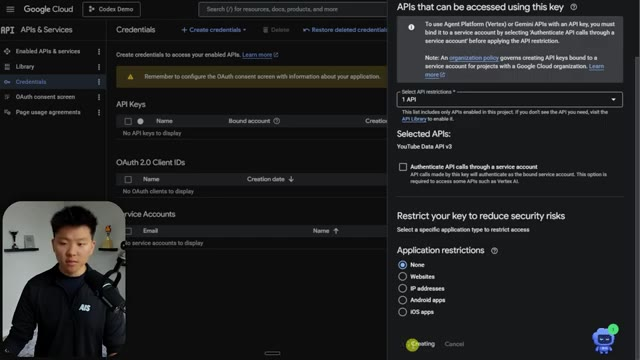
*⏱️ 00:17:04 — Console Google Cloud montrant la configuration des identifiants et des restrictions d'API pour la clé YouTube Data API v3.*

*⏱️ 00:17:13 — Explorateur de fichiers Windows affichant le dossier du projet contenant notamment le fichier de configuration `.env.local`.*

---

### ⏱️ `[00:17:18 - 00:17:38]` | Segment #40

**🔊 Audio (Transcription Intégrale Mot pour Mot en Français) :**
> Je vais juste coller ça là, cliquer sur enregistrer, et ensuite je peux fermer ça. Parce que ce qu'on doit récupérer ensuite, c'est l'identifiant de notre chaîne YouTube. Je ne vais pas vraiment faire la playlist des mises en ligne. Je ne pense pas que ce soit nécessaire, mais je vais aller chercher l'identifiant de la chaîne YouTube. Oh, mais c'est plutôt cool en fait. L'identifiant de ma chaîne YouTube est déjà dedans et l'identifiant de la playlist y est déjà aussi parce qu'il a pu le récupérer d'un autre projet.

**👁️ Analyse Visuelle d'Écran (gemini-3.5-flash-lite) :**
**Interface & Outils** : Éditeur de texte / Bloc-notes, et console Google Cloud Platform en arrière-plan.

**Contenu textuel & Code** : Fichier `.env` contenant les variables YOUTUBE_API_KEY, YOUTUBE_CHANNEL_ID et YOUTUBE_UPLOADS_PLAYLIST_ID.

**Action / Démonstration** : Le présentateur colle et configure les identifiants et clés d'API YouTube dans le fichier d'environnement.

*⏱️ 00:17:23 — Un éditeur de texte affichant un fichier de configuration `.env` avec des clés d'API et identifiants YouTube, par-dessus la console Google Cloud.*

---

### ⏱️ `[00:17:39 - 00:17:57]` | Segment #41

**🔊 Audio (Transcription Intégrale Mot pour Mot en Français) :**
> Donc évidemment, si vous n'aviez pas déjà configuré cela, il ne ferait pas ça, mais il vous expliquerait exactement comment le faire si vous en aviez besoin. Donc maintenant que nous avons entré cette clé API, voyons simplement si cela fonctionne. D'accord, donc je vous ai donné la clé API dans ce fichier local.env. Peux-tu aller de l'avant et la tester pour voir si cette connexion fonctionne ? Et si ce n'est pas le cas, nous devrons alors apporter quelques modifications.

**👁️ Analyse Visuelle d'Écran (gemini-3.5-flash-lite) :**
**Interface & Outils** : Interface de chat/assistant IA (type Claude ou agent conversationnel) avec panneau de projets et de code.

**Contenu textuel & Code** : Instructions textuelles sur la récupération de l'ID de chaîne YouTube et exemples de code `.env.local` (`YOUTUBE_CHANNEL_ID`, `YOUTUBE_UPLOADS_PLAYLIST_ID`).

**Action / Démonstration** : Présentation des explications de l'assistant IA concernant la configuration des clés et identifiants nécessaires au fonctionnement du projet.

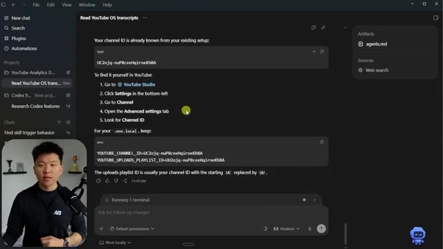
*⏱️ 00:17:43 — Capture d'écran montrant l'interface d'un assistant IA avec des instructions pour configurer un identifiant de chaîne YouTube et des variables d'environnement dans un panneau latéral, avec le présentateur visible en incrustation.*

---

### ⏱️ `[00:17:57 - 00:18:17]` | Segment #42

**🔊 Audio (Transcription Intégrale Mot pour Mot en Français) :**
> D'accord, maintenant pendant que cela s'exécute, ce que vous remarquerez peut-être quand vous irez sur Codex, c'est que ça peut faire beaucoup de pauses pour vous poser des questions et genre approuver des choses. Et c'est ce qui se passe quand vous êtes avec les autorisations par défaut. Donc si vous voulez pouvoir changer ça, vous allez aller ici en haut dans vos paramètres. Et ensuite dans général, vous pouvez voir juste ici, révision automatique ou accès complet. Et par défaut, ce sera désactivé.

**👁️ Analyse Visuelle d'Écran (gemini-3.5-flash-lite) :**
**Interface & Outils** : Interface de l'application Codex (interface de bureau) avec panneau latéral de gestion des projets et des chats, et une webcam du présentateur en bas à gauche.

**Contenu textuel & Code** : Blocs de code de configuration pour .env avec YOUTUBE_CHANNEL_ID et YOUTUBE_UPLOADS_PLAYLIST_ID, un prompt textuel demandant de tester la connexion API, et le message de l'agent expliquant sa démarche de test.

**Action / Démonstration** : L'agent IA est en train d'exécuter un test d'API dans un terminal intégré avec les permissions par défaut ("Default permissions").

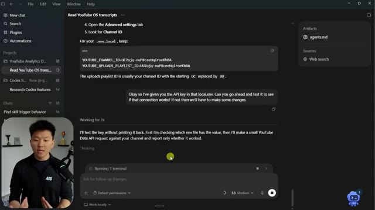
*⏱️ 00:18:02 — Interface d'une application d'agent IA (Codex) affichant des instructions de configuration, un fichier d'environnement (.env), un prompt utilisateur pour tester la clé API, et la réponse de l'agent en cours d'exécution avec un terminal actif.*

---

### ⏱️ `[00:18:17 - 00:18:37]` | Segment #43

**🔊 Audio (Transcription Intégrale Mot pour Mot en Français) :**
> Donc, si j'active ceci, alors quand nous serons de retour dans notre chat, nous avons maintenant la possibilité, regardez ici, cet exemple exact, autoriser l'accès au réseau. Et je veux dire, ouais, l'autoriser. Ou si je bascule ceci sur un accès complet, maintenant il va simplement tout faire sans demander la permission. Donc, évidemment, ça apparaît en orange ici, car il y a des moments où vous pourriez ne pas vouloir d'un accès autonome complet.

**👁️ Analyse Visuelle d'Écran (gemini-3.5-flash-lite) :**
**Interface & Outils** : Application web / interface de chat pour assistant IA (Codex)

**Contenu textuel & Code** : Historique de discussion textuel, instructions sur les clés API, messages d'état, et pop-up de validation d'accès réseau avec options (« Yes, allow for this turn »).

**Action / Démonstration** : L'utilisateur visualise la demande d'autorisation d'accès réseau générée par l'agent et s'apprête à valider ou configurer les accès.

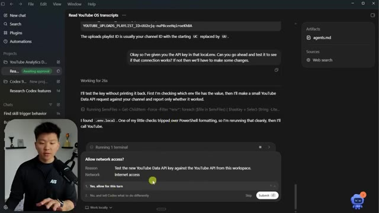
*⏱️ 00:18:22 — Interface d'une application de chat avec un assistant IA affichant une demande de validation contextuelle d'accès au réseau (Allow network access ?) et le présentateur dans un encart en bas à gauche.*

---

### ⏱️ `[00:18:37 - 00:18:58]` | Segment #44

**🔊 Audio (Transcription Intégrale Mot pour Mot en Français) :**
> Et je pense que c'est une bonne pratique, quand vous débutez et que vous commencez tout juste à créer des automatisations, de peut-être simplement le laisser par défaut. Mais une fois que vous commencez à maîtriser vos compétences et que vous commencez à prendre le coup de main avec le flux, passer à l'accès complet va vous faire gagner beaucoup de temps, de sorte que vous n'aurez plus vraiment besoin de le surveiller en permanence. Mais je devais le souligner parce que, vous savez, on a vu des histoires d'horreur d'agents qui supprimaient des bases de données ou qui envoyaient des e-mails en masse et ce genre de choses.

**👁️ Analyse Visuelle d'Écran (gemini-3.5-flash-lite) :**
**Interface & Outils** : Interface de l'IDE Windsurf (Cascade)

**Contenu textuel & Code** : Historique de chat montrant des instructions sur l'utilisation d'une API YouTube, la mention d'un fichier `.env.local`, et des retours d'exécution de commandes PowerShell.

**Action / Démonstration** : L'agent IA est en cours d'exécution (Running 1 terminal) pour tester une connexion API après avoir identifié un problème de formatage PowerShell dans les fichiers locaux.

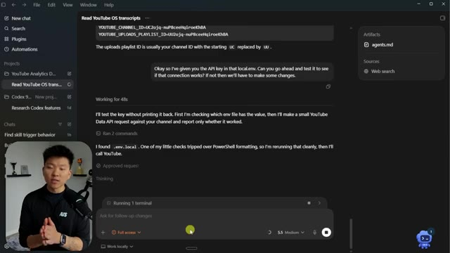
*⏱️ 00:18:42 — Capture d'écran de l'interface de l'agent IA (Windsurf/Cascade) montrant l'historique d'une conversation technique sur l'intégration de l'API YouTube et le test de variables d'environnement.*

---

### ⏱️ `[00:18:58 - 00:19:17]` | Segment #45

**🔊 Audio (Transcription Intégrale Mot pour Mot en Français) :**
> Donc vous voulez juste être prudent avec ça. Personnellement, je n'ai jamais eu aucun genre de problème de ce genre. Cela vient généralement d'une dégradation du contexte, ou d'instructions très vagues, ou tout simplement d'un manque de bon sens dans votre planification. Donc vous pouvez voir ce qui se passe ici, c'est que ça essaie, n'est-ce pas ? Et ça rencontre quelques problèmes. Mais ce qui est génial avec cette boucle agentique, c'est que ça va continuer d'essayer des choses jusqu'à ce que ça passe pour de bon.

**👁️ Analyse Visuelle d'Écran (gemini-3.5-flash-lite) :**
**Interface & Outils** : Interface de chat de l'assistant IA (type interface de développement/agent).

**Contenu textuel & Code** : Historique de discussion montrant un test de clé API pour YouTube Data API, la détection d'un fichier .env.local et l'exécution de commandes terminal.

**Action / Démonstration** : L'agent IA teste la connexion à l'API YouTube et analyse les résultats via des commandes de terminal.

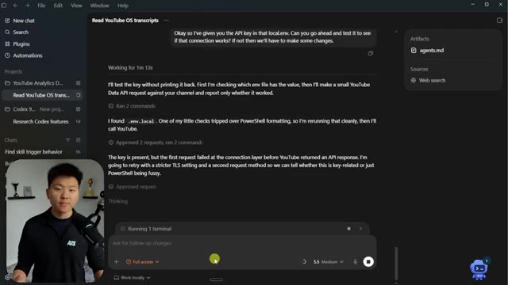
*⏱️ 00:19:03 — Interface d'une application de chat avec un agent IA en cours d'exécution, affichant l'historique des requêtes et un panneau vidéo du présentateur en bas à gauche.*

---

### ⏱️ `[00:19:17 - 00:19:37]` | Segment #46

**🔊 Audio (Transcription Intégrale Mot pour Mot en Français) :**
> Voilà. Vous pouvez voir, c'est super, la clé fonctionne pour les données de la chaîne. Et je vais faire un dernier test pour m'assurer que je peux extraire les commentaires des vidéos récentes. Donc un grand changement d'état d'esprit lorsque vous utilisez l'un de ces outils, c'est de simplement le laisser tourner, de le laisser essayer des choses, de l'aider à aller dans la bonne direction, de poser des questions, d'être curieux, et de simplement jeter un œil à ce qu'il fait, car il vous dit absolument tout ce qu'il essaie de faire.

**👁️ Analyse Visuelle d'Écran (gemini-3.5-flash-lite) :**
**Interface & Outils** : Application de bureau (Interface d'agent IA type Claude/Cursor)

**Contenu textuel & Code** : Texte de l'agent confirmant que la clé fonctionne pour les données de la chaîne ("Nice, the key works for channel data") et l'annonce d'un test supplémentaire sur les commentaires.

**Action / Démonstration** : L'agent exécute des tests d'API et communique ses résultats textuellement à l'utilisateur.

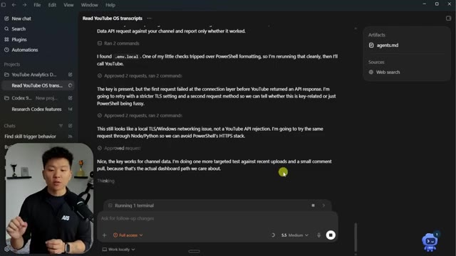
*⏱️ 00:19:22 — Interface d'un assistant IA montrant l'historique des requêtes d'API YouTube et la validation de la clé, avec la vidéo du présentateur incrustée en bas à gauche.*

---

### ⏱️ `[00:19:37 - 00:19:56]` | Segment #47

**🔊 Audio (Transcription Intégrale Mot pour Mot en Français) :**
> Mais maintenant nous pouvons voir que j'ai testé la clé. Je peux récupérer les commentaires de vos vidéos récentes et cela fonctionne tout à fait comme prévu. Cependant, la requête web intégrée de PowerShell avait un problème de TLS local, mais Node et Python se sont tous les deux connectés proprement. Pour le projet, c'est très bien. Nous utiliserons de toute façon Node et du code côté serveur pour le tableau de bord. Maintenant, voici quelque chose à méditer.

**👁️ Analyse Visuelle d'Écran (gemini-3.5-flash-lite) :**
**Interface & Outils** : Application de bureau de l'assistant IA (Claude / interface similaire) avec panneau latéral gauche et zone de discussion principale.

**Contenu textuel & Code** : Réponse de l'IA détaillant les résultats des tests d'API YouTube : channel lookup, recent uploads, comment pull, et la note concernant le problème TLS de PowerShell et la connexion réussie via Node et Python.

**Action / Démonstration** : L'assistant IA confirme que la clé API fonctionne correctement et liste les tests validés.

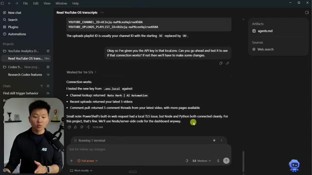
*⏱️ 00:19:42 — Interface de chat avec un assistant IA affichant les résultats du test de la clé API YouTube, avec une incrustation vidéo du présentateur en bas à gauche.*

---

### ⏱️ `[00:19:56 - 00:20:31]` | Segment #48

**🔊 Audio (Transcription Intégrale Mot pour Mot en Français) :**
> Je ne sais pas vraiment ce que cela veut dire, mais ce que je veux m'assurer, c'est que cela ne se reproduise pas, ou je veux m'assurer que ce projet ne perde pas cette connaissance parce qu'il a rencontré un échec. Et chaque fois que vous rencontrez un échec, vous voulez traiter cela comme une connaissance en or, car cela signifie que vous avez plus de données pour vous assurer qu'il ne le refera plus. Donc, tout ce que je vais dire, c'est : D'accord, merci d'avoir testé cela, je veux m'assurer que vous ne rencontriez plus jamais ce problème et je veux m'assurer que cette connaissance est sauvegardée dans ce projet. Alors, pouvez-vous simplement rassembler un fichier rapide quelque part dans votre mémoire, quelque part dans ce projet, pour vous assurer que vous le savez déjà afin que la prochaine fois, cela ne se reproduise plus ?

**👁️ Analyse Visuelle d'Écran (gemini-3.5-flash-lite) :**
**Interface & Outils** : Application de bureau ou interface web d'un agent IA (style Cursor / Claude / interface de développement).

**Contenu textuel & Code** : Texte de conversation montrant le résultat d'un test de connexion API YouTube, avec des détails sur la récupération des identifiants de chaîne et des vidéos.

**Action / Démonstration** : Affichage des résultats d'exécution d'un script testant la connexion API et du résumé des tests réussis.

*⏱️ 00:20:05 — Interface d'une application de chat avec un assistant IA, affichant une conversation sur le test d'une clé API YouTube et la gestion des connexions.*

---

### ⏱️ `[00:20:31 - 00:20:56]` | Segment #49

**🔊 Audio (Transcription Intégrale Mot pour Mot en Français) :**
> Et faire des choses comme ça, avoir ce genre d'habitude, c'est comme ça qu'on fait réellement progresser ces systèmes avec le temps, plutôt que d'avoir l'impression de toujours se répéter ou de toujours faire face aux mêmes problèmes. Un autre changement d'état d'esprit pour vous, là. Donc ici, il a décidé d'ajouter ceci dans le fichier agents.md. Pour l'instant, je n'ai aucune objection à cela, mais à mesure que vos projets grandissent, vous ne voulez pas tout mettre dans agents.md, car si ce fichier agents.md devient vraiment énorme, il va consommer davantage de vos jetons.

**👁️ Analyse Visuelle d'Écran (gemini-3.5-flash-lite) :**
**Interface & Outils** : Application de bureau ou interface web d'un agent IA (style Claude/Anthropic) avec panneau latéral de gestion de projets et de chats.

**Contenu textuel & Code** : Rapport de test de connexion ("Connection works", tests de recherche de chaîne, téléversements récents, extraction de commentaires) et prompt demandant de sauvegarder cette connaissance dans le projet.

**Action / Démonstration** : L'agent affiche les résultats d'exécution de tests et l'utilisateur interagit pour lui demander de mémoriser les solutions aux problèmes rencontrés.

*⏱️ 00:20:37 — Interface d'un assistant IA montrant un rapport de test de connexion réussi et une discussion avec l'utilisateur, avec le présentateur incrusté en bas à gauche.*

---

### ⏱️ `[00:20:56 - 00:21:31]` | Segment #50

**🔊 Audio (Transcription Intégrale Mot pour Mot en Français) :**
> D'accord, donc avant de continuer, je voulais souligner une autre chose ici en bas, qui est cette petite barre. Celle-ci vous montre quelle quantité de votre fenêtre de contexte est actuellement remplie. Maintenant, si vous utilisiez Claude Code et que vous utilisez Opus, vous en avez un million. C'est donc environ quatre fois plus que ceci dans Codex. Cependant, Codex se compacte automatiquement tout comme le fait Opus et tout comme le fait Claude Code. C'est donc vraiment super, vous n'avez pas trop à vous en soucier, mais vous voulez quand même penser à quelques conseils généraux de gestion du contexte. J'ai quelques vidéos sur ma chaîne à ce sujet qui sont agnostiques par rapport à l'outil que vous voulez utiliser. Je ne vais pas plonger très profondément dans la gestion de la fenêtre de contexte dans cette vidéo.

**👁️ Analyse Visuelle d'Écran (gemini-3.5-flash-lite) :**
**Interface & Outils** : Interface de notes textuelles et panneau d'information sur les tokens d'IA.

**Contenu textuel & Code** : Texte de documentation sur l'API YouTube et notes sur les tests d'agents, ainsi qu'un compteur de tokens et une barre d'état du modèle (5.5 Medium).

**Action / Démonstration** : Le présentateur explique la gestion de la fenêtre de contexte et l'utilisation des tokens par l'IA.

*⏱️ 00:21:05 — Un écran affichant des notes au format Markdown et une infobulle montrant l'utilisation de la fenêtre de contexte (Context window: 53% full, 136k / 258k tokens used), tandis que le présentateur apparaît en incrustation vidéo dans le coin inférieur gauche.*

---

### ⏱️ `[00:21:31 - 00:21:49]` | Segment #51

**🔊 Audio (Transcription Intégrale Mot pour Mot en Français) :**
> Mais je voulais juste souligner ça aussi. Bon, alors, c'est quoi la suite ? Ce que je veux faire, c'est vous montrer que c'est capable de récupérer des commentaires et qu'on est capable d'en créer un livrable concret à partir de ça. Laissez-moi donc, encore une fois, revenir en mode plan. Très bien. Donc, ce que je veux que tu fasses, c'est de récupérer, tu vois, environ une centaine ou deux cents de mes commentaires les plus récents. Et je veux que tu les analyses.

**👁️ Analyse Visuelle d'Écran (gemini-3.5-flash-lite) :**
**Interface & Outils** : Application de chat avec assistant IA (interface web ou de bureau)

**Contenu textuel & Code** : Échange de texte entre l'utilisateur et l'assistant concernant la correction d'un problème de requête web TLS avec PowerShell, l'utilisation de Node ou Python pour l'API YouTube, et la création d'un fichier 'agents.md'.

**Action / Démonstration** : L'assistant confirme l'ajout des notes de connexion à l'API YouTube dans le document Markdown 'agents.md' et attend de nouvelles instructions de l'utilisateur dans la zone de texte.

*⏱️ 00:21:35 — Interface d'une application d'intelligence artificielle affichant un échange de messages de chat, avec un panneau latéral pour les projets et les artefacts, ainsi que la webcam du présentateur en bas à gauche.*

---

### ⏱️ `[00:21:49 - 00:22:11]` | Segment #52

**🔊 Audio (Transcription Intégrale Mot pour Mot en Français) :**
> Je veux que tu trouves des tendances et je veux que tu affiches tout cela dans une feuille Excel. Et je veux que ce soit une représentation visuelle de ces données qui présente des informations intéressantes pour moi en tant que créateur de contenu, afin que je puisse continuer à créer du contenu que les gens veulent. Et que je puisse continuer à répondre aux questions qui reviennent fréquemment. Alors vas-y, élabore un plan pour cela et structure à quoi ressemblera le livrable de la feuille Excel.

**👁️ Analyse Visuelle d'Écran (gemini-3.5-flash-lite) :**
**Interface & Outils** : Interface web d'assistant IA / Agent de développement avec un volet latéral (projets, chats) et une zone de chat centrale.

**Contenu textuel & Code** : Historique de discussion textuelle entre l'utilisateur et l'assistant IA concernant les scripts YouTube, un fichier "agents.md" généré, et une invite de saisie en bas avec l'option "Full access".

**Action / Démonstration** : L'assistant IA répond à une requête pour sauvegarder des informations de test de l'API YouTube et confirme l'ajout des notes dans le fichier "agents.md".

*⏱️ 00:21:55 — Interface d'une application d'assistant IA affichant une conversation sur l'analyse de transcriptions YouTube et l'enregistrement de notes dans un fichier Markdown.*

---

### ⏱️ `[00:22:11 - 00:22:30]` | Segment #53

**🔊 Audio (Transcription Intégrale Mot pour Mot en Français) :**
> Donc j'ai envoyé ça. Je vais vous faire savoir quand nous aurons un plan ou s'il me pose des questions. Quelques questions ici pour s'ensurer qu'il comprend ce que nous voulons. Il pose des questions sur les commentaires récents. Je vais simplement dire à travers les vidéos récentes, combien devrions-nous en récupérer ? Disons 200. Comment devrions-nous classifier et résumer les commentaires ? Je me contente de suivre toutes ses recommandations. C'étaient plutôt bonnes. Et donc si je bascule sur un autre tab, disons que nous sommes de retour sur nos diapositives.

**👁️ Analyse Visuelle d'Écran (gemini-3.5-flash-lite) :**
**Interface & Outils** : Interface web de gestion de projets d'agents IA avec un panneau latéral des projets et des chats.

**Contenu textuel & Code** : Texte de l'agent expliquant le plan de livraison Excel et une boîte de dialogue interactive avec des options de sélection sur les vidéos récentes.

**Action / Démonstration** : L'agent pose une question à l'utilisateur pour clarifier le périmètre des données à analyser avant de continuer.

*⏱️ 00:22:16 — Interface d'un agent IA affichant les messages de planification et une invite interactive posant des questions sur les commentaires récents.*

---

### ⏱️ `[00:22:31 - 00:23:04]` | Segment #54

**🔊 Audio (Transcription Intégrale Mot pour Mot en Français) :**
> Vous pouvez voir mon animal de compagnie ici en bas qui a un petit à côté de lui. Eh bien, celui-ci a disparu parce que je suis retourné sur Codex. Mais ce petit, si j'avais survolé avec la souris, il m'aurait montré sur quoi il travaille. Donc maintenant, je peux garder un œil sur mon flux de travail pendant que je fais d'autres choses, et Codex rend le travail multitâche vraiment facile grâce au fait que je peux ouvrir une nouvelle discussion dans ce projet et travailler sur autre chose. Ensuite, je peux ouvrir une nouvelle discussion sur ce projet et travailler sur autre chose, et il utilisera un code couleur et vous donnera comme un petit point bleu ou un point jaune sur le côté ici si l'une de ces sessions a besoin d'attention. Donc de toute façon, voici le plan. Ce que je recommanderais, c'est qu'à ce stade, vous le lisiez, vous apportiez des modifications à des sections spécifiques si vous le souhaitez.

**👁️ Analyse Visuelle d'Écran (gemini-3.5-flash-lite) :**
**Interface & Outils** : Application Codex (interface de bureau)

**Contenu textuel & Code** : Résumé d'un rapport Excel sur les commentaires YouTube, flux d'analyse de données et options d'implémentation d'un plan ("Yes, implement this plan").

**Action / Démonstration** : Le présentateur commente l'interface de Codex et le flux de travail des agents affiché à l'écran.

*⏱️ 00:22:48 — L'interface de l'application Codex montrant un rapport sur les commentaires YouTube, un plan d'exécution et un terminal en cours d'exécution avec une invite de validation.*

---

### ⏱️ `[00:23:05 - 00:23:29]` | Segment #55

**🔊 Audio (Transcription Intégrale Mot pour Mot en Français) :**
> Mais pour les besoins de la vidéo, je vais simplement valider ce plan. Mais pendant que cela s'exécute rapidement, je voulais vous montrer quelques autres choses que nous pouvons examiner. Donc, si vous faites un slash à l'intérieur de ce chat, il y a des choses que vous pouvez réellement consulter. Nous avons donc auto-review, code review, feedback, MCP, memories, model, personality, pet, plan mode, reasoning. Il y a toutes ces différentes compétences que nous pouvons utiliser comme browser use, GitHub, Higgs field, PDF, skill creator.

**👁️ Analyse Visuelle d'Écran (gemini-3.5-flash-lite) :**
**Interface & Outils** : Interface web d'un agent de développement IA (Codex) avec panneau de projets et de chats.

**Contenu textuel & Code** : Texte de description du plan d'exécution de l'agent et liste des commandes contextuelles accessibles par slash (Auto-review, Code review, Fast mode, MCP, Memories, Model, etc.).

**Action / Démonstration** : Exécution d'un plan par l'agent IA et ouverture du menu des commandes contextuelles via un slash dans le chat.

*⏱️ 00:23:11 — Vue de l'interface de l'agent IA montrant l'exécution des tâches en cours et les messages de progression.*

*⏱️ 00:23:17 — Affichage du menu déroulant après avoir tapé un slash dans la zone de chat de l'interface, listant les commandes disponibles (Auto-review, Code review, Fast, MCP, etc.).*

---

### ⏱️ `[00:23:29 - 00:23:50]` | Segment #56

**🔊 Audio (Transcription Intégrale Mot pour Mot en Français) :**
> Le slash va vous ouvrir tout un tas de choses différentes. Et bien sûr, ce que vous pouvez faire, c'est aussi étiqueter des choses. Donc si je fais un arobase, cela va nous permettre d'étiqueter soit des plugins spécifiques, soit des fichiers spécifiques qui se trouvent quelque part dans ce projet. Donc si vous essayez un jour de faire référence à un plugin spécifique ou à quelque chose de spécifique, alors il est probablement préférable d'essayer d'utiliser le slash ou d'utiliser l'arobase pour étiqueter cela dans votre discussion.

**👁️ Analyse Visuelle d'Écran (gemini-3.5-flash-lite) :**
**Interface & Outils** : Application web / Interface de l'outil d'IA (style Cursor ou interface dédiée)

**Contenu textuel & Code** : Texte de dialogue de l'assistant décrivant la création d'un script de rapport (« Working for 48s », « I'm going to build the workbook end to end now... ») et un champ de saisie (« Ask for follow-up changes »).

**Action / Démonstration** : L'assistant exécute des commandes et génère du code/des scripts dans l'espace de travail.

*⏱️ 00:23:34 — Interface d'une application d'assistant IA avec un panneau latéral de projets et de chats, affichant l'exécution de tâches et un champ de saisie en bas avec un mode « Full access ».*

---

### ⏱️ `[00:23:50 - 00:24:28]` | Segment #57

**🔊 Audio (Transcription Intégrale Mot pour Mot en Français) :**
> Maintenant, la raison pour laquelle je voulais mentionner le slash, c'est parce que vous en verrez un ici appelé slash personality, qui, si je le déclenchais, lui permettrait réellement de faire quelque chose. Donc ce que je peux vous montrer, c'est que je ne veux pas interrompre cette session principale. Je pourrais venir ici et je pourrais cliquer sur ouvrir le chat latéral et cela ouvre une petite conversation différente ici qui vit toujours dans ce chat, vit toujours dans ce projet. Donc si vous venez de Claude Code, c'est assez similaire au slash d'ailleurs. Donc ce que je peux faire ici, c'est que je peux faire slash personality et maintenant je peux définir si je veux que la personnalité soit amicale ou pragmatique et je suppose que je n'avais pas vraiment besoin de basculer ici parce que ça s'ouvre juste comme ça. Mais pour l'instant nous sommes sur amical. Je vais en fait basculer ceci sur pragmatique.

**👁️ Analyse Visuelle d'Écran (gemini-3.5-flash-lite) :**
**Interface & Outils** : Application de bureau d'agent IA (interface de chat avec panneau latéral de projets et zone de saisie).

**Contenu textuel & Code** : Logs d'exécution de commandes ("Working for 1m 27s", "Ran 2 commands", "Running 1 terminal"), et menu de sélection de personnalité ("Friendly: Warm, collaborative, and helpful", "Pragmatic: Concise, task-focused, and direct").

**Action / Démonstration** : Navigation dans l'interface et ouverture du menu de configuration de la personnalité de l'agent.

*⏱️ 00:23:59 — Interface d'un assistant IA montrant l'exécution d'un plan de travail pour analyser des transcriptions YouTube.*

*⏱️ 00:24:18 — Menu contextuel de sélection de la personnalité de l'IA (Friendly / Pragmatic) ouvert dans l'interface de l'agent.*

---

### ⏱️ `[00:24:28 - 00:25:01]` | Segment #58

**🔊 Audio (Transcription Intégrale Mot pour Mot en Français) :**
> Vous pouvez voir que c'est écrit concis, centré sur les tâches et direct et honnêtement la plupart du temps je préférerais sans doute pragmatique. Donc je travaille généralement sur pragmatique par défaut Mais maintenant que nous avons ouvert le chat latéral, laissez-moi juste vous montrer autre chose euh Donne-moi une brève mise à jour sur ma chaîne YouTube et tu sais le type de vidéos que j'ai faites récemment juste pour vous montrer que d'accord Si vous avez votre agent qui travaille ici même sur quelque chose et que vous ne voulez pas l'interrompre Mais que vous avez une sorte de question subsidiaire qui est pertinente pour ce projet ou peut-être pertinente pour quelque chose sur lequel vous travailliez plus tôt, vous pouvez poser la question ici parce qu'ici, vous pouvez voir qu'il a le contexte de ce

**👁️ Analyse Visuelle d'Écran (gemini-3.5-flash-lite) :**
**Interface & Outils** : Interface de développement et assistant IA (style application de bureau type Cursor/Codex).

**Contenu textuel & Code** : Messages d'exécution de l'agent IA, commandes terminal et prompt dans le panneau de chat latéral "Give me a quick update about my YouTube channel...".

**Action / Démonstration** : Navigation et démonstration du chat latéral et du changement de personnalité de l'agent IA.

*⏱️ 00:24:36 — Interface d'un assistant de code IA affichant les messages de l'agent et la notification "Switched to Pragmatic personality".*

*⏱️ 00:24:52 — Vue de l'interface avec un panneau de chat latéral ouvert à droite montrant une invite utilisateur.*

---

### ⏱️ `[00:25:01 - 00:25:34]` | Segment #59

**🔊 Audio (Transcription Intégrale Mot pour Mot en Français) :**
> que nous avons déjà abordé. Et je pourrais faire des allers-retours un petit peu, et puis je pourrais simplement fermer le chat latéral quand j'ai terminé. D'accord. Donc cela a été créé. Il a extrait 200 commentaires récents sur trois vidéos récentes, et je pourrais l'ouvrir juste ici dans cette vue de type tableau de bord, directement dans codex, ce qui est génial. Et je pourrais effectivement faire quelques suivis et discuter avec lui juste ici, mais c'est un peu délicat pour être honnête. Donc ce que je vais faire, c'est fermer ça. Et je vais simplement réouvrir notre dossier, qui était juste ici. Et vous pouvez voir qu'il y a beaucoup plus de choses qui résident ici maintenant. Non seulement nous avons nos agents et notre fichier .env, mais nous avons des scripts et nous avons des sorties et nous avons différents nœuds et modules, ce qui a beaucoup

**👁️ Analyse Visuelle d'Écran (gemini-3.5-flash-lite) :**
**Interface & Outils** : Interface application desktop, tableur Excel, explorateur de fichiers Windows.

**Contenu textuel & Code** : Fichier 'youtube-comment-insights.xlsx', tableaux de statistiques de commentaires YouTube, graphiques d'analyse.
[DESC_ACTION] Visualisation et navigation à travers le rapport Excel généré et l'explorateur de fichiers.

**Action / Démonstration** : Explications face caméra et démonstration conceptuelle.

*⏱️ 00:25:09 — Interface de l'application affichant le message de confirmation de la création du rapport Excel basé sur les 200 commentaires récents.*

*⏱️ 00:25:17 — Affichage du tableau de bord complet du rapport Excel 'YouTube Comment Insights' montrant les graphiques et statistiques.*

*⏱️ 00:25:26 — Explorateur de fichiers Windows montrant le dossier 'YouTube Analytics Demo' avec les dossiers 'node_modules', 'outputs', 'scripts' et les fichiers '.env.local', 'agents'.*

---

### ⏱️ `[00:25:34 - 00:26:11]` | Segment #60

**🔊 Audio (Transcription Intégrale Mot pour Mot en Français) :**
> choses. Donc si à un moment donné, ça commence à sembler un peu désorganisé et que vous ne comprenez pas la structure, tout ce que vous avez à faire, c'est de venir dans Codex et de dire : Hé, aide-moi à réorganiser ça, ou peut-être donne-moi un document qui m'aide à m'y retrouver un peu mieux. Parce que, bien sûr, ceci se trouve dans un répertoire local et Codex peut y toucher, le lire, l'organiser, l'éditer. Donc si je vais dans les sorties et que je vais dans les analyses de commentaires YouTube, nous voyons toutes les différentes choses qu'il a faites. Donc il a pris des captures d'écran comme vous pouvez voir, mais ensuite il a aussi créé la feuille Excel elle-même. Donc je vais ouvrir ceci juste ici et nous pouvons y jetter un œil. Très bien. Donc nous avons analyses de commentaires YouTube, les 200 nouveaux commentaires publics parmi les vidéos récentes de Nate Hurt générées

**👁️ Analyse Visuelle d'Écran (gemini-3.5-flash-lite) :**
**Interface & Outils** : Interface de l'application Codex et Explorateur de fichiers Windows.

**Contenu textuel & Code** : Fichier "youtube-comment-insights.xlsx" généré, artefacts, et structure des dossiers du projet.

**Action / Démonstration** : Navigation dans l'interface de l'agent IA puis visualisation des fichiers générés dans l'explorateur.

*⏱️ 00:25:43 — Interface d'un assistant IA montrant la génération d'un rapport Excel sur les commentaires YouTube avec aperçu du fichier généré.*

*⏱️ 00:26:02 — Explorateur de fichiers Windows affichant le contenu du dossier de sortie contenant plusieurs fichiers de données et le fichier Excel généré.*

---

### ⏱️ `[00:26:11 - 00:26:44]` | Segment #61

**🔊 Audio (Transcription Intégrale Mot pour Mot en Français) :**
> 5 mai, 11 heures. Donc on peut voir le taux de questions, le taux de contenu demandé, les outils les plus mentionnés, cloud code. Oh oh. On a des trucs haute priorité, les meilleurs schémas, les vidéos ignorées, des trucs comme ça. Ça a même commencé à créer des visuels ici, ce qui est génial. Donc ça, c'est le mélange des catégories de contenu par ici. Ça montre le mélange entre les retours généraux ou les questions avec des valeurs réelles. Donc 55 étaient des retours généraux, 53 étaient des questions. Certains d'entre eux concernaient l'accès, des retours positifs, des comparaisons d'outils, des trucs sur les prix. Par ici, nous avons différents outils. Donc cloud code, Higgs field, codex, API. Et puis à pro

**👁️ Analyse Visuelle d'Écran (gemini-3.5-flash-lite) :**
**Interface & Outils** : Microsoft Excel

**Contenu textuel & Code** : "YouTube Comment Insights", graphiques en barres, camembert, tableaux statistiques des commentaires.

**Action / Démonstration** : Navigation et présentation du tableau de bord d'analyse des commentaires généré automatiquement.

*⏱️ 00:26:19 — Un tableau de bord Excel analysant les commentaires YouTube, affichant des métriques telles que le taux de questions, les outils mentionnés et des graphiques.*

*⏱️ 00:26:27 — Le même tableau de bord Excel avec un défilement vers le bas pour montrer les graphiques de mix de catégories et de mentions d'outils.*

---

### ⏱️ `[00:26:44 - 00:27:18]` | Segment #62

**🔊 Audio (Transcription Intégrale Mot pour Mot en Français) :**
> ici nous avons d'autres statistiques comme vous pouvez le voir. Maintenant nous avons aussi un tas d'onglets différents. Donc nous avons les analyses des créateurs. Donc les tendances de commentaires classées et les actions de créateur recommandées. Donc je peux voir la répartition en pourcentage des différents types de commentaires. Et cela me donne aussi des actions recommandées avec des scores de priorité. Donc c'est plutôt cool. Je peux aussi voir les questions fréquentes. Donc des choses qui ressortent sous forme de tendances. Cela me donne des idées de contenu maintenant aussi parce que cela analyse ces commentaires. Cela me donne de belles opportunités de réponse. Et ensuite cela me donne simplement les commentaires bruts. Donc cela devrait être 200 lignes de nos commentaires réels que cela a extraits 204 comme vous pouvez le voir parce que

**👁️ Analyse Visuelle d'Écran (gemini-3.5-flash-lite) :**
**Interface & Outils** : Interface de tableur (type Excel / application web de type tableur) et interface web latérale avec des projets et des chats.

**Contenu textuel & Code** : Tableaux structurés contenant des statistiques de commentaires YouTube, des catégories de questions, des pourcentages de répartition et des opportunités de réponse.

**Action / Démonstration** : Navigation entre différents onglets du tableau de bord d'analyse pour présenter diverses métriques de commentaires et recommandations.

*⏱️ 00:26:52 — L'écran affiche l'onglet "Creator Insights" d'un tableau Excel montrant les tendances de commentaires, les pourcentages de partage et les actions recommandées.*

*⏱️ 00:27:01 — Le présentateur navigue vers l'onglet "Frequent Questions" du tableur, affichant les thèmes de questions, les exemples et les angles de réponse suggérés.*

*⏱️ 00:27:09 — L'écran montre l'onglet "Reply Opportunities" avec une liste de commentaires triés par priorité, auteur, vidéo et raison du signalement.*

---

### ⏱️ `[00:27:18 - 00:27:54]` | Segment #63

**🔊 Audio (Transcription Intégrale Mot pour Mot en Français) :**
> les trois ou quatre premiers n'avaient aucun sens donc c'est génial et ce que vous pensez peut-être c'est bon est-ce que c'est vraiment utile peut-être pas parce qu'on vient juste de dire hé donne-moi des analyses, d'accord si vous vous souvenez de mon vrai prompt il était très très vague donc si nous avions passé plus de temps dans la phase de planification ou si nous avions certaines analyses que nous suivions de très près ou certains commentaires que nous recherchions vraiment, nous donnerions cela à Codex comme base de connaissances et cela rendrait ces véritables, vous savez, analyses, cela le rendrait beaucoup plus personnalisé et sur mesure. Donc maintenant parlons de comment transformer cela en compétence ? Alors tout d'abord, qu'est-ce qu'une compétence ? Eh bien, une compétence c'est fondamentalement

**👁️ Analyse Visuelle d'Écran (gemini-3.5-flash-lite) :**
**Interface & Outils** : Microsoft Excel et interface de chat de l'assistant IA

**Contenu textuel & Code** : Tableur de données brutes de commentaires YouTube et rapport de génération de fichier Excel par l'IA

**Action / Démonstration** : Visualisation des résultats d'analyses textuelles et des données extraites des commentaires YouTube

*⏱️ 00:27:27 — Capture montrant un tableur Excel affichant des commentaires YouTube (colonnes videoTitle, videoId, commentId, author, text) avec une vue sur le présentateur dans un encadré en bas à gauche.*

*⏱️ 00:27:36 — Interface de chat avec une IA montrant la fin d'une exécution de tâche (« Done. I created the Excel report... ») et un aperçu du fichier généré `youtube-comment-insights.xlsx`.*

---

### ⏱️ `[00:27:54 - 00:28:32]` | Segment #64

**🔊 Audio (Transcription Intégrale Mot pour Mot en Français) :**
> une recette reproductible. Donc si je reviens ici et que je clique sur les plugins, nous avons vu tous ces plugins, n'est-ce pas ? Ce sont de véritables connexions et potentiellement des serveurs MCP et un peu d'autres, vous savez, c'est un package que les gens peuvent installer et utiliser, mais les compétences sont plutôt de simples instructions. Il y a donc une compétence de génération d'images. Il y a une compétence de documentation OpenAI. Il y a une compétence de suivi de révision GitHub, une compétence de documents. Et ce sont essentiellement toutes des instructions de fichiers markdown qui disent à CodeX comment faire quelque chose de mieux. Alors comment concevoir un site web de manière plus efficace ou comment, vous savez, vous donner un briefing matinal. Et donc ce que nous voulons faire, c'est transformer cela exactement en ce

**👁️ Analyse Visuelle d'Écran (gemini-3.5-flash-lite) :**
**Interface & Outils** : Application logicielle avec un panneau latéral de navigation (Plugins, Automations, Projects) et une bibliothèque de plugins centrale.

**Contenu textuel & Code** : Liste de plugins classés et intégrés (Built by OpenAI), avec des options de recherche et d'installation ("+").

**Action / Démonstration** : Navigation et présentation de la liste des plugins et connexions disponibles pour l'installation.

*⏱️ 00:28:04 — Interface d'une application affichant une liste de plugins disponibles (Neon Postgres, Cloudinary, SendGrid, Vantage, Render, Supabase, Canva, Figma, etc.) avec le présentateur en médaillon dans le coin inférieur gauche.*

---

### ⏱️ `[00:28:32 - 00:28:50]` | Segment #65

**🔊 Audio (Transcription Intégrale Mot pour Mot en Français) :**
> nous venons juste de le transformer en une compétence afin que, chaque fois que je dis : "Hé, va me donner plus d'analyses YouTube", il sait quels points de terminaison appeler. Il sait comment les récupérer. Il sait comment créer le fichier Excel. Il sait comment faire tout cela. Et la meilleure façon que j'aime utiliser pour créer des compétences, c'est de faire simplement un brainstorming avec Codex pour faire quelque chose. Et puis, après obtenir un résultat qui me plaît, je dis : "D'accord, transforme ça en une compétence."

**👁️ Analyse Visuelle d'Écran (gemini-3.5-flash-lite) :**
**Interface & Outils** : Interface web d'un assistant de développement ou d'agent IA (style Claude Engineer / interface de chat avec artefacts).

**Contenu textuel & Code** : Instructions pour utiliser le rapport comme artéfact d'intelligence créative, message de confirmation de l'agent indiquant la création du fichier Excel avec 200 commentaires récents, graphiques de tableau de bord et options d'artefacts.

**Action / Démonstration** : L'agent a terminé l'exécution de la tâche et propose le téléchargement/l'ouverture du fichier Excel généré.

*⏱️ 00:28:36 — Interface d'un assistant IA montrant un rapport généré avec succès sous forme de fichier Excel 'youtube-comment-insights.xlsx' et une vue incrustée du présentateur en bas à gauche.*

---

### ⏱️ `[00:28:51 - 00:29:10]` | Segment #66

**🔊 Audio (Transcription Intégrale Mot pour Mot en Français) :**
> C'était donc le livrable ultime, n'est-ce pas ? Donc ce que tu viens de faire, c'est de m'aider à récupérer des données de mon YouTube. Tu as obtenu les commentaires, tu as exécuté une analyse, et tu m'as créé un super livrable sous forme de feuille Excel. Je veux que tu transformes cela en compétence pour qu'à chaque fois que je dis de récupérer mes commentaires YouTube et de me donner des analyses, tu fasses exactement ce flux, et cela le rend plus cohérent.

**👁️ Analyse Visuelle d'Écran (gemini-3.5-flash-lite) :**
**Interface & Outils** : Application de bureau d'assistant IA (style interface de chat avec panneau latéral d'artefacts)

**Contenu textuel & Code** : Message de l'agent confirmant la création du rapport Excel basé sur 200 commentaires récents provenant de 3 vidéos, avec lien vers le fichier 'youtube-comment-insights.xlsx'.

**Action / Démonstration** : L'agent a exécuté avec succès la tâche d'analyse des commentaires YouTube et a généré le fichier Excel livrable dans les artefacts.

*⏱️ 00:28:56 — Interface d'une application d'assistant IA montrant un rapport Excel généré avec succès ('youtube-comment-insights.xlsx') dans les artefacts et le panneau de discussion.*

---

### ⏱️ `[00:29:10 - 00:29:43]` | Segment #67

**🔊 Audio (Transcription Intégrale Mot pour Mot en Français) :**
> Donc je vais envoyer ce message. Et pendant que ça le fait, pensez-y simplement comme ça. Si quelqu'un vous demandait de créer ou pas de créer, si quelqu'un vous demandait de lui faire des pancakes aux pépites de chocolat, vous allez ouvrir votre livre de recettes ou sortir votre téléphone et vous allez lire une recette et vous allez la suivre à la lettre. Vous allez suivre les mesures, les ingrédients et la température et le temps et tout ça. Et la prochaine fois que quelqu'un vous demandera de faire des cookies ou des pancakes aux pépites de chocolat, vous utiliseriez simplement cette même recette et ils sortiraient à peu près de la même exact manière. Parce que si vous n'utilisiez pas la recette, vous seriez juste en train de deviner et vous seriez en train de mesurer un peu et vous le sentiriez et ce ne serait tout simplement pas cohérent.

**👁️ Analyse Visuelle d'Écran (gemini-3.5-flash-lite) :**
**Interface & Outils** : Interface de chat d'agent IA (type Claude ou assistant similaire) avec volet latéral des projets et des artefacts.

**Contenu textuel & Code** : Message de l'agent confirmant la création d'un rapport Excel avec 200 commentaires récents, affichage du fichier 'youtube-comment-insights.xlsx', et invite de commande utilisateur demandant de transformer ce flux en compétence réutilisable.

**Action / Démonstration** : Envoi d'un message textuel à l'agent IA pour automatiser le flux de travail d'analyse des commentaires YouTube.

*⏱️ 00:29:18 — Interface d'une application d'agent IA montrant le résultat d'une analyse de commentaires YouTube avec un fichier Excel généré en pièce jointe, et une webcam du présentateur en bas à gauche.*

---

### ⏱️ `[00:29:43 - 00:30:19]` | Segment #68

**🔊 Audio (Transcription Intégrale Mot pour Mot en Français) :**
> Et le truc génial, c'est que maintenant que vous avez cette recette à utiliser, chaque fois que vous utilisez la recette, vous pourriez être capable de l'améliorer. Si une fois vous expérimentez et vous ajoutez un peu plus de pépites de chocolat, soit vous aimez ça, soit vous n'aimez pas, vous mettez à jour la recette. Peut-être qu'une fois vous réalisez qu'en fait vous laissez trop de pâte crue à l'intérieur. Alors qu'est-ce que vous faites ? Vous mettez à jour la recette pour dire, d'accord, vous laaissez ça quatre minutes de chaque côté plutôt que trois minutes et demie de chaque côté. Vous êtes capable, à chaque fois que vous utilisez la recette, de faire en sorte qu'elle soit mise à jour. Et c'est ça la puissance de la construction de ces compétences. Et vous pouvez voir qu'elle est capable de travailler à l'envers et de rétro-concevoir une compétence à partir de notre résultat. Et ce qu'elle fait, c'est qu'elle les met dans un fichier appelé le .codex, qui en quelque sorte vit

**👁️ Analyse Visuelle d'Écran (gemini-3.5-flash-lite) :**
**Interface & Outils** : Application de bureau ou interface web d'assistant IA (type Codex / outil similaire) avec panneau latéral de gestion des chats et des projets.

**Contenu textuel & Code** : Prompt utilisateur demandant de créer une compétence réutilisable ("skill") à partir d'un workflow de commentaires YouTube, suivi des messages de l'agent détaillant la création des fichiers et l'exécution de commandes terminal.

**Action / Démonstration** : L'agent IA analyse la demande, crée un dossier de compétences (`.codex/skills`) et initialise un script Python pour enregistrer un nouveau workflow réutilisable.

*⏱️ 00:29:52 — Interface d'une application d'assistant IA montrant un panneau latéral avec des projets et chats, et un fil de discussion principal avec le journal d'exécution d'un agent.*

---

### ⏱️ `[00:30:19 - 00:30:54]` | Segment #69

**🔊 Audio (Transcription Intégrale Mot pour Mot en Français) :**
> globalement, ce qui signifie que chaque fois que vous travaillez dans n'importe quel projet Codex, vous allez pouvoir utiliser cette compétence. Et tout ce que vous avez à faire pour l'appeler, c'est d'utiliser une commande slash, puis de simplement nommer la compétence. Donc si vous vous souvenez en bas, nous avons toutes ces autres compétences. Je pourrais faire slash browser use, slash image gen, slash PDF. Et c'est ainsi que je pourrais les appeler. L'autre façon de les appeler est de faire en sorte qu'elles fonctionnent simplement en langage naturel. Donc, juste pour vous montrer un autre exemple, si je vais dans mon projet Herc2, et je sais que c'est plus optimisé pour cloud code, mais nous avons un dossier dot cloud, qui est local. Donc si je clique ici, je peux voir que j'ai un dossier appelé skills, et toutes celles-ci sont mes différentes compétences qui résident actuellement dans mon

**👁️ Analyse Visuelle d'Écran (gemini-3.5-flash-lite) :**
**Interface & Outils** : Interface de l'application de chat avec assistant IA, panneau latéral de projets et menu déroulant de commandes slash.

**Contenu textuel & Code** : Texte de conversation expliquant la création d'une compétence utilisateur dans le dossier `.codex/skills`, et liste de commandes slash (Auto-review, Code review, Fast, Feedback, MCP, Memories, Model, Personality, Pet, Plan mode, Reasoning).

**Action / Démonstration** : Navigation ou affichage du menu de sélection des commandes slash pour interagir avec l'assistant IA.

*⏱️ 00:30:28 — Interface d'une application d'IA affichant une conversation sur la création d'une compétence Codex (Read YouTube OS transcripts) avec un menu contextuel de commandes slash ouvert et la vidéo du présentateur en bas à gauche.*

---

### ⏱️ `[00:30:54 - 00:31:18]` | Segment #70

**🔊 Audio (Transcription Intégrale Mot pour Mot en Français) :**
> AIOS. Donc, disons qu'ici, j'ai une compétence de café du matin, et je vais l'ouvrir rapidement dans mon bloc-notes juste pour vous montrer. Tout ce que c'est, c'est un fichier markdown. Nous avons le nom de la compétence. Nous avons la description. Donc ici, il est dit : utiliser lorsque quelqu'un demande un café du matin pour préparer ou planifier sa journée. Donc, n'importe quand dans CloudCode, je dis, hé, est-ce que tu peux m'aider à planifier ma journée ? CloudCode va saisir cette compétence de café du matin, la lire, puis l'exécuter. Et il est dit, d'accord, voici le contexte.

**👁️ Analyse Visuelle d'Écran (gemini-3.5-flash-lite) :**
**Interface & Outils** : Explorateur de fichiers Windows, éditeur de texte (Bloc-notes)

**Contenu textuel & Code** : Fichier Markdown structuré avec des métadonnées (nom, description) et des sections de contexte (« Today's Context », « Schedule Context », « Recurring Meetings »)

**Action / Démonstration** : Navigation dans les fichiers pour ouvrir et inspecter le code source markdown d'une compétence IA.

*⏱️ 00:31:00 — L'explorateur de fichiers Windows montre le dossier des compétences avec un menu contextuel ouvert pour ouvrir un fichier markdown.*

*⏱️ 00:31:06 — Un éditeur de texte (Bloc-notes) affichant le contenu d'un fichier markdown nommé 'morning-coffee' avec le nom, la description et le contexte de planification.*

---

### ⏱️ `[00:31:18 - 00:31:53]` | Segment #71

**🔊 Audio (Transcription Intégrale Mot pour Mot en Français) :**
> Voici les réunions récurrentes. Voici la préparation de réunion. Voici différents identifiants de référence. Voici tout ce que vous devez savoir et l'ordre. Donc, étape un, étape deux, étape trois, voici ce que vous faites chaque fois que Nate demande une compétence de café matinal. C'est donc tout ce qui se passe ici même. Vous pouvez voir qu'il a créé cette compétence appelée aperçus des commentaires YouTube, et il a fait cela au niveau global. Ce que je veux dire par là, c'est que cela réside localement dans notre répertoire qui s'applique à n'importe quel projet codex. Donc, si j'ouvre cet autre projet, je pourrais utiliser cette compétence ou nous pourrions la placer localement dans notre projet, ce qui signifierait que je ne pourrais utiliser cette compétence que dans cette démo d'analytique YouTube spécifique.

**👁️ Analyse Visuelle d'Écran (gemini-3.5-flash-lite) :**
**Interface & Outils** : Éditeur de code (type VS Code / Obsidian) et interface graphique d'un assistant IA.

**Contenu textuel & Code** : Fichier Markdown contenant des instructions structurées (Step 2, Step 3, calendrier, actions urgentes, pipeline vidéo) et messages de confirmation de création de compétences.

**Action / Démonstration** : Présentation de la structure des consignes et du processus automatisé d'un agent IA pour le briefing quotidien et la gestion des compétences.

*⏱️ 00:31:27 — Un éditeur de texte affichant un fichier Markdown détaillant les étapes d'un assistant de briefing matinal ("Morning Coffee").*

*⏱️ 00:31:36 — Une interface de chat d'assistant IA montrant l'implémentation réussie d'une compétence pour analyser les commentaires YouTube.*

---

### ⏱️ `[00:31:53 - 00:32:27]` | Segment #72

**🔊 Audio (Transcription Intégrale Mot pour Mot en Français) :**
> projet. Et tout ce que vous avez à faire pour changer cette différenciation, c'est de dire : Hé, au lieu de mettre ça de manière globale, mettez ça localement dans ce projet, ou au lieu d'avoir ça localement dans ce projet, rendez-le global. Donc maintenant, si je fais un slash et que je fais "YouTube comment insights", nous avons ceci juste ici, "YouTube comment insights", analyser les commentaires dans un rapport Excel, qui est la compétence que nous venons de construire ensemble. C'est donc génial. D'accord. Donc avant de passer à l'étape suivante de ceci, je voulais parler des animaux de compagnie très rapidement, juste parce que je sais que vous mourez d'envie de comprendre comment vous pouvez l'obtenir. C'est vraiment simple. Vous allez dans vos paramètres, puis vous allez dans votre apparence et vous faites défiler tout en bas. Et vous pouvez voir juste ici, nous avons des animaux de compagnie et nous pouvons

**👁️ Analyse Visuelle d'Écran (gemini-3.5-flash-lite) :**
**Interface & Outils** : Application de bureau avec interface de type agent IA, panneau d'artefacts à droite et barre de saisie en bas.

**Contenu textuel & Code** : Texte décrivant la création et la validation d'une compétence Codex (C:\Users\nateh\codex\skills\youtube-comment-insights\SKILL.md), ainsi qu'une saisie de commande commençant par '/yout'.

**Action / Démonstration** : L'utilisateur tape une commande avec un slash ('/yout') dans la barre de saisie de l'application.

*⏱️ 00:32:01 — L'interface affiche un résumé d'implémentation validé pour une compétence Codex, avec des liens vers SKILL.md et agents.md.*

*⏱️ 00:32:10 — L'interface de chat montre l'utilisateur en train de taper la commande '/yout' dans la barre de saisie pour utiliser la compétence YouTube Comment Insights.*

*⏱️ 00:32:18 — L'écran revient au résumé d'implémentation de la compétence Codex avec les documents SKILL.md et agents.md listés.*

---

### ⏱️ `[00:32:27 - 00:33:00]` | Segment #73

**🔊 Audio (Transcription Intégrale Mot pour Mot en Français) :**
> choisir entre différents. Donc là, j'utilise juste le familier Codex, mais je pourrais choisir Dewey ou Seedy ou B-SOD ou Stacky. Donc je vais simplement changer ceci pour fireball pour le plaisir. Et vous pouvez voir ici en bas, ça change. Et oui, c'est un petit truc d'interface assez amusant, mais rappelez-vous que si je ne suis pas à l'intérieur de Codex et que je suis dans ce tableau de bord ici, nous pouvons toujours voir le familier et il nous dira quand il travaille sur des choses et quand il a fini avec des choses. Donc c'est aussi un tout petit peu pratique. Très bien. Donc maintenant nous avons un livrable. Nous avons une feuille Excel et nous allons l'utiliser comme backend qui alimente fondamentalement cette prochaine section. Donc je vais ouvrir

**👁️ Analyse Visuelle d'Écran (gemini-3.5-flash-lite) :**
**Interface & Outils** : Interface de l'application de développement / bureau

**Contenu textuel & Code** : Liste des compagnons IA disponibles (Codex, Dewey, Fireball, Rocky, Seedy, Stacky)

**Action / Démonstration** : Sélection d'un avatar de compagnon IA (Fireball) dans l'interface

*⏱️ 00:32:35 — L'interface de l'application montre un menu de sélection de compagnons IA (« Pets ») avec les options Codex, Dewey, Fireball, Rocky, Seedy et Stacky.*

---

### ⏱️ `[00:33:00 - 00:33:25]` | Segment #74

**🔊 Audio (Transcription Intégrale Mot pour Mot en Français) :**
> un nouveau projet parce qu'on commence un peu un nouvel objectif, un nouveau, un nouveau livrable. Donc je veux ouvrir un nouveau chat et celui-ci sera toujours capable d'accéder à tout ce qui est dans ce dossier. Donc je vais passer en mode plan ici. D'accord. Donc voici l'idée que j'ai. Vous avez accès à un fichier à l'intérieur de ce projet. Et ce que je vais faire, c'est en fait faire référence au fichier exact. Donc je vais chercher les insights des commentaires YouTube ici, et je vais taguer ce fichier.

**👁️ Analyse Visuelle d'Écran (gemini-3.5-flash-lite) :**
**Interface & Outils** : Application de chat IA / Code editor (interface sombre avec panneau de projets et barre de saisie).

**Contenu textuel & Code** : Champ de saisie « Ask Codex anything. @ to use plugins or mention files », bouton « Full access », sélecteur de dossier « YouTube Analytics Demo », et la question « What should we work on? » au centre.

**Action / Démonstration** : Ouverture d'un nouveau chat ou démarrage d'un nouveau projet en sélectionnant un dossier de travail.

*⏱️ 00:33:06 — Interface de l'application de chat IA affichant un champ de saisie avec le texte « What should we work on? » et un panneau latéral gauche listant les différents projets et chats, avec la vidéo du présentateur en médaillon dans le coin inférieur gauche.*

---

### ⏱️ `[00:33:27 - 00:34:04]` | Segment #75

**🔊 Audio (Transcription Intégrale Mot pour Mot en Français) :**
> Donc ce que je veux que tu fasses, c'est de me créer un tableau de bord, de lancer ça sur un serveur local, et je veux qu'il y ait de très beaux éléments d'interface utilisateur et, tu sais, des graphiques, des illustrations et tout ça. Donc pour visualiser mes données, et je veux pouvoir voir différentes analyses sur mes commentaires YouTube. Ce que je veux que tu fasses ici, c'est que je veux que tu utilises GPT image 2, et que tu crées de superbes concepts sur l'apparence que ce tableau de bord devrait avoir. Et aussi, si tu veux l'utiliser pour peut-être un joli logo en haut ou n'importe quel autre élément d'interface utilisateur, utilise GPT image 2 pour donner à tout ça un aspect vraiment soigné, vraiment esthétique et vraiment amusant en même temps. C'est donc l'idée que j'ai. Je veux que tu m'aides à planifier ça.

**👁️ Analyse Visuelle d'Écran (gemini-3.5-flash-lite) :**
**Interface & Outils** : Interface de type éditeur ou agent IA avec barre latérale et zone de chat centrale.

**Contenu textuel & Code** : Texte du prompt : "Okay so here's the idea I have: you have access to a file inside of this project. youtube-comment-insights.xlsx".

**Action / Démonstration** : Saisie d'un prompt par l'utilisateur pour lancer la création du tableau de bord à partir du fichier Excel.

*⏱️ 00:33:36 — Interface de l'application montrant une boîte de dialogue avec un prompt textuel lié au fichier youtube-comment-insights.xlsx, tandis que le présentateur apparaît en bas à gauche.*

---

### ⏱️ `[00:34:04 - 00:34:35]` | Segment #76

**🔊 Audio (Transcription Intégrale Mot pour Mot en Français) :**
> , posez-moi toutes les questions que vous avez à ce sujet, et ensuite nous allons procéder à l'exécution. Et donc aussi, ce commutateur par défaut sur extra élevé encore une fois, je vais juste aller de l'avant et le remettre à moyen et ensuite lancer cela. Et vous pouvez voir ici en bas, l'animal a commencé à réfléchir et il parle un petit peu. Mais la raison pour laquelle vous voulez faire attention aux modèles que vous utilisez, il y a deux raisons. La première est que parfois, si vous balancez du extra élevé sur une tâche qui est vraiment simple, ça la sur-conçoit. Et la deuxième partie, c' évidemment parce que chacun d'eux vous coûte des montants différents de vos jetons ou de votre session. Évidemment, le niveau bas coûte le moins cher et le extra élevé coûte le plus cher.

**👁️ Analyse Visuelle d'Écran (gemini-3.5-flash-lite) :**
**Interface & Outils** : Application logicielle avec panneau latéral de projets/chats, zone centrale affichant une invite textuelle et un sélecteur de mode.

**Contenu textuel & Code** : Texte de prompt demandant la création d'un tableau de bord pour visualiser les commentaires YouTube avec des éléments d'UI, des graphiques et l'utilisation de GPT image 2 pour le design et le logo.

**Action / Démonstration** : Le présentateur ajuste les paramètres de configuration en modifiant le mode (réglé sur "Medium") avant de lancer l'exécution.

*⏱️ 00:34:12 — Interface de l'application affichant un prompt détaillé pour créer un tableau de bord YouTube sur localhost avec des options de configuration et le présentateur en médaillon vidéo.*

---

### ⏱️ `[00:34:35 - 00:35:09]` | Segment #77

**🔊 Audio (Transcription Intégrale Mot pour Mot en Français) :**
> Si vous allez ici dans vos paramètres et que vous cliquez sur les limites de taux restantes, cela vous montre quelle partie de votre session il vous reste et quand elle expire. Donc toutes les cinq heures, ça se réinitialise. Et en ce et en ce moment, il me reste 97 %. Et ensuite, chaque semaine, ça se réinitialise. Et en ce moment, il me reste 99 % là-bas. Et donc c'est vraiment bien de pouvoir garder un œil sur ça ici, mais c'est pour ça que vous voulez faire attention à, vous savez, votre gestion de la fenêtre de contexte et votre planification et votre "prompting" et votre utilisation du modèle ici en bas. En général cependant, j'ai vu que ma session dure beaucoup plus longtemps dans Codex qu'elle ne le fait dans Cloud Code.

**👁️ Analyse Visuelle d'Écran (gemini-3.5-flash-lite) :**
**Interface & Outils** : Application de bureau avec interface de chat IA (type client Claude ou similaire) et menu contextuel des paramètres.

**Contenu textuel & Code** : Menu déroulant des paramètres affichant les limites d'utilisation (« Rate limits remaining : 5h 97% 4:00 PM », « Weekly 99% May 11 ») et historique de conversation avec un agent IA.

**Action / Démonstration** : Le présentateur survole ou clique sur le menu des paramètres pour afficher les limites de taux d'utilisation restantes de l'IA.

*⏱️ 00:34:43 — Interface d'une application de bureau montrant un menu de paramètres ouvert avec l'option « Rate limits remaining » affichant les limites de taux pour 5h (97%) et Weekly (99%), en superposition sur une fenêtre de chat avec un assistant IA.*

---

### ⏱️ `[00:35:10 - 00:35:29]` | Segment #78

**🔊 Audio (Transcription Intégrale Mot pour Mot en Français) :**
> Et une grande partie de cela est due au fait que ChatGPT 5.5 est vraiment, vraiment efficace avec les jetons, avec les jetons de sortie et les jetons d'entrée. Et si vous allez regarder cette vidéo dont je parlais, vous verrez cette expérience exacte et c'est vraiment intéressant à comprendre et à observer. Mais j'ai généralement trouvé qu'il est vraiment efficace avec les jetons. Maintenant, nous avons quelques commentaires ici.

**👁️ Analyse Visuelle d'Écran (gemini-3.5-flash-lite) :**
**Interface & Outils** : Interface web d'application de planification et tableau de bord analytique.

**Contenu textuel & Code** : Options de design de tableau de bord ("Creator Ops", "Playful Studio", "Executive Clean") et graphiques de performance avec métriques de jetons d'entrée et de sortie.

**Action / Démonstration** : Navigation et présentation comparative des performances et des coûts des modèles d'intelligence artificielle.

*⏱️ 00:35:15 — Interface d'un assistant de projet avec un menu latéral à gauche et un panneau de planification de tableau de bord YouTube au centre, proposant des options de direction visuelle.*

*⏱️ 00:35:24 — Tableau de bord d'analyse comparative des modèles d'IA (GPT-5.5 vs Opus 4.7) affichant des graphiques de durée, de coûts et de consommation de jetons.*

---

### ⏱️ `[00:35:29 - 00:35:49]` | Segment #79

**🔊 Audio (Transcription Intégrale Mot pour Mot en Français) :**
> Il est écrit : quelle direction visuelle devrait guider les concepts de GPT Image 2 et l'interface utilisateur du tableau de bord final ? Opérations de créateur, studio ludique, ou propre et exécutif. Je vais simplement suivre la recommandation. Pour cette première version, comment le tableau de bord devrait-il obtenir ses données de commentaires YouTube ? Je vais dire d'utiliser la sortie existante, qui était le fichier Excel. Et ensuite, qu'est-ce que le premier écran devrait prioriser le plus ?

**👁️ Analyse Visuelle d'Écran (gemini-3.5-flash-lite) :**
**Interface & Outils** : Interface web d'assistant IA ou application de génération.

**Contenu textuel & Code** : Texte du prompt demandant quelle direction visuelle guidera l'interface utilisateur du tableau de bord, avec options proposées (Creator Ops, Playful Studio, Executive Clean).

**Action / Démonstration** : Sélection ou affichage des options de choix de design pour l'application.

*⏱️ 00:35:34 — Interface d'une application affichant un prompt textuel et un sélecteur de choix pour la direction visuelle de l'UI.*

---

### ⏱️ `[00:35:49 - 00:36:10]` | Segment #80

**🔊 Audio (Transcription Intégrale Mot pour Mot en Français) :**
> Réponses et idées, aperçu des analyses. Je vais en fait choisir aperçu des analyses pour celui-ci. Et au fait, si vous êtes dans l'application et que vous voulez vous débarrasser de l'animal rapidement, vous pouvez simplement faire barre oblique « pet », et cela va le ranger. Bon, alors il a élaboré un plan assez rapidement. Vous pouvez voir ici que je peux développer ceci et en lire plus. Donc nous avons comme un résumé, nous avons les changements clés, nous avons tout le reste.

**👁️ Analyse Visuelle d'Écran (gemini-3.5-flash-lite) :**
**Interface & Outils** : Application de bureau de type interface conversationnelle d'IA avec panneau latéral pour les projets et les chats.

**Contenu textuel & Code** : Texte du plan de développement : "YouTube Comment Insights Dashboard", détails techniques avec Next.js 15, TypeScript, Tailwind, et structures de données JSON.

**Action / Démonstration** : L'agent IA présente son plan de construction de l'application et attend la validation ou les retours de l'utilisateur.

*⏱️ 00:35:54 — Interface d'une application d'IA montrant la fin d'une phase de réflexion et la formulation d'un plan pour créer une application compatible Vercel.*

*⏱️ 00:36:05 — Affichage détaillé du plan élaboré par l'IA pour le "YouTube Comment Insights Dashboard", utilisant Next.js, TypeScript et Tailwind CSS.*

---

### ⏱️ `[00:36:10 - 00:36:33]` | Segment #81

**🔊 Audio (Transcription Intégrale Mot pour Mot en Français) :**
> Et c'est là que nous pourrions une fois de plus itérer avec Codex avant de dire, ouais, vas-y et construis ça pour moi. Mais je vais juste aller de l'avant et dire, ouais, vas-y et construis ça pour moi. Vous pouvez voir qu'il utilise la génération d'images pour GPT Image 2, ce qui est vraiment, vraiment solide. Et voici l'une des sortes de versions qu'il a proposées. Et j'ai juste trouvé que si vous utilisez Codex pour créer des jeux ou des sites web ou quoi que ce soit d'autre, cela aide simplement de lui donner la capacité de tester des choses et de générer quelques concepts d'abord.

**👁️ Analyse Visuelle d'Écran (gemini-3.5-flash-lite) :**
**Interface & Outils** : Application de type éditeur ou assistant IA (style Codex/Cursor) avec panneau latéral de gestion des projets et des chats.

**Contenu textuel & Code** : Texte d'un plan de projet pour un "YouTube comments dashboard" comprenant des critères de vérification et des hypothèses.

**Action / Démonstration** : Le curseur survole le bouton "Implement plan" pour lancer la construction du projet par l'IA.

*⏱️ 00:36:16 — Interface d'un assistant de développement avec un plan de projet affiché et un bouton de validation pour l'implémentation.*

---

### ⏱️ `[00:36:33 - 00:36:52]` | Segment #82

**🔊 Audio (Transcription Intégrale Mot pour Mot en Français) :**
> avant qu'il ne conçoive réellement le reste du site. Vous pouvez voir que c'est le petit logo qu'il a trouvé, ce qui est plutôt sympa. Il a comme un bouton de lecture YouTube avec du bruit et des commentaires qui arrivent. Et ce qu'il va faire, c'est qu'il va stocker tous ces éléments localement quelque part dans ce projet afin que plus tard, si nous voulions créer différentes versions du tableau de bord ou une page de destination différente, il ait déjà accès à tous ces éléments.

**👁️ Analyse Visuelle d'Écran (gemini-3.5-flash-lite) :**
**Interface & Outils** : Application de génération de contenu ou interface de chat avec IA.

**Contenu textuel & Code** : Un visuel généré intitulé "Plan YouTube comments dashboard" montrant un logo stylisé, avec des options d'artefacts et une zone de texte "Ask for follow-up changes".

**Action / Démonstration** : Présentation du logo généré pour le tableau de bord des commentaires YouTube.

*⏱️ 00:36:38 — Interface d'une application affichant une image générée représentant un logo de bouton de lecture YouTube avec des bulles de discussion.*

---

### ⏱️ `[00:36:53 - 00:37:25]` | Segment #83

**🔊 Audio (Transcription Intégrale Mot pour Mot en Français) :**
> Et c'est super cool, les gars. Il y a comme cette boucle de vérification intégrée où il va vérifier son travail avant de vous donner réellement un résultat, ce qui est plutôt cool. Il a donc dit que la vérification automatisée du navigateur a réussi. Je fais maintenant un premier passage visuel pour voir ce qu'il pourrait y avoir d'autre, quels autres problèmes. Et il a trouvé trois problèmes lorsqu'il a fait un balayage visuel réel. Il est donc en train de les corriger. Il dit, d'accord, ces corrections d'interface utilisateur sont en place. Je vais arrêter le serveur. Je vais reconstruire. Et ensuite, je vais vérifier une dernière fois avec des captures d'écran. Et puis il revient et dit, d'accord, le deuxième passage visuel a l'air beaucoup mieux. Voici votre tableau de bord pour aller de l'avant et le tester.

**👁️ Analyse Visuelle d'Écran (gemini-3.5-flash-lite) :**
**Interface & Outils** : Application de bureau de type interface conversationnelle d'agent IA (avec panneau latéral de projets et zone de chat centrale).

**Contenu textuel & Code** : Texte de l'agent détaillant les étapes de vérification : 'The automated browser verification passed. I'm doing one human visual pass...' et des vignettes d'artemages.

**Action / Démonstration** : L'agent effectue une vérification automatisée du navigateur et procède à une analyse visuelle du rendu de l'interface utilisateur.

*⏱️ 00:37:01 — Interface d'une application d'agent IA montrant les étapes successives de vérification du code et du DOM, avec le présentateur en médaillon dans le coin inférieur gauche.*

---

### ⏱️ `[00:37:25 - 00:37:59]` | Segment #84

**🔊 Audio (Transcription Intégrale Mot pour Mot en Français) :**
> Alors, regardons ça rapidement, ouvrons ceci ici localement dans l'Explorateur. Et maintenant nous avons notre bureau de signalisation creator ops. Donc je vais agrandir un peu. On voit le logo ici en haut qu'il a créé. On voit 83 % de réponses de créateurs, 78 j'aime au total. On peut basculer entre la vue d'ensemble, les réponses, les idées, les questions et l'Explorateur. Et c'est vraiment cool. On dirait que chaque commentaire a un lien. Donc si je clique dessus, est-ce que ça nous y amène vraiment ? D'accord, non, ça n'a pas vraiment synchronisé chaque commentaire avec un lien, mais c'est cool que ça nous l'ait montré parce que ça nous a donné une bonne idée du genre, ok, super. Je veux effectivement un lien. Maintenant, vous pouvez aller de l'avant et travailler là-dessus.

**👁️ Analyse Visuelle d'Écran (gemini-3.5-flash-lite) :**
**Interface & Outils** : Navigateur web affichant l'application 'Signal Desk' avec un panneau latéral de projets et de chats.

**Contenu textuel & Code** : Tableau de bord 'Signal Desk' affichant des métriques : 200 commentaires analysés, un taux de question de 50 %, 5 commentaires en file d'attente de réponse, et des graphiques de répartition des catégories de commentaires.

**Action / Démonstration** : Présentation et exploration du tableau de bord 'Signal Desk' généré localement.

*⏱️ 00:37:33 — Capture d'écran montrant l'interface sombre du tableau de bord 'Signal Desk' (Creator Ops) avec des graphiques d'analyse de commentaires YouTube et le présentateur en médaillon en bas à gauche.*

---

### ⏱️ `[00:37:59 - 00:38:28]` | Segment #85

**🔊 Audio (Transcription Intégrale Mot pour Mot en Français) :**
> dans le code du backend où chaque commentaire devrait être associé à un lien afin que je puisse l'ouvrir et y répondre. Ou nous pourrions aller encore plus loin et dire, ok, à quoi cela ressemblerait-il pour moi de pouvoir répondre directement dans ce tableau de bord ? Et vous déclenchez réellement cet appel d'API vers YouTube pour répondre au bon commentaire, parce que c'est faisable à cent pour cent. Vous avez vu comment j'ai un peu automatisé ma section de commentaires. Bref, jetons juste un œil à la vue d'ensemble. Nous pouvons voir que nous avons ce très beau graphique. Nous avons quelques analyses d'IA ici où je peux cliquer sur la file d'attente des réponses de travail, et cela va vers les réponses.

**👁️ Analyse Visuelle d'Écran (gemini-3.5-flash-lite) :**
**Interface & Outils** : Application web Signal Desk affichée dans un navigateur avec une barre latérale de gestion de projets et d'IA en bas.

**Contenu textuel & Code** : Tableau de données de commentaires YouTube (@RainDustCode, @Luavaux, etc.) avec colonnes Comment, Video, Category, Priority, Signals et Link, ainsi que des graphiques de répartition des catégories.

**Action / Démonstration** : Navigation dans le tableau de bord pour inspecter les commentaires et les analyses des retours de la communauté YouTube.

*⏱️ 00:38:07 — Image montrant le tableau de bord 'Signal Desk' avec un tableau listant les commentaires YouTube, leurs catégories, priorités et un lien 'Open' vers chaque commentaire.*

*⏱️ 00:38:21 — Image montrant l'onglet 'Overview' du tableau de bord 'Signal Desk' avec des graphiques statistiques sur les types de commentaires et les mentions de Claude Code.*

---

### ⏱️ `[00:38:29 - 00:38:48]` | Segment #86

**🔊 Audio (Transcription Intégrale Mot pour Mot en Français) :**
> Je pourrais aussi cliquer sur plus d'idées de contenu, et cela nous amène aux idées. Nous pouvons examiner les mentions des meilleurs outils, la priorité des réponses, les thèmes communs. Nous pouvons également voir les vidéos qui génèrent des commentaires, et cela va évidemment grandir à mesure que nous intégrons de plus en plus de données. Donc disons qu'à ce stade, nous aimons ce résultat, et nous voulons réellement déployer ceci, parce que ce que vous remarquerez, c'est que ceci indique que cela s'exécute sur un serveur local.

**👁️ Analyse Visuelle d'Écran (gemini-3.5-flash-lite) :**
**Interface & Outils** : Application web Signal Desk (interface de tableau de bord analytique pour YouTube).

**Contenu textuel & Code** : Graphiques statistiques, métriques de commentaires, mentions d'outils (Claude Code, etc.) et thèmes de questions.

**Action / Démonstration** : Navigation et présentation des différentes sections du tableau de bord d'analyse des commentaires.

*⏱️ 00:38:34 — Vue d'un tableau de bord analytique nommé Signal Desk affichant des graphiques de mentions d'outils et de priorités de réponse.*

*⏱️ 00:38:43 — Vue d'ensemble du tableau de bord Signal Desk montrant les statistiques des commentaires YouTube, les catégories et les signaux d'outils.*

---

### ⏱️ `[00:38:48 - 00:39:06]` | Segment #87

**🔊 Audio (Transcription Intégrale Mot pour Mot en Français) :**
> Donc, si je copie ce lien juste ici, et que je vais sur Chrome, et que je le colle, ça va afficher exactement ce qu'on a vu, n'est-ce pas ? Et ça marche, et ça a l'air bien. Mais si je vous donnais ce « localhost » et que vous le copiiez-colliez dans votre propre navigateur, vous n'obtiendriez rien parce que ça vit localement. C'est hébergé sur un serveur à partir de notre base de code.

**👁️ Analyse Visuelle d'Écran (gemini-3.5-flash-lite) :**
**Interface & Outils** : Navigateur web, tableau de bord 'Signal Desk', interface de l'assistant de code.

**Contenu textuel & Code** : URL locale 'http://127.0.0.1:3001', statistiques de commentaires YouTube, métriques et graphiques d'analyse.

**Action / Démonstration** : Navigation et présentation du tableau de bord local et explication de l'accès en localhost.

*⏱️ 00:38:52 — Vue d'ensemble de l'interface du tableau de bord 'Signal Desk' avec des graphiques et des statistiques.*

*⏱️ 00:38:57 — Vue de l'onglet 'Questions' du tableau de bord 'Signal Desk' affichant des clusters de questions de spectateurs.*

*⏱️ 00:39:02 — Affichage côte à côte d'une interface de type assistant de code (Claude Code) montrant l'URL localhost et du tableau de bord web à droite.*

---

### ⏱️ `[00:39:07 - 00:39:25]` | Segment #88

**🔊 Audio (Transcription Intégrale Mot pour Mot en Français) :**
> Donc ce que je vais vous montrer maintenant, c'est comment passer réellement ceci d'un serveur local au web ? Et ce que nous allons faire, c'est que nous allons utiliser deux outils. Nous allons utiliser le premier outil qui s'appelle GitHub. Et le deuxième outil s'appelle Vercel. Donc la première chose que vous allez faire, c'est que vous allez taper GitHub et vous allez aller ici et vous allez créer un profil. C'est complètement gratuit à configurer, à peu près complètement gratuit à maintenir.

**👁️ Analyse Visuelle d'Écran (gemini-3.5-flash-lite) :**
**Interface & Outils** : Navigateur web, interface de développement et GitHub

**Contenu textuel & Code** : Tableau de bord Next.js 15 local (http://127.0.0.1:3001) et paramètres de compte utilisateur GitHub (Nate Herk, nateherkai).

**Action / Démonstration** : Présentation du passage d'un serveur local au web en utilisant GitHub.

*⏱️ 00:39:11 — Interface de l'application montrant l'éditeur de code et le tableau de bord local Signal Desk.*

*⏱️ 00:39:21 — Page des paramètres du profil public sur le site web de GitHub.*

---

### ⏱️ `[00:39:25 - 00:39:58]` | Segment #89

**🔊 Audio (Transcription Intégrale Mot pour Mot en Français) :**
> Une fois que vous avez créé votre GitHub, tout ce que vous avez à faire est de connecter celui-ci à Codex. Et nous allons faire en sorte que Codex nous aide à configurer quelque chose appelé un dépôt, qui est fondamentalement juste une collection de vos fichiers et dossiers. Rappelez-vous comment, si nous ouvrons mon explorateur de fichiers et que nous regardons à l'intérieur de notre dossier de démo de commentaires YouTube, ou désolé, de démo d'analytique YouTube, tous ces fichiers et dossiers sont importants. Et tout ce que nous avons à faire, c'est de sortir ceux-ci de notre machine locale, ou non de les sortir. Ils vont toujours vivre ici localement, mais nous allons les placer dans une sorte de dépôt où je pourrais y accéder publiquement. Ou si vous vouliez les partager avec d'autres personnes, elles pourraient y accéder également.

**👁️ Analyse Visuelle d'Écran (gemini-3.5-flash-lite) :**
**Interface & Outils** : Interface web de GitHub et Explorateur de fichiers Windows / OneDrive.

**Contenu textuel & Code** : Paramètres de profil GitHub, menus de navigation (All issues, All repositories, Codespaces) et arborescence de fichiers de projet.

**Action / Démonstration** : Navigation dans l'interface de GitHub et présentation d'une collection de fichiers et dossiers constituant un dépôt.

*⏱️ 00:39:34 — Capture d'écran montrant l'interface web de GitHub avec le profil public de l'utilisateur Nate Herk et un menu latéral ouvert.*

*⏱️ 00:39:42 — Capture d'écran montrant l'interface GitHub avec un explorateur de fichiers ouvert par-dessus, illustrant le contenu d'un dossier (fichiers et répertoires).*

---

### ⏱️ `[00:39:58 - 00:40:22]` | Segment #90

**🔊 Audio (Transcription Intégrale Mot pour Mot en Français) :**
> C'est donc un peu comme si vous aviez un document Word en local, mais qu'à la place vous le mettiez dans le cloud de Microsoft sur OneDrive ou quelque chose comme ça, pour que d'autres personnes puissent l'utiliser et que vous puissiez l'utiliser depuis une autre machine. C'est donc la première étape. Retournons donc dans Codex. Et que fait-on quand on ne sait pas exactement comment quelque chose fonctionne ? On demande tout simplement. Donc ça a l'air vraiment bien. Ce que je veux faire, c'est synchroniser cette base de code pour ce tableau de bord spécifique vers un dépôt GitHub.

**👁️ Analyse Visuelle d'Écran (gemini-3.5-flash-lite) :**
**Interface & Outils** : GitHub (navigateur web), Cursor (éditeur de code).

**Contenu textuel & Code** : GitHub : structure de fichiers (docs, tests, src). Cursor : logs d'exécution (npm run typecheck, npm run build), URL locale (127.0.0.1:3001) et statistiques du dashboard (taux de questions, replies).

**Action / Démonstration** : Navigation dans un dépôt GitHub et démonstration d'un dashboard de commentaires YouTube généré par IA dans Cursor.

*⏱️ 00:40:04 — Interface GitHub montrant le dépôt "token-dashboard" avec la liste des fichiers du projet.*

*⏱️ 00:40:10 — Interface de l'éditeur Cursor montrant un projet Next.js avec un dashboard analytique "Signal Desk" en prévisualisation.*

---

### ⏱️ `[00:40:22 - 00:40:54]` | Segment #91

**🔊 Audio (Transcription Intégrale Mot pour Mot en Français) :**
> Donc aide-moi à m'inscrire, aide-moi à me connecter ici à GitHub. Et ensuite, je veux que tu m'aides à créer ce dépôt réel et à tout pousser dans ce dépôt. Et il a même mentionné ça juste ici : note que ce dossier n'est actuellement pas un dépôt Git, il n'y a donc pas de diff et de statut à résumer. Donc je vais envoyer ce message, et maintenant il va nous aider à nous synchroniser réellement avec GitHub. Maintenant, il y a une différence entre Git et GitHub, c'est vraiment la même chose pour le contrôle de version et tout ça, mais Git est local et GitHub est sur le cloud. Et ce qui est important ici, c'est qu'il dit : "Je vais éviter de commiter des secrets, en particulier le point env point local."

**👁️ Analyse Visuelle d'Écran (gemini-3.5-flash-lite) :**
**Interface & Outils** : Application de bureau avec panneau latéral de projets et zone de chat (type interface d'agent IA).

**Contenu textuel & Code** : Texte récapitulatif du projet (Next.js 15 dashboard), liste des fichiers clés, commandes de vérification (npm run typecheck, npm run build, npm run verify:dashboard), et note sur l'absence de dépôt Git.

**Action / Démonstration** : L'assistant présente les résultats de la construction locale et le récapitulatif des tâches exécutées dans le projet.

*⏱️ 00:40:30 — Interface d'une application d'assistant IA montrant un récapitulatif de projet développé localement, avec les fichiers clés (@dashboard.tsx, @comment-data.ts, etc.) et une note indiquant que le dossier n'est pas un dépôt Git.*

---

### ⏱️ `[00:40:55 - 00:41:14]` | Segment #92

**🔊 Audio (Transcription Intégrale Mot pour Mot en Français) :**
> Et c'est donc pour cela que je vous ai dit de toujours coller vos clés dans ce `.env`, et non dans un fichier aléatoire appelé secrets. Il faut que ce soit dans le `.env` parce que ce point devant le mot env indique fondamentalement à codex ou cloud code ou peu importe ce que vous utilisez, ça lui indique d'exclure ceci de tout commit public. Donc à ce stade, j'ai déjà configuré l'interface en ligne de commande de GitHub.

**👁️ Analyse Visuelle d'Écran (gemini-3.5-flash-lite) :**
**Interface & Outils** : Interface de chat d'un outil de développement assisté par IA (style application de bureau).

**Contenu textuel & Code** : Texte de prompt concernant la synchronisation du projet avec GitHub, réponse de l'agent mentionnant le traitement des fichiers `.env.local` et la commande `gh auth status`.

**Action / Démonstration** : L'assistant analyse l'état du projet local et prépare la configuration de GitHub tout en évitant d'exposer les secrets.

*⏱️ 00:41:00 — Interface d'une application d'assistant IA affichant une conversation sur l'intégration de GitHub, avec la vidéo du présentateur en incrustation.*

---

### ⏱️ `[00:41:14 - 00:41:33]` | Segment #93

**🔊 Audio (Transcription Intégrale Mot pour Mot en Français) :**
> Si ce n'est pas le cas, ça dira simplement, hé, est-ce que tu veux configurer ça ? Et tu diras, oui, c'est très simple. Et ensuite, tu t'authentifieras, ce qui signifie que ça va fondamentalement juste ouvrir un onglet de navigateur et tu te connecteras avec le compte que tu as utilisé pour créer GitHub. Et puis boum, tu seras connecté à GitHub dans Codex. Et pendant que ça se synchronise, laissez-moi vous montrer le prochain outil qu'on va utiliser. Celui-ci s'appelle Vercel.

**👁️ Analyse Visuelle d'Écran (gemini-3.5-flash-lite) :**
**Interface & Outils** : Application de bureau ou interface web d'assistant IA orienté développement (type Cursor / interface de coding agent).

**Contenu textuel & Code** : Texte de l'assistant expliquant la vérification de l'état du projet, la détection de l'authentification GitHub CLI sous le compte `nateherkai`, et l'exécution de commandes d'initialisation de dépôt.

**Action / Démonstration** : L'assistant analyse l'état du projet local, vérifie l'authentification GitHub et prépare la création et la liaison d'un dépôt privé.

*⏱️ 00:41:19 — Interface d'un assistant IA montrant l'interaction avec l'utilisateur pour connecter GitHub et initialiser un dépôt Git, avec le présentateur incrusté en bas à gauche.*

---

### ⏱️ `[00:41:33 - 00:41:55]` | Segment #94

**🔊 Audio (Transcription Intégrale Mot pour Mot en Français) :**
> Maintenant, Vercel propose un niveau gratuit assez généreux. Vous pouvez voir que j'ai quelques produits ici. Vous allez pouvoir commencer à travailler sur Vercel gratuitement juste pour débuter. Et ce que fait Vercel, c'est qu'il prend essentiellement ce code. Il prend ce site web exact, qui est sur le backend, tout cela n'est que du code. Et il prend cela et il le sert sur une URL réelle, sur un domaine réel auquel tout le monde peut accéder.

**👁️ Analyse Visuelle d'Écran (gemini-3.5-flash-lite) :**
**Interface & Outils** : Tableau de bord Vercel et interface web applicative (Signal Desk)

**Contenu textuel & Code** : Listes de projets Vercel, déploiements, graphiques analytiques, statistiques de commentaires (200 commentaires analysés, question rate 50%) et métriques d'outils (Claude Code).

**Action / Démonstration** : Présentation des projets hébergés sur le niveau gratuit de Vercel et de l'interface d'une application web créée.

*⏱️ 00:41:39 — Capture montrant le tableau de bord Vercel affichant la liste des projets hébergés (nateherk-com, ai-automation-society-website, lull-website) avec la webcam du présentateur en bas à gauche.*

*⏱️ 00:41:50 — Capture montrant une application web analytique nommée 'Signal Desk' avec des graphiques de commentaires YouTube, des statistiques et la webcam du présentateur.*

---

### ⏱️ `[00:41:56 - 00:42:15]` | Segment #95

**🔊 Audio (Transcription Intégrale Mot pour Mot en Français) :**
> Et ce qui est vraiment génial là-dedans, c'est que Vercel et GitHub ont un partenariat vraiment formidable. Ils communiquent en fait entre eux. Donc, à chaque fois que je fais une modification dans notre répertoire GitHub, Vercel la détecte automatiquement et la déploie. Je sais donc qu'il y a trois outils ici, Codex, GitHub et Vercel, mais cela ne signifie pas que nous devons gérer trois endroits. Tout ce que nous avons à faire, c'est de gérer Codex.

**👁️ Analyse Visuelle d'Écran (gemini-3.5-flash-lite) :**
**Interface & Outils** : Interface web Vercel

**Contenu textuel & Code** : Liste des projets (nateherk-com, ai-automation-society-website, lull-website), statistiques d'utilisation et liens vers les répertoires GitHub

**Action / Démonstration** : Présentation du tableau de bord Vercel illustrant le déploiement automatique lié à GitHub

*⏱️ 00:42:00 — Le tableau de bord du site Vercel affichant la liste des projets connectés avec leurs liens GitHub associés.*

---

### ⏱️ `[00:42:15 - 00:42:49]` | Segment #96

**🔊 Audio (Transcription Intégrale Mot pour Mot en Français) :**
> Donc il a dit qu'il a créé un dépôt privé pour nous si j'ouvre ça je ne veux pas ouvrir ça ici Et la raison pour laquelle ça ne s'affiche pas ici c'est parce que c'est un dépôt privé et qu'ici je ne suis pas connecté à GitHub Donc si j'ouvre ça dans un navigateur où je suis connecté à GitHub, nous pouvons voir youtube analytics demo C'est un dépôt privé et ce qu'il y a dedans ce sont tous les différents dossiers et fichiers que nous avons réellement créés Pour lancer ce tableau de bord et maintenant ce qui est vraiment cool c'est que si je vais dans Vercel Et que je clique sur ajouter un nouveau projet je peux connecter ceci à GitHub et il est déjà connecté Donc vous vous connecteriez simplement et vous connecteriez votre Vercel à GitHub et maintenant

**👁️ Analyse Visuelle d'Écran (gemini-3.5-flash-lite) :**
**Interface & Outils** : Interface de développement et navigateur web GitHub

**Contenu textuel & Code** : URL du dépôt privé GitHub (github.com/nateherkai/youtube-analytics-demo) et liste des fichiers du projet

**Action / Démonstration** : Navigation vers le dépôt GitHub privé créé par l'assistant et affichage de la structure des fichiers

*⏱️ 00:42:23 — Interface d'un assistant de code affichant un message de confirmation de création de dépôt GitHub privé, avec une erreur 404 sur le navigateur web car l'utilisateur n'est pas connecté.*

*⏱️ 00:42:32 — Page du dépôt GitHub public montrant la structure des fichiers du projet YouTube Comment Insights Dashboard avec les langages utilisés (TypeScript et JavaScript).*

---

### ⏱️ `[00:42:49 - 00:43:14]` | Segment #97

**🔊 Audio (Transcription Intégrale Mot pour Mot en Français) :**
> Vous pouvez importer n'importe lequel de vos dépôts. Donc juste ici, vous pouvez voir youtube analytics demo il y a une minute, je vais cliquer sur importer et c'est littéralement aussi simple que ça, je vais cliquer sur déployer et ensuite en peut-être 30 secondes nous aurons notre tableau de bord youtube analytics. Mais nous l'aurons en ligne sur une URL active. Génial. Donc il est écrit félicitations, vous avez déployé un nouveau projet et je vais continuer vers le tableau de bord, et cela nous donne un domaine youtube-analytics-demo.versell.app.

**👁️ Analyse Visuelle d'Écran (gemini-3.5-flash-lite) :**
**Interface & Outils** : Interface web de Vercel.

**Contenu textuel & Code** : Formulaire de création de projet Vercel, nom du dépôt GitHub "nateherkai/youtube-analytics-demo" et bouton Deploy.

**Action / Démonstration** : Configuration et déploiement d'un projet Next.js importé depuis GitHub sur Vercel, puis accès au tableau de bord.

*⏱️ 00:42:55 — Interface Vercel montrant l'écran de configuration "New Project" pour importer un dépôt GitHub nommé "youtube-analytics-demo".*

*⏱️ 00:43:08 — Écran de fin de déploiement réussi sur Vercel avec le bouton "Continue to Dashboard" en bas.*

---

### ⏱️ `[00:43:15 - 00:43:35]` | Segment #98

**🔊 Audio (Transcription Intégrale Mot pour Mot en Français) :**
> Et si vous vouliez basculer ceci vers votre propre domaine, vous le pourriez certainement. Vous auriez simplement à transférer les enregistrements DNS ici. Mais je vais cliquer là-dessus pour que vous puissiez voir que c'est exactement la même chose que nous venions de regarder. Nos réponses, nos idées, nos questions, notre explorateur, tout ici est identique, sauf que maintenant je pourrais prendre cette URL et je pourrais l'ouvrir sur mon téléphone ou je pourrais l'ouvrir sur mon ordinateur portable ou vous pourriez l'ouvrir.

**👁️ Analyse Visuelle d'Écran (gemini-3.5-flash-lite) :**
**Interface & Outils** : Vercel Dashboard et application web Signal Desk

**Contenu textuel & Code** : URL de déploiement Vercel (youtube-analytics-demo.vercel.app), graphiques d'analyse de commentaires, métriques de taux de questions et outils mentionnés.

**Action / Démonstration** : Navigation vers le lien de déploiement de l'application Vercel pour afficher le tableau de bord Signal Desk.

*⏱️ 00:43:20 — Interface Vercel montrant le tableau de bord de déploiement d'une application "youtube-analytics-demo" avec les détails des domaines et du statut.*

*⏱️ 00:43:25 — Interface de l'application "Signal Desk" affichant les analyses de commentaires YouTube, incluant des graphiques et des métriques.*

---

### ⏱️ `[00:43:35 - 00:43:56]` | Segment #99

**🔊 Audio (Transcription Intégrale Mot pour Mot en Français) :**
> Et comme je l'ai dit, ce qui est génial avec ça, c'est qu'on est fondamentalement capables de tester ensuite dans Codex. On peut itérer directement ici. On peut faire des modifications, mais ce n'est pas parce qu'on fait des modifications que ça va réellement être mis en ligne. Donc si je disais : Hé, je veux que tu changes tout l'arrière-plan pour qu'au lieu d'être bleu, il soit rouge. Et il dirait : D'accord, super. Voici l'arrière-plan rouge. Voici le serveur local pour le tester. Et si on aime, on dit : D'accord, pousse ces modifications vers notre dépôt.

**👁️ Analyse Visuelle d'Écran (gemini-3.5-flash-lite) :**
**Interface & Outils** : Éditeur de code (interface de type Codex / assistant IA) et tableau de bord analytique web.

**Contenu textuel & Code** : Messages de discussion avec l'IA, détails du commit GitHub (repo privé, branche main, commit ID) et graphiques statistiques du dashboard Signal Desk.

**Action / Démonstration** : Interaction avec l'assistant IA pour synchroniser le code vers un dépôt GitHub et visualisation du tableau de bord généré.

*⏱️ 00:43:40 — Interface de l'éditeur de code montrant une discussion avec l'assistant IA et la création d'un dépôt GitHub pour le projet "YouTube comments dashboard".*

*⏱️ 00:43:46 — Tableau de bord d'analyse "Signal Desk" affichant diverses métriques et graphiques sur les commentaires YouTube.*

*⏱️ 00:43:51 — Retour sur l'interface de développement de l'assistant IA avec le résumé des modifications et le lien vers le dépôt GitHub.*

---

### ⏱️ `[00:43:57 - 00:44:30]` | Segment #100

**🔊 Audio (Transcription Intégrale Mot pour Mot en Français) :**
> Et puis, dès qu'on pousse ces modifications, Vercel les déploierait automatiquement sur la vraie URL. Mais si on disait : « Vous savez quoi ? Je n'aime pas ça. Laissons ça tel quel. », alors notre site de production principal n'a jamais été touché. Et c'est comme ça qu'on maintient une séparation nette pour tester et pour avoir quelque chose en production. D'accord. Génial. Alors, qu'est-ce qu'on a maintenant ? On a un projet qui fonctionne et j'ouvre ce dossier juste pour vous montrer tout ce qu'on a réellement fait au cours des, je ne sais pas, 30 à 40 dernières minutes ensemble. Et on a mis en place tout un tas de choses différentes. Maintenant, ce dont je veux parler ensuite, ce sont les automatisations. Donc juste ici, vous pouvez voir cet onglet appelé automatisations. Automatisez le travail en définissant

**👁️ Analyse Visuelle d'Écran (gemini-3.5-flash-lite) :**
**Interface & Outils** : Éditeur de code (VS Code / interface intégrée)

**Contenu textuel & Code** : Prompt utilisateur demandant de synchroniser la base de code vers un dépôt GitHub, réponse de l'assistant confirmant la création et la publication du dépôt sur github.com/nateherkai/youtube-analytics-demo.

**Action / Démonstration** : L'assistant a créé un dépôt GitHub privé et y a poussé le code du projet.

*⏱️ 00:44:05 — Interface d'un assistant de code IA (type VS Code / Cursor) affichant l'historique d'un échange sur la synchronisation et la création d'un dépôt GitHub privé pour un tableau de bord.*

---

### ⏱️ `[00:44:30 - 00:45:03]` | Segment #101

**🔊 Audio (Transcription Intégrale Mot pour Mot en Français) :**
> configurer des discussions programmées. Vous pouvez configurer des choses comme un rapport de statut, une préparation de version. Il y a tout un tas de choses différentes ici qui vous donnent en quelque sorte de l'inspiration. Mais ce qui est vraiment cool, c'est que vous pouvez transformer toutes vos compétences ou n'importe lequel de vos flux de travail répétitifs en une automatisation que Codex exécutera sans avoir besoin de votre supervision. Je vais donc ouvrir une nouvelle discussion dans notre projet de démonstration d'analyses YouTube, et je vais aller de l'avant et commencer à discuter avec Codex ici. D'accord, nous venons donc de faire pas mal de choses ensemble. Nous avons créé une compétence qui récupère les commentaires YouTube de mon YouTube, et les place dans une feuille Excel après avoir fait quelques analyses. Et ça s'avère vraiment bien. Et

**👁️ Analyse Visuelle d'Écran (gemini-3.5-flash-lite) :**
**Interface & Outils** : Application logicielle avec panneau latéral de navigation et interface principale d'automatisations.

**Contenu textuel & Code** : Modèles d'automatisations pour les rapports de statut et la préparation de versions, avec des options de configuration de discussions programmées.

**Action / Démonstration** : Présentation des différentes options et modèles d'automatisation disponibles pour configurer des discussions programmées.

*⏱️ 00:44:38 — Interface d'une application montrant la section des automatisations avec des suggestions de rapports de statut et de préparation de versions (Release prep).*

---

### ⏱️ `[00:45:03 - 00:45:38]` | Segment #102

**🔊 Audio (Transcription Intégrale Mot pour Mot en Français) :**
> ensuite, nous avons construit un tableau de bord hébergé sur Vercel qui affiche réellement de manière visuelle toutes ces analyses et statistiques provenant de cette feuille Excel. Maintenant, ce que je veux faire, c'est configurer une automatisation qui actualise simplement cela chaque semaine. Disons donc que chaque dimanche à 17 heures, je veux que tu exécutes la compétence d'analyse des commentaires YouTube. Et ensuite, ce que je veux que tu fasses avec cela, c'est de mettre à jour ces données sur cette feuille Excel, tu sais, ajouter plus de lignes, mettre à jour les statistiques, et cela se synchronisera automatiquement avec le dépôt GitHub. Donc après avoir fait ces changements, tu devras également répercuter ces changements sur

**👁️ Analyse Visuelle d'Écran (gemini-3.5-flash-lite) :**
**Interface & Outils** : Interface de l'application Codex

**Contenu textuel & Code** : Zone de texte « Ask Codex anything », liste de projets dans la barre latérale gauche incluant « YouTube Analytics Demo », et la webcam du présentateur en bas à droite.

**Action / Démonstration** : Le présentateur présente l'interface de l'outil Codex pour le développement et la gestion du projet de tableau de bord.

*⏱️ 00:45:12 — Interface d'une application de développement affichant la question « What should we build? » avec une zone de chat et des projets dans la barre latérale.*

---

### ⏱️ `[00:45:38 - 00:45:59]` | Segment #103

**🔊 Audio (Transcription Intégrale Mot pour Mot en Français) :**
> la base de code réelle où se trouve le tableau de bord. Et ensuite, vous pousserez ces modifications sur GitHub pour qu'elles se répercutent automatiquement dans Vercel. Il y a donc pas mal d'éléments en mouvement ici, mais en gros, pour résumer, vous devez obtenir plus de commentaires, refaire l'analyse, actualiser les données dans Excel. Et de cette façon, j'obtiens toujours un rapport hebdomadaire de ce qui se passe avec mes réponses aux commentaires YouTube.

**👁️ Analyse Visuelle d'Écran (gemini-3.5-flash-lite) :**
**Interface & Outils** : Éditeur de code Cursor (mode chat).

**Contenu textuel & Code** : Zone de saisie « What should we build? » avec des options comme « Review my recent commits for correctness risks... » et « Unblock my most recent open PR ».

**Action / Démonstration** : Le présentateur utilise l'interface de chat pour interagir avec l'IA sur des tâches de maintenance de code et de gestion de pull requests avant déploiement.

*⏱️ 00:45:43 — Interface de l'éditeur Cursor affichant la zone de chat principale avec des suggestions de prompts orientées vers la gestion de projet et le développement.*

---

### ⏱️ `[00:45:59 - 00:46:22]` | Segment #104

**🔊 Audio (Transcription Intégrale Mot pour Mot en Français) :**
> Bon, donc honnêtement, ça ressemblait un peu à un prompt brouillon, mais Codex devrait être capable de bien nous poser toutes les questions qu'il a et de s'assurer qu'il est réellement capable de configurer cette automatisation pour nous de la manière qu'on souhaite. Maintenant, un truc auquel je veux que vous pensiez ici, c'est que la façon dont j'approche la création d'automatisations et de compétences en IA et ce genre de choses, c'est, vous vous souvenez quand on a parlé des compétences et que j'ai dit, à chaque fois que vous l'utilisez, ça va s'améliorer parce que vous pouvez donner des retours.

**👁️ Analyse Visuelle d'Écran (gemini-3.5-flash-lite) :**
**Interface & Outils** : Interface logicielle de l'agent IA Codex (similaire à Cursor/VS Code).

**Contenu textuel & Code** : Texte du prompt utilisateur expliquant le flux de travail : récupération des commentaires YouTube, analyse, mise à jour d'un fichier Excel, synchronisation GitHub et déploiement sur Vercel. Réponse de l'agent indiquant qu'il inspecte les scripts du projet.

**Action / Démonstration** : L'agent IA analyse le prompt de l'utilisateur et communique ses étapes de réflexion ("Thinking") pour automatiser le workflow avant de procéder aux modifications.

*⏱️ 00:46:05 — Interface de l'agent IA "Codex" affichant un prompt détaillé de l'utilisateur concernant l'automatisation d'un rapport analytique YouTube hebdomadaire vers Excel et Vercel.*

---

### ⏱️ `[00:46:22 - 00:46:41]` | Segment #105

**🔊 Audio (Transcription Intégrale Mot pour Mot en Français) :**
> Vous devriez honnêtement concevoir ces automatisations de la même manière. Vous devriez voir les choses comme si vous appreniez à un enfant à faire du vélo. Vous n'allez pas simplement balancer un gamin sur un vélo et lui dire, bon, va t'amuser. Vous allez commencer par tenir le guidon et marcher aux côtés de l'enfant en disant, bon, tu te penches trop vers la droite, tu dois te pencher plus vers la gauche et tu dois centrer ton poids et tu dois t'assurer de pédaler et tu dois faire tout cela.

**👁️ Analyse Visuelle d'Écran (gemini-3.5-flash-lite) :**
**Interface & Outils** : Cursor (éditeur de code basé sur VS Code).

**Contenu textuel & Code** : Historique de discussion technique avec l'IA concernant l'inspection de scripts, l'analyse du flux de données (Excel et comment-data.json) et l'exécution de commandes système.

**Action / Démonstration** : L'agent IA analyse le workflow actuel, inspecte les fichiers du projet et exécute la commande "Get-Content" pour vérifier le contenu de "src/lib/comment-data.ts".

*⏱️ 00:46:27 — Interface de l'éditeur Cursor affichant une conversation active avec un agent IA sur le projet "Automate weekly analytics refresh".*

---

### ⏱️ `[00:46:41 - 00:47:09]` | Segment #106

**🔊 Audio (Transcription Intégrale Mot pour Mot en Français) :**
> Et lentement au fil du temps, vous commencerez à gagner plus de confiance et vous lâcherez le guidon et vous commencerez à marcher un peu plus loin derrière. Et finalement, peut-être que vous retirerez les petites roues et des choses comme ça. Le point que je soulève ici, c'est de ne pas vous attendre à ce que vos automatisations ou vos compétences soient parfaites du premier coup. C'est tout simplement irréaliste. Vous devez vous attendre à ce qu'elles s'améliorent au fur et à mesure que vous les utilisez, car chaque fois que vous les utilisez, vous obtenez plus de données. Mais regardez à quelle vitesse cela a été configuré. Cela a configuré une automatisation hebdomadaire. Elle s'exécutera tous les dimanches à 17 heures. Et elle s'exécutera fondamentalement à l'intérieur de ce projet. Et elle exécutera le flux de travail des analyses de commentaires YouTube.

**👁️ Analyse Visuelle d'Écran (gemini-3.5-flash-lite) :**
**Interface & Outils** : Éditeur de code avec interface d'agent IA intégrée.

**Contenu textuel & Code** : Texte détaillant le flux de travail de l'agent : analyse des fichiers source, vérification du suivi Git, stratégie de mise à jour du fichier 'comment-data.json' et gestion des commits vers 'origin/main' pour Vercel.

**Action / Démonstration** : L'agent IA est en phase de "Thinking" et exécute des commandes de lecture de fichiers système pour comprendre la structure du projet avant d'automatiser le rafraîchissement des données.

*⏱️ 00:46:48 — Interface d'un assistant IA (de type Cursor ou similaire) affichant le raisonnement textuel étape par étape d'un agent pour automatiser une actualisation de données analytiques.*

---

### ⏱️ `[00:47:10 - 00:47:29]` | Segment #107

**🔊 Audio (Transcription Intégrale Mot pour Mot en Français) :**
> Il va régénérer le classeur Excel. Il va préserver et fusionner les lignes de commentaires. Il va actualiser le classeur. Il va vérifier le tableau de bord. Et il ne va commiter que ces modifications dans notre dépôt. Et il va le pusher sur la bonne branche pour que Vercel déploie réellement tout cela. Et ce que vous voulez faire, c'est venir dans les automatisations. Vous pouvez voir que nous avons celle-ci, qui est le dimanche à 17 heures.

**👁️ Analyse Visuelle d'Écran (gemini-3.5-flash-lite) :**
**Interface & Outils** : Éditeur de code (type VS Code ou Cursor) avec interface d'assistant IA.

**Contenu textuel & Code** : Texte descriptif de la tâche d'automatisation hebdomadaire listant les actions : exécution du workflow, régénération du fichier Excel et comment-data.json, préservation/fusion des lignes de commentaires, actualisation des aperçus du classeur et des données du tableau de bord, commit des changements pertinents et push sur la branche main pour Vercel.

**Action / Démonstration** : L'assistant IA présente la liste des actions planifiées pour l'automatisation de l'analyse des commentaires YouTube.

*⏱️ 00:47:14 — Interface d'un éditeur de code affichant la configuration d'une tâche d'automatisation hebdomadaire avec une liste de vérifications et le présentateur en médaillon dans le coin inférieur droit.*

---

### ⏱️ `[00:47:29 - 00:47:52]` | Segment #108

**🔊 Audio (Transcription Intégrale Mot pour Mot en Français) :**
> We can click into it to see the actual prompt that it will submit to Codex. We could add some stuff here if we wanted, but we don't want to. This will get injected into a new Codex chat inside of our project. So just as a test, if I click on run now, you can see that this starts a new chat right here. This injected that exact prompt that we looked at with the automation, the ID, the memory, the last run, and the actual prompt.

**👁️ Analyse Visuelle d'Écran (gemini-3.5-flash-lite) :**
**Interface & Outils** : Application de gestion de workflows et d'agents IA (Codex).

**Contenu textuel & Code** : Texte complet du prompt demandant à l'agent d'exécuter un workflow pour actualiser les rapports de commentaires YouTube, gérer les fichiers de données, traiter les erreurs de formule et effectuer des commits Git.

**Action / Démonstration** : Le curseur de la souris survole le texte du prompt, préparant l'exécution du workflow via le bouton "Run now" situé en haut à droite.

*⏱️ 00:47:35 — Interface d'un outil d'automatisation affichant le prompt système détaillé pour le workflow "Weekly YouTube Comment Insights Refresh".*

---

### ⏱️ `[00:47:52 - 00:48:16]` | Segment #109

**🔊 Audio (Transcription Intégrale Mot pour Mot en Français) :**
> and then it starts up this little progress sheet, which is kind of like a to-do list and it's gonna go down in this order and we have the full codex agentic loop going on here. So if you're used to Cloud Code, this is basically the same thing as running a local scheduled routine in Cloud Code or in Cloud Cowork. Now, the one thing you're gonna have to think about here is because this is kind of a local cron, if you close out of the Codex app or if you turn off your PC or your laptop, this will stop running.

**👁️ Analyse Visuelle d'Écran (gemini-3.5-flash-lite) :**
**Interface & Outils** : Visual Studio Code (avec une extension d'agent IA, potentiellement Claude Code ou équivalent).

**Contenu textuel & Code** : Liste de tâches (Progress) : "Read automation memory", "Run comment insights builder", "Fix merge/dedupe", "Regenerate previews", "Verify dashboard build", "Commit and push changes". Prompt détaillé sur le flux de travail et l'état d'exécution "Thinking".

**Action / Démonstration** : L'agent exécute séquentiellement un workflow d'automatisation des données YouTube, avec une barre de progression affichant l'état des tâches en temps réel.

*⏱️ 00:47:58 — Une interface de type agent IA intégrée à VS Code, affichant une liste de tâches en cours (progress sheet) et un historique de discussion avec un agent nommé "Weekly YouTube Comment Insights Refresh".*

---

### ⏱️ `[00:48:17 - 00:48:38]` | Segment #110

**🔊 Audio (Transcription Intégrale Mot pour Mot en Français) :**
> Pour que cela soit vraiment du 24/7 en permanence, il faudrait d'une manière ou d'une autre mettre ce genre de routine codex sur le cloud. Et c'est exactement ce que Cloud Code vient d'ajouter avec leurs routines cloud. D'accord, donc pendant que cette automatisation tourne, nous allons nous assurer qu'elle fonctionne comme prévu, et si ce n'est pas le cas, nous la corrigerons un petit peu. Mais je me suis rendu compte que je voulais vous montrer un peu plus ce genre de fonctionnalités d'utilisation de l'ordinateur et du navigateur.

**👁️ Analyse Visuelle d'Écran (gemini-3.5-flash-lite) :**
**Interface & Outils** : Éditeur de code Cursor (avec agent IA intégré).

**Contenu textuel & Code** : Prompt détaillé décrivant la logique de mise à jour des données (Node fetch, gestion des fichiers JSON, vérification de l'état du dashboard) et panneau de progression affichant des étapes comme "Read automation memory", "Run comment insights builder", et "Git actions".

**Action / Démonstration** : L'agent IA exécute un script de rafraîchissement d'analyse de commentaires YouTube, montrant le temps de travail écoulé (37s) et une commande en cours de lancement dans le terminal intégré.

*⏱️ 00:48:22 — Interface de l'éditeur Cursor affichant une automatisation en cours de traitement pour "Weekly YouTube Comment Insights Refresh" avec une liste de tâches de progression sur le panneau latéral droit.*

---

### ⏱️ `[00:48:38 - 00:48:59]` | Segment #111

**🔊 Audio (Transcription Intégrale Mot pour Mot en Français) :**
> Donc si je retourne dans le tableau de bord exact où il l'a construit, qui, je crois, était celui-ci. Ouais, c'était celui-ci. Ce que je vais dire ici, c'est qu'avant qu'on continue en quelque sorte à faire des modifications, je veux que tu testes l'interface utilisateur ici. Je veux que tu ouvres ce tableau de bord et je veux que tu l'ouvres dans cette application pour que je puisse te regarder le faire.

**👁️ Analyse Visuelle d'Écran (gemini-3.5-flash-lite) :**
**Interface & Outils** : IDE orienté IA (Cursor / VS Code customisé)

**Contenu textuel & Code** : Historique de modifications de fichiers (SKILL.md, agents.yaml, agents.md), validation de compétence ("Skill is valid!"), détails de branche Git et champ de saisie de prompt en bas de l'écran.

**Action / Démonstration** : Le système affiche le rapport de validation d'un nouveau "skill" (compétence) d'agent après son implémentation, en attente d'une nouvelle instruction de l'utilisateur dans le terminal.

*⏱️ 00:48:43 — Une interface de développement IA (probablement Cursor ou un IDE similaire) montrant le journal d'exécution d'une tâche "Read YouTube OS transcripts" avec des fichiers Markdown associés et une console terminal intégrée.*

---

### ⏱️ `[00:48:59 - 00:49:17]` | Segment #112

**🔊 Audio (Transcription Intégrale Mot pour Mot en Français) :**
> Je veux que tu utilises ta compétence d'utilisation du navigateur et que tu cliques un peu partout. Je veux que tu cliques sur les boutons. Je veux que tu essaies de casser ce truc. Je veux que tu lui fasses passer un test de résistance et que tu fasses du contrôle qualité, et que tu me dises ce que tu trouves, quels bugs tu trouves et ce que nous pourrions avoir besoin d'améliorer. Et donc, tout ce que j'ai fait ici, c'est que j'ai expliqué en langage naturel ce que je voulais, et nous allons pouvoir le voir utiliser les bonnes compétences.

**👁️ Analyse Visuelle d'Écran (gemini-3.5-flash-lite) :**
**Interface & Outils** : Windsurf (IDE basé sur VS Code).

**Contenu textuel & Code** : Historique du chat montrant la demande de synchronisation vers un dépôt GitHub et la confirmation de l'agent : lien vers le dépôt "nateherkai/youtube-analytics-demo", détails du commit, branche "main", et vérification des fichiers exclus (.env.local, etc.).

**Action / Démonstration** : L'agent a terminé la tâche de connexion à GitHub, initialisation du dépôt et transfert (push) du code source vers le repository distant.

*⏱️ 00:49:03 — Interface de l'éditeur Windsurf avec une interaction de chat active montrant la confirmation de la création et du déploiement d'un dépôt GitHub.*

---

### ⏱️ `[00:49:17 - 00:49:36]` | Segment #113

**🔊 Audio (Transcription Intégrale Mot pour Mot en Français) :**
> Donc Browser Use est génial pour beaucoup de choses. C'est super pour le QA, comme vous venez de le voir ici, parce qu'il peut trouver des bugs et cliquer un peu partout sur des éléments qu'habituellement il ne serait pas capable de faire. C'est aussi vraiment formidable pour certaines automatisations. Donc, peut-être que vous n'avez pas d'API pour quelque chose et que vous voulez pouvoir y aller et télécharger des rapports, ou y aller et modifier certains paramètres. J'ai aussi réalisé quelques-unes de ces automatisations sur ma chaîne.

**👁️ Analyse Visuelle d'Écran (gemini-3.5-flash-lite) :**
**Interface & Outils** : Interface de développement type "AI agent workspace" (similaire à Cursor/Windsurf).

**Contenu textuel & Code** : Prompt utilisateur demandant à l'IA de tester l'interface utilisateur, de cliquer sur les boutons, de "casser" l'application et de rapporter les bugs trouvés.

**Action / Démonstration** : L'agent exécute une session de test (QA) en naviguant dans l'application via un navigateur intégré pour identifier des problèmes fonctionnels.

*⏱️ 00:49:22 — Interface de l'outil d'IA montrant une interaction avec un agent pour tester une application de tableau de bord YouTube.*

---

### ⏱️ `[00:49:37 - 00:50:09]` | Segment #114

**🔊 Audio (Transcription Intégrale Mot pour Mot en Français) :**
> And browser use can be really, really good for that. And you can even use it to just search the web because you can use browser use in a way where it has like cookies and it's able to remember your login info. So you could log into something like school where you'd have to get past the authentication And then the browser can automate and control things. But anyways, what you see right here is the in-app browser Open and this little mouse right here, which kind of looks like the chat gpt atlas logo is going to click around You guys already saw it switch from overview to replies. You can see it's moving around even more now and as it's clicking these different links and

**👁️ Analyse Visuelle d'Écran (gemini-3.5-flash-lite) :**
**Interface & Outils** : Éditeur Cursor (avec navigateur intégré et interface de chat/agent).

**Contenu textuel & Code** : Journal de l'agent détaillant les étapes : "I'll open it in the in-app browser", "Ran 5 commands", et "The app is already running at http://127.0.0.1:3000". Le tableau de bord affiche des statistiques comme "Comments Analyzed: 200" et "Question Rate: 50%".

**Action / Démonstration** : L'agent automatise la navigation dans une application web locale, effectue un contrôle qualité (QA) et analyse les interactions utilisateur sur le tableau de bord "Signal Desk".

*⏱️ 00:49:45 — Interface de l'agent AI "Cursor" affichée en mode divisé : le panneau de gauche montre le journal d'exécution et les réflexions de l'agent, tandis que le panneau de droite présente le navigateur intégré affichant un tableau de bord analytique nommé "Signal Desk".*

---

### ⏱️ `[00:50:09 - 00:50:28]` | Segment #115

**🔊 Audio (Transcription Intégrale Mot pour Mot en Français) :**
> Moving around it's going to start to document what might be wrong with this app and then we can obviously say, okay, cool, go make all of those changes for us. Right here, it found the thing with the YouTube link. So it said they have the correct URLs, but the in-app browser did not visibly open the new tab after clicking. So that's one of the things that we actually did notice ourselves.

**👁️ Analyse Visuelle d'Écran (gemini-3.5-flash-lite) :**
**Interface & Outils** : Cursor (ou éditeur basé sur VS Code) avec une fenêtre de chat d'agent IA intégrée et un navigateur interne affichant une application web.

**Contenu textuel & Code** : Journal d'activité de l'agent détaillant les étapes : "Used the browser", "Count YouTube links", "Click YouTube link", "Inspect link attributes". L'application affiche des commentaires YouTube et des insights.

**Action / Démonstration** : L'agent exécute une séquence de test automatisé sur l'interface "Signal Desk" pour vérifier le comportement des liens YouTube.

*⏱️ 00:50:14 — Interface d'un agent IA en plein travail, affichant un flux de réflexion textuel sur la gauche et une application web "Signal Desk" sur la droite.*

---

### ⏱️ `[00:50:29 - 00:50:49]` | Segment #116

**🔊 Audio (Transcription Intégrale Mot pour Mot en Français) :**
> Now, browser use is pretty, I don't know, it can feel kind of subjective when you're looking at it. I mean, this is pretty cool to watch it move live, but that also happens in Cloud Code when I use like the Playwright CLI or something. But from my testing, Codex browser use has been much more smooth and much more intelligent than any other sort of browser use automations that I've built or used before.

**👁️ Analyse Visuelle d'Écran (gemini-3.5-flash-lite) :**
**Interface & Outils** : Interface de l'application Codex (intégrant un navigateur web et un panneau de réflexion de l'agent).

**Contenu textuel & Code** : Le panneau de gauche affiche les logs de réflexion de l'agent : "The YouTube links have the correct URLs... I'm marking that as a QA finding", suivi d'une liste de tâches ("Check Ideas tab", "Click Ideas tab", etc.). À droite, l'interface utilisateur de "Signal Desk" affichant des statistiques et des commentaires YouTube.

**Action / Démonstration** : L'agent IA est en train de naviguer dans l'application pour valider le comportement des liens et le fonctionnement des onglets "Ideas" et "Questions".

*⏱️ 00:50:34 — Interface d'un agent IA (Codex) effectuant des tests sur une application web appelée "Signal Desk".*

---

### ⏱️ `[00:50:50 - 00:51:08]` | Segment #117

**🔊 Audio (Transcription Intégrale Mot pour Mot en Français) :**
> So that is something that is really cool about using Codex in this app here is that the browser use is really good. Now you could obviously use it still from a CLI or whatever, but it is pretty good. And like I said, there's just so many really cool use cases with browser automation. If you wanna check out a few more, even though this video was Cloud Code, you would set it up the exact same way in Codex.

**👁️ Analyse Visuelle d'Écran (gemini-3.5-flash-lite) :**
**Interface & Outils** : Interface de développement avec fenêtre de navigateur intégrée (Signal Desk) et panneau de chat/log d'agent IA.

**Contenu textuel & Code** : Journal de réflexion de l'agent : "Used the browser: Ideas and Questions both render cleanly... I'm moving into Explorer now and will stress the filters/search". Liste d'actions : "Check Explorer tab", "Open Explorer", "Check search box", "Search no results".

**Action / Démonstration** : L'agent automatise la navigation dans l'interface de l'application "Signal Desk", en testant les fonctionnalités de recherche et le filtrage des onglets YouTube.

*⏱️ 00:50:54 — Une interface d'agent IA (type Cursor ou outil de développement) affichant un panneau latéral avec un historique de réflexion textuelle et une fenêtre principale montrant l'application web "Signal Desk" en cours de test.*

---

### ⏱️ `[00:51:08 - 00:51:43]` | Segment #118

**🔊 Audio (Transcription Intégrale Mot pour Mot en Français) :**
> Je vais taguer une vidéo juste ici en haut. Je veux dire, j'adore ça. C'est littéralement en train de passer en revue les filtres. Vous avez vu qu'il y avait autre chose ici en haut. Ça change ces cases à cocher. Ça change ces trucs. Ça a fait une autre recherche ici, et ça va vraiment faire un test de résistance sur cette application pour s'assurer de n'avoir rien manqué. Et ce qui est vraiment cool aussi, c'est que vous pouvez intégrer ce genre de contrôle qualité dans les compétences ou dans les connaissances. Donc la prochaine fois que vous construirez un autre tableau de bord ou la prochaine fois que vous créerez un jeu, avant même que ça ne revienne vers vous, ça fait déjà quelques passes visuellement et du point de vue du code, mais vous pouvez vous assurer de dire : hé, ne reviens jamais, jamais, jamais vers moi tant que tu n'as pas fait de test de résistance avec

**👁️ Analyse Visuelle d'Écran (gemini-3.5-flash-lite) :**
**Interface & Outils** : Cursor / VS Code (environnement de développement intégré), interface web de l'application "Signal Desk".

**Contenu textuel & Code** : Le panneau de gauche affiche des notes de test : "Search filtering works, including the zero-results state... The checkbox filters work and combine correctly". Le panneau de droite montre une barre de recherche avec le texte "CLAUDE && setup ??? 'plugin'" et des cases à cocher ("Questions", "Needs reply").

**Action / Démonstration** : Le curseur de la souris survole la case à cocher "Questions" pour effectuer des tests de filtrage dynamique sur les commentaires YouTube.

*⏱️ 00:51:17 — Une interface de développement (probablement Cursor ou VS Code) montrant une application web nommée "Signal Desk" dans le volet de droite, avec un processus de test de filtres en cours dans le volet de gauche.*

---

### ⏱️ `[00:51:43 - 00:52:18]` | Segment #119

**🔊 Audio (Transcription Intégrale Mot pour Mot en Français) :**
> your own browser use. And that's how you can really just make this stuff smarter and smarter every day. All right. So it decided that it's done testing. Now you can see that we have a bunch of things that passed, but it found a ton of improvements. It ended up finding six things. The external links for YouTube aren't really working. The empty Explorer state is too bare. Search is too literal. Active tab state is mostly visual. And there's some other things that are coming through awkward and little changes that we need to make to the UI. So what's really cool now is I can say, okay, take all of these six changes and build a plan around exactly how you're going to solve those. And then once it comes back with its proper plan, we would go ahead and execute.

**👁️ Analyse Visuelle d'Écran (gemini-3.5-flash-lite) :**
**Interface & Outils** : Environnement de développement intégré de type éditeur IA (ressemblant à Cursor ou une interface similaire intégrée à un navigateur).

**Contenu textuel & Code** : Rapport textuel détaillé incluant une section "What Passed" (liste de points validés comme les onglets, les recherches, le rendu JSON) et une section "Bugs / Improvements Found" (commentaires sur les liens externes et l'état vide de l'explorateur).

**Action / Démonstration** : L'agent IA a terminé une phase d'auto-test via un navigateur intégré (indiqué par l'URL 127.0.0.1:3001) et présente les résultats de son audit de qualité (QA) pour le tableau de bord "Signal Desk".

*⏱️ 00:51:52 — Interface d'agent IA (type Cursor/Claude Code) présentant un rapport de test automatisé avec une liste de vérifications réussies et une section listant les bugs et pistes d'amélioration identifiés.*

---

### ⏱️ `[00:52:19 - 00:52:44]` | Segment #120

**🔊 Audio (Transcription Intégrale Mot pour Mot en Français) :**
> But now that I showed you guys that, let's check back in on our actual automation that's running. You can see that it is still going through the checks. It's been about 10 minutes. So I will just check back in with you guys once this has been fully committed and we'll see what changes we have on our actual live dashboard. Oh my goodness. So this was pushing like 20 minutes. So I stopped it and said, why is it taking so long? And it's because it couldn't overwrite a file that I had open. So don't do that. But now we're going to go ahead and just keep this going.

**👁️ Analyse Visuelle d'Écran (gemini-3.5-flash-lite) :**
**Interface & Outils** : Agent IA intégré (basé sur VS Code/Cursor), Microsoft Excel (vue intégrée).

**Contenu textuel & Code** : Prompt système : "Use the youtube-comment-insights workflow...", Liste de tâches : "Read automation memory", "Run comment insights builder", etc. Données : Tableau de commentaires YouTube avec colonnes (videoTitle, videoId, commentId, author, text).

**Action / Démonstration** : Exécution d'un processus automatisé de mise à jour des données analytiques YouTube (pipeline de traitement "Weekly YouTube Comment Insights Refresh").

*⏱️ 00:52:25 — Interface d'un agent IA (type Cursor/VS Code intégré) affichant un prompt système détaillé concernant la mise à jour de données YouTube et une barre de progression en cours d'exécution.*

*⏱️ 00:52:38 — Visualisation dans l'interface de l'agent d'un fichier Excel/CSV contenant des données extraites de commentaires YouTube, montrant les colonnes videoTitle, videoId, commentId, author et le texte des commentaires.*

---

### ⏱️ `[00:52:45 - 00:53:17]` | Segment #121

**🔊 Audio (Transcription Intégrale Mot pour Mot en Français) :**
> But honestly, there is a lesson there, which is sometimes it is nice to be able to watch it, especially before, like I said, before we know that this automation is really refined, because if it is going down the wrong path or it's hitting some sort of roadblock that you, the human should be able to just be able to solve in like a quick 20 seconds, then stop it and ask a question or stop it and steer it in the right way because it's gonna help not only save you time, but it's also gonna save you session limit because if it was just burning tokens, trying things, when the fix was for me to just close out of the app, then you'd rather have stopped that earlier before it's going down multiple wrong paths.

**👁️ Analyse Visuelle d'Écran (gemini-3.5-flash-lite) :**
**Interface & Outils** : Cursor (éditeur de code).

**Contenu textuel & Code** : Rapport d'erreur détaillé de l'agent expliquant un blocage de fichier Excel (EBUSY) et des ralentissements dus à npm sur Windows/OneDrive, suivi d'une commande utilisateur pour relancer le processus.

**Action / Démonstration** : L'agent IA analyse l'échec de l'exécution, diagnostique un conflit de verrouillage de fichier et attend une instruction de l'utilisateur pour poursuivre la tâche.

*⏱️ 00:52:53 — Interface de l'éditeur Cursor affichant le journal d'exécution d'un agent IA traitant une automatisation "Weekly YouTube Comment Insights".*

---

### ⏱️ `[00:53:17 - 00:53:38]` | Segment #122

**🔊 Audio (Transcription Intégrale Mot pour Mot en Français) :**
> And another thing that I just noticed, which is really important to call out here is that when you look at the automation, this automation is set up by default to run with GPT 5.2, which obviously we don't want. So you're gonna wanna make sure that your model is set up correctly, that the reasoning is set up correctly, and all of this other stuff is set up correctly because that is also a reason why that run was probably taking so long.

**👁️ Analyse Visuelle d'Écran (gemini-3.5-flash-lite) :**
**Interface & Outils** : Interface de gestion d'automatisation (potentiellement une plateforme de développement d'agents IA comme Windsurf ou similaire).

**Contenu textuel & Code** : Panneau de configuration affichant : "Model: GPT-5.2" et "Reasoning: Medium". Texte descriptif détaillant le workflow d'analyse des commentaires YouTube.

**Action / Démonstration** : Le curseur de la souris survole le paramètre "Model" pour souligner la nécessité de changer la sélection par défaut "GPT-5.2".

*⏱️ 00:53:22 — L'interface de configuration d'une automatisation nommée "Weekly YouTube Comment Insights Refresh" montrant les paramètres du modèle, incluant le réglage actuel sur "GPT-5.2".*

---

### ⏱️ `[00:53:38 - 00:53:58]` | Segment #123

**🔊 Audio (Transcription Intégrale Mot pour Mot en Français) :**
> So I just went ahead and re-triggered a new run using GBT 5.5, and I decided to try this one out using high. Now, you also might be curious about the speed thing, the difference between standard and fast, and honestly, I never really ever touch fast. I'm never working in something that's super time-sensitive where I need to go fast because that also eats up your usage a lot quicker.

**👁️ Analyse Visuelle d'Écran (gemini-3.5-flash-lite) :**
**Interface & Outils** : Cursor (éditeur de code IA).

**Contenu textuel & Code** : Prompt détaillé pour le rafraîchissement d'un rapport d'analyse de commentaires YouTube ("Weekly YouTube Comment Insights Refresh") et menu de réglages affichant "GPT-5.5" avec l'option "High" cochée.

**Action / Démonstration** : L'utilisateur a relancé une tâche d'automatisation et sélectionné le paramètre de précision "High" pour l'exécution du modèle GPT-5.5.

*⏱️ 00:53:43 — Capture d'écran de l'interface de Cursor montrant un projet de traitement de données YouTube, avec un menu contextuel ouvert permettant de configurer le niveau d'intelligence et le modèle (GPT-5.5, réglage sur 'High').*

---

### ⏱️ `[00:53:58 - 00:54:18]` | Segment #124

**🔊 Audio (Transcription Intégrale Mot pour Mot en Français) :**
> But this is much more like it. We can actually see it thinking, And now we're gonna be able to get this back much quicker. Okay, so finally that has finished up. You can see that it was able to make changes to that Excel sheet. And it says that it analyzed 208 comments. Now, because we just did this earlier today, I'm curious if it actually analyzed 200 of the same or if it knew not to duplicate.

**👁️ Analyse Visuelle d'Écran (gemini-3.5-flash-lite) :**
**Interface & Outils** : Cursor (éditeur de code avec agent IA intégré).

**Contenu textuel & Code** : Journal de l'agent détaillant l'utilisation du skill "youtube-comment-insights", la gestion des verrous de fichiers Excel, et la commande en cours d'exécution : "node ./scripts/build-youtube-comment-insights.mjs".

**Action / Démonstration** : L'agent IA analyse le contexte, identifie une erreur précédente liée à un fichier Excel verrouillé, et relance le script de construction pour générer les fichiers de rapport (JSON, classeur, aperçus).

*⏱️ 00:54:03 — Interface de l'éditeur Cursor affichant le journal d'activité d'un agent IA qui explique les étapes de mise à jour d'un rapport YouTube à partir de commentaires.*

---

### ⏱️ `[00:54:18 - 00:54:38]` | Segment #125

**🔊 Audio (Transcription Intégrale Mot pour Mot en Français) :**
> And that's something that we'll wanna take a look at. But let's actually head over to my GitHub real quick. This is the repo that we just set up, right? And if I go ahead and give this a refresh, we should now see that we have two commits. So in the second commit, this shows we refreshed the comments. So every single time that you make a change to this repo, it'll show that here. So you can check at the version control and you can see what's going on.

**👁️ Analyse Visuelle d'Écran (gemini-3.5-flash-lite) :**
**Interface & Outils** : Navigateur web (GitHub).

**Contenu textuel & Code** : Arborescence de fichiers du dépôt : 'outputs', 'public', 'scripts', 'src', '.gitignore', 'README.md', ainsi que les fichiers de configuration de projet (TypeScript, JavaScript).

**Action / Démonstration** : Consultation de l'état actuel du dépôt GitHub avant la vérification des commits.

*⏱️ 00:54:23 — Interface GitHub montrant le dépôt 'youtube-analytics-demo' avec la liste des fichiers du projet.*

---

### ⏱️ `[00:54:38 - 00:54:57]` | Segment #126

**🔊 Audio (Transcription Intégrale Mot pour Mot en Français) :**
> But what that means is because our GitHub repo here got a new commit, if we go to Vercel now and we look at this actual project, if I go to deployments, we should be able to see that this just picked up a new change. One minute ago, it picked up this new deployment. So now if we go to the dashboard and I give this a refresh, this has new data.

**👁️ Analyse Visuelle d'Écran (gemini-3.5-flash-lite) :**
**Interface & Outils** : Aucun logiciel ou interface n'est visible.

**Contenu textuel & Code** : Aucun contenu technique n'est affiché.

**Action / Démonstration** : Le présentateur s'exprime face caméra.

---

### ⏱️ `[00:54:57 - 00:55:31]` | Segment #127

**🔊 Audio (Transcription Intégrale Mot pour Mot en Français) :**
> So this used to say 200 videos, or sorry, 200 comments. And now it's just 208. So that is just proof that we were able to actually get some fresh insights. Now, what's really nice is that it looks like it just basically added on eight new ones. It didn't like add on 200 and then 200 more and then eight more because it realized that they were duplicated. And if we actually go and open up the actual source of truth, if I go into our repo, I go to outputs, I go to YouTube comment insights, and I click on the Excel sheet that we we accidentally had open earlier, we see that the dashboard is exactly the same, except for now we've

**👁️ Analyse Visuelle d'Écran (gemini-3.5-flash-lite) :**
**Interface & Outils** : Dashboard web "Signal Desk" (outil d'analyse de commentaires YouTube).

**Contenu textuel & Code** : Métriques clés : "Comments Analyzed: 208", "Question Rate: 50%", "Reply Queue: 6", "Top Tool Signal: Claude Code (50 mentions)". Graphique à barres "Comment Category Mix" illustrant la répartition des types de commentaires.

**Action / Démonstration** : Présentation de l'interface par le narrateur pour démontrer la mise à jour incrémentale des données d'analyse (passant de 200 à 208 commentaires).

*⏱️ 00:55:06 — Interface du tableau de bord "Signal Desk" affichant des statistiques sur les commentaires YouTube, notamment le compteur "Comments Analyzed" à 208.*

---

### ⏱️ `[00:55:31 - 00:56:06]` | Segment #128

**🔊 Audio (Transcription Intégrale Mot pour Mot en Français) :**
> analyzed eight extra comments instead of the original 200. But I wanted to show you guys what happened inside of this run. So as you guys know, we ran into that issue where I had the Excel sheet open, right? That was the first mistake. The second mistake was that this was running with 5.2. So we reset the automation and now it's running with 5.5 high. But then what happened is this was running for quite a while again. So I stopped it and said, hey, you've been running for a long time. Why is it taking so long? This is a very simple task. So basically I knew that something went wrong here because when we built this dashboard from scratch, it only took about 20 minutes, but updating it took 40 minutes or probably even longer. So I knew something was

**👁️ Analyse Visuelle d'Écran (gemini-3.5-flash-lite) :**
**Interface & Outils** : Cursor / Claude Code (Interface d'agent IA).

**Contenu textuel & Code** : Journal d'exécution (logs) montrant le statut "ok" de l'analyse de 208 commentaires, la gestion du fichier "youtube-comment-insights.xlsx" et la planification de vérifications (typecheck, production build).

**Action / Démonstration** : L'agent automatise la régénération d'un rapport de commentaires YouTube après avoir résolu un problème de verrouillage de fichier Excel, procédant à une validation du code et des données.

*⏱️ 00:55:40 — Interface de l'agent IA (Cursor/Claude Code) affichant l'historique d'exécution d'un processus d'analyse de commentaires YouTube, incluant des statuts de commandes et la gestion de fichiers artifacts.*

---

### ⏱️ `[00:56:06 - 00:56:26]` | Segment #129

**🔊 Audio (Transcription Intégrale Mot pour Mot en Français) :**
> going wrong. So I stopped it and I wanted to dig into it a little bit better. And I was able to find out that it was stuck on some process. So I said, what do you need from me in order to make sure that this doesn't happen again? And that you're able to just basically actually give us this deliverable that we're looking for. And it had me make some confirmations. And then as soon as I did that, it took about seven minutes and then it was able to make all of those changes.

**👁️ Analyse Visuelle d'Écran (gemini-3.5-flash-lite) :**
**Interface & Outils** : Interface de chat intégrée dans un IDE (Cursor).

**Contenu textuel & Code** : Rapport d'état détaillé sur les processus "npm run build" bloqués, incluant le nombre de commentaires analysés (208), l'état des fichiers (JSON/Workbook), les erreurs de formule, et le prompt de l'utilisateur demandant comment éviter ces lenteurs à l'avenir.

**Action / Démonstration** : Analyse et diagnostic par l'IA d'un processus automatisé qui a échoué (stale node processes), suivie d'une demande de correction pour automatiser le commit/push vers GitHub.

*⏱️ 00:56:11 — Une interface de chat avec un agent IA (probablement Cursor/Claude Code) affichant un rapport de débogage sur un processus de build YouTube bloqué.*

---

### ⏱️ `[00:56:26 - 00:56:51]` | Segment #130

**🔊 Audio (Transcription Intégrale Mot pour Mot en Français) :**
> So the reason why I wanted to show you this is because once again, this stuff is not magic. You don't deploy something and you just expect it to work perfectly. But what's really cool is I could say, awesome. So everything worked as expected on the dashboard. The analytics have been updated. Now I want you to dig into what you just did with this automation and help me understand, are there any opportunities to streamline this automation? Are there any opportunities to make this better and more robust? Do you have any recommendations here?

**👁️ Analyse Visuelle d'Écran (gemini-3.5-flash-lite) :**
**Interface & Outils** : Cursor (IDE) avec agent IA intégré.

**Contenu textuel & Code** : Journal d'exécution (logs) montrant les étapes : "Pushed to origin/main", "Refreshed youtube-comment-insights.xlsx", mises à jour JSON, déduplication des commentaires, et vérifications (status: ok, 208 commentaires analysés, vérification des formules, passage du typecheck).

**Action / Démonstration** : L'agent IA présente le résumé d'un processus de déploiement et de traitement de données réussi (build et synchronisation de fichiers Excel).

*⏱️ 00:56:32 — Une vue de l'interface de l'IDE Cursor affichant le rapport d'exécution d'un agent automatisé pour la mise à jour des données d'analyse YouTube.*

---

### ⏱️ `[00:56:51 - 00:57:26]` | Segment #131

**🔊 Audio (Transcription Intégrale Mot pour Mot en Français) :**
> And I'll go ahead and fire that off and see if there's any way that we can make this automation better. It's really important because there's this concept called dark code, which basically means you're writing a bunch of code when you do your vibe coding, but you don't actually know what's going on in the Python script or whatever language you're using there. And not to say that you need to understand every line of your code, but you need to understand fundamentally what it's doing and why. And if there are any opportunities to get rid of some code, or if you have to, you know, bake in some more guardrails in a certain place or anything like that. So it's basically looking at this to see if we can make it faster or if we can make it safer. Now,

**👁️ Analyse Visuelle d'Écran (gemini-3.5-flash-lite) :**
**Interface & Outils** : Cursor (éditeur de code basé sur VS Code).

**Contenu textuel & Code** : Un historique de conversation où l'utilisateur demande des pistes pour améliorer et sécuriser une automatisation. L'agent répond qu'il va analyser les artefacts du dépôt et les scripts, et propose des recommandations de design sans modifier le code pour l'instant. Un fichier "youtube-comment-insights.xlsx" est listé en tant qu'artefact.

**Action / Démonstration** : L'agent IA est en train de traiter une requête de suivi (input "Ask for follow-up changes" visible en bas) pour auditer le fonctionnement de l'automatisation.

*⏱️ 00:57:00 — Interface de l'éditeur Cursor affichant une interaction de chat avec un agent IA concernant l'optimisation d'une automatisation d'analyse de commentaires YouTube.*

---

### ⏱️ `[00:57:26 - 00:57:58]` | Segment #132

**🔊 Audio (Transcription Intégrale Mot pour Mot en Français) :**
> ultimately, as long as it's working, I don't really care how fast it is because if this is running once a week, I don't care if it happens at 6 PM or 6 30 PM or even 7 PM, as long as it's actually working. But sometimes speed is a big deal in your automations. So it comes back and says, yes, this works, but it is still too agent orchestrated and too heavy for a weekly data refresh. So we could add one repo script to basically run the builder. We could stop running the full next build for these sorts of updates. And it's giving us all these different insights that we could then go ahead and push to make our automation and our system better here. So that's

**👁️ Analyse Visuelle d'Écran (gemini-3.5-flash-lite) :**
**Interface & Outils** : Cursor (éditeur de code basé sur VS Code) avec interface de chat IA intégrée.

**Contenu textuel & Code** : Analyse textuelle des performances de l'automatisation, mentionnant des goulots d'étranglement liés au rendu de feuilles de calcul Excel et à des prévisualisations PNG inutiles.

**Action / Démonstration** : L'agent IA analyse le comportement de l'automatisation et exécute des commandes en arrière-plan pour auditer le code et les scripts.

*⏱️ 00:57:34 — Interface de l'éditeur Cursor affichant une discussion avec un agent IA sur l'optimisation d'un projet intitulé "Weekly YouTube Comment Insights Refresh".*

---

### ⏱️ `[00:57:58 - 00:58:35]` | Segment #133

**🔊 Audio (Transcription Intégrale Mot pour Mot en Français) :**
> how you can kind of keep iterating upon it. Even if you yourself don't really know exactly how you would make this better, you can use the AI to figure out and brainstorm. Okay. So what you guys saw here is we created this product from scratch, right? It was our YouTube analytics demo. We connected to YouTube. We set up a skill. We set up an automation. We set up a dashboard. We used some browser use. And now we have an actual system where every week it will pull in more comments. It will update our data, our Excel sheet. And then it pushes all of those changes to our actual live dashboard completely automatically. So I hope you guys enjoyed seeing that flow from basically idea, setting up a project all the way to the end. And just remember

**👁️ Analyse Visuelle d'Écran (gemini-3.5-flash-lite) :**
**Interface & Outils** : Claude Code (éditeur/agent IA), Interface web d'analyse de données "Signal Desk".

**Contenu textuel & Code** : Suggestions de code (scripts .mjs), liste de tâches d'optimisation (incremental fetching, preview rendering), graphiques en barres (Comment Category Mix), indicateurs de performance (Question Rate, Reply Queue).

**Action / Démonstration** : Itération sur le code via l'IA pour améliorer l'efficacité du script, visualisation des insights extraits des commentaires pour la prise de décision.

*⏱️ 00:58:07 — Interface de l'outil "Claude Code" affichant des suggestions d'optimisation technique pour un script d'analyse de commentaires YouTube, incluant des recommandations sur la gestion des données et le formatage.*

*⏱️ 00:58:26 — Tableau de bord d'analyse "Signal Desk" présentant des métriques sur les commentaires YouTube (taux de questions, catégories, priorité des réponses) avec une section explicative "What This Means".*

---

### ⏱️ `[00:58:35 - 00:58:54]` | Segment #134

**🔊 Audio (Transcription Intégrale Mot pour Mot en Français) :**
> what's really important is that this entire project, everything that we just did is literally just a folder on your computer. And what that means is you can customize this folder to be used by OpenClaw or CloudCode or whatever you want. Any agent can work inside of this directory now. And if I wanted to explicitly do this inside of Codex, well, I could go ahead and click on view.

**👁️ Analyse Visuelle d'Écran (gemini-3.5-flash-lite) :**
**Interface & Outils** : Explorateur de fichiers Windows (au premier plan) et interface Cursor/VS Code (en arrière-plan).

**Contenu textuel & Code** : Liste de fichiers et dossiers du projet : .next, node_modules, outputs, public, scripts, src, .env.local, .gitignore, agents (fichier Markdown), eslint.config.mjs, next.config, package.json, tailwind.config, tsconfig.json.

**Action / Démonstration** : Le présentateur illustre visuellement que le projet consiste en un répertoire local standard pouvant être manipulé par n'importe quel éditeur ou agent IA.

*⏱️ 00:58:40 — Capture d'écran montrant l'explorateur de fichiers Windows ouvert au centre de l'écran, affichant le contenu du répertoire de projet "YouTube Analytics Demo".*

---

### ⏱️ `[00:58:54 - 00:59:28]` | Segment #135

**🔊 Audio (Transcription Intégrale Mot pour Mot en Français) :**
> I could open up the terminal. And now, because we're in this directory, I could call on Cloud. And so right here, I could be working with CloudCode inside of this actual repository. So maybe right here, I'm using Cloud to help brainstorm. And it creates me a brainstorming file inside of this project somewhere. And then what I could do is I could just go back up here to Codex and I could go ahead and tag that file. So say, hey, here is a planning file, a brainstorm file that I just generated with Claude. I want you to be the one who actually takes this file and executes it for me. So you can really start to play with these together and mix and match. Just like I've shown

**👁️ Analyse Visuelle d'Écran (gemini-3.5-flash-lite) :**
**Interface & Outils** : Éditeur de code Cursor (avec intégration Claude Code).

**Contenu textuel & Code** : Bloc de code JSON suggérant des commandes npm (`refresh:comments` et `refresh:comments:full`), interface de chat avec l'IA, et terminal affichant l'état "auto mode on" avec le modèle Opus 4.7.

**Action / Démonstration** : L'agent IA propose des améliorations structurelles (scripts d'automatisation) pour le projet et affiche le statut d'exécution dans le terminal intégré.

*⏱️ 00:59:03 — Interface de Cursor avec une fenêtre de chat Claude Code active affichant des recommandations de script et un terminal intégré où l'agent IA interagit avec le projet.*

---

### ⏱️ `[00:59:28 - 00:59:58]` | Segment #136

**🔊 Audio (Transcription Intégrale Mot pour Mot en Français) :**
> you before, where we would build something with Claude code, and then we would actually loop in Codex to do the review on it and to find like security bugs or any just like code-based functionality bugs inside of it. So in my mind, it's always about which tool is best for this specific use case, not which tool is best. All right. So I really hope that you guys enjoyed that. You should have a really good understanding of the interface of Codex. You should have a really good understanding of how you come in here. You connect to other tools, you use plugins, you start building skills. And really the next unlock is start building more and more skills.

**👁️ Analyse Visuelle d'Écran (gemini-3.5-flash-lite) :**
**Interface & Outils** : Cursor (ou éditeur de code similaire), terminal Claude Code, interface de gestion de projet.

**Contenu textuel & Code** : Scripts de refresh YouTube dans le code source, fenêtre de chat "Running 1 terminal" avec invite de commande, et écran d'accueil de Claude Code (version Opus 4.7) avec des conseils de démarrage.

**Action / Démonstration** : Le présentateur illustre l'utilisation de Claude Code au sein de son IDE pour gérer des scripts d'analyse de données YouTube et effectuer des modifications via l'interface de chat intégrée.

*⏱️ 00:59:35 — Une interface de développement intégrée (IDE) de type Cursor avec une fenêtre de chat active (Claude Code) affichant des commandes de script et un terminal interactif.*

---

### ⏱️ `[00:59:58 - 01:00:23]` | Segment #137

**🔊 Audio (Transcription Intégrale Mot pour Mot en Français) :**
> So try to think about what are you doing on a daily basis? What are you doing on a weekly basis? And write down some of those things that are boring and repetitive and that you just wish happened when you slept and then start to bring those into Codex and start to just brainstorm. And as you're going through this process, you're going to want to set up kind of your own AI operating system. So I'm going to tag a video right up here that you guys should 100% go watch next. This one was kind of based on Cloud Code, but remember, everything is just files and folders.

**👁️ Analyse Visuelle d'Écran (gemini-3.5-flash-lite) :**
**Interface & Outils** : Interface logicielle Codex (outil d'automatisation alimenté par IA).

**Contenu textuel & Code** : Liste de projets : "Weekly YouTube...", "Plan YouTube comments...", "Automate weekly analytics...", "Read YouTube OS transcript...". Barre de prompt avec options "Full access" et modèle "5.5 Medium". Suggestions d'actions : "Review my recent commits", "Unblock my most recent open PR".

**Action / Démonstration** : Présentation de l'interface de brainstorming de l'outil Codex pour inciter l'utilisateur à automatiser ses tâches répétitives.

*⏱️ 01:00:04 — L'interface principale de l'application Codex montrant une barre de prompt centrale demandant "What should we build?" avec une liste de projets d'automatisation YouTube dans la barre latérale gauche.*

---

### ⏱️ `[01:00:23 - 01:00:46]` | Segment #138

**🔊 Audio (Transcription Intégrale Mot pour Mot en Français) :**
> So if you follow the steps in this video, you will be able to replicate this in Codex, absolutely no problem. And what's really cool is every product that I've moved over from Cloud Code to Codex, I've said, hey, this is something I built with Cloud Code. Go ahead and analyze it. and help me figure out what files you need to create in order to make this compatible with Codex. And all it's gonna do is maybe change a few names and maybe change the claw.md to the agents.md.

**👁️ Analyse Visuelle d'Écran (gemini-3.5-flash-lite) :**
**Interface & Outils** : Interface utilisateur de Codex (agent IA de développement).

**Contenu textuel & Code** : Zone de saisie de prompt, paramètres de contexte ("Full access", "5.5 Medium"), sélection de branche Git ("main"), et liste de projets "YouTube Analytics D...".

**Action / Démonstration** : Présentation de l'interface principale de Codex prête à recevoir une instruction de développement ou d'analyse de code.

*⏱️ 01:00:29 — Interface de l'application "Codex" avec une barre de recherche centrale affichant "What should we build?" et des suggestions d'actions IA, incluant une colonne latérale à gauche listant des projets d'automatisation YouTube.*

---

### ⏱️ `[01:00:46 - 01:00:58]` | Segment #139

**🔊 Audio (Transcription Intégrale Mot pour Mot en Français) :**
> And it's really, really simple. It'll take like 30 seconds and then you have your project in Codex. So anyways, I'll see you guys over there at that AI operating system video. Please give it a like if you enjoyed. It helps me out a ton. And as always, I appreciate you guys making it to the end of the video.

**👁️ Analyse Visuelle d'Écran (gemini-3.5-flash-lite) :**
**Interface & Outils** : Logiciel "Codex" (interface web ou application desktop).

**Contenu textuel & Code** : Barre de prompt avec accès complet ("Full access"), sélection de modèle "5.5 Medium", et options de configuration "YouTube Analytics Demo", "Work locally", et "main".

**Action / Démonstration** : Page d'accueil ou écran de démarrage du projet dans l'outil, invitant l'utilisateur à interagir avec l'assistant IA.

*⏱️ 01:00:49 — Interface de l'application "Codex" affichant la question "What should we build?" avec une barre de prompt centrale et une barre latérale listant des projets d'automatisation YouTube.*

---

