# 🎬 Claude Just Solved Session Limits

> **Chaîne** : [Nate Herk | AI Automation](https://www.youtube.com/@nateherk/featured)  
> **Lien YouTube** : [https://www.youtube.com/watch?v=3QclAjmu5Tw](https://www.youtube.com/watch?v=3QclAjmu5Tw)  
> **Date de publication** : 20260507  
> **Durée** : 00:10:22  
> **Identifiant vidéo** : `3QclAjmu5Tw`  
> **Transcription & Analyse** : `whisper-v3-large-turbo+gemini-3.5-flash-lite`  

---

## 📌 Synthèse Exécutive & Outils

### 💡 Résumé
Dans cette vidéo intitulée **Claude Just Solved Session Limits**, Nate Herk décortique les capacités pratiques d'automatisation et de développement propulsées par les modèles de pointe.

### 🛠️ Outils, Modèles & Logiciels Présentés
- **Opus 5.5 & Claude Code** : Modèles d'ingénierie et agents de codage autonome.

### 🔑 Points Clés & Enseignements Stratégiques
- Optimiser le niveau d'effort et le raisonnement des modèles IA pour des résultats industriels.
- Automatiser les cycles de création logicielle de bout en bout.

---

## ⏱️ Chronologie & Transcription Complète Audio & Visuelle (Mot pour Mot)

### ⏱️ `[00:00:00 - 00:00:22]` | Segment #01

**🔊 Audio (Transcription Intégrale Mot pour Mot en Français) :**
> So today, Claude announced that they agreed to a partnership with SpaceX, so Elon Musk's company, and it's going to substantially increase their compute capacity, which means that they've been able to increase their usage limits for Claude Code and for the Claude API. So today in San Francisco was the first Code with Claude event of 2026, which is basically just a big developer conference that they're doing in San Francisco, London, and Tokyo over the next month or so.

**👁️ Analyse Visuelle d'Écran (gemini-3.5-flash-lite) :**
**Interface & Outils** : Réseau social X (Twitter) ; Site web officiel "Code w/ Claude" (Anthropic).

**Contenu textuel & Code** : Texte du post mentionnant "partnership with SpaceX", "increase our compute capacity", "increase usage limits". Page web présentant "Anthropic's developer conference" avec un design typographique stylisé.

**Action / Démonstration** : Présentation d'informations contextuelles : illustration visuelle de l'actualité annoncée par le présentateur (partenariat et conférence).

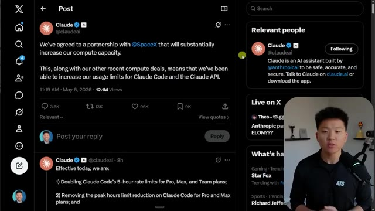
*⏱️ 00:00:06 — Capture d'écran du réseau social X affichant un post officiel de Claude (Anthropic) concernant un partenariat avec SpaceX pour augmenter la capacité de calcul et les limites d'utilisation de Claude Code et de l'API.*

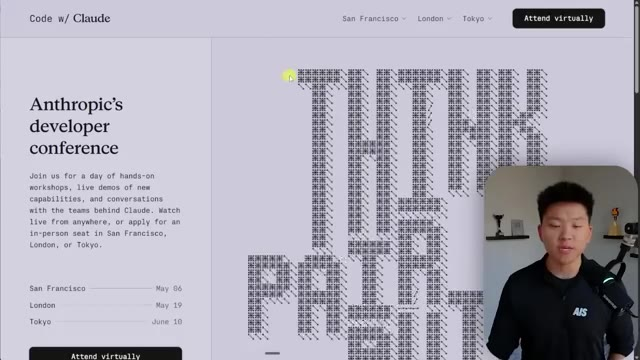
*⏱️ 00:00:17 — Page web officielle de la conférence développeur "Code w/ Claude" montrant les détails de l'événement avec les dates pour San Francisco, Londres et Tokyo.*

---

### ⏱️ `[00:00:23 - 00:00:42]` | Segment #02

**🔊 Audio (Transcription Intégrale Mot pour Mot en Français) :**
> And they actually got so much demand for this that they extended it. It looks like they did an extra day in each of these locations, so pretty cool. But as you guys probably are aware, if you've been using Claude for a while, is that this past couple months, this past quarter, has been awful with outages. There's been so many times where Claude has just died while you're trying to use it. And there's probably a lot of different reasons for that.

**👁️ Analyse Visuelle d'Écran (gemini-3.5-flash-lite) :**
**Interface & Outils** : Site web Anthropic (page des événements) et page de statut (status.anthropic.com).

**Contenu textuel & Code** : Textes informatifs sur l'extension d'événements pour développeurs ; graphiques à barres colorées (vert/jaune/rouge) illustrant les incidents de service sur 90 jours et pourcentages d'uptime associés.

**Action / Démonstration** : Présentation de la croissance et de la popularité de l'écosystème Claude, suivie d'une analyse critique de la fiabilité récente des services (pannes fréquentes).

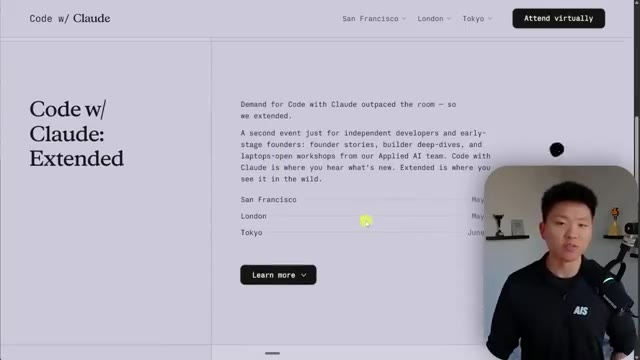
*⏱️ 00:00:28 — Page web officielle annonçant l'extension de l'événement « Code w/ Claude » dans plusieurs villes (San Francisco, Londres, Tokyo) suite à une forte demande.*

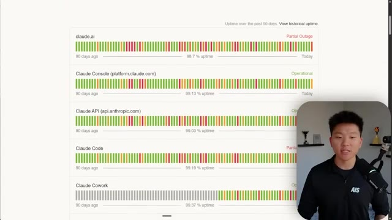
*⏱️ 00:00:32 — Tableau de bord d'état de service (Status Page) d'Anthropic montrant l'historique de disponibilité des différents services Claude (claude.ai, API, Console, etc.) sur 90 jours.*

---

### ⏱️ `[00:00:42 - 00:01:01]` | Segment #03

**🔊 Audio (Transcription Intégrale Mot pour Mot en Français) :**
> You know, like they were doing a lot of testing. They were shipping so many features. They had Opus. They had Mythos. But really the main reason is that they just didn't have enough compute to handle how much demand there was. There was way too many people trying to use Claude than what Claude could actually support. So today I wanted to actually break this down and help you guys understand what this means for you practically and what you might want to start doing differently.

**👁️ Analyse Visuelle d'Écran (gemini-3.5-flash-lite) :**
**Interface & Outils** : Navigateur web affichant le portail "Claude Status" (status.anthropic.com).

**Contenu textuel & Code** : Historique d'uptime (graphiques à barres), notifications d'incident technique en temps réel, statuts opérationnels ("Operational", "Partial Outage").

**Action / Démonstration** : Analyse visuelle des temps d'arrêt des services d'Anthropic pour illustrer les problèmes de capacité et de fiabilité technique évoqués dans le récit.

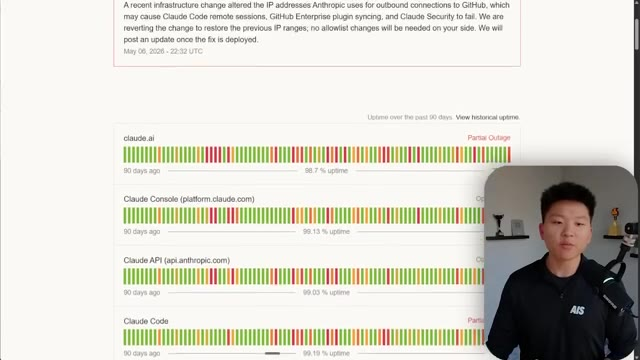
*⏱️ 00:00:47 — Page web de statut d'Anthropic montrant un historique de disponibilité sur 90 jours avec des interruptions ("Partial Outage") pour plusieurs services Claude.*

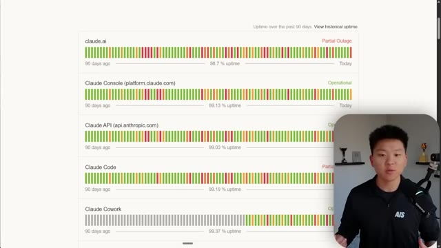
*⏱️ 00:00:52 — Suite de la page de statut affichant les indicateurs d'uptime pour divers composants comme Claude.ai, Console, API et l'outil "Claude Cowork".*

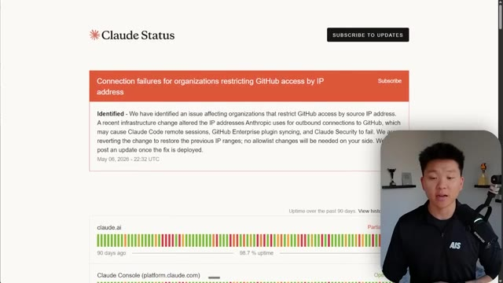
*⏱️ 00:00:56 — En-tête de la page "Claude Status" détaillant un incident technique majeur lié à des échecs de connexion GitHub via IP, impactant les sessions à distance.*

---

### ⏱️ `[00:01:01 - 00:01:20]` | Segment #04

**🔊 Audio (Transcription Intégrale Mot pour Mot en Français) :**
> So higher usage limits for Claude and a compute deal with SpaceX. Very, very interesting. So because of this partnership, what that means, effective immediately, is that first of all, they're going to be able to double Claude Code's five-hour rate limits. Double. Whether you're on Pro, Max, or Team, your five-hour limit is going to be doubled.

**👁️ Analyse Visuelle d'Écran (gemini-3.5-flash-lite) :**
**Interface & Outils** : Site web d'Anthropic (Page d'actualités/annonce).

**Contenu textuel & Code** : Texte officiel détaillant le doublement des limites de taux sur 5 heures pour Claude Code et l'augmentation des limites API pour les modèles Claude Opus, avec le présentateur en médaillon incrusté en bas à droite.

**Action / Démonstration** : Lecture de l'annonce officielle expliquant les changements de capacité de calcul suite au partenariat avec SpaceX.

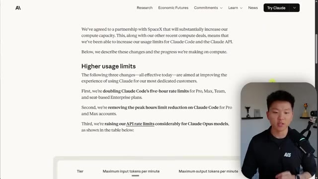
*⏱️ 00:01:06 — Capture d'écran du site officiel d'Anthropic annonçant le partenariat avec SpaceX et l'augmentation des limites d'utilisation pour Claude Code et l'API.*

---

### ⏱️ `[00:01:20 - 00:01:39]` | Segment #05

**🔊 Audio (Transcription Intégrale Mot pour Mot en Français) :**
> So when you're here inside of Claude, whatever plan you're on, this is going to last two times as long now. What they also did is they removed the peak hours limit reduction on Claude Code for Pro and Max accounts. So if you guys remember, maybe a month ago or so, they came out with this announcement and said, hey, during peak hours, so like weekday mornings-ish, you will hit your session limit faster.

**👁️ Analyse Visuelle d'Écran (gemini-3.5-flash-lite) :**
**Interface & Outils** : Interface utilisateur web de Claude (Paramètres) ; Site web officiel d'Anthropic (Blog/Annonces).

**Contenu textuel & Code** : - Image 1 : Statistiques d'utilisation ("Current session: 15% used", "Weekly limits").
- Image 2 : Texte officiel mentionnant "doubling Claude Code's five-hour rate limits" et "removing the peak hours limit reduction on Claude Code".

**Action / Démonstration** : Présentation visuelle des changements apportés aux limites de débit (rate limits) et aux capacités de calcul pour les abonnés aux plans Pro/Max.

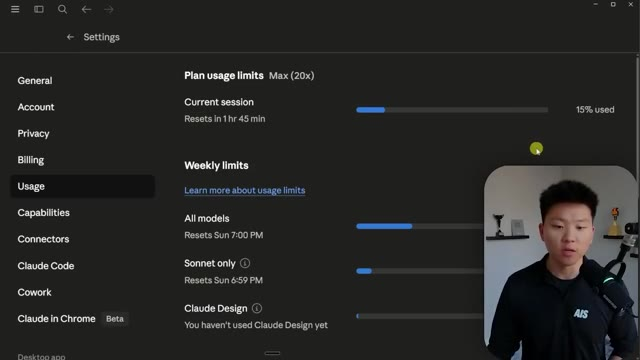
*⏱️ 00:01:25 — Interface des paramètres du compte Claude affichant les limites d'utilisation (« Plan usage limits ») et la consommation actuelle.*

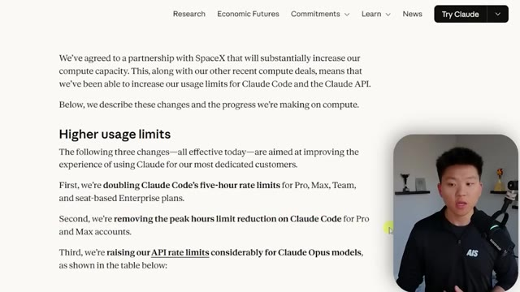
*⏱️ 00:01:29 — Page web officielle d'annonce d'Anthropic détaillant l'augmentation des limites d'utilisation pour Claude Code et l'API.*

---

### ⏱️ `[00:01:39 - 00:02:04]` | Segment #06

**🔊 Audio (Transcription Intégrale Mot pour Mot en Français) :**
> Because once again, they had way too many people using Claude Code during peak hours and they didn't have enough compute on their side. And then they also did that thing where they tested out not letting people buy a pro plan, so the $20 a month plan, and using Cloud Code. You had to buy a max plan in order to use it, unless you were already a subscriber. So they were doing all these things to figure out, like, how can we actually compete, or how can we actually keep up with how much demand we're getting for our platform right now?

**👁️ Analyse Visuelle d'Écran (gemini-3.5-flash-lite) :**
**Interface & Outils** : Navigateur web affichant une page de blog/annonce officielle d'Anthropic.

**Contenu textuel & Code** : Texte officiel détaillant l'augmentation des limites de débit ("rate limits") pour Claude Code, la suppression des réductions de limites pendant les heures de pointe pour les comptes Pro et Max, et l'augmentation des limites de l'API pour Claude Opus.

**Action / Démonstration** : Présentation informative sur les changements de politique tarifaire et de capacité de calcul d'Anthropic.

*⏱️ 00:01:45 — Capture d'écran du site officiel d'Anthropic annonçant une mise à jour sur les limites d'utilisation de Claude Code suite à un partenariat avec SpaceX.*

---

### ⏱️ `[00:02:04 - 00:02:22]` | Segment #07

**🔊 Audio (Transcription Intégrale Mot pour Mot en Français) :**
> Because you also have the issue of, if you go out and buy a bunch of extra compute and it's just sitting there and it's not being utilized, then that's also money going down the drain because the compute is just sitting there, not being utilized. So if you really think about, like, the math and the projections you'd have to do, it's really not a very simple problem to solve. And I'm not sure if this was the intention.

**👁️ Analyse Visuelle d'Écran (gemini-3.5-flash-lite) :**
**Interface & Outils** : Navigateur web affichant le site officiel d'Anthropic.

**Contenu textuel & Code** : Texte détaillant l'augmentation des limites de taux pour Claude Code (doublement des limites sur 5 heures), la suppression des réductions de limites aux heures de pointe, et l'augmentation des limites d'API pour le modèle Claude Opus.

**Action / Démonstration** : Consultation d'une annonce officielle pour illustrer les changements de capacité de calcul évoqués par le présentateur.

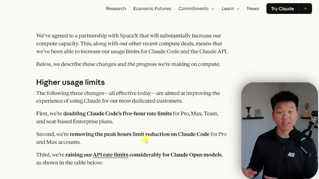
*⏱️ 00:02:08 — Capture d'écran montrant l'article officiel d'Anthropic sur l'augmentation des limites d'utilisation (compute) de Claude Code et de l'API.*

---

### ⏱️ `[00:02:22 - 00:02:44]` | Segment #08

**🔊 Audio (Transcription Intégrale Mot pour Mot en Français) :**
> Remember when people were using the Claude subscription for like OpenClaw and Hermes Agent? And then they said, hey, you can't do that anymore. It's against our terms of service. Yes, it is against their terms of service. But I wonder if there was also some motivation there to be like, whoa, we gotta like chill a little bit with how many people are just abusing their subscriptions right now. And we know if we switch over to API keys, then a lot of people might stop using our models as much for OpenClaw or Hermes.

**👁️ Analyse Visuelle d'Écran (gemini-3.5-flash-lite) :**
**Interface & Outils** : Site web officiel d'Anthropic.

**Contenu textuel & Code** : Texte informatif détaillant : "We've agreed to a partnership with SpaceX that will substantially increase our compute capacity", suivi des trois points clés sur l'augmentation des limites pour Claude Code (doublement des limites, suppression des réductions aux heures de pointe) et pour l'API Claude Opus.

**Action / Démonstration** : Lecture à l'écran de l'annonce officielle par le présentateur, illustrant les ajustements de capacité de calcul d'Anthropic.

*⏱️ 00:02:28 — Capture d'écran montrant une annonce officielle d'Anthropic sur leur site web concernant l'augmentation des limites d'utilisation de Claude Code et de l'API, suite à un partenariat avec SpaceX.*

---

### ⏱️ `[00:02:44 - 00:03:04]` | Segment #09

**🔊 Audio (Transcription Intégrale Mot pour Mot en Français) :**
> So anyways, just a quick thought. But then the final thing is that they are raising their API rate limits considerably for Claude Opus models. So it is a really decent chunk. So per minute, you used to only be able to send 30k input tokens at a time or you'd be rate limited. And that has been upgraded by like 16%. On the output side, it used to be 8,000 a minute and now it's 80,000 a minute.

**👁️ Analyse Visuelle d'Écran (gemini-3.5-flash-lite) :**
**Interface & Outils** : Navigateur web affichant le site officiel d'Anthropic (section "News").

**Contenu textuel & Code** : Texte explicatif sur les "Higher usage limits" (limites d'utilisation plus élevées) incluant la mention : "raising our API rate limits considerably for Claude Opus models".

**Action / Démonstration** : Le curseur de la souris souligne la section concernant l'augmentation des limites de l'API pour le modèle Claude Opus, illustrant les propos du présentateur.

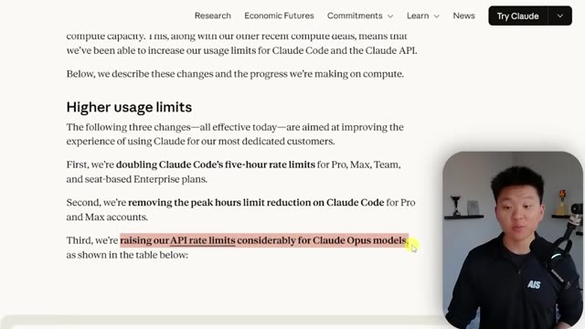
*⏱️ 00:02:49 — Capture d'écran montrant la page d'actualités d'Anthropic détaillant l'augmentation des limites d'utilisation pour Claude Code et l'API Claude Opus.*

---

### ⏱️ `[00:03:05 - 00:03:39]` | Segment #10

**🔊 Audio (Transcription Intégrale Mot pour Mot en Français) :**
> So every single tier got really a significant jump here. I mean, if you think about only being able to output 8,000 tokens in a minute, I have gone past that so many times. Once again, this is not for Cloud Code. This is for the API. But besides just the partnership with SpaceX, they were also on kind of a buying spree. You know, they have an agreement with Amazon. They have an agreement with Google and Broadcom. They also have a partnership with Microsoft and NVIDIA and a big investment in American AI infrastructure with Fluidstack. So this was obviously a big announcement with SpaceX, but they were kind of working towards this and they've been moving in the direction of figuring out how to get more compute either way. And the day before this actual

**👁️ Analyse Visuelle d'Écran (gemini-3.5-flash-lite) :**
**Interface & Outils** : Interface web (Documentation ou annonce officielle d'Anthropic).

**Contenu textuel & Code** : Tableau structuré par paliers (Tier 1 à 4) comparant les capacités en tokens :
- Tier 1 : 30k -> 500k input / 8k -> 80k output.
- Tier 2 : 450k -> 2M input / 90k -> 200k output.
- Tier 3 : 800k -> 5M input / 160k -> 400k output.
- Tier 4 : 2M -> 10M input / 400k -> 800k output.

**Action / Démonstration** : Présentation informative soulignant l'augmentation significative des limites de l'API.

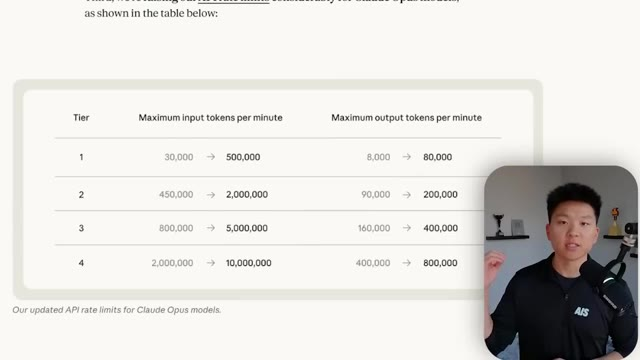
*⏱️ 00:03:13 — Un tableau comparatif affiché à l'écran détaillant l'augmentation des limites de débit (rate limits) pour l'API des modèles Claude Opus, montrant le passage des anciennes valeurs aux nouvelles pour les "input" et "output" tokens par minute.*

---

### ⏱️ `[00:03:39 - 00:04:00]` | Segment #11

**🔊 Audio (Transcription Intégrale Mot pour Mot en Français) :**
> conference, they made that announcement about partnering with that Goldman Sachs, JV, as well as Blackstone. And you can just tell that they're really going after enterprise here and they need to have compute to be able to handle enterprise and they are expanding internationally. So anyways, let's just start to break this down. I don't want to waste students' time. I want to keep this video pretty quick. So the headline, we read all this, right? Anthropic released three big changes.

**👁️ Analyse Visuelle d'Écran (gemini-3.5-flash-lite) :**
**Interface & Outils** : Pages web ou éditeur de texte/présentation affichant des notes de mise à jour technologiques.

**Contenu textuel & Code** : Texte détaillé sur l'infrastructure internationale ("Expanding internationally"), les exigences de conformité, et les changements spécifiques aux limites d'utilisation de Claude Code et des modèles Opus (augmentation des limites de taux).

**Action / Démonstration** : Présentation informative des changements stratégiques et techniques, utilisée comme support visuel par le présentateur.

*⏱️ 00:03:44 — Une capture d'écran montrant un document ou une page web officielle détaillant la stratégie d'expansion internationale d'une entreprise technologique (probablement Anthropic/OpenAI), mettant l'accent sur les besoins en infrastructure pour les clients entreprise et les partenariats avec Amazon.*

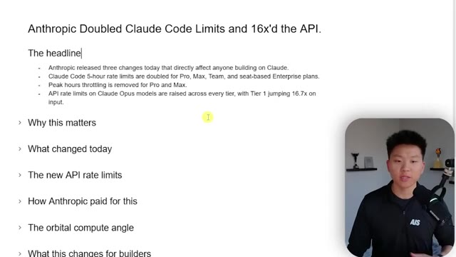
*⏱️ 00:03:55 — Une capture d'écran montrant une présentation textuelle structurée (type éditeur de notes ou diapositive) résumant les récentes mises à jour d'Anthropic : doublement des limites de Claude Code et augmentation significative des capacités de l'API Opus.*

---

### ⏱️ `[00:04:01 - 00:04:23]` | Segment #12

**🔊 Audio (Transcription Intégrale Mot pour Mot en Français) :**
> They also released something pretty interesting with managed agents. They gave them like web hooks and auto dreaming and, you know, multi-agent orchestration. And I'm not going to cover that right now. I'm definitely going to play around with it and I'll bring a video if I find some interesting stuff. But this one's more about the actual usage limits. The five-hour rate limits got doubled, peak hours throttling has been removed, and API rate limits have been improved significantly.

**👁️ Analyse Visuelle d'Écran (gemini-3.5-flash-lite) :**
**Interface & Outils** : Logiciel de présentation (type diapositives informatives).

**Contenu textuel & Code** : Texte affiché : "Anthropic Doubled Claude Code Limits and 16x'd the API." avec une liste à puces détaillant les augmentations des limites de débit pour les plans Pro, Max et Enterprise, ainsi que le passage au niveau 1 pour l'API Claude Opus. Plusieurs titres de sections sont visibles en dessous : "Why this matters", "What changed today", "The new API rate limits", etc.

**Action / Démonstration** : Présentation informative des mises à jour des limites de service d'Anthropic par le présentateur.

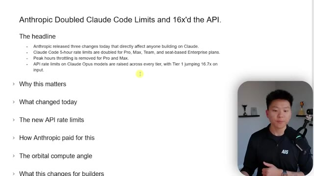
*⏱️ 00:04:06 — Une diapositive de présentation résumant les changements récents annoncés par Anthropic concernant les limites d'utilisation de Claude Code et de l'API.*

---

### ⏱️ `[00:04:24 - 00:04:42]` | Segment #13

**🔊 Audio (Transcription Intégrale Mot pour Mot en Français) :**
> So why does this matter? Well, for months, everyone who was building with CloudCode has been hitting walls. There's been so many complaints about people hitting the limits so fast. So many complaints about people wanting to upgrade from pro to max to max higher, and even on the highest max plan still getting shut down and not being able to use five hours worth of cloud code.

**👁️ Analyse Visuelle d'Écran (gemini-3.5-flash-lite) :**
**Interface & Outils** : Logiciel de présentation (type Google Slides ou Notion).

**Contenu textuel & Code** : Texte détaillé sur les limites d'utilisation de Claude Code, mentionnant les ralentissements (throttling), les problèmes de calcul (GPU) et la demande dépassant les capacités disponibles.

**Action / Démonstration** : Le présentateur illustre les points de douleur des utilisateurs concernant les limites de débit (rate limits) des outils de développement d'Anthropic.

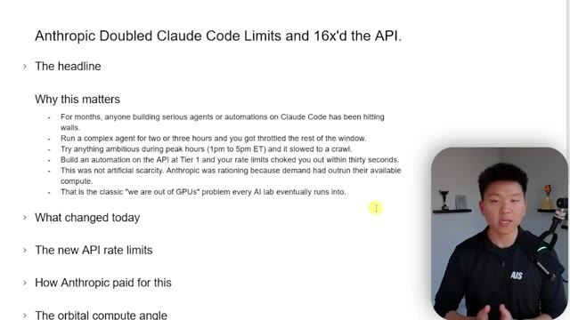
*⏱️ 00:04:28 — Une diapositive de présentation listant les raisons pour lesquelles les limitations de l'API d'Anthropic étaient problématiques pour les développeurs, avec le présentateur en médaillon dans le coin inférieur droit.*

---

### ⏱️ `[00:04:42 - 00:05:02]` | Segment #14

**🔊 Audio (Transcription Intégrale Mot pour Mot en Français) :**
> And I don't know how many of you guys are, but if you were using the API for Opus and you were trying to build production agents or apps that have some AI on the back end with Opus, you might be hitting rate limits very frequently. So these are the three changes that we just talked about that have happened today. And let's look at this rate limit thing again, because the statistics are pretty interesting. The lowest tiers obviously got the biggest multiples.

**👁️ Analyse Visuelle d'Écran (gemini-3.5-flash-lite) :**
**Interface & Outils** : Logiciel de présentation (type Google Slides ou Notion).

**Contenu textuel & Code** : Texte structuré expliquant les problèmes de performance rencontrés par les développeurs sur Claude Code et l'API (throttling, saturation aux heures de pointe, manque de GPU), ainsi qu'un plan de discussion (What changed today, The new API rate limits, etc.).

**Action / Démonstration** : Présentation orale des points techniques affichés à l'écran concernant les récentes augmentations des limites de l'API par Anthropic.

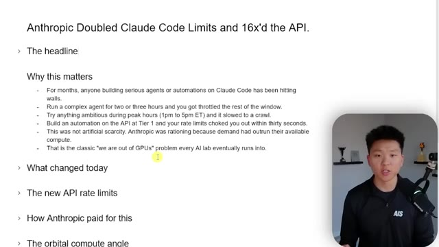
*⏱️ 00:04:47 — Une diapositive de présentation listant les enjeux liés aux limites de débit (rate limits) de l'API d'Anthropic pour les agents IA, avec le présentateur visible en médaillon dans le coin inférieur droit.*

---

### ⏱️ `[00:05:02 - 00:05:35]` | Segment #15

**🔊 Audio (Transcription Intégrale Mot pour Mot en Français) :**
> We see 16 here and we see 10 here. but still having all of these other ones, you know, the input's getting more than the output just because input is much less expensive than output tokens. But this basically meant if you had half a million input tokens per minute, you could pump roughly 370 pages of context per minute. And that's just on tier one. But before today, you would have only had 30K tokens, which might've been like 20 to 22 pages. And on the output side, we can now generate way more content much quicker. So if you wanted to have like a bunch of different agents running in parallel, that just would have been really, really hard to do under the previous rate limits

**👁️ Analyse Visuelle d'Écran (gemini-3.5-flash-lite) :**
**Interface & Outils** : Page web de documentation ou de notes techniques (format éditeur de texte/Markdown).

**Contenu textuel & Code** : Tableau structuré présentant les colonnes : "Tier", "Input tokens/min" et "Output tokens/min" avec des valeurs chiffrées. Texte explicatif détaillant les bénéfices pour les développeurs et l'orchestration multi-agents.

**Action / Démonstration** : Présentation informative illustrant les nouvelles capacités de débit de tokens de l'API Anthropic Opus.

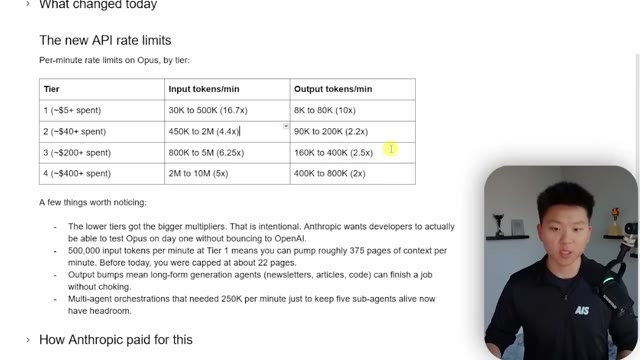
*⏱️ 00:05:11 — Tableau comparatif des limites de taux (rate limits) de l'API Opus d'Anthropic par palier (tier), accompagné d'une liste d'observations sur l'impact de ces changements.*

---

### ⏱️ `[00:05:35 - 00:06:09]` | Segment #16

**🔊 Audio (Transcription Intégrale Mot pour Mot en Français) :**
> with Opus. And so obviously how they paid for this was the SpaceX deal, right? They got 300 megawatts of capacity. They got over 220,000 NVIDIA GPUs. And they did this all super, super fast, which was really impressive. And I'm not going to get very technical here, right? But compute is expensive. And these AI models need compute. If you think about like you have all these closed source models, like the Gemini's and the Opus's and the GPT's. And if you think about the open source models that we have, like the DeepSeqs and the Gemmas and all these other open source models, what's the difference? Why are the closed source ones so much better? It's because they have more compute behind them. The open source models that you take and you want to run locally, you have to

**👁️ Analyse Visuelle d'Écran (gemini-3.5-flash-lite) :**
**Interface & Outils** : Document de présentation (type Notion ou éditeur de texte Markdown).

**Contenu textuel & Code** : Détails sur l'accord SpaceX (300+ mégawatts, 220 000 GPUs), ainsi que les investissements d'Amazon, Google/Broadcom, Microsoft/NVIDIA et Fluidstack.

**Action / Démonstration** : Le présentateur explique les enjeux financiers et matériels derrière l'infrastructure de calcul nécessaire au fonctionnement des modèles d'Anthropic.

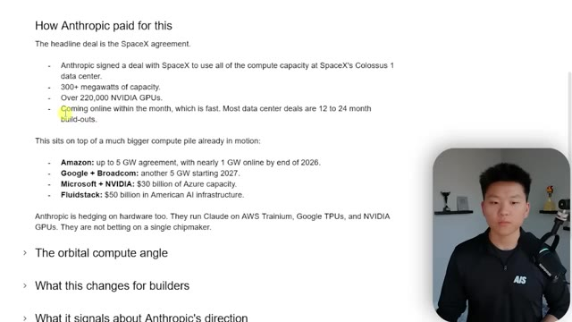
*⏱️ 00:05:43 — Une présentation sous forme de texte structuré expliquant les accords d'infrastructure de calcul d'Anthropic, incluant le partenariat avec SpaceX et d'autres investissements technologiques majeurs.*

---

### ⏱️ `[00:06:09 - 00:06:43]` | Segment #17

**🔊 Audio (Transcription Intégrale Mot pour Mot en Français) :**
> have a machine with enough RAM and enough VRAM to actually run them and run them fast and run them well. But when you're actually just like using cloud code and you're talking to Opus, you're relying on Anthropics servers. You're relying on Anthropics infrastructure to actually process that for you. And that's why it's able to come back so fast. And even if you wanted to like buy a VPS to host a local model on, you would have to buy a VPS that has enough compute to actually hold and run all of those models. So once again, Amazon, Google, Broadcom, Microsoft, NVIDIA, and FluidStack, they're clearly investing here in compute. And what's interesting here, which was at the bottom of the announcement, is that Anthropic and SpaceX have expressed interest in developing

**👁️ Analyse Visuelle d'Écran (gemini-3.5-flash-lite) :**
**Interface & Outils** : Éditeur de texte ou application de prise de notes (format présentation).

**Contenu textuel & Code** : Texte détaillé : "How Anthropic paid for this", "The headline deal is the SpaceX agreement", détails sur la capacité de calcul (300+ mégawatts, 220 000 GPUs NVIDIA), partenariats stratégiques (Amazon, Google+Broadcom, Microsoft+NVIDIA, Fluidstack), et mention de l'utilisation de AWS Trainium et Google TPUs.

**Action / Démonstration** : Présentation informative sur la stratégie d'infrastructure matérielle d'Anthropic, illustrée par une liste à puces structurée.

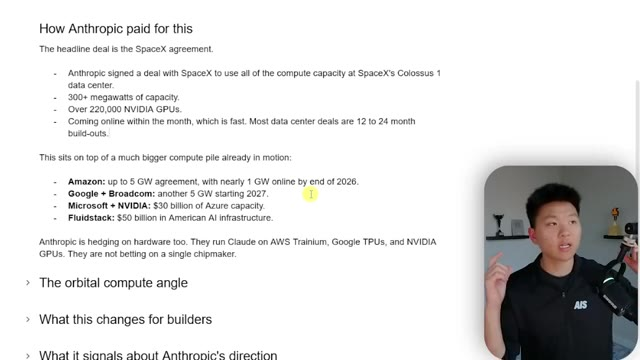
*⏱️ 00:06:18 — Une page de notes textuelles présentant une analyse détaillée de l'infrastructure de calcul d'Anthropic, incluant l'accord avec SpaceX et des partenariats avec Amazon, Google et Microsoft.*

---

### ⏱️ `[00:06:43 - 00:07:12]` | Segment #18

**🔊 Audio (Transcription Intégrale Mot pour Mot en Français) :**
> multiple gigawatts of orbital AI compute capacity, which means GPUs in space. Right here, super interesting. As part of this agreement, we have also expressed interest in partnering with SpaceX to develop multiple gigawatts of orbital AI compute capacity. So cool. So it doesn't seem like that's going to happen right now in this year, but Anthropic believes that terrestrial compute, which is stuff like the power and the water and the cooling, and also the community not liking how much water and electricity it's using, has a real long-term ceiling.

**👁️ Analyse Visuelle d'Écran (gemini-3.5-flash-lite) :**
**Interface & Outils** : Navigateur web / Document texte de lecture.

**Contenu textuel & Code** : Texte informatif sur les accords d'investissement (Google, Broadcom, Microsoft, NVIDIA, AWS, SpaceX) et analyses sur les capacités de calcul orbital.

**Action / Démonstration** : Présentation commentée de documents stratégiques et d'analyses de marché concernant l'infrastructure IA.

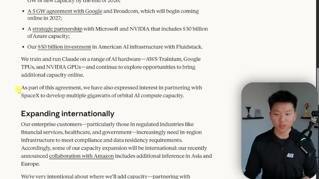
*⏱️ 00:06:51 — Une capture d'écran d'un document texte ou d'une page web officielle détaillant les investissements d'Anthropic dans l'infrastructure IA, mentionnant spécifiquement le partenariat avec SpaceX pour du calcul orbital.*

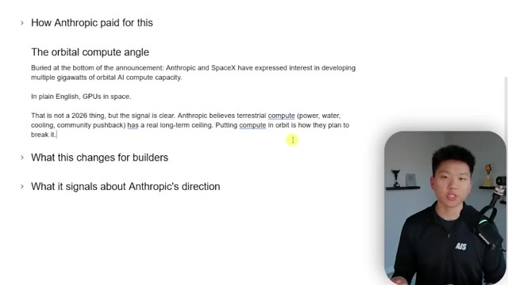
*⏱️ 00:07:05 — Une capture d'écran d'un document récapitulatif (type note ou article de blog) analysant l'angle du "calcul orbital" et l'idée de placer des GPU dans l'espace pour pallier les limites terrestres.*

---

### ⏱️ `[00:07:13 - 00:07:33]` | Segment #19

**🔊 Audio (Transcription Intégrale Mot pour Mot en Français) :**
> So putting compute in space and having all these AI models running in space is what's going to really unlock the next level of all of these different AI models. So what does this change for you guys, for builders? I came up with these five main points and not all five may hit you, but let's just run through them quick. The first thing is to retest workflows that broke before.

**👁️ Analyse Visuelle d'Écran (gemini-3.5-flash-lite) :**
**Interface & Outils** : Logiciel de traitement de texte ou application de prise de notes (type Notion ou Google Docs).

**Contenu textuel & Code** : Texte explicatif sur l'intérêt d'Anthropic pour les "GPUs in space" et les limites des infrastructures de calcul terrestres, ainsi que les titres de sections "What this changes for builders" et "What it signals about Anthropic's direction".

**Action / Démonstration** : Le présentateur expose les points clés de sa réflexion sur l'avenir du calcul IA en orbite en parcourant le document affiché à l'écran.

*⏱️ 00:07:18 — Une présentation sous forme de document texte ou de diapositives structurées intitulée "The orbital compute angle", détaillant la collaboration entre Anthropic et SpaceX pour le développement de capacités de calcul IA dans l'espace, avec le présentateur en médaillon dans le coin inférieur droit.*

---

### ⏱️ `[00:07:33 - 00:07:51]` | Segment #20

**🔊 Audio (Transcription Intégrale Mot pour Mot en Français) :**
> So if you tried building an Opus agent six months ago and you gave up because of rate limits, the wall might not actually exist anymore and it's worth a reattempt. I always think of this story when I was working with a client and they wanted a LinkedIn automation with AI generated infographics. And I was like, I just, I can't confidently give you something that I would want you to post. Like it's just not there yet. Three months later, new image model dropped.

**👁️ Analyse Visuelle d'Écran (gemini-3.5-flash-lite) :**
**Interface & Outils** : Éditeur de documents/Prise de notes (type Notion ou Obsidian).

**Contenu textuel & Code** : Texte explicatif structuré sous le titre "What this changes for builders", détaillant les avantages de l'augmentation des limites de débit pour les agents Opus, l'utilisation de la fenêtre de contexte de 1M, et la viabilité des workflows multi-agents en production.

**Action / Démonstration** : Aucune action dynamique ; il s'agit d'un support visuel statique utilisé pour appuyer les propos du présentateur concernant l'optimisation des flux de travail IA.

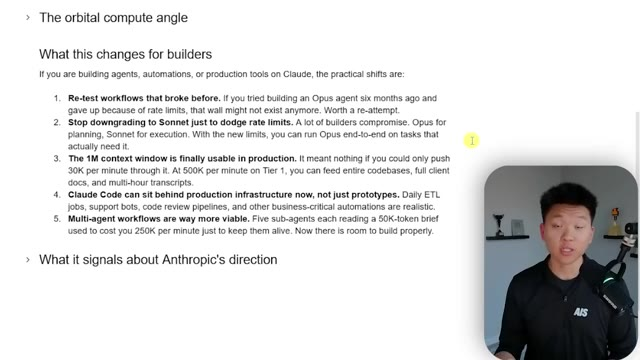
*⏱️ 00:07:37 — Une page de document textuel présentant une liste de 5 points clés sur l'évolution des limites de taux (rate limits) pour les développeurs utilisant les modèles Claude d'Anthropic.*

---

### ⏱️ `[00:07:51 - 00:08:14]` | Segment #21

**🔊 Audio (Transcription Intégrale Mot pour Mot en Français) :**
> I tested it out. It worked. I called him up and then we built it out for him. So things move fast. Sometimes it's worth revisiting old projects. The other thing is if you were using something like slash opus plan, or if you were consistently delegating a lot of work to haiku or sonnet, just because you were trying to really maximize your session limit, then maybe you can start to, you know, give yourself, you know, treat yourself a little bit more, use opus a little bit more.

**👁️ Analyse Visuelle d'Écran (gemini-3.5-flash-lite) :**
**Interface & Outils** : Éditeur de texte ou application de prise de notes de type Notion/Obsidian.

**Contenu textuel & Code** : Liste de 5 points clés concernant l'évolution de l'utilisation de Claude Opus, la fenêtre de contexte de 1M de tokens, Claude Code en production et les workflows multi-agents.

**Action / Démonstration** : Le présentateur affiche une synthèse textuelle pour illustrer ses propos sur l'évolution de la viabilité des projets d'automatisation avec les modèles d'Anthropic.

*⏱️ 00:07:57 — Une page de notes structurées présentant une liste à puces intitulée "What this changes for builders", détaillant les avantages des nouvelles limites de Claude pour les développeurs d'agents.*

---

### ⏱️ `[00:08:14 - 00:08:50]` | Segment #22

**🔊 Audio (Transcription Intégrale Mot pour Mot en Français) :**
> Now, obviously context management is still going to be really, really important. So I've made a ton of videos on that kind of stuff. You can check out my channel, but with these new limits, you can experiment maybe a little bit more. Third, we have that the 1 million context window is finally usable in production because you're not going to be getting rate limited. And this is when I'm thinking of like the API calls, not so much the cloud code. Cloud code can also sit behind production infrastructure now, not just prototypes. Because previously, if you would have had all of these different routines firing off and you still wanted to be able to do your knowledge work and build automations and stuff like that on the day-to-day, then you're using your session limit on cloud code automations in the agentic loop, as well as your daily knowledge work. And you were just going to

**👁️ Analyse Visuelle d'Écran (gemini-3.5-flash-lite) :**
**Interface & Outils** : Application de présentation/document textuel type Notion ou Google Docs.

**Contenu textuel & Code** : Cinq points clés pour les constructeurs : 1. Re-tester les workflows auparavant bloqués par les limites de débit. 2. Utiliser Opus en continu plutôt que Sonnet. 3. Exploitation réelle de la fenêtre de contexte de 1M de tokens. 4. Déploiement de Claude Code en production. 5. Viabilité accrue des workflows multi-agents.

**Action / Démonstration** : Le contenu affiche une analyse stratégique pour les développeurs d'agents IA, servant de support visuel au discours sur les nouvelles capacités techniques d'Anthropic.

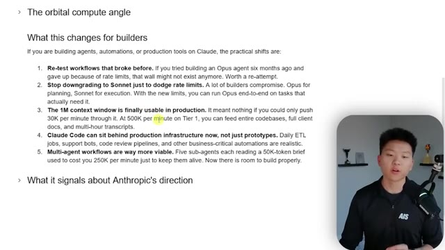
*⏱️ 00:08:23 — Une présentation sous forme de liste à puces intitulée "What this changes for builders" détaillant les impacts des nouvelles limites de Claude pour les développeurs, avec le présentateur en médaillon dans le coin inférieur droit.*

---

### ⏱️ `[00:08:50 - 00:09:22]` | Segment #23

**🔊 Audio (Transcription Intégrale Mot pour Mot en Français) :**
> eat through it too quick. But now with double the usage, you might be able to push some of those workflows that you want on a routine and you want to have like a lot of autonomy. Those can now be routines and it doesn't affect your session limit as much. And then multi-agent workflows are way more viable. So you can have things like five sub agents, each reading 50k tokens. And so this one's kind of similar to 0.3, but basically just the idea that your API driven workflows, you have a lot more flexibility now. So anyways, just wanted to wrap up here with what it signals about Anthropics direction, at least what I think. So they are clearly playing for five plus years of

**👁️ Analyse Visuelle d'Écran (gemini-3.5-flash-lite) :**
**Interface & Outils** : Logiciel de prise de notes ou éditeur de texte (type Notion ou Obsidian).

**Contenu textuel & Code** : Liste détaillée intitulée "What this changes for builders" : 1. Re-test workflows, 2. Stop downgrading to Sonnet, 3. The 1M context window is usable, 4. Claude Code for production, 5. Multi-agent workflows are viable.

**Action / Démonstration** : Le présentateur illustre visuellement les changements stratégiques pour les développeurs utilisant l'API Claude en s'appuyant sur cette liste.

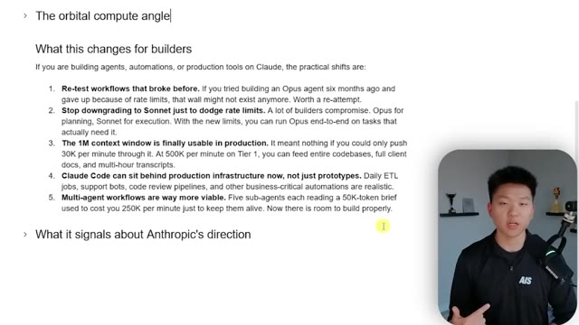
*⏱️ 00:08:58 — Une page de notes structurée présentant 5 points clés sur l'impact des nouvelles limites d'utilisation de Claude pour les développeurs, avec le présentateur en médaillon.*

---

### ⏱️ `[00:09:22 - 00:09:50]` | Segment #24

**🔊 Audio (Transcription Intégrale Mot pour Mot en Français) :**
> compute. They invested a ton of money into it. So obviously this is the future for them. Cloud code also seems to be clearly their flagship product. They didn't make any announcements today, at least best of my knowledge about cowork. They talked about this cloud session limits and they talked about APIs second, but obviously this session limit counts towards pretty much all of your products, but cloud code was what was heavily discussed. Now, yes, this event was called code with Claude. So there's a bit of that, but anyways, just something I wanted to call out.

**👁️ Analyse Visuelle d'Écran (gemini-3.5-flash-lite) :**
**Interface & Outils** : Application web Anthropic (interface de gestion des limites d'utilisation).

**Contenu textuel & Code** : Texte à puces : "Claude Code is clearly the flagship product" ; Interface de suivi : "Current session 16% used", "Weekly limits", "All models", "Sonnet only", "Claude Design".

**Action / Démonstration** : Présentation informative des changements de limites d'utilisation et analyse stratégique du modèle économique d'Anthropic.

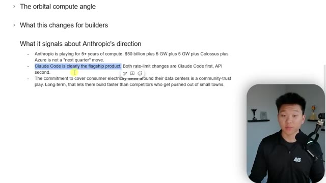
*⏱️ 00:09:29 — Une capture d'écran d'un document texte listant des points stratégiques sur la direction d'Anthropic, notamment le positionnement de Claude Code comme produit phare.*

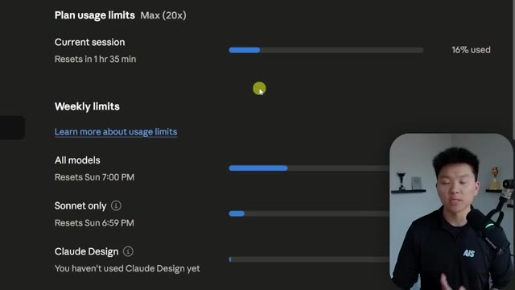
*⏱️ 00:09:43 — Une interface utilisateur affichant les limites d'utilisation (Plan usage limits) de Claude, incluant les taux d'utilisation actuels et les réinitialisations hebdomadaires.*

---

### ⏱️ `[00:09:51 - 00:10:21]` | Segment #25

**🔊 Audio (Transcription Intégrale Mot pour Mot en Français) :**
> And then the commitment to cover consumer electricity hikes around their data centers is a community trust play. Long-term, that lets them build faster than competitors who get pushed out of small towns. So anyways, I hope that this one was exciting. I hope that this gave you a few things that you want to try and hopefully you learned something new. Next, I would still say it's important to obviously be thinking about how do tokens work under the hood and how should you be looking to manage your session limits? So if you want to check out some hacks, I'll tag this video right up here, which I recommend you guys go watch next. Hopefully I see you guys over there, but as always, thanks for making it to the end of the video and I'll see you on the next one.

**👁️ Analyse Visuelle d'Écran (gemini-3.5-flash-lite) :**
**Interface & Outils** : Logiciel de présentation ou éditeur de notes (type Notion ou Google Docs).

**Contenu textuel & Code** : Le texte affiche une analyse stratégique : "What it signals about Anthropic's direction" avec des points clés sur les investissements en calcul (compute), le positionnement de Claude Code comme produit phare, et la stratégie de confiance communautaire concernant les coûts de l'électricité.

**Action / Démonstration** : Le présentateur commente le contenu affiché, illustrant ses propos sur la stratégie à long terme d'Anthropic.

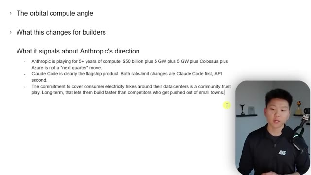
*⏱️ 00:09:58 — Une capture d'écran montrant une présentation textuelle (slides) analysant la stratégie d'Anthropic, avec Nate Herk dans une vignette en bas à droite.*

---

### ⏱️ `[00:10:21 - 00:10:22]` | Segment #26

**🔊 Audio (Transcription Intégrale Mot pour Mot en Français) :**
> Thanks everyone.

**👁️ Analyse Visuelle d'Écran (gemini-3.5-flash-lite) :**
**Interface & Outils** : Logiciel de présentation (type Google Slides ou PowerPoint).

**Contenu textuel & Code** : Texte listant : "Anthropic Doubled Claude Code Limits and 16x'd the API", suivi d'une liste à puces : "The headline", "Why this matters", "What changed today", "The new API rate limits", "How Anthropic paid for this", "The orbital compute angle", "What this changes for builders".

**Action / Démonstration** : Clôture de la présentation ou fin de segment vidéo.

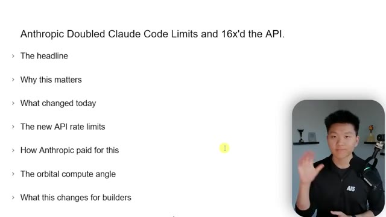
*⏱️ 00:10:21 — Une diapositive de présentation listant les points clés sur l'augmentation des limites de l'API Claude par Anthropic, avec le présentateur en médaillon faisant un signe de la main.*

---

