# 🎬 Overwhelmed By AI? Just Copy My Tech Stack

> **Chaîne** : [Nate Herk | AI Automation](https://www.youtube.com/@nateherk/featured)  
> **Lien YouTube** : [https://www.youtube.com/watch?v=35WuZxbAY68](https://www.youtube.com/watch?v=35WuZxbAY68)  
> **Date de publication** : 20260508  
> **Durée** : 00:17:13  
> **Identifiant vidéo** : `35WuZxbAY68`  
> **Transcription & Analyse** : `whisper-v3-large-turbo+gemini-3.5-flash-lite`  

---

## 📌 Synthèse Exécutive & Outils

### 💡 Résumé
Dans cette vidéo intitulée **Overwhelmed By AI? Just Copy My Tech Stack**, Nate Herk décortique les capacités pratiques d'automatisation et de développement propulsées par les modèles de pointe.

### 🛠️ Outils, Modèles & Logiciels Présentés
- **Opus 5.5 & Claude Code** : Modèles d'ingénierie et agents de codage autonome.

### 🔑 Points Clés & Enseignements Stratégiques
- Optimiser le niveau d'effort et le raisonnement des modèles IA pour des résultats industriels.
- Automatiser les cycles de création logicielle de bout en bout.

---

## ⏱️ Chronologie & Transcription Complète Audio & Visuelle (Mot pour Mot)

### ⏱️ `[00:00:00 - 00:00:28]` | Segment #01

**🔊 Audio (Transcription Intégrale Mot pour Mot en Français) :**
> If you've been feeling overwhelmed trying to keep up with the different AI tools and agents and different things that you should be using, then this video is for you. Because there's a lot and the space moves really quick. So I want to show you guys the tools that I'm actually using on the day to day and the tools that I use every once in a while and talk about why. I'm also going to talk about my mindset when I'm living in this environment, experimenting with new stuff, and what actually moves the needle so that you guys don't end up getting in the cycle where every single month you feel overwhelmed because there's so much new stuff to learn. All right, so let's just go ahead and get started. This is not a technical breakdown of all these tools.

**👁️ Analyse Visuelle d'Écran (gemini-3.5-flash-lite) :**
**Interface & Outils** : Application de tableau blanc virtuel / outil de diagramme (type Excalidraw ou similaire).

**Contenu textuel & Code** : Catégories : "Daily Driver" (S), "Constant Companions" (A), "Specialists" (B), "Experimenting" (C). Icônes visibles : ChatGPT, VS Code, et divers logos d'outils IA.

**Action / Démonstration** : Préparation du classement des outils IA par le présentateur en vue de les glisser dans les catégories.

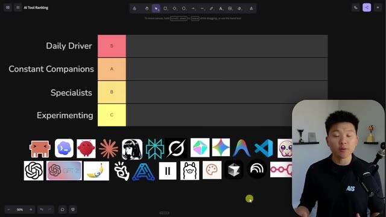
*⏱️ 00:00:07 — Une interface de type "Tier List" vide sur fond sombre, utilisée pour classer des outils d'IA, avec une série d'icônes d'applications en bas de l'écran.*

---

### ⏱️ `[00:00:28 - 00:00:49]` | Segment #02

**🔊 Audio (Transcription Intégrale Mot pour Mot en Français) :**
> This is just my list and me personally telling you guys about the tech stack that I use and why. So we're going to start off up top with our S tier. These are our daily drivers. So you know I have to chuck CloudCode in there. This is probably my overall number one favorite AI tool ever. This is basically my operating system. I live inside of my CloudCode project and I try to do as much work as I can directly from inside of CloudCode.

**👁️ Analyse Visuelle d'Écran (gemini-3.5-flash-lite) :**
**Interface & Outils** : Logiciel de tableau blanc collaboratif (type FigJam ou Miro) affichant une Tier List.

**Contenu textuel & Code** : Le tableau est structuré avec les catégories "Daily Driver" (S), "Constant Companions" (A), "Specialists" (B) et "Experimenting" (C). On peut identifier diverses icônes de logiciels sous le tableau, notamment les logos de VS Code, OpenAI, Claude, Llama, etc.

**Action / Démonstration** : Présentation visuelle du classement des outils de son "tech stack" avant leur placement dans les différentes catégories du tableau.

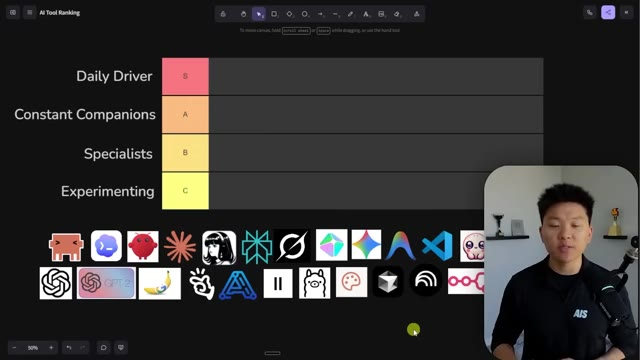
*⏱️ 00:00:33 — Une capture d'écran montrant le présentateur devant une interface de type "Tier List" (tableau de classement) sur un tableau blanc numérique, avec une série d'icônes d'outils technologiques et d'IA disposées en bas de l'écran.*

---

### ⏱️ `[00:00:49 - 00:01:23]` | Segment #03

**🔊 Audio (Transcription Intégrale Mot pour Mot en Français) :**
> Now up next on the S tier is VS Code, which is basically where I like to use my CloudCode. You could use it in the desktop app, straight into CLI. I like to use it inside of VS Code, which is just an IDE, meaning you could also use Cloud Code inside of different IDs like Cursor or, you know, Windsor for anti-gravity. So here's VS Code. I can see my files on the left. I can have Cloud Code in the terminal right here, or I can use the Cloud Code extension. And our third and actually our final S-tier AI tool is Glido. This is our speech to text startup, and I fully transitioned over from Whisper to Glido. It's the fastest one on the market. It's private, and we're going to make this thing super agentic. So if you want to check it

**👁️ Analyse Visuelle d'Écran (gemini-3.5-flash-lite) :**
**Interface & Outils** : Visual Studio Code, terminal CLI.

**Contenu textuel & Code** : Terminal affichant "Claude Code v2.1.132", "Opus 4.7 (1M context)" et le mode "auto mode on".

**Action / Démonstration** : Utilisation de l'outil Claude Code au sein de l'environnement de développement VS Code.

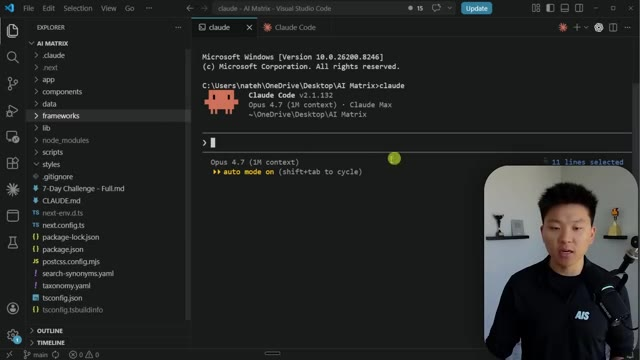
*⏱️ 00:01:06 — Interface de Visual Studio Code affichant un terminal intégré exécutant Claude Code.*

---

### ⏱️ `[00:01:23 - 00:01:58]` | Segment #04

**🔊 Audio (Transcription Intégrale Mot pour Mot en Français) :**
> out, link in the description. And Windows support is literally about to roll out. So stay tuned for that. Okay. So now let's move on to A tier. Now these are the ones that I'm using on a weekly basis, a hundred percent, but they're not really my daily drivers. So the first one we have is Codex. Codex is a similar type of agent hardest to CloudCode. And I've been using it a lot more lately because a lot of its strengths compliment CloudCode's weaknesses and vice versa. So they're really good to be able to use together, even though right now I still do the majority of my work inside of CloudCode. And by the way, if you guys are seeing some tools throughout and you're curious and you want to see more about how I use them or, you know, better breakdowns, then let me know in the comments what else you guys want to see. The next A tier is just Claude in general,

**👁️ Analyse Visuelle d'Écran (gemini-3.5-flash-lite) :**
**Interface & Outils** : Logiciel de tableau blanc collaboratif (type Miro ou FigJam) affichant une "AI Tool Ranking" tier list.

**Contenu textuel & Code** : La tier list présente quatre niveaux (Daily Driver, Constant Companions, Specialists, Experimenting). Au niveau S (Daily Driver), on distingue les logos de Cursor, VS Code et GitHub Copilot. En bas, une multitude d'icônes d'outils IA attendent d'être classées (incluant OpenAI, Claude, Replit, etc.).

**Action / Démonstration** : Le présentateur explique sa classification des outils d'automatisation IA tout en déplaçant ou en présentant les icônes sur le canevas.

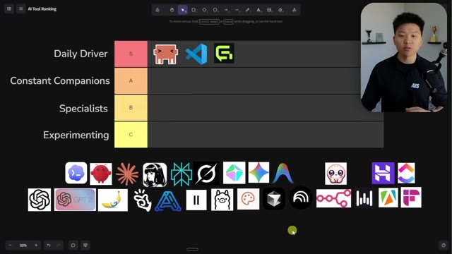
*⏱️ 00:01:32 — Une capture d'écran montrant un tableau de classement (tier list) interactif sur une interface type tableau blanc, avec le présentateur incrusté en haut à droite.*

---

### ⏱️ `[00:01:58 - 00:02:32]` | Segment #05

**🔊 Audio (Transcription Intégrale Mot pour Mot en Français) :**
> Claude Chat. Now, typically I am using Claude Code for all of my chat-based stuff, but I still do have some times when I just go to chat really quick because I can just open it up and it's right there and I, you know, chat. Okay, the next one, which I have not talked about too much on this channel at all, is Hermes Agent. I've been using this a lot more lately and it's really nice for general knowledge work and being able to do stuff when I'm out and about because it wakes up on demand when you talk to it through telegram it has instant crons it has a lot of things that i really like about it that are just easier to set up sometimes than doing a whole cloud code infrastructure setup all right next we have perplexity now perplexity i feel like isn't as

**👁️ Analyse Visuelle d'Écran (gemini-3.5-flash-lite) :**
**Interface & Outils** : Tableau blanc interactif (type Excalidraw ou similaire) affichant une "AI Tool Ranking" tier list.

**Contenu textuel & Code** : Classement par niveaux (S, A, B, C) avec des logos d'outils logiciels. Niveau S : Claude Code, VS Code, Cursor. Niveau A : Claude, Replit. Des dizaines d'autres icônes d'outils IA sont présentes en bas en attente de classement.

**Action / Démonstration** : Le présentateur explique son classement des outils d'IA tout en manipulant visuellement la tier list.

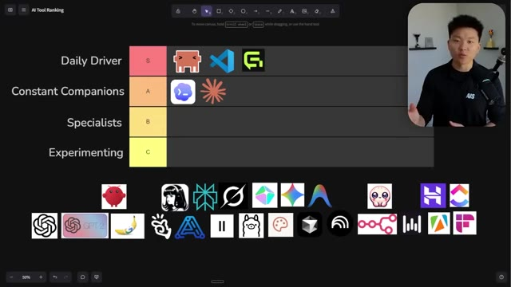
*⏱️ 00:02:07 — Une capture d'écran montrant un tableau de classement (tier list) d'outils d'IA, avec le présentateur en médaillon.*

---

### ⏱️ `[00:02:32 - 00:03:05]` | Segment #06

**🔊 Audio (Transcription Intégrale Mot pour Mot en Français) :**
> popular as you know it used to be i don't really use perplexity computer too much but when i am plugging in automations and i'm having my agents do research i really like to use perplexity for my research i'm also using grok a lot as far as research and you know using x's built-in grok right there when I need to, you know, maybe I want to search through a lot of Twitter threads or something and I want to find specific posts or find specific insights, I like to use Grok in X for that. And so that's honestly my core stack. That's all we have for S and A tiered. And the reason I wanted to show you guys this is because it's a pretty lean stack. When it comes to core AI tools, it's basically

**👁️ Analyse Visuelle d'Écran (gemini-3.5-flash-lite) :**
**Interface & Outils** : Application web de tableau blanc/diagramme (type Whimsical ou Miro).

**Contenu textuel & Code** : Logos d'outils d'IA variés (VS Code, Perplexity, Claude, etc.) classés dans des lignes nommées "S" (Daily Driver) et "A" (Constant Companions).

**Action / Démonstration** : Organisation visuelle et hiérarchisation des outils logiciels préférés de l'utilisateur sur une plateforme de travail collaboratif.

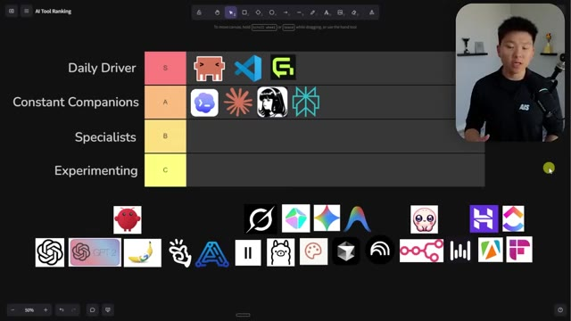
*⏱️ 00:02:40 — Une vue d'ensemble d'un tableau de classement "Tier List" interactif sur une interface web, où le présentateur organise des outils d'IA en catégories (Daily Driver, Constant Companions, etc.).*

---

### ⏱️ `[00:03:05 - 00:03:23]` | Segment #07

**🔊 Audio (Transcription Intégrale Mot pour Mot en Français) :**
> Cloud Code, Glido, Codex, Hermes Agent, Perplexity, and Grok. And you can see how many tools there are still down here to be placed into different categories. Now, I don't want to get into a bunch of like different project management tools and like things like, you know, Hostinger obviously is my VPS provider for Cloud Code or for Hermes or for other things that I'm setting up.

**👁️ Analyse Visuelle d'Écran (gemini-3.5-flash-lite) :**
**Interface & Outils** : Outil de tableau blanc collaboratif ou application de mind-mapping (type Miro ou FigJam).

**Contenu textuel & Code** : Le tableau affiche des catégories (Daily Driver, Constant Companions, Specialists, Experimenting) et une collection d'icônes d'outils technologiques (ChatGPT, Claude, VS Code, Cursor, Hostinger, etc.).

**Action / Démonstration** : Organisation visuelle et catégorisation des outils IA sur un espace de travail canvas par le présentateur.

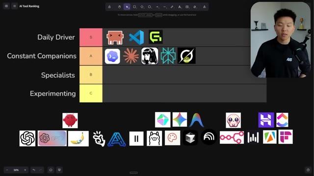
*⏱️ 00:03:09 — Un tableau de classement (Tier List) interactif utilisé pour catégoriser divers outils d'IA et de développement, avec une barre d'outils de dessin en haut et une réserve d'icônes d'outils en bas.*

---

### ⏱️ `[00:03:24 - 00:03:42]` | Segment #08

**🔊 Audio (Transcription Intégrale Mot pour Mot en Français) :**
> You know, ClickUp is where I live as far as project management and stuff like that and communication with my team. Fireflies is in all of my meetings. And, you know, I just wanted to chuck these in here to give them some love to show you where they fit in my AI stack. But these aren't really ones that are like my AI first tools that I'm using on the day-to-day for knowledge work. So the specialists are one where I use them for a very specific use case.

**👁️ Analyse Visuelle d'Écran (gemini-3.5-flash-lite) :**
**Interface & Outils** : Logiciel de création de diagrammes ou tableau blanc numérique (type FigJam ou équivalent).

**Contenu textuel & Code** : Le tableau affiche une hiérarchie "S, A, B, C" avec les logos de divers outils d'IA et de développement. On reconnaît notamment VS Code, Cursor, et d'autres outils technologiques répartis dans les catégories. En bas, une sélection d'icônes d'outils en attente de classement (incluant les logos de ChatGPT, Claude, Ollama, etc.).

**Action / Démonstration** : Le présentateur est en train de manipuler l'interface pour positionner ou présenter visuellement les outils de son "AI stack" au sein de la Tier List.

*⏱️ 00:03:28 — Une capture d'écran montrant un tableau de classement (Tier List) interactif utilisé par le présentateur pour organiser ses outils d'IA par catégories, de "Daily Driver" à "Experimenting".*

---

### ⏱️ `[00:03:43 - 00:04:04]` | Segment #09

**🔊 Audio (Transcription Intégrale Mot pour Mot en Français) :**
> You know, like I have a certain process that I need or within processes I have a very specific task. And then I would go grab some of these specialists. So another example would be Appify. I don't live in Appify, but every once in a while I'll have an automation or every once in a while I'll want my Hermes agent to grab something and it has to use Appify and a certain actor with an Appify. We also have things like GBT Image 2, which I've been loving lately and Nano Banana 2.

**👁️ Analyse Visuelle d'Écran (gemini-3.5-flash-lite) :**
**Interface & Outils** : Logiciel de tableau blanc collaboratif (type Miro ou FigJam).

**Contenu textuel & Code** : Logos d'outils technologiques et d'IA classés par catégories. Dans la ligne "Specialists" (B), on distingue notamment les logos d'Hugging Face, Vercel (ou similaire) et Framer.

**Action / Démonstration** : Le présentateur explique sa méthodologie de sélection d'outils spécialisés ("Specialists") pour des tâches spécifiques au sein de ses processus d'automatisation.

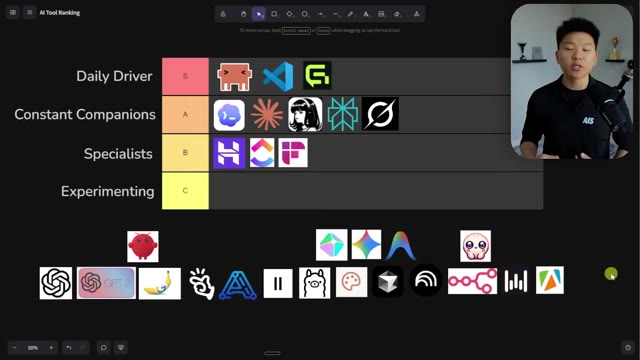
*⏱️ 00:03:48 — Une vue d'ensemble d'un tableau de classement (tier list) interactif sur une plateforme de type tableau blanc, classant divers outils d'IA selon leur usage (Daily Driver, Constant Companions, Specialists, Experimenting).*

---

### ⏱️ `[00:04:04 - 00:04:26]` | Segment #10

**🔊 Audio (Transcription Intégrale Mot pour Mot en Français) :**
> They're really good at different things. I kind of use Nano Banana as like my Photoshop tool and I use GBT2 as like my creator tool, if that makes sense when it comes to images. And then usually when I'm plugging in like image generation or video generation into agents, I always use key.ai for that. It's kind of like the open router, but for image and video models. And that actually reminds me, I left open router out of this, but open router definitely deserves a spot in the B tier for specialists.

**👁️ Analyse Visuelle d'Écran (gemini-3.5-flash-lite) :**
**Interface & Outils** : Outil de création de diagramme/tableau de bord (type tableau blanc interactif).

**Contenu textuel & Code** : Logos d'outils d'IA classés dans des catégories : 'Daily Driver' (S), 'Constant Companions' (A), 'Specialists' (B), et 'Experimenting' (C). On identifie notamment les logos de VS Code, GPT-2 et une icône de banane pour Nano Banana.

**Action / Démonstration** : Le présentateur explique sa hiérarchie personnelle d'outils d'IA en pointant ou en référençant les éléments du tableau.

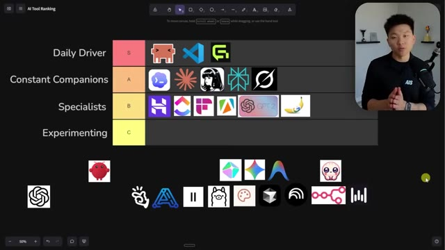
*⏱️ 00:04:10 — Un tableau de classement (tier list) illustrant différents outils d'IA classés par catégories d'usage, avec le présentateur en médaillon dans le coin supérieur droit.*

---

### ⏱️ `[00:04:27 - 00:05:00]` | Segment #11

**🔊 Audio (Transcription Intégrale Mot pour Mot en Français) :**
> I've got a few other specialists here and it's probably gonna shoot off the edge. So let me just expand this a little bit. But I also use HeyGen for whenever I need avatars. I don't avatar my YouTube channel. And I know you guys say that in the comments. I've never done that and I don't plan on it, but I will use this sometimes for certain videos, maybe for certain course material or whatever it is. sometimes I will use an avatar and I go to HeyGen for that. And then alongside that, I use 11 Labs to clone my voice or for specific voice agent builds. Okay. So it's really starting to slim down here. As you guys can see, we only have one actual row left, which is experimenting, but I'll tell you what, not all of these tools are going to fit into this row. So let's see

**👁️ Analyse Visuelle d'Écran (gemini-3.5-flash-lite) :**
**Interface & Outils** : Application de tableau blanc virtuel (type FigJam ou Miro).

**Contenu textuel & Code** : Un graphique divisé en niveaux (S, A, B, C) contenant des icônes de logiciels : VS Code, Cursor, GPT-4, HeyGen, ainsi que divers logos d'outils d'automatisation et d'IA.

**Action / Démonstration** : Le présentateur manipule les éléments du graphique pour agrandir ou réorganiser les icônes des outils "Specialists" dans la liste.

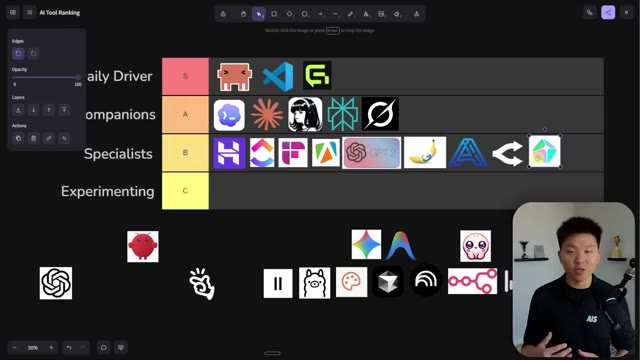
*⏱️ 00:04:35 — Une interface de type "Tier List" (classement) affichée sur une application de tableau blanc collaboratif, organisant divers outils d'IA et de développement.*

---

### ⏱️ `[00:05:00 - 00:05:34]` | Segment #12

**🔊 Audio (Transcription Intégrale Mot pour Mot en Français) :**
> what's going to happen. Okay. So for C tier, these are things that I'm kind of keeping my eye on and I'm playing with a little bit and I use very frequently and they're in my ecosystem, but I wouldn't really consider them a main tool I use. Actually, before we get to that, I did leave out Cloud Design. Cloud Design is definitely a specialist, and we've been adopting it more and more as a team because now everyone on the team can build landing pages using the exact same design system. I know you could have done it either way in Cloud Code before, but it just makes it so much easier to share designs, comments on things. We've been loving Cloud Design for specific use cases. Okay, so now let's get into the experimenting AI tools. So honestly, Gemini.

**👁️ Analyse Visuelle d'Écran (gemini-3.5-flash-lite) :**
**Interface & Outils** : Outil de tableau blanc collaboratif (type FigJam ou Miro).

**Contenu textuel & Code** : Le tableau présente des catégories : "Daily Driver" (S), "Constant Companions" (A), "Specialists" (B) et "Experimenting" (C). Des icônes d'outils (VS Code, Cursor, GPT-4, Llama, etc.) sont disposées dans les lignes correspondantes ou en attente en dessous.

**Action / Démonstration** : Le présentateur explique sa classification des outils d'IA au sein de son écosystème de travail, en se préparant à déplacer des éléments vers la catégorie "C" (Experimenting).

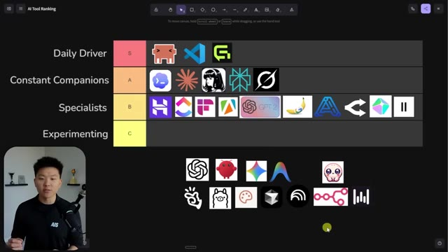
*⏱️ 00:05:09 — Une capture d'écran montrant un tableau de type "Tier List" (hiérarchisation) pour divers outils d'automatisation et d'IA, avec le présentateur en médaillon dans le coin inférieur gauche.*

---

### ⏱️ `[00:05:35 - 00:06:09]` | Segment #13

**🔊 Audio (Transcription Intégrale Mot pour Mot en Français) :**
> Gemini and anti-gravity, I just don't really use very often. It's not part of my core stack. I am using Nano Banana more than I would go talk to Gemini 3 Pro or something like that in the actual app. The next one would be Olama. I don't run on local models, but I do use Olama to download stuff or maybe to even use their cloud because I like to play around with the open source models and see what's happening. I like to keep up to date and experiment. And then the last one that I wanted to throw on this list was Manus. I really don't use it too much, but every once in a while, I'll just open it up and test out some things. I know you guys have been giving me some comments about Manus, but yeah, I mean, I think it's a great tool. And if you were maybe new to this AI world

**👁️ Analyse Visuelle d'Écran (gemini-3.5-flash-lite) :**
**Interface & Outils** : Tableau blanc collaboratif en ligne (type Miro ou FigJam).

**Contenu textuel & Code** : Liste classée par catégories : "Daily Driver", "Constant Companions", "Specialists", "Experimenting". On y reconnaît des logos comme VS Code, Claude, ChatGPT, Ollama (icône de lama), Nano Banana, etc.

**Action / Démonstration** : Le présentateur présente visuellement son organisation et ses préférences d'outils IA en pointant ou en montrant le classement actuel.

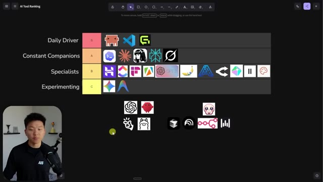
*⏱️ 00:05:43 — Une vue d'ensemble d'un tableau de classement "Tier List" (S à C) répertoriant divers outils et modèles d'IA, avec le présentateur visible en médaillon dans le coin inférieur gauche.*

---

### ⏱️ `[00:06:09 - 00:06:29]` | Segment #14

**🔊 Audio (Transcription Intégrale Mot pour Mot en Français) :**
> and you started with Manus, it could potentially be your main S tier daily driver. But for me, I just would prefer to use my cloud code. And now you may be wondering what's going on with all of these tools down here. These are in a separate category for me, which I would call graduated, which means they used to be somewhere in this top four tier list, but now I just don't really use them anymore.

**👁️ Analyse Visuelle d'Écran (gemini-3.5-flash-lite) :**
**Interface & Outils** : Logiciel de tableau blanc numérique ou outil de cartographie mentale (type Miro ou FigJam).

**Contenu textuel & Code** : Logos d'outils d'IA incluant : Manus, VS Code, Cursor, GPT-4, Claude, Perplexity, et divers autres agents et interfaces de développement.

**Action / Démonstration** : Le présentateur explique le classement des outils et déplace son curseur vers la section inférieure dédiée aux outils « gradués ».

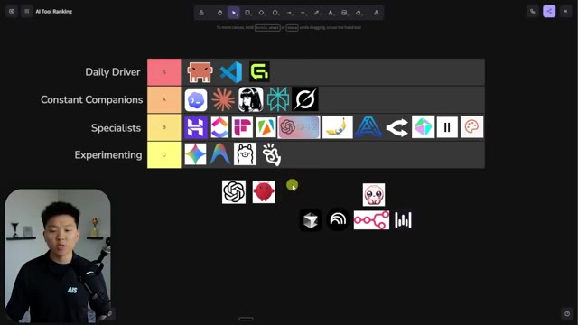
*⏱️ 00:06:14 — Un tableau de classement (Tier List) interactif affichant diverses icônes d'outils d'IA, organisé par catégories (Daily Driver, Constant Companions, Specialists, Experimenting), avec une zone en bas pour les outils « gradués ».*

---

### ⏱️ `[00:06:29 - 00:07:05]` | Segment #15

**🔊 Audio (Transcription Intégrale Mot pour Mot en Français) :**
> So ChatGPT, regular chat, I've graduated. OpenClaw, I've graduated. I would say that Hermes has kind of replaced OpenClaw for me. Cursor, I've graduated from. notebook lm poppy ai nnn and then whisper flow and one thing i want to say about these graduated tools is that this doesn't mean that they're trash this just means that i no longer use them i feel like i've kind of moved above them and this could be for many different reasons maybe it means that they're a little bit outdated maybe it means that they were got replaced like in this case whisper flow 1 million percent has been replaced by glido so this one we can even just put off to the side but like nnn not a bad tool at all i just prefer now to build automations in cloud code

**👁️ Analyse Visuelle d'Écran (gemini-3.5-flash-lite) :**
**Interface & Outils** : Logiciel de tableau blanc interactif ou outil de mind-mapping (type Miro ou FigJam) présentant une "AI Tool Ranking Tier List".

**Contenu textuel & Code** : Liste d'icônes d'outils d'IA organisée par paliers : ChatGPT, VS Code, Cursor, Claude, NotebookLM, Poppy AI, etc., classés selon leur utilisation quotidienne ou leur état de "diplômé" (graduated).

**Action / Démonstration** : Le présentateur commente le classement visuel et déplace le curseur pour illustrer les outils qu'il a "gradués" (c'est-à-dire ceux qu'il a dépassés ou pour lesquels il a trouvé des alternatives supérieures).

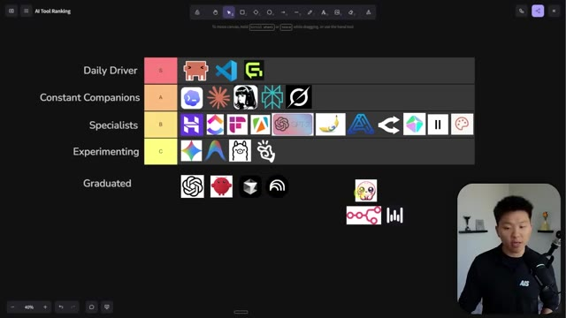
*⏱️ 00:06:38 — Une capture d'écran d'un tableau de type "Tier List" (niveaux S à Graduated) classant divers outils d'IA, avec une petite icône de curseur jaune en train de se déplacer au-dessus de l'icône de l'outil Poppy AI dans la catégorie "Graduated".*

*⏱️ 00:06:47 — Une capture d'écran identique à la précédente, montrant le tableau complet avec les outils classés par catégories (Daily Driver, Constant Companions, Specialists, Experimenting, Graduated).*

---

### ⏱️ `[00:07:06 - 00:07:28]` | Segment #16

**🔊 Audio (Transcription Intégrale Mot pour Mot en Français) :**
> Poppy AI, not a bad tool at all. I just realized that if I wanna use Poppy's functionality, I could do that better in cloud code and it can be more customized to me and cheaper. So sometimes these tools, like Notebook LM, they're all very, very good tools, but what I've done is instead of paying for them now, I basically have extracted the features that I like from them and I've worked them into my own ecosystem because the idea really is to keep your tech stack lean.

**👁️ Analyse Visuelle d'Écran (gemini-3.5-flash-lite) :**
**Interface & Outils** : Interface de tableau blanc collaboratif (probablement FigJam).

**Contenu textuel & Code** : Tableau classant plusieurs icônes de logiciels IA, dont VS Code (S-tier), et diverses applications dans les niveaux A, B, C et "Graduated".

**Action / Démonstration** : Le présentateur présente une vue d'ensemble structurée de son écosystème d'outils d'IA, illustrant visuellement ses préférences d'utilisation.

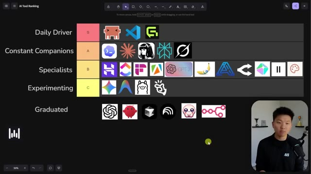
*⏱️ 00:07:11 — Une "Tier List" interactive organisée sur une interface de tableau blanc collaboratif (type FigJam ou Miro) classant divers outils d'IA et logiciels selon des catégories allant de "Daily Driver" à "Graduated".*

---

### ⏱️ `[00:07:28 - 00:07:54]` | Segment #17

**🔊 Audio (Transcription Intégrale Mot pour Mot en Français) :**
> And I know this looks like a lot, but really the daily drivers is the main ones that I use. I could use just my cloud code and my Glido and just work the whole day. and be fine. And I really wanted to make this video because I've been considering making more content on Codex and Hermes Agent and maybe a few other things, but I don't want to overwhelm you guys, which is why I've been only on Cloud Code for the past like three months. I was trying to stay consistent so that you guys could try to keep learning one tool consistently. And I really hope that I'm not contributing to your overwhelm and maybe your stress with all this AI stuff going on.

**👁️ Analyse Visuelle d'Écran (gemini-3.5-flash-lite) :**
**Interface & Outils** : Logiciel de tableau blanc interactif ou de création de diagrammes (type Miro ou FigJam).

**Contenu textuel & Code** : Tableau classant des logos d'outils d'IA : "Daily Driver" (S-Tier) incluant VS Code et Glido, "Constant Companions" (A-Tier), "Specialists" (B-Tier), "Experimenting" (C-Tier) et "Graduated".

**Action / Démonstration** : Le présentateur explique sa hiérarchie d'outils d'IA ("daily drivers") en s'appuyant sur les éléments visuels du classement.

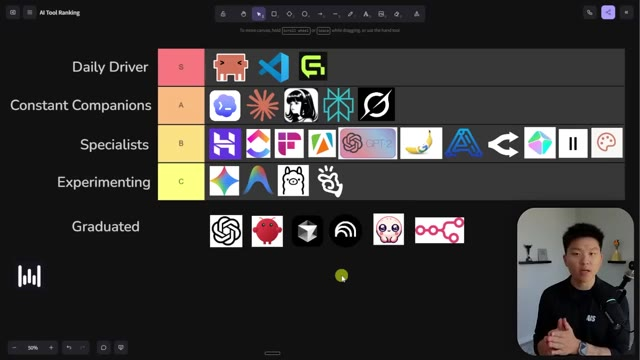
*⏱️ 00:07:35 — Une vue d'ensemble d'un tableau de classement "Tier List" (type niveau S à C) présentant divers outils d'IA classés selon leur fréquence d'utilisation par le présentateur.*

---

### ⏱️ `[00:07:55 - 00:08:29]` | Segment #18

**🔊 Audio (Transcription Intégrale Mot pour Mot en Français) :**
> I'm trying to keep you guys all educated, but I also am able to realize that when you see a new video for me every day, it does feel like you need to watch them all and drown and you feel a little bit overwhelmed. So I'm trying to help you guys out here. By the way, guys, I know we're about to cover a ton of information in this video. So I broke all of this down into a free resource guide, all these tools, all these different frameworks and rules to remember. And I put that inside of my free school community. The link for that is down in the description. Once again, completely free. You join here, you go to the classroom, you click on all YouTube resources, and you'll be able to download every resource that I've ever dropped on YouTube for completely free. So hop in the community and let's get back to the video. Thanks guys. So let's talk about some other

**👁️ Analyse Visuelle d'Écran (gemini-3.5-flash-lite) :**
**Interface & Outils** : Plateforme de gestion de workflows et de cours (Canvas, AI Automation Society Portal).

**Contenu textuel & Code** : Schémas explicatifs sur la productivité, icônes d'outils IA (VS Code, n8n, Claude Code), et curriculum de formation.

**Action / Démonstration** : Présentation pédagogique visant à rationaliser l'apprentissage des outils IA pour éviter la surcharge cognitive.

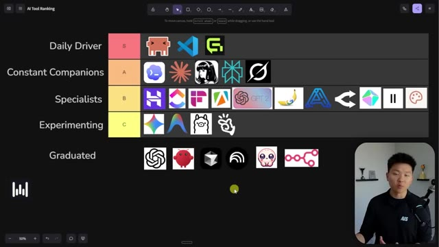
*⏱️ 00:08:03 — Un tableau de classement (« Tier List ») classant divers outils d'IA par catégories, de « Daily Driver » à « Graduated ».*

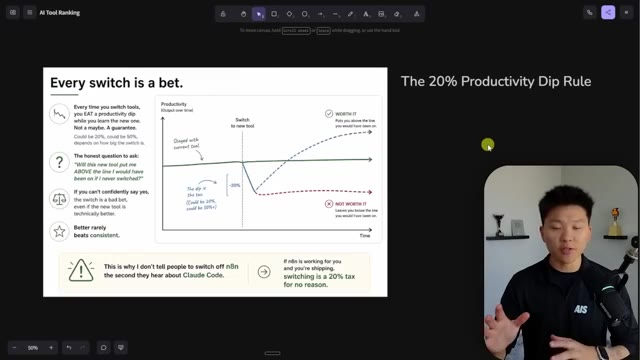
*⏱️ 00:08:12 — Un graphique conceptuel illustrant la « Règle de la baisse de productivité de 20% » lors du changement d'outils de travail.*

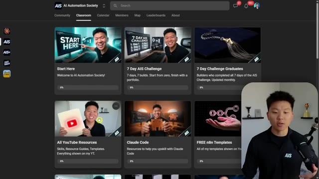
*⏱️ 00:08:21 — Capture de l'interface de la plateforme « AI Automation Society » montrant des modules de cours comme « 7 Day AIS Challenge » et « Claude Code ».*

---

### ⏱️ `[00:08:29 - 00:08:52]` | Segment #19

**🔊 Audio (Transcription Intégrale Mot pour Mot en Français) :**
> mindset stuff. I've got a couple of different key points here that I wanted to hit on, which will hopefully clear up a lot of this stuff. So the first thing is that coding agents are just harnesses. These images are kind of funny. It just made this up. This was GBT image too, by the way, but they're all different on the surface, right? They've got different harnesses. They might use different models on the back end. They might have different ways that they use their skills, but they're all just harnesses. They're all just AI that work inside some sort of directory.

**👁️ Analyse Visuelle d'Écran (gemini-3.5-flash-lite) :**
**Interface & Outils** : Logiciel de tableau blanc numérique ou outil de mind-mapping (type Miro ou FigJam).

**Contenu textuel & Code** : - Image 1 : Icônes d'outils IA (VS Code, logos d'agents divers).
- Image 2 : Schéma "Different on the surface, Same under the hood", listant des agents (Claude Code, Codex, Hermes, OpenClaw) connectés à un "Agent Harness" central, avec une structure de fichiers type (/your-project, CLAUDE.md, AGENTS.md, etc.).

**Action / Démonstration** : Le présentateur utilise une présentation visuelle pour expliquer la standardisation des workflows d'agents IA au sein des répertoires de projet.

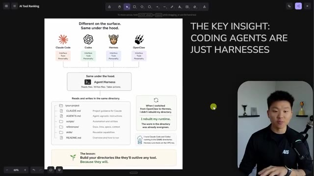
*⏱️ 00:08:41 — Un schéma conceptuel expliquant que les agents de codage sont des « harnais » (harnesses) partageant une structure de répertoire commune, illustrant l'indépendance entre l'agent et le projet.*

---

### ⏱️ `[00:08:53 - 00:09:13]` | Segment #20

**🔊 Audio (Transcription Intégrale Mot pour Mot en Français) :**
> So if you have your project with your claw.md file or your agents.md file and your scripts and your skills and whatever, all of your different agents can work on that directory. So I have my main operating system, right? Like my main project called Herk2. And I've had OpenClaw and Hermes and Codex and CloudCode all be able to work inside of that directory so they can all do things for me in there.

**👁️ Analyse Visuelle d'Écran (gemini-3.5-flash-lite) :**
**Interface & Outils** : Application de tableau blanc virtuel / outil de diagramme (type Miro ou FigJam).

**Contenu textuel & Code** : Diagramme montrant quatre agents connectés à une instance centrale "Agent Harness" qui interagit avec une structure de répertoire contenant `CLAUDE.md`, `AGENTS.md`, `scripts/`, `references/`, `skills/` et `README.md`. Texte mis en avant : "THE KEY INSIGHT: CODING AGENTS ARE JUST HARNESSES".

**Action / Démonstration** : Le présentateur illustre la modularité des agents IA qui utilisent une structure de projet indépendante des outils utilisés (réutilisabilité du répertoire lors du changement d'agent).

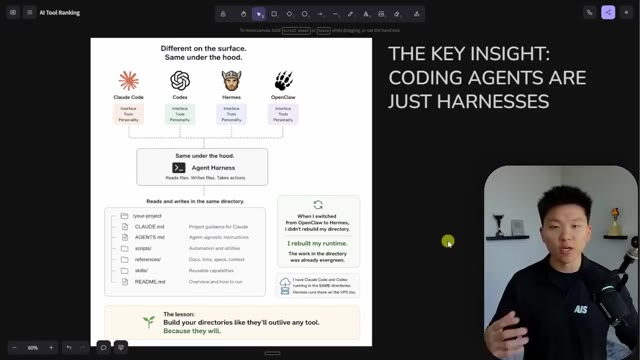
*⏱️ 00:08:58 — Un schéma explicatif illustrant comment différents agents IA (Claude Code, Codex, Hermes, OpenClaw) peuvent interagir avec un répertoire de projet commun structuré via des fichiers de configuration partagés.*

---

### ⏱️ `[00:09:14 - 00:09:37]` | Segment #21

**🔊 Audio (Transcription Intégrale Mot pour Mot en Français) :**
> And the lesson here is to build directories like they're going to outlive any tool because they will. We don't know if CloudCode is gonna be king in a few months. We don't know if Codex will be king in a few months. We don't know if some random startup is gonna just take over everything. But what we do know is that we're creating directories and we're creating our projects and we're keeping them clean and we're building in them that whatever AI is the new kid on the block will be able to plug into it and it will be just fine.

**👁️ Analyse Visuelle d'Écran (gemini-3.5-flash-lite) :**
**Interface & Outils** : Outil de tableau blanc numérique de type Excalidraw ou Miro.

**Contenu textuel & Code** : Le schéma montre que plusieurs outils d'IA se connectent à un "Agent Harness" commun agissant sur le même répertoire de fichiers (`/your-project`, `CLAUDE.md`, `AGENTS.md`, `scripts/`, `references/`, `skills/`, `README.md`). Le texte souligne : "THE KEY INSIGHT: CODING AGENTS ARE JUST HARNESSES" et "Build your directories like they'll outlive any tool".

**Action / Démonstration** : Présentation visuelle didactique expliquant l'architecture recommandée pour structurer des projets compatibles avec n'importe quel agent de codage IA.

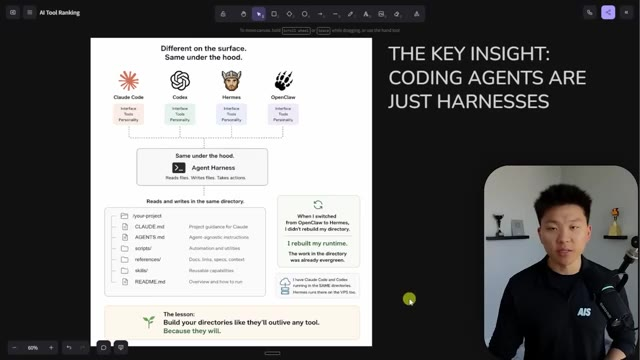
*⏱️ 00:09:19 — Un schéma conceptuel illustrant l'indépendance des répertoires de projet vis-à-vis des outils d'IA (Claude Code, Codex, Hermes, OpenClaw).*

---

### ⏱️ `[00:09:37 - 00:09:56]` | Segment #22

**🔊 Audio (Transcription Intégrale Mot pour Mot en Français) :**
> The next thing I want you guys to think about is what is your North Star? Because it's probably very different from my North Star. You know, obviously I've got a bunch of business goals with what we're building out with AI Automation Society and our certifications and our events, but my North Star when it comes to YouTube is test out every tool, form my own opinions, and share with you guys what I think is interesting to know.

**👁️ Analyse Visuelle d'Écran (gemini-3.5-flash-lite) :**
**Interface & Outils** : Tableau blanc numérique ou outil de design visuel (type Miro ou FigJam).

**Contenu textuel & Code** : Schéma illustrant une personne courant vers une "North Star", avec des "puits gravitationnels" représentant des distractions comme "New Model", "Trending Tool", "Hot Framework" et "Latest Feature". Texte : "Before you adopt ANY tool, you have to know what you're building toward."

**Action / Démonstration** : Présentation conceptuelle et pédagogique pour aider à prioriser les outils technologiques par rapport aux objectifs commerciaux.

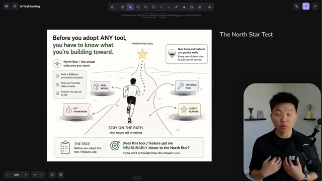
*⏱️ 00:09:42 — Une infographie illustrée intitulée "The North Star Test" montrant un chemin vers un objectif (North Star) avec des obstacles (distractions technologiques) et un cadre de décision pour l'adoption d'outils.*

---

### ⏱️ `[00:09:57 - 00:10:22]` | Segment #23

**🔊 Audio (Transcription Intégrale Mot pour Mot en Français) :**
> And so that North Star for me means I test out a lot of stuff. I jump on announcements. I have to experiment. And that doesn't mean that you have to, because if your North Star is building a business or a company that does X really good, like what is the mission? Then is every single new hot framework or every single new model or trending tool or latest feature, is that actually your path to the North Star? Or is that just a distraction? Like the number one mistake that entrepreneurs make is they get distracted and they try to do too much.

**👁️ Analyse Visuelle d'Écran (gemini-3.5-flash-lite) :**
**Interface & Outils** : Outil de tableau blanc numérique ou logiciel de présentation de type canevas (probablement Excalidraw ou un outil similaire).

**Contenu textuel & Code** : Le graphique montre un chemin menant à une "North Star Goal". Il liste des distractions ("New Model", "Trending Tool", "Hot Framework", "Latest Feature") représentées comme des puits de gravité, et inclut une section "THE TEST" avec la question : "Does this tool / feature get me MEASURABLY closer to the North Star?".

**Action / Démonstration** : Présentation visuelle et explicative du concept stratégique de focalisation pour éviter la distraction technologique.

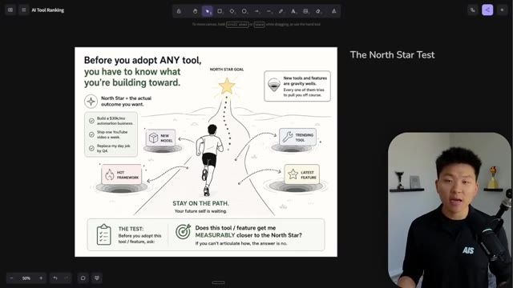
*⏱️ 00:10:04 — Un schéma illustré présentant le concept du "North Star Test" pour évaluer l'adoption d'outils, avec un coureur essayant d'atteindre un objectif tout en évitant des distractions (nouveaux modèles, outils tendances, etc.).*

---

### ⏱️ `[00:10:22 - 00:10:55]` | Segment #24

**🔊 Audio (Transcription Intégrale Mot pour Mot en Français) :**
> So really the idea would be, okay, I'm just going to stay on this path. I'm going to save links to YouTube videos that Nate drops. I'm going to save these Twitter threads for later and just kind of remember that they're there, but I don't need to actually go learn all of these new features. Maybe I'll watch Nate's, you know, 10 minute video, but that doesn't mean I have to dedicate my whole next day to learning and building what he showed. There's a difference between knowing the what and knowing the how, and sometimes you only need to know all the what's. You don't need to know the how's. And I've got another point, which is kind of like the decision framework, and I'll touch on that in a bit, but hopefully this alone will make you guys think, wow, you know, there is a lot

**👁️ Analyse Visuelle d'Écran (gemini-3.5-flash-lite) :**
**Interface & Outils** : FigJam (tableau blanc virtuel).

**Contenu textuel & Code** : Schéma intitulé "The North Star Test" avec les étapes : "New Model", "Hot Framework", "Trending Tool", "Latest Feature" et la question décisionnelle : "Does this tool / feature get me MEASURABLY closer to the North Star?".

**Action / Démonstration** : Présentation visuelle et explication conceptuelle du maintien de la concentration sur les objectifs principaux face à la surabondance de nouveaux outils IA.

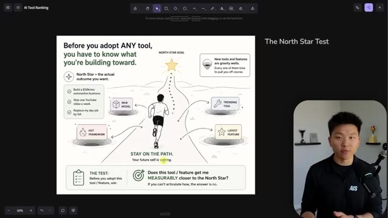
*⏱️ 00:10:31 — Une infographie illustrant le concept du "North Star Test", montrant une personne courant sur un chemin vers un objectif (étoile), évitant des distractions ("gravity wells") représentées par des outils ou frameworks tendances.*

---

### ⏱️ `[00:10:55 - 00:11:27]` | Segment #25

**🔊 Audio (Transcription Intégrale Mot pour Mot en Français) :**
> of things that I've just experimented with and I don't know why. I don't even have a use case for that. This next one is the 20% productivity dip rule. So basically it's the idea that every single time you make a switch in your business, you are going to maybe lose about 20% of your efficiency or whatever metric you're thinking about. You're going to take a 20% dip because change is change and it can be hard sometimes. So what you have to figure out is if I'm going to make this change and I'm going to guarantee have some sort of dip in productivity, is that dip going to ultimately take me higher than where I would have been. As you can see, the blue line is worth it and the

**👁️ Analyse Visuelle d'Écran (gemini-3.5-flash-lite) :**
**Interface & Outils** : Tableau blanc numérique (type Miro ou FigJam).

**Contenu textuel & Code** : Texte : "Every switch is a bet.", graphique comparant la productivité avec ou sans changement d'outil, et une note d'avertissement concernant le passage de n8n à Claude Code.

**Action / Démonstration** : Présentation théorique du concept de baisse de productivité liée à l'apprentissage de nouveaux outils.

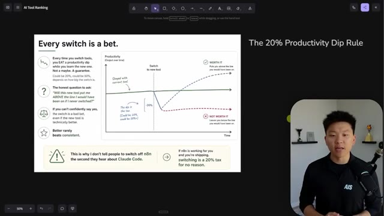
*⏱️ 00:11:03 — Une présentation graphique illustrant la règle du "20% Productivity Dip", montrant l'impact d'un changement d'outil sur l'efficacité à travers un diagramme temporel.*

---

### ⏱️ `[00:11:27 - 00:11:47]` | Segment #26

**🔊 Audio (Transcription Intégrale Mot pour Mot en Français) :**
> red line is not worth it. If the dip only gets you back up to the same green line, then that's also not worth it. It wasn't worth the dip. So if you know that the dip will actually boost you above and take your business, you know, maybe break through a plateau or push to another level that you couldn't have reached before without that dip, then that's how you know it's something worth doing. Okay. Then we have productivity is needle moved per hour, not hours worked.

**👁️ Analyse Visuelle d'Écran (gemini-3.5-flash-lite) :**
**Interface & Outils** : Outil de tableau blanc numérique / Présentation (type Miro ou FigJam).

**Contenu textuel & Code** : Un graphique comparatif montrant deux trajectoires de productivité après le passage à un nouvel outil : l'une dépassant la ligne de base ("Worth it") et l'autre restant en dessous ("Not worth it"). Des points clés sont listés à gauche sur la règle des 20% de perte de productivité, et un encart en bas mentionne spécifiquement n8n et Claude Code.

**Action / Démonstration** : Le présentateur utilise le curseur pour souligner visuellement les différentes courbes du graphique afin d'expliquer pourquoi certains changements d'outils ne sont pas rentables.

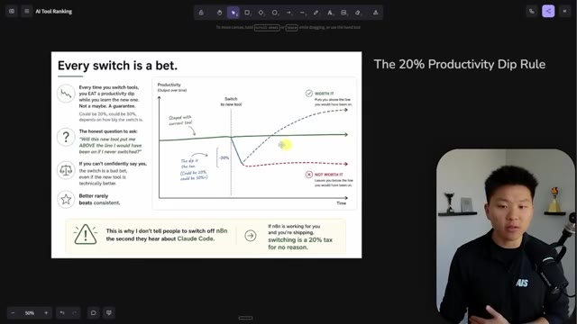
*⏱️ 00:11:32 — Une diapositive explicative intitulée "Every switch is a bet" illustrant le concept du "20% Productivity Dip Rule" via un graphique montrant l'impact sur la productivité lors du changement d'un outil logiciel.*

---

### ⏱️ `[00:11:48 - 00:12:13]` | Segment #27

**🔊 Audio (Transcription Intégrale Mot pour Mot en Français) :**
> I've fallen into this trap. I think a lot of you guys in my community have fallen into this trap as well, you work a 12 hour day. You think, damn, I was productive today. But what you don't realize is like, were you? Because I could maybe sit down for four hours and be more productive than you in 12 hours, because I'm actually doing everything that actually moves the needle rather than 12 hours of responding to a bunch of threads, reading through community posts, watching YouTube videos, just like planning out a bunch of stuff, but not actually doing anything.

**👁️ Analyse Visuelle d'Écran (gemini-3.5-flash-lite) :**
**Interface & Outils** : FigJam (tableau blanc collaboratif).

**Contenu textuel & Code** : Schémas comparant deux approches : "Busy, not productive" (12h, notifications, onglets ouverts) vs "Focused, actually productive" (4h, déploiement de code, fonctionnalités terminées). Texte : "Hours worked is a vanity metric".

**Action / Démonstration** : Présentation visuelle d'un concept théorique sur la gestion du temps et la productivité pour illustrer le propos du narrateur.

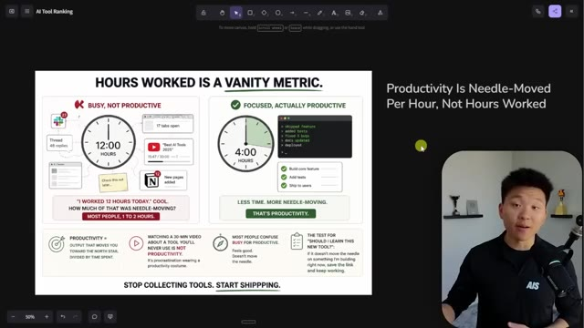
*⏱️ 00:11:54 — Une infographie comparative sur un tableau blanc virtuel illustrant la différence entre être "occupé" (12 heures) et être "productif" (4 heures), avec le présentateur visible en incrustation à droite.*

---

### ⏱️ `[00:12:14 - 00:12:48]` | Segment #28

**🔊 Audio (Transcription Intégrale Mot pour Mot en Français) :**
> So this kind of relates back to that North Star thing. Let's say every day you sit down in the morning and you say, okay, by the end of today, I want to achieve X. Every single thing that you want to do that day should be driving towards achieving X. And then maybe once you've achieved X, then you can spend some other time, like looking into some new features and experimenting with some stuff. But productivity means that you're actually doing things that are moving the needle for you. Not how long did you work today? Okay. So this one kind of goes back to that first point about the fact that all agents and agent harnesses are just different harnesses and they all work in your same stuff. Because the mindset here, which is something that I've been thinking a

**👁️ Analyse Visuelle d'Écran (gemini-3.5-flash-lite) :**
**Interface & Outils** : Application de tableau blanc virtuel (de type Miro ou FigJam) affichant des infographies de productivité et de workflow.

**Contenu textuel & Code** : Texte explicatif sur les métriques de productivité et diagramme étape par étape ("Job: Make a YouTube Video") associant des outils spécifiques (Perplexity, Claude Code, DaVinci Resolve) à chaque étape du processus.

**Action / Démonstration** : Le présentateur utilise ces supports visuels comme base théorique pour expliquer la nécessité de se concentrer sur les tâches qui font avancer les objectifs réels ("North Star") plutôt que sur l'accumulation d'outils.

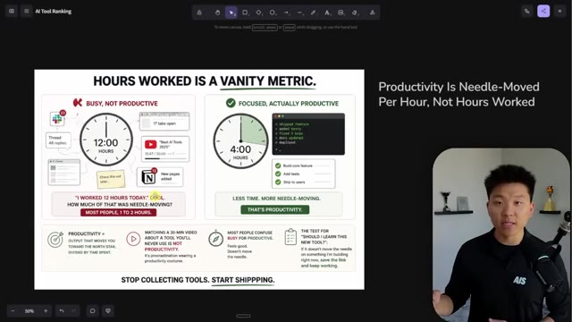
*⏱️ 00:12:22 — Infographie comparant "Busy, Not Productive" (12 heures de travail superficiel) et "Focused, Actually Productive" (4 heures de travail à fort impact sur le produit).*

*⏱️ 00:12:39 — Schéma de workflow pour la réalisation d'une vidéo YouTube, illustrant l'approche "Tool-Agnostic" où chaque sous-tâche (recherche, script, montage) utilise un outil spécialisé.*

---

### ⏱️ `[00:12:48 - 00:13:14]` | Segment #29

**🔊 Audio (Transcription Intégrale Mot pour Mot en Français) :**
> lot about, I've been building out frameworks, we're building a certification program, we're doing all this. And our thinking is basically what Jeff Bezos said, think about what will never change, not what will change. And so if you can become tool agnostic in the way that you work, that means, okay, let's say cloud code shut down tomorrow. Are you okay? Could you pick up codex? Could you pick up something else? Could you keep working? Could you be okay? And if the answer is no, you might want to think about things, right? Because like, if you're one of those people where, I mean, I've been there, Claude goes down.

**👁️ Analyse Visuelle d'Écran (gemini-3.5-flash-lite) :**
**Interface & Outils** : Outil de tableau blanc numérique de type FigJam ou Miro.

**Contenu textuel & Code** : Le diagramme décompose la création d'une vidéo YouTube en 6 étapes (Recherche, Outline, Script, Miniature, Montage) et associe des outils spécifiques à chaque sous-tâche (Perplexity, Claude Code, Claude Chat, GPT Image 2, Nano Banana, DaVinci Resolve). Le texte met en avant la distinction entre "The Wrong Question" et "The Right Question" ainsi que le principe "Right tool per task, not per job".

**Action / Démonstration** : Présentation théorique d'un cadre de travail (framework) pour démontrer comment structurer ses processus métier indépendamment des outils utilisés.

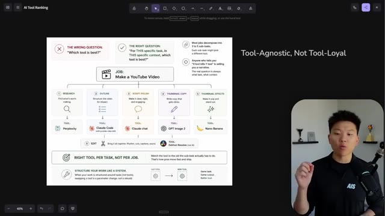
*⏱️ 00:12:54 — Un schéma conceptuel affiché sur un tableau blanc virtuel illustrant la philosophie "Tool-Agnostic" (agnostique aux outils) appliquée à la création de vidéos YouTube.*

---

### ⏱️ `[00:13:14 - 00:13:35]` | Segment #30

**🔊 Audio (Transcription Intégrale Mot pour Mot en Français) :**
> Like the status page is down, the API is throttled, you can't use Claude. Are you just sitting there like, oh my God, I can't work anymore. I have to wait till it's back up. Because if that happens, then you're probably not in a great spot. You probably wanna be learning how to plug in a few other things into your main stack, into your main working directory. And what you'll realize is that you have overall job responsibilities or functions or processes.

**👁️ Analyse Visuelle d'Écran (gemini-3.5-flash-lite) :**
**Interface & Outils** : Tableau blanc virtuel (type Miro ou FigJam).

**Contenu textuel & Code** : Le diagramme décompose la création d'une vidéo YouTube en 6 étapes (Recherche, Outline, Script, Thumbnail, etc.) avec des exemples d'outils associés (Perplexity, Claude, GPT, DaVinci Resolve) et des principes de réflexion sur la sélection d'outils.

**Action / Démonstration** : Présentation théorique d'un workflow structuré par tâches plutôt que par outils pour démontrer la flexibilité nécessaire face aux pannes potentielles de service.

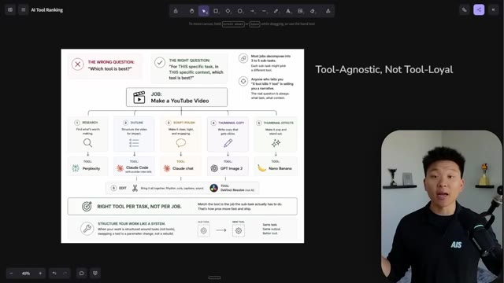
*⏱️ 00:13:19 — Un schéma conceptuel affiché sur un tableau blanc virtuel illustrant une approche "Tool-Agnostic" (indépendante des outils) pour la création de contenu vidéo.*

---

### ⏱️ `[00:13:35 - 00:14:12]` | Segment #31

**🔊 Audio (Transcription Intégrale Mot pour Mot en Français) :**
> And what happens in a process is that it's basically built up of a bunch of different mini tasks. And usually the right question isn't which tool is best? The right question is for this specific task in this specific context, which tool is best? So here's a quick example, right? Like let's say I'm making a YouTube video. Maybe I use perplexity for research. Maybe I use Cloud Code with a skill and with knowledge about me to help structure the video. And then maybe I use Cloud Chat for some reason to actually write the script. And then I use like GPT Image 2 to create me that thumbnail. And then I use Nano banana to, to add a glowing effect or to just make some stuff stand out. And then after I do all that,

**👁️ Analyse Visuelle d'Écran (gemini-3.5-flash-lite) :**
**Interface & Outils** : Tableau blanc collaboratif (type Miro ou FigJam).

**Contenu textuel & Code** : Schéma "Job: Make a YouTube Video" divisé en 6 étapes (Recherche, Outline, Script, Thumbnail Copy, Thumbnail Effects, Edit), associant des outils spécifiques comme Perplexity, Claude Code, Claude chat, GPT Image 2, Nano Banana et DaVinci Resolve à chaque étape.

**Action / Démonstration** : Présentation théorique illustrant la méthodologie "Tool-Agnostic, Not Tool-Loyal" pour optimiser les workflows.

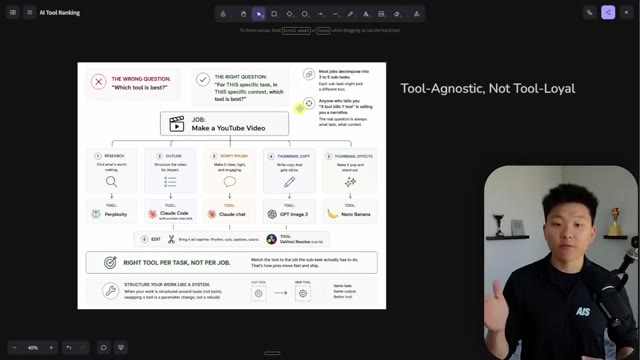
*⏱️ 00:13:44 — Un schéma conceptuel sur un tableau blanc virtuel illustrant la décomposition de la création d'une vidéo YouTube en sous-tâches spécifiques avec des outils IA recommandés pour chacune.*

---

### ⏱️ `[00:14:12 - 00:14:45]` | Segment #32

**🔊 Audio (Transcription Intégrale Mot pour Mot en Français) :**
> maybe I drop it into DaVinci Resolve or Adobe Premiere Pro just to stamp it up and get it out the door. So not every single step in a process has to be AI. Not every single step in the process has to be the same AI. Break things down into baby steps and think about for this specific baby step, what tools do I have in my list? You know, all of these different tools that we looked at earlier, which one of these tools is going to be the best for this little output that I need. And the last thing here is basically the decision framework. So this is what I alluded to when I was talking about that North Star and finding the path that you're running on, which is directly leading

**👁️ Analyse Visuelle d'Écran (gemini-3.5-flash-lite) :**
**Interface & Outils** : Outil de tableau blanc numérique de type Miro ou FigJam.

**Contenu textuel & Code** : Texte détaillé présentant des méthodologies de travail : "Tool-Agnostic, Not Tool-Loyal", "Right tool per task, not per job" et les étapes logiques de validation d'un nouvel outil (Time-box, baseline, intégration).

**Action / Démonstration** : Présentation visuelle et explication didactique d'une stratégie de gestion de workflow et de sélection d'outils technologiques.

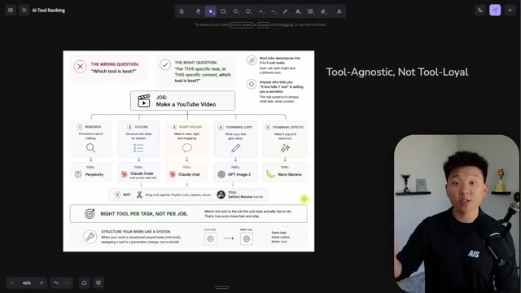
*⏱️ 00:14:20 — Un diagramme de flux illustrant le processus de création d'une vidéo YouTube décomposé en 6 sous-tâches, chacune associée à un outil spécifique (Perplexity, Claude Code, etc.).*

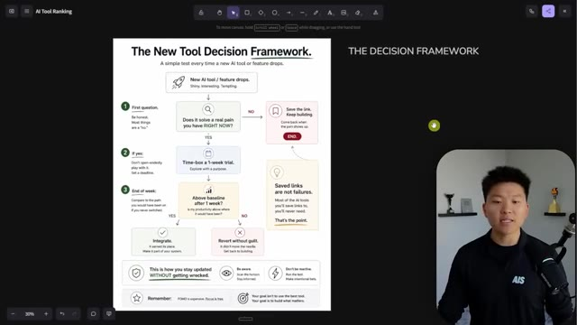
*⏱️ 00:14:37 — Un schéma décisionnel intitulé "The New Tool Decision Framework" permettant d'évaluer l'utilité d'adopter un nouvel outil d'IA via un arbre de décision.*

---

### ⏱️ `[00:14:45 - 00:15:10]` | Segment #33

**🔊 Audio (Transcription Intégrale Mot pour Mot en Français) :**
> towards that North Star. When a new AI tool or feature drops or a YouTube video for me drops, look at the title, click on the video, understand what I'm talking about and ask yourself, does this video or does this new feature solve a pain point for me right now? Most of the time, the answer will probably be no. And if the answer is no, but you think the feature is cool or the agent framework is cool or whatever it is, then just save the link so that you know, okay, later if I do wanna watch this, I know where it is.

**👁️ Analyse Visuelle d'Écran (gemini-3.5-flash-lite) :**
**Interface & Outils** : Outil de tableau blanc collaboratif (type FigJam ou Miro).

**Contenu textuel & Code** : Le diagramme de flux contient les étapes suivantes : "Does it solve a real pain you have RIGHT NOW?", "Time-box a 1-week trial", "Above baseline after 1 week?" avec les issues possibles "Integrate" ou "Revert without guilt".

**Action / Démonstration** : Présentation visuelle et explication pédagogique du cadre décisionnel par le créateur pour aider à filtrer l'adoption de nouveaux outils IA.

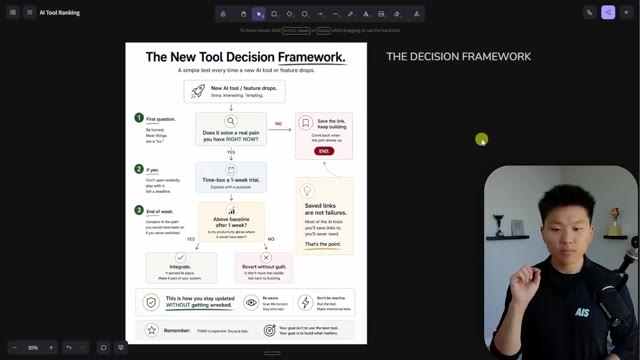
*⏱️ 00:14:51 — Un schéma décisionnel nommé "The New Tool Decision Framework" présenté sur un canevas numérique, illustrant une méthode pour évaluer l'utilité des nouveaux outils IA.*

---

### ⏱️ `[00:15:10 - 00:15:34]` | Segment #34

**🔊 Audio (Transcription Intégrale Mot pour Mot en Français) :**
> If the answer is yes, then maybe it makes sense to actually test it out. But don't just spend like a month testing it out. Try to test it out in a real scenario. You know, like don't just test it out with mock data. Try to test it out with something that actually moves the needle for you. Not in a way where it would be risky, you know, like sending out emails or restructuring a whole database, but do something in your actual working environment so you have real proof of if you like it or if you don't, or if it actually solves a problem or not.

**👁️ Analyse Visuelle d'Écran (gemini-3.5-flash-lite) :**
**Interface & Outils** : Canevas numérique collaboratif (probablement FigJam ou Miro).

**Contenu textuel & Code** : Organigramme décisionnel détaillant les étapes : questionner le besoin réel ("Does it solve a real pain you have RIGHT NOW?"), limiter l'essai à une semaine, et évaluer la productivité à la fin de la semaine.

**Action / Démonstration** : Présentation visuelle d'une méthodologie de prise de décision pour l'adoption d'outils technologiques.

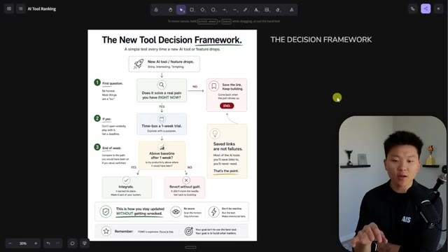
*⏱️ 00:15:16 — Un schéma décisionnel nommé "The New Tool Decision Framework" affiché sur un canevas numérique (type Miro/FigJam), structuré sous forme d'organigramme pour évaluer l'utilité d'un nouvel outil IA.*

---

### ⏱️ `[00:15:34 - 00:15:57]` | Segment #35

**🔊 Audio (Transcription Intégrale Mot pour Mot en Français) :**
> And then at the end of the week after you've used it, just ask yourself, did this make sense? Did this solve my pain point to the point where I'm going to put this into my main daily drivers or my main companions of tech tools? Or did it not? Because if it didn't, then get rid of it for now. And then only later, if you realize, okay, I'm working on my business and I'm hitting this pain point every single day.

**👁️ Analyse Visuelle d'Écran (gemini-3.5-flash-lite) :**
**Interface & Outils** : Tableau blanc numérique (type FigJam ou Miro).

**Contenu textuel & Code** : Un organigramme détaillant trois étapes : 1) Identifier si l'outil résout une douleur réelle, 2) Effectuer un test de temps d'une semaine, 3) Comparer la productivité après une semaine pour décider d'intégrer ou d'abandonner l'outil.

**Action / Démonstration** : Présentation visuelle et explication d'un cadre de réflexion structuré pour l'adoption technologique.

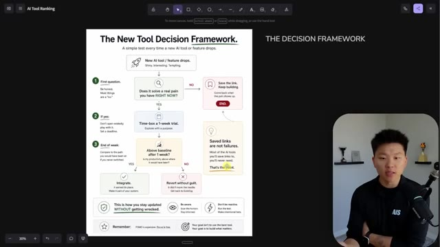
*⏱️ 00:15:40 — Un schéma décisionnel nommé "The New Tool Decision Framework" affiché sur un tableau blanc numérique, illustrant les étapes pour décider s'il faut adopter un nouvel outil IA.*

---

### ⏱️ `[00:15:57 - 00:16:17]` | Segment #36

**🔊 Audio (Transcription Intégrale Mot pour Mot en Français) :**
> Do I have any features or agents in this list of like other things that I need to look at? Do any of these directly help me solve this pain point? If the answer is yes, then you reach for that tutorial and then you grab it and then you learn it. Does that make sense? Like sometimes as you're walking down this path, you don't wanna jump to the right or to the left to all these holes, but sometimes you might actually run into a roadblock.

**👁️ Analyse Visuelle d'Écran (gemini-3.5-flash-lite) :**
**Interface & Outils** : Application de tableau blanc virtuel (type Miro ou FigJam).

**Contenu textuel & Code** : Diagrammes de flux : le premier détaille un processus décisionnel par étapes (questionnement sur la résolution de problèmes réels, essai de 1 semaine, intégration) ; le second illustre un coureur évitant des "puits" représentant les distractions (nouveaux modèles, frameworks, outils tendances).

**Action / Démonstration** : Le présentateur utilise ces supports visuels pour expliquer son processus de réflexion stratégique concernant l'adoption d'outils d'automatisation.

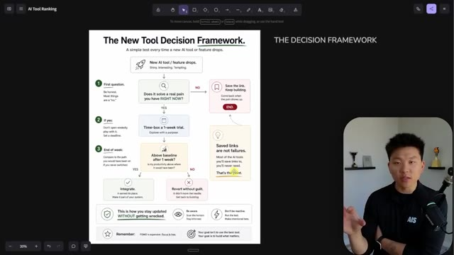
*⏱️ 00:16:02 — Un schéma décisionnel intitulé "The New Tool Decision Framework" illustrant les étapes pour évaluer l'adoption d'un nouvel outil IA.*

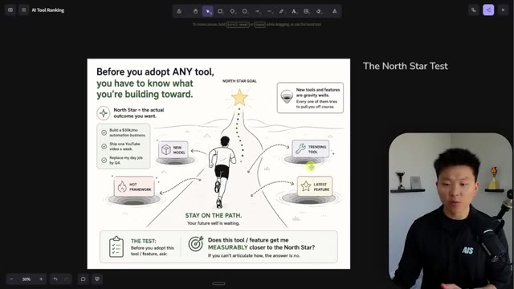
*⏱️ 00:16:12 — Un schéma intitulé "The North Star Test" représentant visuellement comment rester concentré sur ses objectifs malgré les distractions des nouveaux outils.*

---

### ⏱️ `[00:16:17 - 00:16:38]` | Segment #37

**🔊 Audio (Transcription Intégrale Mot pour Mot en Français) :**
> And the only thing that might get you over that roadblock is to jump into one of those holes, understand it. And then all of a sudden the roadblock is easy to just like walk through or jump over or whatever. Okay, let me take a breath. I was talking really fast in this video and I don't know, It's just something that I'm passionate about and something that I wanted to get off my chest because I feel like I've been answering these questions a lot in the comments and in my community.

**👁️ Analyse Visuelle d'Écran (gemini-3.5-flash-lite) :**
**Interface & Outils** : Outil de tableau blanc numérique (type FigJam ou Miro).

**Contenu textuel & Code** : Diagramme conceptuel avec le texte "Before you adopt ANY tool, you have to know what you're building toward" et "The North Star Test" avec une grille d'évaluation pour valider l'utilité d'un outil.

**Action / Démonstration** : Présentation d'un cadre conceptuel pour aider l'audience à filtrer les outils IA superflus et rester concentré sur leurs objectifs business.

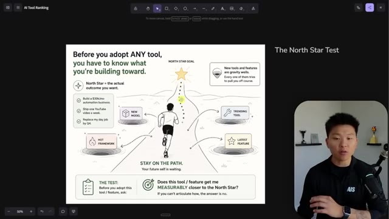
*⏱️ 00:16:22 — Un schéma visuel illustrant "The North Star Test" pour l'adoption d'outils, montrant un personnage courant vers un objectif (étoile) tout en évitant des distractions (trous représentant des outils ou fonctionnalités "tendance").*

---

### ⏱️ `[00:16:38 - 00:16:57]` | Segment #38

**🔊 Audio (Transcription Intégrale Mot pour Mot en Français) :**
> But I really, really hope that this one gave you some clarity. And once again, I use a bunch of tools and I've really, really tried to only bring you guys like cloud code content for the majority because I don't want to overwhelm. But please let me know, what other tools do you want to see me cover? Especially anything in here, especially some of these constant companions that I am using a lot. What do you want to see?

**👁️ Analyse Visuelle d'Écran (gemini-3.5-flash-lite) :**
**Interface & Outils** : Logiciel de tableau blanc interactif ou de création de diagrammes (type Miro ou FigJam) affichant une "Tier List" personnalisée.

**Contenu textuel & Code** : Tableau organisé par catégories : S (Daily Driver), A (Constant Companions), B (Specialists), C (Experimenting) et Graduated. On y reconnaît des icônes comme VS Code, Cursor, GPT-4, Llama, et divers autres logos d'outils d'automatisation IA.

**Action / Démonstration** : Présentation visuelle et récapitulative des outils utilisés par le créateur pour aider son audience à hiérarchiser les solutions d'automatisation IA.

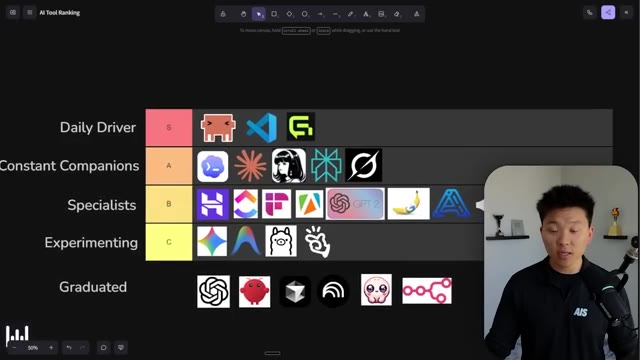
*⏱️ 00:16:43 — Une capture d'écran montrant un tableau de classement (Tier List) intitulé "AI Tool Ranking" classant divers outils d'IA par catégories, du "Daily Driver" (S) aux outils "Graduated". Le présentateur apparaît dans une fenêtre incrustée en bas à droite.*

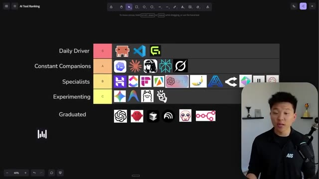
*⏱️ 00:16:48 — La même vue du tableau "AI Tool Ranking" avec une légère modification dans la rangée "Specialists" (B) où de nouvelles icônes d'outils apparaissent sur la droite, illustrant la revue continue des outils par le présentateur.*

---

### ⏱️ `[00:16:57 - 00:17:13]` | Segment #39

**🔊 Audio (Transcription Intégrale Mot pour Mot en Français) :**
> Just let me know in the comments. But anyways, that is going to do it for today. So if you guys enjoyed the video or you learned something new, please give it a like. It helps me out a ton. And don't forget to download that free resource guide. Join my free school community. All of my resources are in there. And yeah, I appreciate you guys making the end of the video and I'll see you in the next one. Thanks everyone.

**👁️ Analyse Visuelle d'Écran (gemini-3.5-flash-lite) :**
**Interface & Outils** : Tableau blanc collaboratif (type FigJam ou Miro).

**Contenu textuel & Code** : Icônes de logiciels et d'outils IA (VS Code, Cursor, ChatGPT, Llama, etc.) organisées par niveaux de priorité et d'utilisation.

**Action / Démonstration** : Présentation visuelle de synthèse des outils recommandés par le créateur.

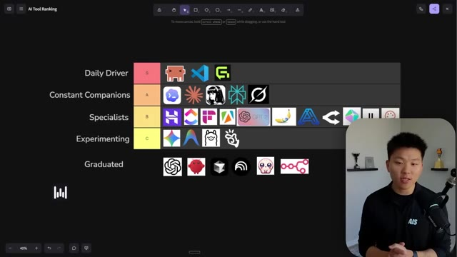
*⏱️ 00:17:01 — Un tableau de classement (tier list) interactif sur un tableau blanc virtuel, affichant divers outils IA classés par catégories (Daily Driver, Constant Companions, Specialists, Experimenting, Graduated).*

---

