# 🎬 This is The Most Powerful Tool to Give to Claude Code

> **Chaîne** : [Nate Herk | AI Automation](https://www.youtube.com/@nateherk/featured)  
> **Lien YouTube** : [https://www.youtube.com/watch?v=YHk45NEpspE](https://www.youtube.com/watch?v=YHk45NEpspE)  
> **Date de publication** : 20260509  
> **Durée** : 00:14:45  
> **Identifiant vidéo** : `YHk45NEpspE`  
> **Transcription & Analyse** : `whisper-v3-large-turbo+gemini-3.5-flash-lite`  

---

## 📌 Synthèse Exécutive & Outils

### 💡 Résumé
Dans cette vidéo intitulée **This is The Most Powerful Tool to Give to Claude Code**, Nate Herk décortique les capacités pratiques d'automatisation et de développement propulsées par les modèles de pointe.

### 🛠️ Outils, Modèles & Logiciels Présentés
- **Opus 5.5 & Claude Code** : Modèles d'ingénierie et agents de codage autonome.

### 🔑 Points Clés & Enseignements Stratégiques
- Optimiser le niveau d'effort et le raisonnement des modèles IA pour des résultats industriels.
- Automatiser les cycles de création logicielle de bout en bout.

---

## ⏱️ Chronologie & Transcription Complète Audio & Visuelle (Mot pour Mot)

### ⏱️ `[00:00:00 - 00:00:19]` | Segment #01

**🔊 Audio (Transcription Intégrale Mot pour Mot en Français) :**
> All right, so what would you think if I told you that I just said to CloudCode, hey, go to my school community and grab me some posts. And keep in mind, school does not have an API. And it was able to use the CLI, it was able to find nine wins, and it made sure that they were in the wins category. And then it gave me the three strongest ones. And I got a link to all of them so we can see if they actually exist. As you can see, here is Michael's win.

**👁️ Analyse Visuelle d'Écran (gemini-3.5-flash-lite) :**
**Interface & Outils** : Visual Studio Code (avec l'extension Claude Code intégrée).

**Contenu textuel & Code** : Prompt utilisateur : "Use the Skool CLI to grab three recent wins in my community, AI Automation Society Plus, and return the links and a summary." Commandes Bash visibles : `python scripts/skool_api.py --help` et `python scripts/skool_api.py posts --help`.

**Action / Démonstration** : L'agent IA analyse le CLI "Skool" pour comprendre comment récupérer les posts de la communauté avant de procéder à l'extraction des données.

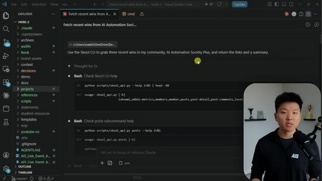
*⏱️ 00:00:05 — Une capture d'écran de l'interface VS Code montrant l'agent Claude en train d'exécuter des commandes pour interagir avec une communauté via un script Python.*

---

### ⏱️ `[00:00:20 - 00:00:41]` | Segment #02

**🔊 Audio (Transcription Intégrale Mot pour Mot en Français) :**
> And quick shout out to my community members, Michael, Chris, and Fernando. But anyways, the way that we're doing this is we're using a CLI. And the tool I'm going to show you guys today actually helped me build the school CLI. So if you've never heard of the term CLI before, don't worry. I'm going to explain it. I'm going to compare it to APIs and compare it to MCPs. But before we get into all that, let me show you one more example. So here I said, hey, can you just go pull 10 of the most recent posts in my community?

**👁️ Analyse Visuelle d'Écran (gemini-3.5-flash-lite) :**
**Interface & Outils** : Visual Studio Code (avec une extension de chat IA, probablement Claude Code).

**Contenu textuel & Code** : Texte structuré listant des études de cas ("Fetch recent wins from AI Automation Society"), mentionnant l'utilisation de l'API, de n8n, et de Claude Code pour des automatisations. Une barre de saisie d'IA est visible en bas ("Ctrl esc to focus or unfocus Claude").

**Action / Démonstration** : Le présentateur illustre son propos sur la construction de son "Skool CLI" en montrant son environnement de développement où l'IA interagit avec ses projets.

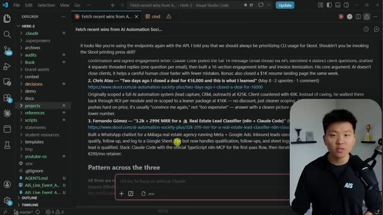
*⏱️ 00:00:25 — Capture d'écran de l'éditeur Visual Studio Code affichant un document texte contenant des retours d'expérience de la communauté et une fenêtre de chat Claude active.*

---

### ⏱️ `[00:00:41 - 00:01:14]` | Segment #03

**🔊 Audio (Transcription Intégrale Mot pour Mot en Français) :**
> It goes ahead and it uses the school PP, CLI. PP stands for printing press, which is the tool I'm going to show you guys today. It comes back. It grabs all of these 10 posts. And then I also asked like, how many tokens did you actually consume to make the CLI request? And it said, okay, here's what happened. I sent about 260 tokens to school. It sent me back about 132,000 tokens. But what's important is that none of that hit my context window because we were basically able to point all of that routing through the CLI so that none of it actually pollutes your session or your context. So that is super cool. And I built the school CLI and it literally took me about 10

**👁️ Analyse Visuelle d'Écran (gemini-3.5-flash-lite) :**
**Interface & Outils** : VS Code (Terminal intégré), Claude Code / CLI environnement.

**Contenu textuel & Code** : - Image 1 : Liste de posts extraits (ex: "Can't find n8n api key"), commande `skool-pp-cli posts list --agent...`, et calcul de consommation de tokens (529388 octets).
- Image 2 : Analyse "Rough estimate of the wire roundtrip", explication sur la gestion du contexte (529 KB JSON stockés sur disque), récapitulatif final de l'opération, et barre d'état "Opus 4.7 (1M context)".

**Action / Démonstration** : Exécution d'un script CLI pour récupérer des données communautaires, analyse des logs d'utilisation des tokens par l'agent IA, et démonstration de la gestion efficace du contexte via stockage sur disque.

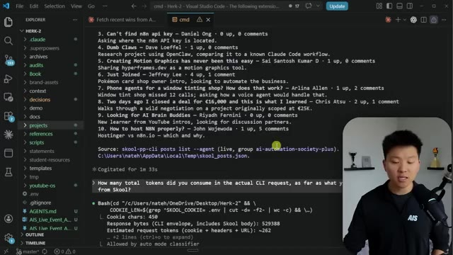
*⏱️ 00:00:50 — Interface VS Code affichant une liste de publications extraites d'une plateforme communautaire dans un terminal intégré, avec le présentateur en médaillon.*

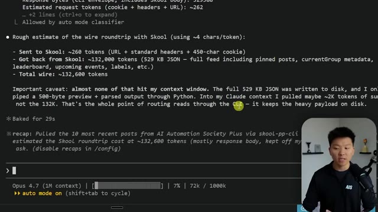
*⏱️ 00:01:06 — Terminal affichant une analyse technique détaillée de la consommation de jetons (tokens) lors de la requête API, avec le présentateur en médaillon.*

---

### ⏱️ `[00:01:14 - 00:01:37]` | Segment #04

**🔊 Audio (Transcription Intégrale Mot pour Mot en Français) :**
> minutes. All right. So here is the tool that we are using. Introducing PrintingPress, a CLI factory and a CLI library. The whole idea is that APIs suck for agents. MCPs also suck for agents. And a lot of times, official CLIs suck for agents because they waste tokens or they're not efficient. So Printing Press has a library of like 50 pre-built CLIs that you can use right away, and it also gives you a factory so that you can turn anything into a CLI.

**👁️ Analyse Visuelle d'Écran (gemini-3.5-flash-lite) :**
**Interface & Outils** : Navigateur web (X/Twitter, site printingpress.dev).

**Contenu textuel & Code** : Texte descriptif sur PrintingPress, liste de modules CLI (pp-cloud-run-admin, pp-amazon-seller, pp-shopify, etc.), et catégories de services (Commerce, Developer Tools).

**Action / Démonstration** : Navigation et démonstration du catalogue d'outils disponibles sur la plateforme PrintingPress pour expliquer leur utilité dans l'automatisation par les agents.

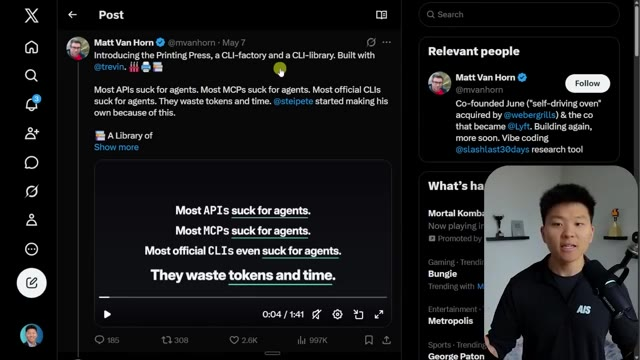
*⏱️ 00:01:20 — Une capture d'écran de l'interface de X (Twitter) affichant un tweet de Matt Van Horn présentant "PrintingPress", un outil CLI conçu pour résoudre les problèmes d'inefficacité des API et MCP pour les agents IA.*

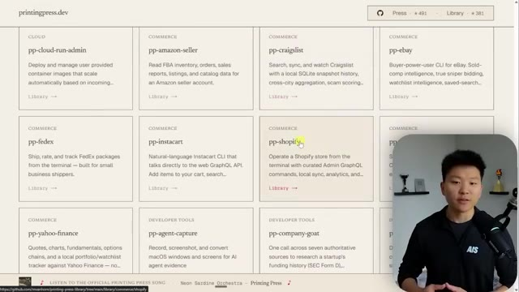
*⏱️ 00:01:31 — La page web officielle "printingpress.dev" présentant un catalogue de bibliothèques CLI disponibles pour divers services comme Shopify, FedEx, eBay et Amazon, optimisées pour les agents.*

---

### ⏱️ `[00:01:37 - 00:02:07]` | Segment #05

**🔊 Audio (Transcription Intégrale Mot pour Mot en Français) :**
> So let's just start off with the basics real quick. Why CLIs beat MCPs and APIs, and what even is a CLI? So CLI stands for Command Line Interface, and it's a way to use a tool by typing a command instead of clicking buttons. So it's not a new concept. It's been around for a long time. You know, like Gemini's got a CLI, Cloud CLI, Codex CLI. And you might have been seeing a lot of tools recently create CLIs, like Google have their official GWS CLI, which is probably the most used thing in my Cloud Code. GitHub has a CLI. Playwright has a CLI. Higgsfield just created a CLI.

**👁️ Analyse Visuelle d'Écran (gemini-3.5-flash-lite) :**
**Interface & Outils** : Logiciel de présentation (type PowerPoint ou Google Slides) intégré à la vidéo.

**Contenu textuel & Code** : Titre : "Why CLIs Beat MCPs and APIs". Définitions textuelles : "CLI = Command Line Interface", "A way to use a tool by typing a command instead of clicking buttons". Liste des points abordés : "Your AI Agent Has 3 Ways to Talk to Tools", "Why APIs Lose", "Why MCP Loses Too", "Why CLIs Win", "The Bottom Line". Note complémentaire : "btw, this whole video applies to any agent. Codex, Claude Code, Hermes, OpenClaw, etc."

**Action / Démonstration** : Présentation théorique des arguments structurels de la vidéo par le présentateur.

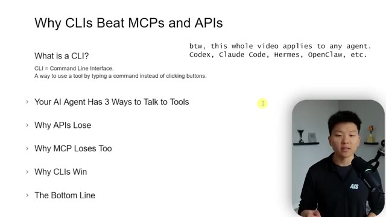
*⏱️ 00:01:45 — Une diapositive de présentation structure le contenu du segment, définissant ce qu'est une CLI et listant les points clés de la comparaison entre CLI, MCP et API.*

---

### ⏱️ `[00:02:07 - 00:02:27]` | Segment #06

**🔊 Audio (Transcription Intégrale Mot pour Mot en Français) :**
> HeyGen just dropped a CLI. It's really just the best and most efficient way to have agents talk to other tools. Now, what are the other ways? API, MCP. And when MCP came out and it kind of broke the internet, everyone just assumed that MCPs were the answer. And we're just going to shove MCPs and all of our agent setups. And they all just have different pros and cons. APIs are very raw.

**👁️ Analyse Visuelle d'Écran (gemini-3.5-flash-lite) :**
**Interface & Outils** : Présentation PowerPoint ou Google Slides.

**Contenu textuel & Code** : Texte structuré sous forme de liste : "Your AI Agent Has 3 Ways to Talk to Tools", "Why APIs Lose", "Why MCP Loses Too", "Why CLIs Win".

**Action / Démonstration** : Présentation théorique et argumentative par l'orateur sans démonstration technique directe de code ou de terminal.

---

### ⏱️ `[00:02:27 - 00:02:45]` | Segment #07

**🔊 Audio (Transcription Intégrale Mot pour Mot en Français) :**
> You're gonna get back a huge JSON snippet from the API endpoint. And sometimes you need all that information and it's really, really nice. They're also more token efficient than an MCP server because MCP servers have to have all the different tools and descriptions and the ability for the agent to look through everything, which is cool because they're way more flexible than an API endpoint.

**👁️ Analyse Visuelle d'Écran (gemini-3.5-flash-lite) :**
**Interface & Outils** : Présentation de type diapositives (Slide deck).

**Contenu textuel & Code** : Texte explicatif comparant les API, les MCP (Model Context Protocol) et les CLI (Command Line Interface), détaillant pourquoi les CLI sont jugées plus efficaces en termes de tokens et de performance.

**Action / Démonstration** : Présentation pédagogique par le narrateur, sans démonstration technique ni manipulation logicielle active.

---

### ⏱️ `[00:02:45 - 00:03:08]` | Segment #08

**🔊 Audio (Transcription Intégrale Mot pour Mot en Français) :**
> But as you can see, they add overhead, extra context bloat, and you have to keep a server running. So if you go into Cloud Code right now, brand new session, and do slash context, if you've got a bunch of MCP servers loaded in, you'll see how many tokens they're using every single time. And you may not even be invoking that MCP server, so it might just be a waste of tokens. And then we have CLIs, which are local, they're fast, they're composable, they have a SQLite backend, they're agent native.

**👁️ Analyse Visuelle d'Écran (gemini-3.5-flash-lite) :**
**Interface & Outils** : Logiciel de présentation (type diaporama).

**Contenu textuel & Code** : Texte comparatif détaillé sur les avantages et inconvénients des approches APIs, MCP et CLI pour les agents IA, incluant des sections "Why APIs Lose", "Why MCP Loses Too", "Why CLIs Win" et "The Bottom Line".

**Action / Démonstration** : Présentation théorique des concepts fondamentaux de l'automatisation IA avant la démonstration technique.

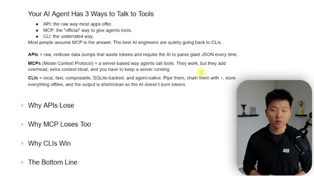
*⏱️ 00:02:51 — Une présentation didactique sous forme de liste à puces expliquant les trois méthodes de communication des agents IA avec les outils : APIs, MCP et CLI, avec une fenêtre incrustée montrant le présentateur.*

---

### ⏱️ `[00:03:08 - 00:03:45]` | Segment #09

**🔊 Audio (Transcription Intégrale Mot pour Mot en Français) :**
> And you can start to build some skills around these CLIs, just like you can with APIs and MCPs as well, to chain them together and make some really cool, fast workflows. And the cool thing is the output you get is super short and super clean So basically the cli response to the agent is super short And that's what we just saw in that school example where our agent was like, yeah, you know that took about 132 000 tokens, but right here it said into my cloud context though I only pulled about 2 000 tokens of summary not the full 132 000 Okay, so real quick to hit on each of those individually Why do apis lose because they were built for code not for all these autonomous agents that pay per token

**👁️ Analyse Visuelle d'Écran (gemini-3.5-flash-lite) :**
**Interface & Outils** : Terminal (ligne de commande), VS Code (barre de tâches visible en bas).

**Contenu textuel & Code** : Commandes Bash pour interroger Skool, statistiques de consommation de tokens (260 envoyés, 132k reçus, 2k dans le contexte), explication du routage des données via CLI pour éviter de saturer la fenêtre de contexte.

**Action / Démonstration** : Démonstration technique de l'optimisation de l'utilisation des tokens en traitant les sorties JSON lourdes via CLI au lieu d'un appel API direct vers un LLM.

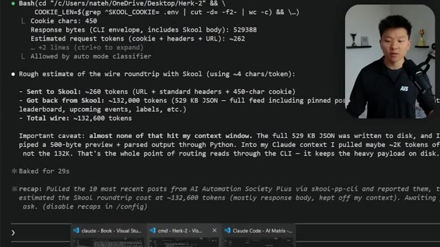
*⏱️ 00:03:27 — Capture d'écran d'un terminal affichant les résultats d'une exécution de script Bash, détaillant la consommation de tokens et le traitement des données via CLI.*

---

### ⏱️ `[00:03:45 - 00:04:19]` | Segment #10

**🔊 Audio (Transcription Intégrale Mot pour Mot en Français) :**
> because when you get back an API response, you just get this massive JSON body. Those of you who came with me all the way from NNN, you know what it used to look like when you would hit a server and get that massive API structure back. You also might run into issues with pagination or auth and it just can get a little bit funky sometimes. And what about MCP? MCP solved discovery because like I said, you could quickly glance at 50 tools that are available from a certain server, but because you're loading all 50 tools, now you have tokens and sort of like, you know, descriptions for all of those 50 tools. Here's a real benchmark. MCP used 35 times more tokens

**👁️ Analyse Visuelle d'Écran (gemini-3.5-flash-lite) :**
**Interface & Outils** : n8n (outil d'automatisation de workflow)

**Contenu textuel & Code** : Structure de données JSON complexe incluant des objets "attributes", "metrics", "dataPoints" et des informations de pagination.

**Action / Démonstration** : Le présentateur illustre visuellement la "lourdeur" d'une réponse API brute (JSON massif) reçue par un agent IA dans un workflow n8n.

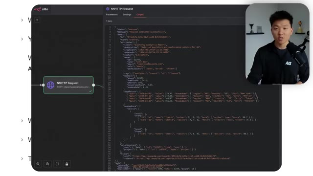
*⏱️ 00:03:54 — Une capture d'écran de l'interface n8n montrant un nœud "HTTP Request" et une fenêtre latérale affichant une réponse JSON volumineuse et complexe.*

---

### ⏱️ `[00:04:19 - 00:04:44]` | Segment #11

**🔊 Audio (Transcription Intégrale Mot pour Mot en Français) :**
> than the CLI on the same task and reliability drops from 100% with the CLI to 72% with MCP as tasks get harder. So really, if you can just shift to every single time you want CloudCode to talk to something, just try to find a CLI or build your own CLI now. Because they were built for exactly how agents actually think. They have lazy discovery. They have pre-formatted outputs where you're basically just getting 200 tokens of clean text rather than raw JSON.

**👁️ Analyse Visuelle d'Écran (gemini-3.5-flash-lite) :**
**Interface & Outils** : Présentation (diapositives)

**Contenu textuel & Code** : Texte comparatif sur le MCP (Model Context Protocol) soulignant les problèmes de "schema bloat", la consommation excessive de tokens (30 000+ pour GitHub MCP) et la baisse de fiabilité (100% pour CLI vs 72% pour MCP).

**Action / Démonstration** : Analyse comparative des performances entre MCP et CLI illustrée par des points clés textuels.

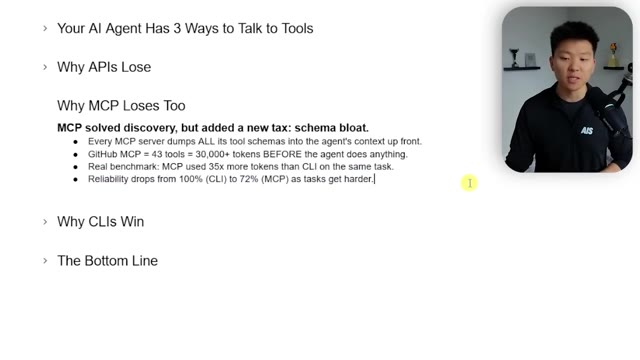
*⏱️ 00:04:25 — Une diapositive de présentation listant les inconvénients techniques de l'utilisation du protocole MCP pour les agents IA par rapport aux interfaces en ligne de commande (CLI).*

---

### ⏱️ `[00:04:44 - 00:05:05]` | Segment #12

**🔊 Audio (Transcription Intégrale Mot pour Mot en Français) :**
> You can compound commands together. You have a local SQLite mirror, which means no round trips and it means no rate limits. It's obviously native to the agent and the auth is pretty much solved one time because the CLI holds the token and then you are all set. So the bottom line, APIs are built for code, MCBs built for tools, and CLIs are built for agents, especially when you're paying per token or managing your session limit.

**👁️ Analyse Visuelle d'Écran (gemini-3.5-flash-lite) :**
**Interface & Outils** : Logiciel de présentation (type diapositives/slides).

**Contenu textuel & Code** : Texte structuré : "Why CLIs Win", "A CLI is built for how agents actually think", incluant les points clés : "Lazy discovery", "Pre-formatted output", "Compound commands", "Local SQLite mirror", "Native to the agent", "Auth solved once".

**Action / Démonstration** : Le présentateur illustre ses propos théoriques sur l'efficacité des CLI via un support visuel pédagogique pendant qu'il explique le fonctionnement des agents.

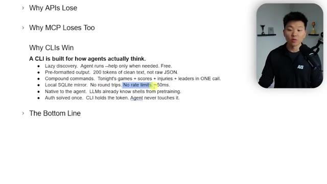
*⏱️ 00:04:49 — Une présentation sous forme de liste à puces expliquant les avantages techniques des CLI pour les agents IA par rapport aux API, avec une mise en évidence du texte sur l'absence de limites de débit.*

---

### ⏱️ `[00:05:05 - 00:05:27]` | Segment #13

**🔊 Audio (Transcription Intégrale Mot pour Mot en Français) :**
> Okay, so what is PrintingPress? What are we looking at today? So if you go to printingpress.dev, this is what it will look like. It's a very new tool, just dropped like yesterday and I've been playing with it all day today. And I've already built a few cool CLIs, which I'll show you guys when we hop over to Cloud Code. But Printing Press, it's funny. So this kind of was inspired by Peter Steinberger, the creator of OpenClaw, needing to make his own CLIs because the official ones were bad.

**👁️ Analyse Visuelle d'Écran (gemini-3.5-flash-lite) :**
**Interface & Outils** : Site web (printingpress.dev).

**Contenu textuel & Code** : Commande d'installation : « npx -y @mvanhorn/printing-press ir » ; texte expliquant la génération d'outils CLI et de compétences pour agents IA.

**Action / Démonstration** : Présentation visuelle de l'outil Printing Press et de son interface de déploiement d'outils pour agents via le site officiel.

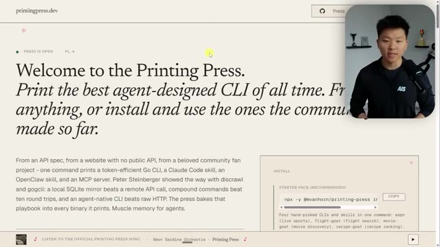
*⏱️ 00:05:11 — Capture d'écran du site web « printingpress.dev », présentant la page d'accueil avec le slogan « Welcome to the Printing Press » et un encart permettant d'installer un pack de démarrage via une commande terminal.*

---

### ⏱️ `[00:05:27 - 00:05:49]` | Segment #14

**🔊 Audio (Transcription Intégrale Mot pour Mot en Français) :**
> So he built like GOG CLI, which is for Google. And people are saying that it's even better than the GWS CLI that is, you know, Google's official CLI. So that's the whole idea. You have a factory. so basically a skill and a tool to help you build CLIs, but also if you come down here, there's a library. So you've got a flight goat CLI. You've got ESPN, you've got movie goats, you've got recipe stuff, you've got linear.

**👁️ Analyse Visuelle d'Écran (gemini-3.5-flash-lite) :**
**Interface & Outils** : Navigateur Web (printingpress.dev).

**Contenu textuel & Code** : Texte descriptif sur les CLI "agent-native", mention de "Claude Code skill", "OpenClaw skill", "MCP server" et commande d'installation : `npx -y @mvanhorn/printing-press ir`.

**Action / Démonstration** : Présentation visuelle de la plateforme de génération de CLI par l'IA, illustrant la facilité d'installation via une commande unique dans le terminal.

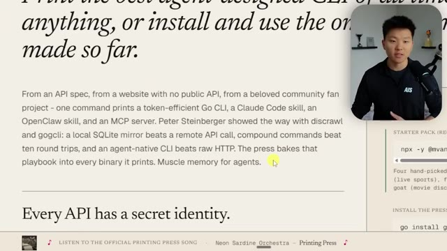
*⏱️ 00:05:33 — Vue rapprochée du texte de présentation sur le site printingpress.dev, expliquant le concept de création de CLI avec des outils comme Claude Code.*

*⏱️ 00:05:38 — Capture complète de la page d'accueil de printingpress.dev montrant le titre, la description du projet et l'encart d'installation avec la commande `npx`.*

---

### ⏱️ `[00:05:49 - 00:06:09]` | Segment #15

**🔊 Audio (Transcription Intégrale Mot pour Mot en Français) :**
> And if we keep scrolling down, you can see there's different ones, Amazon, Craigslist, eBay, TikTok shops, Shopify. There's so many different CLIs on here that you can use. And now you guys can see where I got the PP from. Anyways, what I would recommend if you wanna get in here and get started is just start off with a starter pack, which is exactly what I did. This has like four or five CLIs. It's got ESPN, Flight Goat, Movie Goat, and Recipe Goat.

**👁️ Analyse Visuelle d'Écran (gemini-3.5-flash-lite) :**
**Interface & Outils** : Navigateur web affichant le site documentation/catalogue 'printingpress.dev'.

**Contenu textuel & Code** : - Liste de CLI : pp-food52, pp-pagliacci, pp-ahrefs, pp-dub, pp-google-ads, pp-klaviyo, pp-producthunt.
- Commandes d'installation visibles :
  - `npx -y @mvanhorn/printing-press ir`
  - `go install github.com/mvanhorn/cli`
  - `git clone https://github.com/mvanh...`

**Action / Démonstration** : Navigation sur le catalogue de bibliothèques d'outils (CLI) suivies de l'affichage des instructions d'installation pour les utilisateurs souhaitant démarrer avec l'outil.

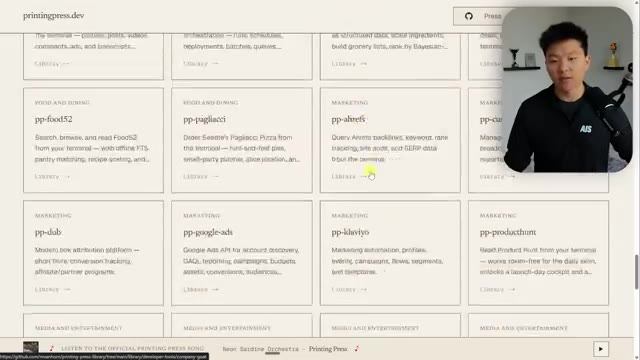
*⏱️ 00:05:54 — Interface web du site 'printingpress.dev' présentant une grille de cartes listant diverses interfaces en ligne de commande (CLI) comme 'pp-ahrefs', 'pp-google-ads', et 'pp-producthunt'.*

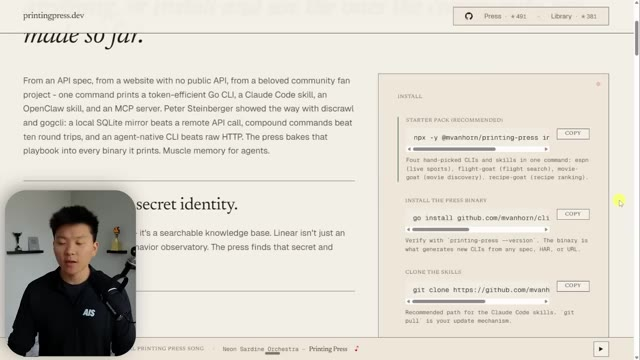
*⏱️ 00:05:59 — Interface web du site 'printingpress.dev' affichant la section 'INSTALL' avec des commandes pour installer le binaire de Printing Press et ses compétences (CLI).*

---

### ⏱️ `[00:06:09 - 00:06:28]` | Segment #16

**🔊 Audio (Transcription Intégrale Mot pour Mot en Français) :**
> And then you can obviously clone other skills and you can install more stuff. And when you install the factory, that's what helps you actually build your own CLIs. So I will leave links to this in the description. I will also leave a link to the library of different CLIs, which is the GitHub. And I will leave this printing press one, which is what you need to help build other ones.

**👁️ Analyse Visuelle d'Écran (gemini-3.5-flash-lite) :**
**Interface & Outils** : Navigateur Web (printingpress.dev) et GitHub.

**Contenu textuel & Code** : Commande d'installation `npx -y @mvanhorn/printing-press ir` et liste des commits récents du dépôt GitHub (ex: "fix(flight-goat)", "feat(cloud-run-admin)").

**Action / Démonstration** : Présentation des ressources (site web et bibliothèque GitHub) permettant aux utilisateurs d'installer et de cloner des compétences pour construire leurs propres CLI.

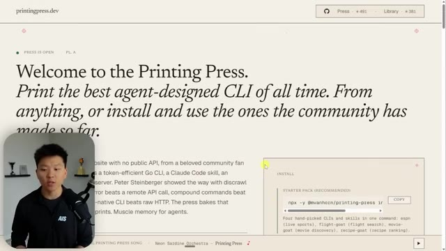
*⏱️ 00:06:14 — Page d'accueil du site web "printingpress.dev" présentant le concept de création de CLI assistée par IA avec une commande d'installation rapide.*

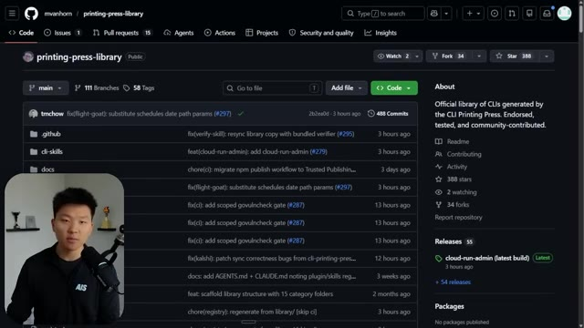
*⏱️ 00:06:23 — Interface du dépôt GitHub "printing-press-library" montrant la liste des fichiers et la structure du projet communautaire associé.*

---

### ⏱️ `[00:06:28 - 00:07:01]` | Segment #17

**🔊 Audio (Transcription Intégrale Mot pour Mot en Français) :**
> So basically what I did is I took all three of those URLs and I went into my cloud code and I said, hey, read all three of these. this is a new tool I'm seeing that has a bunch of preloaded CLIs and it also helps you build CLIs and just install everything I need. So like I said, this is the main command if you want to run the starter pack and then you need the factory as well in order to build your own. And it's super, super easy. You basically install it and then you can do natural language requests to use all this stuff. The one prereq is that you're going to need to get go. And it's basically as simple as asking Cloud Code to do it. So if you drop in those three links and you say, hey, help me get

**👁️ Analyse Visuelle d'Écran (gemini-3.5-flash-lite) :**
**Interface & Outils** : VS Code (avec extension Claude Code), Navigateur web.

**Contenu textuel & Code** : Texte explicatif sur la génération de CLI : "The Factory: Print Your Own CLI", mention de Go CLI, serveurs MCP et compétences Claude.

**Action / Démonstration** : Initialisation de Claude Code dans l'éditeur ; présentation conceptuelle du workflow de création automatique d'outils CLI.

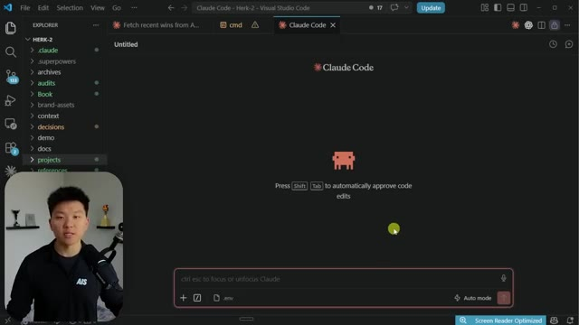
*⏱️ 00:06:36 — Interface de VS Code montrant l'extension Claude Code en attente d'interaction utilisateur avec le logo caractéristique au centre.*

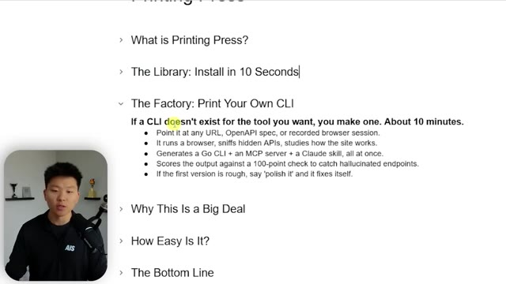
*⏱️ 00:06:44 — Page web présentant les fonctionnalités de "Printing Press", expliquant la création automatisée de CLI à partir d'URLs ou de spécifications OpenAPI.*

---

### ⏱️ `[00:07:01 - 00:07:34]` | Segment #18

**🔊 Audio (Transcription Intégrale Mot pour Mot en Français) :**
> this set up, it's going to come back and say, okay, I figured it out, but you need to install this first, which is Go. And it's a free open source programming language made by Google. It's designed to be simple, fast, and it's great for building command line tools. So CLI tools, web servers, cloud apps, and other AI related stuff. It's a very popular language. And it's like I said, completely free to download. So that'll take you maybe one minute. You tell Cloud Code, okay, download that for me. And then you just follow the prompts. Cloud might ask you to do a few other things, but you'll be able to get set up super, super easy. Why is this a big deal? Because most websites your agents want don't have a clean API, but printing press just lets you basically build

**👁️ Analyse Visuelle d'Écran (gemini-3.5-flash-lite) :**
**Interface & Outils** : Logiciel de présentation (type diapositives Notion ou Google Slides).

**Contenu textuel & Code** : Texte structuré expliquant la facilité d'utilisation de "Printing Press" pour générer des CLI, mentionnant l'installation, l'utilisation de Claude Code/Cursor, et une définition concise du langage Go (simple, rapide, idéal pour outils CLI, serveurs web, cloud).

**Action / Démonstration** : Présentation théorique et informative sur l'utilisation de l'IA pour générer des outils de développement en Go.

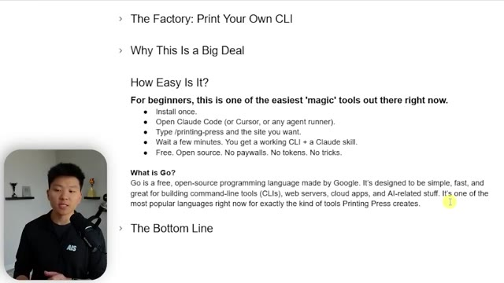
*⏱️ 00:07:09 — Une diapositive de présentation illustrant les avantages du langage Go et le flux de travail pour créer un outil CLI via des agents IA, avec le présentateur en médaillon.*

---

### ⏱️ `[00:07:34 - 00:08:07]` | Segment #19

**🔊 Audio (Transcription Intégrale Mot pour Mot en Français) :**
> your own with the CLI. So ESPN, for example, no public API. Craigslist, no public API. All recipes has anti-scrape protection, but the CLI uses a real Chrome session. Domino's has no public API. School, as you guys saw, no public API. So if I come into Cloud Code, now that I've got this all installed, I can ask, can you take a look at our printing press library of CLIs and tell me what we have access to? Here you can see it's using the printing press catalog skill. And what it's going to do is it's going to list the ones that we've already installed. And it's also going to list the available CLIs in the catalog that we could install. Okay. So here is what we have. These

**👁️ Analyse Visuelle d'Écran (gemini-3.5-flash-lite) :**
**Interface & Outils** : Visual Studio Code (VS Code), Claude Code.

**Contenu textuel & Code** : Interface utilisateur de Claude Code avec icône pixel art, invite de commande, options pour ajouter des fichiers (.env) et mode "Auto mode".

**Action / Démonstration** : Ouverture et préparation de l'environnement de développement "Claude Code" pour effectuer des tâches d'automatisation.

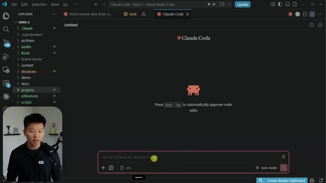
*⏱️ 00:07:50 — Interface de l'éditeur VS Code affichant l'extension ou le terminal "Claude Code" avec une zone de saisie pour interagir avec l'agent IA.*

---

### ⏱️ `[00:08:07 - 00:08:28]` | Segment #20

**🔊 Audio (Transcription Intégrale Mot pour Mot en Français) :**
> are the three local ones that I just built. We have school, we have Tally and we have YouTube. And I basically just transformed my, you know, YouTube data API as well as the Tally API was connected to and said, Hey, can you just turn this into a CLI? So now it'll be faster and more efficient. And then of course, school, it had to reverse engineer. So it did some deep discovery, looked at school and it figured out how to basically create these endpoints through a CLI.

**👁️ Analyse Visuelle d'Écran (gemini-3.5-flash-lite) :**
**Interface & Outils** : Visual Studio Code avec une fenêtre de chat/assistant IA intégrée.

**Contenu textuel & Code** : Le prompt "can you take a look at our printing press library of CLIs and tell me what we have access to?" ainsi qu'un tableau récapitulatif des CLI développées localement (skool, tally, youtube) incluant leurs binaires respectifs et leurs objectifs fonctionnels.

**Action / Démonstration** : L'utilisateur consulte l'inventaire des outils CLI générés par l'IA dans l'éditeur de code pour vérifier l'accès aux API connectées.

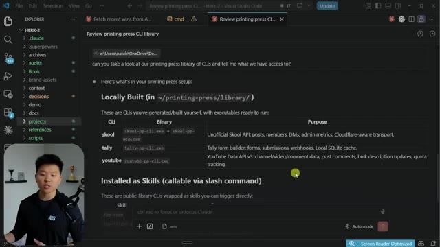
*⏱️ 00:08:12 — Une capture d'écran de l'interface VS Code montrant une interaction avec un assistant IA (type Claude Code) détaillant une bibliothèque de CLI personnalisées appelées "printing press".*

---

### ⏱️ `[00:08:28 - 00:09:01]` | Segment #21

**🔊 Audio (Transcription Intégrale Mot pour Mot en Français) :**
> So that's just really cool. Do you think that I could have done that myself? Absolutely not. but this just figured it out for me in, like I said, 10 minutes. And then we've got some other ones that are installed as skills. We've got ESPN, Flight Goat, Movie Goat, and the Recipe Goat. I also built a skill around the Tally one, which I'm going to do for YouTube and school as well. But those are the five you can see here. It didn't actually pull the catalog stuff yet. It said, do you want me to check what's available in the catalog? I don't really care because I could just go here. And like I said earlier, we can look through all of this. And like, let's say we wanted this Airbnb one. This just takes you to the GitHub repo, which I showed you guys earlier, which is the library of all the different CLIs

**👁️ Analyse Visuelle d'Écran (gemini-3.5-flash-lite) :**
**Interface & Outils** : Visual Studio Code (Image 1), Navigateur Web / printingpress.dev (Image 2).

**Contenu textuel & Code** : Liste des compétences (skills) : /pp-espn, /pp-flight-goat, /pp-movie-goat, /pp-recipe-goat, /pp-tally. Liste de modules CLI : pp-food52, pp-pagliacci, pp-ahrefs, pp-customer-io, pp-google-ads, pp-klaviyo, pp-producthunt.

**Action / Démonstration** : Présentation des capacités d'automatisation via des outils CLI intégrés et démonstration de la bibliothèque d'outils disponibles sur le site web du projet.

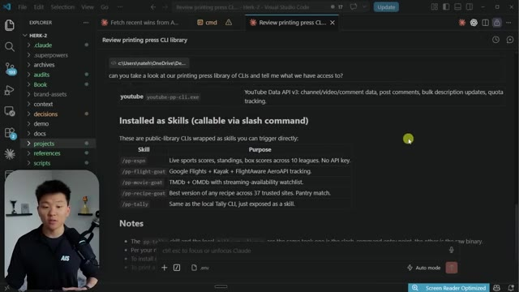
*⏱️ 00:08:36 — Interface VS Code affichant une documentation technique sur la bibliothèque CLI "Printing Press", détaillant les "Skills" installés (ESPN, Flight Goat, etc.) accessibles via des commandes slash.*

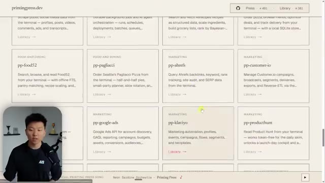
*⏱️ 00:08:53 — Interface web du site "printingpress.dev" montrant une galerie de cartes organisées par catégories (Food and Dining, Marketing), listant divers outils CLI comme "pp-food52", "pp-ahrefs" ou "pp-klaviyo".*

---

### ⏱️ `[00:09:01 - 00:09:20]` | Segment #22

**🔊 Audio (Transcription Intégrale Mot pour Mot en Français) :**
> that you could install. So now if I just say what NBA games are on tonight, what we're gonna see is it's going to use the ESPN skill right there, PPESPN, and it's going to pull back that data for us. So it says, okay, there are two NBA games on tonight, Eastern time, Knicks and Sixers at seven, and Spurs and Timberwolves at 9.30.

**👁️ Analyse Visuelle d'Écran (gemini-3.5-flash-lite) :**
**Interface & Outils** : Visual Studio Code (avec une extension de chat IA intégrée).

**Contenu textuel & Code** : Le prompt utilisateur « what NBA games are on tonight? » est saisi dans la zone de chat. L'écran affiche également des notes techniques sur les outils "pp-recipe-goat" et "pp-tally" ainsi que des instructions pour installer de nouveaux outils via `npx`.

**Action / Démonstration** : L'utilisateur soumet une requête en langage naturel à l'agent IA pour obtenir des informations sportives en temps réel.

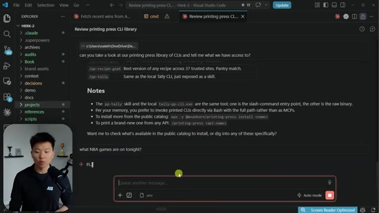
*⏱️ 00:09:06 — Interface VS Code affichant une conversation avec un assistant IA posant une question sur les matchs de la NBA.*

---

### ⏱️ `[00:09:21 - 00:09:43]` | Segment #23

**🔊 Audio (Transcription Intégrale Mot pour Mot en Français) :**
> And you can see right here, that is exactly correct. This is in Central time, so Eastern time would be one hour ahead. So what I would recommend is you go in here, you take a look at which of these might be useful to you, and then you just pull them in and you test them out. They showed a cool example here with one called Contact Goat. Find a verified email for a person you've never met. It looks them up on LinkedIn, it cross-checks them on happenstance, and then it does a deep line verified email check.

**👁️ Analyse Visuelle d'Écran (gemini-3.5-flash-lite) :**
**Interface & Outils** : 1 : Moteur de recherche Google. 2 : Site web printingpress.dev (bibliothèque de scripts CLI).

**Contenu textuel & Code** : 1 : Requête "nba games on tonight" et informations de diffusion. 2 : Commande `$ pp-contact-goat 'Jane Doe' company:Acme -u` avec un workflow de prospection automatisé.

**Action / Démonstration** : 1 : Visualisation de données en temps réel via Google. 2 : Présentation d'un outil d'automatisation pour la recherche de contacts.

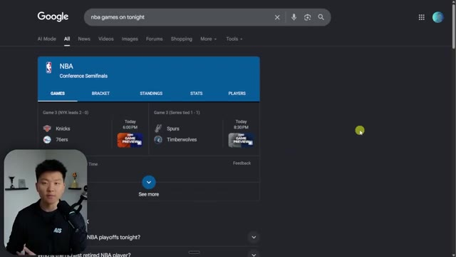
*⏱️ 00:09:26 — Une page de résultats Google Search affichant le programme des matchs de la NBA (Knicks vs 76ers, Spurs vs Timberwolves).*

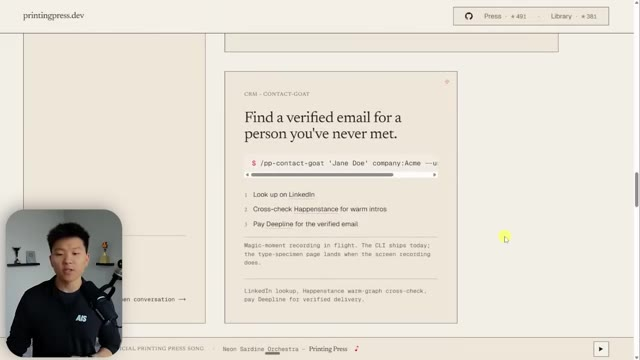
*⏱️ 00:09:32 — Interface du site printingpress.dev présentant un outil de ligne de commande (CLI) nommé "contact-goat" pour trouver des emails professionnels.*

---

### ⏱️ `[00:09:43 - 00:10:05]` | Segment #24

**🔊 Audio (Transcription Intégrale Mot pour Mot en Français) :**
> So I haven't personally tried this one, but the ability to maybe do things on LinkedIn through a CLI is pretty cool. So hopefully you guys understand the value here and how easy it really is to get set up. The last thing I wanna do now is just show you what it actually looks like to build your own. So I'm pretty sure there is a Hacker News one that already exists on the website, on the catalog. But let's say I did wanna build my own and we're gonna take Hacker News as just an example.

**👁️ Analyse Visuelle d'Écran (gemini-3.5-flash-lite) :**
**Interface & Outils** : Visual Studio Code

**Contenu textuel & Code** : Commande Bash : `~/go/bin/espn-pp-cli.exe scores basketball nba --agent --select 'events.shortName,events.status.type.detail,events.status.type.shortDetail'`, suivie du résultat JSON et d'un tableau récapitulatif des matchs NBA (Knicks vs 76ers, Spurs vs Timberwolves).

**Action / Démonstration** : Exécution d'une commande CLI via l'assistant IA intégré pour extraire et formater des données sportives en temps réel.

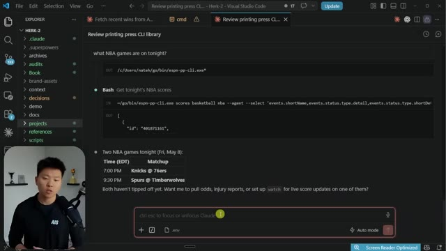
*⏱️ 00:09:49 — Interface de Visual Studio Code affichant un flux d'interaction avec une IA (Claude) sous forme de Markdown, détaillant l'exécution d'une commande CLI pour récupérer des scores NBA.*

---

### ⏱️ `[00:10:06 - 00:10:24]` | Segment #25

**🔊 Audio (Transcription Intégrale Mot pour Mot en Français) :**
> I would basically just say, hey, can you please use Printing Press? Can you use the CLI factory to help me create my own CLI? I wanna be able to pull in articles from Hacker News and just get insights every day from that site. And then I also just gave it a link right there to the page that I was just on. It's using the Printing Press skill once again.

**👁️ Analyse Visuelle d'Écran (gemini-3.5-flash-lite) :**
**Interface & Outils** : Visual Studio Code avec l'extension/agent Claude Code intégré.

**Contenu textuel & Code** : La barre de saisie affiche le placeholder "Ctrl esc to focus or unfocus Claude" et le titre de l'onglet actif est "Review printing press CLI library".

**Action / Démonstration** : Le présentateur est en train de configurer ou d'interagir avec l'agent Claude pour initialiser la revue de la librairie CLI "Printing Press" dans son environnement de développement.

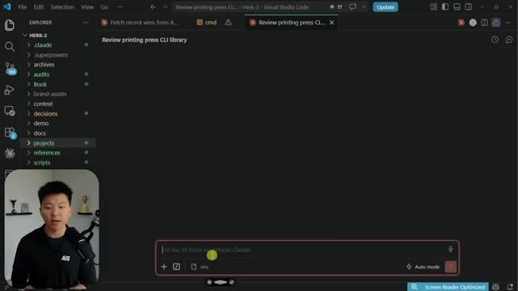
*⏱️ 00:10:10 — Interface de VS Code montrant l'éditeur avec la barre de saisie d'un agent IA (Claude Code) active en bas de l'écran, avec le présentateur incrusté en bas à gauche.*

---

### ⏱️ `[00:10:24 - 00:10:49]` | Segment #26

**🔊 Audio (Transcription Intégrale Mot pour Mot en Français) :**
> Now, Hacker News doesn't actually take any authentication. like we should be able to just pull it in. And so this isn't like the most impressive demo. So that's not what I want you to take away from here. The point is that you can just ask a natural language and it will start doing all the research and investigating and like reverse engineering things and then help you build it out. But if it does take like authentication cookies or OAuth or an API key, then you still basically treat it the same way you would like an API.

**👁️ Analyse Visuelle d'Écran (gemini-3.5-flash-lite) :**
**Interface & Outils** : Visual Studio Code (avec une extension de chat d'IA intégrée type Claude Code ou outil similaire).

**Contenu textuel & Code** : Prompt utilisateur : "hey, can you please use Printing Press? Can you use the CLI factory to help me create my own CLI? I want to be able to pull in articles from Hacker News and just get insights every day from that site." + commandes Bash de vérification de version (printing-press --version).

**Action / Démonstration** : L'agent IA analyse la requête, exécute une commande Bash pour vérifier la version de "printing-press" et affiche le résultat en sortie (printing-press 4.0.6).

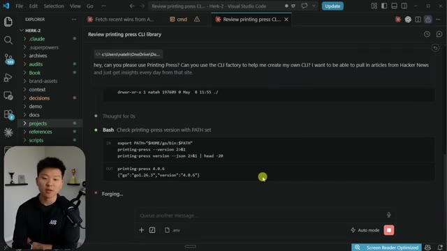
*⏱️ 00:10:30 — Une interface VS Code avec une fenêtre de chat d'IA active où l'utilisateur interagit en langage naturel pour automatiser la récupération de données depuis Hacker News.*

---

### ⏱️ `[00:10:49 - 00:11:17]` | Segment #27

**🔊 Audio (Transcription Intégrale Mot pour Mot en Français) :**
> You would be putting those in your .env and storing them in there. And then when you build the skill around the CLI, it will understand that it needs to pull from that. And the other thing to keep in mind is let's say you have some sort of quota. So let's take YouTube, for example. I can only post a certain amount of comments per day through the API. And if you got a rate limit there, you know, just because you're using a CLI doesn't mean you're jumping over those quotas. You're still going to have those limits. So anyways, this comes back and it says, I'm going to research hacker news. I'm going to catalog every feature that exists in any tool.

**👁️ Analyse Visuelle d'Écran (gemini-3.5-flash-lite) :**
**Interface & Outils** : Visual Studio Code avec interface d'agent IA intégrée.

**Contenu textuel & Code** : Prompt utilisateur : "hey, can you please use Printing Press? Can you use the CLI factory to help me create my own CLI? I want to be able to pull in articles from Hacker News...". Commandes Bash visibles pour lister le contenu du répertoire `printing-press/library/`.

**Action / Démonstration** : L'agent IA analyse les fichiers locaux et exécute des commandes Bash pour vérifier la structure du projet avant de construire la CLI demandée.

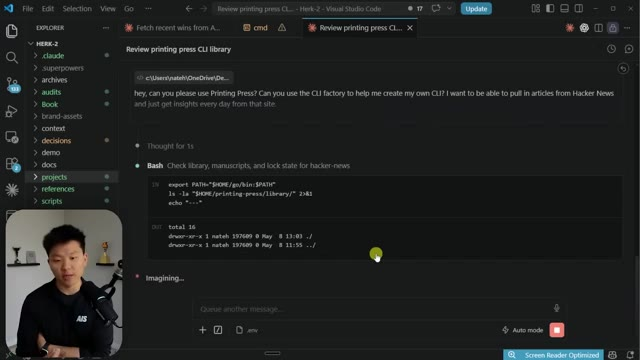
*⏱️ 00:10:56 — Une capture d'écran de l'interface VS Code montrant une interaction avec un agent IA dans un terminal intégré, où l'utilisateur demande de l'aide pour créer une CLI utilisant "Printing Press" pour extraire des articles de Hacker News.*

---

### ⏱️ `[00:11:17 - 00:11:38]` | Segment #28

**🔊 Audio (Transcription Intégrale Mot pour Mot en Français) :**
> I'm going to present what I found, and then I will generate you a go CLI, build every feature, and then we will verify quality through dog food, runtime verification, and scoring. So at the end, we will have a fully functional CLI for Hacker News. It says that it's gonna take 30 minutes to 60 minutes, but it's not. It's always bad at those estimations. I don't know if you guys have noticed that, but sometimes it'll say like, hey, this is gonna take 30 minutes and then it takes like two.

**👁️ Analyse Visuelle d'Écran (gemini-3.5-flash-lite) :**
**Interface & Outils** : Visual Studio Code avec une fenêtre contextuelle de chat/agent IA intégrée.

**Contenu textuel & Code** : Texte affichant : « I shall generate a Go CLI, build every feature, then verify quality through dogfood, runtime verification, and scoring. » ainsi que des options de soumission d'instructions pour l'agent (Let's go, I have context to share).

**Action / Démonstration** : L'utilisateur visualise le plan d'action proposé par l'agent IA au sein de l'IDE avant de lancer le processus de développement du CLI Hacker News.

*⏱️ 00:11:23 — L'écran montre VS Code avec une interface de dialogue d'IA nommée « Briefing » ouverte au centre. Le texte affiché détaille le plan de travail pour créer un outil en ligne de commande (CLI) pour Hacker News, incluant les étapes de recherche, de génération et de vérification.*

---

### ⏱️ `[00:11:39 - 00:12:00]` | Segment #29

**🔊 Audio (Transcription Intégrale Mot pour Mot en Français) :**
> But anyways, I'm just gonna say, yep, go ahead and build that out for me. And so while this is doing that research and building it out, I'll talk about something else real quick, which is what can you do with those CLIs? Because you could publish them back to the library and then other people could like publicly pull them in and use those CLIs as well. And you can also just share them with your team internally. So for example, this Tally one that I just built, I have been able to push this to a private repo.

**👁️ Analyse Visuelle d'Écran (gemini-3.5-flash-lite) :**
**Interface & Outils** : VS Code (éditeur) et le site web printingpress.dev.

**Contenu textuel & Code** : Image 1 : Requête utilisateur ("pull in articles from Hacker News"), bloc de commande Bash et chemins de répertoires. Image 2 : Titre "The Library" et liste des "six magic moments" de CLIs.

**Action / Démonstration** : L'agent IA est en phase de "recherche" (Spelunking) pour construire une nouvelle CLI, tandis que l'image 2 montre la plateforme de partage des outils créés.

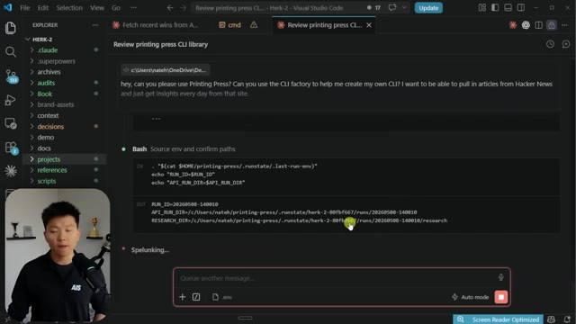
*⏱️ 00:11:44 — Interface VS Code affichant l'exécution d'un agent IA (Printing Press CLI) qui traite une requête de recherche sur Hacker News.*

*⏱️ 00:11:55 — Vue de l'interface web "The Library" de Printing Press montrant le catalogue des CLIs disponibles.*

---

### ⏱️ `[00:12:00 - 00:12:19]` | Segment #30

**🔊 Audio (Transcription Intégrale Mot pour Mot en Français) :**
> And now I can just invite some of my team to actually like be a contributor to this so they can clone it. And then they can use the Tally CLI as well. And maybe just swap out their own API key in their .env file or whatever. And all I did was I said, okay, cool. So you built me this Tally CLI and you built me this skill. Can you just package just that into a GitHub repo so I can share that across my team?

**👁️ Analyse Visuelle d'Écran (gemini-3.5-flash-lite) :**
**Interface & Outils** : Navigateur web (GitHub).

**Contenu textuel & Code** : Structure de fichiers d'un projet CLI (dossier 'internal', fichiers '.gitignore', 'golangci.yml', 'goreleaser.yaml') et description du projet : "Typed CLI for Tally (tally.so) — manage forms, pull submissions, configure webhooks, sync to local SQLite. Generated via Printing Press."

**Action / Démonstration** : Navigation dans le dépôt GitHub pour démontrer le partage du projet avec l'équipe et la structure du code source généré.

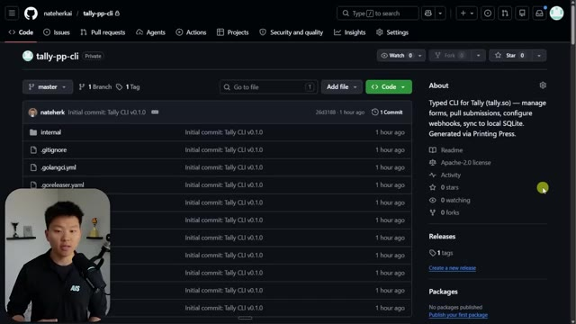
*⏱️ 00:12:05 — Interface GitHub affichant le dépôt privé 'tally-pp-cli' appartenant à nateherkai, contenant les fichiers initiaux du projet.*

---

### ⏱️ `[00:12:20 - 00:12:41]` | Segment #31

**🔊 Audio (Transcription Intégrale Mot pour Mot en Français) :**
> And then, you know, a couple seconds later, I had this new GitHub repo. So of course, what that means is you don't want to be putting any of your API keys or your authentication stuff inside of the CLI scripts or anything like that. That would still be treated the same way as you treat like your API endpoints and stuff like that. So this actually just came back with a huge list. So you can see that there's different phases. It has to do all of this stuff.

**👁️ Analyse Visuelle d'Écran (gemini-3.5-flash-lite) :**
**Interface & Outils** : Visual Studio Code (éditeur de code) intégrant une interface de conversation avec un agent IA.

**Contenu textuel & Code** : Prompt utilisateur : "hey, can you please use Printing Press? Can you use the CLI factory to help me create my own CLI? I want to be able to pull in articles from Hacker News...". L'agent effectue des opérations de type "Write" et "Read" sur des fichiers de configuration.

**Action / Démonstration** : L'agent IA analyse les instructions pour configurer un outil CLI et affiche ses étapes de réflexion et d'exécution dans le panneau de chat.

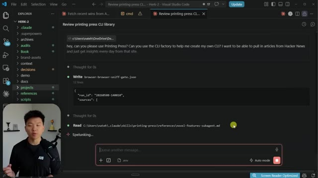
*⏱️ 00:12:25 — Interface de VS Code montrant l'utilisation d'un agent IA (probablement Claude Code) en train de traiter une requête de création de CLI.*

---

### ⏱️ `[00:12:41 - 00:12:59]` | Segment #32

**🔊 Audio (Transcription Intégrale Mot pour Mot en Français) :**
> And then hopefully by the end, it's going to be able to actually have a working CLI for us. So once again, it's not exactly that like, hey, this CLI is going to give you so much more functionality than if you just use the API, but it's the ability to, first of all, be able to turn anything into a CLI and start natively working through just CLIs rather than APIs and MCPs.

**👁️ Analyse Visuelle d'Écran (gemini-3.5-flash-lite) :**
**Interface & Outils** : Visual Studio Code avec une extension d'agent conversationnel IA (probablement Claude Code ou similaire).

**Contenu textuel & Code** : Liste des phases du projet (de la Phase 1.5 à la Phase 6) incluant "Resolve spec and generate CLI", "Build all absorbed + transcendence commands", et "Live dogfood testing". Le prompt de l'utilisateur demande de l'aide pour créer une CLI capable de récupérer des articles depuis Hacker News.

**Action / Démonstration** : L'agent IA est en train de traiter ou de planifier les étapes de création de la bibliothèque CLI "Printing Press" suite à une requête utilisateur.

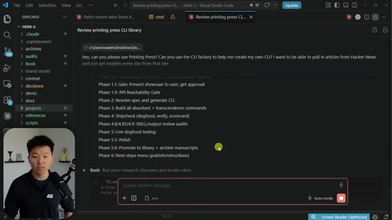
*⏱️ 00:12:46 — Interface VS Code affichant une discussion avec un agent IA détaillant les phases de développement d'une CLI ("Printing Press").*

---

### ⏱️ `[00:13:00 - 00:13:18]` | Segment #33

**🔊 Audio (Transcription Intégrale Mot pour Mot en Français) :**
> So maybe think of an example of something that you use a lot that doesn't have a great API or, you know, it only has an MCP server or whatever it might be. And just think about the fact that you could now tell CloudCode, hey, I use this software for X, Y, and Z. Do you think you could help me build a CLI around that right here in CloudCode? And hopefully it will give you research and it will build you a list like this.

**👁️ Analyse Visuelle d'Écran (gemini-3.5-flash-lite) :**
**Interface & Outils** : VS Code avec l'extension/chat Claude Code intégré.

**Contenu textuel & Code** : Un prompt utilisateur demandant de l'aide pour utiliser "Printing Press" et "CLI factory" afin de créer une CLI pour extraire des articles de Hacker News, suivi d'une liste de phases de développement (Phase 1.5 à 6).

**Action / Démonstration** : L'utilisateur visualise la planification des étapes générées par l'agent IA pour automatiser la création d'un outil CLI personnalisé.

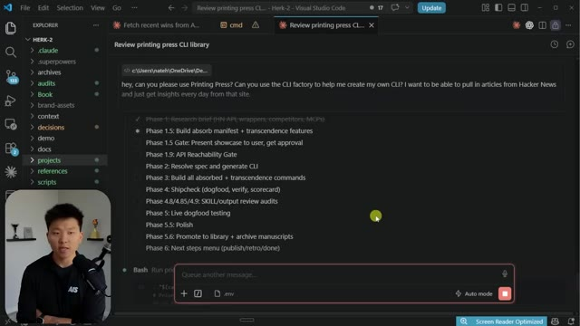
*⏱️ 00:13:04 — Une capture d'écran de l'interface VS Code montrant un échange avec l'agent Claude Code où un plan de projet structuré en phases pour créer une interface CLI est affiché.*

---

### ⏱️ `[00:13:18 - 00:13:38]` | Segment #34

**🔊 Audio (Transcription Intégrale Mot pour Mot en Français) :**
> And then you'll finish up with a CLI. So it's kind of just like the checklist of thinking about how you talk to tools. I would say like CLI would be tier one. If there's no CLI option or you just can't do it, then the API would be next. If there's an API, you're pretty much like 100% gonna be able to make CLI. But then if there's no API and you can only use an MCP, then that would be the final option.

**👁️ Analyse Visuelle d'Écran (gemini-3.5-flash-lite) :**
**Interface & Outils** : Visual Studio Code (avec une extension de type chat/agent IA intégrée).

**Contenu textuel & Code** : Prompt utilisateur demandant l'utilisation de "Printing Press" pour créer une CLI capable d'extraire des articles de Hacker News, suivi d'une exécution de commande Bash et d'un indicateur "Creating...".

**Action / Démonstration** : L'agent IA traite la requête utilisateur pour configurer et générer une interface de ligne de commande (CLI) via des scripts Bash.

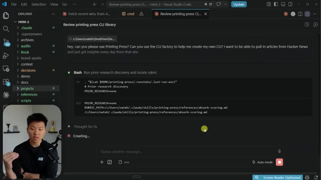
*⏱️ 00:13:23 — Une capture d'écran de l'interface VS Code montrant une interaction avec un agent IA nommé "Printing Press CLI", affichant l'exécution de commandes Bash et un processus de création en cours.*

---

### ⏱️ `[00:13:39 - 00:14:14]` | Segment #35

**🔊 Audio (Transcription Intégrale Mot pour Mot en Français) :**
> All right, so all of that has finished up now. We can see this is exactly where the binary actually lives. It's giving some examples here where you could actually like invoke this command basically in the CLI, or as you guys know, it should have built kind of like a skill around this and we're able to just invoke it with natural language. So I'm just going to go ahead and see what happens if I say, can you test this out using the actual skill and just go ahead and see which sites are dominating Hacker News today. That came back super fast. It said, okay, last 24 hours, stories with 100 plus points ranked by total score. And we get these 10 stories right here.

**👁️ Analyse Visuelle d'Écran (gemini-3.5-flash-lite) :**
**Interface & Outils** : Visual Studio Code (VS Code).

**Contenu textuel & Code** : Le fichier affiche le chemin d'accès au binaire `hacker-news-pp-cli.exe` et liste six commandes CLI (`--help`, `digest`, `domains`, `since`, `interests`, `sync`) accompagnées d'explications sur leurs fonctionnalités respectives, ainsi qu'une section dédiée à la démonstration MCP.

**Action / Démonstration** : Le présentateur explique comment localiser le binaire généré et présente les commandes disponibles pour tester l'outil en ligne de commande (CLI) ou via un agent.

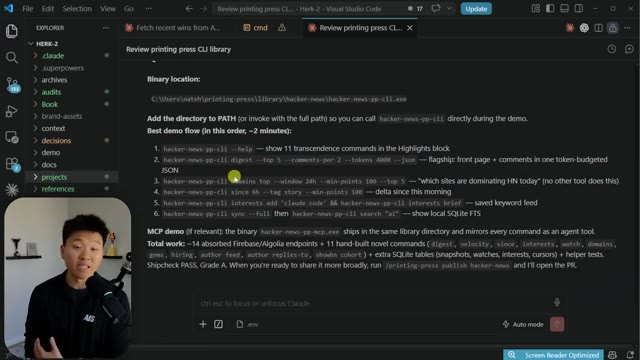
*⏱️ 00:13:47 — Une capture d'écran de l'éditeur VS Code affichant un fichier Markdown détaillant l'emplacement d'un binaire CLI et une liste de commandes de démonstration pour interagir avec une bibliothèque "printing press".*

---

### ⏱️ `[00:14:14 - 00:14:34]` | Segment #36

**🔊 Audio (Transcription Intégrale Mot pour Mot en Français) :**
> So anyways, this demo wasn't about the fact that we're doing this with Hacker News. It was just to show you guys how easy it is to set up these CLIs. And from here, you can build skills around them and you can chain them together. And from here, you can build skills around them. You can chain them together. And of course, you can access the catalog on printingpress.dev. And I'm assuming that this is just gonna continue and continue to grow. And I'm assuming this is just going to continue to grow and grow.

**👁️ Analyse Visuelle d'Écran (gemini-3.5-flash-lite) :**
**Interface & Outils** : Visual Studio Code (avec plugin Claude), Navigateur Web (printingpress.dev).

**Contenu textuel & Code** : Tableau récapitulatif des sites dominants sur Hacker News (Reuters, The Verge, etc.) et liste de bibliothèques CLI (pp-open-meteo, pp-cal-com, pp-slack, etc.).

**Action / Démonstration** : Démonstration de l'utilisation d'un CLI pour extraire et analyser des données en temps réel via l'API Algolia et présentation du catalogue d'outils disponibles.

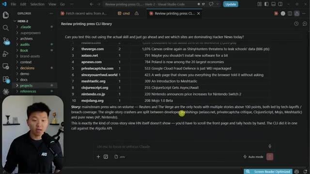
*⏱️ 00:14:19 — Interface VS Code affichant une analyse générée par IA sur les tendances de Hacker News via le CLI "printing press".*

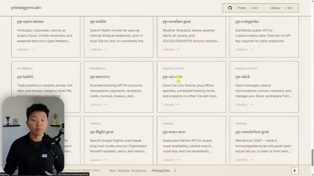
*⏱️ 00:14:29 — Site web "printingpress.dev" présentant une bibliothèque de différentes intégrations CLI (API) classées par catégories.*

---

### ⏱️ `[00:14:34 - 00:14:45]` | Segment #37

**🔊 Audio (Transcription Intégrale Mot pour Mot en Français) :**
> So anyways, wanted to keep this one quick, but I hope that you guys learned something new or enjoyed the video. And if you did, please give it a like. It helps me out a ton. And as always, I appreciate you guys making it to the end of the video. and I will see you all in the next one. Thanks everyone.

**👁️ Analyse Visuelle d'Écran (gemini-3.5-flash-lite) :**
**Interface & Outils** : VS Code avec l'extension Claude intégrée.

**Contenu textuel & Code** : Liste classée des sites web dominants sur Hacker News (Reuters, The Verge, etc.) et une synthèse textuelle générée par l'IA expliquant les tendances observées à partir de l'API Algolia.

**Action / Démonstration** : Affichage des résultats d'une requête d'analyse de données effectuée par l'agent IA dans l'éditeur de code.

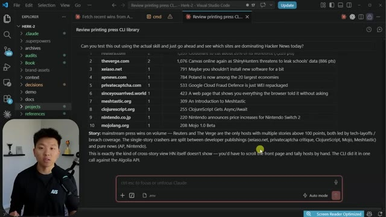
*⏱️ 00:14:37 — Capture d'écran de l'interface VS Code affichant les résultats d'une analyse automatisée des données de Hacker News via un outil CLI, avec le présentateur en médaillon dans le coin inférieur gauche.*

---

