# 🎬 Claude Code Just Got an Agent Dashboard

> **Chaîne** : [Nate Herk | AI Automation](https://www.youtube.com/@nateherk/featured)  
> **Lien YouTube** : [https://www.youtube.com/watch?v=ZAaxx3qyT8g](https://www.youtube.com/watch?v=ZAaxx3qyT8g)  
> **Date de publication** : 20260512  
> **Durée** : 00:07:36  
> **Identifiant vidéo** : `ZAaxx3qyT8g`  
> **Transcription & Analyse** : `whisper-v3-large-turbo+gemini-3.5-flash-lite`  

---

## 📌 Synthèse Exécutive & Outils

### 💡 Résumé
Dans cette vidéo intitulée **Claude Code Just Got an Agent Dashboard**, Nate Herk décortique les capacités pratiques d'automatisation et de développement propulsées par les modèles de pointe.

### 🛠️ Outils, Modèles & Logiciels Présentés
- **Opus 5.5 & Claude Code** : Modèles d'ingénierie et agents de codage autonome.

### 🔑 Points Clés & Enseignements Stratégiques
- Optimiser le niveau d'effort et le raisonnement des modèles IA pour des résultats industriels.
- Automatiser les cycles de création logicielle de bout en bout.

---

## ⏱️ Chronologie & Transcription Complète Audio & Visuelle (Mot pour Mot)

### ⏱️ `[00:00:00 - 00:00:32]` | Segment #01

**🔊 Audio (Transcription Intégrale Mot pour Mot en Français) :**
> So what you're looking at right now is I've got four different Cloud Code agents running for me, and I can look at them and manage them from just one view, which is really, really nice. I can choose them with the arrow keys, or I could just click on one of the sessions, and I can see what's actually going on. And then I can just go back to my main agent view and see what else is happening. And as you start to finish up, it'll tell me the status of them, so I can just see which ones are done or which ones might be waiting on me for input. Like right here, you can see that this one turned yellow, and it says that it needs input. So I can click into this, and it's basically just asking me to approve the plan or give feedback. So if you guys have ever had like five plus cloud code sessions open where your VS code looks like this and you've

**👁️ Analyse Visuelle d'Écran (gemini-3.5-flash-lite) :**
**Interface & Outils** : Présentation ou face-caméra explicatif sans interface logicielle partagée.

**Contenu textuel & Code** : Explications orales et mise en contexte méthodologique.

**Action / Démonstration** : Explications face caméra et démonstration conceptuelle.

---

### ⏱️ `[00:00:32 - 00:01:07]` | Segment #02

**🔊 Audio (Transcription Intégrale Mot pour Mot en Français) :**
> got all these different ones to click through and you don't know which terminal tab is doing what, then this is going to be a game changer for you. So as quick as I can and as easy as I can, I'm just going to break down exactly what you need to know about this and how it works. And right on cue, you can see this is exactly what happens when one of those finishes up. It turns green and it goes down here. Okay. So what is this whole new agent view thing? Well, they just dropped this today. It's called agent view. And it lets you basically have one tab where you can not only view all of your sessions, but you can move inside and outside of them. So you can basically manage all of your different working agents just in one terminal tab. And I'm actually really, really excited about this. So previously, when you were running tons of agents in parallel,

**👁️ Analyse Visuelle d'Écran (gemini-3.5-flash-lite) :**
**Interface & Outils** : Présentation ou face-caméra explicatif sans interface logicielle partagée.

**Contenu textuel & Code** : Explications orales et mise en contexte méthodologique.

**Action / Démonstration** : Explications face caméra et démonstration conceptuelle.

---

### ⏱️ `[00:01:07 - 00:01:39]` | Segment #03

**🔊 Audio (Transcription Intégrale Mot pour Mot en Français) :**
> you probably had multiple terminal tabs open, which got very confusing. Even if you had a hook set up to have like notifications when something finished, you would still be clicking around trying to find the right session. Now they did add something really nice that helped with that. They basically added this little recap thing, which at the end of every terminal session, it shows you what you were working on. And that definitely helped. But having this agent view where I can literally just switch back and see what's going on. And I could like move into this one if I wanted to. And then I could go back out to my agent view and go to a different one. It's super nice. So the one thing here is you do have to use this in the CLI. And if you guys are scared of the CLI, please don't be.

**👁️ Analyse Visuelle d'Écran (gemini-3.5-flash-lite) :**
**Interface & Outils** : Présentation ou face-caméra explicatif sans interface logicielle partagée.

**Contenu textuel & Code** : Explications orales et mise en contexte méthodologique.

**Action / Démonstration** : Explications face caméra et démonstration conceptuelle.

---

### ⏱️ `[00:01:39 - 00:02:12]` | Segment #04

**🔊 Audio (Transcription Intégrale Mot pour Mot en Français) :**
> It's a really, really nice friend. And if you are planning on using Cloud Code for a while, or even like Codex or whatever coding tool you want to use, the CLI usually just has the most functionality. So if you have been using the extension, which looks like this, which just maybe looks a little bit more friendly and less scary, I would definitely challenge you this week to start using the terminal. Anyways, all you have to do now is you press the left arrow while you're in any session and it opens up the agent view. You could also launch a new session with Claude Agents, but just hitting the left arrow is so much easier. And then when you're looking at all your sessions, you can obviously see what needs input, what's working, what's completed. And then

**👁️ Analyse Visuelle d'Écran (gemini-3.5-flash-lite) :**
**Interface & Outils** : Présentation ou face-caméra explicatif sans interface logicielle partagée.

**Contenu textuel & Code** : Explications orales et mise en contexte méthodologique.

**Action / Démonstration** : Explications face caméra et démonstration conceptuelle.

---

### ⏱️ `[00:02:12 - 00:02:46]` | Segment #05

**🔊 Audio (Transcription Intégrale Mot pour Mot en Français) :**
> you just do the right arrow to go into the session and then left arrow to go back to your main agent view. Now, one thing that's also pretty cool is if you're working on a session already, you can just do slash BG and that will put it into the agent view. And you can launch a new session with Claude, Flag, BG, and then name the task. But it's so much easier than that because you can actually just straight from the agent view. If I just describe a task right here, that actually just kicks off a new session. So let's say I wanted to go ahead and do some research on Claude's new agent view and just like tell me about it. As soon as I hit enter, that just starts off a new session. You can see that one was right here. And if I move over, then we can see what's actually

**👁️ Analyse Visuelle d'Écran (gemini-3.5-flash-lite) :**
**Interface & Outils** : Présentation ou face-caméra explicatif sans interface logicielle partagée.

**Contenu textuel & Code** : Explications orales et mise en contexte méthodologique.

**Action / Démonstration** : Explications face caméra et démonstration conceptuelle.

---

### ⏱️ `[00:02:46 - 00:03:19]` | Segment #06

**🔊 Audio (Transcription Intégrale Mot pour Mot en Français) :**
> going on right here. And that's the exact prompt I just shot off. And once again, I go back out and now I see all of them. So if you're reading through this doc and you feel like that's like commands that you have to remember, it's really not that bad. So don't worry about it. So how are developers using this agent view? Well, they listed four main patterns here. So the first one is obviously scaling the number of concurrent sessions. The second one is managing long running agents. And they also just dropped a new feature called goal, which if you guys are familiar with the goal feature in Codex, it's kind of just like that whole Ralph Wiggum loop. So now basically, if you do slash goal, you can set an objective for Claude Code to work towards. And it basically

**👁️ Analyse Visuelle d'Écran (gemini-3.5-flash-lite) :**
**Interface & Outils** : Documentation officielle de Claude Code (CLI / Interface web).

**Contenu textuel & Code** : Documentation sur les commandes terminal : "/bg", "claude --bg [task]", et explications textuelles sur le workflow des agents IA (sessions concurrentes, gestion des tâches de longue durée, navigation).

**Action / Démonstration** : Le présentateur commente la documentation affichée à l'écran pour expliquer comment les développeurs peuvent optimiser leur flux de travail avec Claude Code.

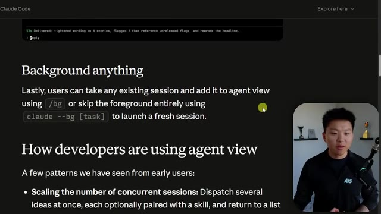
*⏱️ 00:02:54 — Une page de documentation technique expliquant l'utilisation de la commande "/bg" et l'exécution de "claude --bg" pour gérer des sessions d'agents en arrière-plan.*

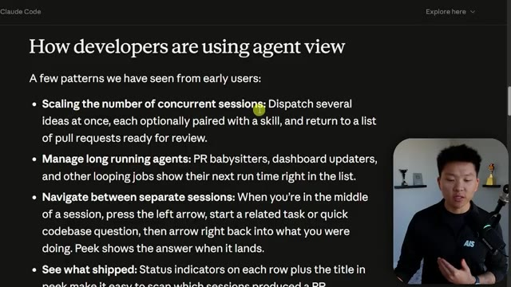
*⏱️ 00:03:03 — La suite de la documentation présentant une liste de bonnes pratiques pour les développeurs utilisant la "vue agent", notamment la gestion des sessions concurrentes.*

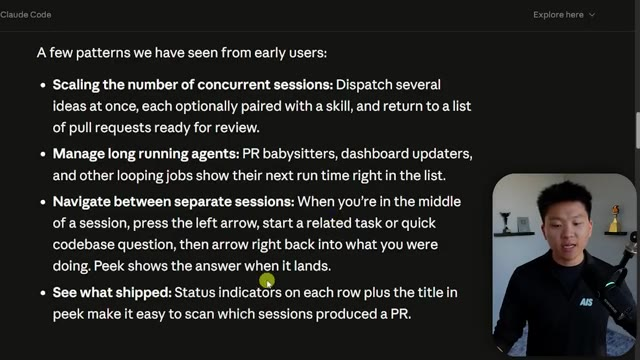
*⏱️ 00:03:11 — Gros plan sur la même section de documentation détaillant la navigation entre les sessions et l'utilisation d'indicateurs de statut pour le suivi des tâches.*

---

### ⏱️ `[00:03:19 - 00:03:53]` | Segment #07

**🔊 Audio (Transcription Intégrale Mot pour Mot en Français) :**
> will experiment and try different things until it hits that exact objective. So if I did slash goal and I told it to build me a 3D monster fighting game, it will basically keep going at this. You can see how long the goal has been running. And these can run for hours and hours. They can run overnight and they'll come back once that objective has been achieved. Now, this is not the best way to use goal. Obviously, this was a very subjective prompt. And because you're kind of one-shot prompting. If you use goal, you know, prompting is super, super important. And it's usually best if you can give it an objective metric to hit. So if you think about the way you do like Karpathy's auto research, you're usually trying to have it optimized for a metric. So when you do goal,

**👁️ Analyse Visuelle d'Écran (gemini-3.5-flash-lite) :**
**Interface & Outils** : Visual Studio Code (VS Code)

**Contenu textuel & Code** : Arborescence de fichiers incluant des dossiers comme .claude, .superpowers, audits, Book, brand-assets, context, decisions, et demo. Onglets de terminaux ("cmd") visibles en haut.

**Action / Démonstration** : Environnement de développement actif avec l'intégration de l'agent "Claude" pour la gestion de projet ou l'automatisation.

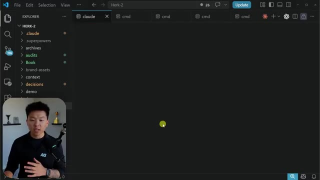
*⏱️ 00:03:28 — Une capture d'écran de l'interface VS Code montrant l'arborescence des fichiers d'un projet nommé "HERK-2", avec plusieurs terminaux ouverts. Le présentateur est visible dans un encart en bas à gauche.*

---

### ⏱️ `[00:03:53 - 00:04:26]` | Segment #08

**🔊 Audio (Transcription Intégrale Mot pour Mot en Français) :**
> you're probably going to want to do a similar type of prompting. But anyways, this video is not about goal. The reason why I wanted to bring this up is because let's say you're doing a bunch of different goal sessions. You can just view them all right here because they're probably going to be working for a long time. And if you look on the right hand side here, you can see how long each of these sessions has been running. You can also navigate between separate sessions really easily, just using the arrow keys or even just using your mouse. And then you can see what shifts based on the status indicator. And it's really that simple. That is basically the end of this doc. That's all there is to it. You really just have to get in here and play around with it a little bit. Now, the reason I said you don't have to worry about all those commands is basically because the idea is

**👁️ Analyse Visuelle d'Écran (gemini-3.5-flash-lite) :**
**Interface & Outils** : Visual Studio Code (avec extension Claude Code), Navigateur Web (Documentation Claude Code).

**Contenu textuel & Code** : Liste de processus ("Needs input", "Working", "Completed"), commandes CLI, texte explicatif sur la gestion de sessions concurrentes, ligne de commande PowerShell.

**Action / Démonstration** : Démonstration de l'interface de suivi des agents IA dans le terminal et revue de la documentation officielle pour l'activation des fonctionnalités.

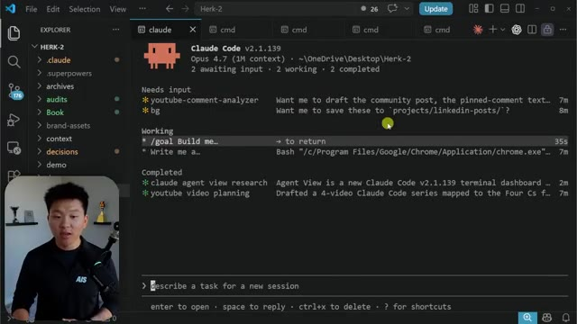
*⏱️ 00:04:02 — Interface de VS Code affichant le tableau de bord "Claude Code v2.1.139" avec des listes de tâches en cours et terminées.*

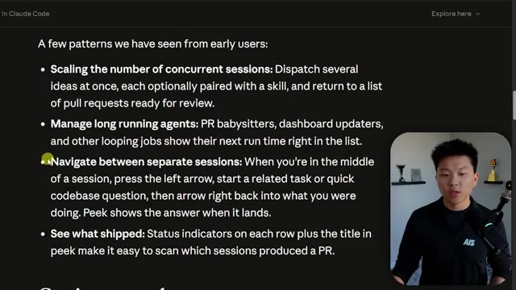
*⏱️ 00:04:10 — Page web de documentation technique détaillant les modèles d'utilisation des agents ("Scaling concurrent sessions", "Manage long running agents").*

*⏱️ 00:04:18 — Suite de la page web montrant les instructions "Getting started" et la commande d'installation PowerShell (`irm https://claude.ai/install.ps1`).*

---

### ⏱️ `[00:04:26 - 00:04:45]` | Segment #09

**🔊 Audio (Transcription Intégrale Mot pour Mot en Français) :**
> in a fresh terminal, you could do Claude agents and that would open up that view, which we were already just in, right? Or in a fresh session, you could do Claude dash dash BG. And then you could describe a task like, you know, build me a 3D monster game. I'm just gonna use that same example again. And that will basically kick off a cloud agent that gets launched into the agent view.

**👁️ Analyse Visuelle d'Écran (gemini-3.5-flash-lite) :**
**Interface & Outils** : Visual Studio Code (VS Code) avec l'extension Claude Code v2.1.139.

**Contenu textuel & Code** : Tableau de bord d'agent IA montrant : "Needs input" (youtube-comment-analyzer, bg), "Working" (/goal Build me a 3d monster fighting game), et "Completed" (voiceai-landscape-report, etc.). L'invite de commande en bas affiche : "describe a task for a new session".

**Action / Démonstration** : Consultation du tableau de bord de l'agent Claude pour visualiser l'état d'avancement des tâches et l'objectif de développement en cours.

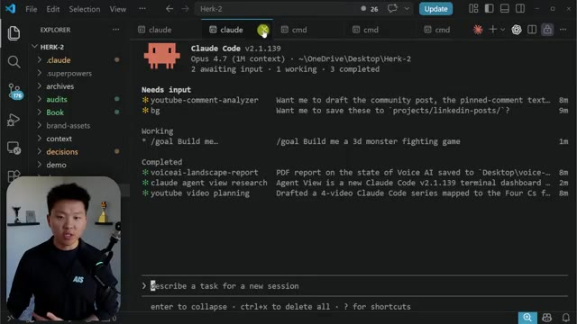
*⏱️ 00:04:31 — Interface de terminal "Claude Code" intégrée au sein de VS Code, affichant le statut d'un agent avec des tâches en attente, en cours et terminées.*

---

### ⏱️ `[00:04:46 - 00:05:22]` | Segment #10

**🔊 Audio (Transcription Intégrale Mot pour Mot en Français) :**
> So if I go back to the agent view, we would see another one, which is, you know, build me a game. And for some reason, this got cut off. Because this is in research preview, you might notice a few bugs. The first time I started launching this up, my computer got really, really slow. So just keep in mind, research preview, it is going to be maybe a little bit buggy. yeah it comes back and says build alone is too ambiguous and by the way i was tinkering with it a little bit more and i realized that you have to wrap it in quotes i tried the uh square brackets but the quotes is what actually worked if you see over here now this is the session that it kicked off and the full prompt got injected but honestly i'm not really going to be ever launching sessions

**👁️ Analyse Visuelle d'Écran (gemini-3.5-flash-lite) :**
**Interface & Outils** : VS Code avec terminal intégré (Claude Code v2.1.139).

**Contenu textuel & Code** : Invite de commande montrant "Build" comme requête, état de réflexion "Cascading..." et une notification système "1 claude.ai connector needs auth".

**Action / Démonstration** : L'agent Claude Code est en phase de réflexion/traitement suite à une commande de build, avec le mode automatique activé.

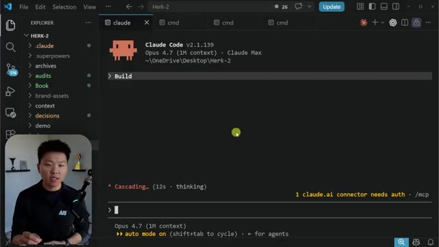
*⏱️ 00:04:55 — Interface de VS Code affichant l'exécution de l'agent "Claude Code" dans un terminal intégré, avec le présentateur en incrustation.*

---

### ⏱️ `[00:05:22 - 00:05:41]` | Segment #11

**🔊 Audio (Transcription Intégrale Mot pour Mot en Français) :**
> using this flag i'm probably just going to be launching them from here or if i launch them from the regular command you know like i just come in here and do claude and then i start talking and if for some reason this doesn't get into the agent view, which it pretty much always does automatically, then that's when you would just come in here and you would use slash BG, which is like slash background to put it into the agent view.

**👁️ Analyse Visuelle d'Écran (gemini-3.5-flash-lite) :**
**Interface & Outils** : VS Code (Visual Studio Code) avec terminal intégré Windows CMD.

**Contenu textuel & Code** : L'invite de commande affiche le chemin de répertoire actif : C:\Users\nateh\OneDrive\Desktop\Herk-2>. La barre latérale Explorer montre les dossiers du projet (.claude, .superpowers, audits, etc.).

**Action / Démonstration** : Le terminal est prêt à recevoir une commande utilisateur pour lancer un processus, potentiellement l'agent Claude.

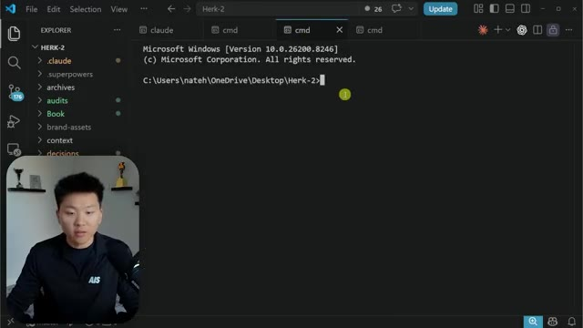
*⏱️ 00:05:27 — L'interface de VS Code avec un terminal Windows ouvert dans le répertoire du projet "Herk-2", montrant l'arborescence des dossiers sur la gauche.*

---

### ⏱️ `[00:05:42 - 00:06:05]` | Segment #12

**🔊 Audio (Transcription Intégrale Mot pour Mot en Français) :**
> So I think the value in those commands is if you're trying to do work in different directories and still manage everything. Because if I'm in my Herc2 project and I open up a new terminal, this is going to keep me in that project. And if I launch one from here, I'm pretty sure it's just going to create another agent inside of Herc2. So if I wanted to seed into a different directory and then I could do the Claude with the flag, like the Claude BG, and then I could say, build me a 3D monster fighting game.

**👁️ Analyse Visuelle d'Écran (gemini-3.5-flash-lite) :**
**Interface & Outils** : Présentation ou face-caméra explicatif sans interface logicielle partagée.

**Contenu textuel & Code** : Explications orales et mise en contexte méthodologique.

**Action / Démonstration** : Explications face caméra et démonstration conceptuelle.

---

### ⏱️ `[00:06:05 - 00:06:31]` | Segment #13

**🔊 Audio (Transcription Intégrale Mot pour Mot en Français) :**
> And then that would kick it off and I'd be able to see it here. And now I'm working inside of different projects. I wish what we could do is we could see right here very easily which directory we're in, but all we'd have to do is we'd have to switch in and we could see this one is in my project up here called a bunch of skills. And then this one is in my project right here called pretty sure this one's in the Herc 2. And so the other way that you could do that is if you're in a different project and I do Claude and that just launches your regular Claude code, then let's say I say, you know, hello, But then what I want to do is add this into the agent view.

**👁️ Analyse Visuelle d'Écran (gemini-3.5-flash-lite) :**
**Interface & Outils** : VS Code (avec l'extension Claude Code v2.1.139).

**Contenu textuel & Code** : État du terminal montrant les catégories "Needs input" (ex: bg, youtube-comment-analyzer), "Working" (deux tâches "Build me a...") et "Completed" (historique des tâches terminées), ainsi qu'une zone de saisie pour une nouvelle tâche.

**Action / Démonstration** : Le présentateur illustre la navigation entre différents projets au sein de VS Code tout en consultant l'état d'exécution des agents dans l'interface Claude Code.

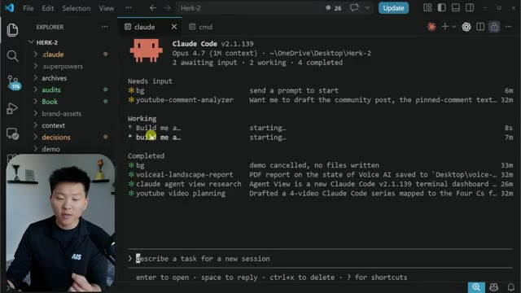
*⏱️ 00:06:12 — Interface de VS Code affichant le tableau de bord de l'agent "Claude Code" avec les tâches en cours, en attente et terminées.*

---

### ⏱️ `[00:06:31 - 00:06:51]` | Segment #14

**🔊 Audio (Transcription Intégrale Mot pour Mot en Français) :**
> Well, it's still already in there, right? It's still there. I didn't have to do the slash BG. So hopefully that stuff makes sense now. Now, what else is cool is I just showed you guys like entering a different session, right? Now, what if I wanted to delete one? I could just select it and do control X twice and that kills it. You can also see on these ones that need input. So for example, this one says, do you want me to save these two projects slash LinkedIn post?

**👁️ Analyse Visuelle d'Écran (gemini-3.5-flash-lite) :**
**Interface & Outils** : VS Code avec l'extension Claude Code (v2.1.139).

**Contenu textuel & Code** : Liste des sessions de travail actives (ex: "general-assistance", "3d monster game") avec leurs états et chemins de fichiers. En bas, le prompt : "describe a task for a new session".

**Action / Démonstration** : Le présentateur explique la gestion des sessions dans Claude Code et fait référence aux raccourcis clavier pour manipuler ces sessions (ex: "ctrl+x to delete all").

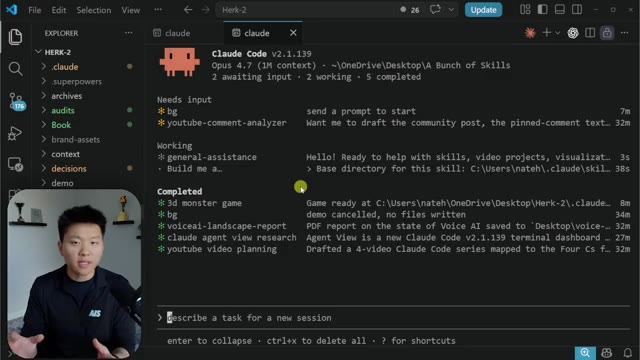
*⏱️ 00:06:36 — L'interface du terminal Claude Code intégrée dans VS Code, affichant un tableau de bord avec les sessions actives ("Needs input", "Working", "Completed") et le présentateur en médaillon.*

---

### ⏱️ `[00:06:51 - 00:07:17]` | Segment #15

**🔊 Audio (Transcription Intégrale Mot pour Mot en Français) :**
> What I could do is just hit space and I could reply right here from this agent view. No, I don't want you to save those. That was just a demo. And I could shoot that off from this view. And now that session has gotten our input. That's basically all there is to it. I'm not going to hammer that home too hard. I think you guys understand it. What I would really recommend now is if you don't really see the value in this, it's probably because you're not running multiple sessions and you're not like doing a lot of work at the same time through Cloud Code, which means you're not really using it as your operating system.

**👁️ Analyse Visuelle d'Écran (gemini-3.5-flash-lite) :**
**Interface & Outils** : VS Code avec extension/terminal Claude Code v2.1.139.

**Contenu textuel & Code** : Liste des tâches de l'agent : "Needs input" (youtube-comment-analyzer, current session), "Working" (/goal Build me...), "Completed" (voiceai-landscape-report, claude agent view research, youtube video planning). Zone de saisie active avec le texte : "No, I don't want you to save those. That was just a demo."

**Action / Démonstration** : Le présentateur utilise l'interface de "Claude Code" pour répondre directement dans le terminal à une demande de sauvegarde de l'agent.

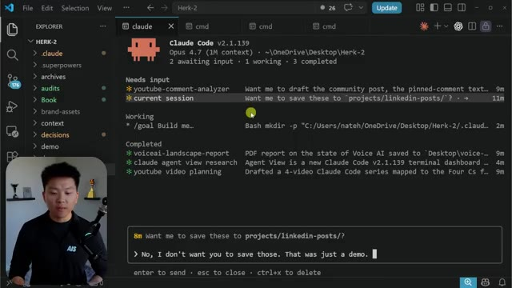
*⏱️ 00:06:58 — Interface VS Code affichant le tableau de bord de l'agent "Claude Code" avec une liste de sessions en attente, en cours et terminées, ainsi qu'une zone de saisie pour répondre à l'IA.*

---

### ⏱️ `[00:07:17 - 00:07:35]` | Segment #16

**🔊 Audio (Transcription Intégrale Mot pour Mot en Français) :**
> So what I did for you guys is I built a full course. It's like two and a half hours on building your own operating system using Cloud Code, building your AIOS. So you're gonna wanna check out this video right up here. Hopefully I'll see you guys over there. but if I don't, I still appreciate you guys watching this video. If you enjoyed or you learned something new, please give a like. And as always, I appreciate you guys making it to the end of the video. I'll see you on the next one. Thanks everyone.

**👁️ Analyse Visuelle d'Écran (gemini-3.5-flash-lite) :**
**Interface & Outils** : VS Code avec extension/terminal Claude Code intégré.

**Contenu textuel & Code** : État de l'agent Claude Code : tâches en attente (« youtube-comment-analyzer »), tâche en cours (« Bash mkdir ») et tâches terminées (« voiceai-landscape-report », « youtube video planning »).

**Action / Démonstration** : L'agent est en attente d'une nouvelle instruction utilisateur dans la console (« describe a task for a new session »).

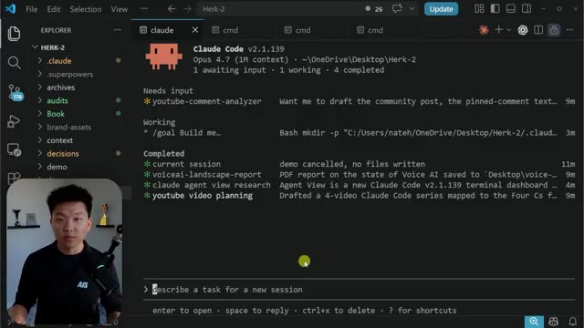
*⏱️ 00:07:22 — Interface de VS Code affichant le tableau de bord de Claude Code (v2.1.139) avec l'arborescence des fichiers du projet « Herk-2 » à gauche.*

---

