# 🎬 Every Level of Claude Explained in 21 Minutes

> **Chaîne** : [Nate Herk | AI Automation](https://www.youtube.com/@nateherk/featured)  
> **Lien YouTube** : [https://www.youtube.com/watch?v=ZRb7D6R64hM](https://www.youtube.com/watch?v=ZRb7D6R64hM)  
> **Date de publication** : 20260512  
> **Durée** : 00:21:42  
> **Identifiant vidéo** : `ZRb7D6R64hM`  
> **Transcription & Analyse** : `whisper-v3-large-turbo+gemini-3.5-flash-lite`  

---

## 📌 Synthèse Exécutive & Outils

### 💡 Résumé
Dans cette vidéo intitulée **Every Level of Claude Explained in 21 Minutes**, Nate Herk décortique les capacités pratiques d'automatisation et de développement propulsées par les modèles de pointe.

### 🛠️ Outils, Modèles & Logiciels Présentés
- **Opus 5.5 & Claude Code** : Modèles d'ingénierie et agents de codage autonome.

### 🔑 Points Clés & Enseignements Stratégiques
- Optimiser le niveau d'effort et le raisonnement des modèles IA pour des résultats industriels.
- Automatiser les cycles de création logicielle de bout en bout.

---

## ⏱️ Chronologie & Transcription Complète Audio & Visuelle (Mot pour Mot)

### ⏱️ `[00:00:00 - 00:00:34]` | Segment #01

**🔊 Audio (Transcription Intégrale Mot pour Mot en Français) :**
> So I spent over 400 hours inside of Claude, and I've mastered it at a pretty high level. So in this video, I'm going to take you through every level of Claude in just about 20 minutes and cover what challenges you need to overcome in order to break through into the next stage, step by step. So let's start with level one, the enthusiast. So this level, you open Claude, you ask a question, you get an answer, you close the tab. Maybe you have it help you write an email, maybe a quick script, maybe you ask it to explain something that you read. And that's basically it. That's level one. A quick upgrade that most people miss at this level, paste screenshots. Claude can read images. Half the people stuck here are typing out what a screenshot would show in two seconds. Now here's why most people stay stuck at level one forever. They

**👁️ Analyse Visuelle d'Écran (gemini-3.5-flash-lite) :**
**Interface & Outils** : Interface graphique de présentation (montage vidéo superposant des éléments textuels et iconographiques).

**Contenu textuel & Code** : Textes illustrant le workflow de base sur Claude : "Open Claude", "Ask a question", "Get an answer", "Close the tab" et le titre "Barriers to overcome".

**Action / Démonstration** : Présentation conceptuelle des étapes de base de l'interaction avec l'IA et annonce des obstacles à surmonter pour monter en compétence.

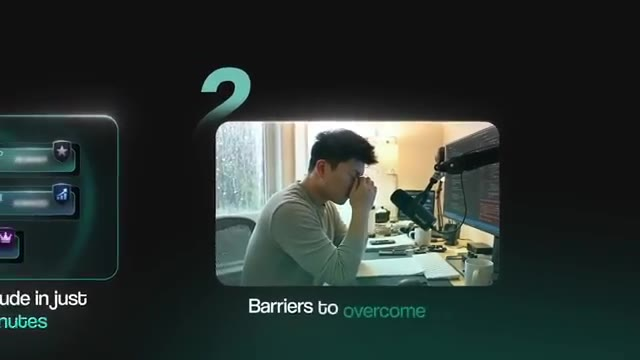
*⏱️ 00:00:08 — Un graphique montrant une illustration du présentateur en train de réfléchir à son bureau avec le texte "Barriers to overcome".*

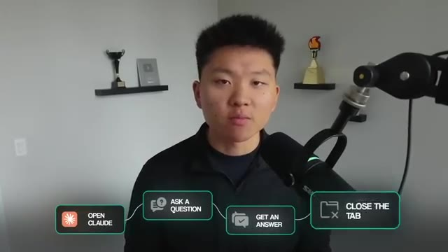
*⏱️ 00:00:17 — Un diagramme de flux graphique superposé à l'écran montrant les étapes simples d'utilisation de Claude : "Open Claude", "Ask a question", "Get an answer", "Close the tab".*

---

### ⏱️ `[00:00:34 - 00:00:56]` | Segment #02

**🔊 Audio (Transcription Intégrale Mot pour Mot en Français) :**
> don't realize that Claude can hold context across conversations, that Claude can organize work into projects, or plug into the tools that they already use every day. They keep treating it like a search bar that happens to return paragraphs. It's very useful, but it is the floor. You're saving maybe 30 minutes a day on small things. So the cheat code to level two is to create your first project. Pick something that you keep coming back to. Your business, a side hustle, a recurring type of work.

**👁️ Analyse Visuelle d'Écran (gemini-3.5-flash-lite) :**
**Interface & Outils** : Interface Web de Claude (Anthropic).

**Contenu textuel & Code** : Prompt utilisateur : "Can you summarize the design principles?" suivi d'une réponse de l'IA détaillant le principe de "Balance".

**Action / Démonstration** : Affichage de la fenêtre de chat pour illustrer l'utilisation de l'IA pour générer des contenus textuels structurés.

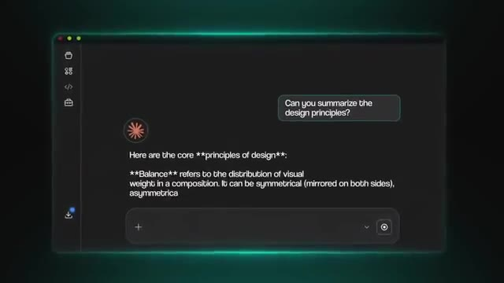
*⏱️ 00:00:45 — Interface utilisateur de Claude affichant une conversation textuelle sur les principes de design.*

---

### ⏱️ `[00:00:56 - 00:01:14]` | Segment #03

**🔊 Audio (Transcription Intégrale Mot pour Mot en Français) :**
> drop in a few reference docs, write a quick system prompt about who you are and how you want Claude to respond, and now every chat inside that project starts preloaded. That one move is the doorway into level 2, which is the beginner. If you took the cheat code from level 1 and you created your first project, congratulations, you've already taken the biggest step, because projects are the spine of level 2.

**👁️ Analyse Visuelle d'Écran (gemini-3.5-flash-lite) :**
**Interface & Outils** : Visual Studio Code (VS Code) avec l'extension Claude.

**Contenu textuel & Code** : Dans la zone de saisie du chat : "I'm a lead generation strategist delivering clear, actionable, qualified,". On voit également une boîte de dialogue "Reference doc" attachée.

**Action / Démonstration** : Configuration d'un projet dans VS Code en ajoutant un document de contexte et en définissant le rôle de l'assistant IA (system prompt) pour automatiser les interactions.

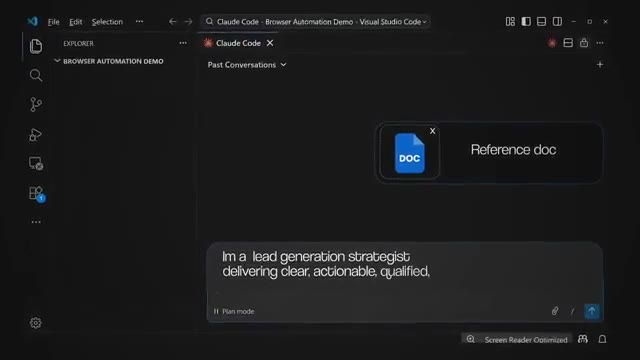
*⏱️ 00:01:00 — Une interface VS Code ouverte montrant une fenêtre de chat avec Claude, où un document de référence est joint et un prompt système sur le rôle de "lead generation strategist" est en cours de saisie.*

---

### ⏱️ `[00:01:14 - 00:01:35]` | Segment #04

**🔊 Audio (Transcription Intégrale Mot pour Mot en Français) :**
> Everything else you're about to learn either feeds into a project or builds on top of it. So picture this, you open a fresh chat next Tuesday inside of that project and you ask, what was the thing that we decided about the Q2 launch last week? And Claude pulls it up. It cites the conversation. It picks up right where you left off. And suddenly, Claude isn't a stateless tool anymore. It's something with continuity. Now, there are six more features that define this level, and they all stack on top of what you just set up.

**👁️ Analyse Visuelle d'Écran (gemini-3.5-flash-lite) :**
**Interface & Outils** : Application web Claude (Anthropic).

**Contenu textuel & Code** : Prompt utilisateur : "What was the thing that we decided about the Q2 launch last week?".

**Action / Démonstration** : Interaction avec l'IA pour récupérer du contexte au sein d'un projet spécifique.

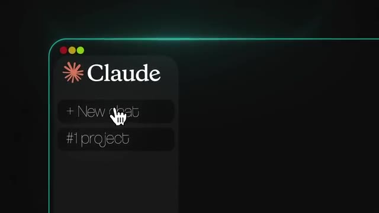
*⏱️ 00:01:19 — Interface de l'application Claude montrant la barre latérale avec les options "New chat" et "#1 project".*

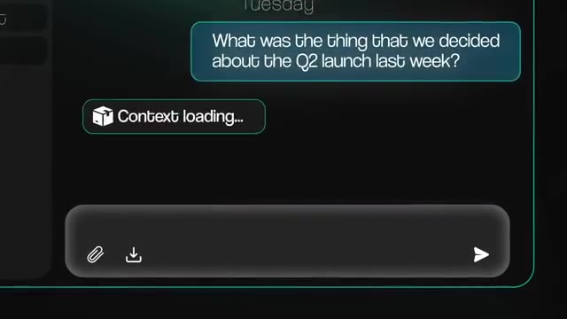
*⏱️ 00:01:24 — Interface de chat Claude affichant une question utilisateur sur le lancement du T2 et un indicateur "Context loading...".*

---

### ⏱️ `[00:01:35 - 00:01:54]` | Segment #05

**🔊 Audio (Transcription Intégrale Mot pour Mot en Français) :**
> So first, we have memory and past chat search. Claude can now remember things across conversations like your role, your preferences, decisions that you made weeks ago. Memory works on every plan, including free. The ability to actually search and pull from past chats is a paid feature, but combined with your project's knowledge base. This is what kills the starting from zero every time problem pretty much forever. Second, we have connectors.

**👁️ Analyse Visuelle d'Écran (gemini-3.5-flash-lite) :**
**Interface & Outils** : Interface graphique animée (motion design) de présentation de fonctionnalités Claude.

**Contenu textuel & Code** : Texte affiché : "Search and pull from past chats (Paid feature)", "Projects Knowledge".

**Action / Démonstration** : Présentation visuelle et comparaison des fonctionnalités de recherche de contexte et de gestion de connaissances par l'IA.

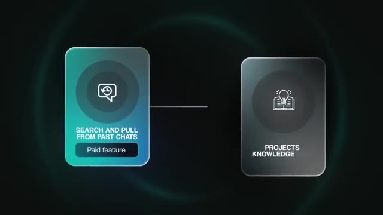
*⏱️ 00:01:50 — Infographie illustrant la connexion entre deux concepts IA : "Search and pull from past chats" (marqué Paid feature) et "Projects Knowledge".*

---

### ⏱️ `[00:01:55 - 00:02:13]` | Segment #06

**🔊 Audio (Transcription Intégrale Mot pour Mot en Français) :**
> Slack, Google Drive, Gmail, GitHub, Notion, Calendar. There's over 50 of them. You just click the plus button in your chat. You pick the tool. You sign in with OAuth and you're basically done. And now you can stop pasting. You can just start asking Claude to summarize threads from your channel last week or pull the latest spec doc from Google Drive or even check what's on your calendar for the week. It just goes and it gets it.

**👁️ Analyse Visuelle d'Écran (gemini-3.5-flash-lite) :**
**Interface & Outils** : Présentation ou face-caméra explicatif sans interface logicielle partagée.

**Contenu textuel & Code** : Explications orales et mise en contexte méthodologique.

**Action / Démonstration** : Explications face caméra et démonstration conceptuelle.

---

### ⏱️ `[00:02:13 - 00:02:48]` | Segment #07

**🔊 Audio (Transcription Intégrale Mot pour Mot en Français) :**
> Third, we have file creation. This one's huge and most people don't know it's shipped to everyone. Claude can now create real Excel spreadsheets with working formulas, PowerPoint decks, Word docs, and PDFs straight from the chat interface. Not just artifacts that you preview, but actual files that you can download and that you could send to a client. And free users have this ability too. This is when chat stops being a brainstorming tool and starts being a deliverable tool. Fourth, we have artifacts, but the version most people don't know about yet. You've probably seen artifacts before. The side panel where Claude builds a quick interactive thing. Most people think of it as like a code preview, but it's not. Because now we have artifacts with persistent storage, and they remember data between sessions. They can call

**👁️ Analyse Visuelle d'Écran (gemini-3.5-flash-lite) :**
**Interface & Outils** : Google Docs (ou éditeur de document similaire) pour l'image 1 ; Application web de création musicale par IA pour l'image 3.

**Contenu textuel & Code** : Image 1 : Texte "Insight 2: Strategic Menu Optimization" et graphiques de données financières. Image 3 : Séquenceur rythmique avec des styles comme "Techno", "Trap", "Minimal".

**Action / Démonstration** : Image 1 : Affichage du résultat d'une analyse générée. Image 3 : Manipulation de paramètres de création sonore sur une interface d'outil de brainstorming/création.

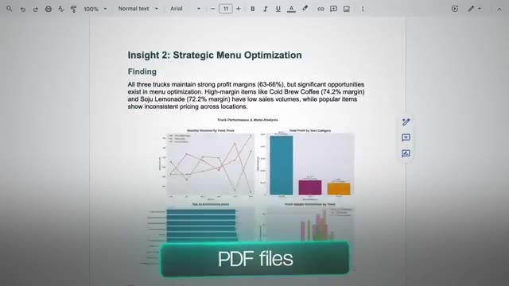
*⏱️ 00:02:22 — Un document texte structuré affichant des données analytiques professionnelles sur l'optimisation d'un menu de food truck, incluant des graphiques de performance et de marge.*

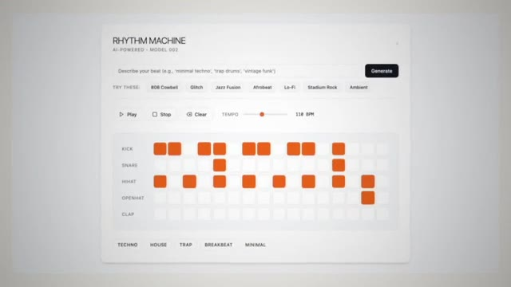
*⏱️ 00:02:39 — Une interface web minimaliste nommée "RHYTHM MACHINE" permettant de générer des beats musicaux via des sélecteurs de style et un séquenceur pas à pas.*

---

### ⏱️ `[00:02:48 - 00:03:19]` | Segment #08

**🔊 Audio (Transcription Intégrale Mot pour Mot en Français) :**
> Claude's API directly so the app you build can think for itself. And you can publish them with a public link. And that means a non-coder can sit down in a Claude chat, build a customer feedback tracker for their business, save it, send the link to their team, and have a working tool by lunch. No lovable, no bolt, no custom development, just a conversation. Every time you open that artifact, it refreshes the data instantly. Fifth, we have inline visuals. These are different from artifacts, even though they sound similar. So when a chart or diagram would explain something better than text, Claude just builds one inside of your conversation. You can click it, you can swap the chart type, you can ask Claude to add variables and update it live.

**👁️ Analyse Visuelle d'Écran (gemini-3.5-flash-lite) :**
**Interface & Outils** : Présentation ou face-caméra explicatif sans interface logicielle partagée.

**Contenu textuel & Code** : Explications orales et mise en contexte méthodologique.

**Action / Démonstration** : Explications face caméra et démonstration conceptuelle.

---

### ⏱️ `[00:03:19 - 00:03:39]` | Segment #09

**🔊 Audio (Transcription Intégrale Mot pour Mot en Français) :**
> You could also drop in something like a CSV and ask it to visualize what is on that document. You can compare two options side by side. So the difference from artifacts is that these are ephemeral. They live in the chat. They change as the conversation evolves and they don't save as files. This comes free on every plan and they came to co-work last week too. Now the sixth thing here is that Claude also lives inside of Excel, PowerPoint, and Word as native add-ons.

**👁️ Analyse Visuelle d'Écran (gemini-3.5-flash-lite) :**
**Interface & Outils** : Présentation ou face-caméra explicatif sans interface logicielle partagée.

**Contenu textuel & Code** : Explications orales et mise en contexte méthodologique.

**Action / Démonstration** : Explications face caméra et démonstration conceptuelle.

---

### ⏱️ `[00:03:40 - 00:03:58]` | Segment #10

**🔊 Audio (Transcription Intégrale Mot pour Mot en Français) :**
> These run inside the actual Microsoft apps. So you could open Excel, you could activate the add-in and Claude reads your multi-tab workbook, explains formulas with cell-level citations, and it can edit assumptions while preserving every dependency. PowerPoint can read your existing slide master, your fonts, your layouts, your brand colors, and you can build slides that match. Word also does the same thing for Word docs.

**👁️ Analyse Visuelle d'Écran (gemini-3.5-flash-lite) :**
**Interface & Outils** : Microsoft Excel, Microsoft PowerPoint (via des add-ins d'IA).

**Contenu textuel & Code** : Textes de rapports financiers (Executive Summary, ROI, NPV), étapes de flux de travail automatisées (Run Python script, Generate PowerPoint presentation).

**Action / Démonstration** : Analyse de document financier, exécution de scripts Python pour automatisation, génération automatique de présentations PowerPoint.

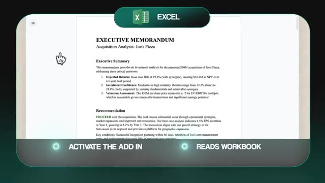
*⏱️ 00:03:44 — Interface d'un add-in Excel affichant un "Executive Memorandum" pour l'acquisition de "Joe's Pizza", avec des boutons d'état soulignés en bas.*

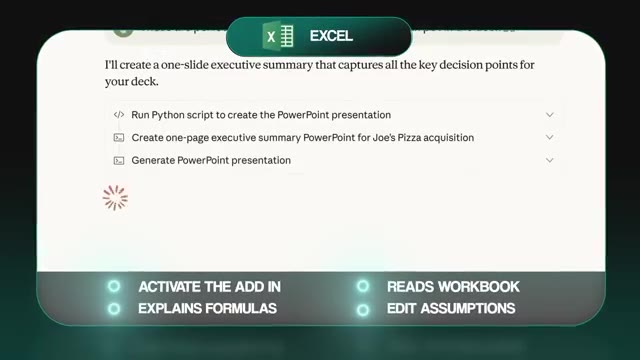
*⏱️ 00:03:49 — Interface d'agent IA au sein d'Excel montrant une liste de tâches en cours (exécution de script Python, création de résumé, génération de PowerPoint) avec une icône de chargement.*

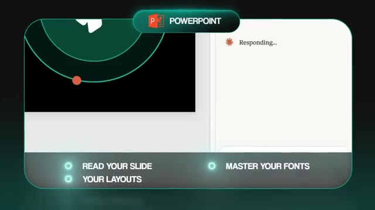
*⏱️ 00:03:53 — Interface d'un add-in PowerPoint en cours de traitement, affichant "Responding..." avec des options de contrôle pour la mise en page et les polices.*

---

### ⏱️ `[00:03:58 - 00:04:28]` | Segment #11

**🔊 Audio (Transcription Intégrale Mot pour Mot en Français) :**
> And as of April 2026, all three share context across these apps. So you can analyze data in Excel, switch over to PowerPoint, and Cloud can build a deck using that same analysis. So if your day lives in Microsoft Office, then this is the integration that can change everything for you. A quick note here on what's free versus paid in this section. We got memory, file creation, and inline visuals work for everyone, but past chat search, persistent storage for artifacts, and the office add-ins are pro and up. So if you want the full picture, that's where the upgrade pays for itself. But think of it like this. Level 1 was a brilliant intern with no memory. Level 2 is that same intern, but now they remember every conversation.

**👁️ Analyse Visuelle d'Écran (gemini-3.5-flash-lite) :**
**Interface & Outils** : Interface utilisateur de tarification logicielle (Web UI).

**Contenu textuel & Code** : Texte affichant « Free plan », « $0 » et l'option « Memory » avec une coche verte.

**Action / Démonstration** : Présentation d'une offre tarifaire pour un service IA incluant la gestion de la mémoire.

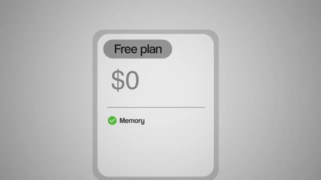
*⏱️ 00:04:13 — Une carte graphique montrant une offre « Free plan » à 0$ incluant une fonctionnalité nommée « Memory ».*

---

### ⏱️ `[00:04:28 - 00:04:47]` | Segment #12

**🔊 Audio (Transcription Intégrale Mot pour Mot en Français) :**
> They've got, you know, a folder and project docs and stuff like that, and they can pull anything from your tools without asking. And at the end of the day, they can hand you a finished deck or a working tool that you can share with your team. And you can do real work here. You can save five plus hours a week. This is where Claude starts paying for itself. But here's the ceiling. Claude can't actually do anything on your machine because you're still copying outputs into other tools.

**👁️ Analyse Visuelle d'Écran (gemini-3.5-flash-lite) :**
**Interface & Outils** : Claude Code (représentation graphique).

**Contenu textuel & Code** : Texte affiché : "Remember convo", "Folder & project docs", "Auto tool access", "Claude Code Level 2 Intern".

**Action / Démonstration** : Aucune, il s'agit d'un visuel explicatif fixe.

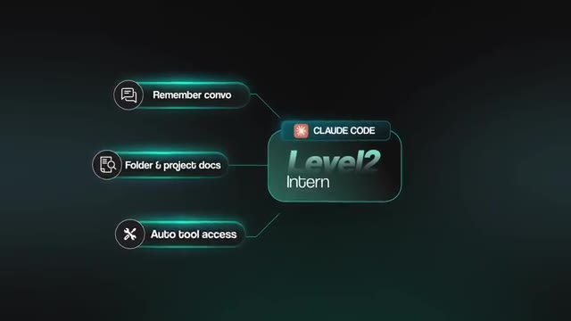
*⏱️ 00:04:33 — Un graphique conceptuel illustrant les fonctionnalités d'un "Level 2 Intern" basé sur Claude Code, montrant trois piliers : mémorisation des conversations, accès aux dossiers et documents de projet, et accès automatique aux outils.*

---

### ⏱️ `[00:04:47 - 00:05:07]` | Segment #13

**🔊 Audio (Transcription Intégrale Mot pour Mot en Français) :**
> You're still executing changes yourself. You're still running certain things by hand. So Claude Chat is basically the conversation surface, and now you're about to outgrow it. So the cheat code to level 3 is stop trying to make chat do everything, open up Claude Desktop, and click the Cowork tab. And that's where this next level starts. So level 3, the intermediate. If you've ever found yourself thinking, I wish Claude could just go do this on my computer instead of telling me how, then you're ready for level 3.

**👁️ Analyse Visuelle d'Écran (gemini-3.5-flash-lite) :**
**Interface & Outils** : Présentation ou face-caméra explicatif sans interface logicielle partagée.

**Contenu textuel & Code** : Explications orales et mise en contexte méthodologique.

**Action / Démonstration** : Explications face caméra et démonstration conceptuelle.

---

### ⏱️ `[00:05:07 - 00:05:26]` | Segment #14

**🔊 Audio (Transcription Intégrale Mot pour Mot en Français) :**
> So quick note for my NNN folks watching this. Cowork is basically NNN that lives on your computer with full file system access. You describe the outcome. Cloud figures out how to get there. And if you're already automation minded, then you'll feel right at home with Cloud Cowork. So picture this. You point Cowork at your downloads folder. Three months of PDFs, screenshots, random things, old invoices, and it's just chaos. But you tell it one time.

**👁️ Analyse Visuelle d'Écran (gemini-3.5-flash-lite) :**
**Interface & Outils** : Navigateur de fichiers natif (macOS Finder), interface de l'application Cloud Cowork.

**Contenu textuel & Code** : Structure de dossiers (Documents, Projects, Meeting Transcripts, etc.), navigation dans le système de fichiers.

**Action / Démonstration** : Sélection et navigation dans les répertoires pour illustrer l'accès complet au système de fichiers par l'IA.

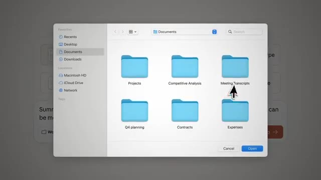
*⏱️ 00:05:12 — Une fenêtre système macOS de sélection de fichiers affichant les dossiers « Documents » avec des sous-dossiers comme « Projects », « Competitive Analysis » et « Meeting Transcripts ».*

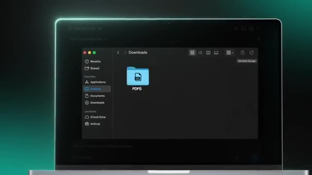
*⏱️ 00:05:21 — Une vue de l'interface de "Cloud Cowork" montrant une fenêtre de gestion de fichiers intégrée au sein d'une interface de type application ou éditeur, avec un dossier « PDFS » visible dans le répertoire « Downloads ».*

---

### ⏱️ `[00:05:26 - 00:05:59]` | Segment #15

**🔊 Audio (Transcription Intégrale Mot pour Mot en Français) :**
> Can you go into the downloads folder, sort everything by type, rename everything consistently, write me a summary of what's in there, and then you can go make a coffee, you can come back, and it'll be done. That is a legit Coworker. But a quick heads up before we dive in. Cowork is paid only. It comes with any pro, max, team, or enterprise plan. So if you're still on the free and you've gotten this far, this is probably your sign to upgrade. So let's talk about five features that define this level. The first one is file system access. Cloud Cowork runs the code in an isolated virtual machine, but with real read and write access to whatever folders that you granted access to. So it can't touch what you don't give it permission to touch, but what you do give it permission, it can completely own. It can read, edit, create,

**👁️ Analyse Visuelle d'Écran (gemini-3.5-flash-lite) :**
**Interface & Outils** : Éditeur de code (VS Code ou environnement similaire).

**Contenu textuel & Code** : Arborescence de fichiers et code source visible sur l'écran d'ordinateur.

**Action / Démonstration** : Le présentateur travaille sur son poste de travail, illustrant l'utilisation de l'outil mentionné dans le script audio.

*⏱️ 00:05:34 — Le présentateur est assis à son bureau, face à un écran incurvé affichant une interface d'éditeur de code (type VS Code).*

---

### ⏱️ `[00:06:00 - 00:06:18]` | Segment #16

**🔊 Audio (Transcription Intégrale Mot pour Mot en Français) :**
> organize real work on real files. Second, we have skills. Now skills are also available in chat, But in this level, skills are reusable workflows that you define as a simple markdown file. You build a skill once, weekly client reporting, and then you never have to explain that again. You just say, hey, generate this week's report. And Claude pulls up the skill, reads it, runs it, and then understands exactly what you want. And here's what's really cool.

**👁️ Analyse Visuelle d'Écran (gemini-3.5-flash-lite) :**
**Interface & Outils** : Présentation ou face-caméra explicatif sans interface logicielle partagée.

**Contenu textuel & Code** : Explications orales et mise en contexte méthodologique.

**Action / Démonstration** : Explications face caméra et démonstration conceptuelle.

---

### ⏱️ `[00:06:18 - 00:06:38]` | Segment #17

**🔊 Audio (Transcription Intégrale Mot pour Mot en Français) :**
> There are over 100 skills already published. There's 16 or more official ones from Anthropic, plus a whole community marketplace. Front end design, PDF manipulation, Excel work, document creation, you name it. There's skills for marketing, there's skills for accounting, there's skills for advertising. So you don't always have to build from scratch. You could search first, install with one command, and then you could customize that skill from there. Just be careful where you're downloading skills from.

**👁️ Analyse Visuelle d'Écran (gemini-3.5-flash-lite) :**
**Interface & Outils** : Navigateur web (Claude Skills Marketplace), Interface de chat IA (type Claude/Opus 4.1), Google Docs.

**Contenu textuel & Code** : Texte promotionnel "The Claude Skills Marketplace for Small Business & Agencies", document "United States Indie Film Market Analysis 2025".

**Action / Démonstration** : Présentation de l'écosystème de compétences (Skills Marketplace) suivi d'une démonstration de création ou édition de document assistée par IA.

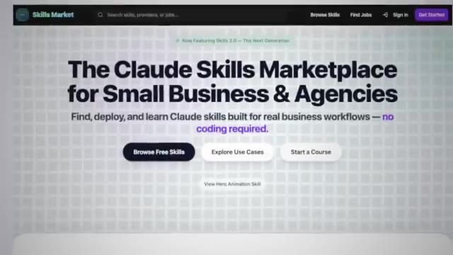
*⏱️ 00:06:23 — Page d'accueil de la plateforme "Claude Skills Marketplace" présentant les services pour petites entreprises et agences.*

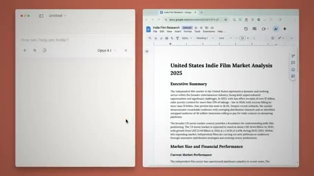
*⏱️ 00:06:28 — Capture d'écran divisée en deux volets : une interface de chat (Opus 4.1) à gauche et un document Google Docs ouvert sur une analyse de marché du cinéma indépendant à droite.*

---

### ⏱️ `[00:06:38 - 00:06:58]` | Segment #18

**🔊 Audio (Transcription Intégrale Mot pour Mot en Français) :**
> And same skills work from co-work to chat and cloud code. You build it once, you can run it anywhere. Third, we have scheduled tasks. You can type slash schedule in any co-work conversation, and Claude saves the task to run on a certain cadence that you pick. Daily stand-ups at 8 a.m. Weekly competitor briefs every Monday or Friday. Monthly reports. Now, one caveat with these scheduled tasks is your computer needs to be awake and the desktop app needs to be open.

**👁️ Analyse Visuelle d'Écran (gemini-3.5-flash-lite) :**
**Interface & Outils** : Interface logicielle de type assistant IA, système de planification de tâches.

**Contenu textuel & Code** : Texte affiché : « Scheduled tasks », « Runs on cadence », « /schedule », « Monthly reports ».

**Action / Démonstration** : Illustration visuelle du concept de planification récurrente de tâches au sein d'un écosystème d'IA (automatisation de rapports mensuels).

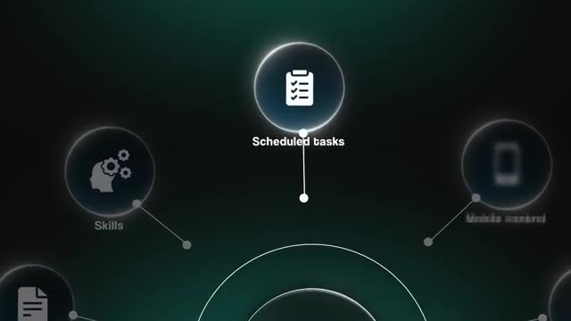
*⏱️ 00:06:43 — Un graphique vectoriel interactif montrant une interface nodale avec l'option « Scheduled tasks » mise en avant.*

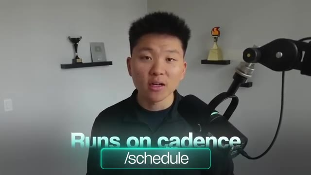
*⏱️ 00:06:48 — Le présentateur face caméra avec une incrustation textuelle indiquant « Runs on cadence » et la commande « /schedule ».*

*⏱️ 00:06:53 — Une vue montrant un utilisateur travaillant sur un ordinateur, avec une notification superposée « Monthly reports » accompagnée d'une icône de calendrier validé.*

---

### ⏱️ `[00:06:58 - 00:07:16]` | Segment #19

**🔊 Audio (Transcription Intégrale Mot pour Mot en Français) :**
> But you could also do routines, which are cloud-based scheduled tasks. And we'll talk more about some of this 24-7 type of stuff in level 5. But the fourth feature here is mobile control. You can pair your phone with your desktop using dispatch. Now you can send tasks from anywhere. When you're commuting, when you're at the gym, when you're in a meeting. Cloud works on your desktop while you're away, and it pings you when it's done.

**👁️ Analyse Visuelle d'Écran (gemini-3.5-flash-lite) :**
**Interface & Outils** : Aucune interface logicielle lisible n'est présentée.

**Contenu textuel & Code** : Texte informatif uniquement (ROUTINES, COMMUTING).

**Action / Démonstration** : Aucune action de démonstration technique ou manipulation d'outil n'est visible dans ce segment.

---

### ⏱️ `[00:07:16 - 00:07:35]` | Segment #20

**🔊 Audio (Transcription Intégrale Mot pour Mot en Français) :**
> And this is when Cowork stops feeling like a tool, and it starts feeling like a legit coworker. Fifth, we have Cloud Design. This is the newest piece of the ecosystem, and it is really cool. It's a separate Anthropic Labs product. It's included with your pro plan. You describe a prototype, a slide deck, a landing page, or a one-pager in plain English. and Cloud builds it and designs it. And then you're just able to, through natural conversation, refine it.

**👁️ Analyse Visuelle d'Écran (gemini-3.5-flash-lite) :**
**Interface & Outils** : Interface web de génération de design/contenu (type outil de conception assistée par IA).

**Contenu textuel & Code** : Texte affiché : "AIS", "Prototype", "Slide deck", "Landing page", "One pager", "Make the aspect ratio 16:9".

**Action / Démonstration** : Présentation des capacités de création de supports visuels et de design via l'outil "Claude Design" au sein d'un écosystème IA.

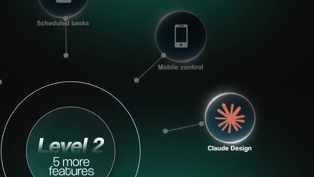
*⏱️ 00:07:21 — Une infographie stylisée présentant le "Level 2" d'un écosystème avec diverses fonctionnalités, dont "Claude Design" mis en avant.*

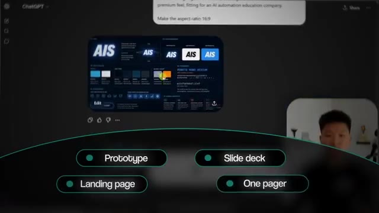
*⏱️ 00:07:31 — Une interface web montrant le résultat d'une génération IA (branding "AIS") avec une barre de menu inférieure proposant des options de création : "Prototype", "Slide deck", "Landing page", "One pager".*

---

### ⏱️ `[00:07:35 - 00:07:55]` | Segment #21

**🔊 Audio (Transcription Intégrale Mot pour Mot en Français) :**
> You can do direct edits or you can have different tweaks. When this dropped, people started calling it the Figma killer instantly. And that should tell you something. So two things make Cloud Design different from a normal AI design tool. First, it can read your whole brand. You can drop in a GitHub repo, your code base, design files, brand guidelines, and it can build you what's called a design system. Does this from your colors, your fonts, your typography, all that kind of stuff.

**👁️ Analyse Visuelle d'Écran (gemini-3.5-flash-lite) :**
**Interface & Outils** : Interface graphique de présentation animée (Motion graphics).

**Contenu textuel & Code** : Liste des entrées de données pour l'outil IA (GitHub, base de code, fichiers design, guides de style).

**Action / Démonstration** : Présentation des capacités de traitement de données de marque par Claude Design via des animations graphiques.

*⏱️ 00:07:45 — Carte animée affichant "IT CAN READ YOUR WHOLE BRAND" avec une icône de badge.*

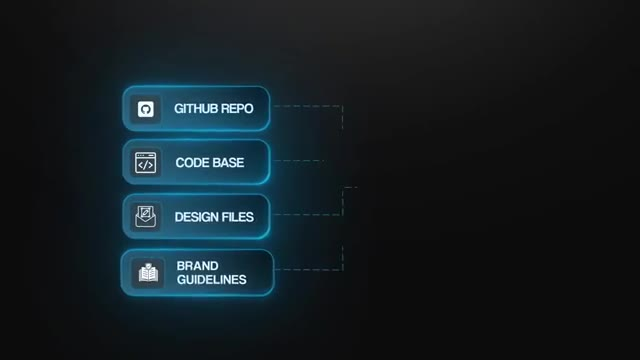
*⏱️ 00:07:50 — Schéma conceptuel listant les sources intégrables : "GITHUB REPO", "CODE BASE", "DESIGN FILES", "BRAND GUIDELINES".*

---

### ⏱️ `[00:07:55 - 00:08:15]` | Segment #22

**🔊 Audio (Transcription Intégrale Mot pour Mot en Français) :**
> And then it applies that to every single project automatically. So your output looks like your brand instead of generic AI slop. Second, when you're done, it packages everything into a handoff bundle for CloudCode or for Canva or just a zip file. Whatever you want to do with that whole project, you can take somewhere else. So a non-coder can design a working front end in CloudDesign and then ship it to production through CloudCode without writing a single line of code.

**👁️ Analyse Visuelle d'Écran (gemini-3.5-flash-lite) :**
**Interface & Outils** : Éditeur de code (IDE, probablement VS Code).

**Contenu textuel & Code** : Lignes de code source textuel affichées dans l'IDE.

**Action / Démonstration** : Développement ou édition de code source par l'utilisateur.

*⏱️ 00:08:10 — Vue arrière d'un utilisateur travaillant sur une configuration à double écran, montrant une interface d'éditeur de code (IDE) remplie de lignes de code.*

---

### ⏱️ `[00:08:15 - 00:08:35]` | Segment #23

**🔊 Audio (Transcription Intégrale Mot pour Mot en Français) :**
> And that's a complete pipeline from idea to shipped product all inside of Anthropic. Two more things worth knowing about. We've got plugins, which are pre-built bundles of skills and connectors and potentially hooks and agents that you just install in one click. And there's a whole marketplace of them now. And we have computer use. So for apps that don't have connectors, Claude can navigate them visually the way a human would by, you know, clicking, typing, hitting tab, submitting.

**👁️ Analyse Visuelle d'Écran (gemini-3.5-flash-lite) :**
**Interface & Outils** : Interface utilisateur de plateforme d'automatisation (potentiellement liée à l'écosystème Anthropic/Claude).

**Contenu textuel & Code** : Schéma organisationnel des plugins : Skills, Connectors, Agents, Hooks.

**Action / Démonstration** : Clic de souris sur le bouton « INSTALL » pour le module « Agents ».

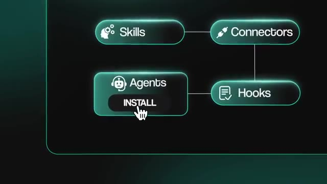
*⏱️ 00:08:25 — Interface graphique sombre affichant un diagramme de composants (Skills, Connectors, Agents, Hooks) avec un curseur interactif sur le bouton « INSTALL » de la catégorie « Agents ».*

---

### ⏱️ `[00:08:36 - 00:08:57]` | Segment #24

**🔊 Audio (Transcription Intégrale Mot pour Mot en Français) :**
> And that's available on Mac and Windows today. Now, two reasons that people stall at this level. Some people get scared by anything that feels technical. And that's fair. But the next Surface has a desktop app with no terminal needed. Others hit Cowork's ceiling. It's safe and friendly, but less precise than what comes next. So when you need like legit version control, real engineering rigor or systems that clients would pay $5,000 plus for, you might outgrow Cowork.

**👁️ Analyse Visuelle d'Écran (gemini-3.5-flash-lite) :**
**Interface & Outils** : Présentation ou face-caméra explicatif sans interface logicielle partagée.

**Contenu textuel & Code** : Explications orales et mise en contexte méthodologique.

**Action / Démonstration** : Explications face caméra et démonstration conceptuelle.

---

### ⏱️ `[00:08:57 - 00:09:16]` | Segment #25

**🔊 Audio (Transcription Intégrale Mot pour Mot en Français) :**
> And this is the first level where you save, you know, 10 plus hours a week. The first level where non-coders can sell automation as a service. If you're running an AI automation business, this is your minimum bar. So the cheat code to get to level four would be to set up a folder structure that Claude can rely on. You know, like an about me file, a templates folder, a projects folder, maybe an outputs folder. And you just tell cowork, always read about me first.

**👁️ Analyse Visuelle d'Écran (gemini-3.5-flash-lite) :**
**Interface & Outils** : Logiciel de montage graphique (non identifié, utilisé pour les overlays).

**Contenu textuel & Code** : Textes informatifs sur les étapes de progression ("V3 Intermediate", "10+ Hours a week", "Sell automation as a service") et arborescence de fichiers ("Set up folders" > "About me", "Templates folder").

**Action / Démonstration** : Présentation visuelle de la stratégie de flux de travail pour les entreprises d'automatisation IA.

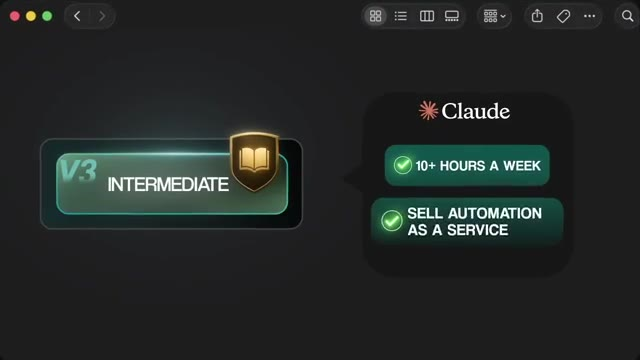
*⏱️ 00:09:02 — Une infographie présente le niveau "V3 Intermediate" avec deux avantages clés : économiser plus de 10 heures par semaine et vendre l'automatisation en tant que service via Claude.*

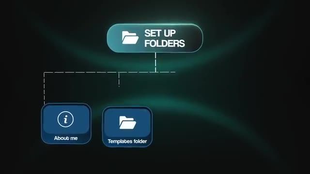
*⏱️ 00:09:12 — Un diagramme organisationnel illustrant la structure de dossiers recommandée : un dossier racine "Set up folders" divisé en deux sous-dossiers : "About me" et "Templates folder".*

---

### ⏱️ `[00:09:16 - 00:09:39]` | Segment #26

**🔊 Audio (Transcription Intégrale Mot pour Mot en Français) :**
> Never edit my templates. Always deliver to the outputs folder. And that structure is what makes Claude cowork feel like an actual coworker instead of just an unpredictable virtual assistant. Which brings us on to level four, where we get a little bit more advanced. So Boris Cherny, the guy who actually built Cloud Code at Anthropic, runs five Cloud sessions in parallel at the minimum every single day. He's got these unnumbered terminal tabs, and each one is in its own isolated workspace, meaning they can't conflict each other.

**👁️ Analyse Visuelle d'Écran (gemini-3.5-flash-lite) :**
**Interface & Outils** : Interface de développement intégrée (Agent AI / Claude Code).

**Contenu textuel & Code** : Logs d'édition de fichiers (src/components/AlignmentGrid.tsx, src/lib/spring.ts), état des tâches (Verify constraint solver convergence), historique des commandes ("npm run dev") et statut de la branche git.

**Action / Démonstration** : Exécution d'un agent IA gérant automatiquement la migration d'un client API, la résolution d'erreurs de build et la validation de tests via un terminal intégré.

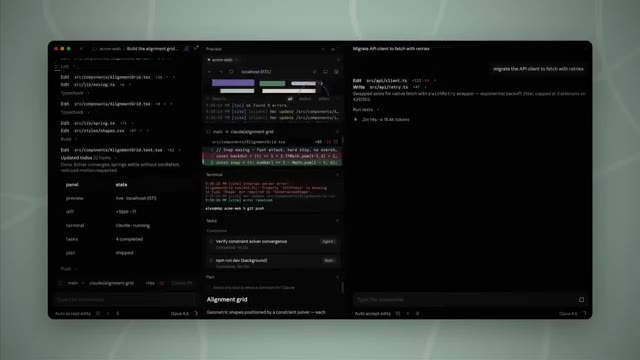
*⏱️ 00:09:33 — Interface détaillée de l'agent de développement IA (Claude Code/Opus) affichant des logs d'édition de fichiers, l'état des tâches, un terminal intégré et un aperçu du développement en cours.*

---

### ⏱️ `[00:09:39 - 00:09:58]` | Segment #27

**🔊 Audio (Transcription Intégrale Mot pour Mot en Français) :**
> They can't see each other's files. He fires all of them off, and then he walks away, and he comes back to multiple completed pull requests that are ready for his review. And that's not parallel productivity. That's a different category of work. And before any non-coder clicks off, the code tab inside of Cloud Desktop has the same engine as the terminal version, so you don't have to be in the CLI if you don't want to. The terminal is just faster once you've kind of gotten used to it, at least in my opinion.

**👁️ Analyse Visuelle d'Écran (gemini-3.5-flash-lite) :**
**Interface & Outils** : Diagramme de workflow d'agents (Context Mode).

**Contenu textuel & Code** : Noms des agents : "frontend-agent", "backend-agent", "test-agent", "review-agent", "pr-agent" avec leurs statuts respectifs (rendering, updating, running, evaluating, preparing).

**Action / Démonstration** : Représentation visuelle de l'exécution simultanée de tâches de développement par des agents IA autonomes.

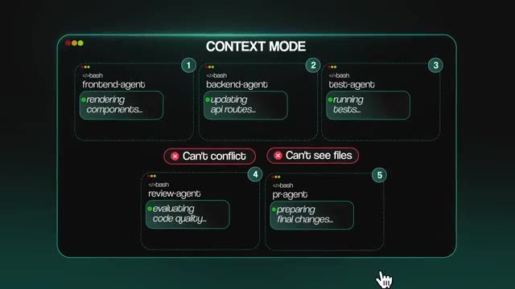
*⏱️ 00:09:44 — Un graphique schématique illustrant le "Context Mode" avec 5 agents distincts (frontend, backend, test, review, pr) travaillant en parallèle sans conflits.*

---

### ⏱️ `[00:09:58 - 00:10:16]` | Segment #28

**🔊 Audio (Transcription Intégrale Mot pour Mot en Français) :**
> But stay with me. Five things make level four click. The first is a claude.md file. This is basically just a markdown file in your project folder that claude reads at the start of every session. It's got things like your tech stack or your naming convention, who you are and what this project's goal is. Things like never do X or never write with mdashes. The catch is that claude reads this file on every single conversation.

**👁️ Analyse Visuelle d'Écran (gemini-3.5-flash-lite) :**
**Interface & Outils** : Présentation ou face-caméra explicatif sans interface logicielle partagée.

**Contenu textuel & Code** : Explications orales et mise en contexte méthodologique.

**Action / Démonstration** : Explications face caméra et démonstration conceptuelle.

---

### ⏱️ `[00:10:16 - 00:10:35]` | Segment #29

**🔊 Audio (Transcription Intégrale Mot pour Mot en Français) :**
> So if it blows up, you're going to be paying more tokens for that consistently. So keep that under about 200 lines. You can also push important details into separate files and reference them with, you know, at file name. So Claude only actually reads them when it needs to read them. Now, here's the move that separates level four users from everyone else. Every single time Claude makes a mistake, you say, hey, update your Claude.md so that you don't make that mistake again.

**👁️ Analyse Visuelle d'Écran (gemini-3.5-flash-lite) :**
**Interface & Outils** : Présentation ou face-caméra explicatif sans interface logicielle partagée.

**Contenu textuel & Code** : Explications orales et mise en contexte méthodologique.

**Action / Démonstration** : Explications face caméra et démonstration conceptuelle.

---

### ⏱️ `[00:10:35 - 00:10:57]` | Segment #30

**🔊 Audio (Transcription Intégrale Mot pour Mot en Français) :**
> And Anthropix's own team does this. After a few weeks, it literally trains itself on how you work. Second, we have plan mode. So if you hit shift tab twice, Claude will switch into plan mode. It reads your code. It presents a plan. It waits for your approval. It asks you questions. And there's actually a hidden setting called Opus plan that takes us even further. It basically means that Opus does the planning and Sonnet does the execution. So you get the smart model where it matters most, and you get the cheaper model for the grunt work.

**👁️ Analyse Visuelle d'Écran (gemini-3.5-flash-lite) :**
**Interface & Outils** : Présentation ou face-caméra explicatif sans interface logicielle partagée.

**Contenu textuel & Code** : Explications orales et mise en contexte méthodologique.

**Action / Démonstration** : Explications face caméra et démonstration conceptuelle.

---

### ⏱️ `[00:10:57 - 00:11:18]` | Segment #31

**🔊 Audio (Transcription Intégrale Mot pour Mot en Français) :**
> It cuts your cost in half without losing quality. Third, we have sub-agents. Specialized clods for specialized jobs. One for tests, one for security review, one for documentation. Each runs in its own context window so the noise of the main session doesn't pollute sub-agent. And also, vice versa, the sub-agent doesn't pollute your main session. And you can have multiple of these sub-agents running in parallel. You're effectively building a small engineering team, but they just can't talk to each other.

**👁️ Analyse Visuelle d'Écran (gemini-3.5-flash-lite) :**
**Interface & Outils** : Présentation ou face-caméra explicatif sans interface logicielle partagée.

**Contenu textuel & Code** : Explications orales et mise en contexte méthodologique.

**Action / Démonstration** : Explications face caméra et démonstration conceptuelle.

---

### ⏱️ `[00:11:18 - 00:11:38]` | Segment #32

**🔊 Audio (Transcription Intégrale Mot pour Mot en Français) :**
> They communicate through that main session. Fourth, we have work trees. So you can type clod-worktree feature name. Claude spins up an isolated Git workspace on its own branch. You could open another terminal and you could do it again. And now you've got two, three, or four clods working at the same time without their files ever overwriting each other. I think that three or four is usually the comfortable sweet spot when you're working on different features and you can implement a feature in one.

**👁️ Analyse Visuelle d'Écran (gemini-3.5-flash-lite) :**
**Interface & Outils** : Présentation ou face-caméra explicatif sans interface logicielle partagée.

**Contenu textuel & Code** : Explications orales et mise en contexte méthodologique.

**Action / Démonstration** : Explications face caméra et démonstration conceptuelle.

---

### ⏱️ `[00:11:38 - 00:11:59]` | Segment #33

**🔊 Audio (Transcription Intégrale Mot pour Mot en Français) :**
> You can fix a bug in another. You can write tests in a third. And all of these, once again, can be running in parallel. Fifth, we have MCP, but with a big asterisk. MCP, Model Context Protocol, lets you plug pretty much any external tool into Claude. But Anthropics' own docs say something that most people miss, which is when a CLI tool exists for the job, use the CLI instead of the MCP. Like for GitHub or for AWS or for Google Workspace.

**👁️ Analyse Visuelle d'Écran (gemini-3.5-flash-lite) :**
**Interface & Outils** : Présentation ou face-caméra explicatif sans interface logicielle partagée.

**Contenu textuel & Code** : Explications orales et mise en contexte méthodologique.

**Action / Démonstration** : Explications face caméra et démonstration conceptuelle.

---

### ⏱️ `[00:11:59 - 00:12:22]` | Segment #34

**🔊 Audio (Transcription Intégrale Mot pour Mot en Français) :**
> They use 60 to 70% fewer tokens than the equivalent MCP server because nothing gets loaded into your context until you actually run it. When you do use MCP, Anthropics shipped a feature in January called Tool Search that auto-deferred tool loading the moment your MCP overhead crosses 10% of your window. So it cuts that overhead by 85% zero config. But the rule still holds CLI first, API endpoints second, skills third, and MCP only when nothing else fits.

**👁️ Analyse Visuelle d'Écran (gemini-3.5-flash-lite) :**
**Interface & Outils** : Présentation ou face-caméra explicatif sans interface logicielle partagée.

**Contenu textuel & Code** : Explications orales et mise en contexte méthodologique.

**Action / Démonstration** : Explications face caméra et démonstration conceptuelle.

---

### ⏱️ `[00:12:22 - 00:12:42]` | Segment #35

**🔊 Audio (Transcription Intégrale Mot pour Mot en Français) :**
> At least that's the way I think about it. Okay, so the power moves. Master your context window. That 1 million token window on Opus 4.7 still gets sloppy past, you know, about 50% capacity. So two commands fix this. Slash compact summarizes older history into a tight summary so your session keeps going. So you can run it proactively, not when you see warnings because it's already too late. You can also use slash context, which shows where your tokens are going.

**👁️ Analyse Visuelle d'Écran (gemini-3.5-flash-lite) :**
**Interface & Outils** : Présentation ou face-caméra explicatif sans interface logicielle partagée.

**Contenu textuel & Code** : Explications orales et mise en contexte méthodologique.

**Action / Démonstration** : Explications face caméra et démonstration conceptuelle.

---

### ⏱️ `[00:12:43 - 00:13:02]` | Segment #36

**🔊 Audio (Transcription Intégrale Mot pour Mot en Français) :**
> Combine these with prompt caching, which is automatic in cloud code, and your cost can drop 60 to 90% on long sessions. You also got auto mode plus slash focus. So stop hitting yes 30 times a session. Hit shift tab to cycle into auto mode and Claude routes safe commands through a classifier instead of asking you. And you can also type slash focus and it hides the intermediate steps so you only see the final result.

**👁️ Analyse Visuelle d'Écran (gemini-3.5-flash-lite) :**
**Interface & Outils** : Présentation ou face-caméra explicatif sans interface logicielle partagée.

**Contenu textuel & Code** : Explications orales et mise en contexte méthodologique.

**Action / Démonstration** : Explications face caméra et démonstration conceptuelle.

---

### ⏱️ `[00:13:02 - 00:13:23]` | Segment #37

**🔊 Audio (Transcription Intégrale Mot pour Mot en Français) :**
> And this is exactly how Boris runs his five parallel sessions. Once Claude is cooking, you switch focus to the next one. We've also got the verification loop. So Boris, once again, from the Claude Code team says, this is the single most important thing that you can do at this level. Give Claude a way to check its own work. So he pairs Claude code with a Chrome extension. So Claude can actually open up a browser, test the UI, and iterate until both the code works and the UX feels right.

**👁️ Analyse Visuelle d'Écran (gemini-3.5-flash-lite) :**
**Interface & Outils** : Présentation ou face-caméra explicatif sans interface logicielle partagée.

**Contenu textuel & Code** : Explications orales et mise en contexte méthodologique.

**Action / Démonstration** : Explications face caméra et démonstration conceptuelle.

---

### ⏱️ `[00:13:23 - 00:13:43]` | Segment #38

**🔊 Audio (Transcription Intégrale Mot pour Mot en Français) :**
> And he says this single habit has 2 to 3x'd the quality of what he's gotten back. You can also have it take screenshots to make sure everything looks right. You can have it just, you know, get in the cycle of not coming to you with a POC until it's tested itself. You can also start building some custom slash commands. So if you ever find that you're typing the same prompt twice, turn it into a slash command. Boris uses one called slash commit push PR dozens of times a day.

**👁️ Analyse Visuelle d'Écran (gemini-3.5-flash-lite) :**
**Interface & Outils** : Présentation ou face-caméra explicatif sans interface logicielle partagée.

**Contenu textuel & Code** : Explications orales et mise en contexte méthodologique.

**Action / Démonstration** : Explications face caméra et démonstration conceptuelle.

---

### ⏱️ `[00:13:43 - 00:14:03]` | Segment #39

**🔊 Audio (Transcription Intégrale Mot pour Mot en Français) :**
> It does the entire commit. It does everything just with one slash command now. And these live in the .cloud folder in a subfolder called commands. And you can share them with your team and you can share them across your organization. Now, there are some other side tools that I wanted to talk about. So there's one called slash rewind, or you can just hit escape twice, I believe. And this drops a failed attempt out of context completely instead of polluting the session with corrections.

**👁️ Analyse Visuelle d'Écran (gemini-3.5-flash-lite) :**
**Interface & Outils** : Présentation ou face-caméra explicatif sans interface logicielle partagée.

**Contenu textuel & Code** : Explications orales et mise en contexte méthodologique.

**Action / Démonstration** : Explications face caméra et démonstration conceptuelle.

---

### ⏱️ `[00:14:03 - 00:14:23]` | Segment #40

**🔊 Audio (Transcription Intégrale Mot pour Mot en Français) :**
> And it just reverts back to one of those previous messages that you have sent. You can also do slash btw, which lets you ask Claude a quick question mid-task. What does this function do again? and it doesn't actually break the flow or add any extra noise into that current main session's conversation history. And you can use slash branch, which I think used to be called slash fork. And this creates a fork of your current conversation at that exact point.

**👁️ Analyse Visuelle d'Écran (gemini-3.5-flash-lite) :**
**Interface & Outils** : Présentation ou face-caméra explicatif sans interface logicielle partagée.

**Contenu textuel & Code** : Explications orales et mise en contexte méthodologique.

**Action / Démonstration** : Explications face caméra et démonstration conceptuelle.

---

### ⏱️ `[00:14:24 - 00:14:45]` | Segment #41

**🔊 Audio (Transcription Intégrale Mot pour Mot en Français) :**
> So you can try one approach and a branch and you can jump back and you can try a different one. So it's basically Git for your conversation. And that pairs perfectly with work trees, one for parallel files, one for parallel reasoning. And then another one, you can do slash insights. And this one's pretty underrated because it basically reads your past month of clog usage and it generates a report on your patterns. So what you do repetitively, where you waste tokens, what prompts you should turn into skills, and what to add to your Claude.md.

**👁️ Analyse Visuelle d'Écran (gemini-3.5-flash-lite) :**
**Interface & Outils** : Présentation ou face-caméra explicatif sans interface logicielle partagée.

**Contenu textuel & Code** : Explications orales et mise en contexte méthodologique.

**Action / Démonstration** : Explications face caméra et démonstration conceptuelle.

---

### ⏱️ `[00:14:46 - 00:15:06]` | Segment #42

**🔊 Audio (Transcription Intégrale Mot pour Mot en Français) :**
> Most people have no data on how they actually use the tool. So run this once a month, and it'll tell you exactly which habits to start building. You can also play around with output styles. So if you do slash output style, new, you can swap Claude code's entire personality. Some built-in modes are default, explanatory, learning. You can kind of describe your own custom one. People build code reviewer models, no fluff mode, documentation writer mode.

**👁️ Analyse Visuelle d'Écran (gemini-3.5-flash-lite) :**
**Interface & Outils** : Présentation ou face-caméra explicatif sans interface logicielle partagée.

**Contenu textuel & Code** : Explications orales et mise en contexte méthodologique.

**Action / Démonstration** : Explications face caméra et démonstration conceptuelle.

---

### ⏱️ `[00:15:06 - 00:15:25]` | Segment #43

**🔊 Audio (Transcription Intégrale Mot pour Mot en Français) :**
> It's how you make the same tool fit 10 different jobs. So if Claude Chat was your intern and Claude Cowork was an assistant, Claude Code is your engineering team. Each one can be specialized, working in parallel, all reporting to you. And most people stall at level four for one main reason, which is they're managing all the parallel work manually. They become their own bottleneck. They fire off Claude's, they watch them, they switch contexts, and that's not scaling.

**👁️ Analyse Visuelle d'Écran (gemini-3.5-flash-lite) :**
**Interface & Outils** : Présentation ou face-caméra explicatif sans interface logicielle partagée.

**Contenu textuel & Code** : Explications orales et mise en contexte méthodologique.

**Action / Démonstration** : Explications face caméra et démonstration conceptuelle.

---

### ⏱️ `[00:15:26 - 00:15:44]` | Segment #44

**🔊 Audio (Transcription Intégrale Mot pour Mot en Français) :**
> Everything they're doing requires them to kind of be sitting right there. And that's just babysitting. And this is where freelance and agency work becomes, you know, $5,000 to $15,000 projects. You're not building automations anymore. You're actually building real systems, real software. and clients will obviously pay accordingly. So the cheat code to get up to level five is to find the most repetitive thing that you're doing every single week when you're working with Cloud Code.

**👁️ Analyse Visuelle d'Écran (gemini-3.5-flash-lite) :**
**Interface & Outils** : Présentation ou face-caméra explicatif sans interface logicielle partagée.

**Contenu textuel & Code** : Explications orales et mise en contexte méthodologique.

**Action / Démonstration** : Explications face caméra et démonstration conceptuelle.

---

### ⏱️ `[00:15:45 - 00:16:04]` | Segment #45

**🔊 Audio (Transcription Intégrale Mot pour Mot en Français) :**
> Maybe you're doing reviews or dependency checks or you're manually executing different skills and different commands. And once you find some of those things that you're doing manually and repetitively, that's what's gonna be your first cloud automation. And you build that once you get to level five. So level five is the architect. If you've ever just closed your laptop or turned off your computer and just wished that work was still happening, then you're ready for this level.

**👁️ Analyse Visuelle d'Écran (gemini-3.5-flash-lite) :**
**Interface & Outils** : Présentation ou face-caméra explicatif sans interface logicielle partagée.

**Contenu textuel & Code** : Explications orales et mise en contexte méthodologique.

**Action / Démonstration** : Explications face caméra et démonstration conceptuelle.

---

### ⏱️ `[00:16:04 - 00:16:39]` | Segment #46

**🔊 Audio (Transcription Intégrale Mot pour Mot en Français) :**
> Imagine this, your laptop's closed, your power went out, you're at dinner, you're at the gym, and someone opens up a pull request on your repo, and Claude basically sees that, spins it up in the cloud, reviews the code, and posts detailed feedback with suggestions. And so by the time that you check your phone, everything's already done, and you didn't have to touch anything, and you didn't even know it happened. And that's level five. So three things make this real. Cloud routines are saved Claude code configurations that run on Anthropics Cloud. Your machine stays off. So earlier, we talked about scheduled tasks, which required your machine to stay on, but these don't. And these can be triggered by three different things on a schedule, on an API call, or in response to a GitHub event. So a daily backlog

**👁️ Analyse Visuelle d'Écran (gemini-3.5-flash-lite) :**
**Interface & Outils** : Présentation ou face-caméra explicatif sans interface logicielle partagée.

**Contenu textuel & Code** : Explications orales et mise en contexte méthodologique.

**Action / Démonstration** : Explications face caméra et démonstration conceptuelle.

---

### ⏱️ `[00:16:39 - 00:17:12]` | Segment #47

**🔊 Audio (Transcription Intégrale Mot pour Mot en Français) :**
> triage every day at 8 a.m. You could have a weekly dependency audit on Mondays or PR reviews the moment a pull request opens. This is when Claude becomes infrastructure besides just being a tool. We've also got hooks, which are kind of like safety rails. Custom logic that fires at lifecycle events. So pre-tool use hooks that block dangerous commands before they run or post-edit hooks that auto-format every file that Claude touches. Or something like a stop hook that pings you on Slack when a long-running session finishes. You can even have hooks set up so that every time Claude responds to you, it sends you a noise notification so that you can actually switch back into your tab and see what happened. These are what make the difference between a cool demo

**👁️ Analyse Visuelle d'Écran (gemini-3.5-flash-lite) :**
**Interface & Outils** : Présentation ou face-caméra explicatif sans interface logicielle partagée.

**Contenu textuel & Code** : Explications orales et mise en contexte méthodologique.

**Action / Démonstration** : Explications face caméra et démonstration conceptuelle.

---

### ⏱️ `[00:17:12 - 00:17:40]` | Segment #48

**🔊 Audio (Transcription Intégrale Mot pour Mot en Français) :**
> and a production system that you actually trust with real work. We've also got channels, which lets you control sessions from outside the terminal. So from things like Discord or Telegram or even iMessage if you're on Mac. And you could also set up custom webhooks for anything else. So these come in two flavors. One way is where external events trigger Claude, like a calendar booking firing off, a research agent that prepares a client briefing for your call, or two-way, where you literally text Claude from your phone and it works against your real code base. And this is when it starts to feel more like the always-on infrastructure that we've been talking about.

**👁️ Analyse Visuelle d'Écran (gemini-3.5-flash-lite) :**
**Interface & Outils** : Présentation ou face-caméra explicatif sans interface logicielle partagée.

**Contenu textuel & Code** : Explications orales et mise en contexte méthodologique.

**Action / Démonstration** : Explications face caméra et démonstration conceptuelle.

---

### ⏱️ `[00:17:40 - 00:17:59]` | Segment #49

**🔊 Audio (Transcription Intégrale Mot pour Mot en Français) :**
> So there's a few other pieces that can layer on top of this. We've got headless mode and the agent SDK. So Claude code can run with no human session at all. You pass it a prompt with Claude dash P and you get the output back. You can pipe it anywhere like Slack or Datadog or another Claude agent if you want. Then we have the agent SDK, which gives you Python and TypeScript libraries to build your own product on top of CloudCode's engine.

**👁️ Analyse Visuelle d'Écran (gemini-3.5-flash-lite) :**
**Interface & Outils** : Présentation ou face-caméra explicatif sans interface logicielle partagée.

**Contenu textuel & Code** : Explications orales et mise en contexte méthodologique.

**Action / Démonstration** : Explications face caméra et démonstration conceptuelle.

---

### ⏱️ `[00:17:59 - 00:18:20]` | Segment #50

**🔊 Audio (Transcription Intégrale Mot pour Mot en Français) :**
> This is where you stop being a user and you start becoming more of just a builder. There's also a cool feature called Remote Control, which bridges your local CloudCode session to the Cloud Mobile app and any browser if you want. So just run slash Remote Control, scan the QR code or open up the link and then you're in. You could go on a walk with just your phone and you could still be coding from your phone because the session keeps running on your machine, but the phone is just kind of like the remote control.

**👁️ Analyse Visuelle d'Écran (gemini-3.5-flash-lite) :**
**Interface & Outils** : Présentation ou face-caméra explicatif sans interface logicielle partagée.

**Contenu textuel & Code** : Explications orales et mise en contexte méthodologique.

**Action / Démonstration** : Explications face caméra et démonstration conceptuelle.

---

### ⏱️ `[00:18:20 - 00:18:38]` | Segment #51

**🔊 Audio (Transcription Intégrale Mot pour Mot en Français) :**
> So we also have memory consolidation. So there's this feature called AutoDream, which if you wanna check out a full video I made about that, I'll tag that right up here. But the short version is, Claude Code can now have a background sub-agent that prunes your memory files between sessions. It can delete contradicted facts. It can merge duplicates. It can convert yesterday to actual dates. So your session stops slowly drifting on stale information.

**👁️ Analyse Visuelle d'Écran (gemini-3.5-flash-lite) :**
**Interface & Outils** : Présentation ou face-caméra explicatif sans interface logicielle partagée.

**Contenu textuel & Code** : Explications orales et mise en contexte méthodologique.

**Action / Démonstration** : Explications face caméra et démonstration conceptuelle.

---

### ⏱️ `[00:18:39 - 00:19:02]` | Segment #52

**🔊 Audio (Transcription Intégrale Mot pour Mot en Français) :**
> It's basically going to start dreaming, which is exactly the way that humans kind of compress their memories and store things. So it just does that now. You do have to turn the feature on, though. So, like, Opus 4.7 has a beta feature called Task Budgets. You give the agent a token target for an entire run. So for thinking, for tool calls, for the result and the output. And that all gets counted against the budget. So the model will see the budget and it will start to regulate itself and wrap up gracefully as the budget runs out instead of hitting a wall mid-task.

**👁️ Analyse Visuelle d'Écran (gemini-3.5-flash-lite) :**
**Interface & Outils** : Présentation ou face-caméra explicatif sans interface logicielle partagée.

**Contenu textuel & Code** : Explications orales et mise en contexte méthodologique.

**Action / Démonstration** : Explications face caméra et démonstration conceptuelle.

---

### ⏱️ `[00:19:03 - 00:19:21]` | Segment #53

**🔊 Audio (Transcription Intégrale Mot pour Mot en Français) :**
> It's the cleanest way to cap autonomous agents that might otherwise run wild. It's not in cloud code or co-work yet. Right now it's API only, I believe. But if you're shipping production agents, this is the lever for cost control. You've also got agent teams, which is still experimental, but it's definitely worth knowing about because it's super cool. Multiple specialized clods coordinated by a lead agent. And unlike sub-agents, they can message each other.

**👁️ Analyse Visuelle d'Écran (gemini-3.5-flash-lite) :**
**Interface & Outils** : Présentation ou face-caméra explicatif sans interface logicielle partagée.

**Contenu textuel & Code** : Explications orales et mise en contexte méthodologique.

**Action / Démonstration** : Explications face caméra et démonstration conceptuelle.

---

### ⏱️ `[00:19:21 - 00:19:42]` | Segment #54

**🔊 Audio (Transcription Intégrale Mot pour Mot en Français) :**
> They can talk to each other. Like a shared channel, they have a shared task list. They share their findings. They challenge each other. You can make them debate. So whenever I see that I've got a lot of my session left and I'm not going to hit it, I just spin up an agent team and test it out because they do use a lot of your tokens. Another thing, Anthropic and Google both shipped protocols for this last year. So MCP for tool access, A to A for agent to agent communication.

**👁️ Analyse Visuelle d'Écran (gemini-3.5-flash-lite) :**
**Interface & Outils** : Présentation ou face-caméra explicatif sans interface logicielle partagée.

**Contenu textuel & Code** : Explications orales et mise en contexte méthodologique.

**Action / Démonstration** : Explications face caméra et démonstration conceptuelle.

---

### ⏱️ `[00:19:42 - 00:20:05]` | Segment #55

**🔊 Audio (Transcription Intégrale Mot pour Mot en Français) :**
> One more habit at this level, the highest leverage skill isn't building from scratch, but it's being able to discover and leverage what already exists. So the community, there's been over 5,000 skills, over 800 MCP servers, probably more, and there's 3,000 plus marketplaces out there. So go on X, go on Reddit, see what people are using for specific use cases and see how you could pull in an open source, you know, public repo and then use it in your projects and customize it for your use case.

**👁️ Analyse Visuelle d'Écran (gemini-3.5-flash-lite) :**
**Interface & Outils** : Présentation ou face-caméra explicatif sans interface logicielle partagée.

**Contenu textuel & Code** : Explications orales et mise en contexte méthodologique.

**Action / Démonstration** : Explications face caméra et démonstration conceptuelle.

---

### ⏱️ `[00:20:06 - 00:20:24]` | Segment #56

**🔊 Audio (Transcription Intégrale Mot pour Mot en Français) :**
> Now, here's the most important part in this video, and I want you to actually pause on it and think about it for a sec. The stall at level five isn't technical. It's about trust because almost everyone can set up a cloud routine, but they won't because handing the steering wheel to a system that runs while you're asleep feels reckless, especially if you don't actually know what's really going on under the hood.

**👁️ Analyse Visuelle d'Écran (gemini-3.5-flash-lite) :**
**Interface & Outils** : Présentation ou face-caméra explicatif sans interface logicielle partagée.

**Contenu textuel & Code** : Explications orales et mise en contexte méthodologique.

**Action / Démonstration** : Explications face caméra et démonstration conceptuelle.

---

### ⏱️ `[00:20:24 - 00:20:42]` | Segment #57

**🔊 Audio (Transcription Intégrale Mot pour Mot en Français) :**
> The fix to this is the same fix as learning to drive. You don't start on the highway. You start in an empty parking lot. You pick a low stakes routine, a daily standup summary that only goes to you, something that's not sent externally. Weekly dependency audit. You know, watch these things run every day. Watch them run for weeks and don't touch them. And once you trust them enough, you'll learn to trust the next 10 runs.

**👁️ Analyse Visuelle d'Écran (gemini-3.5-flash-lite) :**
**Interface & Outils** : Présentation ou face-caméra explicatif sans interface logicielle partagée.

**Contenu textuel & Code** : Explications orales et mise en contexte méthodologique.

**Action / Démonstration** : Explications face caméra et démonstration conceptuelle.

---

### ⏱️ `[00:20:42 - 00:21:06]` | Segment #58

**🔊 Audio (Transcription Intégrale Mot pour Mot en Français) :**
> Roll things out responsibly. Roll things out carefully. Just because you publish a cloud routine doesn't mean that you can actually set it and forget it, especially if it's pretty autonomous and pretty agentic. But if you're deploying an automation that literally just takes data from one place and puts it somewhere else, those are the ones that you typically can trust because they're pretty deterministic in nature rather than a skill or these Claude code agents that are more non-deterministic, but they're extremely more powerful.

**👁️ Analyse Visuelle d'Écran (gemini-3.5-flash-lite) :**
**Interface & Outils** : Présentation ou face-caméra explicatif sans interface logicielle partagée.

**Contenu textuel & Code** : Explications orales et mise en contexte méthodologique.

**Action / Démonstration** : Explications face caméra et démonstration conceptuelle.

---

### ⏱️ `[00:21:06 - 00:21:26]` | Segment #59

**🔊 Audio (Transcription Intégrale Mot pour Mot en Français) :**
> So if you sort of think about it like that, trust is the main thing standing between level four and level five. And that is a skill that just takes some reps and take some time rather than just like a feature you could install. So there you have it. Those are the five levels of Claude from enthusiast all the way up to architect. As always, this entire document and every other free resource that I've ever given out on YouTube will be dropped inside of my FreeSchool community.

**👁️ Analyse Visuelle d'Écran (gemini-3.5-flash-lite) :**
**Interface & Outils** : Présentation ou face-caméra explicatif sans interface logicielle partagée.

**Contenu textuel & Code** : Explications orales et mise en contexte méthodologique.

**Action / Démonstration** : Explications face caméra et démonstration conceptuelle.

---

### ⏱️ `[00:21:26 - 00:21:42]` | Segment #60

**🔊 Audio (Transcription Intégrale Mot pour Mot en Français) :**
> And if you want to check out my plus group for comprehensive support and for a path to making your first dollar with AI, then the link for that will also be down in the description. But if you found this video useful, please give it a like and leave a comment down below if you'd want to see another video covering all of the levels of AI this time rather than just Claude. So I'll see you guys in the next one. Thanks everyone.

**👁️ Analyse Visuelle d'Écran (gemini-3.5-flash-lite) :**
**Interface & Outils** : Présentation ou face-caméra explicatif sans interface logicielle partagée.

**Contenu textuel & Code** : Explications orales et mise en contexte méthodologique.

**Action / Démonstration** : Explications face caméra et démonstration conceptuelle.

---

