# 🎬 How to Use Claude Code Better Than 98% of People

> **Chaîne** : [Nate Herk | AI Automation](https://www.youtube.com/@nateherk/featured)  
> **Lien YouTube** : [https://www.youtube.com/watch?v=RzLV8sfFdMM](https://www.youtube.com/watch?v=RzLV8sfFdMM)  
> **Date de publication** : 20260618  
> **Durée** : 01:08:12  
> **Identifiant vidéo** : `RzLV8sfFdMM`  
> **Transcription & Analyse** : `whisper-v3-large-turbo+gemini-3.5-flash-lite`  

---

## 📌 Synthèse Exécutive & Outils

### 💡 Résumé

Cette transcription de la chaîne de Nate Herk, coanimée avec Cole (expert en ingénierie logicielle et IA), explore l'utilisation avancée de **Claude Code** et des agents IA pour transformer n'importe quel système d'exploitation ou entreprise en une structure « AI-native ». L'intervention démontre comment dépasser le simple stade du « vibe coding » (le codage au ressenti sans structure) en adoptant une approche rigoureuse où l'humain devient le directeur technique d'agents autonomes. La discussion aborde l'évolution des compétences techniques, le passage de la programmation traditionnelle à la direction d'agents, et la gestion des risques inhérents à l'autonomie des LLM.

Au-delà de la théorie, la vidéo met en avant des démonstrations pratiques d'automatisation et de gestion de projet augmentée, notamment à travers l'intégration d'outils comme **ClickUp Brain 2** pour générer des présentations dynamiques et interactives (comme un pitch deck animé pour une startup de text-to-speech) à partir de simples prompts textuels. L'accent est mis sur la planification minutieuse en amont du développement et sur la sécurisation des environnements d'exécution pour éviter les erreurs critiques des agents.

Enfin, les intervenants partagent leur parcours personnel, soulignant la transition rapide du développement logiciel classique vers l'ingénierie d'agents et la création de contenu éducatif à forte valeur ajoutée. Ils rappellent que les principes fondamentaux de l'ingénierie logicielle et de la gestion de produit restent les clés indispensables pour exploiter pleinement la puissance des modèles actuels sans compromettre la sécurité des données ou des infrastructures d'entreprise.

### 🛠️ Outils, Modèles & Logiciels Présentés

* **Claude Code** : Assistant de développement et agent de codage principal développé par Anthropic, utilisé ici comme un « second cerveau » et un système d'exploitation IA (AIOS) pour piloter l'entreprise.
* **Opus 5.5 / Modèles Opus** : Modèle de langage de pointe d'Anthropic, doté d'une grande fenêtre de contexte (jusqu'à 1 million de tokens) mais sujet à une baisse de performance (le « dumb zone ») au-delà de 250 000 tokens.
* **ClickUp (et ClickUp Brain 2)** : Suite logicielle de gestion de projet et de collaboration intégrant des super-agents autonomes capables de rechercher dans tout le contexte de l'entreprise et de générer des présentations animées.
* **LangChain & LangGraph** : Frameworks de développement d'applications basées sur des agents et des graphes d'exécution, mentionnés pour la construction d'architectures d'IA complexes.
* **Glido** : Startup de plateforme vocale text-to-speech (TTS) utilisée comme cas pratique pour la génération automatisée de pitch decks par l'IA.
* **Scratch** : Langage de programmation visuel développé par le MIT, évoqué comme base historique d'apprentissage pour les jeunes développeurs.

### 🔑 Points Clés & Enseignements Stratégiques

* **Le rôle de l'humain comme directeur d'agent** : Avec l'évolution des assistants de codage, l'utilisateur ne doit plus se voir comme un simple codeur, mais comme le directeur ou le chef de projet qui guide, supervise et valide le travail des agents autonomes.
* **Le piège de la « zone de stupidité » (Dumb Zone)** : Bien que les grands modèles supportent jusqu'à 1 million de tokens, la qualité et la fiabilité des réponses d'Opus commencent généralement à se dégrader au-delà de 250 000 tokens, créant un faux sentiment de sécurité.
* **L'importance critique de la phase de planification** : Lors de l'utilisation d'agents de codage, le temps passé en amont sur la planification stratégique surpasse largement le temps passé à la phase de construction ou d'exécution brute.
* **L'optimisation des performances au premier passage** : Sans vérifications automatisées, le taux de réussite d'une tâche complexe tourne autour de 65-70 %, mais peut grimper jusqu'à 92 % en structurant rigoureusement les instructions et les vérifications.
* **Le principe de précaution en matière de sécurité** : Il faut impérativement partir du principe que tout ce qu'un agent peut lire ou toucher, il finira par l'influencer ou le modifier, même sans ordre explicite de l'utilisateur (ex. : scripts de suppression ou envois d'e-mails non planifiés).
* **Gestion des risques d'automatisation proactive** : Un agent essayant d'être proactif peut mal interpréter une liste de tâches et exécuter des actions irréversibles (comme l'envoi massif d'un code promotionnel par e-mail), d'où la nécessité de verrouiller les permissions.
* **Transformation d'un outil technique en "Second Cerveau"** : Claude Code ne doit pas être restreint à l'écriture de code informatique pur, mais utilisé comme un système d'exploitation global pour automatiser les opérations et rendre l'entreprise « AI-native ».
* **L'emprunt des principes du génie logiciel** : Les non-techniciens qui réussissent avec l'IA adoptent inconsciemment ou consciemment des principes fondamentaux issus du software engineering et du product management.
* **L'intégration native des agents dans les flux de travail** : Les solutions modernes comme ClickUp Brain 2 permettent d'interagir avec des agents 24h/24 et 7j/7 via des mentions (@), évitant ainsi d'isoler l'IA dans un simple chatbot déconnecté des projets de l'équipe.
* **L'automatisation de la création de livrables** : Générer des supports professionnels et animés (comme des pitch decks pour investisseurs) à partir de simples prompts textuels démontre la capacité des agents à produire des actifs multimédias prêts à l'emploi.
* **Le passage du « Vibe Coding » vers une approche structurée** : Abandonner le codage aléatoire au profit d'une adoption standardisée des outils d'IA au sein des équipes permet d'instaurer des processus reproductibles et professionnels.

---

## ⏱️ Chronologie & Transcription Complète Audio & Visuelle (Mot pour Mot)

### ⏱️ `[00:00:00 - 00:00:35]` | Segment #01

**🔊 Audio (Transcription Intégrale Mot pour Mot en Français) :**
> What would you say by the end of this podcast that everyone will have learned from you? The main thing I want to talk about today is how we can be the director of our coding agents. Everyone is hearing nowadays how large language models can support up to 1 million tokens in their context. That's like the Harry Potter book five times over. Large language models have what's called the dumb zone. With Opus right now, it's usually around 250,000 tokens that I feel like it gets into the dumb zone. It definitely comes with a false sense of security with people now thinking that they have the million. With coding agents, you spend more time planning than you actually do building. Without the verification checks, maybe it's 65 or 70, but now you can get

**👁️ Analyse Visuelle d'Écran (gemini-3.5-flash-lite) :**
**Interface & Outils** : Présentation ou face-caméra explicatif sans interface logicielle partagée.

**Contenu textuel & Code** : Explications orales et mise en contexte méthodologique.

**Action / Démonstration** : Explications face caméra et démonstration conceptuelle.

---

### ⏱️ `[00:00:35 - 00:01:07]` | Segment #02

**🔊 Audio (Transcription Intégrale Mot pour Mot en Français) :**
> something that is 92 on the first pass. If you tell it never to wipe a database, it's still going to do that. If you don't allow it to delete a folder, it can still write a script to do that. Recently, something did happen to us. The agent was trying to be proactive and it actually saw something on its task list, but it misinterpreted it. And it ended up sending an email to our entire list with a discount code and it was not supposed to go out. If you have the mindset that anything that the agent can read or can touch, you have to assume that it will. Even if you never ask it to, that assumption is what's going to save you from having your database deleted.

**👁️ Analyse Visuelle d'Écran (gemini-3.5-flash-lite) :**
**Interface & Outils** : Présentation ou face-caméra explicatif sans interface logicielle partagée.

**Contenu textuel & Code** : Explications orales et mise en contexte méthodologique.

**Action / Démonstration** : Explications face caméra et démonstration conceptuelle.

---

### ⏱️ `[00:01:10 - 00:01:30]` | Segment #03

**🔊 Audio (Transcription Intégrale Mot pour Mot en Français) :**
> All right, Cole, thank you so much for being here today. I'm so excited to dig in. I'm excited to be here. Yeah. Thanks for bringing me on to your podcast, Nate. I'm looking forward to this. Absolutely. Yeah. It's been a long time since we've talked, so I'm excited to hear what you've been up to and to hear kind of like the sauce that you're going to drop on everyone today. So real quick, what would you say by the end of this podcast that everyone will have learned from you?

**👁️ Analyse Visuelle d'Écran (gemini-3.5-flash-lite) :**
**Interface & Outils** : Présentation ou face-caméra explicatif sans interface logicielle partagée.

**Contenu textuel & Code** : Explications orales et mise en contexte méthodologique.

**Action / Démonstration** : Explications face caméra et démonstration conceptuelle.

---

### ⏱️ `[00:01:31 - 00:01:49]` | Segment #04

**🔊 Audio (Transcription Intégrale Mot pour Mot en Français) :**
> Yeah. So the main thing I want to talk about today is how we can really be the director of our coding agents and specifically CloudCode because that's what most people use right now. That's what I use. But really, it's creating that system where you have your way of working with CloudCode that evolves itself over time. And we're going to talk about more than just using it to code.

**👁️ Analyse Visuelle d'Écran (gemini-3.5-flash-lite) :**
**Interface & Outils** : Présentation ou face-caméra explicatif sans interface logicielle partagée.

**Contenu textuel & Code** : Explications orales et mise en contexte méthodologique.

**Action / Démonstration** : Explications face caméra et démonstration conceptuelle.

---

### ⏱️ `[00:01:50 - 00:02:11]` | Segment #05

**🔊 Audio (Transcription Intégrale Mot pour Mot en Français) :**
> Really, I use my CloudCode as my second brain, I like to call it. I know Nate kind of calls it as AIOS. Yes, everyone has their term for it. But really like using cloud code as the tool to make your business AI native. We're going to get into all of that and just some high level strategies that honestly you can start applying today. I love that. Yeah, I'm super excited to dig in because, you know, I don't come from a formal software engineering background.

**👁️ Analyse Visuelle d'Écran (gemini-3.5-flash-lite) :**
**Interface & Outils** : Présentation ou face-caméra explicatif sans interface logicielle partagée.

**Contenu textuel & Code** : Explications orales et mise en contexte méthodologique.

**Action / Démonstration** : Explications face caméra et démonstration conceptuelle.

---

### ⏱️ `[00:02:11 - 00:02:46]` | Segment #06

**🔊 Audio (Transcription Intégrale Mot pour Mot en Français) :**
> And I think that I would I would guess that the majority of my audience doesn't either. But obviously, with the products being called cloud code, I think a lot of people that I bring that up to who aren't super deep in the AI space, they obviously think that it's a tool that is for coders and you need to understand code in order to use it. So I love that framing. And real quick, before we jump in, you know, me and you have, we've known each other for quite a bit. I feel like, you know, right when I kind of quit my job and started on this space, you were one of the main channels that I followed and I still follow to stay up to date and to learn about how to work with AI in the right way. And we've kind of just been able to see each other

**👁️ Analyse Visuelle d'Écran (gemini-3.5-flash-lite) :**
**Interface & Outils** : Présentation ou face-caméra explicatif sans interface logicielle partagée.

**Contenu textuel & Code** : Explications orales et mise en contexte méthodologique.

**Action / Démonstration** : Explications face caméra et démonstration conceptuelle.

---

### ⏱️ `[00:02:46 - 00:03:19]` | Segment #07

**🔊 Audio (Transcription Intégrale Mot pour Mot en Français) :**
> grow and, you know, check in. So I'm really excited to dive in, but I wanted to make sure you got a chance to real quick give everyone a quick intro if they haven't seen your channel before on what you do and yeah, what you're up to. Yeah, sounds good. You know, before I give an intro though, I kind of want to share something a little bit about what you're talking about when we first met. It's funny because I actually remember I had about 50,000 subscribers when Nate first reached out to me and he had like 10,000 and now it's a little bit different. I have like 200,000. You're almost 800,000 now, right? Like it's pretty crazy. It's been really cool to see you grow,

**👁️ Analyse Visuelle d'Écran (gemini-3.5-flash-lite) :**
**Interface & Outils** : Présentation ou face-caméra explicatif sans interface logicielle partagée.

**Contenu textuel & Code** : Explications orales et mise en contexte méthodologique.

**Action / Démonstration** : Explications face caméra et démonstration conceptuelle.

---

### ⏱️ `[00:03:19 - 00:03:37]` | Segment #08

**🔊 Audio (Transcription Intégrale Mot pour Mot en Français) :**
> how fast you've grown. But yeah, we were both like smaller channels at the time. So yeah, it's been a long time, wild journey. But yeah, anyway, as far as what I actually do, so like Nate said, I come from a software engineering background. So I've been an engineer my entire life, ever since I was eight years old, actually. I started with this language called Scratch.

**👁️ Analyse Visuelle d'Écran (gemini-3.5-flash-lite) :**
**Interface & Outils** : Présentation ou face-caméra explicatif sans interface logicielle partagée.

**Contenu textuel & Code** : Explications orales et mise en contexte méthodologique.

**Action / Démonstration** : Explications face caméra et démonstration conceptuelle.

---

### ⏱️ `[00:03:37 - 00:03:57]` | Segment #09

**🔊 Audio (Transcription Intégrale Mot pour Mot en Français) :**
> It's developed by MIT. So I was just like building video games as a kid, like Super Mario Bros and Pokemon, like really cliche stuff. But that's what got me into the world of coding. And so So it took that through high school, college, got my bachelor's in computer science. And then I had just like a software engineering job in a Fortune 500 company.

**👁️ Analyse Visuelle d'Écran (gemini-3.5-flash-lite) :**
**Interface & Outils** : Présentation ou face-caméra explicatif sans interface logicielle partagée.

**Contenu textuel & Code** : Explications orales et mise en contexte méthodologique.

**Action / Démonstration** : Explications face caméra et démonstration conceptuelle.

---

### ⏱️ `[00:03:57 - 00:04:17]` | Segment #10

**🔊 Audio (Transcription Intégrale Mot pour Mot en Français) :**
> And it was great, but I always wanted to be an entrepreneur. And so when generative AI started to really become a big thing at the end of 2022 with the release of ChatGPT, you know, and it took the world by storm. That's when I knew like, OK, this is where I want to go all in because there's like a really big opportunity for a software engineer specifically to build agentic applications.

**👁️ Analyse Visuelle d'Écran (gemini-3.5-flash-lite) :**
**Interface & Outils** : Présentation ou face-caméra explicatif sans interface logicielle partagée.

**Contenu textuel & Code** : Explications orales et mise en contexte méthodologique.

**Action / Démonstration** : Explications face caméra et démonstration conceptuelle.

---

### ⏱️ `[00:04:17 - 00:04:36]` | Segment #11

**🔊 Audio (Transcription Intégrale Mot pour Mot en Français) :**
> And so I started doing a lot of that like for my company and for friends with their startups, pretty much dedicating all day and all night to it for a very long time, like over a year. And so it got to the point, well, I know a year might not feel like a long time, but in the AI space, a year is a long time. Oh, yeah. So it got to the point where like, okay, I got some things to teach people. So that's why I started my YouTube channel.

**👁️ Analyse Visuelle d'Écran (gemini-3.5-flash-lite) :**
**Interface & Outils** : Présentation ou face-caméra explicatif sans interface logicielle partagée.

**Contenu textuel & Code** : Explications orales et mise en contexte méthodologique.

**Action / Démonstration** : Explications face caméra et démonstration conceptuelle.

---

### ⏱️ `[00:04:36 - 00:05:10]` | Segment #12

**🔊 Audio (Transcription Intégrale Mot pour Mot en Français) :**
> So originally it was like really, really technical. Like I was there like writing line by line. I wasn't even using AI coding assistance back then, just showing how to build AI agents with like, you know, LangChain and LangGraph at the time. And now that's evolved to a lot of different things. Like I do a lot of like focusing on AI coding assistance, which is why we're talking about that today. And yeah, I quit my full-time job like three months after starting my YouTube channel, which I think is about the same for you, Nate. Because it's crazy, like how fast when you do it right and you're teaching people valuable things, like how fast the channel can explode.

**👁️ Analyse Visuelle d'Écran (gemini-3.5-flash-lite) :**
**Interface & Outils** : Présentation ou face-caméra explicatif sans interface logicielle partagée.

**Contenu textuel & Code** : Explications orales et mise en contexte méthodologique.

**Action / Démonstration** : Explications face caméra et démonstration conceptuelle.

---

### ⏱️ `[00:05:10 - 00:05:29]` | Segment #13

**🔊 Audio (Transcription Intégrale Mot pour Mot en Français) :**
> And so now what I'm up to is I have my AI community, similar to Nate, where I've got course content, weekly workshops that I do. I've also been doing some more enterprise-level training. So coming into a team and doing like a four-hour session, helping them adopt a full system for using AI coding assistance so they can really have as like a standard for the team.

**👁️ Analyse Visuelle d'Écran (gemini-3.5-flash-lite) :**
**Interface & Outils** : Présentation ou face-caméra explicatif sans interface logicielle partagée.

**Contenu textuel & Code** : Explications orales et mise en contexte méthodologique.

**Action / Démonstration** : Explications face caméra et démonstration conceptuelle.

---

### ⏱️ `[00:05:30 - 00:05:50]` | Segment #14

**🔊 Audio (Transcription Intégrale Mot pour Mot en Français) :**
> You know, get away from vibe coding to really have a structured approach and helping them actually bring that into their existing processes and tech stack and things like that. So that's been pretty awesome. And so like really like that and everything I teach in the community, I'm bringing a lot of that here to what we're going to be chatting about today. 100%. Real quick, guys, quick break to tell you about today's sponsor, ClickUp.

**👁️ Analyse Visuelle d'Écran (gemini-3.5-flash-lite) :**
**Interface & Outils** : Présentation ou face-caméra explicatif sans interface logicielle partagée.

**Contenu textuel & Code** : Explications orales et mise en contexte méthodologique.

**Action / Démonstration** : Explications face caméra et démonstration conceptuelle.

---

### ⏱️ `[00:05:50 - 00:06:08]` | Segment #15

**🔊 Audio (Transcription Intégrale Mot pour Mot en Français) :**
> ClickUp is the software to replace all software, which I think is pretty funny, but very true. If you guys have been following me for a while, you know that I've been using ClickUp for a long, long time. Everything that I do with my team lives in ClickUp, all of our communication, all of our project management, all of our chats. And everything I was doing with my clients back when I was running the agency day to day, we were also inviting them to a ClickUp.

**👁️ Analyse Visuelle d'Écran (gemini-3.5-flash-lite) :**
**Interface & Outils** : Présentation ou face-caméra explicatif sans interface logicielle partagée.

**Contenu textuel & Code** : Explications orales et mise en contexte méthodologique.

**Action / Démonstration** : Explications face caméra et démonstration conceptuelle.

---

### ⏱️ `[00:06:08 - 00:06:28]` | Segment #16

**🔊 Audio (Transcription Intégrale Mot pour Mot en Français) :**
> So it had replaced Slack for us and it had also replaced our project management tools. So if you're already using ClickUp, you have to try this new feature called Brain2. But if you don't use ClickUp already, then Brain2 is an amazing reason to try out ClickUp. It's kind of like a supercomputer that can do a ton of cool stuff. And I'll talk about in a sec, they have super agents in here. But you can switch between the different chat models that you probably already use and love.

**👁️ Analyse Visuelle d'Écran (gemini-3.5-flash-lite) :**
**Interface & Outils** : Présentation ou face-caméra explicatif sans interface logicielle partagée.

**Contenu textuel & Code** : Explications orales et mise en contexte méthodologique.

**Action / Démonstration** : Explications face caméra et démonstration conceptuelle.

---

### ⏱️ `[00:06:28 - 00:06:47]` | Segment #17

**🔊 Audio (Transcription Intégrale Mot pour Mot en Français) :**
> Right here, you can see that I've used Brain myself to look through everything that's going on in our projects and then create me a monthly presentation for the team. So what that could look like is me asking Brain to create an investor presentation pitch deck for our text-to-speech startup called Glido. And I told it to just use mock data, but make sure that it's professional and engaging. And just like that, we have the deck, which I can open up full screen right here.

**👁️ Analyse Visuelle d'Écran (gemini-3.5-flash-lite) :**
**Interface & Outils** : Présentation ou face-caméra explicatif sans interface logicielle partagée.

**Contenu textuel & Code** : Explications orales et mise en contexte méthodologique.

**Action / Démonstration** : Explications face caméra et démonstration conceptuelle.

---

### ⏱️ `[00:06:47 - 00:07:06]` | Segment #18

**🔊 Audio (Transcription Intégrale Mot pour Mot en Français) :**
> We've got the voice AI platform that makes every brand sound human. And as I start to navigate through here, you can see that we also have animations in here. So it's not just a static slide deck. We get to actually go through and we feel the animations. And think about the fact that this was just a one sentence prompt. If we really started to put more and more data into this thing, it would be really, really solid.

**👁️ Analyse Visuelle d'Écran (gemini-3.5-flash-lite) :**
**Interface & Outils** : Présentation ou face-caméra explicatif sans interface logicielle partagée.

**Contenu textuel & Code** : Explications orales et mise en contexte méthodologique.

**Action / Démonstration** : Explications face caméra et démonstration conceptuelle.

---

### ⏱️ `[00:07:06 - 00:07:33]` | Segment #19

**🔊 Audio (Transcription Intégrale Mot pour Mot en Français) :**
> And this right here is just one of the many use cases of Brain 2. So it's not just a chatbot, like I said. It can do things and you can build your own super agents in here. And what I think is really cool about the super agents is they're 24-7 agents. You can tag them in ClickUp. You can at message them and they'll wake up and respond to you. And they can search through everything, which is why, in my opinion, it's a lot cooler that ClickUp is doing this compared to something like chucking an OpenClaw or a Hermes agent into ClickUp because these agents already have full context and can search through everything.

**👁️ Analyse Visuelle d'Écran (gemini-3.5-flash-lite) :**
**Interface & Outils** : Présentation ou face-caméra explicatif sans interface logicielle partagée.

**Contenu textuel & Code** : Explications orales et mise en contexte méthodologique.

**Action / Démonstration** : Explications face caméra et démonstration conceptuelle.

---

### ⏱️ `[00:07:33 - 00:07:53]` | Segment #20

**🔊 Audio (Transcription Intégrale Mot pour Mot en Français) :**
> So right now, because you're watching this video, you can claim this super awesome offer that is on screen right now by using the link in the description. Now let's get back to the video. Yeah, well, I am just I'm so glad that that we both took the leap because it's, you know, it's not an easy decision, but your brain just gets it. And so it's been great to see, you know, the consistency and what you've been up to.

**👁️ Analyse Visuelle d'Écran (gemini-3.5-flash-lite) :**
**Interface & Outils** : Présentation ou face-caméra explicatif sans interface logicielle partagée.

**Contenu textuel & Code** : Explications orales et mise en contexte méthodologique.

**Action / Démonstration** : Explications face caméra et démonstration conceptuelle.

---

### ⏱️ `[00:07:53 - 00:08:13]` | Segment #21

**🔊 Audio (Transcription Intégrale Mot pour Mot en Français) :**
> But I think that if you think back to, I don't know, five, 10 years ago, when people were going out to get their, you know, CS degrees and stuff, it's like that was such a safe bet at the time, you know. And I don't think a lot of people were predicting how much, how quick that was going to flip as far as like, you know, that graphic of what is AI being applied to.

**👁️ Analyse Visuelle d'Écran (gemini-3.5-flash-lite) :**
**Interface & Outils** : Présentation ou face-caméra explicatif sans interface logicielle partagée.

**Contenu textuel & Code** : Explications orales et mise en contexte méthodologique.

**Action / Démonstration** : Explications face caméra et démonstration conceptuelle.

---

### ⏱️ `[00:08:13 - 00:08:47]` | Segment #22

**🔊 Audio (Transcription Intégrale Mot pour Mot en Français) :**
> And right now it's just majority is coding and software engineering. And obviously everything's going to catch up. But it's just great that you were able to, you know, make that pivot and be ahead of the curve. And now, now here we are. So, um, being able to us have this conversation, one of us coming from like a non-technical background completely, and one of us coming from a technical background, it's going to be really cool. So yeah, let's just jump right in. Yeah. Sounds good. Cool. So for, for what I have prepared for today, um, you'll see like, you'll see it shine through that I come from a technical background, but, but really what it comes down to is like, I'm going to bring these

**👁️ Analyse Visuelle d'Écran (gemini-3.5-flash-lite) :**
**Interface & Outils** : Présentation ou face-caméra explicatif sans interface logicielle partagée.

**Contenu textuel & Code** : Explications orales et mise en contexte méthodologique.

**Action / Démonstration** : Explications face caméra et démonstration conceptuelle.

---

### ⏱️ `[00:08:47 - 00:09:11]` | Segment #23

**🔊 Audio (Transcription Intégrale Mot pour Mot en Français) :**
> concepts into using cloud code for far more than just coding. Like I alluded to at the start, And so I think, you know, for me, like I really enjoy leaning on my technical expertise because a lot of the ways that you'll use an AI coding assistant for your ops, your AI OS, your second brain, whatever you want to call it, you are going to be borrowing from software engineering principles, whether you realize it or not.

**👁️ Analyse Visuelle d'Écran (gemini-3.5-flash-lite) :**
**Interface & Outils** : Présentation ou face-caméra explicatif sans interface logicielle partagée.

**Contenu textuel & Code** : Explications orales et mise en contexte méthodologique.

**Action / Démonstration** : Explications face caméra et démonstration conceptuelle.

---

### ⏱️ `[00:09:11 - 00:09:47]` | Segment #24

**🔊 Audio (Transcription Intégrale Mot pour Mot en Français) :**
> So a lot of times just as you learn how to use these tools effectively and you're just learning best practices from Nate's YouTube or Anthropics blog or Boris Churney or whoever, like they're bringing software engineering principles and a lot of like product management manager principles as well. and so yeah like some of the examples that I have here um that will cover like they're a little technical um but that's really just like to illustrate how how I started using this tool and then of course I'll like generalize things a lot as well and give some specific examples too um so if you if you want Nate I can just like dive right into yeah the first part that we have here

**👁️ Analyse Visuelle d'Écran (gemini-3.5-flash-lite) :**
**Interface & Outils** : Présentation ou face-caméra explicatif sans interface logicielle partagée.

**Contenu textuel & Code** : Explications orales et mise en contexte méthodologique.

**Action / Démonstration** : Explications face caméra et démonstration conceptuelle.

---

### ⏱️ `[00:09:47 - 00:10:10]` | Segment #25

**🔊 Audio (Transcription Intégrale Mot pour Mot en Français) :**
> okay cool yeah so I got like just quick over I mean we'll go pretty quick through this because I want to keep this pretty casual. And I know you do as well, Nate, but just like a few different pillars here of how we can go from simply using clogged code to what a lot of people call vibe coding, you know, prompting and praying where you're pulling that lever like a slot machine, getting to the point where we're really directing it and having that system for reliable and repeatable results.

**👁️ Analyse Visuelle d'Écran (gemini-3.5-flash-lite) :**
**Interface & Outils** : Présentation ou face-caméra explicatif sans interface logicielle partagée.

**Contenu textuel & Code** : Explications orales et mise en contexte méthodologique.

**Action / Démonstration** : Explications face caméra et démonstration conceptuelle.

---

### ⏱️ `[00:10:11 - 00:10:32]` | Segment #26

**🔊 Audio (Transcription Intégrale Mot pour Mot en Français) :**
> And it really can be simpler than you would think, right? Like most of what people do that you really shouldn't do is you throw in a request. and you don't do much of the planning up front or the validation after. Like those are the two things that I really wanna talk about here. And that applies to writing any code or any kind of application.

**👁️ Analyse Visuelle d'Écran (gemini-3.5-flash-lite) :**
**Interface & Outils** : Présentation ou face-caméra explicatif sans interface logicielle partagée.

**Contenu textuel & Code** : Explications orales et mise en contexte méthodologique.

**Action / Démonstration** : Explications face caméra et démonstration conceptuelle.

---

### ⏱️ `[00:10:32 - 00:10:52]` | Segment #27

**🔊 Audio (Transcription Intégrale Mot pour Mot en Français) :**
> It applies to evolving your system like as you're creating skills and integrations for Cloud Code or even just using it to automate things in your business. And so yeah, the approach is you always want to plan with context, build out that thing that you're looking to do and then have an approach for verifying. like as high level as I can possibly keep it.

**👁️ Analyse Visuelle d'Écran (gemini-3.5-flash-lite) :**
**Interface & Outils** : Présentation ou face-caméra explicatif sans interface logicielle partagée.

**Contenu textuel & Code** : Explications orales et mise en contexte méthodologique.

**Action / Démonstration** : Explications face caméra et démonstration conceptuelle.

---

### ⏱️ `[00:10:53 - 00:11:16]` | Segment #28

**🔊 Audio (Transcription Intégrale Mot pour Mot en Français) :**
> And then the other like kind of golden nugget here is every time you go through this loop with Claude Code, any kind of agentic workflow or thing that you're building, there's always going to be an opportunity at the end to evolve your system. And we'll talk about what that means in a little bit here, but like really that comes down to, there's going to be something in the way you work with Claude Code that you can improve so that next time it's going to be better.

**👁️ Analyse Visuelle d'Écran (gemini-3.5-flash-lite) :**
**Interface & Outils** : Présentation ou face-caméra explicatif sans interface logicielle partagée.

**Contenu textuel & Code** : Explications orales et mise en contexte méthodologique.

**Action / Démonstration** : Explications face caméra et démonstration conceptuelle.

---

### ⏱️ `[00:11:17 - 00:11:36]` | Segment #29

**🔊 Audio (Transcription Intégrale Mot pour Mot en Français) :**
> And I'm being high level here on purpose because I'll get into some more examples. But a lot of people don't think about doing this, right? They kind of like get to the point where it's like, okay, my application works. Like this website looks good. Or it's now able to automate creating invoices, like whatever it is. And they're like, all right, we're done. Like next time I want to create an invoice, I'm just going to go through the same process again.

**👁️ Analyse Visuelle d'Écran (gemini-3.5-flash-lite) :**
**Interface & Outils** : Présentation ou face-caméra explicatif sans interface logicielle partagée.

**Contenu textuel & Code** : Explications orales et mise en contexte méthodologique.

**Action / Démonstration** : Explications face caméra et démonstration conceptuelle.

---

### ⏱️ `[00:11:37 - 00:11:59]` | Segment #30

**🔊 Audio (Transcription Intégrale Mot pour Mot en Français) :**
> But like really there are going to be those problems that come up over time where you can engineer so that they happen less often, right? That system evolution is kind of what I like to call it. So you're having it learned just like you would an employee, right? Absolutely. Yeah, my second brain, I literally call it my co-founder, right? So I want it to like learn me better over time and how I like to work, how I want it to work as well.

**👁️ Analyse Visuelle d'Écran (gemini-3.5-flash-lite) :**
**Interface & Outils** : Présentation ou face-caméra explicatif sans interface logicielle partagée.

**Contenu textuel & Code** : Explications orales et mise en contexte méthodologique.

**Action / Démonstration** : Explications face caméra et démonstration conceptuelle.

---

### ⏱️ `[00:12:00 - 00:12:34]` | Segment #31

**🔊 Audio (Transcription Intégrale Mot pour Mot en Français) :**
> Yeah, and I think this four-step kind of framework or whatever you want to call it, it, yes, when you kind of maybe look at it like this, it might feel like it's a technical software engineering thing, but if you just relate that back to the same way you would maybe like, let's just say build a tree house. Like you would plan that thing out first. You would draw it out. You would understand how much wood you need and where you would get the right gear. And then once you've built it, you're not just going to put your kids on it. You're going to like test it. You're going to make sure that thing's not going to fall. So, um, it's just a great, great way to think about it. And especially if you think about some of the pitfalls that these models have with like the sycophancy, essentially just being a

**👁️ Analyse Visuelle d'Écran (gemini-3.5-flash-lite) :**
**Interface & Outils** : Présentation ou face-caméra explicatif sans interface logicielle partagée.

**Contenu textuel & Code** : Explications orales et mise en contexte méthodologique.

**Action / Démonstration** : Explications face caméra et démonstration conceptuelle.

---

### ⏱️ `[00:12:34 - 00:13:10]` | Segment #32

**🔊 Audio (Transcription Intégrale Mot pour Mot en Français) :**
> yes, man. If you say, Hey, you know, I want to do this. Does that look good? And they're just going to say, yeah, it does without really looking over the plan. And then on the verification side, you know sometimes they do tell you something's done but it's not so having your own method of doing that as well really important yeah by the way guys i know we are diving into a ton of information in this episode so what i did is i broke all of this down into a free resource guide that you can access for completely free by joining the free school community the link for that is down in the description also if you want to check out some of the key moments from this episode and all future podcasts on my channel then go ahead and check out the ai automation society youtube channel

**👁️ Analyse Visuelle d'Écran (gemini-3.5-flash-lite) :**
**Interface & Outils** : Présentation ou face-caméra explicatif sans interface logicielle partagée.

**Contenu textuel & Code** : Explications orales et mise en contexte méthodologique.

**Action / Démonstration** : Explications face caméra et démonstration conceptuelle.

---

### ⏱️ `[00:13:10 - 00:13:46]` | Segment #33

**🔊 Audio (Transcription Intégrale Mot pour Mot en Français) :**
> where we're going to be posting some of the best moments from the podcast over there. I'll link that YouTube channel in the description of this video as well. Anyways, thanks guys. Let's get back to the podcast. Yeah. Verification really comes down to prove to me it's actually done and working. Right. And so like for any kind of coding task, that's things like unit tests and linting and like, that's where it gets a little bit more technical, but like really you can apply that to anything. Um, like I, this is an example that I'm going to spoil right now. Um, I use Claude code to generate this entire diagram. I had a feeling you did, yeah. Yeah, yeah, yeah. So I have a skill that's my Excalibur diagram skill. I've covered it on my YouTube channel, actually.

**👁️ Analyse Visuelle d'Écran (gemini-3.5-flash-lite) :**
**Interface & Outils** : Présentation ou face-caméra explicatif sans interface logicielle partagée.

**Contenu textuel & Code** : Explications orales et mise en contexte méthodologique.

**Action / Démonstration** : Explications face caméra et démonstration conceptuelle.

---

### ⏱️ `[00:13:47 - 00:14:21]` | Segment #34

**🔊 Audio (Transcription Intégrale Mot pour Mot en Français) :**
> So I use it to build this whole thing. And I was going to talk about this example a bit more right here when we really get into like verifying the work. But I think it's just such a good like non, there's nothing to do with coding here. It's just creating a diagram. But as far as far as verification goes I actually have it take the Excalibur diagram and render a PNG so there's like an integration that I built into the scale for CloudCode so it can render it as an image and as a lot of you know like CloudCode is able to understand images incredibly well now for like the last year it's been so good at even viewing like a like if I zoom out here like there's quite

**👁️ Analyse Visuelle d'Écran (gemini-3.5-flash-lite) :**
**Interface & Outils** : Présentation ou face-caméra explicatif sans interface logicielle partagée.

**Contenu textuel & Code** : Explications orales et mise en contexte méthodologique.

**Action / Démonstration** : Explications face caméra et démonstration conceptuelle.

---

### ⏱️ `[00:14:21 - 00:14:42]` | Segment #35

**🔊 Audio (Transcription Intégrale Mot pour Mot en Français) :**
> a bit of context but like it can pick out the tiniest piece of text in a larger image like this And so I have it look at that and then figure out if there's any kind of padding or spacing issues, if there's any sort of overlap. And trust me, there was. It had to iterate a couple times to build something this big. But then the point is it is able to iterate by itself.

**👁️ Analyse Visuelle d'Écran (gemini-3.5-flash-lite) :**
**Interface & Outils** : Présentation ou face-caméra explicatif sans interface logicielle partagée.

**Contenu textuel & Code** : Explications orales et mise en contexte méthodologique.

**Action / Démonstration** : Explications face caméra et démonstration conceptuelle.

---

### ⏱️ `[00:14:42 - 00:15:05]` | Segment #36

**🔊 Audio (Transcription Intégrale Mot pour Mot en Français) :**
> So we don't really care about the initial mess-ups that it has. As long as it does that by itself, we just care about that last thing it hands back to us when it says it's done. Absolutely. If we have this step when it says it's done, then it actually is. Or at least it's closer. I mean, it's still probably not going to be perfect, but you get the idea. Yeah, 100%. I've done something pretty similar with my video editing pipeline with the motion graphics it adds, and sometimes things would be out of bounds.

**👁️ Analyse Visuelle d'Écran (gemini-3.5-flash-lite) :**
**Interface & Outils** : Présentation ou face-caméra explicatif sans interface logicielle partagée.

**Contenu textuel & Code** : Explications orales et mise en contexte méthodologique.

**Action / Démonstration** : Explications face caméra et démonstration conceptuelle.

---

### ⏱️ `[00:15:05 - 00:15:25]` | Segment #37

**🔊 Audio (Transcription Intégrale Mot pour Mot en Français) :**
> But like you said, the whole idea is it's almost never going to be 100% on that first pass. But without the verification checks, maybe it's 65 or 70. But now you can get something that is 92 on the first pass. Right, exactly. Yeah, it's good. So I mean, verification, validation, whatever you want to call it, like that is one of the biggest things.

**👁️ Analyse Visuelle d'Écran (gemini-3.5-flash-lite) :**
**Interface & Outils** : Présentation ou face-caméra explicatif sans interface logicielle partagée.

**Contenu textuel & Code** : Explications orales et mise en contexte méthodologique.

**Action / Démonstration** : Explications face caméra et démonstration conceptuelle.

---

### ⏱️ `[00:15:26 - 00:15:47]` | Segment #38

**🔊 Audio (Transcription Intégrale Mot pour Mot en Français) :**
> that I'm focusing on right now. For any kind of application or automation that I'm creating, I want some kind of harness for the coding agent to be able to validate its own work, for Cloud Code to validate its own work. And for some things, like website design, it's actually pretty easy. There's a lot of tools out there. Maybe you've heard of Playwright or Vercel's agent browser.

**👁️ Analyse Visuelle d'Écran (gemini-3.5-flash-lite) :**
**Interface & Outils** : Présentation ou face-caméra explicatif sans interface logicielle partagée.

**Contenu textuel & Code** : Explications orales et mise en contexte méthodologique.

**Action / Démonstration** : Explications face caméra et démonstration conceptuelle.

---

### ⏱️ `[00:15:48 - 00:16:08]` | Segment #39

**🔊 Audio (Transcription Intégrale Mot pour Mot en Français) :**
> For it to really just spin up the site, right, it can run the command to start the website, and then it can visit it just as a user. or take screenshots along the way to prove things to you, or even just view the UI itself. It's pretty easy. For other kinds of things that you'll build, it can be kind of hard to have the agent really verify its own work effectively.

**👁️ Analyse Visuelle d'Écran (gemini-3.5-flash-lite) :**
**Interface & Outils** : Présentation ou face-caméra explicatif sans interface logicielle partagée.

**Contenu textuel & Code** : Explications orales et mise en contexte méthodologique.

**Action / Démonstration** : Explications face caméra et démonstration conceptuelle.

---

### ⏱️ `[00:16:08 - 00:16:26]` | Segment #40

**🔊 Audio (Transcription Intégrale Mot pour Mot en Français) :**
> One really simple example, kind of silly example, in my spare time, I've always loved video games as a kid. I mean, like I talked about with Scratch, I mean, I was building Pokemon and Mario Bros and stuff, and so I've actually been doing a little bit of just trying to, I mean, I hate to admit it, but vibe code video games, right?

**👁️ Analyse Visuelle d'Écran (gemini-3.5-flash-lite) :**
**Interface & Outils** : Présentation ou face-caméra explicatif sans interface logicielle partagée.

**Contenu textuel & Code** : Explications orales et mise en contexte méthodologique.

**Action / Démonstration** : Explications face caméra et démonstration conceptuelle.

---

### ⏱️ `[00:16:26 - 00:16:49]` | Segment #41

**🔊 Audio (Transcription Intégrale Mot pour Mot en Français) :**
> It's just a hobby. I'm not trying to like do something too crazy. And it's more just like having it run in the background for fun. But like one of the things I had to think about is like, how do I build a harness for the coding agent to be able to actually play the video game? It's a bit trickier because it can't like coding agents, they need time to think, right? So if you have a game that's running at 60 frames per second, it's not really going to be able to react to things a way that a human would.

**👁️ Analyse Visuelle d'Écran (gemini-3.5-flash-lite) :**
**Interface & Outils** : Présentation ou face-caméra explicatif sans interface logicielle partagée.

**Contenu textuel & Code** : Explications orales et mise en contexte méthodologique.

**Action / Démonstration** : Explications face caméra et démonstration conceptuelle.

---

### ⏱️ `[00:16:49 - 00:17:15]` | Segment #42

**🔊 Audio (Transcription Intégrale Mot pour Mot en Français) :**
> So thinking about a system where it can basically like slow down the frame rate. I know it's kind of like a silly example, but it's just like, that's one of the biggest things you have to engineer for, for anything is like, how would the agent actually verify that as a user would? Because just like looking at the code it creates or the skill it builds for you, like that's not enough for it to just do that sort of like review, high level review, which is good. But like, you need a way for it to really like use the application or whatever you're making as you would.

**👁️ Analyse Visuelle d'Écran (gemini-3.5-flash-lite) :**
**Interface & Outils** : Présentation ou face-caméra explicatif sans interface logicielle partagée.

**Contenu textuel & Code** : Explications orales et mise en contexte méthodologique.

**Action / Démonstration** : Explications face caméra et démonstration conceptuelle.

---

### ⏱️ `[00:17:15 - 00:17:46]` | Segment #43

**🔊 Audio (Transcription Intégrale Mot pour Mot en Français) :**
> yeah absolutely and real quick for anyone that might not have heard the term harness before what is your kind of quick definition of that yeah no that's good I appreciate you calling me out it gets technical right yeah so um usually when people talk about harnesses they're talking about something more like what I was gonna talk about a bit here at the end um so what I'm talking about as far as like validation is more like I mean it's kind of I I have to think about like how to actually explain what a harness is.

**👁️ Analyse Visuelle d'Écran (gemini-3.5-flash-lite) :**
**Interface & Outils** : Présentation ou face-caméra explicatif sans interface logicielle partagée.

**Contenu textuel & Code** : Explications orales et mise en contexte méthodologique.

**Action / Démonstration** : Explications face caméra et démonstration conceptuelle.

---

### ⏱️ `[00:17:46 - 00:18:09]` | Segment #44

**🔊 Audio (Transcription Intégrale Mot pour Mot en Français) :**
> Really, it's the wrapper around the large language model, the tools and context that it has access to so it knows what it's working on and how to work on it effectively. So if we think of like a harness for AI coding, Claude Code is actually a harness, right? Like when you download Claude Code and you run it, it loads a system prompt on top of Claude as a large language model.

**👁️ Analyse Visuelle d'Écran (gemini-3.5-flash-lite) :**
**Interface & Outils** : Présentation ou face-caméra explicatif sans interface logicielle partagée.

**Contenu textuel & Code** : Explications orales et mise en contexte méthodologique.

**Action / Démonstration** : Explications face caméra et démonstration conceptuelle.

---

### ⏱️ `[00:18:09 - 00:18:33]` | Segment #45

**🔊 Audio (Transcription Intégrale Mot pour Mot en Français) :**
> It gives it the tools so it can run commands and create files on your computer. So that's what really makes it a harness. And then when I was giving the example of a harness for testing, it's more like giving it a system where it's like, okay, these are the commands I can run to start the game and then slow down the frame rate so that I can interact with it frame by frame and really stop and analyze and think before I take another action.

**👁️ Analyse Visuelle d'Écran (gemini-3.5-flash-lite) :**
**Interface & Outils** : Présentation ou face-caméra explicatif sans interface logicielle partagée.

**Contenu textuel & Code** : Explications orales et mise en contexte méthodologique.

**Action / Démonstration** : Explications face caméra et démonstration conceptuelle.

---

### ⏱️ `[00:18:33 - 00:18:57]` | Segment #46

**🔊 Audio (Transcription Intégrale Mot pour Mot en Français) :**
> So you can think of it kind of like a... Maybe I will just jump ahead here. You can think of the harness as the thing that just wraps the model. And then there's also that component of the harness that you get to build yourself. I call it the AI layer. And so for Cloud Code, that's like your cloud.md and your skills and your hooks and any kind of MCP servers that you're bringing in to connect it to your other platforms, like your CRM or your task management software, right?

**👁️ Analyse Visuelle d'Écran (gemini-3.5-flash-lite) :**
**Interface & Outils** : Présentation ou face-caméra explicatif sans interface logicielle partagée.

**Contenu textuel & Code** : Explications orales et mise en contexte méthodologique.

**Action / Démonstration** : Explications face caméra et démonstration conceptuelle.

---

### ⏱️ `[00:18:57 - 00:19:32]` | Segment #47

**🔊 Audio (Transcription Intégrale Mot pour Mot en Français) :**
> That's building on top of the harness. So it's kind of like the large language model is the reasoning. It's the brain at the center. And then you pick the tool like Cloud Code or Codex or whatever. And then you can sort of like build the context and integrations on top. absolutely i love it yeah well said i think something something fun anyone listening should try real quick is if you go to an ai model and ask it to explain an ai harness or an agent hardest i would be willing to bet it does the whole car analogy where the engine is the ai model and the car is the harness so let me know if you guys run that and see if that's what you get

**👁️ Analyse Visuelle d'Écran (gemini-3.5-flash-lite) :**
**Interface & Outils** : Présentation ou face-caméra explicatif sans interface logicielle partagée.

**Contenu textuel & Code** : Explications orales et mise en contexte méthodologique.

**Action / Démonstration** : Explications face caméra et démonstration conceptuelle.

---

### ⏱️ `[00:19:32 - 00:19:54]` | Segment #48

**🔊 Audio (Transcription Intégrale Mot pour Mot en Français) :**
> sounds good i mean we could we could test it right now no no we won't we don't need to do it right now but yeah that's that's your homework for today Yeah. Yeah. Yeah. Cool. Um, yeah. So we're, I mean, we've talked about like validation a lot. Um, planning is the other thing that I really want to hit on because most people don't do enough of it and it takes, it takes patience.

**👁️ Analyse Visuelle d'Écran (gemini-3.5-flash-lite) :**
**Interface & Outils** : Présentation ou face-caméra explicatif sans interface logicielle partagée.

**Contenu textuel & Code** : Explications orales et mise en contexte méthodologique.

**Action / Démonstration** : Explications face caméra et démonstration conceptuelle.

---

### ⏱️ `[00:19:54 - 00:20:28]` | Segment #49

**🔊 Audio (Transcription Intégrale Mot pour Mot en Français) :**
> And this is like one of those, um, software engineering disciplines that I like to bring into, um, even when I'm talking to someone who's not writing code or who isn't technical is you have to spend, I mean, with coding agents, you spend more time planning than you actually do building because you really put a lot of your effort up front into the plan and then you use that to delegate as much of the coding as you possibly can or for a lot of us all of the coding to the AI coding assistant and so its success is really just dependent on how good is your plan usually you have some kind of like a lot of people like using markdown right I use markdown a lot so

**👁️ Analyse Visuelle d'Écran (gemini-3.5-flash-lite) :**
**Interface & Outils** : Présentation ou face-caméra explicatif sans interface logicielle partagée.

**Contenu textuel & Code** : Explications orales et mise en contexte méthodologique.

**Action / Démonstration** : Explications face caméra et démonstration conceptuelle.

---

### ⏱️ `[00:20:28 - 00:20:52]` | Segment #50

**🔊 Audio (Transcription Intégrale Mot pour Mot en Français) :**
> I'll have like a single markdown document that outlines you know like the goal what are we building here what does success actually look like and like of course with that comes the validation strategy that we've already talked about. So how does it know that the work is done and working well? And then, not to get too technical here, but especially more for any kind of coding task, you're gonna have the integration points, right?

**👁️ Analyse Visuelle d'Écran (gemini-3.5-flash-lite) :**
**Interface & Outils** : Présentation ou face-caméra explicatif sans interface logicielle partagée.

**Contenu textuel & Code** : Explications orales et mise en contexte méthodologique.

**Action / Démonstration** : Explications face caméra et démonstration conceptuelle.

---

### ⏱️ `[00:20:52 - 00:21:15]` | Segment #51

**🔊 Audio (Transcription Intégrale Mot pour Mot en Français) :**
> If you're building on top of an existing automation or application or website, whatever, what are the parts of the code base that we actually have to touch? And so if you are more technical, you can sort of evaluate, make sure it's understanding is correct of like, okay, what files are we really gonna create and edit here? Not that you need that. And then once you have that plan, then this is kind of what my workflow looks like.

**👁️ Analyse Visuelle d'Écran (gemini-3.5-flash-lite) :**
**Interface & Outils** : Présentation ou face-caméra explicatif sans interface logicielle partagée.

**Contenu textuel & Code** : Explications orales et mise en contexte méthodologique.

**Action / Démonstration** : Explications face caméra et démonstration conceptuelle.

---

### ⏱️ `[00:21:15 - 00:21:34]` | Segment #52

**🔊 Audio (Transcription Intégrale Mot pour Mot en Français) :**
> And then this is for anything. So you do some kind of like context loading upfront, any sorts of like documents that your agent needs related to the task at hand. And then I'll typically have it do some kind of research, usually using sub-agents for that. So if I'm building a new application, maybe I'll have one sub-agent research, What's a good tech stack for this?

**👁️ Analyse Visuelle d'Écran (gemini-3.5-flash-lite) :**
**Interface & Outils** : Présentation ou face-caméra explicatif sans interface logicielle partagée.

**Contenu textuel & Code** : Explications orales et mise en contexte méthodologique.

**Action / Démonstration** : Explications face caméra et démonstration conceptuelle.

---

### ⏱️ `[00:21:35 - 00:21:53]` | Segment #53

**🔊 Audio (Transcription Intégrale Mot pour Mot en Français) :**
> What's a good approach if there are people that have built similar applications? Right. So like, especially if you're not as technical, that can be really useful for it to just gather a lot of information and then propose a plan to you. And so that's when you create the plan with the coding agent. And this is also where usually you want to have the coding agent ask you a lot of questions.

**👁️ Analyse Visuelle d'Écran (gemini-3.5-flash-lite) :**
**Interface & Outils** : Présentation ou face-caméra explicatif sans interface logicielle partagée.

**Contenu textuel & Code** : Explications orales et mise en contexte méthodologique.

**Action / Démonstration** : Explications face caméra et démonstration conceptuelle.

---

### ⏱️ `[00:21:53 - 00:22:12]` | Segment #54

**🔊 Audio (Transcription Intégrale Mot pour Mot en Français) :**
> Like I know, Nate, you just put out a video today on Matt Pocock's grill me skill, which is really good. Like you need to make sure that you, that the coding agent is not assuming a ton of things about what you want it to do. Like the workflow, you want it to build the skill, you want it to build whatever. And so having it ask you a lot of questions, clarify those things is good.

**👁️ Analyse Visuelle d'Écran (gemini-3.5-flash-lite) :**
**Interface & Outils** : Présentation ou face-caméra explicatif sans interface logicielle partagée.

**Contenu textuel & Code** : Explications orales et mise en contexte méthodologique.

**Action / Démonstration** : Explications face caméra et démonstration conceptuelle.

---

### ⏱️ `[00:22:12 - 00:22:32]` | Segment #55

**🔊 Audio (Transcription Intégrale Mot pour Mot en Français) :**
> So that way you can be confident that once you have that final plan, like this is about, this is what we're going to go and do now, that both of you and the coding agent are aligned on what's actually going to be done and how you're going to validate it. Absolutely. Yeah, I love it. When you do that, are you typically using in Cloud Code plan mode or are you kind of planning but not in plan mode?

**👁️ Analyse Visuelle d'Écran (gemini-3.5-flash-lite) :**
**Interface & Outils** : Présentation ou face-caméra explicatif sans interface logicielle partagée.

**Contenu textuel & Code** : Explications orales et mise en contexte méthodologique.

**Action / Démonstration** : Explications face caméra et démonstration conceptuelle.

---

### ⏱️ `[00:22:33 - 00:22:54]` | Segment #56

**🔊 Audio (Transcription Intégrale Mot pour Mot en Français) :**
> Yeah, usually I don't use plan mode. It's good, but plan mode puts Cloud Code into a bit of a different behavior that I'd rather be able to control more myself. So my skill for planning is instructions for how I want to ask me questions and then just generally how I want to go about researching and organizing things into a plan.

**👁️ Analyse Visuelle d'Écran (gemini-3.5-flash-lite) :**
**Interface & Outils** : Présentation ou face-caméra explicatif sans interface logicielle partagée.

**Contenu textuel & Code** : Explications orales et mise en contexte méthodologique.

**Action / Démonstration** : Explications face caméra et démonstration conceptuelle.

---

### ⏱️ `[00:22:54 - 00:23:14]` | Segment #57

**🔊 Audio (Transcription Intégrale Mot pour Mot en Français) :**
> Yeah. And so I want to define the sections. If you don't, then you're just using Claude Code's plan mode. Like, it'll build something actually pretty much like this. But I just like having that more, that higher level of control. I think that's a theme that you get a lot through my content in general is that I like to have control and customizability.

**👁️ Analyse Visuelle d'Écran (gemini-3.5-flash-lite) :**
**Interface & Outils** : Présentation ou face-caméra explicatif sans interface logicielle partagée.

**Contenu textuel & Code** : Explications orales et mise en contexte méthodologique.

**Action / Démonstration** : Explications face caméra et démonstration conceptuelle.

---

### ⏱️ `[00:23:14 - 00:23:51]` | Segment #58

**🔊 Audio (Transcription Intégrale Mot pour Mot en Français) :**
> Because in the end, that's how you get the best results. It's just, it's kind of like that learning curve to get to the point. Like, for example, I don't use OpenClaw or Hermes. I have my own second brain that literally is just built directly on top of Claude. code. And I'm a big proponent of that, even though those other open source tools are very powerful, because you're running something that you don't understand. And it's harder for you to like really take as your own. And it's not like a foundational component that you can create your own system on top of. So you're more like adopting someone else's system. And these tools have done a really, really good job making it easy to extend and really make your own. But like, in the end,

**👁️ Analyse Visuelle d'Écran (gemini-3.5-flash-lite) :**
**Interface & Outils** : Présentation ou face-caméra explicatif sans interface logicielle partagée.

**Contenu textuel & Code** : Explications orales et mise en contexte méthodologique.

**Action / Démonstration** : Explications face caméra et démonstration conceptuelle.

---

### ⏱️ `[00:23:51 - 00:24:20]` | Segment #59

**🔊 Audio (Transcription Intégrale Mot pour Mot en Français) :**
> building something from the ground up is always going to give you the most control, even though that can be pretty daunting. Yeah. I hear you. Yeah. That's interesting. I mean, it really does make sense. I always love, you know, that's something I just say a lot, which is a very simple theory is just to be genuinely curious, to understand what's going on, especially when I don't understand what these lines of Python code that it, that just got written mean, you know, and the whole idea of dark code. And I guess, what do you think about that whole idea?

**👁️ Analyse Visuelle d'Écran (gemini-3.5-flash-lite) :**
**Interface & Outils** : Présentation ou face-caméra explicatif sans interface logicielle partagée.

**Contenu textuel & Code** : Explications orales et mise en contexte méthodologique.

**Action / Démonstration** : Explications face caméra et démonstration conceptuelle.

---

### ⏱️ `[00:24:20 - 00:24:39]` | Segment #60

**🔊 Audio (Transcription Intégrale Mot pour Mot en Français) :**
> because I know you talk a lot about vibe coding and preaching, understanding things at their core. So when someone is generating automations or code that they don't understand how to read, how do they actually feel secure and safe about that? Yeah, that's a really good question.

**👁️ Analyse Visuelle d'Écran (gemini-3.5-flash-lite) :**
**Interface & Outils** : Présentation ou face-caméra explicatif sans interface logicielle partagée.

**Contenu textuel & Code** : Explications orales et mise en contexte méthodologique.

**Action / Démonstration** : Explications face caméra et démonstration conceptuelle.

---

### ⏱️ `[00:24:39 - 00:25:12]` | Segment #61

**🔊 Audio (Transcription Intégrale Mot pour Mot en Français) :**
> So- Pretty loaded too. No, that's good. I welcome it. So I'll answer in two ways. I'll answer first by saying that maybe not everyone loves to hear this, but if you are using an AI coding assistant to write code, because you're building your second brain, you're creating automations, whatever it is, I would recommend at least trying to get to the point where you can understand the code. And really at first that can be as simple as just asking Cloud Code or whatever coding agent to explain what it just wrote. Because code can look

**👁️ Analyse Visuelle d'Écran (gemini-3.5-flash-lite) :**
**Interface & Outils** : Présentation ou face-caméra explicatif sans interface logicielle partagée.

**Contenu textuel & Code** : Explications orales et mise en contexte méthodologique.

**Action / Démonstration** : Explications face caméra et démonstration conceptuelle.

---

### ⏱️ `[00:25:12 - 00:25:46]` | Segment #62

**🔊 Audio (Transcription Intégrale Mot pour Mot en Français) :**
> pretty intimidating, but when you get over that like initial hump, like it kind of reads like English. And maybe that's just me being extremely ignorant because I've lived and breathed it since I was eight years old. But it starts like, as long as you understand the core primitives of like, this is a class, this is a while loop, this is a if statement, like it starts to read like English, you're like, okay, I understand when this part of the code is going to execute now. I'm just asking your coding agent constantly. And so I mean, like in Cloud Code, there's the slash by the way feature. So like, you can always just kind of have a sidecar conversation where it's like,

**👁️ Analyse Visuelle d'Écran (gemini-3.5-flash-lite) :**
**Interface & Outils** : Présentation ou face-caméra explicatif sans interface logicielle partagée.

**Contenu textuel & Code** : Explications orales et mise en contexte méthodologique.

**Action / Démonstration** : Explications face caméra et démonstration conceptuelle.

---

### ⏱️ `[00:25:46 - 00:26:09]` | Segment #63

**🔊 Audio (Transcription Intégrale Mot pour Mot en Français) :**
> hey, help me understand what the heck is going on right here. And then it doesn't have to dilute your main context and just kind of keep throwing context at Cloud Code. You can have that separate conversation for your own understanding and then go back to the main task at hand without it being affected. So I would recommend that. And then if someone is really not inclined to learn how to code, that's just not your goal.

**👁️ Analyse Visuelle d'Écran (gemini-3.5-flash-lite) :**
**Interface & Outils** : Présentation ou face-caméra explicatif sans interface logicielle partagée.

**Contenu textuel & Code** : Explications orales et mise en contexte méthodologique.

**Action / Démonstration** : Explications face caméra et démonstration conceptuelle.

---

### ⏱️ `[00:26:09 - 00:26:38]` | Segment #64

**🔊 Audio (Transcription Intégrale Mot pour Mot en Français) :**
> You want to use Cloud Code to automate things and not have to engineer applications. I totally get that as well. really comes down to your validation strategies, what's going to dictate how confident you can really be and what is created. So if you're spending a lot of time in it, this is why I say like whenever you're building something with Cloud Code, the way that you don't vibe code is that you sandwich the delegation of the coding between the planning and the validation process that you're heavily involved with, right?

**👁️ Analyse Visuelle d'Écran (gemini-3.5-flash-lite) :**
**Interface & Outils** : Présentation ou face-caméra explicatif sans interface logicielle partagée.

**Contenu textuel & Code** : Explications orales et mise en contexte méthodologique.

**Action / Démonstration** : Explications face caméra et démonstration conceptuelle.

---

### ⏱️ `[00:26:38 - 00:26:57]` | Segment #65

**🔊 Audio (Transcription Intégrale Mot pour Mot en Français) :**
> Like the only reason I'm ever going to say, all right, Cloud, go rip through this is because I made sure I created a really detailed spec. And I've defined like, this is how you're going to tell me that you're done and how you can be confident that you actually are. I love it. Very well said. Nothing to add there. Cool. All right. Sounds good.

**👁️ Analyse Visuelle d'Écran (gemini-3.5-flash-lite) :**
**Interface & Outils** : Présentation ou face-caméra explicatif sans interface logicielle partagée.

**Contenu textuel & Code** : Explications orales et mise en contexte méthodologique.

**Action / Démonstration** : Explications face caméra et démonstration conceptuelle.

---

### ⏱️ `[00:26:57 - 00:27:30]` | Segment #66

**🔊 Audio (Transcription Intégrale Mot pour Mot en Français) :**
> Yeah. And as far as like creating that plan with the coding agent, the most important thing is to manage the context, like what your coding agent is going to really be paying attention to at the start of any kind of planning session. so the the thing here is that attention is scarce and so there's a big misconception right now for a lot of people where they think that like it doesn't really matter how much you throw at a coding agent because everyone is hearing nowadays how like large language models can support up to one million

**👁️ Analyse Visuelle d'Écran (gemini-3.5-flash-lite) :**
**Interface & Outils** : Présentation ou face-caméra explicatif sans interface logicielle partagée.

**Contenu textuel & Code** : Explications orales et mise en contexte méthodologique.

**Action / Démonstration** : Explications face caméra et démonstration conceptuelle.

---

### ⏱️ `[00:27:30 - 00:28:01]` | Segment #67

**🔊 Audio (Transcription Intégrale Mot pour Mot en Français) :**
> tokens in their context when they're like oh that that's like the harry potter book five times over i forget the exact but people like always throw like some some analogy where it just like makes it pretty obvious where it's like 1 million tokens is an insane amount of information. And it actually is. But there's two massive caveats here. The first one is that that context will go way faster than you think. Because if it's reading through a bunch of skills that you set up for it or a bunch of code, that can be tens of hundreds of thousands of tokens very quickly.

**👁️ Analyse Visuelle d'Écran (gemini-3.5-flash-lite) :**
**Interface & Outils** : Présentation ou face-caméra explicatif sans interface logicielle partagée.

**Contenu textuel & Code** : Explications orales et mise en contexte méthodologique.

**Action / Démonstration** : Explications face caméra et démonstration conceptuelle.

---

### ⏱️ `[00:28:01 - 00:28:35]` | Segment #68

**🔊 Audio (Transcription Intégrale Mot pour Mot en Français) :**
> And then the other thing is the large language models have what's called the dumb zone. and so you have the the little bit of context up front maybe i can just draw like a quick little analogy here so if like this is all that is a fat marker um hold on okay i'm i give up already i'm not going to try that okay so you you have to imagine this with me here but imagine you have a box that represents the the llm's context window you have that initial part at the start of the conversation up to the first you know 100 or 200 000 tokens where the large language model

**👁️ Analyse Visuelle d'Écran (gemini-3.5-flash-lite) :**
**Interface & Outils** : Présentation ou face-caméra explicatif sans interface logicielle partagée.

**Contenu textuel & Code** : Explications orales et mise en contexte méthodologique.

**Action / Démonstration** : Explications face caméra et démonstration conceptuelle.

---

### ⏱️ `[00:28:35 - 00:29:09]` | Segment #69

**🔊 Audio (Transcription Intégrale Mot pour Mot en Français) :**
> feels very sharp or at least it feels like it's at its best once the conversation surpasses that first 100 200 000 tokens obviously it depends on the model when you reach the dumb zone you get to the point where it just feels like it's overloaded with information and it starts missing things and making mistakes that seem so obvious to you or like the kind of thing where you're like if i had a fresh context here like there's no way it would have made that mistake like it writes a really bad line of code or it doesn't use a skill that you thought it should have known to use,

**👁️ Analyse Visuelle d'Écran (gemini-3.5-flash-lite) :**
**Interface & Outils** : Présentation ou face-caméra explicatif sans interface logicielle partagée.

**Contenu textuel & Code** : Explications orales et mise en contexte méthodologique.

**Action / Démonstration** : Explications face caméra et démonstration conceptuelle.

---

### ⏱️ `[00:29:09 - 00:29:43]` | Segment #70

**🔊 Audio (Transcription Intégrale Mot pour Mot en Français) :**
> right? Like that kind of thing if it's in the middle of a larger workflow. And so that's why I say attention is scarce. Like don't get under that false notion that you don't really have to care about how much you give it. Like if you're trying to have it handle a larger workflow, you still have to, you have to be very careful like what you give it up front versus what you allow it to discover when it actually needs. And like that's one of the most important things with skills with Claude is you're giving it procedures and best practices, but it gets to decide like, okay, now I need to rely on this process or this information. So you're not just dumping a bunch

**👁️ Analyse Visuelle d'Écran (gemini-3.5-flash-lite) :**
**Interface & Outils** : Présentation ou face-caméra explicatif sans interface logicielle partagée.

**Contenu textuel & Code** : Explications orales et mise en contexte méthodologique.

**Action / Démonstration** : Explications face caméra et démonstration conceptuelle.

---

### ⏱️ `[00:29:43 - 00:30:15]` | Segment #71

**🔊 Audio (Transcription Intégrale Mot pour Mot en Français) :**
> of things up front. A lot of people do that, like even with MCP servers back in the day, they would connect their like 20 MCP servers to Claude code. And each one of them was filling the context with like 20,000 tokens up front of information because it has like all the tool calls or the tools that come with the MCP server. And so their large language model would always act super dumb. And so they're like, I'm using the latest opus. Like, why am I getting terrible results? And it's, it really, it comes down to just how much of the context is filled right away.

**👁️ Analyse Visuelle d'Écran (gemini-3.5-flash-lite) :**
**Interface & Outils** : Présentation ou face-caméra explicatif sans interface logicielle partagée.

**Contenu textuel & Code** : Explications orales et mise en contexte méthodologique.

**Action / Démonstration** : Explications face caméra et démonstration conceptuelle.

---

### ⏱️ `[00:30:15 - 00:30:42]` | Segment #72

**🔊 Audio (Transcription Intégrale Mot pour Mot en Français) :**
> Yeah. Oh my gosh. It drives me nuts. It truly drives me crazy when you hear people blaming the model when it really is kind of a skills problem. And we see this at, you know, when you look at these studies and surveys too about business adoption where it really is these people either have not yet felt the ROI because they can't, they don't know enough about how to use it truly.

**👁️ Analyse Visuelle d'Écran (gemini-3.5-flash-lite) :**
**Interface & Outils** : Présentation ou face-caméra explicatif sans interface logicielle partagée.

**Contenu textuel & Code** : Explications orales et mise en contexte méthodologique.

**Action / Démonstration** : Explications face caméra et démonstration conceptuelle.

---

### ⏱️ `[00:30:42 - 00:31:16]` | Segment #73

**🔊 Audio (Transcription Intégrale Mot pour Mot en Français) :**
> Right. And also people claiming that they have the skills too, but they're just not doing it. And like the adoption is then another problem. But I mean, obviously I'm not doing heavy, heavy coding, building software and apps, but you know, we're doing some pretty cool things and I've seen some people do some really awesome things and it's just yeah there's a lot of things like you know if you kind of think about your your diagram that you had you get the model in the middle you got the agent hardness around that and then obviously a huge layer is what you put in there as well and the way that you manage your stuff and i think that the one million context window specifically

**👁️ Analyse Visuelle d'Écran (gemini-3.5-flash-lite) :**
**Interface & Outils** : Présentation ou face-caméra explicatif sans interface logicielle partagée.

**Contenu textuel & Code** : Explications orales et mise en contexte méthodologique.

**Action / Démonstration** : Explications face caméra et démonstration conceptuelle.

---

### ⏱️ `[00:31:16 - 00:31:51]` | Segment #74

**🔊 Audio (Transcription Intégrale Mot pour Mot en Français) :**
> for you know like let's just say opus 4.8 at the moment obviously it's great but it definitely comes with a false sense of security with people now thinking that they have the million but when and I know this might be outdated by next month or two months away, but let's say right now when you're in cloud code, when do you typically do your compact or a session handoff and clear? And when do you get out of there? Yeah. So with Opus right now, it's usually around 250,000 tokens that I feel like it gets into the dump. That's my exact number too. Oh really? Okay. Yeah. Good. Cool.

**👁️ Analyse Visuelle d'Écran (gemini-3.5-flash-lite) :**
**Interface & Outils** : Présentation ou face-caméra explicatif sans interface logicielle partagée.

**Contenu textuel & Code** : Explications orales et mise en contexte méthodologique.

**Action / Démonstration** : Explications face caméra et démonstration conceptuelle.

---

### ⏱️ `[00:31:51 - 00:32:09]` | Segment #75

**🔊 Audio (Transcription Intégrale Mot pour Mot en Français) :**
> And that, by the way, is really subjective. I'm not going to bet a million dollars on Boris Churny or someone saying it's also $250,000. Quarter million is just clean. Yeah, it sounds good. And it is pretty accurate, I would say. Opus 4.7 was around $200,000.

**👁️ Analyse Visuelle d'Écran (gemini-3.5-flash-lite) :**
**Interface & Outils** : Présentation ou face-caméra explicatif sans interface logicielle partagée.

**Contenu textuel & Code** : Explications orales et mise en contexte méthodologique.

**Action / Démonstration** : Explications face caméra et démonstration conceptuelle.

---

### ⏱️ `[00:32:10 - 00:32:36]` | Segment #76

**🔊 Audio (Transcription Intégrale Mot pour Mot en Français) :**
> And then Sonnet 4.6 is honestly probably only $100,000 to $125,000. And like as you go to these smaller models, like the dumb zone becomes a pretty small amount of context relative to like what it theoretically can handle. You just never want to get to that point. So then with the dumb zone thing, I've also heard stuff about the model being really good at remembering things that are at the front and the very end and the middle is where it loses.

**👁️ Analyse Visuelle d'Écran (gemini-3.5-flash-lite) :**
**Interface & Outils** : Présentation ou face-caméra explicatif sans interface logicielle partagée.

**Contenu textuel & Code** : Explications orales et mise en contexte méthodologique.

**Action / Démonstration** : Explications face caméra et démonstration conceptuelle.

---

### ⏱️ `[00:32:36 - 00:33:11]` | Segment #77

**🔊 Audio (Transcription Intégrale Mot pour Mot en Français) :**
> So where does that play into the whole dumb zone conversation? Yeah. So basically that issue is just amplified the more you get into the dumb zone. Yeah. Yeah. And yeah, as far as like, I mean, we don't have to get into like the super technical details for how the attention mechanism works for LLMs, but you can think of, I mean, like the analogy I always like to use is the needle in the haystack problem. Like if you have that like little piece of information that you want the agent to remember in the middle of a massive conversation, it's like trying to find a needle in the haystack. Like you can't expect the model to, just because of the way that large language models are engineered, you can't expect it to like always be able to pick

**👁️ Analyse Visuelle d'Écran (gemini-3.5-flash-lite) :**
**Interface & Outils** : Présentation ou face-caméra explicatif sans interface logicielle partagée.

**Contenu textuel & Code** : Explications orales et mise en contexte méthodologique.

**Action / Démonstration** : Explications face caméra et démonstration conceptuelle.

---

### ⏱️ `[00:33:11 - 00:33:48]` | Segment #78

**🔊 Audio (Transcription Intégrale Mot pour Mot en Français) :**
> out that little piece of information. A hundred percent. Yeah. Yeah. I wish you could, that would be nice. If there wasn't a such thing as a dumb zone, it would make it much more convenient for us to hand it massive tasks and let it just rip through things. But a lot of the reason we have to create a harness and like a lot of the things I'm focusing on right now on my channel and just like generally what I'm building is creating harnesses that build a workflow that combine multiple coding agent sessions together. And so basically it's like one model does the planning, and then my orchestrator will like automatically take that handoff document, like the plan,

**👁️ Analyse Visuelle d'Écran (gemini-3.5-flash-lite) :**
**Interface & Outils** : Excalidraw / Diagramme de présentation

**Contenu textuel & Code** : Formule « Agent = Model + Harness » accompagnée de cercles concentriques : « The model (You PICK) », « THE HARNESS », et « THE AI LAYER (You BUILD) », avec des détails sur les composants (rules, skills, hooks, MCP, LSP).

**Action / Démonstration** : Explication conceptuelle de la distinction entre le modèle de langage choisi, le harness (l'outil/cadre) et la couche IA développée autour.

*⏱️ 00:33:20 — Schéma explicatif présenté sur un tableau blanc interactif (Excalidraw) détaillant la formule et la structure conceptuelle d'un agent IA.*

---

### ⏱️ `[00:33:49 - 00:34:21]` | Segment #79

**🔊 Audio (Transcription Intégrale Mot pour Mot en Français) :**
> and then feed it into another agent for implementation. And then when the implementation is done, it'll create like an execution report, and then it'll hand that off to the next agent to validate things and do a code review. And it might sound like that's a lot of engineering, and it is, but it's very necessary right now. Because if you're trying to do any kind of like real work for like production grade software or building an automation that's like critical for your business you can't just throw the whole thing at a single cloud code session unless you can like confidently build it in that um that zone that you have before you get to the dumb zone and most of

**👁️ Analyse Visuelle d'Écran (gemini-3.5-flash-lite) :**
**Interface & Outils** : Outil de présentation / Tableau blanc virtuel

**Contenu textuel & Code** : Équation "Agent = Model + Harness" et diagramme en cercles concentriques décrivant "THE AI LAYER (You BUILD)", "THE HARNESS", et "The model (You PICK)", accompagné de la mention "rules · skills · hooks · MCP · LSP".

**Action / Démonstration** : Explication théorique et conceptuelle de l'architecture d'un agent IA et de ses composants clés.

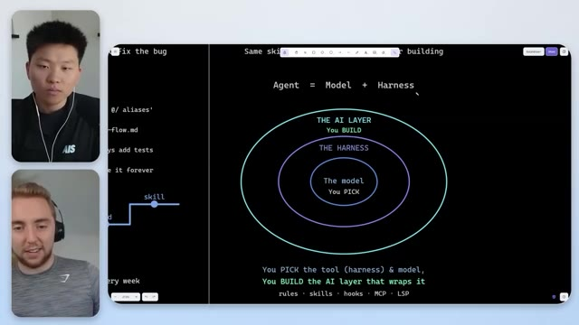
*⏱️ 00:33:57 — Schéma explicatif sur la structure d'un agent IA illustrant la relation entre le modèle, le harnais (harness) et la couche IA.*

---

### ⏱️ `[00:34:21 - 00:34:41]` | Segment #80

**🔊 Audio (Transcription Intégrale Mot pour Mot en Français) :**
> the time you just can't do that or at least you can't really trust that's going to be the case because you never know how much it's going to have to iterate on something so that's why i'm really like i guess you could say bullish right now on um harness engineering which is like building the workflow that orchestrates many coding agent sessions to handle a larger task.

**👁️ Analyse Visuelle d'Écran (gemini-3.5-flash-lite) :**
**Interface & Outils** : Tableau blanc numérique / outil de dessin (ex: Excalidraw).

**Contenu textuel & Code** : Formule "Agent = Model + Harness" avec des cercles concentriques illustrant "THE AI LAYER (You BUILD)", "THE HARNESS" et "The model (You PICK)". Texte explicatif en bas : "You PICK the tool (harness) & model, You BUILD the AI layer that wraps it (rules, skills, hooks, MCP, LSP)".

**Action / Démonstration** : Présentation visuelle conceptuelle de l'architecture d'un agent pour justifier l'importance de l'"harness engineering".

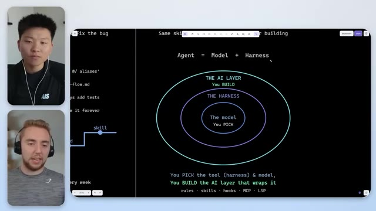
*⏱️ 00:34:26 — Schéma explicatif illustrant la structure d'un agent IA composée d'un modèle choisi et d'une "harnais" (harness) construite par l'utilisateur.*

---

### ⏱️ `[00:34:42 - 00:35:18]` | Segment #81

**🔊 Audio (Transcription Intégrale Mot pour Mot en Français) :**
> Et comme exemple vraiment basique de ce type de harnais, il y a la boucle RELF. C'est devenu genre super viral au début de cette année. Donc j'ai l'impression que même si vous n'avez pas trop entendu parler d'ingénierie de harnais, vous avez probablement au moins entendu parler de la boucle RELF. Et c'est vraiment un peu la base de ce genre de harnais, n'est-ce pas ? La boucle RELF consiste à enchaîner plusieurs sessions d'agents de codage. J'aimerais bien avoir un de mes diagrammes sous les yeux pour ça en ce moment. Je vais devoir l'expliquer oralement. Mais genre, vous savez, en gros, vous avez la première session de code cloud, qui lit votre spécification plus large pour une plus grande automatisation que vous voulez construire. Et ensuite, elle va définir genre la liste des tâches,

**👁️ Analyse Visuelle d'Écran (gemini-3.5-flash-lite) :**
**Interface & Outils** : Outil de présentation visuelle (type tableau blanc interactif ou application de mind mapping) avec incrustation vidéo des interlocuteurs.

**Contenu textuel & Code** : Texte du diagramme : 'Agent = Model + Harness', 'THE AI LAYER - You BUILD', 'THE HARNESS', 'The model - You PICK', et notes explicatives sur le pattern Ralph Wiggum.

**Action / Démonstration** : Présentation et explication du concept de harnais d'IA et de la boucle RELF (Ralph Wiggum) par les intervenants.

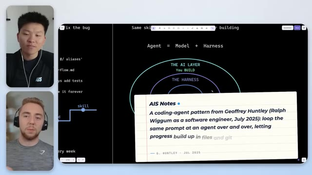
*⏱️ 00:34:51 — Un diagramme explicatif montrant 'Agent = Model + Harness' avec une note 'AIS Notes' définissant le pattern de l'agent codeur de Geoffrey Huntley (Ralph Wiggum loop).*

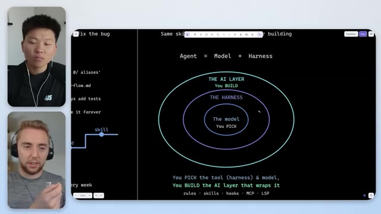
*⏱️ 00:35:09 — Le même diagramme d'architecture s'étendant pour montrer les trois couches : 'The model (You PICK)', 'THE HARNESS', et 'THE AI LAYER (You BUILD)'.*

---

### ⏱️ `[00:35:18 - 00:35:54]` | Segment #82

**🔊 Audio (Transcription Intégrale Mot pour Mot en Français) :**
> Genre, la première phase c'est ça, la deuxième phase c'est ça, et ensuite ça fera gérer une phase à la fois par plusieurs agents de codage, mais ça va, genre, tout faire automatiquement dans une boucle. C'est pour ça que ça s'appelle une boucle Ralph, parce que, genre, l'agent un va faire la phase un et ensuite il va rédiger son petit rapport, genre son passage de relais au deuxième agent qui va continuer le travail, et, genre, la raison principale pour laquelle la boucle Ralph est importante, c'est parce qu'on ne peut pas avoir un seul agent qui gère cette tâche plus vaste sans entrer dans la zone débile, et genre, tu sais, à la moitié de la phase deux, tu vois, genre tu dois découper les choses, ouais, donc on dirait que, d'un point de vue global, l'idée ou le genre d'état d'esprit que

**👁️ Analyse Visuelle d'Écran (gemini-3.5-flash-lite) :**
**Interface & Outils** : Application de tableau blanc / diagramme en ligne (type Miro ou Excalidraw) avec double flux vidéo des intervenants.

**Contenu textuel & Code** : Texte du diagramme : « Agent = Model + Harness », « THE AI LAYER - You BUILD », « THE HARNESS », « The model - You PICK », et « You PICK the tool (harness) & model, You BUILD the AI layer that wraps it : rules, skills, hooks, MCP, LSP ».

**Action / Démonstration** : Présentation et explication visuelle de l'architecture d'un agent IA par les intervenants en visioconférence.

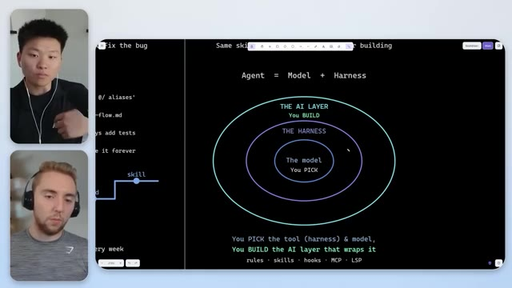
*⏱️ 00:35:27 — Schéma conceptuel représentant la formule d'un agent IA (« Agent = Model + Harness ») avec des cercles concentriques illustrant les couches « The model », « THE HARNESS » et « THE AI LAYER », avec les intervenants visibles en vignettes sur la gauche.*

---

### ⏱️ `[00:35:54 - 00:36:30]` | Segment #83

**🔊 Audio (Transcription Intégrale Mot pour Mot en Français) :**
> tu as un peu comme cette chaîne de montage et tu as un agent qui fait quelque chose. Chaque agent fait en gros une seule chose très bien et transmet son résultat à l'agent suivant d'une manière où l'agent a assez de contexte pour comprendre ce qui a été fait et ce qui reste à faire et quel est son travail actuel. Oui, exactement. Ouais. La chaîne de montage est vraiment une bonne analogie. Et je veux dire, ça s'applique à bien plus que juste écrire du code euh comme comme un exemple qui me vient à l'esprit quand je pense à genre parce que je sais que j'ai parlé de genre coder comme exemple pour beaucoup de choses mais

**👁️ Analyse Visuelle d'Écran (gemini-3.5-flash-lite) :**
**Interface & Outils** : Application de tableau blanc / diagramme en ligne avec visioconférence à gauche.

**Contenu textuel & Code** : Texte du diagramme : 'Agent = Model + Harness', 'THE AI LAYER You BUILD', 'THE HARNESS', 'The model You PICK', ainsi que la description 'You PICK the tool (harness) & model, You BUILD the AI layer that wraps it (rules, skills, hooks, MCP, LSP)'.

**Action / Démonstration** : Présentation du schéma conceptuel sur la composition d'un agent IA par les intervenants en visioconférence.

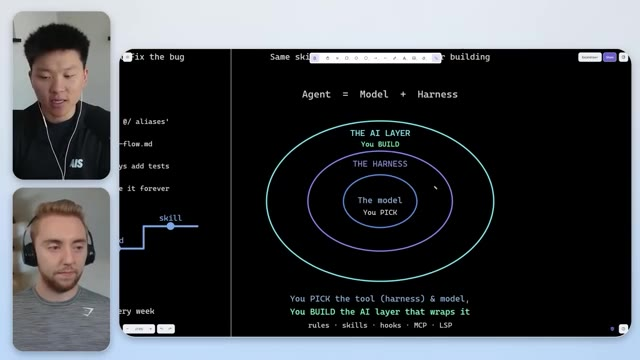
*⏱️ 00:36:03 — Schéma explicatif illustrant la formule 'Agent = Model + Harness' avec trois cercles concentriques représentant les couches 'The model (You PICK)', 'THE HARNESS' et 'THE AI LAYER (You BUILD)'.*

---

### ⏱️ `[00:36:30 - 00:37:06]` | Segment #84

**🔊 Audio (Transcription Intégrale Mot pour Mot en Français) :**
> euh je travaille avec beaucoup d'entreprises qui sont un peu du genre dans le domaine du B2B et quand on fait du B2B on fait beaucoup euh de création de devis comme des estimations n'est-ce pas on a euh une entreprise de construction ou euh par exemple je travaille avec des entreprises dans l'industrie de l'imprimerie où euh elles ont des demandes du genre bon d'accord faites-moi 100 000 flyers ou peu importe et euh pour ces entreprises l'une des plus grandes opportunités pour elles d'utiliser l'IA est d'utiliser quelque chose comme Claude pour les aider à recevoir une demande et à créer automatiquement une estimation comme un devis pour savoir combien cela

**👁️ Analyse Visuelle d'Écran (gemini-3.5-flash-lite) :**
**Interface & Outils** : Application de visioconférence et outil de mind-mapping/présentation visuelle (type Miro ou équivalent).

**Contenu textuel & Code** : Texte et schémas sur le thème « MANAGE CONTEXT : Right info, not all info » avec 6 méthodes pour le contrôler.

**Action / Démonstration** : Présentation d'un concept théorique ou d'un schéma explicatif lors de la discussion.

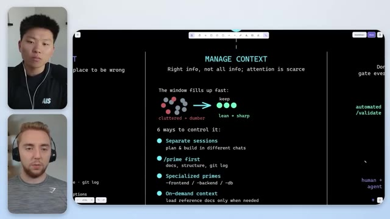
*⏱️ 00:36:39 — Capture d'écran montrant le présentateur et un invité en visioconférence à gauche, et un diagramme explicatif à fond noir sur la gestion du contexte au centre.*

---

### ⏱️ `[00:37:06 - 00:37:42]` | Segment #85

**🔊 Audio (Transcription Intégrale Mot pour Mot en Français) :**
> le travail va coûter cher parce que c'est comme un travail vraiment très laborieux, genre plus que vous ne le penseriez, genre quand j'ai parlé à ces entreprises, genre c'est fou tout le travail que ça demande, parce qu'ils doivent genre prendre la demande et ils doivent comprendre genre combien de main-d'œuvre cela implique, vous savez, les pièces évidemment, genre selon l'industrie, et ils doivent faire des recherches sur genre les derniers prix des choses et s'assurer qu'ils les obtiennent auprès du bon fournisseur, genre il y a tellement de choses qui entrent en jeu, et donc ce genre de chose, euh c'est comme un très bon exemple, rien à voir avec la création de code, utilisant quand même quelque chose comme Claude Code parce que vous pouvez utiliser des agents de codage pour cela afin de parcourir ce flux de travail plus vaste de genre examiner

**👁️ Analyse Visuelle d'Écran (gemini-3.5-flash-lite) :**
**Interface & Outils** : Application de tableau blanc ou de prise de notes visuelle.

**Contenu textuel & Code** : Texte et puces : 'MANAGE CONTEXT', 'Right info, not all info; attention is scarce', '6 ways to control it: Separate sessions, /prime first, Specialized primes, On-demand context'.

**Action / Démonstration** : Présentation visuelle de concepts d'optimisation de contexte pour agents IA.

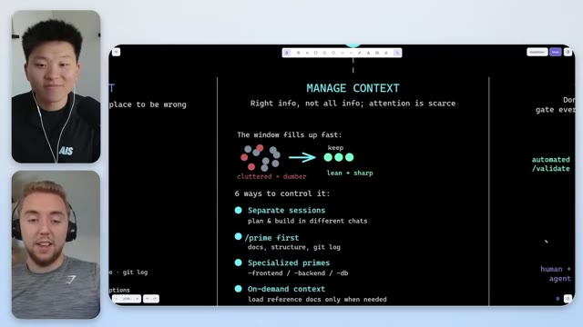
*⏱️ 00:37:15 — Un schéma explicatif sur fond noir intitulé 'MANAGE CONTEXT' avec des conseils pour gérer et filtrer l'information, accompagné de deux intervenants en visio sur le côté gauche.*

---

### ⏱️ `[00:37:42 - 00:38:18]` | Segment #86

**🔊 Audio (Transcription Intégrale Mot pour Mot en Français) :**
> leur inventaire, en regardant les prix, en comparant les fournisseurs, tout cela basé sur ce qui va être nécessaire pour accomplir cette tâche, comme cette rénovation, ces 100 000 prospectus pour peu importe quelle est cette demande de l'autre entreprise, et ensuite en créant cette estimation. Et puis en comprenant comment l'entreprise fonctionne, comme le genre de marge qu'ils veulent ajouter en plus, basé sur la main-d'œuvre et les coûts des pièces ou peu importe. Genre, il y a beaucoup de choses qui entrent en jeu là-dedans. Et donc, c'est le genre de chose où tu construirais un flux de travail où tu as un agent qui va rechercher l'inventaire, un agent qui va regarder les prix et comparer les prix des pièces, et ensuite un agent

**👁️ Analyse Visuelle d'Écran (gemini-3.5-flash-lite) :**
**Interface & Outils** : Outil de présentation visuelle ou de tableau blanc en ligne (type Miro ou Excalidraw) avec double flux vidéo des participants.

**Contenu textuel & Code** : Texte et schémas sur la gestion du contexte : 'MANAGE CONTEXT', 'Right info, not all info; attention is scarce', '6 ways to control it', incluant 'Separate sessions', '/prime first', 'Specialized primes', et 'On-demand context'.

**Action / Démonstration** : Le présentateur explique les stratégies de gestion du contexte pour optimiser les performances des agents d'IA.

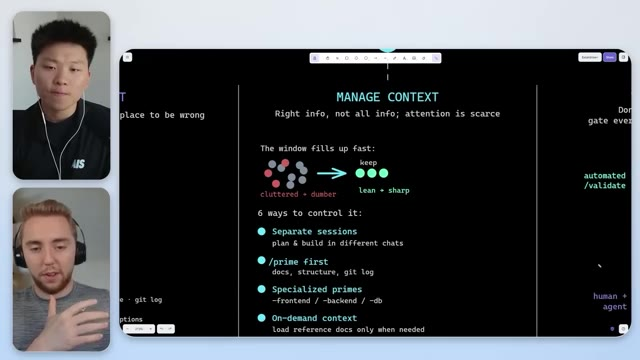
*⏱️ 00:37:51 — Capture d'écran montrant une présentation visuelle ou un tableau blanc numérique avec le titre 'MANAGE CONTEXT', détaillant les méthodes pour contrôler la fenêtre de contexte des IA.*

---

### ⏱️ `[00:38:18 - 00:38:51]` | Segment #87

**🔊 Audio (Transcription Intégrale Mot pour Mot en Français) :**
> qui va rédiger le PDF, et puis peut-être un autre qui va le rendre beau. Je veux dire, je pousse un peu l'exemple ici, mais vous voyez l'idée, c'est que vous n'avez pas qu'un seul agent qui gère l'ensemble pour quelque chose d'aussi grand. Et vous allez faire beaucoup de planification, n'est-ce pas ? Comme si vous allez planifier, vous allez avoir une validation à la fin. Donc, quel genre de calculs puis-je faire à la fin pour m'assurer que ce travail a la marge que nous voulons, par exemple. Oui. Oui. Et je pense, je repense à l'un de nos plus grands échecs à l'époque où j'étais encore impliqué au jour le jour dans la gestion de l'agence.

**👁️ Analyse Visuelle d'Écran (gemini-3.5-flash-lite) :**
**Interface & Outils** : Application de tableau blanc ou de présentation en ligne avec affichage vidéo incrusté (webcams des intervenants).

**Contenu textuel & Code** : Texte et diagrammes sur la gestion du contexte : "Right info, not all info; attention is scarce", illustration montrant le passage d'une fenêtre encombrée à un format épuré, et une liste intitulée "6 ways to control it".

**Action / Démonstration** : Présentation du concept de gestion du contexte pour les agents IA par les deux intervenants.

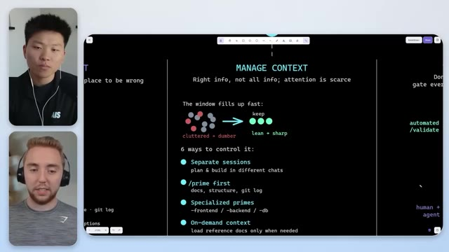
*⏱️ 00:38:26 — Un schéma explicatif avec le titre "MANAGE CONTEXT" et les deux présentateurs visibles en vignettes vidéo sur le côté gauche.*

---

### ⏱️ `[00:38:51 - 00:39:26]` | Segment #88

**🔊 Audio (Transcription Intégrale Mot pour Mot en Français) :**
> c'était que ce cas d'usage précis consistait à devoir parcourir des tonnes et des tonnes d'exemples, de devis passés, de travaux de clients passés, de propositions passées, et à avoir besoin de générer ces devis avec un si grand nombre de facteurs différents qui entrent en jeu. Et c'était l'un de nos plus grands échecs parce que, personnellement, j'ai sous-estimé la portée de cette réalisation et nous nous y sommes lancés sans réaliser tout ce qui est réellement nécessaire pour arriver à un devis précis. C'a donc été une excellente leçon pour moi à apprendre, non seulement sur l'importance de poser assez de questions et de définir la portée, mais aussi sur la façon dont vous répartissez le travail. Et je pense,

**👁️ Analyse Visuelle d'Écran (gemini-3.5-flash-lite) :**
**Interface & Outils** : Application de visioconférence et tableau blanc interactif ou outil de mindmapping.

**Contenu textuel & Code** : Texte et diagrammes sur fond noir incluant 'PLAN FIRST', 'PLAN.md - the north star', des étapes comme goal, codebase analysis, integration points, et des commandes de workflow (/prime, /research, /plan).

**Action / Démonstration** : Présentation d'une méthodologie de planification et de workflow par les intervenants en visioconférence.

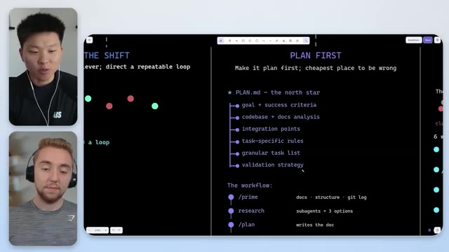
*⏱️ 00:38:59 — Capture d'écran montrant une visioconférence à gauche avec deux participants, et à droite un tableau blanc ou un éditeur interactif avec des notes et schémas sur le thème 'PLAN FIRST' et des commandes de workflow.*

---

### ⏱️ `[00:39:26 - 00:40:00]` | Segment #89

**🔊 Audio (Transcription Intégrale Mot pour Mot en Français) :**
> tu sais, évidemment Cole l'a mentionné, il a, il a parlé de beaucoup de ces exemples qui ont été un peu du codage personnel mais je ne fais pas vraiment beaucoup de codage, je veux dire, en fin de compte ces automatisations sont du code donc oui c'est du codage ouais mais je ne fais pas vraiment de logiciel, je ne construis pas de produits, mais chacune de ces théories dont nous avons parlé, de ces états d'esprit et de ces cadres, a tu sais, s'applique directement au travail de connaissance c'est un peu comme ça que j'aime l'appeler, de ce que je fais au jour le jour et de ce que la plupart d'entre vous ont probablement besoin de faire, ce qui vous donne une quantité insensée de levier tout de suite et Claude Code. Et je pense que lorsque vous pensez à votre travail ou que vous pensez à certains de vos

**👁️ Analyse Visuelle d'Écran (gemini-3.5-flash-lite) :**
**Interface & Outils** : Outil de présentation visuelle ou éditeur de diagrammes (type Excalidraw).

**Contenu textuel & Code** : Le contenu textuel détaille les composants d'un "PLAN.md" (goal, codebase analysis, integration points, task-specific rules, granular task list, validation strategy) et définit un workflow en trois étapes : /prime (docs/structure/git log), /research (subagents + 3 options), et /plan (writes the doc).

**Action / Démonstration** : Présentation conceptuelle d'une méthodologie de travail pour l'automatisation IA, illustrant comment structurer les tâches avant l'exécution du code.

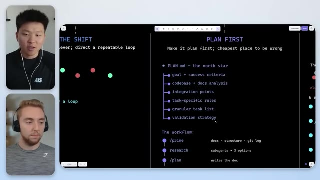
*⏱️ 00:39:34 — Une présentation sous forme de diagramme ou de diaporama présentant une méthodologie de développement intitulée "PLAN FIRST", mettant en avant l'utilisation d'un fichier PLAN.md comme référence centrale pour structurer un projet d'automatisation.*

---

### ⏱️ `[00:40:00 - 00:40:34]` | Segment #90

**🔊 Audio (Transcription Intégrale Mot pour Mot en Français) :**
> responsabilités, ce n'est pas seulement une seule responsabilité. C'est, vous pouvez décomposer cela en tellement de petites sous-tâches. Comme Cole vient de le dire, comme un agent fait la recherche, un agent fait la génération de PDF, toutes ces petites chaînes de sous-tâches qui s'enchaînent pour accomplir réellement la responsabilité globale, qui pourrait être 10 petites tâches qui s'enchaînent. Donc quand vous pouvez réellement décomposer un processus en l'écrivant simplement ou, ou, vous savez, en le schématisant sur, sur une feuille de papier, cela rend les choses beaucoup plus claires. C'est vrai. Ouais. Ouais. Et une chose que je veux dire ici, c'est

**👁️ Analyse Visuelle d'Écran (gemini-3.5-flash-lite) :**
**Interface & Outils** : Logiciel de création de schémas ou présentation type Excalidraw.

**Contenu textuel & Code** : Texte affiché : "PLAN FIRST - Make it plan first; cheapest place to be wrong". Liste des éléments pour 'PLAN.md' : goal, codebase analysis, integration points, task-specific rules, granular task list, validation strategy. Workflow : /prime (docs, structure, git log), /research (subagents + 3 options), /plan (writes the doc).

**Action / Démonstration** : Présentation conceptuelle et pédagogique des étapes clés pour structurer les sous-tâches d'un agent IA afin d'assurer la réussite d'un projet.

*⏱️ 00:40:08 — Une présentation sous forme de diagramme ou diapositive structurant une méthodologie de travail pour agents IA, intitulée "PLAN FIRST", détaillée en étapes de planification et un workflow spécifique.*

---

### ⏱️ `[00:40:34 - 00:41:06]` | Segment #91

**🔊 Audio (Transcription Intégrale Mot pour Mot en Français) :**
> que beaucoup de gens veulent simplifier en utilisant simplement des sous-agents. En quelque sorte pour ce plus grand flux de travail, et si je faisais simplement distribuer un tas de tâches par mon code cloud principal à des sous-agents ? Genre, ça peut marcher pour certaines choses. J'adore utiliser des sous-agents, surtout lorsque je planifie initialement n'importe quel type d'automatisation ou d'application. Mais c'est difficile de vraiment bien les faire communiquer entre eux. Genre, nous avons beaucoup parlé de transferts ici. Souvent, un agent, lorsqu'il franchit cette prochaine étape dans un flux de travail, doit comprendre le travail qui a été fait par le

**👁️ Analyse Visuelle d'Écran (gemini-3.5-flash-lite) :**
**Interface & Outils** : Interface de présentation graphique (diapositives).

**Contenu textuel & Code** : Texte affichant : "PLAN.md - the north star", avec une liste de points (goal, codebase analysis, integration points, task-specific rules, granular task list, validation strategy) et les étapes de workflow "/prime", "/research", "/plan".

**Action / Démonstration** : Présentation théorique illustrant la méthodologie de structuration des workflows d'agents IA.

*⏱️ 00:40:50 — Diapositive de présentation technique divisée en deux sections : "THE SHIFT" (avec une visualisation de boucle) et "PLAN FIRST" (détaillant la méthodologie de planification pour les agents).*

---

### ⏱️ `[00:41:06 - 00:41:40]` | Segment #92

**🔊 Audio (Transcription Intégrale Mot pour Mot en Français) :**
> la précédente. Que ce soit du travail, vous savez, écrire vraiment du code, ou si c'est juste faire des recherches, ou si c me extraire des informations de votre CRM, par exemple, genre il faut qu'il y ait ce genre de document de transmission, et c'est vraiment difficile de faire ça bien avec des sous-agents. Claude, Claude s'est essayé à faire quelque chose avec des équipes d'agents, donc ils, c'est un peu comme l'étape au-dessus des sous-agents où ils peuvent vraiment communiquer entre eux, mais c'est genre vraiment peu raffiné. C'est une très bonne idée, mais c'est vraiment peu raffiné et c'est très cher, genre très gourmand en tokens, ouais, et donc ouais, genre, et c'est en fait ce sur quoi je travaille, donc il y a un

**👁️ Analyse Visuelle d'Écran (gemini-3.5-flash-lite) :**
**Interface & Outils** : Application de présentation ou de tableau blanc numérique (ex: Excalidraw).

**Contenu textuel & Code** : Le texte affiche "PLAN FIRST" avec les étapes clés : "PLAN.md - the north star", incluant "goal + success criteria", "codebase + docs analysis", "integration points", "task-specific rules", "granular task list" et "validation strategy". Le workflow décrit trois commandes : "/prime" (docs, structure, git log), "/research" (subagents + 3 options) et "/plan" (writes the doc).

**Action / Démonstration** : Présentation conceptuelle d'un workflow de planification pour automatisation IA, illustrant la structure nécessaire avant l'exécution du code.

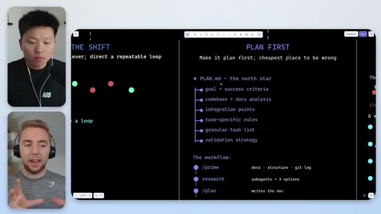
*⏱️ 00:41:15 — Une diapositive de présentation sombre détaillant une méthodologie de travail avec l'IA, centrée sur le fichier "PLAN.md".*

---

### ⏱️ `[00:41:40 - 00:42:14]` | Segment #93

**🔊 Audio (Transcription Intégrale Mot pour Mot en Français) :**
> Un projet open source sur lequel je travaille appelé Archon, et c'est vraiment le problème qu'il résout : comment pouvons-nous plus, genre le mot que j'utilise est déterministe, genre comment pouvons-nous construire le modèle d'IA, genre intégrer du code cloud dans un système au lieu d'avoir du code cloud qui essaie de tout orchestrer ? Parce que c'est là que ça devient difficile pour la communication et que tout devient très lourd en tokens, pas vrai ? Donc, genre la façon dont j'aime le formuler, c'est qu'on veut choisir quand le modèle d'IA intervient dans un flux de travail au lieu de le laisser tout piloter. Ouais. Ouais. Comment est-ce que

**👁️ Analyse Visuelle d'Écran (gemini-3.5-flash-lite) :**
**Interface & Outils** : Logiciel de présentation ou outil de mind-mapping type Excalidraw ou similaire.

**Contenu textuel & Code** : Texte structuré : "PLAN.md - the north star", incluant des points comme "goal + success criteria", "codebase + docs analysis", "integration points", et les étapes du workflow : "/prime", "/research", "/plan".

**Action / Démonstration** : Présentation conceptuelle et schématique du fonctionnement d'Archon et de sa logique de planification déterministe.

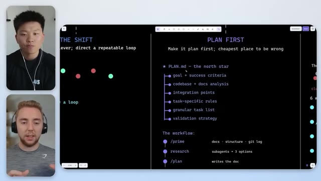
*⏱️ 00:41:49 — Une diapositive de présentation sombre détaillant la méthodologie "PLAN FIRST" pour les systèmes d'IA, listant les composants d'un fichier "PLAN.md" (goal, codebase analysis, etc.) et un workflow séquentiel (/prime, /research, /plan).*

---

### ⏱️ `[00:42:14 - 00:42:42]` | Segment #94

**🔊 Audio (Transcription Intégrale Mot pour Mot en Français) :**
> Tu rends un tel système autonome non déterministe aussi déterministe que possible, pratiquement, ouais ouais, aussi déterministe que possible, j'aimerais pouvoir dire « le rendre déterministe », ouais ça n'arrivera jamais, malheureusement c'est fondamentalement impossible, j'adore ça, ouais, tout à fait d'accord avec toi là-dessus, cool ouais, euh donc je veux dire vraiment on a on a parlé de la plupart des autres choses que j'ai sur le schéma ici, comme on a parlé de la vérification, s'assurer qu'il soit capable de vérifier son propre travail.

**👁️ Analyse Visuelle d'Écran (gemini-3.5-flash-lite) :**
**Interface & Outils** : Logiciel de présentation ou outil de tableau blanc numérique (ex: Excalidraw).

**Contenu textuel & Code** : Texte structuré incluant : 
- Titre : "PLAN FIRST - Make it plan first; cheapest place to be wrong"
- Section "PLAN.md - the north star" avec une liste (goal, codebase analysis, integration points, rules, task list, validation strategy).
- Section "The workflow" listant les étapes : /prime (docs, structure, git log), /research (subagents + 3 options), /plan (writes the doc).

**Action / Démonstration** : Présentation visuelle conceptuelle illustrant la stratégie pour minimiser le non-déterminisme des agents IA par une planification structurée.

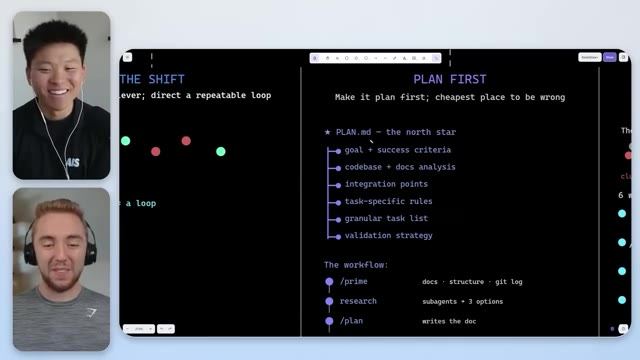
*⏱️ 00:42:21 — Une diapositive de présentation sombre structurée en deux colonnes expliquant la méthodologie "PLAN FIRST" pour rendre les agents autonomes plus prévisibles.*

---

### ⏱️ `[00:42:43 - 00:43:03]` | Segment #95

**🔊 Audio (Transcription Intégrale Mot pour Mot en Français) :**
> Et ouais, je veux dire, genre le truc principal ici, c'est qu'on ne se soucie pas vraiment de ce qu'il fait lors de son premier passage. Si on construit un système où il est capable d'itérer, c'est tout ce qui nous importe vraiment, tant que ça ne prend pas des milliards de tokens pour arriver à cette étape finale. Mais genre quand je suis, à chaque fois que j'utilise Claude Code pour quelque chose, je n'optimise jamais pour la vitesse.

**👁️ Analyse Visuelle d'Écran (gemini-3.5-flash-lite) :**
**Interface & Outils** : Tableau blanc collaboratif (type Excalidraw ou similaire).

**Contenu textuel & Code** : Le diagramme détaille les étapes : "3 tests", "4 review (human + agent)", "5 real-world check", aboutissant à "ships". On y lit également : "We only care about what we see when control comes back to us" et "you're not learning to code, you're learning to direct."

**Action / Démonstration** : Présentation visuelle d'une méthodologie itérative pour le développement assisté par IA, soulignant l'importance du contrôle et de la revue à chaque étape du processus.

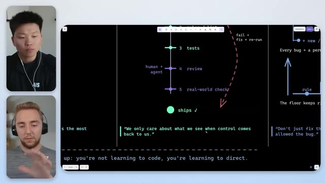
*⏱️ 00:42:48 — Une capture d'écran montrant un diagramme de flux de travail sur un tableau blanc numérique (type Excalidraw), illustrant les étapes d'un processus de développement par IA, incluant des phases de tests, de revue humaine/agent, et une boucle d'itération.*

---

### ⏱️ `[00:43:04 - 00:43:34]` | Segment #96

**🔊 Audio (Transcription Intégrale Mot pour Mot en Français) :**
> Je veux dire, au moins, genre, je ne veux pas que ce soit irréalistement lent, mais pour n'importe quel type de tâche que j'ai à lui donner, ça m'est vraiment égal que ce soit quelque chose sur lequel je doive le faire travailler pendant une demi-heure ou une heure et demie, genre j'envoie cette requête et je passe simplement à une autre session de code cloud pour tout autre projet sur lequel je dois travailler, ou je fais quelque chose, croyez-le ou non, sans agent pendant un petit moment, genre si je dois enregistrer une vidéo — enfin je veux dire, peut-être que j'utilise un agent dans la vidéo mais vous voyez l'idée — mais bref, le truc c'est que ça m'est égal de savoir combien de temps ça prend, parce que tout ce qui m'importe, c'est d'obtenir les meilleurs résultats possibles.

**👁️ Analyse Visuelle d'Écran (gemini-3.5-flash-lite) :**
**Interface & Outils** : Logiciel de mind-mapping ou de diagramme type "Board" (probablement une application de type canvas/whiteboard).

**Contenu textuel & Code** : Texte affiché : "3 tests", "4 review", "5 real-world check", "ships ✓". Citation : "We only care about what we see when control comes back to us." Note : "up: you're not learning to code, you're learning to direct."

**Action / Démonstration** : Présentation visuelle d'une méthodologie de travail ou d'un pipeline d'exécution pour des agents IA.

*⏱️ 00:43:11 — Un schéma de workflow sous forme de chronologie verticale illustrant les étapes d'un processus automatisé : tests, revue par un humain/agent, vérification réelle, et livraison ("ships"). On y voit également une citation textuelle mise en avant et une note de bas de page.*

---

### ⏱️ `[00:43:36 - 00:44:00]` | Segment #97

**🔊 Audio (Transcription Intégrale Mot pour Mot en Français) :**
> Et donc, oui, c'est pour ça que je passe beaucoup de temps à concevoir des systèmes pour que les agents de code vérifient leur propre travail, que ce soit de l'automatisation de navigateur pour un site web ou l'exemple un peu bête que j'ai donné plus tôt, comme une façon pour lui de jouer en quelque sorte à un jeu vidéo comme le ferait un humain. Et c'est vraiment un problème fascinant à résoudre pour moi en ce moment. C'est simplement cette couche de vérification à la fin pour un agent de code, qui s'étend également à des aspects comme la sécurité.

**👁️ Analyse Visuelle d'Écran (gemini-3.5-flash-lite) :**
**Interface & Outils** : Outil de mind mapping / tableau blanc interactif

**Contenu textuel & Code** : Texte du diagramme : "agent output", "1 auto-checks", "2 rules / lint", "3 tests", "4 review", "5 real-world check", "ships ✓", avec des boucles de rétroaction en cas d'échec (fail + fix + re-run).

**Action / Démonstration** : Présentation et explication visuelle du système de validation et d'auto-vérification des agents par l'intervenant.

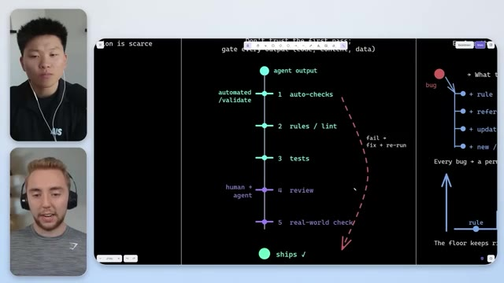
*⏱️ 00:43:42 — Schéma de workflow illustrant les différentes étapes de vérification d'un agent de code, allant de la sortie initiale jusqu'au déploiement (ships).*

---

### ⏱️ `[00:44:00 - 00:44:24]` | Segment #98

**🔊 Audio (Transcription Intégrale Mot pour Mot en Français) :**
> Et donc genre, ce n'est pas quelque chose d'aussi intéressant à aborder en ce moment, mais genre la sécurité est plutôt importante pour moi. C'est quelque chose pour lequel les vibe coders se font vraiment avoir. Je veux dire, on entend ces histoires d'horreur genre au moins une fois par mois, vous savez, genre leur clé privée ou secrète Supabase qui fuite dans leurs fichiers JavaScript et des choses comme ça parce qu'ils font juste complètement du vibe coding. Genre, je veux dire, c'est genre l'exemple le plus simple, mais ouais, genre ce genre de partie de vérification est vraiment très important aussi.

**👁️ Analyse Visuelle d'Écran (gemini-3.5-flash-lite) :**
**Interface & Outils** : Tableau blanc interactif / application de schématisation (ex: Excalidraw) avec un encart de notes textuelles.

**Contenu textuel & Code** : Texte du diagramme : 'agent output', 'auto-checks', 'rules / lint', 'tests', 'review', 'real-world check', 'ships'. Texte de la note : 'Supabase (open-source Firebase alternative) credential leaks are a real vibe-coding hazard. CVE-2025-48757 found 170+ AI-built apps exposing data via missing access rules...'

**Action / Démonstration** : Affichage progressif d'un encart explicatif illustrant les risques de sécurité liés au vibe coding et aux fuites d'identifiants.

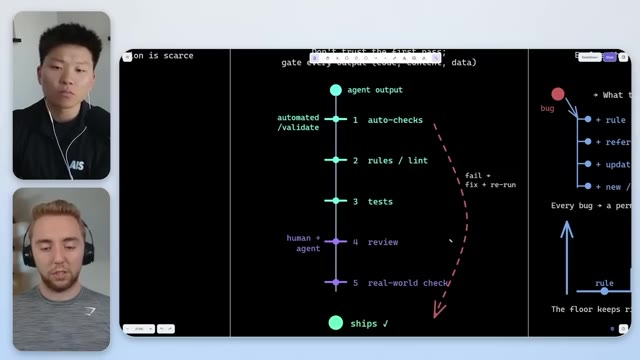
*⏱️ 00:44:06 — Un diagramme sur fond noir montrant le pipeline de validation des agents IA (auto-checks, rules/lint, tests, review, real-world check).*

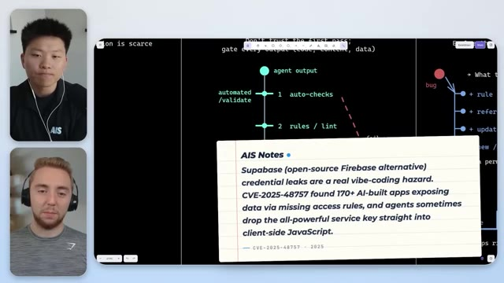
*⏱️ 00:44:12 — Le même diagramme avec une fenêtre de notes 'AIS Notes' superposée, détaillant les risques de fuite de identifiants Supabase dans les applications générées par IA (CVE-2025-48757).*

---

### ⏱️ `[00:44:24 - 00:45:03]` | Segment #99

**🔊 Audio (Transcription Intégrale Mot pour Mot en Français) :**
> Ouais, et sur tout cet aspect de la sécurité et ce qui pourrait mal tourner, quand on pense un peu à la couche de permissions qu'on met autour de ses agents, je vois une fois de plus beaucoup de faux sentiment de sécurité où les gens pensent que leurs prompts sont une couche de permissions suffisamment bonne, alors qu'en réalité cette couche de permissions doit être des clés restreintes ou bien un « tu ne peux vraiment pas toucher à ça du tout », parce que je crois que je parlais à mon équipe et qu'on est un peu arrivés à cette conclusion : si vous avez cet état d'esprit que tout ce que l'agent peut lire ou peut toucher, il le fera.

**👁️ Analyse Visuelle d'Écran (gemini-3.5-flash-lite) :**
**Interface & Outils** : Tableau blanc ou outil de mind-mapping/diagramme en ligne

**Contenu textuel & Code** : Texte du diagramme : "VERIFY THE WORK", "Don't trust the first pass; gate every output (code, content, data)", et les étapes "1 auto-checks", "2 rules / lint", "3 tests", "4 review" (human + agent).

**Action / Démonstration** : Présentation visuelle et explication d'un workflow de validation pour la sécurité et le contrôle qualité des agents IA.

*⏱️ 00:44:34 — Schéma explicatif sur fond noir illustrant le processus de vérification du travail d'un agent IA, avec les deux intervenants visibles dans des fenêtres vidéo sur la gauche.*

---

### ⏱️ `[00:45:03 - 00:45:40]` | Segment #100

**🔊 Audio (Transcription Intégrale Mot pour Mot en Français) :**
> Genre, tu dois partir du principe que ça va le faire, même si tu ne lui demandes jamais de le faire. C'est cette hypothèse qui va t'éviter de te faire supprimer ta base de données. Oui. Et c'est marrant que tu évoques cet exemple spécifiquement parce que j'étais juste sur le point de dire que, si tu lui dis de ne jamais effacer une base de données, il va quand même le faire. Genre, il y a eu une histoire qui est devenue virale, euh, il y a genre un mois ou deux, c'était quelqu'un de genre vraiment très haut placé chez Meta qui s'est fait... oh ouais, je ne suis toujours pas convaincu que ce soit vrai, j'ai l'impression qu'ils ont peut-être... je ne sais pas, parce que les gens reçoivent tellement d'attention quand ils ont des histoires stupides comme ça, mais mais les théories du complot avec Cole, n'est-ce pas, ouais mais genre c'est, c'est tout à fait possible.

**👁️ Analyse Visuelle d'Écran (gemini-3.5-flash-lite) :**
**Interface & Outils** : Outil de mindmapping ou de diagramme en ligne (type Excalidraw) affichant un flux d'automatisation.

**Contenu textuel & Code** : Texte du diagramme : "VERIFY THE WORK. Don't trust the first pass; gate every output", étapes numérotées de 1 à 4 (auto-checks, rules / lint, tests, review).

**Action / Démonstration** : Visualisation d'un schéma explicatif sur la vérification et le contrôle qualité des agents IA.

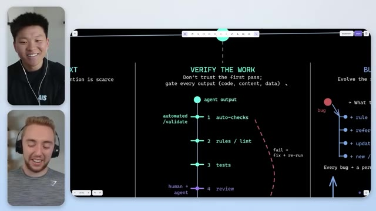
*⏱️ 00:45:12 — Un diagramme de workflow sur fond noir intitulé 'VERIFY THE WORK' avec différentes étapes de validation (auto-checks, rules/lint, tests, review).*

---

### ⏱️ `[00:45:40 - 00:46:00]` | Segment #101

**🔊 Audio (Transcription Intégrale Mot pour Mot en Français) :**
> et je connais effectivement des histoires où cela s'est réellement produit, juste à une plus petite échelle, ça a l'air tellement bizarre ou ça a l'air tellement stupide que c'est comme si leur base de données de production réelle avait été effacée. Mais je veux dire, même si vous avez une base de données de test qui est effacée, ça peut quand même être ennuyeux si cela vous ralentit beaucoup. Et donc, ouais, c'est super important. Il ne faut jamais supposer que juste parce qu'on dit à un agent de ne pas faire quelque chose, il ne le fera jamais.

**👁️ Analyse Visuelle d'Écran (gemini-3.5-flash-lite) :**
**Interface & Outils** : Outil de mindmapping ou de diagramme interactif (type Miro, Whimsical ou similaire)

**Contenu textuel & Code** : Schéma textuel et visuel décrivant la vérification du travail des agents IA, avec des sections 'VERIFY THE WORK', 'agent output', 'automated/validate', et un focus sur le traitement des bugs.

**Action / Démonstration** : Présentation visuelle et explication du workflow de validation des outputs d'agents IA par les intervenants.

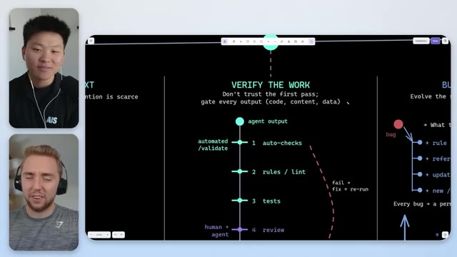
*⏱️ 00:45:45 — Capture d'écran montrant un diagramme explicatif avec deux intervenants en visioconférence sur le côté gauche. Le diagramme central présente le processus 'VERIFY THE WORK' avec différentes étapes de validation (auto-checks, rules/lint, tests, review).*

---

### ⏱️ `[00:46:01 - 00:46:22]` | Segment #102

**🔊 Audio (Transcription Intégrale Mot pour Mot en Français) :**
> Je veux dire, c'est la même chose que si vous dites à un gamin de ne pas faire quelque chose, il pourrait tout simplement ne pas écouter. Je veux dire, même les adultes. Il s'est effectivement passé quelque chose récemment pour nous, ce qui explique en quelque sorte pourquoi nous avons commencé à parler de ça. Nous avons eu cet incident où l'agent avait de bonnes intentions. Il essayait d'être proactif et il a effectivement vu quelque chose sur sa liste de tâches, mais il l'a mal interprété.

**👁️ Analyse Visuelle d'Écran (gemini-3.5-flash-lite) :**
**Interface & Outils** : Outil de diagramme ou de mindmapping en ligne sur fond sombre

**Contenu textuel & Code** : Texte du diagramme : "VERIFY THE WORK. Don't trust the first pass; gate every output (code, content, data)" avec une liste verticale : agent output, 1 auto-checks, 2 rules / lint, 3 tests, 4 review (human + agent).

**Action / Démonstration** : Présentation d'un schéma méthodologique expliquant comment contrôler et valider les sorties des agents IA.

*⏱️ 00:46:06 — Un diagramme explicatif sur fond noir illustrant une étape de vérification du travail d'un agent IA (« VERIFY THE WORK ») avec les différentes étapes de validation (auto-checks, rules/lint, tests, human review). Deux présentateurs apparaissent en vignettes vidéo à gauche.*

---

### ⏱️ `[00:46:22 - 00:46:42]` | Segment #103

**🔊 Audio (Transcription Intégrale Mot pour Mot en Français) :**
> Et ça a fini par envoyer un e-mail à toute notre liste avec un code de réduction. Et c'était genre, pas censé partir. Donc on a dû genre changer le code, mettre à jour la page. On a envoyé un e-mail d'excuses. Donc si vous êtes sur la liste de diffusion et que vous avez reçu ça, c'est ce qui s'est passé. Mais c'est juste que, vous savez, je n'étais pas en colère contre la personne qui était en quelque sorte responsable de l'agent.

**👁️ Analyse Visuelle d'Écran (gemini-3.5-flash-lite) :**
**Interface & Outils** : Outil de mind mapping / tableau blanc interactif

**Contenu textuel & Code** : Texte et schéma de workflow : "VERIFY THE WORK", "agent output", "1 auto-checks", "2 rules / lint", "3 tests", "4 review"

**Action / Démonstration** : Présentation et explication d'un diagramme de flux illustrant le processus de contrôle qualité des sorties d'agents IA.

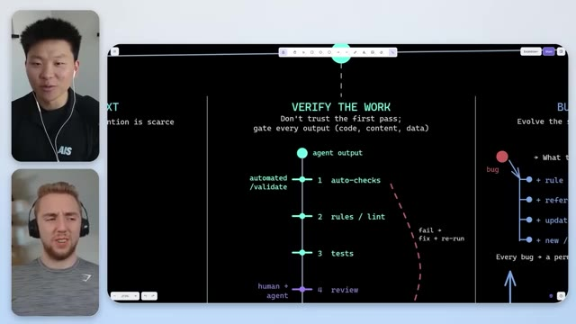
*⏱️ 00:46:27 — Schéma sur fond noir détaillant une étape de vérification du travail d'un agent IA (Verify the work), avec des étapes de validation automatisée, de règles, de tests et de révision humaine, accompagné des flux vidéo des intervenants.*

---

### ⏱️ `[00:46:42 - 00:47:16]` | Segment #104

**🔊 Audio (Transcription Intégrale Mot pour Mot en Français) :**
> C'était juste une très bonne opportunité pour nous de réfléchir, bon, pourquoi est-ce que c'est arrivé ? et tu sais, elle a rédigé une étude de cas, on l'a envoyée à toute l'équipe et tout le monde s'est dit bon, c'est un très très bon rappel de la prudence qu'il faut avoir parce que tu sais, si tu te connectes à un serveur MCP et que tu ne limites pas les permissions qu'il a, tout, tu sais, ouais, ouais, non, c'est bon, ouais, la principale façon dont je restreins les actions de mon agent de codage, c'est avec des hooks, comme les hooks Cloud Code, c'est une très bonne façon parce que, um, fondamentalement, un hook dans Cloud Code, c'est un petit morceau de code que tu peux exécuter chaque fois qu'un certain événement se produit dans l'outil.

**👁️ Analyse Visuelle d'Écran (gemini-3.5-flash-lite) :**
**Interface & Outils** : Application de diagramme (style Excalidraw) avec double flux vidéo des présentateurs.

**Contenu textuel & Code** : Texte du diagramme : "VERIFY THE WORK: Don't trust the first pass; gate every output (code, content, data)" avec des étapes (auto-checks, rules/lint, tests, review) et une note pop-up 'AIS Notes' mentionnant Claude Code.

**Action / Démonstration** : Présentation d'un diagramme conceptuel sur les bonnes pratiques de vérification et de validation des outputs générés par des agents IA.

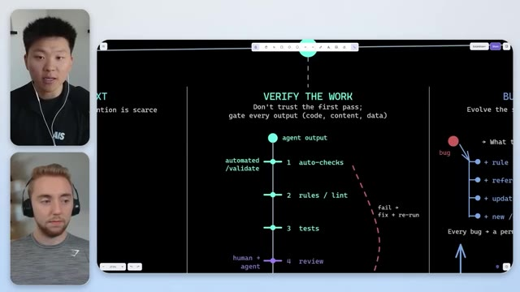
*⏱️ 00:46:50 — Un diagramme sur fond noir intitulé 'VERIFY THE WORK' avec différentes étapes de validation des agents IA, et les webcams des deux intervenants sur la gauche.*

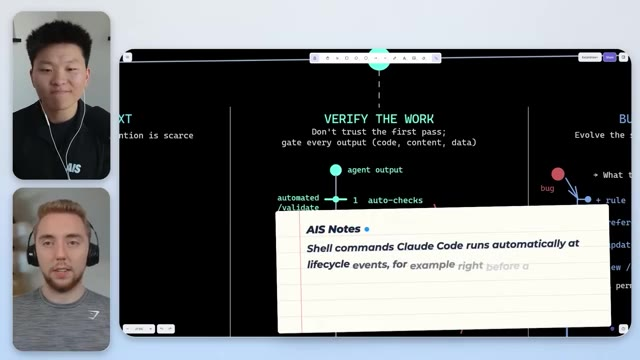
*⏱️ 00:47:07 — Le même diagramme sur fond noir avec une note textuelle superposée intitulée 'AIS Notes' concernant 'Claude Code'.*

---

### ⏱️ `[00:47:17 - 00:47:46]` | Segment #105

**🔊 Audio (Transcription Intégrale Mot pour Mot en Français) :**
> Donc, chaque fois que vous commencez une session, chaque fois que vous terminez une session juste avant que Cloud Code n'utilise un outil, vous pouvez exécuter une sorte de code qui effectue un contrôle de sécurité. Je veux dire, il y a beaucoup d'autres choses, mais j'adore utiliser des hooks pour la sécurité. Et donc ce que vous pouvez faire dans Cloud, c'est que chaque fois qu'il est sur le point d'invoquer un outil, comme s'il voulait écrire dans un fichier ou faire des requêtes sur le web, vous pouvez vérifier cette commande pour vous assurer qu'il n'essaie pas de perturber un dossier que vous ne voulez pas qu'il touche ou d'exécuter un type de commande que vous ne voulez pas qu'il exécute.

**👁️ Analyse Visuelle d'Écran (gemini-3.5-flash-lite) :**
**Interface & Outils** : Outil de diagramme en ligne (type Excalidraw).

**Contenu textuel & Code** : Texte du diagramme : "VERIFY THE WORK", "Don't trust the first pass; gate every output", étapes numérotées : "1 auto-checks", "2 rules / lint", "3 tests", "4 review". Présence d'un flux de "fail + fix + re-run" et d'une section "BUG" avec gestion des erreurs.

**Action / Démonstration** : Présentation théorique du pipeline de sécurité et de validation des agents pour illustrer l'importance du contrôle avant l'exécution.

*⏱️ 00:47:24 — Un schéma conceptuel illustrant un workflow de vérification pour un agent IA, intitulé "VERIFY THE WORK", détaillant les étapes de validation (auto-checks, rules/lint, tests, review).*

---

### ⏱️ `[00:47:46 - 00:48:09]` | Segment #106

**🔊 Audio (Transcription Intégrale Mot pour Mot en Français) :**
> Et il y a beaucoup de façons différentes de vérifier cela, sur lesquelles nous n'avons pas besoin de nous attarder pour l'instant. Mais c'est l'une de mes façons préférées de m'assurer qu'il ne lit pas mes variables d'environnement ou qu'il n'exécute pas une commande de suppression pour une base de données. Et c'est vraiment difficile de s'assurer que l'on couvre toutes les failles, car il y a beaucoup de choses que les agents de codage peuvent faire pour contourner ce genre de vérifications également.

**👁️ Analyse Visuelle d'Écran (gemini-3.5-flash-lite) :**
**Interface & Outils** : Outil de mind mapping / diagramme en ligne (type Miro ou Excalidraw) avec des webcams des intervenants sur le côté gauche.

**Contenu textuel & Code** : Schéma intitulé 'VERIFY THE WORK : Don't trust the first pass; gate every output (code, content, data)' détaillant 4 étapes : auto-checks, rules / lint, tests, et review (human + agent).

**Action / Démonstration** : Le présentateur explique la méthodologie de vérification et de validation des productions d'agents IA pour éviter les erreurs ou exécutions non désirées.

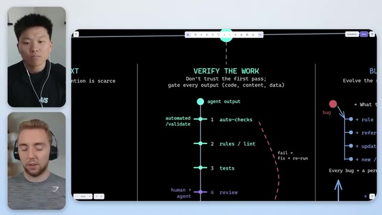
*⏱️ 00:47:52 — Schéma de workflow montrant l'étape 'Verify the work' avec les différentes phases de validation des sorties d'un agent IA.*

---

### ⏱️ `[00:48:09 - 00:48:37]` | Segment #107

**🔊 Audio (Transcription Intégrale Mot pour Mot en Français) :**
> Beaucoup de gens ont aussi un faux sentiment de sécurité à ce sujet. Vous avez donc en quelque sorte ce premier faux sentiment de sécurité où vous vous dites, eh bien, je lui ai dit de ne jamais supprimer ma base de données. Et puis vous avez le deuxième niveau où vous vous dites, je bloque toutes les instructions SQL de suppression. Mais ensuite, il y a ce troisième niveau pour lequel vous devez vous assurer de concevoir votre système. Par exemple, un agent de codage, si vous ne l'autorisez pas à appeler la commande de suppression ou d'effacement pour supprimer un dossier, il peut quand même écrire un script pour le faire.

**👁️ Analyse Visuelle d'Écran (gemini-3.5-flash-lite) :**
**Interface & Outils** : Application de tableau blanc / diagramme en ligne.

**Contenu textuel & Code** : Schéma textuel et visuel avec les étapes : "1 auto-checks", "2 rules / lint", "3 tests", et "4 review" (human + agent), ainsi que le titre "VERIFY THE WORK. Don't trust the first pass; gate every output".

**Action / Démonstration** : Le présentateur explique les différentes couches de validation et de sécurité pour contrôler les actions d'un agent IA.

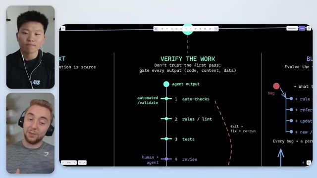
*⏱️ 00:48:16 — Un schéma explicatif illustrant les étapes de vérification du travail d'un agent IA (« VERIFY THE WORK »), avec le présentateur et un invité visibles dans des fenêtres vidéo sur le côté gauche.*

---

### ⏱️ `[00:48:37 - 00:48:55]` | Segment #108

**🔊 Audio (Transcription Intégrale Mot pour Mot en Français) :**
> Donc ça doit juste faire deux étapes, genre écrire le script et ensuite exécuter le script. Et ensuite c'est toujours capable de supprimer un fichier ou un dossier sur votre ordinateur. Donc c'est, je veux dire, ils sont moins susceptibles de faire ça. Donc c'est toujours genre vous y arrivez si vous avez au moins genre cette, cette deuxième fausse impression de sécurité, mais genre vous devez être vraiment prudent. Vous devez, c'est, c'est en fait un problème difficile à résoudre.

**👁️ Analyse Visuelle d'Écran (gemini-3.5-flash-lite) :**
**Interface & Outils** : Application de diagramme/mindmapping avec deux participants visibles en visioconférence à gauche.

**Contenu textuel & Code** : Texte du diagramme : "VERIFY THE WORK", "Don't trust the first pass; gate every output", avec les étapes 1 (auto-checks), 2 (rules / lint), 3 (tests), 4 (review).

**Action / Démonstration** : Présentation visuelle et explication d'un workflow de validation en plusieurs étapes pour le code généré par IA.

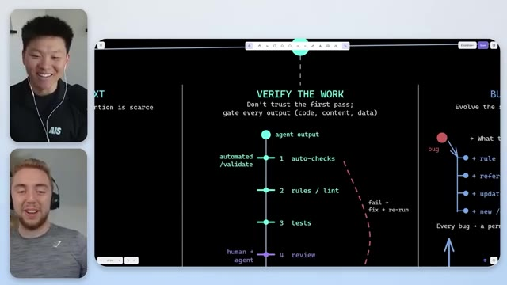
*⏱️ 00:48:41 — Schéma de workflow montrant les étapes de vérification du travail d'un agent IA (auto-checks, rules/lint, tests, review).*

---

### ⏱️ `[00:48:55 - 00:49:31]` | Segment #109

**🔊 Audio (Transcription Intégrale Mot pour Mot en Français) :**
> Ouais. Je veux dire, l'AGI, c'est, c'est effrayant. Ouais. Mais j'adorerais voir, et peut-être que tu en as déjà sorti un, mais j'adorerais voir une masterclass sur les *hooks* de Cole, parce que j'en ai justement enregistré une et je n'utilise pas tant que ça les *hooks* pour être honnête, genre vraiment pas. Je pense que mon principal *hook*, c'est juste de m'envoyer une notification sonore quand c'est terminé ou quand il a besoin de moi. Mais ouais, genre, j'ai sous-utilisé les *hooks* c'est sûr, et je ne sais pas si c'est parce qu'ils sont surtout utiles quand on fait du code lourd, mais je suppose qu'il y a plein de choses que je pourrais faire dans mon quotidien où les *hooks* seraient vraiment super.

**👁️ Analyse Visuelle d'Écran (gemini-3.5-flash-lite) :**
**Interface & Outils** : Tableau blanc ou outil de mindmapping/schéma en ligne (type Excalidraw ou Miro) avec appel vidéo en incrustation (PiP) des deux interlocuteurs.

**Contenu textuel & Code** : Schéma textuel : 'VERIFY THE WORK', 'Don't trust the first pass; gate every output (code, content, data)', 'agent output', '1 auto-checks', '2 rules / lint', '3 tests', '4 review'.

**Action / Démonstration** : Présentation visuelle et explication d'un diagramme de workflow sur la vérification et le contrôle qualité des outputs d'agents IA.

*⏱️ 00:49:04 — Un schéma explicatif affiché à l'écran montrant le processus 'VERIFY THE WORK' avec différentes étapes de validation pour les agents IA (auto-checks, rules/lint, tests, review).*

---

### ⏱️ `[00:49:31 - 00:50:00]` | Segment #110

**🔊 Audio (Transcription Intégrale Mot pour Mot en Français) :**
> et je dois vraiment examiner un peu plus comment je peux les utiliser. Mais bref. Oui. Je devrais absolument faire une masterclass sur les accroches parce qu'il y a beaucoup de façons dont je les utilise. Oui, puisque nous sommes sur le sujet, genre une des façons vraiment intéressantes d'utiliser les accroches c'est que vous pouvez les utiliser pour suggérer automatiquement, genre vous pouvez demander à Clogco, de suggérer automatiquement des façons d'améliorer votre couche d'IA, genre rendre vos règles meilleures, rendre vos compétences meilleures.

**👁️ Analyse Visuelle d'Écran (gemini-3.5-flash-lite) :**
**Interface & Outils** : Excalidraw ou un outil de tableau blanc numérique similaire.

**Contenu textuel & Code** : Texte : « VERIFY THE WORK / Don't trust the first pass; gate every output (code, content, data) » avec les étapes : 1 auto-checks, 2 rules / lint, 3 tests, 4 review.

**Action / Démonstration** : Le présentateur explique et commente le diagramme de workflow affiché à l'écran concernant la validation des sorties d'agents IA.

*⏱️ 00:49:38 — Un schéma explicatif montrant une étape de vérification du travail (« VERIFY THE WORK ») avec un flux linéaire détaillant les contrôles automatiques, les règles, les tests et la revue humaine.*

---

### ⏱️ `[00:50:00 - 00:50:31]` | Segment #111

**🔊 Audio (Transcription Intégrale Mot pour Mot en Français) :**
> et beaucoup beaucoup d'outils comme Hermes et Open Claw font un peu ça, je ne pense pas qu'ils utilisent explicitement des hooks mais, par exemple, Open Claw toutes les 10 ou 20 interactions, je crois que c'est configurable, va en quelque sorte condenser votre conversation et la stocker comme une mémoire, n'est-ce pas ? de sorte que vous ayez l'équivalent d'un journal quotidien complet avec le fichier memory.md, tout cela provient de ce qui est essentiellement un hook de Clod Code. Ainsi, de la même manière que j'utilise Clod Code avec mon second cerveau, à chaque fois que j'ai une compaction de mémoire, ce que j'essaie d'éviter.

**👁️ Analyse Visuelle d'Écran (gemini-3.5-flash-lite) :**
**Interface & Outils** : Excalidraw (outil de diagramme en ligne).

**Contenu textuel & Code** : Schéma intitulé "VERIFY THE WORK" avec les étapes : 1. auto-checks, 2. rules/lint, 3. tests, 4. review. Sur la droite, une branche illustre la gestion d'un "bug" avec des flèches pointant vers "rule", "reference", "update", "new".

**Action / Démonstration** : Présentation visuelle d'un processus logique pour valider les sorties d'un agent IA afin d'éviter les erreurs.

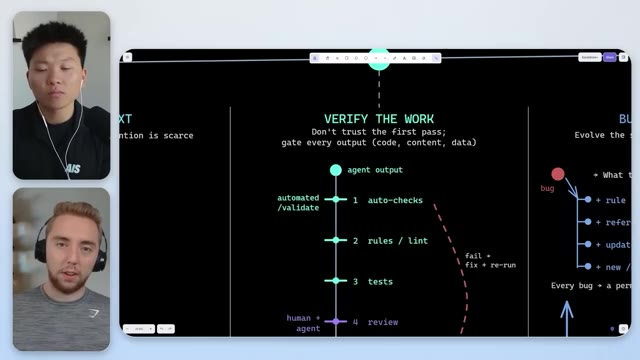
*⏱️ 00:50:07 — Un schéma de workflow affiché sur un écran montrant le processus de "VERIFY THE WORK" pour un agent IA, incluant des étapes de validation automatisée (auto-checks, rules/lint, tests) et une revue humaine.*

---

### ⏱️ `[00:50:31 - 00:50:51]` | Segment #112

**🔊 Audio (Transcription Intégrale Mot pour Mot en Français) :**
> Je ne veux pas aller aussi loin dans une conversation. Ou je termine une session. Ça crée automatiquement un résumé de la conversation, ça le met dans un journal quotidien, et ensuite j'ai un processus chaque jour. C'est fondamentalement comme du "Cloud Code Dreaming" où ça va examiner le journal quotidien et ensuite extraire toutes les choses vraiment importantes à stocker et en quelque sorte les promouvoir vers mon fichier de mémoire principale.

**👁️ Analyse Visuelle d'Écran (gemini-3.5-flash-lite) :**
**Interface & Outils** : Outil de diagramme en ligne (probablement Excalidraw).

**Contenu textuel & Code** : Texte affiché : "VERIFY THE WORK", "Don't trust the first pass; gate every output", étapes numérotées : "1 auto-checks", "2 rules / lint", "3 tests", "4 review", et une section "BUG" avec un flux de résolution.

**Action / Démonstration** : Présentation visuelle d'un workflow de validation pour automatisation, utilisée comme support à l'explication du présentateur sur la gestion des sorties d'agents IA.

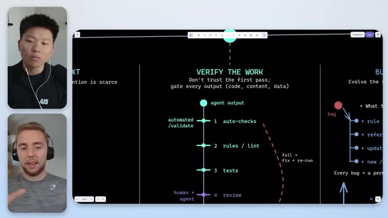
*⏱️ 00:50:36 — Un schéma conceptuel sur fond sombre illustrant le processus de "Vérification du travail" (Verify the Work) pour des agents IA, avec un flux linéaire passant par des auto-vérifications, des règles/lint, des tests et une revue humaine.*

---

### ⏱️ `[00:50:51 - 00:51:10]` | Segment #113

**🔊 Audio (Transcription Intégrale Mot pour Mot en Français) :**
> Genre, voici les décisions que j'ai prises récemment ou les choses sur lesquelles je travaille activement et où j'en suis avec elles. Donc, genre, les "hooks" pilotent en fait tout le truc. Genre ce terminal, c'est genre la deuxième fois qu'il s'ouvre. C'est en fait un "hook" qui vient de se déclencher là. Donc je suis juste en train de tester d'autres trucs. J'ai oublié de l'éteindre, ce qui est regrettable, mais en fait, maintenant, ça fait une bonne illustration.

**👁️ Analyse Visuelle d'Écran (gemini-3.5-flash-lite) :**
**Interface & Outils** : Windows Terminal, Excalidraw (diagramme de workflow).

**Contenu textuel & Code** : Diagramme technique détaillant des étapes de développement : "3 tests", "human + agent", "4 review", et une section "BUG" avec un processus d'évolution ("+ rule", "+ reference", "+ update", "+ new").

**Action / Démonstration** : Ouverture du terminal au-dessus d'un schéma explicatif, illustrant l'exécution d'un "hook" dans le cadre d'un workflow d'automatisation.

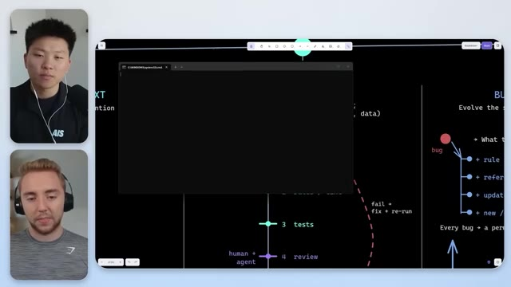
*⏱️ 00:50:56 — Une fenêtre de terminal Windows (cmd.exe) ouverte au centre d'un espace de travail montrant un diagramme de flux (Excalidraw) traitant du cycle de vie des bugs et des tests.*

---

### ⏱️ `[00:51:10 - 00:51:28]` | Segment #114

**🔊 Audio (Transcription Intégrale Mot pour Mot en Français) :**
> Ouais, c'était un super timing. J'ai un hook qui s'est exécuté au moment même où j'en parlais. Génial. Je suis juste en train de tester autre chose là tout de suite. Ouais, encore un autre moyen de rendre ces choses non déterministes aussi déterministes que possible. Alors, qu'est-ce qu'on a ensuite après cette section de vérification du travail ? Ouais. Donc en réalité, c'est la dernière chose. On a donc déjà parlé du harness.

**👁️ Analyse Visuelle d'Écran (gemini-3.5-flash-lite) :**
**Interface & Outils** : Outil de tableau blanc numérique de type whiteboard (ex: Eraser.io ou similaire).

**Contenu textuel & Code** : Diagramme intitulé "VERIFY THE WORK" détaillant les étapes de validation : 1. auto-checks, 2. rules/lint, 3. tests, 4. review (human + agent), avec une boucle de rétroaction "fail + fix + re-run".

**Action / Démonstration** : Le présentateur illustre visuellement la stratégie de gating (vérification systématique) pour rendre les sorties des agents IA déterministes.

*⏱️ 00:51:15 — Une capture d'écran montrant un diagramme de workflow sur tableau blanc numérique illustrant le processus de vérification de la sortie d'un agent IA.*

---

### ⏱️ `[00:51:29 - 00:51:48]` | Segment #115

**🔊 Audio (Transcription Intégrale Mot pour Mot en Français) :**
> Mais la dernière chose, et honnêtement, probablement la plus importante, c'est l'évolution du système dont j'ai parlé juste un peu plus tôt. Et vraiment, l'état d'esprit ici, c'est genre, parmi tout ce qui fait que vous dirigez vraiment Claude Code au lieu d'en être simplement un utilisateur, la construction du système est la chose la plus importante.

**👁️ Analyse Visuelle d'Écran (gemini-3.5-flash-lite) :**
**Interface & Outils** : Excalidraw (tableau blanc numérique).

**Contenu textuel & Code** : Texte : "BUILD THE SYSTEM - Evolve the system, don't just fix the bug". Liste d'actions liées à un bug : "+ rule (use @/ aliases)", "+ reference doc (auth-flow.md)", "+ update plan (always add tests)", "+ new /command (reuse it forever)". En bas, un graphique en escalier avec les étapes "doc", "cmd", "skill".

**Action / Démonstration** : Présentation conceptuelle et visuelle de l'optimisation itérative d'un système d'agent IA lors de la résolution de bugs.

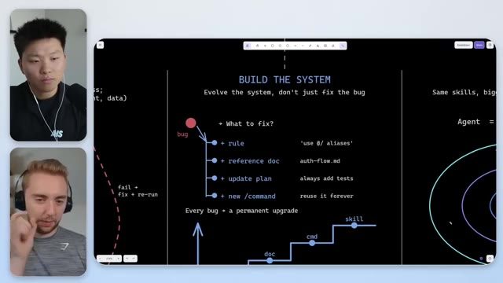
*⏱️ 00:51:34 — Un schéma explicatif sur fond noir illustrant la méthodologie "Build the System", où chaque bug doit mener à une amélioration permanente du workflow de l'agent.*

---

### ⏱️ `[00:51:48 - 00:52:24]` | Segment #116

**🔊 Audio (Transcription Intégrale Mot pour Mot en Français) :**
> Donc, chaque fois qu'un problème survient, au lieu de simplement corriger le problème et de passer à autre chose, c'est l'occasion pour vous, avec l'aide de l'agent de codage, avec l'aide de Claude Code, de déterminer ce qu'on pourrait améliorer pour que cela ne se reproduise plus. Comme par exemple une nouvelle règle qu'on peut ajouter dans notre CLAUDE.md, ou un nouveau document qu'on peut lui donner lorsqu'on est dans notre processus de planification, ou peut-être une mise à jour de notre compétence qu'on peut effectuer. Et je reste un peu général exprès ici, parce qu'il y a un million de façons différentes d'améliorer notre système, et donc c'est un peu comme l'exemple que tu as donné Nate, où tu as eu cet e-mail envoyé ou au...

**👁️ Analyse Visuelle d'Écran (gemini-3.5-flash-lite) :**
**Interface & Outils** : Outil de tableau blanc numérique ou logiciel de présentation (type Excalidraw ou Miro).

**Contenu textuel & Code** : Texte affiché : "BUILD THE SYSTEM - Evolve the system, don't just fix the bug". Liste d'actions liées à un "bug" : "+ rule ('use @/ aliases')", "+ reference doc ('auth-flow.md')", "+ update plan ('always add tests')", "+ new /command ('reuse it forever')". Conclusion : "Every bug = a permanent upgrade".

**Action / Démonstration** : Le présentateur illustre visuellement la boucle de feedback où un bug déclenche des mises à jour structurelles (règles, documentation, tests, commandes) au lieu d'une simple correction ponctuelle.

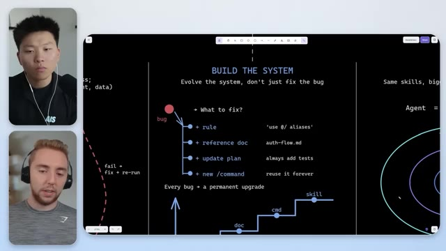
*⏱️ 00:51:57 — Un schéma explicatif sur fond noir illustrant la méthodologie pour transformer la correction d'un bug en une amélioration systémique permanente.*

---

### ⏱️ `[00:52:24 - 00:52:57]` | Segment #117

**🔊 Audio (Transcription Intégrale Mot pour Mot en Français) :**
> Au moins, c'est parti auprès de beaucoup plus de personnes que ça n'aurait dû, et donc tu as rédigé ce rapport du genre « voilà ce qui s'est passé, voilà ce qu'on peut faire de mieux ». Et donc c'est un peu comme faire ça, mais genre pour l'agent, afin qu'à l'avenir il ait cette règle pour ne plus refaire cette chose. Genre, peut-être qu'il n'a pas exécuté toute la validation que tu voulais qu'il fasse, alors maintenant tu t'assures juste que ça fait partie de la règle, du genre « assure-toi de ne pas oublier cette validation », un peu comme un exemple bête, mais de cette façon, chaque bug devient une amélioration permanente. Donc une fois que tu as ce genre de système en place, en fait tu accueilles presque les bugs, ouais, genre « je veux que quelque chose tourne mal parce qu'ensuite »

**👁️ Analyse Visuelle d'Écran (gemini-3.5-flash-lite) :**
**Interface & Outils** : Tableau blanc ou outil de mind mapping / diagramme (style Excalidraw)

**Contenu textuel & Code** : Schéma intitulé 'BUILD THE SYSTEM', montrant qu'un bug entraîne l'ajout de règles, de documentations, de plans de mise à jour et de nouvelles commandes.

**Action / Démonstration** : Le présentateur explique comment transformer chaque bug en une mise à niveau permanente pour l'agent.

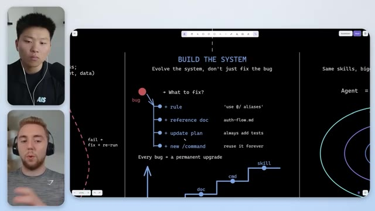
*⏱️ 00:52:32 — Schéma conceptuel sur fond noir illustrant l'évolution d'un système face à un bug avec des règles et des documentations de référence.*

---

### ⏱️ `[00:52:57 - 00:53:32]` | Segment #118

**🔊 Audio (Transcription Intégrale Mot pour Mot en Français) :**
> je peux m'assurer que ça ne se reproduise plus jamais, n'est-ce pas, genre j'ai presque... je me sens presque un peu nerveux quand tout va trop bien, parce que c'est genre « oh mince, je n'ai aucun moyen de, genre, rendre mon agent meilleur pour l'instant », donc ça peut en quelque sorte devenir agréable, ouais absolument, ouais, meilleur au fil du temps. J'ai une question intéressante pour toi. Donc je suis totalement d'accord. Chaque fois que tu as un échec, tu devrais considérer cela comme des données et une opportunité d'améliorer le système. Maintenant, qu'en est-il avant que tu n'aies ces échecs ? Comment réfléchis-tu, au mieux de tes capacités, à trouver ces cas limites ou à prédire quels cas limites pourraient se produire et à essayer d'intégrer...

**👁️ Analyse Visuelle d'Écran (gemini-3.5-flash-lite) :**
**Interface & Outils** : Excalidraw

**Contenu textuel & Code** : Texte et diagramme : 'What to fix?', '+ rule', '+ reference doc', '+ update plan', '+ new /command', 'Every bug = a permanent upgrade', 'The floor keeps rising -> smarter every week'

**Action / Démonstration** : Présentation du diagramme montrant comment transformer chaque bug en amélioration permanente pour l'agent IA

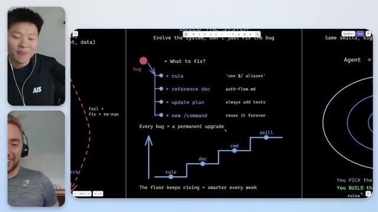
*⏱️ 00:53:06 — Schéma explicatif sur fond noir illustrant la stratégie 'Evolve the system, don't just fix the bug' avec l'évolution par étapes (rule, doc, cmd, skill)*

---

### ⏱️ `[00:53:32 - 00:54:04]` | Segment #119

**🔊 Audio (Transcription Intégrale Mot pour Mot en Français) :**
> des garde-fous avant toute la partie des tests ? Eh bien, ça ne peut jamais être parfait, c'est pourquoi je m'appuie tellement là-dessus, mais généralement, quand vous recherchez les cas limites, euh, je veux dire, Claude Code est en fait plutôt bon pour ça. Il ne va pas couvrir genre presque tous les cas limites, mais rien que de lui demander genre « comment cela pourrait-il mal tourner ? », c'est une question que parfois les gens ont honnêtement genre peur de simplement poser. Ouais, mais c'est une très bonne question une fois que vous avez terminé l'implémentation, et genre cela fait partie de genre ma compétence de revue de code que j'ai intégrée, où c'est genre : demandez-vous ce que...

**👁️ Analyse Visuelle d'Écran (gemini-3.5-flash-lite) :**
**Interface & Outils** : Application de schéma / tableau blanc (type Excalidraw) et fenêtres de visioconférence.

**Contenu textuel & Code** : Schéma textuel et graphique montrant la transition d'un bug vers des règles, documentation, plans de mise à jour et commandes, avec un graphique en escalier intitulé "Every bug = a permanent upgrade".

**Action / Démonstration** : Présentation visuelle et explication d'un diagramme de workflow conceptuel pour l'amélioration continue du code.

*⏱️ 00:53:40 — Un schéma explicatif sur fond noir illustrant la gestion des bugs et l'évolution du système, avec deux intervenants en visio sur le côté gauche.*

---

### ⏱️ `[00:54:04 - 00:54:39]` | Segment #120

**🔊 Audio (Transcription Intégrale Mot pour Mot en Français) :**
> pourrait mal tourner ici, et ensuite essayer de concevoir un scénario où vous testez vraiment cela. Genre, si je construis une automatisation où je pense qu'il pourrait y avoir un cas limite où elle ne gère pas correctement ce genre d'entrée, je vais, dans le cadre de la revue de code de mon agent, lui faire genre créer ça, genre il va invoquer l'application avec cette entrée, comme un webhook ou peu importe, et essayer de la casser pour voir ce qui se passe. Et si elle casse, eh bien je veux dire que ça va évidemment faire partie de notre vérification en revenant ici, où, euh, il va alors, euh, traiter cette chose et ensuite refaire les tests, n'est-ce pas, genre itérer, genre trouver un problème, le corriger, et puis aussi

**👁️ Analyse Visuelle d'Écran (gemini-3.5-flash-lite) :**
**Interface & Outils** : Application de tableau blanc ou de présentation (type Excalidraw ou Miro) sur fond noir.

**Contenu textuel & Code** : Texte et diagramme : "Evolve the system, don't just fix the bug", "+ rule: 'use 0/ aliases'", "+ reference doc: auth-flow.md", "+ update plan: always add tests", "+ new /command: reuse it forever", "Every bug = a permanent upgrade", et un graphique en escalier montrant la progression de rule vers skill.

**Action / Démonstration** : Présentation conceptuelle montrant comment transformer chaque bug en une amélioration permanente du système (règle, documentation, commande ou compétence).

*⏱️ 00:54:13 — Schéma explicatif sur fond noir illustrant la gestion des bugs et l'évolution du système d'agents, avec deux présentateurs visibles dans des fenêtres vidéo à gauche.*

---

### ⏱️ `[00:54:39 - 00:55:11]` | Segment #121

**🔊 Audio (Transcription Intégrale Mot pour Mot en Français) :**
> Reteste, d'accord ? N'oublie pas de retester, parce que peut-être que tu es focalisé sur la résolution du problème. Oui, eh bien, je pense que tu sais, quelque chose dont je me suis rendu compte après avoir répondu aux commentaires sur YouTube, aux questions-réponses dans la communauté, en discutant avec vous et en voyant simplement ce qui se passe quand les gens apprennent ce genre d'outils, c'est qu'il faut vraiment, tu sais, la façon la plus simple de le décrire, c'est qu'il faut le traiter comme ton meilleur ami qui est la personne la plus intelligente au monde. C'est-à-dire, tu sais, le traiter comme un mentor. Il ne va pas se moquer de toi si tu lui demandes quelque chose de stupide.

**👁️ Analyse Visuelle d'Écran (gemini-3.5-flash-lite) :**
**Interface & Outils** : Présentation avec diagramme visuel et webcams des participants.

**Contenu textuel & Code** : Schéma avec "What to fix?", "Every bug = a permanent upgrade", et un graphique en escalier montrant l'évolution (rule, doc, cmd, skill).

**Action / Démonstration** : Explication du concept de capitalisation sur les bugs pour améliorer les agents ou le code.

*⏱️ 00:54:47 — Schéma explicatif illustrant comment transformer un bug en amélioration permanente (règle, documentation, plan et commande).*

---

### ⏱️ `[00:55:11 - 00:55:44]` | Segment #122

**🔊 Audio (Transcription Intégrale Mot pour Mot en Français) :**
> Il vous suffit d'être curieux et de poser, de poser les questions qui vous trottent dans la tête. Et je pense que lorsque vous dépassez cette idée qu'il peut tout vous apprendre, et c'est le cas, pour la plupart, surtout si vous posez les bonnes questions, il peut vous aider à résoudre la majorité de vos problèmes lorsque vous ressentez, vous savez, cette sorte de malaise parce que vous ne comprenez peut-être pas ce qu'il a fait. C'est donc un énorme changement de mentalité pour tous ceux à qui j'ai parlé qui essaient de s'y mettre et ne comprennent pas. S'ils, vous savez, m'envoient peut-être une question par texto ou me posent une question, c'est juste que la réponse peut souvent être : est-ce que vous avez demandé à Claude Code ?

**👁️ Analyse Visuelle d'Écran (gemini-3.5-flash-lite) :**
**Interface & Outils** : Présentation vidéo avec diagramme conceptuel à l'écran et deux intervenants en visio.

**Contenu textuel & Code** : Schéma montrant le traitement d'un bug avec l'ajout de règles, de documentation de référence, de plans de mise à jour et de nouvelles commandes, ainsi qu'un graphique d'évolution par paliers (rule -> doc -> cmd -> skill).

**Action / Démonstration** : Explication visuelle du concept d'amélioration permanente à chaque correction de bug ("Every bug = a permanent upgrade").

*⏱️ 00:55:19 — Schéma explicatif sur fond noir illustrant le processus de résolution d'un bug et l'amélioration continue des compétences d'un agent IA.*

---

### ⏱️ `[00:55:45 - 00:56:08]` | Segment #123

**🔊 Audio (Transcription Intégrale Mot pour Mot en Français) :**
> Je sais. Ouais. Je m'en veux de dire ça, mais genre, ouais, on en arrive là, on en arrive là très souvent. Euh, ouais, où c'est genre, non, tu aurais juste dû, je veux dire, tu sais, généralement comment je peux être plus utile, c'est en leur disant exactement quoi demander. Genre, donne-lui ce lien, donne-lui ce truc, et ensuite voilà comment je le demanderais. Mais ouais, la plupart du temps, ça se résume à ça. Et, je veux dire, tu ne peux pas juste demander tout à Claude à cause de la flagornerie dont tu parlais plus tôt.

**👁️ Analyse Visuelle d'Écran (gemini-3.5-flash-lite) :**
**Interface & Outils** : Application de tableau blanc ou de présentation en ligne (type Miro, Excalidraw ou similaire).

**Contenu textuel & Code** : Schéma intitulé "Evolve the policy, not just the bug", montrant des étapes comme "+ rule", "+ reference doc", "+ update plan", "+ new /command", ainsi qu'un graphique en escalier intitulé "Every bug = a permanent upgrade".

**Action / Démonstration** : Présentation visuelle et explication d'un diagramme conceptuel sur l'amélioration des agents IA et des règles de développement.

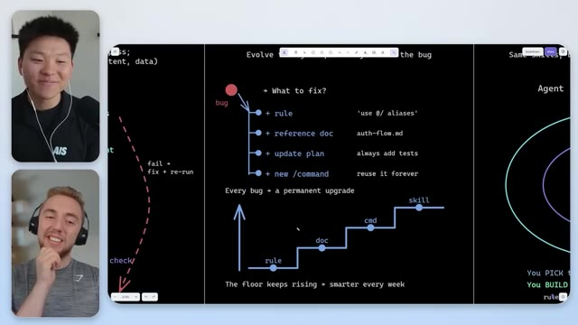
*⏱️ 00:55:51 — Schéma explicatif sur fond noir illustrant la résolution de bugs et l'amélioration continue, avec des webcams des intervenants sur le côté gauche.*

---

### ⏱️ `[00:56:08 - 00:56:43]` | Segment #124

**🔊 Audio (Transcription Intégrale Mot pour Mot en Français) :**
> Parfois, si vous lui demandez son avis, genre demander son avis à un grand modèle de langage, c'est une pente vraiment glissante. Ouais, mais ce que vous pouvez, ce qu'on peut lui demander, c'est de comprendre comment quelque chose fonctionne, genre c'est là qu'il peut faire un très bon travail. Donc, en revenant à l'exemple de tout à l'heure, si vous n'êtes pas technique mais que vous voulez essayer d'être capable de comprendre les automatisations et les choses qu'il construit pour vous, genre c'est une très bonne chose à lui demander parce qu'il ne va pas, genre il n'y a pas de sycophante là-dedans, n'est-ce pas ? Il n'essaie pas juste de vous apaiser, il vous aide juste à comprendre, la façon de vous apaiser c'est d'expliquer la chose, n'est-ce pas ? Ouais, donc genre c'est vraiment une bonne

**👁️ Analyse Visuelle d'Écran (gemini-3.5-flash-lite) :**
**Interface & Outils** : Application de présentation ou tableau blanc numérique (type Excalidraw ou similaire).

**Contenu textuel & Code** : Schéma textuel et graphique titré "Evolve the policy, not just fix the bug" avec des étapes pour transformer les bugs en compétences réutilisables ("Every bug = a permanent upgrade").

**Action / Démonstration** : Présentation visuelle et explication d'un diagramme de flux conceptuel sur l'amélioration continue pilotée par les bugs.

*⏱️ 00:56:17 — Un schéma explicatif illustrant comment transformer un bug en amélioration permanente avec des étapes ("rule", "reference doc", "update plan", "new /command") aux côtés d'une visioconférence entre deux interlocuteurs.*

---

### ⏱️ `[00:56:43 - 00:57:16]` | Segment #125

**🔊 Audio (Transcription Intégrale Mot pour Mot en Français) :**
> cas juste en essayant de comprendre n'importe quoi et puis comme ce dont nous parlions juste ici avec la vérification comme essayer de trouver des cas limites s'il y a quelque chose où il y a des données empiriques réelles comme il y a un moyen de vérifier que comme cette cette automatisation ne gère pas bien cette entrée je veux dire il n'y a pas de place pour la sycophante là-dedans c'est comme si ça marche ou ça ne marche pas et il n'y a pas vraiment de zone grisée ou d'avis n'est-ce pas ? donc si tu penses qu'il pourrait y avoir un cas limite ou qu'il pense qu'il pourrait y en avoir un il peut le tester et ensuite c'est c'est noir ou blanc n'est-ce pas ? donc je veux entendre ce que tu penses de ça parce que tu as brièvement mentionné l'agent

**👁️ Analyse Visuelle d'Écran (gemini-3.5-flash-lite) :**
**Interface & Outils** : Application de schéma / Excalidraw ou outil de whiteboard similaire.

**Contenu textuel & Code** : Texte et diagramme : « Evolve the system, permanently fix the bug », « What to fix? », « + rule », « + reference doc », « + update plan », « + new /command », et un graphique en escalier montrant l'évolution des compétences (« rule -> doc -> cmd -> skill »).

**Action / Démonstration** : Le présentateur explique le concept d'amélioration itérative et permanente du système à chaque correction de bug.

*⏱️ 00:56:51 — Schéma explicatif sur fond noir illustrant le processus d'amélioration continue suite à un bug, avec deux flux vidéo des interlocuteurs sur le côté gauche.*

---

### ⏱️ `[00:57:16 - 00:57:36]` | Segment #126

**🔊 Audio (Transcription Intégrale Mot pour Mot en Français) :**
> des équipes plus tôt et ouais, je me retrouve en fait à les utiliser pas mal pour principalement un cas d'usage spécifique et je veux entendre ce que tu en penses, donc vraiment le moment où je fais appel à des équipes d'agents, c'est quand j'essaie d'aider, tu sais, j'essaie de décider quelque chose mais je ne veux pas juste demander l'avis de Claude Coase, comme tu viens de le dire.

**👁️ Analyse Visuelle d'Écran (gemini-3.5-flash-lite) :**
**Interface & Outils** : Présentation avec diagramme visuel et flux vidéo des intervenants.

**Contenu textuel & Code** : Texte du diagramme : "Evolve the policy, don't just fix the bug", "What to fix?", "+ rule", "+ reference doc", "+ update plan", "+ new /command", et graphique en escalier montrant l'évolution vers une compétence.

**Action / Démonstration** : Présentation du diagramme illustrant la méthodologie d'utilisation des agents et l'évolution des processus face aux bugs.

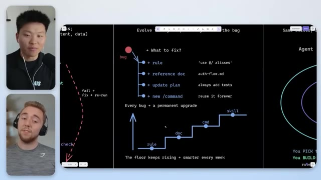
*⏱️ 00:57:21 — Schéma explicatif illustrant comment transformer un bug en amélioration permanente (règles, documentation, plan, commandes).*

---

### ⏱️ `[00:57:37 - 00:58:02]` | Segment #127

**🔊 Audio (Transcription Intégrale Mot pour Mot en Français) :**
> Et donc ce que je fais beaucoup, c'est que je lance un groupe de débat ou une sorte de salle de crise. Et je dis, vous savez, par exemple, l'un de vous est un PDG, un autre un débutant, un autre un étudiant, et juste un tas de personas différents, parfois même jusqu'à sept. Et je leur demande simplement de faire tous des recherches indépendantes, de se faire leur propre opinion, et ensuite je les fais débattre. Et puis je peux simplement lire le débat et je peux, parfois je dis, continuez à débatre jusqu'à ce que vous arriviez tous à une sorte de consensus.

**👁️ Analyse Visuelle d'Écran (gemini-3.5-flash-lite) :**
**Interface & Outils** : Application de visioconférence et outil de schématisation (type Excalidraw ou tableau blanc).

**Contenu textuel & Code** : Schéma textuel et graphique expliquant comment traiter un bug via des règles, de la documentation de référence, des plans de mise à jour et de nouvelles commandes, ainsi qu'un graphique en escalier intitulé "Every bug = a permanent upgrade".

**Action / Démonstration** : Le présentateur explique les concepts de résolution de bugs et d'évolution des agents en s'appuyant sur le schéma visuel.

*⏱️ 00:57:43 — Capture d'écran montrant une visioconférence avec deux participants à gauche, et au centre un schéma explicatif sur fond noir illustrant la résolution de bugs et l'amélioration continue des agents IA.*

---

### ⏱️ `[00:58:02 - 00:58:21]` | Segment #128

**🔊 Audio (Transcription Intégrale Mot pour Mot en Français) :**
> Mais je fais ça assez souvent. Et ça ne veut pas dire que tout ce que l'équipe d'agents génère, je l'applique. Mais parfois, c'est juste vraiment génial pour moi de lire tous ces avis. Mais je veux voir, est-ce que tuimes ça ? Est-ce que tu penses que c'est un défaut majeur ? Genre, qu'est-ce que tu en penses ? En fait, j'aime bien ça. Je n'avais jamais fait ça avant. Tu n'as jamais fait ça. Tu devrais vraiment essayer.

**👁️ Analyse Visuelle d'Écran (gemini-3.5-flash-lite) :**
**Interface & Outils** : Présentation vidéo avec deux participants et un diagramme explicatif en affichage principal.

**Contenu textuel & Code** : Texte du diagramme : "Evolve the way you handle the bug", "+ rule: use @/ aliases", "+ reference doc: auth-flow.md", "Every bug = a permanent upgrade", "The floor keeps rising = smarter every week".

**Action / Démonstration** : Explication du concept d'amélioration continue des agents à chaque correction de bug.

*⏱️ 00:58:07 — Schéma explicatif sur fond noir illustrant le processus d'évolution des agents face à un bug avec des étapes progressives (rule, doc, cmd, skill).*

---

### ⏱️ `[00:58:21 - 00:58:42]` | Segment #129

**🔊 Audio (Transcription Intégrale Mot pour Mot en Français) :**
> Non, ouais, j'ai l'impression que ce soir, j'ai littéralement pu essayer ça. C'est vraiment amusant. Ouais, j'aime beaucoup cette idée. Parce que quelque chose avec lequel j'ai fait des expérimentations qui est un peu similaire, j'appelle ça le développement adversariel. Où en gros, après qu'un code cloud a fini de construire quelque chose, je vais avoir une session de code cloud séparée où je le sollicite spécifiquement pour jouer l'avocat du diable.

**👁️ Analyse Visuelle d'Écran (gemini-3.5-flash-lite) :**
**Interface & Outils** : Présentation vidéo avec deux intervenants et un diagramme textuel/schématique sur fond noir.

**Contenu textuel & Code** : Texte du diagramme : "Evolve the policy, not just the bug", "+ rule: use @/ aliases", "+ reference doc: auth-flow.md", "Every bug = a permanent upgrade", "The floor keeps rising = smarter every week".

**Action / Démonstration** : Explication du concept de développement et d'amélioration continue du code à partir des bugs.

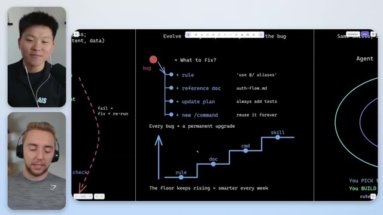
*⏱️ 00:58:26 — Schéma explicatif illustrant comment transformer un bug en amélioration permanente avec des étapes comme rule, reference doc, update plan et new /command.*

---

### ⏱️ `[00:58:42 - 00:59:00]` | Segment #130

**🔊 Audio (Transcription Intégrale Mot pour Mot en Français) :**
> Genre, je veux que tu sois méchant avec l'autre session de Cloud Code pour, genre, vraiment t'assurer qu'elle ne fait pas juste l'optimiste béate alors qu'il y a en fait des problèmes qui doivent être mis en lumière. Et ça fonctionne vraiment bien. Donc, de manière générale, faire s'affronter des grands modèles de langage entre eux est une bonne idée. J'aurais aimé essayer ça avant.

**👁️ Analyse Visuelle d'Écran (gemini-3.5-flash-lite) :**
**Interface & Outils** : Présentation avec diagramme interactif (Excalidraw ou outil similaire) et flux vidéo des participants.

**Contenu textuel & Code** : Schéma avec les sections « What to fix? », « rule: use @/ aliases », « reference doc », « update plan », « new /command », et un graphique d'escalier « Every bug = a permanent upgrade ».

**Action / Démonstration** : Présentation du diagramme par les intervenants pour expliquer la méthodologie d'amélioration continue des agents IA.

*⏱️ 00:58:46 — Schéma explicatif sur fond noir illustrant comment transformer chaque bug en amélioration permanente avec des règles, documentation et commandes.*

---

### ⏱️ `[00:59:00 - 00:59:19]` | Segment #131

**🔊 Audio (Transcription Intégrale Mot pour Mot en Français) :**
> Donc oui, je vais essayer ça. Je pense que c'est une très bonne utilisation pour les équipes d'agents. Parce qu'à ce moment-là, c'est comme si vous ne comptiez pas sur le fait d'obtenir la réponse parfaite. Genre, ça demande beaucoup de jetons et les communications sont vraiment parfaites. C'est donc pour cela que je ne recommande pas vraiment les équipes d'agents lorsque vous essayez de faire du développement approfondi ou de construire n'quelconque type d'automatisations complexes.

**👁️ Analyse Visuelle d'Écran (gemini-3.5-flash-lite) :**
**Interface & Outils** : Application de tableau blanc / diagramme en ligne.

**Contenu textuel & Code** : Schéma montrant "What to fix?" avec des étapes (+ rule, + reference doc, + update plan, + new /command) et un graphique en escalier intitulé "Every bug = a permanent upgrade".

**Action / Démonstration** : Le présentateur explique visuellement le concept d'évolution des agents à l'aide d'un schéma structuré.

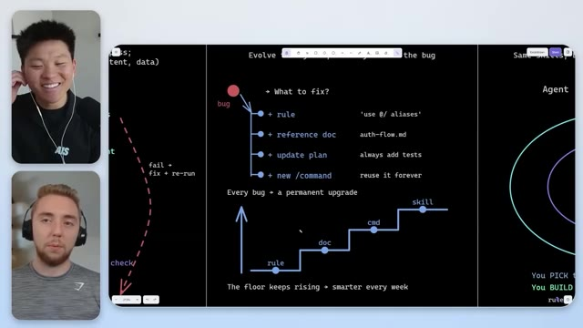
*⏱️ 00:59:05 — Schéma explicatif sur fond noir illustrant le processus de correction de bugs et d'amélioration continue d'agents, avec deux intervenants en visioconférence à gauche.*

---

### ⏱️ `[00:59:19 - 00:59:54]` | Segment #132

**🔊 Audio (Transcription Intégrale Mot pour Mot en Français) :**
> Mais quand c'est plutôt de la recherche et simplement pour former un consensus, je pense que ça marcherait vraiment très bien pour ça. Je vais l'essayer. Cool. Ouais, fais-moi savoir si tu l'essayes et ce que tu en penses. mais je n'ai jamais vraiment parlé de ça ou fait de vidéo parce que je sais que les gens le feraient et se diraient ensuite, tu viens de tuer ma limite de cinq heures. C'est vrai. Ouais. Pauvre Shilling. Donc, euh, quelle part de ta limite est-ce que ça utilise quand tu le fais généralement ? Je veux dire, sur le forfait à 200 balles, 200 balles par mois, quelque part entre, tu sais, 4 % et 10 parfois, genre, tu sais, ce n'est pas trop mal. Mais tu sais, si tu, si tu dis quelque chose du genre, euh, ne t'arrête pas tant que tout le monde

**👁️ Analyse Visuelle d'Écran (gemini-3.5-flash-lite) :**
**Interface & Outils** : Application de tableau blanc / diagramme en ligne (type Excalidraw ou similaire).

**Contenu textuel & Code** : Schéma intitulé 'Evolve your workflow to fix the bug' avec les étapes : rule, reference doc, update plan, new /command, et un graphique en escalier montrant 'Every bug = a permanent upgrade'.

**Action / Démonstration** : Le présentateur explique et commente le diagramme affiché à l'écran concernant l'évolution des workflows et la gestion des bugs.

*⏱️ 00:59:28 — Un diagramme explicatif montrant comment corriger les bugs avec des règles et de la documentation, avec la visioconférence des deux interlocuteurs sur le côté.*

---

### ⏱️ `[00:59:54 - 01:00:28]` | Segment #133

**🔊 Audio (Transcription Intégrale Mot pour Mot en Français) :**
> est d'accord et qu'ils continuent, alors vous pourriez avoir quelques problèmes. Mais pour conclure, je dois vous demander, je viens de faire une vidéo sur mes fonctionnalités préférées dans CloudCode. Et j'ai introduit toute cette vidéo en disant fondamentalement, ce n'est pas une liste des meilleures fonctionnalités ou des plus utilisées ou des plus utiles. Ce sont essentiellement la façon dont j'utilise CloudCode au jour le jour, celles que j'aime le plus. Et j'avais une liste numérotée de 12 au début, mais j'aimerais beaucoup t'entendre, pour te mettre sur la sellette, si tu avais un top trois basé sur, parce que je suppose que nous utilisons

**👁️ Analyse Visuelle d'Écran (gemini-3.5-flash-lite) :**
**Interface & Outils** : Application de visioconférence et outil de diagramme/présentation.

**Contenu textuel & Code** : Texte et schémas sur le diagramme : « Evolve the system, don't just fix the bug », « What to fix? », « + rule », « + reference doc », « + update plan », « + new /command », « Every bug = a permanent upgrade », « The floor keeps rising = smarter every week ».

**Action / Démonstration** : Présentation et explication visuelle du diagramme de flux d'amélioration par les intervenants en visioconférence.

*⏱️ 01:00:11 — Appel vidéo montrant deux participants à gauche, et un diagramme explicatif sur fond noir à droite détaillant comment transformer un bug en amélioration permanente.*

---

### ⏱️ `[01:00:28 - 01:00:49]` | Segment #134

**🔊 Audio (Transcription Intégrale Mot pour Mot en Français) :**
> très différemment. Qu'est-ce que tu dirais qui sont tes trois préférés, genre ? Ouais. Donc, euh, les webhooks, c'est peut-être pas mon préféré absolu, mais probablement celui que la plupart des gens ne mettraient pas dans leur top trois. Et c'est à cause de ce que j'ai fait avec pour la sécurité. Et puis toute l'euh, intégration avec le second cerveau. Donc c'est capable en gros d'extraire des résumés et de se souvenir de choses au fil du temps.

**👁️ Analyse Visuelle d'Écran (gemini-3.5-flash-lite) :**
**Interface & Outils** : Application de visioconférence et interface de présentation ou tableau blanc numérique.

**Contenu textuel & Code** : Texte et schémas sur le thème « Evolve the system, don't just fix the bug » avec des étapes comme '+ rule', '+ reference doc', '+ update plan', '+ new /command' et un graphique en escalier montant vers 'skill'.

**Action / Démonstration** : Présentation visuelle d'un schéma méthodologique concernant la correction de bugs et l'apprentissage des agents.

*⏱️ 01:00:33 — Capture d'écran montrant une visioconférence à gauche avec deux intervenants et un diagramme explicatif à droite sur fond sombre détaillant la gestion des bugs et l'évolution des règles d'IA.*

---

### ⏱️ `[01:00:49 - 01:01:07]` | Segment #135

**🔊 Audio (Transcription Intégrale Mot pour Mot en Français) :**
> Donc on a vraiment besoin d'une vidéo sur Hooks Cole. Ouais. Franchement, je devrais juste faire ça la semaine prochaine. Ouais, on en a vraiment besoin. Ouais. D'accord. Ouais. Merci, Nate. Ouais. Donc ouais, Hooks est vraiment le numéro un. D'accord. Et puis ici, parce que j'ai mentionné certaines choses ici. Je veux dire, en fait, il y a en gros deux types différents de fonctionnalités de code cloud.

**👁️ Analyse Visuelle d'Écran (gemini-3.5-flash-lite) :**
**Interface & Outils** : Application de présentation ou tableau blanc numérique (ex: Excalidraw, Miro)

**Contenu textuel & Code** : Schéma textuel et graphique montrant les étapes : "What to fix?", "+ rule", "+ reference doc", "+ update plan", "+ new /command", et "Every bug = a permanent upgrade".

**Action / Démonstration** : Présentation et explication d'un concept de workflow d'automatisation et de gestion des bugs par les intervenants.

*⏱️ 01:00:54 — Un schéma explicatif illustrant un flux de résolution de bugs et d'amélioration continue avec des agents IA, affiché à côté des participants en visio.*

---

### ⏱️ `[01:01:07 - 01:01:42]` | Segment #136

**🔊 Audio (Transcription Intégrale Mot pour Mot en Français) :**
> Vous avez les composants de la couche d'IA, comme les compétences de règles, les Hooks, et ensuite vous avez simplement les capacités générales de l'infrastructure comme, euh, les équipes d'agents et, soit dit en passant, et, euh, l'envoi comme des flux de travail dynamiques, des choses comme ça, n'est-ce pas ? Soit c'est quelque chose que vous utilisez, soit c'est quelqueçose que vous construisez par-dessus. Euh, les sous-agents seraient probablement le numéro deux, euh, juste parce que, comme je l'ai dit, il y a des dangers à utiliser des sous-agents, mais simplement les utiliser pour, euh, se déployer et faire des recherches sur une tonne de choses différentes. Je l'utilise pour ça tout le temps. Et surtout quand je travaille sur plus

**👁️ Analyse Visuelle d'Écran (gemini-3.5-flash-lite) :**
**Interface & Outils** : Application de tableau blanc / diagramme en ligne sur fond noir.

**Contenu textuel & Code** : Schéma concentrique avec les labels "The model", "THE HARNESS", "THE AI LAYER", ainsi que la mention "You PICK the tool (harness) & model, You BUILD the AI layer that wraps it (rules · skills · hooks · MCP · LSP)".

**Action / Démonstration** : Présentation du diagramme illustrant la structure et les composants d'un système d'IA.

*⏱️ 01:01:16 — Un diagramme explicatif montrant les différentes couches d'une architecture d'agent IA, avec le modèle au centre, le harnais autour, et la couche d'IA englobant le tout.*

---

### ⏱️ `[01:01:42 - 01:02:15]` | Segment #137

**🔊 Audio (Transcription Intégrale Mot pour Mot en Français) :**
> des bases de code complexes ou en créant des automatisations plus vastes, j'utilise des sous-agents pour extraire fondamentalement le contexte de certaines parties de mon système. Tu es responsable d'obtenir une base ici sur la façon dont nous allons devoir intervenir sur le front-end dans cette application ? Comment allons-nous devoir intervenir sur le back-end ? Et puis honnêtement, probablement mon numéro un, donc je suppose que les hooks seraient le numéro deux et les salvations seraient le numéro trois, ok, probablement mon numéro un ce sont les compétences, même si c'est du genre super super cliché, ouais, genre ouais, ça doit être les compétences, c'est juste le meilleur, ouais, ouais, genre les compétences

**👁️ Analyse Visuelle d'Écran (gemini-3.5-flash-lite) :**
**Interface & Outils** : Application de schéma / tableau blanc en ligne sur fond noir.

**Contenu textuel & Code** : Texte du schéma : 'THE AI LAYER You BUILD', 'THE HARNESS', 'The model You PICK'. En bas : 'You PICK the tool (harness) & model, You BUILD the AI layer that wraps it' avec des mentions rules, skills, hooks, MCP, LSP.

**Action / Démonstration** : Présentation d'un diagramme architectural expliquant la structure des couches d'intelligence artificielle et d'automatisation.

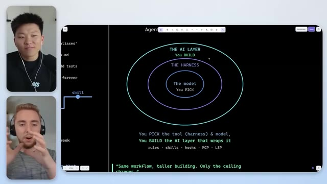
*⏱️ 01:01:50 — Schéma conceptuel représentant les couches d'une application IA, avec trois cercles concentriques : 'The model You PICK', 'THE HARNESS' et 'THE AI LAYER You BUILD'.*

---

### ⏱️ `[01:02:15 - 01:02:52]` | Segment #138

**🔊 Audio (Transcription Intégrale Mot pour Mot en Français) :**
> les compétences dictent tout une compétence j'ai une compétence pour faire ce diagramme ouais j'ai une compétence pour rédiger mes scripts de vidéos YouTube j'ai une compétence pour créer des powerpoints j'ai une compétence pour euh je veux dire tu peux littéralement juste tellement polyvalent ouais ouais c'est juste n'importe quel type de prompt réutilisable tu le fais juste en tant que compétence et Cloud Code a fait vraiment du bon travail en continuant à évoluer tout comme la façon dont tu peux paramétrer des choses comme ils ont genre euh des compétences de portée de chemin maintenant et tu peux genre définir si celle-ci doit être invoquée uniquement par toi ou si l'agent peut décider de le faire aussi euh et puis ensuite genre en parlant de genre de vérification euh en revenant ici euh en ayant ce navigateur

**👁️ Analyse Visuelle d'Écran (gemini-3.5-flash-lite) :**
**Interface & Outils** : Interface de tableau blanc / diagramme en ligne (style Excalidraw ou similaire).

**Contenu textuel & Code** : Schéma avec trois cercles : "The model You PICK" (au centre), "THE HARNESS" (au milieu) et "THE AI LAYER You BUILD" (à l'extérieur). Texte explicatif en bas : "You PICK the tool (harness) & model, You BUILD the AI layer that wraps it - rules - skills - hooks - MCP - LSP".

**Action / Démonstration** : Le présentateur explique la structure des couches d'une IA, en mettant en avant les compétences (skills) et les règles constituant la couche supérieure.

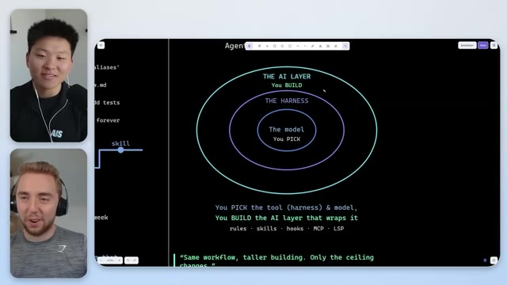
*⏱️ 01:02:24 — Un diagramme explicatif montrant les couches d'une architecture d'agent IA avec trois cercles concentriques, accompagné des visages des deux interlocuteurs en visioconférence à gauche.*

---

### ⏱️ `[01:02:52 - 01:03:13]` | Segment #139

**🔊 Audio (Transcription Intégrale Mot pour Mot en Français) :**
> compétence en automatisation pour qu'il sache comment utiliser une interface en ligne de commande, c'est toute une autre histoire, c'est que la combinaison de la compétence et de l'interface en ligne de commande est tout simplement vraiment, vraiment puissante. Parce qu'en gros, n'importe quelle plateforme ou outil que vous voulez que votre agent de codage puisse utiliser, ce sera soit un serveur MCP. Et ceux-là sont toujours bien. Mais honnêtement, ce qui selon moi est encore mieux, plus efficace en termes de jetons, c'est d'avoir une interface en ligne de commande.

**👁️ Analyse Visuelle d'Écran (gemini-3.5-flash-lite) :**
**Interface & Outils** : Outil de diagramme/mindmap en ligne.

**Contenu textuel & Code** : Texte du diagramme : 'VERIFY THE WORK', 'agent output', '1 auto-checks', '2 rules / lint', '3 tests', '4 review'.

**Action / Démonstration** : Présentation du workflow de vérification et de validation des sorties d'un agent.

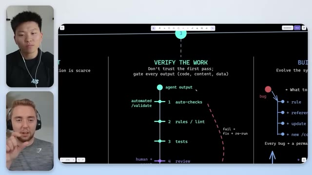
*⏱️ 01:02:57 — Un diagramme explicatif montrant le processus 'VERIFY THE WORK' avec différentes étapes de validation (auto-checks, rules/lint, tests, human review).*

---

### ⏱️ `[01:03:13 - 01:03:33]` | Segment #140

**🔊 Audio (Transcription Intégrale Mot pour Mot en Français) :**
> Donc, il a accès à votre CRM ou GitHub ou quoi que ce soit d'autre via la CLI. Et ensuite, la compétence, elle lui indique comment utiliser cette CLI. Et plus précisément encore, comment vous voulez qu'il l'utilise. Genre, bon, comment voulez-vous que cette CLI soit intégrée dans votre flux de travail ? C'est cette combinaison-là. Je m'appuie là-dessus pour tout. C'est comme mon outil Archon dont je parlais tout à l'heure.

**👁️ Analyse Visuelle d'Écran (gemini-3.5-flash-lite) :**
**Interface & Outils** : Outil de diagramme ou tableau blanc virtuel (ex: Miro, Excalidraw)

**Contenu textuel & Code** : Texte du diagramme : 'VERIFY THE WORK', 'agent output', '1 auto-checks', '2 rules / lint', '3 tests', '4 review'.

**Action / Démonstration** : Présentation visuelle d'un processus de vérification et de validation du travail de l'agent.

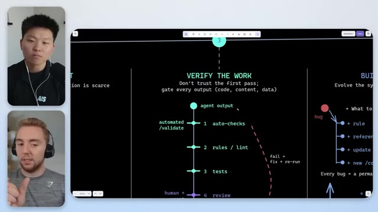
*⏱️ 01:03:18 — Schéma de workflow montrant l'étape 'VERIFY THE WORK' avec les vérifications automatisées, les règles et les tests pour valider la sortie de l'agent.*

---

### ⏱️ `[01:03:33 - 01:04:08]` | Segment #141

**🔊 Audio (Transcription Intégrale Mot pour Mot en Français) :**
> Genre c'est une interface en ligne de commande qui a une compétence intégrée. Donc genre si vous voulez ces flux de travail plus déterministes où vous pouvez choisir genre, quand est-ce qu'on a le LLM ? Quand est-ce qu'on exécute juste du code ? Alors genre vous construisez ça comme un flux de travail. Et puis maintenant Archon avec sa compétence et son interface en ligne de commande devient un outil que mon second cerveau peut appeler quand il veut pour lancer l'un de ces flux de travail afin de s'occuper d'un problème GitHub ou exécuter cette automatisation peu importe ce que c'est c'est trop cool j'adore ouais j'adore la liste mes trois premiers c'étaient les compétences c'était le numéro un ok le numéro deux j'avais la ligne d'état oh sympa j'adore juste une question de

**👁️ Analyse Visuelle d'Écran (gemini-3.5-flash-lite) :**
**Interface & Outils** : Outil de diagramme ou tableau blanc collaboratif (type Excalidraw ou Miro).

**Contenu textuel & Code** : Le schéma détaille un processus itératif pour les agents : « agent output » suivi d'étapes de validation (« auto-checks », « rules / lint », « tests », « human review ») et un mécanisme de boucle de rétroaction « fail + fix + re-run » en cas de bug.

**Action / Démonstration** : Présentation conceptuelle et visuelle de l'architecture logicielle nécessaire pour sécuriser les sorties d'un agent IA avant leur validation finale.

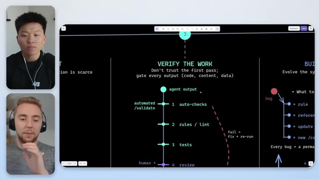
*⏱️ 01:03:42 — Une vue d'un diagramme de workflow technique illustrant un pipeline de vérification pour les agents IA, intitulé « VERIFY THE WORK ».*

---

### ⏱️ `[01:04:08 - 01:04:42]` | Segment #142

**🔊 Audio (Transcription Intégrale Mot pour Mot en Français) :**
> Un truc de dingue tu sais, juste de voir le modèle, l'effort, la fenêtre, j'adore ça, et puis mon numéro trois c'était les routines, j'adore les... euh d'accord, les routines cloud, je... je trouve juste ça tellement cool que, tu sais, je sais, je sais qu'on a le SDK et tout le reste, mais c'est juste sympa de pouvoir planifier quelque chose qui est juste mon code cloud qui tourne, et ouais, je pense que ce sont mes trois préférés, et je suis sûr qu'ils... qu'ils vont changer de place, mais ouais, j'apprécie que tu aies partagé les tiens, c'était intéressant à entendre, je suis content que les hooks fassent partie de la liste, donc je vais vraiment garder un œil ouvert pour cette vidéo en tout cas, ça marche, ouais, d'accord, pour quoi est-ce que tu utilises euh les routines ? euh eh bien, j'en ai une qui tourne en ce moment et qui est un... un bot de trading.

**👁️ Analyse Visuelle d'Écran (gemini-3.5-flash-lite) :**
**Interface & Outils** : Outil de diagramme type tableau blanc (ex: Excalidraw ou Miro).

**Contenu textuel & Code** : Le schéma détaille le processus "VERIFY THE WORK" avec les étapes : "agent output", "1 auto-checks", "2 rules / lint", "3 tests" et "4 review". On y voit également une flèche pointant vers un "bug" avec les mentions "rule", "reference", "update" et "new / code".

**Action / Démonstration** : Présentation visuelle d'un pipeline de validation automatisé pour agent IA pour éviter les erreurs lors de la génération de code ou de contenu.

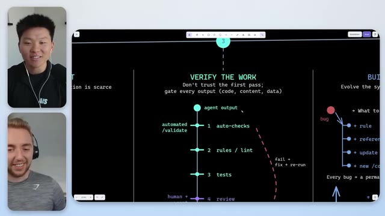
*⏱️ 01:04:17 — Un schéma de workflow affiché sur un tableau blanc virtuel illustrant les étapes de vérification du travail d'un agent IA.*

---

### ⏱️ `[01:04:42 - 01:05:15]` | Segment #143

**🔊 Audio (Transcription Intégrale Mot pour Mot en Français) :**
> Au départ, je faisais tourner ça avec un agent Open Call, mais je l'ai basculé sur des routines juste pour voir comment, comment ça marcherait là-bas, mais ensuite d'autres choses, c'est juste qu'en fait ça marche moins bien là-bas, ah ouais, ça marche moins bien là-bas en ce moment, mais je ne sais pas si c'est... je veux dire, le marché et tout le reste aussi, mais je pense qu'Open Claw avait juste, dès le départ, il avait de meilleures capacités de mémoire pour ce genre de choses, donc ouais, c'est logique, euh mais ensuite, vous savez, juste vos autres trucs habituels comme prendre des nouvelles de l'équipe et me donner des mises à jour tout au long de la semaine et, euh, des rapports de fin de semaine.

**👁️ Analyse Visuelle d'Écran (gemini-3.5-flash-lite) :**
**Interface & Outils** : Outil de tableau blanc collaboratif (type Miro ou FigJam).

**Contenu textuel & Code** : Le diagramme détaille un pipeline de vérification : "agent output" -> "1 auto-checks" -> "2 rules / lint" -> "3 tests" -> "4 human review". Une boucle de rétroaction "fail + fix + re-run" est représentée entre l'étape de test et la sortie initiale. Une section "BUILD" est visible sur la droite avec des points sur la gestion des bugs.

**Action / Démonstration** : Le présentateur commente le workflow de vérification et les mécanismes de contrôle qualité intégrés au pipeline de l'agent.

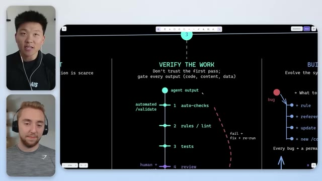
*⏱️ 01:04:50 — Un schéma de workflow affiché sur un tableau blanc virtuel illustrant le processus "VERIFY THE WORK" pour les agents IA.*

---

### ⏱️ `[01:05:15 - 01:05:37]` | Segment #144

**🔊 Audio (Transcription Intégrale Mot pour Mot en Français) :**
> Ce sont juste des choses très, très simples, mais c'est sympa d'ajouter ces routines-là. Donc oui, j'apprécie vraiment que tu nous aies guidés à travers tout ça aujourd'hui. Est-ce qu'il y a autre chose que tu aimerais laisser à tout le monde ? C'est une bonne question. Oui, je dirais que peu importe ton niveau technique, ce qui compte vraiment, c'est que tu peux te voir comme le chef de produit pour Cloud Code.

**👁️ Analyse Visuelle d'Écran (gemini-3.5-flash-lite) :**
**Interface & Outils** : Excalidraw (logiciel de diagramme).

**Contenu textuel & Code** : Diagramme technique : "Verify the Work" avec des étapes de contrôle (1: auto-checks, 2: rules/lint, 3: tests, 4: review) et une boucle de rétroaction "fail + fix + re-run".

**Action / Démonstration** : Illustration visuelle du processus de contrôle qualité appliqué à la sortie des agents IA.

*⏱️ 01:05:20 — Un schéma de workflow montrant les étapes de vérification du travail d'un agent IA : "Verify the Work", incluant des étapes d'auto-validation, de règles/lint, de tests et de revue humaine.*

---

### ⏱️ `[01:05:38 - 01:06:12]` | Segment #145

**🔊 Audio (Transcription Intégrale Mot pour Mot en Français) :**
> Donc tu n'as pas nécessairement besoin de décrire comment construire quelque chose, mais c'est important pour toi de façonner la vision, n'est-ce pas ? Genre, qu'est-ce qu'on va construire ? Et puis beaucoup de gens appellent ça l'ingénierie d'intention maintenant, je veux dire, c'est en gros un peu un autre mot à la mode, genre tu veux... tu veux donner genre le pourquoi, du style « Claude Code, c'est pour ça qu'on construit cette chose », parce que ça finit vraiment par plutôt bien façonner le comment. Donc genre, c'est une grande partie de ton processus de planification qui va t'emmener loin, et genre ça... ça semble un peu ridicule parce que tu commences vraiment à entrer dans une sorte de personnification de Claude Code quand tu... tu lui dis pourquoi tu fais les choses, mais genre ça fait vraiment une différence, tu es un peu...

**👁️ Analyse Visuelle d'Écran (gemini-3.5-flash-lite) :**
**Interface & Outils** : Outil de présentation visuelle de type tableau blanc interactif (probablement Excalidraw ou un outil similaire).

**Contenu textuel & Code** : Le contenu affiche deux piliers stratégiques pour l'utilisation de Claude Code : "2. MANAGE CONTEXT" (insistant sur la nécessité de fournir les bonnes informations) et "3. VERIFY THE WORK" (préconisant de valider les sorties via des tests automatisés et des règles de linting).

**Action / Démonstration** : Présentation conceptuelle et pédagogique des méthodologies de gestion d'agents IA, mettant l'accent sur le rôle de "directeur" plutôt que de simple exécutant technique.

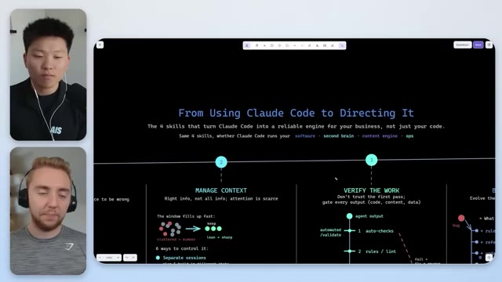
*⏱️ 01:05:46 — Une diapositive de présentation illustrant un framework conceptuel intitulé "From Using Claude Code to Directing It", détaillant les compétences clés pour diriger des agents IA.*

---

### ⏱️ `[01:06:12 - 01:06:49]` | Segment #146

**🔊 Audio (Transcription Intégrale Mot pour Mot en Français) :**
> il faut genre passer au-dessus de ça et se dire que c'est un peu gênant de le traiter comme une personne, mais en fait c'est vraiment comme ça qu'on obtient les meilleurs résultats, alors faites-le, faites-le tout simplement, ça aide vraiment beaucoup. Et ouais, de bons plans et de bonnes spécifications au départ de tout ce que vous construisez avec Claude ou que vous automatisez, super conseil, super conseil. J'ai justement lu hier encore dans la doc de Claude sur la façon de prompter la 4.8 qu'il y était dit, qu'il y était dit de lui donner le contexte de pourquoi vous faites quelque chose et qu'il ferait probablement un meilleur travail. Donc c'est génial. Cole, où est-ce que les gens peuvent te trouver s'ils veulent regarder plus de tes vidéos ou entrer en contact ? Ouais. Donc la chaîne YouTube est le principal endroit où je mets tout mon contenu. Donc tu

**👁️ Analyse Visuelle d'Écran (gemini-3.5-flash-lite) :**
**Interface & Outils** : Application de mindmapping / diagramme interactif (type Miro ou Excalidraw) affichée sur fond sombre.

**Contenu textuel & Code** : Schéma divisé en sections : "THE SHIFT", "PLAN FIRST" (avec la structure du fichier PLAN.md et les étapes /prime, /research, /plan, /edit live) et "MANAGE CONTEXT" (gestion de la mémoire et des sous-agents).

**Action / Démonstration** : Le présentateur explique les bonnes pratiques et les différentes étapes méthodologiques pour interagir efficacement avec l'assistant IA.

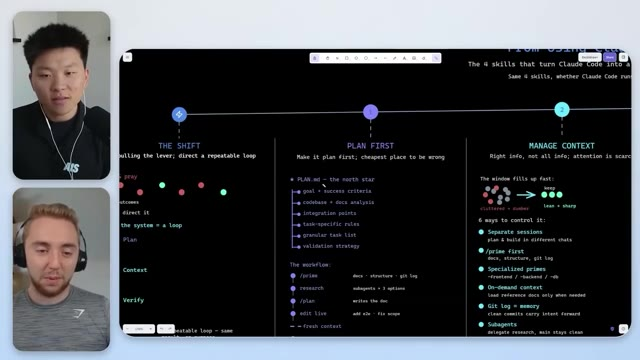
*⏱️ 01:06:21 — Un diagramme schématique à fond noir illustrant les étapes clés d'utilisation de Claude Code, avec les intervenants visibles en vignettes vidéo sur le côté gauche.*

---

### ⏱️ `[01:06:49 - 01:07:24]` | Segment #147

**🔊 Audio (Transcription Intégrale Mot pour Mot en Français) :**
> Vous pouvez juste chercher mon nom, Cole Medin. Ça ne s'épelle pas comme vous le pensez, c'est M-E-D-I-N. Ça se prononce comme Medin. Tout le monde le dit mal. Mais ouais, c'est ma chaîne YouTube. Et puis je publie aussi beaucoup sur LinkedIn également. Génial. Même nom, évidemment. Et voilà. Ouais. Je pense que pendant les premiers mois où je t'ai connu, je pensais que c'était Cole Meaden et je disais je disais Meaden tout le temps, mais super ouais, bon à savoir, tout est clarifié, c'est Cole Medin. C'est ça ouais, c'est un nom de famille suédois et euh ouais Nate, il y a il y a des gens qui l'ont dit bien pire que toi, genre quelqu'un m'a appelé Melden euh en direct sur scène lors d'un tournoi d'échecs au lycée, genre c'est c'est

**👁️ Analyse Visuelle d'Écran (gemini-3.5-flash-lite) :**
**Interface & Outils** : Interface de visioconférence et application de schématisation/diagramme.

**Contenu textuel & Code** : Texte et diagrammes expliquant les méthodes de planification et de gestion du contexte pour Claude Code (sections "THE SHIFT", "PLAN FIRST", "MANAGE CONTEXT").

**Action / Démonstration** : Présentation et explication visuelle des bonnes pratiques et des étapes de workflow pour l'utilisation d'outils d'IA.

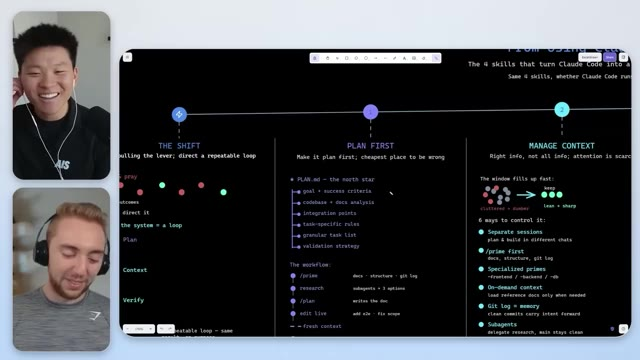
*⏱️ 01:06:58 — Capture d'écran montrant une visioconférence entre deux intervenants à gauche et un schéma explicatif sur fond noir à droite détaillant les compétences pour utiliser Claude Code.*

---

### ⏱️ `[01:07:24 - 01:07:52]` | Segment #148

**🔊 Audio (Transcription Intégrale Mot pour Mot en Français) :**
> ça aurait pu être pire oh ouais oh je ne sais pas, beaucoup de personnes ont halluciné le L là-dedans, j'ai remarqué ça, je ne suis pas sûr oh vraiment ouais d'accord, j'ai eu beaucoup de personnes qui me l'ont épelé comme Melden ou Medlin oh, waouh. D'accord. C'était en fait un truc unique pour moi. C'est surprenant. Je l'ai eu souvent pour une raison ou une autre. Mais bref, ouais. Merci beaucoup d'être venu, Cole. J'étais là non seulement pour discuter avec toi, mais j'ai aussi beaucoup appris. Alors merci beaucoup. Comme toujours, c'est un plaisir de pouvoir te parler et j'espère qu'on pourra le refaire bientôt.

**👁️ Analyse Visuelle d'Écran (gemini-3.5-flash-lite) :**
**Interface & Outils** : Application de tableau blanc / mind mapping (ex: Excalidraw ou Miro)

**Contenu textuel & Code** : Schéma textuel détaillant la méthodologie avec des sections comme 'PLAN.md - the north star', 'goal + success criteria', et des conseils sur la gestion du contexte.

**Action / Démonstration** : Présentation et explication d'un diagramme conceptuel sur les bonnes pratiques d'utilisation de Claude Code.

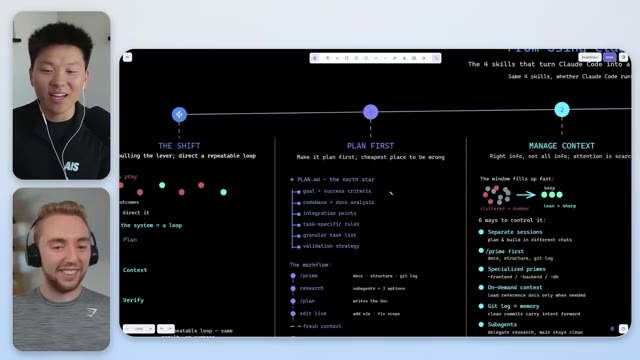
*⏱️ 01:07:31 — Un schéma ou tableau blanc interactif présentant les compétences clés pour utiliser Claude Code, avec les sections 'The Shift', 'Plan First' et 'Manage Context', tandis que les deux participants apparaissent en visio à gauche.*

---

### ⏱️ `[01:07:53 - 01:08:11]` | Segment #149

**🔊 Audio (Transcription Intégrale Mot pour Mot en Français) :**
> Ouais. Ça marche. J'apprécie. Et merci à toi aussi, Nate. C'était génial. Tout à fait. J'ai pu discuter avec toi. Génial. Voilà. Très bien. Vas-y doucement, Cole. Passe une bonne journée. Merci beaucoup d'avoir regardé l'épisode d'aujourd'hui. J'espère que vous avez apprécié. N'oubliez pas que j'ai résumé tout cela dans un guide de ressources gratuit auquel vous pouvez accéder tout à fait gratuitement en utilisant le lien dans la description pour rejoindre notre communauté School gratuite. Je vous y vois.

**👁️ Analyse Visuelle d'Écran (gemini-3.5-flash-lite) :**
**Interface & Outils** : Application de visioconférence et tableau blanc interactif.

**Contenu textuel & Code** : Schéma synthétisant les étapes d'utilisation de Claude Code ("THE SHIFT", "PLAN FIRST", "MANAGE CONTEXT").

**Action / Démonstration** : Discussion en direct et présentation visuelle de concepts d'automatisation.

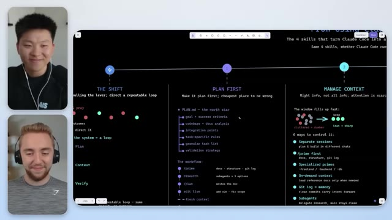
*⏱️ 01:07:57 — Appel vidéo en cours avec un invité et un tableau blanc interactif présentant un diagramme sur Claude Code et la gestion du contexte.*

---

### ⏱️ `[01:08:12 - 01:08:12]` | Segment #150

**🔊 Audio (Transcription Intégrale Mot pour Mot en Français) :**
> Merci beaucoup.

**👁️ Analyse Visuelle d'Écran (gemini-3.5-flash-lite) :**
**Interface & Outils** : Aucune interface logicielle visible.

**Contenu textuel & Code** : Aucun code source, terminal ou prompt affiché.

**Action / Démonstration** : Le présentateur parle et montre des objets visuels à la caméra.

---

