# 🎬 GLM 5.2 in Claude Code is Blowing My Mind

> **Chaîne** : [Nate Herk | AI Automation](https://www.youtube.com/@nateherk/featured)  
> **Lien YouTube** : [https://www.youtube.com/watch?v=2OD14-0cot4](https://www.youtube.com/watch?v=2OD14-0cot4)  
> **Date de publication** : 20260619  
> **Durée** : 00:15:43  
> **Identifiant vidéo** : `2OD14-0cot4`  
> **Transcription & Analyse** : `whisper-v3-large-turbo+gemini-3.5-flash-lite`  

---

## 📌 Synthèse Exécutive & Outils

### 💡 Résumé
La vidéo de la chaîne Nate Herk | AI Automation explore l'intégration et les performances du modèle **GLM 5.2** (un mastodonte open source de 753 milliards de paramètres) au sein de l'environnement de développement **Claude Code**. L'auteur y partage son retour d'expérience après une journée complète d'utilisation intensive, démontrant que ce modèle offre une alternative extrêmement crédible et économique aux modèles fermés de pointe pour la grande majorité des tâches de développement et de création de contenu automatisé. À travers plusieurs cas pratiques — allant de l'édition complète d'une vidéo YouTube (de la matière brute au montage final via un unique prompt) jusqu'à la conception de sites web, de rapports de recherche complexes et de tests logiques — la vidéo met en lumière un équilibre subtil entre vitesse, coût et niveau de raisonnement.

Les tests comparatifs menés face à **Opus** révèlent des dynamiques fascinantes : si GLM 5.2 se montre parfois plus lent sur des tâches de raisonnement hautement complexes (nécessitant parfois jusqu'à 24 minutes contre 5 pour Opus), il s'avère nettement plus rapide (3 minutes 59 secondes contre 14 minutes 59) et environ cinq fois moins cher sur des tâches de design ou d'exécution structurée. L'analyse démontre que GLM 5.2 excelle dans l'orchestration de sous-agents, la recherche documentaire et la production de code itératif, tandis que les modèles fermés lourds conservent une supériorité pour la résolution de cas limites subtils et la synthèse stratégique profonde. 

L'enseignement majeur de cette démonstration réside dans la transition vers une approche non binaire de l'IA : l'avenir de l'ingénierie logicielle ne repose pas sur un modèle unique, mais sur la capacité à router intelligemment chaque étape d'un workflow vers le modèle le plus adapté. En combinant un harnais performant (Claude Code), un contexte riche (fichiers markdown et compétences personnalisées) et des modèles alternatifs économiques comme GLM 5.2, les développeurs peuvent exécuter 80 % ou plus de leur travail intellectuel de manière fluide et ultra-rentable, réservant les modèles premium aux 10 à 20 % de tâches critiques exigeant un raisonnement surhumain.

### 🛠️ Outils, Modèles & Logiciels Présentés
* **GLM 5.2** : Modèle linguistique open source massif de 753 milliards de paramètres, loué via une plateforme en ligne (Z.ai) pour offrir des performances de pointe à un coût imbattable.
* **Claude Code** : Environnement de développement et harnais d'orchestration pour agents IA permettant d'exécuter des commandes complexes, de lire des fichiers de configuration et d'utiliser des compétences personnalisées.
* **Opus (versions 4.8 / 5.5)** : Modèle propriétaire haut de gamme d'Anthropic, reconnu pour sa puissance de raisonnement supérieure et sa capacité à gérer les cas limites subtils, bien que plus onéreux.
* **Codex** : Outil d'évaluation neutre utilisé dans la vidéo pour juger objectivement et sans contamination croisée les résultats produits par les différents agents.

### 🔑 Points Clés & Enseignements Stratégiques
* **Arbitrage coût-performance** : GLM 5.2 propose un coût par jeton environ cinq fois inférieur à celui d'Opus, tout en rivalisant efficacement sur des tâches de design et de génération de code brut.
* **Spécialisation des tâches par modèle** : Il est stratégique d'utiliser GLM 5.2 pour 80 % des tâches courantes (recherche, structuration, code standard) et de réserver Opus aux 10 à 20 % de tâches exigeant un raisonnement critique et profond.
* **Importance cruciale du harnais** : L'efficacité d'un agent IA dépend moins du modèle sous-jacent que de la qualité de son harnais (Claude Code), de sa configuration contextuelle (`cloud.md`) et de ses compétences intégrées.
* **Orchestration de sous-agents** : GLM 5.2 gère brillamment des architectures multi-agents complexes (comme la compétence "storm" pour la recherche), coordonnant plusieurs personas pour débattre et enrichir un livrable.
* **Gestion des cas limites (Edge Cases)** : Les modèles fermés comme Opus conservent une supériorité sur la détection et la gestion des cas particuliers subtils (ex. : types de données ou formats de valeurs dupliquées).
* **Vitesse variable selon le raisonnement** : Le temps d'exécution de GLM 5.2 varie fortement ; il peut surpasser la concurrence sur le design web rapide, mais demander plus de temps sur des tâches à fort besoin de calcul logique.
* **Viabilité des modèles open source hébergés** : Disposant de 753 milliards de paramètres, GLM 5.2 nécessite une infrastructure cloud (location de modèle) plutôt qu'un déploiement local, démocratisant l'accès aux super-modèles.
* **Approche non binaire de l'IA** : L'ingénierie moderne ne consiste plus à choisir un seul "meilleur" modèle, mais à concevoir des workflows hybrides combinant différentes intelligences selon chaque étape du processus.
* **Intégration transparente dans le terminal** : GLM 5.2 s'intègre parfaitement aux commandes natives de Claude Code, telles que la commande `slash goal`, permettant d'automatiser des flux complets de bout en bout.
* **Rapports et livrables dynamiques** : Le modèle est capable de générer des rapports HTML interactifs et structurés intégrant des résumés, des contre-arguments d'experts et des graphiques de relations sémantiques.

---

## ⏱️ Chronologie & Transcription Complète Audio & Visuelle (Mot pour Mot)

### ⏱️ `[00:00:00 - 00:00:33]` | Segment #01

**🔊 Audio (Transcription Intégrale Mot pour Mot en Français) :**
> Donc j'ai joué avec GLM 5.2 dans CloudCode toute la journée, et c'est incroyable. C'est plus rapide, c'est nettement moins cher, et ça s'intègre vraiment très bien dans l'environnement de CloudCode. Ça a si bien marché, en fait, que ça a édité toute cette intro que vous êtes train de regarder en ce moment, de la vidéo brute jusqu'à ce que vous voyez. Donc dans la vidéo d'aujourd'hui, je vais vous montrer à quel point c'est rapide et facile de configurer GLM 5.2 dans CloudCode, alors ne perdons pas de temps et allons directement dans la vidéo. Donc évidemment, cette intro n'était pas parfaite, mais c'était littéralement un seul prompt. C'était un seul "slash goal" juste ici. Ça a pris un peu plus d'une heure, une heure et quart pour, vous savez, une vidéo de 23 secondes. Donc ça a pris un tout petit peu

**👁️ Analyse Visuelle d'Écran (gemini-3.5-flash-lite) :**
**Interface & Outils** : VS Code, navigateur web, terminal intégré.

**Contenu textuel & Code** : Code source, arborescence de projet, terminal avec barre de progression de GLM-5.2 et prévisualisation web locale.

**Action / Démonstration** : Présentation de l'environnement de développement et démonstration de l'intégration du modèle GLM-5.2 dans l'éditeur.

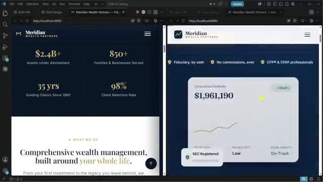
*⏱️ 00:00:08 — Capture d'écran montrant l'interface d'un navigateur avec deux fenêtres de prévisualisation locale côte à côte pour un site web de finance ('Meridian Wealth Partners').*

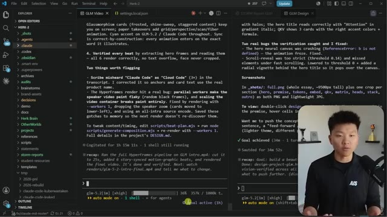
*⏱️ 00:00:24 — Capture d'écran de l'éditeur VS Code avec le terminal intégré en bas affichant l'exécution de GLM-5.2 et une incrustation vidéo du présentateur en bas à droite.*

---

### ⏱️ `[00:00:33 - 00:01:05]` | Segment #02

**🔊 Audio (Transcription Intégrale Mot pour Mot en Français) :**
> long, mais c'était la session pendant laquelle nous l'avons fait. C'était GLM 5.2, 1 million de contexte. Comme vous pouvez le voir juste ici, il a utilisé environ 357 000 jetons. Mais à mesure que je l'essaie de plus en plus, il y a certaines tâches où il termine beaucoup plus vite qu'Opus. Et puis il y en a d'autres comme celle-ci où Opus aurait fait cela beaucoup plus rapidement. Je vais donc vous montrer exactement comment faire la configuration. Mais avant cela, laissez-moi juste vous montrer quelques-unes des choses avec lesquelles j'ai joué et ce que GLM a été capable de faire. C'est donc vraiment très solide en matière de design. Je veux que vous regardiez juste ici et que vous voyiez laquelle de ces options, selon vous, a été conçue par GLM 5.2 et laquelle a été

**👁️ Analyse Visuelle d'Écran (gemini-3.5-flash-lite) :**
**Interface & Outils** : VS Code (éditeur de code), terminal intégré

**Contenu textuel & Code** : Documentation Markdown de projets vidéo, fichiers de configuration et métriques de consommation de jetons (glm-5.2 [1m] 357k / 1000k).

**Action / Démonstration** : Navigation et présentation comparative des interfaces web générées par GLM-5.2 et visualisation des statistiques de jetons dans le terminal.

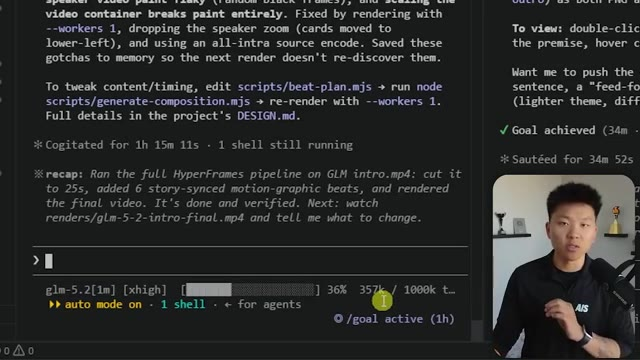
*⏱️ 00:00:41 — Gros plan sur un éditeur de texte affichant des instructions Markdown et un terminal en bas avec l'utilisation des jetons par GLM-5.2.*

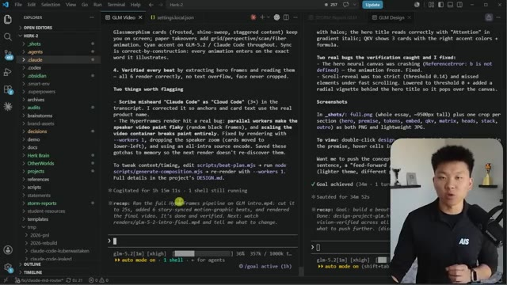
*⏱️ 00:00:49 — Vue de l'éditeur VS Code avec plusieurs panneaux montrant du code markdown et un terminal affichant l'utilisation des jetons de GLM-5.2.*

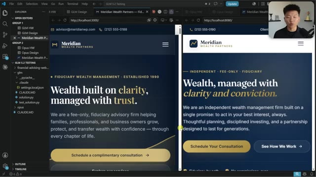
*⏱️ 00:00:57 — Vue de l'éditeur VS Code comparant deux applications web de gestion de patrimoine en local sur localhost.*

---

### ⏱️ `[00:01:05 - 00:01:39]` | Segment #03

**🔊 Audio (Transcription Intégrale Mot pour Mot en Français) :**
> conçu par Opus. Donc, en faisant défiler un peu vers le bas ici, vous pouvez voir que nous avons, vous savez, une image de marque de style similaire et c'est évidemment la même entreprise, mais nous avons des éléments sur les deux qui sont très similaires. Nous avons toutes ces choses qui apparaissent également de manière dynamique de chaque côté. Et il y a même un appel à l'action en bas. Je pense que l'indice révélateur ici, c'est que ce côté droit était Opus parce qu'il a ces F bizarres qu'il adore faire. Il adore cette police. Mais dans les deux cas, ils sont tous les deux très solides pour une invite unique, surtout si l'on considère le fait que vous obtenez ce résultat pour environ cinq fois moins cher. Ce sont donc les sessions de terminal réelles où nous avons fait ces conceptions de sites Web.

**👁️ Analyse Visuelle d'Écran (gemini-3.5-flash-lite) :**
**Interface & Outils** : Visual Studio Code avec double panneau de prévisualisation web local (localhost:3000 et localhost:8080).

**Contenu textuel & Code** : Interfaces web de l'entreprise Meridian Wealth Partners montrant des sections sur la gestion de patrimoine, des statistiques et des formulaires de contact.

**Action / Démonstration** : Le présentateur compare visuellement le design et l'image de marque de deux versions différentes d'un site web généré par IA.

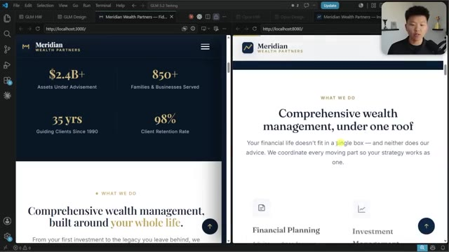
*⏱️ 00:01:14 — Comparaison côte à côte de deux versions de sites web de gestion de patrimoine (Meridian Wealth Partners) dans VS Code.*

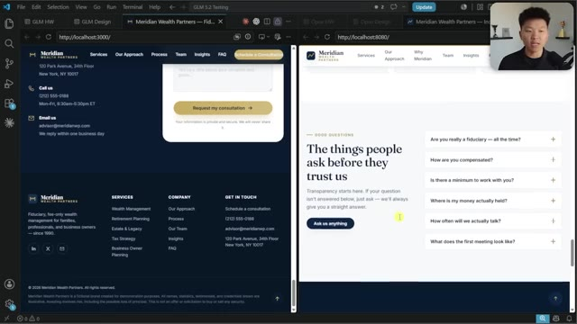
*⏱️ 00:01:22 — Défilement vers le bas sur les deux sites web affichant les sections de contact, FAQ et bas de page.*

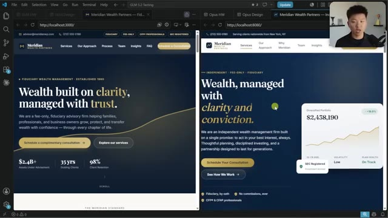
*⏱️ 00:01:31 — Vue des pages d'accueil des deux sites web avec des éléments de design similaires comparés par le présentateur.*

---

### ⏱️ `[00:01:39 - 00:02:15]` | Segment #04

**🔊 Audio (Transcription Intégrale Mot pour Mot en Français) :**
> Sur le côté gauche avec GLM, nous avons réussi en trois minutes et 59 secondes. Sur le côté droit avec Opus, nous avons réussi en 14 minutes et 59 secondes. Et non seulement le côté gauche avec GLM a utilisé moins de jetons, mais son coût par jeton est aussi environ cinq fois moins cher. Donc dans ce cas, c'était plus rapide et c'était beaucoup moins cher et c'était un résultat relativement similaire. J'ai aussi lancé cette invite de chaque côté où je leur ai donné un devoir. Vous pouvez voir ici, nous avons GLM et puis ici, nous avons Opus 4.8. J'ai demandé à Codex de créer le devoir juste pour qu'il n'y ait pas de contamination croisée ou quelque chose comme ça. Et puis quand ils ont eu fini, j'ai demandé à Codex de juger les deux résultats et de nous dire ce qu'il en pensait. Maintenant dans ce cas, il a dit que l'agent deux, qui

**👁️ Analyse Visuelle d'Écran (gemini-3.5-flash-lite) :**
**Interface & Outils** : VS Code avec interface en écran partagé (split view) et terminaux intégrés.

**Contenu textuel & Code** : Rapports de vérification de sites web (HTML, CSS, JS), instructions de tâches de programmation en Python (fonction reconcile_register avec la bibliothèque standard) et barres de progression de jetons.

**Action / Démonstration** : Comparaison des performances de deux agents IA concurrents (GLM 5.2 et Opus 4.8) exécutant la même tâche de développement web en temps réel.

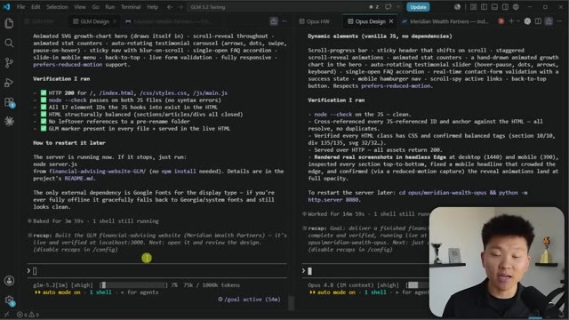
*⏱️ 00:01:48 — Comparaison côte à côte dans l'éditeur de code entre GLM (à gauche, terminé en 3m 59s) et Opus (à droite, terminé en 14m 59s) affichant les résultats de génération et les rapports de vérification.*

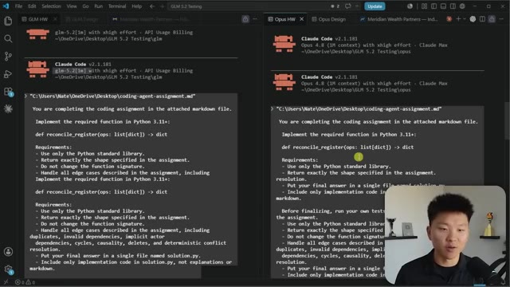
*⏱️ 00:02:06 — Écran montrant l'interface en double volet de l'éditeur de code avec le terminal Claude Code affichant les instructions de l'exercice de codage en Python (fonction reconcile_register).*

---

### ⏱️ `[00:02:15 - 00:02:51]` | Segment #05

**🔊 Audio (Transcription Intégrale Mot pour Mot en Français) :**
> était Opus, était meilleur parce qu'il gérait un cas particulier subtil que le premier agent avait manqué, à savoir des enregistrements en double avec des valeurs comme vrai versus un ou un versus 1,0. Donc, en bref, le premier agent, GLM 5,2, était bon, mais le deuxième agent ici était plus précis. Et de manière générale, ce que je ressens à ce sujet jusqu'à présent, c'est que GLM 5,2 est vraiment solide, et qu'il est plutôt rapide pour la plupart des tâches qui ne nécessitent pas un raisonnement poussé. Évidemment, en fin de compte, Opus 4,8 est un meilleur modèle. C'est un modèle fermé. Mais en réalité, demandez-vous à quelle fréquence vous avez réellement besoin de la puissance d'Opus. Probablement seulement peut-être 10 à 20 %, si ce n'est moins, des tâches que vous faites toute la journée. Vous pourriez

**👁️ Analyse Visuelle d'Écran (gemini-3.5-flash-lite) :**
**Interface & Outils** : Éditeur de code (VS Code / interface similaire)

**Contenu textuel & Code** : Texte de verdict détaillant les performances de l'agent 2 par rapport à l'agent 1 concernant les types de données (True vs 1 vs 1.0).

**Action / Démonstration** : Présentation comparative des résultats d'évaluation des agents textuels.

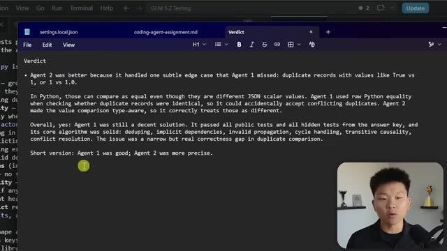
*⏱️ 00:02:24 — Vue d'un éditeur affichant le texte de verdict comparant les agents 1 et 2, avec le présentateur en médaillon.*

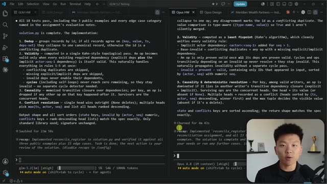
*⏱️ 00:02:33 — Vue partagée de l'éditeur montrant deux rapports de code côte à côte (GLM HW et Opus HW) avec des métriques d'exécution.*

---

### ⏱️ `[00:02:51 - 00:03:15]` | Segment #06

**🔊 Audio (Transcription Intégrale Mot pour Mot en Français) :**
> probablement gérer 80 % ou plus de votre travail intellectuel avec quelque chose comme GLM 5.2 ou quelque chose de plus semblable à Sonnet 3.7. C'est donc vraiment une compétence clé alors que nous entrons dans l'avenir de l'IA, qui consiste à comprendre quels modèles utiliser pour chaque tâche. Mais voici un exemple où vous pouvez voir qu'Opus a pris environ cinq minutes et que GLM 5.2 a pris environ 24 minutes. Et c'était moi sur un forfait à 60 dollars par mois pour Z.ai pour GLM 5.2.

**👁️ Analyse Visuelle d'Écran (gemini-3.5-flash-lite) :**
**Interface & Outils** : Éditeur de code (type VS Code / Cursor) avec interface en double volet et navigateur web (tableau de bord d'utilisation d'une plateforme d'IA).

**Contenu textuel & Code** : Code source Python de tests de validation, rapports de récapitulation d'exécution d'agents, et statistiques de consommation de tokens et de quotas (54% de quota sur 5 heures).

**Action / Démonstration** : Le présentateur commente l'utilisation de différents modèles d'IA (GLM 5.2 et Opus) et montre les interfaces de suivi et de test associées.

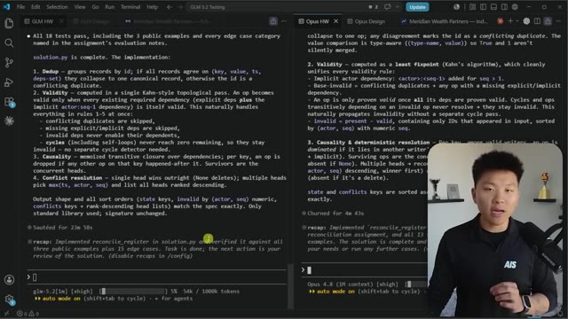
*⏱️ 00:02:57 — Capture d'écran montrant un éditeur de code partagé en deux panneaux verticaux (avec le présentateur incrusté en bas à droite) affichant des tests de code pour GLM et Opus.*

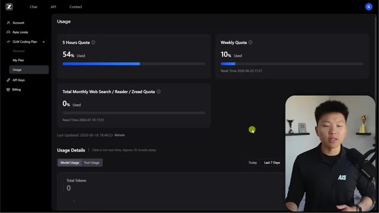
*⏱️ 00:03:09 — Capture d'écran montrant l'interface web d'un tableau de bord d'utilisation avec des graphiques de quotas (5 Hours Quota, Weekly Quota) et le présentateur incrusté à droite.*

---

### ⏱️ `[00:03:15 - 00:03:48]` | Segment #07

**🔊 Audio (Transcription Intégrale Mot pour Mot en Français) :**
> Et j'ai joué avec ça pendant, c'était environ quatre ou cinq heures d'affilée à littéralement insister dessus, cinq sessions différentes ouvertes, en testant GLM 5.2. Et mon quota de cinq heures est dépassé d'un peu plus de la moitié. Et mon quota hebdomadaire est utilisé à environ 10 %. Je parlerai de la facturation et de la façon de configurer tout ça dans une petite seconde. Laissez-moi vous montrer ce que j'ai fait d'autre avec. J'ai donc fait quelques autres invites de type "slash goal" et je déteste quand le terminal fait ça, mais la première que j'ai faite, j'ai tapé "slash goal" et j'ai littéralement dit du genre, hé, fais preuve de créativité, montre-moi à quel point tes compétences en design sont bonnes, et construis-moi juste ce que tu veux. Fais-moi simplement un document HTML. Et voici ce que ça m'a donné. Ça m'a donné l'anatomie de l'attention. Vous pouvez voir que nous avons

**👁️ Analyse Visuelle d'Écran (gemini-3.5-flash-lite) :**
**Interface & Outils** : Interface web de gestion de plan de codage GLM, VS Code (éditeur de code et terminal intégré)

**Contenu textuel & Code** : Tableaux de bord de quotas (5 Hours Quota: 54% used, Weekly Quota: 10% used) et interface de terminal avec des commandes textuelles et des prompts de recherche.

**Action / Démonstration** : Consultation du tableau de bord d'utilisation des quotas d'IA et affichage du code/terminal dans l'éditeur.

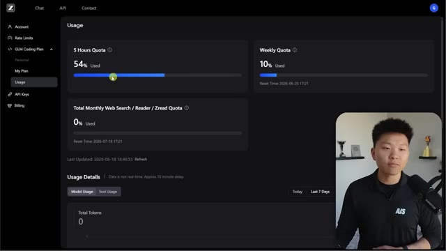
*⏱️ 00:03:24 — Capture d'écran montrant le tableau de bord d'utilisation de GLM Coding Plan avec un quota de 5 heures utilisé à 54 % et un quota hebdomadaire à 10 %.*

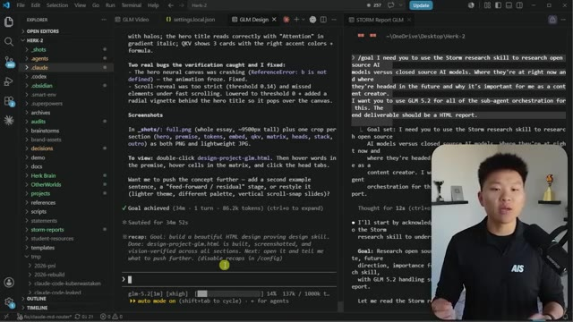
*⏱️ 00:03:40 — Capture d'écran de l'éditeur VS Code montrant un panneau terminal actif avec l'utilisation du modèle glm-5.2 et un prompt de recherche Storm.*

---

### ⏱️ `[00:03:48 - 00:04:21]` | Segment #08

**🔊 Audio (Transcription Intégrale Mot pour Mot en Français) :**
> on a comme des étoiles qui bougent un peu en arrière-plan. Ça a l'air évidemment un tout petit peu stylé codé ici, mais pas trop mal. Et en faisant défiler vers le bas, on peut voir qu'un modèle de langage n'a pas de livre de grammaire ni de dictionnaire. Et puis sur cette chose, l'animal n'a pas traversé la rue parce qu'il était trop fatigué. C'est un peu comme un élément interactif ici. On voit le mot de la requête et ensuite on voit vers quoi il pointe. Donc fatigué pointait vers il. Il pointait vers l'animal. Traversé pointait vers la rue. Donc c'est plutôt intéressant. D'abord, la phrase est découpée. Chaque token obtient une place dans l'espace. Donc on a un tout petit peu comme un graphique de relations ici. On a des graphiques ici en bas et

**👁️ Analyse Visuelle d'Écran (gemini-3.5-flash-lite) :**
**Interface & Outils** : Navigateur web affichant une page interactive de visualisation d'un modèle de langage.

**Contenu textuel & Code** : Texte explicatif ("A language model has no grammar book...") et phrase interactive "The animal didn't cross the street because it was too tired."

**Action / Démonstration** : Navigation et survol interactif des mots pour démontrer le poids de l'attention entre les termes.

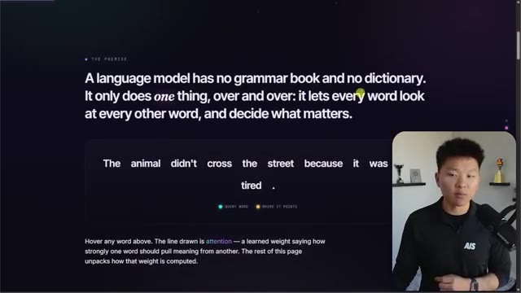
*⏱️ 00:03:57 — Page web explicative sur le fonctionnement des modèles de langage, affichant la phrase de test avec le présentateur en médaillon.*

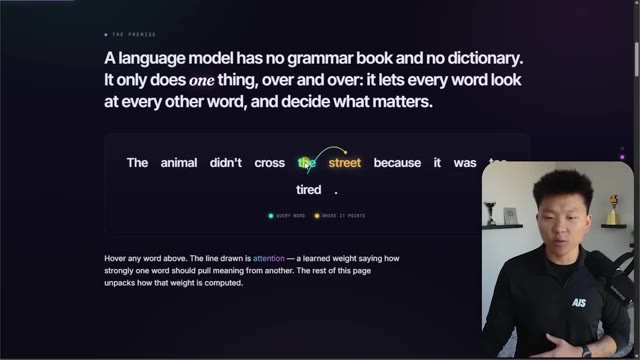
*⏱️ 00:04:05 — Démonstration interactive du mécanisme d'attention reliant les mots "the" et "street" au survol de la souris.*

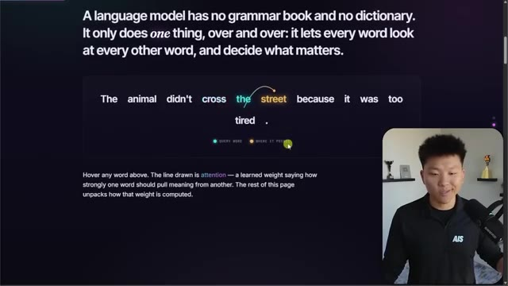
*⏱️ 00:04:13 — Vue similaire montrant l'interaction sur l'interface web explicative du modèle d'attention.*

---

### ⏱️ `[00:04:21 - 00:04:39]` | Segment #09

**🔊 Audio (Transcription Intégrale Mot pour Mot en Français) :**
> quelques éléments différents. Donc de toute façon, c'est ce que GLM a trouvé quand j'ai dit, hé, sois juste créatif et donne-moi juste ce que tu veux. Montre-moi ce qui t'intéresse, j'ai l'impression. Et ensuite, j'ai fait exactement le même prompt dans Opus pour voir quel genre de différences nous obtiendrions. Et Opus a imaginé la vie d'une Étoile de la Mort. Ici, encore une fois, vous pouvez voir ce F classique qu'Opus adore faire.

**👁️ Analyse Visuelle d'Écran (gemini-3.5-flash-lite) :**
**Interface & Outils** : Navigateur web affichant une application de visualisation de données ou d'attention de modèle de langage.

**Contenu textuel & Code** : Graphiques de matrices d'attention colorés en bleu foncé et clair, étiquetés « Head 1 - coreference », « Head 2 - local / order », etc.

**Action / Démonstration** : Navigation et présentation visuelle des résultats de modèles de langage par le présentateur.

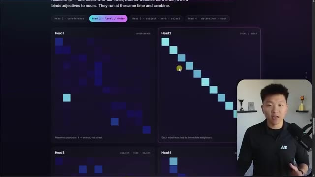
*⏱️ 00:04:25 — Capture d'écran montrant une interface web interactive avec des graphiques de matrices d'attention (« Head 1 », « Head 2 », etc.) et le présentateur dans un encadré en bas à droite.*

---

### ⏱️ `[00:04:39 - 00:05:12]` | Segment #10

**🔊 Audio (Transcription Intégrale Mot pour Mot en Français) :**
> Mais de toute façon, celui-ci ressemble plutôt à une chronologie où nous passons par le genre de cycle de vie réel d'une Étoile de la Mort. Et nous pouvons voir que celui-ci est également plutôt bon. Mais encore une fois, faites attention au fait que d'un point de vue de la conception avec un seul essai, est-ce qu'Opus est tellement meilleur ? Est-ce qu'Opus est cinq fois meilleur ? Parce que vous payez cinq fois plus. Cependant, avec celui-ci, l'objectif a pris environ 35 minutes. Et pour Opus, cet objectif n'a pris qu'environ 11. C'est donc vraiment quitte ou double quant à savoir quand GLM 5.2 est réellement plus rapide. En général, plus il y a de raisonnement, plus ce sera lent. Et donc rappelez-vous juste que Cloud Code est un harnais. C'est un harnais pour les modèles d'IA. Et

**👁️ Analyse Visuelle d'Écran (gemini-3.5-flash-lite) :**
**Interface & Outils** : Navigateur web (Image #1), VS Code et interface terminal Claude Code (Image #2).

**Contenu textuel & Code** : Interface web sur l'astronomie avec graphiques interactifs (Image #1) ; code Markdown, rapports de recherche IA et interface de ligne de commande Claude Code (Image #2).

**Action / Démonstration** : Navigation et présentation d'une application web interactive (Image #1) ; visualisation de l'avancement d'un agent IA et de rapports de code dans VS Code (Image #2).

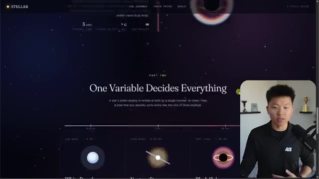
*⏱️ 00:04:48 — Interface web sombre intitulée "STELLAR" montrant le cycle de vie d'une étoile avec la section "One Variable Decides Everything", avec le présentateur incrusté en bas à droite.*

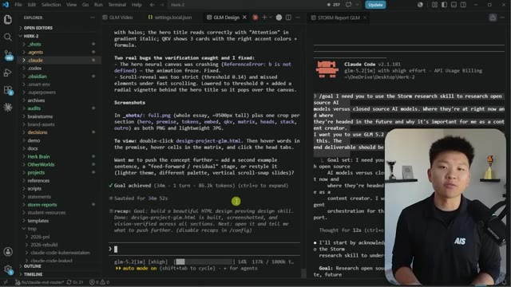
*⏱️ 00:05:04 — Éditeur de code VS Code avec l'extension Claude Code affichant des rapports Markdown, des détails d'exécution d'agent IA et un terminal intégré, avec le présentateur incrusté en bas à droite.*

---

### ⏱️ `[00:05:12 - 00:05:32]` | Segment #11

**🔊 Audio (Transcription Intégrale Mot pour Mot en Français) :**
> généralement, les modèles Cloud vont exploiter le harnais de la meilleure façon. Mais GLM 5.2 s'en sort plutôt bien. Il est capable d'utiliser la commande slash goal. Il est capable de lire mon fichier cloud.md. Il est capable d'utiliser mes compétences. Juste ici, j'ai dit slash goal. J'ai besoin que tu utilises la compétence de recherche storm, à propos de laquelle je sortirai une vidéo très bientôt, pour faire des recherches sur les modèles d'IA open source par rapport aux modèles fermés, et le livrable final est un rapport HTML.

**👁️ Analyse Visuelle d'Écran (gemini-3.5-flash-lite) :**
**Interface & Outils** : VS Code, Claude Code CLI

**Contenu textuel & Code** : Commande `/goal I need you to use the Storm research skill to research open source AI models...` visible dans le terminal Claude Code.

**Action / Démonstration** : Saisie d'une commande d'objectif dans l'interface de l'agent IA.

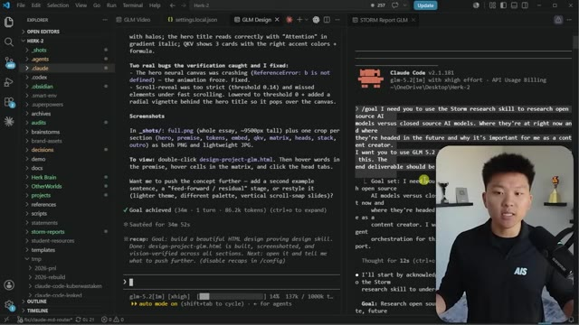
*⏱️ 00:05:17 — Vue de l'interface de VS Code avec un panneau de terminal intégré (Claude Code) affichant la commande /goal et le présentateur incrusté en bas à droite.*

---

### ⏱️ `[00:05:32 - 00:05:51]` | Segment #12

**🔊 Audio (Transcription Intégrale Mot pour Mot en Français) :**
> Donc ça passe par là, ça utilise tout un tas de sous-agents. Tous les sous-agents utilisaient également GLM 5.2. Et il y avait tout un tas de personas différents. Ça a pris environ 27 minutes et j'ai reçu ce rapport en retour. C'était notre recherche sur les tempêtes. Et vous voyez que c'est écrit V2. Ça veut simplement dire qu'il y a eu un premier passage, puis un autre groupe d'agents vient lire le tout et apporte ensuite quelques modifications.

**👁️ Analyse Visuelle d'Écran (gemini-3.5-flash-lite) :**
**Interface & Outils** : Éditeur de code (VS Code/Cursor) et interface web de visualisation de rapport.

**Contenu textuel & Code** : Texte de rapport sur les modèles d'IA open source versus fermés, journaux d'exécution d'agents IA (glm-5.2), métriques de tokens.

**Action / Démonstration** : Présentation du rapport final généré par les agents IA après environ 27 minutes de traitement.

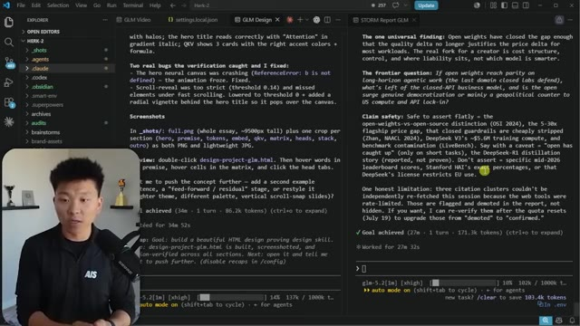
*⏱️ 00:05:37 — Vue d'un éditeur de code (type VS Code / Cursor) affichant un panneau de discussion d'agent IA et un rapport textuel détaillé.*

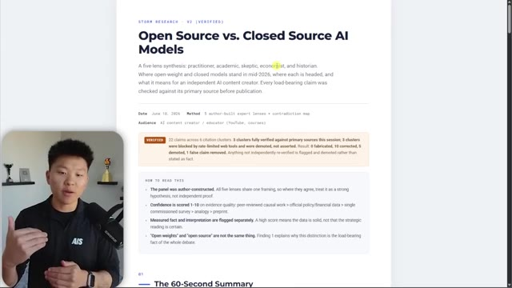
*⏱️ 00:05:46 — Affichage d'un rapport de recherche au format web intitulé "Open Source vs. Closed Source AI Models".*

---

### ⏱️ `[00:05:51 - 00:06:09]` | Segment #13

**🔊 Audio (Transcription Intégrale Mot pour Mot en Français) :**
> Donc de toute façon, c'est le rapport HTML que nous avons obtenu. Je ne vais pas lire chaque mot de ceci, mais il est très approfondi. Il est très solide. Il a l'air convenable. Vous pouvez voir que nous avions cinq lentilles différentes qui passaient par là, que vous verrez probablement un peu disséminées un peu partout. Nous avons un résumé de 60 secondes. Nous avons cinq conclusions clés. Celle-ci a été soutenue par l'universitaire et le sceptique.

**👁️ Analyse Visuelle d'Écran (gemini-3.5-flash-lite) :**
**Interface & Outils** : Navigateur web affichant un rapport HTML.

**Contenu textuel & Code** : Texte de rapport sur l'intelligence artificielle avec des sections comme 'Storm Research', 'A five-lens synthesis', et un encadré de vérification ('VERIFIED 22 claims across 6 citation clusters').

**Action / Démonstration** : Le présentateur commente et présente le rapport HTML généré à l'écran.

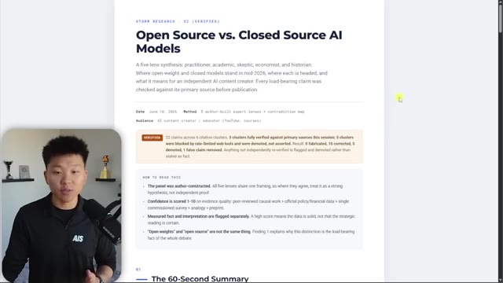
*⏱️ 00:05:55 — Un rapport HTML détaillé affiché à l'écran, titré 'Open Source vs. Closed Source AI Models', avec le présentateur en incrustation vidéo dans le coin inférieur gauche.*

---

### ⏱️ `[00:06:09 - 00:06:32]` | Segment #14

**🔊 Audio (Transcription Intégrale Mot pour Mot en Français) :**
> Celui-ci était soutenu par le praticien, l'économiste et l'académique. Et il a été contesté par le sceptique et l'historien. Donc fondamentalement, nous mobilisons simplement, vous savez, un mélange d'experts ici ou un mélange de différents, vous savez, styles d'agents pour nous aider à faire la recherche et nous aider à débattre sur la façon dont cette chose est réellement construite. Nous avons la connexion cachée. Nous avons l'hypothèse sur laquelle repose le briefing quant à ce qu'il faut réellement faire différemment.

**👁️ Analyse Visuelle d'Écran (gemini-3.5-flash-lite) :**
**Interface & Outils** : Navigateur web affichant un document d'analyse ou de recherche structuré en sections.

**Contenu textuel & Code** : Texte argumentatif structuré avec des scores de fiabilité, des comparaisons de prix de modèles d'IA (OpenAI GPT-5, Anthropic Claude, DeepSeek, Llama) et des points de vue d'experts (Praticien, Économiste, Académique, Sceptique, Historien).

**Action / Démonstration** : Défilement (scroll) du document à l'écran pour présenter les différents arguments et analyses textuelles.

*⏱️ 00:06:15 — Capture montrant un rapport textuel avec des sections intitulées 'The gap narrowed enough...', affichant des étiquettes vertes 'SUPPORTED BY: Practitioner + Economist + Academic' et rouges 'CHALLENGED BY: Skeptic + Historian', avec le présentateur en médaillon en bas à gauche.*

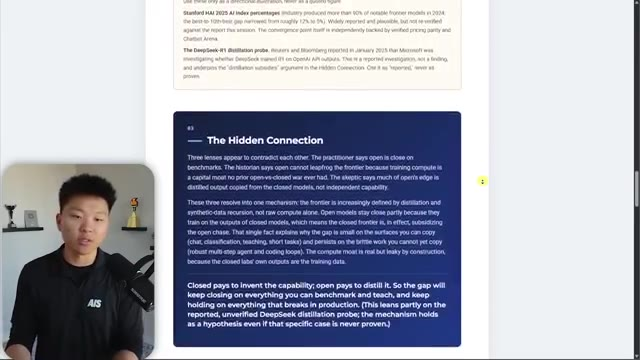
*⏱️ 00:06:26 — Capture montrant une section bleue du rapport intitulée 'The Hidden Connection' qui détaille les perspectives du praticien, de l'historien et du sceptique, avec le présentateur visible en incrustation.*

---

### ⏱️ `[00:06:32 - 00:07:05]` | Segment #15

**🔊 Audio (Transcription Intégrale Mot pour Mot en Français) :**
> Donc, si vous voulez mettre sur pause et lire tout ça, il y a vraiment de superbes informations là-dedans. Mais bref, voilà ce qu’il a généré. Ça m'a poussé à me demander, bon, à quel moment est-ce que j'utiliserais vraiment GLM 5.2 plutôt que quelque chose comme Opus 4.8 ? Parce que je pense vraiment qu'après avoir fait une tonne de travail intellectuel avec ça aujourd'hui et l'avoir testé, c'est plutôt solide. Et donc je pense que pour un truc de ce genre, je serais totalement à l'aise avec le fait que GLM 5.2 s'en charge, parce que je me sentais à l'aise avec la façon dont j'ai orchestré cette compétence de tempête. Tout un tas d'agents différents, tout un tas de vérifications différentes, et c'est ça qui est infiniment plus important que le modèle, que le modèle sous-jacent. Tout dépend de la façon dont vous les promptez, de la façon dont vous les utilisez.

**👁️ Analyse Visuelle d'Écran (gemini-3.5-flash-lite) :**
**Interface & Outils** : Navigateur web affichant un document de texte généré par une IA.

**Contenu textuel & Code** : Texte de rapport ou d'analyse généré par un modèle d'IA, incluant des en-têtes, des notes méthodologiques et des résumés.

**Action / Démonstration** : Le présentateur commente le contenu du document affiché à l'écran.

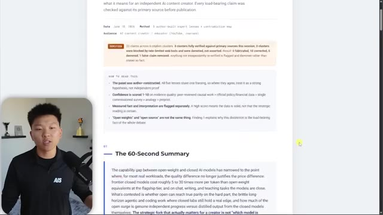
*⏱️ 00:06:40 — Capture d'écran montrant le présentateur incrusté en bas à gauche et, à l'écran principal, un document textuel détaillé généré par une IA avec des sections structurées comme "The 60-Second Summary".*

---

### ⏱️ `[00:07:05 - 00:07:29]` | Segment #16

**🔊 Audio (Transcription Intégrale Mot pour Mot en Français) :**
> la façon dont vous avez vos compétences, votre harnais et votre couche de contexte. Donc je ferais totalement confiance à GLM 5.2 ici pour faire un tas de recherches pour moi. Et par recherche, je veux dire rassembler un tas d'opinions, rassembler des données et intégrer des sources. Mais je voudrais probablement qu'Opus m'aide réellement à réfléchir, sur la base de toutes ces données, à ce qui compte vraiment et à la manière de l'appliquer à ma vie. C'est là que je m'appuierais probablement sur un modèle de raisonnement plus lourd, un modèle plus fort comme Opus.

**👁️ Analyse Visuelle d'Écran (gemini-3.5-flash-lite) :**
**Interface & Outils** : Navigateur web affichant un document de synthèse de recherche "Storm Research".

**Contenu textuel & Code** : Titre "Open Source vs. Closed Source AI Models", métadonnées de date et de méthode, ainsi qu'un encadré de vérification (VERIFIED).

**Action / Démonstration** : Le présentateur commente le rapport de recherche généré par l'IA affiché à l'écran.

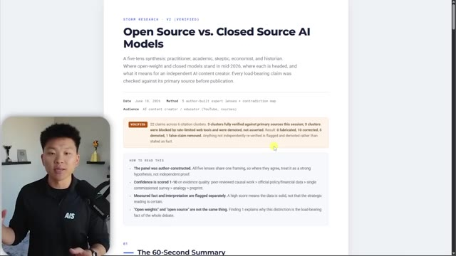
*⏱️ 00:07:11 — Capture d'écran montrant le présentateur à gauche et un document de recherche intitulé "Open Source vs. Closed Source AI Models" à l'écran.*

---

### ⏱️ `[00:07:29 - 00:08:04]` | Segment #17

**🔊 Audio (Transcription Intégrale Mot pour Mot en Français) :**
> Donc j'ai l'impression que tout le monde doit réfléchir à ce genre de choses. Ce n'est pas binaire. C'est : dans chaque processus, quelles étapes devrais-je utiliser pour quel modèle ? Bref, pourquoi est-ce que je parle de GLM 5.2 ? Parce que c'est un modèle open source, n'est-ce pas ? Donc comme ChatGPT ou Claude, mais ce sont des modèles fermés, ce qui signifie que vous le louez. Vous payez directement le fournisseur afin d'y accéder. Maintenant, oui, vous l'avez vu plus tôt, je paye un abonnement pour accéder à GLM 5.2. Et c'est simplement parce qu'il est tellement massif. C'est un modèle massif, 753 milliards de paramètres, ce qui est très grand, ce qui signifie que je ne pourrais pas vraiment l'exécuter sur ma machine. Oui, c'est open source. Oui, vous pourriez

**👁️ Analyse Visuelle d'Écran (gemini-3.5-flash-lite) :**
**Interface & Outils** : Logiciel de présentation ou visionneuse de diapositive web

**Contenu textuel & Code** : Texte de présentation : 'WHAT HERK RUNS ON GLM 5.2 in plain English, in 7 slides'

**Action / Démonstration** : Présentation de la première diapositive concernant le modèle GLM 5.2 avec la webcam du présentateur dans le coin supérieur droit.

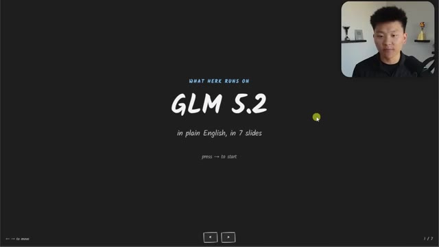
*⏱️ 00:07:38 — Une diapositive de présentation sombre affichant le titre 'WHAT HERK RUNS ON GLM 5.2' avec un sous-titre 'in plain English, in 7 slides' et une incitation à presser la touche fléchée droite pour commencer.*

---

### ⏱️ `[00:08:04 - 00:08:23]` | Segment #18

**🔊 Audio (Transcription Intégrale Mot pour Mot en Français) :**
> l'exécuter localement, mais vous auriez besoin du matériel. Vous auriez besoin de l'infrastructure pour prendre cela en charge. La plupart d'entre nous n'ont pas cela qui traîne. Donc ce que nous pouvons faire, c'est que nous pouvons le louer en ligne. Donc un peu très similaire à la façon dont vous payez Anthropic pour Claude, mais c'est tellement moins cher que Claude. Donc tout le monde panique parce que c'est fondamentalement le vôtre. Vous pouvez le télécharger ou l'obtenir pour beaucoup moins cher. C'est très intelligent. Je vais vous montrer quelques repères dans une seconde.

**👁️ Analyse Visuelle d'Écran (gemini-3.5-flash-lite) :**
**Interface & Outils** : Présentation vidéo avec illustration type tableau blanc (style sketch).

**Contenu textuel & Code** : Texte explicatif sur les paramètres des modèles d'IA et schémas d'un ordinateur portable barré menant à des serveurs en ligne.

**Action / Démonstration** : Le présentateur explique conceptuellement pourquoi il faut louer l'infrastructure en ligne pour exécuter de grands modèles.

---

### ⏱️ `[00:08:23 - 00:08:43]` | Segment #19

**🔊 Audio (Transcription Intégrale Mot pour Mot en Français) :**
> Et c'est très bon marché. Si vous faisiez une grosse journée de codage, ce serait environ cinq fois moins cher qu'Opus 4.8 pour le même travail. Vous pouvez voir ici, voici les jetons d'entrée et de sortie. Opus 4.8 coûte 5 $ pour l'entrée, 25 $ pour la sortie. Alors que GLM 5.2 coûte 1,40 $ pour l'entrée et 4,40 $ pour la sortie. C'est donc de là que j'ai tiré les chiffres quand j'ai dit que c'était environ cinq fois moins cher.

**👁️ Analyse Visuelle d'Écran (gemini-3.5-flash-lite) :**
**Interface & Outils** : Présentation visuelle (diapositive avec graphiques et texte explicatif)

**Contenu textuel & Code** : Texte affiché : "THE MAIN REASON WE USE IT", "Same work, way less money", "GLM 5.2 : $5", "Opus 4.8 : $22.50", "A heavy day of coding: about 5x cheaper for the same job."

**Action / Démonstration** : Le présentateur explique et compare les coûts des modèles d'intelligence artificielle pour le codage.

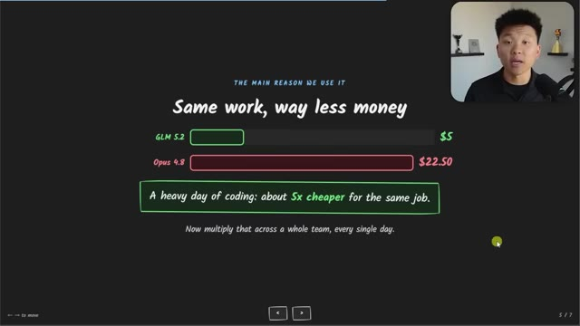
*⏱️ 00:08:28 — Une diapositive de présentation illustrant la comparaison des coûts entre GLM 5.2 et Opus 4.8, avec le présentateur visible en incrustation vidéo dans le coin supérieur droit.*

---

### ⏱️ `[00:08:43 - 00:09:02]` | Segment #20

**🔊 Audio (Transcription Intégrale Mot pour Mot en Français) :**
> Donc, si vous allez sur quelque chose comme Ollama, qui est un endroit où vous pouvez réellement télécharger et intégrer des modèles locaux, vous pouvez voir ici que nous avons GLM 5.2. Il a la fenêtre de contexte d'un million et la taille est de 756 milliards de paramètres dans ce cas. Maintenant, ils ne vous laissent pas vraiment l'importer. Ils vous laissent l'exécuter depuis leur cloud, ce qui est bien puisque c'est un si grand modèle. Mais jetez un œil à certains de ces benchmarks.

**👁️ Analyse Visuelle d'Écran (gemini-3.5-flash-lite) :**
**Interface & Outils** : Navigateur web (page de description du modèle Ollama)

**Contenu textuel & Code** : Spécifications du modèle glm-5.2 : 976K tokens de contexte, 756B paramètres, et la commande CLI `ollama run glm-5.2:cloud`.

**Action / Démonstration** : Présentation des détails et des capacités du modèle glm-5.2 sur la plateforme Ollama.

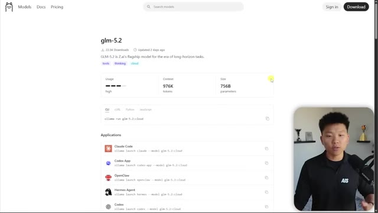
*⏱️ 00:08:48 — Capture d'écran montrant la page web du modèle glm-5.2 sur Ollama, avec ses spécifications et la webcam du présentateur en incrustation.*

---

### ⏱️ `[00:09:03 - 00:09:21]` | Segment #21

**🔊 Audio (Transcription Intégrale Mot pour Mot en Français) :**
> Comparé à Cloud Opus 4.8 et GBD 5.5, qui sont comme les deux meilleurs modèles en ce moment, regardez où se situe GLM 5.2. Il est vraiment comparable à tous ces autres modèles propriétaires de premier plan, ce qui explique évidemment pourquoi beaucoup de gens flippent en ce moment et s'y intéressent. Pensez au fait que Fable nous a été retiré, n'est-ce pas ?

**👁️ Analyse Visuelle d'Écran (gemini-3.5-flash-lite) :**
**Interface & Outils** : Navigateur web affichant une page de documentation technique ou de présentation de modèle d'IA.

**Contenu textuel & Code** : Graphiques en barres comparant les modèles GLM-5.2, GLM-5.1, Claude Opus 4.8, GPT-5.5 et Gemini 3.1 Pro sur 8 benchmarks différents.

**Action / Démonstration** : Le présentateur commente et analyse les graphiques de performance comparative des modèles d'IA.

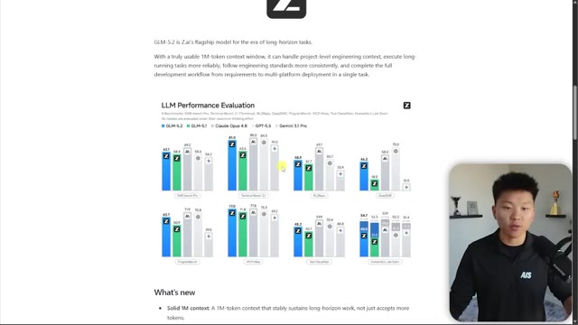
*⏱️ 00:09:07 — Page web présentant les performances du modèle GLM-5.2 avec des graphiques de benchmarks comparatifs face à Claude Opus 4.8, GPT-5.5 et Gemini 3.1 Pro.*

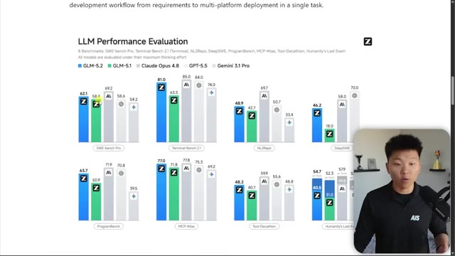
*⏱️ 00:09:12 — Vue rapprochée des graphiques de performance LLM montrant les scores détaillés sur différents benchmarks (SWE-bench, Terminal-Bench, NL2Repo, etc.).*

---

### ⏱️ `[00:09:21 - 00:09:40]` | Segment #22

**🔊 Audio (Transcription Intégrale Mot pour Mot en Français) :**
> Cela nous indique simplement que nous louons quelque chose qui pourrait nous être retiré, vous savez, de nulle part. Et ce qui m'inquiète, c'est qu'Anthropic et OpenAI ne sont pas des entreprises rentables à l'heure actuelle. Nous payons 200 dollars par mois pour un abonnement Claude Max, mais nous en retirons environ 8 000 dollars d'inférence si nous l'utilisons vraiment à fond. Elles ne sont donc pas rentables.

**👁️ Analyse Visuelle d'Écran (gemini-3.5-flash-lite) :**
**Interface & Outils** : Graphique de benchmark comparatif de LLM (bar charts).

**Contenu textuel & Code** : Graphiques en barres comparant GLM-5.2, GLM-5.1, Claude Opus 4.8, GPT-5.5 et Gemini 3.1 Pro sur plusieurs benchmarks (SWE-bench Pro, Terminal-Bench 2.1, NL2Repo, DeepSWE, ProgramBench, MCP-Atlas, Tool-Decathlon, Humanity's Last Exam).

**Action / Démonstration** : Le présentateur commente les performances des différents modèles affichés sur le graphique.

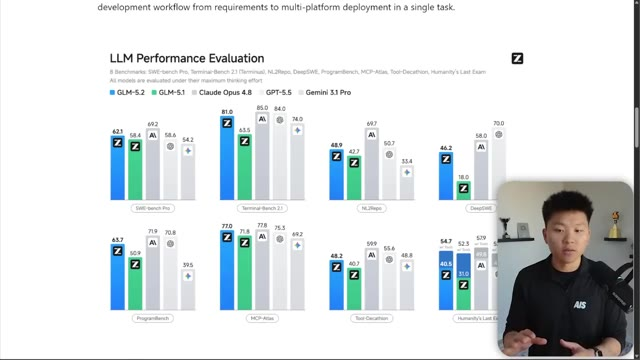
*⏱️ 00:09:26 — Un graphique de performance des modèles de langage (LLM Performance Evaluation) comparant plusieurs IA sur différents benchmarks, avec le présentateur en médaillon dans le coin inférieur droit.*

---

### ⏱️ `[00:09:40 - 00:10:00]` | Segment #23

**🔊 Audio (Transcription Intégrale Mot pour Mot en Français) :**
> Alors, que se passe-t-il lorsque nous finissons, peut-être que nous récupérons Fable, ils ne sont évidemment pas rentables là-dessus non plus. Donc ce qu'ils pourraient faire, c'est le ramener et dire, hé, mais vous ne pouvez pas utiliser ceci dans votre abonnement. Vous ne pouvez l'utiliser que via la facturation par API. C'est plus cher qu'Opus. Donc, si vous commencez à comprendre ces modèles open source et que vous pouvez commencer à les déployer localement pour pratiquement rien, c'est-à-dire totalement gratuit, alors cela va vraiment vous aider à garder une longueur d'avance ici.

**👁️ Analyse Visuelle d'Écran (gemini-3.5-flash-lite) :**
**Interface & Outils** : Page web ou document PDF présentant un graphique de performance de modèles d'IA.

**Contenu textuel & Code** : Graphique à barres intitulé "LLM Performance Evaluation" comparant GLM-5.2, GLM-5.1, Claude Opus 4.8, GPT-5.5 et Gemini 3.1 Pro à travers plusieurs benchmarks (SWE-bench Pro, Terminal-Bench 2.1, NL2Repo, DeepSWE, ProgramBench, MCP-Atlas, Tool-Decathlon, Humanity's Last Exam).

**Action / Démonstration** : Affichage et analyse d'un graphique comparatif de performances de modèles d'IA par le présentateur.

*⏱️ 00:09:45 — Un graphique comparatif des performances de différents modèles de LLM sur 8 benchmarks, avec le présentateur en incrustation vidéo dans le coin inférieur droit.*

---

### ⏱️ `[00:10:01 - 00:10:19]` | Segment #24

**🔊 Audio (Transcription Intégrale Mot pour Mot en Français) :**
> Jetez un coup d'œil à ce banc d'essai, Frontier SWE. Il a obtenu de meilleurs résultats que GPT 5.5 dans ce test, ce qui est tout simplement absolument fou. Si vous avez aimé Opus 4.7, ce que beaucoup d'entre vous ont fait, et d'autres non, GLM 5.2 surpassait ce modèle dans bon nombre de ces évaluations. Et il surpasse également le modèle Sonnet le plus récent dans une tonne de ces évaluations. Alors, pensez-y simplement de cette façon.

**👁️ Analyse Visuelle d'Écran (gemini-3.5-flash-lite) :**
**Interface & Outils** : Page web de benchmark / Graphiques de performances de modèles d'IA

**Contenu textuel & Code** : Scores de benchmarks de modèles d'IA : FrontierSWE (GLM-5.2 à 74.4%, GPT-5.5 à 72.6%, Opus 4.7 à 63.0%), PostTrainBench, et SWE-Marathon.

**Action / Démonstration** : Présentation et analyse comparative des performances des différents modèles d'intelligence artificielle sur des benchmarks de développement logiciel.

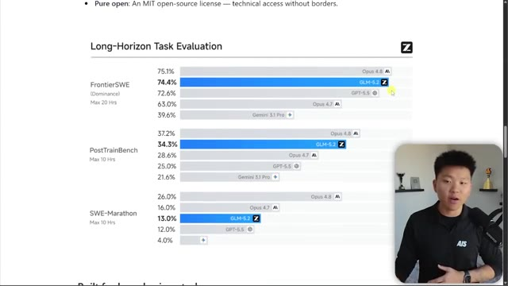
*⏱️ 00:10:05 — Graphique montrant les résultats d'évaluation de tâches à long horizon (Long-Horizon Task Evaluation), incluant FrontierSWE, PostTrainBench et SWE-Marathon, avec le présentateur en incrustation.*

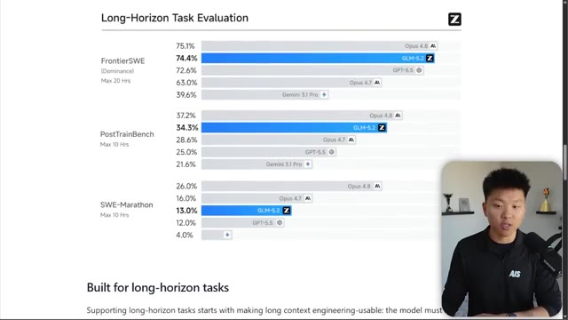
*⏱️ 00:10:14 — Suite du graphique d'évaluation avec un focus sur les performances des modèles GLM-5.2, GPT-5.5 et Opus 4.7.*

---

### ⏱️ `[00:10:19 - 00:10:39]` | Segment #25

**🔊 Audio (Transcription Intégrale Mot pour Mot en Français) :**
> Réfléchissez à quel point ce modèle est vraiment performant. Voici d'autres benchmarks, Agenda coding. Je ne vais pas passer en revue tous ces éléments car nous savons tous qu'il faut toujours les prendre avec des pincettes. Il s'agit plutôt du ressenti et de la façon dont vous les utilisez réellement. Mais c'est intéressant d'y jeter un œil de temps en temps. Donc de toute façon, voyons comment faire la configuration. ce que vous faites, c'est que vous allez sur z.ai et vous pourriez arriver sur quelque chose qui ressemble à ça.

**👁️ Analyse Visuelle d'Écran (gemini-3.5-flash-lite) :**
**Interface & Outils** : Interface web (navigateur) de GLM-5.2

**Contenu textuel & Code** : Page d'accueil de l'assistant IA avec barre de recherche et suggestions de projets (Landing Page, Mini Game, Personal Blog).

**Action / Démonstration** : Navigation sur la plateforme web de GLM-5.2 pour présenter l'interface utilisateur.

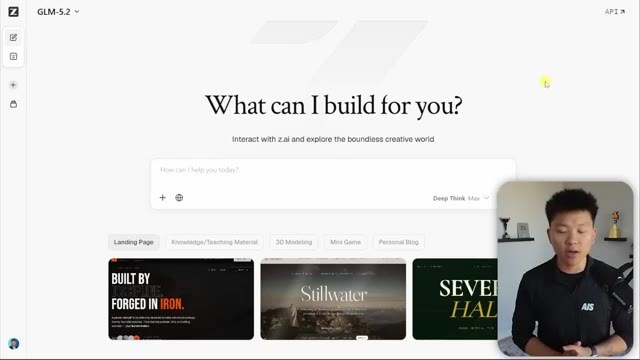
*⏱️ 00:10:34 — Interface web de GLM-5.2 affichant un champ de prompt "What can I build for you?" avec des exemples de projets créés.*

---

### ⏱️ `[00:10:39 - 00:11:12]` | Segment #26

**🔊 Audio (Transcription Intégrale Mot pour Mot en Français) :**
> Vous pouvez continuer et discuter. Vous pouvez créer des pages de destination directement ici. Vous pouvez faire de la modélisation 3D. Vous pouvez construire votre propre mini-jeu. Et c'est vraiment bon pour ce genre de choses. C'est vraiment impressionnant pour les trucs de design frontal. Donc venez ici, jouez avec si vous voulez juste le tester et voir ce que ça donne. Mais ensuite, si vous voulez le brancher dans Cloud Code ou OpenCode ou Hermes Agent ou n'importe où vous voulez le brancher, vous allez cliquer sur ce bouton en haut à droite ? Et cela va vous amener à la console API réelle. Et donc vous avez l'option de payer simplement par jeton, ce qui évidemment n'est pas trop cher. Si vous venez ici et que je vais dans ma facturation et que je vais dans la tarification du modèle, vous pouvez voir sur l'entrée, c'est 1,4 $. Et sur la sortie, c'est où est-ce

**👁️ Analyse Visuelle d'Écran (gemini-3.5-flash-lite) :**
**Interface & Outils** : Navigateur web présentant l'interface de l'outil d'IA GLM et ses fonctionnalités.

**Contenu textuel & Code** : Texte de l'interface "What can I build for you?" avec des exemples de projets (3D Modeling, Landing Page, etc.).

**Action / Démonstration** : Présentation des différentes capacités créatives et de design frontal de l'outil d'IA.

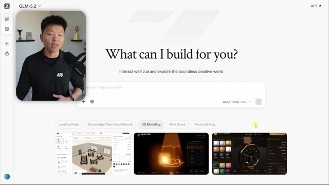
*⏱️ 00:10:47 — Interface web affichant les options de modélisation 3D et le présentateur en médaillon.*

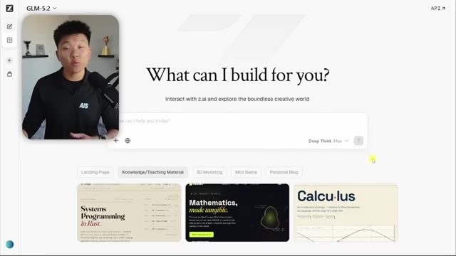
*⏱️ 00:10:55 — Interface web affichant les options de matériel pédagogique et de programmation.*

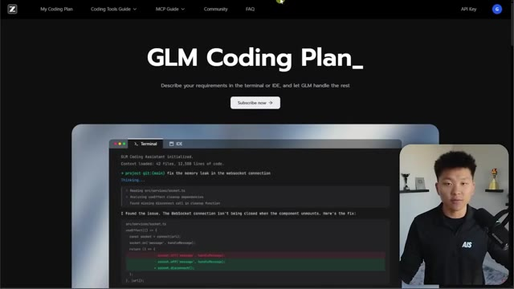
*⏱️ 00:11:03 — Page web présentant le plan de codage GLM avec une interface de terminal intégrée.*

---

### ⏱️ `[00:11:12 - 00:11:32]` | Segment #27

**🔊 Audio (Transcription Intégrale Mot pour Mot en Français) :**
> 4,4 dollars, mais vous pouvez aussi simplement prendre un abonnement. Vous pouvez donc opter pour 16 dollars par mois, 64 dollars par mois ou 144 dollars par mois. Et si vous optez pour un abonnement annuel, vous pouvez économiser encore plus d'argent. Évidemment, ils ne sont pas un sponsor. Je ne travaille pas avec eux, mais vous pouvez aussi souscrire à un plan. Vous pouvez donc peut-être opter pour un plan cloud à environ cent dollars par mois. Et ensuite, vous pouvez prendre un plan Z pour 64 dollars par mois, et puis simplement basculer de l'un à l'autre.

**👁️ Analyse Visuelle d'Écran (gemini-3.5-flash-lite) :**
**Interface & Outils** : Interface web de tarification (page d'abonnement SaaS).

**Contenu textuel & Code** : Tableau comparatif des tarifs mensuels (16,2$, 64,8$, 144$) avec options de cycle de facturation (Mensuel, Trimestriel, Annuel) et détails des fonctionnalités pour chaque niveau d'abonnement.

**Action / Démonstration** : Affichage informatif de la page de tarification pour aider l'utilisateur à choisir son niveau d'abonnement au service.

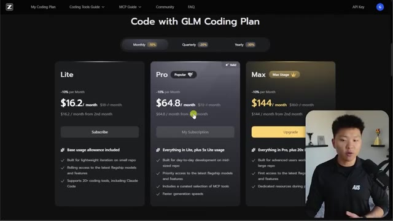
*⏱️ 00:11:17 — Interface web présentant les plans d'abonnement "Lite", "Pro" et "Max" pour le service "GLM Coding Plan".*

---

### ⏱️ `[00:11:33 - 00:11:54]` | Segment #28

**🔊 Audio (Transcription Intégrale Mot pour Mot en Français) :**
> Chaque fois que vous avez besoin d'un certain type de tâche, vous pouvez faire des allers-retours et de cette façon, vous tirez beaucoup plus profit de vos abonnements. Une fois que vous avez un forfait, ce que vous feriez, c'est que vous iriez à la clé API et vous iriez en récupérer une. Vous ajouterez donc une clé API ici et vous pourrez alors commencer à l'utiliser directement dans Cloud Code, puis vous pourrez surveiller votre limite d'utilisation ici. Maintenant, le quota de cinq heures et le quota hebdomadaire fonctionnent de manière très similaire à l'abonnement Cloud Code.

**👁️ Analyse Visuelle d'Écran (gemini-3.5-flash-lite) :**
**Interface & Outils** : Navigateur web affichant l'interface utilisateur de la plateforme de gestion d'abonnements et de clés API.

**Contenu textuel & Code** : Tarifs d'abonnement ($16.2, $64.8, $144) et tableau de gestion des clés API avec ID, date de création et options de suppression.

**Action / Démonstration** : Navigation sur le site web pour montrer les options d'abonnement puis la section de génération et récupération des clés API.

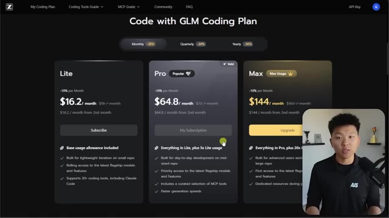
*⏱️ 00:11:38 — Page web affichant les différents forfaits d'abonnement (Lite, Pro, Max) pour "Code with GLM Coding Plan".*

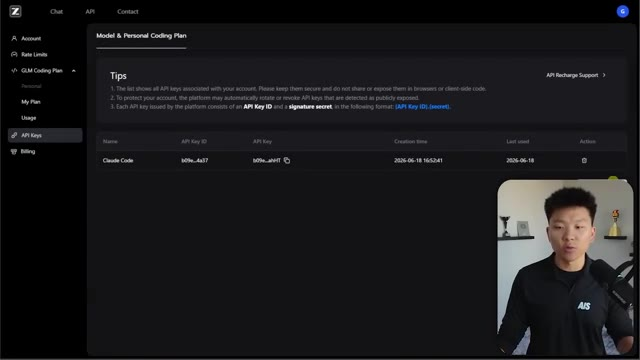
*⏱️ 00:11:43 — Interface de gestion des clés API avec un tableau listant les clés existantes (notamment pour Claude Code).*

---

### ⏱️ `[00:11:54 - 00:12:29]` | Segment #29

**🔊 Audio (Transcription Intégrale Mot pour Mot en Français) :**
> Ils ont aussi des heures de pointe où cela consomme, vous savez, un multiple plus élevé de votre quota. Et puis ce qui est intéressant, c'est qu'ils ont aussi un quota de recherche web. Donc si vous faisiez beaucoup de recherches web, cela va tout consommer, mais vous pourriez évidemment le connecter à quelque chose comme Perplexity ou une API différente pour faire plus de recherches web. Donc ce n'est pas un problème majeur, mais j'ai trouvé que c'était plutôt intéressant. Quoi qu'il en soit, tout ce que vous allez faire, c'est simplement modifier votre fichier de configuration dans Claude Code, ce qui a l'air un peu effrayant ou technique, mais ça ne l'est vraiment pas. Laissez-moi juste ouvrir mon Claude très rapidement pour vous montrer à quoi ça ressemble. Donc, à l'intérieur de votre .claude, vous devriez avoir un settings.local.json. Et c'est là que vous pouvez jouer avec vos permissions et vos serveurs MCP.

**👁️ Analyse Visuelle d'Écran (gemini-3.5-flash-lite) :**
**Interface & Outils** : Interface web de gestion de plan (GLM Coding Plan / Tableau de bord d'utilisation)

**Contenu textuel & Code** : Graphiques de quotas : 5 Hours Quota (54% utilisé), Weekly Quota (10% utilisé), Total Monthly Web Search / Reader / Zread Quota (0% utilisé) avec une info-bulle explicative.

**Action / Démonstration** : Navigation et explication des différents quotas de consommation et de recherche web sur le tableau de bord.

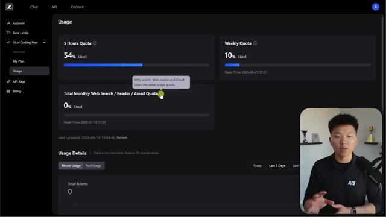
*⏱️ 00:12:03 — Capture d'écran montrant le tableau de bord d'utilisation d'une plateforme d'IA (GLM Coding Plan) avec les quotas sur 5 heures, hebdomadaire et mensuel pour la recherche web.*

---

### ⏱️ `[00:12:29 - 00:12:50]` | Segment #30

**🔊 Audio (Transcription Intégrale Mot pour Mot en Français) :**
> et toutes ces sortes de choses. Et vous pouvez aussi définir des variables d'environnement. Donc si vous avez activé les équipes d'agents, cela peut se trouver ici comme le mien, ou cela peut se trouver globalement. Où que cela se trouve, c'est une variable d'environnement. Et tout ce que vous avez à faire, c'est de venir ici et de les définir. Donc ce que je vais faire, c'est que je vais faire en sorte que cette chose exacte soit collée dans la description de cette vidéo. Donc tout ce que vous avez à faire, c'est de copier ceci, de le mettre dans vos variables d'environnement.

**👁️ Analyse Visuelle d'Écran (gemini-3.5-flash-lite) :**
**Interface & Outils** : VS Code

**Contenu textuel & Code** : Fichier `settings.local.json` contenant des variables d'environnement (`CLAUDE_CODE_EXPERIMENTAL_AGENT_TEAMS`, clés API, modèles par défaut) et des configurations de permissions.

**Action / Démonstration** : Le présentateur explique la configuration des variables d'environnement pour activer les équipes d'agents dans le fichier JSON.

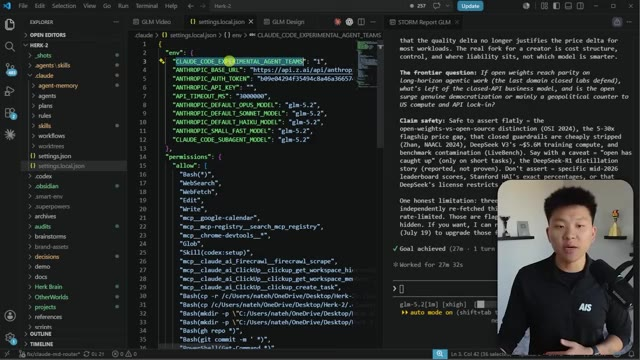
*⏱️ 00:12:34 — Capture d'écran montrant l'éditeur de code VS Code avec un fichier de configuration JSON ouvert, affichant la variable d'environnement CLAUDE_CODE_EXPERIMENTAL_AGENT_TEAMS, ainsi que la vidéo du présentateur en bas à droite.*

---

### ⏱️ `[00:12:50 - 00:13:11]` | Segment #31

**🔊 Audio (Transcription Intégrale Mot pour Mot en Français) :**
> Vous pouvez aussi dire : hé, Claude Code, mets ça dans mon settings.local.json. Et ensuite, tout ce que vous avez à faire, c'est de remplacer votre propre clé API. C'est donc ici que vous allez mettre votre clé API Z que vous venez d'obtenir ici quand vous allez dans les clés API et que vous en avez ajouté une juste là. Parce que ce que vous faites ici, c'est que vous pouvez voir que nous avons l'URL de base d'Anthropic et que nous redirigeons cela vers l'API de Z plutôt que vers une API Anthropic.

**👁️ Analyse Visuelle d'Écran (gemini-3.5-flash-lite) :**
**Interface & Outils** : Visual Studio Code et interface Web (Tableau de bord de gestion d'API).

**Contenu textuel & Code** : Fichier JSON de configuration (`settings.local.json`) avec les clés d'environnement `ANTHROPIC_BASE_URL`, `ANTHROPIC_AUTH_TOKEN`, et les différents modèles configurés (`glm-5.2`).

**Action / Démonstration** : Configuration des variables d'environnement et de la clé API personnalisée dans le fichier de paramètres locaux de Claude Code.

*⏱️ 00:12:55 — Vue de l'éditeur VS Code montrant le fichier de configuration JSON (`settings.local.json`) avec les paramètres d'environnement et l'authentification API.*

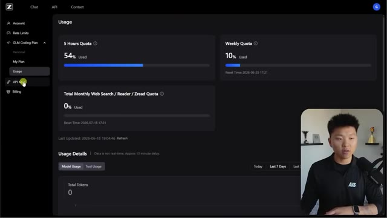
*⏱️ 00:13:00 — Interface Web d'un tableau de bord affichant les quotas d'utilisation et la section pour générer ou récupérer les clés API.*

*⏱️ 00:13:06 — Retour sur le fichier de configuration JSON dans l'éditeur montrant le champ `API_TIMEOUT_MS` et d'autres paramètres de modèles.*

---

### ⏱️ `[00:13:11 - 00:13:34]` | Segment #32

**🔊 Audio (Transcription Intégrale Mot pour Mot en Français) :**
> Donc, on est juste en train de changer le moteur de la voiture. Si le harnais est la voiture et que le moteur est le modèle d'IA, on est juste en train de changer le moteur. Et vous pouvez voir juste ici que j'ai laissé la clé API Anthropic vide. On a mis ça comme jeton d'authentification Anthropic et c'est ma clé API Z. Et ensuite, on a changé tous ces modèles par défaut pour GLM 5.2. Et ensuite, quand vous ouvrez votre nouveau Claude, si je vais ici, Claude, on ouvre ça.

**👁️ Analyse Visuelle d'Écran (gemini-3.5-flash-lite) :**
**Interface & Outils** : Éditeur de code (VS Code)

**Contenu textuel & Code** : Fichier JSON de configuration contenant des clés telles que "ANTHROPIC_BASE_URL", "ANTHROPIC_AUTH_TOKEN", "ANTHROPIC_API_KEY" (laissée vide), et la modification des modèles par défaut ("glm-5.2").

**Action / Démonstration** : Le présentateur explique la configuration du fichier JSON pour remplacer le moteur du modèle d'IA tout en gardant l'infrastructure.

*⏱️ 00:13:17 — Capture d'écran montrant un éditeur de code (VS Code) avec un fichier de configuration JSON (`settings.local.json`), affichant les variables d'environnement pour l'API Anthropic et les modèles par défaut configurés sur "glm-5.2", ainsi que la webcam du présentateur en bas à droite.*

---

### ⏱️ `[00:13:34 - 00:13:52]` | Segment #33

**🔊 Audio (Transcription Intégrale Mot pour Mot en Français) :**
> Et qu'est-ce que nous voyons ? Juste ici, nous voyons GLM 5.2 avec une facturation de l'utilisation de l'API pour 1 million de contexte. Et donc, c'est comme dans un paramètre par projet. Donc, si je viens dans cet autre et que je vous montre, vous savez, sur ce côté gauche, nous avons GLM. Sur ce côté droit, nous avons Opus.

**👁️ Analyse Visuelle d'Écran (gemini-3.5-flash-lite) :**
**Interface & Outils** : VS Code et l'outil CLI Claude Code

**Contenu textuel & Code** : Commandes de terminal et configuration de glm-5.2[1m] avec facturation API (API Usage Billing)

**Action / Démonstration** : Navigation et démonstration de l'utilisation de GLM 5.2 dans différents projets au sein de VS Code

![Interface VS Code affichant Claude Code avec le modèle glm-5.2[1m] et la facturation par API.](../screenshots/2OD14-0cot4/2OD14-0cot4_001338_seg33.jpg)
*⏱️ 00:13:38 — Interface VS Code affichant Claude Code avec le modèle glm-5.2[1m] et la facturation par API.*

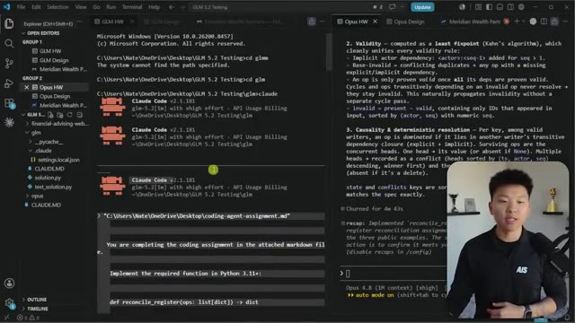
*⏱️ 00:13:47 — Interface VS Code montrant un autre projet avec le terminal intégré exécutant Claude Code et GLM 5.2.*

---

### ⏱️ `[00:13:52 - 00:14:13]` | Segment #34

**🔊 Audio (Transcription Intégrale Mot pour Mot en Français) :**
> La façon dont j'ai fait ça, c'est que j'ai simplement ces éléments dans deux répertoires différents. Et c'est une vue très moche. Je m'en excuse. Mais ce que j'ai fait, c'est qu'ici, j'ai deux dossiers. J'ai GLM et j'ai Opus. Donc dans le dossier GLM, mon settings.local.json montre ces trucs, d'accord ? Et ensuite dans mon dossier Opus, je n'ai même pas de settings.local.json. Et c'est comme ça que je peux ouvrir Claude dans ce répertoire.

**👁️ Analyse Visuelle d'Écran (gemini-3.5-flash-lite) :**
**Interface & Outils** : VS Code (éditeur de code avec panneaux de terminal intégrés)

**Contenu textuel & Code** : Commandes de terminal (cd glm, cd opus, claude), arborescence de répertoires avec settings.local.json, CLAUDE.md, solution.py, test_solution.py.

**Action / Démonstration** : Navigation dans l'explorateur de fichiers de VS Code et lancement de Claude Code dans des terminaux séparés pour les dossiers GLM et Opus.

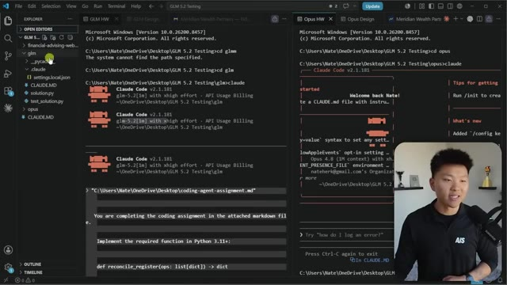
*⏱️ 00:13:57 — Vue de VS Code avec un explorateur de fichiers à gauche montrant les dossiers glm et opus, et deux fenêtres de terminal divisées affichant Claude Code.*

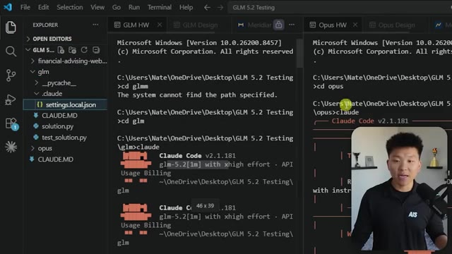
*⏱️ 00:14:02 — Vue rapprochée de VS Code avec l'arborescence des fichiers ouverte sur le dossier glm et le fichier settings.local.json sélectionné.*

---

### ⏱️ `[00:14:13 - 00:14:37]` | Segment #35

**🔊 Audio (Transcription Intégrale Mot pour Mot en Français) :**
> Et nous avons simplement le Claude normal. Et ça a l'air absolument affreux. Laissez-moi donc vous montrer. Voilà. Parce que nous ne sommes pas dans un répertoire qui possède un settings.local.json avec ce routage, il s'ouvre automatiquement avec Opus. sur mon plan Cloud Max. C'est donc ainsi que vous pouvez en quelque sorte, vous savez, ajuster quels projets utilisent quel modèle d'IA. Et aussi, si vous vous posiez la question, toute cette présentation, bien sûr, a été construite par GLM 5.2.

**👁️ Analyse Visuelle d'Écran (gemini-3.5-flash-lite) :**
**Interface & Outils** : VS Code avec panneau terminal intégré (Claude Code)

**Contenu textuel & Code** : Fichier JSON de configuration avec des clés d'environnement et le terminal Claude Code v2.1.181 affichant "Opus 4.8".

**Action / Démonstration** : Le présentateur explique la configuration du routage et des modèles via le fichier de paramètres locaux.

*⏱️ 00:14:19 — Vue de l'éditeur VS Code montrant un fichier settings.local.json dans l'arborescence et un terminal Claude Code actif sur le panneau de droite.*

---

### ⏱️ `[00:14:37 - 00:15:02]` | Segment #36

**🔊 Audio (Transcription Intégrale Mot pour Mot en Français) :**
> C'est marrant parce qu'il n'arrête pas de m'appeler Herc. Et je pense qu'avec ça, il veut juste dire Herc 2, comme mon projet appelé Herc 2. Mais ça a été fait par GLM 5.2. Et vous remarquerez que ça ressemble à beaucoup de mes autres présentations parce qu'il a utilisé ma compétence pour ça. Bref, je sais que celle-ci était rapide, mais je voulais faire vite et vous montrer comment vous configurer pour pouvoir jouer avec. J'ai l'intention de vous apporter beaucoup plus de contenu sur les modèles locaux et peut-être même d'autres trucs comme Open Code, parce qu'on n'a pas toujours envie d'être bloqué par les exigences de Cloud Code, par exemple.

**👁️ Analyse Visuelle d'Écran (gemini-3.5-flash-lite) :**
**Interface & Outils** : Présentation de diapositives / Interface web de présentation

**Contenu textuel & Code** : Texte affiché : "The whole thing", "Use GLM 5.2 for almost everything. Cheap, open, plenty smart.", "Save Opus 4.8 for your hardest, most important jobs.", "That is exactly how Herk uses it."

**Action / Démonstration** : Le présentateur commente une diapositive de présentation qui résume sa stratégie d'utilisation des différents modèles d'intelligence artificielle.

*⏱️ 00:14:43 — Une diapositive de présentation sombre avec le titre "The whole thing" et trois encadrés contenant des recommandations sur l'utilisation des modèles d'IA, avec le présentateur visible en incrustation vidéo dans le coin inférieur droit.*

---

### ⏱️ `[00:15:02 - 00:15:27]` | Segment #37

**🔊 Audio (Transcription Intégrale Mot pour Mot en Français) :**
> Alors s'il vous plaît, faites-moi savoir dans les commentaires ce que vous voulez voir autour de l'IA open source, car croyez-moi, je peux vraiment voir un avenir où chaque entreprise fait simplement tourner ses propres modèles locaux. Et je pense qu'Anthropic commence à réaliser cela aussi. OpenAI commence à réaliser cela aussi. C'est pourquoi ils investissent dans d'autres choses comme des services et d'autres moyens de s'intégrer dans les entreprises, comme leurs ingénieurs déployés en avant, parce qu'ils savent que le modèle ne sera peut-être pas le rempart à la fin de la journée.

**👁️ Analyse Visuelle d'Écran (gemini-3.5-flash-lite) :**
**Interface & Outils** : Logiciel de présentation de diapositive avec incrustation vidéo.

**Contenu textuel & Code** : Texte : "The whole thing", "Use GLM 5.2 for almost everything. Cheap, open, plenty smart.", "Save Opus 4.8 for your hardest, most important jobs.", "That is exactly how Herk uses it."

**Action / Démonstration** : Le présentateur commente la stratégie d'utilisation des différents modèles de langage selon leur coût et leur complexité.

*⏱️ 00:15:09 — Une diapositive de présentation avec le titre "The whole thing" et trois encadrés textuels comparant l'utilisation de GLM 5.2 et Opus 4.8, avec la vidéo du présentateur en bas à droite.*

---

### ⏱️ `[00:15:27 - 00:15:42]` | Segment #38

**🔊 Audio (Transcription Intégrale Mot pour Mot en Français) :**
> En ce moment, il y a un énorme fossé, mais nous voyons ce fossé se combler super rapidement et c'est vraiment amusant à regarder en temps réel. Commençons donc à jouer davantage avec les modèles open source. Si vous avez aimé la vidéo ou si vous avez appris quelque chose de nouveau, n'hésitez pas à mettre un pouce bleu, ça m'aide énormément. Et comme toujours, je vous remercie d'être arrivés jusqu'à la fin de la vidéo et je vous dis à tous dans la prochaine. Merci tout le monde.

**👁️ Analyse Visuelle d'Écran (gemini-3.5-flash-lite) :**
**Interface & Outils** : Présentation de diapositives (style slide deck)

**Contenu textuel & Code** : Texte affiché : "The whole thing", "Use GLM 5.2 for almost everything. Cheap, open, plenty smart.", "Save Opus 4.8 for your hardest, most important jobs.", "That is exactly how Herk uses it."

**Action / Démonstration** : Présentation des recommandations d'utilisation des modèles d'IA par le présentateur.

---

