# 🎬 Finally. Agent Loops Clearly Explained.

> **Chaîne** : [Nate Herk | AI Automation](https://www.youtube.com/@nateherk/featured)  
> **Lien YouTube** : [https://www.youtube.com/watch?v=EuzYhzB0vbI](https://www.youtube.com/watch?v=EuzYhzB0vbI)  
> **Date de publication** : 20260619  
> **Durée** : 00:14:33  
> **Identifiant vidéo** : `EuzYhzB0vbI`  
> **Transcription & Analyse** : `whisper-v3-large-turbo+gemini-3.5-flash-lite`  

---

## 📌 Synthèse Exécutive & Outils

### 💡 Résumé
Dans cette vidéo, Nate Herk propose une clarification indispensable sur l'un des concepts les plus en vogue et parfois mal compris de l'écosystème technique actuel : l'ingénierie de boucles d'agents. S'appuyant sur les retours d'experts reconnus comme Boris Cherny et Peter Steinberger, l'analyse démontre que l'ère du simple prompt direct d'agents de code touche à sa fin au profit de la conception de boucles autonomes. Le rôle de l'ingénieur évolue ainsi d'un simple donneur d'ordres à un architecte de systèmes capables de s'auto-itérer, transformant radicalement l'efficacité des flux de travail en éliminant les allers-retours humains superflus.

Pour illustrer son propos, le présentateur dévoile une démonstration concrète : un agent configuré pour concevoir un fichier HTML après avoir analysé et synthétisé 45 sources hétérogènes (articles, transcriptions YouTube, publications sur X). Plutôt que de s'arrêter à une première version, l'agent a itéré à travers sept versions successives, s'auto-évaluant par captures d'écran et vérifications successives jusqu'à l'atteinte d'un standard qualitatif élevé. Une seconde démonstration, inspirée de la bibliothèque de boucles de Matthew Berman, met en scène une commande `/goal` sous Claude Code générant, évaluant et optimisant des concepts de vignettes YouTube selon des critères précis de clarté et d'attrait visuel.

Au-delà de la hype des flottes d'agents fonctionnant 24h/24 et 7j/7, Nate Herk livre un avertissement pragmatique : les boucles d'agents ne sont pas une solution universelle et nécessitent une maîtrise sous-jacente pour ne pas amplifier les bugs. La puissance réelle de cette approche réside dans l'automatisation de la boucle de rétroaction, permettant de confier à l'IA un objectif clair et un mécanisme de vérification rigoureux pour atteindre rapidement des sommets de performance que l'intervention humaine seule ralentirait.

### 🛠️ Outils, Modèles & Logiciels Présentés
- **Anthropic Claude Code** : Interface de développement en ligne de commande utilisée pour orchestrer les agents, exécuter des boucles et piloter des tâches de code complexes.
- **Opus 5.5** : Modèle de langage de pointe (évoqué dans l'écosystème global) doté de capacités de raisonnement approfondies pour propulser les agents autonomes.
- **Bibliothèque de boucles de Matthew Berman** : Référentiel open-source de prompts et de structures de boucles d'agents partagés par la communauté pour tester différents cas d'usage.

### 🔑 Points Clés & Enseignements Stratégiques
- **Le paradigme de l'ingénierie de boucles** : Ne promtez plus directement les agents de code ; concevez des boucles logiques qui se chargent de prompter vos agents à votre place pour automatiser l'amélioration continue.
- **L'anatomie d'une boucle** : Toute boucle efficace repose fondamentalement sur trois piliers indissociables : un déclencheur (trigger), une action d'exécution et une condition d'arrêt (stopping condition).
- **Le rôle du méta-agent** : Pour concevoir ces architectures, l'idéal est de s'appuyer sur un méta-agent capable de déduire les boucles nécessaires en fonction de votre style (« vibe ») et de rédiger le code correspondant.
- **Objectif et Vérification (les deux piliers)** : La réussite d'une boucle dépend de la clarté d'un objectif mesurable (préférablement objectif plutôt que subjectif) et d'un mécanisme de vérification rigoureux permettant à l'agent d'évaluer son propre travail.
- **L'analogie du stagiaire autonome** : Considérez l'agent intelligent non pas comme un outil à micro-manager à chaque étape, mais comme un stagiaire compétent à qui l'on fixe un but final et qui ne revient vers vous qu'une fois le travail vérifié et achevé.
- **La courbe de qualité exponentielle** : L'externalisation de la boucle de rétroaction à un agent permet de combler instantanément le fossé des premières tentatives ratées, propulsant le niveau de qualité bien plus haut dès les premières itérations.
- **Les architectures de boucles possibles** : Il existe plusieurs niveaux de complexité, allant de la boucle solo (raisonner-agir-observer) jusqu'aux structures plus élaborées de type créateur-vérificateur ou gestionnaire orchestrant une flotte d'assistants.
- **Attention aux pièges du "24h/24 et 7j/7"** : Ne cédez pas à la pression des réseaux sociaux exigeant des flottes d'agents perpétuelles ; si votre cas d'usage ne le requiert pas, des exécutions événementielles ou cadencées s'avèrent bien plus pertinentes.
- **Risque d'amplification des bugs** : Déployer des boucles complexes sans comprendre les fondements techniques de ce que l'on construit ne fait qu'amplifier les erreurs et générer une dette technique colossale à corriger par la suite.
- **La définition du "Terminé" (DoD)** : Plus la condition d'arrêt est objective et quantifiable (ex: métrique X égale au résultat Y), plus la boucle d'agent sera performante, évitant les boucles infinies basées sur de simples appréciations subjectives.
- **L'importance des tests visuels et fonctionnels** : Intégrer des étapes d'observation concrètes (captures d'écran, exécution de tests unitaires) dans la boucle permet à l'IA d'ajuster dynamiquement son code avant validation finale.
- **L'adaptabilité des flux de travail** : La majorité des tâches quotidiennes ne nécessitent pas une architecture d'essaim massive ; une simple session de terminal couplée à une bonne boucle solo suffit amplement à multiplier la productivité.

---

## ⏱️ Chronologie & Transcription Complète Audio & Visuelle (Mot pour Mot)

### ⏱️ `[00:00:00 - 00:00:33]` | Segment #01

**🔊 Audio (Transcription Intégrale Mot pour Mot en Français) :**
> Juste ici, j'ai quatre agents différents qui font des boucles, appellent d'autres sous-agents, et écrivent tous ces prompts pour moi et conçoivent des systèmes pour moi. Mais est-ce que c'est vraiment productif, ou est-ce juste une super démo ? Voici votre rappel mensuel : vous ne devriez plus prompter les agents de code. Vous devriez concevoir des boucles qui promptent vos agents. Boris Cherny et Peter Steinberger ont publiquement déclaré qu'ils ne promptaient plus leurs agents de code. Ils écrivent des boucles. Une boucle se compose de trois choses, un déclencheur, une action et une condition d'arrêt. Si vous écrivez encore des boucles qui promptent des agents de code, vous prenez du retard, vous devez créer un méta-agent qui déduit les boucles que vous auriez voulues en fonction de votre « vibe » et ensuite écrit ces boucles. On entend énormément parler

**👁️ Analyse Visuelle d'Écran (gemini-3.5-flash-lite) :**
**Interface & Outils** : VS Code, Claude Code CLI, X (Twitter)

**Contenu textuel & Code** : Interfaces de terminaux multiples avec des barres de progression de tokens (Opus 4.8) et un post X mentionnant Boris Cherny et Peter Steinberger.

**Action / Démonstration** : Exécution simultanée de quatre agents en mode automatique dans des terminaux séparés, et lecture d'un tweet sur l'utilisation des boucles d'agents.

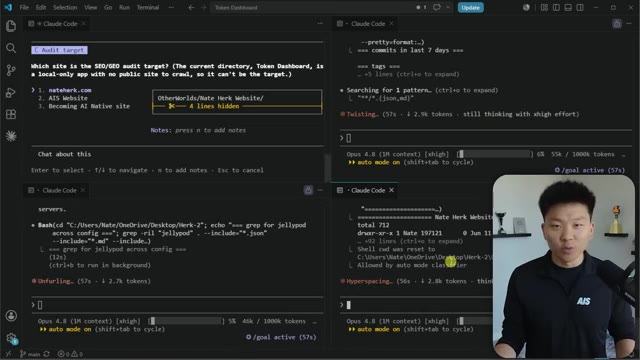
*⏱️ 00:00:08 — Vue d'un écran d'éditeur de code divisé en quatre terminaux Claude Code exécutant des agents en parallèle, avec le présentateur en incrustation.*

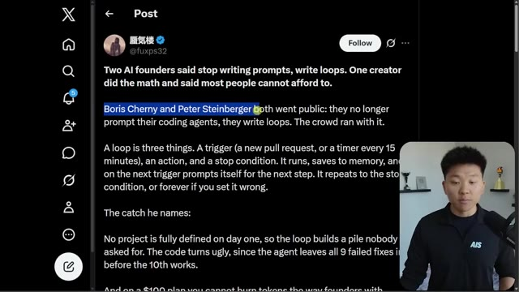
*⏱️ 00:00:16 — Capture d'écran d'un tweet sur X (anciennement Twitter) discutant des boucles d'agents IA, avec le présentateur visible en bas à droite.*

---

### ⏱️ `[00:00:33 - 00:00:59]` | Segment #02

**🔊 Audio (Transcription Intégrale Mot pour Mot en Français) :**
> à propos des boucles d'agents, de l'ingénierie de boucles, ou peu importe comment vous voulez appeler ça. Je voulais donc faire une vidéo pour clarifier ce que cela signifie réellement. Parce que je pense que tout le monde a un peu sa propre vision et une définition différente de ce que c'est. Et cela s'applique à tout le monde d'une manière très, très différente. Je pense que cette définition résume assez bien la chose. L'ingénierie de boucles consiste à vous remplacer en tant que personne qui donne les instructions à l'agent. Vous concevez plutôt le système qui fait cela. Une boucle ici peut être considérée comme un objectif récursif où vous définissez un but et où l'IA itère jusqu'à ce qu'il soit atteint.

**👁️ Analyse Visuelle d'Écran (gemini-3.5-flash-lite) :**
**Interface & Outils** : Navigateur web affichant le réseau social X (Twitter)

**Contenu textuel & Code** : Tweets et articles textuels sur le concept de 'Loop Engineering' (ingénierie de boucles) avec des citations d'utilisateurs.

**Action / Démonstration** : Présentation de publications sur les réseaux sociaux pour illustrer le sujet de la vidéo.

---

### ⏱️ `[00:00:59 - 00:01:22]` | Segment #03

**🔊 Audio (Transcription Intégrale Mot pour Mot en Français) :**
> Et il y a vraiment deux piliers les plus importants de cela à mon esprit, qui sont l'objectif. Quel est l'objectif réel ? Quelque chose qui est typiquement objectif, et non subjectif. Et ensuite la vérification. Comment l'agent connaît-il cette condition d'arrêt ? Comment vérifie-t-il et itère-t-il ? Donc de toute façon, si vous prenez tous ces conseils et que vous commencez à faire des choses comme ça et à concevoir des essaims et des flottes d'agents qui fonctionnent constamment 24 heures sur 24 et 7 jours sur 7, alors vous devez réfléchir à ce que vous faites réellement ici ?

**👁️ Analyse Visuelle d'Écran (gemini-3.5-flash-lite) :**
**Interface & Outils** : VS Code, Claude Code (CLI)

**Contenu textuel & Code** : Commandes bash, instructions de configuration, et indicateurs d'utilisation de tokens et de modes d'exécution (auto mode on, xhigh).

**Action / Démonstration** : Navigation et exécution multi-fenêtres d'agents de code autonomes dans un environnement de développement.

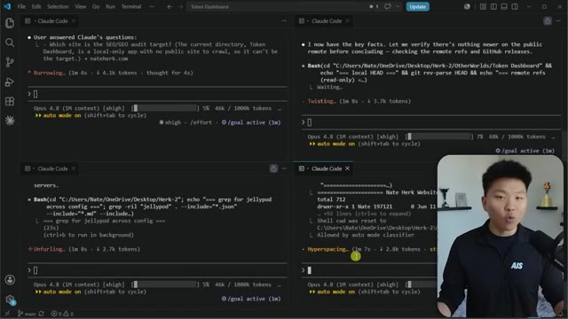
*⏱️ 00:01:16 — Interface VS Code divisée en quatre volets affichant des sessions de l'outil Claude Code avec des lignes de commande et des barres de progression de tokens, et le présentateur en bas à droite.*

---

### ⏱️ `[00:01:22 - 00:01:40]` | Segment #04

**🔊 Audio (Transcription Intégrale Mot pour Mot en Français) :**
> Et est-ce que ça fait vraiment bouger les choses ? Donc, tout d'abord, je me suis dit, comment est-ce que j'utilise réellement les boucles d'agents ? Parce que quand vous lisez certains de ces tweets que je viens de montrer plus tôt dans cette vidéo, vous vous dites un peu, ok, si je n'ai pas cinq agents qui travaillent continuellement 24 heures sur 24 pour orchestrer leurs propres agents, alors je prends du retard, ou je n'utilise pas mon abonnement cloud de la meilleure façon.

**👁️ Analyse Visuelle d'Écran (gemini-3.5-flash-lite) :**
**Interface & Outils** : Navigateur web présentant un guide textuel sur les boucles d'agents.

**Contenu textuel & Code** : Texte explicatif : "Agent loops, made simple", "An agent loop is just an AI that reasons what to do, acts, and observes the result, over and over, until the goal is met."

**Action / Démonstration** : Le présentateur explique la définition des boucles d'agents à l'aide de la page web affichée à l'écran.

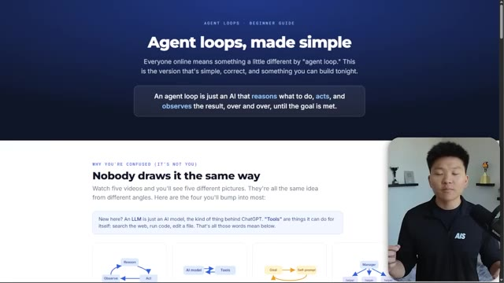
*⏱️ 00:01:26 — Capture d'écran montrant une page web intitulée "Agent loops, made simple" avec une définition des boucles d'agents, et le présentateur visible dans un encadré en bas à droite.*

---

### ⏱️ `[00:01:40 - 00:02:05]` | Segment #05

**🔊 Audio (Transcription Intégrale Mot pour Mot en Français) :**
> Et je pense que c'est tout à fait faux. Parce que si vous ne comprenez pas ce que vous faites, alors vous allez probablement simplement amplifier les problèmes et vous allez vous retrouver avec une tonne de bugs et une tonne de choses que vous devrez corriger plus tard. Et par ailleurs, nous ne sommes pas tous dans une situation où avoir des agents qui travaillent vingt-quatre heures sur vingt-quatre, sept jours sur sept, nous est réellement bénéfique. Par exemple, ce n'est pas mon cas. J'ai des agents qui font des choses selon une certaine cadence et j'ai des agents qui font des choses en fonction de certaines actions événementielles, mais le fait qu'ils travaillent pour moi vingt-quatre heures sur vingt-quatre, sept jours sur sept, n'est tout simplement pas utile.

**👁️ Analyse Visuelle d'Écran (gemini-3.5-flash-lite) :**
**Interface & Outils** : Page web explicative (navigateur web)

**Contenu textuel & Code** : Titres et texte explicatif sur les "Agent loops" ("An agent loop is just an AI that reasons what to do, acts, and observes the result...") ainsi que plusieurs petits schémas en bas de page.

**Action / Démonstration** : Le présentateur parle en gesticulant devant la page web affichée à l'écran.

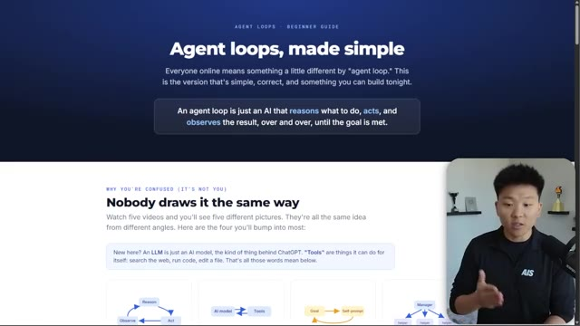
*⏱️ 00:01:46 — Capture d'écran montrant une page web intitulée "Agent loops, made simple" avec du texte explicatif sur les boucles d'agents IA, et le présentateur visible en incrustation dans le coin inférieur droit.*

---

### ⏱️ `[00:02:05 - 00:02:23]` | Segment #06

**🔊 Audio (Transcription Intégrale Mot pour Mot en Français) :**
> Je pense que si je travaillais avec une équipe sur une base de code et que nous construisions un produit et que nous étions constamment en train d'itérer et d'intégrer différentes choses, alors cela aurait peut-être plus de sens. Mais pour moi, cela ne s'applique pas. Donc je voulais juste venir ici, expliquer cela aussi simplement que je le peux, et espérer éclairer la façon dont vous pouvez commencer à appliquer des boucles dans vos flux de travail, ainsi que pourquoi et comment.

**👁️ Analyse Visuelle d'Écran (gemini-3.5-flash-lite) :**
**Interface & Outils** : Navigateur web affichant un guide sur les boucles d'agents IA ("Agent loops - Beginner guide").

**Contenu textuel & Code** : Texte explicatif définissant une boucle d'agent comme une IA qui raisonne, agit et observe, avec des schémas explicatifs en bas.

**Action / Démonstration** : Présentation visuelle d'un guide théorique sur le fonctionnement des boucles d'agents IA.

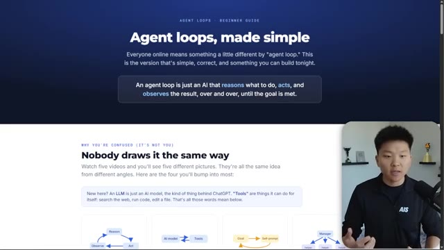
*⏱️ 00:02:10 — Capture d'écran montrant une page web intitulée "Agent loops, made simple" avec le présentateur incrusté en bas à droite.*

---

### ⏱️ `[00:02:23 - 00:02:41]` | Segment #07

**🔊 Audio (Transcription Intégrale Mot pour Mot en Français) :**
> Donc, j'ai effectivement construit une boucle d'agent pour ce code HTML que nous allons examiner aujourd'hui. Et elle a essentiellement parcouru une tonne de sources différentes. Elle a vérifié 45 sources, qu'il s'agisse d'articles, de transcriptions de vidéos YouTube, de publications sur X. Elle a examiné une tonne de choses. Et ensuite, elle a continué à boucler là-dessus jusqu'à avoir une bonne idée de ce qu'il fallait construire. Et une fois qu'elle a construit ce HTML, ce n'était pas la version 1.

**👁️ Analyse Visuelle d'Écran (gemini-3.5-flash-lite) :**
**Interface & Outils** : Navigateur web affichant une page HTML explicative personnalisée sur les boucles d'agents.

**Contenu textuel & Code** : Texte et schémas conceptuels sur les boucles d'agents ('Agent loops, made simple', 'Observe', 'Act', 'Most tasks don't need a loop').

**Action / Démonstration** : Le présentateur fait défiler une page web contenant du code HTML/du contenu visuel interactif expliquant l'architecture des agents conversationnels.

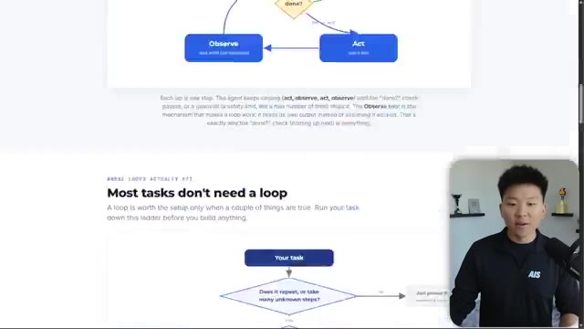
*⏱️ 00:02:28 — Vue d'une page web explicative avec un diagramme de boucle d'agent (Observe/Act) et du texte décrivant le fonctionnement des boucles d'agents, avec le présentateur en médaillon.*

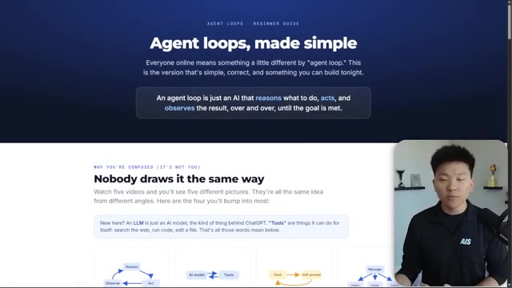
*⏱️ 00:02:32 — En-tête d'une page web interactive intitulée 'Agent loops, made simple' présentant un guide débutant sur les boucles d'agents avec une définition claire et le présentateur en bas à droite.*

---

### ⏱️ `[00:02:42 - 00:03:02]` | Segment #08

**🔊 Audio (Transcription Intégrale Mot pour Mot en Français) :**
> C'était probablement la V7. Il a dû sans cesse vérifier, faire des captures d'écran, examiner, répéter. Et puis il a fini par dire, ok, nous avons terminé. Voilà ce que nous avons obtenu. Laissez-moi donc vous présenter cela. Une boucle d'agent est simplement une IA qui réfléchit à ce qu'il faut faire, agit en conséquence, commence à exécuter, puis observe le résultat. Et elle fait cela encore, encore et encore jusqu'à ce qu'un certain objectif soit atteint, jusqu'à ce qu'elle sache que nous avons atteint le critère d'arrêt.

**👁️ Analyse Visuelle d'Écran (gemini-3.5-flash-lite) :**
**Interface & Outils** : Navigateur web affichant un article explicatif sur les boucles d'agents IA.

**Contenu textuel & Code** : Texte et schéma de workflow illustrant les concepts de raisonnement, d'action et d'observation d'un agent IA.

**Action / Démonstration** : Le présentateur explique les concepts fondamentaux des boucles d'agents en s'appuyant sur des schémas visuels affichés à l'écran.

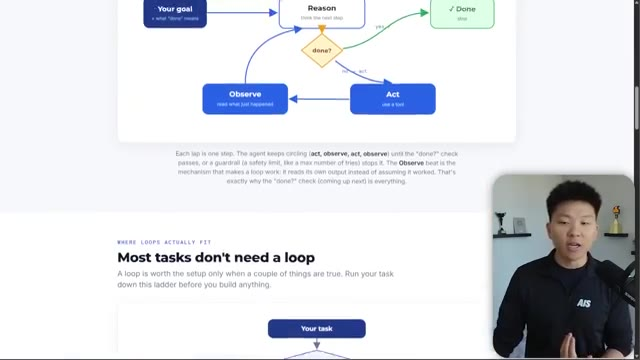
*⏱️ 00:02:47 — Un diagramme schématique illustrant le fonctionnement d'une boucle d'agent IA avec les étapes 'Reason', 'Act', 'Observe' et la condition de validation 'Done'.*

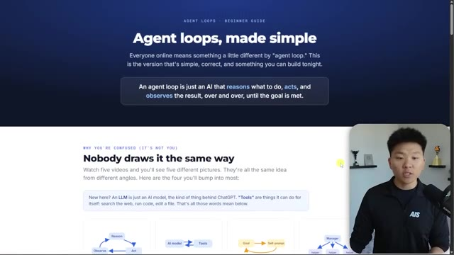
*⏱️ 00:02:52 — Une page web intitulée 'Agent loops, made simple' présentant une introduction textuelle sur les boucles d'agents IA, avec le présentateur en incrustation vidéo en bas à droite.*

---

### ⏱️ `[00:03:02 - 00:03:39]` | Segment #09

**🔊 Audio (Transcription Intégrale Mot pour Mot en Français) :**
> C'est bien. Je vais m'arrêter là. Et un visuel vraiment simple auquel j'aime penser, c'est que l'intelligence artificielle n'est jamais parfaite, n'est-ce pas ? Elle ne va jamais réussir quelque chose du premier coup en vous permettant d'accepter directement le résultat final. Et donc, si nous avons les tentatives sur l'axe des x et la qualité sur l'axe des y, pensons-y. à la première tentative, si vous donnez simplement à votre agent une sorte de tâche simple, peut-être que vous arrivez à, disons simplement à la première tentative, vous arrivez à 50 %. Et puis vous regardez cela et vous dites, d'accord, voici quelques changements à apporter. Et puis à la deuxième tentative, peut-être que vous augmentez de 5 ou 10 % de plus. Et chaque fois que vous donnez plus de commentaires et que vous itérez, vous continuez simplement à progresser en termes de qualité jusqu'à ce que vous atteigniez un niveau où vous êtes satisfait avec ces 90, 95 %. Et donc, toute l'idée est pourquoi ne pas externaliser cela

**👁️ Analyse Visuelle d'Écran (gemini-3.5-flash-lite) :**
**Interface & Outils** : Application de tableau blanc / prise de notes en ligne (type Excalidraw ou similaire).

**Contenu textuel & Code** : Un graphique avec un axe vertical "Quality" et un axe horizontal "Attempts".

**Action / Démonstration** : Le présentateur dessine ou prépare un graphique pour illustrer la relation entre la qualité et les tentatives de l'IA.

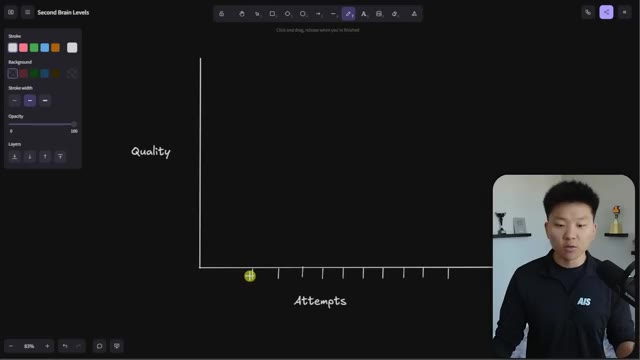
*⏱️ 00:03:11 — Capture d'écran montrant un tableau blanc virtuel avec un graphique vide, comportant les axes "Quality" et "Attempts", avec la webcam du présentateur en bas à droite.*

---

### ⏱️ `[00:03:39 - 00:04:01]` | Segment #10

**🔊 Audio (Transcription Intégrale Mot pour Mot en Français) :**
> partie, cette boucle de rétroaction et d'itération à un agent plutôt que de laisser l'humain s'en charger, parce que cela va se produire de toute façon. Donc si nous avons un agent qui fait cela au lieu d'un humain, alors ce qui pourrait se passer, c'est qu'à la première tentative, nous irons directement jusqu'ici. Et ensuite, nous pourrons donner un peu plus de rétroaction. Et puis vers la tentative, vous savez, trois ou quatre, nous en sommes déjà tellement plus haut que là où nous aurions été sans en quelque sorte cette boucle de vérification par l'agent juste là.

**👁️ Analyse Visuelle d'Écran (gemini-3.5-flash-lite) :**
**Interface & Outils** : Tableau blanc numérique en ligne (type Miro ou Excalidraw).

**Contenu textuel & Code** : Un graphique avec les axes "Quality" et "Attempts", montrant une courbe ascendante par paliers encerclée en bleu.

**Action / Démonstration** : Le présentateur explique les boucles d'itération et de rétroaction d'un agent IA à l'aide du graphique dessiné.

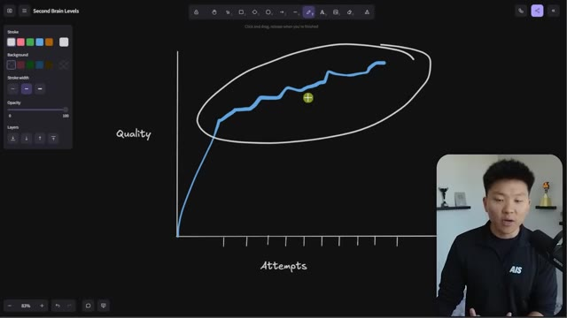
*⏱️ 00:03:45 — Un tableau blanc numérique illustrant un graphique montrant la relation entre la qualité et le nombre de tentatives d'un agent IA.*

---

### ⏱️ `[00:04:01 - 00:04:20]` | Segment #11

**🔊 Audio (Transcription Intégrale Mot pour Mot en Français) :**
> Et c'est pourquoi beaucoup de gens expliquent cela d'une manière différente, où certaines personnes ont le principe de penser, agir, voir, vous savez, on fait essentiellement en gros raisonner, agir, observer, raisonner, agir, observer. Certaines personnes font simplement faire des allers-retours au modèle avec des outils, des allers-retours, des allers-retours. D'autres ont simplement, vous savez, un objectif qui s'exécute de manière totalement autonome. Et certaines personnes utilisent des sortes de flottes d'agents avec des gestionnaires qui incitent d'autres agents, qui incitent d'autres agents.

**👁️ Analyse Visuelle d'Écran (gemini-3.5-flash-lite) :**
**Interface & Outils** : Page Web explicative avec graphiques et infographies

**Contenu textuel & Code** : Texte « Nobody draws it the same way » et quatre schémas (« Think -> Act -> See », « Model uses tools, on repeat », « Runs on its own », « One boss, many helpers »)

**Action / Démonstration** : Le présentateur explique les différentes représentations visuelles des agents IA et introduit le concept unifié sous-jacent.

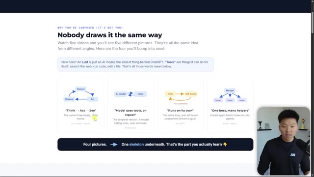
*⏱️ 00:04:06 — Une page Web présentant quatre schémas conceptuels différents expliquant le fonctionnement des agents IA, avec le présentateur visible en médaillon dans le coin inférieur droit.*

---

### ⏱️ `[00:04:20 - 00:04:40]` | Segment #12

**🔊 Audio (Transcription Intégrale Mot pour Mot en Français) :**
> Et c'est exactement comme, vous savez, ces poupées russes. C'est donc pour cela que je voulais diviser cela en quelque sorte en piliers principaux, qui sont selon moi : raisonner, agir, observer. Considérez cela comme un stagiaire intelligent que vous ne micromanagez pas. Vous lui confiez un objectif. Il détermine quoi faire ensuite, il vérifie son propre travail et il recommence. Et ensuite, il revient vers vous uniquement pour vous dire : hé, j'ai terminé. Après avoir probablement vérifié plusieurs fois et apporté quelques modifications.

**👁️ Analyse Visuelle d'Écran (gemini-3.5-flash-lite) :**
**Interface & Outils** : Présentation visuelle / Diagramme de workflow conceptuel.

**Contenu textuel & Code** : Texte du diagramme : « Your goal », « Reason (think the next step) », « Act (use a tool) », « Observe (read what just happened) », « Done ».

**Action / Démonstration** : Explication schématique des trois piliers fondamentaux d'un agent IA (Raisonner, Agir, Observer).

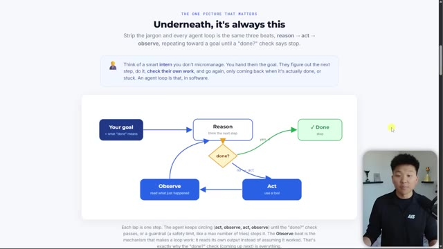
*⏱️ 00:04:25 — Schéma explicatif montrant la boucle d'un agent IA (« Underneath, it's always this ») avec les étapes Your goal, Reason, Act, Observe et Done.*

---

### ⏱️ `[00:04:40 - 00:05:01]` | Segment #13

**🔊 Audio (Transcription Intégrale Mot pour Mot en Français) :**
> Donc tu pourrais dire, d'accord, Claude Code. Voici ce que je veux que tu fasses. Nous, en tant qu'humains, sommes vraiment, vraiment bons pour définir ce que nous voulons. Nous sommes vraiment bons pour définir un objectif final. Et en plus de ça, nous devons dire, d'accord, comment sais-tu quand c'est terminé ? Donc, quand tu fais un gâteau, tu y plantes une fourchette. Et quand elle sort et qu'il n'y a pas de pâte partout dessus, ça veut dire que c'est cuit. Comment dis-tu à ton agent quelque chose d'aussi objectif que possible ?

**👁️ Analyse Visuelle d'Écran (gemini-3.5-flash-lite) :**
**Interface & Outils** : Page web explicative avec diagramme de workflow interactif et vignette vidéo du présentateur en bas à droite.

**Contenu textuel & Code** : Texte et schéma de la boucle d'agent : "Your goal", "Reason", "Act", "Observe", et la condition de validation "done?".

**Action / Démonstration** : Présentation visuelle de la boucle d'exécution d'un agent logiciel et de ses étapes logiques.

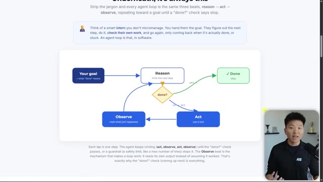
*⏱️ 00:04:45 — Schéma explicatif d'une boucle d'agent IA montrant le processus de raisonnement, d'action et d'observation menant à l'objectif final.*

---

### ⏱️ `[00:05:02 - 00:05:22]` | Segment #14

**🔊 Audio (Transcription Intégrale Mot pour Mot en Français) :**
> Quel est le critère d'arrêt ? Quelle est la définition du travail accompli ? Et donc ce qu'il va faire, c'est qu'il va raisonner, il va planifier, et ensuite il va commencer à exécuter. Après avoir exécuté, il va observer. Donc c'est peut-être une vérification visuelle. C'est peut-être l'exécution d'un test de code réel. Quoi que cela signifie de vérifier, il doit vérifier. Et puis après avoir examiné les résultats, il va dire, bon, est-ce que j'ai atteint ce critère de fin ? Si non, je vais agir à nouveau, puis observer à nouveau, et ensuite raisonner.

**👁️ Analyse Visuelle d'Écran (gemini-3.5-flash-lite) :**
**Interface & Outils** : Présentation graphique sur page web (diagramme de flux).

**Contenu textuel & Code** : Texte du diagramme : "Your goal", "Reason (think the next step)", "done?", "Act (use a tool)", "Observe (read what just happened)", "Done (stop)".

**Action / Démonstration** : Visualisation et explication du cycle de fonctionnement d'un agent autonome (raisonnement, action, observation, vérification).

*⏱️ 00:05:07 — Schéma conceptuel illustrant une boucle d'agent IA : partant d'un objectif, le processus enchaîne les étapes "Reason", "Act", "Observe" et une condition de vérification "done?".*

---

### ⏱️ `[00:05:22 - 00:05:45]` | Segment #15

**🔊 Audio (Transcription Intégrale Mot pour Mot en Français) :**
> Sinon, je vais m'arrêter. Et je vais dire, bon, monsieur ou madame l'humain, j'ai terminé. Et ce qui est vraiment intéressant, c'est que la majorité des tâches n'ont pas besoin de boucles. Ce que j'ai commencé à faire, c'est que pour la majorité de mes tâches, je vais construire une sorte de boucle, mais c'est juste à cause de la vérification, n'est-ce pas ? Cette partie est si importante, la boucle de vérification. Mais la plupart du temps, vous n'avez pas besoin d'une sorte d'architecture d'agent massive pour exécuter ce genre de flux de travail de bouclage dynamique.

**👁️ Analyse Visuelle d'Écran (gemini-3.5-flash-lite) :**
**Interface & Outils** : Page web de présentation / diagramme de workflow.

**Contenu textuel & Code** : Schéma avec les blocs : "Your task", "Does it repeat, or take many unknown steps?", "Can the AI check 'done' by itself?", menant soit à "Just prompt it", "Do it yourself", ou "Build a loop".

**Action / Démonstration** : Le présentateur explique les critères permettant de déterminer si une tâche nécessite la construction d'une boucle d'automatisation.

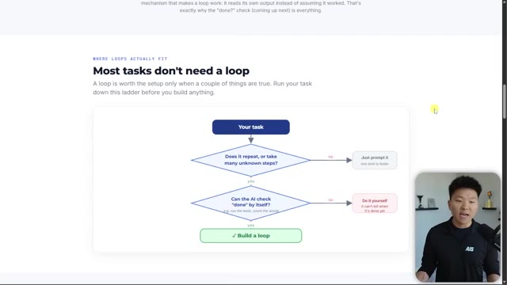
*⏱️ 00:05:28 — Un schéma décisionnel illustrant la pertinence des boucles pour les tâches d'IA, avec le titre "Most tasks don't need a loop".*

---

### ⏱️ `[00:05:45 - 00:06:05]` | Segment #16

**🔊 Audio (Transcription Intégrale Mot pour Mot en Français) :**
> Vous pouvez simplement y arriver avec une seule session de terminal simple et un bon prompt. Vous pouvez faire en sorte que ce soit juste une boucle solo, ce que je fais généralement le plus. Un agent qui raisonne, qui agit, observe et répète. Et je vais vous montrer, les gars, quelques exemples de à quoi ces boucles peuvent ressembler dans une petite seconde. Vous pouvez avoir un créateur-vérificateur où vous avez un agent qui fait la chose et ensuite un agent qui évalue la chose et donne des retours. Ou vous pouvez avoir une sorte de manager avec un tas d'assistants.

**👁️ Analyse Visuelle d'Écran (gemini-3.5-flash-lite) :**
**Interface & Outils** : Navigateur web (page éducative sur les workflows d'agents IA).

**Contenu textuel & Code** : Diagrammes et descriptions textuelles expliquant les flux de travail : "Solo loop" (un agent qui raisonne, agit, observe et répète), "Maker -> Checker" (un agent qui produit et un autre qui vérifie), et "Manager -> Helpers" (un gestionnaire supervisant des sous-agents).

**Action / Démonstration** : Présentation théorique et visuelle des structures de boucle pour l'automatisation par agents IA.

*⏱️ 00:05:50 — Une page web présentant un schéma conceptuel comparant trois architectures d'agents IA : "Solo loop", "Maker -> Checker" et "Manager -> Helpers".*

---

### ⏱️ `[00:06:05 - 00:06:26]` | Segment #17

**🔊 Audio (Transcription Intégrale Mot pour Mot en Français) :**
> Et ensuite, tant que vous avez un agent principal qui orchestre le tout, vous pouvez construire ces boucles de tellement de manières différentes. Laissez-moi donc vous montrer quelques exemples que j'ai récupérés. Ces deux premiers que je vais vous montrer proviennent en fait de cette bibliothèque de boucles que Matthew Berman a publiée. Il a créé cette bibliothèque de boucles, qui est une liste de boucles d'agents que vous pouvez utiliser et où les gens peuvent soumettre les leurs. C'est donc plutôt cool d'aller jeter un œil ici, de faire des essais et de voir ce qui est disponible.

**👁️ Analyse Visuelle d'Écran (gemini-3.5-flash-lite) :**
**Interface & Outils** : Navigateur web affichant le site "Loop Library" (Forward Future) et une interface de réseau social (X).

**Contenu textuel & Code** : Textes explicatifs sur les structures de boucles d'agents (Solo, Maker/Checker, Manager) et descriptions détaillées de workflows spécifiques (SEO, Podcast).

**Action / Démonstration** : Présentation théorique et démonstration de la navigation dans une bibliothèque de patterns d'automatisation par agents IA.

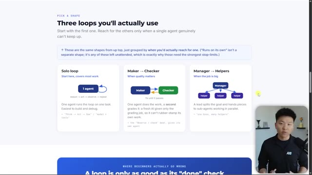
*⏱️ 00:06:10 — Une infographie présentant trois types de boucles pour agents IA : "Solo loop", "Maker -> Checker" et "Manager -> Helpers".*

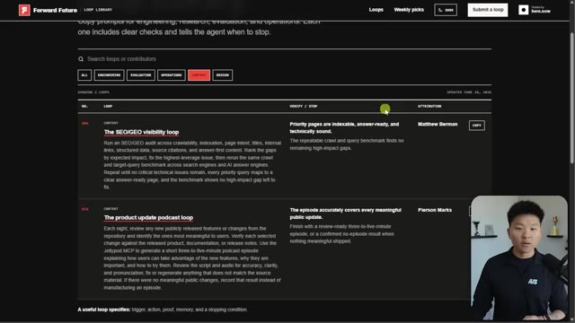
*⏱️ 00:06:16 — Une interface web sombre nommée "Loop Library" listant des exemples de workflows d'agents IA, notamment "The SEO/GEO visibility loop" et "The product update podcast loop".*

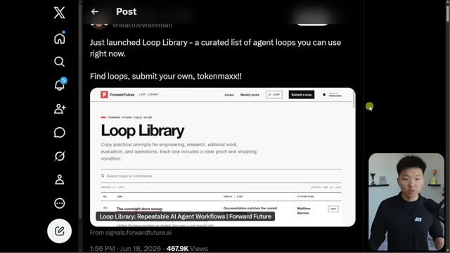
*⏱️ 00:06:21 — Une capture d'écran d'un post sur la plateforme X (Twitter) présentant le lancement de la "Loop Library" sur le site signals.forwardfuture.ai.*

---

### ⏱️ `[00:06:26 - 00:06:45]` | Segment #18

**🔊 Audio (Transcription Intégrale Mot pour Mot en Français) :**
> Et j'en ai pris deux pour ces deux premières démos. C'était donc la toute première ici. C'était une invite de commande slash goal dans Cloud Code pour me fabriquer une vignette. Je lui ai donc dit en gros quoi utiliser pour les fabriquer. Il est écrit de fabriquer 10 concepts de vignettes et de noter chacun d'eux par rapport aux vignettes YouTube de Mr. Beast en utilisant une grille d'évaluation, la clarté en petit format, la curiosité, l'attrait émotionnel, le contraste visuel, des trucs comme ça.

**👁️ Analyse Visuelle d'Écran (gemini-3.5-flash-lite) :**
**Interface & Outils** : Visual Studio Code

**Contenu textuel & Code** : Un fichier Markdown nommé "loop-prompts.md" contenant des instructions et des commandes commençant par "/goal".

**Action / Démonstration** : Le présentateur explique et commente le contenu d'un prompt affiché à l'écran concernant la création de vignettes de vidéos.

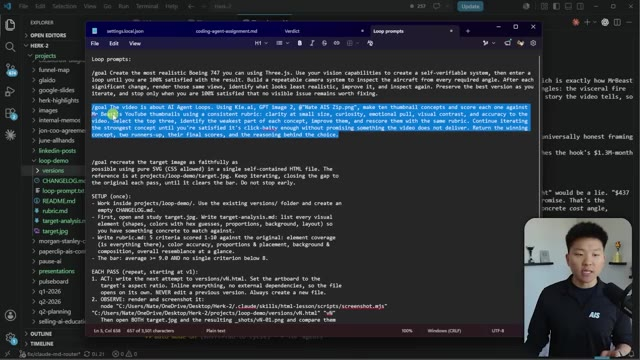
*⏱️ 00:06:31 — Un éditeur de code affichant un fichier de prompts en cours de lecture, avec le présentateur visible en incrustation à droite.*

---

### ⏱️ `[00:06:45 - 00:07:08]` | Segment #19

**🔊 Audio (Transcription Intégrale Mot pour Mot en Français) :**
> Et après qu'il en a fait ces 10, il sélectionne les trois meilleurs. Il identifie la partie la plus faible de chaque concept. Il les améliore, les réévalue. Et puis il continue à itérer sur le concept le plus fort jusqu'à ce qu'il soit satisfait. Donc c'est l'un des problèmes avec ce prompt ici, c'est que la définition du travail accompli était jusqu'à ce que vous soyez satisfait. Et parfois vous devez avoir ce genre de critères de notation subjectifs, mais vous voulez que ce soit aussi objectif que possible.

**👁️ Analyse Visuelle d'Écran (gemini-3.5-flash-lite) :**
**Interface & Outils** : Visual Studio Code (VS Code)

**Contenu textuel & Code** : Fichiers Markdown contenant des prompts de boucles itératives pour agents IA et des tableaux de notation (clarity, curiosity, emotion, contrast, accuracy).

**Action / Démonstration** : Navigation et explication des prompts et des résultats d'évaluation de concepts par l'agent IA dans l'éditeur.

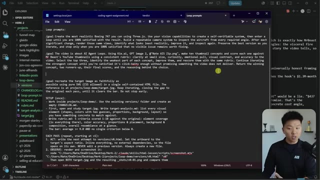
*⏱️ 00:06:51 — Vue de l'éditeur de code VS Code montrant des prompts textuels pour des agents IA avec des instructions de boucles d'itération.*

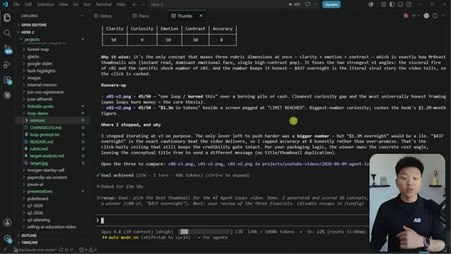
*⏱️ 00:06:57 — Éditeur de code VS Code affichant les résultats d'évaluation de vignettes et des scores de métriques dans un document markdown.*

---

### ⏱️ `[00:07:09 - 00:07:27]` | Segment #20

**🔊 Audio (Transcription Intégrale Mot pour Mot en Français) :**
> Les meilleures boucles d'agents sont celles où vous dites littéralement : continuez à itérer jusqu'à ce que la métrique x soit égale au résultat y. Mais vous pouvez voir ici même ce qu'il a fait, c'est qu'il en a créé 10. Nous avons le numéro un, nous avons le numéro deux, le numéro trois, le numéro quatre, le numéro cinq. Il a fini par choisir que le numéro un était l'un des principaux concurrents, le numéro deux, et le numéro huit aussi. Alors ensuite, il a itéré sur ceux-ci.

**👁️ Analyse Visuelle d'Écran (gemini-3.5-flash-lite) :**
**Interface & Outils** : Éditeur de code (VS Code avec intégration de terminal d'agent) et webcam du présentateur en incrustation.

**Contenu textuel & Code** : Fichiers de projet sous `projects/youtube-videos/2026-06-09-agent-loops/thumbnails/` montrant des variantes (c01-v2.png, c02-13m-bill.png, etc.), tableaux d'évaluation et texte markdown.

**Action / Démonstration** : Navigation dans l'explorateur de fichiers de l'éditeur pour afficher les différentes versions de vignettes générées par l'agent IA.

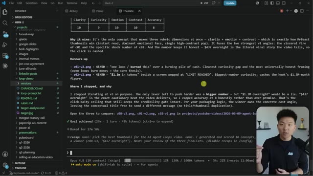
*⏱️ 00:07:13 — Éditeur de code (VS Code) affichant un récapitulatif textuel avec des métriques d'évaluation de vignettes YouTube et le présentateur en médaillon.*

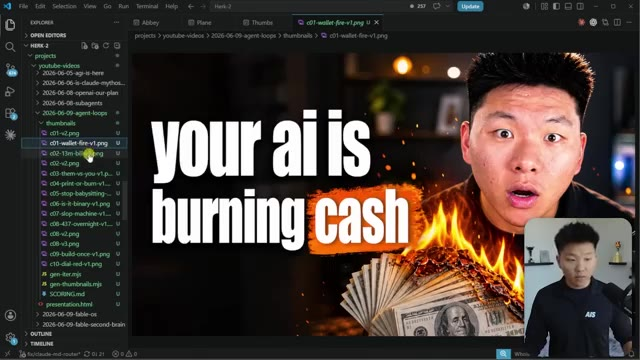
*⏱️ 00:07:18 — Éditeur de code (VS Code) affichant l'aperçu d'une vignette YouTube générée (« your ai is burning cash ») avec le panneau de fichiers listant plusieurs versions.*

---

### ⏱️ `[00:07:27 - 00:08:00]` | Segment #21

**🔊 Audio (Transcription Intégrale Mot pour Mot en Français) :**
> Vous pouvez voir ici, c'est le numéro un original. Voici le numéro un v2. Voici le numéro deux original. Voici le numéro deux v2, et voici le numéro huit original, et voici le numéro huit v2. Et ce qu'il a fait, c'est qu'après ces versions deux de l'ensemble, il a dit, d'accord, le numéro huit est le meilleur. Donc voici le numéro huit v3. Et c'est donc la miniature finale que nous avons obtenue après avoir exécuté cet objectif, ce qui a pris à Claude Code 27 minutes sur le coup. C'est donc un rapide exemple de la boucle. Vous pouvez voir qu'il notait chacune d'entre elles, et c'est ainsi qu'il a désigné le gagnant. Mais la seule chose ici, c'est que ces notes étaient subjectives. Donc, si nous voulions améliorer ce flux, nous essaierions de comprendre comment rendre cette notation plus objective ?

**👁️ Analyse Visuelle d'Écran (gemini-3.5-flash-lite) :**
**Interface & Outils** : Éditeur de code VS Code avec l'explorateur de fichiers et la fenêtre d'aperçu d'image / document Markdown.

**Contenu textuel & Code** : Arborescence de projets de vidéos YouTube, liste de fichiers de miniatures (c01 à c10), tableau de scores, et texte markdown expliquant les choix de miniatures.

**Action / Démonstration** : Navigation et présentation des différentes versions de miniatures générées par l'intelligence artificielle pour la vidéo.

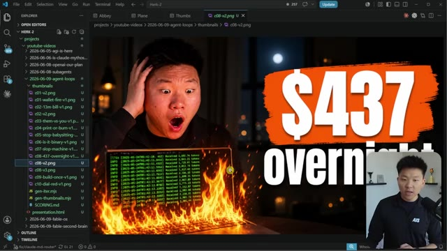
*⏱️ 00:07:35 — Vue de l'éditeur VS Code montrant un fichier image miniature sélectionné dans l'explorateur de projets à gauche, et l'aperçu de la miniature « c08-v2.png » au centre avec une incrustation vidéo du présentateur en bas à droite.*

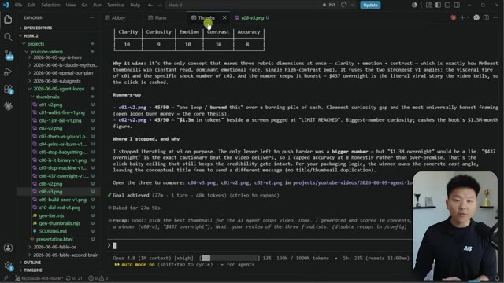
*⏱️ 00:07:43 — Vue de l'éditeur VS Code montrant un document Markdown d'évaluation et de scoring des miniatures avec des critères détaillés et le résumé de la génération par l'agent.*

---

### ⏱️ `[00:08:00 - 00:08:21]` | Segment #22

**🔊 Audio (Transcription Intégrale Mot pour Mot en Français) :**
> Et peut-être que ce qu'on voudrait faire, c'est créer un sous-agent distinct qui serait un évaluateur dédié, et on donnerait des instructions à cet agent d'évaluation et on ferait passer ça par toute une série d'évaluations pour qu'on puisse se sentir plus confiant quant à sa capacité de notation. Bref, jetons un œil au suivant. Donc le suivant était une autre commande slash goal. Comme vous pouvez le voir juste ici, celui-ci a pris 37 minutes. Et la consigne pour celui-ci était juste là, tout droit sortie de la bibliothèque de boucles de Matthew Berman.

**👁️ Analyse Visuelle d'Écran (gemini-3.5-flash-lite) :**
**Interface & Outils** : VS Code (Visual Studio Code)

**Contenu textuel & Code** : Fichier Markdown montrant un processus de génération de miniatures avec des scores sous forme de tableau (Clarity: 10, Curiosity: 9, Emotion: 10, Contrast: 10, Accuracy: 8) et une arborescence de fichiers sur le côté gauche.

**Action / Démonstration** : Consultation des résultats d'évaluation et des fichiers de projet dans l'explorateur de code.

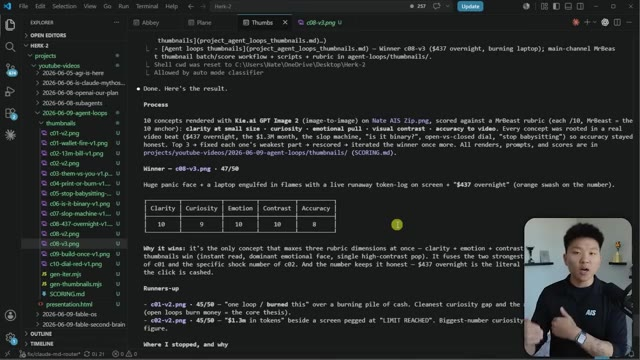
*⏱️ 00:08:06 — Un éditeur de code affichant un fichier Markdown avec des résultats d'évaluation de miniatures et un tableau de notation, ainsi que la webcam du présentateur en bas à droite.*

---

### ⏱️ `[00:08:21 - 00:08:42]` | Segment #23

**🔊 Audio (Transcription Intégrale Mot pour Mot en Français) :**
> Je ne vais pas lire tout ça. Vous pouvez mettre sur pause juste là si vous voulez voir. Mais c'était censé fabriquer un avion en utilisant Three.js. Donc je vais ouvrir ça juste ici. On peut voir que c'est l'avion qui tourne qu'il a fabriqué. On peut zoomer un peu, on peut le bouger. Et c'est ce qu'on a obtenu. Maintenant, d'un point de vue de mise en boucle, ce qu'il devait faire, c'est qu'il devait le construire puis vérifier, ouvrir le navigateur, le faire tourner, voir si ça fonctionne, voir si le rendu est correct.

**👁️ Analyse Visuelle d'Écran (gemini-3.5-flash-lite) :**
**Interface & Outils** : VS Code (éditeur de code avec onglet de navigateur intégré)

**Contenu textuel & Code** : URL locale http://127.0.0.1:8747/ affichant une application 3D Three.js d'un avion

**Action / Démonstration** : Navigation et affichage du modèle 3D d'un avion interactif tournant dans l'éditeur

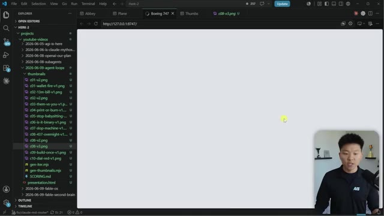
*⏱️ 00:08:27 — Vue d'un éditeur VS Code affichant un navigateur interne sur une page web vide avec l'URL http://127.0.0.1:8747/*

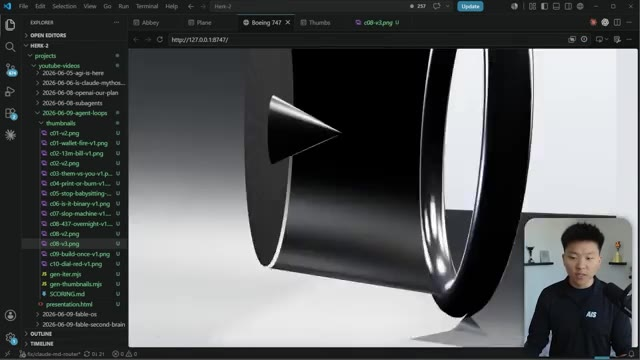
*⏱️ 00:08:32 — Gros plan dans l'éditeur montrant un rendu 3D d'un réacteur d'avion en gros plan généré via Three.js*

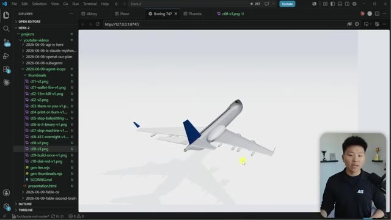
*⏱️ 00:08:37 — Vue d'ensemble dans l'éditeur montrant un modèle 3D complet d'un avion (Boeing 747) en rotation dans le navigateur intégré*

---

### ⏱️ `[00:08:43 - 00:09:02]` | Segment #24

**🔊 Audio (Transcription Intégrale Mot pour Mot en Français) :**
> Et ensuite, ça a continué à itérer jusqu'à ce qu'on obtienne enfin cette version. Et comme vous pouvez le voir, c'est toujours pas parfait. Il y a des choses qu'on veut changer. Je crois que c'était censé être transparent comme ça. Pour qu'on puisse vraiment aller regarder à l'intérieur. Mais c'est tellement mieux que ça ne l'aurait été si je ne lui avais pas donné cet objectif avec les critères, et que j'avais juste dit : « construis-moi un plan 3D avec, tu sais, Three.js ». C'est donc l'un des principaux enseignements ici.

**👁️ Analyse Visuelle d'Écran (gemini-3.5-flash-lite) :**
**Interface & Outils** : VS Code (éditeur de code avec explorateur de fichiers et prévisualisation web) et caméra du présentateur.

**Contenu textuel & Code** : URL locale (http://127.0.0.1:8747/) affichant le rendu 3D d'un avion, et l'arborescence des fichiers du projet dans l'explorateur à gauche.

**Action / Démonstration** : Présentation de la version actuelle du modèle 3D généré par l'application pour en discuter les défauts d'affichage et les modifications à apporter.

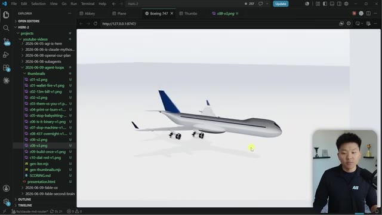
*⏱️ 00:08:47 — Capture d'écran montrant l'éditeur VS Code avec un navigateur web intégré affichant un modèle 3D d'un avion (Boeing 747) et le présentateur en bas à droite.*

---

### ⏱️ `[00:09:02 - 00:09:23]` | Segment #25

**🔊 Audio (Transcription Intégrale Mot pour Mot en Français) :**
> Les boucles d'agents et les objectifs ne sont pas censés vous donner un résultat parfait à 100 %. Ils sont censés vous aider à vous en approcher beaucoup plus dès le premier essai. Et voici un autre excellent exemple de cela avec toute cette histoire de subjectivité. Voici le dernier que j'ai fait, qui est un prompt que j'ai fait fabriquer par Claude Code, un objectif oblique. Il examinait cette célèbre photo des Beatles, Abbey Road. Et ensuite, ce que je lui ai dit de faire, c'est de recréer ceci sans utiliser la génération d'images.

**👁️ Analyse Visuelle d'Écran (gemini-3.5-flash-lite) :**
**Interface & Outils** : VS Code (Visual Studio Code)

**Contenu textuel & Code** : Fichier Markdown de configuration de l'agent (instructions de boucle, critères de scoring, setup de génération d'images), arborescence de fichiers de projet, et visualisation d'actifs graphiques (modèle 3D, photo).

**Action / Démonstration** : Présentation du workflow itératif de l'agent IA, montrant la définition des objectifs, la comparaison avec l'image source et le résultat généré.

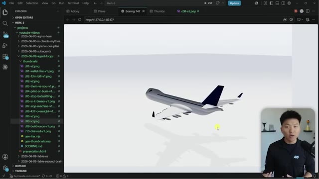
*⏱️ 00:09:07 — Visualisation dans VS Code du résultat rendu d'un agent IA : un modèle 3D d'avion (Boeing 747) affiché via un serveur local.*

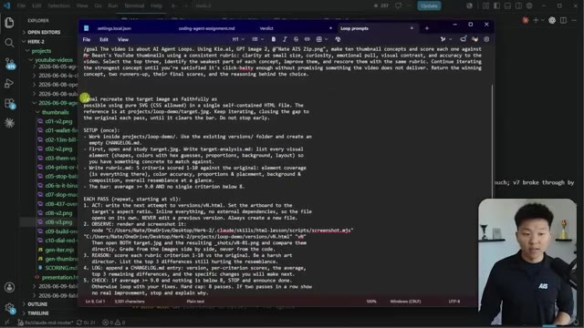
*⏱️ 00:09:12 — Éditeur VS Code affichant le fichier "coding-agent-assignment.md" détaillant le prompt système pour la boucle d'agent et les critères de réussite.*

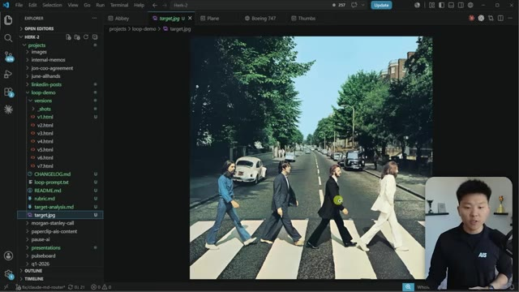
*⏱️ 00:09:17 — Visualisation dans VS Code de l'image source "target.jpg" (couverture emblématique des Beatles sur Abbey Road) utilisée comme référence pour la reproduction par l'agent.*

---

### ⏱️ `[00:09:23 - 00:09:44]` | Segment #26

**🔊 Audio (Transcription Intégrale Mot pour Mot en Français) :**
> Donc, en recréant simplement ceci en utilisant du HTML ou du CSS ou tout ce qu'il veut faire. Et puis il passe par là et il crée, tu sais, la version un, la version deux, la version trois, et il a fini par s'arrêter après la version sept. Tu peux voir que le prompt ici indique, si la moyenne est supérieure à neuf ou égale à neuf, alors arrête, et c'est là que tu termines. L'autre chose qu'il a dite, c'est une limite stricte de huit passes. Il approchait donc de cette limite de toute façon, mais ces images ne sont pas très bonnes.

**👁️ Analyse Visuelle d'Écran (gemini-3.5-flash-lite) :**
**Interface & Outils** : VS Code (Visual Studio Code)

**Contenu textuel & Code** : Code source HTML/SVG dans l'image 1. Instructions de prompt détaillant les étapes (ACT, OBSERVE, REASON, LOG, CHECK) dans l'image 2.

**Action / Démonstration** : Navigation dans les fichiers du projet (v1-v7) et lecture des instructions de la boucle de développement itératif de l'agent.

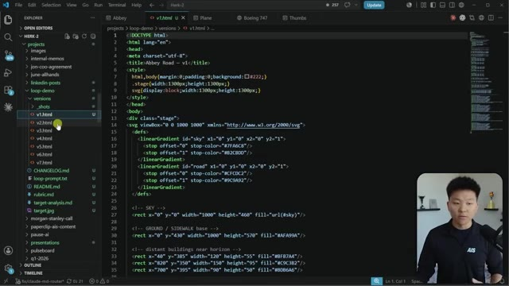
*⏱️ 00:09:28 — L'éditeur VS Code affichant le contenu du fichier v1.html, structuré avec du HTML et des balises SVG. La barre latérale montre une liste de fichiers versionnés (v1 à v7).*

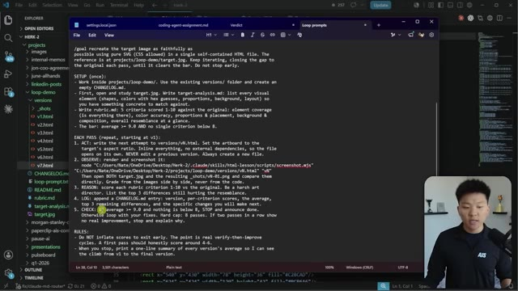
*⏱️ 00:09:33 — L'éditeur VS Code affichant un fichier de prompts ("loop-prompts.txt") détaillant une méthodologie itérative pour qu'un agent IA recrée une image cible en utilisant SVG.*

---

### ⏱️ `[00:09:44 - 00:10:03]` | Segment #27

**🔊 Audio (Transcription Intégrale Mot pour Mot en Français) :**
> Ce que nous pouvons voir cependant, c'est qu'il a effectué sa vérification. Donc, chaque fois qu'il a parcouru et créé le HTML, il a dû réellement le mettre dans un navigateur, puis il en prenait une capture d'écran. Vous pouvez voir, voici la capture d'écran pour le numéro un, voici la version deux, voici la version trois, voici la version quatre. Nous pouvons donc le voir en temps réel, s'améliorer de plus en plus avec chaque version, avec chaque itération. Mais quand même, c'est celle-ci qu'il m'a donnée à la fin.

**👁️ Analyse Visuelle d'Écran (gemini-3.5-flash-lite) :**
**Interface & Outils** : VS Code (Visual Studio Code)

**Contenu textuel & Code** : Code source HTML/SVG dans l'image 1 (définitions de gradients, coordonnées de rectangles, attributs de formes) ; structure de fichiers dans l'explorateur latéral.

**Action / Démonstration** : Navigation dans l'arborescence du projet pour basculer entre le code source (HTML) et ses captures d'écran (PNG) afin de vérifier les itérations de génération de l'agent.

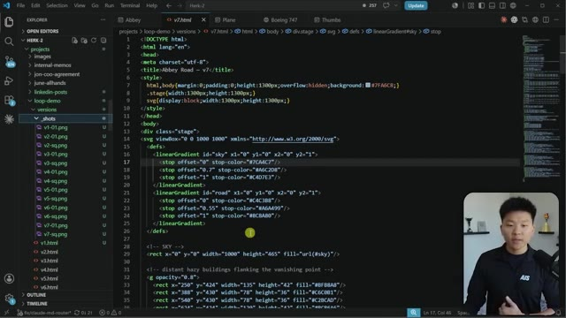
*⏱️ 00:09:49 — L'éditeur VS Code affiche le fichier "v7.html" contenant le code source SVG généré pour une scène graphique ("Abbey Road").*

*⏱️ 00:09:54 — L'éditeur VS Code affiche le fichier image "v2-sq.png" issu du dossier "_shots", montrant le rendu visuel correspondant à la version 2.*

---

### ⏱️ `[00:10:03 - 00:10:25]` | Segment #28

**🔊 Audio (Transcription Intégrale Mot pour Mot en Français) :**
> Et évidemment, ça ne ressemble absolument pas à l'image. On a la voiture ici, on a les arbres, on a la route, on a du jaune, du noir, du gris, du bleu clair, exactement comme sur l'image réelle si je reviens ici. Est-ce que j'ai dit jaune ? Je voulais dire blanc. Blanc, noir, gris foncé, bleu clair. Et donc évidemment, ça n'a rien à voir. Si on avait fait ça avec de la génération d'images, ça aurait probablement pu être beaucoup plus proche, mais je voulais juste essayer de voir comment ça fonctionnerait avec du code pur.

**👁️ Analyse Visuelle d'Écran (gemini-3.5-flash-lite) :**
**Interface & Outils** : VS Code (éditeur de code source)

**Contenu textuel & Code** : Explorateur de fichiers du projet montrant les versions d'images générées et l'image cible (target.jpg).

**Action / Démonstration** : Comparaison visuelle entre le résultat généré et l'image réelle de référence dans l'éditeur.

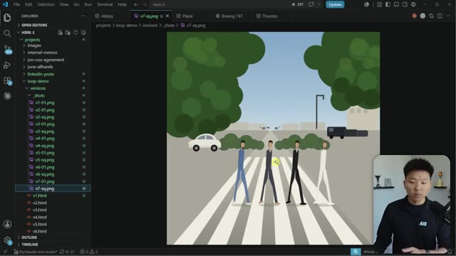
*⏱️ 00:10:09 — Vue de l'éditeur VS Code affichant un rendu graphique généré représentant la traversée d'un passage piéton par quatre personnages.*

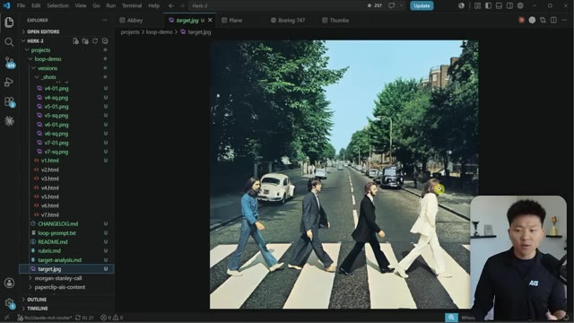
*⏱️ 00:10:14 — Vue de VS Code affichant l'image originale de référence (la pochette d'Abbey Road des Beatles) avec le panneau des fichiers du projet dans la colonne de gauche.*

---

### ⏱️ `[00:10:25 - 00:10:46]` | Segment #29

**🔊 Audio (Transcription Intégrale Mot pour Mot en Français) :**
> L'essentiel, c'est que cela disposait des contrôles de vérification. Cela avait la capacité de prendre des captures d'écran et d'examiner chacune de ses itérations, de comprendre pourquoi cela ne ressemblait toujours pas à l'image de référence et quels changements nous devons apporter à chaque fois. Et c'est pourquoi une boucle n'est bonne que dans la mesure où son contrôle est bien fait, selon les critères de réussite. Il y a donc deux choses auxquelles vous devez penser avant de construire votre première boucle ou vos objectifs.

**👁️ Analyse Visuelle d'Écran (gemini-3.5-flash-lite) :**
**Interface & Outils** : VS Code et navigateur web d'une application de formation ou de présentation.

**Contenu textuel & Code** : Arborescence de fichiers de versions (`v1-01.png`, `v3-sq.png`, etc.) et texte explicatif sur la définition de la tâche terminée.

**Action / Démonstration** : Navigation dans l'explorateur de fichiers pour montrer l'historique des itérations d'images générées.

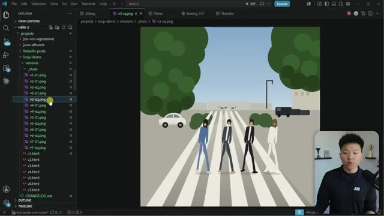
*⏱️ 00:10:30 — Éditeur de code affichant l'explorateur de fichiers avec différentes versions d'images générées (style Abbey Road) et le présentateur en médaillon.*

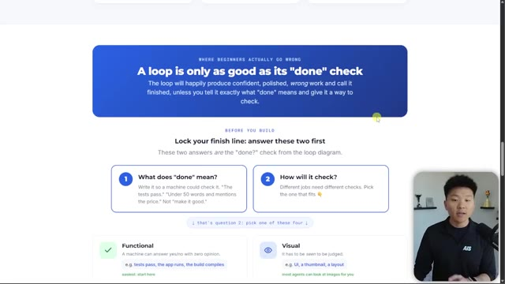
*⏱️ 00:10:41 — Interface web présentant des explications sur les critères de validation (« A loop is only as good as its 'done' check ») avec le présentateur en médaillon.*

---

### ⏱️ `[00:10:46 - 00:11:06]` | Segment #30

**🔊 Audio (Transcription Intégrale Mot pour Mot en Français) :**
> Qu'est-ce que « terminé » veut dire ? Et puis, comment va-t-il vérifier ? Parce que disons que vous construisez un vrai jeu, un jeu que vous pouvez ouvrir sur votre PC et auquel vous pouvez jouer. Il devrait vérifier cela de bien des manières. Il devrait vérifier visuellement. Il devrait vérifier fonctionnellement et il devrait jouer les niveaux et voir si quelque chose plante. Si vous écrivez une sorte de script, comment est-ce qu'il vérifie ? Il n'a pas besoin de vérifier visuellement. Il a juste besoin de vérifier le déroulement.

**👁️ Analyse Visuelle d'Écran (gemini-3.5-flash-lite) :**
**Interface & Outils** : Navigateur web présentant une interface de framework ou de méthodologie de développement avec IA.

**Contenu textuel & Code** : Texte structuré sur la définition des objectifs et des méthodes de vérification pour les agents IA ('Functional', 'Visual', 'Judgment', 'You decide').

**Action / Démonstration** : Le présentateur explique les concepts de définition de la fin de tâche et les méthodes de vérification par l'IA en pointant l'écran.

*⏱️ 00:10:51 — Capture d'écran montrant une page web avec le titre 'Before you build' et deux questions principales : 'What does done mean?' et 'How will it check?', accompagnées de quatre méthodes de vérification (Functional, Visual, Judgment, You decide). Le présentateur apparaît dans une incrustation vidéo en bas à droite.*

---

### ⏱️ `[00:11:06 - 00:11:24]` | Segment #31

**🔊 Audio (Transcription Intégrale Mot pour Mot en Français) :**
> Il doit vérifier que cela correspond à votre ton de voix. Il doit effectuer des vérifications d'autres manières. Donc, selon ce que vous construisez, les contrôles de vérification sont évidemment différents et c'est votre travail de vous assurer que vos agents disposent des bons outils pour effectuer ces contrôles. Et puis bien sûr, de l'autre côté, que signifie « terminé » ? Comme je l'ai mentionné plus tôt, si vous pouvez être aussi objectif que possible avec une métrique spécifique, c'est alors le mieux.

**👁️ Analyse Visuelle d'Écran (gemini-3.5-flash-lite) :**
**Interface & Outils** : Interface web de présentation / documentation méthodologique avec encadré vidéo du présentateur en bas à droite.

**Contenu textuel & Code** : Texte structuré : "Lock your finish line: answer these two first", "1. What does 'done' mean?", "2. How will it check?" avec quatre options de vérification : Functional, Visual, Judgment, You decide.

**Action / Démonstration** : Le présentateur explique les différentes méthodes de vérification et de contrôle que les agents IA doivent utiliser pour s'assurer qu'une tâche est correctement exécutée.

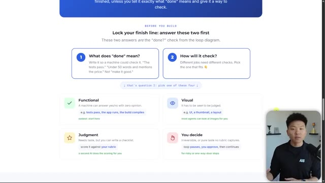
*⏱️ 00:11:10 — Capture d'écran montrant une page web structurée avec des questions clés pour définir la fin d'une tâche d'agent IA, ainsi que quatre types de vérifications (fonctionnelle, visuelle, jugement et décision humaine).*

---

### ⏱️ `[00:11:24 - 00:11:44]` | Segment #32

**🔊 Audio (Transcription Intégrale Mot pour Mot en Français) :**
> Mais parfois vous ne le pouvez pas. Parfois vous devez dire jusqu'à ce que vous soyez à 100 % confiant, n'est-ce pas ? Et donc, disons que mon utilisation la plus courante de ces boucles est quand j'utilise Hyperframes et Cloud Code pour monter des vidéos, parce que je vais essentiellement l'y balancer, faire un slash goal, et ça fait tout pour moi. Ça doit obtenir la transcription, couper les erreurs et les pauses. Ça doit faire les beats. Ça doit synchroniser les beats. Ça doit évidemment les rendre.

**👁️ Analyse Visuelle d'Écran (gemini-3.5-flash-lite) :**
**Interface & Outils** : Interface web de documentation ou d'outil de workflow.

**Contenu textuel & Code** : Texte explicatif : "Lock your finish line: answer these two first", question 1 ("What does 'done' mean?") et question 2 ("How will it check?") avec quatre types de vérification (Functional, Visual, Judgment, You decide).

**Action / Démonstration** : Le présentateur explique les critères de validation et les méthodes pour s'assurer qu'une tâche est correctement accomplie par l'IA avant de continuer.

*⏱️ 00:11:29 — Une page web présentant un guide méthodologique avec des encadrés interactifs sur la définition de la fin d'un projet, incluant quatre options de validation (Functional, Visual, Judgment, You decide), avec le présentateur visible en incrustation dans le coin inférieur droit.*

---

### ⏱️ `[00:11:44 - 00:12:20]` | Segment #33

**🔊 Audio (Transcription Intégrale Mot pour Mot en Français) :**
> Et ensuite, il intègre énormément de vérifications pour s'assurer que tous les segments sont bien reçus et qu'ils correspondent correctement à la transcription. Et c'est ainsi que vous pouvez voir beaucoup de ces personnes dire, d'accord, j'ai fait cela en une seule tentative, avec une seule consigne, parce que c'était une boucle, parce qu'il y avait une vérification et une réitération. Alors, qu'est-ce qui fait qu'une boucle fonctionne réellement ? Un objectif vérifiable, un arrêt net, de bons outils, de la mémoire, un vérificateur distinct, une planification préalable, la journalisation, et enfin, faire en sorte que cela ait du sens par rapport au coût. Parce que, bien souvent, ces boucles peuvent tourner pendant longtemps. Et surtout si vous avez un objectif assez strict, un objectif qui pourrait nécessiter beaucoup de réitérations. Et puis, si le critère de fin est

**👁️ Analyse Visuelle d'Écran (gemini-3.5-flash-lite) :**
**Interface & Outils** : Interface web de présentation / documentation pédagogique sur les agents IA.

**Contenu textuel & Code** : Texte décrivant les critères de validation, les mécanismes d'arrêt et les bonnes pratiques pour configurer des boucles d'agents autonomes.
[DESC_IMAGE_1] [DESC_IMAGE_2]

**Action / Démonstration** : Le présentateur commente les différentes règles et vérifications intégrées pour s'assurer qu'un agent accomplit sa tâche correctement du premier coup.

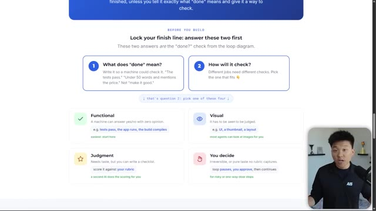
*⏱️ 00:11:53 — Interface web montrant les questions à se poser avant de construire un agent, notamment 'What does 'done' mean?' et les 4 types de vérifications (Functional, Visual, Judgment, You decide).*

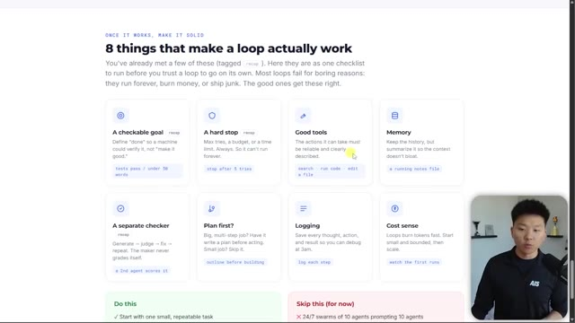
*⏱️ 00:12:02 — Interface web listant les 8 critères indispensables pour qu'une boucle d'agent fonctionne correctement (A checkable goal, A hard stop, Good tools, Memory, A separate checker, Plan first?, Logging, Cost sense).*

---

### ⏱️ `[00:12:20 - 00:12:41]` | Segment #34

**🔊 Audio (Transcription Intégrale Mot pour Mot en Français) :**
> aussi très difficile où peut-être que ça ne peut tout simplement jamais l'atteindre, alors cette chose va tourner pendant très longtemps. J'ai donc eu quelques boucles qui ont duré plus de 12 heures, et elles ne sont tout simplement pas super utiles pour moi. La plupart du temps, lorsque je fais tourner des boucles qui durent un certain temps, c'est généralement plutôt du genre de celles-ci. Ce sont généralement des choses qui prennent environ 35 minutes ou peut-être quelques heures, mais je n'ai pas besoin d'une boucle qui va tourner pendant quatre jours d'affilée. Je n'ai tout simplement pas vraiment besoin de ça.

**👁️ Analyse Visuelle d'Écran (gemini-3.5-flash-lite) :**
**Interface & Outils** : Interface web (Image 1), VS Code (Image 2)

**Contenu textuel & Code** : Checklist de bonnes pratiques pour agents IA (A checkable goal, A hard stop, Good tools, Memory, etc.) sur l'image 1 ; code Markdown, structure de fichiers de versions de projets et logs d'exécution sur l'image 2.

**Action / Démonstration** : Présentation de la méthodologie de conception de boucles d'agents IA robustes et démonstration des résultats d'itération dans l'éditeur.

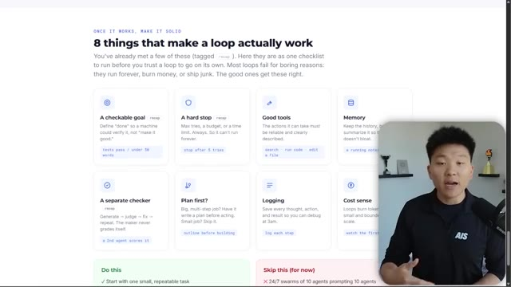
*⏱️ 00:12:25 — Interface web listant une liste de 8 critères pour faire fonctionner une boucle d'agents IA (checklist '8 things that make a loop actually work'), avec le présentateur incrusté en bas à droite.*

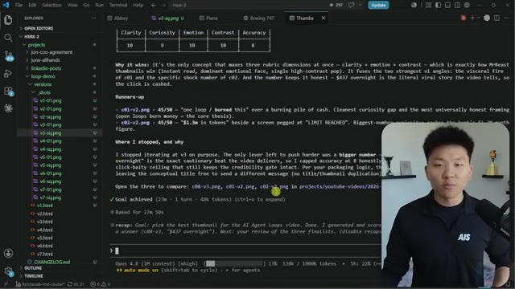
*⏱️ 00:12:36 — Interface de l'éditeur de code VS Code affichant des notes Markdown de projet, l'arborescence des fichiers sur la gauche et le terminal intégré d'un assistant IA en bas.*

---

### ⏱️ `[00:12:41 - 00:12:59]` | Segment #35

**🔊 Audio (Transcription Intégrale Mot pour Mot en Français) :**
> Un autre genre de message que j'essaie de faire passer ici, c'est que ce n'est pas parce que vous voyez quelqu'un comme Peter Steinberger dire quelque chose comme ça que cela s'applique directement à vous et à votre cas d'usage, parce que c'est un programmateur invétéré. Il construit des agents. Il travaille chez OpenAI. Cela a probablement beaucoup de sens pour la façon dont il travaille et cela a probablement décuplé sa productivité.

**👁️ Analyse Visuelle d'Écran (gemini-3.5-flash-lite) :**
**Interface & Outils** : Interface du réseau social X (anciennement Twitter) affichée en grand format sur l'écran principal.

**Contenu textuel & Code** : Le tweet de Peter Steinberger (@steipete) : "Here's your monthly reminder that you shouldn't be prompting coding agents anymore. You should be designing loops that prompt your agents." et un commentaire de Gautham Pai en dessous.

**Action / Démonstration** : Présentation et lecture à l'écran d'une publication sur les réseaux sociaux pour illustrer le propos sur les agents de programmation.

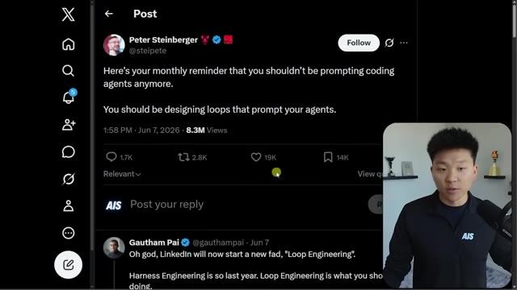
*⏱️ 00:12:46 — Capture d'écran montrant un tweet de Peter Steinberger affiché à l'écran, avec le présentateur en incrustation (PiP) dans le coin inférieur droit.*

---

### ⏱️ `[00:13:00 - 00:13:18]` | Segment #36

**🔊 Audio (Transcription Intégrale Mot pour Mot en Français) :**
> Et c'est ça qui est génial avec l'IA, c'est que comme elle va s'immiscer dans tous les secteurs et tous les rôles, tout le monde ne l'utilisera pas de la même façon. C'est donc une bonne chose de se tenir au courant de ce que disent des gens comme Peter Steinberger, mais ça ne veut pas dire que vous devez tout laisser tomber en ce moment pour aller l'essayer. Ou peut-être que c'est bien de l'essayer, mais ça ne veut pas dire que vous devez l'intégrer pleinement dans toutes vos sessions Cloud Code pour toujours.

**👁️ Analyse Visuelle d'Écran (gemini-3.5-flash-lite) :**
**Interface & Outils** : Navigateur web / Application X (Twitter)

**Contenu textuel & Code** : Tweet de Peter Steinberger (@steipete) : "Here's your monthly reminder that you shouldn't be prompting coding agents anymore. You should be designing loops that prompt your agents."

**Action / Démonstration** : Affichage et lecture d'une publication sur les réseaux sociaux pour illustrer le propos sur l'évolution de l'utilisation des agents IA.

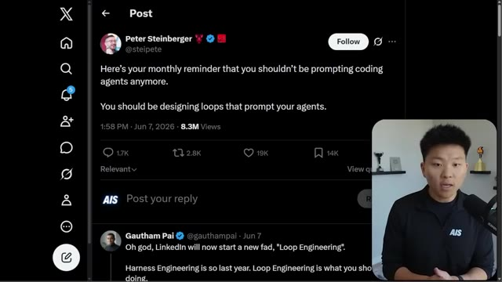
*⏱️ 00:13:04 — Capture d'écran montrant un tweet de Peter Steinberger sur la plateforme X (anciennement Twitter) affiché à l'écran tandis que le présentateur apparaît en médaillon dans le coin inférieur droit.*

---

### ⏱️ `[00:13:18 - 00:13:36]` | Segment #37

**🔊 Audio (Transcription Intégrale Mot pour Mot en Français) :**
> Donc de toute façon, venant d'un milieu sans code, venant de la perspective de quelqu'un qui utilise du code cloud tout le temps, 24 heures sur 24, 7 jours sur 7, mais je l'utilise pour du travail de réflexion plutôt que pour des bases de données massives, des refactorisations basées sur du code et la création de logiciels et la création d'applications chaque jour. C'est un peu ce que je ressens à propos de ces boucles d'agents.

**👁️ Analyse Visuelle d'Écran (gemini-3.5-flash-lite) :**
**Interface & Outils** : Navigateur web présentant une page explicative sur les boucles d'agents IA, avec la webcam du présentateur incrustée.

**Contenu textuel & Code** : Texte explicatif sur les boucles d'agents ('Agent loops, made simple', 'An agent loop is just an AI that reasons what to do, acts, and observes...') et le présentateur en incrustation.

**Action / Démonstration** : Le présentateur présente visuellement un guide ou une page web explicative sur les boucles d'agents.

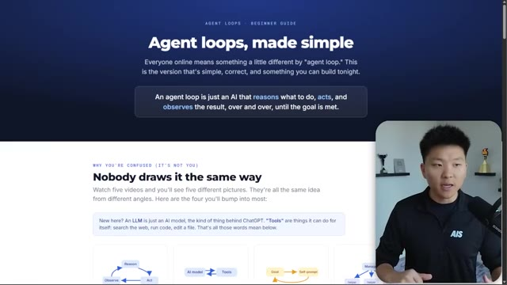
*⏱️ 00:13:23 — Une page web intitulée 'Agent loops, made simple' avec le présentateur visible en médaillon dans le coin inférieur droit.*

---

### ⏱️ `[00:13:36 - 00:13:56]` | Segment #38

**🔊 Audio (Transcription Intégrale Mot pour Mot en Français) :**
> Et j'ai vu énormément de choses à leur sujet ces derniers temps. J'ai donc eu l'impression que je devais venir ici et simplement partager mon avis là-dessus. Certains d'entre vous ne seront peut-être pas d'accord avec ça, mais c'est de cette façon que je les ai utilisés, parce que je les utilise. Je ne me lance tout simplement pas dans ces exécutions sophistiquées qui durent du genre trois jours d'affilée. La plupart du temps, si j'ai un grand objectif, je lance une belle boucle conséquente avant d'aller me coucher et je peux me réveiller avec quelque chose qui a fonctionné pendant peut-être quatre, peut-être huit heures.

**👁️ Analyse Visuelle d'Écran (gemini-3.5-flash-lite) :**
**Interface & Outils** : Navigateur web présentant un guide pour débutants sur les boucles d'agents IA ("Agent loops - beginner guide").

**Contenu textuel & Code** : Texte explicatif : "Agent loops, made simple. Everyone online means something a little different by 'agent loop'..." et un encadré définissant : "An agent loop is just an AI that reasons what to do, acts, and observes the result, over and over, until the goal is met."

**Action / Démonstration** : Le présentateur commente le contenu de la page web affichée à l'écran concernant les boucles d'agents IA.

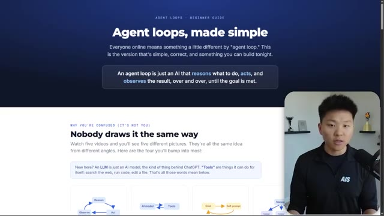
*⏱️ 00:13:41 — Capture d'écran montrant le présentateur dans un encadré en bas à droite, superposé à une page web explicative intitulée "Agent loops, made simple".*

---

### ⏱️ `[00:13:56 - 00:14:15]` | Segment #39

**🔊 Audio (Transcription Intégrale Mot pour Mot en Français) :**
> Et c'est vraiment très bénéfique, mais une grande partie de tout ça est plus expérimentale pour moi. Et ensuite, je peux prendre ce résultat que j'ai obtenu de l'exécution nocturne, puis le réinjecter dans d'autres boucles ou itérer dessus moi-même en tant qu'humain. Il y a donc un peu plus de détails qui ont été abordés dans cette présentation ainsi que dans cet audit complet, qui est beaucoup plus verbeux et super moche à regarder. Mais je vais joindre ces deux sources dans ma communauté FreeSchool.

**👁️ Analyse Visuelle d'Écran (gemini-3.5-flash-lite) :**
**Interface & Outils** : Navigateur web affichant un article ou un guide éducatif en ligne.

**Contenu textuel & Code** : Texte explicatif sur les boucles d'agents IA ("reasons what to do, acts, and observes the result") et classification en onze catégories ou définitions ("Minimalist tools in a loop", "Inner reason-act-observe cycle", "Self-verification loop").

**Action / Démonstration** : Présentation et défilement d'un article de blog ou d'un guide sur le concept des boucles d'agents IA.

*⏱️ 00:14:01 — Page web intitulée "Agent loops, made simple" présentant un guide pour débutants sur les boucles d'agents IA, avec le présentateur en incrustation vidéo en bas à droite.*

*⏱️ 00:14:10 — Suite de la page web montrant différentes sections intitulées "The 11 definition camps" détaillant plusieurs modèles mentaux de boucles d'agents.*

---

### ⏱️ `[00:14:15 - 00:14:33]` | Segment #40

**🔊 Audio (Transcription Intégrale Mot pour Mot en Français) :**
> Si vous voulez aller jeter un œil à tout ça, le lien pour cela se trouve en bas dans la description. Vous rejoindrez la communauté Skool gratuite, vous irez dans Classroom, vous cliquerez sur toutes les ressources YouTube, vous pourrez tout trouver là-dedans, mais ce sera tout pour aujourd'hui. Donc si vous avez apprécié la vidéo ou si vous avez appris quelque chose de nouveau, s'il vous plaît mettez un like, ça m'aide énormément, et comme toujours, j'apprécie que vous soyez allés jusqu'au bout de la vidéo, et je vous dis à la prochaine, merci les gars.

**👁️ Analyse Visuelle d'Écran (gemini-3.5-flash-lite) :**
**Interface & Outils** : Interface web de la plateforme communautaire Skool (AI Automation Society)

**Contenu textuel & Code** : Publications de la communauté, fils de discussion, et vignettes des modules de formation (Start Here, 7 Day AIS Challenge, Build Your AI OS, All YouTube Resources).

**Action / Démonstration** : Navigation et présentation de la structure de la communauté Skool et de la section Classroom pour retrouver les ressources des vidéos YouTube.

*⏱️ 00:14:20 — Vue d'ensemble de la communauté Skool "AI Automation Society" montrant le fil d'actualité avec les publications épinglées de Nate Herk.*

*⏱️ 00:14:24 — Navigation dans l'onglet "Classroom" de la communauté Skool, affichant les différents modules de formation dont "All YouTube Resources".*

---

