# 🎬 So You Learned Claude, Now What?

> **Chaîne** : [Nate Herk | AI Automation](https://www.youtube.com/@nateherk/featured)  
> **Lien YouTube** : [https://www.youtube.com/watch?v=-zL_trhnQaI](https://www.youtube.com/watch?v=-zL_trhnQaI)  
> **Date de publication** : 20260622  
> **Durée** : 00:16:53  
> **Identifiant vidéo** : `-zL_trhnQaI`  
> **Transcription & Analyse** : `whisper-v3-large-turbo+gemini-3.5-flash-lite`  

---

## 📌 Synthèse Exécutive & Outils

### 💡 Résumé

La vidéo de Nate Herk aborde l'évolution rapide de l'écosystème de l'intelligence artificielle et pose la question centrale : que faire lorsque l'on maîtrise des outils de pointe comme Claude, alors que la sécurité de l'emploi en entreprise est mise à mal par l'accélération technologique ? Plutôt que de succomber au mirage des compétences éphémères ou de se lancer tête baissée dans le freelancing instable, l'auteur démontre que 88 % des organisations utilisent l'IA mais qu'un tiers seulement en tire de réels projets. Cet écart abyssal crée une opportunité majeure pour les professionnels capables de dépasser le simple stade de l'exécution technique pour devenir de véritables stratèges.

L'analyse de la transition des marchés montre le passage d'une phase de simples chatbots et d'automatisations basiques à l'ère de l'IA agentique, où les agents autonomes exécutent des tâches complexes. Face à un marché du conseil en IA en pleine explosion (estimé à plus de 64 milliards de dollars d'ici 2028), Nate Herk introduit une distinction fondamentale entre le « bâtisseur » (comparé au pharmacien qui se contente de délivrer ce qu'on lui demande) et le « consultant » (comparé au médecin qui diagnostique le vrai problème). La maîtrise des outils s'efface donc au profit de la capacité à identifier les besoins critiques des entreprises.

Enfin, la vidéo structure deux voies claires pour capitaliser sur ces compétences : la voie du consultant indépendant, qui permet une maîtrise totale du temps et de la variété des missions, et la voie du consultant en interne, qui répond à la demande croissante des entreprises cherchant à structurer leurs initiatives autour de rôles de direction de l'IA. À travers son parcours personnel, de son poste d'analyste chez Goldman Sachs à la création de son agence True Horizon, l'auteur illustre comment concilier rigueur méthodologique et agilité face aux mutations technologiques perpétuelles.

### 🛠️ Outils, Modèles & Logiciels Présentés

* **Claude** : Modèle de langage conversationnel de pointe d'Anthropic servant de socle à la création d'agents, d'automatisations et de systèmes complexes.
* **Claude Code** : Outil de développement et d'ingénierie logicielle avancé permettant d'accélérer la construction de solutions techniques.
* **Opus 5.5** : Modèle linguistique de nouvelle génération utilisé pour concevoir des architectures d'agents et des flux de travail sophistiqués.

### 🔑 Points Clés & Enseignements Stratégiques

* **Obsolescence des compétences techniques pures** : Se contenter d'apprendre un outil spécifique comme Claude ne garantit pas la pérennité professionnelle, car les technologies évoluent constamment ; seules les méthodologies d'adaptation transversales perdurent.
* **Le piège des vagues technologiques** : S'accrocher aux anciens modèles d'agences d'automatisation basiques conduit à une course vers le fond sur un marché saturé, tandis que surfer sur les nouvelles vagues agentiques ouvre des fenêtres d'opportunité lucratives.
* **L'écart d'adoption des entreprises** : Bien que 88 % des organisations utilisent l'IA, seulement un tiers ont transformé cet usage en projets concrets, révélant un gouffre opérationnel massif que les experts doivent combler.
* **La métaphore du médecin et du pharmacien** : La valeur se déplace des « bâtisseurs » (exécutants techniques) vers les « consultants » (stratèges capables de diagnostiquer les véritables points de friction des entreprises).
* **L'explosion du marché du conseil** : Le marché mondial du conseil en IA est en forte croissance et devrait dépasser les 64 milliards de dollars d'ici 2028, porté par un taux d'échec ou d'abandon élevé des projets d'entreprise (environ 30 %).
* **L'essor des rôles de direction internes** : Selon une étude d'IBM, 76 % des grandes organisations disposent désormais d'un rôle de type directeur de l'IA, marquant une institutionnalisation rapide de la fonction au niveau exécutif.
* **La double voie de monétisation** : Le choix professionnel s'articule entre le conseil indépendant (partenariat à long terme et autonomie) et le conseil interne (stabilité salariale et expertise approfondie au sein d'une seule structure).
* **L'importance cruciale du diagnostic** : La rémunération la plus élevée revient à la personne capable de nommer précisément le problème initial et de prouver la valeur mesurable de la solution apportée.
* **Gestion du changement et complexité** : Dans les grandes structures institutionnelles, la lenteur bureaucratique et les exigences réglementaires freinent souvent l'innovation agile, poussant certains profils vers l'entrepreneuriat.
* **Immortaliser l'apprentissage par la pratique** : L'expérimentation personnelle en parallèle d'un emploi classique (comme l'exploration de l'IA menée par l'auteur chez Goldman Sachs) constitue un tremplin idéal pour pivoter vers des responsabilités stratégiques.

---

## ⏱️ Chronologie & Transcription Complète Audio & Visuelle (Mot pour Mot)

### ⏱️ `[00:00:00 - 00:00:28]` | Segment #01

**🔊 Audio (Transcription Intégrale Mot pour Mot en Français) :**
> Alors, vous avez appris tout ce que vous pouviez sur Claude. Vous pouvez créer des agents, des automatisations et des systèmes complexes. Mais que faites-vous maintenant ? Est-ce que vous lancez une agence d'IA ? Est-ce que vous vendez des automatisations ? Ou est-ce que vous développez des logiciels pour des entreprises ? Il y a tellement d'options différentes, mais 90 % de ces options ne concernent pas le spectateur moyen de cette chaîne. Et je comprends que la plupart d'entre vous occupent des emplois normaux, ont une carrière en entreprise, et préfèrent de loin la sécurité de l'emploi aux hauts et aux bas du travail indépendant. Mais avec le secteur de l'IA qui change, pour ainsi dire chaque jour, cette sécurité à laquelle la plupart d'entre vous sont habitués est en train de disparaître.

**👁️ Analyse Visuelle d'Écran (gemini-3.5-flash-lite) :**
**Interface & Outils** : Interface graphique animée de présentation vidéo avec icônes circulaires.

**Contenu textuel & Code** : Texte central "OPTIONS" avec le profil de la chaîne YouTube "Nate Herk | AI Automation" (800K subscribers) et bouton "Subscribe".

**Action / Démonstration** : Animation graphique introduisant les différentes options et directions possibles présentées dans la vidéo.

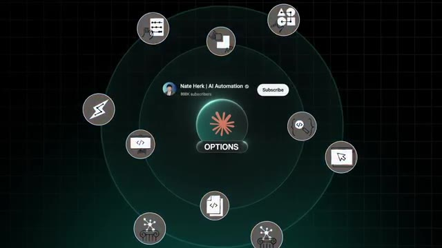
*⏱️ 00:00:14 — Un diagramme circulaire graphique à thème technologique montrant le logo de la chaîne et le mot "OPTIONS" entouré d'icônes d'actions diverses.*

---

### ⏱️ `[00:00:28 - 00:00:48]` | Segment #02

**🔊 Audio (Transcription Intégrale Mot pour Mot en Français) :**
> Donc dans cette vidéo, je vais vous montrer la meilleure chose que vous puissiez faire dès maintenant pour gagner de l'argent avec vos compétences sur Claude au sein de votre carrière de prédilection et la feuille de route exacte pour y parvenir. Entrons donc dans le vif du sujet. Avant de vous donner la feuille de route proprement dite, il y a une chose que vous devez comprendre d'abord, c'est que le domaine de l'IA ne s'arrête jamais d'avancer. Il ne reste pas immobile une seule seconde. Devenir très bon sur Claude en ce moment tout seul ne veut presque rien dire à long terme parce que les outils vont changer.

**👁️ Analyse Visuelle d'Écran (gemini-3.5-flash-lite) :**
**Interface & Outils** : Claude Code CLI / Terminal

**Contenu textuel & Code** : Interface en ligne de commande Claude Code affichant le modèle Opus (1M context) avec des fenêtres de terminal en arrière-plan.

**Action / Démonstration** : Animation graphique de type pixel art simulant l'utilisation d'outils de développement en ligne de commande.

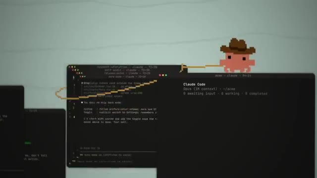
*⏱️ 00:00:43 — Animation style pixel art montrant plusieurs fenêtres de terminal, dont une interface Claude Code en ligne de commande.*

---

### ⏱️ `[00:00:49 - 00:01:08]` | Segment #03

**🔊 Audio (Transcription Intégrale Mot pour Mot en Français) :**
> Donc ce qui compte vraiment, ce sont les compétences qui se cachent derrière l'outil et l'apprentissage de la manière de prendre ces compétences et de les appliquer à chaque nouvelle phase de l'intelligence artificielle au fur et à mesure qu'elle se présente. Et la raison pour laquelle c'est si important, c'est parce que le domaine de l'IA n'a jamais vraiment eu un seul meilleur emploi fixe ou un seul meilleur modèle économique. Il ne cesse de les remplacer tous les ans ou presque. Et à chaque fois qu'il le fait, une toute nouvelle fenêtre s'ouvre pour quiconque y prête attention.

**👁️ Analyse Visuelle d'Écran (gemini-3.5-flash-lite) :**
**Interface & Outils** : Aucune interface logicielle technique ou de démonstration affichée.

**Contenu textuel & Code** : Texte 'Skills' et éléments graphiques d'illustration.

**Action / Démonstration** : Présentation orale des concepts par le présentateur.

---

### ⏱️ `[00:01:08 - 00:01:27]` | Segment #04

**🔊 Audio (Transcription Intégrale Mot pour Mot en Français) :**
> Laissez-moi donc vous expliquer ce que je veux dire très rapidement. Si l'on rembobine d'environ un an, lorsque l'intelligence artificielle a vraiment commencé à exploser, les premiers vrais boulots rémunérés étaient plutôt simples. Vous pouviez être la personne qui mettait en place une seule automatisation ou un seul chatbot pour une petite entreprise ou une équipe, et cela seul suffisait pour être assez bien payé. Mais évidemment, les choses ont changé assez vite. C'est devenu la phase des systèmes d'IA en entier, ou ce que la plupart des gens appellent maintenant la phase de l'agence d'automatisation par IA.

**👁️ Analyse Visuelle d'Écran (gemini-3.5-flash-lite) :**
**Interface & Outils** : Présentation vidéo en face caméra avec infographies animées.

**Contenu textuel & Code** : Textes graphiques animés illustrant les propos du présentateur ('AI Explosion', icônes utilisateur/IA).
[DESC_IMAGE_3] Aucune action technique ou démonstration de logiciel n'est effectuée.

**Action / Démonstration** : Explications face caméra et démonstration conceptuelle.

---

### ⏱️ `[00:01:27 - 00:01:47]` | Segment #05

**🔊 Audio (Transcription Intégrale Mot pour Mot en Français) :**
> Tout le monde, vous savez, essaie de transformer ses services en produits, de lancer des agences et de vendre des systèmes clés en main à tour de bras. Mais ensuite, les choses ont encore évolué, vous savez, vers l'ère des créateurs d'agents IA. Et c'est là que les gens ont arrêté de construire ces petites automatisations simples. Et qu'ils ont commencé à construire des agents capables de réellement réfléchir et d'exécuter une tonne de ces tâches répétitives que nous faisons tous les jours. Et ensuite, nous arrivons à la phase la plus récente, la phase agentique.

**👁️ Analyse Visuelle d'Écran (gemini-3.5-flash-lite) :**
**Interface & Outils** : Terminal de commande et interface graphique personnalisée de création d'agents IA.

**Contenu textuel & Code** : Lignes de code, texte de terminal et options de configuration d'agents IA (Think / Execute).
[DESC_IMAGE_1] Présentation de code source/terminal en arrière-plan lors de l'explication sur la vente de systèmes.
[DESC_IMAGE_2] Illustration visuelle du concept de construction d'agents IA avec des boutons interactifs.

**Action / Démonstration** : Explications face caméra et démonstration conceptuelle.

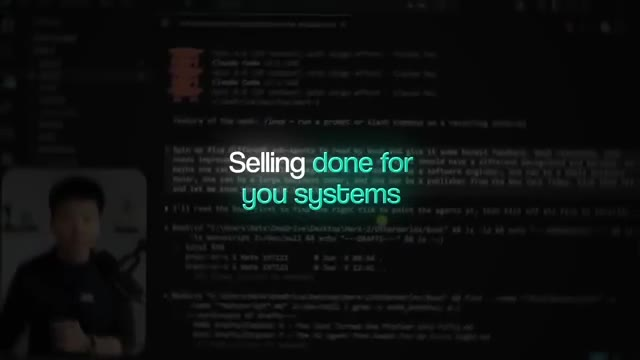
*⏱️ 00:01:32 — Capture d'écran montrant un terminal sombre avec du code et des lignes de commande, avec le texte superposé "Selling done for you systems".*

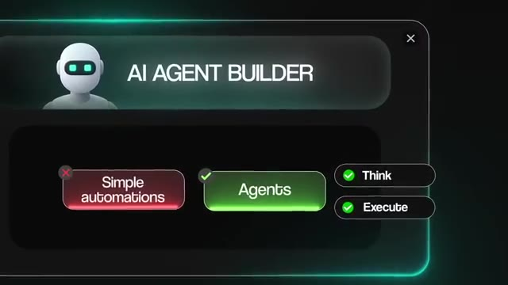
*⏱️ 00:01:42 — Interface graphique d'un générateur d'agents IA ("AI AGENT BUILDER") avec des options de sélection pour "Simple automations", "Agents", "Think" et "Execute".*

---

### ⏱️ `[00:01:47 - 00:02:11]` | Segment #06

**🔊 Audio (Transcription Intégrale Mot pour Mot en Français) :**
> Gartner prévoit environ 202 milliards de dollars de dépenses pour l'IA agentique en 2026 seulement. Donc, si vous y pensez juste une seconde, les entreprises investissent ce genre d'argent dans une IA qui ne se contente pas de répondre à vos questions, mais qui va réellement faire le travail à votre place. Et cela semble être la phase dans laquelle nous nous trouvons actuellement. Mais le modèle que je veux vraiment que vous remarquiez là, c'est qu'à chaque fois que l'une de ces phases a changé, les personnes qui ont agi tôt, vous savez, ont pu attraper et surfer sur la vague.

**👁️ Analyse Visuelle d'Écran (gemini-3.5-flash-lite) :**
**Interface & Outils** : Aucune interface logicielle ou outil technique affiché.

**Contenu textuel & Code** : Aucun code source, commande ou prompt affiché.

**Action / Démonstration** : Le présentateur s'adresse directement au public pour expliquer l'utilité de l'IA agentique.

---

### ⏱️ `[00:02:12 - 00:02:31]` | Segment #07

**🔊 Audio (Transcription Intégrale Mot pour Mot en Français) :**
> Et les gens qui sont restés collés à l'ancienne phase ont fini par se battre juste pour survivre dans le nouveau marché surpeuplé, en quelque sorte une course vers le fond. Il n'a jamais vraiment été question d'apprendre l'outil spécifique. Il s'agissait de comprendre ce que les outils pouvaient réellement faire et quelle était la valeur de cela pour de vrais êtres humains. Et le plus fou, c'est que la construction elle-même devient de plus en plus facile chaque mois. La barrière à l'entrée ne cesse de baisser.

**👁️ Analyse Visuelle d'Écran (gemini-3.5-flash-lite) :**
**Interface & Outils** : Incrustation graphique (éléments textuels animés)

**Contenu textuel & Code** : Texte comparatif "Learning the tool" (marqué d'une croix rouge) versus "Tool usage" (marqué d'une coche verte)

**Action / Démonstration** : Le présentateur illustre visuellement la distinction entre l'apprentissage d'un outil et son usage concret.

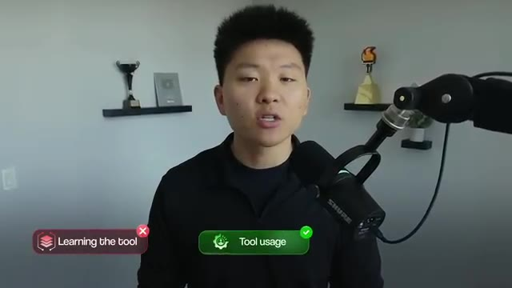
*⏱️ 00:02:21 — Le présentateur s'exprime face caméra avec deux infographies comparatives incrustées en bas : une étiquette rouge "Learning the tool" avec une croix rouge, et une étiquette verte "Tool usage" avec une coche verte.*

---

### ⏱️ `[00:02:31 - 00:02:55]` | Segment #08

**🔊 Audio (Transcription Intégrale Mot pour Mot en Français) :**
> McKinsey a constaté qu'environ 88 % des organisations utilisent désormais l'IA quelque part dans leur entreprise, mais qu'un tiers seulement environ a réellement transformé cela en de vrais projets. Je vais donc répéter cela très rapidement. Presque tout le monde utilise l'IA, mais presque personne n'est bon en IA. Et cet écart, c'est toute l'opportunité. La prochaine phase n'est donc pas un nouveau type de créateur. La valeur se déplace vers la personne qui décide de ce qu'il faut construire en premier lieu, pourquoi vous le construisez, et si la chose a réellement fonctionné.

**👁️ Analyse Visuelle d'Écran (gemini-3.5-flash-lite) :**
**Interface & Outils** : Document texte / rapport de recherche (McKinsey).

**Contenu textuel & Code** : Texte extrait d'un rapport de McKinsey : "Many organizations are already experimenting with AI agents..." avec des statistiques sur l'adoption technologique.

**Action / Démonstration** : Affichage d'un extrait de rapport pour illustrer les statistiques d'utilisation de l'IA par les entreprises.

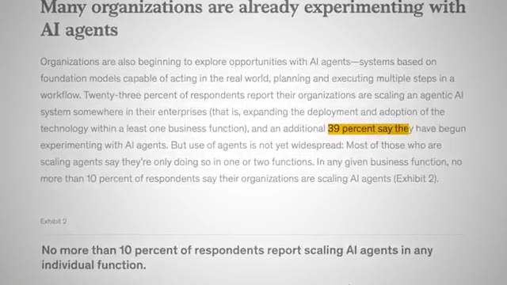
*⏱️ 00:02:37 — Capture d'écran montrant un rapport ou un article de McKinsey sur l'utilisation des agents IA dans les organisations, avec le texte surligné concernant les pourcentages d'expérimentation.*

---

### ⏱️ `[00:02:55 - 00:03:15]` | Segment #09

**🔊 Audio (Transcription Intégrale Mot pour Mot en Français) :**
> Et cette personne est un consultant en IA. Maintenant, un consultant est en réalité simplement la personne qui détermine ce qui ne va pas réellement et trouve ensuite comment y remédier. Donc, au lieu de simplement rester assis là et de faire tout ce qu'on leur dit de faire, pensez-y comme à un médecin par rapport à un pharmacien. Un pharmacien va fondamentalement vous donner exactement ce que vous demandez, mais un médecin doit déterminer ce dont vous avez réellement besoin. Ainsi, les bâtisseurs sont un peu comme les pharmaciens et les consultants sont les médecins.

**👁️ Analyse Visuelle d'Écran (gemini-3.5-flash-lite) :**
**Interface & Outils** : AUCUNE

**Contenu textuel & Code** : AUCUNE

**Action / Démonstration** : AUCUNE

---

### ⏱️ `[00:03:16 - 00:03:34]` | Segment #10

**🔊 Audio (Transcription Intégrale Mot pour Mot en Français) :**
> Et le médecin est celui qui reçoit la vraie rémunération parce que les clients ne savent jamais vraiment ce dont ils ont besoin. Ils savent seulement ce qui fait mal. Votre travail n'est donc pas d'être la personne la plus rapide pour la construction. Votre travail consiste à nommer le vrai problème dès le départ. Et bien sûr, l'argent soutient tout cela. Le marché du conseil en IA devrait dépasser les 64 milliards de dollars d'ici 2028. Et il y a un gouffre géant à combler ici.

**👁️ Analyse Visuelle d'Écran (gemini-3.5-flash-lite) :**
**Interface & Outils** : Graphique animé explicatif et article de recherche / rapport web.

**Contenu textuel & Code** : Texte du rapport : 'Global AI Consulting Services Market Forecasted to Reach $64.3 Billion by 2028' et schéma 'AI consultant : Fastest to build vs Name the problem'.

**Action / Démonstration** : Affichage des statistiques de marché et d'un diagramme conceptuel comparant rapidité de construction et identification du problème.

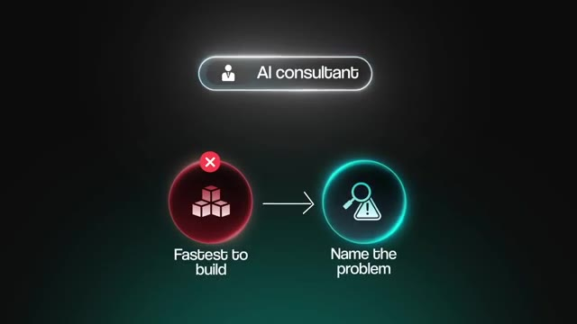
*⏱️ 00:03:25 — Un schéma graphique animé illustrant le rôle de l'AI consultant avec les options 'Fastest to build' (marquée d'une croix rouge) et 'Name the problem' (mise en avant).*

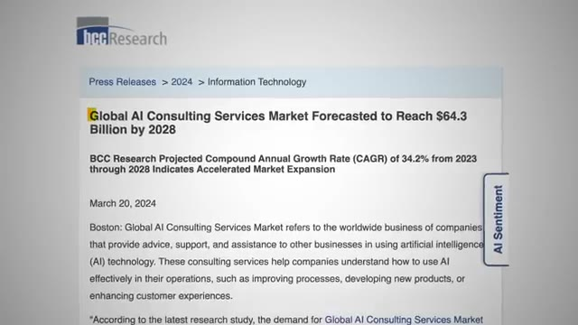
*⏱️ 00:03:29 — Une capture d'écran d'un rapport de marché de BCC Research titré 'Global AI Consulting Services Market Forecasted to Reach $64.3 Billion by 2028'.*

---

### ⏱️ `[00:03:34 - 00:03:54]` | Segment #11

**🔊 Audio (Transcription Intégrale Mot pour Mot en Français) :**
> À peu près 30 % des projets d'IA en entreprise sont tout simplement abandonnés. Et seulement environ 6 % des entreprises qui utilisent l'IA y sont réellement bonnes. Donc, presque toutes les entreprises en ce moment sont plutôt mauvaises dans ce domaine. Et le point important, c'est qu'elles savent qu'elles y sont mauvaises. Et c'est exactement là que le consultant intervient pour aider. Le meilleur choix que vous puissiez faire en ce moment est donc de devenir ce consultant. Mais il y a en fait deux chemins complètement différents pour accéder à ce rôle.

**👁️ Analyse Visuelle d'Écran (gemini-3.5-flash-lite) :**
**Interface & Outils** : Article de recherche / document texte mis en surbrillance.

**Contenu textuel & Code** : Texte extrait d'un rapport sur l'IA d'entreprise mentionnant les organisations performantes en IA (« representing about 6 percent of respondents »).

**Action / Démonstration** : Affichage d'un extrait de rapport textuel pour appuyer les statistiques sur les projets d'IA.

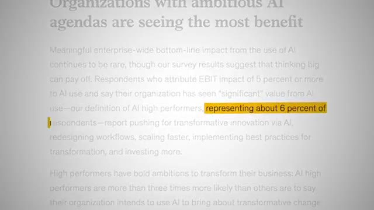
*⏱️ 00:03:39 — Capture d'écran montrant un article ou un rapport soulignant en jaune la portion de texte « representing about 6 percent of respondents » en lien avec les performances en IA.*

---

### ⏱️ `[00:03:54 - 00:04:13]` | Segment #12

**🔊 Audio (Transcription Intégrale Mot pour Mot en Français) :**
> Et celle que vous choisissez dépend vraiment du type de personne que vous êtes. La première voie est celle du consultant indépendant en IA. C'est là que vous entrez dans d'autres entreprises, vous trouvez leurs problèmes, puis vous prescrivez et construisez les solutions d'IA qui les résolvent. C'est vraiment juste l'idée de l'agence d'IA, mais vous vous présentez beaucoup plus comme un partenaire à long terme plutôt que comme une équipe de développeurs débrouillards capables de créer des automatisations d'IA.

**👁️ Analyse Visuelle d'Écran (gemini-3.5-flash-lite) :**
**Interface & Outils** : Interface graphique animée (graphisme d'illustration de présentation).

**Contenu textuel & Code** : Textes explicatifs animés ('2 different roads', 'Independent AI consultant', 'Go to business', 'Solve one problem', 'AI solutions').

**Action / Démonstration** : Animation visuelle illustrant les deux types de parcours ou voies professionnelles présentés.

---

### ⏱️ `[00:04:13 - 00:04:36]` | Segment #13

**🔊 Audio (Transcription Intégrale Mot pour Mot en Français) :**
> Parce qu'au lieu de vendre ces automatisations, vous vendez la solution réelle à un problème spécifique. Et en toute transparence, c'est pratiquement la voie que j'ai empruntée moi-même, donc je connais assez bien. Mais la deuxième voie est plutôt celle du consultant en IA en interne. Et c'est la porte dont je veux commencer à parler davantage sur ma chaîne, car j'ai réalisé que tout le monde ne veut pas lancer sa propre activité de conseil. Donc, au lieu de conseiller un tas d'entreprises différentes de l'extérieur, vous devenez essentiellement la personne de référence en matière d'IA au sein d'une seule et même entreprise.

**👁️ Analyse Visuelle d'Écran (gemini-3.5-flash-lite) :**
**Interface & Outils** : YouTube, interface graphique d'illustration vidéo

**Contenu textuel & Code** : Miniatures de vidéos YouTube et infographie sur les chemins professionnels

**Action / Démonstration** : Présentation visuelle des deux voies professionnelles possibles dans l'IA

---

### ⏱️ `[00:04:36 - 00:04:57]` | Segment #14

**🔊 Audio (Transcription Intégrale Mot pour Mot en Français) :**
> Et cette entreprise pourrait même être celle où vous travaillez déjà en ce moment même. Et bien sûr, les entreprises commencent à prendre cela très au sérieux. Elles commencent à embaucher des responsables de l'IA en interne avec de vrais titres, des choses comme un directeur de l'intelligence artificielle ou un directeur de l'IA. Et un grand nombre de ces rôles paient entre le début et le milieu de la tranche à six chiffres. IBM vient en fait de publier son étude de 2026 sur les PDG, et ils ont constaté que 76 % des organisations ont désormais quelqu'un dans un rôle de type directeur de l'IA.

**👁️ Analyse Visuelle d'Écran (gemini-3.5-flash-lite) :**
**Interface & Outils** : Document web ou présentation statistique (slides/rapport).

**Contenu textuel & Code** : Texte statistique affichant "76% of CEOs say they have a Chief AI Officer (CAIO) in 2026, up from just 26% in 2025."

**Action / Démonstration** : Affichage d'un graphique statistique à l'écran pour appuyer les propos du présentateur sur l'embauche de responsables de l'IA.

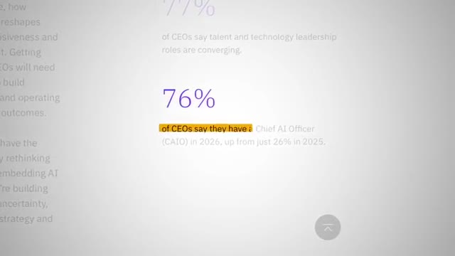
*⏱️ 00:04:52 — Une capture d'écran d'un rapport ou d'un site web montrant des statistiques en pourcentage, avec notamment le chiffre "76%" mis en avant concernant les PDG et les rôles liés à l'IA.*

---

### ⏱️ `[00:04:57 - 00:05:19]` | Segment #15

**🔊 Audio (Transcription Intégrale Mot pour Mot en Français) :**
> Et cela représente une hausse par rapport à seulement 26 % il y a deux ans. Donc, cela a presque triplé en un temps record pour un rôle de dirigeant. Maintenant, je veux être juste concernant ce chiffre une seconde. Cette étude n'a interrogé qu'environ 2 000 PDG, et il s'agissait de très grandes entreprises. Nous parlons d'un chiffre d'affaires médian d'environ 5,8 milliards de dollars, et près de quatre sur cinq d'entre elles étaient cotées en bourse. Donc, ce chiffre de 76 % est vraiment juste, vous savez, des entreprises géantes qui se précipitent pour pourvoir le poste en premier.

**👁️ Analyse Visuelle d'Écran (gemini-3.5-flash-lite) :**
**Interface & Outils** : Graphiques et animations de présentation visuelle.

**Contenu textuel & Code** : Statistiques sur l'évolution des chiffres (26% vs 76%, $5.8B).

**Action / Démonstration** : Affichage de graphiques statistiques illustrant les propos du présentateur.

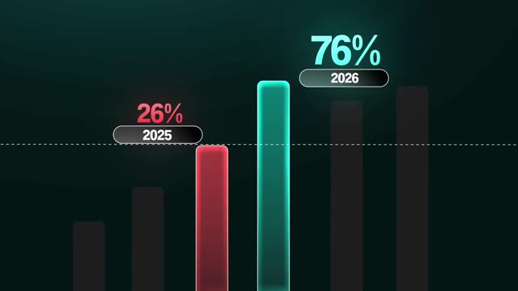
*⏱️ 00:05:02 — Graphique en barres montrant l'évolution des pourcentages (26% en 2025 et 76% en 2026).*

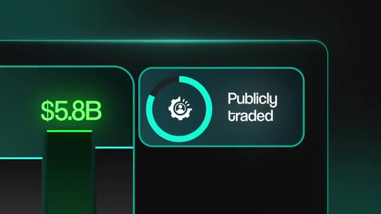
*⏱️ 00:05:13 — Interface graphique affichant la mention '$5.8B' et 'Publicly traded' avec une icône de cercle de chargement.*

---

### ⏱️ `[00:05:19 - 00:05:38]` | Segment #16

**🔊 Audio (Transcription Intégrale Mot pour Mot en Français) :**
> Les petites et moyennes entreprises, ce qui est le secteur où la plupart d'entre vous essayeront de travailler et de faire du conseil, je suppose, ce marché est encore grand ouvert. Donc, si quoi que ce soit, cela me indique qu'il reste énormément de place pour le reste d'entre nous pour simplement y entrer directement. Et le truc cool, c'est que ces deux chemins représentent fondamentalement la même idée, c'est-à-dire que vous diagnostiquez le problème, vous prescrivez la solution d'intelligence artificielle, et ensuite vous prouvez que cela a réellement fonctionné.

**👁️ Analyse Visuelle d'Écran (gemini-3.5-flash-lite) :**
**Interface & Outils** : Aucune interface logicielle, terminal ou éditeur visible.

**Contenu textuel & Code** : Aucun code source, terminal, prompt ou donnée textuelle affichée.

**Action / Démonstration** : Aucune action de démonstration technique ou de manipulation d'agent IA.

---

### ⏱️ `[00:05:38 - 00:06:03]` | Segment #17

**🔊 Audio (Transcription Intégrale Mot pour Mot en Français) :**
> La seule vraie différence, c'est de savoir si vous faites cela pour tout un tas d'entreprises ou juste pour une seule. Et peu importe l'outil que vous finissez par utiliser tant que vous pouvez apporter de vrais résultats, ce qui explique pourquoi les compétences comptent tellement plus. La voie de l'indépendant va vous convenir si vous voulez une totale maîtrise de votre temps, que vous aimez la variété, et que cela ne vous dérange pas de faire des choses comme des appels de prospection et d'aller chercher vos propres clients. La voie du salarié en interne vous correspond mieux si vous préférez la stabilité, si vous voulez un seul endroit où vous pouvez creuser vraiment en profondeur, et si vous aimez l'idée d'un salaire régulier pendant que vous le faites, sans avoir à quitter votre poste pour essayer de lancer votre propre entreprise.

**👁️ Analyse Visuelle d'Écran (gemini-3.5-flash-lite) :**
**Interface & Outils** : Interface graphique animée de présentation de carrière et infographie vidéo.

**Contenu textuel & Code** : Texte affiché : 'Independent AI consultant', 'In-House AI Consultant', 'Own schedule', 'Prefer stability'.

**Action / Démonstration** : Animation de transition entre différentes options de carrière pour les consultants en IA.

---

### ⏱️ `[00:06:03 - 00:06:24]` | Segment #18

**🔊 Audio (Transcription Intégrale Mot pour Mot en Français) :**
> Donc je ne suis pas ici en train de vous dire qu'une voie est meilleure que l'autre. Tout dépend vraiment de vos objectifs, de votre expérience, de ce que vous voulez dans la vie, et, vous savez, de ce que vous voulez tirer de toute cette opportunité liée à l'intelligence artificielle au départ. Et écoutez, je comprends. Il y a un million de personnes là-dehors qui vous disent quoi faire avec l'intelligence artificielle en ce moment même. Alors avant de continuer, je veux vous donner un peu de contexte sur les raisons pour lesquelles c'est moi qui suis là à vous dire tout cela, parce que j'ai en quelque sorte été des deux côtés de ce dont nous venons de parler.

**👁️ Analyse Visuelle d'Écran (gemini-3.5-flash-lite) :**
**Interface & Outils** : Aucune interface logicielle ou technique présentée.

**Contenu textuel & Code** : Aucun code, terminal ou prompt visible.

**Action / Démonstration** : Aucune action technique ou manipulation n'est effectuée.

---

### ⏱️ `[00:06:24 - 00:06:42]` | Segment #19

**🔊 Audio (Transcription Intégrale Mot pour Mot en Français) :**
> J'ai en fait commencé à temps plein en sortant de l'université chez Goldman Sachs. Et quand l'IA a vraiment commencé à décoller, j'étais le gars de l'équipe qui faisait des recherches dessus en parallèle et qui en était obsédé, qui jouait avec pendant mon temps libre et essayait même, genre, de le montrer à mon équipe et de le présenter à mon équipe. Je voulais vraiment être, genre, la personne responsable de l'IA en interne. J'espérais un peu pouvoir, genre, vous savez, mener une nouvelle initiative ou travailler sur des projets d'IA chez Goldman.

**👁️ Analyse Visuelle d'Écran (gemini-3.5-flash-lite) :**
**Interface & Outils** : Interface web d'automatisation (workflow), éditeur de code, terminal, et tableau de bord analytique.

**Contenu textuel & Code** : Diagrammes de flux de données, lignes de code source et métriques de performance sur plusieurs écrans.
[DESC_IMAGE_3] Conception de workflows d'automatisation et développement sur poste de travail en entreprise.

**Action / Démonstration** : Manipulation d'outils de développement et d'automatisation d'agents IA en environnement professionnel et personnel.

*⏱️ 00:06:33 — Le conférencier travaillant sur son ordinateur portable, affichant un diagramme de workflow de type automatisation.*

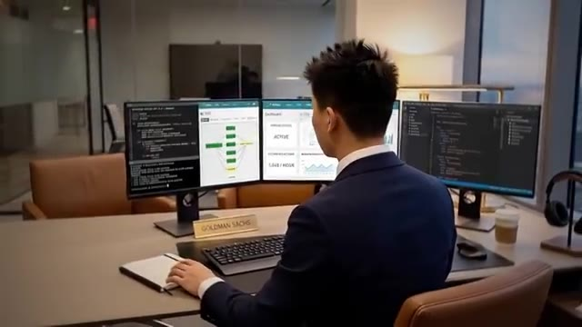
*⏱️ 00:06:37 — Le conférencier dans un bureau avec une plaque Goldman Sachs, utilisant plusieurs moniteurs affichant du code et des tableaux de bord.*

---

### ⏱️ `[00:06:42 - 00:07:00]` | Segment #20

**🔊 Audio (Transcription Intégrale Mot pour Mot en Français) :**
> Mais c’est évidemment une énorme entreprise avec énormément de réglementations et énormément de problèmes de gestion du changement. Et tout cela semblait beaucoup trop lent par rapport à ce que je voulais faire. C’est donc à ce moment-là que j’ai fini par miser sur moi-même et par quitter ce poste. Peu de temps après, je faisais pas mal de travail en freelance. J’ai fondé ma propre agence d’IA appelée True Horizon avec quelques partenaires commerciaux. Et nous avons fait croître cette structure à plus de 100 000 dollars par mois en moins d’un an.

**👁️ Analyse Visuelle d'Écran (gemini-3.5-flash-lite) :**
**Interface & Outils** : Navigateur web affichant la page d'accueil de TrueHorizon AI

**Contenu textuel & Code** : Texte de présentation de l'entreprise d'IA « TrueHorizon AI » et boutons d'appel à l'action (« Schedule consultation », « View case studies »)

**Action / Démonstration** : Affichage de la page web institutionnelle de TrueHorizon AI illustrant l'activité de conseil et d'accompagnement en IA.

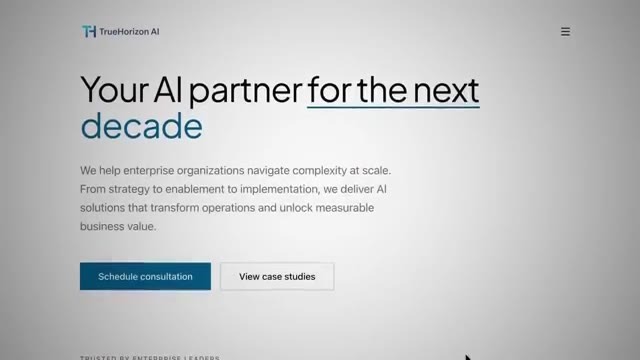
*⏱️ 00:06:55 — Capture d'écran montrant la page web d'une entreprise nommée « TrueHorizon AI » avec le titre « Your AI partner for the next decade ».*

---

### ⏱️ `[00:07:00 - 00:07:19]` | Segment #21

**🔊 Audio (Transcription Intégrale Mot pour Mot en Français) :**
> Et j'ai fini par m'en retirer parce que je me suis simplement rendu compte que j'étais beaucoup plus passionné par l'éducation, par le fait d'être devant les gens et d'aider un maximum de personnes à comprendre comment utiliser tout ça par elles-mêmes, ce qui m'a mené là où je suis aujourd'hui, à bâtir ce qui est la plus grande communauté d'automatisation par IA au monde. Nous avons plus de 400 000 membres et tout cela s'est fait en un peu moins de deux ans. Maintenant, si je vous raconte tout ça, ce n'est pas pour me la péter.

**👁️ Analyse Visuelle d'Écran (gemini-3.5-flash-lite) :**
**Interface & Outils** : Interface web de la communauté Skool (AI Automation Society)

**Contenu textuel & Code** : Page de profil de la communauté affichant "AI Automation Society", le nombre de membres (403.1k), les utilisateurs en ligne (1.3k) et divers liens de ressources.

**Action / Démonstration** : Affichage de la plateforme communautaire Skool pour illustrer l'espace éducatif géré par le présentateur.

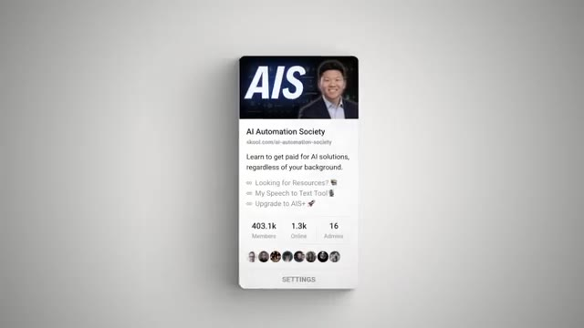
*⏱️ 00:07:14 — Capture d'écran de l'interface de la plateforme Skool montrant la communauté "AI Automation Society" (AIS) avec ses statistiques de membres.*

---

### ⏱️ `[00:07:19 - 00:07:41]` | Segment #22

**🔊 Audio (Transcription Intégrale Mot pour Mot en Français) :**
> C'est fondamentalement juste pour dire que j'ai une grande communauté et que je suis capable de voir ce qui se passe réellement sur le marché. Et j'ai toujours l'occasion de voir ce que les propriétaires d'entreprise essaient de faire, ce que les employés essaient de faire, ce que les entrepreneurs en herbe essaient de faire. Et j'ai remarqué qu'il y a une tonne de contenu sur la façon de démarrer une entreprise d'IA. Mais la plupart d'entre vous n'essaient pas de faire ça ou ne veulent pas le faire. Ou vous pensez que c'est la seule option. Mais la plupart d'entre vous veulent peut-être simplement progresser dans leur carrière en tant qu'employé ou peut-être obtenir un meilleur emploi ou une promotion ou plus de sécurité.

**👁️ Analyse Visuelle d'Écran (gemini-3.5-flash-lite) :**
**Interface & Outils** : AUCUNE

**Contenu textuel & Code** : AUCUNE

**Action / Démonstration** : AUCUNE

---

### ⏱️ `[00:07:41 - 00:07:59]` | Segment #23

**🔊 Audio (Transcription Intégrale Mot pour Mot en Français) :**
> Et presque personne ne publie ce qui vous aide réellement à faire ça. Maintenant, l'autre chose importante que je veux que vous entendiez, c'est que je n'ai pas de bagage technique. Genre, je viens du marketing et des analyses. Je ne suis pas un ingénieur et je ne l'ai jamais été. Et la seule raison pour laquelle c'est important, c'est parce que la barrière à l'entrée pour apprendre réellement tout ça est pratiquement tombée à zéro. Genre, n'importe qui peut faire ça maintenant. Alors si vous êtes là à vous demander, est-ce que je peux seulement apprendre ça ?

**👁️ Analyse Visuelle d'Écran (gemini-3.5-flash-lite) :**
**Interface & Outils** : AUCUNE

**Contenu textuel & Code** : AUCUN

**Action / Démonstration** : AUCUNE

---

### ⏱️ `[00:08:00 - 00:08:33]` | Segment #24

**🔊 Audio (Transcription Intégrale Mot pour Mot en Français) :**
> Ce n'est même plus une question que vous devriez vous poser. La réponse est oui. La vraie question qui compte est celle-ci. Quand quelqu'un vous demande, pourquoi devrais-je vous embaucher plutôt que la personne qui a regardé exactement le même nombre de tutoriels YouTube et connaît exactement la même terminologie et a la même expérience que vous ? Vous devez réfléchir à la façon dont vous répondez à cette question, car les gagnants sur ce marché ne sont pas ceux qui en apprennent le plus. Ce sont ceux qui peuvent réellement prouver qu'ils peuvent générer de vrais résultats commerciaux. Donc, c'est cela la question centrale. C'est aussi une grande partie de la raison pour laquelle nous avons construit quelque chose en silence de notre côté pour vous aider en matière de crédibilité. Mais nous y reviendrons plus tard. Pour l'instant, méditez juste sur cette question une petite seconde, car peu importe laquelle de ces voies vous empruntez, cette question est exactement

**👁️ Analyse Visuelle d'Écran (gemini-3.5-flash-lite) :**
**Interface & Outils** : Interface de messagerie mobile (Smartphone).

**Contenu textuel & Code** : Texte affiché : "Why should I hire you? Over the person who watched the exact same amount of YouTube tutorials".

**Action / Démonstration** : Illustration visuelle du sujet de discussion via une simulation d'échange de messages.

*⏱️ 00:08:08 — Une capture d'écran d'un smartphone affichant une interface de messagerie (type iMessage) avec une bulle de texte posant la question du recrutement face à un concurrent ayant le même niveau théorique.*

---

### ⏱️ `[00:08:33 - 00:09:07]` | Segment #25

**🔊 Audio (Transcription Intégrale Mot pour Mot en Français) :**
> ce que représente tout votre parcours. Et on vous posera cette question. Maintenant, l'avantage, c'est que peu importe laquelle de ces deux voies vous ressemble le plus, devenir consultant en IA est probablement la prochaine étape naturelle de votre parcours. Et je veux détailler cela un instant, car il y a fondamentalement, selon moi, quatre types de personnes qui regardent probablement ceci en ce moment. Et cette démarche a du sens pour chacun de ces quatre profils. Le premier type est la personne qui crée simplement avec Claude par passion. Et hé, si c'est votre cas, il n'y a rien de mal à cela. C'est tout à fait normal. Mais si vous pouvez réellement monétiser ce que vous faites d'une manière ou d'une autre, cela fait deux grandes choses pour vous. Premièrement, cela valide que vous êtes réellement compétent dans ce domaine, car c'est probablement le moyen le moins cher de savoir si vos compétences sont suffisantes pour que quelqu'un soit prêt à payer pour cela.

**👁️ Analyse Visuelle d'Écran (gemini-3.5-flash-lite) :**
**Interface & Outils** : Aucune interface logicielle, éditeur de code ou outil d'automatisation n'est affiché.

**Contenu textuel & Code** : Texte statique : "AI Consultant" et "4 TYPES AI users".

**Action / Démonstration** : Aucune manipulation technique, démonstration logicielle ou exécution de code n'est visible. Les images sont des plans de présentation ou des illustrations graphiques statiques.

---

### ⏱️ `[00:09:07 - 00:09:42]` | Segment #26

**🔊 Audio (Transcription Intégrale Mot pour Mot en Français) :**
> les. Et deuxièmement, ça finance le passe-temps. Vous savez, il y a tellement de nouveaux outils d'IA et, vous savez, les jetons coûtent cher et les abonnements coûtent cher. Donc si vous pouvez avoir un petit peu d'argent supplémentaire qui rentre à côté, alors vous pouvez simplement continuer à jouer avec ces trucs et peut-être continuer à expérimenter avec encore plus d'outils. Maintenant, le deuxième type de personne est l'entrepreneur en herbe, la personne qui veut réellement gagner de l'argent avec ça et qui veut bâtir une entreprise. Et si c'est vous, vous avez acquis une compétence sur un marché avec une demande massive et presque personne qui peut assurer. Alors regardez simplement les chiffres. Le Forum Économique Mondial prévoit que l'IA va créer environ 170 millions de nouveaux emplois d'ici 2030. Et même si vous soustrayez, vous savez, tous les rôles qu'elle va remplacer ou modifier, cela représente quand même un gain net d'environ 80 millions d'emplois. En plus de cela,

**👁️ Analyse Visuelle d'Écran (gemini-3.5-flash-lite) :**
**Interface & Outils** : Interface graphique animée de présentation et site web du World Economic Forum.

**Contenu textuel & Code** : Textes : "Hobbyist", "Entrepreneur", "Make money", "Build business", "Future of Jobs Report 2025: 78 Million New Job Opportunities by 2030".

**Action / Démonstration** : Navigation visuelle entre différents profils d'utilisateurs et affichage d'un rapport économique mondial.

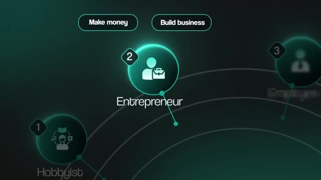
*⏱️ 00:09:25 — Schéma interactif montrant les profils de 'Hobbyist' et 'Entrepreneur' avec des options 'Make money' et 'Build business'.*

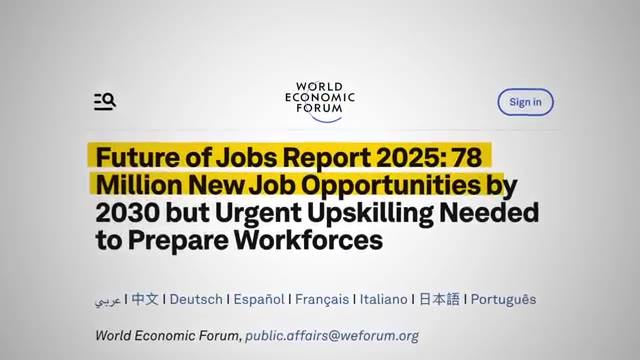
*⏱️ 00:09:34 — Capture d'écran du rapport du Forum Économique Mondial (World Economic Forum) intitulé 'Future of Jobs Report 2025'.*

---

### ⏱️ `[00:09:43 - 00:10:03]` | Segment #27

**🔊 Audio (Transcription Intégrale Mot pour Mot en Français) :**
> À peu près la moitié de toutes les offres d'emploi dans la tech aux États-Unis demandent déjà des compétences en IA. Et ce chiffre a doublé en un an seulement. Vous avez donc cette vague de demande géante et vous n'avez pour ainsi dire personne qui soit réellement capable de la surfer. Et ce que cela signifie pour vous, c'est que vous n'avez pas besoin d'être le meilleur au monde. Vous devez juste être le meilleur dans la pièce. Et le troisième type de personne, c'est l'employé qui veut simplement progresser au travail. Et c'est la catégorie la plus récente du lot. Et c'est là que cette voie interne se transforme en un véritable code de triche.

**👁️ Analyse Visuelle d'Écran (gemini-3.5-flash-lite) :**
**Interface & Outils** : Interface utilisateur graphique animée (UI design de style futuriste).

**Contenu textuel & Code** : Noms des catégories : "Entrepreneur", "Employee" (avec icône associée), et "Business Owner" partiellement visible.

**Action / Démonstration** : Navigation ou mise en surbrillance de l'option "Employee" dans un menu circulaire.

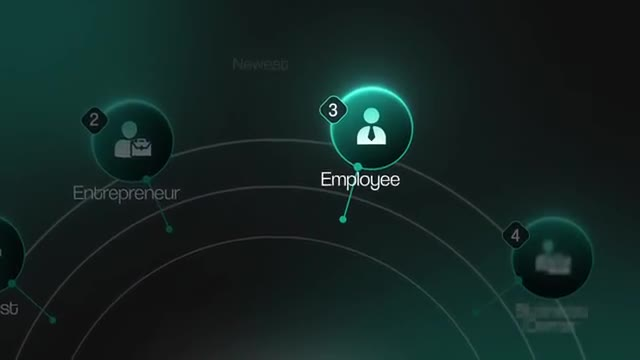
*⏱️ 00:09:58 — Une interface graphique animée de type diagramme radial ou menu de sélection circulaire montrant différentes catégories professionnelles (Entrepreneur, Employee, Business Owner).*

---

### ⏱️ `[00:10:03 - 00:10:24]` | Segment #28

**🔊 Audio (Transcription Intégrale Mot pour Mot en Français) :**
> Parce que devenir la personne responsable de l'IA dans votre entreprise protège votre emploi. Et en plus de cela, cela fonctionne essentiellement comme une augmentation. PwC a analysé près d'un milliard d'offres d'emploi. Et ils ont constaté que la prime salariale pour les compétences en IA a plus que doublé en une seule année, passant de 25 % à 56 %. Et le salaire n'est que la moitié du problème. Une autre étude a publié un rapport selon lequel près des deux tiers des employés ont admis avoir écarté quelqu'un d'une promotion parce que ses compétences étaient obsolètes.

**👁️ Analyse Visuelle d'Écran (gemini-3.5-flash-lite) :**
**Interface & Outils** : AUCUNE

**Contenu textuel & Code** : AUCUN

**Action / Démonstration** : AUCUNE

---

### ⏱️ `[00:10:24 - 00:10:45]` | Segment #29

**🔊 Audio (Transcription Intégrale Mot pour Mot en Français) :**
> Donc, les compétences que vous possédez déjà deviennent discrètement ce qui décide qui avance et qui est laissé pour compte. Et le quatrième type de personne est quelqu'un qui possède déjà une entreprise. Et pour vous, celui-ci est presque trop facile. Vous n'avez pas besoin d'aller embaucher un consultant coûteux et vous n'avez pas non plus besoin de devenir vous-même un consultant à louer. Vous consultez simplement votre propre entreprise, vous savez, un processus à la fois. Vous avez déjà le premier client idéal et c'est vous. Il y a une chose que je tiens à souligner qui est assez intéressante car elle change à quel point tout cela est réellement urgent.

**👁️ Analyse Visuelle d'Écran (gemini-3.5-flash-lite) :**
**Interface & Outils** : Graphique animé en incrustation vidéo.

**Contenu textuel & Code** : Texte "4 TYPES AI users", "HIRE CONSULTANT", "Become consultant".

**Action / Démonstration** : Présentation des différents types d'utilisateurs et de leurs options stratégiques.

---

### ⏱️ `[00:10:45 - 00:11:08]` | Segment #30

**🔊 Audio (Transcription Intégrale Mot pour Mot en Français) :**
> Et c'est fondamentalement l'étiquette de consultant en IA. Je pense qu'elle a une date de péremption. Tout comme toutes les autres vagues dont nous avons parlé plus tôt, celle-ci est également temporaire. L'IA va s'infiltrer dans absolument toutes les industries. Elle va combler les moindres failles et elle va s'immiscer dans absolument tous les rôles qui existent. Donc, dans quelques années, plus personne ne s'appellera probablement consultant en IA. Ce sera simplement consultant, parce que chaque consultant va utiliser l'IA et devra y être complètement natif, car s'ils ne parlent pas IA, ils ne vont tout simplement pas obtenir de contrats.

**👁️ Analyse Visuelle d'Écran (gemini-3.5-flash-lite) :**
**Interface & Outils** : Graphique illustré / Infographie contextuelle

**Contenu textuel & Code** : Texte et illustrations sur l'entretien des plantes en cinq étapes (Watering, Lighting, Feeding, Cleaning, Monitoring)

**Action / Démonstration** : Affichage d'une infographie illustrative pour appuyer le propos sur l'expansion de l'IA dans tous les domaines

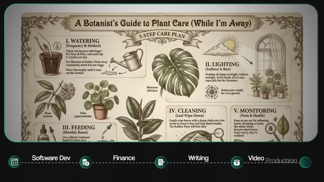
*⏱️ 00:10:56 — Une infographie illustrée intitulée 'A Botanist's Guide to Plant Care' montrant un plan en 5 étapes pour l'entretien des plantes.*

---

### ⏱️ `[00:11:08 - 00:11:28]` | Segment #31

**🔊 Audio (Transcription Intégrale Mot pour Mot en Français) :**
> Alors, pensez-y simplement comme ça. Quelqu'un aujourd'hui, s'il venait vous voir et se disait comptable Excel, est-ce que ça ne semblerait pas complètement ridicule ? Parce qu'il est évident que chaque comptable utilise Excel. Mais si vous remontez au moment où Excel est peut-être sorti pour la première fois, vous pourriez avoir un groupe de comptables qui utilisent Excel, mais un autre groupe qui s'en tient toujours à l'ancienne méthode. Alors peut-être que s'appeler, vous savez, un comptable Excel ou lister cela comme l'une de vos compétences était important.

**👁️ Analyse Visuelle d'Écran (gemini-3.5-flash-lite) :**
**Interface & Outils** : AUCUNE

**Contenu textuel & Code** : AUCUN

**Action / Démonstration** : AUCUNE

---

### ⏱️ `[00:11:28 - 00:11:48]` | Segment #32

**🔊 Audio (Transcription Intégrale Mot pour Mot en Français) :**
> C'est une histoire similaire avec les gens qui s'auto-proclamaient marketeurs sur Internet à l'époque où Internet est apparu pour la première fois. Mais maintenant, c'est simplement du marketing. C'est ainsi que tout le monde procède. C'est donc exactement là où nous en sommes avec l'intelligence artificielle en ce moment. L'étiquette est la partie qui est temporaire, mais l'avantage concurrentiel est bien réel. Les compétences sont réelles et la fenêtre pour s'en emparer est grand ouverte en ce moment même. Elle ne va tout simplement pas rester ouverte aussi grand pour toujours. Maintenant, je sais ce que certains d'entre vous sont probablement en train de penser, à savoir devenir un consultant en IA ou la personne référente en IA en interne à votre poste.

**👁️ Analyse Visuelle d'Écran (gemini-3.5-flash-lite) :**
**Interface & Outils** : Aucun éditeur de code ou terminal de démonstration technique.

**Contenu textuel & Code** : Texte graphique de transition "MARKETING", "LABEL" et "EDGE".
[AMOUL] Présentation face caméra et transition graphique.

**Action / Démonstration** : Explications face caméra et démonstration conceptuelle.

---

### ⏱️ `[00:11:48 - 00:12:09]` | Segment #33

**🔊 Audio (Transcription Intégrale Mot pour Mot en Français) :**
> Vous devez aller démissionner de votre travail demain, aller vous bâtir une marque personnelle massive, commencer à faire des vidéos YouTube et miser toute votre vie là-dessus. Mais vous n'avez vraiment pas à le faire. Tout le point de cette vidéo est qu'il y a une façon beaucoup plus intelligente et beaucoup moins risquée de faire cela. Laissez-moi donc établir le principe de fonctionnement qui fait fonctionner toute la feuille de route, puis vous guider à travers les quatre étapes que vous pouvez commencer dès demain. Parce que la plupart des gens abordent cela complètement de travers. Et la différence est exactement la raison pour laquelle la plupart des créateurs ne devienennt jamais consultants.

**👁️ Analyse Visuelle d'Écran (gemini-3.5-flash-lite) :**
**Interface & Outils** : AUCUNE

**Contenu textuel & Code** : AUCUNE

**Action / Démonstration** : AUCUNE

---

### ⏱️ `[00:12:09 - 00:12:31]` | Segment #34

**🔊 Audio (Transcription Intégrale Mot pour Mot en Français) :**
> La mauvaise approche ici, c'est de simplement regarder son travail, de trouver les tâches répétitives et de les automatiser. Ne vous méprenez pas, ce n'est évidemment pas une mauvaise chose en soi. C'est juste que ce n'est pas ce qui vous rend extrêmement précieux. Parce que si vous automatisez quelque chose qui ne freine pas réellement l'entreprise, vous venez de passer une semaine à économiser peut-être, vous savez, 20 minutes sur une tâche que personne n'attendait de toute façon. Tout le monde s'en moque un peu. Donc la vraie démarche repose sur deux points. Premièrement, chaque projet que vous construisez doit cibler un véritable goulot d'étranglement de l'entreprise.

**👁️ Analyse Visuelle d'Écran (gemini-3.5-flash-lite) :**
**Interface & Outils** : AUCUNE

**Contenu textuel & Code** : Texte à l'écran : 'AUTOMATION Random task' puis '2 Real move - OPTION 1'.

**Action / Démonstration** : Présentation orale des concepts d'automatisation sans manipulation de logiciel ou de code.

---

### ⏱️ `[00:12:31 - 00:12:54]` | Segment #35

**🔊 Audio (Transcription Intégrale Mot pour Mot en Français) :**
> Quelque chose qui, si vous le réparez, l'entreprise devient plus rapide ou gagne plus d'argent ou arrête de saigner quelque part où elle ne devrait pas saigner. Et deuxièmement, chaque projet a besoin d'un KPI clair qui lui est lié avant de commencer à le construire. Un chiffre spécifique que vous essayez réellement de faire bouger. Et c'est votre étoile polaire pour ce projet spécifique. La contrainte vient donc en premier et le KPI vient en second. Et ce qui est important à ce sujet, c'est que c'est ainsi que vous communiquez réellement la valeur d'une manière que personne d'autre sur ce marché ne communique actuellement.

**👁️ Analyse Visuelle d'Écran (gemini-3.5-flash-lite) :**
**Interface & Outils** : Graphique de présentation superposé (Overlay).

**Contenu textuel & Code** : Texte affiché : "2 Real move", "Target actual constraint", "OPTION 1", "OPTION 2".

**Action / Démonstration** : Présentation conceptuelle des étapes de décision stratégique pour un projet.

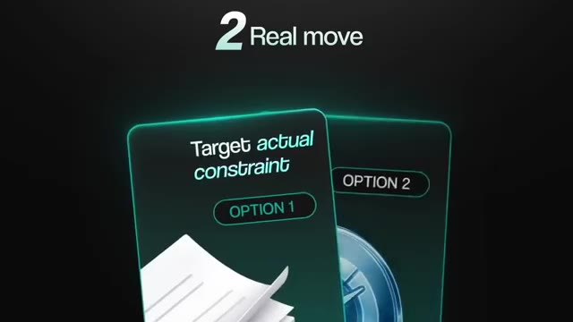
*⏱️ 00:12:36 — Un graphique stylisé affiche "2 Real move" avec les mentions "Target actual constraint" et des boutons "OPTION 1" / "OPTION 2".*

---

### ⏱️ `[00:12:54 - 00:13:14]` | Segment #36

**🔊 Audio (Transcription Intégrale Mot pour Mot en Français) :**
> Parce que n'importe qui peut dire, hé, tu sais, j'ai construit cet agent IA. Presque personne ne peut dire j'ai construit un agent IA qui a fait bouger ce chiffre spécifique de tant pour cette entreprise spécifique, ce qui a généré X pour cent de profit en plus ou, tu sais, X clients de plus ou peu importe quelle est la métrique. Et c'est exactement ça qui vous démarque. Le modèle opérationnel complet derrière tout ça se trouve dans un livre que je suis en train d'écrire. Mais pour les besoins de cette feuille de route, la règle est très simple. La contrainte d'abord, le KPI ensuite, la construction en troisième.

**👁️ Analyse Visuelle d'Écran (gemini-3.5-flash-lite) :**
**Interface & Outils** : Interface utilisateur de type "Chatbot" (simulée graphiquement).

**Contenu textuel & Code** : "I built an agent that moved this specific number by [ this much ] for this specific business, which resulted in X percent more profit or X more customers"

**Action / Démonstration** : Affichage progressif du texte dans l'interface de chat pour illustrer le discours du présentateur sur la valeur ajoutée des agents IA.

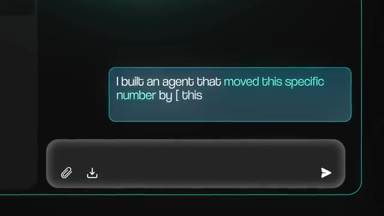
*⏱️ 00:12:59 — Une interface de chat stylisée affichant une bulle de message avec du texte concernant la construction d'un agent IA.*

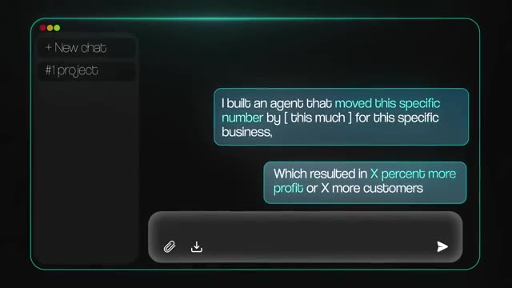
*⏱️ 00:13:04 — La même interface de chat mise à jour, affichant deux bulles de message détaillant l'impact commercial d'un agent IA (profit/clients).*

---

### ⏱️ `[00:13:14 - 00:13:33]` | Segment #37

**🔊 Audio (Transcription Intégrale Mot pour Mot en Français) :**
> Donc, la première étape, c'est d'auditer votre propre rôle. Posez-vous avec ce prisme des contraintes dont nous venons de parler et passez en revue votre travail. Au lieu de lister chaque tâche répétitive que vous faites, demandez-vous laquelle ralentit réellement l'équipe, bloque les revenus ou cause une vraie douleur quelque part en aval que personne ne résout actuellement. Et c'est ça, votre vraie liste. Ensuite, pour chaque élément, notez le chiffre précis que vous essaieriez de faire bouger si vous le régliez, la métrique spécifique.

**👁️ Analyse Visuelle d'Écran (gemini-3.5-flash-lite) :**
**Interface & Outils** : AUCUNE

**Contenu textuel & Code** : Texte incrusté à l'écran listant les trois critères d'audit du rôle (« Which one is actually slowing the team? », « Which one is gating revenue? », « Which one is causing real pain? »).

**Action / Démonstration** : Présentation orale des critères d'audit avec apparition animée du texte à l'écran.

---

### ⏱️ `[00:13:33 - 00:13:51]` | Segment #38

**🔊 Audio (Transcription Intégrale Mot pour Mot en Français) :**
> Et voilà, c'est votre première liste de projets. Pas les choses faciles, mais ce qui compte vraiment. La deuxième étape consiste à entreprendre de petits projets. Vous choisissez donc un élément de cette liste, vous en définissez la portée et vous construisez une solution pour celui-ci. Ensuite, vous demandez si vous pouvez l'implémenter dans une seule zone de l'entreprise. Juste un petit coin de l'entreprise où vous pouvez réellement tester quelque chose, prouver que cela fonctionne et montrer de vrais résultats.

**👁️ Analyse Visuelle d'Écran (gemini-3.5-flash-lite) :**
**Interface & Outils** : Graphique animé de présentation (type motion design).

**Contenu textuel & Code** : Texte affichant "4 Steps", "1 Self-Audit" et "2 Take on small projects" disposés autour d'un cercle central.

**Action / Démonstration** : Illustration visuelle des étapes du processus de travail mentionné par le présentateur.

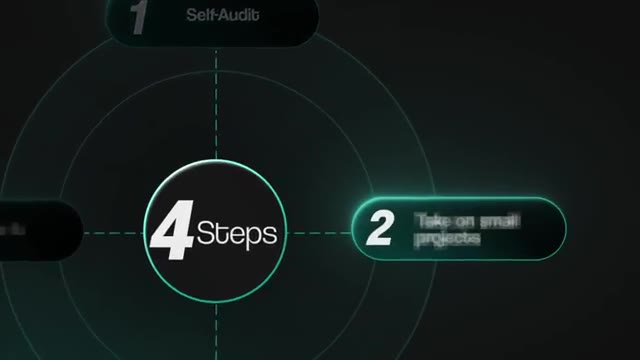
*⏱️ 00:13:37 — Un graphique circulaire stylisé présentant un processus en "4 Steps", avec l'étape 2 "Take on small projects" mise en évidence.*

---

### ⏱️ `[00:13:51 - 00:14:12]` | Segment #39

**🔊 Audio (Transcription Intégrale Mot pour Mot en Français) :**
> Parce que ces résultats, quels qu'ils finissent par être, sont concrètement votre première étude de cas. Vous pouvez la montrer à votre patron. Vous pouvez la montrer à votre équipe. Vous pouvez la mettre sur votre portfolio. Vous pouvez la poster sur LinkedIn. Juste pour que les gens commencent à le remarquer. La troisième étape consiste ensuite à devenir un expert dans la résolution de problèmes, et pas seulement dans la construction. C'est en fait l'étape la plus importante de cette feuille de route. Parce qu'une fois que vous avez réalisé suffisamment de ces petites créations, vous commencez à voir les schémas sous-jacents. Vous commencez à remarquer que les entreprises ne cessent de se heurter à la même poignée de problèmes, encore et encore.

**👁️ Analyse Visuelle d'Écran (gemini-3.5-flash-lite) :**
**Interface & Outils** : Page web de présentation et graphisme vidéo d'animation.

**Contenu textuel & Code** : Texte marketing et étapes méthodologiques pour la création d'automatisations.

**Action / Démonstration** : Présentation théorique et illustration visuelle de concepts d'automatisation.

---

### ⏱️ `[00:14:12 - 00:14:34]` | Segment #40

**🔊 Audio (Transcription Intégrale Mot pour Mot en Français) :**
> Et c'est bien là la dernière compétence dont vous avez besoin pour devenir un vrai consultant. Vous arrêtez d'être la personne qui se contente de construire tout ce qu'on lui donne. Vous êtes maintenant la personne qui peut arriver dans une situation, trouver le vrai problème, concevoir le système et résoudre le problème. Et dès que cela se produit, vos collègues commencent à venir vous voir au lieu que ce soit l'inverse. Ensuite, la quatrième étape consiste à formaliser tout ça. Une fois que vous avez fourni assez de preuves que l'entreprise a réellement besoin de ce genre de personne dans ses effectifs, c'est là que vous officialisez la chose.

**👁️ Analyse Visuelle d'Écran (gemini-3.5-flash-lite) :**
**Interface & Outils** : Graphismes animés incrustés dans la vidéo YouTube (style motion design minimaliste).

**Contenu textuel & Code** : Texte affiché : "FIND THE PROBLEM", "DESIGN THE SYSTEM", "SOLVE THE PROBLEM", "4 Formalize it", "4 Steps".
[DESC_IMAGE_1] Aucun élément technique pertinent (gros plan présentateur).

**Action / Démonstration** : Explications face caméra et démonstration conceptuelle.

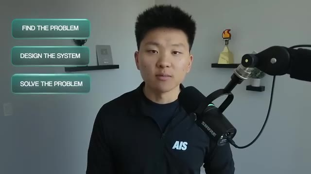
*⏱️ 00:14:23 — Le présentateur apparaît avec trois encadrés de texte superposés à gauche : "FIND THE PROBLEM", "DESIGN THE SYSTEM", "SOLVE THE PROBLEM".*

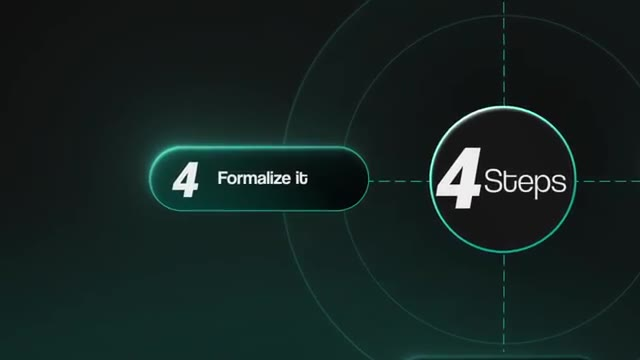
*⏱️ 00:14:28 — Un graphique stylisé avec le texte "4 Formalize it" et un badge circulaire "4 Steps".*

---

### ⏱️ `[00:14:34 - 00:14:54]` | Segment #41

**🔊 Audio (Transcription Intégrale Mot pour Mot en Français) :**
> Tu vas voir ton patron ou ton équipe de direction avec les preuves, et tu proposes le poste toi-même. La plupart d'entre vous ne vont pas trouver ce boulot affiché sur LinkedIn. Vous allez peut-être le créer de l'intérieur. Et la seule raison pour laquelle vous pouvez réussir ça, c'est parce que vous avez passé les étapes un à trois à bâtir discrètement le dossier pour y arriver. Et même si l'organisation n'est pas encore prête à avoir ce rôle, quand elle sera prête, inévitablement, tu veux être le premier nom qui leur vient à l'esprit.

**👁️ Analyse Visuelle d'Écran (gemini-3.5-flash-lite) :**
**Interface & Outils** : Aucun éditeur ou logiciel technique, simple incrustation de texte vidéo.

**Contenu textuel & Code** : Liste à 3 éléments : 1. Self-Audit, 2. Take on small projects, 3. Expert at solving problems.

**Action / Démonstration** : Présentation des étapes clés sous forme de liste animée à l'écran.

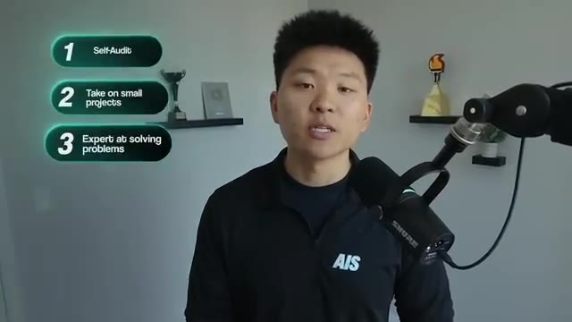
*⏱️ 00:14:44 — Le présentateur apparaît à l'écran avec une liste à puces animée sur la gauche affichant 3 étapes clés.*

---

### ⏱️ `[00:14:54 - 00:15:14]` | Segment #42

**🔊 Audio (Transcription Intégrale Mot pour Mot en Français) :**
> Donc voilà toute la feuille de route. Auditer, construire, reconnaître les schémas, formaliser. Quatre étapes. Et vous vous souvenez quand je parlais de l'IA qui s'infiltre partout ? Vous n'avez pas besoin d'aller apprendre un secteur complètement nouveau. Pensez simplement à ce que vous faites déjà au jour le jour. En quoi êtes-vous doué ? Et comment l'IA peut-elle vous aider à avancer plus vite, à être plus intelligent et à obtenir de meilleurs résultats dans ce que vous faites déjà ? Et le truc cool ici, c'est que ce n'est pas théorique. Je me suis réellement assis avec quelqu'un de ma communauté qui a exécuté cette exact stratégie en temps réel.

**👁️ Analyse Visuelle d'Écran (gemini-3.5-flash-lite) :**
**Interface & Outils** : Interface graphique animée de présentation avec des icônes minimalistes.

**Contenu textuel & Code** : Deux blocs distincts étiquetés 'DAILY WORK' avec une icône de document et 'EXPERTISE' avec une icône de médaille.

**Action / Démonstration** : Animation graphique illustrant le lien entre le travail quotidien et l'expertise sectorielle.

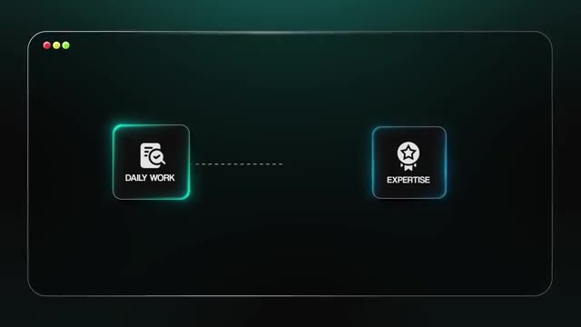
*⏱️ 00:15:04 — Schéma graphique animé illustrant les concepts de travail quotidien et d'expertise connectés par une ligne pointillée.*

---

### ⏱️ `[00:15:14 - 00:15:35]` | Segment #43

**🔊 Audio (Transcription Intégrale Mot pour Mot en Français) :**
> Elle s'appelle Aylan. Il y a environ un an, elle avait passé 15 ans en tant que développeur d'e-mails. Donc pas super technique, sans bagage en IA, mais toute son équipe a ensuite été licenciée et elle a dû trouver quelque chose de nouveau. Elle a donc commencé à apprendre de bout en bout. Elle s'est reconvertie dans le code cloud. Et pendant qu'elle apprenait, elle a fait la seule chose que les gens zappent, c'est-à-dire qu'elle a construit en public. Elle a lancé deux chaînes YouTube montrant simplement ce qu'elle fabriquait. Elle a publié ses créations sur LinkedIn. Elle a enregistré des démos de absolument tout ce sur quoi elle travaillait.

**👁️ Analyse Visuelle d'Écran (gemini-3.5-flash-lite) :**
**Interface & Outils** : VS Code, Claude Code (extension/terminal intégré)

**Contenu textuel & Code** : Code source TypeScript pour un agent automatisé utilisant trigger.dev, l'API Anthropic et Firecrawl.

**Action / Démonstration** : Présentation du code source et démonstration de l'outil de développement assisté par IA Claude Code.

*⏱️ 00:15:25 — Un éditeur de code (VS Code) affichant un script TypeScript (`morning-research.ts`) avec une incrustation vidéo d'Aylan parlant et l'interface de Claude Code.*

---

### ⏱️ `[00:15:35 - 00:15:54]` | Segment #44

**🔊 Audio (Transcription Intégrale Mot pour Mot en Français) :**
> Et le truc génial, c'est qu'elle n'a pas des milliers et des milliers d'abonnés et de followers. Elle a juste des preuves. Donc, lorsqu'elle a postulé pour un poste de responsable de l'IA dans une entreprise de 15 personnes appelée Young, le recruteur lui a envoyé un e-mail avec une seule question, qui était : qu'avez-vous construit ? Et rappelez-vous, c'est exactement la question dont je vous ai dit qu'elle décide qui gagne sur ce marché. Donc, au lieu d'avoir à taper une longue explication vague, elle a juste envoyé des liens.

**👁️ Analyse Visuelle d'Écran (gemini-3.5-flash-lite) :**
**Interface & Outils** : Interface web de Gmail affichée sur un écran d'ordinateur.

**Contenu textuel & Code** : E-mail de recrutement provenant de 'Young HR' avec la phrase en surbrillance : 'What have you built ?'.

**Action / Démonstration** : Affichage à l'écran de l'e-mail envoyé par le recruteur à Ailin Werner.

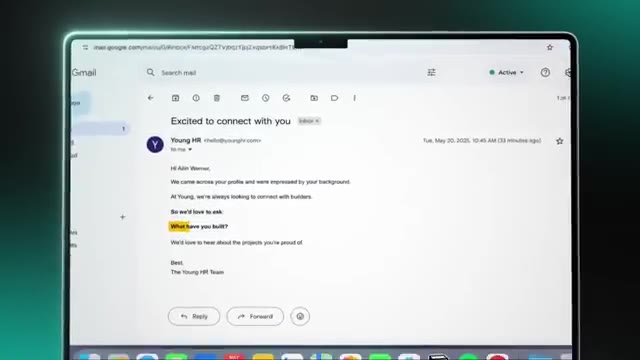
*⏱️ 00:15:44 — Capture d'écran d'un e-mail reçu dans Gmail de la part de l'équipe RH de Young posant la question 'What have you built ?'.*

---

### ⏱️ `[00:15:54 - 00:16:12]` | Segment #45

**🔊 Audio (Transcription Intégrale Mot pour Mot en Français) :**
> Elle vient juste d'envoyer son étude de cas. Elle a envoyé de vraies preuves. Et elle a pu sauter les RH complètement, aller directement voir le PDG, et elle a décroché le job. Donc, en un an, passer de pratiquement zéro en IA à responsable de l'IA, c'est vraiment génial. Si vous voulez voir l'interview complète que j'ai faite avec elle, je vais la taguer juste ici pour que vous puissiez aller voir ça. Laissez-moi donc résumer toute cette vidéo en une seule respiration. Vous n'avez pas besoin de quitter votre emploi. Vous n'avez pas besoin de construire une marque personnelle massive. Vous n'avez même pas besoin d'être super technique.

**👁️ Analyse Visuelle d'Écran (gemini-3.5-flash-lite) :**
**Interface & Outils** : AUCUNE

**Contenu textuel & Code** : AUCUNE

**Action / Démonstration** : AUCUNE

---

### ⏱️ `[00:16:13 - 00:16:31]` | Segment #46

**🔊 Audio (Transcription Intégrale Mot pour Mot en Français) :**
> La vraie démarche consiste à identifier une contrainte réelle dans votre rôle ou votre entreprise, à la lier à un indicateur clé de performance, à créer une solution, puis à en concevoir quelques autres afin d'avoir un véritable historique. Ensuite, publiez cet historique là où les gens peuvent réellement le voir, même s'il s'agit simplement d'un site web personnel où vous créez votre propre portfolio, bref, quelque chose que vous pouvez envoyer aux gens. Donc, si vous souhaitez obtenir de aide pour appliquer toute cette méthode, le lien dans la description mène vers ma communauté School gratuite.

**👁️ Analyse Visuelle d'Écran (gemini-3.5-flash-lite) :**
**Interface & Outils** : AUCUNE

**Contenu textuel & Code** : AUCUNE

**Action / Démonstration** : AUCUNE

---

### ⏱️ `[00:16:31 - 00:16:49]` | Segment #47

**🔊 Audio (Transcription Intégrale Mot pour Mot en Français) :**
> Tout ce dont nous avons parlé dans cette vidéo, je l'ai regroupé dans un guide de ressources gratuit auquel vous pouvez accéder, ainsi qu'à d'autres cours, dépôts GitHub, compétences, frameworks, et à des centaines de milliers de personnes qui cherchent à garder une longueur d'avance avec l'IA. C'est entièrement gratuit. C'est le premier lien dans la description. Mais bref, c'est tout pour aujourd'hui. Si vous avez aimé la vidéo ou si vous avez appris quelque chose de nouveau, n'hésitez pas à mettre un pouce bleu. Ça m'aide énormément.

**👁️ Analyse Visuelle d'Écran (gemini-3.5-flash-lite) :**
**Interface & Outils** : Plateforme de communauté en ligne (AI Automation Society / Skool).

**Contenu textuel & Code** : Liste des membres de la communauté, profils utilisateurs, statistiques de membres.
[DESC_IMAGE_2] Navigation dans l'annuaire des membres de la communauté de la plateforme AIS.

**Action / Démonstration** : Explications face caméra et démonstration conceptuelle.

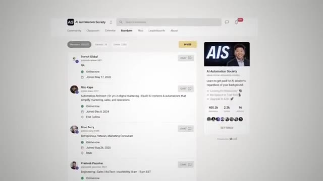
*⏱️ 00:16:40 — Capture d'écran de l'interface de la communauté en ligne "AI Automation Society" (AIS) affichant la liste des membres.*

---

### ⏱️ `[00:16:49 - 00:16:53]` | Segment #48

**🔊 Audio (Transcription Intégrale Mot pour Mot en Français) :**
> Et comme toujours, je vous remercie d'être arrivés jusqu'à la fin de la vidéo et je vous vois tous dans la prochaine. Merci les gars.

**👁️ Analyse Visuelle d'Écran (gemini-3.5-flash-lite) :**
**Interface & Outils** : Aucun logiciel ni interface affichés.

**Contenu textuel & Code** : Aucun code ni texte informatif à l'écran.

**Action / Démonstration** : Le présentateur fait ses adieux et clôture la vidéo.

---

