# 🎬 I Battle Tested Sakana Fugu's Fable Killer

> **Chaîne** : [Nate Herk | AI Automation](https://www.youtube.com/@nateherk/featured)  
> **Lien YouTube** : [https://www.youtube.com/watch?v=GpSqBjW6hR4](https://www.youtube.com/watch?v=GpSqBjW6hR4)  
> **Date de publication** : 20260623  
> **Durée** : 00:12:15  
> **Identifiant vidéo** : `GpSqBjW6hR4`  
> **Transcription & Analyse** : `whisper-v3-large-turbo+gemini-3.5-flash-lite`  

---

## 📌 Synthèse Exécutive & Outils

### 💡 Résumé
Dans cette vidéo, Nate Herk plonge au cœur des performances de **Fugu Ultra**, le modèle multi-agents développé par l'entreprise japonaise Sakana.ai (surnommé le "Fable Killer"), conçu pour rivaliser avec les modèles de pointe sans les contraintes des contrôles à l'exportation. À travers une démonstration concrète, l'analyste montre comment une simple invite de commande de type *"slash goal"* injectée dans Claude Code via Fugu Ultra a permis de générer en moins d'une heure un tableau de bord analytique complet, interactif et doté d'analyses prédictives. Ce système repose sur une API unique qui orchestre dynamiquement un ensemble de modèles de pointe (comme GPT-5.5, Gemini, et Opus) en agissant comme un chef d'orchestre intelligent, découpant les tâches complexes pour les déléguer à des sous-agents spécialisés.

Cependant, les tests rigoureux menés par Nate en opposant Fugu Ultra à Claude Opus 4.8 à travers 38 cas d'usage nuancent l'engouement viral suscité par l'outil. Les résultats montrent que sur 38 tâches, 36 se sont soldées par une égalité de performance fonctionnelle. La véritable différence réside dans les coûts opérationnels et l'efficacité temporelle : Fugu Ultra s'est révélé **4,5 fois plus lent** et **5 fois plus cher**, tout en consommant beaucoup plus rapidement les quotas d'abonnements. Néanmoins, l'intégration de Fugu Ultra dans des environnements de développement comme Claude Code via des fichiers de configuration personnalisés démontre le potentiel puissant mais coûteux des architectures d'orchestration multi-modèles.

---

### 🛠️ Outils, Modèles & Logiciels Présentés
* **Fugu Ultra / Fugu (Sakana.ai)** : Modèle multi-agents japonais orchestrant dynamiquement différents LLM de pointe (GPT, Gemini, Opus) via une API unique pour résoudre des tâches complexes.
* **Claude Code** : Environnement de développement assisté par IA d'Anthropic permettant de lancer des sous-agents et des flux de travail dynamiques.
* **Claude Opus (notamment v4.8 et versions futures)** : Modèle de langage haut de gamme d'Anthropic utilisé à la fois comme référence comparative et comme brique de base potentielle au sein d'architectures d'orchestration.
* **GPT-5.5** : Modèle de pointe d'OpenAI fréquemment mobilisé pour des tâches de code et de correction de bugs par les systèmes multi-agents.
* **Gemini** : Modèle de Google exploité pour des missions spécifiques de recherche et de traitement factuel au sein des pipelines d'orchestration.
* **API OpenRouter Fusion** : Alternative architecturale qui envoie simultanément des requêtes à plusieurs modèles avant de fusionner les résultats à l'aide d'un LLM juge.

---

### 🔑 Points Clés & Enseignements Stratégiques
* **Principe du système multi-agents packagé** : Fugu n'est pas un nouveau LLM monolithique révolutionnaire, mais une API d'orchestration intelligente qui emballe un chef d'orchestre et des sous-agents spécialisés pour automatiser le routage des requêtes.
* **Granularité de la délégation des tâches** : L'efficacité d'un tel système repose sur sa capacité à répondre à deux questions fondamentales : identifier quel modèle spécialisé gère chaque sous-tâche (ex: Claude pour la rédaction, GPT pour le code), puis combiner les résultats finaux.
* **Le mythe de la supériorité absolue** : Bien que Fugu surpasse certains benchmarks en combinant les forces de plusieurs modèles, les tests comparatifs rigoureux montrent des performances équivalentes (36 égalités sur 38 tests) face à un modèle de pointe unique comme Claude Opus 4.8.
* **Le coût caché de l'orchestration** : L'utilisation de Fugu Ultra engendre un surcoût économique et temporel important, s'avérant 5 fois plus cher et 4,5 fois plus lent que l'utilisation directe de modèles natifs de référence.
* **Épuisement rapide des quotas** : L'architecture multi-appels de Fugu consomme les fenêtres d'utilisation et les limites d'abonnement (forfaits à 100 ou 200 dollars par mois) beaucoup plus rapidement que les environnements de développement traditionnels.
* **Parallélisme vs Orchestration séquentielle** : Contrairement à des approches comme OpenRouter Fusion (qui interroge plusieurs modèles en parallèle pour unifier leurs réponses via un juge), Fugu découpe sélectivement la tâche pour exploiter l'expertise pointue de chaque modèle.
* **Intégration transparente dans les workflows existants** : Il est possible d'exploiter Fugu Ultra au sein de ses propres outils de développement (comme Claude Code) en fournissant un fichier de configuration markdown et une clé API dédiée.
* **Optimisation de la fenêtre de contexte** : Certains proxys ou modes de routage utilisés pour connecter Fugu à des environnements distants permettent de préserver la fenêtre de contexte sur de nombreux tours de conversation sans saturer inutilement la mémoire.
* **Spécialisation fonctionnelle par l'IA** : La règle d'or en ingénierie IA reste de considérer chaque modèle selon ses forces spécifiques (design, code, rédaction) et d'enchaîner leurs compétences pour maximiser la qualité des livrables.
* **Gestion du biais dans les tests comparatifs** : Pour évaluer objectivement un modèle d'orchestration face à un LLM classique, l'utilisation de tests générés par un tiers (comme Codex) s'avère indispensable pour éviter toute contamination croisée.
* **Accessibilité des ressources communautaires** : Les configurations techniques, les fichiers markdown d'intégration et les codes sources générés (comme les tableaux de bord HTML) peuvent être partagés et industrialisés via des communautés de pratiques spécialisées (ex: Free School).

---

## ⏱️ Chronologie & Transcription Complète Audio & Visuelle (Mot pour Mot)

### ⏱️ `[00:00:00 - 00:00:20]` | Segment #01

**🔊 Audio (Transcription Intégrale Mot pour Mot en Français) :**
> Voici Sakana Fugu. Notre modèle Fugu Ultra égale les performances de Fable et Mythos, offrant des capacités de pointe sans le risque des contrôles à l'exportation. Donc, évidemment, nous avons dû mettre cela à l'épreuve. Vous pouvez voir ici même dans mon code cloud, je tourne sur Fugu Ultra 1 million. Vous pouvez voir que la liste des tâches qui est reportée concerne notre fonctionnalité de tableau de bord et nos visuels.

**👁️ Analyse Visuelle d'Écran (gemini-3.5-flash-lite) :**
**Interface & Outils** : VS Code, Terminal Claude Code

**Contenu textuel & Code** : `fugu-ultra[1m] with xhigh effort - API Usage Billing`, liste des tâches : inspection, création d'un tableau de bord, vérification.

**Action / Démonstration** : Exécution d'agents de codage et de tâches de développement via l'interface de Claude Code dans VS Code.

![Interface VS Code affichant le terminal Claude Code avec le modèle fugu-ultra[1m] en cours d'utilisation et le mode automatique activé.](../screenshots/GpSqBjW6hR4/GpSqBjW6hR4_000010_seg1.jpg)
*⏱️ 00:00:10 — Interface VS Code affichant le terminal Claude Code avec le modèle fugu-ultra[1m] en cours d'utilisation et le mode automatique activé.*

---

### ⏱️ `[00:00:20 - 00:00:55]` | Segment #02

**🔊 Audio (Transcription Intégrale Mot pour Mot en Français) :**
> Donc ce que j'ai fait, c'est que je lui ai donné cette invite de commande barre oblique d'objectif, que vous pouvez lire très rapidement si vous le voulez. C'était juste moi, vous savez, en train de parler dans Glido. Et puis, après presque une heure, j'ai récupéré ce tableau de bord, ce qui est honnêtement vraiment impressionnant. Il peut actualiser des données en direct. Si je clique sur ce bouton, vous pouvez voir mes statistiques. Vous pouvez voir le pouls de l'audience. Vous pouvez voir ma distribution des performances, la médiane, les valeurs aberrantes, des trucs comme ça. Je peux voir ce qui fonctionne. Je peux voir ce qui est en hausse. Je peux voir ce qui est sous-performant. Je peux voir des recommandations. Donc non seulement j'obtiens des données réelles sur mon tableau de bord YouTube, mais j'obtiens aussi une analyse par IA. Je peux regarder des vidéos et voir des métriques spécifiques pour chacune. Je peux regarder l'audience et les commentaires. Je peux regarder la stratégie. Et tout cela

**👁️ Analyse Visuelle d'Écran (gemini-3.5-flash-lite) :**
**Interface & Outils** : Éditeur de code, interface web de tableau de bord

**Contenu textuel & Code** : Prompt détaillé pour l'agent de codage IA et tableau de bord analytique YouTube avec graphiques de performance

**Action / Démonstration** : Présentation du prompt initial donné à l'agent IA, puis affichage du résultat final généré (tableau de bord complet).

*⏱️ 00:00:29 — Un éditeur de code affichant un prompt détaillé commençant par `/goal` demandant de créer un tableau de bord YouTube complet.*

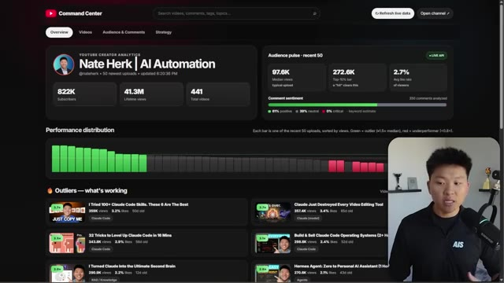
*⏱️ 00:00:38 — Le tableau de bord YouTube final et fonctionnel généré par l'IA, affichant des statistiques d'abonnés, des graphiques de performance et les vidéos récentes.*

---

### ⏱️ `[00:00:55 - 00:01:28]` | Segment #03

**🔊 Audio (Transcription Intégrale Mot pour Mot en Français) :**
> était un prompt unique de type "slash goal" avec Fugu Ultra. Donc ceci nous est présenté par Sakana.ai, qui est une entreprise japonaise. Sakana signifie poisson, et c'est un peu ce que vous pouvez voir ici. Nous avons un tas de petits poissons qui se rassemblent pour former un plus grand poisson, et c'est fondamentalement ainsi que fonctionne le modèle Fugu. C'est un système multi-agents livré sous la forme d'un seul modèle. Donc en gros, nous avons une seule API à solliciter, et cette API orchestre et achemine vers différents modèles de pointe. Donc Opus, GPT, Gemini, et probablement quelques autres. Fugu atteint des performances supérieures en coordonnant et en orchestrant dynamiquement un

**👁️ Analyse Visuelle d'Écran (gemini-3.5-flash-lite) :**
**Interface & Outils** : Navigateur web (site web de Sakana Fugu)

**Contenu textuel & Code** : Texte de présentation de Sakana Fugu et schéma d'architecture multi-agent

**Action / Démonstration** : Navigation sur la page web de présentation de Sakana Fugu par le présentateur

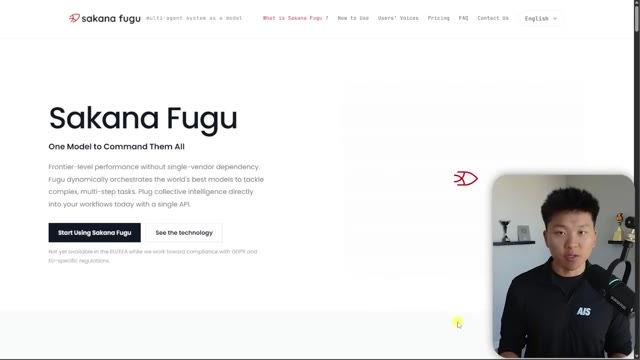
*⏱️ 00:01:04 — Page web officielle de Sakana Fugu avec le titre principal 'One Model to Command Them All' et le présentateur incrusté en bas à droite.*

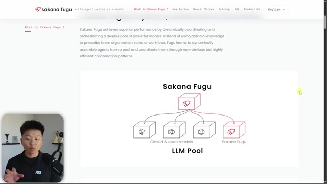
*⏱️ 00:01:20 — Schéma explicatif sur le site web de Sakana Fugu illustrant le système multi-agent et le pool de LLM, avec le présentateur en bas à gauche.*

---

### ⏱️ `[00:01:28 - 00:02:05]` | Segment #04

**🔊 Audio (Transcription Intégrale Mot pour Mot en Français) :**
> un ensemble diversifié de modèles puissants. Donc honnêtement, ce n'est vraiment rien de nouveau. C'est fondamentalement un agent principal qui orchestre un groupe de sous-agents dotés de modèles différents et de spécialités différentes. Cela fait simplement un bel emballage pour vous. Vous savez, j'ai toujours dit que lorsque vous travaillez avec des modèles d'IA, vous devez toujours penser que chaque IA fait une chose très bien, une chose très spécifique. Et c'est ainsi que vous obtenez d'excellents résultats en enchaînant ces résultats vers le suivant. Et c'est ainsi qu'ils parviennent à atteindre certains de ces critères de référence ici, comme vous pouvez le voir, où nous avons Fugu qui surpasse Fable, qui surpasse GPT 5.5, qui surpasse Opus 4.8, parce qu'il orchestre ces modèles ensemble. Donc, juste pour être clair, Fugu n'est pas son propre

**👁️ Analyse Visuelle d'Écran (gemini-3.5-flash-lite) :**
**Interface & Outils** : Navigateur web affichant le site officiel de Sakana Fugu (système multi-agents).

**Contenu textuel & Code** : Schémas d'architecture du LLM Pool, descriptions des fonctionnalités de l'API et graphiques de benchmarks de performance comparative.

**Action / Démonstration** : Présentation des capacités, de l'architecture multi-agents et des performances quantitatives des modèles Fugu par rapport aux modèles du marché.

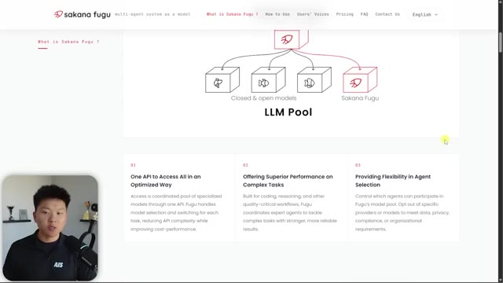
*⏱️ 00:01:37 — Capture d'écran montrant le site web de Sakana Fugu détaillant le pool de LLM multi-agents avec des schémas d'architecture et des fonctionnalités.*

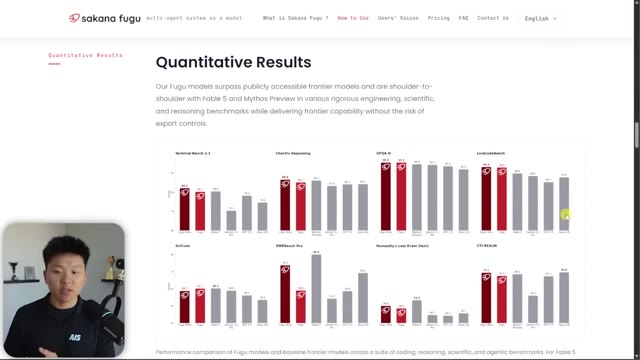
*⏱️ 00:01:47 — Capture d'écran du site web affichant les résultats quantitatifs sous forme de graphiques de performance comparative par rapport à d'autres modèles.*

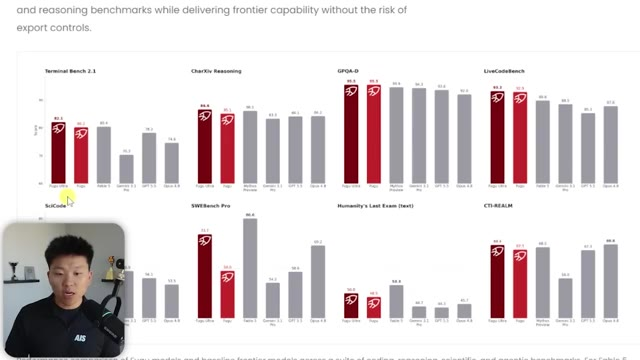
*⏱️ 00:01:56 — Gros plan sur les graphiques de benchmarks de performance (Terminal Bench, CharXiv, GPQA-D, LiveCodeBench, etc.) du site Sakana Fugu.*

---

### ⏱️ `[00:02:05 - 00:02:27]` | Segment #05

**🔊 Audio (Transcription Intégrale Mot pour Mot en Français) :**
> grand modèle de langage qui est meilleur que Fable. Il est dit qu'ils ont réussi à obtenir de meilleurs résultats que Fable et Mythos Preview sur certains benchmarks en orchestrant des modèles ensemble. Mais ce tweet d'annonce en un jour est devenu hyper viral, donc évidemment nous devions vérifier ça. J'ai donc fini par faire tourner Fugu Ultra contre Claude Opus 4.8 à travers 38 tests différents, et je m'apprête à plonger dans ce que j'ai réellement découvert et la façon dont je ressens la manière dont j'utiliserais ceci et tout le reste.

**👁️ Analyse Visuelle d'Écran (gemini-3.5-flash-lite) :**
**Interface & Outils** : Navigateur web affichant un site de benchmarks et une page explicative sur le fonctionnement de FAGU.

**Contenu textuel & Code** : Graphiques de performance comparative et schémas d'architecture d'orchestration de modèles d'intelligence artificielle.
[DESC_IMAGE_3] Visualisation du workflow d'orchestration de FAGU comparé à un agent unique (soloist).

**Action / Démonstration** : Explications face caméra et démonstration conceptuelle.

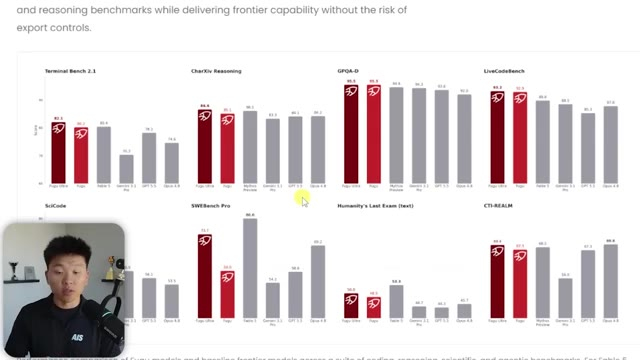
*⏱️ 00:02:10 — Graphiques de benchmarks comparant FAGU avec d'autres modèles d'IA sur divers critères (Terminal Bench, CharXiv, GPQA, etc.).*

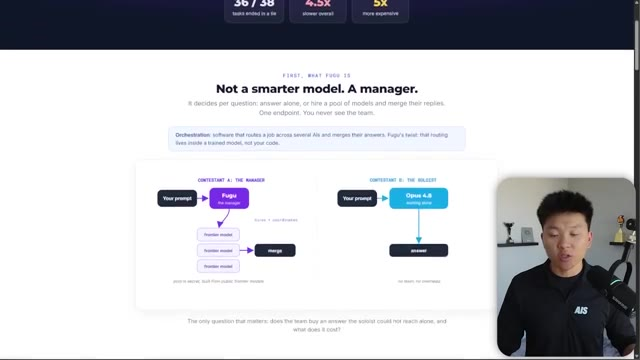
*⏱️ 00:02:21 — Schéma comparatif d'architecture entre FAGU (fonctionnant comme un manager orchestrant plusieurs modèles) et un modèle solo classique.*

---

### ⏱️ `[00:02:27 - 00:02:49]` | Segment #06

**🔊 Audio (Transcription Intégrale Mot pour Mot en Français) :**
> Donc, plongeons-nous directement dans la vidéo d'aujourd'hui. Tout d'abord, oui, j'ai pu utiliser Fugu Ultra dans Cloud Code. Si vous voulez savoir exactement comment, je vais joindre un fichier markdown dans ma communauté Freeschool que vous pourrez donner à Cloud Code, et ensuite tout ce que vous avez à faire, c'est de lui donner ce fichier markdown, de lui donner votre clé API, et vous serez opérationnels. Donc, ma communauté Free School est liée dans la description. Rejoignez la Free School, allez dans la salle de classe, allez dans toutes les ressources YouTube, et vous y trouverez toutes mes ressources gratuitement.

**👁️ Analyse Visuelle d'Écran (gemini-3.5-flash-lite) :**
**Interface & Outils** : VS Code, terminal Claude Code, interface Web Skool (AI Automation Society)

**Contenu textuel & Code** : "Claude Code v2.1.183 - fugu-ultra[1m] with xhigh effort", commande "/clear" et réponse de l'agent "I'm fugu-ultra, a worker agent within the Fugu orchestration system."

**Action / Démonstration** : Le présentateur montre l'utilisation de l'agent Fugu Ultra dans Claude Code puis présente la communauté en ligne où se trouve le fichier markdown mentionné.

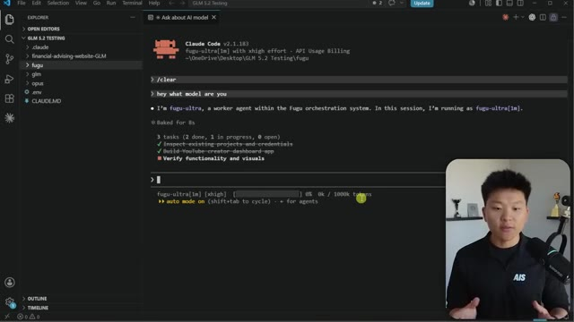
*⏱️ 00:02:32 — Interface VS Code affichant un terminal Claude Code avec l'agent fugu-ultra en cours d'utilisation, et le présentateur dans un encadré vidéo en bas à droite.*

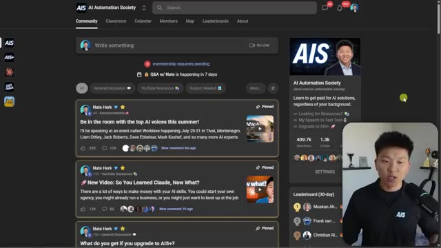
*⏱️ 00:02:43 — Interface Web de la communauté 'AI Automation Society' (Skool) avec des publications épinglées et le présentateur en bas à droite.*

---

### ⏱️ `[00:02:49 - 00:03:24]` | Segment #07

**🔊 Audio (Transcription Intégrale Mot pour Mot en Français) :**
> Donc c'était le premier exemple principal que je vous ai montré, n'est-ce pas ? Donc Fugu a construit tout cela, mais il a évidemment utilisé une combinaison de GPT, probablement un petit peu de Gemini pour des questions de design. Il a utilisé GPT 5.5 et peut-être d'autres modèles de pointe à l'intérieur de tout ça. Donc en gros, ce qui se passe, c'est que nous appelons une seule API où nous avons un petit modèle gestionnaire, qui est littéralement entraîné juste pour décomposer une tâche, puis la transmettre à tout un tas de modèles d'IA différents. Nous posons donc la question au chef d'orchestre, et le chef d'orchestre l'externalise à des spécialistes. Donc Claude peut-être pour la rédaction, GPT peut-être pour le code et la correction de bugs, et Gemini pour la recherche et les faits. Et il y a aussi d'autres modèles vers lesquels il délègue en fonction de

**👁️ Analyse Visuelle d'Écran (gemini-3.5-flash-lite) :**
**Interface & Outils** : Page web d'explication de Fugu Ultra et diagramme conceptuel.

**Contenu textuel & Code** : Schéma illustrant "The Conductor" qui distribue les requêtes utilisateur vers Claude, GPT et Gemini.

**Action / Démonstration** : Explication visuelle de l'orchestration de plusieurs modèles d'IA par une API unique.

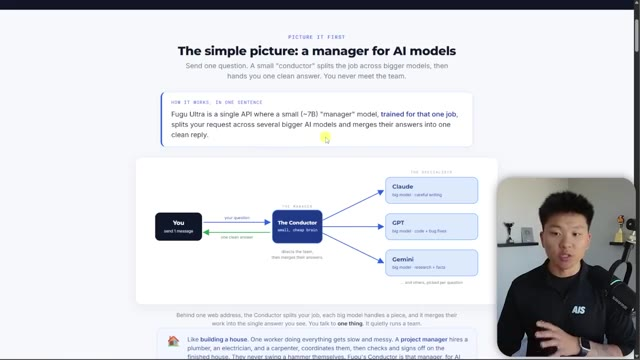
*⏱️ 00:03:06 — Page web explicative montrant le fonctionnement de Fugu Ultra et son architecture en diagramme (The Conductor).*

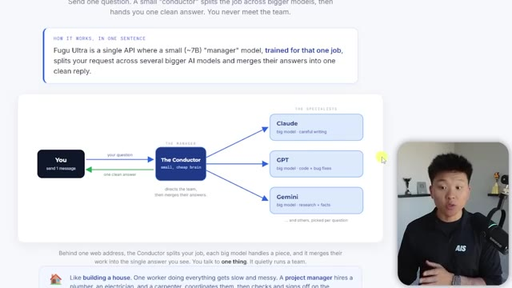
*⏱️ 00:03:15 — Gros plan sur le schéma d'architecture de Fugu Ultra montrant la répartition des requêtes entre Claude, GPT et Gemini.*

---

### ⏱️ `[00:03:24 - 00:03:54]` | Segment #08

**🔊 Audio (Transcription Intégrale Mot pour Mot en Français) :**
> sur la complexité de la tâche. Et tout est une question d'orchestration pour décider qui fait le travail. Du côté gauche du spectre, vous écrivez tout. Vous décidez qui fait quoi. Et à l'extrême droite, vous avez un modèle qui fait tout cela automatiquement. Et le truc intéressant, c'est que ce modèle n'a rien de nouveau. Vous le faites probablement déjà chaque jour sans même vous en rendre compte, ou peut-être vous en rendez-vous compte, mais c'est essentiellement la même façon que Claude Code lance des sous-agents ou des flux de travail dynamiques et sous-traite, découpe un plan et sous-traite des tâches à un travailleur Haiku, ou un travailleur Sonnet, ou peut-être à un groupe de travailleurs Opus supplémentaires.

**👁️ Analyse Visuelle d'Écran (gemini-3.5-flash-lite) :**
**Interface & Outils** : Page web explicative avec diagrammes et infographies

**Contenu textuel & Code** : Diagrammes conceptuels sur le routage des agents IA ("routing as code", "routing as config", "routing as model") et comparaison entre Claude Code et Fugu Ultra.

**Action / Démonstration** : Présentation et explication visuelle des différents niveaux d'orchestration et de routage des modèles d'IA par le présentateur.

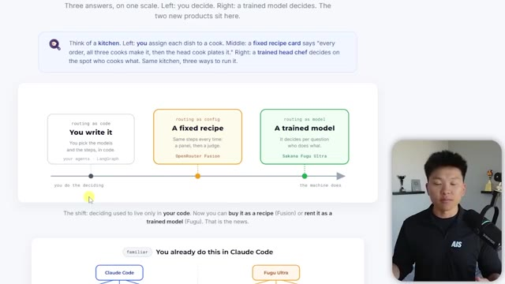
*⏱️ 00:03:31 — Schéma conceptuel montrant une échelle d'orchestration d'IA avec trois approches : "You write it" (à gauche), "A fixed recipe" (au centre) et "A trained model" (à droite), avec le présentateur en médaillon.*

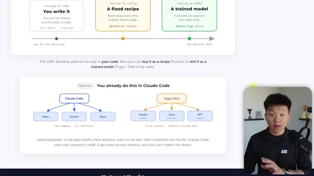
*⏱️ 00:03:39 — Schéma comparatif illustrant "You already do this in Claude Code" avec des arborescences de modèles (Claude Code avec Haiku, Sonnet, Opus vs Fugu Ultra avec Gemini, Opus, GPT).*

*⏱️ 00:03:46 — Vue similaire du schéma comparatif sur Claude Code et Fugu Ultra, avec le texte explicatif sur l'orchestration multi-fournisseurs.*

---

### ⏱️ `[00:03:54 - 00:04:18]` | Segment #09

**🔊 Audio (Transcription Intégrale Mot pour Mot en Français) :**
> Sauf qu'au lieu que Claude Code orchestre entre les modèles Claude, nous avons Fugu Ultra qui orchestre entre différents modèles. Et c'est là que vous pouvez devenir vraiment puissant et avoir une sorte de mélange d'experts ici, car nous savons tous que GPT a des points forts par rapport à Opus et vice versa. Et vous êtes donc capable d'obtenir le meilleur des, j'allais dire des deux mondes, mais le meilleur de tous les mondes parce que Fugu est en quelque sorte entraîné à comprendre quels modèles sont bons en quoi et où déléguer quoi.

**👁️ Analyse Visuelle d'Écran (gemini-3.5-flash-lite) :**
**Interface & Outils** : Page web de présentation avec schéma comparatif et incrustation vidéo du présentateur en bas à droite.

**Contenu textuel & Code** : Diagrammes d'architecture comparative : "Claude Code" (Haiku, Sonnet, Opus - "one company, all Anthropic") vs "Fugu Ultra" (Gemini, Opus, GPT - "three vendors, behind a closed door"). Texte explicatif sous les schémas.

**Action / Démonstration** : Le présentateur explique et compare visuellement les architectures d'orchestration de modèles d'IA entre Claude Code et Fugu Ultra.

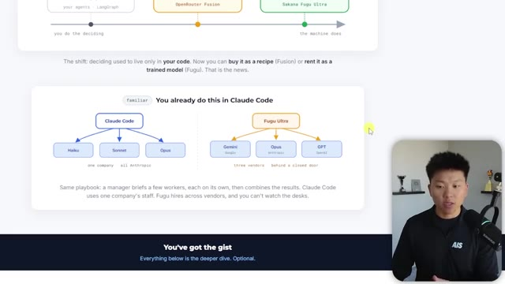
*⏱️ 00:04:00 — Schéma comparatif montrant d'un côté l'orchestration par Claude Code entre différents modèles Anthropic (Haiku, Sonnet, Opus) et de l'autre l'orchestration par Fugu Ultra entre plusieurs fournisseurs (Gemini, Opus, GPT).*

---

### ⏱️ `[00:04:19 - 00:04:37]` | Segment #10

**🔊 Audio (Transcription Intégrale Mot pour Mot en Français) :**
> Donc c'est tout ce que c'est. C'est juste une API d'orchestration vraiment intelligente. Ça vous l'emballe joliment. Et donc si beaucoup d'entre vous travaillent déjà avec Codex et Claude Code et d'autres modèles sur une même base de code, c'est fondamentalement ça, sauf que vous en faites un peu moins manuellement. Ça se fait automatiquement, la délégation. Et l'orchestration, c'est vraiment juste deux petites questions. La première question, c'est qui fait chaque partie ?

**👁️ Analyse Visuelle d'Écran (gemini-3.5-flash-lite) :**
**Interface & Outils** : Navigateur web présentant une infographie explicative et une incrustation vidéo.

**Contenu textuel & Code** : Texte explicatif et diagramme schématique illustrant l'échelle de décision entre le code utilisateur, une recette fixe et un modèle entraîné.

**Action / Démonstration** : Le présentateur explique les différents modes d'orchestration et de routage des modèles d'IA.

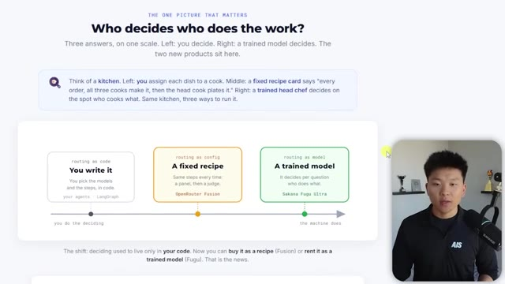
*⏱️ 00:04:23 — Une page web présentant un diagramme comparatif intitulé 'Who decides who does the work?' avec trois approches de routage : You write it, A fixed recipe, et A trained model. Le présentateur apparaît dans un encadré vidéo en bas à droite.*

---

### ⏱️ `[00:04:37 - 00:04:55]` | Segment #11

**🔊 Audio (Transcription Intégrale Mot pour Mot en Français) :**
> Donc, si nous avons le travail X et que nous avons les tâches A, B et C, peut-être que le modèle A fait la tâche A, peut-être que le modèle B fait la tâche B, et ainsi de suite. Et puis, nous avons aussi la combinaison. Donc, une fois que tous les modèles individuels nous ont donné une sorte de réponse, nous avons besoin évidemment d'un autre LLM pour tout combiner ensemble et ensuite nous présenter cette réponse.

**👁️ Analyse Visuelle d'Écran (gemini-3.5-flash-lite) :**
**Interface & Outils** : Page web de présentation / documentation

**Contenu textuel & Code** : Texte explicatif sur l'orchestration, définissant deux questions clés : "1. Who does each part?" avec un schéma séparant un travail (the job) entre les modèles A, B et C, et "2. Who combines them?" avec un schéma de fusion des réponses.

**Action / Démonstration** : Le présentateur explique les concepts d'attribution des tâches aux différents modèles d'IA et de combinaison des résultats.

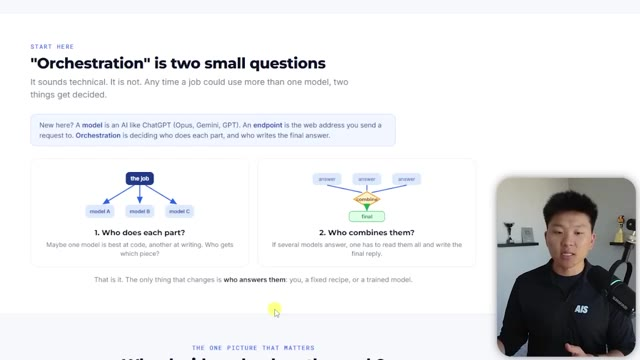
*⏱️ 00:04:42 — Une page web explicative montrant un diagramme sur l'orchestration des modèles d'IA, avec le présentateur visible dans un encadré vidéo en bas à droite.*

---

### ⏱️ `[00:04:56 - 00:05:15]` | Segment #12

**🔊 Audio (Transcription Intégrale Mot pour Mot en Français) :**
> Donc c'est très, très similaire à la façon dont vous travaillez déjà avec vos sous-agents Cloud Code. Maintenant, c'est pratiquement tout. Tout ce code HTML, je vais également l'inclure gratuitement dans ma communauté FreeSchool si vous voulez creuser un peu plus profondément. Oui, j'ai fait construire tout ce HTML par Fugu, juste pour que vous sachiez. Mais voici autre chose qui est plutôt intéressant. Je me disais, bon, c'est assez similaire à l'API OpenRouter Fusion, si vous avez vu quand elle est sortie l'autre semaine.

**👁️ Analyse Visuelle d'Écran (gemini-3.5-flash-lite) :**
**Interface & Outils** : Navigateur web affichant une page explicative sur l'orchestration de modèles IA.

**Contenu textuel & Code** : Schémas textuels et graphiques expliquant l'orchestration, les rôles des modèles (prompt, judge, model A/B/C) et les méthodes d'envoi.

**Action / Démonstration** : Présentation et défilement d'une page web explicative sur les architectures d'agents et de modèles d'IA multiples.

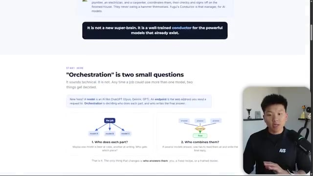
*⏱️ 00:05:00 — Page web explicative sur l'orchestration des modèles d'IA, avec le présentateur visible en incrustation.*

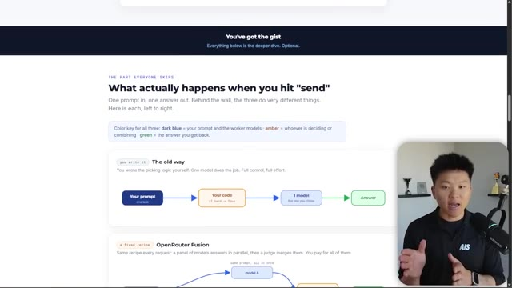
*⏱️ 00:05:05 — Section de la page web détaillant le fonctionnement lors de l'envoi d'un prompt avec schémas de flux de données.*

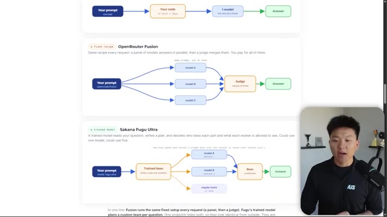
*⏱️ 00:05:10 — Schémas comparatifs détaillés montrant OpenRouter Fusion et Sakana Fugu Ultra avec différents modèles d'IA.*

---

### ⏱️ `[00:05:15 - 00:05:40]` | Segment #13

**🔊 Audio (Transcription Intégrale Mot pour Mot en Français) :**
> Mais c'est en fait différent parce que l'API Fusion, ce qu'elle fait, c'est qu'elle envoie vos requêtes à trois modèles en même temps. Donc elle ne décompose pas la tâche et ne délègue pas. Elle dit simplement, hé, vous trois, répondez à ceci. Et ensuite, cela revient avec un juge qui fusionne les trois. Et cela seul a également montré qu'il améliorait les résultats et la qualité que vous obtenez. Donc la morale de l'histoire, c'est que lorsque vous obtenez différentes perspectives et que vous avez différents grands modèles de langage qui traitent vos données, vous allez probablement obtenir de meilleurs résultats.

**👁️ Analyse Visuelle d'Écran (gemini-3.5-flash-lite) :**
**Interface & Outils** : Navigateur web affichant une page de documentation ou de présentation de schémas d'architecture d'IA.

**Contenu textuel & Code** : Schémas de flux de données représentant les étapes : Your prompt -> model A, B, C en parallèle -> Judge (merges all three) -> Answer.

**Action / Démonstration** : Le présentateur explique le schéma et le fonctionnement du système de fusion de modèles d'IA.

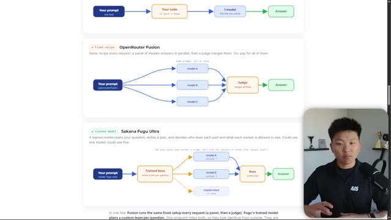
*⏱️ 00:05:21 — Schéma explicatif illustrant le fonctionnement d'OpenRouter Fusion avec un prompt envoyé en parallèle à trois modèles (Model A, Model B, Model C) puis combiné par un juge, avec le présentateur visible en incrustation vidéo dans le coin inférieur droit.*

---

### ⏱️ `[00:05:40 - 00:06:04]` | Segment #14

**🔊 Audio (Transcription Intégrale Mot pour Mot en Français) :**
> Mais quel est le coût de cela, typiquement en termes de vitesse et d'argent réel ? Donc, le coût réel. Et tout cela n'est certainement pas bon marché. J'ai opté pour un forfait à 200 dollars par mois et j'ai rempli ma fenêtre de cinq heures, et j'en suis à 34 % de ma limite hebdomadaire. Maintenant, j'ai fait une mise à niveau vers le milieu du mois, en passant de cent dollars par mois à 200 dollars par mois. Donc, grosso modo, avec le forfait à cent dollars par mois, si j'avais dû remplir trois fenêtres de cinq heures, j'aurais probablement déjà atteint ma limite hebdomadaire.

**👁️ Analyse Visuelle d'Écran (gemini-3.5-flash-lite) :**
**Interface & Outils** : Interface web de sakana.ai (page Billing / Subscription)

**Contenu textuel & Code** : Détails de l'abonnement à 200 $/mois, limites d'utilisation (Usage limit : 5-hour et Weekly à 34 %), et historique des paiements.

**Action / Démonstration** : Présentation des coûts de l'abonnement et des quotas d'utilisation de l'outil d'IA par le présentateur.

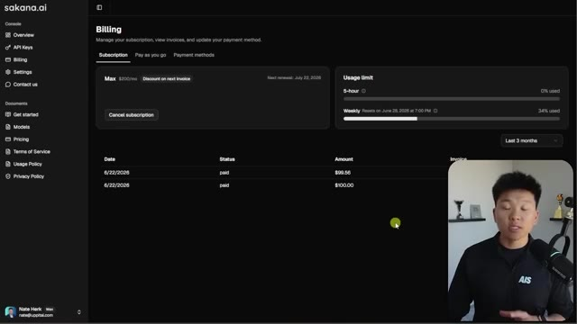
*⏱️ 00:05:46 — Capture d'écran montrant l'interface de facturation (Billing) de sakana.ai, affichant un abonnement à 200 $ par mois et les limites d'utilisation (Usage limit) avec 34 % utilisés sur la semaine.*

---

### ⏱️ `[00:06:04 - 00:06:27]` | Segment #15

**🔊 Audio (Transcription Intégrale Mot pour Mot en Français) :**
> Donc cela s'est rempli très vite, beaucoup plus vite que mon abonnement Cloud Code ne se remplit. Mais si vous voulez commencer, vous allez sur sakana.ai, et ensuite là-bas, vous pouvez vous inscrire pour un compte, vous pouvez souscrire à un abonnement, mais vous pouvez aussi utiliser la facturation par API à l'usage comme vous le voyez ici. Maintenant il y a Fugu, et puis il y a Fugu Ultra. Je n'ai testé qu'avec Fugu Ultra, juste par transparence pour la vidéo d'aujourd'hui.

**👁️ Analyse Visuelle d'Écran (gemini-3.5-flash-lite) :**
**Interface & Outils** : Interface web de la console sakana.ai (section Billing) et incrustation vidéo du présentateur.

**Contenu textuel & Code** : Tableau de bord de facturation affichant les informations d'abonnement (« Max $200/mo »), les limites d'utilisation (« Usage limit ») et l'historique des paiements.

**Action / Démonstration** : Navigation et présentation de la page de facturation et de gestion des abonnements sur la plateforme sakana.ai.

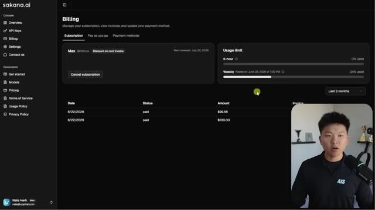
*⏱️ 00:06:10 — Capture d'écran montrant l'interface web de gestion de facturation sur le site sakana.ai, avec les détails de l'abonnement et des limites d'utilisation.*

---

### ⏱️ `[00:06:27 - 00:07:01]` | Segment #16

**🔊 Audio (Transcription Intégrale Mot pour Mot en Français) :**
> Alors, jetons un œil aux résultats. Ce que j'ai fait ici, c'est que j'ai demandé à Codex de créer un tas de tests juste pour qu'il n'y ait pas de biais, de contamination croisée ou peu importe comment vous voulez appeler ça. Et ensuite, j'ai fait tout cela via la facturation de l'API et j'ai fait passer tous les tests par Opus 4.8 et j'ai fait passer tous les tests par Fugu. Maintenant, gardez à l'esprit qu'Opus 4.8 est l'un des modèles parmi lesquels Fugu choisit. C'est donc vraiment intéressant. Comme quand vous voyez quelque chose comme, vous savez, ceci, que j'ai construit, peut-être que 60 % de ceci a été construit avec Opus 4.8. Et vous savez, ces présentations HTML, celles-ci ont également probablement été construites en majorité par Opus 4.8.

**👁️ Analyse Visuelle d'Écran (gemini-3.5-flash-lite) :**
**Interface & Outils** : Navigateur web affichant une page de résultats de tests de modèles d'IA.

**Contenu textuel & Code** : Texte et graphiques comparant les performances entre un modèle gestionnaire et Claude Opus 4.8, indiquant 'Test Results', '36 / 38', '4.5x slower overall', '5x more expensive'.

**Action / Démonstration** : Présentation des résultats comparatifs de tests automatisés entre différents modèles d'IA.

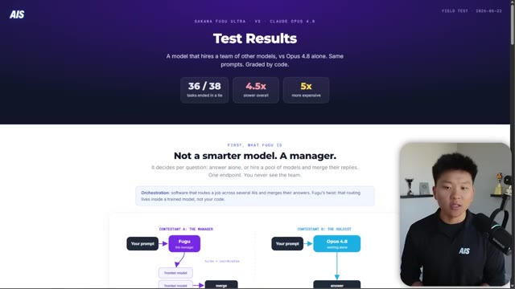
*⏱️ 00:06:36 — Une page web de résultats de tests comparant 'Sakana Fugu Ultra' et 'Claude Opus 4.8', avec des graphiques de performance et des explications sur le fonctionnement du modèle.*

---

### ⏱️ `[00:07:01 - 00:07:27]` | Segment #17

**🔊 Audio (Transcription Intégrale Mot pour Mot en Français) :**
> Donc juste quelque chose à garder à l'esprit. Mais dans l'ensemble, nous avons eu 36 des 38 tâches qui se sont soldées par une égalité. Nous avons eu Fugu qui était 4,5 fois plus lent dans l'ensemble et cinq fois plus cher. Donc si vous obtenez à peu près les mêmes résultats, pourquoi voudriez-vous attendre plus longtemps et payer plus ? Vous ne le voulez probablement pas. Et je vais aborder les résultats réels dans une seconde, mais j'étais en train de passer par ici avec mon propre Cloud Code et je faisais tourner Fugu sur une tonne de mes trucs habituels, mes compétences, en faisant des recherches, et il a été capable de les utiliser correctement.

**👁️ Analyse Visuelle d'Écran (gemini-3.5-flash-lite) :**
**Interface & Outils** : Navigateur web (image 1) et VS Code avec terminal intégré (image 2)

**Contenu textuel & Code** : Statistiques de test (36/38 tasks ended in a tie, 4.5x slower, 5x more expensive) et interface CLI Claude Code avec des commandes et l'état des tâches de fugu-ultra.

**Action / Démonstration** : Présentation des résultats comparatifs des performances des modèles IA sur le web et démonstration dans l'éditeur de code.

*⏱️ 00:07:08 — Page web présentant les résultats de tests comparant Sakana Fusu Ultra et Claude Opus 4.8, affichant des statistiques sur les égalités, la vitesse et le coût avec le présentateur en médaillon.*

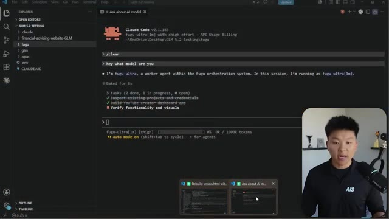
*⏱️ 00:07:21 — Interface de VS Code montrant un terminal intégré exécutant Claude Code v2.1.183 avec fugu-ultra, affichant des tâches en cours et des informations sur l'utilisation des tokens.*

---

### ⏱️ `[00:07:27 - 00:07:46]` | Segment #18

**🔊 Audio (Transcription Intégrale Mot pour Mot en Français) :**
> Donc ça fonctionnait très bien dans l'environnement de Cloud Code. C'était juste vraiment lent. L'autre chose, c'est que ça ne remplissait pas la fenêtre de contexte. Donc je pouvais parler pendant, vous savez, 20 ou 30 tours et ça restait à zéro à cause de la façon dont vous jouez un peu avec la manière dont vous acheminez réellement cela vers le serveur de Fugu pour récupérer les réponses. Je ne vais pas entrer dans les détails pour l'instant.

**👁️ Analyse Visuelle d'Écran (gemini-3.5-flash-lite) :**
**Interface & Outils** : Visual Studio Code avec terminal intégré (Claude Code) et encart vidéo du présentateur.

**Contenu textuel & Code** : Interface de commande Claude Code v2.1.183 avec des prompts, l'état des tâches et l'utilisation de la fenêtre de contexte (0% / 1000k tokens).

**Action / Démonstration** : Le présentateur explique le fonctionnement de Claude Code et commente l'utilisation de la fenêtre de contexte affichée à l'écran.

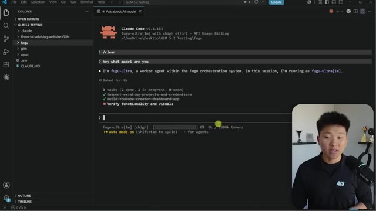
*⏱️ 00:07:32 — Capture d'écran montrant l'interface de VS Code avec un terminal intégré exécutant Claude Code, et le présentateur visible en incrustation dans le coin inférieur droit.*

---

### ⏱️ `[00:07:46 - 00:08:08]` | Segment #19

**🔊 Audio (Transcription Intégrale Mot pour Mot en Français) :**
> Ça fait partie de ce que ce fichier markdown inclut. Donc juste ici, vous pouvez voir que je me suis penché sur, vous savez, la façon dont cela fonctionne réellement et il y a tout un tas de trucs que ça a créés, mais ce n'est pas aussi simple que la façon dont vous vous connectez à, par exemple, GLM 5.2, où vous changez simplement le point de terminaison et ajoutez votre clé API. C'est juste un peu différent. Donc je ne voulais pas m'attarder là-dessus maintenant, mais le fichier markdown est dans mon school gratuit. Mais bref, le point que j'essayais de faire valoir là, c'est que cela semblait plutôt solide pour mon travail de réflexion.

**👁️ Analyse Visuelle d'Écran (gemini-3.5-flash-lite) :**
**Interface & Outils** : VS Code (éditeur de code) et Claude Code (terminal intégré)

**Contenu textuel & Code** : Commandes terminal telles que `/clear` et le prompt « hey what model are you », ainsi que la réponse de l'agent (« I'm fugu-ultra, a worker agent... ») et la liste des tâches en cours.

**Action / Démonstration** : Interaction avec l'agent Claude Code pour vérifier le modèle actif et l'état des tâches du projet.

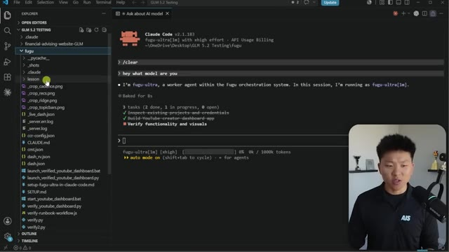
*⏱️ 00:07:52 — Capture d'écran montrant l'éditeur VS Code avec un panneau latéral affichant l'arborescence des fichiers du projet et, dans le panneau principal, une interface de terminal exécutant l'outil Claude Code en interaction avec l'agent fugu-ultra.*

---

### ⏱️ `[00:08:08 - 00:08:28]` | Segment #20

**🔊 Audio (Transcription Intégrale Mot pour Mot en Français) :**
> Je veux dire, c'est littéralement 4,8 dans GPT 5,5. Comment ça ne peut pas être solide pour le travail intellectuel ? C'était juste vraiment, vraiment lent. Donc le point que j'essaie de faire ici, c'est que je ne pense pas que je vais utiliser ça. Je vais probablement continuer à le tester un petit peu, mais pour moi, pour mon travail intellectuel, je n'ai pas besoin de ça du tout. Je vais retirer plus de profit de mon abonnement Codeium et de mon abonnement Claude Code, mais je ne fais pas non plus de développement logiciel lourd.

**👁️ Analyse Visuelle d'Écran (gemini-3.5-flash-lite) :**
**Interface & Outils** : VS Code avec Claude Code (CLI)

**Contenu textuel & Code** : Commandes terminal "/clear", "hey what model are you", réponse de l'agent "fugu-ultra", et liste de tâches (2 terminées, 1 en cours).

**Action / Démonstration** : Exécution d'une session interactive avec l'agent Claude Code dans le terminal intégré de VS Code.

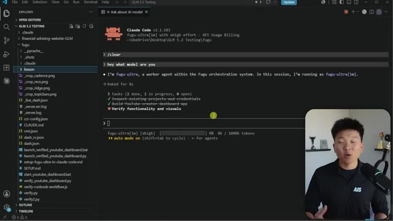
*⏱️ 00:08:13 — Interface de VS Code montrant un terminal Claude Code actif avec l'agent fugu-ultra, affichant une liste de tâches, et le présentateur dans un encadré vidéo en bas à droite.*

---

### ⏱️ `[00:08:28 - 00:08:48]` | Segment #21

**🔊 Audio (Transcription Intégrale Mot pour Mot en Français) :**
> Je ne construis pas de produits. Je ne travaille pas avec des tonnes d'équipes travaillant toutes sur la même base de code. Et si c'était le cas, il y aurait peut-être beaucoup d'avantages à utiliser Fugu parce que vous avez ce réviseur GPT et le planificateur ou créateur d'idées Cloud Code dans une seule et même API. Et je pourrais y voir beaucoup de valeur. Prenez donc cette analyse avec des pincettes.

**👁️ Analyse Visuelle d'Écran (gemini-3.5-flash-lite) :**
**Interface & Outils** : Visual Studio Code, Terminal intégré, Claude Code CLI

**Contenu textuel & Code** : Commandes terminal "/clear" et "hey what model are you", réponse de l'agent "I'm fugu-ultra, a worker agent within the Fugu orchestration system", liste de tâches avec cases cochées et état du modèle (fugu-ultra[1m] [xhigh]).

**Action / Démonstration** : Exécution d'une commande dans le terminal Claude Code au sein de VS Code pour interroger l'agent Fugu.

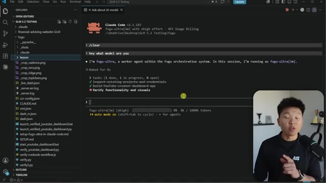
*⏱️ 00:08:33 — Interface de VS Code affichant l'explorateur de fichiers à gauche et un terminal intégré montrant l'outil Claude Code v2.1.183 avec fugu-ultra, ainsi qu'une incrustation vidéo du présentateur en bas à droite.*

---

### ⏱️ `[00:08:48 - 00:09:23]` | Segment #22

**🔊 Audio (Transcription Intégrale Mot pour Mot en Français) :**
> Je n'ai pas poussé cela à travers des tonnes et des tonnes et des tonnes de refactorisations de code et des trucs comme ça. J'ai exécuté un tas d'évaluations créées par l'IA. Donc encore une fois, ce n'est pas un modèle plus intelligent. C'est juste un gestionnaire. Vous pouvez voir ici sur le graphique comment tout cela fonctionne. Nous avons fait 38 tâches réparties sur quatre vagues. Nous avions des puzzles, nous avions des pièges, nous avions des spécifications, nous avions des algorithmes lourds, et ensuite nous avions des codecs qui évaluaient tout cela. Et les deux modèles ont essentiellement reçu les mêmes instructions et les mêmes entrées. Et nous étions simplement en train d'évaluer les sorties. Donc c'est vraiment intéressant, n'est-ce pas ? Globalement, ils faisaient pratiquement toujours égalité. Beaucoup d'entre eux étaient conçus pour être de type réussite ou échec plutôt que d'avoir un score, simplement parce que je voulais rendre cela, espérons-le, aussi objectif que possible, mais ils faisaient pratiquement égalité à chaque

**👁️ Analyse Visuelle d'Écran (gemini-3.5-flash-lite) :**
**Interface & Outils** : Navigateur web affichant une étude comparative de performances d'IA.

**Contenu textuel & Code** : Graphiques, schémas explicatifs et tableau de scores (38 tâches, vagues, Fugu vs Opus).
[DESC_IMAGE_3] Analyse et défilement sur les résultats des différentes vagues de tests.

**Action / Démonstration** : Explications face caméra et démonstration conceptuelle.

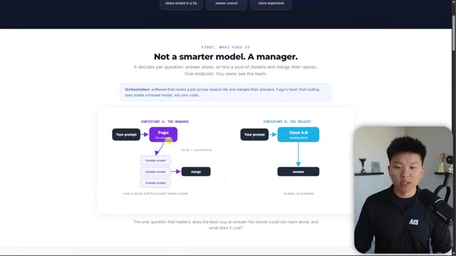
*⏱️ 00:08:57 — Présentation du concept 'Fugu' montrant une comparaison schématique entre 'The Manager' et 'The Soloist'.*

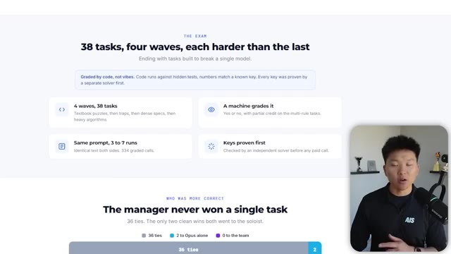
*⏱️ 00:09:05 — Section détaillant l'examen composé de 38 tâches divisées en quatre vagues avec les statistiques globales des résultats.*

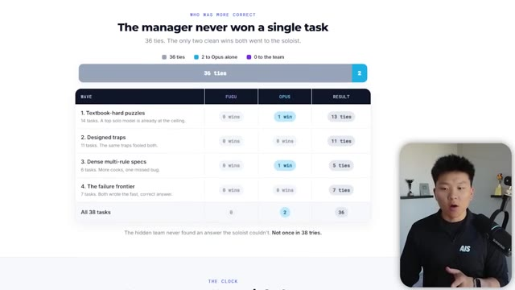
*⏱️ 00:09:14 — Tableau détaillé des résultats par vague montrant les victoires de Fugu versus Opus et le nombre d'égalités.*

---

### ⏱️ `[00:09:23 - 00:09:52]` | Segment #23

**🔊 Audio (Transcription Intégrale Mot pour Mot en Français) :**
> temps à part pour deux des fois Opus 1, ce qui encore une fois, est intéressant si l'on pense au fait que Opus 4.8 est disponible au sein de Fugu Ultra. Mais ce qui était bien plus intéressant pour moi, c'est le temps que j'ai dû attendre. J'ai donc dû attendre au total pour toutes les exécutions de Fugu, 357 minutes, alors que pour Opus, j'ai attendu au total 80 minutes pour ces 38 tâches différentes. Et ce qui était vraiment intéressant, c'est que certaines d'entre elles, certaines de ces tâches très faciles, Opus y a répondu en environ six secondes, alors que Fugu prenait plusieurs minutes pour cette même chose qui a pris six secondes à Opus.

**👁️ Analyse Visuelle d'Écran (gemini-3.5-flash-lite) :**
**Interface & Outils** : Interface web de benchmark et de comparaison de modèles d'IA.

**Contenu textuel & Code** : Graphiques de performance, temps d'attente comparés (357 min vs 80 min, facteur 4.5x plus lent) et statistiques de vagues de tests.

**Action / Démonstration** : Analyse visuelle des temps de calcul et présentation comparative des performances des agents IA.

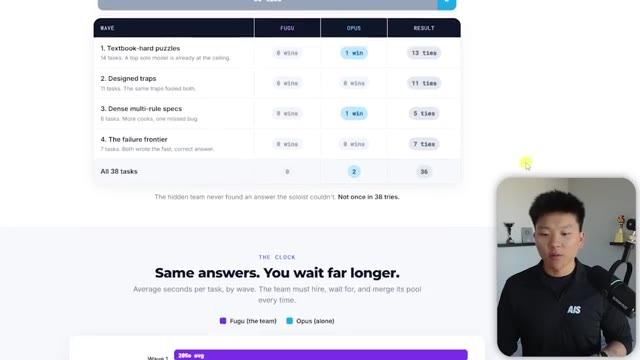
*⏱️ 00:09:30 — Tableau comparatif des résultats entre Fugu et Opus pour différentes catégories de tâches, avec incrustation vidéo du présentateur.*

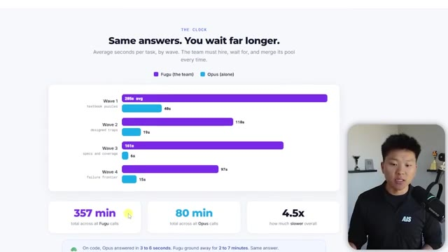
*⏱️ 00:09:37 — Graphique à barres comparant les temps d'exécution par vague entre Fugu et Opus, affichant 357 min contre 80 min au total.*

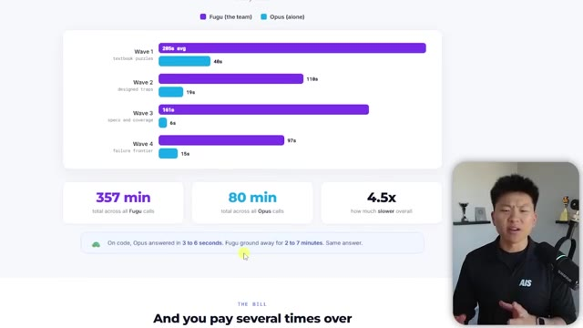
*⏱️ 00:09:45 — Suite du graphique de temps d'exécution avec un résumé textuel soulignant la différence de rapidité entre Fugu et Opus.*

---

### ⏱️ `[00:09:52 - 00:10:12]` | Segment #24

**🔊 Audio (Transcription Intégrale Mot pour Mot en Français) :**
> Et puis du côté des coûts, Fugu était très cher. Il faisait tourner, vous savez, Opus et GPT et probablement quelques autres modèles. Et il tournait pendant si longtemps que ça coûtait tout simplement beaucoup plus cher. Sur l'ensemble de ces appels, Opus ne nous a coûté qu'environ 10 dollars, alors que Fugu m'a coûté 50 dollars. Donc environ cinq fois plus cher. Je m'attends définitivement à ce que ce soit plus cher.

**👁️ Analyse Visuelle d'Écran (gemini-3.5-flash-lite) :**
**Interface & Outils** : Tableau de bord web d'analyse de coûts et graphiques statistiques.

**Contenu textuel & Code** : Graphiques à barres comparant Fugu et Opus (Wave 1 à 4) avec les montants de $53.60 pour Fugu et $10.66 pour Opus.

**Action / Démonstration** : Présentation comparative des coûts d'API entre les deux modèles d'IA.

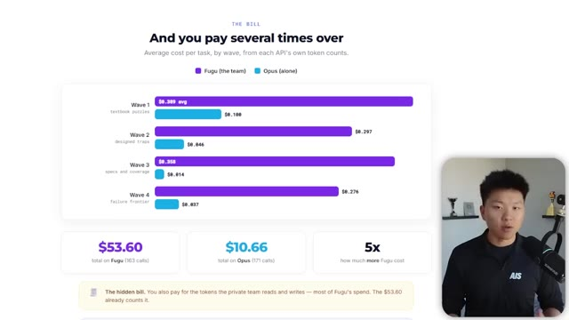
*⏱️ 00:09:57 — Graphique comparatif des coûts par tâche entre Fugu et Opus, montrant les différentes vagues et les totaux.*

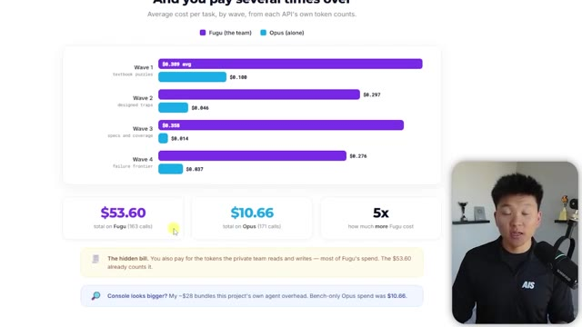
*⏱️ 00:10:07 — Graphique comparatif des coûts avec un encadré supplémentaire en bas affichant les détails de la console.*

---

### ⏱️ `[00:10:12 - 00:10:36]` | Segment #25

**🔊 Audio (Transcription Intégrale Mot pour Mot en Français) :**
> Genre, j'imagine que l'API Fusion d'OpenRouter est aussi plus chère. Je ne m'attendais juste pas à ce qu'elle le soit cinq fois plus. Ou si j'avais ce coût plus élevé, je m'attendais à une meilleure qualité, ce que je n'ai pas ressenti selon mes cas d'utilisation et selon mes expériences. Je voulais donc venir ici et faire cette vidéo parce que quand tu vois un truc comme ça, 15 millions de vues, et que tu vois, hé, ça égale les performances de Fable et Mythos, tout le monde flippe et tout le monde va vouloir essayer.

**👁️ Analyse Visuelle d'Écran (gemini-3.5-flash-lite) :**
**Interface & Outils** : Navigateur web affichant un tableau de bord analytique et un post X (Twitter).

**Contenu textuel & Code** : Graphiques de coûts comparatifs (Fugu vs Opus), totaux en dollars ($53.60 vs $10.66) et texte de présentation de Sakana Fugu.

**Action / Démonstration** : Présentation visuelle et analyse comparative des coûts d'API et d'un nouveau modèle d'IA.

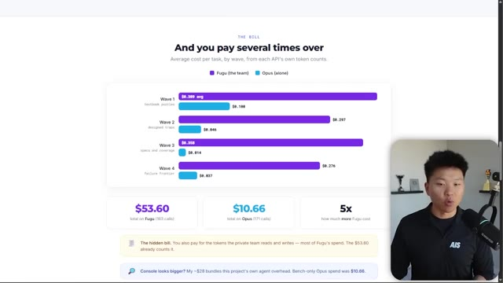
*⏱️ 00:10:18 — Graphique comparatif des coûts par tâche entre Fugu et Opus montrant un coût multiplié par 5.*

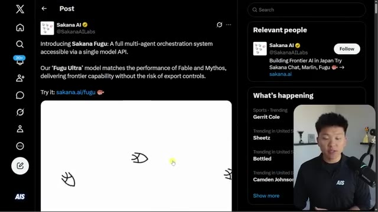
*⏱️ 00:10:30 — Publication sur le réseau social X (Twitter) du compte Sakana AI présentant Sakana Fugu.*

---

### ⏱️ `[00:10:36 - 00:11:03]` | Segment #26

**🔊 Audio (Transcription Intégrale Mot pour Mot en Français) :**
> Et donc, évidemment, j'ai voulu l'essayer. Et donc ma conclusion honnête, c'est que pour mes cas d'usage, Fable semblait nettement meilleur qu'Opus 4.8. Mais Fugu Ultra ne semble pas nettement meilleur qu'Opus 4.8. Je pense vraiment que c'est incroyable, ces métriques qu'ils ont réussi à obtenir. Et je pense vraiment que c'est l'avenir, de ne pas s'enfermer avec un seul fournisseur, de comprendre comment jouer avec l'économie unitaire pour comprendre quel est le modèle le moins cher que je peux utiliser pour cette tâche sans sacrifier la qualité.

**👁️ Analyse Visuelle d'Écran (gemini-3.5-flash-lite) :**
**Interface & Outils** : Navigateur web (Réseau social X / Twitter) affichant des graphiques de benchmarks d'IA.

**Contenu textuel & Code** : Graphiques de performance (LiveCodeBench, GPQA-DI, SWE-bench Pro, etc.) et texte de description du modèle Fugu de Sakana AI.

**Action / Démonstration** : Navigation et présentation visuelle des graphiques comparatifs des modèles d'IA par le présentateur.

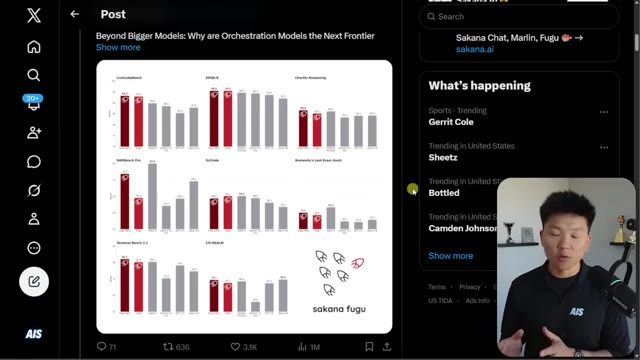
*⏱️ 00:10:43 — Capture d'écran montrant un post sur les réseaux sociaux (X/Twitter) avec un graphique comparatif des performances de différents modèles d'IA (Sakana Fugu), aux côtés de la vidéo du présentateur.*

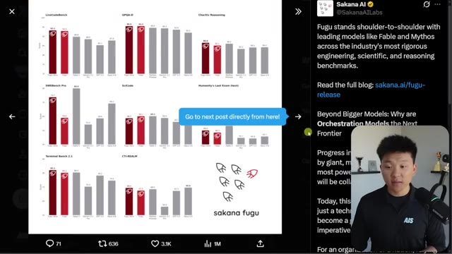
*⏱️ 00:10:50 — Vue similaire sur un post X/Twitter détaillant le communiqué de Sakana AI sur le modèle Fugu et ses benchmarks, avec le présentateur en bas à droite.*

---

### ⏱️ `[00:11:03 - 00:11:36]` | Segment #27

**🔊 Audio (Transcription Intégrale Mot pour Mot en Français) :**
> J'imagine que ce genre de choses va devenir une compétence très, très importante à mesure que nous avançons dans le futur de l'IA. Je pense simplement que ce n'est pas encore la solution pour moi. Je pense qu'ils tiennent quelque chose de génial. Et je pense que, vous savez, OpenRouter a clairement déployé cette API pour une bonne raison, parce que c'est quelque chose que j'essaie de faire manuellement pour moi-même. J'essaie d'utiliser codex et cloud code ensemble tout le temps en fonction de ce que je perçois de leurs forces et de leurs faiblesses. Et songez au fait que lorsque Fable fera son retour, si et quand il fera son retour, et que tous ces modèles commenceront probablement à devenir plus chers, le fait de pouvoir vraiment maîtriser l'optimisation de l'efficacité va

**👁️ Analyse Visuelle d'Écran (gemini-3.5-flash-lite) :**
**Interface & Outils** : Navigateur web (Twitter/X)

**Contenu textuel & Code** : Publication de Sakana AI présentant le modèle Fugu avec des graphiques de performance sur différents benchmarks d'ingénierie et de raisonnement.

**Action / Démonstration** : Le présentateur commente les résultats et performances affichés des modèles d'IA.

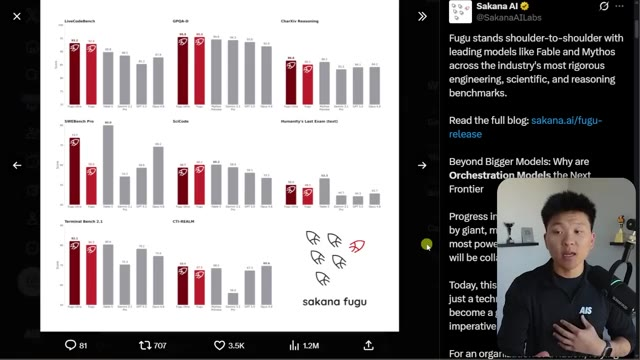
*⏱️ 00:11:12 — Capture d'écran montrant un tweet de Sakana AI à gauche avec des graphiques de benchmarks comparatifs (LiveCodeBench, GPQA-D, SWE-bench Pro, etc.) et le présentateur à l'écran en bas à droite.*

---

### ⏱️ `[00:11:36 - 00:11:58]` | Segment #28

**🔊 Audio (Transcription Intégrale Mot pour Mot en Français) :**
> être une compétence super importante et une chose super importante à laquelle penser en permanence. C'est donc ce que j'en retiens après avoir testé Fugu sur le terrain. C'est ce que je pense, mais je vais très certainement garder un œil sur Sakana AI labs et sur toute cette idée d'orchestration. Je sais donc que celle-ci était super rapide, mais j'espère que vous avez apprécié ou que vous avez appris quelque chose de nouveau. Et si c'est le cas, s'il vous plaît laissez un like, ça m'aide énormément. N'oubliez pas de rejoindre notre communauté Skool gratuite.

**👁️ Analyse Visuelle d'Écran (gemini-3.5-flash-lite) :**
**Interface & Outils** : Navigateur web (Twitter/X et plateforme communautaire Skool)

**Contenu textuel & Code** : Graphiques de performance (LiveCodeBench, SWE-bench) et diagramme d'architecture LLM Pool de Sakana Fugu

**Action / Démonstration** : Navigation et présentation des publications Twitter de Sakana AI sur les modèles d'orchestration.

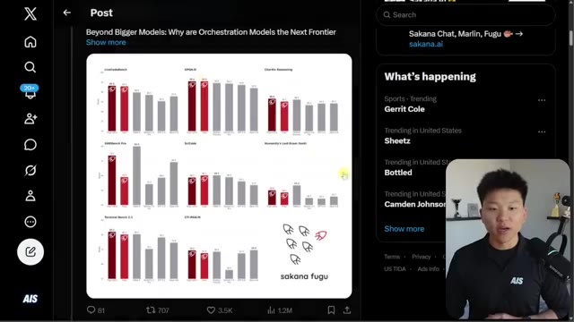
*⏱️ 00:11:42 — Capture d'écran montrant un tweet de Sakana AI avec des graphiques de benchmarks comparant Sakana Fugu à d'autres modèles.*

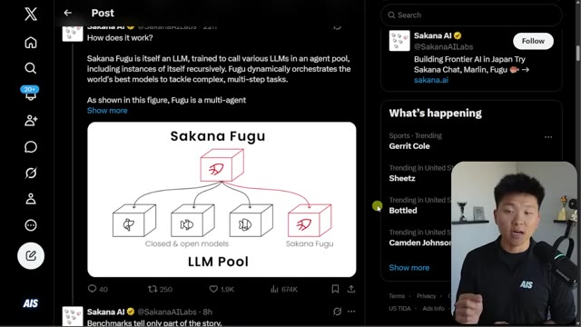
*⏱️ 00:11:47 — Capture d'écran d'un tweet expliquant le fonctionnement de Sakana Fugu sous forme de schéma d'architecture multi-agents.*

---

### ⏱️ `[00:11:58 - 00:12:15]` | Segment #29

**🔊 Audio (Transcription Intégrale Mot pour Mot en Français) :**
> Nous dépassons largement les 400 000 membres. Cela a été une aventure formidable et vous pouvez obtenir ici absolument toutes les ressources gratuites jamais publiées. Des dépôts GitHub, des compétences, des fichiers markdown, des guides de ressources, peu importe ce que c'est, prenez-le ici gratuitement. Et c'est tout pour aujourd'hui. Je vous remercie donc d'être arrivés jusqu'à la fin de la vidéo et je vous dis à la prochaine. Merci les amis.

**👁️ Analyse Visuelle d'Écran (gemini-3.5-flash-lite) :**
**Interface & Outils** : Plateforme communautaire Skool (navigateur web).

**Contenu textuel & Code** : Interface utilisateur affichant : "409.7k Members", "1.3k Online", des annonces de vidéos YouTube ("So You Learned Claude, Now What?"), et un classement des membres.

**Action / Démonstration** : Navigation et présentation visuelle de l'interface de la communauté pour démontrer l'accès aux ressources gratuites et aux statistiques de croissance.

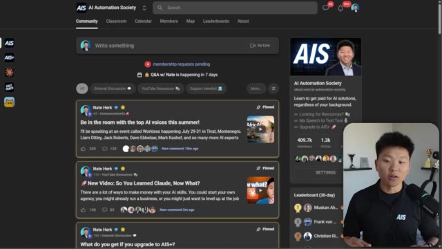
*⏱️ 00:12:02 — Interface de la plateforme communautaire Skool pour "AI Automation Society", montrant le flux d'actualités avec des publications épinglées de Nate Herk et une barre latérale affichant les statistiques de la communauté (409,7k membres).*

---

