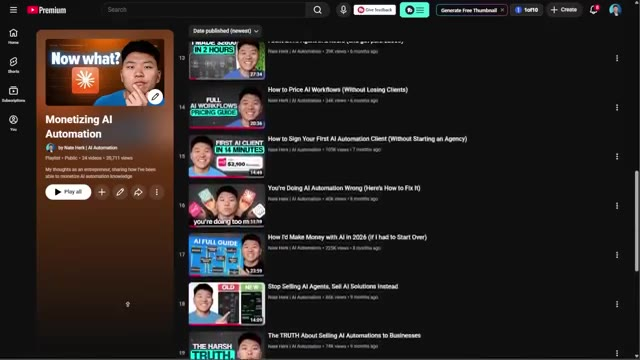
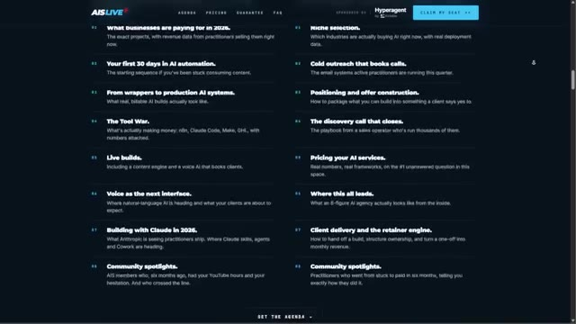

# 🎬 Why Watching AI Videos Isn't Enough

> **Chaîne** : [Nate Herk | AI Automation](https://www.youtube.com/@nateherk/featured)  
> **Lien YouTube** : [https://www.youtube.com/watch?v=S2ME69hra-k](https://www.youtube.com/watch?v=S2ME69hra-k)  
> **Date de publication** : 20260624  
> **Durée** : 00:02:35  
> **Identifiant vidéo** : `S2ME69hra-k`  
> **Transcription & Analyse** : `whisper-v3-large-turbo+gemini-3.5-flash-lite`  

---

## 📌 Synthèse Exécutive & Outils

### 💡 Résumé

La vidéo de Nate Herk aborde une fracture critique dans l'écosystème de l'automatisation par l'intelligence artificielle : l'écart abyssal entre la simple consommation de tutoriels YouTube et la mise en œuvre concrète d'une agence d'IA rentable. Si les contenus gratuits permettent d'assimiler les bases techniques, ils ne peuvent élucider la complexité contextuelle propre à chaque entrepreneur (cadrage des projets, tarification sur-mesure, résistance des architectures de livraison). Ce phénomène de « recette secrète » ne relève pas seulement d'une volonté de rétention d'information, mais de la nature hautement personnalisée de l'ingénierie et du conseil en IA, où chaque cas client exige des répétitions et une application empirique rigoureuse. 

Pour surmonter le syndrome de l'imposteur et passer de la théorie à l'exécution industrielle, Nate Herk démontre que la valeur réside désormais dans l'immersion au sein de communautés actives et l'accès à des retours d'expérience de pairs ayant plusieurs longueurs d'avance. La transition vers un business model pérenne implique d'analyser de vrais agents déployés, d'assister à des appels de vente en conditions réelles et de décortiquer les architectures techniques validées par le marché. C'est dans cette optique que s'inscrivent les initiatives communautaires présentées, conçues pour accélérer le développement des agences à travers des sessions de construction en direct et du réseautage stratégique international.

Au-delà de l'apprentissage asynchrone, la croissance exponentielle dans le secteur des agents IA et de l'automatisation logicielle nécessite une confrontation directe avec les réalités opérationnelles du terrain. Qu'il s'agisse d'événements virtuels axés sur la structuration commerciale et le développement technique ou de masterminds exclusifs réunissant les figures de proue de l'industrie, l'objectif est d'offrir un espace de co-création et de mentorat direct. Cette approche pragmatique garantit que les praticiens disposent non seulement des outils de pointe, mais surtout de la méthodologie éprouvée pour les vendre, les packager et les industrialiser sans compromettre la stabilité de leurs systèmes.

### 🛠️ Outils, Modèles & Logiciels Présentés

* **Anthropic** : Fournisseur de pointe en matière de modèles de langage et d'architecture d'agents conversationnels avancés pour le développement logiciel.
* **Agents IA** : Systèmes logiciels autonomes capables d'exécuter des flux de travail complexes, d'interagir avec des API et de résoudre des tâches métiers sans intervention humaine constante.
* **Effort Level** : Paramètre de configuration et de contrôle de la puissance de calcul allouée par les modèles pour optimiser la profondeur de raisonnement et la précision des livrables.
* **Claude Code** : Environnement de développement et assistant de codage propulsé par Anthropic, taillé pour l'ingénierie logicielle et l'automatisation de scripts.
* **Opus 5.5** : Modèle linguistique de nouvelle génération hautement performant, conçu pour les tâches de raisonnement complexe et d'orchestration d'agents.
* **Airtable (HyperAgent)** : Plateforme de base de données relationnelle et d'automatisation no-code/low-code, sponsor majeur agissant comme infrastructure centrale pour le déploiement d'agents.

### 🔑 Points Clés & Enseignements Stratégiques

* **Dépassement du contenu passif** : La consommation de vidéos techniques sur YouTube possède un plafond de verre inhérent qui ne remplace pas l'expérience pratique et la résolution de problèmes en temps réel.
* **Illusion de la solution unique** : Le marché de l'automatisation par l'IA ne souffre d'aucun format standardisé (« taille unique ») ; chaque agence doit forger sa propre méthodologie par des répétitions constantes.
* **Résolution du syndrome de l'imposteur** : La confrontation directe avec des praticiens plus avancés est le catalyseur le plus rapide pour dissiper les doutes liés au cadrage et à la livraison de projets complexes.
* **Importance de la transparence commerciale** : L'accès à de réels appels de vente et à l'analyse de contrats conclus est indispensable pour lever le voile sur la tarification et la monétisation des flux de travail.
* **Architecture de la phase de construction** : Les ateliers techniques doivent reposer sur des cas d'usage réels, décortiquant des agents fonctionnels et déjà déployés en production chez de vrais clients.
* **Maîtrise du périmètre et de la tarification** : Le succès d'une agence d'IA repose autant sur la rigueur de la définition du périmètre (*scoping*) que sur la complexité des scripts d'automatisation mis en place.
* **Puissance du réseautage ciblé** : Être immergé dans une communauté de pairs — qu'ils soient au même stade ou à plusieurs longueurs d'avance — accélère radicalement la courbe d'apprentissage stratégique.
* **Hybridation des événements** : Combiner des formats virtuels interactifs (jours de construction et de business) et des masterminds en personne maximisent les opportunités de partenariat et de croissance.
* **Validation par l'écosystème** : S'associer à des acteurs majeurs de l'industrie (tels qu'Airtable et son HyperAgent) valide la robustesse des infrastructures présentées et leur viabilité industrielle.
* **Actionnabilité immédiate** : Pour réussir dans l'IA cette année, l'investissement dans des programmes d'accompagnement et des cercles restreints prime sur l'accumulation stérile de connaissances théoriques.

---

## ⏱️ Chronologie & Transcription Complète Audio & Visuelle (Mot pour Mot)

### ⏱️ `[00:00:00 - 00:00:20]` | Segment #01

**🔊 Audio (Transcription Intégrale Mot pour Mot en Français) :**
> On a l'impression qu'une grande partie de ce qui fait réellement fonctionner une agence d'IA est délibérément gardée hors de YouTube. YouTube regorge d'excellents contenus pour apprendre la technique, comment décrocher des clients, mais dès que l'on commence à poser des questions comme la façon de cadrer un projet, ce qu'il faut facturer et comment le livrer concrètement sans que tout s'effondre, on a encore l'impression d'avoir ce syndrome de l'imposteur et d'être peut-être un peu confus.

**👁️ Analyse Visuelle d'Écran (gemini-3.5-flash-lite) :**
**Interface & Outils** : Aucune interface logicielle ou technique visible.

**Contenu textuel & Code** : Aucun code, terminal ou diagramme affiché.

**Action / Démonstration** : Le présentateur s'adresse directement au public en parlant.

---

### ⏱️ `[00:00:20 - 00:00:39]` | Segment #02

**🔊 Audio (Transcription Intégrale Mot pour Mot en Français) :**
> Maintenant, une partie de cela s'explique par le fait que c'est un peu la recette secrète, mais c'est surtout parce que tout le monde est dans une situation tellement différente au début, et ce domaine n'est pas du tout du genre "taille unique". Tout est question de répétitions et d'application des connaissances à sa propre expérience. Maintenant, j'ai publié beaucoup de contenu gratuit autour de tout ce sujet d'agence d'IA, et c'est un point de départ vraiment formidable.

**👁️ Analyse Visuelle d'Écran (gemini-3.5-flash-lite) :**
**Interface & Outils** : Aucune interface visible.

**Contenu textuel & Code** : Aucun contenu technique ou graphique affiché.

**Action / Démonstration** : Le présentateur s'adresse directement à la caméra en parlant.

---

### ⏱️ `[00:00:39 - 00:01:06]` | Segment #03

**🔊 Audio (Transcription Intégrale Mot pour Mot en Français) :**
> Vous pouvez aller sur ma playlist de monétisation de l'automatisation de l'IA sur YouTube. C'est entièrement gratuit. Et vous verrez que je présente de vrais agents que j'ai vendus, un vrai appel de vente, comment signer votre premier client, comment tarifer vos flux de travail, comment les livrer, et une tonne de preuves et tout un tas de choses comme ça. Donc, comme je l'ai dit, c'est un excellent point de départ. Mais là où nous voyons tous nos clients obtenir des résultats rapidement, c'est en étant dans la pièce avec les bonnes personnes, car ils sont capables d'expliquer leur situation, de poser des questions sur mesure et d'entendre différentes personnes qui ont une longueur d'avance sur eux, ou peut-être trois longueurs d'avance.

**👁️ Analyse Visuelle d'Écran (gemini-3.5-flash-lite) :**
**Interface & Outils** : Navigateur web affichant une page de playlist YouTube.

**Contenu textuel & Code** : Titres de vidéos de la playlist : "How to Price AI Workflows", "How to Sign Your First AI Automation Client", "Stop Selling AI Agents, Sell AI Solutions Instead".

**Action / Démonstration** : Navigation et présentation visuelle de la playlist YouTube mentionnée dans l'audio.

*⏱️ 00:00:46 — Capture d'écran montrant une playlist YouTube intitulée "Monetizing AI Automation" avec une liste de vidéos connexes.*

---

### ⏱️ `[00:01:06 - 00:01:29]` | Segment #04

**🔊 Audio (Transcription Intégrale Mot pour Mot en Français) :**
> Donc, j'ai deux choses dont je veux vous parler aujourd'hui. L'une est un événement virtuel que nous organisons appelé AIS Live les 11 et 12 juillet. L'autre est un mastermind en personne sur l'IA au Monténégro du 29 au 31 juillet. Donc, d'abord, AIS Live. Le premier jour est le jour de construction. Il va donc y avoir des constructions en direct, les projets qui se vendent, des appels en direct avec de vrais propriétaires d'agences d'IA, en décortiquant des constructions qu'ils ont réellement déployées.

**👁️ Analyse Visuelle d'Écran (gemini-3.5-flash-lite) :**
**Interface & Outils** : Page web du site web promotionnel de l'événement AIS Live.

**Contenu textuel & Code** : Texte promotionnel, dates de l'événement (Jul 11-12), format 100% Online, et bouton de réservation.

**Action / Démonstration** : Navigation et présentation de la page web de l'événement virtuel AIS Live.

---

### ⏱️ `[00:01:30 - 00:01:51]` | Segment #05

**🔊 Audio (Transcription Intégrale Mot pour Mot en Français) :**
> Ensuite, le deuxième jour est consacré à l'aspect commercial des choses. Donc, la sélection de niche, la prospection, le positionnement, la définition du périmètre, la tarification, la prestation, et bien plus encore. Encore une fois, ce sont des appels en direct et j'ai rassemblé et sélectionné une tonne de vrais propriétaires d'agences d'IA. Nous avons également eu la chance d'avoir le HyperAgent d'Airtable comme sponsor principal pour cet événement. Donc, si tout ce que je viens de mentionner vous intéresse, consultez le premier lien dans la description pour découvrir AIS Live.

**👁️ Analyse Visuelle d'Écran (gemini-3.5-flash-lite) :**
**Interface & Outils** : Navigateur web (page d'atterrissage de l'événement AIS LIVE)

**Contenu textuel & Code** : Texte listant les sujets de la formation : Niche selection, Cold outreach, Positioning, Pricing, Client delivery, etc.

**Action / Démonstration** : Présentation visuelle de l'agenda et du programme des journées de formation sur le site web.

*⏱️ 00:01:35 — Capture d'écran montrant la page web d'un événement (AIS LIVE) détaillant l'agenda des sessions de formation avec deux colonnes listant des modules thématiques.*

---

### ⏱️ `[00:01:51 - 00:02:19]` | Segment #06

**🔊 Audio (Transcription Intégrale Mot pour Mot en Français) :**
> Et maintenant, l'événement au Monténégro. Je vais m'y rendre moi-même et j'adorerais vous y rencontrer. Nous avons fait un événement similaire en février au Cap, qui a été absolument incroyable. Des noms comme Liam Otley, Dave Ebelar, Jack Roberts, et bien, bien d'autres seront là. Nous prendrons la parole. Vous aurez l'occasion de réseauter avec eux et avec des tonnes de personnes qui font toutes sortes de choses différentes dans le domaine de l'IA. Et de plus, tous les participants seront des propriétaires d'entreprises d'IA, des aspirants entrepreneurs, des praticiens, d'autres personnes qui sont peut-être à quelques pas derrière vous ou à quelques pas devant vous, ou peut-être exactement là où vous en êtes en ce moment.

**👁️ Analyse Visuelle d'Écran (gemini-3.5-flash-lite) :**
**Interface & Outils** : AUCUNE

**Contenu textuel & Code** : AUCUN

**Action / Démonstration** : AUCUNE

---

### ⏱️ `[00:02:19 - 00:02:35]` | Segment #07

**🔊 Audio (Transcription Intégrale Mot pour Mot en Français) :**
> Donc, être dans la pièce avec des gens comme ça, c'est vraiment, vraiment puissant. Je sais que celui-ci a été super rapide aujourd'hui, mais si vous êtes sérieux à l'idée de construire quelque chose de réel avec l'IA cette année, les liens pour ces deux événements sont juste en bas dans la description. Allez jeter un œil. Et si c'est pour vous, je vous y verrai. Sinon, on se reverra peut-être au prochain. Merci tout le monde.

**👁️ Analyse Visuelle d'Écran (gemini-3.5-flash-lite) :**
**Interface & Outils** : Aucune interface ou logiciel visible.

**Contenu textuel & Code** : Aucun code ni élément graphique affiché.

**Action / Démonstration** : Le présentateur s'adresse directement au public en parlant.

---

