# 🎬 Stanford's Method Turns Claude Into a PHD Level Research Team

> **Chaîne** : [Nate Herk | AI Automation](https://www.youtube.com/@nateherk/featured)  
> **Lien YouTube** : [https://www.youtube.com/watch?v=Tj3018n5MVg](https://www.youtube.com/watch?v=Tj3018n5MVg)  
> **Date de publication** : 20260629  
> **Durée** : 00:12:05  
> **Identifiant vidéo** : `Tj3018n5MVg`  
> **Transcription & Analyse** : `whisper-v3-large-turbo+gemini-3.5-flash-lite`  

---

## 📌 Synthèse Exécutive & Outils

### 💡 Résumé

Cette vidéo présentée par Nate Herk explore l'adaptation de la méthode de recherche de Stanford, baptisée STORM, pour transformer l'assistant Claude en une équipe de recherche de niveau doctorat. Face aux limites des requêtes textuelles classiques et des fonctions natives de « recherche approfondie » — souvent trop coûteuses en API, lentes, sujettes aux limites de taux (rate limits) et génératrices de rapports non structurés ou superficiels —, l'approche STORM introduit un pipeline multi-agents hautement structuré. En simulant des perspectives expertes et indépendantes dès la phase initiale, la méthode élimine les angles morts inhérents à une approche mono-agent.

La démonstration technique compare un rapport natif généré par plus d'une centaine d'agents à un briefing HTML issu de la compétence STORM personnalisée, reposant sur un nombre restreint d'agents (environ douze). L'évaluation comparative menée via Codex démontre que le briefing HTML surpasse l'alternative native sur tous les plans : qualité des preuves, diversité et robustesse des sources, solidité de la thèse, exploitabilité opérationnelle, contrôle des risques et pertinence visuelle. Le tout s'exécute plus rapidement, de manière 100 % plus économique et en éliminant les hallucinations grâce à une phase itérative de vérification croisée et de révision par les pairs.

L'automatisation repose sur l'intégration d'un fichier de compétence (`skill.md`) et d'un modèle de rendu HTML directement dans le dossier `.claude` de l'environnement de développement. Le workflow s'articule autour de phases rigoureuses : délimitation du sujet, activation parallèle de prismes d'experts, cartographie des contradictions, synthèse globale et vérification contradictoire des citations. Cette ingénierie de prompt avancée permet d'obtenir des livrables standardisés, dotés d'un résumé chronologique, de niveaux de fiabilité chiffrés et d'une identification précise des perspectives manquantes pour itérer efficacement.

---

### 🛠️ Outils, Modèles & Logiciels Présentés

* **Claude / Claude Code** : Assistant conversationnel et environnement de développement d'Anthropic servant de support principal pour l'exécution de la compétence de recherche STORM.
* **STORM (Stanford Research Method)** : Méthodologie universitaire de recherche évaluée par les pairs, intégrée ici sous forme de compétence logicielle pour structurer des analyses multi-perspectives.
* **Opus 5.5** : Modèle de langage de pointe mentionné dans le contexte des capacités d'ingénierie et des flux de travail dynamiques d'Anthropic.
* **Codex** : Modèle d'intelligence artificielle tiers utilisé pour évaluer et comparer objectivement la qualité des livrables entre la recherche approfondie native et le briefing HTML STORM.
* **Dossier `.claude` / Fichiers de compétences (`skill.md`)** : Répertoire et format de configuration modulaire permettant d'encapsuler des prompts maîtres, des instructions procédurales et des modèles de rendu pour automatiser des workflows complexes.

---

### 🔑 Points Clés & Enseignements Stratégiques

* **Dépassement des limites des requêtes uniques** : Envoyer un prompt brut à une IA génère inévitablement des angles morts méthodologiques qu'une diversification des perspectives permet de combler.
* **L'approche multi-perspectives STORM** : L'utilisation simultanée de cinq prismes d'experts (praticien, universitaire, sceptique, économiste et historien) garantit une confrontation des points de vue pour identifier les failles que les autres angles manquent.
* **Efficacité économique et technique** : Un pipeline ciblé d'une dizaine d'agents surpasse en qualité un flux de travail dynamique massif de plus de 100 agents, tout en évitant les blocages liés aux limites de taux des API.
* **Réduction des hallucinations par vérification croisée** : L'intégration d'une phase de révision par les pairs contradictoire permet de corriger ou de rétrograder des sources douteuses avant la livraison finale du rapport.
* **Standardisation des livrables en HTML** : L'association d'un fichier de compétence Markdown et d'un modèle HTML garantit une structure visuelle et narrative rigoureusement identique et professionnelle à chaque exécution.
* **Traçabilité et notation de la fiabilité** : Les conclusions clés du briefing sont systématiquement classées par niveaux de fiabilité chiffrés (ex. : 9/10), explicitant quels experts les soutiennent ou les contestent.
* **Identification des perspectives manquantes** : Le système est capable d'analyser ses propres limites analytiques (par exemple, l'absence initiale du point de vue client ou employé) pour initier itérativement une version enrichie du rapport.
* **Personnalisation métier sur mesure** : Contrairement aux recherches approfondies génériques qui déversent des statistiques brutes, la compétence STORM intègre le contexte stratégique de l'entreprise pour formuler des recommandations actionnables.
* **Modularité et portabilité des compétences** : Le concept de « skill » basé sur des fichiers de configuration stockés dans des répertoires dédiés (`.claude`, `.agents`, etc.) standardise l'automatisation et s'adapte à différents agents de codage.
* **Supériorité validée par des tiers** : L'évaluation comparative par Codex confirme que le briefing HTML STORM offre une meilleure qualité de preuve, une robustesse accrue des sources et un contrôle des risques supérieur.

---

## ⏱️ Chronologie & Transcription Complète Audio & Visuelle (Mot pour Mot)

### ⏱️ `[00:00:00 - 00:00:20]` | Segment #01

**🔊 Audio (Transcription Intégrale Mot pour Mot en Français) :**
> Donc Stanford a une méthode de recherche appelée STORM, qui a réellement démontré dans des tests évalués par des pairs qu'elle produisait des articles 25 % plus organisés que la deuxième meilleure méthode. J'ai donc intégré tous ces principes de STORM dans ma propre compétence Claude, que je vais vous offrir tout à fait gratuitement, et vous obtenez un résultat qui ressemble à ceci. C'est un briefing HTML qui a été élaboré selon cinq perspectives différentes d'agents, et il a été vérifié.

**👁️ Analyse Visuelle d'Écran (gemini-3.5-flash-lite) :**
**Interface & Outils** : Navigateur web affichant un article de réseau social et un document rédigé.

**Contenu textuel & Code** : Texte sur l'utilisation de Claude et le système de recherche STORM de Stanford, puis un article complet structuré.
[DESC_IMAGE_1] Présentation visuelle d'un post discutant de l'optimisation des prompts avec Claude et STORM.
[DESC_IMAGE_2] Affichage du résultat final d'un article produit via la méthodologie STORM intégrée.

**Action / Démonstration** : Le présentateur commente le contenu textuel affiché à l'écran concernant la recherche STORM.

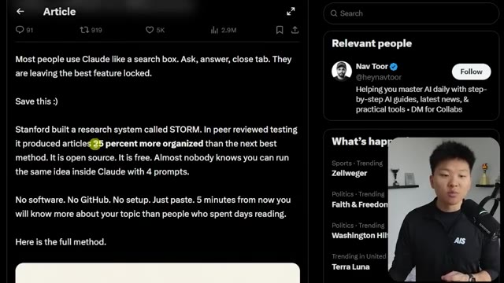
*⏱️ 00:00:05 — Capture d'écran montrant un article de réseau social (Twitter/X) sur la méthode STORM de Stanford, avec le présentateur en incrustation à droite.*

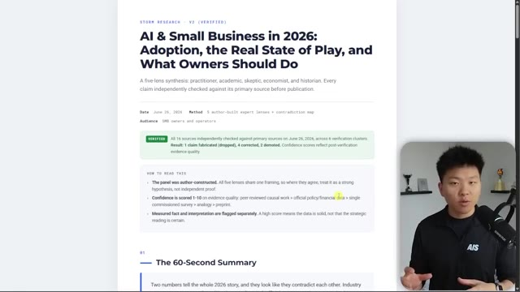
*⏱️ 00:00:10 — Capture d'écran affichant un article généré et structuré intitulé "AI & Small Business in 2026", illustrant le résultat de la méthode STORM, avec le présentateur à l'écran.*

---

### ⏱️ `[00:00:21 - 00:00:57]` | Segment #02

**🔊 Audio (Transcription Intégrale Mot pour Mot en Français) :**
> C'est-à-dire que si je fais défiler vers le bas, vous pouvez voir que les différentes perspectives fournissent une analyse sur chaque partie du rapport, mais tout en bas, vous pouvez voir que nous avons différentes sources qui ont été confirmées, corrigées ou rétrogradées. C'est-à-dire qu'au premier passage, le briefing aurait contenu des informations qui n'étaient tout simplement pas correctes. Mais comme notre compétence effectue toute cette vérification sur la V2, nous pouvons avoir beaucoup plus confiance en ce résultat. L'idée générale de Storm est donc qu'au lieu de lancer un simple prompt et d'avoir un seul angle de recherche, nous utilisons un tas d'angles différents. Parce que si vous envoyez simplement un prompt à Claude, il y aura un tas de angles morts dans ce plan de recherche. Storm utilise donc ces cinq

**👁️ Analyse Visuelle d'Écran (gemini-3.5-flash-lite) :**
**Interface & Outils** : Interface de document/rapport textuel et diapositive de présentation interactive de type diagramme.

**Contenu textuel & Code** : Texte du rapport avec statuts de vérification (Confirmed, Corrected, Demoted) et sources (US Census Bureau, Federal Reserve, etc.) ; diapositive 'Claude as a search box' avec schémas de prompt.

**Action / Démonstration** : Le présentateur commente le contenu du rapport affiché à l'écran et présente des concepts schématiques sur l'utilisation de l'IA.

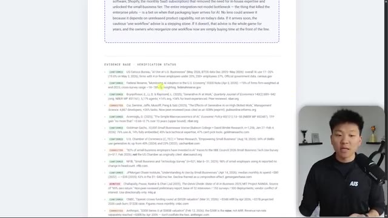
*⏱️ 00:00:30 — Un rapport détaillé avec une section intitulée 'EVIDENCE BASE & VERIFICATION STATUS' listant différentes sources confirmées, corrigées ou rétrogradées, tandis que le présentateur apparaît en médaillon en bas à droite.*

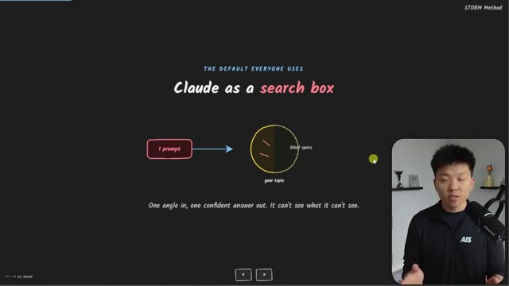
*⏱️ 00:00:48 — Une diapositive sombre expliquant le concept de 'Claude as a search box' avec un schéma illustrant un prompt menant à une cible circulaire et des angles morts, le tout avec le présentateur en médaillon.*

---

### ⏱️ `[00:00:57 - 00:01:33]` | Segment #03

**🔊 Audio (Transcription Intégrale Mot pour Mot en Français) :**
> perspectives. Nous avons un praticien, un universitaire, un sceptique, un économiste et un historien. Et chaque angle trouve une faille que les autres angles manquent. Et toute cette idée d'avoir différents agents qui jouent en quelque sorte le rôle de leur propre personnalité et de leur propre, vous savez, parcours avec différents domaines d'expertise est vraiment, vraiment bénéfique. Si vous avez vu d'autres vidéos où j'ai parlé de quelque chose comme la compétence de critique ou de la façon dont j'aime utiliser des équipes d'agents pour être fondamentalement un conseil, c'est vraiment, vraiment utile pour identifier différentes perspectives. Et comme je l'ai dit, trouver des failles que les autres angles vont manquer. Et donc laissez-moi juste vous montrer un exemple très rapide de pourquoi c'est si bénéfique. Donc Claude Code a nativement une fonctionnalité appelée recherche approfondie,

**👁️ Analyse Visuelle d'Écran (gemini-3.5-flash-lite) :**
**Interface & Outils** : Logiciel de présentation ou outil de mind mapping interactif.

**Contenu textuel & Code** : Texte du schéma : 'Five experts, five blind spots caught', avec les bulles des différents profils d'experts et la citation 'Each angle finds a hole the others miss. The gaps are the whole point.'

**Action / Démonstration** : Présentation visuelle du concept des multiples agents experts analysant un sujet sous différents angles.

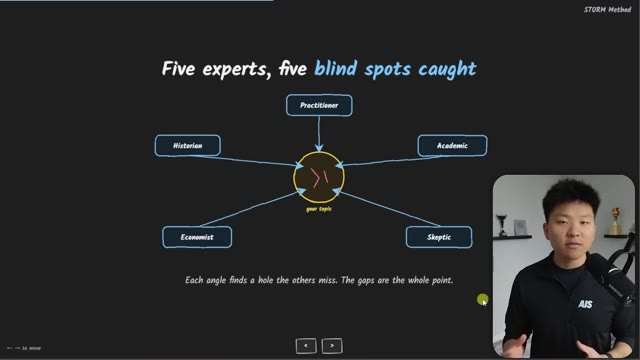
*⏱️ 00:01:06 — Schéma explicatif sur fond noir illustrant la méthode STORM avec cinq experts (Practitioner, Academic, Skeptic, Economist, Historian) pointant vers un sujet central.*

---

### ⏱️ `[00:01:33 - 00:02:02]` | Segment #04

**🔊 Audio (Transcription Intégrale Mot pour Mot en Français) :**
> qui a été lancée avec les flux de travail dynamiques. Donc si vous venez dans Claude et que vous effectuez une commande de recherche approfondie comme celle-ci, vous pourrez essentiellement saisir un sujet de recherche et cela lancera un flux de travail dynamique, qui déclenchera des centaines d'agents en arrière-plan. Je pense que dans cet exemple, il y avait 103 agents différents en cours d'exécution. Cela vous donnera donc un rapport de recherche approfondie assez solide. Comme vous pouvez le voir ici en bas, cela ne m'a en fait fourni aucun résultat. Cela a simplement intériorisé tout cela. J'ai donc dit : où est le rapport ? Cela m'a donné ce fichier Markdown, qui est correct, mais il n'est vraiment pas si approfondi que ça. Et il n'y a pas autant de sources que nous le souhaiterions. Il n'y en a que deux ici en haut.

**👁️ Analyse Visuelle d'Écran (gemini-3.5-flash-lite) :**
**Interface & Outils** : Application web "Deep Research" (Herk-2.0)

**Contenu textuel & Code** : Commande `/deep-research AI SMB report 2026 on adoption, state of the industry, and practical takeaways for SMB owners`

**Action / Démonstration** : Exécution d'un flux de travail dynamique de recherche approfondie avec analyse multi-angles et vérification des sources.

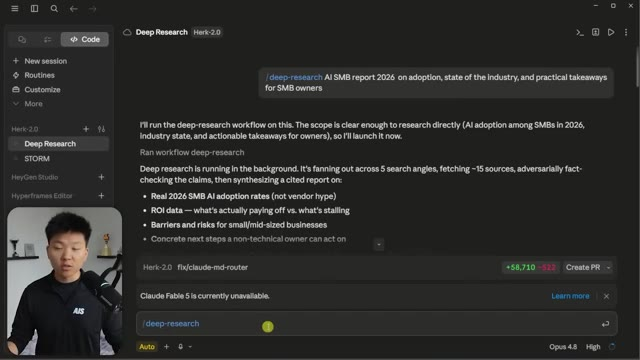
*⏱️ 00:01:40 — Interface web d'un outil de recherche approfondie par IA montrant un prompt et un rapport en cours de génération en arrière-plan.*

---

### ⏱️ `[00:02:02 - 00:02:36]` | Segment #05

**🔊 Audio (Transcription Intégrale Mot pour Mot en Français) :**
> Et ensuite, il y en a quelques autres non confirmées ici en bas, ainsi que quelques questions ouvertes. Et puis j'ai pris ce prompt exact que j'ai demandé dans la recherche approfondie et je l'ai mis dans une compétence storm. Donc j'ai dit : Hé, recherche storm, fais ceci. Et il a dit : d'accord, super. Voici le sujet. Je vais exécuter le pipeline storm. Maintenant, j'ai exécuté ces cinq agents, comme vous pouvez le voir, le praticien, l'académique, le sceptique, l'économiste et l'historien. Nous faisons converger tout cela ensemble. Nous voyons où ils sont en désaccord. Et ensuite, nous allons exécuter six agents de plus, qui vont vérifier tous ces faits que vous venez de trouver. La vérification est terminée. Et maintenant, vous avez ce rapport HTML, qui va systématiquement ressembler à ceci à chaque fois avec un 60

**👁️ Analyse Visuelle d'Écran (gemini-3.5-flash-lite) :**
**Interface & Outils** : Application web STORM (Herk-2.0)

**Contenu textuel & Code** : Commande `/storm-research AI SMB report 2026 on adoption...` et résultats de recherche textuels avec exécution de 5 agents en parallèle.

**Action / Démonstration** : Exécution d'une recherche approfondie et synthèse par agents multiples via la compétence STORM.

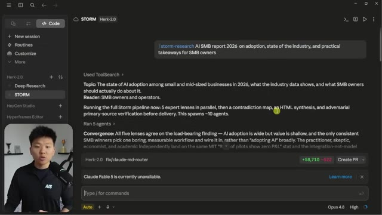
*⏱️ 00:02:10 — Interface de l'outil STORM montrant l'exécution d'un prompt de recherche sur l'adoption de l'IA par les PME, avec le présentateur en médaillon dans le coin inférieur gauche.*

---

### ⏱️ `[00:02:36 - 00:03:13]` | Segment #06

**🔊 Audio (Transcription Intégrale Mot pour Mot en Français) :**
> deuxième résumé des conclusions clés. Et toutes ces conclusions clés sont également classées par niveau de fiabilité. Vous pouvez voir ici, fiabilité élevée, neuf sur 10. Celle-ci a été soutenue par l'universitaire et le sceptique, et elle a été contestée par le praticien et l'économiste. Et cela continue ainsi dans le reste de tout le rapport HTML ici. Il met également en évidence l'hypothèse sur laquelle repose ce briefing et la sixième perspective manquante. Les cinq perspectives examinent l'entreprise du point de vue du propriétaire, les taux d'adoption, la productivité, le retour sur investissement. Aucune d'elles ne s'est mise à la place du client ou de l'employé de première ligne. C'est donc la sixième perspective manquante ici. Et je dirais alors simplement, très bien, lance cette sixième perspective et exécute une version 3 de ce rapport HTML. Et ensuite, cela nous donne vraiment des résultats pratiques

**👁️ Analyse Visuelle d'Écran (gemini-3.5-flash-lite) :**
**Interface & Outils** : Interface web et tableau de bord d'agent IA (Her-2.0 / STORM)

**Contenu textuel & Code** : Document textuel listant des conclusions clés classées par niveau de fiabilité (Reliability : High, 9/10), avec les sections 'Supported by' et 'Challenged by'.

**Action / Démonstration** : Navigation et présentation visuelle des conclusions clés issues d'un rapport généré par l'IA.

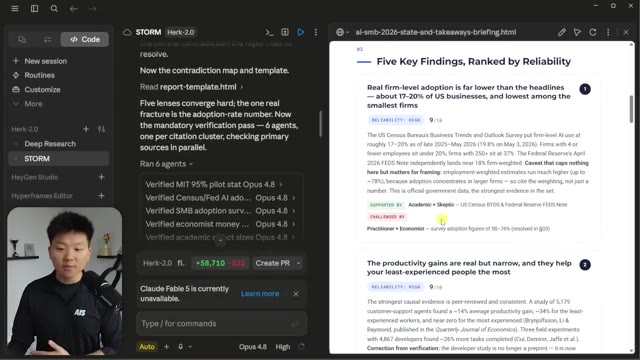
*⏱️ 00:02:45 — Capture d'écran montrant l'interface d'un outil d'IA avec le présentateur incrusté en bas à gauche, affichant à droite une page web intitulée 'Five Key Findings, Ranked by Reliability'.*

---

### ⏱️ `[00:03:13 - 00:03:37]` | Segment #07

**🔊 Audio (Transcription Intégrale Mot pour Mot en Français) :**
> enseignements ici. Et ce qui est cool avec ça, c'est que comparé à quelque chose comme le deep research, où ça va essentiellement vous donner un déversement de cerveau d'un tas de statistiques qu'il a trouvées, le storm research peut vraiment être personnalisé pour vous. Vous pouvez aller dans la compétence et dire, hé, voici ce que je fais, voici mon entreprise, voici nos buts. Chaque fois que vous lancez un rapport storm research, faites-le sur mesure pour nous. Qu'est-ce qu'on veut réellement faire différemment maintenant que vous avez compris toutes ces nouvelles données et recherches ?

**👁️ Analyse Visuelle d'Écran (gemini-3.5-flash-lite) :**
**Interface & Outils** : Interface web personnalisée avec un panneau de configuration à gauche (options Deep Research, STORM) et un rendu de rapport HTML à droite.

**Contenu textuel & Code** : Texte du rapport de recherche STORM montrant des sections de vérification ('What's Safe to Assert') et l'activité de 6 agents parallèles (Opus 4.8).

**Action / Démonstration** : Navigation et affichage des résultats du STORM research dans l'interface interactive.

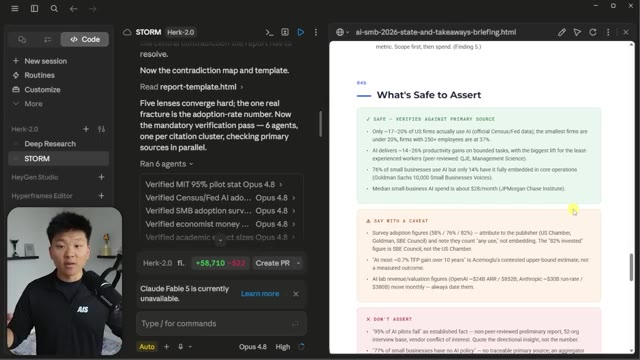
*⏱️ 00:03:19 — Interface d'une application de recherche intelligente divisée en deux volets, avec le présentateur visible en incrustation dans le coin inférieur gauche.*

---

### ⏱️ `[00:03:37 - 00:03:58]` | Segment #08

**🔊 Audio (Transcription Intégrale Mot pour Mot en Français) :**
> Et donc, dans cet exemple précis avec la recherche approfondie et la tempête, j'ai introduit cela dans Codex, donc un modèle d'IA complètement différent, et j'ai dit : « Hé, lequel est le meilleur ? » Et il est revenu en disant que le briefing HTML est meilleur. Il a une meilleure qualité de preuve. Il est beaucoup plus solide. Il a une diversité de sources beaucoup plus forte. Il a une thèse beaucoup plus forte. Il est plus exploitable. Il a un meilleur contrôle des risques et il est meilleur pour la vidéo et le contenu.

**👁️ Analyse Visuelle d'Écran (gemini-3.5-flash-lite) :**
**Interface & Outils** : VS Code (ou éditeur similaire)

**Contenu textuel & Code** : Texte de comparaison sous forme de tableau évaluant la qualité des preuves, la diversité des sources, la thèse centrale, l'actionnabilité, le contrôle des risques et l'utilisation pour le contenu, avec un verdict déclarant que le briefing HTML est meilleur.

**Action / Démonstration** : Affichage et lecture d'un rapport comparatif généré par l'IA dans l'éditeur de code.

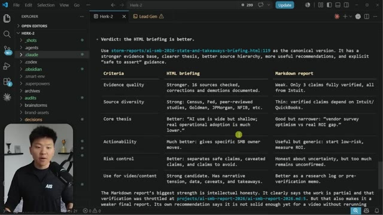
*⏱️ 00:03:42 — Un éditeur de code affichant un fichier Markdown comparant un briefing HTML et un rapport Markdown, avec la webcam du présentateur en bas à gauche.*

---

### ⏱️ `[00:03:58 - 00:04:31]` | Segment #09

**🔊 Audio (Transcription Intégrale Mot pour Mot en Français) :**
> Donc dans l'ensemble de ces six catégories ici, Codex a pensé que le briefing HTML était meilleur. Et je ne connais pas les mesures exactes ici concernant le coût, mais la recherche Storm était plus rapide à exécuter et elle était 100 % moins chère car dans ce cas nous avons exécuté environ, c'était quoi, peut-être 12 agents au total. Alors que le rapport de recherche approfondie cette fois-ci a fait tourner plus de 100 agents. Peut-être que je devrais y aller un peu plus doucement sur cette exécution de recherche approfondie parce qu'elle a été touchée par les limites de taux de l'API. Mais c'est aussi un autre point du genre si vous allez lancer autant d'agents en même temps, vous risquez d'être limité par le taux. Alors qu'avec Storm, vous savez, ce sera toujours vos cinq personas.

**👁️ Analyse Visuelle d'Écran (gemini-3.5-flash-lite) :**
**Interface & Outils** : Interface web STORM (Herk-2.0)

**Contenu textuel & Code** : Rapport de recherche avec des sections sur la vérification des sources (16/16 sources vérifiées) et la création d'un fichier HTML de briefing.

**Action / Démonstration** : Affichage des résultats d'une recherche et de la vérification de contenu par l'agent IA STORM.

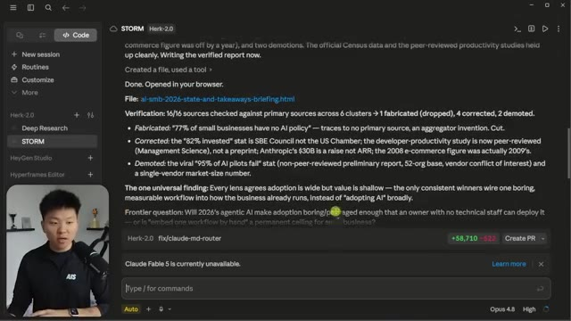
*⏱️ 00:04:06 — Interface web montrant l'outil STORM avec un rapport textuel détaillé et des statistiques de vérification des sources, avec le présentateur incrusté en bas à gauche.*

---

### ⏱️ `[00:04:31 - 00:04:56]` | Segment #10

**🔊 Audio (Transcription Intégrale Mot pour Mot en Français) :**
> Donc, de toute façon, je pense que vous comprenez maintenant la valeur de ce rapport. Laissez-moi vous montrer très rapidement comment cela fonctionne réellement et comment acquérir cette compétence. Il y a donc fondamentalement quatre invites. La première est celle où nous lui demandons de générer cinq angles différents, n'est-ce pas ? Nous avons ces cinq-là, dont j'ai parlé. C'est l'invite numéro un. Vous entrez simplement votre sujet de recherche. Et ensuite, quand le résultat arrive, vous entrez l'invite numéro deux, qui est la carte des contradictions. Donc, cela dit : « Hé, où est-ce que les perspectives se contredisent mutuellement ? »

**👁️ Analyse Visuelle d'Écran (gemini-3.5-flash-lite) :**
**Interface & Outils** : Interface web de X (Twitter) affichant un article ou un post long.

**Contenu textuel & Code** : Texte du guide présentant le premier prompt de recherche multi-perspectives (« I need to research [YOUR TOPIC]. Simulate 5 different expert perspectives... ») et le présentateur à l'écran.

**Action / Démonstration** : Le présentateur explique le contenu du prompt affiché à l'écran concernant la méthode de recherche en plusieurs perspectives.

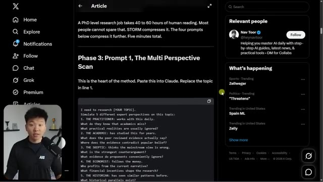
*⏱️ 00:04:37 — Capture d'écran montrant un article sur la plateforme X (Twitter) intitulé 'Phase 3: Prompt 1, The Multi Perspective Scan', avec le présentateur en médaillon dans le coin inférieur gauche.*

---

### ⏱️ `[00:04:56 - 00:05:29]` | Segment #11

**🔊 Audio (Transcription Intégrale Mot pour Mot en Français) :**
> Lequel a de bonnes preuves ? Lequel a des preuves faibles ? Et fondamentalement, cela les pousse à analyser les productions des uns et des autres. Et donc, ce que nous faisons ici, c'est que nous enchaînons fondamentalement quatre invites de suite, puis nous obtenons une synthèse et ensuite nous obtenons l'évaluation par les pairs. Donc, ce que j'ai décidé de faire, c'est de l'exécuter de mon côté. Ça a très bien fonctionné. Et j'ai dit : « Super, regroupe tout cela dans une compétence. » Je peux donc littéralement simplement te donner une invite, te donner un sujet, et tu fais tout ce travail pour moi. Et tu vas me donner un modèle cohérent pour que, chaque fois que j'exécute ceci, tu me donnes un rapport HTML qui ressemble toujours à ceci. Donc, ce à quoi cela ressemble maintenant, c'est que dans mon dossier dot Claude, j'ai un tas de compétences, comme vous pouvez le voir. Et si je vais à ma compétence de recherche storm,

**👁️ Analyse Visuelle d'Écran (gemini-3.5-flash-lite) :**
**Interface & Outils** : Interface web de X (Twitter) et lecteur de documents ou article en ligne.

**Contenu textuel & Code** : Texte d'un article et prompts de révision par les pairs (« Now peer review your own research briefing: 1. CONFIDENCE SCORES... ») et question de prospective (« The Frontier Question »).

**Action / Démonstration** : Le présentateur commente et présente un guide textuel de prompts enchaînés pour l'analyse et la synthèse de recherche.

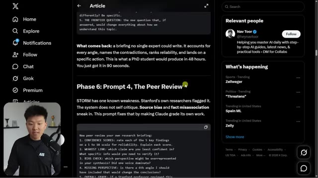
*⏱️ 00:05:04 — Capture d'écran montrant l'interface de X (Twitter) avec un article détaillé affichant des instructions de prompts de recherche (« Phase 6: Prompt 4, The Peer Review ») et le présentateur en médaillon.*

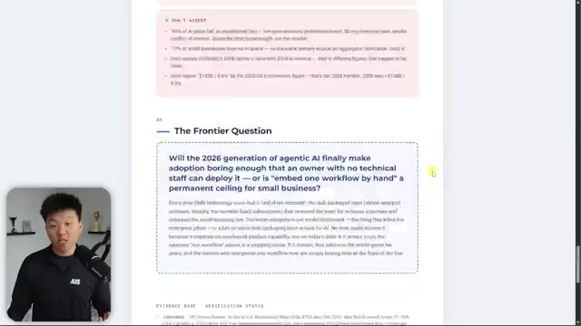
*⏱️ 00:05:21 — Capture d'écran affichant une section intitulée « The Frontier Question » au sein d'un document ou article technique, avec le présentateur visible en incrustation.*

---

### ⏱️ `[00:05:29 - 00:05:50]` | Segment #12

**🔊 Audio (Transcription Intégrale Mot pour Mot en Français) :**
> et j'ouvre le fichier skill.md, voilà ce que nous avons. Donc la recherche storm, elle transforme un sujet en un briefing HTML vérifié à perspectives multiples. Elle simule cinq angles d'experts sur le sujet, cartographie où ils se contredisent, synthétise le tout en un seul rapport HTML autonome, puis évalue par pair de manière contradictoire ses propres résultats et vérifie chaque citation par rapport à sa source principale avant de livrer.

**👁️ Analyse Visuelle d'Écran (gemini-3.5-flash-lite) :**
**Interface & Outils** : VS Code (Visual Studio Code)

**Contenu textuel & Code** : Documentation Markdown du fichier skill.md décrivant le fonctionnement de Storm Research (turns one topic into a verified, multi-perspective HTML briefing).

**Action / Démonstration** : Navigation et affichage du contenu du fichier skill.md dans l'éditeur de code.

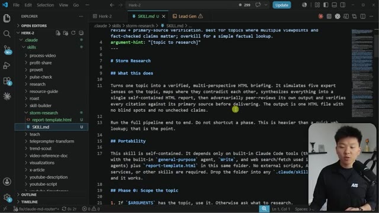
*⏱️ 00:05:34 — L'éditeur de code VS Code affichant le contenu du fichier SKILL.md pour la recherche storm, avec le présentateur visible en incrustation vidéo dans le coin inférieur droit.*

---

### ⏱️ `[00:05:50 - 00:06:10]` | Segment #13

**🔊 Audio (Transcription Intégrale Mot pour Mot en Français) :**
> Vous remarquerez également que dans cette compétence, nous avons un modèle de rapport en HTML. Je vais donc également vous l'offrir entièrement gratuitement. Il est référencé dans la compétence et indique : « Hé, une fois que vous avez trouvé toutes les informations, mettez-les simplement en HTML et assurez-vous qu'il ressemble toujours à ça. » C'est donc simplement pour assurer la cohérence de mon côté, et j'apprécie vraiment cela. Je vais donc continuer à descendre et à expliquer comment cela fonctionne. Mais si vous voulez vraiment aller récupérer ces deux ressources, rendez-vous simplement dans ma communauté School gratuite.

**👁️ Analyse Visuelle d'Écran (gemini-3.5-flash-lite) :**
**Interface & Outils** : VS Code (éditeur de code) et navigateur web (visualisation du rapport HTML).

**Contenu textuel & Code** : Code source HTML/CSS du modèle de rapport (`report-template.html`), rendu visuel du rapport et documentation Markdown (`SKILL.md`).

**Action / Démonstration** : Présentation du modèle de rapport HTML et du fichier de configuration de la compétence de recherche dans l'éditeur.

*⏱️ 00:05:55 — Image #1 : Visualisation du fichier `report-template.html` ouvert dans l'éditeur de code VS Code, montrant la structure HTML et les styles CSS du modèle de rapport de recherche.*

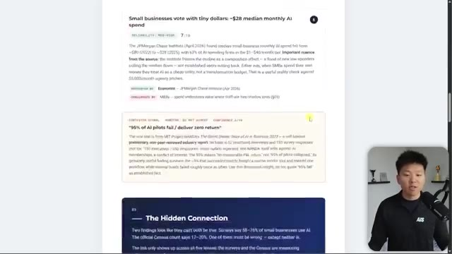
*⏱️ 00:06:00 — Image #2 : Aperçu rendu du rapport de recherche HTML dans un navigateur web, affichant des blocs de texte formatés sur l'intelligence artificielle et les petites entreprises.*

*⏱️ 00:06:05 — Image #3 : Visualisation du fichier `SKILL.md` ouvert dans VS Code, montrant la documentation de la compétence de recherche Storm avec les instructions et les phases d'exécution.*

---

### ⏱️ `[00:06:10 - 00:06:32]` | Segment #14

**🔊 Audio (Transcription Intégrale Mot pour Mot en Français) :**
> Le lien pour cela se trouve dans la description. Tout ce que vous avez à faire, c'est d'entrer ici, de cliquer sur la salle de classe et de cliquer sur toutes les ressources YouTube, et vous pourrez trouver absolument toutes les vidéos YouTube et toutes les ressources que j'ai publiées et qui leur sont associées. Encore une fois, c'est entièrement gratuit de s'inscrire. Une fois que vous avez cette compétence, tout ce que vous avez à faire, c'est de donner ce fichier Markdown et le fichier HTML à Claude et de lui dire : « Hé, Claude, c'est une compétence appelée Storm Research. »

**👁️ Analyse Visuelle d'Écran (gemini-3.5-flash-lite) :**
**Interface & Outils** : Interface web de la communauté, VS Code.

**Contenu textuel & Code** : Modules de formation dans la Classroom, code Markdown décrivant les compétences de recherche Storm (SKILL.md) pour Claude Code.

**Action / Démonstration** : Navigation dans la salle de classe de la communauté et exploration de l'arborescence de code dans VS Code.

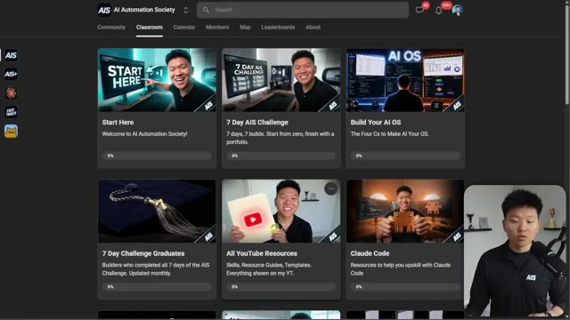
*⏱️ 00:06:16 — Interface web de la plateforme 'AI Automation Society' montrant la section 'Classroom' avec différentes ressources et modules de formation, ainsi que la vidéo du présentateur en bas à droite.*

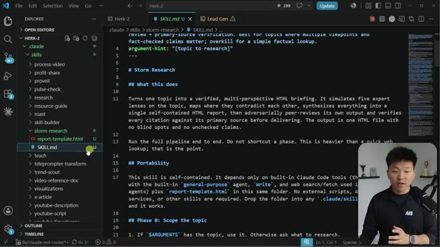
*⏱️ 00:06:26 — Éditeur de code VS Code affichant un fichier Markdown de compétences pour Claude Code (SKILL.md) avec l'arborescence des dossiers à gauche et la webcam du présentateur en bas à droite.*

---

### ⏱️ `[00:06:32 - 00:06:53]` | Segment #15

**🔊 Audio (Transcription Intégrale Mot pour Mot en Français) :**
> Mettez ceci dans le dossier .cloud et ensuite vous êtes pratiquement prêts. Et si vous ne savez pas ce qu'est une compétence, c'est fondamentalement juste un prompt. C'est fondamentalement juste un prompt principal que, chaque fois que je dis, hé, Claude, fais des recherches sur les tempêtes pour moi, va invoquer cette compétence. Elle va lire le tout et ensuite simplement l'exécuter pour vous. C'est donc très automatisé une fois que vous les avez fondamentalement installées. Et oui, cette compétence peut fonctionner avec Codex ou tout autre type d'agent différent que vous voulez.

**👁️ Analyse Visuelle d'Écran (gemini-3.5-flash-lite) :**
**Interface & Outils** : Visual Studio Code

**Contenu textuel & Code** : Fichier `SKILL.md` situé dans `.claude > skills > storm-research`, détaillant le fonctionnement d'une compétence d'IA (prompt principal avec sections comme What this does, Portability, Phase 0).

**Action / Démonstration** : Navigation et explication de la structure du fichier de compétence (`SKILL.md`) placé dans le dossier `.claude`.

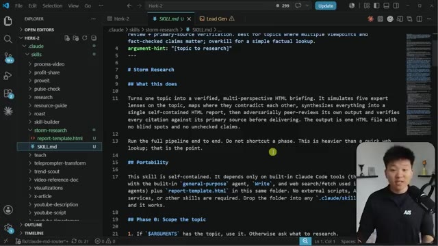
*⏱️ 00:06:37 — Vue de l'éditeur de code VS Code montrant le contenu d'un fichier Markdown SKILL.md définissant une compétence de recherche (« Storm Research »), avec le présentateur incrusté en bas à droite.*

---

### ⏱️ `[00:06:53 - 00:07:15]` | Segment #16

**🔊 Audio (Transcription Intégrale Mot pour Mot en Français) :**
> C'est juste que dans Claude, ça doit spécifiquement être dans le dossier .Claude. Vous pouvez voir ici que j'ai un dossier appelé .Codex ou .Agents, et vous pouvez placer différentes compétences dans différents types de dossiers selon l'agent de codage que vous utilisez. Ceci est actuellement juste un tutoriel sur le code de Claude. Donc de toute façon, à partir de là, la phase zéro consiste à délimiter le sujet. Parfois, si vous ne lui donnez pas un sujet suffisamment précis, il posera quelques questions avant de se lancer et de déclencher la tempête.

**👁️ Analyse Visuelle d'Écran (gemini-3.5-flash-lite) :**
**Interface & Outils** : Visual Studio Code (VS Code)

**Contenu textuel & Code** : Fichier Markdown (SKILL.md) décrivant les compétences de recherche "Storm Research" et structure des dossiers du projet (.claude, .codex, agents).

**Action / Démonstration** : Le curseur survole le dossier `.codex` dans l'explorateur de fichiers pour illustrer l'organisation des compétences par agent de codage.

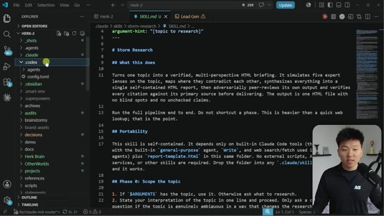
*⏱️ 00:06:58 — Vue de l'éditeur de code VS Code montrant l'arborescence des dossiers à gauche avec .claude et .codex, et le contenu du fichier SKILL.md ouvert dans l'éditeur principal, avec la webcam du présentateur en bas à droite.*

---

### ⏱️ `[00:07:15 - 00:07:35]` | Segment #17

**🔊 Audio (Transcription Intégrale Mot pour Mot en Français) :**
> Ensuite, il active les cinq prismes d'experts en parallèle. Et après, nous passons à la cartographie des contradictions, à la synthèse des rapports, puis à la vérification par révision de paires contradictoires. Et c'est là que nous obtenons notre résultat. Laissez-moi donc simplement ouvrir l'application de bureau Claude et démarrer une nouvelle session ici. Et je vais juste dire, hé Claude, s'il te plaît, lance une recherche storm pour moi sur les agents vocaux IA.

**👁️ Analyse Visuelle d'Écran (gemini-3.5-flash-lite) :**
**Interface & Outils** : Visual Studio Code (VS Code)

**Contenu textuel & Code** : Fichier Markdown (`SKILL.md`) affichant les sections : "Phase 2: Map the contradictions", "Phase 3: Synthesize the HTML report", et "Phase 4: Adversarial peer review + verification".

**Action / Démonstration** : Le présentateur commente le code et les différentes étapes du workflow d'IA affiché à l'écran.

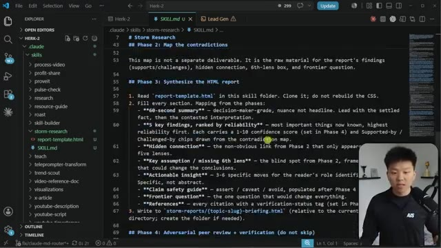
*⏱️ 00:07:20 — Vue de l'éditeur VS Code montrant un fichier Markdown décrivant les différentes phases d'un processus de recherche automatisé (Storm Research), avec le présentateur visible en incrustation dans le coin inférieur droit.*

---

### ⏱️ `[00:07:36 - 00:08:04]` | Segment #18

**🔊 Audio (Transcription Intégrale Mot pour Mot en Français) :**
> Et donc ce que vous remarquerez ici, c'est que je n'ai pas utilisé de commande par slash, donc cela va quand même invoquer la compétence. Et ce que vous remarquerez aussi, c'est que ce n'est pas très précis, donc cela pourrait nous poser quelques questions. Juste ici, vous pouvez voir que c'est écrit, d'accord, exécution de la compétence storm research. Donc c'est ainsi qu'il a procédé pour parcourir storm research. Et l'argument dont il a actuellement conscience, ce sont les agents vocaux d'IA. Il revient et dit, d'accord, voici le sujet, voici le lecteur, et il sait que je suis un éducateur en IA, et je décide potentiellement si les agents vocaux d'IA valent la peine de faire une vidéo ou si ce n'est que du superflu.

**👁️ Analyse Visuelle d'Écran (gemini-3.5-flash-lite) :**
**Interface & Outils** : Application web d'assistant IA avec un panneau latéral de navigation et une zone de chat principale.

**Contenu textuel & Code** : Prompt utilisateur : "Hey Claude, please run a storm research for me on voice AI agents.", suivi de l'exécution "Running skill /storm-research".

**Action / Démonstration** : L'agent IA invoque automatiquement la compétence de recherche à partir du texte saisi par l'utilisateur.

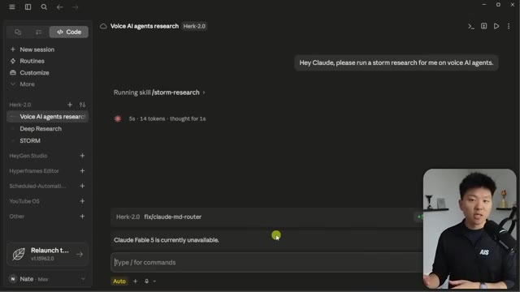
*⏱️ 00:07:43 — Interface d'une application d'intelligence artificielle montrant l'exécution d'une compétence "storm-research" sans utiliser de commande par slash explicite.*

---

### ⏱️ `[00:08:04 - 00:08:42]` | Segment #19

**🔊 Audio (Transcription Intégrale Mot pour Mot en Français) :**
> Le pipeline est donc en train de s'exécuter. Si j'ouvre ceci, vous pouvez voir qu'il va lancer ces cinq agents, le praticien, l'académique, le sceptique, et tous les autres dont nous avons besoin. Et ce qui est vraiment génial, c'est que vous pouvez cliquer dessus pour voir ce qu'ils font. Donc, si je clique sur l'économiste, par exemple, voici le prompt que notre session principale a envoyé à ce sous-agent. Donc maintenant, nous pouvons voir que le sous-agent en bas navigue sur le web. Il utilise un outil. Il fait des recherches. Nous pouvons cliquer sur l'académique. Nous pouvons voir que c'est le prompt de l'académique. Et encore une fois, le sous-agent académique est, vous savez, en train de faire tout ça en bas. Maintenant, pendant que cela s'exécute, laissez-moi vous expliquer rapidement la différence entre avoir des sous-agents et avoir des équipes d'agents. Les sous-agents, c'est fondamentalement

**👁️ Analyse Visuelle d'Écran (gemini-3.5-flash-lite) :**
**Interface & Outils** : Application web de recherche par agents IA avec webcam du présentateur incrustée en bas à gauche.

**Contenu textuel & Code** : Texte décrivant le pipeline "Voice AI agents research" et la liste des 5 lentilles d'experts en cours d'exécution en parallèle (4 running tasks, 201.9k tokens).

**Action / Démonstration** : Exécution d'un pipeline multi-agents effectuant des recherches et analyses en parallèle.

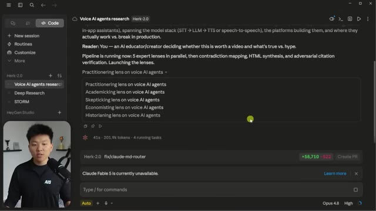
*⏱️ 00:08:13 — Interface de l'application montrant l'exécution d'un pipeline de recherche avec 5 perspectives d'agents IA (Practitionering lens, Academicking lens, Skepticking lens, Economisting lens, Historianing lens).*

---

### ⏱️ `[00:08:42 - 00:09:05]` | Segment #20

**🔊 Audio (Transcription Intégrale Mot pour Mot en Français) :**
> où nous avons une session principale. Donc cette session juste ici, c'est Claude. C'est à lui que nous parlons. Et tous ces sous-agents travaillent pour cette session principale. Donc la session principale parle à ces cinq-là, mais ces cinq-là ne peuvent pas se parler entre eux. Et c'est une distinction importante parce que c'est ce que vous avez réellement dans le monde des équipes d'agents. Vous pouvez créer des équipes d'agents ou des conseils d'agents qui peuvent non seulement parler à votre session principale, mais qui peuvent aussi se parler entre eux.

**👁️ Analyse Visuelle d'Écran (gemini-3.5-flash-lite) :**
**Interface & Outils** : Application web de recherche par agents IA (type interface de chat avancée)

**Contenu textuel & Code** : Liste des tâches en cours (« 5 running tasks ») affichant les différents angles d'analyse (« lenses ») sur les agents vocaux IA.

**Action / Démonstration** : Exécution simultanée de 5 agents sous la supervision d'une session principale.

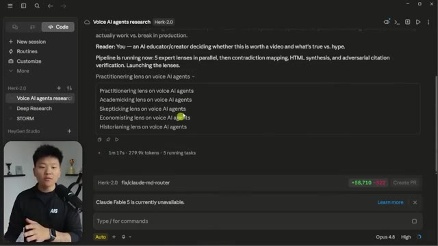
*⏱️ 00:08:48 — Interface d'une application de recherche avec l'exécution de 5 sous-agents en parallèle nommés « Practitionering », « Academicking », « Skepticking », « Economisting » et « Historianing ».*

---

### ⏱️ `[00:09:05 - 00:09:28]` | Segment #21

**🔊 Audio (Transcription Intégrale Mot pour Mot en Français) :**
> Et c'est vraiment génial parce que ce que j'aime faire, c'est de lancer des équipes d'agents quand j'ai besoin d'aide pour décider de certaines idées ou sujets. Et je vais non seulement leur demander de faire des recherches pour moi, mais ensuite je vais les faire débattre entre eux. Donc ils vont littéralement se disputer entre eux jusqu'à ce qu'ils parviennent à une sorte de consensus. Les équipes d'agents sont toutefois beaucoup plus coûteuses que les sous-agents. C'est donc une distinction importante, je ferai d'autres vidéos sur les équipes d'agents plus tard, mais si vous voulez vraiment voir une analyse approfondie, regardez cette vidéo que j'ai étiquetée juste ici.

**👁️ Analyse Visuelle d'Écran (gemini-3.5-flash-lite) :**
**Interface & Outils** : Logiciel de présentation ou tableau blanc numérique (type Miro / Excalidraw).

**Contenu textuel & Code** : Texte et schémas comparatifs : 'Sub-agents' (liens centralisés, 'report back only') face à 'Agent team' (liens croisés, 'They argue, disagree, and hand you one consensus').

**Action / Démonstration** : Le présentateur explique la différence conceptuelle entre une architecture de sous-agents classiques et une équipe d'agents autonomes qui collaborent et débattent.

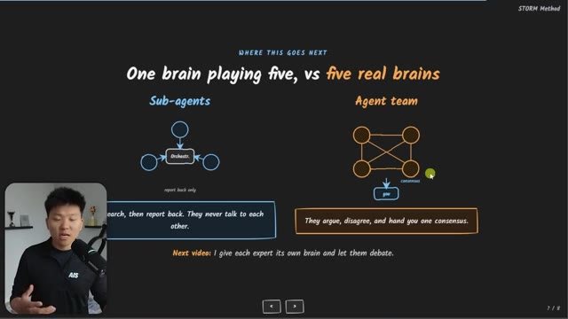
*⏱️ 00:09:11 — Un schéma comparatif montrant 'One brain playing five, vs five real brains', opposant des sous-agents isolés à une équipe d'agents interconnectés en réseau qui débattent pour un consensus.*

---

### ⏱️ `[00:09:28 - 00:10:01]` | Segment #22

**🔊 Audio (Transcription Intégrale Mot pour Mot en Français) :**
> Et aussi si vous voulez regarder une autre vidéo où j'ai fait une plongée encore plus profonde sur les sous-agents, alors vous pouvez regarder cette vidéo juste ici. Maintenant, vous pouvez voir que tous ces sous-agents ont fonctionné sur Opus 4.8. Si vous ne voulez pas faire ça, vous n'êtes pas obligé, vous pourriez faire fonctionner tous ces sous-agents sur Haiku ou Sonnet si vous le souhaitez, mais dans ce cas, j'ai aimé qu'ils fonctionnent sur Opus. Mais les cinq lentilles sont intégrées, donc maintenant il va aller de l'avant et examiner les contradictions. Donc vous pouvez voir qu'il lit ce fichier, qui est le modèle de rapport. Il exécute ces agents en arrière-plan et maintenant il va commencer à vérifier toutes ces différentes citations et statistiques et les différentes choses que nos agents passifs initiaux avaient trouvées.

**👁️ Analyse Visuelle d'Écran (gemini-3.5-flash-lite) :**
**Interface & Outils** : Interface web de recherche et d'agents IA (Herk-2.0 / Voice AI agents research)

**Contenu textuel & Code** : Liste des 5 agents exécutés en parallèle (« Ran 5 agents ») avec mention du modèle « Opus 4.8 » pour chacun, et le texte de synthèse des résultats.

**Action / Démonstration** : Affichage des résultats d'analyse et de cartographie des contradictions par les sous-agents d'IA.

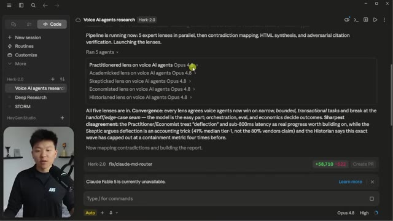
*⏱️ 00:09:36 — Interface de recherche montrant l'exécution de 5 sous-agents spécialisés (ex. Practitionerred lens, Academicked lens, Skepticked lens) fonctionnant sur Opus 4.8.*

---

### ⏱️ `[00:10:01 - 00:10:22]` | Segment #23

**🔊 Audio (Transcription Intégrale Mot pour Mot en Français) :**
> Aussi, je sais que dans cette vidéo, j'ai un peu alterné entre l'application Cloud Desktop et VS Code. Si vous me suivez depuis un moment, vous savez que j'aime généralement faire la plupart de mon travail dans VS Code. Cloud fonctionne fondamentalement de la même manière dans les deux. C'est juste une différence d'interface utilisateur, en réalité. Mais la raison pour laquelle j'ai choisi de montrer une partie de cette vidéo aujourd'hui dans l'application Desktop, c'est parce que je trouvais sympa de montrer les agents réels en train de s'exécuter ici.

**👁️ Analyse Visuelle d'Écran (gemini-3.5-flash-lite) :**
**Interface & Outils** : VS Code et application Cloud Desktop.

**Contenu textuel & Code** : Fichier Markdown (`SKILL.md`) contenant des directives de recherche ("Storm Research", règles de vérification) et interface Cloud avec rapports de vérification et invite de commandes.

**Action / Démonstration** : Navigation et présentation des fichiers de configuration et des résultats de recherche au sein des deux environnements de développement.

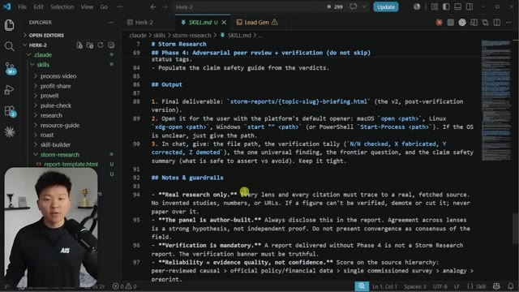
*⏱️ 00:10:06 — Vue de l'éditeur VS Code affichant un fichier Markdown de configuration de recherche (SKILL.md) avec le présentateur en médaillon vidéo en bas à gauche.*

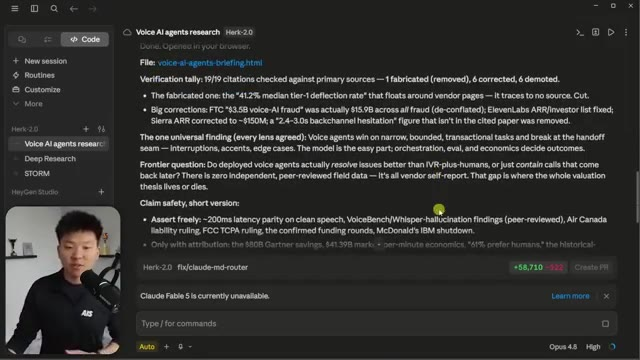
*⏱️ 00:10:17 — Vue de l'application Cloud Desktop (interface web) affichant les résultats d'une recherche sur les agents vocaux IA, avec une zone de chat et un panneau de configuration.*

---

### ⏱️ `[00:10:22 - 00:10:45]` | Segment #24

**🔊 Audio (Transcription Intégrale Mot pour Mot en Français) :**
> Mais vous pouvez voir que notre rapport est revenu. Donc, laissez-moi en fait l'ouvrir dans un navigateur. Vous pouvez voir qu'il s'agit de la version V2. Donc, tout a été vérifié. Si je fais défiler tout en bas, vous pouvez voir que les sources ont soit été rétrogradées, corrigées ou confirmées. C'est donc formidable. Nous avons notre résumé de 60 secondes. Nous avons nos principales conclusions, qui, bien évidemment, sont encore une fois classées par ordre de fiabilité. Donc, ce que je vous recommandes de faire, c'est d'aller récupérer la compétence, de la placer dans votre propre Claude et de jouer un peu avec.

**👁️ Analyse Visuelle d'Écran (gemini-3.5-flash-lite) :**
**Interface & Outils** : Navigateur web affichant un document de recherche textuel formaté (Storm Research V2).

**Contenu textuel & Code** : Rapport intitulé 'Voice AI Agents: What's Real, What's Hype' avec des sections de synthèse, des avertissements de vérification de sources et des analyses.

**Action / Démonstration** : Le présentateur présente le rapport de recherche généré et commente le contenu vérifié et les sources.

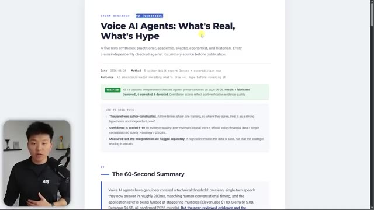
*⏱️ 00:10:28 — Capture montrant le haut du rapport de recherche version V2 intitulé 'Voice AI Agents: What's Real, What's Hype', avec le présentateur incrusté en bas à gauche.*

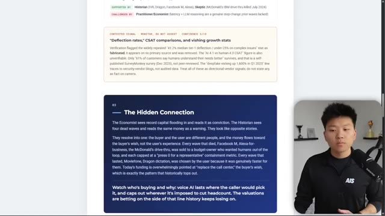
*⏱️ 00:10:40 — Capture montrant une section défilée plus bas dans le même rapport de recherche, avec le présentateur incrusté en bas à droite.*

---

### ⏱️ `[00:10:45 - 00:11:08]` | Segment #25

**🔊 Audio (Transcription Intégrale Mot pour Mot en Français) :**
> Adaptez-le un petit peu plus à votre profil. Peut-être que vous pouvez jouer avec le rapport HTML si vous voulez qu'il ait un certain aspect, mais faites-le ensuite sur un sujet que vous connaissez vraiment bien et qui est important pour vous et votre entreprise. Et ensuite, lisez-le simplement et voyez où vous avez besoin de l'améliorer ou de le modifier un tout petit peu. Et peut-être que vous voulez même ajouter un sixième angle ou un septième angle. Peut-être que pour moi et mon flux de travail, il serait utile d'ajouter par exemple un débutant en IA, parce que beaucoup de gens à qui nous enseignons sont des débutants en IA.

**👁️ Analyse Visuelle d'Écran (gemini-3.5-flash-lite) :**
**Interface & Outils** : Navigateur web / Page HTML stylisée

**Contenu textuel & Code** : Rapport de recherche intitulé 'Voice AI Agents: What's Real, What's Hype' avec des sections de résumé, des métadonnées de vérification et des notes méthodologiques.

**Action / Démonstration** : Présentation et affichage à l'écran d'un rapport web généré ou personnalisé en lien avec le sujet abordé.

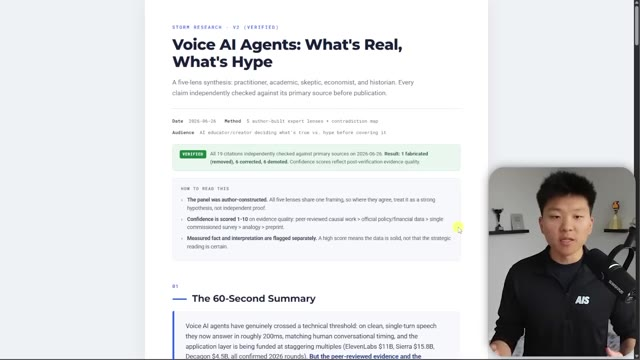
*⏱️ 00:10:51 — Capture d'écran montrant un rapport web au format HTML avec le titre 'Voice AI Agents: What's Real, What's Hype' et le présentateur dans une pastille vidéo en bas à droite.*

---

### ⏱️ `[00:11:08 - 00:11:36]` | Segment #26

**🔊 Audio (Transcription Intégrale Mot pour Mot en Français) :**
> Ou peut-être que ce serait bien pour moi d'ajouter à la compétence un créateur de contenu ou quelque chose comme ça. Donc je suppose que la raison pour laquelle je dis ça, c'est parce que je pense que ce que vous devez retenir globalement de la vidéo, c'est oui, allez récupérer la compétence Storm et testez-la. Mais c'est aussi moins le fait que cette compétence spécifique et cette méthode spécifique de Stanford soient les meilleures pour tout le monde, mais je pense que les théories que vous pouvez en tirer, comme l'idée que plus vous avez de perspectives faisant des recherches et se contredisant les unes les autres, meilleure et plus holistique sera la recherche que vous obtiendrez réellement.

**👁️ Analyse Visuelle d'Écran (gemini-3.5-flash-lite) :**
**Interface & Outils** : Navigateur web affichant un document PDF ou un rapport, et interface du réseau social X (Twitter).

**Contenu textuel & Code** : Texte de rapport sur l'intelligence artificielle vocale et publication sur Stanford STORM avec des détails sur son efficacité.

**Action / Démonstration** : Le présentateur commente le contenu affiché à l'écran concernant les outils et rapports de recherche en IA.

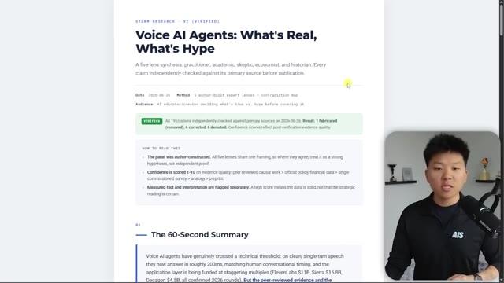
*⏱️ 00:11:15 — Un document de recherche intitulé "Voice AI Agents: What's Real, What's Hype" affiché à l'écran, avec le présentateur incrusté en bas à droite.*

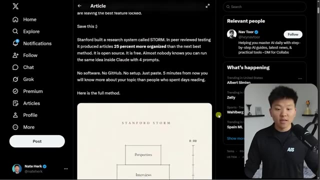
*⏱️ 00:11:29 — Une publication sur le réseau social X (Twitter) concernant un système de recherche appelé STORM développé par Stanford, avec le présentateur incrusté en bas à droite.*

---

### ⏱️ `[00:11:36 - 00:11:55]` | Segment #27

**🔊 Audio (Transcription Intégrale Mot pour Mot en Français) :**
> Fondamentalement, c'est toute l'idée que si vous n'avez pas d'expertise dans un domaine, voyez si vous pouvez l'emprunter d'une manière ou d'une autre. Voyez si vous pouvez aller de l'avant et éliminer vos propres angles morts, trouver les lacunes dans vos connaissances et aller utiliser des agents pour créer de petits experts un peu partout afin que vous ayez ce conseil d'agents qui possèdent différentes expertises et différentes connaissances et qui vous soutiennent peu importe ce que vous faites.

**👁️ Analyse Visuelle d'Écran (gemini-3.5-flash-lite) :**
**Interface & Outils** : Application de présentation ou tableau blanc numérique (ex: Obsidian Canvas, Miro ou diapositive personnalisée) avec incrustation vidéo du présentateur.

**Contenu textuel & Code** : Texte affiché : "THE WHOLE POINT - Borrow expertise you don't have", "Five perspectives. A contradiction map. A peer review. In five minutes.", et des encadrés numérotés : "1. Kill your blind spots", "2. Find the real gaps", "3. Ship the call", ainsi qu'une commande "Run /storm-research on the topic you need to understand most."

**Action / Démonstration** : Le présentateur explique les concepts clés de la méthode STORM pour combler les lacunes d'expertise.

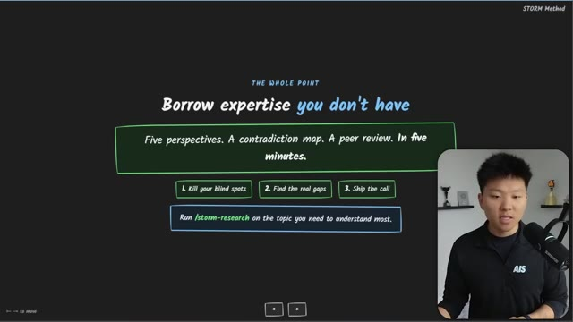
*⏱️ 00:11:41 — Une diapositive de présentation sombre avec du texte explicatif sur la méthode STORM, montrant le présentateur dans un encadré en bas à droite.*

---

### ⏱️ `[00:11:55 - 00:12:05]` | Segment #28

**🔊 Audio (Transcription Intégrale Mot pour Mot en Français) :**
> Donc je sais que ça a été rapide aujourd'hui, mais j'espère que vous avez apprécié. Vous avez appris quelque chose de nouveau, si c'est le cas, veuillez mettre un pouce bleu, ça m'aide énormément. Et comme toujours, je vous remercie d'être arrivés jusqu'à la fin de la vidéo et je vous vois dans la prochaine. Merci les gars.

**👁️ Analyse Visuelle d'Écran (gemini-3.5-flash-lite) :**
**Interface & Outils** : Présentation de type diaporama (probablement slides ou outil de mind-mapping).

**Contenu textuel & Code** : Texte affiché : "THE WHOLE POINT: Borrow expertise you don't have", "Five perspectives. A contradiction map. A peer review. In five minutes.", étapes "1. Kill your blind spots", "2. Find the real gaps", "3. Ship the call" et commande suggérée "/storm-research on the topic you need to understand most."

**Action / Démonstration** : Récapitulatif final de la méthode de recherche assistée par IA enseignée dans la vidéo.

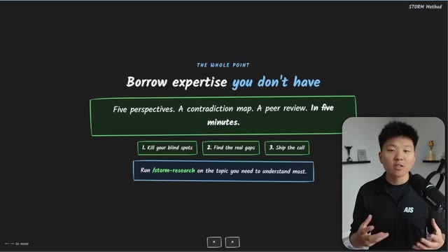
*⏱️ 00:11:57 — Une diapositive de présentation résumant la "STORM Method", avec les étapes clés pour automatiser la recherche et l'analyse de contenu, accompagnée du présentateur en incrustation vidéo.*

---

