# 🎬 How Anthropic Engineers Actually Prompt Fable 5

> **Chaîne** : [Nate Herk | AI Automation](https://www.youtube.com/@nateherk/featured)  
> **Lien YouTube** : [https://www.youtube.com/watch?v=vcU85OrwuV0](https://www.youtube.com/watch?v=vcU85OrwuV0)  
> **Date de publication** : 20260701  
> **Durée** : 00:10:44  
> **Identifiant vidéo** : `vcU85OrwuV0`  
> **Transcription & Analyse** : `whisper-v3-large-turbo+gemini-3.5-flash-lite`  

---

## 📌 Synthèse Exécutive & Outils

### 💡 Résumé

Cette vidéo de la chaîne *Nate Herk | AI Automation* plonge au cœur des pratiques d'ingénierie avancées d'Anthropic pour maîtriser Claude 5 (Fable 5), le modèle le plus puissant testé par l'auteur à ce jour. Conçu comme un outil haut de gamme destiné à alimenter des écosystèmes complexes — comme un second cerveau ou un système d'exploitation par IA (AIOS) —, Claude 5 s'avère particulièrement performant mais onéreux (10 $ par million de tokens en entrée, 50 $ en sortie). L'analyse démontre que l'utilisation naïve de ce modèle entraîne une consommation superflue de jetons, d'autant que la période promotionnelle plafonnant son usage à 50 % des limites hebdomadaires sans frais supplémentaires s'achève le 7 juillet. 

Pour optimiser l'efficacité de Claude 5 et éviter des coûts injustifiés, la vidéo décortique les recommandations officielles d'Anthropic et l'expérience empirique de l'auteur. Elle met en lumière un changement radical de paradigme dans le prompting : abandonner les structures de planification rigides et les demandes systématiques de chaîne de pensée (*Chain-of-Thought*) au profit d'instructions contextuelles précises, de directives négatives strictes et de boucles d'auto-vérification rigoureuses. En segmentant l'utilisation des modèles selon la criticité des tâches (réserver Claude 5 à seulement 5 % à 15 % des cas d'usage complexes), les ingénieurs peuvent orchestrer des agents performants tout en maîtrisant leur budget opérationnel.

---

### 🛠️ Outils, Modèles & Logiciels Présentés

* **Claude 5 (Fable 5)** : Le modèle de pointe d'Anthropic doté d'un raisonnement supérieur et de paramètres d'effort ajustables, facturé 10 $ par million de tokens en entrée et 50 $ en sortie.
* **Opus 4.8 / Opus** : Modèle de référence antérieur d'Anthropic, souvent utilisé comme point de comparaison tarifaire et de performance, ou sollicité en repli selon les types de requêtes.
* **Claude Code** : Environnement de développement et interface d'interaction pour les ingénieurs logiciels exploitant les modèles Claude au sein des environnements de code.
* **Hyperagent** : Solution conçue par l'équipe d'Airtable permettant de créer un conseil d'agents IA autonomes dotés de personnalités distinctes, de machines cloud dédiées et de navigateurs web pour critiquer des projets en toute objectivité.
* **VS Code** : L'éditeur de code de référence où les intégrations des modèles Claude et Fable 5 sont déployées pour l'assistance au développement.
* **Communauté School** : Plateforme communautaire gratuite de l'auteur hébergeant la documentation complète, les guides pratiques et les ressources YouTube mentionnées dans la vidéo.

---

### 🔑 Points Clés & Enseignements Stratégiques

* **Contextualisation par l'intention (Donner le "pourquoi")** : Claude 5 réagit de manière optimale lorsque le prompt explicite la vision globale et l'intention derrière la tâche, lui permettant de relier l'instruction aux informations pertinentes au lieu de deviner.
* **Efficacité du *Negative Prompting* (Le guidage par l'exclusion)** : Pour contrer la tendance naturelle des LLM à extrapoler ou à sur-innover en se basant sur leurs données d'entraînement, il est crucial d'énoncer explicitement ce qu'il ne faut *pas* faire (ex: "N'ajoute pas de fonctionnalités, fais la chose la plus simple").
* **Abandon du sur-planifiage au profit de l'action autonome** : Contrairement aux anciennes recommandations, il n'est plus nécessaire de forcer un mode plan rigide ; il faut autoriser le modèle à agir dès qu'il dispose de suffisamment d'éléments pour exécuter la tâche.
* **Maîtrise et granularité des niveaux d'effort** : L'utilisation des paramètres d'effort (bas, moyen, haut, extra haut) doit être corrélée à la complexité de la tâche, en réservant le niveau "haut" ou "extra haut" aux charges de travail critiques et "moyen/bas" aux actions de routine.
* **Optimisation budgétaire et allocation sélective** : Claude 5 ne doit pas être utilisé pour toutes les requêtes en raison de son coût élevé ; il est recommandé de le solliciter de manière ciblée (15 % du temps maximum) pour éviter le gaspillage de tokens.
* **Exigence de preuve et boucles d'auto-vérification** : Pour s'assurer de la fiabilité des livrables, l'agent doit être instruit de ne jamais déclarer une tâche terminée sans fournir de preuve vérifiable, réduisant ainsi la charge de validation humaine.
* **Risques liés à l'explicitation du raisonnement sous Fable 5** : Contrairement aux modèles précédents, exiger systématiquement une ligne "explique ton raisonnement" (surtout dans le system prompt) peut provoquer des refus de traitement ou basculer la tâche vers Opus 4.8.
* **Intégration pérenne dans les fichiers de configuration (`claude.md`)** : Les instructions fondamentales (comme l'obligation de preuve ou le cadrage négatif) doivent être ancrées dans les fichiers de configuration de l'agent ou du projet plutôt que d'être répétées manuellement à chaque prompt.
* **Parallélisme avec des agents contradictoires** : L'utilisation d'architectures multi-agents (comme Hyperagent) permet de briser le biais de complaisance de l'IA ("béni-oui-oui") en configurant des rôles antagonistes pour éprouver la solidité d'une idée.
* **Anticipation des contraintes tarifaires et promotionnelles** : La fin de la période promotionnelle fixée au 7 juillet impose aux développeurs d'auditer leurs flux de travail pour éviter des surcoûts liés au basculement automatique sur les crédits d'utilisation payants.

---

## ⏱️ Chronologie & Transcription Complète Audio & Visuelle (Mot pour Mot)

### ⏱️ `[00:00:00 - 00:00:32]` | Segment #01

**🔊 Audio (Transcription Intégrale Mot pour Mot en Français) :**
> Donc nous avons tous assez attendu. Claude 5 fait enfin son retour. Et c'est un modèle incroyable. C'est le plus puissant que j'aie jamais utilisé, sans aucun doute. J'ai construit des choses comme mon second cerveau, mon système d'exploitation par IA. J'ai donc évidemment beaucoup testé ce modèle, et j'ai essayé de trouver la meilleure façon de l'utiliser pour que vous puissiez réellement l'utiliser efficacement et ne pas payer pour des jetons sans raison. J'ai regardé ce que les gens ont dit sur X, j'ai écouté les ingénieurs d'Anthropic, et j'ai aussi lu toute cette documentation ici même sur les meilleures pratiques pour prompter Claude 5. Donc aujourd'hui, ce que j'ai fait, c'est que j'ai condensé tout cela en six choses les plus simples et les plus efficaces que vous devriez faire dès maintenant.

**👁️ Analyse Visuelle d'Écran (gemini-3.5-flash-lite) :**
**Interface & Outils** : LightRAG, VS Code, Navigateur web (Claude Platform Docs).

**Contenu textuel & Code** : Commandes pour exécuter des compétences de recherche (storm-research), lancement de 5 agents d'arrière-plan, documentation technique sur Claude Fable 5.

**Action / Démonstration** : Exécution d'agents concurrents via l'interface de terminal et consultation de la documentation officielle.

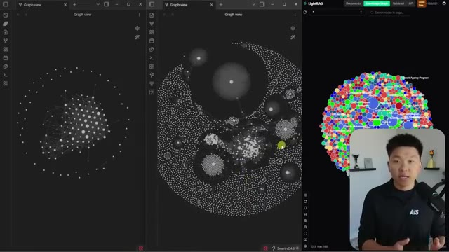
*⏱️ 00:00:08 — Vues graphiques et interface LightRAG montrant un graphe de connaissances complexe avec des nœuds interconnectés.*

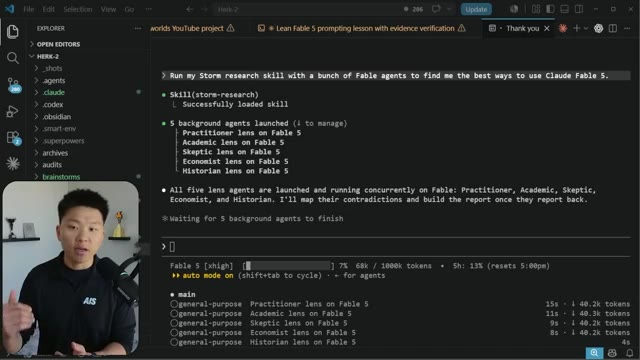
*⏱️ 00:00:16 — Éditeur de code (VS Code) affichant un terminal interactif avec Claude Fable 5 exécutant des agents de recherche en arrière-plan.*

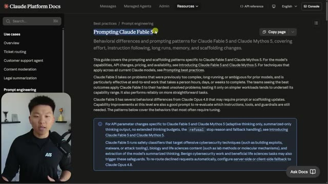
*⏱️ 00:00:24 — Documentation de la plateforme Claude affichant une page sur le 'Prompting Claude Fable 5' avec des directives comportementales.*

---

### ⏱️ `[00:00:32 - 00:00:52]` | Segment #02

**🔊 Audio (Transcription Intégrale Mot pour Mot en Français) :**
> quand vous donniez des instructions à Claude Fable 5 pour en tirer le meilleur parti. Mais ce n'est certainement pas un modèle bon marché. Il coûte le double d'Opus, soit 10 dollars par million de tokens en entrée et 50 dollars par million de tokens en sortie. Et l'autre chose, c'est qu'il ne sera pas toujours inclus dans votre abonnement Claude. Et ils appellent cela une période promotionnelle. Et vous ne pouvez utiliser que jusqu'à 50 % de vos limites hebdomadaires avec Claude Fable 5 sans frais supplémentaires.

**👁️ Analyse Visuelle d'Écran (gemini-3.5-flash-lite) :**
**Interface & Outils** : Navigateur web affichant un article ou une page de documentation d'Anthropic sur Claude Fable 5.

**Contenu textuel & Code** : Texte officiel sur les prix de l'API Claude ($10 per million input tokens and $50 per million output tokens) et les modalités d'accès.

**Action / Démonstration** : Le présentateur commente les informations tarifaires et les détails d'utilisation affichés à l'écran.

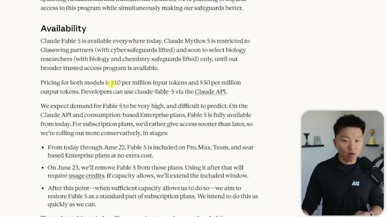
*⏱️ 00:00:37 — Page web officielle d'Anthropic montrant la tarification de Claude Fable 5 (10 $ par million de tokens en entrée et 50 $ en sortie) avec le présentateur en incrustation vidéo.*

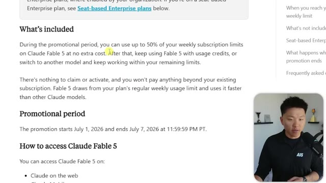
*⏱️ 00:00:47 — Suite de la page web d'Anthropic détaillant la période promotionnelle et les conditions d'accès à Claude Fable 5, avec le présentateur en incrustation.*

---

### ⏱️ `[00:00:52 - 00:01:11]` | Segment #03

**🔊 Audio (Transcription Intégrale Mot pour Mot en Français) :**
> Mais ensuite, après ça, il faudrait passer aux crédits d'utilisation. Malheureusement, la période promotionnelle se termine le 7 juillet. Donc il nous reste à peu près six jours. Et une partie de cela correspond au week-end du 4 juillet. Franchement. Quoi qu'il en soit, ça fonctionnera à peu près partout cependant. Sur l'application de bureau cloud, VS Code, dans Cloud Code, vous savez, partout où vous voulez l'utiliser. Vous pouvez voir ici, je viens juste de recevoir ce message indiquant que Cloud Fable 5 est de retour.

**👁️ Analyse Visuelle d'Écran (gemini-3.5-flash-lite) :**
**Interface & Outils** : Navigateur web affichant de la documentation textuelle.

**Contenu textuel & Code** : Texte sur la période promotionnelle (du 1er au 7 juillet 2026) et liste des moyens d'accès à Claude Fable 5 (Claude on the web, Claude Mobile, Claude Code, etc.).

**Action / Démonstration** : Le présentateur commente les informations relatives à la période promotionnelle affichée à l'écran.

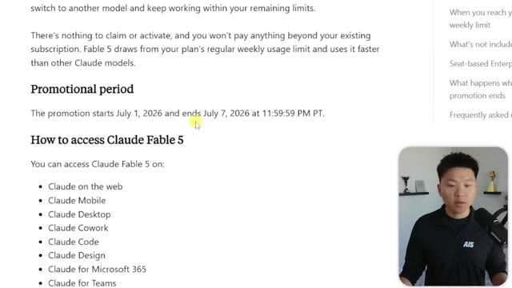
*⏱️ 00:00:57 — Une page web affichant les détails sur la période promotionnelle et les plateformes d'accès à Claude Fable 5, avec le présentateur en médaillon.*

---

### ⏱️ `[00:01:11 - 00:01:33]` | Segment #04

**🔊 Audio (Transcription Intégrale Mot pour Mot en Français) :**
> Et si je vais sur slash model, nous pouvons voir que nous avons bien accès à Fable. Encore une fois, merci beaucoup. Je suis ravi que tu sois de retour. Et parce que ce n'est vraiment pas bon marché et que je veux pouvoir le tester énormément pour vous les gars, j'espère alors que vous m'excuserez de faire une pause pour un rapide message du sponsor d'aujourd'hui. Très rapidement, les gars, un message du sponsor de la vidéo d'aujourd'hui, Hyperagent. Hyperagent m'a aidé à résoudre un problème majeur que l'IA a.

**👁️ Analyse Visuelle d'Écran (gemini-3.5-flash-lite) :**
**Interface & Outils** : VS Code, Claude Code CLI, navigateur web (documentation Anthropic)

**Contenu textuel & Code** : Commande `/model`, messages sur la disponibilité de Fable 5, informations de tarification ($10 par million de tokens d'entrée).

**Action / Démonstration** : Configuration du modèle sur Fable 5 dans Claude Code et consultation des tarifs officiels.

*⏱️ 00:01:17 — Interface VS Code affichant Claude Code dans un terminal, avec la commande `/model` sélectionnant Fable 5.*

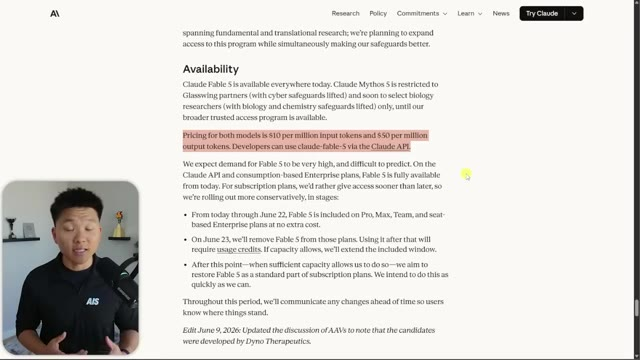
*⏱️ 00:01:22 — Page web de documentation d'Anthropic décrivant la disponibilité et la tarification de Claude Fable 5.*

---

### ⏱️ `[00:01:33 - 00:02:05]` | Segment #05

**🔊 Audio (Transcription Intégrale Mot pour Mot en Français) :**
> C'est un béni-oui-oui. Tu lui parles de ton idée et il te dit que tu es un génie. Donc, sur Hyperagent, conçu par l'équipe d'Airtable, j'ai créé un conseil d'agents, une poignée d'agents IA différents, chacun avec sa propre personnalité, chacun fonctionnant sur sa propre machine cloud avec un vrai navigateur et des outils pour faire de vraies recherches. Donc, je peux simplement balancer une idée sur Slack et ils vont la déchiqueter. L'un d'eux jouera le rôle de l'investisseur sceptique. Un autre fouillera pour voir ce que font déjà les concurrents. Un autre testera la solidité des chiffres. Ils vont tous aller chercher de véritables données et me revenir avec des retours d'une honnêteté brutale. Pas quelque chose du genre « ça a l'air super, Nate ». Il va me dire où les choses

**👁️ Analyse Visuelle d'Écran (gemini-3.5-flash-lite) :**
**Interface & Outils** : Application web Hyperagent (plateforme de gestion d'agents IA).

**Contenu textuel & Code** : Noms des rôles d'agents IA (The Operator, The CFO, The Brand & Growth Lead, The Skeptic, The Curator) et notes contextuelles de travail.

**Action / Démonstration** : Navigation et affichage des différents profils d'agents IA au sein de la plateforme Hyperagent.

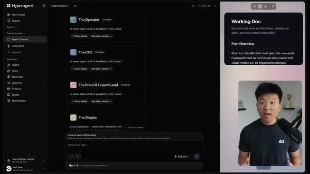
*⏱️ 00:01:41 — Interface d'Hyperagent montrant le tableau de bord du conseil d'agents (Agent Council) avec différents rôles (The Operator, The CFO, The Brand & Growth Lead, The Skeptic).*

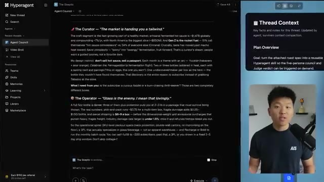
*⏱️ 00:01:49 — Interface d'Hyperagent affichant les analyses et retours détaillés des différents agents du conseil (The Curator, The Operator, The Skeptic).*

---

### ⏱️ `[00:02:05 - 00:02:40]` | Segment #06

**🔊 Audio (Transcription Intégrale Mot pour Mot en Français) :**
> est faible, et pourquoi et comment y remédier. Donc, au moment où ils ont terminé, j'ai une idée plus précise et les preuves à l'appui. Et c'est la partie que j'adore, car ce n'est pas seulement un chatbot qui approuve, mais c'est une équipe qui est en désaccord avec moi exprès. Et j'ai tout construit moi-même en un seul après-midi. Donc, si vous voulez créer votre propre conseil, les liens sont dans la description avec des crédits gratuits. Alors allez vous faire critiquer et revenons à la vidéo. Donc, la première chose à comprendre à propos de Claude 3.5 Sonnet, c'est qu'il est évidemment conçu un peu différemment d'Opus et, vous savez, de GPT. Il y a donc des choses qu'il fait vraiment très bien. Il suit des instructions courtes et claires mieux que les anciens modèles, tout simplement parce qu'il est meilleur en raisonnement. Et si vous avez passé un peu de temps

**👁️ Analyse Visuelle d'Écran (gemini-3.5-flash-lite) :**
**Interface & Outils** : Navigateur web affichant un article ou un guide sur le prompting de Claude Fable 5.

**Contenu textuel & Code** : Texte du guide sur le prompting : "How to prompt Claude Fable 5" et "Give it the why, tell it what not to touch, and make it show the receipt."

**Action / Démonstration** : Présentation d'un article de documentation sur les techniques de prompting et d'optimisation des modèles IA.

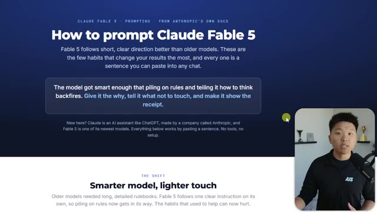
*⏱️ 00:02:31 — Page web intitulée "How to prompt Claude Fable 5" issue des documentations d'Anthropic, expliquant les bonnes pratiques de prompt.*

---

### ⏱️ `[00:02:40 - 00:03:08]` | Segment #07

**🔊 Audio (Transcription Intégrale Mot pour Mot en Français) :**
> en jouant avec, on a juste l'impression que quand on lui demande de faire quelque chose, on a juste l'impression qu'il sait de quoi on parle et qu'il comprend un petit peu mieux. D'accord. Alors voici les six habitudes, six choses à faire. J'ai étiqueté chacune d'elles si elles dépendent d'un modèle ou de Claude en particulier. Donc la première, c'est pour n'importe quel modèle, donnez-lui le pourquoi, donnez-lui le contexte derrière la raison pour laquelle vous faites quelque chose. Anthropic dit que Claude s'en sort mieux lorsqu'il comprend votre intention. Le contexte lui permet donc de relier votre tâche à la bonne information au lieu de deviner ce que vous vouliez dire.

**👁️ Analyse Visuelle d'Écran (gemini-3.5-flash-lite) :**
**Interface & Outils** : Page web de documentation sur le prompting (Claude Fable 5) avec le présentateur en incrustation vidéo.

**Contenu textuel & Code** : Texte du guide de prompt : « How to prompt Claude Fable 5 », « Give it the why », « Tell it what NOT to do », avec des blocs de code de suggestions de prompts.

**Action / Démonstration** : Le présentateur fait défiler la page web présentant les conseils et techniques de prompting pour Claude.

*⏱️ 00:02:47 — Page web présentant le guide « How to prompt Claude Fable 5 » avec une introduction sur les modèles d'IA.*

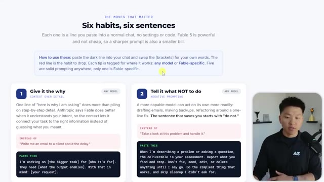
*⏱️ 00:02:54 — Section « Six habits, six sentences » détaillant les habitudes 1 (« Give it the why ») et 2 (« Tell it what NOT to do ») pour le prompting.*

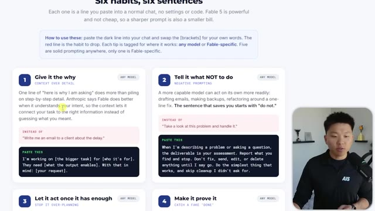
*⏱️ 00:03:01 — Vue défilée de la page web montrant les habitudes 1 à 4 avec des encadrés explicatifs et des exemples de prompts.*

---

### ⏱️ `[00:03:08 - 00:03:40]` | Segment #08

**🔊 Audio (Transcription Intégrale Mot pour Mot en Français) :**
> Donc au lieu de dire quelque chose comme écris-moi un e-mail à un client concernant le retard, dis je travaille sur une tâche plus importante et voici pour qui c'est. Ce dont ils ont besoin c'est blabla. Et avec cela en tête, peux-tu m'aider à écrire un e-mail à ce client concernant le retard ? Et si tu as ton deuxième cerveau et ton système AIOS entier configuré de la bonne manière, cela l'incitera également à parcourir des fichiers de contexte spécifiques pour s'assurer qu'il a les bonnes informations dont il a besoin pour faire en sorte que tous ces e-mails ou quoi que tu fasses paraissent plus spécifiques. La chose suivante, dont j'ai également constaté qu'elle fonctionne généralement mieux pour tous les modèles d'IA, est de faire du "negative prompting" spécifique, de lui dire spécifiquement quoi ne pas faire.

**👁️ Analyse Visuelle d'Écran (gemini-3.5-flash-lite) :**
**Interface & Outils** : Interface web de présentation de prompts avec des cartes numérotées et des blocs de code sur fond sombre.

**Contenu textuel & Code** : Texte affichant des exemples de bonnes pratiques de prompt, notamment "1. Give it the why" avec un encadré sombre contenant le modèle de prompt : "I'm working on [the bigger task] for [who it's for]. They need [what the output enables]. With that in mind: [your request]."

**Action / Démonstration** : Le curseur de la souris survole la première carte de prompt tandis que le présentateur explique la technique de contextualisation.

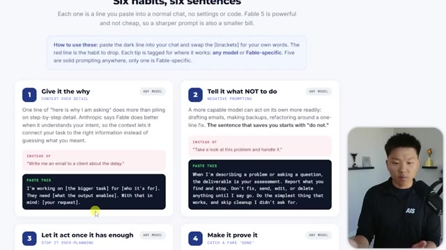
*⏱️ 00:03:16 — Capture d'écran montrant une page web intitulée "Six habits, six sentences" avec des blocs de texte et de code illustrant des techniques de prompt engineering, tandis que le présentateur apparaît dans un encadré en bas à droite.*

---

### ⏱️ `[00:03:41 - 00:04:10]` | Segment #09

**🔊 Audio (Transcription Intégrale Mot pour Mot en Français) :**
> Réfléchissez-y de cette façon. L'IA est entraînée sur une tonne de données. Donc, elle essaie littéralement, en son cœur, de prédire le mot suivant qui a le plus de sens. Et parfois, elle essaiera d'être créative et elle essaiera de faire des choses que vous n'avez pas demandées. Et parfois c'est bien, mais la plupart du temps ça ne l'est pas. Expliquez donc ce qu'il ne faut pas faire. Si vous parcourez cette page, en faisant des prompts sur Claude Fable 5, quand vous commencez à parcourir ici, vous verrez qu'ils font exactement cela ici. Lorsque vous avez des informations sur lesquelles agir, agissez. Ne faites pas ceci. Si vous pesez le pour et le contre d'un choix, donnez une recommandation, mais ne faites pas ceci.

**👁️ Analyse Visuelle d'Écran (gemini-3.5-flash-lite) :**
**Interface & Outils** : Page web de documentation / site de conseils en prompt engineering.

**Contenu textuel & Code** : Texte de documentation technique et exemples de prompts ("Give it the why", "Tell it what NOT to do", "Longer turns by default").

**Action / Démonstration** : Le présentateur commente et présente des bonnes pratiques pour guider les modèles d'IA et éviter le sur-formalisme.

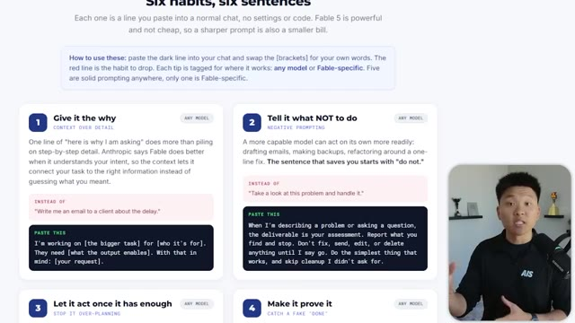
*⏱️ 00:03:48 — Une page web intitulée "Six habits, six sentences" montrant des conseils de prompt engineering avec des encadrés textuels, tandis que le présentateur apparaît en bas à droite.*

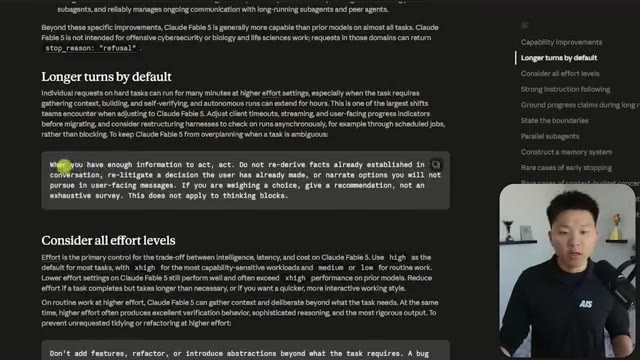
*⏱️ 00:04:03 — Une page de documentation technique sur Claude Fable 5, détaillant les sections "Longer turns by default" et "Consider all effort levels", avec le présentateur en incrustation.*

---

### ⏱️ `[00:04:10 - 00:04:44]` | Segment #10

**🔊 Audio (Transcription Intégrale Mot pour Mot en Français) :**
> Voici un autre exemple. N'ajoute pas de fonctionnalités. Ne fais pas ça. Ne fais pas ça. Ne fais pas ça. Ne fais pas ça. Fais la chose la plus simple qui fonctionne bien. La façon dont j'aime y penser, c'est que si tu expliquais une tâche à un stagiaire, tu lui dirais des choses précises à ne pas faire parce qu'il ne comprend pas encore le processus. Il essaie de l'apprendre. Donc, au lieu de dire quelque chose comme, jette un œil à ce problème et gère-le, tu pourrais dire, lorsque je décris un problème ou pose une question, le livrable est ton évaluation. Fais un rapport de ce que tu trouves et arrête-toi. Ne corrige, n'envoie, ne modifie ou ne supprime rien jusqu'à ce que je dise d'y aller. J'ai l'impression que les modèles ont en fait un peu évolué parce que je trouvais avant que le "prompting" négatif fonctionnait moins bien que d'être très précis.

**👁️ Analyse Visuelle d'Écran (gemini-3.5-flash-lite) :**
**Interface & Outils** : Interface web de présentation de conseils et mini-caméra du présentateur.

**Contenu textuel & Code** : Texte explicatif sur le prompting, incluant les sections "1. Give it the why" et "2. Tell it what NOT to do".

**Action / Démonstration** : Le présentateur explique les bonnes pratiques de prompting en illustrant ses propos avec des exemples affichés à l'écran.

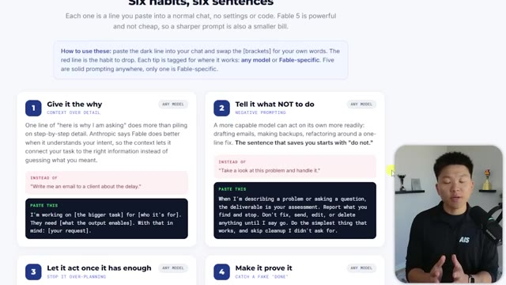
*⏱️ 00:04:19 — Capture d'écran montrant une page web intitulée "Six habits, six sentences" avec des conseils de prompting, et le présentateur dans un encadré vidéo en bas à droite.*

---

### ⏱️ `[00:04:44 - 00:05:03]` | Segment #11

**🔊 Audio (Transcription Intégrale Mot pour Mot en Français) :**
> à ce que je voulais qu'il fasse. Mais ces derniers temps, plus j'ai utilisé de prompts négatifs, plus j'ai trouvé que cela avait tendance à bien fonctionner. Donc si vous voulez accéder à ce guide complet où vous pouvez voir cet article en entier, vous pouvez le faire en rejoignant ma communauté School gratuite. Le lien pour cela sera dans la description. Tout ce que vous avez à faire, c'est d'aller ici, d'aller dans la salle de classe et de cliquer sur toutes les ressources YouTube et vous trouverez tout là-dedans. D'accord. Le suivant fonctionne également pour n'importe quel modèle.

**👁️ Analyse Visuelle d'Écran (gemini-3.5-flash-lite) :**
**Interface & Outils** : Navigateur web (plateforme Skool - AI Automation Society).

**Contenu textuel & Code** : Interface de cours en ligne montrant des modules tels que "Start Here", "7 Day AIS Challenge", "Build Your AI OS", "All YouTube Resources", "Claude Code".

**Action / Démonstration** : Navigation et présentation de la communauté de cours en ligne de l'auteur.

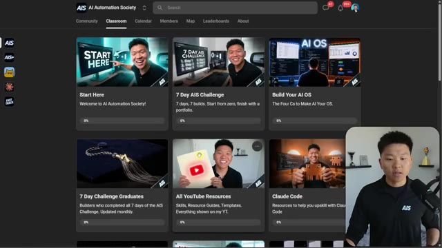
*⏱️ 00:04:58 — Capture d'écran montrant l'interface web de la communauté "AI Automation Society" (plateforme Skool) avec l'onglet "Classroom" et différentes formations vidéo.*

---

### ⏱️ `[00:05:03 - 00:05:36]` | Segment #12

**🔊 Audio (Transcription Intégrale Mot pour Mot en Français) :**
> Il s'agit de le laisser agir une fois qu'il en a assez. Donc, arrêtez de trop planifier. Je n'utilise d'ailleurs plus très souvent le mode plan à l'intérieur de Cloud Code. Je sais que c'est quelque chose que j'avais l'habitude de dire, commencez toujours en mode plan, mais je ne fais plus ça. J'ai fondamentalement mon propre mode plan que je lui fais suivre jusqu'à ce qu'il soit prêt à agir. Donc, au lieu de dire, fais des recherches sur tout et fais un plan complet avant de faire quoi que ce soit, vous pouvez dire plutôt des choses comme, quand tu as assez d'informations pour agir, alors agis. Si vous vous souvenez, c'est fondamentalement l'exemple que nous lisons ici, qui est la première chose que dit le document de Claude Fable 5, parce que les requêtes individuelles sur des tâches difficiles

**👁️ Analyse Visuelle d'Écran (gemini-3.5-flash-lite) :**
**Interface & Outils** : Interface web de documentation et de guides de prompts pour l'IA.

**Contenu textuel & Code** : Textes de bonnes pratiques et instructions de prompts (« When you have enough information to act, act... »).
[DESC_IMAGE_2] Explication et démonstration des consignes à donner à l'agent IA pour éviter la sur-planification.

**Action / Démonstration** : Présentation visuelle des bonnes pratiques et conseils pour paramétrer les agents IA.

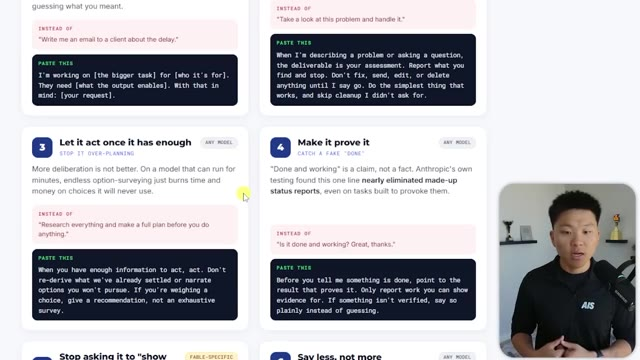
*⏱️ 00:05:11 — Vue d'un guide ou tableau de bord avec des cartes de bonnes pratiques pour l'IA, mettant en avant le point 3 : "Let it act once it has enough" (laisser agir une fois qu'il en a assez).*

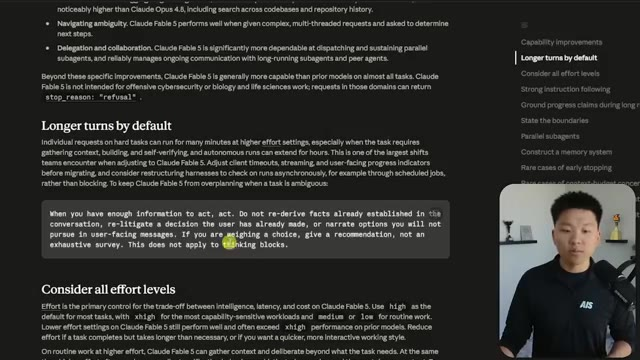
*⏱️ 00:05:28 — Affichage d'une page de documentation technique sur les modèles Claude avec une section "Longer turns by default" et un encadré de code ou prompt sur l'optimisation des requêtes.*

---

### ⏱️ `[00:05:36 - 00:06:10]` | Segment #13

**🔊 Audio (Transcription Intégrale Mot pour Mot en Français) :**
> peuvent fonctionner pendant de nombreuses minutes avec des paramètres d'effort plus élevés, en particulier lorsque la tâche nécessite de rassembler du contexte, de construire, d'auto-vérifier, essentiellement de construire un plan. Et un autre élément important ici est de penser aux différents niveaux d'effort. Vous savez, vous pouvez faire bas, moyen, haut, extra haut. Vous avez tous ces différents niveaux d'effort et vous voulez vous assurer que vous faites correspondre les niveaux d'effort à la tâche correcte. Ils recommandent d'utiliser haut comme valeur par défaut pour la plupart des tâches, d'utiliser extra haut pour les charges de travail les plus sensibles aux capacités et moyen ou bas pour le travail de routine. Et c'est assez intéressant parce que si vous regardez Fable 5 par rapport à Opus 4.8 avec différents niveaux de raisonnement ainsi que le coût,

**👁️ Analyse Visuelle d'Écran (gemini-3.5-flash-lite) :**
**Interface & Outils** : Navigateur web affichant un document de documentation ou des directives de prompts.

**Contenu textuel & Code** : Texte de documentation technique expliquant l'utilisation des paramètres d'effort et des blocs de consignes pour les modèles d'IA.

**Action / Démonstration** : Le présentateur commente le contenu de la documentation web affichée à l'écran concernant les paramètres d'effort et la gestion des agents IA.

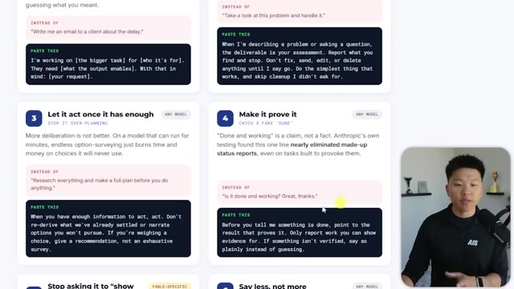
*⏱️ 00:05:45 — Capture d'écran montrant un site web avec des blocs numérotés de bonnes pratiques pour interagir avec des modèles d'IA, avec le présentateur en médaillon à droite.*

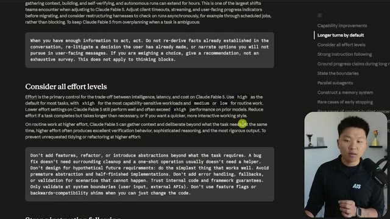
*⏱️ 00:06:02 — Capture d'écran montrant une documentation web avec une section sur les niveaux d'effort ('Consider all effort levels') et des consignes d'utilisation, avec le présentateur en bas à droite.*

---

### ⏱️ `[00:06:11 - 00:06:31]` | Segment #14

**🔊 Audio (Transcription Intégrale Mot pour Mot en Français) :**
> vous pouvez voir qu'ils arrivent dans cette zone où ils sont similaires, mais Fable 5 en mode bas, même s'il est similaire à Opus 4.8 en mode X haut et max, est moins cher. Donc commencer réellement à expérimenter avec différents niveaux d'effort et à sentir quand vous devez en utiliser certains va être une compétence très importante, en plus de comprendre pour quelles tâches utiliser quel modèle en général.

**👁️ Analyse Visuelle d'Écran (gemini-3.5-flash-lite) :**
**Interface & Outils** : Page web affichant un graphique de benchmark de performance des modèles d'IA (FrontierCode)

**Contenu textuel & Code** : Graphique de performance montrant les courbes de Claude Fable 5, Claude Opus 4.8 et GPT-5.5 avec leurs différents niveaux d'effort étiquetés.

**Action / Démonstration** : Le présentateur commente le graphique et pointe un niveau de performance spécifique avec le curseur de la souris.

*⏱️ 00:06:16 — Graphique comparant l'exactitude (Score %) en fonction du coût moyen par tâche (USD, échelle logarithmique) pour différents modèles d'IA (Claude Fable 5, Claude Opus 4.8, GPT-5.5) avec des niveaux d'effort (low, med, high, xhigh, max), tandis que le présentateur apparaît en médaillon dans le coin inférieur droit.*

---

### ⏱️ `[00:06:31 - 00:06:51]` | Segment #15

**🔊 Audio (Transcription Intégrale Mot pour Mot en Français) :**
> Parce que si vous utilisez Claude 5 pour tout, c'est presque du 100 % superflu, surtout quand vous entrez dans le territoire des crédits d'utilisation de Claude 5, vous n'avez vraiment pas besoin de ça pour tant de choses. Vous avez probablement plus réalistiquement seulement besoin de recourir à Claude cinq à quinze pour cent du temps. Numéro quatre, qui est selon moi probablement le plus important, est de lui faire prouver. Et c'est pour n'importe quel modèle, comme je l'ai dit, encore une fois.

**👁️ Analyse Visuelle d'Écran (gemini-3.5-flash-lite) :**
**Interface & Outils** : Interface web de présentation de graphiques et de prompts textuels.

**Contenu textuel & Code** : Graphiques de performance (score en fonction du coût) et blocs de texte numérotés contenant des instructions de prompt engineering pour IA.

**Action / Démonstration** : Présentation visuelle de benchmarks de coûts d'IA et de stratégies de prompting.

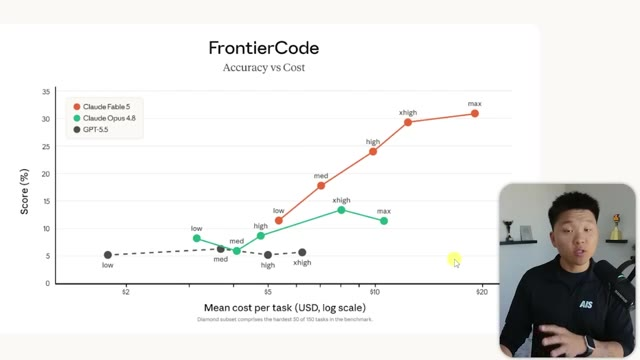
*⏱️ 00:06:36 — Graphique comparatif intitulé "FrontierCode: Accuracy vs Cost" montrant les performances de Claude Fable 5, Claude Opus 4.8 et GPT-5.5.*

*⏱️ 00:06:46 — Interface web présentant des blocs de texte numérotés avec des instructions et des prompts pour l'utilisation de modèles d'IA.*

---

### ⏱️ `[00:06:51 - 00:07:26]` | Segment #16

**🔊 Audio (Transcription Intégrale Mot pour Mot en Français) :**
> Parfois, les modèles vous disent qu'ils ont terminé, mais ce n'est pas le cas. Ou peut-être qu'ils ont terminé, mais ils n'ont pas vérifié les choses. Le tout est de savoir que si vous donnez du travail à un humain et qu'il revient avec, vous savez, quelque chose, un certain résultat, vous devriez examiner cela vous-même. Vous voulez en arriver au point où vous faites tellement confiance à cette personne ou à ce modèle, parce que vous avez intégré ces boucles de vérification, que lorsqu'il vous remet quelque chose, vous devriez probablement encore le vérifier, mais vous n'avez pas l'impression de devoir le faire autant parce que vous savez qu'il a déjà vérifié son propre travail deux, trois, quatre, peut-être même cinq fois, et qu'il a testé et pleinement vérifié que tout fonctionne comme il se doit. Donc, au lieu de vous demander simplement, est-ce que c'est terminé et est-ce que ça fonctionne ? Vous pourriez dire, avant de

**👁️ Analyse Visuelle d'Écran (gemini-3.5-flash-lite) :**
**Interface & Outils** : Interface web de présentation / documentation

**Contenu textuel & Code** : Texte de conseils pour les prompts, notamment les sections "3. Let it act once it has enough" et "4. Make it prove it" avec des instructions à copier ("PASTE THIS").

**Action / Démonstration** : Le présentateur commente les règles affichées à l'écran concernant la vérification des résultats des agents IA.

*⏱️ 00:07:00 — Capture d'écran montrant une présentation avec des encadrés textuels numérotés sur les bonnes pratiques d'utilisation des modèles d'IA, avec le présentateur visible en bas à droite.*

---

### ⏱️ `[00:07:26 - 00:07:58]` | Segment #17

**🔊 Audio (Transcription Intégrale Mot pour Mot en Français) :**
> dis-moi que quelque chose est fait, montre le résultat qui le prouve. Ne rapporte que le travail dont tu peux apporter la preuve. Si quelque chose n'est pas vérifié, dis-le clairement au lieu de deviner. Et c'est quelque chose qu'il serait vraiment bon d'intégrer dans toutes vos compétences, tous vos agents, tous vos, vous savez, fichiers clawed.md, plutôt que de toujours jeter cela à la fin de chaque instruction. Bon, numéro cinq, et celui-ci est plus spécifique à Fable, qui est d'arrêter de lui demander de montrer son raisonnement. Sur Fable 5, une ligne permanente « explique ton raisonnement », surtout dans l'invite système, peut déclencher un refus et peut confier votre tâche à Opus 4.8. Maintenant, si vous ne le saviez pas, et je vais couvrir cela un peu plus

**👁️ Analyse Visuelle d'Écran (gemini-3.5-flash-lite) :**
**Interface & Outils** : Présentation de type "Best Practices / Prompt Engineering Guide" sous forme de liste de règles numérotées sur une interface web.

**Contenu textuel & Code** : - Règle 4 : "Before you tell me something is done, point to the result that proves it. Only report work you can show evidence for."
- Règle 5 : "Just ask for the answer and let it think privately."
- Règle 6 : "Lead with the outcome, keep it simple, and pause only when the work truly needs me."

**Action / Démonstration** : Le présentateur expose des directives méthodologiques pour automatiser et améliorer les interactions avec des modèles d'IA, en insistant sur la preuve factuelle du travail accompli.

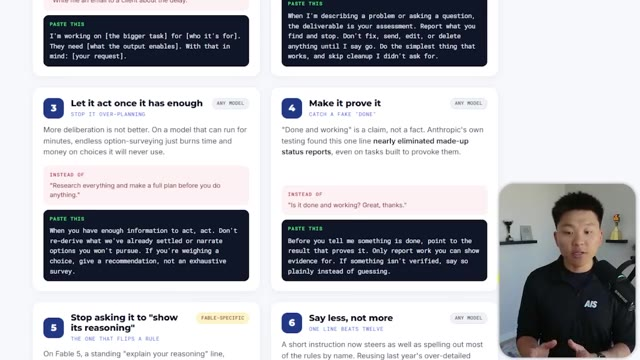
*⏱️ 00:07:34 — Une capture d'écran présentant les règles 3 et 4 pour l'optimisation des prompts, soulignant l'importance de faire agir le modèle rapidement et d'exiger des preuves de travail.*

*⏱️ 00:07:50 — Une capture d'écran présentant les règles 5 et 6, conseillant d'éviter de demander au modèle d'expliciter son raisonnement et de privilégier des instructions concises.*

---

### ⏱️ `[00:07:58 - 00:08:34]` | Segment #18

**🔊 Audio (Transcription Intégrale Mot pour Mot en Français) :**
> à la fin de cette vidéo, mais comme Fable 5 a des problèmes, vous savez, de contournement des sécurités et que c'est déjà un modèle inférieur à Mythos 5, nous devons faire attention à être sûr de ne pas déclencher Opus. Parce qu'en gros, il y a un tas de barrières de sécurité dans Fable qui vont le rediriger vers un modèle moins capable comme Opus s'il pense que l'intention de votre requête pourrait être malveillante ou quelque chose comme ça. Donc pour une raison quelconque, si vous essayez d'amener Fable à montrer son raisonnement, il pourrait vous rétrograder vers Opus 4.8. C'est donc pour cela que nous avons mis celui-ci ici, qui est une règle de prompting spécifique à Fable. Et puis le numéro six, c'est de dire moins, pas plus, ce qui a l'air un peu

**👁️ Analyse Visuelle d'Écran (gemini-3.5-flash-lite) :**
**Interface & Outils** : Page web de documentation ou de présentation de prompts

**Contenu textuel & Code** : Texte sur l'utilisation des modèles d'IA, montrant les règles de prompting et le comportement de Fable 5 face à certaines requêtes ("show its reasoning").

**Action / Démonstration** : Le présentateur explique les conseils de prompting affichés à l'écran concernant Fable 5.

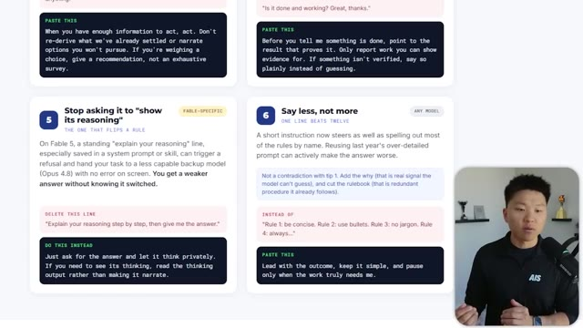
*⏱️ 00:08:07 — Capture d'écran montrant une page web avec des conseils de prompting (cartes numérotées 5 et 6) et le présentateur dans un encadré en bas à droite.*

---

### ⏱️ `[00:08:34 - 00:08:59]` | Segment #19

**🔊 Audio (Transcription Intégrale Mot pour Mot en Français) :**
> c'est un peu contre-intuitif parce que typiquement on a pensé que plus on donne de contexte à ces modèles, mieux c'est. Mais comme Fable est tellement intelligent maintenant, et surtout si vous l'avez enveloppé dans un bon environnement avec, vous savez, du contexte, des outils, des compétences et tout ça, une courte instruction peut maintenant guider tout aussi bien que d'énoncer la plupart des règles par leur nom. Et ce n'est pas une contradiction avec la première astuce, ajouter le pourquoi, si vous vous souvenez ici, donnez-lui le pourquoi, donnez-lui le contexte, cela ne signifie toujours pas de tout surcharger.

**👁️ Analyse Visuelle d'Écran (gemini-3.5-flash-lite) :**
**Interface & Outils** : Page web de documentation ou de conseils, et incrustation vidéo du présentateur.

**Contenu textuel & Code** : Texte affichant les conseils numéro 5 ("Stop asking it to show its reasoning") et numéro 6 ("Say less, not more") avec des blocs de code de type "PASTE THIS" et "DELETE THIS LINE".

**Action / Démonstration** : Le présentateur explique les bonnes pratiques de prompt pour les modèles Fable tout en présentant les cartes textuelles à l'écran.

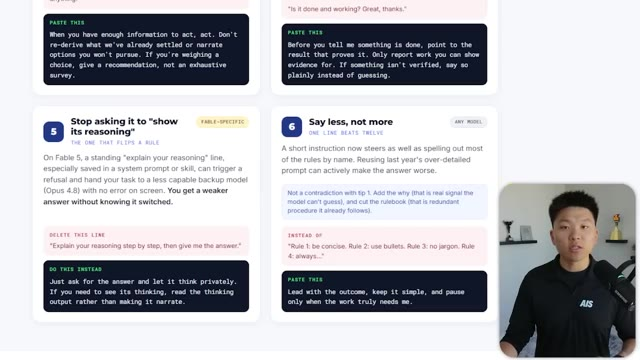
*⏱️ 00:08:40 — Capture d'écran montrant une page web avec des cartes numérotées listant des conseils de prompt engineering pour Fable, avec le présentateur en médaillon à droite.*

---

### ⏱️ `[00:08:59 - 00:09:22]` | Segment #20

**🔊 Audio (Transcription Intégrale Mot pour Mot en Français) :**
> Donc au lieu de dire du genre, hé, la règle numéro un est d'être concis, la règle numéro deux est de faire ceci, la règle numéro trois est de faire cela, dites plutôt quelque chose comme commencez par le résultat, faites simple et faites une pause seulement lorsque le travail a vraiment besoin de moi. Et c'est ainsi que vous pouvez commencer à regrouper toutes ces autres astuces dans vos fichiers système, vos fichiers de mémoire, vos fichiers cloud.md et vos compétences et tous vos prompts à l'avenir afin de vous assurer que vous tirez le meilleur parti de ce modèle incroyable, Claude 3.5 Sonnet.

**👁️ Analyse Visuelle d'Écran (gemini-3.5-flash-lite) :**
**Interface & Outils** : Interface web présentant une documentation textuelle structurée (sous forme de cartes de conseils) pour l'optimisation de prompts IA.

**Contenu textuel & Code** : Textes de conseils pédagogiques : "Stop asking it to show its reasoning", "Say less, not more", "Make it prove it", "Let it act once it has enough", incluant des exemples de mauvaises pratiques à supprimer et de meilleures alternatives à copier.

**Action / Démonstration** : Présentation visuelle et commentée de bonnes pratiques de "prompt engineering" destinées à améliorer les performances des modèles d'IA.

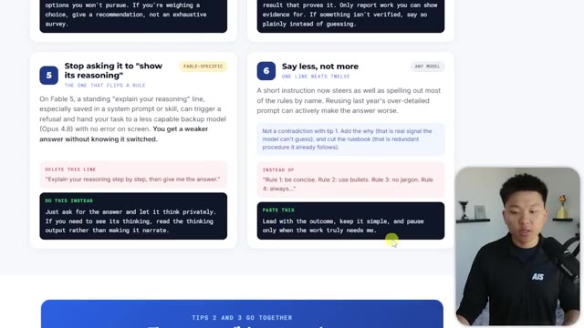
*⏱️ 00:09:05 — Une capture d'écran montrant les règles 5 et 6 pour optimiser les prompts IA, avec des sections "DELETE THIS LINE" (en rose) et "DO THIS INSTEAD" (en vert/noir).*

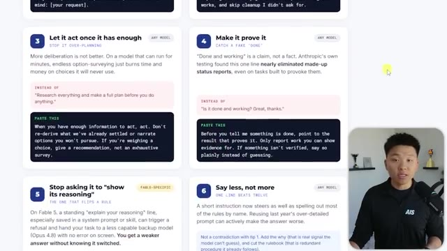
*⏱️ 00:09:11 — Une capture d'écran présentant les règles 3 et 4, mettant l'accent sur l'incitation à l'action immédiate ("Let it act once it has enough") et la vérification des résultats ("Make it prove it").*

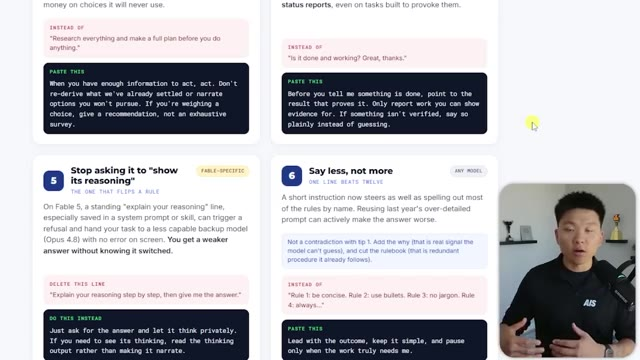
*⏱️ 00:09:16 — Une capture d'écran identique à la précédente, montrant la progression de la vidéo sur les conseils de structuration de prompts efficaces.*

---

### ⏱️ `[00:09:22 - 00:09:42]` | Segment #21

**🔊 Audio (Transcription Intégrale Mot pour Mot en Français) :**
> Donc je voulais conclure ici avec ce dont j'ai parlé très brièvement, c'est-à-dire ce qui se passe lorsque Fable transmet à Opus 4.8 ou à n'importe quel modèle à l'avenir auquel il finira par transmettre si c'rochète encore le cas. Fable effectuera un contrôle de sécurité rapide avant de répondre à votre demande. S'il réalise que cela pourrait se trouver dans une certaine catégorie, il le transmettra alors à Opus 4.8.

**👁️ Analyse Visuelle d'Écran (gemini-3.5-flash-lite) :**
**Interface & Outils** : Interface web de présentation avec des blocs de texte et schémas explicatifs.

**Contenu textuel & Code** : Texte décrivant le fonctionnement du transfert ("You ask Fable 5", "It trips a safety check", "Opus 4.8 answers") ainsi que quatre sections numérotées sur les conditions, la visibilité, les coûts et les moyens d'éviter ce transfert.

**Action / Démonstration** : Présentation visuelle du mécanisme de sécurité et de basculement entre les modèles d'IA par le présentateur.

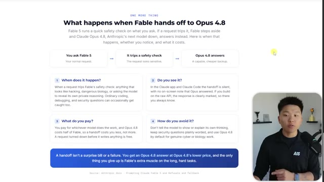
*⏱️ 00:09:27 — Une infographie explicative intitulée "What happens when Fable hands off to Opus 4.8" détaillant le processus de transfert entre les modèles d'IA.*

---

### ⏱️ `[00:09:42 - 00:10:04]` | Segment #22

**🔊 Audio (Transcription Intégrale Mot pour Mot en Français) :**
> Si cela ressemble à quoi que ce soit qui a trait au piratage ou à la biologie dangereuse ou qui demande au modèle de révéler son propre raisonnement privé, alors il pourrait déclencher cela. Et quand cela se produit, il ne vous le montrera pas. Il s'acheminera silencieusement vers Opus. Si vous construisez sur l'API, il renverra une réponse qui vous montre que c'était Opus, mais sinon, vous ne le remarquerez peut-être pas. Heureusement, lorsque vous le faites, il devrait s'acheminer vers Opus 4.8.

**👁️ Analyse Visuelle d'Écran (gemini-3.5-flash-lite) :**
**Interface & Outils** : Navigateur web affichant une page d'information textuelle et des schémas explicatifs, avec la vidéo du présentateur dans un coin en bas à droite.

**Contenu textuel & Code** : Texte explicatif décrivant le processus de transfert (handoff) entre Fable 5 et Opus 4.8 lorsqu'un contrôle de sécurité est déclenché.

**Action / Démonstration** : Le présentateur commente le fonctionnement du transfert silencieux vers Opus 4.8 en cas de détection de requêtes sensibles.

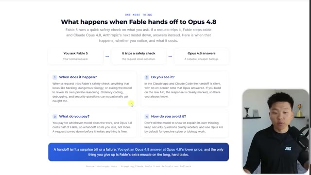
*⏱️ 00:09:48 — Capture d'écran montrant une page web explicative intitulée "What happens when Fable hands off to Opus 4.8" détaillant le fonctionnement des transferts de modèles selon les contrôles de sécurité.*

---

### ⏱️ `[00:10:04 - 00:10:24]` | Segment #23

**🔊 Audio (Transcription Intégrale Mot pour Mot en Français) :**
> Donc vous ne payez pas autant que Fable. Sinon, ce serait plutôt mauvais. Et donc soyez-en conscient. Vous pouvez l'éviter en faisant évidemment quelque chose comme ça que j'ai mentionné, mais aussi, vous savez, en ne lui demandant pas de vous aider à faire des choses qui sont clairement malveillantes ou suspectes. Donc n'hésitez surtout pas à aller consulter cette documentation et à la lire. Elle contient beaucoup de pépites d'or.

**👁️ Analyse Visuelle d'Écran (gemini-3.5-flash-lite) :**
**Interface & Outils** : Navigateur web affichant une page de documentation technique et d'explications sur les IA.

**Contenu textuel & Code** : Texte explicatif sur les modèles d'IA, les bascules de sécurité (handoff) vers Claude Opus 4.8 et les recommandations de scaffolding.
[DESC_IMAGE_3] Défilement de la page de documentation technique sur l'ingénierie de prompt et les bonnes pratiques pour Claude Fable.

**Action / Démonstration** : Explications face caméra et démonstration conceptuelle.

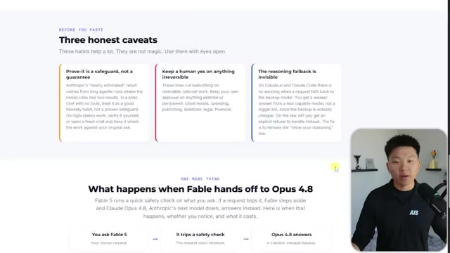
*⏱️ 00:10:09 — Capture d'écran montrant une page web intitulée "Three honest caveats" expliquant les risques et le fonctionnement des modèles d'IA, avec le présentateur en médaillon.*

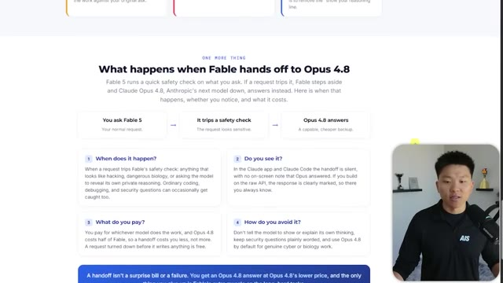
*⏱️ 00:10:14 — Capture d'écran montrant la section "What happens when Fable hands off to Opus 4.8" détaillant le passage de relais en cas de déclenchement d'une vérification de sécurité.*

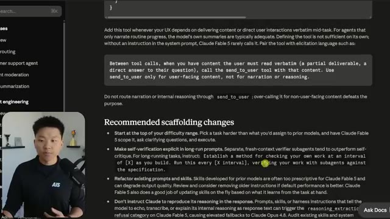
*⏱️ 00:10:19 — Capture d'écran montrant une documentation technique avec des sections sur les modifications de scaffolding recommandées pour les modèles Fable.*

---

### ⏱️ `[00:10:24 - 00:10:44]` | Segment #24

**🔊 Audio (Transcription Intégrale Mot pour Mot en Français) :**
> Mais c'est tout pour celui-ci. J'espère donc que vous avez apprécié. Que vous avez appris quelque chose de nouveau. Si vous souhaitez en savoir plus sur ces boucles d'agents, le genre de vérification dont je parlais tout à l'heure, alors allez absolument voir cette vidéo juste ici. Je l'explique presque entièrement. Je donne quelques exemples. Et je pense que faire cette technique avec Fable 5 sera super génial. J'espère donc vous y voir. Sinon, merci d'être arrivés jusqu'à la fin de la vidéo. Et merci à tous.

**👁️ Analyse Visuelle d'Écran (gemini-3.5-flash-lite) :**
**Interface & Outils** : Aucune

**Contenu textuel & Code** : Aucun

**Action / Démonstration** : Le présentateur parle pour conclure la vidéo et invite à regarder une autre vidéo.

---

