# 🎬 Fable 5 + Karpathy’s LLM Wiki is Basically Cheating

> **Chaîne** : [Nate Herk | AI Automation](https://www.youtube.com/@nateherk/featured)  
> **Lien YouTube** : [https://www.youtube.com/watch?v=hQvwMj7IJe4](https://www.youtube.com/watch?v=hQvwMj7IJe4)  
> **Date de publication** : 20260703  
> **Durée** : 00:14:35  
> **Identifiant vidéo** : `hQvwMj7IJe4`  
> **Transcription & Analyse** : `whisper-v3-large-turbo+gemini-3.5-flash-lite`  

---

## 📌 Synthèse Exécutive & Outils

### 💡 Résumé

Dans cette vidéo, Nate Herk présente une méthode d'ingénierie des connaissances combinant la puissance de raisonnement des nouveaux modèles de pointe (notamment Fable/Claude de dernière génération) et l'architecture de **Wiki LLM** conceptualisée par Andrej Karpathy. En s'appuyant sur l'outil en ligne de commande Claude Code au sein de VS Code, il montre comment automatiser l'ingestion brute de transcriptions de vidéos YouTube et d'enregistrements de réunions d'affaires pour les transformer en un véritable second cerveau interconnecté, structuré sous forme de graphe bidirectionnel dans Obsidian.

L'intérêt majeur de cette approche réside dans l'exploitation contextuelle de cette base de connaissances unifiée via l'écosystème d'agents IA (son AIOS personnel, Herc 2). Nate démontre comment un modèle doté d'une forte sensibilité contextuelle est capable, en un seul prompt intuitif ou émotionnel, de synthétiser des téraoctets de données interconnectées pour générer des interfaces web interactives en HTML ou dresser une rétrospective analytique complète des performances de l'entreprise (funnel de conversion, revenus, métriques de churn et pivots stratégiques).

Le tutoriel se conclut par une démonstration technique pas-à-pas de l'initialisation du système en moins de cinq minutes. En créant un coffre (*vault*) Obsidian local, en ouvrant Claude Code dans le terminal et en lui injectant directement le *gist* d'Andrej Karpathy accompagné d'instructions précises pour initialiser le fichier de règles `CLAUDE.md`, l'utilisateur délègue entièrement la structuration de l'index, la nomenclature des dossiers, la tenue du journal et les schémas d'ingestion à un agent autonome.

---

### 🛠️ Outils, Modèles & Logiciels Présentés

* **Claude Code** : Outil agentique en ligne de commande (CLI) développé par Anthropic, exécuté directement dans le terminal pour automatiser la lecture, la navigation et l'écriture autonome de code et de fichiers Markdown.
* **Fable (Anthropic)** : Modèle de raisonnement avancé mis en avant pour sa capacité supérieure à comprendre des consignes orientées expérience utilisateur, son empathie dans la mise en page et sa restitution sans surcharge cognitive face aux modèles antérieurs.
* **Opus (Anthropic / Claude Opus)** : Modèle de fondation utilisé en comparaison, puissant pour l'analyse brute mais nécessitant historiquement plus d'allers-retours pour concevoir des visualisations simples et conviviales.
* **Obsidian (obsidian.md)** : Application de gestion de connaissances locale basée sur des fichiers Markdown, servant de front-end visuel pour explorer les liens bidirectionnels et le graphe de connaissances.
* **Wiki LLM de Karpathy** : Méthodologie et spécification documentaire conçues par Andrej Karpathy visant à utiliser des LLM pour indexer, synthétiser et relier de manière autonome des sources disparates dans une base documentaire personnelle.
* **AIOS (Herc 2)** : Système d'exploitation d'intelligence artificielle personnalisé de l'auteur, regroupant plusieurs wikis cloisonnés par thématiques (réunions, stratégie, transcriptions média) pour alimenter des workflows agentiques.
* **Visual Studio Code (VS Code)** : Environnement de développement intégré utilisé comme espace de travail central pour gérer le coffre documentaire et faire tourner le CLI de Claude.

---

### 🔑 Points Clés & Enseignements Stratégiques

* **Le concept de « Contexte Roi »** : La valeur d'un système agentique ne réside pas dans sa capacité brute de calcul, mais dans la pertinence, la richesse et le maillage du contexte opérationnel injecté dans son espace de travail.
* **Architecture de Wiki LLM selon Karpathy** : Délaisser le stockage passif au profit d'une structure vivante où le LLM agit comme bibliothécaire autonome, chargé de résumer les sources, d'en extraire les entités et de créer des hyperliens réciproques.
* **Compréhension sémantique vs structure rigide** : Les modèles de pointe comme Fable capturent des nuances de requêtes axées sur l'expérience humaine (« compréhensible par un débutant sans le submerger »), là où les versions antérieures généraient des dashboards visuellement surchargés.
* **Interfaçage dynamique en HTML** : Un LLM alimenté par un wiki structuré peut projeter instantanément des données complexes sous forme de pages HTML/CSS interactives, remplaçant avantageusement la navigation textuelle linéaire.
* **Cloisonnement modulaire des bases (Vaults)** : Pour éviter les hallucinations et la dilution de contexte, l'organisation optimale repose sur la création de wikis distincts par fonction (ex. transcriptions YouTube publiques vs réunions internes confidentielles), orchestrés au niveau supérieur par un AIOS.
* **Bootstrap d'un agent via `CLAUDE.md`** : L'injection des règles de gouvernance, des schémas d'ingestion et des nomenclatures dans le fichier `CLAUDE.md` dès la racine du projet garantit que chaque action future de Claude Code respectera scrupuleusement la taxonomie définie.
* **Génération de rétrospectives automatisées** : En accédant aux métriques et aux notes de l'entreprise réparties sur plusieurs mois, l'agent peut retracer l'histoire business, identifier les corrélations causales (ex. impact d'un pivot technique sur l'ARR et l'audience) et cartographier le tunnel de conversion.
* **Zéro friction d'ingestion manuelle** : L'automatisation supprime le besoin de relier manuellement les concepts ; Claude Code scanne les sources brutes, détecte les dépendances conceptuelles (ex. GitHub vers Vercel, puis vers Claude Code) et enrichit le graphe de connaissances de façon incrémentale.
* **Stockage local et souveraineté des données** : L'utilisation de fichiers Markdown sous-jacents via Obsidian garantit la portabilité, la pérennité et la propriété intégrale des connaissances, éliminant la dépendance aux formats de bases de données propriétaires.

---

## ⏱️ Chronologie & Transcription Complète Audio & Visuelle (Mot pour Mot)

### ⏱️ `[00:00:00 - 00:00:29]` | Segment #01

**🔊 Audio (Transcription Intégrale Mot pour Mot en Français) :**
> Ce que vous regardez juste ici, ce sont plusieurs de mes vidéos YouTube en train d'être ingérées dans un wiki LLM. Ce wiki LLM, comme vous pouvez le voir si je zoome, ce sont différentes vidéos YouTube et ce qui les relie, ce sont différentes relations. Nous commençons donc à voir ce genre de véritable second cerveau de toutes mes vidéos YouTube et comment elles se rapportent les unes aux autres. Et toute cette connaissance rend mon AIOS tellement plus intelligent. Et le truc le plus cool là-dedans, c'est que je n'ai pas eu du tout à connecter ces concepts. J'ai juste pu dire, hé, Claude Code, va chercher mes vidéos YouTube et ensuite ingère-les dans ce wiki.

**👁️ Analyse Visuelle d'Écran (gemini-3.5-flash-lite) :**
**Interface & Outils** : Application de type Obsidian ou wiki LLM avec une vue graphique de type graphe de connaissances.

**Contenu textuel & Code** : Nœuds et liens interconnectés affichant des titres de vidéos et des concepts liés à l'automatisation IA et YouTube.

**Action / Démonstration** : Navigation et visualisation de la structure en graphe du wiki LLM contenant les données ingérées.

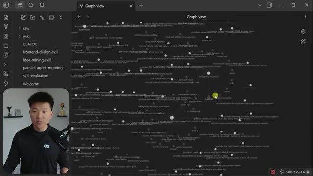
*⏱️ 00:00:07 — Vue graphique (Graph view) d'un wiki LLM montrant un réseau de nœuds interconnectés représentant des vidéos YouTube et leurs relations, avec le présentateur incrusté en bas à gauche.*

---

### ⏱️ `[00:00:29 - 00:00:48]` | Segment #02

**🔊 Audio (Transcription Intégrale Mot pour Mot en Français) :**
> Et cette chose ne cesse de grandir et de grandir. Si je zoome un petit peu, ouvrons l'une de ces vidéos. Donc ici, j'ai des sites web Nano Banana 2. Quand j'ouvre ceci, nous pouvons voir quelques informations en haut, mais ensuite, en faisant défiler vers le bas, nous pouvons voir, vous savez, un résumé, les points clés, et d'autres outils et choses qui sont mentionnés, et d'autres techniques qui ont été discutées. Et je peux suivre tous ces liens. Disons que je m'intéresse à GitHub.

**👁️ Analyse Visuelle d'Écran (gemini-3.5-flash-lite) :**
**Interface & Outils** : Application de type Obsidian ou outil de visualisation de graphes de notes.

**Contenu textuel & Code** : Nœuds de données interconnectés, avec notamment le dossier "wiki" et le nœud "nano-banana-2-websites".

**Action / Démonstration** : Exploration visuelle du graphe de connaissances montrant la structure grandissante des données.

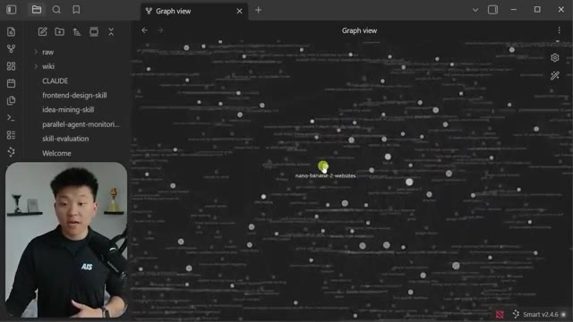
*⏱️ 00:00:34 — Vue d'un graphe de connaissances interconnecté (Graph view) montrant de nombreux nœuds et liens, avec le présentateur incrusté en bas à gauche.*

---

### ⏱️ `[00:00:48 - 00:01:07]` | Segment #03

**🔊 Audio (Transcription Intégrale Mot pour Mot en Français) :**
> Je peux cliquer sur GitHub. Je peux voir de quoi il s'agit. Et ensuite je peux voir d'autres moments où nous avons fait référence à GitHub. Voici quelques informations qui relient GitHub à Vercel. Pourquoi est-ce que je ne cliquerais pas là-dessus pour en savoir un peu plus sur Vercel. Et ensuite Vercel peut me ramener à Cloud Code, où je peux à nouveau suivre tous ces liens retour jusqu'à ce que j'arrive là où je dois aller. Et donc, alors que toute cette carte mentale de ces vidéos YouTube commence à grandir, nous sommes capables de voir tout cela prendre vie.

**👁️ Analyse Visuelle d'Écran (gemini-3.5-flash-lite) :**
**Interface & Outils** : Navigateur web / application de notes (Obsidian ou outil similaire) affichant une page wiki sur GitHub avec le curseur sur le lien 'vercel'.

**Contenu textuel & Code** : Texte sur GitHub, liens vers 'claude-code' et 'vercel', et description des fonctionnalités clés comme 'One repo per app' et les pipelines de déploiement.

**Action / Démonstration** : Le curseur de la souris survole le lien vers 'vercel' pour en savoir plus sur la relation entre GitHub et Vercel.

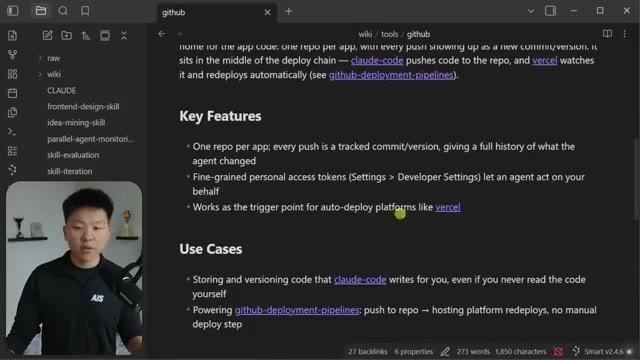
*⏱️ 00:00:53 — Capture d'écran montrant une page wiki sur GitHub avec des sections 'Key Features' et 'Use Cases', et une incrustation vidéo du présentateur en bas à gauche.*

---

### ⏱️ `[00:01:07 - 00:01:40]` | Segment #04

**🔊 Audio (Transcription Intégrale Mot pour Mot en Français) :**
> Et aujourd'hui, je vais vous montrer exactement comment vous pouvez mettre en place quelque chose tout à fait comme ça en environ cinq minutes. C'est tellement plus simple que vous ne le pensez. Maintenant, ce qui est impressionnant là-dedans, ce n'est pas le fait que Fable a été capable d'ingérer tout cela, c'est ce que Fable peut faire une fois que vous lui avez donné la puissance de toutes ces données. Parce que nous savons tous que les données sont rois, le contexte est roi. Voici un exemple sympa. J'ai demandé à Fable dans une seule instruction, j'ai dit, hé, je veux que tu transformes fondamentalement ce fouillis de connexions de transcriptions YouTube en quelque chose que les gens peuvent réellement regarder et comprendre. Je veux que ce soit une ressource simple qui ne soit pas écrasante, mais qui montre à mon audience comment ces outils, ces techniques et ces idées se connectent.

**👁️ Analyse Visuelle d'Écran (gemini-3.5-flash-lite) :**
**Interface & Outils** : Interface web Obsidian / application de cartographie de connaissances

**Contenu textuel & Code** : Nœuds et liaisons textuelles représentant des concepts d'IA, outils (Claude Code, Cursor) et techniques (Agentic Workflows).

**Action / Démonstration** : Navigation et visualisation de la structure interconnectée de la base de connaissances.

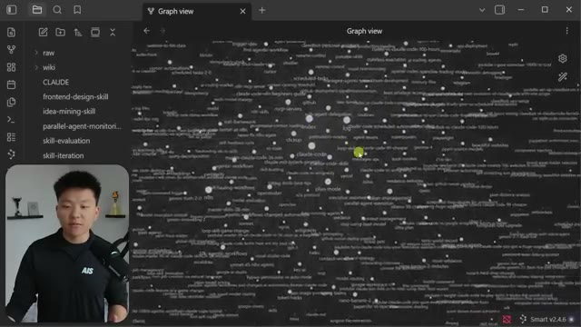
*⏱️ 00:01:16 — Vue graphique en réseau montrant les connexions entre différents concepts et notes dans une interface de type Obsidian.*

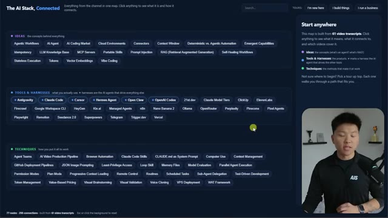
*⏱️ 00:01:24 — Interface web intitulée "The AI Stack, Connected" listant des catégories (Ideas, Tools & Harnesses, Techniques) avec des tags interactifs.*

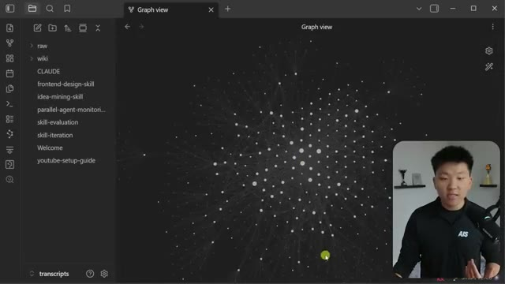
*⏱️ 00:01:32 — Vue globale dézoomée du graphe de connexions affichant la structure en toile d'araignée des données ingérées.*

---

### ⏱️ `[00:01:40 - 00:02:16]` | Segment #05

**🔊 Audio (Transcription Intégrale Mot pour Mot en Français) :**
> les uns aux autres. Et maintenant, nous avons ce super HTML, sur lequel je peux cliquer, et je peux voir différentes idées en haut, des flux de travail agentiques et ce à quoi cela se connecte. Cela se connecte à des routines. Les routines se connectent à l'automatisation déterministe par rapport à l'automatisation agentique, ce qui se reconnecte à NNN et Cloud Code et à tout ce genre de choses. Et c'est tout simplement incroyable. À mon sens, quelque chose comme ça est une interface beaucoup plus conviviale que quelque chose comme ça. Et ce que je trouve génial là-dedans, c'est que j'ai pu le prompter d'une manière émotionnelle. J'ai dit des choses comme, d'une manière qu'un débutant pourrait comprendre et pourrait parcourir en cliquant et sans que cela ne le submerge. Et quelque chose comme Opus 4.8 ne comprend tout simplement pas ce que cela signifie aussi bien que Fable. Pour vous montrer ce que je veux dire par là,

**👁️ Analyse Visuelle d'Écran (gemini-3.5-flash-lite) :**
**Interface & Outils** : Interface web interactive personnalisée (HTML/JavaScript)

**Contenu textuel & Code** : Carte conceptuelle interactive avec des sections 'IDEAS', 'TOOLS & HARNESSES', et 'TECHNIQUES', affichant des éléments connectés comme 'Agentic Workflows', 'Routines', et 'Claude Code'. Un panneau latéral à droite détaille la technique 'Routines'.

**Action / Démonstration** : Le curseur clique sur le nœud 'Routines' dans la section 'TECHNIQUES', mettant en surbrillance les connexions vers d'autres éléments et affichant sa description détaillée dans le panneau de droite.

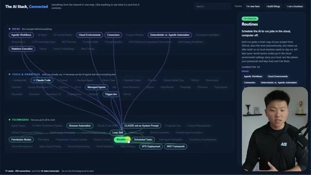
*⏱️ 00:01:49 — Une interface web interactive en mode sombre montrant une carte mentale complexe intitulée 'The AI Stack, Connected', avec des bulles de concepts interconnectées par des lignes, et le présentateur visible en incrustation à droite.*

---

### ⏱️ `[00:02:16 - 00:02:50]` | Segment #06

**🔊 Audio (Transcription Intégrale Mot pour Mot en Français) :**
> c'est quelque chose sur quoi j'ai travaillé avec Opus pendant presque une journée entière. On a fait des allers-retours, on a construit ce truc et je ne l'aimais tout simplement pas assez pour le partager avec les gens parce que ça paraissait écrasant. Ça paraissait confus. Et la base de données en arrière-plan qui fait fonctionner ceci est exactement la même. Donc de toute façon, ce qu'on recherche ici, c'est la même chose. Vous pouvez effectuer des recherches parmi les outils, les techniques, les vidéos. Il y a en quelque sorte un cadre de couches dont nous avons discuté avec l'orchestrateur, les modèles, les entrées, tout ce genre de choses. Et il y a toutes les mêmes données et je peux toujours cliquer sur ces éléments et je peux suivre les liens retour et vous savez, c'est un peu la même idée. Mais encore une fois, cette version est tellement plus simple pour moi et je l'aime davantage. Vous pouvez voir,

**👁️ Analyse Visuelle d'Écran (gemini-3.5-flash-lite) :**
**Interface & Outils** : Plateforme web personnalisée "AI Matrix" (application web de curation de workflows d'automatisation).

**Contenu textuel & Code** : Textes descriptifs de stacks d'automatisation, sélection de personas utilisateurs ("I'm new and overwhelmed", "I know my way around", "I want my team using AI") et intégration de lecteur vidéo YouTube.

**Action / Démonstration** : Navigation dans une bibliothèque de ressources IA, démonstration de la structure d'organisation des outils d'automatisation et présentation d'une vidéo explicative sur le "Agent View" de Claude Code.

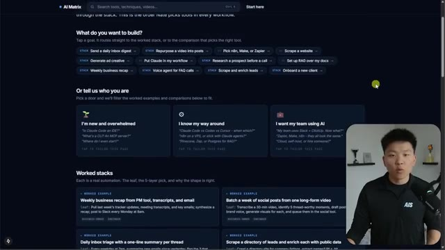
*⏱️ 00:02:24 — Interface web "AI Matrix" présentant des options de filtrage par objectifs d'automatisation, profils utilisateurs (débutant, intermédiaire, équipe) et exemples de "Worked Stacks".*

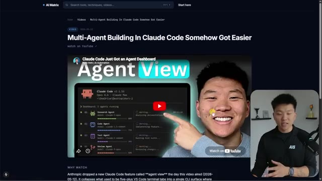
*⏱️ 00:02:41 — Interface web affichant une page de tutoriel vidéo intitulée "Multi-Agent Building In Claude Code Somehow Got Easier", avec une miniature YouTube montrant un tableau de bord d'agents IA (Agent View).*

---

### ⏱️ `[00:02:50 - 00:03:25]` | Segment #07

**🔊 Audio (Transcription Intégrale Mot pour Mot en Français) :**
> En cliquant sur un concept, nous pouvons voir sur le côté droit les vidéos d'où ces données ont été tirées. Nous pouvons en lire un peu plus à ce sujet et voir à quoi d'autre il est relié. C'est donc juste un tout petit exemple. Si vous me suivez depuis un certain moment, vous savez que dans mon AIOS, j'ai plusieurs wikis LLM différents. Celui-ci est celui de mes transcriptions YouTube. J'ai aussi le mien, le cerveau de Herc, qui est pratiquement l'endroit où je mets tous mes enregistrements de réunions. Donc toutes mes réunions, qu'elles soient internes ou externes, je les stocke ici. Et c'est ainsi que je peux voir comment les différents concepts dont je parle avec les gens ont évolué et comment ils vont continuer à évoluer. Et lorsque je rédige des publications pour la communauté, des publications sur LinkedIn, ou que j'écris des e-mails, tout cela est pris en compte parce que cet outil sait tout sur moi et sur mon entreprise.

**👁️ Analyse Visuelle d'Écran (gemini-3.5-flash-lite) :**
**Interface & Outils** : Obsidian (logiciel de prise de notes avec vue graphique).

**Contenu textuel & Code** : Liste de dossiers et fichiers dans la barre latérale ("raw", "wiki", "CLAUDE", "frontend-design-skill", "idea-mining-skill", "parallel-agent-monitoring", "skill-evaluation", "skill-iteration") et une visualisation interactive de réseau de connaissances.

**Action / Démonstration** : Navigation et visualisation de la structure de données connectée dans le "Graph view" d'Obsidian.

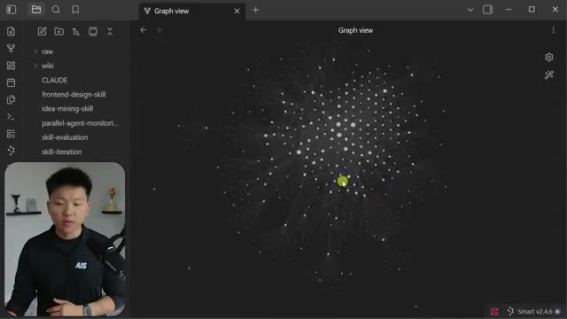
*⏱️ 00:02:59 — Interface Obsidian affichant la "Graph view" montrant une constellation de nœuds reliés entre eux, avec une barre latérale listant des dossiers de notes (wiki, CLAUDE, skill-evaluation, etc.).*

---

### ⏱️ `[00:03:26 - 00:03:58]` | Segment #08

**🔊 Audio (Transcription Intégrale Mot pour Mot en Français) :**
> À tel point que juste avant cette vidéo, j'ai dit : Hé, M. Fable, je veux que tu ailles de l'avant et que tu me racontes simplement une histoire sur les six derniers mois. Donc, tu sais, nous sommes à mi-chemin de 2026, construis-moi un parcours visuel de ce que nous avons fait jusqu'à présent en 2026. Et c'est ce qu'il m'a donné en un seul essai. Il a été capable de sortir cette photo de moi. Il a sorti notre logo. Et tu peux voir que cette chose a même l'air, et tu peux voir que l'image de marque de ceci donne l'impression d'appartenir à AI. C'est un peu en mode sombre, des couleurs de graphiques bleus. Et c'est ce qu'il m'a donné. Il a sorti des statistiques réelles, comme le nombre d'abonnés que j'ai gagnés. Il a notre mois au chiffre d'affaires le plus élevé, que je vais flouter, mais il a été capable de regarder

**👁️ Analyse Visuelle d'Écran (gemini-3.5-flash-lite) :**
**Interface & Outils** : Interface web personnalisée (tableau de bord de storytelling de données).

**Contenu textuel & Code** : Texte descriptif sur la croissance de la chaîne (+301K abonnés), métriques de performance et graphique temporel interactif.

**Action / Démonstration** : Visualisation narrative des étapes franchies par l'entreprise au cours des six premiers mois de 2026.

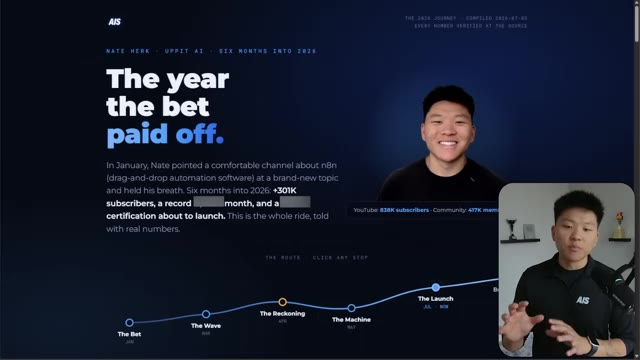
*⏱️ 00:03:34 — Une page web interactive au design épuré montrant une frise chronologique intitulée "The 2026 Journey", résumant la croissance de la chaîne de Nate Herk avec des étapes clés comme "The Bet", "The Wave", "The Reckoning" et "The Machine".*

---

### ⏱️ `[00:03:58 - 00:04:17]` | Segment #09

**🔊 Audio (Transcription Intégrale Mot pour Mot en Français) :**
> toutes ces données et de me les extraire. C'était un grand virage que j'ai pris cette année. Je suis passé de la création de contenus presque exclusivement axés sur la fin à la création de beaucoup de contenus sur le code dans le cloud. Et vous pouvez voir comment cela a pu porter ses fruits. Si nous regardons mes vues moyennes et notre revenus et comment l'entreprise a grandi depuis que j'ai fait ce virage. Ensuite, nous regardons d'autres choses comme la façon dont notre taux de résiliation a changé, comment notre conversion a changé, d'autres choses concernant nos revenus.

**👁️ Analyse Visuelle d'Écran (gemini-3.5-flash-lite) :**
**Interface & Outils** : Présentation vidéo avec diapositives graphiques et incrustation webcam.

**Contenu textuel & Code** : Texte explicatif sur le changement de stratégie de contenu vers Claude Code et statistiques de performance (65K, 144K, 88K, 537K abonnés).

**Action / Démonstration** : Le présentateur commente les résultats de son changement de stratégie éditoriale illustrés par les graphiques et métriques à l'écran.

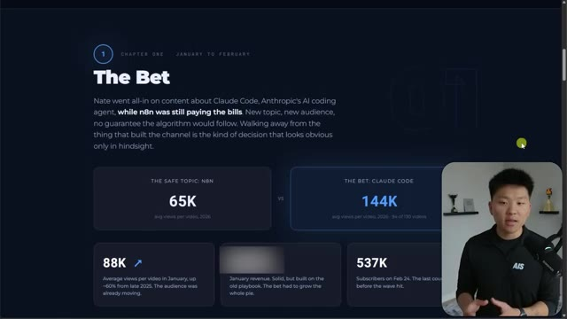
*⏱️ 00:04:03 — Une diapositive de présentation sombre intitulée "Chapter One: January to February - The Bet", comparant les statistiques de vues entre n8n (65K) et Claude Code (144K), avec la vidéo du présentateur en incrustation dans le coin inférieur droit.*

---

### ⏱️ `[00:04:17 - 00:04:41]` | Segment #10

**🔊 Audio (Transcription Intégrale Mot pour Mot en Français) :**
> Mais regardez ça, c'est plutôt drôle. Il a extrait une photo différente de moi. Si vous vous souvenez, celle du début était souriante. Celle-ci est une photo de moi en train de réfléchir. Et donc, il est capable de parcourir tant de données et de ressources dont il dispose au sein de mon projet Herc2. Il montre tout le tunnel de vente de l'entreprise, ce qui prouve qu'il comprend comment les gens entrent dans notre écosystème et toutes les décisions qu'ils peuvent prendre à l'intérieur de notre tunnel et là où nous essayons de les pousser.

**👁️ Analyse Visuelle d'Écran (gemini-3.5-flash-lite) :**
**Interface & Outils** : Interface de présentation web / diaporamas (slides).

**Contenu textuel & Code** : Texte et graphiques analytiques sur la croissance d'une chaîne et de l'entreprise.

**Action / Démonstration** : Le présentateur commente les diapositives de sa rétrospective.

---

### ⏱️ `[00:04:41 - 00:04:59]` | Segment #11

**🔊 Audio (Transcription Intégrale Mot pour Mot en Français) :**
> Quoi qu'il en soit, ce que j'essaie d'expliquer ici, c'est que plus vous donnez de données à vos projets, mieux c'est. Mais plus précisément, en vous assurant de les acheminer de la bonne façon. Et c'est exactement ce dans quoi le Wiki LLM est très bon. Voici mon projet Herc 2. Vous savez que c'est mon AIOS. Et nous avons tellement d'informations là-dedans. Nous avons différents wikis, différents projets, tout ce sur quoi j'ai travaillé. Et c'est ce que vous essayez de construire.

**👁️ Analyse Visuelle d'Écran (gemini-3.5-flash-lite) :**
**Interface & Outils** : VS Code, terminal Claude Code v2.1.199

**Contenu textuel & Code** : Explorateur de fichiers à gauche avec les dossiers du projet (herk-2, audits, Brainstorms, etc.) et interface de terminal affichant les informations sur le modèle (Opus 4.8 avec 1M de contexte) et une alerte d'authentification MCP.

**Action / Démonstration** : Le présentateur introduit son projet "Herc 2" dans l'environnement de développement.

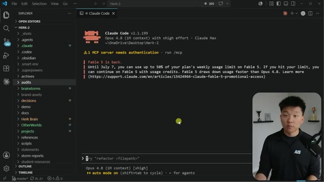
*⏱️ 00:04:46 — Capture d'écran montrant l'éditeur VS Code avec le terminal Claude Code ouvert sur le projet Herc-2, et le présentateur visible en médaillon dans le coin inférieur droit.*

---

### ⏱️ `[00:04:59 - 00:05:20]` | Segment #12

**🔊 Audio (Transcription Intégrale Mot pour Mot en Français) :**
> D'ailleurs, si vous voulez suivre un cours gratuit et complet où je vous montre comment faire cela, dans ma communauté FreeSchool, le lien est dans la description, j'y propose un cours complet pour créer votre propre AIOS, totalement gratuit. Donc les liens sont dans la description pour ça. D'accord, alors voici où tout cela a commencé. Andre Kaparthi a dit : « Bases de connaissances LLM. Quelque chose que je trouve très utile ces derniers temps, c'est d'utiliser les LLM pour construire des bases de connaissances personnelles pour divers sujets d'intérêt de recherche. »

**👁️ Analyse Visuelle d'Écran (gemini-3.5-flash-lite) :**
**Interface & Outils** : Interface web de plateforme de communauté en ligne (type Skool) et réseau social X (Twitter).

**Contenu textuel & Code** : Titres de cours de la communauté AIS ("Build Your AI OS", "7 Day AIS Challenge") et publication textuelle d'Andrej Karpathy sur les bases de connaissances LLM.

**Action / Démonstration** : Navigation et présentation visuelle de la plateforme communautaire et des ressources de cours offertes.

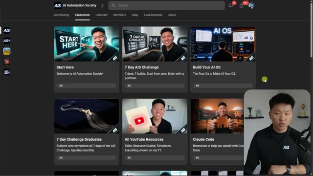
*⏱️ 00:05:04 — Capture d'écran de l'interface web de la communauté "AI Automation Society" (AIS) montrant les différents modules de cours disponibles, notamment "Start Here", "7 Day AIS Challenge" et "Build Your AI OS".*

---

### ⏱️ `[00:05:20 - 00:05:38]` | Segment #13

**🔊 Audio (Transcription Intégrale Mot pour Mot en Français) :**
> Il a indexé les sources, ce que je vais vous montrer comment faire. Et ensuite, il utilise quelque chose comme Obsidian comme front-end, ce que vous venez tout juste de voir. Donc la première chose que vous voulez faire, c'est d'aller sur obsidian.md, puis d'installer cela pour le système d'exploitation sur lequel vous êtes. Donc dans mon cas, je l'ai installé pour Windows, lancez l'assistant, configurez-le et ouvrez l'application. Quand vous ouvrirez l'application, elle ressemblera à ceci, sauf que vous n'aurez pas tout ça.

**👁️ Analyse Visuelle d'Écran (gemini-3.5-flash-lite) :**
**Interface & Outils** : Navigateur web affichant le site officiel d'Obsidian (obsidian.md).

**Contenu textuel & Code** : Page de téléchargement de l'application Obsidian avec le logo violet et le bouton « Download for Windows ».

**Action / Démonstration** : Présentation du site web d'Obsidian et explication de la nécessité d'installer l'application pour l'utiliser comme interface front-end.

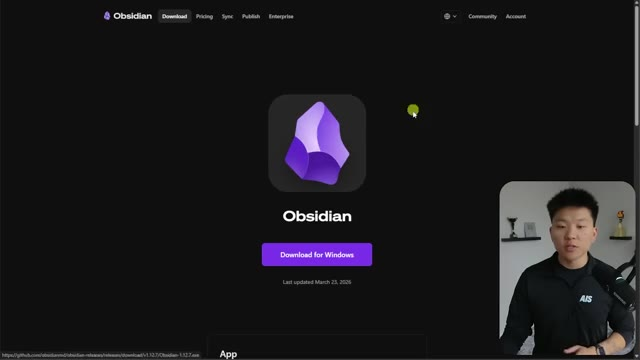
*⏱️ 00:05:29 — Page web officielle de téléchargement d'Obsidian (obsidian.md) avec le bouton de téléchargement pour Windows.*

---

### ⏱️ `[00:05:38 - 00:06:02]` | Segment #14

**🔊 Audio (Transcription Intégrale Mot pour Mot en Français) :**
> et ensuite vous allez aller ici et cliquer sur gérer les coffres. Il se peut que ça s'affiche simplement comme ça et ensuite vous allez créer un nouveau coffre. Donc celui-ci, je vais simplement l'appeler test IA et ensuite vous allez choisir un emplacement pour celui-ci. Donc ça pourrait être sur votre bureau ou ce que j'aime typiquement faire c'est que je mets mes coffres à l'intérieur de mon projet Herc 2. Ainsi mon Herc 2 est capable de regarder une tonne de ces petits wikis LLM différents que j'ai divisés et séparés par sujet essentiellement.

**👁️ Analyse Visuelle d'Écran (gemini-3.5-flash-lite) :**
**Interface & Outils** : Obsidian (Version 1.12.7)

**Contenu textuel & Code** : Champs "Vault name" et "Location" (avec le bouton Browse), ainsi que les coffres existants affichés dans le panneau de gauche.

**Action / Démonstration** : Le présentateur montre comment créer un nouveau coffre local dans Obsidian et configure son nom et son emplacement.

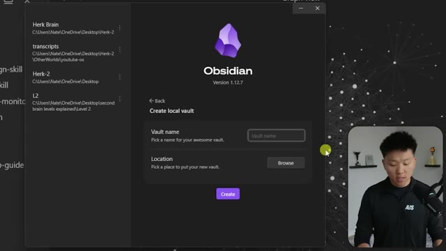
*⏱️ 00:05:44 — Interface de l'application Obsidian montrant l'écran de création d'un nouveau coffre (vault) local, avec le champ pour le nom du coffre et le bouton pour choisir l'emplacement.*

---

### ⏱️ `[00:06:02 - 00:06:22]` | Segment #15

**🔊 Audio (Transcription Intégrale Mot pour Mot en Français) :**
> Mais pour cet exemple, je vais juste mettre celui-ci sur mon bureau. Donc je vais créer ce wiki, vous pouvez voir ici, ou désolé, pas un wiki, un coffre. Nous allons transformer ceci en wiki. Donc pour l'instant, c'est ce que nous avons. Et ensuite, ce que je vais vouloir que vous fassiez, c'est d'aller dans Cloud Code ou partout où vous utilisez Cloud Code. Donc dans ce cas, j'utilise VS Code. Et vous allez ouvrir ce coffre dans quelque chose comme ça.

**👁️ Analyse Visuelle d'Écran (gemini-3.5-flash-lite) :**
**Interface & Outils** : Obsidian

**Contenu textuel & Code** : Page de bienvenue ("This is your new vault", "Make a note of something, create a link"), explorateur de fichiers à gauche avec des dossiers (raw, wiki, transcripts) et vue graphique à droite.

**Action / Démonstration** : Présentation d'un nouveau coffre (vault) Obsidian créé sur le bureau avant de le transformer en wiki.

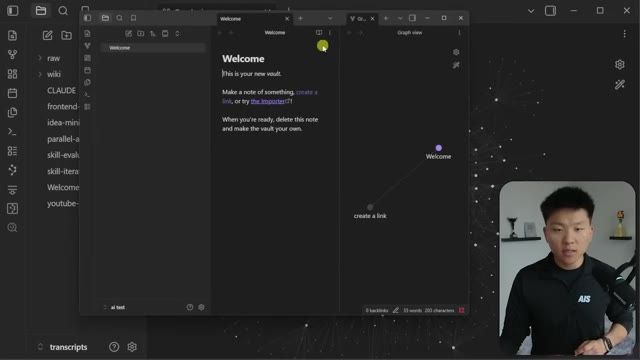
*⏱️ 00:06:07 — Capture d'écran montrant l'interface sombre d'Obsidian avec une note de bienvenue ("Welcome") et une vue graphique en double panneau, ainsi que le présentateur dans un encadré en bas à droite.*

---

### ⏱️ `[00:06:22 - 00:06:46]` | Segment #16

**🔊 Audio (Transcription Intégrale Mot pour Mot en Français) :**
> Très bien, donc je viens d'ouvrir le coffre-fort. Vous pouvez voir que nous avons un dossier .obsidian. Nous avons un welcome.md. Ce sera juste la valeur par défaut lorsque vous ouvrirez un coffre-fort Obsidian. Et ensuite, ce que nous allons faire, c'est ouvrir Cloud Code. Donc, peu importe comment vous aimez l'utiliser. Dans VS Code, j'aime l'utiliser dans le terminal. Je vais donc lancer Claude pour ouvrir ceci. Et ensuite, nous allons commencer. Maintenant, une chose à souligner ici, c'est que nous voyons qu'il est écrit, d'accord, Fable, tu as seulement jusqu'au 7 juillet sur ta limite.

**👁️ Analyse Visuelle d'Écran (gemini-3.5-flash-lite) :**
**Interface & Outils** : Visual Studio Code, Claude Code CLI (terminal intégré)

**Contenu textuel & Code** : Explorateur de fichiers montrant le dossier `.obsidian` et `Welcome.md`, messages de bienvenue de Claude Code v2.1.200, invite de commande "Try 'how does <filepath> work?'"

**Action / Démonstration** : Ouverture du dossier de projet dans l'éditeur de code, validation de la confiance du dossier, et lancement de l'interface Claude Code dans le terminal intégré.

*⏱️ 00:06:28 — Image #1 montre l'interface de VS Code avec un dossier ouvert nommé "AI TEST" contenant les fichiers `.obsidian` et `Welcome.md`.*

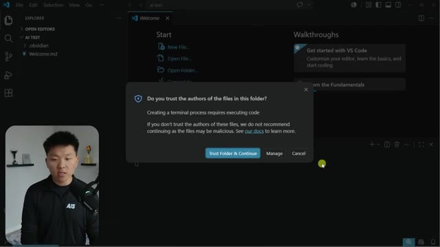
*⏱️ 00:06:34 — Image #2 montre une boîte de dialogue de sécurité dans VS Code demandant si l'on fait confiance aux auteurs du dossier ("Do you trust the authors of the files in this folder?").*

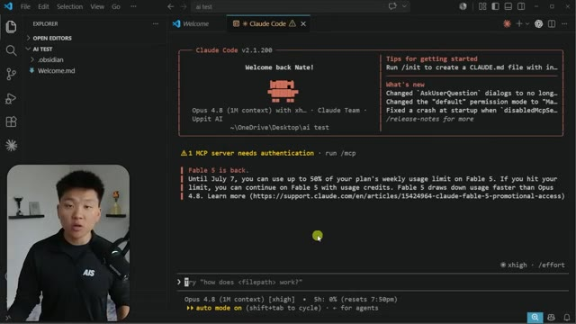
*⏱️ 00:06:40 — Image #3 montre le terminal intégré de VS Code exécutant Claude Code v2.1.200 avec les informations de bienvenue et l'invite de commande en bas.*

---

### ⏱️ `[00:06:46 - 00:07:13]` | Segment #17

**🔊 Audio (Transcription Intégrale Mot pour Mot en Français) :**
> Sinon, ce sera des crédits d'utilisation. J'ai cependant vu ce tweet de Thoric qui disait, ouais, c'est vrai, mais nous prévoyons de le réintégrer dans le cadre de votre abonnement dès que possible. Comme mentionné dans notre article de blog original, que vous pouvez voir au bas de cet article de blog, cela y est effectivement mentionné. Donc, cela ne dit pas quand, mais j'espère qu'ils seront en mesure d'étendre la période et de le ramener en tant que partie standard de votre plan d'abonnement. Quoi qu'il en soit, ce que vous allez faire ensuite, c'est aller sur cette page. Je mettrai le lien dans la description. Il s'agit du Gist du wiki LLM de Carpathie.

**👁️ Analyse Visuelle d'Écran (gemini-3.5-flash-lite) :**
**Interface & Outils** : Navigateur web affichant Twitter, un article de blog institutionnel et GitHub Gist.

**Contenu textuel & Code** : Publications sur les réseaux sociaux et articles textuels sur l'accès aux modèles d'IA et un wiki pour LLM.
[DESC_IMAGE_3] Lecture et présentation de pages web documentant des annonces de modèles IA et du code de documentation LLM.

**Action / Démonstration** : Explications face caméra et démonstration conceptuelle.

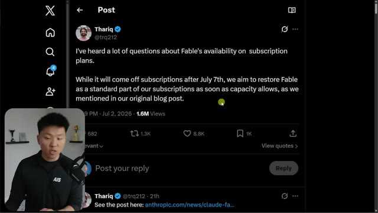
*⏱️ 00:06:53 — Capture d'écran d'un tweet posté par Thariq concernant la disponibilité de Fable sur les abonnements.*

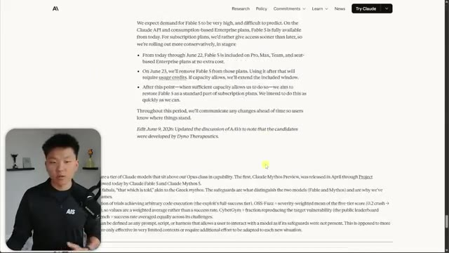
*⏱️ 00:06:59 — Capture d'écran d'un article de blog officiel expliquant les conditions d'accès et la tarification de Fable 5.*

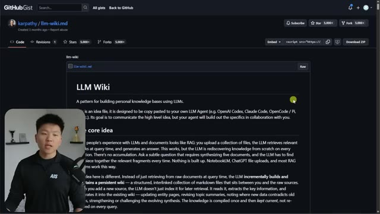
*⏱️ 00:07:06 — Capture d'écran d'un dépôt GitHub Gist montrant le projet 'llm-wiki.md' d'Andrej Karpathy.*

---

### ⏱️ `[00:07:13 - 00:07:39]` | Segment #18

**🔊 Audio (Transcription Intégrale Mot pour Mot en Français) :**
> Et je vais littéralement copier tout ceci. Si vous voulez vous arrêter et le lire, faites comme vous voulez, mais je vais copier tout ceci. Et ce que nous allons faire, c'est de ramener cela dans notre Claude et de le coller là-dedans. Et ensuite, ce que vous allez faire, c'est simplement prendre une capture d'écran de ceci afin de pouvoir la coller. J'ai dit : tu es désormais mon agent wiki LLM. Implémente ce fichier d'idées exact comme mon second cerveau complet. Guide-moi étape par étape, crée le schéma Claude.md avec mes règles complètes, configure l'index, le journal, définis les conventions de dossiers, et montre-moi le premier exemple d'ingestion.

**👁️ Analyse Visuelle d'Écran (gemini-3.5-flash-lite) :**
**Interface & Outils** : VS Code, terminal Claude Code

**Contenu textuel & Code** : Texte collé depuis le presse-papier : "You are now my LLM Wiki agent. Implement this exact idea file as my complete second brain..." avec des informations sur le modèle Fable 5.

**Action / Démonstration** : Le présentateur colle le texte copié du web directement dans l'interface de Claude Code à l'intérieur de l'éditeur pour configurer l'agent second cerveau.

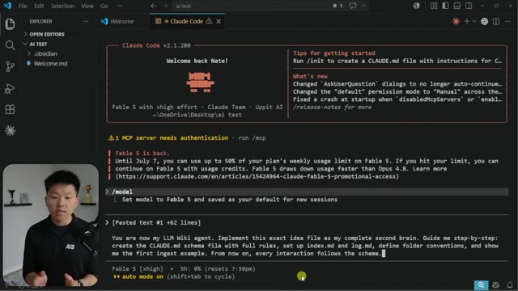
*⏱️ 00:07:26 — Le présentateur est visible en bas à gauche, et l'écran principal affiche l'éditeur VS Code avec un terminal Claude Code actif montrant le texte collé et une invite de commande.*

---

### ⏱️ `[00:07:40 - 00:08:00]` | Segment #19

**🔊 Audio (Transcription Intégrale Mot pour Mot en Français) :**
> À partir de maintenant, chaque interaction suit le schéma. Donc je vais envoyer ça. Nous utilisons Fable ici. Comme je l'ai dit, vous n'avez probablement pas besoin de Fable. Fable est probablement exagéré pour ça. Il s'agit de ce que Fable fait après que vous ayez toutes ces données là-dedans. Donc si vous voulez remanier ça sur Opus, exécuter l'ingestion et ingérer les futurs documents avec Opus, c'est probablement un meilleur choix, honnêtement. Je vais juste vous montrer Fable dans cette vidéo.

**👁️ Analyse Visuelle d'Écran (gemini-3.5-flash-lite) :**
**Interface & Outils** : VS Code (Visual Studio Code)

**Contenu textuel & Code** : Texte explicatif sur le pattern LLM wiki ("The human's job is to curate sources...", "You are now my LLM Wiki agent...") et terminal en bas affichant un prompt vide et des informations sur l'outil Fable (Fable 5, auto mode on).

**Action / Démonstration** : Le présentateur explique l'utilisation du fichier et le fonctionnement de l'agent LLM, tandis que l'interface de VS Code et le terminal intégré sont affichés.

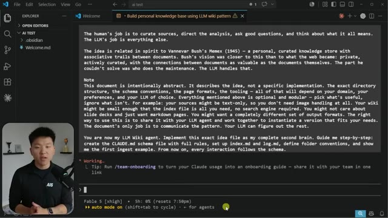
*⏱️ 00:07:45 — Vue de l'éditeur VS Code affichant un fichier Markdown avec un texte sur la base de connaissances personnelle et un terminal intégré en bas.*

---

### ⏱️ `[00:08:00 - 00:08:19]` | Segment #20

**🔊 Audio (Transcription Intégrale Mot pour Mot en Français) :**
> Maintenant, ce qui est vraiment cool, c'est qu'au fur et à mesure que vous commencez à y mettre différentes choses, cela va en quelque sorte changer dynamiquement la structure. Laissez-moi donc vous montrer ce que je veux dire par là. Si j'ouvre ce wiki, vous pouvez voir que dans le wiki, j'ai des comparaisons. J'ai des concepts. J'ai des sources parce que celui-ci concerne mes vidéos YouTube. Il les a donc lues et il a analysé cela. Nous avons des techniques et nous avons des outils.

**👁️ Analyse Visuelle d'Écran (gemini-3.5-flash-lite) :**
**Interface & Outils** : VS Code et Obsidian (vue graphique / Graph view).

**Contenu textuel & Code** : Document Markdown sur la base de connaissances personnelle (LLM wiki pattern) et vue de graphe interconnectée.

**Action / Démonstration** : Navigation et présentation de la structure dynamique d'un wiki de connaissances et de ses connexions.

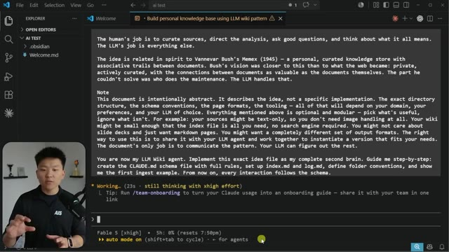
*⏱️ 00:08:05 — VS Code affichant un document Markdown textuel et un terminal en bas avec le présentateur en médaillon.*

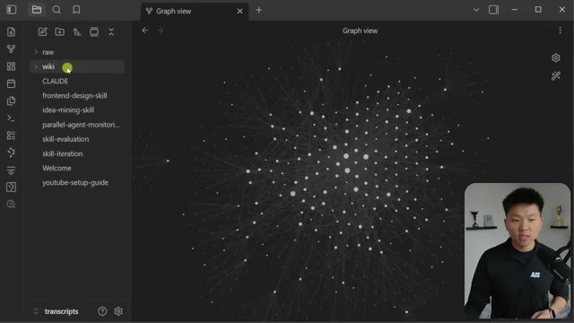
*⏱️ 00:08:10 — Une interface d'application de type Obsidian montrant une vue graphique de réseau (graph view) de notes interconnectées.*

---

### ⏱️ `[00:08:20 - 00:08:56]` | Segment #21

**🔊 Audio (Transcription Intégrale Mot pour Mot en Français) :**
> Mais si je bascule vers quelque chose comme mon cerveau Herc, qui est celui qui concerne plutôt mes transcriptions de réunions, vous pouvez voir que c'est une structure à peu près plate. Elle contient essentiellement tous mes enregistrements de réunions directement ici et elle n'a pas encore voulu les organiser. Et peut-être qu'à un moment donné, si nous faisons quelques balayages, elle trouvera différents dossiers pour les organiser. Mais parfois, garder cette structure plate est en fait mieux. Et par plate, ce que je veux dire, c'est d'avoir essentiellement tout dans le wiki plutôt que de devoir descendre dans encore plus de dossiers. La raison en est que vous voulez vous assurer que votre IA peut facilement effectuer des recherches dans tout ce contenu. Nous avons le brut, qui est l'endroit où vous mettez les choses. Ensuite, l'IA lira tout ce qui se trouve dans le brut et l'ingérera dans le wiki. Et c'est là que

**👁️ Analyse Visuelle d'Écran (gemini-3.5-flash-lite) :**
**Interface & Outils** : Obsidian et schéma explicatif visuel.
[DESC_IMAGE_1] Liste de fichiers markdown de transcriptions de réunions et graphe de liens entre les notes.
[DESC_IMAGE_2] Arborescence de dossiers 'my-wiki/' avec les rôles de chaque dossier et fichier pour un LLM.

**Contenu textuel & Code** : Explications orales et mise en contexte méthodologique.

**Action / Démonstration** : Présentation de la structure de dossiers et du graphe de connexions pour les notes de réunions.

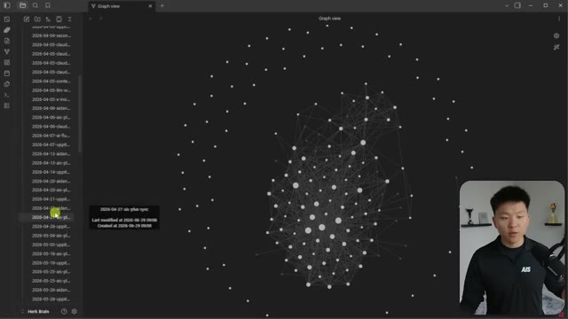
*⏱️ 00:08:29 — Vue graphique (Graph view) d'Obsidian montrant la structure de notes et le panneau latéral avec la liste des fichiers de transcription.*

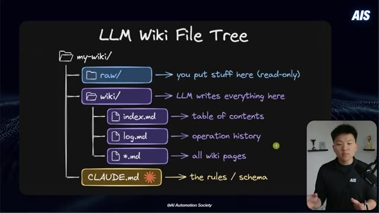
*⏱️ 00:08:47 — Schéma explicatif intitulé 'LLM Wiki File Tree' illustrant l'arborescence des dossiers avec raw, wiki, index.md, log.md et CLAUDE.md.*

---

### ⏱️ `[00:08:56 - 00:09:17]` | Segment #22

**🔊 Audio (Transcription Intégrale Mot pour Mot en Français) :**
> pourrait prendre une source et la diviser en environ cinq ou six, ou peut-être même dix petites pages wiki. Ensuite, nous avons aussi l'index, qui est comme une table des matières. Nous avons le journal de bord et ensuite les fichiers .md sont tous les autres fichiers wiki. Et cette structure exacte est la façon dont celui de HercBrain est configuré, comme vous pouvez le voir, c'est très plat. Mais si nous retournons dans celui de mes transcriptions YouTube, celui-ci n'est pas plat, n'est-ce pas ?

**👁️ Analyse Visuelle d'Écran (gemini-3.5-flash-lite) :**
**Interface & Outils** : Schéma graphique explicatif et interface d'application de notes (Obsidian)

**Contenu textuel & Code** : Arborescence structurée : raw/ (read-only), wiki/ (index.md, log.md, *.md), CLAUDE.md (rules/schema) et vue de graphe de connexions de notes.

**Action / Démonstration** : Présentation de la structure de dossiers et du système de fichiers pour un wiki géré par LLM, puis démonstration visuelle du graphe de connaissances.

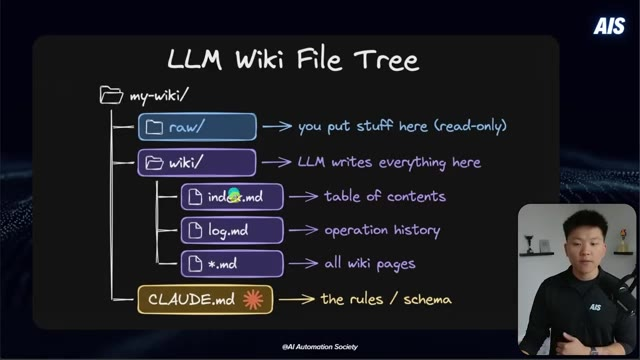
*⏱️ 00:09:01 — Schéma explicatif de l'arborescence des fichiers du LLM Wiki montrant le dossier my-wiki, raw/, wiki/ (avec index.md, log.md, *.md) et CLAUDE.md.*

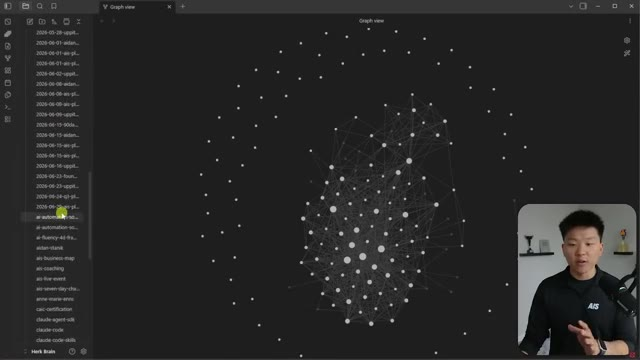
*⏱️ 00:09:12 — Interface d'une application de type Obsidian montrant une vue graphique en réseau des notes et fichiers Markdown liés.*

---

### ⏱️ `[00:09:17 - 00:09:39]` | Segment #23

**🔊 Audio (Transcription Intégrale Mot pour Mot en Français) :**
> Celui-ci a tous ces autres sous-dossiers dont nous venons de parler. Et pour vous montrer à quoi cela ressemble dans cet exemple, voici mon index. Vous pouvez voir tous les outils. Vous pouvez voir toutes les techniques, tout ce qui a été cartographié ici avec tous les rétroliens. Et puis le journal, vous pouvez voir que j'ai fait quelques intégrations par lots ici, j'en ai fait une là. Et puis chaque fois que j'ai intégré une autre vidéo YouTube ou intégré d'autres sources de données, cela affichera un journal de cela là.

**👁️ Analyse Visuelle d'Écran (gemini-3.5-flash-lite) :**
**Interface & Outils** : VS Code (éditeur de code avec aperçu Markdown et explorateur de fichiers)

**Contenu textuel & Code** : Fichier index.md contenant le catalogue des outils du wiki (claude-code, n8n, cursor, trigger-dev, firecrawl, perplexity, etc.) et l'explorateur de fichiers à gauche montrant les dossiers "raw", "wiki" (comparisons, concepts, sources, techniques, tools, index, log, overview).

**Action / Démonstration** : Le présentateur présente visuellement la structure du wiki et la page d'index principale.

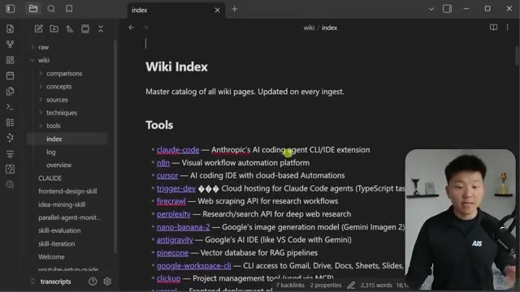
*⏱️ 00:09:22 — Capture d'écran montrant l'éditeur VS Code avec une page de documentation Markdown intitulée "Wiki Index", affichant la liste des outils répertoriés.*

---

### ⏱️ `[00:09:39 - 00:09:58]` | Segment #24

**🔊 Audio (Transcription Intégrale Mot pour Mot en Français) :**
> Le but ultime de tout ceci est que l'IA puisse construire et maintenir ce wiki de manière incrémentielle. Elle doit donc être capable de consulter des éléments comme l'index, les journaux et tous les rétrolyens pour réellement parcourir et trouver les données que vous recherchez. Très bien, vous pouvez maintenant voir que c'est fait. Notre projet est configuré. Nous avons notre index, qui est vide. Nous avons notre journal, qui est pratiquement vide. Et enfin, nous avons notre dossier brut et notre dossier wiki.

**👁️ Analyse Visuelle d'Écran (gemini-3.5-flash-lite) :**
**Interface & Outils** : VS Code (éditeur de code)

**Contenu textuel & Code** : Fichier Markdown `log.md` montrant les entrées de journal d'opérations du wiki : `## [2026-07-03] setup | Vault initialized as LLM Wiki` et `## [2026-07-03] ingest | LLM Wiki idea file`.

**Action / Démonstration** : Présentation de la structure des journaux (log) dans le projet de wiki géré par IA.

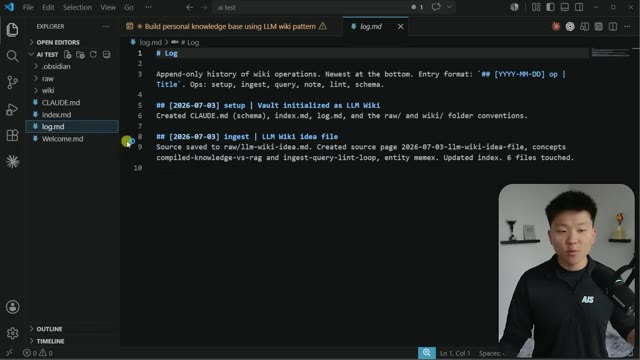
*⏱️ 00:09:53 — Capture d'écran montrant l'éditeur VS Code avec un fichier log.md affichant l'historique des opérations du wiki (setup, ingest).*

---

### ⏱️ `[00:09:58 - 00:10:17]` | Segment #25

**🔊 Audio (Transcription Intégrale Mot pour Mot en Français) :**
> Donc ce que vous pouvez voir ici déjà, c'est que dans le brut, il a traité cette idée de wiki LLM. Ce fichier est fondamentalement l'essentiel que Carpathie a rédigé. Il a donc décidé d'ingérer cela. Et ensuite dans le wiki, il est déjà prévu d'avoir des concepts, des entités et des sources. C'est donc avec cela que nous devons commencer.

**👁️ Analyse Visuelle d'Écran (gemini-3.5-flash-lite) :**
**Interface & Outils** : Visual Studio Code et GitHub Gist.

**Contenu textuel & Code** : Fichier Markdown d'idées 'llm-wiki-idea.md' et structure de dossiers (raw, wiki/concepts, wiki/entities, wiki/sources).

**Action / Démonstration** : Navigation dans l'explorateur de fichiers pour montrer l'organisation du projet de base de connaissances wiki LLM.

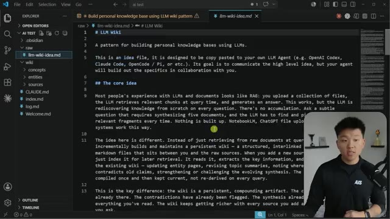
*⏱️ 00:10:03 — Visualisation dans VS Code du fichier markdown 'llm-wiki-idea.md' décrivant le modèle de wiki LLM de Karpathy.*

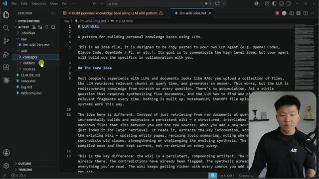
*⏱️ 00:10:12 — Navigation dans l'arborescence de VS Code montrant les dossiers 'wiki' contenant 'concepts', 'entities' et 'sources'.*

---

### ⏱️ `[00:10:17 - 00:10:41]` | Segment #26

**🔊 Audio (Transcription Intégrale Mot pour Mot en Français) :**
> Maintenant, ce que je veux faire, c'est que nous allons intégrer deux choses différentes. Et je vais vous montrer différentes manières de le faire. Donc la première chose que nous allons intégrer, c'est la carte système Claude Fable 5 et Mythos 5. Donc je vais aller télécharger ceci sous forme de PDF. Ce que je vais faire, c'est prendre ce PDF et je vais le glisser dans le dossier raw. Donc maintenant ce PDF se trouve juste là dans raw. Et ensuite, ce que je vais faire, c'est que nous allons prendre cette avant-première OpenAI de GPT 5.6 soul et nous allons simplement faire cela sous forme d'URL à la place.

**👁️ Analyse Visuelle d'Écran (gemini-3.5-flash-lite) :**
**Interface & Outils** : Visualiseur de PDF, VS Code, Navigateur web

**Contenu textuel & Code** : Documentation technique, code Markdown avec structure de wiki, article de blog OpenAI

**Action / Démonstration** : Navigation et présentation de documents de référence et de code source dans l'éditeur

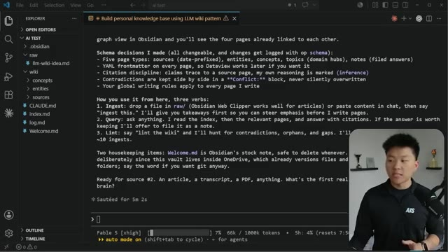
*⏱️ 00:10:29 — Éditeur de code VS Code affichant un document Markdown pour la construction d'une base de connaissances personnelle avec LLM, avec un panneau terminal en bas utilisant le modèle 'Fable 5'.*

---

### ⏱️ `[00:10:41 - 00:11:02]` | Segment #27

**🔊 Audio (Transcription Intégrale Mot pour Mot en Français) :**
> Donc ce que je vais faire, c'est que je vais coller l'URL et je vais dire : hé Claude, lis cet article et ensuite ingère ça dans notre wiki ici. Et puis aussi, j'ai déposé un PDF dans le brut appelé Claude Fable 5. Et je veux que tu ingères ça aussi. Et c'est tout ce que je vais dire à ce modèle. Encore une fois, il devrait comprendre comment tout cela est configuré.

**👁️ Analyse Visuelle d'Écran (gemini-3.5-flash-lite) :**
**Interface & Outils** : VS Code (Éditeur de code)

**Contenu textuel & Code** : URL OpenAI dans la zone de texte : `https://openai.com/index/previewing-gpt-5-6-sol/`, et arborescence de fichiers avec les dossiers `raw` et `wiki`.

**Action / Démonstration** : Collage de l'URL d'un article dans l'assistant pour l'ingestion dans le wiki.

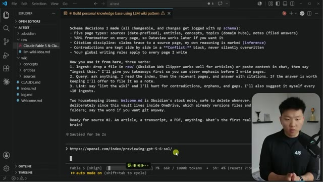
*⏱️ 00:10:47 — Vue de l'éditeur VS Code montrant l'arborescence des dossiers à gauche et un fichier markdown d'explication du wiki personnel au centre, avec une URL OpenAI collée dans le chat en bas.*

---

### ⏱️ `[00:11:02 - 00:11:24]` | Segment #28

**🔊 Audio (Transcription Intégrale Mot pour Mot en Français) :**
> Nous devrions voir un nouvel enregistrement dans l'index ainsi qu'un nouvel enregistrement dans le journal et de nouvelles sources dans le wiki. Donc, que Fable décide de transformer ce PDF en une ou cinq ou peut-être même 50 pages wiki en raison de la taille de ce PDF, même chose avec l'URL, je vous tiendrai au courant quand ce sera terminé. D'accord, donc c'est terminé.

**👁️ Analyse Visuelle d'Écran (gemini-3.5-flash-lite) :**
**Interface & Outils** : VS Code (éditeur de code) avec interface intégrée d'agent CLI (Claude Fable).

**Contenu textuel & Code** : Arborescence de fichiers comprenant .obsidian, raw, wiki (concepts, entities, sources), CLAUDE.md, index.md, log.md, Welcome.md. Dans le terminal intégré : une URL OpenAI, un prompt demandant à Claude de lire et ingérer l'article, et l'état de l'agent Fable 5 [xhigh] en mode automatique.

**Action / Démonstration** : Le présentateur explique l'utilisation de l'agent pour ingérer des sources externes (articles, PDF) dans la base de connaissances du wiki Obsidian.

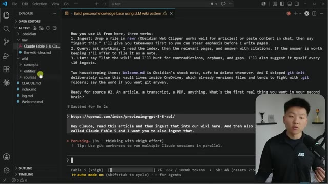
*⏱️ 00:11:08 — Capture d'écran de l'éditeur VS Code montrant l'arborescence du projet Obsidian avec un dossier "wiki" et une invite de commande interactive en bas.*

---

### ⏱️ `[00:11:24 - 00:11:58]` | Segment #29

**🔊 Audio (Transcription Intégrale Mot pour Mot en Français) :**
> Cela a pris environ 10 à 12 minutes et vous pouvez voir ici qu'à partir de ces deux sources, cela a créé 20 pages wiki et elles sont entièrement interconnectées. Maintenant, regardez ça. Le lien qui justifiait d'avoir cela sous forme de wiki, au lieu de deux résumés séparés, c'est que les deux sources se référencent mutuellement, et c'est dans Frontier Model Cybersecurity que cela se trouve. OpenAI a évalué GPT 5.6 Sol par rapport à Mythos Preview, et j'ai repéré cet élément facile à manquer en les lisant séparément. OpenAI a comparé avec le prédécesseur d'avril, pas avec Mythos 5, et les deux laboratoires utilisent des bancs de test différents, donc les chiffres ne s'alignent pas directement. Bref, allons-y, ouvrons ce wiki en plein écran et jetons un coup d'œil. D'accord, voilà donc à quoi ça ressemble

**👁️ Analyse Visuelle d'Écran (gemini-3.5-flash-lite) :**
**Interface & Outils** : VS Code / Obsidian (ou interface de notes similaire)

**Contenu textuel & Code** : Fichier Markdown décrivant une base de connaissances personnelle générée par LLM, avec des liens vers des sources OpenAI et Claude, et un graphe de connexions de notes.

**Action / Démonstration** : Le présentateur commente la structure interconnectée du wiki et le graphe de relations entre les sources.

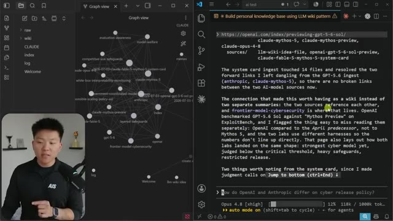
*⏱️ 00:11:33 — Capture d'écran montrant l'écran partagé avec une vue de graphe de notes interconnectées à gauche et un éditeur de texte (VS Code) affichant un fichier Markdown généré à droite, avec le présentateur en médaillon en bas à gauche.*

---

### ⏱️ `[00:11:58 - 00:12:18]` | Segment #30

**🔊 Audio (Transcription Intégrale Mot pour Mot en Français) :**
> genre. Vous pouvez voir qu'on a OpenAI ici en bas, et ce sont ceux auxquels ça se rapporte. Comme le code Claude le disait, il a fait référence à Claude Mythos 5 dans l'article. Donc c'est plutôt cool. Et on peut voir en quelque sorte la distribution ici. On peut voir à quel point on a des choses comme des sorties de modèles coordonnées par le gouvernement. On a des mesures de protection superposées, des mesures de protection pour l'utilisation concurrentielle. Et si on va ici sur le wiki, on peut voir qu'on a des concepts.

**👁️ Analyse Visuelle d'Écran (gemini-3.5-flash-lite) :**
**Interface & Outils** : Obsidian (Graph view)

**Contenu textuel & Code** : Nœuds interconnectés affichant des termes liés à l'IA : 'OpenAI', 'Claude-mythos-5', 'anthropic', 'layered-safeguards', etc.

**Action / Démonstration** : Visualisation des relations et de la distribution des données textuelles dans le graphe de connaissances.

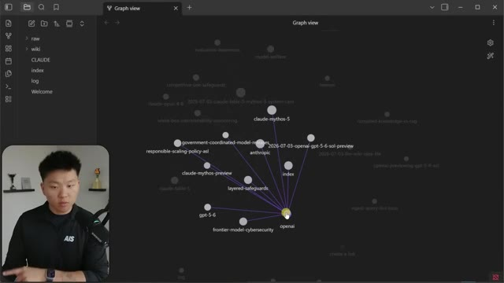
*⏱️ 00:12:03 — Capture d'écran montrant un graphique de relations (Graph view) avec un nœud central 'OpenAI' relié à divers concepts et modèles tels que 'Claude-mythos-5' et 'gpt-5-6'.*

---

### ⏱️ `[00:12:18 - 00:12:38]` | Segment #31

**🔊 Audio (Transcription Intégrale Mot pour Mot en Français) :**
> Nous avons des entités. Nous avons des sources. Et ensuite nous avons des sujets. Donc les entités, c'est cool parce qu'ici nous avons des modèles. Nous avons Fable, Mythos, Mythos Preview, Opus 4.8, GBT 5.6. Nous avons Anthropic et OpenAI. Et ensuite, si nous allons dans le journal, vous pouvez voir que c'était la configuration initiale. Et ensuite nous avons eu l'article d'OpenAI et la carte système de CloudFable 5.

**👁️ Analyse Visuelle d'Écran (gemini-3.5-flash-lite) :**
**Interface & Outils** : Obsidian

**Contenu textuel & Code** : Arborescence de fichiers wiki avec les dossiers « concepts », « entities » (contenant anthropic, claude-fable-5, claude-mythos-5, claude-opus-4-8, gpt-5-6, openai), « sources », « topics », et graphe de relations interconnectées.

**Action / Démonstration** : Navigation et visualisation graphique des entités et de leurs liaisons dans le wiki.

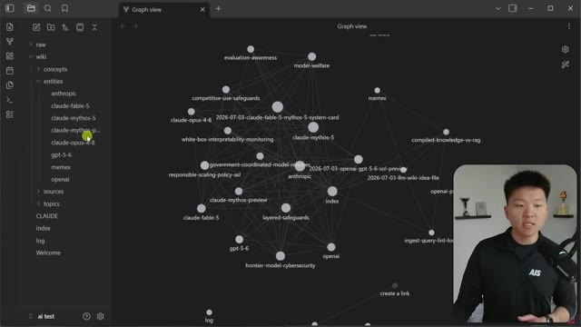
*⏱️ 00:12:23 — Vue graphique (Graph view) interactive d'un wiki montrant les relations entre différentes entités, avec le panneau latéral affichant l'arborescence des dossiers et le présentateur en médaillon.*

---

### ⏱️ `[00:12:39 - 00:12:59]` | Segment #32

**🔊 Audio (Transcription Intégrale Mot pour Mot en Français) :**
> Donc la leçon ici, c'est que nous avons maintenant ce système où nous avons CloudCode qui examine un ensemble de nos sources de données, n'est-ce pas ? Il examine le wiki et il examine potentiellement plusieurs wikis. Et à l'intérieur du wiki, ce qui se passe, c'est qu'il y a des règles de routage configurées afin que nos agents soient capables de déterminer où chercher telle ou telle chose spécifique, comme les données qu'il recherche.

**👁️ Analyse Visuelle d'Écran (gemini-3.5-flash-lite) :**
**Interface & Outils** : Schéma conceptuel puis interface d'éditeur de texte/notes (type Obsidian ou VS Code).

**Contenu textuel & Code** : Schéma d'architecture avec 'Raw Sources', 'LLM', 'The Wiki' et 'CLAUDE.md' ; puis arborescence 'wiki' contenant comparisons, concepts, sources, techniques, tools, index, log, overview et CLAUDE.

**Action / Démonstration** : Présentation du modèle d'architecture LLM Wiki et navigation dans l'arborescence des fichiers du wiki pour montrer le contenu ingéré.

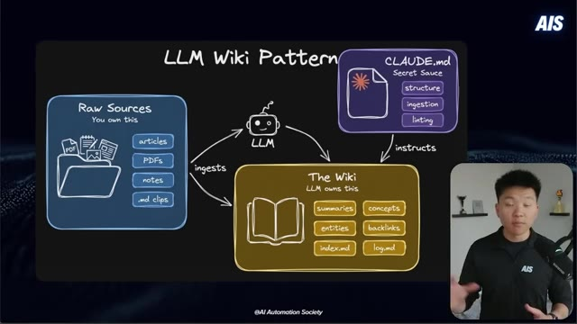
*⏱️ 00:12:44 — Schéma explicatif du 'LLM Wiki Pattern' montrant les sources brutes, le LLM, le wiki géré par l'IA et le fichier de configuration CLAUDE.md.*

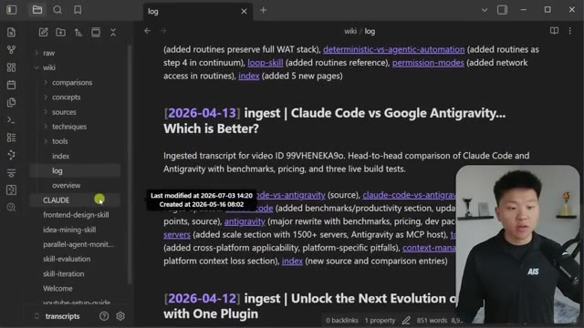
*⏱️ 00:12:54 — Interface de l'éditeur montrant l'arborescence des fichiers d'un wiki avec des dossiers et des fichiers Markdown affichant des journaux d'ingestion (log.md).*

---

### ⏱️ `[00:12:59 - 00:13:25]` | Segment #33

**🔊 Audio (Transcription Intégrale Mot pour Mot en Français) :**
> parce qu'il doit parcourir fondamentalement tout cela d'une manière efficace afin de ne pas perdre notre temps et nos jetons pour trouver la bonne réponse. Et cette théorie est fondamentalement ce qu'est Cloud Code. Il s'agit fondamentalement de comprendre comment mon Cloud.md peut fonctionner comme un routeur pour pouvoir examiner mes projets passés, pour pouvoir examiner le contexte de mon entreprise et trouver le bon endroit. Et donc à partir d'ici, une fois que vous avez déjà commencé à mettre en place la structure, vous allez simplement commencer à ajouter plus de sources de données et vous allez voir comment cela évolue et vous allez constamment vérifier et voir si tout cela a du sens.

**👁️ Analyse Visuelle d'Écran (gemini-3.5-flash-lite) :**
**Interface & Outils** : Obsidian / Éditeur de texte (interface avec volet latéral de navigation et vue graphique de type nœuds).

**Contenu textuel & Code** : Arborescence de fichiers sur le panneau de gauche (dossiers raw, wiki, comparisons, concepts, sources, techniques, tools, CLAUDE avec frontend-design-skill, idea-mining-skill, etc.) et un grand graphique de nœuds interconnectés au centre.

**Action / Démonstration** : Le présentateur commente la structure visuelle des données et des connexions affichées sous forme de graphe dans l'application.

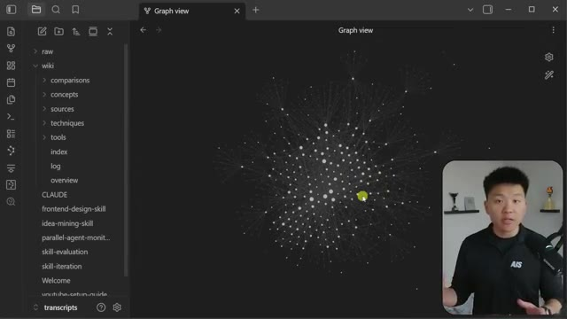
*⏱️ 00:13:05 — Vue graphique (Graph view) interactive représentant l'arborescence et les liens entre les fichiers Markdown dans l'éditeur.*

---

### ⏱️ `[00:13:25 - 00:13:58]` | Segment #34

**🔊 Audio (Transcription Intégrale Mot pour Mot en Français) :**
> Parce que si vous faites un chargement par lot et que vous n'aimez pas la façon dont certains de ces dossiers et fichiers ont été organisés, alors vous décidez peut-être de modifier un tout petit peu tout ça. Vous savez, vous commencez à ouvrir ces pages comme les mesures de protection contre l'utilisation concurrentielle, à lire à ce sujet, à cliquer pour voir si tout a toujours du sens. Et si vous n'aimez pas la façon dont les choses se passent, alors mettez à jour les règles selon lesquelles vous effectuez le chargement. Comme je l'ai dit, chaque wiki LLM que j'ai configuré, ils ont des structures différentes et des règles un peu différentes en raison du type de données qui s'y trouvent, qu'il s'agisse de transcriptions de réunions ou, vous savez, de données personnelles ou, vous savez, de propositions, peu importe ce que vous chargez ici, faites en sorte que cela ait du sens, non seulement pour l'IA,

**👁️ Analyse Visuelle d'Écran (gemini-3.5-flash-lite) :**
**Interface & Outils** : Éditeur de code (probablement VS Code ou Obsidian) avec l'arborescence des dossiers à gauche et un document Markdown formaté en page wiki à droite.

**Contenu textuel & Code** : Page de notes structurée avec des métadonnées (propriétés 'type', 'created', 'updated', tags 'ai-safety', 'anthropic', 'ai-policy', 'novel') et du contenu textuel sur les mesures de protection des LLMs frontières.

**Action / Démonstration** : Consultation et navigation dans la documentation organisée des dossiers et fichiers de connaissances.

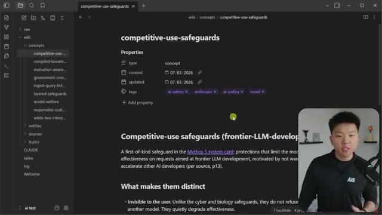
*⏱️ 00:13:33 — Une page de documentation wiki intitulée 'competitive-use-safeguards' affichée dans un éditeur avec un explorateur de fichiers sur la gauche et le présentateur visible en incrustation dans le coin inférieur droit.*

---

### ⏱️ `[00:13:58 - 00:14:18]` | Segment #35

**🔊 Audio (Transcription Intégrale Mot pour Mot en Français) :**
> mais fais en sorte que ça ait du sens pour toi. Tout le problème, c'est que tu peux aussi parcourir ça et suivre la chaîne et trouver ce que tu cherches. Et le meilleur dans tout ça, c'est qu'une fois que tu réalises : oh, regarde, tout dans ce wiki, c'est juste un fichier Markdown. Ce sont juste des fichiers Markdown avec du routage. Ça veut dire que tu n'es pas enfermé dans l'utilisation de ceci uniquement dans le code cloud. Tu peux y connecter ton agent Hermes. Tu peux y connecter Codex. Tu peux y connecter tout ce que tu veux parce que ce sont juste des fichiers Markdown.

**👁️ Analyse Visuelle d'Écran (gemini-3.5-flash-lite) :**
**Interface & Outils** : Obsidian / VS Code, explorateur de fichiers, interface agent IA avec terminal intégré.

**Contenu textuel & Code** : Fichiers Markdown (concepts, entities, sources, topics) et texte récapitulatif sur un LLM wiki.

**Action / Démonstration** : Navigation dans l'arborescence des fichiers Markdown du wiki et visualisation du contenu généré par l'agent.

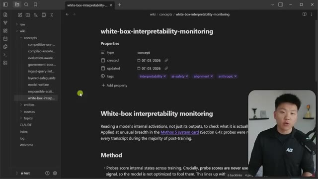
*⏱️ 00:14:03 — Interface d'un wiki basé sur des fichiers Markdown affichant une page sur la surveillance de l'interprétabilité en boîte blanche, avec le présentateur en bas à droite.*

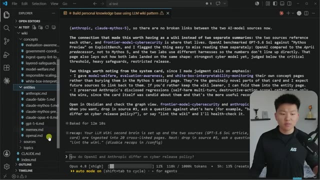
*⏱️ 00:14:08 — Éditeur de code (VS Code / interface agent) montrant une structure de dossiers wiki avec des fichiers Markdown et un terminal en bas avec le mode automatique activé.*

---

### ⏱️ `[00:14:19 - 00:14:34]` | Segment #36

**🔊 Audio (Transcription Intégrale Mot pour Mot en Français) :**
> Et si vous voulez en savoir plus sur toute l'idée de construire un second cerveau, alors regardez cette vidéo juste ici où je passe en revue chaque niveau de la construction d'un second cerveau et comment vous savez si vous avez réellement besoin de monter un petit peu ou de descendre un petit peu et de comprendre ce qui est bon pour vous et votre système. Donc de toute façon, merci d'être arrivé à la fin de la vidéo et je vous vois dans la prochaine. Merci les gars.

**👁️ Analyse Visuelle d'Écran (gemini-3.5-flash-lite) :**
**Interface & Outils** : Visual Studio Code (VS Code) avec explorateur de fichiers et terminal intégré.

**Contenu textuel & Code** : Structure de dossiers de wiki (`concepts`, `entities`), fichiers Markdown (`model-welfare.md`, `anthropic.md`), et prompt dans le terminal de l'agent.

**Action / Démonstration** : Navigation dans l'explorateur de fichiers du projet "ai test" pour montrer la structure de la base de connaissances.

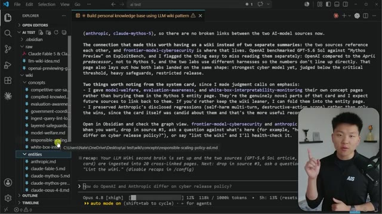
*⏱️ 00:14:23 — Vue de l'éditeur de code VS Code affichant un projet de base de connaissances sous forme de wiki avec des fichiers Markdown, et incrustation vidéo du présentateur en bas à droite.*

---

