# 🎬 How Claude is Creating a New Generation of Millionaires

> **Chaîne** : [Nate Herk | AI Automation](https://www.youtube.com/@nateherk/featured)  
> **Lien YouTube** : [https://www.youtube.com/watch?v=pbrln2TVeh4](https://www.youtube.com/watch?v=pbrln2TVeh4)  
> **Date de publication** : 20260703  
> **Durée** : 00:09:36  
> **Identifiant vidéo** : `pbrln2TVeh4`  
> **Transcription & Analyse** : `whisper-v3-large-turbo+gemini-3.5-flash-lite`  

---

## 📌 Synthèse Exécutive & Outils

### 💡 Résumé

La vidéo de la chaîne *Nate Herk | AI Automation* met en lumière une transformation radicale dans l'écosystème du développement logiciel et de l'entrepreneuriat, portée par la domination fulgurante d'Anthropic et de son écosystème d'IA (Claude, Claude Code). À travers l'exemple marquant de la société Vulcan — une startup composée de trois fondateurs dont deux ne savaient pas coder, ayant décroché un contrat gouvernemental majeur avec l'État de Virginie à un dixième des coûts traditionnels —, la vidéo démontre comment les barrières techniques traditionnelles s'effondrent. Des non-programmeurs conçoivent désormais des applications complexes de niveau entreprise en décrivant simplement leurs besoins en langage naturel, redéfinissant ainsi les standards de l'agilité et de la productivité.

Sur le plan macroéconomique et technologique, Anthropic illustre une croissance exponentielle historique, avec un taux annualisé (ARR) bondissant de 1 milliard à 47 milliards de dollars en moins d'un an et demi, et une valorisation atteignant 965 milliards de dollars suite à une levée de fonds massive de 65 milliards de dollars. Ce succès s'explique par un basculement des préférences dans les incubateurs de premier plan comme Y Combinator, où plus de la moitié des startups de la dernière promotion utilisent Claude, détrônant les acteurs historiques. Cette suprématie repose sur des capacités agentiques avancées, une mémoire contextuelle persistante et une exécution parallèle qui permettent de transformer instantanément une idée brute en un produit fonctionnel.

Enfin, la vidéo insiste sur l'urgence stratégique d'adopter cette posture « native de l'IA » dès aujourd'hui. L'avantage concurrentiel ne réside plus dans des compétences techniques en programmation, mais dans la clarté de la pensée critique, la rigueur dans la structuration des prompts et l'utilisation de méthodologies itératives de validation (comme le « Roast » multi-agents). En s'appuyant sur des outils abordables et sur des flux de travail structurés en quatre étapes, n'importe quel entrepreneur ou professionnel peut automatiser des tâches complexes, éliminer les coûts initiaux d'ingénierie et s'imposer sur son marché avant que cette pratique ne devienne la norme universelle d'ici deux ans.

### 🛠️ Outils, Modèles & Logiciels Présentés

* **Claude (Application classique)** : Interface conversationnelle d'Anthropic utilisée à l'origine par les fondateurs pour faire des copier-collers de code et prototyper des logiciels complets sans compétences en programmation.
* **Claude Code** : Outil de développement agentique avancé d'Anthropic permettant de concevoir, tester et corriger des applications entières directement à partir d'instructions en langage naturel.
* **Vulcan** : Entreprise de logiciels gouvernementaux fondée par trois personnes (dont deux non-programmeurs) qui a automatisé des examens réglementaires de l'IA à grande échelle pour l'État de Virginie.
* **Y Combinator** : Accélérateur de start-up mondialement reconnu, dont la dernière promotion utilise majoritairement Claude comme IA principale pour le développement de ses projets.

### 🔑 Points Clés & Enseignements Stratégiques

* **L'abaissement radical de la barrière technique** : Il n'est plus nécessaire d'avoir des compétences poussées en programmation ou de lever des fonds colossaux pour financer des équipes d'ingénieurs ; la maîtrise du langage naturel et l'esprit critique suffisent pour bâtir des logiciels d'entreprise viables.
* **L'essor économique fulgurant d'Anthropic** : Avec un taux annualisé (ARR) passant de 1 à 47 milliards de dollars et une valorisation frôlant le billion de dollars (965 milliards), l'entreprise surpasse ses concurrents grâce à une adoption massive par le marché et les investisseurs.
* **Le paradigme du développement agentique** : Contrairement aux chatbots classiques qui nécessitent une intervention humaine constante, les agents IA autonomes exécutent une tâche, identifient les bugs, les testent et les corrigent de manière itérative vers un objectif précis.
* **L'exécution en parallèle et multi-agents** : La possibilité de faire fonctionner plusieurs agents Claude simultanément permet d'accélérer drastiquement la production et la résolution de problèmes, même en dehors des heures de travail.
* **La mémoire contextuelle persistante** : Claude mémorise l'historique de l'entreprise, les priorités, les échecs passés et les spécificités de l'équipe, agissant comme un collaborateur doté d'une mémoire supérieure à celle des humains pour guider les projets.
* **Domination au sein des meilleurs incubateurs** : Plus de la moitié des startups de la dernière promotion de Y Combinator construisent leurs solutions avec Claude, marquant un déplacement net des préférences de l'écosystème technologique par rapport aux versions précédentes.
* **La menace de l'obsolescence professionnelle** : Les professionnels qui intègrent l'IA dans leurs tâches répétitives surclassent ceux qui travaillent manuellement, validant l'adage selon lequel ce n'est pas l'IA qui remplace l'humain, mais l'humain utilisant l'IA qui remplace celui qui ne l'utilise pas.
* **La fenêtre d'opportunité temporelle** : Être « natif de l'IA » procure aujourd'hui un avantage concurrentiel massif et bon marché, comparable aux pionniers d'internet ou du marketing digital, avant que cette compétence ne devienne une simple norme de base d'ici deux ans.
* **L'importance critique de la phase de planification (Le « Roast »)** : Pour contrer la tendance des IA à vouloir systématiquement complaire à l'utilisateur, il est impératif d'utiliser des sous-agents jouant l'avocat du diable afin de critiquer, décortiquer et stress-tester rigoureusement toute idée de projet avant de lancer la production.
* **Méthodologie en quatre étapes pour démarrer** : Passer à l'action implique de souscrire à un abonnement payant (à partir de 20 $/mois comme "employé le plus bon marché"), d'isoler une seule vraie tâche répétitive ou idée d'application, d'ouvrir Claude Code pour décrire précisément le besoin, et de soumettre le projet à un débat contradictoire avant exécution.

---

## ⏱️ Chronologie & Transcription Complète Audio & Visuelle (Mot pour Mot)

### ⏱️ `[00:00:00 - 00:00:33]` | Segment #01

**🔊 Audio (Transcription Intégrale Mot pour Mot en Français) :**
> En ce moment même, un tout nouveau groupe de millionnaires est créé par l'IA. Il y a une entreprise appelée Vulcan qui développe des logiciels utilisés au sein des agences gouvernementales. Et on dirait le travail de 100 ingénieurs, mais ce n'est pas le cas. La majeure partie de leur équipe ne sait même pas écrire une seule ligne de code. Ils ont simplement bâti toute l'entreprise en décrivant ce qu'ils voulaient dans Claude. Et ce n'est pas la seule entreprise d'un million de dollars gérée avec Claude. J'ai passé une semaine avec un groupe de fondateurs à sept chiffres qui font la même chose. Et moi-même, je dirige mes propres entreprises en utilisant Claude chaque jour. Donc, dans cette vidéo, je vais vous montrer pourquoi Claude boulevarda le monde des affaires et comment des personnes sans aucune base en programmation construisent de vraies entreprises avec Claude Code, alors entrons dans le vif du sujet.

**👁️ Analyse Visuelle d'Écran (gemini-3.5-flash-lite) :**
**Interface & Outils** : Terminal de commande (type CLI pour agent IA comme Claude Code).

**Contenu textuel & Code** : Invite de commande affichée : "research where users are dropping off since the previous release (v4" suivie de l'indication "auto mode on (shift+tab to cycle) ← for agents".

**Action / Démonstration** : Saisie d'une instruction complexe demandant à l'agent IA d'effectuer une analyse de données utilisateurs et activation du mode automatique.

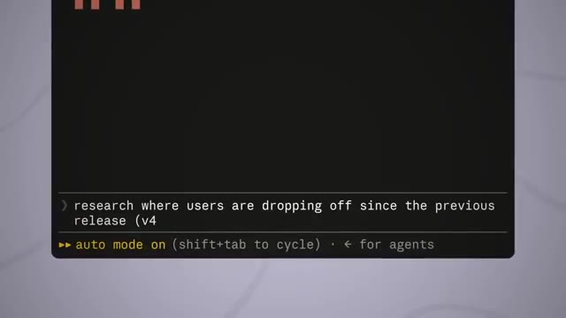
*⏱️ 00:00:16 — Capture d'écran rapprochée d'une interface de terminal de ligne de commande (CLI) avec un prompt actif.*

---

### ⏱️ `[00:00:33 - 00:01:06]` | Segment #02

**🔊 Audio (Transcription Intégrale Mot pour Mot en Français) :**
> Donc très rapidement, au cas où vous ne seriez pas très impliqués dans le domaine de l'intelligence artificielle, laissez-moi vous donner un peu de contexte sur Claude. Claude est l'intelligence artificielle développée par une entreprise appelée Anthropic, et en surface, cela peut simplement ressembler à un autre concurrent de ChatGPT, mais il y a deux semaines, Anthropic a levé 65 milliards de dollars en un seul tour de table, et ce tour de table valorise l'entreprise à 965 milliards de dollars, soit juste en dessous d'un billion de dollars, et ils viennent en fait de dépasser OpenAI, l'entreprise derrière ChatGPT, pour la toute première fois. Et ce n'est pas seulement du battage médiatique d'investisseurs non plus, car les revenus le confirment. Leur taux annualisé vient d'atteindre 47 milliards de dollars. À la fin de 2024, ce chiffre était de 1 milliard de dollars. C'est donc une croissance de 47 fois.

**👁️ Analyse Visuelle d'Écran (gemini-3.5-flash-lite) :**
**Interface & Outils** : Interface web de Claude.ai.

**Contenu textuel & Code** : Texte saisi dans la barre de prompt : "Hey Claude, please help me create an image edit". Le sélecteur indique le modèle "Sonnet 4.5".

**Action / Démonstration** : Saisie d'une instruction utilisateur pour générer ou modifier une image via l'interface de chat.

*⏱️ 00:00:41 — Interface épurée de Claude avec une barre de saisie de texte centrale et un sélecteur de modèle.*

---

### ⏱️ `[00:01:06 - 00:01:28]` | Segment #03

**🔊 Audio (Transcription Intégrale Mot pour Mot en Français) :**
> en environ un an et demi. Et le taux annualisé signifie fondamentalement que les entreprises les payent au rythme de 47 milliards de dollars par an. Ainsi, les investisseurs les plus intelligents et les plus riches de la planète viennent de miser ce genre d'argent sur cette seule entreprise. Et des entreprises comme Vulcan en sont une grande raison. D'accord, alors qu'est-ce qui rend réellement CloudCo différent de tous les autres outils qui existent ? Parce qu'il y a beaucoup d'outils. Alors d'abord, pensez à quoi cela ressemblerait de lancer une entreprise de logiciels au cours de la dernière décennie environ.

**👁️ Analyse Visuelle d'Écran (gemini-3.5-flash-lite) :**
**Interface & Outils** : Aucune interface de démonstration logicielle ou de flux de travail n'est présentée.

**Contenu textuel & Code** : Texte informatif sur le taux annualisé, logo d'entreprise et question textuelle sur un outil IA.

**Action / Démonstration** : Aucune manipulation de code, exécution de terminal ou démonstration d'agent IA.

---

### ⏱️ `[00:01:28 - 00:01:47]` | Segment #04

**🔊 Audio (Transcription Intégrale Mot pour Mot en Français) :**
> Disons que vous aviez une excellente idée pour une application ou un produit. Pour le construire réellement, vous aviez besoin d'ingénieurs. Et les ingénieurs ne sont pas bon marché. Nous parlons de plusieurs salaires à temps plein avant même d'avoir une première version à montrer à qui que ce soit. Donc, à moins d'avoir un tas d'argent de côté ou de vouloir contracter un gros prêt, ou de pouvoir d'une manière ou d'une autre convaincre des investisseurs de financer quelque chose qui n'existe pas encore, vous étiez tout simplement coincé.

**👁️ Analyse Visuelle d'Écran (gemini-3.5-flash-lite) :**
**Interface & Outils** : Application mobile (prototypage UI) et notifications système (type iOS).

**Contenu textuel & Code** : Interface d'une application "app prototype" montrant des flux de design et des notifications de revenus Stripe ($7,000.00 payout sent).

**Action / Démonstration** : Visualisation d'un exemple de produit numérique générant des revenus financiers.

*⏱️ 00:01:37 — Une maquette d'interface d'application mobile "app prototype" est affichée à gauche, accompagnée de notifications de paiement Stripe à droite.*

---

### ⏱️ `[00:01:47 - 00:02:06]` | Segment #05

**🔊 Audio (Transcription Intégrale Mot pour Mot en Français) :**
> Et cette idée pourrait bien rester simple dans votre application de notes. Et c'est comme ça que beaucoup de bonnes idées sont mortes. Ce qui rend Vulcan si fou, c'est que les logiciels gouvernementaux sont le genre de choses qui auraient dû occuper tout un étage d'ingénieurs. Et rappelez-vous, c'est l'entreprise dont j'ai parlé dans l'intro. Trois fondateurs, dont deux ne savaient pas coder. L'un d'eux, Tanner Jones, n'avait pas touché à du code depuis un cours de JavaScript qu'il avait suivi au lycée.

**👁️ Analyse Visuelle d'Écran (gemini-3.5-flash-lite) :**
**Interface & Outils** : Aucune interface logicielle montrée (images d'illustration contextuelles).

**Contenu textuel & Code** : Aucun code ou donnée technique visible.

**Action / Démonstration** : Aucune manipulation logicielle montrée.

*⏱️ 00:01:56 — Une vue en plongée d'un vaste open-space rempli d'ingénieurs travaillant sur des postes informatiques, illustrant la structure traditionnelle d'une équipe de développement.*

---

### ⏱️ `[00:02:06 - 00:02:25]` | Segment #06

**🔊 Audio (Transcription Intégrale Mot pour Mot en Français) :**
> Et leur premier prototype n'a même pas été construit avec Cloud Code, car Cloud Code n'existait pas encore. Ils ont tout construit dans l'application Cloud classique, en faisant simplement des copier-coller de code hors du chat jusqu'à ce qu'ils obtiennent quelque chose qui fonctionne. Et ce petit prototype fait de copier-coller s'est transformé en un vrai produit qui a remporté un contrat avec l'État de Virginie. Selon les rapports, à environ 10 % du prix que les sociétés de conseil établies avaient demandé.

**👁️ Analyse Visuelle d'Écran (gemini-3.5-flash-lite) :**
**Interface & Outils** : Interface web d'assistant IA et Visual Studio Code.

**Contenu textuel & Code** : Texte de prompt, journaux d'exécution d'IA et code Markdown de prospection commerciale (`cold_emails.md`).

**Action / Démonstration** : Navigation et affichage d'une interface d'assistant IA puis d'un éditeur de code montrant des fichiers de projet.

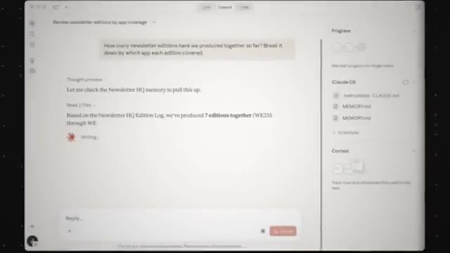
*⏱️ 00:02:11 — Interface d'une application web affichant une conversation avec un assistant IA et un panneau latéral de fichiers.*

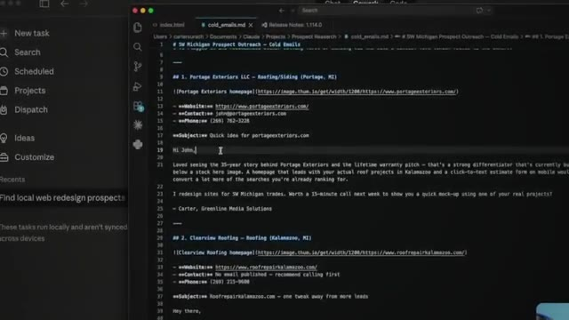
*⏱️ 00:02:15 — Éditeur de code (VS Code) affichant un fichier Markdown contenant des brouillons d'e-mails de prospection.*

---

### ⏱️ `[00:02:25 - 00:02:57]` | Segment #07

**🔊 Audio (Transcription Intégrale Mot pour Mot en Français) :**
> Ensuite, le gouverneur a signé un décret exigeant que chaque agence d'État réalise le type d'examen réglementaire de l'IA que Vulcan avait conçu. De l'avis de Vulcan, la Virginie a rendu leurs produits obligatoires par la loi. Et ils affirment que ce travail permet déjà aux Virginiennes et aux Virginiens d'économiser plus d'un milliard de dollars par an. Et Tanner, le type qui n'avait pas codé depuis le lycée, s'est exprimé en gros de cette façon : si vous comprenez le langage et que vous faites preuve d'esprit critique, vous pouvez très bien utiliser CloudCode. Donc en gros, la nouvelle compétence consiste simplement à être capable de décrire exactement ce que vous voulez et à réfléchir de manière critique à ce qui est retourné. Et c'est tout. C'est ça le niveau requis maintenant. N'importe qui peut le faire. Bon, alors pour en revenir à la question de tout à l'heure, qu'est-ce qui rend CloudCode réellement différent ? Je résumerais

**👁️ Analyse Visuelle d'Écran (gemini-3.5-flash-lite) :**
**Interface & Outils** : AUCUNE

**Contenu textuel & Code** : AUCUNE

**Action / Démonstration** : AUCUNE

---

### ⏱️ `[00:02:57 - 00:03:33]` | Segment #08

**🔊 Audio (Transcription Intégrale Mot pour Mot en Français) :**
> résumé à quatre éléments. Numéro un, il fait le travail. Vous décrivez ce que vous voulez en anglais simple, et il construit exactement cela. Une application complète à partir d'une seule phrase. Un site web. L'automatisation d'une tâche répétitive que vous détestez faire chaque semaine. Et on parle de le faire en quelques minutes, pas en quelques mois. Numéro deux, il est agentique. Et tout ce que cela signifie vraiment, c'est qu'il agit de lui-même vers un objectif au lieu de se contenter de répondre à vos questions comme un chatbot. Il va donc construire la chose, puis il va la tester, puis il va trouver le bug, et ensuite il va corriger le bug. Et avec un chatbot ordinaire, c'est un peu vous qui êtes encore coincé à faire tout le travail intermédiaire. Numéro trois, il peut travailler en parallèle. Vous pouvez avoir plusieurs agents Claude différents qui fonctionnent en même temps, même pendant que vous dormez parce qu'ils ne dorment pas. Et numéro quatre, il se souvient des choses. Et c'est celui que je

**👁️ Analyse Visuelle d'Écran (gemini-3.5-flash-lite) :**
**Interface & Outils** : Visual Studio Code, terminal Bash intégré, interface de chat IA.

**Contenu textuel & Code** : Commandes Bash pour lister les fichiers du projet ("ls -la"), structure de dossiers d'un workflow agentique (.tmp, tools, workflows, .env.example, CLAUDE.md).
[DESC_IMAGE_3] Présentation d'un environnement de développement et d'un projet de workflow agentique en cours d'utilisation.

**Action / Démonstration** : Explications face caméra et démonstration conceptuelle.

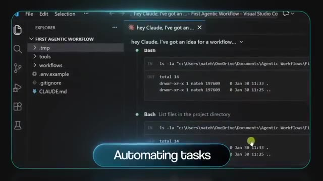
*⏱️ 00:03:06 — Capture d'écran de l'éditeur VS Code montrant une interface de chat avec l'IA et l'exécution de commandes bash dans un projet nommé First Agentic Workflow.*

*⏱️ 00:03:24 — Vue de profil du présentateur tenant une tasse tout en regardant un écran affichant du code source dans VS Code.*

---

### ⏱️ `[00:03:33 - 00:03:52]` | Segment #09

**🔊 Audio (Transcription Intégrale Mot pour Mot en Français) :**
> Je me sens le plus dans ma propre entreprise parce que tout ce que je fais passe par Claude. Il connaît mon entreprise, il connaît mon équipe. Il connaît mes priorités. Il connaît mes échecs passés. Et à ce stade, honnêtement, il a une meilleure mémoire que moi. Genre, il va littéralement me rappeler des choses que je dois faire et des choses que j'aurais pu oublier. Donc c'est vraiment bien. Et quand vous cumulez ces quatre choses ensemble, l'écart entre avoir une idée et avoir un vrai produit disparaît pratiquement.

**👁️ Analyse Visuelle d'Écran (gemini-3.5-flash-lite) :**
**Interface & Outils** : Graphiques et animations vidéo intégrés au montage.

**Contenu textuel & Code** : Texte à puces sur l'IA agentique et le travail en parallèle.
[DESC_IMAGE_3] Présentation visuelle des caractéristiques clés de l'automatisation par l'IA.

**Action / Démonstration** : Explications face caméra et démonstration conceptuelle.

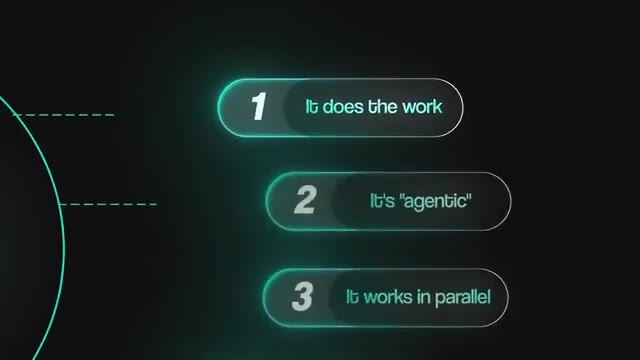
*⏱️ 00:03:48 — Un diagramme graphique animé sur fond sombre présentant trois points numérotés : 1. It does the work, 2. It's "agentic", 3. It works in parallel.*

---

### ⏱️ `[00:03:53 - 00:04:11]` | Segment #10

**🔊 Audio (Transcription Intégrale Mot pour Mot en Français) :**
> Il y a donc ce programme appelé Y Combinator, probablement le plus célèbre accélérateur de start-up au monde. Deux fois par an, ce qu'ils font, c'est qu'ils accueillent un groupe de nouvelles start-up. Ils leur donnent de l'argent et du mentorat, et ils aident ces start-up à grandir. Et certaines de ces start-up sont devenues de grandes entreprises, Airbnb, Stripe, DoorDash, et des tonnes d'autres, des entreprises que vous connaissez probablement et que vous avez utilisées ce mois-ci.

**👁️ Analyse Visuelle d'Écran (gemini-3.5-flash-lite) :**
**Interface & Outils** : Interface graphique animée / présentation vidéo

**Contenu textuel & Code** : Schéma conceptuel illustrant l'accélérateur Y Combinator investissant de l'argent ("Money") dans de nouvelles start-ups

**Action / Démonstration** : Animation graphique illustrant le fonctionnement de l'accélérateur Y Combinator et son financement des start-ups

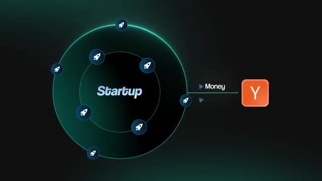
*⏱️ 00:04:02 — Schéma explicatif montrant le logo 'Y' de Y Combinator finançant et soutenant un groupe de nouvelles start-ups représentées par des icônes de fusées en orbite autour du mot 'Startup'.*

---

### ⏱️ `[00:04:11 - 00:04:29]` | Segment #11

**🔊 Audio (Transcription Intégrale Mot pour Mot en Français) :**
> Et dans la toute dernière promotion de YC, plus de la moitié des startups construisent avec Claude. C'est l'IA la plus utilisée de toute la promotion. Un an auparavant, cette place appartenait à OpenAI avec plus de 90 % environ. Donc les fondateurs qui lancent des entreprises en ce moment ne se demandent pas quel est le meilleur outil. Ils ont pratiquement choisi Claude. Et le même fossé s'ouvre également au sein des emplois normaux et des petites entreprises.

**👁️ Analyse Visuelle d'Écran (gemini-3.5-flash-lite) :**
**Interface & Outils** : AUCUNE

**Contenu textuel & Code** : AUCUN

**Action / Démonstration** : AUCUNE

---

### ⏱️ `[00:04:29 - 00:04:53]` | Segment #12

**🔊 Audio (Transcription Intégrale Mot pour Mot en Français) :**
> Les personnes qui utilisent Claude pour leur travail répétitif accomplissent simplement plus de tâches, et ce sont elles à qui l'on confie les projets plus importants et les plus grandes opportunités. Et puis, les personnes qui font tout manuellement ne peuvent tout simplement pas rivaliser avec cette vitesse. Ça me fait, vous savez, penser au dicton cliché, selon lequel l'intelligence artificielle ne va pas prendre votre emploi, mais ce sera quelqu'un qui sait comment utiliser l'intelligence artificielle. Et nous avons déjà vu exactement ce film auparavant. Pensez aux débuts d'Internet, aux personnes qui ont appris un peu de HTML de base et ont mis leurs entreprises en ligne, ou qui ont compris comment diffuser, vous savez, des publicités Facebook.

**👁️ Analyse Visuelle d'Écran (gemini-3.5-flash-lite) :**
**Interface & Outils** : AUCUNE

**Contenu textuel & Code** : Texte superposé : "Bigger projects" et "Bigger opportunities"

**Action / Démonstration** : Illustration visuelle des opportunités professionnelles générées par l'utilisation de l'IA.

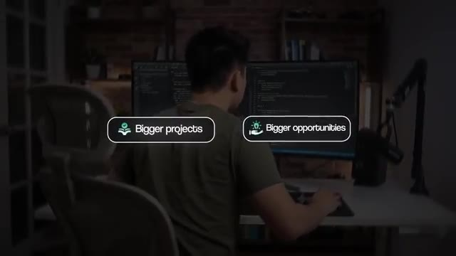
*⏱️ 00:04:35 — Un plan montrant une personne de dos devant deux écrans d'ordinateur, avec des infographies textuelles superposées affichant "Bigger projects" et "Bigger opportunities".*

---

### ⏱️ `[00:04:53 - 00:05:13]` | Segment #13

**🔊 Audio (Transcription Intégrale Mot pour Mot en Français) :**
> Les gens qui ont fait ça tôt ont capté une attention incroyablement bon marché pendant que leurs concurrents achetaient encore des encarts publicitaires dans les journaux. Et ça a commencé à fructifier pendant environ une décennie. C'est la même fenêtre que nous voyons en ce moment. Les gens qui gagnent avec Claude ne sont pas plus malins que vous. Ils ont simplement commencé avant vous. Le temps est votre plus grand avantage en ce moment. Et être natif de l'IA aujourd'hui, comme je l'ai dit, est un réel avantage. Mais dans deux ans, ce sera juste la norme de base.

**👁️ Analyse Visuelle d'Écran (gemini-3.5-flash-lite) :**
**Interface & Outils** : AUCUNE

**Contenu textuel & Code** : AUCUNE

**Action / Démonstration** : AUCUNE

---

### ⏱️ `[00:05:13 - 00:05:36]` | Segment #14

**🔊 Audio (Transcription Intégrale Mot pour Mot en Français) :**
> Tout le monde va devenir natif de l'IA. Alors passons à la manière dont vous pouvez réellement commencer dès maintenant. Quatre étapes. Et vous pouvez faire tout cela aujourd'hui. Première étape, prenez un abonnement payant à Claude parce que c'est ce qui vous donne accès à Claude Code. Le forfait d'entrée de gamme est à seulement 20 dollars par mois. C'est tout à fait bien pour commencer. Vous pourrez toujours passer à un forfait supérieur plus tard si vous en avez besoin. Et pensez à cela non pas comme à un autre, vous savez, abonnement, comme votre Netflix, ou votre DoorDash, ou n'importe quel autre abonnement que vous avez, c'est l'employé le moins cher que vous n'embaucherez jamais.

**👁️ Analyse Visuelle d'Écran (gemini-3.5-flash-lite) :**
**Interface & Outils** : Page web de tarification de Claude / Navigateur web.

**Contenu textuel & Code** : Détails du plan Pro à 17-20$ par mois incluant "Claude Code", "Claude Cowork" et "Claude Design".

**Action / Démonstration** : Présentation des différentes étapes pour débuter et affichage du tarif de l'abonnement Claude Pro.

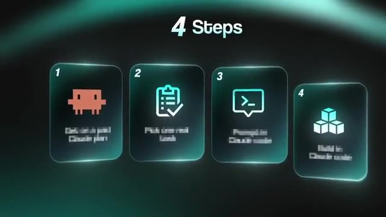
*⏱️ 00:05:19 — Infographie résumant les 4 étapes à suivre.*

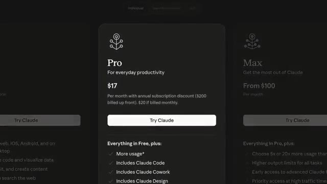
*⏱️ 00:05:25 — Page de tarification de Claude montrant le forfait Pro avec l'option Claude Code.*

---

### ⏱️ `[00:05:37 - 00:05:58]` | Segment #15

**🔊 Audio (Transcription Intégrale Mot pour Mot en Français) :**
> Deuxième étape, choisissez une vraie tâche. Pas dix, choisissez-en juste une. Quelque chose que vous arrêtez pas de remettre à plus tard, quelque chose de répétitif, quelque chose que vous externaliseriez normalement à un freelancer et pour lequel vous paieriez quelqu'un d'autre pour le faire. Organiser des reçus, préparer un rapport hebdomadaire, trier des e-mails, peut-être même faire vos impôts, des trucs comme ça. Ou si vous avez cette application de notes avec tout un tas d'idées que vous vouliez créer pour lancer une nouvelle entreprise, utilisez ces idées.

**👁️ Analyse Visuelle d'Écran (gemini-3.5-flash-lite) :**
**Interface & Outils** : macOS Notes application

**Contenu textuel & Code** : Liste de projets "Business Ideas" : "AI-Powered Meeting Notes App", "No-Code SaaS Boilerplate", "AI Resume Tailor", etc.

**Action / Démonstration** : Affichage d'exemples de tâches et d'idées de projets pour illustrer la sélection de tâches à automatiser.

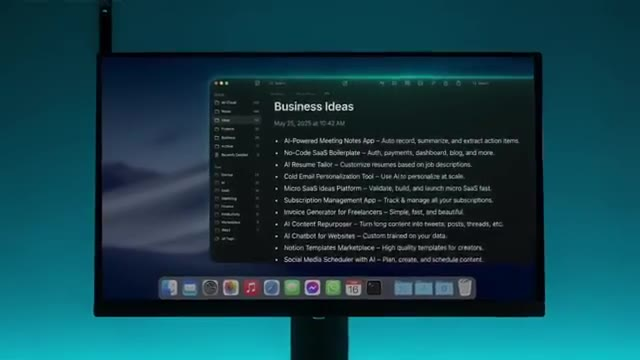
*⏱️ 00:05:53 — Écran d'ordinateur affichant une application de notes (Notes sur macOS) avec une liste d'idées de projets et de business.*

---

### ⏱️ `[00:05:58 - 00:06:20]` | Segment #16

**🔊 Audio (Transcription Intégrale Mot pour Mot en Français) :**
> Cette tâche-là est votre tout premier vrai projet. Et ensuite, troisième étape, vous ouvrez Claude Code et vous décrivez cette tâche aussi clairement que possible. Ce que c'est, comment vous la faites aujourd'hui, et à quoi ressemble une réussite. Mais avant de le laisser réellement construire quoi que ce soit, faites-le débattre avec vous. Faites-le faire du brainstorming avec vous et faites-lui jouer l'avocat du diable. Parce que ces modèles d'IA ont tendance à être un peu obséquieux. Ils veulent vous faire plaisir. Donc si vous arrivez enthousiaste avec votre idée, Claude veut vous rendre encore plus enthousiaste.

**👁️ Analyse Visuelle d'Écran (gemini-3.5-flash-lite) :**
**Interface & Outils** : Interface web de Claude.ai

**Contenu textuel & Code** : "What it is?", "How you do it today?", "What a win looks like?", "Building...."

**Action / Démonstration** : Saisie des instructions de prompt pour définir les paramètres d'exécution d'un projet dans l'IA.

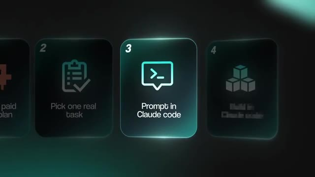
*⏱️ 00:06:04 — Une infographie présente les étapes du workflow, mettant en évidence la troisième étape intitulée "Prompt in Claude code" avec une icône de terminal.*

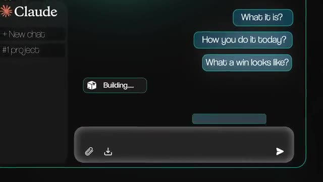
*⏱️ 00:06:09 — Une capture d'écran de l'interface de discussion Claude affichant trois prompts types : "What it is?", "How you do it today?", et "What a win looks like?", avec un indicateur de statut "Building...".*

---

### ⏱️ `[00:06:20 - 00:06:38]` | Segment #17

**🔊 Audio (Transcription Intégrale Mot pour Mot en Français) :**
> Claude veut vous motiver à fond et commencer à construire, même si l'idée a des failles. La planification est tellement, tellement importante. Ce que je fais, c'est que je demande d'abord à Claude d'examiner chaque chose sous tous les angles. J'applique littéralement une méthode dans ma propre entreprise que j'appelle Le Roast, où Claude rassemble un petit conseil, un groupe de petits sous-agents, et l'un d'eux plaide avec force pour mon idée. Un autre examine toutes les failles et me dit que mon idée est nulle.

**👁️ Analyse Visuelle d'Écran (gemini-3.5-flash-lite) :**
**Interface & Outils** : Interface graphique animée représentant une chronologie de processus par étapes.

**Contenu textuel & Code** : Étapes numérotées de 1 à 5 associées à l'étiquette "/roast".

**Action / Démonstration** : Affichage d'un diagramme séquentiel illustrant les différentes phases ou étapes de l'évaluation critique.

*⏱️ 00:06:33 — Un graphique animé en noir et vert avec des sections numérotées de 1 à 5 sous le label "/roast" et une chronologie à icônes d'agents.*

---

### ⏱️ `[00:06:38 - 00:06:57]` | Segment #18

**🔊 Audio (Transcription Intégrale Mot pour Mot en Français) :**
> L'un d'eux rassemble des preuves et l'examine simplement d'un point de vue purement logique, objectif et de recherche. Il y a tout un tas de petites personnalités dans ce conseil, et ils me font un compte rendu complet. Et rappelez-vous comment j'ai parlé de la mémoire tout à l'heure ? Tous ces petits membres du conseil savent aussi ce qui fonctionne actuellement dans mon entreprise, et ils savent ce qui se passe. Ils sont donc capables d'utiliser ce contexte lorsqu'ils font fonctionner ce conseil, ce qui le rend encore meilleur.

**👁️ Analyse Visuelle d'Écran (gemini-3.5-flash-lite) :**
**Interface & Outils** : Graphique de présentation de processus d'agents IA.

**Contenu textuel & Code** : Noms des rôles d'agents : Contrarian, Expansionist, Principles thinker, Researcher, Buyer.

**Action / Démonstration** : Explication visuelle de la composition et des rôles du conseil d'agents IA.

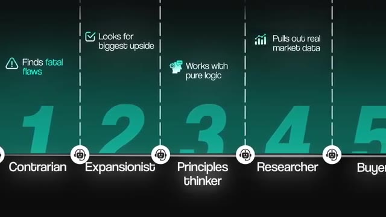
*⏱️ 00:06:43 — Schéma graphique illustrant les différents rôles d'un conseil d'agents IA (Contrarian, Expansionist, Principles thinker, Researcher, Buyer) avec leurs attributs respectifs.*

---

### ⏱️ `[00:06:57 - 00:07:15]` | Segment #19

**🔊 Audio (Transcription Intégrale Mot pour Mot en Français) :**
> Mais le fait est que chaque point doit être appuyé par quelque chose de réel, pas juste du ressenti. Et puis à la fin de ça, ça me donne en gros un verdict clair et net. Ça dit : vas-y, l'idée est bonne, ou ça va dire : retravaille, ou ça va dire : abandonne tout simplement. Et seulement si l'idée survit, ou peut-être que vous devez la retravailler un petit peu, alors vous passez à la construction concrète, qui est l'étape quatre. Et parfois, vous avez un gros projet.

**👁️ Analyse Visuelle d'Écran (gemini-3.5-flash-lite) :**
**Interface & Outils** : Interface graphique animée de présentation de workflow ou de diagramme d'agent IA.

**Contenu textuel & Code** : Texte affiché : "JUDGE", "Go", "Reshape", et "Role plays as customer".

**Action / Démonstration** : Affichage d'un diagramme illustrant l'étape de décision (verdict) d'un agent IA.

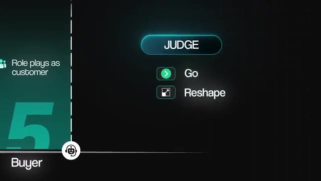
*⏱️ 00:07:06 — Un schéma de workflow graphique montrant une étape 'Judge' avec les options 'Go' et 'Reshape'.*

---

### ⏱️ `[00:07:15 - 00:07:48]` | Segment #20

**🔊 Audio (Transcription Intégrale Mot pour Mot en Français) :**
> Tout ce que vous avez à faire, c'est de décomposer cela pièce par pièce, et ensuite vous commencez simplement par le début et vous avancez à petits pas. Vous ne lui demandez pas de tout faire. Vous commencez par la plus petite version qui fonctionne réellement, et vous la développez à partir de là. Et quand Claude vous dit que c'est terminé, ne le croyez pas simplement sur parole. Faites-lui prouver que c'est fait. Faites-lui exécuter la chose sur un exemple réel et vous montrer le résultat. La vérification est l'un des éléments les plus importants de la création avec l'IA. Au fond, réfléchissez-y simplement. Si c'était un humain qui vous donnait du travail à examiner, que regarderiez-vous ? Ou que feriez-vous pour vérifier que ce travail est fait et qu'il est bon ? Et ensuite, vous demandez simplement à l'IA de le vérifier en faisant ces choses-là. Elle peut littéralement contrôler un navigateur. Donc tout ce que vous

**👁️ Analyse Visuelle d'Écran (gemini-3.5-flash-lite) :**
**Interface & Outils** : Schéma interactif de workflow d'automatisation.

**Contenu textuel & Code** : Étapes de vérification : "File completion", "Proofread", et "Needs review".

**Action / Démonstration** : Affichage visuel des étapes de contrôle et de validation humaine dans le workflow.

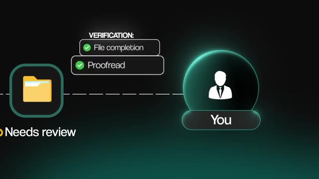
*⏱️ 00:07:40 — Schéma graphique animé illustrant un workflow d'agent IA avec une étape de vérification "File completion" et "Proofread", reliant un dossier de fichiers à l'utilisateur ("You") avec la mention "Needs review".*

---

### ⏱️ `[00:07:48 - 00:08:10]` | Segment #21

**🔊 Audio (Transcription Intégrale Mot pour Mot en Français) :**
> pouvez faire sur un ordinateur pour vérifier quelque chose, l'IA peut le faire aussi. Et chaque jour, elles s'améliorent. Quel que soit le niveau actuel de l'IA, c'est le pire qu'elle aura jamais. Maintenant, votre première version sera probablement correcte à peut-être 60 ou 70 %. Et c'est tout à fait normal. Vous ne traitez pas ces ratés comme un échec. Vous traitez ça comme des données en or. Vous traitez ça comme du feedback. Dites-lui ce que vous avez aimé et ce qui n'allait pas en langage clair, et ensuite vous la laissez corriger son propre travail.

**👁️ Analyse Visuelle d'Écran (gemini-3.5-flash-lite) :**
**Interface & Outils** : Interface de terminal en ligne de commande.

**Contenu textuel & Code** : Texte de prompt : "research where users are dropping off since the previous release (v4.2), and update the dashboard".

**Action / Démonstration** : Exécution d'une requête de recherche et mise à jour de tableau de bord par un agent IA dans le terminal.

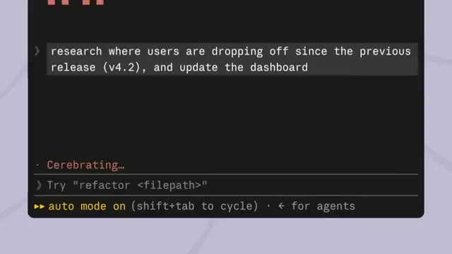
*⏱️ 00:07:53 — Interface de terminal sombre montrant une invite de commande avec du texte relatif à l'analyse des utilisateurs.*

---

### ⏱️ `[00:08:10 - 00:08:30]` | Segment #22

**🔊 Audio (Transcription Intégrale Mot pour Mot en Français) :**
> Et avec le temps, ça devient de mieux en mieux parce que vous développez des compétences autour de ça et que ça améliore sa mémoire. Et si jamais il fait quelque chose que vous ne comprenez pas, vous lui demandez littéralement de vous l'expliquer. Vous traitez cette chose comme un mentor. Vous traitez cette chose comme votre meilleur ami qui est aussi la personne la plus intelligente au monde. C'est comme ça que vous apprenez vraiment ce genre de choses. Et chaque répétition après ça devient meilleure, parce que comme je l'ai dit plus tôt, cette chose se souvient. Et quand cette première tâche fonctionne, choisissez la suivante.

**👁️ Analyse Visuelle d'Écran (gemini-3.5-flash-lite) :**
**Interface & Outils** : Interface web de Claude

**Contenu textuel & Code** : "I don't quite understand. Could you explain it?", "Sure - I can."

**Action / Démonstration** : Affichage d'un exemple de conversation avec l'assistant IA pour illustrer l'explication.

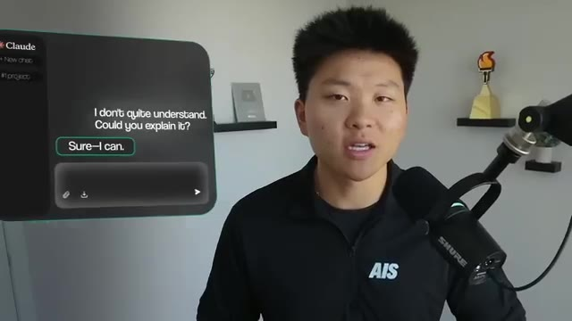
*⏱️ 00:08:20 — Incrustation d'une interface de chat Claude affichant une conversation illustrant une demande d'explication.*

---

### ⏱️ `[00:08:30 - 00:08:50]` | Segment #23

**🔊 Audio (Transcription Intégrale Mot pour Mot en Français) :**
> Et c'est littéralement comme ça que j'ai fini par faire tourner toute mon entreprise grâce à Claude, une tâche à la fois. Et si vous voulez un raccourci pour tout ça, j'ai tout mis dans ma communauté FreeSchool. Le lien pour ça se trouve en bas dans la description. Si vous n'avez jamais ouvert Claude auparavant, il y a un défi de sept jours à l'intérieur qui vous guide pas à pas à travers votre première tâche. La compétence de roast que j'ai mentionnée plus tôt, elle s'y trouve aussi, totalement gratuitement. Et c'est littéralement juste un fichier que vous déposez dans Claude, et il fait tourner tout ce conseil pour vous automatiquement.

**👁️ Analyse Visuelle d'Écran (gemini-3.5-flash-lite) :**
**Interface & Outils** : Navigateur web affichant la plateforme Skool (AI Automation Society).

**Contenu textuel & Code** : Cours de la communauté Skool, lien Google Drive pour les ressources et fichiers Markdown ("SKILL (roast).md", "SKILL (handoff).md").

**Action / Démonstration** : Navigation et présentation de la communauté Skool et des ressources partagées.

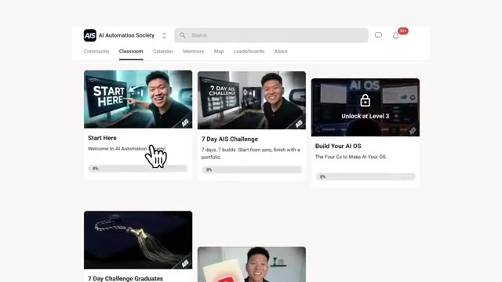
*⏱️ 00:08:40 — Interface de la plateforme Skool "AI Automation Society" montrant la section Classroom avec plusieurs cours et un curseur de souris pointant sur "Start Here".*

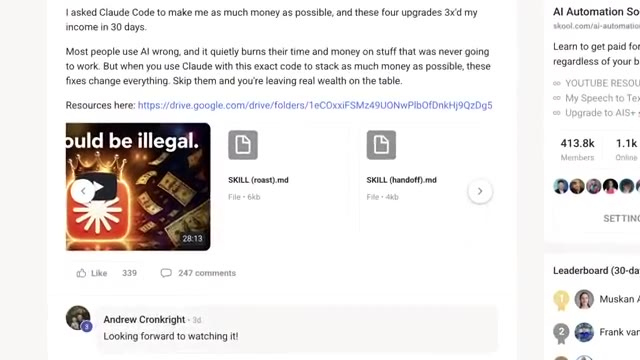
*⏱️ 00:08:45 — Publication dans la communauté Skool montrant un lien Google Drive et des fichiers de ressources téléchargeables nommés "SKILL (roast).md" et "SKILL (handoff).md".*

---

### ⏱️ `[00:08:50 - 00:09:08]` | Segment #24

**🔊 Audio (Transcription Intégrale Mot pour Mot en Français) :**
> Et ensuite, vous voudrez probablement l'ouvrir et le personnaliser un peu pour votre propre cas d'usage. Mais encore une fois, vous pouvez demander à Claude de le faire. Et puis, lorsque vous êtes prêts à aller plus loin, au sein de ma communauté FreeSchool, il y a aussi un cours gratuit sur la création de ce que j'appelle un système d'exploitation IA, qui est fondamentalement la version complète de tout ce dont j'ai parlé dans cette vidéo. Et c'est ainsi que je gère toutes mes entreprises grâce à Claude Code. Entièrement sans code. Vous n'avez pas besoin de savoir coder.

**👁️ Analyse Visuelle d'Écran (gemini-3.5-flash-lite) :**
**Interface & Outils** : Navigateur web, VS Code / Obsidian, Terminal Claude

**Contenu textuel & Code** : Plateforme de cours FreeSchool, graphe de réseau de concepts IA, et rapport d'ingestion de données avec Claude.

**Action / Démonstration** : Navigation sur la plateforme de la communauté et présentation d'une interface de développement avec graphe relationnel.

*⏱️ 00:08:59 — Interface web d'une plateforme de cours en ligne avec un aperçu du contenu verrouillé.*

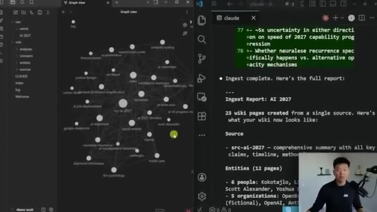
*⏱️ 00:09:04 — Interface partagée montrant un graphe de connaissances à gauche et VS Code / terminal Claude à droite.*

---

### ⏱️ `[00:09:09 - 00:09:27]` | Segment #25

**🔊 Audio (Transcription Intégrale Mot pour Mot en Français) :**
> Il suffit de savoir réfléchir clairement. Et écoutez, la fenêtre dont nous venons de parler est bien réelle, mais vous n'avez pas besoin de construire le prochain Vulkan ce week-end. Juste 20 dollars pour l'abonnement et une seule tâche. C'est toute la barrière à l'entrée en ce moment. Cela vous placera devant 95 % des gens dans le monde en ce moment. Mais bref, c'est tout pour celui-ci. Donc si vous avez apprécié ou si vous avez appris quelque chose de nouveau, n'hésitez pas à mettre un pouce bleu. Ça m'aide vraiment énormément.

**👁️ Analyse Visuelle d'Écran (gemini-3.5-flash-lite) :**
**Interface & Outils** : Aucune interface logicielle montrée.

**Contenu textuel & Code** : Aucun code ou terminal affiché.

**Action / Démonstration** : Aucune action technique présentée.

---

### ⏱️ `[00:09:28 - 00:09:36]` | Segment #26

**🔊 Audio (Transcription Intégrale Mot pour Mot en Français) :**
> J'ai des tonnes de vidéos sur ma chaîne sur la façon de construire réellement avec Cloud Code. Alors, allez-y et plongez dedans. Et comme toujours, je vous remercie d'être arrivés jusqu'à la fin de la vidéo. Je vous vois dans la prochaine. Merci à tous.

**👁️ Analyse Visuelle d'Écran (gemini-3.5-flash-lite) :**
**Interface & Outils** : Interface YouTube / Aucun outil de développement actif.

**Contenu textuel & Code** : Aucun code source, terminal ou prompt visible.

**Action / Démonstration** : Le présentateur conclut la vidéo face caméra.

---

