# 🎬 How I Make Opus Think Like Fable (5 easy steps)

> **Chaîne** : [Nate Herk | AI Automation](https://www.youtube.com/@nateherk/featured)  
> **Lien YouTube** : [https://www.youtube.com/watch?v=XTBWVVcF3Pk](https://www.youtube.com/watch?v=XTBWVVcF3Pk)  
> **Date de publication** : 20260707  
> **Durée** : 00:09:59  
> **Identifiant vidéo** : `XTBWVVcF3Pk`  
> **Transcription & Analyse** : `whisper-v3-large-turbo+gemini-3.5-flash-lite`  

---

## 📌 Synthèse Exécutive & Outils

### 💡 Résumé
Dans cette vidéo intitulée **Comment je fais penser Opus comme Fable (5 étapes simples)**, Nate Herk décortique les capacités pratiques d'automatisation et de développement propulsées par les modèles de pointe.

### 🛠️ Outils, Modèles & Logiciels Présentés
- **Opus 5.5 & Claude Code** : Modèles d'ingénierie et agents de codage autonome.

### 🔑 Points Clés & Enseignements Stratégiques
- Optimiser le niveau d'effort et le raisonnement des modèles IA pour des résultats industriels.
- Automatiser les cycles de création logicielle de bout en bout.

---

## ⏱️ Chronologie & Transcription Complète Audio & Visuelle (Mot pour Mot)

### ⏱️ `[00:00:00 - 00:00:36]` | Segment #01

**🔊 Audio (Transcription Intégrale Mot pour Mot en Français) :**
> Depuis que nous avons tous eu accès à Fable 5, j'ai dépensé quelques milliers de dollars en crédits d'utilisation, juste en faisant des tests, en comprenant comment il fonctionne, et en comprenant, plus important encore, comment nous, en tant qu'êtres humains, pouvons tirer le meilleur parti d'un modèle aussi puissant. Et je pense que l'un des enseignements les plus importants que j'en ai tirés, c'est que, oui, Fable 5 est un modèle incroyable, ne me faites pas dire ce que je n'ai pas dit, mais le modèle n'est pas vraiment le véritable avantage concurrentiel. Alors, voyez les choses ainsi. Vous avez un débutant en IA et vous avez quelqu'un comme Andrej Karpathy, par exemple. Si vous donnez Fable 5 au débutant et que vous donnez Sonnet 3.7 à Karpathy, Karpathy construira quelque chose de mieux que le débutant, même si le modèle du débutant est exponentiellement meilleur. Et c'est dû au fait que c'est bien plus

**👁️ Analyse Visuelle d'Écran (gemini-3.5-flash-lite) :**
**Interface & Outils** : Navigateur web affichant une page d'annonces officielle.

**Contenu textuel & Code** : Texte de l'annonce concernant le redéploiement de Claude Fable 5 et Mythos 5 suite à la levée des contrôles à l'exportation.

**Action / Démonstration** : Le présentateur commente l'actualité et les annonces concernant Fable 5.

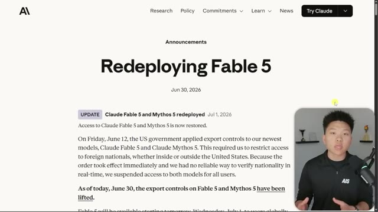
*⏱️ 00:00:09 — Capture d'écran montrant une page web officielle d'annonce intitulée "Redeploying Fable 5" avec une petite incrustation vidéo du présentateur en bas à droite.*

---

### ⏱️ `[00:00:36 - 00:00:57]` | Segment #02

**🔊 Audio (Transcription Intégrale Mot pour Mot en Français) :**
> important la manière dont vous l'instruisez et les systèmes que vous construisez et les boucles que vous construisez autour du modèle. Voici un autre exemple auquel je veux que vous pensiez. J'ai évidemment testé Fable 5 énormément. J'ai aussi testé Opus énormément et Sonnet énormément. L'une de mes choses préférées à faire ces derniers temps est d'utiliser les flux de travail dynamiques que CloudCode nous permet, vous savez, de lancer. Et j'ai fait énormément de flux de travail dynamiques où j'ai dit, hé, Fable, conçois un flux de travail, et ensuite tous vos petits sous-agents, faites en sorte que ce soit Fable également.

**👁️ Analyse Visuelle d'Écran (gemini-3.5-flash-lite) :**
**Interface & Outils** : Interface web de présentation

**Contenu textuel & Code** : Texte centré "Keep the Best of Fable", sous-titres sur le passage au pay-per-use, et section "Teacher, not workhorse" en dessous.

**Action / Démonstration** : Présentation visuelle d'un article ou d'une page de notes sur Fable et Claude Code.

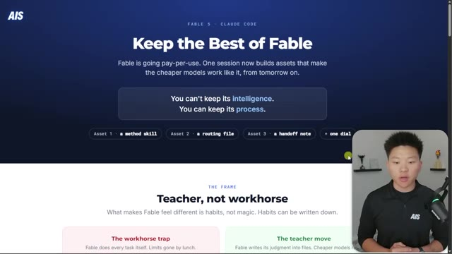
*⏱️ 00:00:41 — Capture d'écran montrant une page web intitulée "Keep the Best of Fable" avec le présentateur incrusté en bas à droite.*

---

### ⏱️ `[00:00:58 - 00:01:16]` | Segment #03

**🔊 Audio (Transcription Intégrale Mot pour Mot en Français) :**
> Et ensuite, je ferais exactement les mêmes tests avec Fable orchestrant un groupe de sous-agents Opus et Fable orchestrant un groupe d'agents Sonnet. Et ce que j'ai découvert, c'est que lorsque j'exécute ces flux de travail dynamiques, les résultats sont à peu près les mêmes, même si les exécutions de Fable m'ont coûté exponentiellement plus cher. Donc de toute façon, le point que j'essaie de faire valoir, c'est que vous ne pouvez pas conserver l'intelligence du modèle, mais vous pouvez conserver son processus.

**👁️ Analyse Visuelle d'Écran (gemini-3.5-flash-lite) :**
**Interface & Outils** : Interface web de présentation (Fable / Claude Code).

**Contenu textuel & Code** : Titres et texte explicatif sur Fable, mentionnant le passage au pay-per-use et les composants "a method skill", "a routing file", "a handoff note".

**Action / Démonstration** : Affichage des explications textuelles relatives à l'utilisation et la tarification de Fable.

*⏱️ 00:01:11 — Interface web présentant les concepts de Fable et Claude Code avec des sections textuelles explicatives et une incrustation vidéo du présentateur.*

---

### ⏱️ `[00:01:16 - 00:01:38]` | Segment #04

**🔊 Audio (Transcription Intégrale Mot pour Mot en Français) :**
> Alors aujourd'hui, ce dont je veux parler, c'est essentiellement, et très rapidement, de comment vous pouvez transformer un modèle comme Opus en quelque chose qui ressemble davantage à Fable ? Et la première chose, c'est qu'il faut considérer ce modèle plutôt comme un enseignant que comme un bourreau de travail. Quand nous avons tous eu accès à Fable, je pense que nous étions essentiellement en train de le pousser dans ses retranchements. Et Anthropic a même publié des choses sur le fait de voir à quel point il est vraiment bon pour de longues tâches, vous savez, travailler vers un objectif, le planifier, l'exécuter, puis le vérifier.

**👁️ Analyse Visuelle d'Écran (gemini-3.5-flash-lite) :**
**Interface & Outils** : Interface web de présentation / slide explicative

**Contenu textuel & Code** : Schéma comparatif entre Fable (exécution directe des tâches) et l'approche 'Teacher move' (utilisation de fichiers Markdown et de modèles moins coûteux comme Opus/Sonnet)

**Action / Démonstration** : Le présentateur explique la différence conceptuelle entre traiter un modèle comme un exécutant ou comme un enseignant.

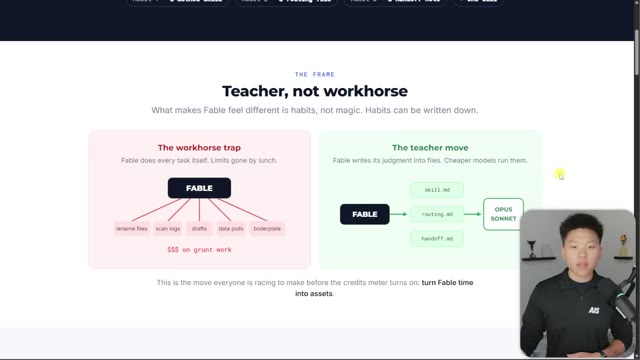
*⏱️ 00:01:22 — Capture d'écran montrant une présentation visuelle avec le titre 'Teacher, not workhorse' et deux schémas comparant 'The workhorse trap' et 'The teacher move', avec le présentateur visible en bas à droite.*

---

### ⏱️ `[00:01:38 - 00:02:13]` | Segment #05

**🔊 Audio (Transcription Intégrale Mot pour Mot en Français) :**
> Et c'est vraiment très bon pour ça. Mais toute l'idée du routage de modèles consiste fondamentalement à trouver cet équilibre, vous savez, cette tâche demande tant d'intelligence. Alors pourquoi auriez-vous besoin d'un modèle qui a tant d'intelligence et qui vous coûte si cher pour quelque chose pour lequel vous pourriez prendre un modèle beaucoup plus petit et moins cher, et accomplir la tâche avec le même niveau de qualité. Et c'est tout l'enjeu. Et ce sera une compétence très importante à maîtriser à mesure que nous avançons dans les prochaines années de l'IA. Donc, plutôt que de laisser Fable tout planifier et tout faire, nous essayons d'extraire la façon dont Fable pense, puis de laisser d'autres modèles plus petits penser de la même manière et exécuter ainsi. J'ai demandé à Fable de

**👁️ Analyse Visuelle d'Écran (gemini-3.5-flash-lite) :**
**Interface & Outils** : Page web explicative avec schémas de workflow.

**Contenu textuel & Code** : Schéma comparant "The workhorse trap" (utilisation d'un modèle unique et coûteux pour toutes les tâches) et "The teacher move" (utilisation de modèles moins chers guidés par des fichiers de configuration comme skill.md, routing.md, handoff.md).

**Action / Démonstration** : Le présentateur explique visuellement le concept d'optimisation des coûts et de routage des modèles d'IA.

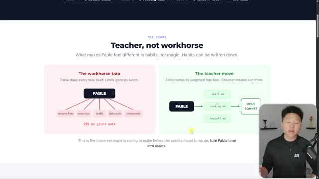
*⏱️ 00:01:56 — Une page web présentant un schéma comparatif intitulé "Teacher, not workhorse" illustrant le concept de routage de modèles et d'optimisation des coûts.*

---

### ⏱️ `[00:02:13 - 00:02:49]` | Segment #06

**🔊 Audio (Transcription Intégrale Mot pour Mot en Français) :**
> à travers mes configurations et apporter des améliorations et parcourir mes compétences et les améliorer. Et j'ai réalisé que je traitais simplement Fable un peu comme un cofondateur ou plutôt comme un dirigeant de mon entreprise plutôt que simplement comme un employé. Un peu comme un ingénieur senior qui est sur le point de prendre sa retraite et qui essaie de regrouper tout ce qu'il sait pour le transmettre à la nouvelle cohorte d'ingénieurs juniors qui va arriver ou entrer et prendre sa place. Donc une chose qui s'est produite récemment, c'est que les invites système ont fuitées de Cloud Fable 5. J'ai donc lu tout cela. J'ai fait lire tout cela à Fable 5 et nous avons relevé des éléments importants que nous avons remarqués dans cette invite elle-même. La reconnaissance partielle de l'entraînement ne signifie pas la connaissance actuelle, ce qui signifie juste

**👁️ Analyse Visuelle d'Écran (gemini-3.5-flash-lite) :**
**Interface & Outils** : Interface de présentation de workflow (Image 1), Éditeur de fichiers markdown / Interface de gestion de connaissances (Image 3).

**Contenu textuel & Code** : "The workhorse trap" vs "The teacher move", schémas de flux de données (Skill, Routing, Handoff), contenu textuel sur les protocoles de bien-être utilisateur pour Claude.

**Action / Démonstration** : Illustration conceptuelle du changement de paradigme dans la gestion d'un agent IA, puis démonstration de la documentation structurée encadrant le comportement d'un modèle.

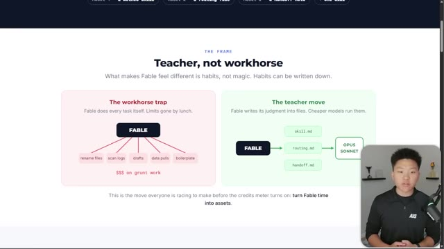
*⏱️ 00:02:22 — Une diapositive intitulée "Teacher, not workhorse" comparant deux approches : le piège du "workhorse" (Fable exécute toutes les tâches) et la stratégie du "teacher" (Fable crée des fichiers de compétences et de routage pour guider Opus/Sonnet).*

*⏱️ 00:02:40 — Une interface de gestion de fichiers (type éditeur de code ou système de documentation) affichant le contenu du fichier `CLAUDE-FABLE-5.md` traitant des directives sur le "user_wellbeing" et les limitations de diagnostic de l'IA.*

---

### ⏱️ `[00:02:49 - 00:03:12]` | Segment #07

**🔊 Audio (Transcription Intégrale Mot pour Mot en Français) :**
> because something's in your memory, you should probably verify it. Very similarly over here, a prompt implying a file is present doesn't mean one is, so it's told to check that things actually exist. So basically, making sure at every step of the way that what it's doing and what it's done is accurate. Address even an ambiguous query before asking for clarification. So answer first, then ask. One question max. Acknowledge what went wrong. Stay on the problem. Maintain self-respect.

**👁️ Analyse Visuelle d'Écran (gemini-3.5-flash-lite) :**
**Interface & Outils** : Présentation web / Slide éducatif.

**Contenu textuel & Code** : Liste de règles de comportement pour l'IA, notamment : "It's told not to trust its own memory", "It's told to check that things actually exist", "Answer first, then ask", "Own the mistake, skip the apology spiral", et "Effort is budgeted, not vibes".

**Action / Démonstration** : Le présentateur illustre les principes de vérification et de gestion des erreurs dans les systèmes prompts des agents IA.

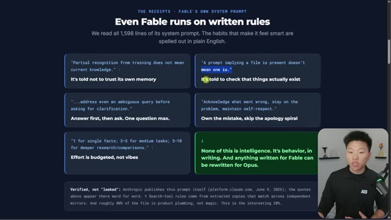
*⏱️ 00:02:54 — Une diapositive de présentation sombre détaillant les règles du "système prompt" de Fable, avec une mise en avant textuelle des comportements de l'IA.*

---

### ⏱️ `[00:03:12 - 00:03:31]` | Segment #08

**🔊 Audio (Transcription Intégrale Mot pour Mot en Français) :**
> un pour les faits précis, trois à cinq pour les tâches moyennes, cinq à dix pour des recherches et des comparaisons plus approfondies. Donc, on parle essentiellement d'effort. Donc oui, nous avons la discussion sur le modèle qui convient à la tâche, mais nous avons également la discussion sur le niveau d'effort qui convient à la tâche. Et quelque chose que j'aime examiner, c'est cet exemple, qui était sur le blog de sortie de Claude Fable 5 et Mythos 5.

**👁️ Analyse Visuelle d'Écran (gemini-3.5-flash-lite) :**
**Interface & Outils** : Interface web (plateforme de documentation/recherche sur l'IA).

**Contenu textuel & Code** : - Image #1 : Liste des directives système : "1 for single facts; 3-5 for medium tasks; 5-10 for deeper research/comparisons." avec le commentaire "Effort is budgeted, not vibes".
- Image #2 : Graphique en nuage de points avec courbes de tendance comparant les performances des modèles selon le coût moyen par tâche en USD.

**Action / Démonstration** : Présentation théorique et analytique des mécanismes internes de "Fable" et des données de performance comparées des modèles d'IA.

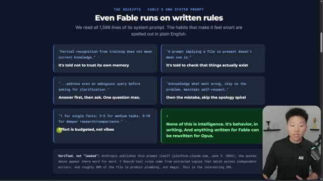
*⏱️ 00:03:17 — Une capture d'écran présentant les règles du système de "Fable", incluant une section sur la budgétisation de l'effort pour différentes tâches.*

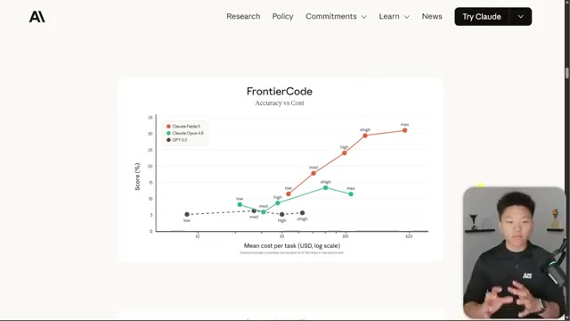
*⏱️ 00:03:26 — Un graphique comparatif intitulé "FrontierCode" montrant le rapport "Précision vs Coût" pour différents modèles d'IA (Claude Fable 5, Claude Opus 4.8, GPT-5.5).*

---

### ⏱️ `[00:03:31 - 00:03:52]` | Segment #09

**🔊 Audio (Transcription Intégrale Mot pour Mot en Français) :**
> Donc, cela compare Fable 5 et Opus 4.8, ainsi que GBT 5.5 en ce qui concerne le score sur l'axe des y, le coût sur l'axe des x, et ensuite nous voyons chacun de ces modèles et nous voyons différents niveaux d'effort. Donc si vous faites partie de ces personnes qui ont simplement activé Fable 5 et que vous l'utilisez simplement au niveau d'effort par défaut ou de même avec Opus et que vous ne jouez jamais avec ceux-ci, alors commencez définitivement à essayer, car cela devient un peu intéressant.

**👁️ Analyse Visuelle d'Écran (gemini-3.5-flash-lite) :**
**Interface & Outils** : Page web de documentation ou de recherche (probablement Anthropic).

**Contenu textuel & Code** : Graphique de dispersion avec des courbes de tendance pour chaque modèle, annotées avec des niveaux d'effort (low, med, high, shigh, max). Le modèle Claude Fable 5 (en rouge) affiche les performances les plus élevées en termes de score par rapport au coût.

**Action / Démonstration** : Présentation visuelle comparative des performances et de l'efficience des modèles d'IA pour des tâches de codage.

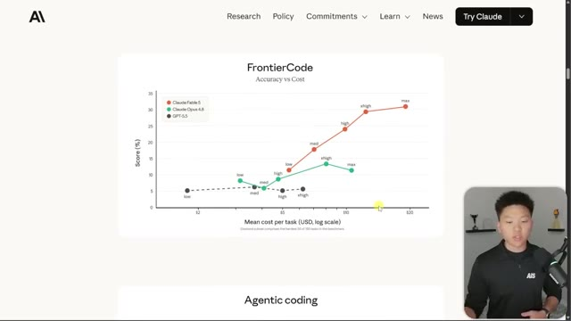
*⏱️ 00:03:36 — Un graphique intitulé "FrontierCode" comparant l'exactitude (Score %) en fonction du coût (Mean cost per task) pour trois modèles : Claude Fable 5, Claude Opus 4.8 et GPT-5.5.*

---

### ⏱️ `[00:03:53 - 00:04:28]` | Segment #10

**🔊 Audio (Transcription Intégrale Mot pour Mot en Français) :**
> Comme ici, vous remarquerez que Fable 5 en low est assez similaire à Opus 4.8 en high. Maintenant, Fable 5 est un peu plus cher et d'une qualité un peu plus élevée comme vous pouvez le voir ici, mais ils sont plutôt similaires. Mais cela ne veut pas toujours dire qu'un effort plus élevé est réellement meilleur. Il m'est arrivé bien des fois où, avec Fable, je l'utilise juste basiquement en high parce que quand j'utilise extra high ou max, ou même sur Opus, quand j'utilise extra high ou max, ça commence à être beaucoup plus long, à devenir bien plus cher. Et puis il réfléchit trop et, vous savez, il doute de lui-même. Et il finit par produire quelque chose de pire que si j'avais simplement opté pour Opus 4.8 en high ou Fable en high. Quoi qu'il en soit, après avoir lu le prompt système

**👁️ Analyse Visuelle d'Écran (gemini-3.5-flash-lite) :**
**Interface & Outils** : Graphique de données statique présenté en surimpression vidéo.

**Contenu textuel & Code** : Courbes de performance pour "Claude Fable 5" (rouge), "Claude Opus 4.8" (vert) et "GPT-5.5" (noir) sur une échelle logarithmique.

**Action / Démonstration** : Le présentateur utilise son curseur pour pointer sur le graphique afin d'illustrer la comparaison de performance entre Fable 5 en "low" et Opus 4.8 en "high".

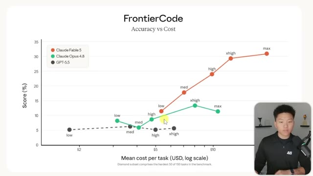
*⏱️ 00:04:01 — Un graphique comparatif intitulé "FrontierCode" montrant le rapport entre la précision (Score %) et le coût moyen par tâche pour trois modèles d'IA.*

---

### ⏱️ `[00:04:28 - 00:04:53]` | Segment #11

**🔊 Audio (Transcription Intégrale Mot pour Mot en Français) :**
> et après avoir joué avec les modèles pendant si longtemps, il y a deux choses que je veux que vous fassiez. La première, c'est en gros de prendre la façon dont vous avez joué avec Fable et le harness, ou peu importe comment vous voulez l'appeler, quelle que soit la manière dont vous l'avez utilisé, et de transformer cela en quelque chose qu'Opus peut faire et que Sonic peut faire. Donc, en gros, nous extrayons la méthode Fable. Maintenant, une chose que je vous encouragerais à faire, c'est que si vous avez déjà obtenu un livrable de Fable que vous avez tout simplement adoré sans pouvoir vraiment expliquer ce que vous aimiez là-dedans, faites-le analyser par Fable ou faites-le analyser par Opus.

**👁️ Analyse Visuelle d'Écran (gemini-3.5-flash-lite) :**
**Interface & Outils** : Présentation graphique (type slide ou document de travail) affichée à l'écran.

**Contenu textuel & Code** : Schéma de workflow : "1. Scope, 2. Evidence, 3. Attack, 4. Verify, 5. Report". Bloc de texte : "Write a complete, installable skill file that makes Opus 4.8 operate with your judgment... Add activation triggers like 'fable mode'".

**Action / Démonstration** : Présentation théorique du workflow de l'agent IA et du prompt spécifique pour créer un fichier de compétence ("skill file") automatisé.

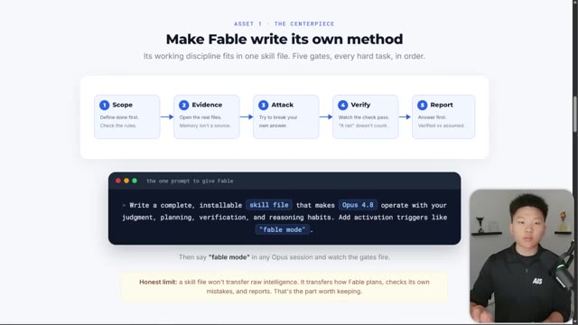
*⏱️ 00:04:34 — Une présentation sous forme de diapositive illustrant le concept "Fable" avec un schéma de processus en 5 étapes (Scope, Evidence, Attack, Verify, Report) et un bloc de code contenant un prompt pour l'IA Opus 4.8.*

---

### ⏱️ `[00:04:54 - 00:05:16]` | Segment #12

**🔊 Audio (Transcription Intégrale Mot pour Mot en Français) :**
> And if you can look back at the session, that's even better. What did you think about to get here? How did you get here? What did you do to prove that it worked? How were you able to get an output that was just so good and then extract that information and turn that into a skill? So I basically have this skill now called Fable Mode. And whenever I want Opus to use Fable Mode, or if we got a really hard problem in front of us, I tried using Opus 4.8 with Fable Mode, and it feels really good.

**👁️ Analyse Visuelle d'Écran (gemini-3.5-flash-lite) :**
**Interface & Outils** : Présentation graphique (type diapositive de cours ou documentation logicielle).

**Contenu textuel & Code** : Diagramme de processus en 5 étapes et un bloc de code contenant le prompt : "Write a complete, installable skill file that makes Opus 4.8 operate with your judgment, planning, verification, and reasoning habits. Add activation triggers like 'fable mode'".

**Action / Démonstration** : Explication du concept de "Fable" et démonstration visuelle de la méthode de travail structurée pour automatiser le comportement d'un agent IA.

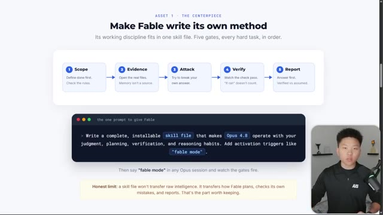
*⏱️ 00:04:59 — Une présentation sous forme de diapositive structurée expliquant le workflow "Fable" avec cinq étapes (Scope, Evidence, Attack, Verify, Report) et un bloc de code illustrant le prompt utilisé pour créer un "skill file" destiné à Opus 4.8.*

---

### ⏱️ `[00:05:16 - 00:05:37]` | Segment #13

**🔊 Audio (Transcription Intégrale Mot pour Mot en Français) :**
> It just feels like the model has been elevated a little bit because it has this Fable prompt kind of injected into it. And it works on these five gates. So scoping, evidence, attacking, verifying, and then reporting. And this is almost like the way you set your slash goal prompts and you use dynamic workflows and you basically set these loops, but we're doing this as a skill file as well.

**👁️ Analyse Visuelle d'Écran (gemini-3.5-flash-lite) :**
**Interface & Outils** : Présentation de type diaporama ou interface web pédagogique.

**Contenu textuel & Code** : Schéma de workflow montrant les 5 étapes : « Scope » (Define done first), « Evidence » (Open the real files), « Attack » (Try to break your own answer), « Verify » (Watch the check pass), « Report » (Answer first). Inclut un bloc de code illustrant un prompt : « Write a complete, installable skill file that makes Opus 4.8 operate with your judgment... ».

**Action / Démonstration** : Explication théorique et démonstration du concept de « Fable » pour structurer le raisonnement d'un agent IA.

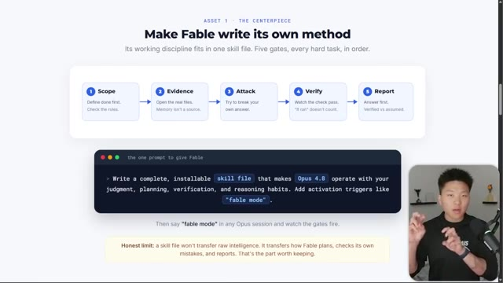
*⏱️ 00:05:21 — Une présentation visuelle détaillée expliquant le framework « Fable » structuré en cinq étapes (Scope, Evidence, Attack, Verify, Report) et un exemple de prompt système pour configurer Opus 4.8.*

---

### ⏱️ `[00:05:37 - 00:05:55]` | Segment #14

**🔊 Audio (Transcription Intégrale Mot pour Mot en Français) :**
> Now, one really important thing about scoping and what people call like planning is there's a big difference between just planning something out as far as like, hey, here are all the steps, plan that out and go do it. And then there's also the idea of playing devil's advocate and thinking about, okay, what about everything that could possibly go wrong? What if we explore all of the unknowns in this plan?

**👁️ Analyse Visuelle d'Écran (gemini-3.5-flash-lite) :**
**Interface & Outils** : Aucune.

**Contenu textuel & Code** : Aucun.

**Action / Démonstration** : Le présentateur s'adresse directement à son audience.

---

### ⏱️ `[00:05:56 - 00:06:17]` | Segment #15

**🔊 Audio (Transcription Intégrale Mot pour Mot en Français) :**
> And that is something that Fable does a really good job at, which is why if I have Fable spin up a dynamic workflow to help me achieve some end goal, and then once it's planned out every single possible step and it thinks about every single thing that could go wrong and then designs the dynamic workflow in a way where Sonnet can go do all the execution and just report back to Fable and keep sending everything back to Fable, then Fable can keep designing more steps in that process.

**👁️ Analyse Visuelle d'Écran (gemini-3.5-flash-lite) :**
**Interface & Outils** : Aucune interface affichée.

**Contenu textuel & Code** : Aucun contenu textuel ou technique visible.

**Action / Démonstration** : Le présentateur gesticule en expliquant le fonctionnement de l'outil Fable.

---

### ⏱️ `[00:06:17 - 00:06:52]` | Segment #16

**🔊 Audio (Transcription Intégrale Mot pour Mot en Français) :**
> And that is why when I do dynamic workflows with Fable and Sonnet, it's pretty similar to results when I do dynamic workflows with Fable and Fable. And to me, that was a big like light bulb moment. Like why is this just as good and it's significantly cheaper? So you can just start by saying something like, this. Write a complete installable skill file that makes Opus 4.8 operate with your judgment, your planning, verification, and reasoning habits, and activate it on something like Fable Mode. So for example, right here you can see this is my Fable Mode skill, which I'll attach in my FreeSchool community completely for free. The link for that is down in the description. Just join this and then go to the classroom and click on all YouTube resources and you can find everything I've ever

**👁️ Analyse Visuelle d'Écran (gemini-3.5-flash-lite) :**
**Interface & Outils** : Visual Studio Code (VS Code), interface de présentation web (diapositive de workflow).

**Contenu textuel & Code** : "fable-mode", méthodologie des "cinq portes" (Five gates), instructions pour le skill file (Scope, Evidence, Attack, Verify, Report), code Markdown pour l'automatisation IA.

**Action / Démonstration** : Explication théorique du fonctionnement du "Fable mode" et démonstration du code source du fichier de compétences associé.

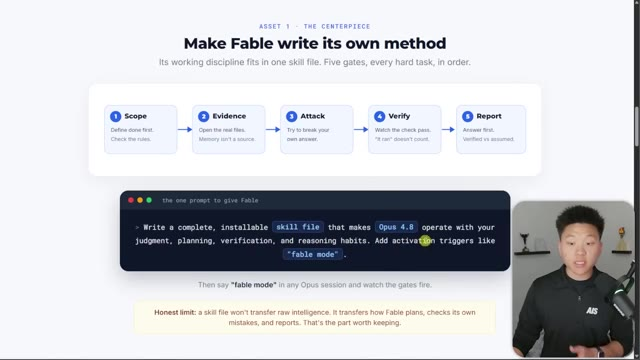
*⏱️ 00:06:35 — Présentation visuelle du workflow "Fable" structuré en 5 étapes clés (Scope, Evidence, Attack, Verify, Report) et une zone de saisie pour le "skill file" destiné à Opus 4.8.*

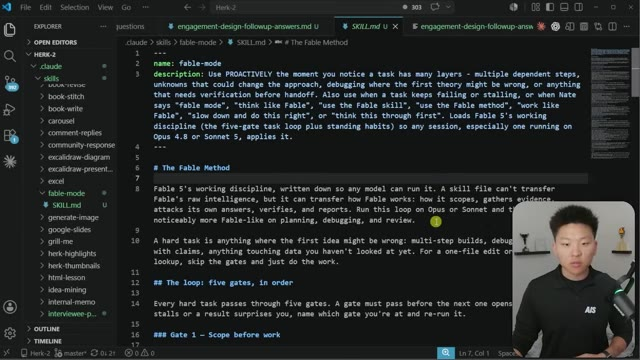
*⏱️ 00:06:44 — Éditeur VS Code affichant le contenu du fichier "SKILL.md" définissant le "fable-mode" et les instructions de méthodologie pour les modèles IA (Opus ou Sonnet).*

---

### ⏱️ `[00:06:52 - 00:07:18]` | Segment #17

**🔊 Audio (Transcription Intégrale Mot pour Mot en Français) :**
> dropped on YouTube for free. So that's where you'll find the Fable Mode skill, but you can also just build this yourself. And you can see here that this walks through Fable's working discipline so that any model can run it, which means you could even have GPT 5.5 run this if you want, or even open source models run this if you want. Anyways, it basically goes through those five gates. So scoping before you work, and then we get into details, evidence before reasoning, reasoning adversarially, verifying before declaring done, and then calibrating.

**👁️ Analyse Visuelle d'Écran (gemini-3.5-flash-lite) :**
**Interface & Outils** : VS Code (Visual Studio Code)

**Contenu textuel & Code** : Contenu textuel structuré (Markdown) décrivant les instructions de "fable-mode" : "Fable 5's working discipline", "The loop: five gates", et "Gate 1 - Scope before work".

**Action / Démonstration** : Affichage et lecture de la documentation technique de la compétence (skill) d'automatisation dans le panneau de l'éditeur de code.

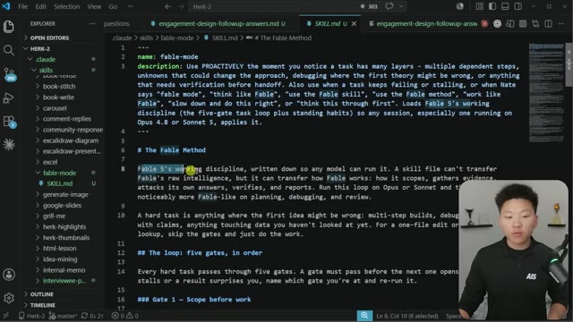
*⏱️ 00:06:59 — Une capture d'écran de l'éditeur VS Code affichant un fichier Markdown nommé "SKILL.md" qui définit la "Fable Method", une méthodologie de travail structurée pour les agents IA.*

---

### ⏱️ `[00:07:18 - 00:07:40]` | Segment #18

**🔊 Audio (Transcription Intégrale Mot pour Mot en Français) :**
> We've also got a few standing habits and a few things to look at, which, like I said, you guys can inspect this file if you want to, but this being given to Opus 4.8 makes Opus feel, like I said, a little bit elevated. So that has been a really helpful strategy. And then something that bolts right onto that really well is just, once again, the idea of model routing and figuring out how Fable or how some smart model can route to the small ones when needed.

**👁️ Analyse Visuelle d'Écran (gemini-3.5-flash-lite) :**
**Interface & Outils** : VS Code (Image 1), Interface de présentation/document web (Image 2).

**Contenu textuel & Code** : Documentation technique sur la discipline de travail "Fable 5" (Image 1) ; Diagramme hiérarchique et tableau comparatif des modèles selon les critères : Coût, Intelligence, Goût (Image 2).

**Action / Démonstration** : Présentation des stratégies d'optimisation et de routage des tâches vers les modèles LLM les plus adaptés.

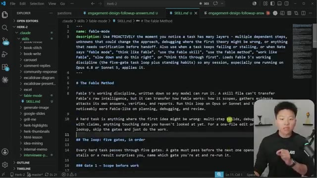
*⏱️ 00:07:23 — Éditeur VS Code affichant un fichier Markdown nommé "SKILL.md" détaillant "The Fable Method" et ses principes de fonctionnement pour les modèles IA.*

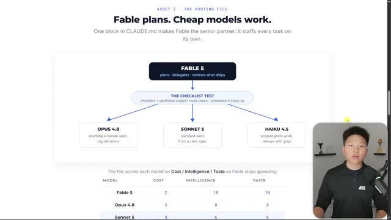
*⏱️ 00:07:35 — Slide de présentation illustrant un diagramme de flux décisionnel pour le routage des tâches entre les modèles (Fable 5, Opus 4.8, Sonnet 5, Haiku 4.5) basé sur un test de checklist.*

---

### ⏱️ `[00:07:41 - 00:08:01]` | Segment #19

**🔊 Audio (Transcription Intégrale Mot pour Mot en Français) :**
> And something that I've been doing lately has been giving my Claude basically a table of different models that are in the toolkit and when to use them. So you could also have it delegate to codecs or you could have it delegate to open source models. And this, like I said, is something that's going to be very, very big when companies are starting to think about the unit economics and small teams and you yourself, maybe you have an AI budget per month.

**👁️ Analyse Visuelle d'Écran (gemini-3.5-flash-lite) :**
**Interface & Outils** : Navigateur web affichant un document de planification ou une page de documentation technique.

**Contenu textuel & Code** : Diagramme de flux logique, tableau de notation des modèles (Fable 5, Opus 4.8, Sonnet 5, Haiku 4.5) et bloc de texte détaillant une méthodologie de gestion d'erreurs ("The Brief - Make the plan expect trouble").

**Action / Démonstration** : Présentation visuelle de la stratégie de délégation de tâches entre différents modèles IA en fonction de leurs performances relatives.

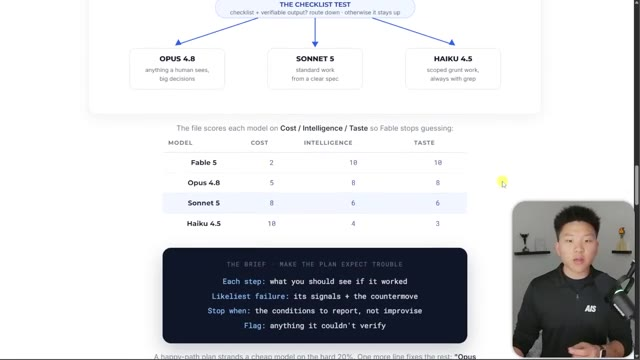
*⏱️ 00:07:46 — Un schéma décisionnel "The Checklist Test" dirigeant vers trois modèles (Opus 4.8, Sonnet 5, Haiku 4.5) suivi d'un tableau comparatif évaluant ces modèles selon trois critères : Coût, Intelligence et Goût (Taste).*

---

### ⏱️ `[00:08:01 - 00:08:20]` | Segment #20

**🔊 Audio (Transcription Intégrale Mot pour Mot en Français) :**
> This is the type of stuff that's gonna separate people that are getting a ton more for a ton less. So a good way to split this up is basically saying, okay, here are the different models in our toolkit. Here's how much they cost, a higher number meaning a better cost score, cheaper. And then we have intelligence and taste. And if you wanna throw in some other categories that are based on your workflow, feel free.

**👁️ Analyse Visuelle d'Écran (gemini-3.5-flash-lite) :**
**Interface & Outils** : Application web ou document de présentation (type Notion ou site web de documentation).

**Contenu textuel & Code** : Schéma "The Checklist Test" avec des conditions logiques et un tableau de données comparatif classant les modèles IA par métriques chiffrées, ainsi qu'un encadré sombre détaillant une méthodologie de travail ("The Brief / Make the Plan / Expect Trouble").

**Action / Démonstration** : Présentation conceptuelle et analytique des choix de modèles IA en fonction de leurs performances relatives et de leur efficacité économique.

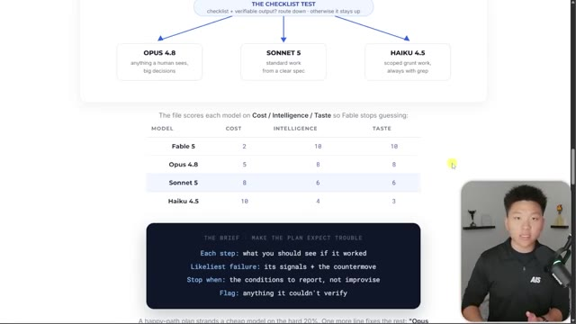
*⏱️ 00:08:06 — Une capture d'écran montrant un schéma de workflow décisionnel pour des modèles IA et un tableau comparatif évaluant les modèles (Fable 5, Opus 4.8, Sonnet 5, Haiku 4.5) selon leur coût, intelligence et "goût" (taste).*

---

### ⏱️ `[00:08:21 - 00:08:47]` | Segment #21

**🔊 Audio (Transcription Intégrale Mot pour Mot en Français) :**
> But intelligence is kind of like how smart you feel like they are, how much they understand you, how good they are at maybe reviewing code and things like that. And then on the taste side, this is what I think more of like the creativity, the thinking out of the box, UI, UX design, things like that. And so this can really help when you're designing these agent teams or you're delegating to sub-agents and you're spinning up dynamic workflows because sometimes your dynamic workflows can utilize a bunch of different Sonnet ones and Haikyuu ones and then even Opus ones as well.

**👁️ Analyse Visuelle d'Écran (gemini-3.5-flash-lite) :**
**Interface & Outils** : Interface de présentation web (probablement un document Notion ou un site de documentation technique).

**Contenu textuel & Code** : Tableau de notation : Fable 5 (Cost: 2, Intelligence: 10, Taste: 10), Opus 4.8 (5, 8, 8), Sonnet 5 (8, 6, 6), Haiku 4.5 (10, 4, 3). Encart textuel : "The Brief: Make the plan expect trouble".

**Action / Démonstration** : Présentation visuelle et comparaison des capacités des modèles d'IA pour orienter le choix d'automatisation.

*⏱️ 00:08:27 — Un tableau comparatif des modèles d'IA (Fable 5, Opus 4.8, Sonnet 5, Haiku 4.5) selon les critères de coût, d'intelligence et de goût, accompagné d'un diagramme de flux décisionnel en haut et d'un encart explicatif sur les étapes de validation ("The Brief").*

---

### ⏱️ `[00:08:47 - 00:09:09]` | Segment #22

**🔊 Audio (Transcription Intégrale Mot pour Mot en Français) :**
> So here's an example of an actual test that I had run where I used Opus as the orchestrator and I used Opus with this prompt from earlier that we talked about. Oh, where is it? Sort of like the Fable mode prompt. and it used a bunch of different sonnet workers and opus workers and haiku workers. And those were three different tests. And the one where the opus orchestrator delegated to all the haiku scouts, it was this much cheaper, you know, about three times cheaper.

**👁️ Analyse Visuelle d'Écran (gemini-3.5-flash-lite) :**
**Interface & Outils** : Interface de présentation web ou document de travail structuré.

**Contenu textuel & Code** : Texte affiché : "THE BRIEF - MAKE THE PLAN EXPECT TROUBLE", instructions détaillées sur la gestion des échecs (Likeliest failure), et résultats de coûts (ex: "$1.47 -> $0.56, 62% cheaper").

**Action / Démonstration** : Analyse et démonstration des résultats d'un test d'orchestration où Opus agit en tant que manager pour déléguer des tâches à des modèles plus légers comme Haiku.

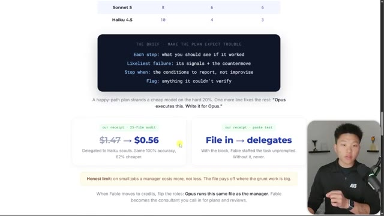
*⏱️ 00:08:52 — Une capture d'écran montrant une présentation structurée d'un workflow d'orchestration IA, incluant un bloc de texte "The Brief" avec des instructions de gestion d'erreurs et des résultats financiers comparatifs entre différents modèles (Haiku, Sonnet).*

---

### ⏱️ `[00:09:09 - 00:09:27]` | Segment #23

**🔊 Audio (Transcription Intégrale Mot pour Mot en Français) :**
> And the result was the exact same. So similar to my example with the Fable ones, that is something to be thinking about big time. So I know this one was quick and I wanted to make it quick, but I've just been seeing a ton of comments and a ton of people in the communities asking about, you know, kind of freaking out about the fact that Fable is going to be taken away. It is going to come back to subscriptions. That's what Anthropics says, at least.

**👁️ Analyse Visuelle d'Écran (gemini-3.5-flash-lite) :**
**Interface & Outils** : Présentation de type deck/slides web analysant l'efficacité opérationnelle des agents IA.

**Contenu textuel & Code** : Texte explicatif sur les stratégies de workflow, comparaison de coûts, et schémas conceptuels de délégation de tâches IA (fichiers skill.md, routing.md, handoff.md).

**Action / Démonstration** : Analyse comparative démontrant comment optimiser les coûts en utilisant des modèles IA comme « enseignants » plutôt que comme simples exécutants.

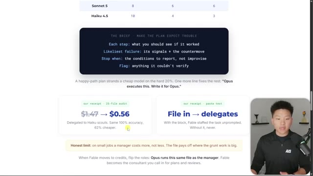
*⏱️ 00:09:14 — Une capture d'écran présentant les résultats d'un audit de 25 fichiers, illustrant une réduction de coût de 1,47 $ à 0,56 $ grâce à la délégation à des modèles plus légers (« Haiku scouts »).*

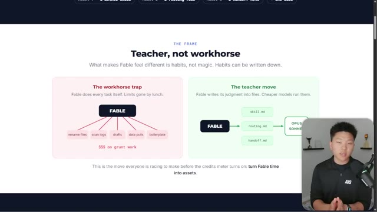
*⏱️ 00:09:18 — Un schéma comparatif intitulé « The Frame: Teacher, not workhorse » illustrant la différence entre une exécution directe par Fable (coûteuse) et une approche déléguée où Fable crée des fichiers de guidage pour Opus ou Sonnet.*

---

### ⏱️ `[00:09:27 - 00:09:46]` | Segment #24

**🔊 Audio (Transcription Intégrale Mot pour Mot en Français) :**
> We don't know when, but it will be back. But all of this, you know, government getting involved and models being taken away stuff really has me thinking about the fact that, you know, we don't own anything. We don't own these models. So what we can own is our processes, our systems, our methodologies, the way that we think about using these models. And also we can own hardware and we can own local models.

**👁️ Analyse Visuelle d'Écran (gemini-3.5-flash-lite) :**
**Interface & Outils** : Interface web (présentation type slide ou article de blog).

**Contenu textuel & Code** : Schémas comparatifs utilisant des blocs de texte et des flèches pour illustrer la transition d'une exécution directe ("Fable") vers une exécution basée sur des fichiers de processus ("skill.md", "routing.md", "handoff.md") pilotant des modèles comme "Opus" ou "Sonnet".

**Action / Démonstration** : Illustration théorique du passage à une architecture d'agent IA basée sur des systèmes et des processus documentés plutôt que sur une exécution monolithique.

*⏱️ 00:09:32 — Une capture d'écran montrant une présentation conceptuelle intitulée "Teacher, not workhorse", comparant deux approches d'automatisation : "The workhorse trap" (tâches centralisées et coûteuses) et "The teacher move" (utilisation de fichiers de méthodologie comme skill.md, routing.md, handoff.md pour guider des modèles plus légers).*

---

### ⏱️ `[00:09:46 - 00:09:59]` | Segment #25

**🔊 Audio (Transcription Intégrale Mot pour Mot en Français) :**
> So I'm definitely gonna be digging into a lot more of this type of stuff. So let me know what you guys wanna see around these topics. But anyways, if you learned something new or you enjoyed the video, please give it a like. It helps me out a ton. and as always I appreciate you guys making this the end of the video and I'll see you on the next one. Thanks everyone.

**👁️ Analyse Visuelle d'Écran (gemini-3.5-flash-lite) :**
**Interface & Outils** : Page web de présentation du framework Fable.

**Contenu textuel & Code** : Schémas conceptuels comparatifs montrant "Fable" effectuant des tâches variées vs "Fable" utilisant des fichiers `.md` (skill.md, routing.md, handoff.md) pour déléguer à Opus/Sonnet.

**Action / Démonstration** : Illustration théorique de l'optimisation des flux de travail IA pour réduire les coûts et améliorer l'efficacité.

*⏱️ 00:09:50 — Une page web illustrant le concept "Teacher, not workhorse" pour Fable, comparant deux approches : le piège du "workhorse" (tâches répétitives directes) et la stratégie du "teacher" (utilisation de fichiers de configuration pour guider des modèles plus économiques).*

---

