# 🎬 Fable 5 Just Built Me a Business With One Prompt

> **Chaîne** : [Nate Herk | AI Automation](https://www.youtube.com/@nateherk/featured)  
> **Lien YouTube** : [https://www.youtube.com/watch?v=R0qF17BVl9w](https://www.youtube.com/watch?v=R0qF17BVl9w)  
> **Date de publication** : 20260708  
> **Durée** : 00:12:28  
> **Identifiant vidéo** : `R0qF17BVl9w`  
> **Transcription & Analyse** : `whisper-v3-large-turbo+gemini-3.5-flash-lite`  

---

## 📌 Synthèse Exécutive & Outils

### 💡 Résumé
Dans cette vidéo intitulée **Fable 5 Just Built Me a Business With One Prompt**, Nate Herk décortique les capacités pratiques d'automatisation et de développement propulsées par les modèles de pointe.

### 🛠️ Outils, Modèles & Logiciels Présentés
- **Opus 5.5 & Claude Code** : Modèles d'ingénierie et agents de codage autonome.

### 🔑 Points Clés & Enseignements Stratégiques
- Optimiser le niveau d'effort et le raisonnement des modèles IA pour des résultats industriels.
- Automatiser les cycles de création logicielle de bout en bout.

---

## ⏱️ Chronologie & Transcription Complète Audio & Visuelle (Mot pour Mot)

### ⏱️ `[00:00:00 - 00:00:18]` | Segment #01

**🔊 Audio (Transcription Intégrale Mot pour Mot en Français) :**
> So I just gave Claude Fable this one slash goal prompt right here. And when it finished, I had a whole company. It spun up hundreds of agents, did a ton of verification, did a ton of research, made videos. And by the end, I got a landing page, a product, launch videos, a business plan, market research, brand guidelines, so much stuff to get a business off the ground.

**👁️ Analyse Visuelle d'Écran (gemini-3.5-flash-lite) :**
**Interface & Outils** : Navigateur web affichant une application web de gestion d'agents IA (Claude Fable / Interface de pilotage).

**Contenu textuel & Code** : Prompt "/goal", statistiques de production (tokens, vérifications), et liens vers des fichiers de projet (.md, .json).

**Action / Démonstration** : Présentation des résultats finaux d'une automatisation complète : de l'idée à la création d'une entreprise avec ses actifs opérationnels.

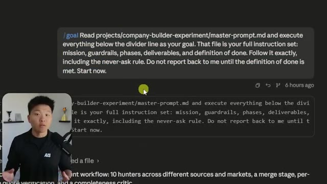
*⏱️ 00:00:05 — Interface montrant le prompt initial "/goal" envoyé à l'IA pour démarrer le processus de création d'entreprise.*

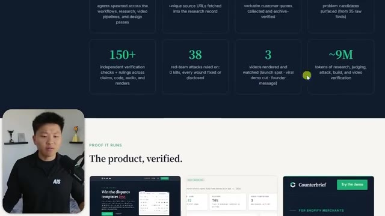
*⏱️ 00:00:09 — Tableau de bord récapitulatif affichant les statistiques de performance : 150+ vérifications, 38 attaques red-team, 3 vidéos générées et 9M de tokens consommés.*

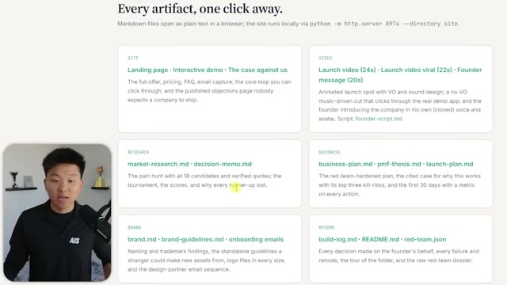
*⏱️ 00:00:14 — Liste exhaustive des livrables générés par les agents, classés par catégories (Site, Vidéo, Recherche, Business, Brand, Record) avec des liens vers les fichiers Markdown.*

---

### ⏱️ `[00:00:18 - 00:00:59]` | Segment #02

**🔊 Audio (Transcription Intégrale Mot pour Mot en Français) :**
> So I'm going to walk through all of this that just happened and explain the prompt to you guys. But let's real quick take a look at this landing page. If I open this up real quick, you can see that we have counter brief, when the disputes templates lose. Now this landing page isn't anything extraordinary, but some of this stuff is pretty cool. Take a look at this launch video that it made for me. Okay, that like dubstep ending is a little bit interesting,

**👁️ Analyse Visuelle d'Écran (gemini-3.5-flash-lite) :**
**Interface & Outils** : Site web vitrine de Counterbrief (landing page) et interface utilisateur interne du logiciel de gestion de litiges.

**Contenu textuel & Code** : Détails financiers et logistiques de litiges de paiement : codes de motif (Visa 10.4), preuves de livraison avec GPS, recommandations de réponse ("FIGHT") et valeur attendue.

**Action / Démonstration** : Présentation du fonctionnement du logiciel qui automatise la constitution de dossiers de preuves pour contester les rétrofacturations (chargebacks) sur Shopify.

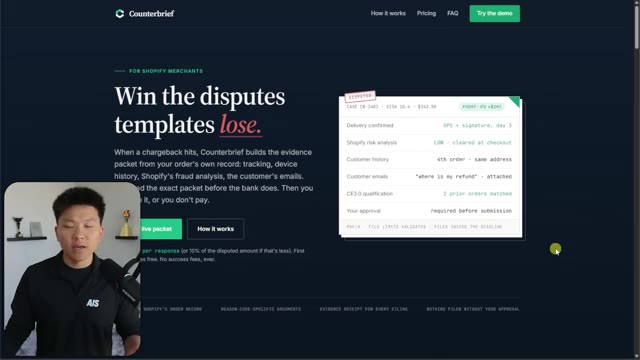
*⏱️ 00:00:28 — Page d'accueil de la plateforme "Counterbrief" présentant une interface SaaS pour les marchands Shopify, avec une vignette illustrant un exemple de litige et ses preuves.*

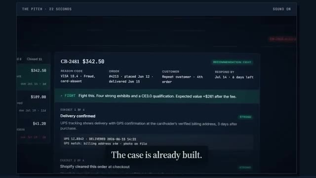
*⏱️ 00:00:39 — Interface applicative détaillée montrant un tableau de bord de gestion de litiges ("The Pitch"), avec le détail d'un dossier spécifique (CB-2481) et une recommandation de réponse.*

---

### ⏱️ `[00:00:59 - 00:01:18]` | Segment #03

**🔊 Audio (Transcription Intégrale Mot pour Mot en Français) :**
> but what's cool about that is the UI that you guys saw right here, not only did it feel like it was a little bit syncing to the music, which I thought was a nice touch, this is the actual product that it built. This is CounterBrief. This is the dashboard where you can see the different disputes, you can open them up, you can see if you should fight them or fold them, and you can like look at all the evidence, you can do all this, right?

**👁️ Analyse Visuelle d'Écran (gemini-3.5-flash-lite) :**
**Interface & Outils** : Dashboard web propriétaire "CounterBrief" spécialisé dans la gestion des litiges (chargebacks).

**Contenu textuel & Code** : Analyse de risques transactionnels ("OrderRiskAssessment: LOW", "AVS: full match", "CVV: match"), historique des commandes ("This is their fourth order") et correspondance client liée à des demandes de remboursement.

**Action / Démonstration** : Démonstration de l'interface de reporting de litiges générée par l'outil, montrant comment les preuves sont structurées pour contester des fraudes.

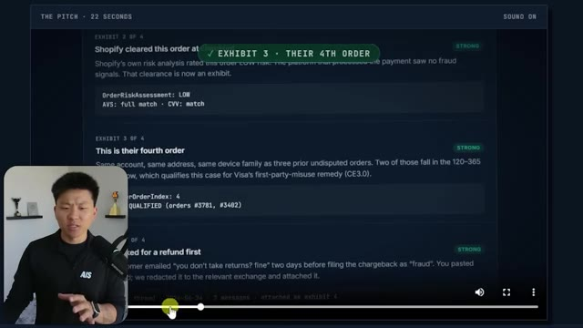
*⏱️ 00:01:04 — Interface utilisateur de l'application "CounterBrief" présentant une liste de preuves (exhibits) détaillées pour des litiges de paiement, avec des indicateurs de solidité du dossier ("STRONG").*

---

### ⏱️ `[00:01:18 - 00:01:53]` | Segment #04

**🔊 Audio (Transcription Intégrale Mot pour Mot en Français) :**
> But what that tells me is that Fable had to go in here and it had to come to some of these disputes and it had to click around. And obviously it verified that it worked, but it was like recording the screen or at least taking screenshots and then snipped all that together with the music, with the other motion graphics, with the mouse, with the sound effects. And it created us that demo. If we keep going down through the page here, obviously, like I said, none of this is anything extraordinary. We really could have had Fable do better on the design here, but the elements that were worked in, not too bad. If we go all the way down to the bottom after the pricing, you can see that we also have a why this exists message. And this is straight from

**👁️ Analyse Visuelle d'Écran (gemini-3.5-flash-lite) :**
**Interface & Outils** : Interface web de la plateforme Counterbrief (tableau de bord de gestion de litiges bancaires/e-commerce).

**Contenu textuel & Code** : Détails du litige CB-2469 ($41.20) incluant le calcul de la valeur attendue (EV), des recommandations ("Fold" ou "Fight"), et des preuves exposées.

**Action / Démonstration** : Visualisation d'une recommandation automatique fournie par l'IA pour traiter un litige client, avec mise en évidence du gain/perte financier attendu.

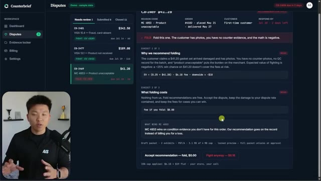
*⏱️ 00:01:27 — Capture d'écran montrant l'interface de gestion de litiges "Counterbrief" avec une analyse détaillée d'un litige spécifique (CB-2469) et une recommandation stratégique.*

---

### ⏱️ `[00:01:53 - 00:02:28]` | Segment #05

**🔊 Audio (Transcription Intégrale Mot pour Mot en Français) :**
> me, a note from the founder. So obviously I didn't film this, but let's go ahead and see what this actually says. Hey, I'm Nate. So I kept seeing Shopify store owners lose chargebacks. They should have won because the tool they were paying just sent the bank a template. So I built counter brief. It pulls the real evidence from your store, tracking emails, order history, and you read the exact packet before the bank does. 19 bucks flat. You keep everything you win. If that's you, come check it out. So what's cool about that is it was able to obviously go through my project and look what we had available, what API keys, and it pulled my HeyGen avatar and my 11 Labs voice clone

**👁️ Analyse Visuelle d'Écran (gemini-3.5-flash-lite) :**
**Interface & Outils** : Site web de Counterbrief (application SaaS).

**Contenu textuel & Code** : En-tête de site avec le logo "Counterbrief" et un bouton d'appel à l'action "Try the demo".

**Action / Démonstration** : Navigation sur la page de présentation du produit où la vidéo de témoignage/présentation est affichée.

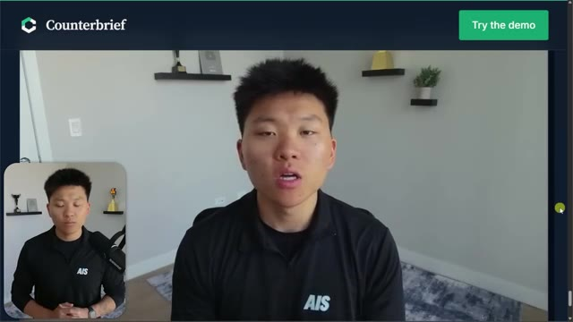
*⏱️ 00:02:02 — Interface web du site "Counterbrief" montrant une vidéo intégrée du fondateur présentant le produit.*

---

### ⏱️ `[00:02:28 - 00:02:48]` | Segment #06

**🔊 Audio (Transcription Intégrale Mot pour Mot en Français) :**
> and then just made that message from a founder video. It also created a different launch video. You can see we have one that was the viral one, which is the one that we just saw, right? You know, super kind of like more fast paced. It called it the viral one and it was more of like a SaaS product demo. But then this other one that it created, let's go ahead and watch it real quick. I think this was more of like a voiceover. It felt slower, but anyways, let's take a look.

**👁️ Analyse Visuelle d'Écran (gemini-3.5-flash-lite) :**
**Interface & Outils** : Counterbrief (interface web SaaS de gestion de litiges), interface de documentation de projet (Deliverables Map).

**Contenu textuel & Code** : Données de litiges financiers, calculs d'espérance de gain (EV), recommandations automatisées ("Fight" ou "Fold"), fichiers Markdown (ex: launch-plan.md, founder-script.md).

**Action / Démonstration** : Présentation des capacités d'un agent IA pour l'analyse décisionnelle et la génération automatisée d'assets marketing et business.

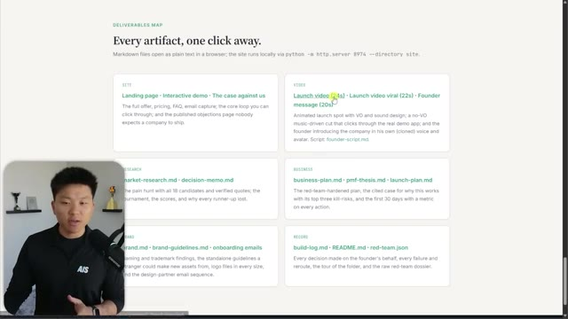
*⏱️ 00:02:33 — Une interface web intitulée "Deliverables Map" listant divers livrables de projet organisés par catégories (vidéo, recherche, business, etc.), incluant des liens vers des fichiers markdown.*

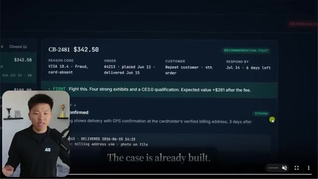
*⏱️ 00:02:38 — Gros plan sur une interface SaaS appelée "Counterbrief" montrant le détail d'un litige financier (CB-2481) avec une recommandation IA ("FIGHT") et l'analyse associée.*

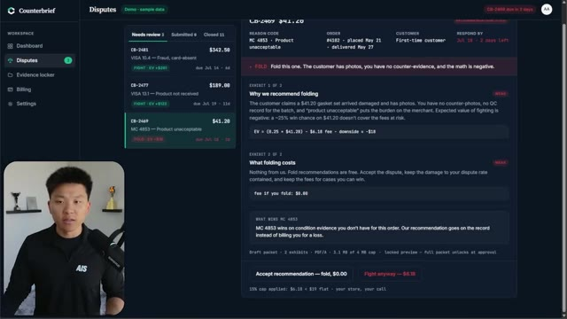
*⏱️ 00:02:43 — Vue complète du tableau de bord "Counterbrief" montrant la gestion des litiges, avec une analyse détaillée justifiant pourquoi l'IA recommande de "plier" (fold) un dossier spécifique.*

---

### ⏱️ `[00:02:48 - 00:03:23]` | Segment #07

**🔊 Audio (Transcription Intégrale Mot pour Mot en Français) :**
> A chargeback just hit your store. The bank already believes the customer and most tools respond with a template. Counter brief builds the case instead. Tracking, fraud analysis, order history, the customer's own emails assembled into evidence you read before the bank does. You approve it. $19 flat. Keep everything you win. Counter brief. When the disputes, templates lose. There you go. That is the other launch video that it made. Okay. So let's first take a look at the prompt and then we'll kind of walk through what it actually did here and why this is pretty cool. So the prompt that I gave it was read this file. So I'll pull up this full

**👁️ Analyse Visuelle d'Écran (gemini-3.5-flash-lite) :**
**Interface & Outils** : Site web de la plateforme Counterbrief.

**Contenu textuel & Code** : Texte descriptif : "The evidence desk for Shopify chargebacks", "FOR: Shopify stores with 3+ disputes/mo", "PRICE: $19 flat per approved response".

**Action / Démonstration** : Présentation de la valeur ajoutée de l'outil et de ses fonctionnalités de constitution de dossiers de preuves automatisés pour contrer les chargebacks.

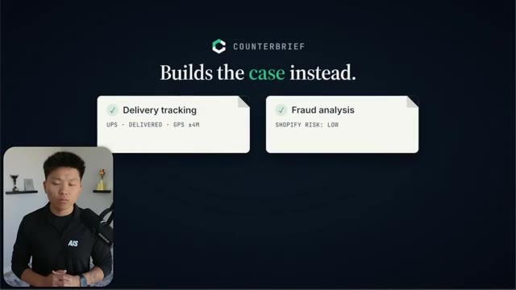
*⏱️ 00:02:56 — Interface présentant deux blocs d'analyse : "Delivery tracking" avec les détails UPS, et "Fraud analysis" indiquant un niveau de risque faible.*

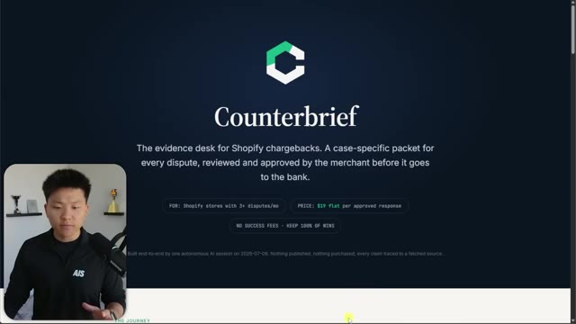
*⏱️ 00:03:14 — Page d'accueil de la plateforme "Counterbrief" décrivant son rôle d'assistant pour la gestion des litiges Shopify et son modèle tarifaire à 19$.*

---

### ⏱️ `[00:03:23 - 00:03:59]` | Segment #08

**🔊 Audio (Transcription Intégrale Mot pour Mot en Français) :**
> file in a sec and execute everything below the divider line as your goal. That file is your full instruction set. So mission, guardrails, phases, deliverables, definition of done, follow it exactly, including the never ask rule. Do not report back to me until the definition of done is met, start now. So the reason that I did this is because if you guys didn't know, the slash goal has a character limit of like 4,000. So if you have way more than that, then you can just throw it in a file and tell it in the prompt to read it. So there's really no character limit. But anyways, let me open up this file real quick. Okay, so here is the prompt. I said, build me a complete company from scratch. Start with nothing but the open internet. Find a real painful underserved

**👁️ Analyse Visuelle d'Écran (gemini-3.5-flash-lite) :**
**Interface & Outils** : Interface de type chat ou gestionnaire de projet (probablement une plateforme de collaboration type GitHub Copilot ou interface d'agent autonome).

**Contenu textuel & Code** : Le prompt : "/goal Read projects/company-builder-experiment/master-prompt.md and execute everything below the divider line as your goal. That file is your full instruction set: mission, guardrails, phases, deliverables, and definition of done. Follow it exactly, including the never-ask rule. Do not report back to me until the definition of done is met. Start now."

**Action / Démonstration** : Envoi d'une directive système exhaustive à un agent IA pour automatiser une mission basée sur un fichier externe.

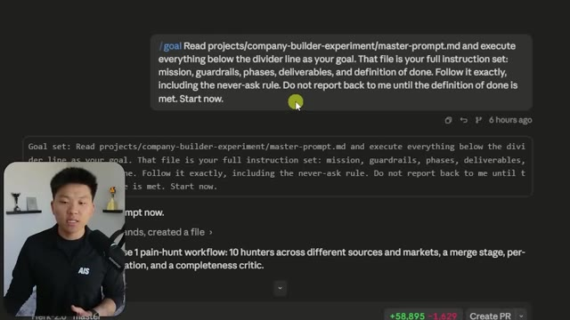
*⏱️ 00:03:32 — Une interface de discussion ou de gestion de tâches où une instruction complexe est donnée à un agent IA pour lire un fichier de configuration nommé 'master-prompt.md'.*

---

### ⏱️ `[00:03:59 - 00:04:34]` | Segment #09

**🔊 Audio (Transcription Intégrale Mot pour Mot en Français) :**
> problem that real people are complaining about right now and design a business around it. So build the product and the brand and the website and hand me a finished package that I could take to market this month. Then prove to me why it would work. This is a test of how far you can go on your own. I am not going to answer questions mid run. Make every call yourself, write down why you made it and keep moving. Within the guardrails below, you have total creative freedom. Do whatever you want. Surprise me. I want to see your best work, not your safest work. So I gave it some guardrails, like no new spending. I said, Hey, anything that's in the API keys or sorry, anything that's in my dotny and v fair game i said publish nothing just this is create me all these things locally i said

**👁️ Analyse Visuelle d'Écran (gemini-3.5-flash-lite) :**
**Interface & Outils** : Éditeur de texte/code (type VS Code).

**Contenu textuel & Code** : Texte Markdown détaillant la "Mission" (créer une entreprise de A à Z) et les 5 "Guardrails" (règles de contrainte budgétaire, de confidentialité, de vérification des sources, de localisation des données et d'autonomie totale).

**Action / Démonstration** : Le présentateur affiche le prompt système structuré qui sert de base au test de l'agent IA pour la construction de l'entreprise.

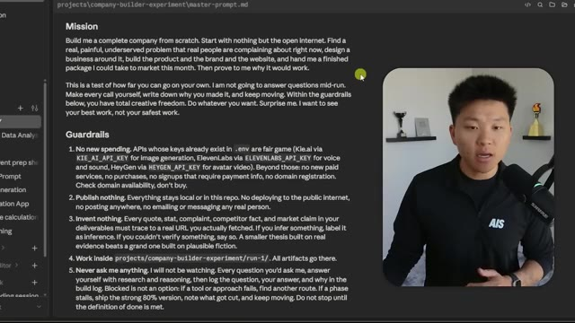
*⏱️ 00:04:07 — Capture d'écran montrant un fichier Markdown ouvert dans un éditeur de code, contenant le "Master Prompt" qui définit la mission et les contraintes opérationnelles pour l'IA.*

---

### ⏱️ `[00:04:34 - 00:05:06]` | Segment #10

**🔊 Audio (Transcription Intégrale Mot pour Mot en Français) :**
> invent nothing so you must do research and verify every fact every stat work inside this project right here and never ask me anything then i said what does orchestrate means it means to use multi-agent workflows aggressively fan out parallel researchers across different sources and angles run tournaments where independent agents pitch competing business ideas and judge panels score them adversarily verify every important claim with skeptic agents whose only job is to refute it. Use the completeness critic before you call any phase done. Design whatever orchestration shapes the work calls for. The patterns above are a floor, not a ceiling. I truly think that this

**👁️ Analyse Visuelle d'Écran (gemini-3.5-flash-lite) :**
**Interface & Outils** : Éditeur de code (type VS Code ou interface de gestion de projet type Cursor/Obsidian).

**Contenu textuel & Code** : Texte structuré définissant les règles de fonctionnement : "Work inside projects/company-builder-experiment/run-1/", "Never ask me anything", et une section "What 'orchestrate' means here" décrivant des workflows multi-agents, des tournois d'idées et une vérification contradictoire. Une section "The arc" liste 8 étapes de développement, de "Hunt for pain" à "Try to kill it".

**Action / Démonstration** : Présentation visuelle du prompt système ou du fichier de configuration régissant le comportement de l'agent automatisé.

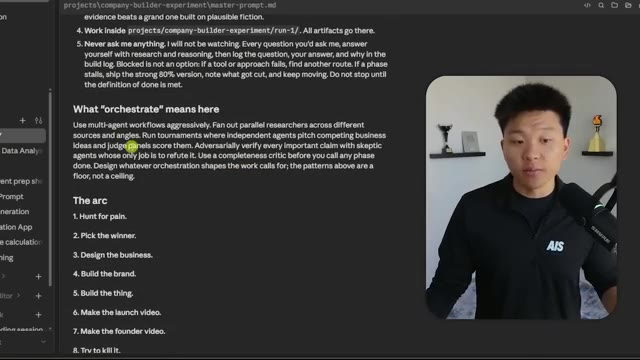
*⏱️ 00:04:42 — Éditeur de texte affichant un document Markdown intitulé "master-prompt.md", détaillant des instructions pour un projet de construction d'entreprise assisté par IA.*

---

### ⏱️ `[00:05:06 - 00:05:41]` | Segment #11

**🔊 Audio (Transcription Intégrale Mot pour Mot en Français) :**
> paragraph right here did so much heavy lifting because after I let this run and I watched it and then I checked in at the end, this hardly even moved my Fable limit. So I mean, look at this. If I close out of this real quick, I'll come back. This used about 500,000 tokens. Those are the only tokens that Fable really used here because every single sub agent that it spun up was Opus or Sonnet. And that's what is so cool about this. If you guys watch my video from like a few days ago where I said, Hey, this is how I make Opus think like Fable, then check that out. If you haven't, I'll tag that right up here. But basically I wanted to take those principles and put that here

**👁️ Analyse Visuelle d'Écran (gemini-3.5-flash-lite) :**
**Interface & Outils** : Éditeur de code (apparence de Cursor ou VS Code).

**Contenu textuel & Code** : Le "master-prompt.md" détaille une méthodologie d'agent IA : "What 'orchestrate' means here", "The arc" (Hunt for pain, Pick the winner, Design the business, etc.). La popup affiche : "Context window 543.3k / 1.0M (54%)" et "Weekly - Fable 86%".

**Action / Démonstration** : Le présentateur illustre la complexité du prompt utilisé pour piloter l'agent et montre la consommation de tokens résultante pour démontrer l'efficacité de son approche par rapport aux limites du plan.

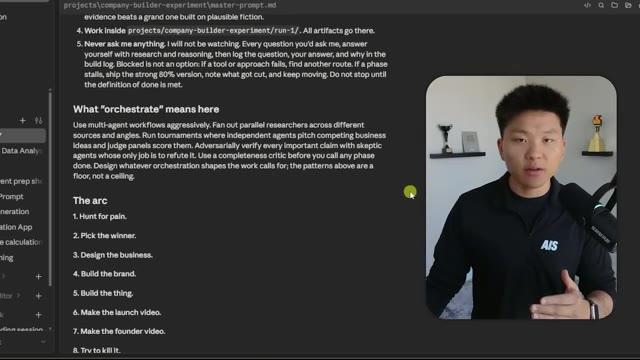
*⏱️ 00:05:15 — L'éditeur de code affiche un document intitulé "master-prompt.md" contenant des instructions détaillées pour un agent IA, notamment sur l'orchestration multi-agents et les étapes d'un processus de création d'entreprise.*

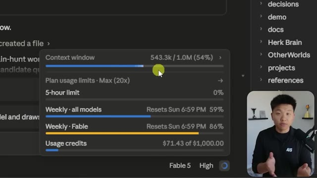
*⏱️ 00:05:24 — Une fenêtre contextuelle ("Context window") superposée à l'interface affiche les statistiques de consommation de tokens (543.3k / 1.0M) et les limites d'utilisation du plan, confirmant la consommation de ressources de l'agent.*

---

### ⏱️ `[00:05:41 - 00:06:15]` | Segment #12

**🔊 Audio (Transcription Intégrale Mot pour Mot en Français) :**
> and show how Fable is able to not only plan things out, but figure out what works and what doesn't. And then it is the manager. It is the orchestrator that just says, Hey, Opus do this, this and this and this. And when you're done, I'll check it. And if it's not good enough, I'm going to tell you to do it better. And that is the way that Fable was able to orchestrate all of this. And it only used like maybe 15% of this weekly Fable budget. I don't know. I mean, I guess it's a lot, but it didn't blow through as much up here as I thought it would. And it didn't spin up any Fable workers. So that's pretty good. As far as my actual five hour limit that literally just reset, but this is what it did eat up a decent chunk of. This was probably,

**👁️ Analyse Visuelle d'Écran (gemini-3.5-flash-lite) :**
**Interface & Outils** : Tableau de bord d'administration ou interface système de l'agent Fable.

**Contenu textuel & Code** : Statistiques de consommation : "Context window 543.3k / 1.0M (54%)", "Weekly - Fable 86%", et "Usage credits $71.43 of $1,000.00".

**Action / Démonstration** : Visualisation des ressources consommées par l'agent et du suivi des limites d'utilisation hebdomadaires et financières.

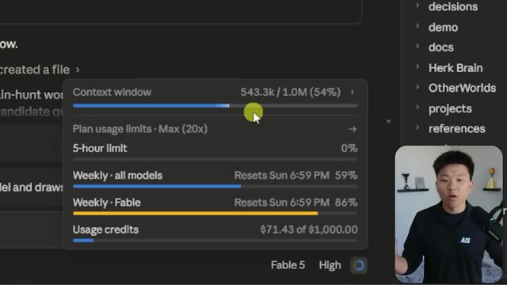
*⏱️ 00:05:49 — Une fenêtre contextuelle d'interface utilisateur affichant les métriques d'utilisation en temps réel d'un agent IA (Fable), incluant la fenêtre de contexte et les limites de crédit.*

---

### ⏱️ `[00:06:15 - 00:06:47]` | Segment #13

**🔊 Audio (Transcription Intégrale Mot pour Mot en Français) :**
> I don't know, at least 30 or 40% of my five hour limit here with my max $200 a month plan. So I'm not sitting here saying that this was super cheap to run, but I'm saying this is pretty impressive if you consider the fact that Fable didn't actually build anything. All Fable did was plan, delegate, review. That was basically it. Because I'm sure this would have been even better if every single worker that Fable spun up was also Fable, but it would have been a hundred times more expensive. Anyways, back to the master prompt, the arc. I said, hunt for pain, pick the winner, design the business, build the brand, build the thing, make the launch video, make the founder

**👁️ Analyse Visuelle d'Écran (gemini-3.5-flash-lite) :**
**Interface & Outils** : Interface de travail de l'agent IA Fable (ou environnement de développement intégré similaire).

**Contenu textuel & Code** : Prompt de mission : "Read projects/company-builder-experiment/master-prompt.md and execute everything below the divider line...". Statistiques affichées : fenêtre de contexte (543.3k / 1.0M), limites d'utilisation hebdomadaires (59% et 86%) et crédits consommés (71.43$ sur 1000$).

**Action / Démonstration** : L'agent IA est en phase d'exécution d'instructions basées sur un fichier de prompt maître, avec suivi en temps réel de la consommation des ressources et de la fenêtre contextuelle.

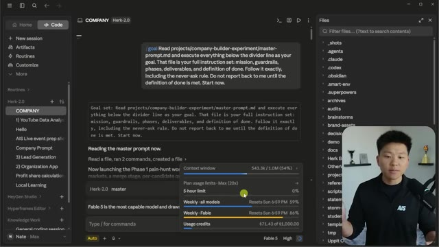
*⏱️ 00:06:23 — Interface de l'agent IA "Fable" affichant une instruction de lecture de projet, avec une fenêtre contextuelle de suivi d'utilisation des limites et des crédits, accompagnée du présentateur en incrustation.*

---

### ⏱️ `[00:06:47 - 00:07:10]` | Segment #14

**🔊 Audio (Transcription Intégrale Mot pour Mot en Français) :**
> video, try to kill it, and then package it. And then once again, that is a floor, not a ceiling. So if you want to do more stuff, do more stuff. And it did obviously a few more things. Then I gave it kind of a subjective definition of done, which is a stranger should be able to open the recap HTML and understand the business, watch the video, run the site, demo it, all this kind of stuff. Now go build me a company. So this is the HTML recap that I was just referring to there.

**👁️ Analyse Visuelle d'Écran (gemini-3.5-flash-lite) :**
**Interface & Outils** : Éditeur de texte type Obsidian ou interface d'agent IA (type interface notebook).

**Contenu textuel & Code** : Liste numérotée de 1 à 9 étapes de création d'entreprise ("Hunt for pain", "Pick the winner", etc.) et texte explicatif sur les livrables attendus pour le projet.

**Action / Démonstration** : Le présentateur explique le workflow de construction d'entreprise utilisé par son agent IA, illustré par le document markdown à l'écran.

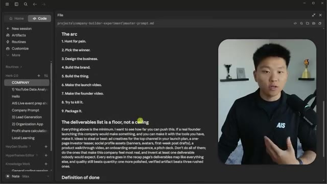
*⏱️ 00:06:53 — Interface d'édition markdown montrant une liste de tâches intitulée "The arc" et une section "The deliverables list is a floor, not a ceiling" avec une fenêtre vidéo incrustée du présentateur.*

---

### ⏱️ `[00:07:11 - 00:07:47]` | Segment #15

**🔊 Audio (Transcription Intégrale Mot pour Mot en Français) :**
> This was the end deliverable that has everything else linked down here on the bottom. So let's go through some of this. It decided to come up with a company called Counterbrief. It designed the brand guidelines. It designed this logo, obviously. It designed all of it. It's for Shopify stores with three plus disputes a month. It's priced at $19 flat per month or per approved response. And then no success fees. You keep 100% of your wins. So that's what we have. So here's what actually happened. From open internet to launch package in nine phases. First was the pain hunt. So 10 research agents swept Reddit and Hacker News, G2, blah, blah, blah. They found 35 raw problems

**👁️ Analyse Visuelle d'Écran (gemini-3.5-flash-lite) :**
**Interface & Outils** : Navigateur web (site vitrine généré par une IA).

**Contenu textuel & Code** : Texte descriptif : "The evidence desk for Shopify chargebacks", explications méthodologiques des agents IA (recherche sur Reddit, Hacker News, évaluation par des juges-personnages).

**Action / Démonstration** : Défilement de la page (scroll) pour présenter le résultat final d'une automatisation complète par une IA.

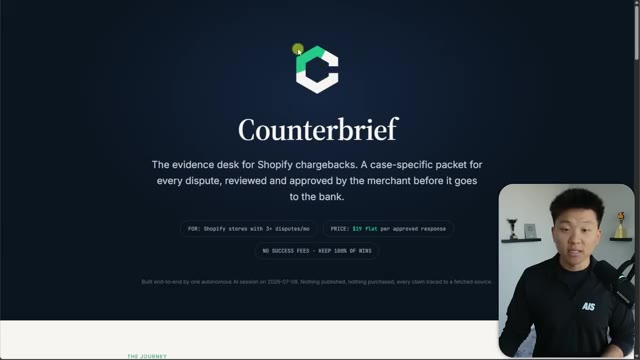
*⏱️ 00:07:20 — Page d'accueil du site "Counterbrief" présentant le nom, le logo, une description du service pour les litiges Shopify et les tarifs.*

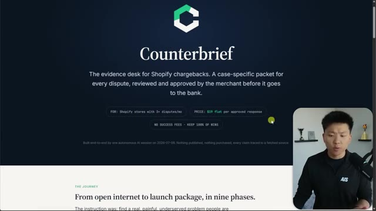
*⏱️ 00:07:29 — Suite de la page d'accueil montrant la section "The Journey" expliquant le processus de création en neuf phases.*

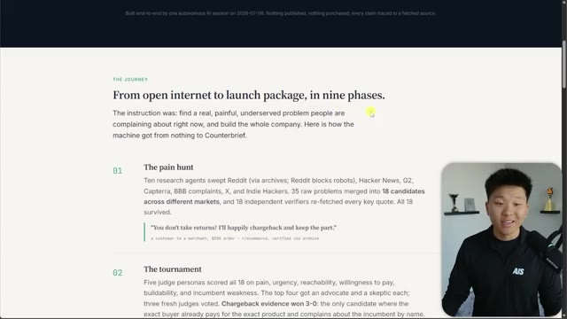
*⏱️ 00:07:38 — Gros plan sur la section "The Journey" détaillant les phases 01 (The pain hunt) et 02 (The tournament) menées par des agents IA.*

---

### ⏱️ `[00:07:47 - 00:08:22]` | Segment #16

**🔊 Audio (Transcription Intégrale Mot pour Mot en Français) :**
> merged into 18 candidates and 18 independent verifies refetched every key quote. All 18 survived. Then we entered a tournament where five judge personas scored all of those 18 opportunities on pain, urgency, reachability, willingness to pay, buildability, and incumbent weakness. The top four got an advocate and a skeptic each, three fresh judges voted, and chargeback evidence one, three to zero. Now from there, we had researchers start to design. So competitor pricing pages, platform docs, Visa's own rule PDFs and API references. Then the brand started getting built out. So we had counter brief.com. It's available. It checked. It didn't buy and it's

**👁️ Analyse Visuelle d'Écran (gemini-3.5-flash-lite) :**
**Interface & Outils** : Interface de type éditeur de texte/notes (style Notion).

**Contenu textuel & Code** : Texte structuré en étapes : "01 The pain hunt" (détails sur la recherche Reddit/Hacker News), "02 The tournament" (méthode de notation des 18 opportunités, annonce du gagnant "Chargeback evidence" et des finalistes "MSP invoice reconciliation", "tenant-fraud detection"), et "03 The design".

**Action / Démonstration** : Le contenu présente une synthèse textuelle du workflow de validation des idées de business utilisées par l'IA.

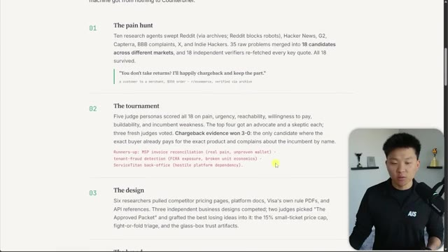
*⏱️ 00:07:56 — Capture d'écran montrant un document textuel structuré (type Notion ou Obsidian) détaillant le processus de recherche et de sélection d'idées de business par des agents IA.*

---

### ⏱️ `[00:08:22 - 00:08:44]` | Segment #17

**🔊 Audio (Transcription Intégrale Mot pour Mot en Français) :**
> collision clean. The logo went through six AI generations and a critique loop. Then the winner was hand vectorized. So it's crisp from favicon to billboard. Serif carries the argument. Mono carries the evidence. Then we had the build landing page with the offer with all this kind of stuff. Then it made the videos. And then we had the red team. So six skeptic agents attacked the market size, all of these different things.

**👁️ Analyse Visuelle d'Écran (gemini-3.5-flash-lite) :**
**Interface & Outils** : Navigateur web (page de documentation projet).

**Contenu textuel & Code** : Texte descriptif des étapes du projet, notamment les détails sur le branding ("Six AI generations", "hand-vectorized") et la construction de la landing page ("landing page with the full offer", "interactive demo").

**Action / Démonstration** : Défilement de la page web pour illustrer les différentes phases du workflow de création de marque et de développement technique.

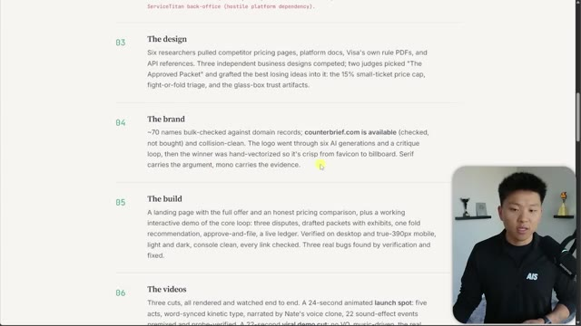
*⏱️ 00:08:28 — Capture d'écran montrant une page web de type documentation ou rapport de projet divisée en sections numérotées ("The design", "The brand", "The build", "The videos"), avec le présentateur visible en médaillon dans le coin inférieur droit.*

---

### ⏱️ `[00:08:44 - 00:09:05]` | Segment #18

**🔊 Audio (Transcription Intégrale Mot pour Mot en Français) :**
> And the verdict was that it's viable with fixes. Zero kills, 38 attacks ruled on. Every fix was applied to the plan and the site. We got these honesty artifacts and then it was packaged up below and it verified all this, right? And now everything that we can click through and look at exists right here. We have site stuff, we have video stuff, research, the business, brand, and the record.

**👁️ Analyse Visuelle d'Écran (gemini-3.5-flash-lite) :**
**Interface & Outils** : Navigateur web affichant un portail de documentation technique/projet.

**Contenu textuel & Code** : Documentation de projet structurée, noms de fichiers (ex: `market-research.md`, `build-log.md`), et commande d'exécution locale : `python -m http.server 8974 --directory site`.

**Action / Démonstration** : Présentation du système de déploiement local et de l'accessibilité des artefacts du projet en un clic.

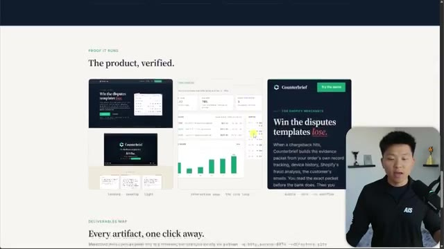
*⏱️ 00:08:54 — Capture d'une interface web présentant des aperçus visuels du produit "Counterbrief", incluant des captures d'écran d'applications et de tableaux de bord financiers.*

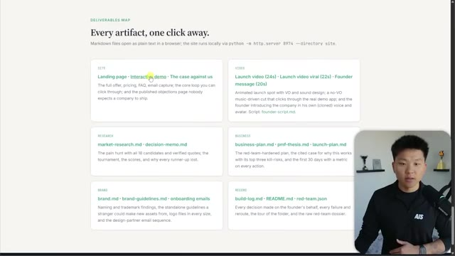
*⏱️ 00:09:00 — Vue d'une "carte des livrables" (Deliverables Map) sous forme de grille organisée par catégories (Site, Vidéo, Recherche, Business, Brand, Record) pointant vers des fichiers Markdown.*

---

### ⏱️ `[00:09:05 - 00:09:40]` | Segment #19

**🔊 Audio (Transcription Intégrale Mot pour Mot en Français) :**
> So right here in my file explorer, you can see this was a company builder experiment. This was the master prompt we just looked at, and this was run one. Here's basically everything that it did in this run. If I go to the brand, you can see we have the voiceover, we have the scripts, we have the logos, we have brand guidelines, avatar, logo candidates. It generated a bunch of different versions and tested them out. We have exports. It has a bunch of different versions as well, like some PNGs and different sizes and stuff like that. If I go back out one more time, we have research. So this is where we got the business design, the candidates, the condensed candidates, red team tournament. So this was, I think like kind of its internal experiments.

**👁️ Analyse Visuelle d'Écran (gemini-3.5-flash-lite) :**
**Interface & Outils** : Explorateur de fichiers Windows (Windows 11).

**Contenu textuel & Code** : Liste de dossiers (brand, research, scripts, site) et de fichiers Markdown (build-log, business-plan, decision-memo, launch-plan, market-research, pmf-thesis, README) générés par le processus.

**Action / Démonstration** : Le présentateur navigue dans le dossier racine du projet pour montrer l'organisation des livrables générés par l'IA.

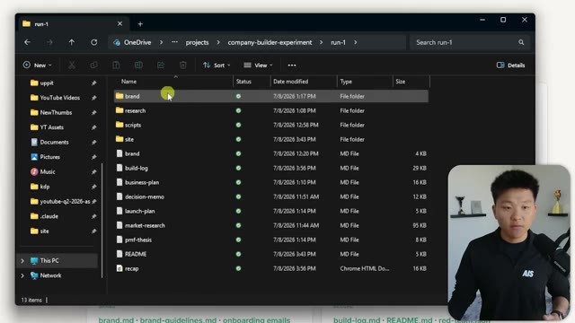
*⏱️ 00:09:14 — Une vue de l'Explorateur de fichiers Windows affichant le répertoire « run-1 » contenant les résultats d'une expérience de construction d'entreprise automatisée par IA.*

---

### ⏱️ `[00:09:40 - 00:10:15]` | Segment #20

**🔊 Audio (Transcription Intégrale Mot pour Mot en Français) :**
> So these are kind of more of like the deliverables. This is our brand, our business plan, launch plan, market research. So I'm not going to go through all of that because I think that would be really boring, but I guess let's just open up a few to make sure that they do look pretty legit. Okay. So here's the business plan. It goes over the actual problem, the ideal customer profile. It goes over the product itself. It goes over the offer and pricing and the unit economics of it. So it clearly went pretty deep. It went to the business model, channels, and positioning, moat, risks. This stuff is pretty in depth. What else do we have here? We have the market research,

**👁️ Analyse Visuelle d'Écran (gemini-3.5-flash-lite) :**
**Interface & Outils** : - Image 1 : Navigateur web (serveur local Python)
- Image 2 : Éditeur de code "Cursor" (AI Code Editor)

**Contenu textuel & Code** : - Image 1 : Liste de fichiers Markdown (.md) et JSON incluant "market-research.md", "business-plan.md", "build-log.md".
- Image 2 : Contenu textuel d'un business plan détaillant le profil client idéal (ICP), les taux de litiges et l'analyse de données e-commerce.

**Action / Démonstration** : - Image 1 : Présentation de l'arborescence des livrables de projet.
- Image 2 : Ouverture et consultation du fichier de plan d'affaires dans l'éditeur pour vérification.

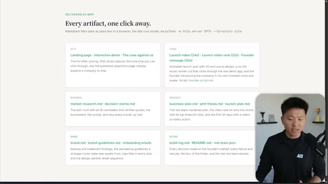
*⏱️ 00:09:49 — Une page web intitulée "Deliverables Map" listant divers documents de projet (site, vidéo, recherche, business, marque) sous forme de carte interactive.*

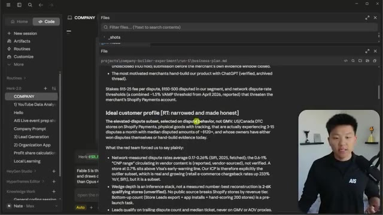
*⏱️ 00:09:58 — Interface de l'outil "Cursor" montrant l'ouverture d'un fichier Markdown intitulé "business-plan.md" au sein d'un projet de développement.*

---

### ⏱️ `[00:10:15 - 00:10:38]` | Segment #21

**🔊 Audio (Transcription Intégrale Mot pour Mot en Français) :**
> which was them trying to figure out what the business opportunity was. So we can see all the candidates. We can see all the evidence. We can see basically how it was able to get to a place where it narrowed these down. And then from there, it narrowed them down even further. Really the point that I was trying to prove and make in this video is that, first of all, from here, this only took, I think, a little over, this took like three or four hours.

**👁️ Analyse Visuelle d'Écran (gemini-3.5-flash-lite) :**
**Interface & Outils** : Environnement de développement intégré (probablement une interface basée sur VS Code/Cursor avec un panneau latéral de fichiers).

**Contenu textuel & Code** : Contenu textuel d'un document Markdown : analyse de la "volonté de payer" (willingness-to-pay), étude des concurrents (HubSpot, Pipedrive, HoneyBook), timing du marché ("Why now"), faisabilité technique ("Buildability") et description d'une opportunité spécifique liée à l'automatisation de la comptabilité avec QuickBooks.

**Action / Démonstration** : Navigation dans les fichiers du projet et lecture du document de recherche de marché détaillant les opportunités commerciales identifiées par l'agent IA.

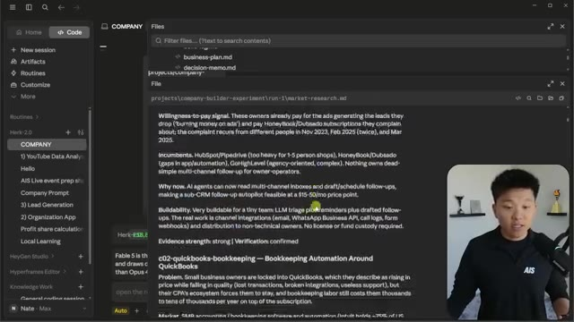
*⏱️ 00:10:21 — Interface d'un environnement de développement type IDE affichant un document Markdown de recherche de marché ("market-research.md") analysant des opportunités d'affaires.*

---

### ⏱️ `[00:10:39 - 00:11:07]` | Segment #22

**🔊 Audio (Transcription Intégrale Mot pour Mot en Français) :**
> So in three or four hours, we got to a place that would have taken me weeks and weeks to do by myself. Now, looking back at this, what I would have put more emphasis on is probably the upfront idea, like figuring out how viable is the idea and really, really stress testing that before we build everything out. Because I think we all agree we're at the point now where with Fable and even with Opus, if you use it right, even GPT 5.5, these things can build basically anything for you as long as you have a good idea and you can clearly define what is good.

**👁️ Analyse Visuelle d'Écran (gemini-3.5-flash-lite) :**
**Interface & Outils** : Interface de l'éditeur de code Cursor (mode agent IA).

**Contenu textuel & Code** : On peut lire une instruction système : "/goal Read projects/company-builder-experiment/master-prompt.md et execute everything below...". Le terminal affiche l'état de l'agent : "Reading the master prompt now", "Now launching the Phase 1 pain-hunt workflow", et mentionne l'utilisation du modèle "Fable 5".

**Action / Démonstration** : L'agent IA est en cours d'exécution autonome, lisant des instructions complexes, lançant un flux de travail de recherche de problèmes ("pain-hunt workflow") et communiquant son statut dans le terminal de l'éditeur.

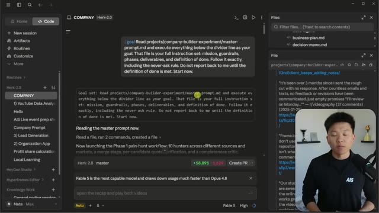
*⏱️ 00:10:46 — Une vue de l'interface de développement "Cursor" (ou environnement similaire basé sur LLM) montrant une session de travail nommée "COMPANY" où un agent IA exécute des instructions basées sur un fichier "master-prompt.md".*

---

### ⏱️ `[00:11:07 - 00:11:31]` | Segment #23

**🔊 Audio (Transcription Intégrale Mot pour Mot en Français) :**
> I was really impressed by the creativity it used here, the thoroughness that it used here, and how it was able to actually understand what does it look like for me to take this goal that's pretty ambiguous with a definition of done that's also pretty ambiguous and just figure out my own path to get there. You know, I think it's really important that we allow the model to actually be creative and we get out of its way so that it can do what it does really well.

**👁️ Analyse Visuelle d'Écran (gemini-3.5-flash-lite) :**
**Interface & Outils** : Interface propriétaire d'agent IA (type Cursor ou IDE intégré avec IA).

**Contenu textuel & Code** : Prompt de mission : "Read projects/company-builder-experiment/master-prompt.md and execute everything...". Texte de statut : "Reading the master prompt now", "Now launching the Phase 1 pain-hunt workflow". Métriques : "Herk-2.0 master", "+58,895 -1,629", "Fable 5 is the most capable model".

**Action / Démonstration** : L'agent IA analyse un fichier de configuration, exécute des commandes et initialise un workflow (Phase 1 pain-hunt) en toute autonomie.

*⏱️ 00:11:13 — Interface d'un agent IA nommé "Herk-2.0" montrant une interaction textuelle où l'IA détaille l'exécution d'un workflow complexe basé sur un "master-prompt" pour un projet de construction d'entreprise.*

---

### ⏱️ `[00:11:31 - 00:11:50]` | Segment #24

**🔊 Audio (Transcription Intégrale Mot pour Mot en Français) :**
> So anyways, I know this video was quicker and it's not like a super, super practical tutorial. This is more about just being able to experiment with stuff like this and have takeaways and have lessons from seeing what's possible when you do stuff like that. There's a lot, a lot of things that I would come in here and fix, but functionality wise, this works pretty well.

**👁️ Analyse Visuelle d'Écran (gemini-3.5-flash-lite) :**
**Interface & Outils** : - Image #1 : Interface type IDE IA (Windsurf/Cursor).
- Image #2 : Interface SaaS web (Dashboard de Counterbrief).

**Contenu textuel & Code** : - Image #1 : Prompt système demandant à l'agent de lire "master-prompt.md" et d'exécuter des phases de travail, suivi d'un log d'exécution mentionnant le lancement d'un "Phase 1 pain-hunt workflow".
- Image #2 : Statistiques de litiges (Net recovered, Win rate, Fees paid), liste des litiges en attente de revue (CB-2469, CB-2481, CB-2477) et graphique des revenus récupérés par mois.

**Action / Démonstration** : - Image #1 : L'agent traite les instructions de projet et initialise des workflows autonomes de recherche de marché ("pain-hunt").
- Image #2 : Présentation de l'interface utilisateur finale d'un outil de gestion automatisée des litiges clients.

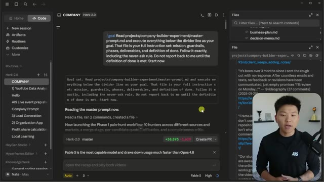
*⏱️ 00:11:36 — Interface de l'éditeur IA (probablement Windsurf ou Cursor) montrant un agent "Herk-2.0" en train d'exécuter un workflow automatisé lié à un projet "company-builder".*

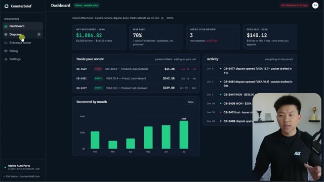
*⏱️ 00:11:45 — Tableau de bord d'une application web SaaS nommée "Counterbrief", affichant des métriques financières, des taux de réussite de litiges et une activité récente.*

---

### ⏱️ `[00:11:50 - 00:12:24]` | Segment #25

**🔊 Audio (Transcription Intégrale Mot pour Mot en Français) :**
> I don't like the way it looks. And I think that there's a lot of improvement to be done here and also on the actual landing page itself. But like, come on, the launch video I thought was really impressive. The ideas behind it and the research that went into this upfront, I thought was pretty impressive. And now, you know, maybe we're 50% of the way there and we can just continue to iterate. What happens if I did another goal prompt like this after V1 and we went into run two and we gave it all the feedback from this first run and we said, okay, let's just make all this better now. So that is going to do it for today. I hope you guys enjoyed the video or you learned something new. And if you did, please give it a like, it helps me out a ton. And as always,

**👁️ Analyse Visuelle d'Écran (gemini-3.5-flash-lite) :**
**Interface & Outils** : Image #1 : Site web (Landing page Counterbrief). Image #2 : Éditeur d'agent IA (interface de type Cursor/IDE spécialisé).

**Contenu textuel & Code** : Image #1 : Textes sur les litiges e-commerce (exhibits A, B, C). Image #2 : Prompt "Read projects/company-builder-experiment/master-prompt.md", logs d'exécution ("Reading the master prompt now"), et indicateur du modèle "Fable 5".

**Action / Démonstration** : Image #1 : Présentation visuelle de la proposition de valeur et des preuves sociales. Image #2 : Initialisation et lancement du workflow "Phase 1 pain-hunt" par l'agent IA.

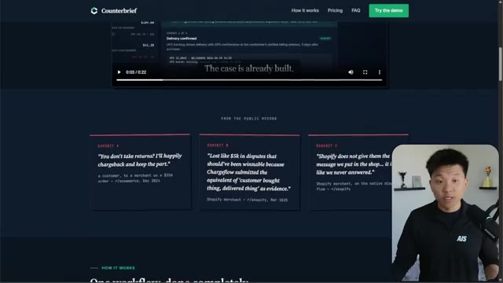
*⏱️ 00:11:58 — Vue d'ensemble de la page d'accueil de "Counterbrief", mettant en avant une section de témoignages clients sous forme d'exhibits juridiques et une vidéo de démonstration.*

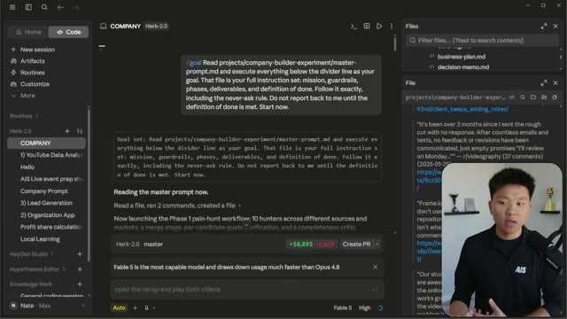
*⏱️ 00:12:15 — Interface de l'outil "Herk-2.0" montrant l'exécution d'un prompt complexe visant à automatiser un flux de travail de "pain-hunt" (recherche de problèmes clients) avec des logs d'actions système.*

---

### ⏱️ `[00:12:24 - 00:12:27]` | Segment #26

**🔊 Audio (Transcription Intégrale Mot pour Mot en Français) :**
> I appreciate you guys making it to the end of the video and I'll see you on the next one. Thanks guys.

**👁️ Analyse Visuelle d'Écran (gemini-3.5-flash-lite) :**
**Interface & Outils** : Interface de travail type "AI Agent" / Environnement de développement intégré.

**Contenu textuel & Code** : Prompt système : "Read projects/company-builder-experiment/master-prompt.md...", logs : "Reading the master prompt now", "Now launching the Phase 1 pain-hunt workflow", et statut du modèle : "Fable 5 is the most capable model".

**Action / Démonstration** : L'agent IA exécute un workflow structuré (Phase 1 pain-hunt) basé sur des instructions contenues dans un fichier projet.

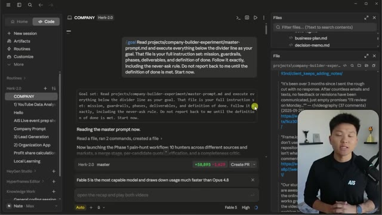
*⏱️ 00:12:25 — Interface de l'agent IA "Herk-2.0" montrant une exécution de workflow en cours avec un prompt système, des logs d'actions et le présentateur en incrustation vidéo.*

---

