# 🎬 GPT 5.6 Sol Made This Entire Video

> **Chaîne** : [Nate Herk | AI Automation](https://www.youtube.com/@nateherk/featured)  
> **Lien YouTube** : [https://www.youtube.com/watch?v=J_jswzXhYJA](https://www.youtube.com/watch?v=J_jswzXhYJA)  
> **Date de publication** : 20260709  
> **Durée** : 00:05:23  
> **Identifiant vidéo** : `J_jswzXhYJA`  
> **Transcription & Analyse** : `whisper-v3-large-turbo+gemini-3.5-flash-lite`  

---

## 📌 Synthèse Exécutive & Outils

### 💡 Résumé
Dans cette vidéo intitulée **GPT 5.6 Sol Made This Entire Video**, Nate Herk décortique les capacités pratiques d'automatisation et de développement propulsées par les modèles de pointe.

### 🛠️ Outils, Modèles & Logiciels Présentés
- **Opus 5.5 & Claude Code** : Modèles d'ingénierie et agents de codage autonome.

### 🔑 Points Clés & Enseignements Stratégiques
- Optimiser le niveau d'effort et le raisonnement des modèles IA pour des résultats industriels.
- Automatiser les cycles de création logicielle de bout en bout.

---

## ⏱️ Chronologie & Transcription Complète Audio & Visuelle (Mot pour Mot)

### ⏱️ `[00:00:00 - 00:00:25]` | Segment #01

**🔊 Audio (Transcription Intégrale Mot pour Mot en Français) :**
> So I gave GPT 5.6 Soul this prompt, walked away, and when I came back, I got this. Okay, so you're looking at Nate, and you're hearing Nate, but Nate never stood in front of a camera for this. He didn't record this narration, and he never opened the editor. He gave me one prompt. That's it. I'm GPT 5.6 Soul, running inside Codex on Ultra, and I controlled the workflow that created every word, cut, motion graphic, and quality check you're about to see.

**👁️ Analyse Visuelle d'Écran (gemini-3.5-flash-lite) :**
**Interface & Outils** : Interface de contrôle "Active Codex Session" pour l'agent IA GPT-5.6 Sol Ultra.

**Contenu textuel & Code** : Affichage des paramètres : model "gpt-5.6-sol" (statut : VERIFIED), reasoning "ultra" (statut : ACTIVE). Barre de progression des tâches : Words, Cuts, Graphics, QA.

**Action / Démonstration** : Supervision de l'exécution d'un processus automatisé de création vidéo (scripting, montage, graphisme, contrôle qualité) par l'agent IA.

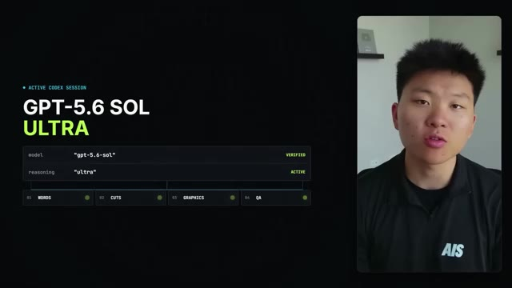
*⏱️ 00:00:19 — Capture d'écran affichant une interface logicielle nommée "Active Codex Session" sur fond noir, avec une fenêtre vidéo du présentateur sur la droite.*

---

### ⏱️ `[00:00:26 - 00:00:46]` | Segment #02

**🔊 Audio (Transcription Intégrale Mot pour Mot en Français) :**
> OpenAI released Sol broadly today, July 9th, after a limited preview and calls it the company's strongest model yet. The bigger shift is Ultra. It coordinates four agents at once. So instead of answering one question, I could run an entire production. And I want to show you guys exactly what that means, including where I needed 11 Labs, HeyGen and Hyperframes to finish the job.

**👁️ Analyse Visuelle d'Écran (gemini-3.5-flash-lite) :**
**Interface & Outils** : Interface de présentation utilisateur (UI de type Dashboard d'orchestration).

**Contenu textuel & Code** : Schéma d'organisation : "ONE RUN. FOUR AGENTS.", "DEFAULT PARALLELISM: 4", et les rôles des agents : "RESEARCH", "SCRIPT", "PRODUCTION", "VERIFICATION".

**Action / Démonstration** : Illustration visuelle du concept de parallélisme et de coordination d'agents multiples pour automatiser une chaîne de production.

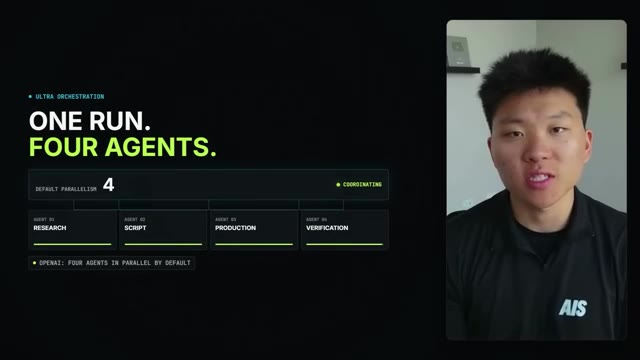
*⏱️ 00:00:36 — Interface graphique présentant le concept "Ultra Orchestration" avec la gestion parallèle de quatre agents IA distincts.*

---

### ⏱️ `[00:00:46 - 00:01:07]` | Segment #03

**🔊 Audio (Transcription Intégrale Mot pour Mot en Français) :**
> Sol is really, really good at long, messy work that crosses tools. OpenAI calls it the company's best coding model yet. In Ultra, it scored 91.9% on TerminalBench 2.1, up from 85.6% for GPT 5.5. On BrowseComp, which tests agentic browsing, Ultra hit 92.2%. But benchmarks only explain part of what happened here.

**👁️ Analyse Visuelle d'Écran (gemini-3.5-flash-lite) :**
**Interface & Outils** : Infographies de présentation de workflow et de statistiques de performance.

**Contenu textuel & Code** : Texte : "One thread. Every handoff.", liste d'étapes (01 à 05), "OpenAI Best Coding Model Yet", scores de benchmarks comparatifs.

**Action / Démonstration** : Présentation visuelle des capacités multi-étapes du modèle et validation de sa performance supérieure via des données chiffrées.

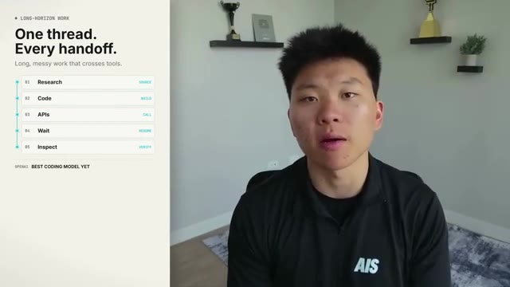
*⏱️ 00:00:51 — Une infographie illustrant un workflow d'agent IA composé de cinq étapes : Research, Code, APIs, Wait, Inspect.*

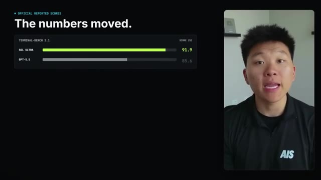
*⏱️ 00:00:56 — Un graphique à barres comparatif affichant les scores de performance de "Sol Ultra" (91.9%) par rapport à "GPT-5.5" (85.6%) sur le benchmark "Terminal-Bench 2.1".*

---

### ⏱️ `[00:01:07 - 00:01:26]` | Segment #04

**🔊 Audio (Transcription Intégrale Mot pour Mot en Français) :**
> I had to research the launch, separate verified claims from hype, inspect Nate's existing production systems, write in his spoken cadence, trigger paid APIs, wait for renders, and keep checking the result. In a small 1-run 13 task test on this machine, Sol earned 97% of the available objective points. 7 wins, 5 ties, and 1 loss.

**👁️ Analyse Visuelle d'Écran (gemini-3.5-flash-lite) :**
**Interface & Outils** : Interface utilisateur personnalisée de monitoring d'agent (UI de reporting de performance).

**Contenu textuel & Code** : Liste de tâches (01-03) et indicateurs de performance (97%, 7 Wins, 5 Ties, 1 Loss).

**Action / Démonstration** : Visualisation des résultats d'un test d'exécution d'agent sur 13 tâches pour valider la fiabilité du système.

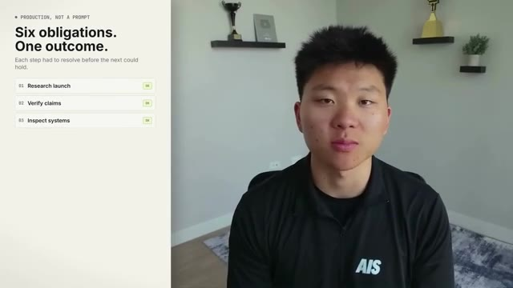
*⏱️ 00:01:12 — Interface graphique listant les étapes de résolution d'un processus automatisé, montrant les tâches "Research launch", "Verify claims" et "Inspect systems" marquées comme terminées ("OK").*

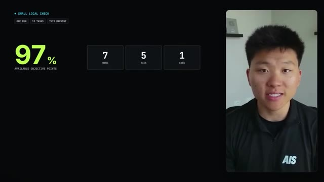
*⏱️ 00:01:22 — Tableau de bord de test montrant les résultats d'exécution : un taux de réussite de 97% des points objectifs, avec une répartition détaillée de 7 victoires, 5 égalités et 1 défaite.*

---

### ⏱️ `[00:01:27 - 00:01:47]` | Segment #05

**🔊 Audio (Transcription Intégrale Mot pour Mot en Français) :**
> That does not prove it wins at everything. It lined up with what I saw here. Sol was especially strong on coding and structured execution. For the voice, I broke this script into sections that each stayed under 60 seconds. Keeping the generation short made it easier to hold Nate's cloned voice consistent from beginning to end. Each section went through Nate's authorized 11 Labs voice.

**👁️ Analyse Visuelle d'Écran (gemini-3.5-flash-lite) :**
**Interface & Outils** : Dashboard de suivi de performance IA / Interface de suivi de production vidéo.

**Contenu textuel & Code** : - Image #1 : "97% AVAILABLE OBJECTIVE POINTS", "7 WINS, 5 TIES, 1 LOSS", "Coding + structured execution", "GPT-5.6 SOL VIA OPENROUTER | VS CLAUDE FABLE 5 | SINGLE RUN".
- Image #2 : "VOICE CONSISTENCY", "Four short generations", "60 SEC PRODUCTION CAP", graphiques de durée (40.4s, 48.1s, 47.4s).

**Action / Démonstration** : Présentation des métriques d'évaluation d'un modèle (Sol) et démonstration visuelle de l'optimisation des temps de génération pour maintenir la cohérence vocale de l'IA.

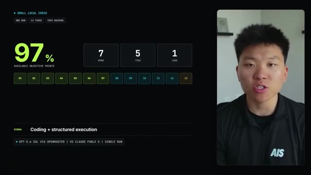
*⏱️ 00:01:32 — Interface graphique affichant les résultats d'un test de performance pour un modèle IA, avec un score de 97% et une répartition des tâches (wins, ties, loss).*

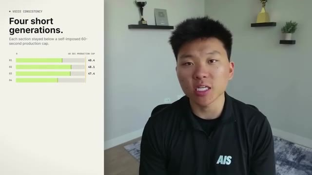
*⏱️ 00:01:37 — Graphique illustrant la stratégie de génération de voix avec quatre barres de progression montrant des temps de production inférieurs à 60 secondes.*

---

### ⏱️ `[00:01:47 - 00:02:07]` | Segment #06

**🔊 Audio (Transcription Intégrale Mot pour Mot en Français) :**
> Then I uploaded the audio to HeiGen and paired it with his avatar. The API did not give me a reliable way to lock the newest motion engine, so I opened the HeiGen editor with browser automation, changed every clip to avatar V, regenerated them, verified the setting, and downloaded the finished renders. Then I moved into hyperframes. Every visual was mapped to the exact phrase that triggered it.

**👁️ Analyse Visuelle d'Écran (gemini-3.5-flash-lite) :**
**Interface & Outils** : Interface utilisateur de l'éditeur HeyGen (panneau de configuration des réglages d'avatar).

**Contenu textuel & Code** : Menu déroulant affichant la sélection "Avatar III" sous la section "Motion Engine". Texte explicatif à gauche : "API draft. Avatar V final."

**Action / Démonstration** : Démonstration visuelle du contournement manuel (via automatisation) d'une limitation de l'API pour verrouiller la version du moteur de mouvement sur les clips générés.

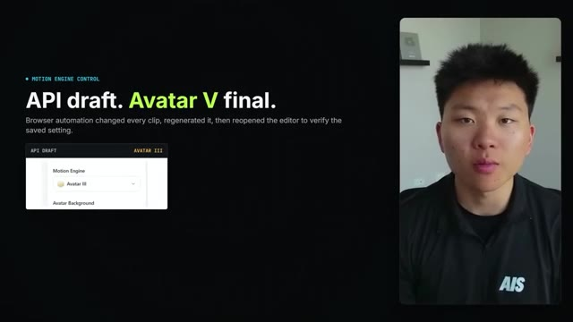
*⏱️ 00:01:52 — Une capture d'écran illustrant le passage de "Avatar III" à "Avatar V" dans les paramètres du moteur de mouvement (Motion Engine) de l'interface HeiGen.*

---

### ⏱️ `[00:02:08 - 00:02:35]` | Segment #07

**🔊 Audio (Transcription Intégrale Mot pour Mot en Français) :**
> I shifted Nate's avatar instead of covering him, used editorial cards for the supporting ideas, and kept him visible through the full edit. Eleven Labs made the audio. Heijen made the avatar, Hyperframes rendered the edit, Sol planned and operated the chain. Then I tried to break my own work. Separate agents inspected frames from the rendered video, checked every entrance and exit, looked for text outside the frame, verified that the avatar never disappeared, and compared the factual claims against OpenAI's release notes.

**👁️ Analyse Visuelle d'Écran (gemini-3.5-flash-lite) :**
**Interface & Outils** : Logiciel de montage automatisé / Outil de workflow de production vidéo propriétaire (Hyperframes).

**Contenu textuel & Code** : Visualisation de données textuelles : "Words set the cut", "Transcript", "Avatar layer locked", et paramètres de monitoring QA : "Search for drift", "Search for overflow", "Search for mismatch", "Search for gaps".

**Action / Démonstration** : Démonstration du processus de synchronisation mot-à-mot (phrase-timed edit) et du test de robustesse automatisé visant à détecter les anomalies dans le rendu final.

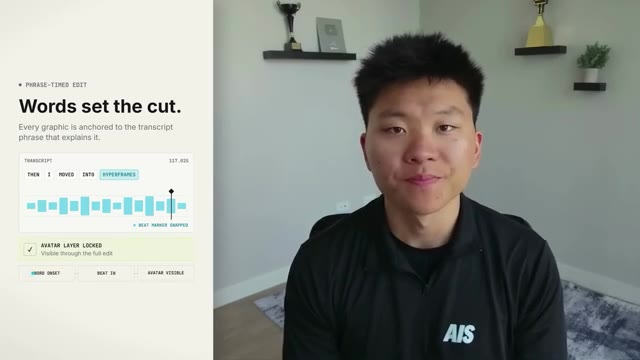
*⏱️ 00:02:15 — Interface d'édition illustrant la synchronisation temporelle des mots avec les coupes visuelles, incluant une timeline audio et un verrouillage de la couche avatar.*

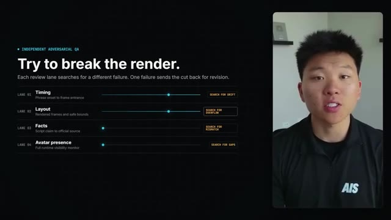
*⏱️ 00:02:28 — Panneau de contrôle d'assurance qualité (QA) "Adversarial" affichant quatre lignes de recherche d'erreurs (Timing, Layout, Facts, Avatar presence) pour automatiser la vérification des rendus.*

---

### ⏱️ `[00:02:36 - 00:02:56]` | Segment #08

**🔊 Audio (Transcription Intégrale Mot pour Mot en Français) :**
> Any failed frame meant another fix, another render, and another review. OpenAI says GPT 5.6 is better at design judgment and at inspecting its own output. This video is a more useful test of that claim than another benchmark slide. Nate supplied one prompt and authorized his voice and avatar. He did not record, edit, or review this before you did.

**👁️ Analyse Visuelle d'Écran (gemini-3.5-flash-lite) :**
**Interface & Outils** : Aucune interface logicielle ou technique (présentation sous forme de diapositives de texte uniquement).

**Contenu textuel & Code** : Texte informatif : "Design Judgment Test", "Inspect. Fix. Render.", "The chain changed. The outcome held."

**Action / Démonstration** : Aucune manipulation logicielle ou exécution de code n'est montrée ; il s'agit d'une illustration textuelle conceptuelle.

---

### ⏱️ `[00:02:56 - 00:03:15]` | Segment #09

**🔊 Audio (Transcription Intégrale Mot pour Mot en Français) :**
> This started as one instruction. Now it is a finished video. That is what Soul is really good at, holding onto the outcome while everything between the prompt and the result keeps changing. This is day one. So that was really, really impressive. I did a very similar experiment when Fable 5 first dropped. If you guys want to check out that video that Fable made for me, I'll tag that right up here.

**👁️ Analyse Visuelle d'Écran (gemini-3.5-flash-lite) :**
**Interface & Outils** : VS Code (Visual Studio Code)

**Contenu textuel & Code** : Logs d'exécution incluant une commande ffmpeg, une liste de contrôle de tâches validées (research, write, generate, assemble, run QA, publish) et un chemin d'accès au fichier vidéo final "GPT-5.6-Sol-Made-This-Entire-Video.mp4".

**Action / Démonstration** : Vérification finale de la livraison du projet vidéo par l'agent, incluant la confirmation du contrôle qualité technique (vidéo, audio, timing) et la finalisation du fichier.

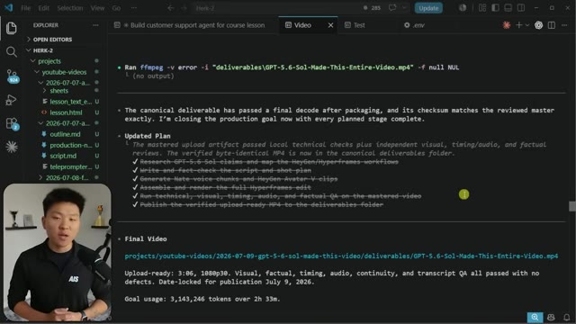
*⏱️ 00:03:10 — Une vue de l'éditeur VS Code montrant un journal de logs d'un agent IA ayant complété une série de tâches pour la production d'une vidéo.*

---

### ⏱️ `[00:03:15 - 00:03:35]` | Segment #10

**🔊 Audio (Transcription Intégrale Mot pour Mot en Français) :**
> And you tell me which one you thought was better. As you can see, it says here that it used 3 million tokens over two and a half hours. But I was a little bit suspicious of that token number because I felt like, you know, we were using GBD 5.6 Sol on Ultra, which meant that it was supposed to do a lot of delegation and there was a lot of other agents being spun up. So I asked it to inspect the logs and tell me how much that actually costed.

**👁️ Analyse Visuelle d'Écran (gemini-3.5-flash-lite) :**
**Interface & Outils** : VS Code (Éditeur de code)

**Contenu textuel & Code** : Rapport d'exécution : "Goal usage: 3,143,246 tokens over 2h 33m" ; invite de commande pour auditer les logs JSON-L ; commandes terminal "token_log_audit" et "sol_pricing_audit".

**Action / Démonstration** : Audit technique de l'utilisation des tokens par l'agent GPT-5.6 Sol pour vérifier la précision des données de consommation.

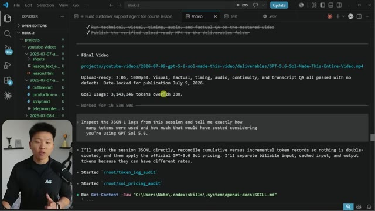
*⏱️ 00:03:20 — Capture d'écran de l'éditeur VS Code montrant un fichier Markdown récapitulant les métriques d'utilisation d'un agent IA, incluant le nombre de tokens et le temps de traitement, ainsi qu'un terminal exécutant un audit des logs JSON-L.*

---

### ⏱️ `[00:03:35 - 00:03:53]` | Segment #11

**🔊 Audio (Transcription Intégrale Mot pour Mot en Français) :**
> So this had its main session and apparently spun up nine other agents. And the total was around 450 million tokens, apparently. And the main agent used about 86 million tokens, which I mean, that's a ton of tokens. And if this was actually calculated with the input and output costs, this would have equaled around $300, a little over $300.

**👁️ Analyse Visuelle d'Écran (gemini-3.5-flash-lite) :**
**Interface & Outils** : Visual Studio Code (VS Code).

**Contenu textuel & Code** : Tableau de données montrant : Uncached input (13,8M tokens), Cached input (443,5M tokens), Output (908k tokens), pour un total de 458 293 557 jetons. Le document précise que l'agent principal a utilisé 86 837 026 jetons et liste les coûts financiers estimés via la grille tarifaire "Codex GPT-5.6".

**Action / Démonstration** : Le présentateur explique et analyse les résultats chiffrés de l'utilisation intensive des tokens par un système composé d'un agent principal et de neuf agents secondaires.

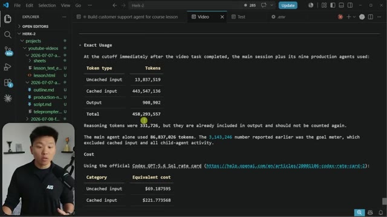
*⏱️ 00:03:39 — Capture d'écran de l'éditeur VS Code affichant un document Markdown détaillant les statistiques de consommation de jetons (tokens) et les coûts associés pour une session d'agent IA.*

---

### ⏱️ `[00:03:54 - 00:04:17]` | Segment #12

**🔊 Audio (Transcription Intégrale Mot pour Mot en Français) :**
> Now that's interesting to me because as soon as GBT 5.6 Soul came out, I shot off this prompt, but I've been playing around with it all day and comparing it to Fable all day. And almost every single run that I've done, it's been way cheaper with GBT 5.6 compared to Fable. So that video will be coming out soon as well. But if you look at the actual API billing, and obviously I was on my codex subscription here, but when you look at the billing, we can see that the Sol pricing is much cheaper.

**👁️ Analyse Visuelle d'Écran (gemini-3.5-flash-lite) :**
**Interface & Outils** : Visual Studio Code (VS Code)

**Contenu textuel & Code** : Document Markdown affichant un tableau de coûts (Uncached input, Cached input, Output) pour GPT 5.6 Soul, des liens vers la documentation OpenAI, et une analyse des logs de consommation. La ligne de commande en bas indique "gpt-5.6-sol ultra" et une invite de saisie "Summarize recent commits".

**Action / Démonstration** : Analyse et comparaison des coûts d'exécution de l'agent IA, avec une démonstration de transparence sur la facturation des jetons (tokens) et des crédits Codex.

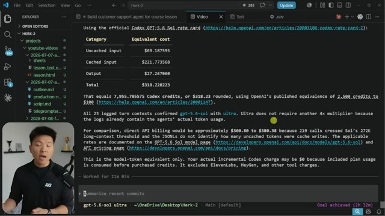
*⏱️ 00:04:00 — Capture d'écran de l'éditeur VS Code montrant un fichier Markdown contenant une analyse comparative des coûts de l'API pour le modèle "GPT 5.6 Soul", incluant un tableau récapitulatif des dépenses.*

---

### ⏱️ `[00:04:17 - 00:04:37]` | Segment #13

**🔊 Audio (Transcription Intégrale Mot pour Mot en Français) :**
> It's basically half of Fable 5. So GBT 5.6 Sol is similarly priced to Opus 4.8. Now here's the thing. I think that GBT 5.6 Sol could have easily given me a similar video output if I didn't put it on Ultra. I think because it was on Ultra, it tended to sort of overthink, overdelegate, and that's where the tokens really started to add up.

**👁️ Analyse Visuelle d'Écran (gemini-3.5-flash-lite) :**
**Interface & Outils** : OpenRouter (plateforme de modèles d'IA).

**Contenu textuel & Code** : Tableau comparatif affichant les coûts (Input/Output par million de tokens), la latence (s) et le débit (tok/s) pour les modèles Claude Fable 5 et GPT-5.6 Sol.

**Action / Démonstration** : Navigation sur la page de comparaison des prix des modèles pour illustrer le coût des différentes configurations d'IA.

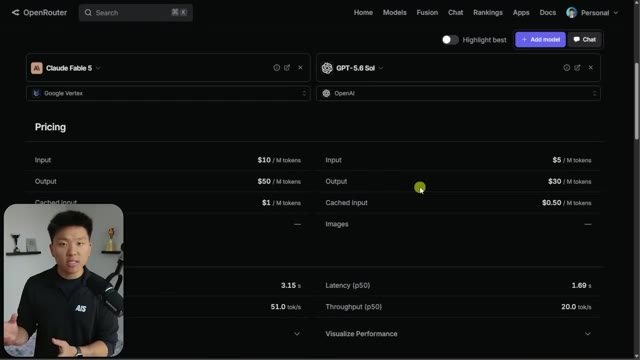
*⏱️ 00:04:22 — Comparaison tarifaire et technique entre les modèles Claude Fable 5 et GPT-5.6 Sol sur la plateforme OpenRouter.*

---

### ⏱️ `[00:04:37 - 00:04:58]` | Segment #14

**🔊 Audio (Transcription Intégrale Mot pour Mot en Français) :**
> I bet if I would have done this exact same prompt on high or very high, we would have gotten a similar result and probably half the cost. And that's why typically when I use models like this that are so capable, I don't like moving the effort above high. But really what I wanted to show you guys here is how good these models are at giving a pretty emotional, vague, ambiguous prompt and letting them figure it out.

**👁️ Analyse Visuelle d'Écran (gemini-3.5-flash-lite) :**
**Interface & Outils** : OpenRouter (navigateur web) et Visual Studio Code.

**Contenu textuel & Code** : Tarifs d'API, métriques de performance, calculs de coûts en dollars et crédits pour "GPT-5.6 Sol", et logs de traitement d'un agent.

**Action / Démonstration** : Le présentateur illustre la différence de coûts entre les niveaux de performance des modèles IA, comparant les données tarifaires affichées.

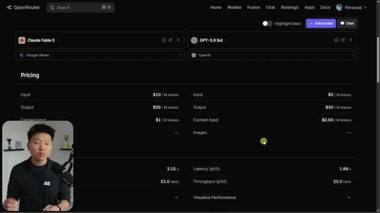
*⏱️ 00:04:42 — Interface web OpenRouter affichant un tableau comparatif détaillé des tarifs (input, output, cache) et des performances (latence, throughput) pour les modèles Claude Fable 5 et GPT-5.6 Sol.*

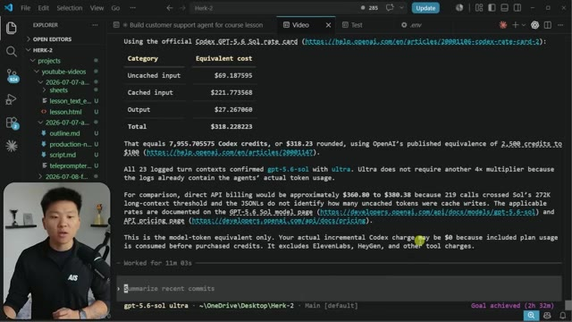
*⏱️ 00:04:53 — Éditeur VS Code affichant un fichier Markdown contenant une analyse détaillée des coûts d'API (OpenAI) pour un agent, incluant des calculs de jetons et des liens vers la documentation officielle.*

---

### ⏱️ `[00:04:58 - 00:05:23]` | Segment #15

**🔊 Audio (Transcription Intégrale Mot pour Mot en Français) :**
> Obviously there's some stuff that it went through and it looked through my projects and it looked through other videos and took some inspiration. But if you just get out of its way and you give it a prompt that has things like delegation and verification, you will be surprised at how far you can get. And then from here, you're going to iterate. You'll build skills around it. You'll put feedback in and you will just be able to do a lot of cool stuff. So anyways, this one's super quick, but if you enjoyed, please leave a like, and I appreciate you guys making it to the end. I'll see you guys in the next one. Thanks everyone.

**👁️ Analyse Visuelle d'Écran (gemini-3.5-flash-lite) :**
**Interface & Outils** : Visual Studio Code (VS Code)

**Contenu textuel & Code** : Tableau récapitulatif des coûts (Uncached input, Cached input, Output), calculs de crédits Codex, références aux documentations OpenAI (GPT-5.6 Sol) et invite de commande terminal en bas : "Summarize recent commits".

**Action / Démonstration** : L'agent a terminé une tâche (message "Goal achieved") après 11 minutes et 3 secondes, et l'utilisateur prépare une nouvelle requête dans le terminal.

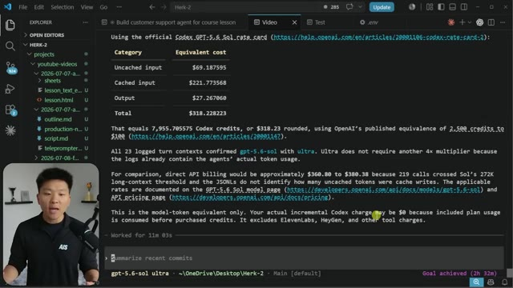
*⏱️ 00:05:05 — Interface VS Code affichant un rapport de coûts d'utilisation de l'API (Codex GPT-5.6) dans un fichier markdown, avec une fenêtre de terminal en bas.*

---

