# 🎬 I Tested GPT 5.6 Sol vs Fable 5. What You Need To Know.

> **Chaîne** : [Nate Herk | AI Automation](https://www.youtube.com/@nateherk/featured)  
> **Lien YouTube** : [https://www.youtube.com/watch?v=EthxaDswUFo](https://www.youtube.com/watch?v=EthxaDswUFo)  
> **Date de publication** : 20260710  
> **Durée** : 00:20:25  
> **Identifiant vidéo** : `EthxaDswUFo`  
> **Transcription & Analyse** : `whisper-v3-large-turbo+gemini-3.5-flash-lite`  

---

## 📌 Synthèse Exécutive & Outils

### 💡 Résumé
Dans cette vidéo intitulée **I Tested GPT 5.6 Sol vs Fable 5. What You Need To Know.**, Nate Herk décortique les capacités pratiques d'automatisation et de développement propulsées par les modèles de pointe.

### 🛠️ Outils, Modèles & Logiciels Présentés
- **Opus 5.5 & Claude Code** : Modèles d'ingénierie et agents de codage autonome.

### 🔑 Points Clés & Enseignements Stratégiques
- Optimiser le niveau d'effort et le raisonnement des modèles IA pour des résultats industriels.
- Automatiser les cycles de création logicielle de bout en bout.

---

## ⏱️ Chronologie & Transcription Complète Audio & Visuelle (Mot pour Mot)

### ⏱️ `[00:00:00 - 00:00:18]` | Segment #01

**🔊 Audio (Transcription Intégrale Mot pour Mot en Français) :**
> So we finally have GBT 5.6, Sol, Terra, and Luna. And the benchmarks are insanely impressive because it basically shows that Sol blows Opus and Fable out of the water and is significantly cheaper. So I'm gonna quickly flash a few of these benchmarks on screen right now, but I don't wanna just talk about the benchmarks. I think that's extremely boring.

**👁️ Analyse Visuelle d'Écran (gemini-3.5-flash-lite) :**
**Interface & Outils** : Page web de type "OpenAI Research" (simulée ou conceptuelle) présentant une visualisation de données de benchmark.

**Contenu textuel & Code** : Graphique de performance comparant les modèles GPT-5.6 (Sol, Terra, Luna) avec Claude Fable 5, Claude Opus 4.8 et Gemini 3.1 Pro Preview. L'axe des ordonnées affiche le "Score" et l'axe des abscisses le "API cost (USD)".

**Action / Démonstration** : Présentation visuelle et comparaison des performances des modèles IA cités dans le discours audio.

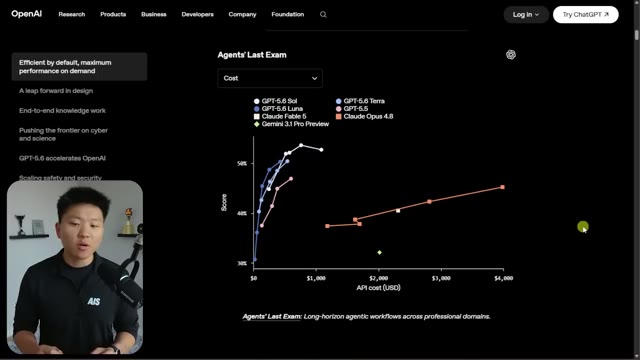
*⏱️ 00:00:05 — Une capture d'écran montrant le présentateur incrusté à gauche devant une page web OpenAI affichant un graphique comparatif intitulé "Agents' Last Exam" illustrant le score en fonction du coût API pour différents modèles IA.*

---

### ⏱️ `[00:00:19 - 00:00:41]` | Segment #02

**🔊 Audio (Transcription Intégrale Mot pour Mot en Français) :**
> I've been playing around with these models all day long. I've been putting them side by side, meaning GBT 5.6 and Fable 5. And I've been driving my day-to-day work with these two models. So I can actually tell you which model do I like for which use cases and why. So don't want to waste any of your time. Let's just get straight into today's video. Now, real quick before we hop in, I did want to call out that I do think that this landing page is pretty awesome. I love the Sol and the Terra and the Luna back here.

**👁️ Analyse Visuelle d'Écran (gemini-3.5-flash-lite) :**
**Interface & Outils** : Navigateur web (site OpenAI) et outil de tableau blanc/mindmapping.

**Contenu textuel & Code** : Texte comparatif des capacités des modèles "Fable" et "Sol" ; page de présentation produit "GPT-5.6".

**Action / Démonstration** : Présentation comparative des rôles d'agents IA et démonstration de la documentation officielle d'un nouveau modèle.

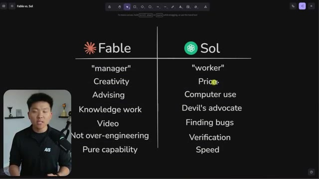
*⏱️ 00:00:30 — Tableau comparatif sur fond sombre divisant les rôles entre "Fable" (manager, créativité) et "Sol" (worker, vitesse, débogage).*

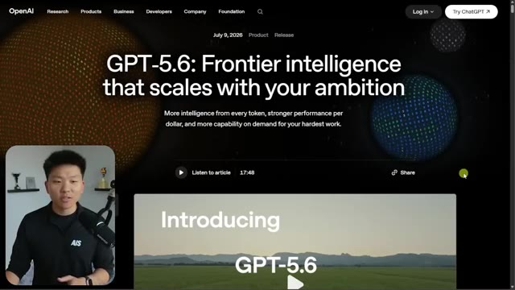
*⏱️ 00:00:35 — Capture d'écran du site officiel d'OpenAI annonçant le lancement de GPT-5.6 avec le slogan "Frontier intelligence that scales with your ambition".*

---

### ⏱️ `[00:00:41 - 00:01:15]` | Segment #03

**🔊 Audio (Transcription Intégrale Mot pour Mot en Français) :**
> And you can see that there's little fives and sixes kind of like drifting all over and inside of these planets as well, which I thought was a nice touch. But anyways, let's get into what I actually did today. All right. So I'm just going to walk you guys through some of the experiments I did. And then at the end, I'm going to actually talk about like the pros and cons of each and my overall consensus. So the first thing I did, I have Claude on the left here with Fable 5. I've got Codex on the right here with GBT 5.6, Sol, and I gave them both the exact same prompts. So I gave them both the slash goal and I told them to build a genuinely fun, playable, open world byte game that runs in the browser. I gave them these other rules. I'm not going to read off this

**👁️ Analyse Visuelle d'Écran (gemini-3.5-flash-lite) :**
**Interface & Outils** : VS Code avec interface d'agent de développement IA (type Cursor ou outil similaire).

**Contenu textuel & Code** : Spécifications techniques pour le développement d'un jeu de vélo en monde ouvert, journaux de recherche web, logs JSON détaillant l'utilisation des jetons (input/output tokens) et les coûts en crédits (API usage).

**Action / Démonstration** : Supervision d'un processus de développement autonome par un agent, avec consultation de documentation et analyse de logs de consommation de jetons en temps réel.

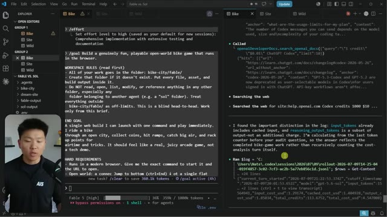
*⏱️ 00:00:58 — Éditeur de code (VS Code ou environnement similaire) avec un panneau de discussion/agent IA affichant des instructions système, des journaux d'exécution et des logs de requêtes API.*

---

### ⏱️ `[00:01:15 - 00:01:47]` | Segment #04

**🔊 Audio (Transcription Intégrale Mot pour Mot en Français) :**
> whole prompts, but if you want to take a look, feel free. I gave them creative freedom and I just wanted to see what they could come up with. Okay. So I haven't played any of these yet, but I'm not going to tell you which one's which. We're going to see them both and then I'll reveal. So WASD to steer, space to bunny hop, Q and E for air tricks, shift for boost. Okay, let's go ahead and drop in. Nice. Okay, so we can move around. We have a city here. The camera is a little bit hard to maneuver with. You can't drive through the building, so that's good to know. Okay, just got a little trick in the air there. So this is honestly working pretty well. I don't love

**👁️ Analyse Visuelle d'Écran (gemini-3.5-flash-lite) :**
**Interface & Outils** : Navigateur web (jeu vidéo généré ou développé par IA).

**Contenu textuel & Code** : Interface utilisateur de jeu : titre "NEON SPOKES", instructions de contrôle, compteur de score "002650" et interface de navigation urbaine.

**Action / Démonstration** : Le présentateur teste un jeu vidéo généré par IA, passant de l'écran de configuration au gameplay actif.

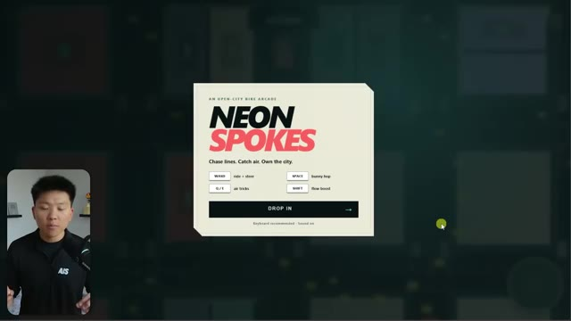
*⏱️ 00:01:23 — Écran de démarrage du jeu web "Neon Spokes", présentant le titre du jeu et les contrôles clavier (WASD, SPACE, Q/E, SHIFT) avec un bouton "DROP IN".*

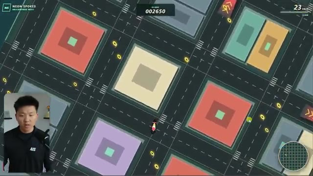
*⏱️ 00:01:39 — Vue de dessus (top-down) d'un jeu vidéo dans un navigateur, montrant un personnage à vélo naviguant dans une ville stylisée aux formes géométriques colorées, avec un score en haut et une mini-map en bas à droite.*

---

### ⏱️ `[00:01:47 - 00:02:06]` | Segment #05

**🔊 Audio (Transcription Intégrale Mot pour Mot en Français) :**
> the actual way that this works. Like the top down bird's eye view, I don't think I like. It's a little bit hard to control. But hey, functionality wise, the coins are working, the controls work. I just jumped over a building and I can bunny hop. Okay, cool. And it doesn't look too bad either, considering this didn't take it very long. So that was the first game.

**👁️ Analyse Visuelle d'Écran (gemini-3.5-flash-lite) :**
**Interface & Outils** : Jeu vidéo "Neon Spokes" (environnement de développement de jeu).

**Contenu textuel & Code** : Éléments de HUD (Score, vitesse en km/h, mini-map, notifications de figures/tricks comme "WALL TAP" et "360 SPIN").

**Action / Démonstration** : Démonstration du gameplay : le joueur navigue dans la ville, réalise des figures acrobatiques et collecte des items (pièces).

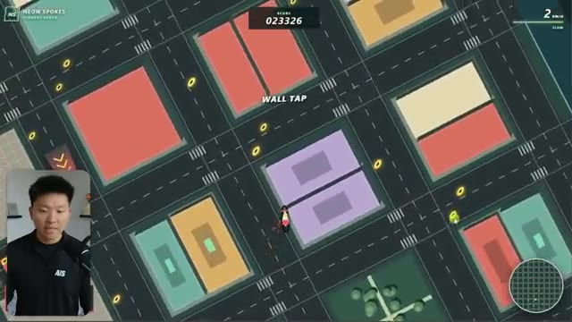
*⏱️ 00:01:52 — Vue de dessus (top-down) d'un jeu vidéo nommé "Neon Spokes" où le personnage effectue un "WALL TAP" dans un environnement urbain stylisé.*

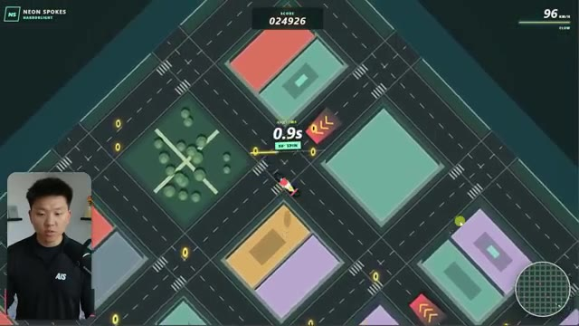
*⏱️ 00:01:57 — Vue de jeu montrant le personnage réalisant une figure de style "360 SPIN" avec un compteur de temps affiché à 0.9s au milieu de l'écran.*

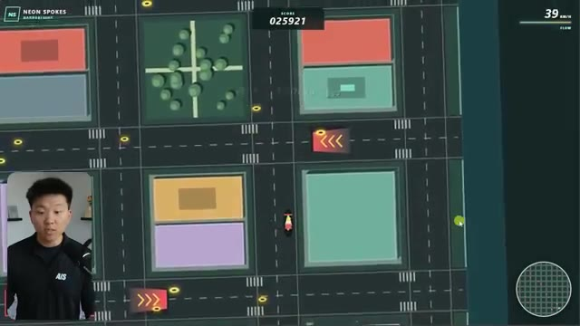
*⏱️ 00:02:01 — Vue de jeu montrant le personnage circulant dans les rues de la ville, avec le score 025921 et la vitesse affichés en haut de l'interface.*

---

### ⏱️ `[00:02:06 - 00:02:41]` | Segment #06

**🔊 Audio (Transcription Intégrale Mot pour Mot en Français) :**
> All right. And now here is the other version. Let's go ahead and see. It's pretty similar controls. So let's hop in here. Okay. So this one is more like a 3D, almost more of like a POV sort of style. I can jump, I can spin. Oh, I don't know what just happened there. But I'm in the city. I've got the coin still. Let's see if I can go try to get on this ramp and see what the physics of that look like. Wait, am I on the wrong side of the ramp? Yep, that was the wrong side of the ramp. But this definitely has more of like that, I don't know, like more of a GTA vibe, like an open world game that you can actually like, I don't know, explore. It feels like the

**👁️ Analyse Visuelle d'Écran (gemini-3.5-flash-lite) :**
**Interface & Outils** : Navigateur web affichant une application de jeu 3D générée.

**Contenu textuel & Code** : Interface utilisateur de jeu incluant un score (40, 85, 337), un compteur de pièces, une mini-carte en haut à droite et une barre de vitesse (54-58 km/h) avec indication "TURBO - HOLD SHIFT".

**Action / Démonstration** : Démonstration en temps réel du gameplay (pilotage du personnage) dans l'environnement généré.

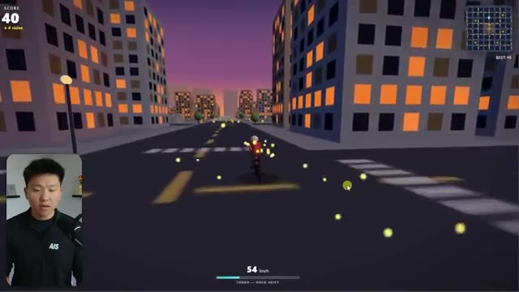
*⏱️ 00:02:15 — Vue à la troisième personne d'un jeu vidéo de style arcade 3D où un personnage à vélo roule sur une avenue urbaine au crépuscule.*

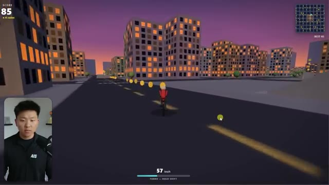
*⏱️ 00:02:24 — Le personnage continue d'avancer dans l'environnement 3D, collectant des pièces dorées alignées sur la route.*

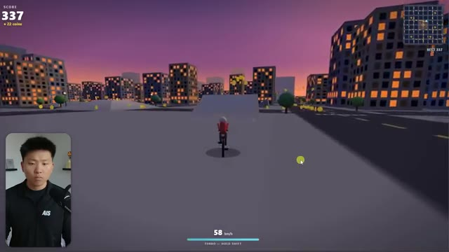
*⏱️ 00:02:33 — Le personnage arrive devant une rampe sur un terrain dégagé au sein de l'environnement de jeu urbain.*

---

### ⏱️ `[00:02:41 - 00:03:11]` | Segment #07

**🔊 Audio (Transcription Intégrale Mot pour Mot en Français) :**
> map is much bigger. I mean, this is definitely a clear winner. So I think that we've decided that. All right. So in this example, the second one, which is the one I thought was the winner here was Fable 5. So that's on the left-hand side here. This took 21 minutes and 37 seconds, whereas the other side, GBT Sol, took 23 minutes. So similar on the timing here, but let's look at cost. So this Fable run would have costed me about $14.22, whereas the GBT Sol run would have costed $4.5.

**👁️ Analyse Visuelle d'Écran (gemini-3.5-flash-lite) :**
**Interface & Outils** : VS Code (avec extension de terminal intégrée/agent IA).

**Contenu textuel & Code** : Rapports d'exécution, logs de build, statistiques de performance (temps de 21m 37s pour Fable 5), instructions de contrôle ("WASD/arrows", "Shift"), et prompts d'audit de consommation de tokens (JSON-L logs).

**Action / Démonstration** : Analyse comparative et audit de performance de deux modèles d'IA différents pour la génération de code et le déploiement d'un projet de jeu.

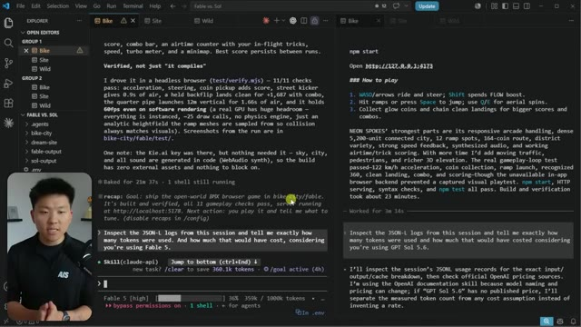
*⏱️ 00:02:49 — Interface VS Code en mode écran divisé affichant une comparaison côte à côte des résultats d'exécution entre "Fable 5" (gauche) et "GPT Sol 5.6" (droite) pour le développement d'un jeu BMX en navigateur.*

---

### ⏱️ `[00:03:11 - 00:03:32]` | Segment #08

**🔊 Audio (Transcription Intégrale Mot pour Mot en Français) :**
> Now what I think is really interesting here is the output tokens. Fable outputted about 90,000, and Sol only outputted about 31,000. So we've consistently seen that Codex and GBT are way more token efficient. And sometimes that's better and sometimes that's not. In this case, I would say that it wasn't better because Fable's output, in my opinion, was like not just a little bit better, it was significantly better.

**👁️ Analyse Visuelle d'Écran (gemini-3.5-flash-lite) :**
**Interface & Outils** : VS Code (éditeur de texte avec affichage divisé en deux colonnes).

**Contenu textuel & Code** : Tableaux comparatifs de consommation de tokens, coûts associés (en dollars), détails sur le cache des prompts, et calculs de facturation pour les modèles Fable 5 et GPT-5.6 Sol.

**Action / Démonstration** : Analyse et comparaison visuelle des logs d'exécution et des métriques de coût d'utilisation de l'IA.

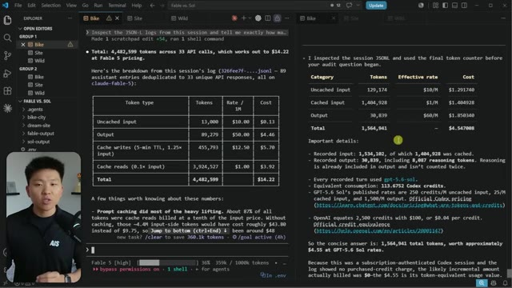
*⏱️ 00:03:16 — Capture d'écran de l'interface VS Code montrant un document Markdown comparant les coûts en jetons (tokens) et les statistiques d'utilisation de l'API entre "Fable" et "Sol".*

---

### ⏱️ `[00:03:32 - 00:03:51]` | Segment #09

**🔊 Audio (Transcription Intégrale Mot pour Mot en Français) :**
> All right, so let's move on to the second test. So this one was kind of similar. I just said, hey, slash goal, build me the most impressive interactive scroll stopping website that you can imagine. So I gave him complete creative freedom. I just wanted to see what the models did with that. So let me pull up both versions once again. All right, so once again, I'm not gonna tell you which one is which. I want you to try to form your own opinion.

**👁️ Analyse Visuelle d'Écran (gemini-3.5-flash-lite) :**
**Interface & Outils** : Éditeur de code Cursor (avec terminal Claude Code v2.1.205 intégré).

**Contenu textuel & Code** : Prompt utilisateur visible dans le terminal : "/goal Build the most impressive, interactive, scroll-stopping website you can imagine." et les règles du workspace associées. À droite, les étapes de construction et les instructions de lancement (npm run dev).

**Action / Démonstration** : Exécution d'une requête de développement web par l'agent IA Claude Code pour générer un site web complexe selon une consigne créative libre.

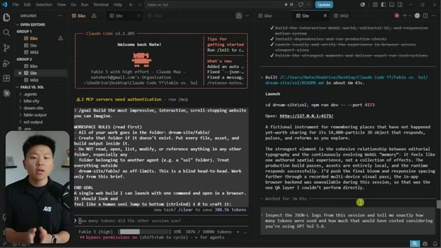
*⏱️ 00:03:37 — Interface de l'éditeur de code Cursor affichant une session active de "Claude Code" dans le terminal intégré, avec le prompt utilisateur pour le test créatif.*

---

### ⏱️ `[00:03:51 - 00:04:12]` | Segment #10

**🔊 Audio (Transcription Intégrale Mot pour Mot en Français) :**
> This one also has sound with it. So I'll make sure the sound is turned on. So what you can see here is 10 billion years. And as we scroll down, we're gonna get like kind of a journey, but everything in the background is pretty interactive. So it's very like 3D. So watch as I scroll down here. We start off with the cloud, not too much, but you can still see that there's, you know, like responsiveness to my mouse movements.

**👁️ Analyse Visuelle d'Écran (gemini-3.5-flash-lite) :**
**Interface & Outils** : Navigateur web (site interactif de visualisation de données).

**Contenu textuel & Code** : Texte à l'écran : "TEN BILLION YEARS", sous-titre : "THE LIFE OF A STAR, COMPRESSED INTO ONE SCROLL".

**Action / Démonstration** : Démonstration d'une interface web interactive basée sur le défilement (scrollytelling) pour visualiser des données temporelles à grande échelle.

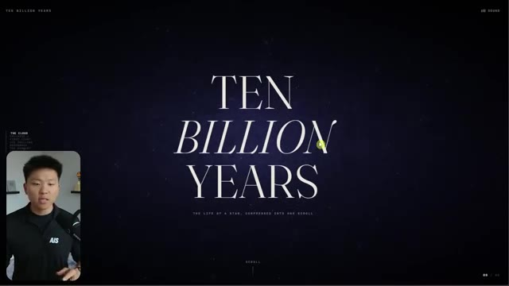
*⏱️ 00:03:56 — Une page web interactive au design minimaliste affichant le titre "TEN BILLION YEARS" sur un fond spatial sombre, avec le présentateur incrusté en bas à gauche de l'écran.*

---

### ⏱️ `[00:04:12 - 00:04:30]` | Segment #11

**🔊 Audio (Transcription Intégrale Mot pour Mot en Français) :**
> Then we have the collapse. And once again, we've got some cool like galaxy looking, very 3D. And basically that's the theme of this whole thing. It's telling the story, I guess, of like, you know, how we got to where we are. This is a pretty cool effect. First light and the swelling.

**👁️ Analyse Visuelle d'Écran (gemini-3.5-flash-lite) :**
**Interface & Outils** : Aucune interface logicielle ou outil de développement n'est visible. Il s'agit d'une interface de narration narrative ou d'une expérience web interactive axée sur le design visuel.

**Contenu textuel & Code** : Texte à l'écran concernant des concepts cosmologiques ("Ten Billion Years", "The Collapse", "First Light", "The Swelling").

**Action / Démonstration** : Navigation au sein d'une présentation visuelle animée illustrant l'évolution de l'univers, sans démonstration technique ou opérationnelle.

---

### ⏱️ `[00:04:30 - 00:04:50]` | Segment #12

**🔊 Audio (Transcription Intégrale Mot pour Mot en Français) :**
> So the fuel starts to run out. And then we had a big boom. So that was a big noise here for basically the supernova. This is a nice effect as well. And then, like I said, we just kind of keep going through with this sort of feel up until the very end where we are just at us. So we have the word you. Pretty cool. So that is what one of the models decided to do.

**👁️ Analyse Visuelle d'Écran (gemini-3.5-flash-lite) :**
**Interface & Outils** : Navigateur web affichant un site interactif de narration astronomique.

**Contenu textuel & Code** : Texte affiché : "Stardust", "You are the afterlife of a star".

**Action / Démonstration** : Navigation à travers une expérience web interactive illustrant l'évolution stellaire et la formation de la vie.

---

### ⏱️ `[00:04:50 - 00:05:26]` | Segment #13

**🔊 Audio (Transcription Intégrale Mot pour Mot en Français) :**
> Let's take a look at the other one. We have Vesper Archive. And as we go down, we have a similar sort of thing with sound. And it's kind of interesting because they had like a similar feel, right? Like a 3D sort of background that's interactive with my mouse. And it's telling some sort of story. It's telling some sort of journey. But they're both not bad. So far, I definitely think that the first one was a little bit, had more of a wow factor for sure. It was a bit more immersive. This one tells a nice story and it still has some impressive features, but I think the first one so far was definitely on a different level. So which one was Fable? Fable was the first one. So once again, I think

**👁️ Analyse Visuelle d'Écran (gemini-3.5-flash-lite) :**
**Interface & Outils** : Site web interactif (Vesper Archive).

**Contenu textuel & Code** : Texte narratif : "Not every memory belongs to the past. In 2020, a signal was recovered from beneath a dry lake bed..." et représentation visuelle d'une sphère en maillage 3D.

**Action / Démonstration** : Navigation sur une page web immersive où l'utilisateur interagit avec des éléments visuels 3D réactifs au mouvement de la souris.

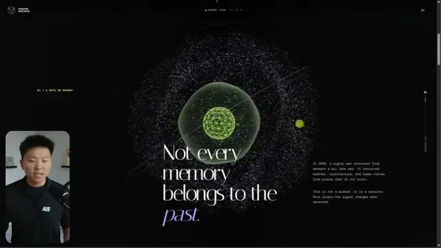
*⏱️ 00:04:59 — Interface interactive du site "Vesper Archive" présentant un graphique 3D central entouré de particules, avec une typographie élégante et un texte narratif sur le côté droit.*

---

### ⏱️ `[00:05:26 - 00:06:02]` | Segment #14

**🔊 Audio (Transcription Intégrale Mot pour Mot en Français) :**
> that Fable did a better job here. What you can see is Fable took 23 minutes, whereas Sol took almost seven minutes. And if we go down to the actual cost, Fable was 19 bucks and 24 cents with 80,000 output tokens. And Sol was only a little over a dollar and output 20,000 tokens. So it's interesting. Like if we had Sol working enough to spend as much as Fable did, would Sol's output have been just as good, if not better? Maybe. Sol is significantly cheaper on top of the fact that it typically spends less tokens in general, just because of the harness and because of the way the model is trained, I guess. But yeah, I mean, this was almost 20 times cheaper for Fable. But the

**👁️ Analyse Visuelle d'Écran (gemini-3.5-flash-lite) :**
**Interface & Outils** : VS Code (avec extension de chat/agent IA intégrée).

**Contenu textuel & Code** : Tableau comparatif des tokens et coûts (Uncached input, Cache writes, Cache reads, Output) totalisant 19,24 $ pour Fable, suivi d'une analyse des coûts pour "gpt-5.6-sol" totalisant environ 1,24 $.

**Action / Démonstration** : Analyse et comparaison détaillée des données d'utilisation de l'API et des coûts de session entre deux modèles différents.

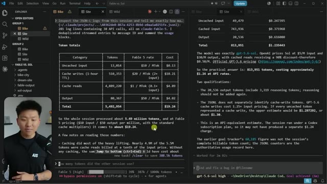
*⏱️ 00:05:35 — Une capture d'écran de l'interface VS Code affichant un document Markdown comparatif des coûts entre "Fable" et "Sol", incluant des tableaux de consommation de tokens et des notes techniques sur les tarifs des API.*

---

### ⏱️ `[00:06:02 - 00:06:31]` | Segment #15

**🔊 Audio (Transcription Intégrale Mot pour Mot en Français) :**
> question is, is Fable's output, was that 20 times better? And I don't necessarily think that it was. But just because we're going off of like the actual quality, I'm going to say that I would have taken Fable's output in this one as well. All right. So I did one more side-by-side experiment. This one's interesting. I gave it a different goal prompt and I said, design me five fundamentally different visual elements. They can be games, presentations, websites, simulations, whatever you want. I really wanted to see once again, what does the model do with a super ambiguous prompt?

**👁️ Analyse Visuelle d'Écran (gemini-3.5-flash-lite) :**
**Interface & Outils** : VS Code (utilisant l'interface de Claude Code / CLI).

**Contenu textuel & Code** : - Image #1 : Analyse de coûts ("API-equivalent cost"), décompte de tokens (input/output) et logs d'exécution.
- Image #2 : Prompt "/goal" demandant la création de cinq expériences visuelles interactives, suivi de logs "PASS" pour la vérification du code et rapports d'erreurs.

**Action / Démonstration** : - Image #1 : Revue technique des performances et de la facturation liée à l'usage du modèle Fable 5.
- Image #2 : Exécution d'une requête de développement créatif et vérification automatisée de la structure des fichiers générés.

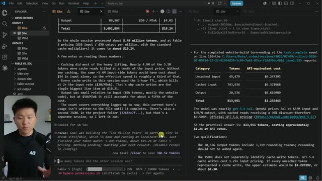
*⏱️ 00:06:09 — Une vue de l'éditeur de code affichant un rapport détaillé de consommation de tokens et de coûts financiers associés à une session d'agent IA.*

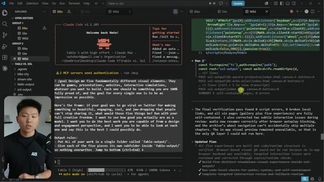
*⏱️ 00:06:16 — Une vue de l'interface de Claude Code affichant un prompt complexe de conception de sites web ainsi que les résultats d'exécution et les rapports de vérification de code.*

---

### ⏱️ `[00:06:31 - 00:07:08]` | Segment #16

**🔊 Audio (Transcription Intégrale Mot pour Mot en Français) :**
> So let me open up the different outputs right here and we'll go ahead and compare this time. I will go ahead and tell you which one is which as we're looking at them. All right. So this one is fable and this one is soul. So they each output one site and then we've got five different kind of like simulations or sister sites to go through. So let's just start with fable and go through all of them and then we'll go to soul. So this is what we got so far. The gallery five self-contained worlds. Let's look at singularity. So I don't really know what's going on here. It says move to warp space time, hold to feed it, I guess. And then you hit space to detonate. So if I hit space,

**👁️ Analyse Visuelle d'Écran (gemini-3.5-flash-lite) :**
**Interface & Outils** : Navigateur web (site interactif "Impossible Objects").

**Contenu textuel & Code** : Interface utilisateur de sites web hautement graphiques et expérimentaux, titres textuels ("IMPOSSIBLE OBJECTS", "AURORA ORCHESTRA", "SINGULARITY"), paramètres de simulation spatiale.

**Action / Démonstration** : Navigation et démonstration des capacités visuelles et interactives des sites générés ou testés par le présentateur.

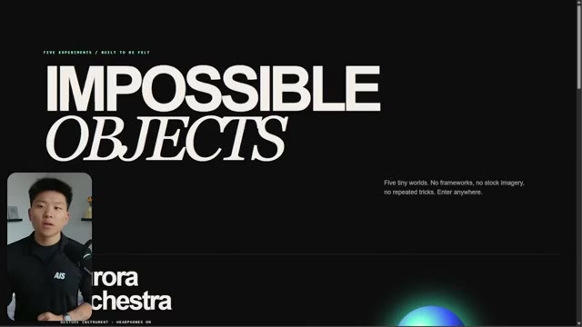
*⏱️ 00:06:40 — Page d'accueil du site web "Impossible Objects" affichant le titre en grand et la section "Aurora Orchestra".*

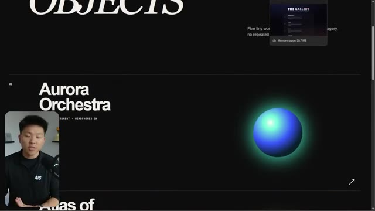
*⏱️ 00:06:49 — Détail de la section "Aurora Orchestra" avec une sphère lumineuse bleue sur fond sombre, le présentateur en médaillon.*

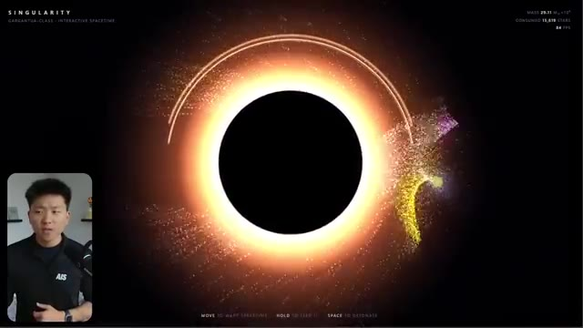
*⏱️ 00:06:58 — Visualisation interactive d'un trou noir ("Singularity") avec des effets de particules, appartenant à l'expérience web présentée.*

---

### ⏱️ `[00:07:09 - 00:07:37]` | Segment #17

**🔊 Audio (Transcription Intégrale Mot pour Mot en Français) :**
> we just blew something up, I guess. So I'm not really sure what they're going for here, but that's number one. We have second one, which is called Terra, where we kind of like have this flight simulator almost where we can steer with our mouse. We use W or S to speed up or speed down. We can go up or down. We can change the time of day. So as far as like the physics on this, it's not too bad. Everything is kind of rendering in a bit strange. I'm not sure if they were doing that intentionally. Maybe that's like the vibe of this, but pretty cool. You know, not too bad.

**👁️ Analyse Visuelle d'Écran (gemini-3.5-flash-lite) :**
**Interface & Outils** : Navigateur web (application de simulation interactive).

**Contenu textuel & Code** : Textes descriptifs des démos : "Infinite voxel terrain flight", "Software-rendered flight over an endless procedural landscape". Données de télémétrie en haut à droite (Altitude, Vitesse, Cap).

**Action / Démonstration** : Navigation dans le menu des démos, puis vol piloté par l'utilisateur au sein de la simulation 3D "Terra".

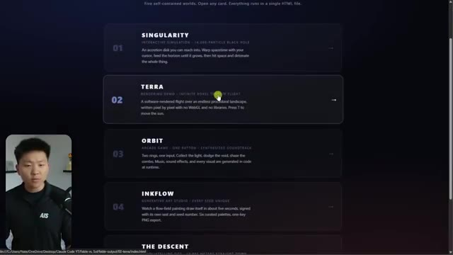
*⏱️ 00:07:16 — Interface de sélection de projets/démos interactives listant "Singularity", "Terra", "Orbit", et "Inkflow".*

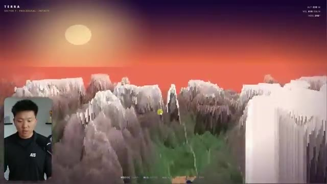
*⏱️ 00:07:23 — Vue immersive du simulateur de vol "Terra" avec un paysage procedural en voxels et un coucher de soleil.*

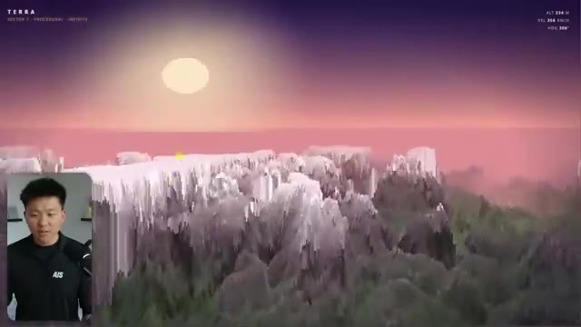
*⏱️ 00:07:30 — Continuation du vol dans "Terra", montrant les changements de couleurs du ciel et des reliefs générés.*

---

### ⏱️ `[00:07:38 - 00:08:12]` | Segment #18

**🔊 Audio (Transcription Intégrale Mot pour Mot en Français) :**
> I don't love it, but I mean, for the fact that Fable just kind of wanted to do this and did it, it's all right. Okay. We've got Orbit, which is an arcade game, two rings, one input. So I think it looks like we just click to switch rings we're trying to collect the coins okay we're trying to avoid those things is what it looks like um and that's how you get shattered so i mean it plays fine it feels very responsive i'm not sure this is a bit of a bug though huh um the menu is like taking over me actually playing so i'm playing right now but the menu isn't going away so

**👁️ Analyse Visuelle d'Écran (gemini-3.5-flash-lite) :**
**Interface & Outils** : Navigateur web (plateforme de démonstration Fable).

**Contenu textuel & Code** : Liste de titres de projets : SINGULARITY, TERRA, ORBIT, INKFLOW, THE DESCENT, accompagnée de leurs descriptions techniques respectives.

**Action / Démonstration** : Le présentateur parcourt la liste des jeux disponibles sur le site web.

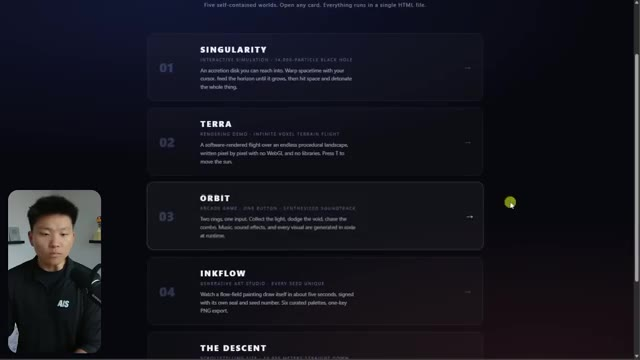
*⏱️ 00:07:46 — Une interface web sombre présentant une liste de projets interactifs nommés "Fable", avec notamment l'option "03 ORBIT" sélectionnée, décrite comme un jeu d'arcade à une touche.*

---

### ⏱️ `[00:08:12 - 00:08:33]` | Segment #19

**🔊 Audio (Transcription Intégrale Mot pour Mot en Français) :**
> that's a bit of a bug let's go ahead to number four we've got ink flow um click for new piece I can change the palette. I can save them as a PNG. I think this is just a weird, like a board button sort of thing. I don't know if you guys ever did board button, but that's what this reminds me of, like just some very random thing.

**👁️ Analyse Visuelle d'Écran (gemini-3.5-flash-lite) :**
**Interface & Outils** : Application web Inkflow (art génératif).

**Contenu textuel & Code** : Commandes textuelles en bas de l'écran : "CLICK CANVAS OR [N] - NEW PIECE", "[P] PALETTE: PORCELAIN", "[S] SAVE PNG", et un identifiant "SEED C8OIYN".

**Action / Démonstration** : Le présentateur démontre l'interface en interagissant avec la toile et en commentant les options de changement de palette et d'exportation en PNG.

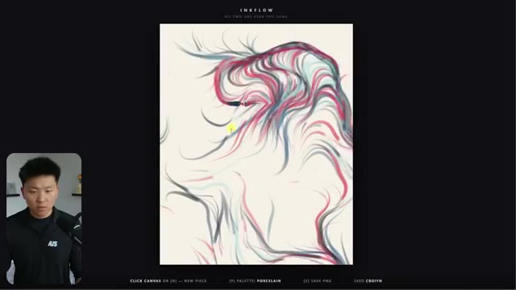
*⏱️ 00:08:17 — Une interface web minimaliste intitulée "INKFLOW" affichant une œuvre d'art générative composée de traits fluides aux tons roses et bleus sur fond crème.*

---

### ⏱️ `[00:08:33 - 00:08:54]` | Segment #20

**🔊 Audio (Transcription Intégrale Mot pour Mot en Français) :**
> And the last one is the descent. So scroll from sunlit surface to challenge. Okay. So this is kind of like a story again. It's like an interactive story where we're actually going underwater. The background's changing. We're seeing different creatures go through deeper than the Titanic. The pressure, the sunlight, the temperature, all of that's changing.

**👁️ Analyse Visuelle d'Écran (gemini-3.5-flash-lite) :**
**Interface & Outils** : Interface web de narration interactive (scrollytelling) sur la profondeur océanique.

**Contenu textuel & Code** : Affichage dynamique de compteurs : profondeur (mètres), pression atmosphérique, pourcentage de lumière solaire et température.

**Action / Démonstration** : Navigation par défilement (scroll) simulant une plongée interactive à travers différentes strates océaniques.

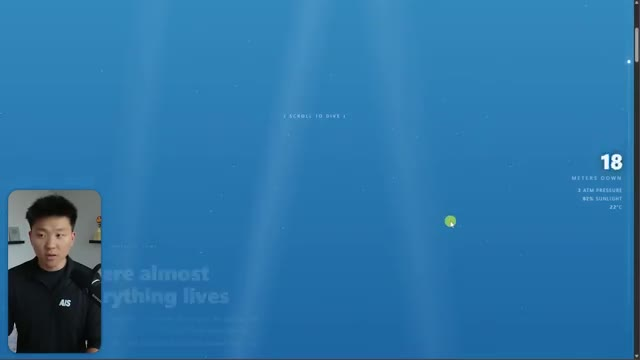
*⏱️ 00:08:38 — Interface web interactive montrant une descente sous-marine à 18 mètres, avec des données en temps réel sur la pression (2 ATM) et la lumière (92%).*

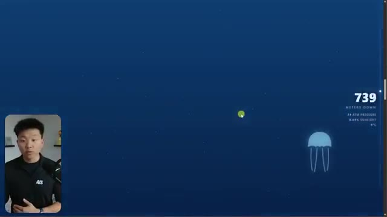
*⏱️ 00:08:43 — Poursuite de la descente à 739 mètres sous la surface, l'interface affiche une méduse et des paramètres mis à jour (pression 78 ATM, lumière 0.05%).*

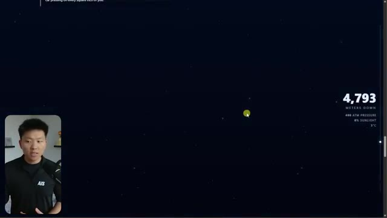
*⏱️ 00:08:49 — Vue à 4 793 mètres de profondeur, illustrant la pression extrême (480 ATM) et l'absence totale de lumière (0% sunlight).*

---

### ⏱️ `[00:08:54 - 00:09:13]` | Segment #21

**🔊 Audio (Transcription Intégrale Mot pour Mot en Français) :**
> So kind of just another little journey experience. So that was Fable. I will say nothing overwhelmingly impressive there, right? Let's go to Seoul, which already, I think this looks better. This honestly kind of looks like a Claude design sort of output. But anyways, impossible objects, five tiny worlds, no frameworks. The first one is Aurora Orchestra.

**👁️ Analyse Visuelle d'Écran (gemini-3.5-flash-lite) :**
**Interface & Outils** : Navigateur web affichant les sites "The Gallery" et "Impossible Objects".

**Contenu textuel & Code** : Texte descriptif des projets ("Five self-contained worlds", "Five experiments / built to be felt") et titres des sections.

**Action / Démonstration** : Navigation et présentation visuelle de portfolios ou sites web de démonstration technologique par le présentateur.

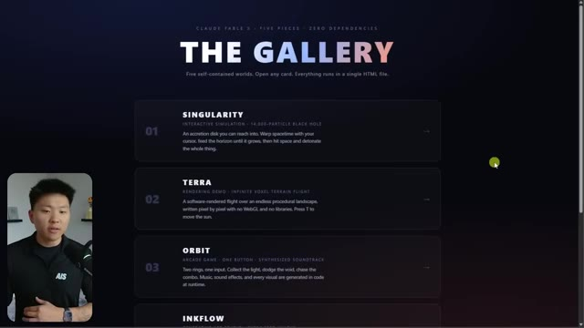
*⏱️ 00:08:59 — Interface web "The Gallery" présentant une liste d'expérimentations interactives comme "Singularity", "Terra" et "Orbit".*

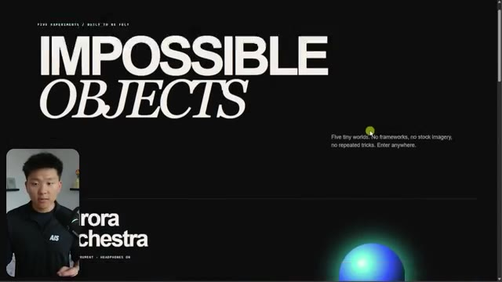
*⏱️ 00:09:04 — Interface web du site "Impossible Objects" mettant en avant des expériences créatives avec une sphère stylisée en bas à droite.*

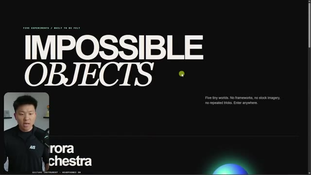
*⏱️ 00:09:09 — Vue statique de la page d'accueil "Impossible Objects" avec le titre en grandes typographies et une sphère lumineuse partiellement visible.*

---

### ⏱️ `[00:09:14 - 00:09:46]` | Segment #22

**🔊 Audio (Transcription Intégrale Mot pour Mot en Français) :**
> So I guess we're just kind of playing here with the northern lights. yeah not sure exactly what's happening but we can change the voice we can change the sky we can hold for intensity we've got other ones in here so we can change like the color of the northern lights i suppose not sure what's going on here that might be a bit of a bug it seems like three and four don't actually work but two and oh now two and one don't work at all either okay so another little bug there let's go back to the gallery let's go to number two atlas of lost echoes

**👁️ Analyse Visuelle d'Écran (gemini-3.5-flash-lite) :**
**Interface & Outils** : Application web interactive "AURORA / ORCHESTRA" (expérience immersive de visualisation générative).

**Contenu textuel & Code** : Menu de sélection de modes : "#1 / VEIL", "#2 / BLOOM", "#3 / COMET", "#4 / CHEER".

**Action / Démonstration** : Le présentateur interagit avec les boutons de contrôle en bas de l'écran pour modifier les paramètres visuels (effets, intensité et style des aurores).

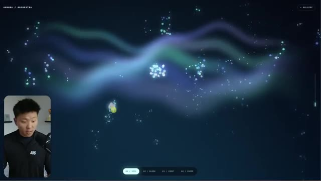
*⏱️ 00:09:22 — Interface interactive nommée "AURORA / ORCHESTRA" affichant une visualisation dynamique de style aurore boréale avec des volutes bleues et vertes, accompagnée d'un sélecteur de mode en bas.*

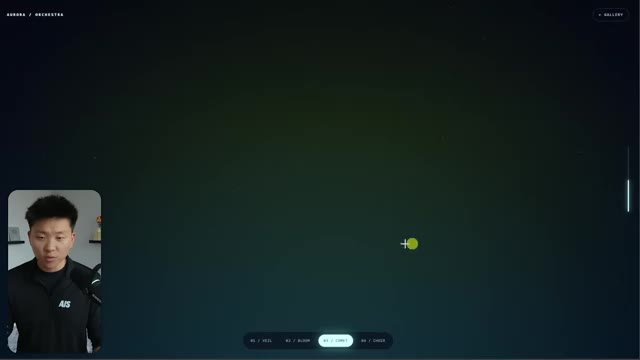
*⏱️ 00:09:30 — La même interface après sélection du mode "#3 / COMET", où les visuels précédents ont disparu pour laisser place à une animation plus minimaliste focalisée sur un point lumineux.*

---

### ⏱️ `[00:09:46 - 00:10:10]` | Segment #23

**🔊 Audio (Transcription Intégrale Mot pour Mot en Français) :**
> I've got a map. My cursor is showing where north is. What happens if I click on this? Sleeping sea. Okay. I'm not really sure what we're doing here. In the bottom right, you can see it says echoes recovered. I guess I have to recover all five of these echoes. So let's see if anything happens. Every place that misses us. Atlas complete. Keep exploring.

**👁️ Analyse Visuelle d'Écran (gemini-3.5-flash-lite) :**
**Interface & Outils** : Interface web interactive ou application de type jeu narratif/jeu de rôle.

**Contenu textuel & Code** : Carte stylisée de type fantasy avec des points d'intérêt cliquables et une barre de progression pour les "échos" récupérés.

**Action / Démonstration** : Le présentateur survole ou clique sur le point nommé "The Sleeping Sea" sur la carte.

*⏱️ 00:09:52 — Une carte interactive intitulée "Atlas of Lost Echoes" affichée en plein écran, présentant plusieurs lieux nommés (The Rain Library, Bellweather, The Sleeping Sea, Mothlight City, The Last Orchard) reliés par des pointillés. En bas à droite, un compteur indique "ECHOES RECOVERED 0 / 5". Une incrustation vidéo du présentateur apparaît en bas à gauche.*

---

### ⏱️ `[00:10:10 - 00:10:46]` | Segment #24

**🔊 Audio (Transcription Intégrale Mot pour Mot en Français) :**
> Okay. So not really sure what that is. Let's go ahead and go to the next one. The glyph heist. so the grid is hiding contraband words type every signal before the trace completes okay so this is just like a typing game i guess um am i getting points oh yeah the points are in the top left whoa that's not even a word okay so this is just like a typing game i guess i don't really see much like feedback i'm just kind of typing and those that's not a word either i mean i guess that's a point is it's trying to trip me up. Oops. Yeah. That's kind of the point I guess. Okay.

**👁️ Analyse Visuelle d'Écran (gemini-3.5-flash-lite) :**
**Interface & Outils** : Jeu web (navigateur) "Glyph Heist" (A Kinetic Typography Arcade).

**Contenu textuel & Code** : Texte affiché : "GLYPH HEIST", "BREACH THE GRID", "FEVER", "x5 COMBO!", "SECURITY LEVEL 04".

**Action / Démonstration** : Le présentateur interagit avec l'interface web, passant de l'écran de lancement au gameplay actif de frappe au clavier (typing game).

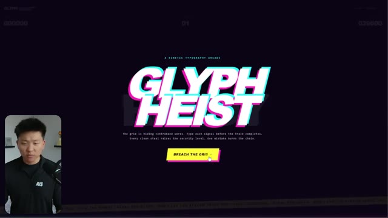
*⏱️ 00:10:19 — Écran d'accueil du jeu web "Glyph Heist" avec un bouton central jaune "BREACH THE GRID".*

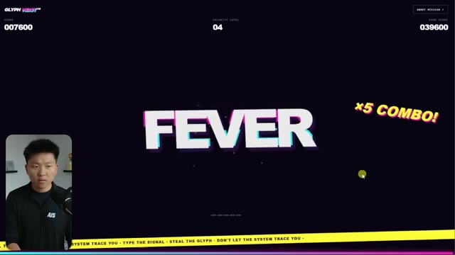
*⏱️ 00:10:28 — Interface de jeu montrant le mot "FEVER" au centre, avec un compteur de combo "x5 COMBO!" et le niveau de sécurité à "04".*

---

### ⏱️ `[00:10:47 - 00:11:16]` | Segment #25

**🔊 Audio (Transcription Intégrale Mot pour Mot en Français) :**
> That's all right. Um, I mean kind of a cool vibe, right? Like the actual aesthetics. I don't think you're losing lives though. Like I don't know how this ever ends. Also, I already had a high score in here. So definitely kind of buggy. Um, and let's go ahead and go to, I guess we got two left. So this one, this is just a slide deck. It looks like it looks like there are five slides. Not bad though. I actually think that these are designed pretty well. This is interesting though, because this definitely looks like a claw design to me.

**👁️ Analyse Visuelle d'Écran (gemini-3.5-flash-lite) :**
**Interface & Outils** : Navigateur web (le chemin de fichier local `file:///.../index.html` est visible en bas de l'image #2).

**Contenu textuel & Code** : Interface utilisateur interactive de style arcade/dossier narratif intitulée "Glyph Heist" et "Solaris Archive", contenant des compteurs de score et des récits textuels.

**Action / Démonstration** : Le présentateur navigue dans une application web interactive, probablement un projet de développement qu'il teste, en interagissant avec l'interface pour explorer les différents modules du jeu/dossier.

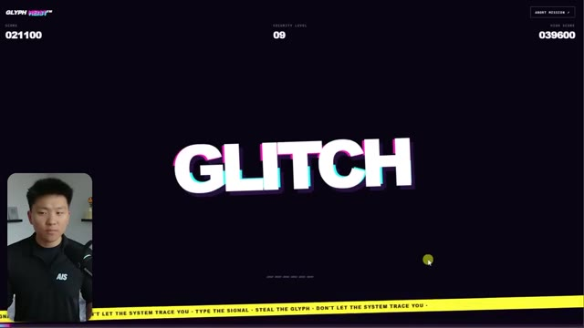
*⏱️ 00:10:54 — Interface de jeu web nommée "Glyph Heist" affichant un score, un niveau de sécurité et le mot "GLITCH" au centre avec un effet visuel.*

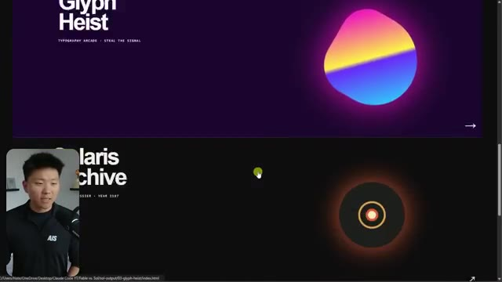
*⏱️ 00:11:01 — Interface web montrant une sélection de projets ("Glyph Heist" et "Solaris Archive") avec des éléments graphiques abstraits et colorés.*

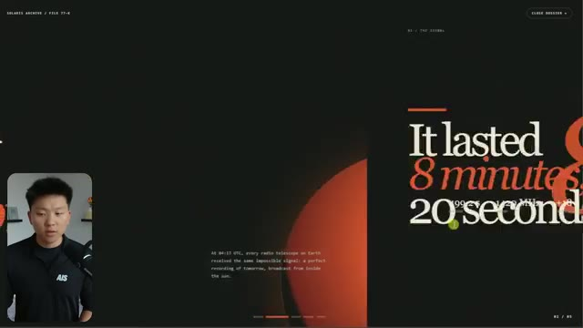
*⏱️ 00:11:08 — Interface de navigation dans un dossier numérique intitulée "Solaris Archive", avec une mise en page typographique axée sur une narration textuelle.*

---

### ⏱️ `[00:11:16 - 00:11:36]` | Segment #26

**🔊 Audio (Transcription Intégrale Mot pour Mot en Français) :**
> Like this definitely looks like something that Fable would whip up. I don't know why. The font and the color scheme just feels like a clawed thing. Anyways, the last one we got here is a tide pool. So life is waiting. Touch the water to begin. Okay, I just dropped in a bunch of seeds. We've got a population of 320, diversity of two.

**👁️ Analyse Visuelle d'Écran (gemini-3.5-flash-lite) :**
**Interface & Outils** : Navigateur web (Google Chrome) affichant une application web interactive locale (index.html).

**Contenu textuel & Code** : Texte affiché : "Life is waiting. Touch the water to begin.", avec une barre latérale proposant des options comme "Add Life", "Sunlight", "Fresh Rain", "Current".

**Action / Démonstration** : Démonstration de l'interface utilisateur de l'application "Tidepool God" qui réagit aux interactions de l'utilisateur.

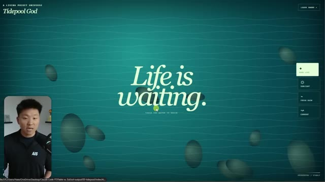
*⏱️ 00:11:26 — Une interface web interactive intitulée "Tidepool God", présentant une expérience visuelle immersive sur le thème de la vie, avec des éléments interactifs sur le côté droit.*

---

### ⏱️ `[00:11:36 - 00:11:55]` | Segment #27

**🔊 Audio (Transcription Intégrale Mot pour Mot en Français) :**
> I can give them sunlight. I can give them fresh rain. So this is very much like a simulation. This one already feels like it's like slowing down my computer. so I don't know how much is going on back here, but not too bad. I like the ones that are simulations. I think they're kind of fun. So yeah, honestly, I don't even know what to say here.

**👁️ Analyse Visuelle d'Écran (gemini-3.5-flash-lite) :**
**Interface & Outils** : Application web interactive / Simulation "Tidepool God".

**Contenu textuel & Code** : Interface utilisateur avec des contrôles de simulation : "Seed Life", "Sunlight", "Fresh Rain", "Current". Texte affiché au centre : "The tide turns...".

**Action / Démonstration** : Le présentateur interagit avec les paramètres de l'environnement (Sunlight) pour influencer la simulation en temps réel.

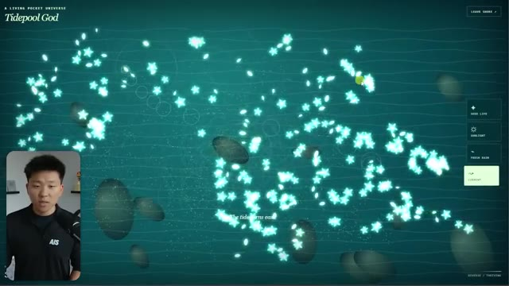
*⏱️ 00:11:41 — Vue d'une interface de simulation interactive nommée "Tidepool God" avec des éléments flottants lumineux. Le menu latéral droit est actif sur l'option "Current".*

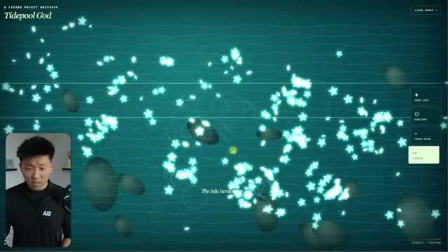
*⏱️ 00:11:46 — La même interface de simulation. Le curseur est positionné au centre, sur l'un des éléments de la simulation.*

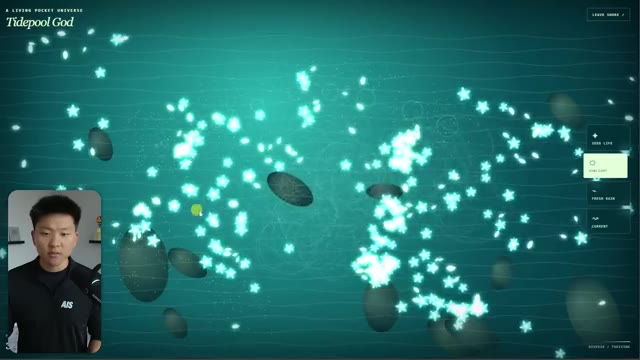
*⏱️ 00:11:51 — L'interface de simulation "Tidepool God" où l'option "Sunlight" est maintenant sélectionnée dans le menu latéral droit, illustrant l'interaction mentionnée dans l'audio.*

---

### ⏱️ `[00:11:55 - 00:12:14]` | Segment #28

**🔊 Audio (Transcription Intégrale Mot pour Mot en Français) :**
> Like, I don't know which one to say I'm gonna hand the crown to. I think I'm just gonna go with Soul for this one because I think in general, it had a bit of a better idea of like diversity and experience. The interesting thing here is when we take a look at the speed and the cost. So I thought that this run would take the longest out of all of them because I was saying, hey, five very different things.

**👁️ Analyse Visuelle d'Écran (gemini-3.5-flash-lite) :**
**Interface & Outils** : Navigateur web (pour les interfaces visuelles) et éditeur de code (type Cursor/VS Code) pour la partie développement.

**Contenu textuel & Code** : Code source JavaScript manipulé, logs de vérification de scripts ("PASS sol-output/index.html"), et rapport de fin d'exécution de l'agent.

**Action / Démonstration** : Revue visuelle des résultats produits par l'IA et analyse du code source généré pour valider l'intégrité des fichiers HTML et des interactions.

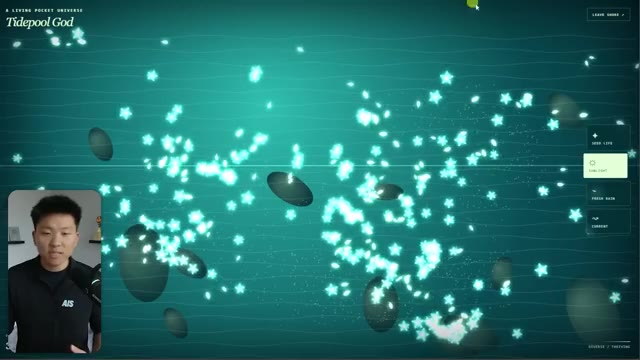
*⏱️ 00:12:00 — Interface web interactive intitulée "Tidepool God", affichant un environnement graphique fluide avec des éléments lumineux en suspension.*

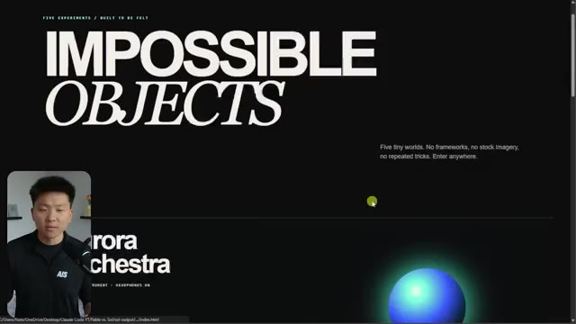
*⏱️ 00:12:05 — Page d'accueil du site "Impossible Objects" présentant une interface minimaliste avec un titre en typographie grasse et une sphère 3D animée.*

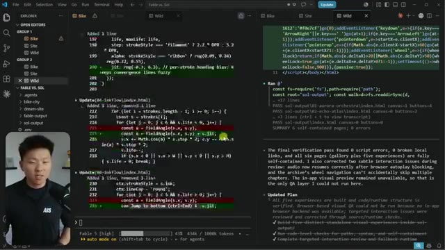
*⏱️ 00:12:10 — Éditeur de code (probablement Cursor) affichant des différences de code (diffs) en vert/rouge et une section de terminal montrant le journal d'exécution d'un agent.*

---

### ⏱️ `[00:12:14 - 00:12:39]` | Segment #29

**🔊 Audio (Transcription Intégrale Mot pour Mot en Français) :**
> I thought it would take maybe five times as long as the earlier ones, but this one was actually like the quickest on both fronts, which I thought was really interesting. This one took 15 minutes for Fable. And for Sol, this took seven minutes, which I thought was really, really fast. And on the cost side, this costed Fable about 15 bucks with 65,000 output tokens. And on Sol, it took, once again, about a dollar and 22,000 output tokens. So very, very interesting to me. All right.

**👁️ Analyse Visuelle d'Écran (gemini-3.5-flash-lite) :**
**Interface & Outils** : VS Code (avec une extension de type agent IA/Claude).

**Contenu textuel & Code** : Code source JavaScript, logs d'exécution de l'agent, résumé de "Goal achieved" (15m 17s), et une liste de vérification des tâches (Updated Plan) concernant la création d'expériences web.

**Action / Démonstration** : L'agent affiche les résultats de la génération, les statistiques de consommation de tokens et le statut de validation des scripts (0 erreur, 0 lien brisé).

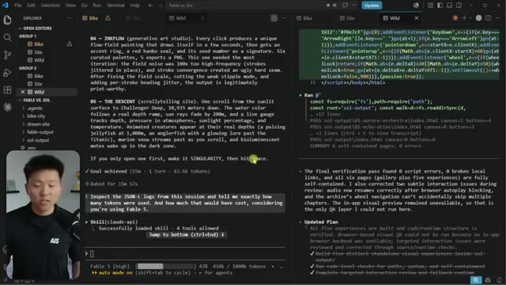
*⏱️ 00:12:20 — Une capture d'écran de l'interface VS Code montrant un flux de travail d'agent IA, avec le présentateur incrusté en bas à gauche.*

---

### ⏱️ `[00:12:39 - 00:12:57]` | Segment #30

**🔊 Audio (Transcription Intégrale Mot pour Mot en Français) :**
> So those agentic experiments with Cloud Code and with Codex, that was one thing. And that's typically how I'm going to be actually driving these two models. So it was important for me to play around with stuff. And of course, all day I used it for just my general work. But I also wanted to try just explicitly over the API, just talking to the models.

**👁️ Analyse Visuelle d'Écran (gemini-3.5-flash-lite) :**
**Interface & Outils** : Interface web (page de résultats/rapports d'analyse).

**Contenu textuel & Code** : Métriques comparatives incluant le record de victoires (24-3), les coûts totaux (16.07$ vs 63.40$), le taux de livraison (100% vs 78%) et des scores de qualité avec graphiques à barres.

**Action / Démonstration** : Présentation des résultats d'une analyse comparative entre les modèles "Sol" (GPT-5.6) et "Fable" (Claude Fable 5) basée sur des tests d'agents IA.

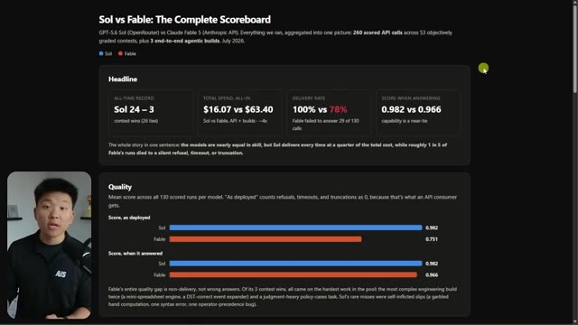
*⏱️ 00:12:43 — Un tableau de bord comparatif intitulé "Sol vs Fable: The Complete Scoreboard" affichant des statistiques de performance entre deux modèles d'IA.*

---

### ⏱️ `[00:12:57 - 00:13:19]` | Segment #31

**🔊 Audio (Transcription Intégrale Mot pour Mot en Français) :**
> And a lot of these were kind of like a one-shot, hey, what's this? Give me an answer. What's this? Give me an answer. Rather than like an agentic loop with multi-step reasoning. But I wanted to see what it looked like for speed and cost as well. So the record here, which is really interesting, is that Sol won 24 times and Fable won three times. There were also a lot of times when Fable refused to answer, like literally just wouldn't submit an answer.

**👁️ Analyse Visuelle d'Écran (gemini-3.5-flash-lite) :**
**Interface & Outils** : Navigateur web affichant une page de résultats d'analyse comparative (benchmark).

**Contenu textuel & Code** : Métriques détaillées : score global (24-3 pour Sol), coût total ($16.07 vs $63.40), taux de livraison (100% vs 78%), et score de qualité (graphiques à barres comparatifs).

**Action / Démonstration** : Présentation visuelle des résultats de tests de performance (API calls et builds agentiques) pour justifier l'efficacité et la rentabilité du modèle Sol par rapport à Fable.

*⏱️ 00:13:02 — Un tableau de bord comparatif intitulé "Sol vs Fable: The Complete Scoreboard" affichant les statistiques de performance entre GPT-5.6 Sol et Claude Fable 5.*

---

### ⏱️ `[00:13:19 - 00:13:41]` | Segment #32

**🔊 Audio (Transcription Intégrale Mot pour Mot en Français) :**
> It refused, which I thought was interesting because, you know, the security guardrails are baked in pretty hard. But also look at the spend. I mean, Sol won 24 to 3 for these kind of quick one-off tasks. And Sol costed 16 bucks while Fable costed 63 bucks. But as far as like the actual capability, when Fable actually answered, it was pretty even. The reason why Sol dominated apparently is because Fable failed to answer a lot of the calls.

**👁️ Analyse Visuelle d'Écran (gemini-3.5-flash-lite) :**
**Interface & Outils** : Interface de type dashboard web / rapport de performance.

**Contenu textuel & Code** : Le tableau affiche le score global (Sol 24-3 vs Fable), le coût total ($16.07 vs $63.40), le taux de réussite (100% vs 78%), et des graphiques à barres comparant la qualité ("Score as deployed" et "Score when it answered").

**Action / Démonstration** : Présentation visuelle des données analytiques comparatives pour justifier la supériorité en efficience du modèle Sol.

*⏱️ 00:13:25 — Un tableau de bord comparatif intitulé "Sol vs Fable: The Complete Scoreboard" affichant les statistiques de performance et de coût entre deux modèles d'IA (Sol et Fable).*

---

### ⏱️ `[00:13:42 - 00:14:14]` | Segment #33

**🔊 Audio (Transcription Intégrale Mot pour Mot en Français) :**
> But as you can see over here, score one answering, Sol had 0.98 and Fable had 0.966. So they are very similar models. And I think it's just a perfect example of like the unit economics. Based on this task, let's say the task is a five. Do you need a model that is a 10? Probably not. You only need a model that's maybe like a five or a six. So in this case, with these quick one-shot, you know, API requests, probably stateless. Sol seems to crush Fable here. And from an input output tokens perspective, Sol is basically half the cost of Fable, you know, half on the input and then a

**👁️ Analyse Visuelle d'Écran (gemini-3.5-flash-lite) :**
**Interface & Outils** : Interface web de type dashboard analytique/comparatif.

**Contenu textuel & Code** : Métriques clés : score de réponse (0.982 vs 0.966), coût total ($16.07 vs $63.40), taux de livraison (100% vs 78%), et graphiques à barres comparant la qualité ("Score, as deployed" et "Score, when it answered").

**Action / Démonstration** : Présentation visuelle des données de performance pour illustrer l'argument économique sur le choix des modèles en fonction de la complexité de la tâche.

*⏱️ 00:13:50 — Un tableau de bord comparatif intitulé "Sol vs Fable: The Complete Scoreboard" affichant les performances, les coûts et la fiabilité entre deux modèles IA.*

---

### ⏱️ `[00:14:14 - 00:14:37]` | Segment #34

**🔊 Audio (Transcription Intégrale Mot pour Mot en Français) :**
> little over half on the output, but it's basically half. And if you compare Sol to like Opus 4.8, they're pretty much the same, same on the input and then very similar on the output. So that's pretty interesting to me. And it honestly feels like a better head to head comparison would have been Sol 5.6 versus Opus 4.8 rather than comparing Sol 5.6 and Fable five. Like I just think that they're not even on the same level as far as like a next gen model.

**👁️ Analyse Visuelle d'Écran (gemini-3.5-flash-lite) :**
**Interface & Outils** : Plateforme OpenRouter (comparateur de modèles) et rapport de benchmarking analytique personnalisé.

**Contenu textuel & Code** : - Image 1 : Tableaux de prix (Input/Output par million de tokens), latence (p50) et débit (throughput).
- Image 2 : Statistiques de réussite (24-3 en faveur de Sol), dépenses totales comparées (16,07 $ vs 63,40 $), taux de livraison (100% vs 78%) et scores de qualité.

**Action / Démonstration** : Le présentateur illustre ses propos sur la rentabilité et l'efficacité opérationnelle des modèles en comparant les données chiffrées affichées à l'écran.

*⏱️ 00:14:20 — Comparaison côte à côte des tarifs et des performances techniques entre le modèle "Claude Opus 4.8" et "GPT-5.6 Sol" via l'interface OpenRouter.*

*⏱️ 00:14:25 — Tableau de bord récapitulatif comparant les scores de performance globale ("Scoreboard") entre "GPT-5.6 Sol" et "Claude Fable 5", incluant des statistiques sur les coûts et le taux de réussite.*

---

### ⏱️ `[00:14:37 - 00:15:10]` | Segment #35

**🔊 Audio (Transcription Intégrale Mot pour Mot en Français) :**
> Think about the fact that Fable jumps to a five. Soul, which is apparently their most capable model, why would it not have been Soul 6? Like why are we 5.6? Doesn't a model that should be so, so good deserve a full step up if there's, you know, fundamentally something so different that makes it like a really powerful, scary model. But they decided to only bump it up to Soul 5.6, which makes me wonder like what are they cooking back there and what are they maybe waiting to drop as their next GPT-6, because I think that's when we have the next-gen model that I truly think actually goes head-to-head with Fable, because right now I do not think that Sol does. I'll talk

**👁️ Analyse Visuelle d'Écran (gemini-3.5-flash-lite) :**
**Interface & Outils** : Dashboard web analytique (type rapport de performance).

**Contenu textuel & Code** : Comparaison détaillée entre "Sol" et "Fable" : statistiques de victoires (24-3), dépenses totales ($16.07 vs $63.40), taux de délivrabilité (100% vs 78%), et scores de qualité (0.982 vs 0.966 en mode "answering").

**Action / Démonstration** : Présentation de données comparatives pour illustrer l'écart d'efficacité et de fiabilité entre les deux modèles d'IA.

*⏱️ 00:14:45 — Un tableau de bord comparatif intitulé "Sol vs Fable: The Complete Scoreboard" affichant les performances du modèle GPT-5.6 Sol face au modèle Claude Fable 5, incluant des statistiques sur les coûts, les taux de réussite et les scores de qualité.*

---

### ⏱️ `[00:15:10 - 00:15:47]` | Segment #36

**🔊 Audio (Transcription Intégrale Mot pour Mot en Français) :**
> about that a little bit more once we get into the next section, but let's look at this. So score, obviously Sol won here, but score when answered, obviously it was much closer. So that's kind of like the reliability thing. Now on the cost side, the API calls, Sol was much cheaper, obviously, nine bucks to about 14 bucks. But then what's interesting is the gap here is not that big, right? The gap here is about five bucks. And if you think percentage wise relative, it's even less like a smaller percentage than how wide this gap is. When we get to the actual agentic reasoning with Cloud Code as the harness and Codex as the harness, the gap in cost was just much, much bigger, which is really interesting. And overall, Fable is much more expensive than Sol.

**👁️ Analyse Visuelle d'Écran (gemini-3.5-flash-lite) :**
**Interface & Outils** : Interface web de type rapport d'analyse comparative ou benchmark (format document/dashboard).

**Contenu textuel & Code** : Graphiques à barres horizontales comparant les scores, les taux de non-réponse (Sol: 0/130 vs Fable: 29/130) et les coûts API (Sol: $9.01 vs Fable: $14.72 pour les benchmarks, et écarts plus importants sur les "Agentic builds").

**Action / Démonstration** : Le présentateur commente les données affichées à l'écran, soulignant la supériorité de "Sol" en termes de fiabilité et de coût.

*⏱️ 00:15:20 — Un tableau de bord comparatif présentant des métriques de performance ("Reliability") et de coût ("Cost") entre deux modèles nommés "Sol" et "Fable".*

---

### ⏱️ `[00:15:47 - 00:16:20]` | Segment #37

**🔊 Audio (Transcription Intégrale Mot pour Mot en Français) :**
> And I think the token thing is just so interesting because let's say that Fable and Sol costed the exact same from an input and output token perspective. Sol would have still been meaningfully cheaper because it just was more efficient with tokens. I don't know exactly why that is, but it just seems to be so much more efficient with tokens. It's probably has a lot to do with Codex too, because when I've done Codex and Cloud Code comparisons in the past, Codex has always been faster and more efficient with tokens. But anyways, just something I think is pretty interesting. This is also interesting on the speed side. So over API, the median API

**👁️ Analyse Visuelle d'Écran (gemini-3.5-flash-lite) :**
**Interface & Outils** : Interface analytique web de type tableau de bord de performance d'IA.

**Contenu textuel & Code** : Graphiques à barres comparant la consommation totale de tokens (Sol : 3.53M vs Fable : 14.68M) et tableaux de répartition des tokens par type (input, cache, output). Inclut des métriques de latence (8.2s vs 10.0s).

**Action / Démonstration** : Visualisation des données comparatives pour illustrer l'efficacité opérationnelle et le coût des agents IA.

*⏱️ 00:15:55 — Tableau de bord comparatif affichant l'utilisation des tokens entre les modèles 'Sol' et 'Fable', détaillant la consommation par canal (API benchmarks, Agentic builds) et les sections 'Tokens' et 'Speed'.*

---

### ⏱️ `[00:16:20 - 00:16:43]` | Segment #38

**🔊 Audio (Transcription Intégrale Mot pour Mot en Français) :**
> latency from Sol was quicker than Fable, but the mean, so the average was Fable being quicker. So that means like Sol is a little bit more all over the board. Some runs were super, super long. Some runs might've been really, really quick. Whereas Fable was more consistently just kind of hovering around like the 22nd mark. And that's why its median was still higher than Sol, but its mean was lower than Sol, which I just think is pretty interesting.

**👁️ Analyse Visuelle d'Écran (gemini-3.5-flash-lite) :**
**Interface & Outils** : Page web de résultats de benchmark (Dashboard d'analyse comparative).

**Contenu textuel & Code** : Données chiffrées : Median API latency (Sol 8.2s vs Fable 10.0s), Mean API latency (Sol 34.1s vs Fable 23.4s), et temps de build 'Agentic builds' (Sol 36:59 vs Fable 59:00). Section 'Verdict' détaillant les avantages et limites de chaque modèle.

**Action / Démonstration** : Visualisation et explication des données statistiques pour comparer la cohérence et l'efficacité des deux modèles IA.

*⏱️ 00:16:25 — Un tableau comparatif des performances de latence et de temps de build entre les systèmes 'Sol' et 'Fable', affichant des graphiques à barres horizontales.*

---

### ⏱️ `[00:16:44 - 00:17:03]` | Segment #39

**🔊 Audio (Transcription Intégrale Mot pour Mot en Français) :**
> But then when we see the agentic builds, Fable was pretty much always going to be slower. So after running these different types of tests, some were fun, some were for design, some were just via API. and then of course my actual driving this on the day-to-day, here's where I landed. Overall, I feel like Fable is a better manager and that's how I think of it.

**👁️ Analyse Visuelle d'Écran (gemini-3.5-flash-lite) :**
**Interface & Outils** : Application de prise de notes ou tableau blanc virtuel (type Obsidian Canvas ou similaire).

**Contenu textuel & Code** : - Image #1 : Données chiffrées sur la "Median API latency", "Mean API latency" et "Agentic builds, wall clock". Texte explicatif sous les graphiques sur le verdict final ("Sol wins the aggregate").
- Image #2 : Liste de mots-clés par agent. Fable : "manager", "Creativity", "Advising", etc. Sol : "worker", "Price", "Computer use", "Finding bugs", etc.

**Action / Démonstration** : Présentation des résultats de tests de performance et synthèse comparative des capacités des modèles IA pour guider le choix de l'utilisateur.

*⏱️ 00:16:49 — Analyse comparative des performances entre deux agents IA ("Sol" et "Fable") sous forme de graphiques à barres mesurant la latence API et le temps de build agentique.*

*⏱️ 00:16:59 — Tableau comparatif conceptuel affiché sur une interface de type tableau blanc (canvas) distinguant les cas d'usage optimaux pour "Fable" et "Sol".*

---

### ⏱️ `[00:17:04 - 00:17:28]` | Segment #40

**🔊 Audio (Transcription Intégrale Mot pour Mot en Français) :**
> I think of it as a co-founder, I think of it as a manager. Soul is just a really, really good worker, really good worker. Like I think that having Fable orchestrate a bunch of Soul agents would be amazing. I gave them each their other things that I would say like they are better than the other end. So Soul is obviously better on price. It's much better on computer use. It's much better at playing devil's advocate because it feels like it's just a little more careful at finding the bugs and looking at things from different angles.

**👁️ Analyse Visuelle d'Écran (gemini-3.5-flash-lite) :**
**Interface & Outils** : Logiciel de tableau blanc virtuel ou outil de prise de notes (type Excalidraw ou similaire).

**Contenu textuel & Code** : Colonne Fable : "manager", Creativity, Advising, Knowledge work, Video, Not over-engineering, Pure capability. Colonne Sol : "worker", Price, Computer use, Devil's advocate, Finding bugs, Verification, Speed.

**Action / Démonstration** : Comparaison conceptuelle et structuration des rôles des agents IA dans un workflow de travail.

*⏱️ 00:17:10 — Un tableau comparatif sur fond noir illustrant les rôles respectifs de Fable (manager) et Sol (worker) avec une liste de leurs points forts et caractéristiques.*

---

### ⏱️ `[00:17:28 - 00:17:49]` | Segment #41

**🔊 Audio (Transcription Intégrale Mot pour Mot en Français) :**
> I also gave it the verification because of the computer use and because of this whole devil's advocate and just like really being careful and really thinking about what did they say? What did the user tell me to do? And what am I gonna do? And I'm gonna do exactly that. Whereas sometimes Fable's a bit more like it'll push back a little bit more. And it's almost like sometimes sassier, you know? Like sometimes it's not just like I want to take a request and action it.

**👁️ Analyse Visuelle d'Écran (gemini-3.5-flash-lite) :**
**Interface & Outils** : Outil de tableau blanc numérique type Miro ou FigJam.

**Contenu textuel & Code** : Tableau comparatif : Fable (rôle "manager", créativité, advising, knowledge work, vidéo, pas d'over-engineering, pure capability) vs Sol (rôle "worker", prix, utilisation de l'ordinateur, avocat du diable, recherche de bugs, vérification, vitesse).

**Action / Démonstration** : Présentation visuelle et comparaison des capacités fonctionnelles de deux agents IA pour illustrer les différences dans leur approche de l'exécution des tâches.

*⏱️ 00:17:33 — Un diagramme comparatif sur fond noir présentant les caractéristiques distinctes des agents IA "Fable" et "Sol".*

---

### ⏱️ `[00:17:49 - 00:18:10]` | Segment #42

**🔊 Audio (Transcription Intégrale Mot pour Mot en Français) :**
> I want to push back and be like a consultant here, which is a good thing, right? That's why I said it's a manager. There's pros and cons to that. And then of course I gave soul the speed. Now fable, I said, it's just much more creative. It feels more creative. It feels like it's better at writing. It feels like it's better at brainstorming. It feels like it's better at advising. It's really strategic. The knowledge work all day. I still prefer fable, but you know, it's just not the cost.

**👁️ Analyse Visuelle d'Écran (gemini-3.5-flash-lite) :**
**Interface & Outils** : Logiciel de tableau blanc numérique de type FigJam ou Excalidraw.

**Contenu textuel & Code** : Liste des attributs pour Fable : "manager", Creativity, Advising, Knowledge work, Video, Not over-engineering, Pure capability. Liste des attributs pour Sol : "worker", Price, Computer use, Devil's advocate, Finding bugs, Verification, Speed.

**Action / Démonstration** : Présentation visuelle des points de comparaison entre les deux agents IA pour étayer l'argumentation du présentateur.

*⏱️ 00:17:54 — Tableau comparatif sur fond sombre présentant les forces respectives de deux agents IA nommés "Fable" et "Sol".*

---

### ⏱️ `[00:18:10 - 00:18:28]` | Segment #43

**🔊 Audio (Transcription Intégrale Mot pour Mot en Français) :**
> I can't always justify it. It felt like it was better at making videos. If you saw, I made two videos recently on YouTube. One was called like fable five made this entire video. And the other one I just dropped earlier today, which was called soul made this entire video. So go watch both of those. They each created YouTube videos for me completely from scratch. And just see which one you thought was better. I liked Fables better.

**👁️ Analyse Visuelle d'Écran (gemini-3.5-flash-lite) :**
**Interface & Outils** : Logiciel de tableau blanc numérique ou outil de prise de notes visuelles (type Excalidraw ou Miro).

**Contenu textuel & Code** : Tableau comparatif :
- Colonne "Fable" : "manager", Creativity, Advising, Knowledge work, Video, Not over-engineering, Pure capability.
- Colonne "Sol" : "worker", Price, Computer use, Devil's advocate, Finding bugs, Verification, Speed.

**Action / Démonstration** : Présentation comparative des rôles et fonctionnalités de deux agents IA distincts pour illustrer le flux de travail de création vidéo.

*⏱️ 00:18:14 — Une comparaison côte à côte sous forme de tableau affiché sur un canevas numérique, illustrant les forces respectives de "Fable" et "Sol".*

---

### ⏱️ `[00:18:29 - 00:18:48]` | Segment #44

**🔊 Audio (Transcription Intégrale Mot pour Mot en Français) :**
> I also said that Fables better at not over-engineering because Sol runs so many tests, which also is interesting when you think about the token thing, right? Like, how can it be so efficient with tokens if it writes so many tests? And sometimes it will overthink, especially when I had Sol on Ultra. It was just going and going and going and going, which, you know, sometimes good, sometimes bad.

**👁️ Analyse Visuelle d'Écran (gemini-3.5-flash-lite) :**
**Interface & Outils** : Outil de tableau blanc numérique ou logiciel de présentation de type canevas (probablement Excalidraw ou similaire).

**Contenu textuel & Code** : Colonne Fable : "manager", Creativity, Advising, Knowledge work, Video, Not over-engineering, Pure capability. Colonne Sol : "worker", Price, Computer use, Devil's advocate, Finding bugs, Verification, Speed.

**Action / Démonstration** : Comparaison conceptuelle des rôles et forces opérationnelles des deux agents IA à travers une liste structurée.

*⏱️ 00:18:34 — Tableau comparatif sur fond noir présentant les caractéristiques distinctes des agents IA "Fable" et "Sol".*

---

### ⏱️ `[00:18:48 - 00:19:09]` | Segment #45

**🔊 Audio (Transcription Intégrale Mot pour Mot en Français) :**
> There's always pros and cons, but just pure capability. I mean, you can't even argue. Fable 5 is in another tier. It's just on another level. And Sol is really good. I think it's more comparable to Opus 4.8. It's definitely better than GPT 5.5, but it's not a Fable 5. And honestly, I think if it was Fable 5 tier, it would be charged at Fable 5 tier.

**👁️ Analyse Visuelle d'Écran (gemini-3.5-flash-lite) :**
**Interface & Outils** : Outil de tableau blanc numérique (type Miro ou FigJam).

**Contenu textuel & Code** : Liste de caractéristiques pour Fable : "manager", "Creativity", "Advising", "Knowledge work", "Video", "Not over-engineering", "Pure capability". Liste pour Sol : "worker", "Price", "Computer use", "Devil's advocate", "Finding bugs", "Verification", "Speed".

**Action / Démonstration** : Présentation comparative des rôles et fonctionnalités spécifiques attribués à chaque modèle d'IA.

*⏱️ 00:18:53 — Un tableau comparatif sur fond sombre, réalisé sur un outil de type tableau blanc, opposant les capacités de "Fable" à celles de "Sol".*

---

### ⏱️ `[00:19:09 - 00:19:43]` | Segment #46

**🔊 Audio (Transcription Intégrale Mot pour Mot en Français) :**
> Like it would be priced that high. And it's not. It's priced like Opus. So overall, what I'd say is Fable is good for my reasoning and my judging. And then Sol is just a shipping and executing AI model. And just so we kind of like put it into perspective, I kind of tried to like map out where I think that these top four models that, you know, we're talking about right now sit. I've got GBT 5.5 and Opus just very, very similar. I would say because I drive most of my work with Opus, I would put GBT 5.5 just like a little bit behind. Soul is definitely in front of both of these. Like that's very clear. It's a very, very good model, but I still think there's a pretty large gap right here

**👁️ Analyse Visuelle d'Écran (gemini-3.5-flash-lite) :**
**Interface & Outils** : Canevas de brainstorming ou outil de diagramme en ligne.

**Contenu textuel & Code** : Le diagramme compare Fable ("Not over-engineering", "Pure capability", "Reasons and judges") à Sol ("Finding bugs", "Verification", "Speed", "Ships and executes").

**Action / Démonstration** : Présentation visuelle servant de support à la comparaison des forces respectives des deux modèles IA lors de l'explication du présentateur.

*⏱️ 00:19:17 — Une capture d'écran montrant un canevas numérique (type Miro ou similaire) comparant les capacités de deux modèles IA nommés "Fable" et "Sol" à travers une matrice de texte.*

---

### ⏱️ `[00:19:43 - 00:20:18]` | Segment #47

**🔊 Audio (Transcription Intégrale Mot pour Mot en Français) :**
> between, you know, Soul actually being to be on Fable's level. Like there is still a pretty big gap here. So that's the way I feel about it. Hopefully all of this makes sense to you guys. Like I said, it's definitely one thing to look at the benchmarks, but really what you have to do is you have to get your hands dirty. You have to do actual work that you do on your day to day. And it's a feel thing because some people will probably come out the gate and say soul is better than fable hands down. And some people will not agree with that at all. It's all about your use case and your feel and the way that you instruct it and the way that you've got your harness and your skill set up. So everyone's a little different, but that is kind of my opinions after playing around with this model all day long. But as always, if you guys enjoy the video,

**👁️ Analyse Visuelle d'Écran (gemini-3.5-flash-lite) :**
**Interface & Outils** : Outil de tableau blanc numérique de type Excalidraw ou similaire.

**Contenu textuel & Code** : Texte affichant : "Gpt 5.5", "Opus 4.8", et une flèche partant de "Sol" pointant vers "Fable".

**Action / Démonstration** : Présentation visuelle d'un diagramme conceptuel comparant la performance ou la hiérarchie entre les modèles Sol et Fable.

*⏱️ 00:19:52 — Une vue d'un tableau blanc numérique (canvas) montrant une comparaison schématique entre différents modèles d'IA, avec une flèche indiquant la progression vers "Fable".*

---

### ⏱️ `[00:20:18 - 00:20:24]` | Segment #48

**🔊 Audio (Transcription Intégrale Mot pour Mot en Français) :**
> where you learned something new, please give it a like, it helps me out a ton. And as always, I appreciate you guys making it to the end of the video. I'll see you on the next one. Thanks everyone.

**👁️ Analyse Visuelle d'Écran (gemini-3.5-flash-lite) :**
**Interface & Outils** : Tableau blanc numérique (Excalidraw).

**Contenu textuel & Code** : Texte affichant les noms "Gpt 5.5", "Opus 4.8", et une relation fléchée indiquant "Sol -> Fable".

**Action / Démonstration** : Le présentateur conclut sa vidéo sur une vue statique du schéma comparatif des technologies d'IA abordées.

*⏱️ 00:20:20 — Une capture d'écran montrant l'interface d'un tableau blanc numérique (type Excalidraw) où est dessiné un schéma conceptuel comparant des modèles d'IA.*

---

