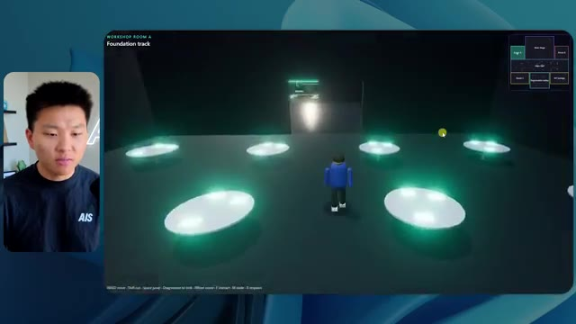
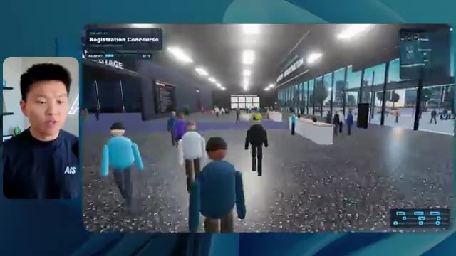
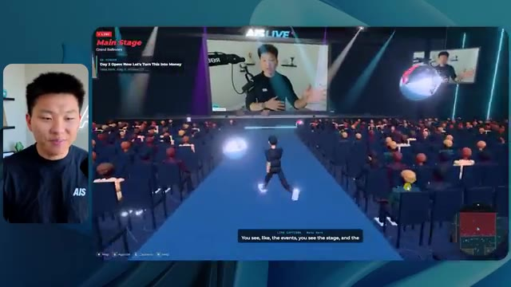
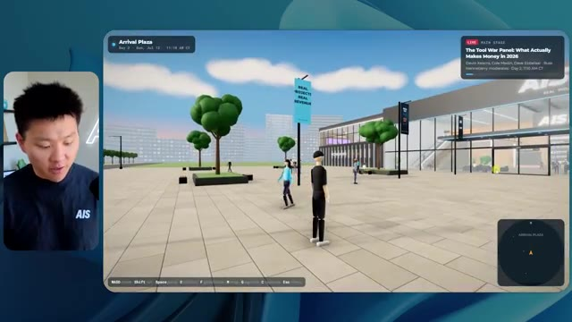
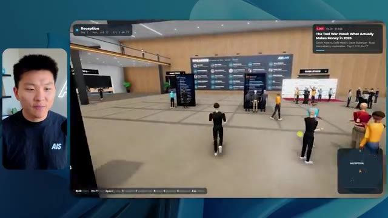
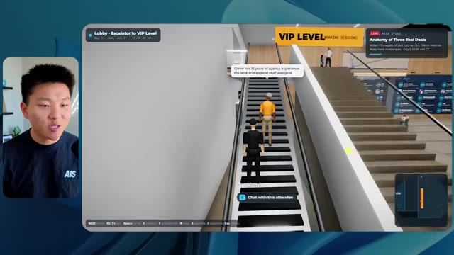
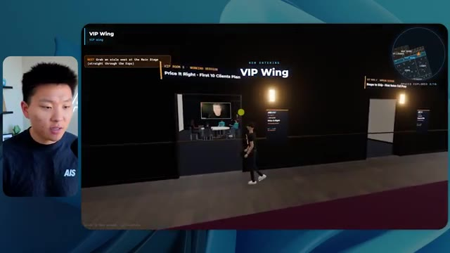

# 🎬 I Tried 100+ Github Repos for Claude. These 6 Are the Best

> **Chaîne** : [Nate Herk | AI Automation](https://www.youtube.com/@nateherk/featured)  
> **Lien YouTube** : [https://www.youtube.com/watch?v=HhZdNYI4pJs](https://www.youtube.com/watch?v=HhZdNYI4pJs)  
> **Date de publication** : 20261011  
> **Durée** : 00:10:36  
> **Identifiant vidéo** : `HhZdNYI4pJs`  
> **Transcription & Analyse** : `whisper-v3-large-turbo+gemini-3.5-flash-lite`  

---

## 📌 Synthèse Exécutive & Outils

### 💡 Résumé

Cette vidéo de la chaîne *Nate Herk | AI Automation* explore l'impact critique des niveaux d'effort sur les performances du modèle de pointe Opus 5.5 d'Anthropic. Pour tester ses limites réelles, Nate soumet le même prompt complexe à l'agent : transformer un dossier brut de 105 gigaoctets de ressources vidéo (provenant de l'événement virtuel *AIS Live*) en un monde 3D interactif et explorable à la troisième personne, intégrant des salles thématiques, des vidéos en direct, un design sur mesure, de la physique et des interactions fluides. 

La démonstration compare méthodiquement les résultats obtenus entre un niveau d'effort faible et un niveau d'effort moyen, en mesurant non seulement la qualité visuelle et fonctionnelle des applications générées, mais aussi des métriques opérationnelles cruciales : temps d'exécution, coût API estimé, consommation de jetons, nombre de vérifications autonomes et nombre de questions posées à l'utilisateur.

Les résultats mettent en évidence un fossé qualitatif majeur. Le niveau d'effort faible génère une application basique, truffée de bugs visuels (personnages fantômes, images fixes au lieu de flux vidéo) et peu fidèle à l'identité de marque, malgré un temps d'exécution de 16 minutes et un coût de 3,91 $. À l'inverse, le niveau d'effort moyen produit un monde 3D nettement plus abouti, doté d'une identité visuelle cohérente, de PNJ (personnages non-joueurs) réactifs, de flux vidéo fonctionnels et d'une navigation fluide, au prix d'une exécution d'une heure et 13 minutes et d'un coût de 12,44 $. Fait remarquable, dans les deux cas, le modèle a fonctionné en autonomie complète sans poser la moindre question, soulignant l'importance stratégique du réglage de l'effort dans l'ingénierie des agents IA complexes.

### 🛠️ Outils, Modèles & Logiciels Présentés

*   **Opus 5.5** : Modèle d'IA de pointe développé par Anthropic, salué pour son intelligence, son coût abordable et sa polyvalence, déclinable selon différents niveaux d'effort.
*   **Claude Code** : Environnement de développement et agent de codage avancé permettant d'exécuter des tâches logicielles complexes et de piloter des itérations de code.
*   **Effort Level (Faible, Moyen, Élevé, Ultra Code, etc.)** : Paramètre de configuration granulaire permettant d'ajuster la profondeur de raisonnement, le temps de calcul et l'autonomie d'un modèle d'IA pour une tâche donnée.
*   **Frame.io** : Plateforme de stockage et de collaboration cloud utilisée pour centraliser les 105 Go d'enregistrements vidéo de l'événement *AIS Live*.
*   **Key.ai** : Outil de génération d'images et de vidéos par IA mobilisé pour enrichir les ressources visuelles du monde 3D.
*   **Herc 2** : Système d'exploitation IA propriétaire de Nate Herk servant de boîte à outils et de référentiel contextuel pour l'automatisation.
*   **Hostinger** : Sponsor de la vidéo et solution d'hébergement proposant une extension gratuite pour intégrer l'infrastructure de déploiement directement au sein de l'environnement de code.

### 🔑 Points Clés & Enseignements Stratégiques

*   **Impact direct de l'effort sur le rendu visuel** : Le passage d'un niveau d'effort faible à un niveau moyen transforme radicalement la qualité de l'application générée, passant d'un prototype instable et truffé de bugs graphiques à un monde 3D cohérent et immersif.
*   **Autonomie totale des agents** : Dans les tests menés avec les niveaux faible et moyen, Opus 5.5 a exécuté des instructions complexes de bout en bout sans poser une seule question à l'utilisateur, démontrant une excellente autonomie décisionnelle.
*   **Arbitrage coût/temps/performance** : Le niveau d'effort faible a nécessité 16 minutes et 43 secondes pour un coût estimé à 3,91 $ (191k jetons), tandis que le niveau moyen a requis 1 heure et 13 minutes pour 12,44 $ (490k jetons), illustrant l'investissement en ressources nécessaire pour un résultat de production.
*   **Gestion de la multimodalité brute** : L'agent a démontré sa capacité à ingérer, analyser et structurer un volume massif de données hétérogènes (105 Go de vidéos sur Frame.io) pour les intégrer logiquement dans un environnement interactif (salles, keynotes, salons VIP).
*   **Recommandation officielle d'Anthropic** : Pour des projets de grande envergure, il est conseillé de débuter les expérimentations avec un effort de niveau "moyen", puis d'ajuster le curseur à la hausse ou à la baisse en fonction des besoins spécifiques de complexité.
*   **Respect de l'identité de marque** : Alors que le niveau d'effort faible a produit un design générique et déconnecté de la charte graphique d'AIS Live, le niveau moyen a intégré avec succès les palettes de couleurs et les directives de marque de l'entreprise.
*   **Dynamisme et interactivité de l'environnement** : Le niveau d'effort moyen a permis d'implémenter des éléments animés fonctionnels (véritables flux vidéo lus par les conférenciers, PNJ dotés de réactions comportementales de base) bien supérieurs aux simples images fixes du niveau faible.
*   **Fiabilité des vérifications autonomes** : Le modèle a intensément testé son propre travail via le navigateur (22 vérifications pour le niveau bas, 23 pour le niveau moyen), validant l'intégration d'une boucle de rétroaction et d'auto-correction dans le processus de développement de l'agent.
*   **Le défi du déploiement post-génération** : La création d'un prototype fonctionnel par l'IA met en lumière le "fossé du déploiement", c'est-à-dire la transition nécessaire entre le code brut généré sur l'ordinateur portable et sa mise en ligne rapide sur un serveur web.
*   **Intégration d'écosystèmes logiciels** : La capacité de l'agent à exploiter des répertoires complexes (comme le système d'exploitation Herc 2) montre l'efficacité des assistants de codage modernes lorsqu'ils disposent d'un contexte technique étendu et structuré.

---

## ⏱️ Chronologie & Transcription Complète Audio & Visuelle (Mot pour Mot)

### ⏱️ `[00:00:00 - 00:00:20]` | Segment #01

**🔊 Audio (Transcription Intégrale Mot pour Mot en Français) :**
> Opus 5.5, Opus 5.5, Opus 5.5, Opus 5.5, Opus 5.5. Ce modèle est littéralement partout et pour de très bonnes raisons. Il est intelligent, il est bon marché, il a un goût extraordinaire, c'est un modèle d'IA incroyable. Mais avec chaque modèle d'IA, vous avez le choix de l'effort, que ce soit faible, moyen, élevé, extra, max ou code ultra.

**👁️ Analyse Visuelle d'Écran (gemini-3.5-flash-lite) :**
**Interface & Outils** : X (anciennement Twitter)

**Contenu textuel & Code** : Publication sur X avec texte et vidéo intégrée illustrant le sujet.

**Action / Démonstration** : Présentation d'un exemple d'expérimentation avec l'IA et les créatifs techniques.

*⏱️ 00:00:05 — Capture d'écran d'un post sur X (Twitter) montrant une vidéo générée de paysage tropical et de maisons.*

---

### ⏱️ `[00:00:20 - 00:00:38]` | Segment #02

**🔊 Audio (Transcription Intégrale Mot pour Mot en Français) :**
> Alors, dans cette vidéo, j'ai donné exactement le même prompt à Opus 5.5, je l'ai exécuté à chaque niveau d'effort, et nous allons comparer les résultats. Nous examinerons la qualité de toutes les différentes sorties réelles, mais nous allons aussi regarder combien de temps chacun d'eux a pris pour s'exécuter, combien cela nous a coûté si c'était facturé par l'API, le total des jetons, combien de vérifications ils ont effectuées, et combien de questions ils m'ont réellement posées tout au long du processus.

**👁️ Analyse Visuelle d'Écran (gemini-3.5-flash-lite) :**
**Interface & Outils** : Tableau de bord interactif / application web de comparaison de modèles.

**Contenu textuel & Code** : Tableau avec les en-têtes de colonnes Low, Medium, High, Extra, Max, Ultracode et de lignes Run time, API cost, Total tokens, Checks, Questions asked.

**Action / Démonstration** : Présentation du tableau comparatif des résultats selon les niveaux d'effort de l'IA.

*⏱️ 00:00:29 — Tableau de comparaison affichant les différents niveaux d'effort de l'IA (Low, Medium, High, Extra, Max, Ultracode) avec des métriques (Run time, API cost, Total tokens, Checks, Questions asked).*

---

### ⏱️ `[00:00:39 - 00:00:58]` | Segment #03

**🔊 Audio (Transcription Intégrale Mot pour Mot en Français) :**
> Et les résultats que nous avons obtenus ne sont pas du tout ce à quoi je m'attends, donc j'ai hâte de partager cela avec vous les gars. Ne perdons pas de temps et entrons directement dans le vif du sujet. D'accord, alors plongeons directement dans celui-ci. Je veux commencer simplement en vous montrant le prompt réel que nous avons utilisé, que nous avons donné à chacun de ces différents agents. Je vais aller dans les fichiers ici, et nous allons ouvrir ce fichier markdown de prompt, et je vais vous montrer ce que nous avons obtenu. Voici donc le slash objectif que j'ai fourni.

**👁️ Analyse Visuelle d'Écran (gemini-3.5-flash-lite) :**
**Interface & Outils** : Interface application IA / Opus 5.5

**Contenu textuel & Code** : Prompt affiché : "Hi Nate. This worktree has the effort-test task queued in PROMPT.md : build a walkable third-person 3D world..."

**Action / Démonstration** : Affichage de l'interface de l'assistant IA présentant le message d'initialisation d'une tâche de développement.

*⏱️ 00:00:48 — Interface d'une application de type assistant IA (style éditeur/CLI Opus 5.5) montrant une invite de commande et le présentateur en incrustation vidéo à gauche.*

---

### ⏱️ `[00:00:58 - 00:01:34]` | Segment #04

**🔊 Audio (Transcription Intégrale Mot pour Mot en Français) :**
> J'ai dit, tu dois me créer un monde 3D qui est une conférence technologique réaliste dans laquelle je peux me promener en vue à la troisième personne. Tu vas regarder ce dossier, qui contient mes ressources d'enregistrement d'événements d'AIS Live. Et ce dossier est un dossier Frame.io de 105 gigaoctets d'enregistrements vidéo. C'était un événement complètement virtuel. Tout a été enregistré et tous les enregistrements sont ici même. J'ai dit, ton objectif est de prendre cet événement et de le transformer en un monde 3D explorable qui me donne l'impression d'avoir réellement assisté à une vraie conférence en personne avec différentes salles, différentes pistes, différentes scènes, bla, bla, bla. N'hésite pas à utiliser key.ai si tu as besoin de générer des images ou des vidéos. Et tu peux aussi utiliser tout ce qui se trouve dans mon projet Herc 2, qui est comme mon système d'exploitation IA. J'ai dit,

**👁️ Analyse Visuelle d'Écran (gemini-3.5-flash-lite) :**
**Interface & Outils** : Éditeur de code (VS Code ou similaire) et interface web Frame.io

**Contenu textuel & Code** : Fichier Markdown PROMPT.md contenant les instructions détaillées pour l'IA : 'You need to create me a 3D world that is a realistic tech conference...' et le lien Frame.io (https://f.io/sPdlo-Si).

**Action / Démonstration** : Présentation du prompt initial et du dossier de ressources Frame.io de 105 Go pour le projet de monde virtuel 3D.

*⏱️ 00:01:07 — Éditeur de code affichant le fichier PROMPT.md avec les instructions pour créer un monde 3D interactif et un lien Frame.io.*

*⏱️ 00:01:16 — Interface Frame.io montrant un dossier d'enregistrements d'événements de 105,69 Go nommé 'Sep 22, 2026' avec les dossiers GA Access et VIP Access.*

*⏱️ 00:01:25 — Éditeur de code montrant à nouveau le fichier PROMPT.md avec les détails du projet de conférence 3D.*

---

### ⏱️ `[00:01:34 - 00:02:08]` | Segment #05

**🔊 Audio (Transcription Intégrale Mot pour Mot en Français) :**
> vous serez jugé sur la créativité, le design, la physique et la sensation générale lorsque j'explorerai le monde en 3D que vous avez construit. Et c'était fondamentalement la fin des instructions. Donc, comme vous pouvez le voir sur ce côté gauche, j'ai exécuté ceci à travers tous les différents niveaux d'effort. Commençons par le niveau bas et montons jusqu'à ultra code. Très bien. Donc ici, nous avons le résultat du niveau bas. Ouvrons ceci et jetons un coup d'œil. Nous avons donc AIS live, le sommet des services IA en personne enfin, et nous avons pu cliquer partout. Tout d'abord, cela ne fait pas très personnalisé. Genre, ce n'est pas le logo d'IS Live. Ce n'est même pas nos couleurs. Donc je n'aimes pas trop ça, mais entrons ici. D'accord. C'est beaucoup trop lumineux. Euh, nous avons une carte en haut à droite. Nous avons une ville par ici. Je ne peux pas dire quelle ville c'est

**👁️ Analyse Visuelle d'Écran (gemini-3.5-flash-lite) :**
**Interface & Outils** : Interface web d'un outil de développement ou d'agent IA (similaire à un éditeur ou un client de chat avancé).

**Contenu textuel & Code** : Panneau latéral avec les niveaux 'Hello', 'Extra', 'High', 'Max', 'Ultracode', 'Medium', 'Low' sous 'effort-test', et un message de l'agent demandant si il doit commencer la tâche de création d'un monde 3D.

**Action / Démonstration** : Sélection du niveau de test d'effort dans le menu latéral et réponse textuelle pour lancer la tâche.

*⏱️ 00:01:42 — Interface d'une application d'IA montrant différents niveaux de tests d'effort dans un panneau latéral et une discussion textuelle avec un agent.*

---

### ⏱️ `[00:02:08 - 00:02:40]` | Segment #06

**🔊 Audio (Transcription Intégrale Mot pour Mot en Français) :**
> c'est. D'accord. C'est Chicago, ce qui est plutôt cool parce que vous savez, je vis à Chicago, mais bref, en haut à droite, nous pouvons voir une carte. Nous avons un hall d'accueil. Nous avons un hall d'exposition. Nous avons un salon VIP sur la scène principale. La carte montre également où se trouve chaque autre personne et cela se synchronise en direct. Nous pouvons donc voir l'enregistrement. Nous pouvons voir le premier jour, la keynote de l'hyper agent, le débriefing en direct. Cool. Donc ça connaît réellement l'agenda et ensuite il y a le deuxième jour. Donc il a trouvé ça, c'est bien. Nous avons ces petites boules ici que je peux espérer botter. D'accord. Le visage, oh, regardez ça. Si je vais par ici, toutes les personnes disparaissent tout simplement. Très mauvais. Très mauvais. D'accord. Voyons voir. Est-ce que je peux sprinter ? D'accord.

**👁️ Analyse Visuelle d'Écran (gemini-3.5-flash-lite) :**
**Interface & Outils** : Application de monde virtuel / simulation d'événement en ligne (type metaverse)

**Contenu textuel & Code** : Interface utilisateur virtuelle affichant un plan de site, une mini-carte en haut à droite, des avatars d'utilisateurs et des panneaux d'information d'événement.

**Action / Démonstration** : Navigation et exploration d'un environnement virtuel 3D simulant une conférence en ligne.

---

### ⏱️ `[00:02:40 - 00:03:04]` | Segment #07

**🔊 Audio (Transcription Intégrale Mot pour Mot en Français) :**
> Je peux avancer un peu plus vite. Je vais d'abord aller par ici. Il y a des produits dérivés, euh, un sweat glido certifié AIS plus. D'accord. Donc il y a les vrais stands qu'on avait lors de l'événement virtuel. On avait des stands. Donc c'est plutôt cool. Un petit endroit pour prendre des photos. Salle C. En ce moment, nous avons Tangy Frederick qui anime un atelier. D'accord. Mais ce n'est pas une vidéo. Comme vous pouvez le voir, c'est juste une image. Elle ne bouge pas. C'est donc juste une image. Ces gens sont en train de disparaître. Ce doivent être des fantômes. Allons par ici vers la salle A.

**👁️ Analyse Visuelle d'Écran (gemini-3.5-flash-lite) :**
**Interface & Outils** : Application de monde virtuel / métavers interactif en 3D

**Contenu textuel & Code** : Environnement virtuel 3D avec affichage textuel de tutoriels et bannières de stands (Glaido, Enterprise track)

**Action / Démonstration** : Exploration interactive d'un espace d'événement virtuel 3D contenant des stands d'exposition et des présentations de tutoriels d'IA.

*⏱️ 00:02:46 — Vue d'un monde virtuel style métavers montrant le présentateur naviguant dans un espace d'exposition avec des stands de sponsors.*

*⏱️ 00:02:52 — Navigation du personnage dans une salle d'atelier thématique aux lumières vertes avec des tables interactives.*

*⏱️ 00:02:58 — Gros plan sur un écran virtuel dans le jeu affichant des instructions détaillées étape par étape sur la génération de clés API.*

---

### ⏱️ `[00:03:04 - 00:03:30]` | Segment #08

**🔊 Audio (Transcription Intégrale Mot pour Mot en Français) :**
> Nous avons Liberty White. D'accord. Très cool. Vos trente premiers jours en automatisation. Encore une fois, c'est juste une image fixe et les gens ont des bugs visuels. Donc ce n'est vraiment pas très bon ici. Je vais aller sur la scène principale et voir ce que nous avons. D'accord, cool. Donc nous avons une scène principale. Les gens ont des bugs visuels. Vraiment très mauvais. Ce n'est vraiment pas bon du tout. Notre vidéo est en train de bouger. Comme j'ai vu mon visage ici et j'ai vu celui de Devin, mais maintenant ils ont disparu. Donc je ne sais pas trop ce qui s'est passé. D'accord. C'est, on dirait que c'est plutôt un diaporama. Rien n'est vraiment diffusé pour l'instant. Quoi qu'il en soit, entrons ici.

**👁️ Analyse Visuelle d'Écran (gemini-3.5-flash-lite) :**
**Interface & Outils** : Environnement virtuel 3D interactif de type métavers / plateforme d'événement virtuel.

**Contenu textuel & Code** : Interface d'événement virtuel avec un avatar 3D, des panneaux textuels "Hyperagent Workshop" et un grand écran de conférence "AIS LIVE".

**Action / Démonstration** : Navigation et déplacement d'un avatar 3D à l'intérieur d'une plateforme d'événement virtuel en ligne.

*⏱️ 00:03:11 — Vue d'une salle virtuelle 3D (Workshop Room A) montrant un avatar et des plateformes lumineuses.*

*⏱️ 00:03:17 — Vue de la scène principale d'une conférence virtuelle 3D remplie d'avatars assis dans un auditorium.*

*⏱️ 00:03:24 — Vue de l'auditorium principal de la conférence virtuelle affichant un grand écran "AIS LIVE AI Services Summit".*

---

### ⏱️ `[00:03:30 - 00:03:58]` | Segment #09

**🔊 Audio (Transcription Intégrale Mot pour Mot en Français) :**
> Nous avons d'autres stands. Nous avons hyper agent. Nous avons Claude Code. Nous avons plus de gadgets. La salle B, c'est Dave Ebelor. Je suppose que c'est exactement la même chose. Nous avons du café. Et ensuite, je suppose que le salon VIP est réservé à l'accès VIP uniquement. C'est plutôt cool, mais il n'y a vraiment rien qui se passe ici. Cet écran est beaucoup trop lumineux. D'accord. Donc je pense que vous comprenez l'ambiance que nous dégageons ici avec Opus 5.5 à faible effort. Et c'est là que les choses deviennent intéressantes. Combien de temps pensez-vous que cela a duré ? Combien de temps ? Celui-ci a duré 16 minutes et 43 secondes. Combien pensez-vous que cela a coûté ?

**👁️ Analyse Visuelle d'Écran (gemini-3.5-flash-lite) :**
**Interface & Outils** : Interface web de tableau blanc ou d'application de notes avec un tableau comparatif, et environnement virtuel 3D type Roblox/WebGL.

**Contenu textuel & Code** : Tableau de métriques et de coûts pour différents niveaux d'effort ('Low' à 'Ultracode') mesurant le Run time, l'API cost, les Total tokens, les Checks et les Questions asked.

**Action / Démonstration** : Présentation des différents modes et niveaux d'effort d'une application ou d'un modèle d'IA.

*⏱️ 00:03:51 — Interface web montrant un tableau comparatif avec les niveaux 'Low', 'Medium', 'High', 'Extra', 'Max' et 'Ultracode' et des métriques telles que Run time, API cost, Total tokens.*

---

### ⏱️ `[00:03:58 - 00:04:26]` | Segment #10

**🔊 Audio (Transcription Intégrale Mot pour Mot en Français) :**
> 3,91 dollars si c'était une facturation par API. J'utilise évidemment mon abonnement ici, mais nous allons juste calculer cela en facturation API. Le total des jetons était de 191 000. Il a fait 22 vérifications. Donc la vérification, 22 fois il a ouvert le navigateur et a exécuté différentes sortes de vérifications. Donc 22 catégories de vérifications. Et combien de questions m'a-t-il posées ? Il m'a posé un total de zéro question tout au long de cette invite de commande d'objectif. D'accord. Alors ouvrons l'effort moyen et voyons ce que nous avons. D'accord, c'est parti. Effort moyen. Nous avons Nate Herc. Nous avons mon badge. C'est la marque AI's life.

**👁️ Analyse Visuelle d'Écran (gemini-3.5-flash-lite) :**
**Interface & Outils** : Application de tableau blanc ou de prise de notes visuelle (type Excalidraw ou similaire).

**Contenu textuel & Code** : Tableau avec les lignes : Run time (16m 43s), API cost ($3.91), Total tokens (191.3K), Checks, Questions asked, et les colonnes Low, Medium, High, Ex.

**Action / Démonstration** : Présentation des résultats chiffrés et des coûts d'API pour le niveau de performance "Low".

*⏱️ 00:04:05 — Un tableau comparatif montrant les métriques de performance et de coût, avec le présentateur à gauche et le tableau à droite.*

---

### ⏱️ `[00:04:26 - 00:04:46]` | Segment #11

**🔊 Audio (Transcription Intégrale Mot pour Mot en Français) :**
> Donc ça a déjà l'air un tout petit peu mieux. Ça ressemble à nos palettes de couleurs qui utilisaient nos directives de marque. Premier jour, construction, deuxième jour, gain, VIP. Cool. D'accord. Je vais entrer dans le lieu. D'accord. Wouah. Une ambiance un peu similaire. C'est en arrière-plan. Ça ne ressemble pas à Chicago, n'est-ce pas ? Non, ça ressemble à un, honnêtement, ça ressemble à une ville imaginaire. Quoi qu'il en soit, c'est drôle qu'ils aient décidé de faire ça. Voyons si je peux me déplacer un peu plus vite. Oh, wouah.

**👁️ Analyse Visuelle d'Écran (gemini-3.5-flash-lite) :**
**Interface & Outils** : Application web interactive / Plateforme virtuelle 3D d'événement en ligne.

**Contenu textuel & Code** : Écran d'accueil "Welcome to AIS Live", badge de profil "Nate Herk", boutons "ENTER THE VENUE" et contrôles de navigation (WASD, Shift, Space).

**Action / Démonstration** : Le présentateur présente l'interface de l'événement virtuel et s'apprête à entrer dans le lieu en cliquant sur le bouton de connexion.

*⏱️ 00:04:31 — Interface web de bienvenue avec un badge virtuel "AIS Live" aux couleurs de la marque et les options de navigation.*

*⏱️ 00:04:41 — Vue en 3D immersive d'un espace virtuel interactif montrant des avatars d'utilisateurs et une vue de ville nocturne en arrière-plan.*

---

### ⏱️ `[00:04:46 - 00:05:21]` | Segment #12

**🔊 Audio (Transcription Intégrale Mot pour Mot en Français) :**
> Les gens interagissent avec moi. Regardez. Si je m'approche de ce type, il vient de lever le bras. Bon, maintenant il ne veut plus du tout avoir affaire à moi. Mais tous ces petits robots ici doivent prendre des décisions. Je ne sais pas s'ils utilisent Jev. C'est sûr que non. Je ne le lui ai pas dit. En fait, ma clé Jev est à l'arrière. Je ne sais pas. Peut-être qu'il l'a utilisée. Quoi qu'il en soit, nous pouvons voir ici que nous avons la salle d'atelier C, le laboratoire des agents. Sympa. Donc celui-ci est réellement en cours d'exécution. Vous pouvez voir qu'il s'agit d'une vraie vidéo lue par Tangy. Tout le monde ici est en train de travailler sur un ordinateur portable. Ils ne buguent pas. C'est plutôt cool. De plus, mon badge est sur ma poitrine, ce qui est plutôt cool. Je peux venir par ici. Nous avons une carte en haut à droite, comme vous pouvez le voir, mais je peux venir par ici. Nous avons un

**👁️ Analyse Visuelle d'Écran (gemini-3.5-flash-lite) :**
**Interface & Outils** : Environnement virtuel 3D de type métavers ou espace de travail collaboratif virtuel.

**Contenu textuel & Code** : Avatars numériques interagissant dans un espace virtuel d'entreprise ou de formation.

**Action / Démonstration** : Navigation et déplacement du présentateur à travers le monde virtuel pour montrer les interactions des avatars.

---

### ⏱️ `[00:05:21 - 00:05:47]` | Segment #13

**🔊 Audio (Transcription Intégrale Mot pour Mot en Français) :**
> hall d'exposition. C'est là que nous avons le stand Glido. Et ça diffuse en ce moment. Oui, ça diffuse la vidéo de nous parlant de Glido. Ça diffuse la vidéo d'Ed et moi parlant de notre programme de certification. Nous avons le logo AIS Plus juste ici, qui est un peu dans un endroit bizarre. Ce sont les diapositives des conférenciers et les points clés. Donc wow, ce sont toutes les ressources que nous avons distribuées après l'événement. Elles sont toutes là aussi. Nous pouvons voir que nous avons un coup de projecteur sur la communauté. C'est donc Aiden qui parle de son contrat qu'il a décroché et c'est diffusé en direct. Ces gens regardent.

**👁️ Analyse Visuelle d'Écran (gemini-3.5-flash-lite) :**
**Interface & Outils** : Environnement virtuel 3D / Simulateur de salon d'exposition.

**Contenu textuel & Code** : Affichage de bannières textuelles "AIS+ Certified" et de diapositives de présentation.

**Action / Démonstration** : Navigation et visite guidée d'un espace d'exposition virtuel en 3D par le présentateur.

---

### ⏱️ `[00:05:47 - 00:06:21]` | Segment #14

**🔊 Audio (Transcription Intégrale Mot pour Mot en Français) :**
> Ils sont plutôt engagés. On a un hyper agent. C'était, c'est ce que je voulais dire. Si vous avez vu ces gens lever les mains en disant bonjour, c'était plutôt marrant. Regardez, regardez, le voilà qui recommence. Bref. Bon. Où est-ce que je suis maintenant ? Maintenant, je suis dans le hall principal. On a un bar à café. On a un grand logo, qui est le vrai logo. C'est trop lumineux, mais on a le logo. On peut voir si on peut entrer ici dans le parcours des fondations. On a Sabrina Romanov et Liberty White. Donc différentes formations juste là. On peut entrer dans cette salle. C'est le parcours avancé. Alors qu'est-ce qui se passe ici ? On a Dave Ebelar et Saman qui parlent de différentes choses là-dedans. Et maintenant, allons jeter un œil à la scène principale. Oh, attendez, il y a une vidéo de moi là-haut. C'est genre un VIP

**👁️ Analyse Visuelle d'Écran (gemini-3.5-flash-lite) :**
**Interface & Outils** : Application ou plateforme virtuelle 3D interactive (metaverse/espace virtuel de conférence).

**Contenu textuel & Code** : Environnement virtuel 3D avec interface de mini-carte et indicateurs textuels (Main Lobby).

**Action / Démonstration** : Exploration et navigation dans un espace virtuel d'événement en ligne.

*⏱️ 00:05:55 — Vue principale du hall virtuel 3D (Main Lobby) montrant des avatars d'utilisateurs et un espace de networking.*

*⏱️ 00:06:04 — Navigation dans l'environnement virtuel 3D avec un aperçu d'une salle de conférence avec des spectateurs.*

*⏱️ 00:06:12 — Déplacement des avatars dans le monde virtuel 3D à proximité de tables et d'autres participants.*

---

### ⏱️ `[00:06:21 - 00:06:50]` | Segment #15

**🔊 Audio (Transcription Intégrale Mot pour Mot en Français) :**
> section ? Ouais, on ira voir ça dans une minute. Mais bref, voici la scène principale. Ça a l'air vraiment, vraiment très bien. On a une grande scène. On a genre quatre personnes assises ici. On a les trois écrans d'Alex là-haut avec hyper agent. Est-ce que j'ai le droit de monter sur scène ? Oh, et il me laisse monter sur scène. D'accord. C'est plutôt sympa. Bon les gars, prenons un selfie. Laissez-moi prendre tout le monde en arrière-plan. Venez par ici. Bref, c'est vraiment, vraiment cool. Toutes les places ne sont pas occupées par contre. Il va donc falloir qu'on travaille là-dessus. Mais bon, je vais y retourner en courant pour voir ce qu'était cette section VIP. D'accord. Le salon VIP. J'ai l'impression que c'est comme un aéroport ou quelque chose comme ça.

**👁️ Analyse Visuelle d'Écran (gemini-3.5-flash-lite) :**
**Interface & Outils** : Environnement virtuel 3D de conférence en ligne / plateforme Meta-verse

**Contenu textuel & Code** : Interface utilisateur virtuelle avec superposition d'informations de session 'Hyperagent Keynote' et mini-carte de navigation

**Action / Démonstration** : Navigation et exploration de l'espace virtuel de la conférence par l'utilisateur

*⏱️ 00:06:28 — Vue d'ensemble de la salle de conférence virtuelle montrant la scène principale avec des écrans de présentation et le public.*

*⏱️ 00:06:36 — Vue de dos de l'avatar naviguant près de la scène et des intervenants assis.*

*⏱️ 00:06:43 — Vue en plongée de la salle de conférence virtuelle montrant les rangées de sièges et l'allée centrale lumineuse.*

---

### ⏱️ `[00:06:51 - 00:07:14]` | Segment #16

**🔊 Audio (Transcription Intégrale Mot pour Mot en Français) :**
> D'accord, super. Donc maintenant nous avons les sessions VIP ici. Une foire aux questions VIP avec la lecture vidéo en direct de Nate juste ici. Très, très cool. Et nous avons comme un bar ou quelque chose. Génial. Je dirais que c'est un assez bon résultat. Maintenant, en ce qui concerne les statistiques ici, celle-ci a pris une heure et 13 minutes à s'exécuter. Cela nous aurait coûté 12 dollars et 44 cents. Elle a utilisé 490 000 jetons et elle a effectué 23 vérifications.

**👁️ Analyse Visuelle d'Écran (gemini-3.5-flash-lite) :**
**Interface & Outils** : Application de métaverse/espace virtuel et interface de tableau de bord analytique (Opus 5.5 Efforts).

**Contenu textuel & Code** : Métriques de performance pour différents niveaux d'effort (Low, Medium, High, Extreme) montrant le temps d'exécution, le coût API et le nombre de tokens.
[DESC_IMAGE_1] Démonstration de l'environnement virtuel interactif avec bar et zone VIP.
[DESC_IMAGE_2] Présentation des statistiques de performance de l'agent.

**Action / Démonstration** : Explications face caméra et démonstration conceptuelle.

*⏱️ 00:06:56 — Vue d'un espace virtuel VIP avec un écran géant affichant une session vidéo en direct de Nate Herk.*

*⏱️ 00:07:02 — Tableau de statistiques et de métriques d'exécution (Run time 16m 43s, API cost $3.91, Total tokens 191.3K, Checks 22).*

---

### ⏱️ `[00:07:14 - 00:07:48]` | Segment #17

**🔊 Audio (Transcription Intégrale Mot pour Mot en Français) :**
> Et il nous a posé un total de zéro question une fois de plus. Très bien, passons au niveau élevé. C'était déjà un résultat plutôt correct et Anthropic eux-mêmes dans leur vidéo de comment prompter Opus 5.5, ou désolé, pas une vidéo, un article. Ils ont dit de commencer simplement par moyen et de l'ajuster à la hausse ou à la baisse si nécessaire. C'était donc un résultat moyen. Passons au niveau élevé et voyons ce qu'on a obtenu. Très rapidement, les gars, je dois prendre un instant pour vous parler du sponsor de la vidéo d'aujourd'hui, Hostinger. Donc ces deux modèles viennent de me construire une version fonctionnelle de la même chose. Et maintenant, je suis exactement là où je finis toujours, avec un produit fini sur mon ordinateur portable et aucun moyen rapide de le mettre en ligne. Et c'est le fossé que le connecteur d'Hostinger comble. C'est une extension gratuite.

**👁️ Analyse Visuelle d'Écran (gemini-3.5-flash-lite) :**
**Interface & Outils** : Tableau blanc/canvas de présentation et interface de développement / éditeur de code de type IDE avec panneau de chat intégré.

**Contenu textuel & Code** : Tableau comparatif chiffré des métriques d'exécution de l'IA et prompt de création d'un "Northwind ROI calculator" en HTML.

**Action / Démonstration** : Présentation des résultats comparatifs et visualisation de l'avancement de la génération de code par l'agent IA.

*⏱️ 00:07:22 — Tableau de comparaison des performances de l'IA (Run time, API cost, Total tokens, Checks, Questions asked) selon différents niveaux d'effort (Low, Medium, High, Extra).*

*⏱️ 00:07:39 — Interface de développement partagée montrant un éditeur avec un panneau de chat affichant les détails de génération d'un calculateur ROI (Northwind ROI calculator).*

---

### ⏱️ `[00:07:48 - 00:08:23]` | Segment #18

**🔊 Audio (Transcription Intégrale Mot pour Mot en Français) :**
> pour votre éditeur qui intègre votre compte Hostinger dans l'environnement où vous codez déjà. Donc VS Code, Cursor, Cloud Code, Codex, peu importe. Vous vous connectez une seule fois en un clic, et à partir de là, votre agent peut déployer le site, y pointer un domaine, configurer les enregistrements DNS et vérifier votre VPS sans que vous ayez jamais à quitter l'éditeur. Ainsi, peu importe celui que vous finirez par préférer, ce qu'il a construit se trouve à quelques minutes d'une vraie URL sur un hébergement géré. L'extension Connector est gratuite avec chaque formule d'hébergement, donc si vous avez toujours besoin de l'hébergement sous-jacent, profitez de la formule illimitée avec le lien dans la description et utilisez le code NATEHERK pour 10 % de réduction. Cela inclut également un nom de domaine gratuit et un e-mail professionnel pour un an. Et c'est toujours le moyen le plus économique que j'aie trouvé pour obtenir quelque chose

**👁️ Analyse Visuelle d'Écran (gemini-3.5-flash-lite) :**
**Interface & Outils** : Extension Hostinger dans un IDE / Claude Code.

**Contenu textuel & Code** : Tableau de bord d'intégration Hostinger avec les outils d'administration et le statut "Connected".

**Action / Démonstration** : Connexion du compte Hostinger à l'environnement de développement via OAuth pour permettre à l'agent de gérer les sites et les domaines.

*⏱️ 00:07:57 — Interface montrant l'intégration de Hostinger dans l'IDE avec le statut connecté via OAuth et les outils disponibles (Websites, Domains, Subscriptions & Payments, Email Marketing).*

---

### ⏱️ `[00:08:23 - 00:08:47]` | Segment #19

**🔊 Audio (Transcription Intégrale Mot pour Mot en Français) :**
> tu as construit sur une vraie URL. Donc revenons à la vidéo. D'accord. Encore une fois, très, très marqué par la marque. C'est un écran de chargement encore meilleur que le précédent. Nous avons ce petit effet sympa en arrière-plan. Nous avons le logo. Nous allons entrer dans le lieu. D'accord. Nous y voilà. Ça a l'air plutôt bien. Nous commençons dehors et vous pouvez voir que nous avons ces drapeaux pour tous les intervenants, Wyatt, Casper, Alex, Ed, Aiden, Sabrina, Liberty. C'est plutôt cool. Nous avons des blocs en direct ici.

**👁️ Analyse Visuelle d'Écran (gemini-3.5-flash-lite) :**
**Interface & Outils** : Application web 3D interactive (metaverse/plateforme d'événement virtuel)

**Contenu textuel & Code** : Écran de chargement et interface de monde virtuel 3D avec bannières informatives et commandes utilisateur à l'écran

**Action / Démonstration** : Connexion à l'événement virtuel et exploration de la place principale de la plateforme 3D

*⏱️ 00:08:29 — Écran de chargement et d'accueil de la plateforme virtuelle 'AIS LIVE', affichant le logo, les instructions de navigation (touches du clavier) et le bouton 'Enter the Venue'.*

*⏱️ 00:08:35 — Vue de l'environnement virtuel 3D représentant une place urbaine (AIS Live Plaza), avec des avatars de personnages et des gratte-ciels en arrière-plan.*

*⏱️ 00:08:41 — Navigation dans l'environnement virtuel 3D montrant des bannières verticales affichant les noms de conférenciers sur la place.*

---

### ⏱️ `[00:08:47 - 00:09:23]` | Segment #20

**🔊 Audio (Transcription Intégrale Mot pour Mot en Français) :**
> il a pris cette photo de moi, votre hôte, Nate Herc, John, Dave, Nate Herc. Voilà. D'accord. Les portes. C'est génial. Ce sont des portes vitrées coulissantes automatiques. J'adore ça. Nous pouvons voir l'enregistrement VIP. Nous pouvons voir l'admission générale. Nous pouvons venir ici et nous pouvons découvrir l'exposition avec différents stands, le projecteur sur la communauté. Vous pouvez également voir qu'en haut à gauche, j'ai un passeport. Donc c'est du genre, cela montrera combien d'endroits j'ai visités. Tout cela est une vraie lecture. Nous avons un mur de ressources avec tous les différents intervenants. Ils ont également une session de réseautage ici. Je vais donc venir très vite et voir de quoi il s'agit. Nous avons donc le bar à cold brew AIS. Nous avons différents membres de la communauté qui ont été mis en avant ou mis en valeur.

**👁️ Analyse Visuelle d'Écran (gemini-3.5-flash-lite) :**
**Interface & Outils** : Application virtuelle 3D / Metavers événementiel

**Contenu textuel & Code** : Interface d'événement virtuel avec zones d'enregistrement, scène principale et hall d'exposition.

**Action / Démonstration** : Exploration et navigation dans l'environnement virtuel 3D par l'utilisateur.

*⏱️ 00:08:56 — Vue d'un espace virtuel 3D de type événement, montrant l'accueil, l'enregistrement (Registration) et la scène principale avec le présentateur incrusté à gauche.*

*⏱️ 00:09:05 — Navigation dans un hall d'exposition virtuel (Expo Hall) en 3D avec des stands et des avatars interactifs.*

*⏱️ 00:09:14 — Déplacement d'avatairs virtuels dans un couloir d'enregistrement (Registration Concourse) avec des bannières et des comptoirs d'accueil.*

---

### ⏱️ `[00:09:23 - 00:09:56]` | Segment #21

**🔊 Audio (Transcription Intégrale Mot pour Mot en Français) :**
> On a l'aile VIP. Attends, quoi ? Récupère un bracelet. Oh, je dois vraiment aller chercher le bracelet. D'accord. Laisse-moi m'enregistrer rapidement. Le bracelet est déjà mis. Attends, quoi ? D'accord. Oh, d'accord. Maintenant, les portes se sont ouvertes pour moi. Cool. Je peux entrer ici. Oh, ça mène juste à la scène principale. Salon VIP. Il y a une séance de questions-réponses en cours. Ça a l'air très sympa. Je veux dire, je suis très impressionné par la façon dont il est capable de faire ça. Waouh. D'accord. Donc c'est vraiment bien. Ce qu'on a fait, c'est qu'on a eu des salles de discussion VIP avec différentes personnes. Tu peux voir qu'il y a différentes salles, différents membres de l'équipe AIS qui vont dans des trucs. C'est vraiment cool. C'est très cool. Ça, c'est un bien meilleur VIP

**👁️ Analyse Visuelle d'Écran (gemini-3.5-flash-lite) :**
**Interface & Outils** : Application de métavers ou de conférence virtuelle en 3D (type Gather.town ou environnement similaire).

**Contenu textuel & Code** : Interface utilisateur virtuelle affichant les zones, la carte, le statut de progression (passeport) et les intitulés des salles.

**Action / Démonstration** : Navigation et exploration de différentes salles d'un événement virtuel par l'avatar.

*⏱️ 00:09:32 — Vue d'un espace virtuel en 3D où l'avatar du présentateur se déplace dans une zone de conférence avec des panneaux informatifs.*

*⏱️ 00:09:40 — L'avatar se trouve dans un salon VIP virtuel (VIP Lounge) avec un écran affichant une visioconférence et des participants assis.*

*⏱️ 00:09:48 — Vue de l'espace de sessions de travail VIP avec différentes salles thématiques comme 'Price It Right' et 'Land Your First Paying Client'.*

---

### ⏱️ `[00:09:56 - 00:10:30]` | Segment #22

**🔊 Audio (Transcription Intégrale Mot pour Mot en Français) :**
> expérience que ce qui a été montré dans le premier élément. D'accord. After party VIP. Regardez ça. On a une piste de danse. On a tous ces éléments ici. On a la lecture de l'after party VIP juste ici. Et il y a une estrade de DJ. C'est tellement marrant. Il y a un petit bug ici, un petit glitch par là, mais c'est génial. Oh, chouette. Donc quand je suis ici sur la scène principale, on a des sous-titres. Vous pouvez voir juste ici en bas de mon écran, on a ces sous-titres de Wyatt qui est en train de parler là-haut. On a des lumières. On a le panneau. Très chouette. Belle scène principale. Je vais aller par ici, on peut aller vers la fondation,

**👁️ Analyse Visuelle d'Écran (gemini-3.5-flash-lite) :**
**Interface & Outils** : Application web virtuelle en 3D (environnement virtuel interactif de type metaverse/événement en ligne).

**Contenu textuel & Code** : Interface utilisateur virtuelle affichant "VIP After-Party", des éléments de navigation, un passeport et des flux vidéo de participants.

**Action / Démonstration** : Navigation et exploration de l'espace virtuel par le présentateur montrant différentes salles de l'événement.

*⏱️ 00:10:04 — Vue d'une salle virtuelle d'after party VIP avec avatars et piste de danse animée.*

*⏱️ 00:10:13 — Autre angle de la piste de danse virtuelle avec des ballons et des participants modélisés en 3D.*

*⏱️ 00:10:21 — Vue d'une scène principale virtuelle avec des rangées de sièges et des écrans vidéo de présentation.*

---

### ⏱️ `[00:10:30 - 00:11:06]` | Segment #23

**🔊 Audio (Transcription Intégrale Mot pour Mot en Français) :**
> avancé, et les parcours d'entreprise par ici. Alors voyons voir. Nous avons l'anatomie de trois vraies transactions. Nous avons hyper agent. Nous avons les évaluations avec Nate et Ed ici. Nous avons Dave qui intervient dans les trucs avancés. C'est vraiment bien. Je veux dire, évidemment, chacun, chacun de ces résultats jusqu'à présent, faible était correct. Moyen était meilleur. Élevé a été encore meilleur. Voyons si cette tendance se poursuit et allons voir ce que cela nous a coûté. Donc, élevé a fonctionné pendant une heure et sept minutes. Donc, un peu plus rapide que moyen, cela nous aurait coûté 16 dollars et 31 cents. Il a utilisé un demi-million de tokens, 509 000. Il a fait 22 vérifications. Et il nous a aussi demandé, enfin, non, je me trompais. Ce

**👁️ Analyse Visuelle d'Écran (gemini-3.5-flash-lite) :**
**Interface & Outils** : Application de tableau blanc ou d'édition de tableaux (ex: Excalidraw) affichant des métriques d'IA.

**Contenu textuel & Code** : Tableau structuré montrant : Low (16m 43s, $3.91, 191.3K tokens, 22 checks), Medium (1h 13m, $12.44, 419.2K tokens, 23 checks), High ($16.31), et une colonne Extra.

**Action / Démonstration** : Analyse comparative des coûts d'API et du temps d'exécution selon les niveaux d'effort des agents.

*⏱️ 00:10:57 — Tableau comparatif des coûts et performances d'exécution (Run time, API cost, Total tokens) pour différents niveaux d'effort (Low, Medium, High, Extra).*

---

### ⏱️ `[00:11:06 - 00:11:25]` | Segment #24

**🔊 Audio (Transcription Intégrale Mot pour Mot en Français) :**
> l'un m'a posé une question et spoiler, c'était le seul qui nous a posé une question tout au long de tout ça. Donc voyons voir, il nous en reste trois : extra, max et ultra code. Laissez-moi ouvrir extra et nous verrons ce que nous avons. D'accord. Donc celui-ci a l'air plutôt bien. Je dirais honnêtement que jusqu'à présent, l'écran de chargement haut était le meilleur. Celui que nous venons de voir, mais de toute façon, entrons dans le direct d'AIS.

**👁️ Analyse Visuelle d'Écran (gemini-3.5-flash-lite) :**
**Interface & Outils** : Application de tableau blanc ou de prise de notes (type Canvas) avec le présentateur en incrustation vidéo à gauche.

**Contenu textuel & Code** : Tableau de données comparatives : Run time, API cost, Total tokens, Checks, Questions asked avec les colonnes Low, Medium, High, Extra.

**Action / Démonstration** : Le présentateur commente les résultats affichés dans le tableau pour le niveau 'Extra'.

*⏱️ 00:11:11 — Un tableau comparatif montrant les métriques pour différents niveaux d'effort (Low, Medium, High, Extra) incluant le temps d'exécution, le coût API, le nombre total de tokens, les vérifications et les questions posées.*

---

### ⏱️ `[00:11:26 - 00:11:51]` | Segment #25

**🔊 Audio (Transcription Intégrale Mot pour Mot en Français) :**
> Whoa. D'accord. Donc on a comme de petits extraits sonores. Je peux discuter avec des gens. Le panneau sur la guerre des outils a réglé quelques débats pour moi. Sympa. Bonne perspective là-bas. On est dehors à nouveau. On a ces différentes bannières, bien qu'elles soient toutes les mêmes. Elles n'affichent pas de noms de personnes différents. Donc grand logo AIS Live. L'aile des ateliers est par ici. Et traversons les portes coulissantes en verre pour voir ce qu'on a. Donc on a le café AIS. La carte est en bas à droite, et elle n'est pas très descriptive.

**👁️ Analyse Visuelle d'Écran (gemini-3.5-flash-lite) :**
**Interface & Outils** : Application de métavers ou monde virtuel 3D interactif.

**Contenu textuel & Code** : Environnement virtuel 3D avec avatars, bannières publicitaires et interface de navigation (mini-carte).

**Action / Démonstration** : Exploration et déplacement d'un avatar à travers un espace virtuel en 3D.

*⏱️ 00:11:32 — Vue d'un monde virtuel 3D avec un avatar et des personnages non-joueurs près d'un bâtiment arborant des bannières "AIS LIVE".*

*⏱️ 00:11:38 — L'avatar se déplace à l'extérieur dans la place de la convention virtuelle, montrant des affichages "AIS LIVE" et des arbres stylisés.*

*⏱️ 00:11:45 — L'avatar s'approche de l'entrée principale lumineuse d'un bâtiment de convention virtuel.*

---

### ⏱️ `[00:11:51 - 00:12:26]` | Segment #26

**🔊 Audio (Transcription Intégrale Mot pour Mot en Français) :**
> J'aime bien comment les autres cartes nous ont dit quoi, genre où se trouvaient les choses, mais celle-ci a l'air très professionnelle. On peut voir ici la scène principale. Allons y faire un tour rapidement. Ils ont tous ces ballons qui volent partout, ce qui je trouve est plutôt marrant. Les ballons de plage AIS. On me voit là-haut en train de parler. Je crois que j'introduisais l'une des journées. Continuons par ici vers la salle d'atelier sur ce côté gauche. D'accord. Donc ici, nous avons le théâtre Hyper Agent. Nous avons cette session sponsorisée ici par Hyper Agent, mais ça nous montre aussi ce qui va se passer ici. C'est vraiment marrant qu'on puisse discuter avec des gens. Salmon a créé un commercial vocal en direct. La salle "Le Juste Prix" était comble. Avez-vous pris le guide du compagnon VIP ? C'est trop marrant. Nous avons le parcours avancé dans

**👁️ Analyse Visuelle d'Écran (gemini-3.5-flash-lite) :**
**Interface & Outils** : Environnement virtuel 3D

**Contenu textuel & Code** : Aucun contenu textuel ou de code significatif n'est visible.

**Action / Démonstration** : Exploration d'un environnement virtuel.

*⏱️ 00:12:00 — Une scène virtuelle représentant un événement en direct avec une foule et une scène principale diffusée sur un écran.*

*⏱️ 00:12:09 — Une scène virtuelle montrant une zone d'ateliers avec plusieurs stands et des avatars interagissant.*

*⏱️ 00:12:17 — Une scène virtuelle d'un couloir avec des avatars discutant près de ce qui semble être des bureaux ou des stands d'information.*

---

### ⏱️ `[00:12:26 - 00:12:58]` | Segment #27

**🔊 Audio (Transcription Intégrale Mot pour Mot en Français) :**
> ici. Encore une fois, nous avons la lecture en direct. Est-ce que c'est la lecture en direct ? Oh, d'accord. Ça a commencé une fois que je suis entré, mais je peux m'asseoir. Oh la la. Je peux regarder ça. Je peux me lever. Je veux m'asseoir au premier rang. C'est plutôt cool. C'est très bien. J'aime bien ça. Et tu sais ce que j'ai remarqué jusqu'à présent ? Le personnage que j'incarne me ressemble un peu. Je pense qu'il a été modélisé à partir de mes photos de profil ou quelque chose comme ça. Quoi qu'il en soit, nous avons Sabrina ici, l'animatrice de la salle ici, prenez n'importe quel siège disponible. D'accord, super. Et j'ai vraiment aimé la fonctionnalité pour s'asseoir. C'est plutôt marrant. Genre, on pourrait vraiment assister à cet atelier et participer. Bref, ça nous montre les intervenants. Ça nous montre les

**👁️ Analyse Visuelle d'Écran (gemini-3.5-flash-lite) :**
**Interface & Outils** : Présentation ou face-caméra explicatif sans interface logicielle partagée.

**Contenu textuel & Code** : Explications orales et mise en contexte méthodologique.

**Action / Démonstration** : Explications face caméra et démonstration conceptuelle.

---

### ⏱️ `[00:12:58 - 00:13:31]` | Segment #28

**🔊 Audio (Transcription Intégrale Mot pour Mot en Français) :**
> l'ordre du jour. Il y a un petit tapis rouge ici pour prendre des photos. On peut prendre la pose. Oh, waouh. C'est plutôt cool. Bibliothèque de ressources, obtenez la certification AIS Plus, Glido, Hyper Agent, AIS Plus, trois vraies offres. C'est génial. Je veux dire, je dirais certainement que jusqu'à présent, chacune est meilleure que la précédente. Et on n'a même pas encore vu la section VIP, le salon VIP. Allons par ici très vite. J'espère que je pourrai entrer. Sympa. On a une réinitialisation des outils. Ce sont les différentes salles où l'on peut aller. Donc encore une fois, je pourrais prendre la feuille d'exercices et essayer de comprendre comment fixer mes prix. C'est tellement cool. C'est vraiment mieux que le précédent où on a juste en quelque sorte

**👁️ Analyse Visuelle d'Écran (gemini-3.5-flash-lite) :**
**Interface & Outils** : Plateforme d'exposition virtuelle (probablement une plateforme métavers)

**Contenu textuel & Code** : "Expo Hall", "AIS Live", "AIS+", "Glido", "Hyperagent", "VIP Lounge", "WORKSHOPS", "Read the "Price It Right" worksheet", questions diverses affichées.

**Action / Démonstration** : Navigation dans un environnement virtuel, interaction avec des éléments de l'exposition.

*⏱️ 00:13:07 — Une vue aérienne d'une salle d'exposition virtuelle avec des avatars se promenant.*

*⏱️ 00:13:15 — Une vue en plongée d'une zone de salon VIP dans une exposition virtuelle, avec des avatars et des escaliers.*

*⏱️ 00:13:23 — Gros plan sur des avatars assis autour d'une table ronde dans un salon VIP virtuel, avec du texte affiché sur le mur.*

---

### ⏱️ `[00:13:31 - 00:13:59]` | Segment #29

**🔊 Audio (Transcription Intégrale Mot pour Mot en Français) :**
> like looked at stuff. Awesome. I can get behind the bar and come in here. This is very nice. Okay. So as far as statistics go, this one ran for an hour and a half. It costs 25.92 bucks. I don't know why I say point $25, 92 cents. It was 733,000 tokens and 34 checks. So it had the most checks so far by far. And it asked us zero questions. I can't wait to see what we got here from max and ultra code. Okay. Here is max loading screens, boring, but it's on brand and it has our logo.

**👁️ Analyse Visuelle d'Écran (gemini-3.5-flash-lite) :**
**Interface & Outils** : Opus 5.5 Effects (likely a presentation or design tool)

**Contenu textuel & Code** : Data comparing AI models:
- Medium: 1h 13m, $12.44, 419.2K tokens, 23 checks
- High: 1h 7m, $16.31, 509.3K tokens, 22 checks
- Extra: 1h 31m, $16.31, 509.3K tokens, 22 checks
- Max: (values not fully visible but implied to be higher)
- Ultracode: (values not fully visible but implied to be higher)

**Action / Démonstration** : Visual display of comparative data for AI models.

*⏱️ 00:13:38 — A screenshot showing a comparison of different AI models, including "Medium", "High", "Extra", "Max", and "Ultracode". Each model has associated data for duration, cost, tokens, and checks. The "Extra" model is highlighted, and its data shows 1h 31m, $16.31, 509.3K tokens, and 22 checks.*

---

### ⏱️ `[00:14:00 - 00:14:35]` | Segment #30

**🔊 Audio (Transcription Intégrale Mot pour Mot en Français) :**
> Alors c'était bien. J'aime ça. Nous allons passer en direct avec AIS. Ooh, jolie petite animation ici qui nous fait entrer. Encore une fois, le personnage me ressemble. Ils me ressemblent tous. Je veux dire, en quelque sorte, nous avons assis en arrière-plan. Ça ressemble à Chicago. Comme je l'ai mentionné plus tôt, beaucoup de ces images jouent des sons et je n'inclus pas ça parce que ce serait très distrayant pour vous d'essayer d'écouter ce qui se passe ainsi que moi qui parle. Donc, il y a comme une légère musique dans toutes ces images. Je déteste comment ça marche. Cette démarche est vraiment, vraiment mauvaise. Je veux dire, la démarche, ouais, je n'aime pas ça du tout. Donc ce n'est pas génial. Mais à part ça, allons explorer. Remarquez ces ombres quand j'entre, elles changent vraiment. Je ne suis pas sûr pourquoi,

**👁️ Analyse Visuelle d'Écran (gemini-3.5-flash-lite) :**
**Interface & Outils** : Environnement 3D virtuel (type métavers)

**Contenu textuel & Code** : AUCUNE

**Action / Démonstration** : Navigation dans l'environnement virtuel

*⏱️ 00:14:08 — Une scène virtuelle représentant une place avec des bâtiments et des arbres, et deux personnages avatar se tenant sur une place piétonne.*

*⏱️ 00:14:17 — La même scène virtuelle, montrant un panneau avec le texte "REAL IMPACT REAL REVENUE".*

*⏱️ 00:14:26 — La scène virtuelle se rapproche d'un bâtiment d'exposition, avec des personnages avatar se promenant.*

---

### ⏱️ `[00:14:35 - 00:15:11]` | Segment #31

**🔊 Audio (Transcription Intégrale Mot pour Mot en Français) :**
> mais bref, nous pouvons aussi discuter avec des gens ici. Le stand Hyperagent est juste là où vous entrez dans le salon. Tout va bien. Okay, cool. Je peux continuer à cliquer sur E pour qu'ils changent ce qu'ils disent. Nous avons les intervenants juste ici. Cela semble plutôt bien. Bien que nous ayons définitivement la photo de profil de chacun. Donc, je ne suis pas sûr pourquoi cela n'est pas inclus ici. Nous voyons des gens prendre des photos juste ici. J'adore ça. Et cela enregistre une petite image. Okay. La carte non plus n'est pas super, comme elle ne me donne pas une grande explication de ce qui se passe, mais j'aime ces stands. C'est cool. Je pense que ces stands sont les meilleurs que j'ai vus jusqu'à présent. Comme ils sont juste beaux. Ils ont des représentants. Il y a de jolies diapositives derrière eux. Ouais. Ces stands sont cool. Okay. Nous avons un petit théâtre mis en avant

**👁️ Analyse Visuelle d'Écran (gemini-3.5-flash-lite) :**
**Interface & Outils** : Application web de salon virtuel 3D (Metavers/Environnement virtuel d'événement)

**Contenu textuel & Code** : Interface utilisateur du salon virtuel avec mini-carte, contrôles de déplacement (ZQSD/WASD), et panneaux d'information des intervenants.

**Action / Démonstration** : Navigation et exploration de l'espace virtuel par le présentateur en vue isométrique/troisième personne.

*⏱️ 00:14:44 — Vue d'un espace de réception virtuel en 3D avec des avatars d'utilisateurs et des écrans d'affichage, commenté par le présentateur.*

*⏱️ 00:14:53 — Le présentateur navigue dans le hall virtuel, passant près de tables de discussion avec des bulles de dialogue et une photo souvenir incrustée.*

*⏱️ 00:15:02 — Exploration de l'Expo Hall virtuel avec différents stands thématiques comme 'Evals Lab' et 'Enterprise AI'.*

---

### ⏱️ `[00:15:11 - 00:15:35]` | Segment #32

**🔊 Audio (Transcription Intégrale Mot pour Mot en Français) :**
> ce qui se passe ici. C'est Casper. Bien que pourquoi ça ne joue pas ? J'ai l'impression que ça devrait jouer, non ? Comme dans les autres, ils jouaient toujours. On peut parler à d'autres personnes ici. Le café est gratuit. Blah, blah, blah. Amy Simpson, Matt Wolf. Sympa. Ok. C'est juste la zone de networking dans laquelle nous sommes en ce moment, mais on peut voir en haut à droite. On peut aussi voir ce qui est en direct sur la scène principale en ce moment. C'est un panel de guerre d'outils. Alors allons-y. Nous avons Devin, Cole, Dave et Russ qui discutent ici. Nous avons une sorte de son, quelques trucs de lumière qui se passent là-bas.

**👁️ Analyse Visuelle d'Écran (gemini-3.5-flash-lite) :**
**Interface & Outils** : Application web de monde virtuel 3D / métavers.

**Contenu textuel & Code** : Interface de navigation virtuelle avec mini-carte et commandes clavier en bas de l'écran.

**Action / Démonstration** : Exploration d'un espace virtuel interactif sous forme d'avatar.

---

### ⏱️ `[00:15:36 - 00:15:55]` | Segment #33

**🔊 Audio (Transcription Intégrale Mot pour Mot en Français) :**
> Passez la scène principale à ce qui compte vraiment maintenant. Pour que je puisse changer de sujet. Cool. Je viens donc de basculer sur moi et Matt. Nous pouvons passer à l'anatomie de trois vraies affaires. C'est plutôt cool. La scène a l'air bien. Nous avons un joli petit panel ici. Puis-je monter sur scène ? Bien. Bien. Eh bien, je ne peux pas aller trop loin, en fait. D'accord, tout le monde, laissez-moi prendre le selfie. Tout le monde participez à ça. Je peux aussi m'asseoir dans ce public ici et simplement profiter de la session.

**👁️ Analyse Visuelle d'Écran (gemini-3.5-flash-lite) :**
**Interface & Outils** : Interface web de monde virtuel 3D (type Gather Town / metaverse)

**Contenu textuel & Code** : Environnement virtuel 3D représentant une scène de conférence avec un public d'avatars et des écrans vidéo

**Action / Démonstration** : Navigation et déplacement d'un avatar dans l'espace virtuel de la conférence

---

### ⏱️ `[00:15:55 - 00:16:14]` | Segment #34

**🔊 Audio (Transcription Intégrale Mot pour Mot en Français) :**
> Très cool, très cool. OK, allons par ici. Je vois une section à l'étage. C'est marrant comme ils choisissent tous de mettre la section VIP à l'étage. Je veux dire, je ne déteste pas ça. Oh la la, ils ont un escalator. Pas possible. Je vais discuter avec ce type sur l'escalator. Glenn a 15 ans d'expérience en agence. Ses trucs de "land and expand" étaient en or. Du beau travail, Glenn. Cool, donc je vais... je n'arrive même pas à dépasser ce type, par contre.

**👁️ Analyse Visuelle d'Écran (gemini-3.5-flash-lite) :**
**Interface & Outils** : Environnement virtuel 3D interactif (plateforme d'événement virtuel)

**Contenu textuel & Code** : Interface utilisateur affichant "Lobby - Escalator to VIP Level", "VIP LEVEL", une mini-carte en bas à droite, et une bulle de texte interactive "Glenn has 15 years of agency experience..."

**Action / Démonstration** : Navigation et exploration de l'espace virtuel 3D, interaction avec un avatar sur un escalator.

*⏱️ 00:16:09 — L'avatar monte sur l'escalier mécanique et une bulle de dialogue affiche des informations sur un participant (Glenn) avec une option de discussion interactive.*

---

### ⏱️ `[00:16:14 - 00:16:48]` | Segment #35

**🔊 Audio (Transcription Intégrale Mot pour Mot en Français) :**
> Oh, j'ai dû sauter par-dessus lui. D'accord, niveau VIP, badge requis. Oh la vache. Tu te moques de moi ? Je dois aller chercher mon badge. D'accord, super. Maintenant, ça montre que je suis un vrai VIP et je peux aller ici dans la section VIP. On a de super petites sessions de travail par ici, qu'on peut rejoindre. Je me demande si ça va me laisser m'asseoir ici. Je peux juste discuter. Est-ce que je peux participer ? Ça ne me laisse pas m'asseoir et participer. C'est pas grave. On a la salle de crise des prix. Oh, ça c'est peut-être l'after-party. Allons voir ce qui se passe par ici. Ou peut-être que je dois juste entrer par ici. D'accord. C'est bizarre. Je devais juste entrer par ici. Cet after-party n'est pas aussi cool que l'autre. Mais bref, allons voir ce qui se passe par ici.

**👁️ Analyse Visuelle d'Écran (gemini-3.5-flash-lite) :**
**Interface & Outils** : Application web interactive / Plateforme d'événement virtuel en 3D (metaverse)

**Contenu textuel & Code** : Interface utilisateur virtuelle affichant le profil du présentateur Nate Herk, le niveau VIP, des bulles de discussion et une mini-carte.

**Action / Démonstration** : Navigation et exploration de l'espace virtuel par l'avatar de l'utilisateur dans une plateforme d'événement.

*⏱️ 00:16:23 — Vue isométrique d'un espace virtuel 3D (metaverse) où l'avatar du présentateur se déplace près d'un escalier.*

*⏱️ 00:16:31 — L'avatar du présentateur se trouve dans une salle de réunion virtuelle VIP autour d'une table avec d'autres participants et une présentation affichée.*

*⏱️ 00:16:39 — L'avatar navigue dans un espace virtuel d'événement en ligne montrant des zones VIP et des écrans d'information.*

---

### ⏱️ `[00:16:48 - 00:17:07]` | Segment #36

**🔊 Audio (Transcription Intégrale Mot pour Mot en Français) :**
> dans les ateliers. D'accord. Ce n'était pas bien. Regardez ça. On peut tout voir et je viens de bugger et maintenant boum. Donc ce n'est pas bon. Je dirais qu'globalement, je veux dire, vous avez l'ambiance de la façon dont cela fonctionne, mais je dirais que celui d'avant, qui était, je crois, élevé, je préférais celui-là. Je ne peux pas m'asseoir dans ces chaises non plus. Ouais. Donc je n'aime pas la marche dans celui-ci.

**👁️ Analyse Visuelle d'Écran (gemini-3.5-flash-lite) :**
**Interface & Outils** : Application web de métaverse / plateforme virtuelle 3D (type Gather.town ou similaire).

**Contenu textuel & Code** : Environnement virtuel 3D avec avatars, mini-carte, interfaces de conférence et panneaux textuels.

**Action / Démonstration** : Navigation et déplacement d'un avatar dans un monde virtuel 3D pour assister à des ateliers.

---

### ⏱️ `[00:17:07 - 00:17:43]` | Segment #37

**🔊 Audio (Transcription Intégrale Mot pour Mot en Français) :**
> Je n'aime pas trop l'ambiance et il y a quelques bugs. Donc, jusqu'à présent, si nous voulons regarder notre liste, j'aime bien Extra Extra, c'était celui que j'aimais le plus jusqu'à présent. Mais de toute façon, celui-ci était au maximum. Celui-ci était au maximum juste ici. Voyons donc combien de temps cela a duré : deux heures et 28 minutes. Ça a donc duré très longtemps, 50 dollars et 38 cents, 1,18 million de jetons. Il a donc atteint une compaction et a dû faire une auto-compasction. Et puis il a fait 51 vérifications. L'a-t-il vraiment fait, par contre ? Parce qu'il y avait beaucoup de bugs là-dedans. Et de toute façon, celui-ci ne nous a posé zéro question. Donc, jusqu'à présent, chaque fois, c'est presque devenu plus cher et ça a pris plus de temps, à part ici. Mais ceux-ci en gros

**👁️ Analyse Visuelle d'Écran (gemini-3.5-flash-lite) :**
**Interface & Outils** : Application web ou tableau de bord sous forme de tableau comparatif.

**Contenu textuel & Code** : Tableau avec les en-têtes Medium, High, Extra, Max, Ultracode et des lignes de données chiffrées (durée, prix, métriques).

**Action / Démonstration** : Le présentateur commente et compare les différentes options affichées dans le tableau.

*⏱️ 00:17:16 — Un tableau comparatif montrant différentes catégories d'efforts (Medium, High, Extra, Max, Ultracode) avec des métriques de temps, de coût et de performance, tandis que le présentateur apparaît dans une petite fenêtre à gauche.*

---

### ⏱️ `[00:17:43 - 00:18:17]` | Segment #38

**🔊 Audio (Transcription Intégrale Mot pour Mot en Français) :**
> a pris à peu près le même laps de temps, mais à chaque fois, il a utilisé plus de jetons parce qu'il a réfléchi davantage. Et puis, vous savez, ces jetons vont coûter plus cher. Mais bref, passons au dernier, qui est Ultra Code. Donc on espère vraiment que celui-ci sera le meilleur. Alors allons sur ce localhost et voyons ce qu'on a. D'accord, super. Regardez ce badge. C'est un joli badge "host all access". On a un petit visuel sympa juste ici. On va continuer et entrer "AIS Live". Cool. D'accord. Bienvenue, Nate. J'aime bien la marche. Ça a l'air réaliste. J'aime bien le logo, même s'il manque le petit point rouge qui fait penser à du direct. La carte en haut à droite

**👁️ Analyse Visuelle d'Écran (gemini-3.5-flash-lite) :**
**Interface & Outils** : Tableau comparatif / Interface web d'application 3D

**Contenu textuel & Code** : Métriques de performance des modèles d'IA (temps, coûts, jetons) et environnement virtuel interactif.

**Action / Démonstration** : Comparaison des coûts et temps d'exécution, puis affichage de l'application générée.

*⏱️ 00:17:52 — Tableau de comparaison montrant les performances de différents niveaux (High, Extra, Max, Ultracode) avec des métriques de temps, de coût et de jetons.*

*⏱️ 00:18:09 — Interface virtuelle 3D d'un événement avec des avatars, affichant le logo "AIS LIVE".*

---

### ⏱️ `[00:18:17 - 00:18:49]` | Segment #39

**🔊 Audio (Transcription Intégrale Mot pour Mot en Français) :**
> est un petit peu mieux étiqueté, donc je peux voir ce qui se passe. Je vais venir ici et récupérer mon bracelet VIP très rapidement. D'accord, super. Ça me dit aussi quoi faire. Donc en haut à gauche, il est écrit de scanner au portail VIP sur le mur est du hall. Donc je crois que l'est serait par là, non ? Ne mange jamais de gaufres molles. Ouais. Ailes VIP, scanner le bracelet. D'accord, cool. Maintenant, je suis dans la section VIP. Je peux voir ces différentes pièces. L'outil a été réinitialisé. Une vidéo en direct est en cours de lecture. Je peux voir les sous-titres juste là de ce qui est en train d'être dit. Ça joue aussi les sons, mais je ne diffuse tout simplement pas l'audio pour vous les gars parce que je ne veux pas submerger.

**👁️ Analyse Visuelle d'Écran (gemini-3.5-flash-lite) :**
**Interface & Outils** : Application ou plateforme virtuelle 3D (metaverse / événement virtuel).

**Contenu textuel & Code** : Textes d'indication de mission, plans d'orientation et panneaux contextuels de l'événement virtuel.

**Action / Démonstration** : Navigation et exploration de l'espace virtuel par l'avatar du présentateur.

*⏱️ 00:18:25 — Vue dans le monde virtuel montrant le présentateur naviguant dans le hall d'enregistrement avec des instructions textuelles.*

*⏱️ 00:18:33 — Entrée de l'aile VIP (« VIP Wing ») dans l'environnement virtuel avec déverrouillage de nouvel espace.*

*⏱️ 00:18:41 — Intérieur de la salle VIP (« VIP Room 5 ») avec des avatars autour d'une table ronde pour une session de travail.*

---

### ⏱️ `[00:18:50 - 00:19:08]` | Segment #40

**🔊 Audio (Transcription Intégrale Mot pour Mot en Français) :**
> Encore une fois, celui-ci fonctionne avec Cody et Mustafa là-dedans. C'est génial. Vidéo en direct. La vidéo ne se lance pas tant qu'on n'entre pas, par contre. Donc, honnêtement, je pense que c'est un bon choix. Dès que j'entre, par contre, la vidéo démarre. Sympathique. Belle attention. Toutes ces pièces. Génial. Ouais. Je veux dire, ça fait très haut de gamme. Voici une salle de crise pour les prix. Allons voir ça. Moi et John là-dedans.

**👁️ Analyse Visuelle d'Écran (gemini-3.5-flash-lite) :**
**Interface & Outils** : Application web ou plateforme de réunion virtuelle 3D (ex: Gather Town, Topia ou similaire)

**Contenu textuel & Code** : Environnement virtuel 3D affichant les sections "VIP Wing", "VIP Room 1 - Working Session", et une salle de réunion avec des flux vidéo en direct de Cody et Mustafa.

**Action / Démonstration** : Navigation de l'avatar dans l'espace virtuel pour entrer dans une salle et déclencher le flux vidéo en direct.

*⏱️ 00:18:54 — Capture d'écran montrant l'interface d'un espace virtuel en 3D (type metaverse ou salle de réunion interactive) où un avatar navigue dans une zone VIP Wing, avec un écran affichant des participants en direct.*

---

### ⏱️ `[00:19:08 - 00:19:42]` | Segment #41

**🔊 Audio (Transcription Intégrale Mot pour Mot en Français) :**
> Et ensuite nous avons l'after-party sympa. Cet after-party n'est pas encore aussi animé. Et nous avons plus de ballons de plage pour une raison quelconque, mais cet after-party est cool. Je veux dire, ça nous donne une bonne ambiance et il y a la rediffusion juste ici de notre questions-réponses de l'after-party, tout cela est en direct aussi. Génial. Ok. Dirigeons-nous vers la scène principale. Ça m'invite aussi à prendre un siège côté allée sur la scène principale, qui est tout droit à travers l'expo. Donc en fait, allons d'abord à travers l'expo. Qu'est-ce que vous construisez. Il y a beaucoup de gens qui parlent de différentes choses par ici. Waouh. Il y a aussi genre un petit truc de basket. Est-ce que je peux le lancer ? Je peux. Est-ce que je dois regarder en haut pour le lancer ? Ok.

**👁️ Analyse Visuelle d'Écran (gemini-3.5-flash-lite) :**
**Interface & Outils** : Environnement virtuel 3D interactif (plateforme type Gather ou Spatial).

**Contenu textuel & Code** : Interface d'un monde virtuel avec mini-carte, avatars, et éléments textuels contextuels.
[DESC_IMAGE_3] Exploration d'un monde virtuel 3D par le présentateur.

**Action / Démonstration** : Navigation et visite guidée d'un espace virtuel 3D représentant une after-party et un hall d'exposition.

*⏱️ 00:19:17 — Vue d'un espace virtuel 3D de type after-party avec des avatars, des ballons de plage et un écran montrant une réunion en visio.*

---

### ⏱️ `[00:19:42 - 00:20:08]` | Segment #42

**🔊 Audio (Transcription Intégrale Mot pour Mot en Français) :**
> Eh bien, pas terrible. Mais bref, nous avons un stand AIS plus. Nous avons le stand Glido. Est-ce que ça diffuse en direct ? Oui, ça diffuse définitivement en direct. Sympa. Nous avons le stand Hyper Agent. Nous avons d'autres trucs par ici. Bon, cool. Je vais aller dans la salle principale et voir si on peut choper une place côté allée. Dès qu'on entre, tout se met à diffuser. On a une ambiance de scène très sympa. Comment je fais pour choper une place côté allée par contre. Voilà. Il a fallu que je trouve la bonne. Je chope la place côté allée. Il n'y a personne sur scène, ce qui est bizarre. J'aimais bien quand il y avait du monde sur scène dans les versions précédentes.

**👁️ Analyse Visuelle d'Écran (gemini-3.5-flash-lite) :**
**Interface & Outils** : Application web d'événement virtuel en 3D (type Gather ou espace virtuel interactif)

**Contenu textuel & Code** : Interface utilisateur virtuelle montrant un hall d'exposition, des stands et une grande scène avec des avatars.

**Action / Démonstration** : Le présentateur explore l'espace virtuel et se déplace vers la salle principale.

---

### ⏱️ `[00:20:08 - 00:20:31]` | Segment #43

**🔊 Audio (Transcription Intégrale Mot pour Mot en Français) :**
> Prenons un petit selfie. Bref, il y a moi et Pat là-haut. Pat est habillé comme un ouvrier du bâtiment. Comme vous pouvez le voir, nous faisions un petit appel de découverte simulé dans cet exemple. Je vais revenir par l'expo et nous allons aller ici dans l'aile de l'atelier et simplement vérifier si ces rooms sont fondamentalement exactement les mêmes qu'elles devraient l'être. Maintenant, je ne peux plus vraiment discuter avec les gens. Avant, je le pouvais, dans les versions précédentes, discuter avec les gens, ce que je trouvais être une très jolie attention. Et nous avons atelier un parcours fondation. Est-ce que je peux m'asseoir ?

**👁️ Analyse Visuelle d'Écran (gemini-3.5-flash-lite) :**
**Interface & Outils** : Application de métavers / plateforme d'événement virtuel 3D

**Contenu textuel & Code** : Environnement virtuel 3D avec des avatars, des panneaux informatifs et une mini-carte en haut à droite

**Action / Démonstration** : Navigation et exploration de l'espace virtuel d'un événement par le présentateur

---

### ⏱️ `[00:20:32 - 00:21:04]` | Segment #44

**🔊 Audio (Transcription Intégrale Mot pour Mot en Français) :**
> Je ne peux pas m'asseoir. Je ne sais pas. Nous avons Liberty qui parle en ce moment même et elle est en train de parler et nous pouvons l'entendre. Donc c'est bien, mais ça ne me laisse pas m'asseoir. Et regardez ça. Je deviens assez buggé juste ici. Ça buggait de la façon dont je marchais. Ça ne voulait pour ainsi dire pas me laisser marcher. Ce n'est pas bon. Pareil. Nous avons cette piste avancée là-dedans. Génial. Donc dans l'ensemble, ils ont une ambiance très similaire. Je dirai que je suis impressionné par la façon dont ils ont été capables de raconter une histoire à partir de ce que nous faisions. Bibliothèque de points clés des intervenants. D'accord. C'est cool. Je ne pense pas que nous ayons vu cela à partir de différents endroits, mais ce sont comme les ressources et ça montre des trucs sympas. Oh, waouh. Je

**👁️ Analyse Visuelle d'Écran (gemini-3.5-flash-lite) :**
**Interface & Outils** : Application ou plateforme virtuelle 3D interactive (metaverse / espace d'apprentissage en ligne).

**Contenu textuel & Code** : Environnements virtuels 3D avec affichage de titres de salles ('Workshop A', 'Workshop B', 'Speaker Takeaways Library') et sous-titres de dialogue.

**Action / Démonstration** : Navigation et exploration de différents espaces virtuels interactifs par l'avatar.

*⏱️ 00:20:40 — Le présentateur explore une salle virtuelle 3D intitulée 'Workshop A - Foundation Track' avec des avatars interactifs.*

*⏱️ 00:20:48 — Vue de l'avatar naviguant dans un espace virtuel 3D nommé 'Workshop B - Advanced Track'.*

*⏱️ 00:20:56 — L'avatar du présentateur se déplace dans une salle de conférence virtuelle étiquetée 'Speaker Takeaways Library'.*

---

### ⏱️ `[00:21:04 - 00:21:41]` | Segment #45

**🔊 Audio (Transcription Intégrale Mot pour Mot en Français) :**
> peut en fait ouvrir toutes ces choses et nous pouvons prendre des photos ici même aussi. Super. Prendre une photo. Je peux aussi l'enregistrer. Genre, je peux vraiment télécharger ceci. Et maintenant nous avons cette photo que nous venons de prendre à cet événement en direct d'AIS. Très bien. Eh bien, je pense qu'il est temps pour moi de tirer quelques conclusions, mais voyons d'abord ce que cette exécution nous a coûté. Cela a pris une heure et 35 minutes. C'était donc beaucoup plus rapide que max. Cela n'a coûté que 18 dollars et 69 cents. Waouh. C'était donc un peu plus cher que high, moins cher que extra et beaucoup moins cher que max. Cela a également utilisé 606 000 jetons et 42 vérifications avec zéro question. Maintenant, une autre chose intéressante à noter est que tout

**👁️ Analyse Visuelle d'Écran (gemini-3.5-flash-lite) :**
**Interface & Outils** : Visionneuse d'images Windows / Application de diagramme et tableau blanc

**Contenu textuel & Code** : Photo d'un événement virtuel/en direct avec le logo « AIS LIVE », et tableau comparatif avec colonnes « Ultracode », « Max », « Extra »

**Action / Démonstration** : Affichage de la photo téléchargée prise lors de l'événement en direct d'AIS

*⏱️ 00:21:13 — L'image montre le présentateur à gauche et une visionneuse d'images Windows affichant une photo prise lors d'un événement en direct d'AIS, avec deux avatars sur un tapis rouge devant un panneau « AIS LIVE ».*

---

### ⏱️ `[00:21:41 - 00:22:13]` | Segment #46

**🔊 Audio (Transcription Intégrale Mot pour Mot en Français) :**
> ces exécutions, aucune d'entre elles n'a utilisé de sous-agent. J'ai vérifié et je me suis assuré qu'aucune d'entre elles n'avait utilisé de sous-agents. Elles ne voulaient déléguer aucun travail, ce qui était intéressant. Donc ces jetons sont ce qui a été reflété à l'intérieur de cette session. Évidemment, comme je l'ai dit, celle-ci a dépassé, vous savez, 950 000, donc, ou peu importe quelle est la fenêtre de compaction. Je ne laisse jamais habituellement monter ça aussi haut, mais étant donné que c'était un objectif slash et que je n'étais pas impliqué, celle-ci a dû se compacter, mais le reste d'entre elles ont simplement tourné dans cette seule session. Et voici les statistiques globales. Et aussi, très rapidement concernant les trucs d'UltraCode, les gars, je ne sais pas si vous l'avez remarqué, mais quand j'ai fait tourner UltraCode ces derniers temps, ça a juste fait bizarre. Ça a semblé un peu buggé. J'ai, plusieurs fois où je l'ai fait tourner

**👁️ Analyse Visuelle d'Écran (gemini-3.5-flash-lite) :**
**Interface & Outils** : Application de tableau ou outil de présentation graphique (fond sombre) avec une webcam du présentateur incrustée à gauche.

**Contenu textuel & Code** : Tableau avec les lignes : Run time (de 16m 43s à 2h 28m), API cost ($3.91 à $50.38), Total tokens (191.3K à 1.18M), Checks (22 à 51), et Questions asked (0 ou 1).

**Action / Démonstration** : Le présentateur commente le tableau de données comparatif montrant les coûts en tokens et les temps d'exécution.

*⏱️ 00:21:49 — Tableau comparatif affichant les performances selon différents niveaux d'effort (Low, Medium, High, Extra, Max, Ultracode) avec les métriques associées.*

---

### ⏱️ `[00:22:13 - 00:22:34]` | Segment #47

**🔊 Audio (Transcription Intégrale Mot pour Mot en Français) :**
> et je me suis dit, est-ce que ça tourne vraiment sous UltraCode ? Ça a fait pas mal de vérifications de plus que ces autres, mais pour une raison quelconque, ça ne me semblait pas correct, car essentiellement ce qu'est UltraCode, c'est un effort supplémentaire et ensuite c'est juste comme utiliser des flux de travail plus dynamiques afin de faire les choses. Et donc à travers toutes mes recherches dans les journaux de session et même quand je regardais cette chose se construire dans UltraCode, ça ne lançait aucun de ces flux de travail dynamiques et j'ai essayé cela plusieurs fois.

**👁️ Analyse Visuelle d'Écran (gemini-3.5-flash-lite) :**
**Interface & Outils** : Tableau comparatif sur une interface web.

**Contenu textuel & Code** : Données de performance comparant les modes Low (16m 43s, $3.91, 191.3K tokens, 22 checks), Medium, High, Extra, Max et Ultracode (1h 35m, $18.69, 606.2K tokens, 42 checks, 0 questions).

**Action / Démonstration** : Analyse et comparaison visuelle des performances et des coûts entre les différents niveaux d'effort et le mode Ultracode.

*⏱️ 00:22:18 — Un tableau comparatif montrant les métriques de différents niveaux d'effort (Low, Medium, High, Extra, Max, Ultracode) incluant le temps d'exécution, le coût API, le nombre de tokens, les vérifications et les questions posées.*

---

### ⏱️ `[00:22:35 - 00:23:00]` | Segment #48

**🔊 Audio (Transcription Intégrale Mot pour Mot en Français) :**
> Donc je ne sais pas si c'est un bug actuellement dans le harnais de CloudCode ou si c'est juste avec Opus 5.5, c'est un tout petit peu pire avec UltraCode en ce moment ou quelque chose comme ça, mais dans les deux cas, ce sont les niveaux d'effort globaux réels et tout cela semble tout à fait logique quand on examine la façon dont ils progressent. Alors jetons un œil à ceci. Coût maximal par rapport au coût minimal, nous avons eu 12,9 fois sur l'exécution la moins chère par rapport à l'exécution la plus chère, ce qui, je crois, allait de 3,98 $ à 50,38 $.

**👁️ Analyse Visuelle d'Écran (gemini-3.5-flash-lite) :**
**Interface & Outils** : Application de tableau ou interface web de présentation de données

**Contenu textuel & Code** : Tableau avec les colonnes Low, Medium, High, Extra, Max, Ultracode et les lignes Run time, API cost, Total tokens, Checks, Questions asked.

**Action / Démonstration** : Présentation et analyse comparative des performances et des coûts selon les niveaux d'effort des modèles d'IA.

*⏱️ 00:22:41 — Un tableau comparatif montrant les différents niveaux d'effort (Low, Medium, High, Extra, Max, Ultracode) avec les métriques associées telles que le temps d'exécution, le coût API, le nombre total de jetons, les vérifications et les questions posées.*

---

### ⏱️ `[00:23:01 - 00:23:19]` | Segment #49

**🔊 Audio (Transcription Intégrale Mot pour Mot en Français) :**
> Donc c'était bas et maximum. En ce qui concerne les vérifications maximales par rapport au minimum, nous avons eu un multiple de 2,3. Le total pour les six était de 127 dollars et ultra code était de 18,69 dollars. Examinons la vitesse par rapport au coût ici. Laissez-moi donc dézoomer un peu pour que nous puissions voir tout cela. Sur l'axe des X, nous avons le temps d'exécution. Sur l'axe des Y, nous avons le coût.

**👁️ Analyse Visuelle d'Écran (gemini-3.5-flash-lite) :**
**Interface & Outils** : Application web / Tableau de bord analytique (test des performances d'Opus).

**Contenu textuel & Code** : Statistiques : "12.9x Max cost vs Low", "2.3x Max checks vs Low", "$18.69 Ultracode cost, 42 checks", "$127.65 Total across all six".

**Action / Démonstration** : Présentation des données comparatives sur les coûts et les vérifications des différentes sessions de test.

*⏱️ 00:23:05 — Capture d'écran montrant l'intervenant à gauche et un tableau de bord analytique à droite affichant les résultats de tests de performance (coûts et vérifications) pour différentes configurations d'effort.*

---

### ⏱️ `[00:23:19 - 00:23:42]` | Segment #50

**🔊 Audio (Transcription Intégrale Mot pour Mot en Français) :**
> Alors j'ai l'impression que ce qui serait le mieux serait en bas à gauche, mais pas vraiment. Donc bref, vous pouvez voir que le faible était bon marché et rapide. Le maximum était lent et cher. Mais ce genre de graphique a généralement du sens. À mesure que vous augmentez l'effort, cela coûtera plus cher et cela prendra un peu plus de temps. Ça a du sens. Voyons maintenant la croissance par rapport au faible. Nous avons le temps d'exécution en bleu, les coûts d'API en orange, les jetons en vert, et les chèques en jaune doré, moutarde.

**👁️ Analyse Visuelle d'Écran (gemini-3.5-flash-lite) :**
**Interface & Outils** : Interface web personnalisée montrant un graphique analytique (Opus Effort Test).

**Contenu textuel & Code** : Un graphique en nuage de points comparant le temps d'exécution (Run time) et le coût en API (API cost) pour différents niveaux d'effort, avec une info-bulle sur le point "Low" affichant : "16m 43s - $3.91 - 191.3K tokens - 22 checks".

**Action / Démonstration** : Le présentateur commente le graphique et survole le point "Low" en bas à gauche pour en afficher les détails.

*⏱️ 00:23:25 — Capture d'écran montrant un graphique de performance "Speed vs cost" évaluant différents niveaux d'effort (Low, Medium, High, Extra, Ultracode, Max).*

---

### ⏱️ `[00:23:42 - 00:24:01]` | Segment #51

**🔊 Audio (Transcription Intégrale Mot pour Mot en Français) :**
> Et d'ailleurs, la raison pour laquelle UltraCode apparaît comme ça, c'est parce qu'il utilise en fait un niveau d'effort supplémentaire. Il est simplement incité à le faire et il utilise plutôt des flux de travail dynamiques et des choses de ce genre, ce qui fait que, vous savez, c'est logique parce qu'en gros, il utilisait des ressources supplémentaires sous le capot. C'est aussi pour cela que Claude l'a étiqueté ici en orange. Quoi qu'il en soit, si nous continuons plus bas ici, c'est généralement logique, n'est-ce pas ?

**👁️ Analyse Visuelle d'Écran (gemini-3.5-flash-lite) :**
**Interface & Outils** : Interface web de test et de visualisation de données (« Opus Effort Test »)

**Contenu textuel & Code** : Graphique linéaire comparant « Run time », « API cost », « Tokens » et « Checks » à travers les niveaux Low, Medium, High, Extra, Max et Ultracode.

**Action / Démonstration** : Présentation et analyse des résultats comparatifs des différents niveaux d'effort et de l'utilisation d'Ultracode.

*⏱️ 00:23:47 — Un graphique montrant la croissance relative des coûts, du temps d'exécution et des tokens selon différents niveaux d'effort, avec une info-bulle sur le niveau 'Extra'.*

---

### ⏱️ `[00:24:02 - 00:24:21]` | Segment #52

**🔊 Audio (Transcription Intégrale Mot pour Mot en Français) :**
> À mesure que le niveau d'effort augmente, encore une fois, ces métriques vont augmenter. Le temps d'exécution, les coûts d'API, les jetons et les vérifications. C'est la même chose ici avec le temps d'exécution. Cela nous donne simplement des graphiques linéaires individuels pour chacune de ces différentes métriques, comme le coût d'API, les vérifications, le total des jetons, le coût par vérification, et tous les chiffres au même endroit. Des données plutôt cool, donc.

**👁️ Analyse Visuelle d'Écran (gemini-3.5-flash-lite) :**
**Interface & Outils** : Interface web de test ou tableau de bord graphique de performance.

**Contenu textuel & Code** : Graphique linéaire comparant « API cost » (12.9x), « Run time » (8.9x), « Tokens » (6.2x) et « Checks » (2.3x) sur différents niveaux d'effort (Low, Medium, High, Extra, Max, Ultracode).

**Action / Démonstration** : Le présentateur explique l'évolution des métriques de performance sur le graphique en fonction du niveau d'effort.

*⏱️ 00:24:06 — Capture d'écran montrant un graphique de résultats intitulé « Opus Effort Test » comparant plusieurs métriques (coût d'API, temps d'exécution, jetons et vérifications) en fonction du niveau d'effort, avec le présentateur visible à gauche.*

---

### ⏱️ `[00:24:21 - 00:24:40]` | Segment #53

**🔊 Audio (Transcription Intégrale Mot pour Mot en Français) :**
> Je dirais que rien ici n'est vraiment choquant. Ce qui m'a le plus choqué, ce sont ces résultats. Mes deux principaux favoris étaient high, qui est celui-ci, et extra, qui est celui-là. Je dois donc retourner ici et me rappeler ce que j'en pensais. J'ai vraiment aimé cette sensation. Celui-ci donne aussi l'impression d'être le plus fluide. La physique était bien. La porte coulissante en verre était bien. Je n'ai pas vraiment remarqué beaucoup de bugs dans celui-ci, ce qui est ce que j'ai vraiment aimé.

**👁️ Analyse Visuelle d'Écran (gemini-3.5-flash-lite) :**
**Interface & Outils** : Application web interactive en 3D 'AIS Live'

**Contenu textuel & Code** : Interface utilisateur affichant les commandes du clavier et de la souris (WASD, ESPACE, TAB, etc.) ainsi qu'une mini-carte.

**Action / Démonstration** : Exploration d'un monde virtuel en 3D représentant une place d'événement en ligne.

*⏱️ 00:24:26 — Écran d'accueil de la plateforme interactive 'AIS Live' montrant le logo et les instructions de contrôle.*

*⏱️ 00:24:31 — Vue en 3D de la place 'AIS Live Plaza' avec des avatars et des bannières informatives.*

*⏱️ 00:24:35 — Navigation de l'avatar du présentateur dans l'univers virtuel 3D de la plateforme 'AIS Live'.*

---

### ⏱️ `[00:24:40 - 00:25:13]` | Segment #54

**🔊 Audio (Transcription Intégrale Mot pour Mot en Français) :**
> Je ne me rappelle pas si celui-ci était un de ceux où, oh, je ne pouvais pas parler aux gens par contre. Je pouvais juste passer à travers eux. Je ne pouvais pas m'asseoir dans celui-là non plus. Voici un autre petit truc visuel où je passe basiquement juste à travers ce mur. Donc je n'aime pas trop ça. Mais je pense, est-ce que c'était celui où je pouvais m'asseoir dans ces sessions ? Non. D'accord. Donc je ne pense pas que c'était mon gagnant alors. Celui-ci est super haut. Je pense que c'ذest le gagnant. Ouais. Je pense que c'était celui que j'aimais le plus. J'ai adoré toute cette ambiance. J'ai adoré que je pouvais discuter avec les gens. C'était définitivement celui où nous pouvions venir ici et nous pouvions nous asseoir où nous voulions, prendre un siège, nous lever. Je pouvais lire ces trois offres et je pouvais discuter avec eux. J'ai aussi réalisé qu'il y avait de petites sections pour simuler des appels de découverte ici aussi.

**👁️ Analyse Visuelle d'Écran (gemini-3.5-flash-lite) :**
**Interface & Outils** : Application web 3D immersive AIS LIVE

**Contenu textuel & Code** : Environnement virtuel 3D interactif avec interface de navigation et avatars

**Action / Démonstration** : Exploration de l'espace virtuel 3D et démonstration de la navigation dans l'application

*⏱️ 00:24:48 — Vue d'un espace virtuel 3D avec des avatars où le présentateur navigue et commente l'interaction.*

*⏱️ 00:25:05 — Navigation dans la scène virtuelle 3D montrant un auditorium principal et des écrans géants.*

---

### ⏱️ `[00:25:13 - 00:25:51]` | Segment #55

**🔊 Audio (Transcription Intégrale Mot pour Mot en Français) :**
> Nous avons des produits dérivés et des sacs cabas, ce qui est de la vraie physique. J'aime bien ça. C'était celui où on pouvait s'asseoir partout. Oui, j'ai vraiment, vraiment aimé celui-là. Bien que je pense que le seul inconvénient de celui-ci était qu'il n'y avait pas vraiment d'after-party VIP, parce que je pense que c'était le salon. Et je pense que c'était la seule partie de la section VIP, c'était que c'étaient les différentes salles où l'on pouvait entrer et s'asseoir. Mais à part ça, il n'y avait pas une super expérience VIP par rapport à certains des autres qu'on a vus. Donc mon gagnant ici va définitivement être Extra. Extra a fait un travail phénoménal. C'était environ la moitié de la durée et la moitié du coût de Max. Donc Max, je pense, c'était vraiment beaucoup trop pour pas assez de bien. Je pense que les points forts étaient corrects. Ça aurait pu,

**👁️ Analyse Visuelle d'Écran (gemini-3.5-flash-lite) :**
**Interface & Outils** : Application 3D virtuelle et tableau de bord de données analytiques.

**Contenu textuel & Code** : Environnement virtuel interactif avec avatars et tableau de statistiques d'utilisation de tokens et coûts d'API.

**Action / Démonstration** : Navigation dans un espace virtuel 3D et sélection de colonnes dans un tableau de métriques.

*⏱️ 00:25:23 — Vue dans un monde virtuel 3D montrant un personnage qui marche dans un couloir nommé West Concourse.*

*⏱️ 00:25:32 — Scène virtuelle intérieure montrant des avatars assis autour d'une table dans un espace étiqueté VIP Lounge.*

*⏱️ 00:25:42 — Tableau de données comparatives affichant des métriques par niveau d'effort (Run time, API cost, Total tokens).*

---

### ⏱️ `[00:25:51 - 00:26:25]` | Segment #56

**🔊 Audio (Transcription Intégrale Mot pour Mot en Français) :**
> avec peut-être une ou deux autres invites, je suis arrivé là où j'ai vraiment aimé. Mais pour un objectif slash, Extra a livré un résultat incroyable ici. Je n'ai pas aimé Medium. Et pour une grande partie de mon travail de connaissance et de tout ce que je fais, Medium fonctionne très bien. Mais pour cette tâche spécifique, j'avais besoin de beaucoup de raisonnement. Il a fallu passer par des tonnes de choses. Il a fallu passer par des tonnes de vidéos. Il a fallu trouver beaucoup de choses dans mes projets. Il a fallu créer une expérience et raconter une histoire à partir de tout. Je pense qu'Extra a fait un travail phénoménal. En général, cependant, j'ai aimé beaucoup de ces résultats, mais Extra est celui avec lequel je voudrais commencer maintenant. Si je voulais vraiment en faire une application et un monde super, super polis et cool, je commencerais par la sortie d'Extra et probablement

**👁️ Analyse Visuelle d'Écran (gemini-3.5-flash-lite) :**
**Interface & Outils** : Tableau de bord de type application web ou interface de prise de notes.

**Contenu textuel & Code** : Tableau comparatif des performances et coûts avec des colonnes Low (16m 43s, $3.91, 191.3K tokens), Medium (1h 13m, $12.44, 419.2K tokens), High, Extra, Max et Ultracode.

**Action / Démonstration** : Le présentateur commente et compare les résultats des différents niveaux d'effort affichés dans le tableau.

*⏱️ 00:26:00 — Un tableau comparatif montrant les métriques de différents niveaux d'effort (Low, Medium, High, Extra, Max, Ultracode) comprenant le temps d'exécution (Run time), le coût de l'API (API cost), le nombre total de tokens, les vérifications (Checks) et les questions posées (Questions asked).*

---

### ⏱️ `[00:26:25 - 00:26:37]` | Segment #57

**🔊 Audio (Transcription Intégrale Mot pour Mot en Français) :**
> continuez à itérer avec Extra. Donc de toute façon, les gars, c'était ça l'expérience. J'espère que vous avez trouvé cela instructif. J'espère que vous avez appris quelque chose de nouveau. Et si c'est le cas, veuillez mettre un pouce bleu. Ça m'aide énormément. Et comme toujours, je vous remercie d'être arrivés jusqu'à la fin de la vidéo, et je vous dis à la prochaine. Merci à tous.

**👁️ Analyse Visuelle d'Écran (gemini-3.5-flash-lite) :**
**Interface & Outils** : Aucune interface logicielle visible (plan de présentation standard).

**Contenu textuel & Code** : Aucun code, terminal ou donnée affichée.

**Action / Démonstration** : Le présentateur s'adresse directement aux spectateurs pour conclure la vidéo.

---

